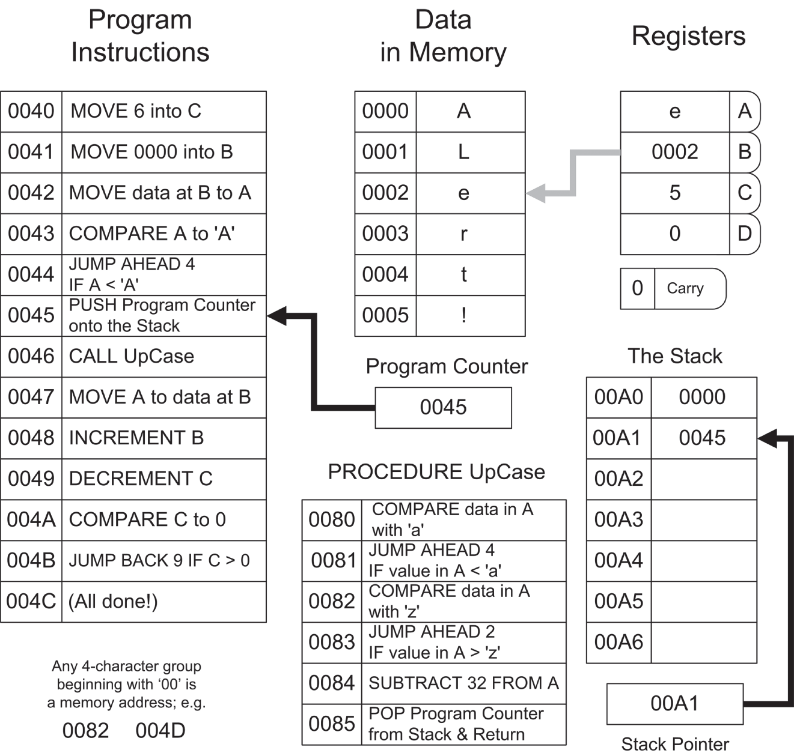

# CHƯƠNG 1 Tất cả nằm ở kế hoạch: ***Hiểu máy tính thực sự làm gì***

## Lại một ngày thứ Bảy ở Pleasant Valley

“Nhanh lên, Mike, gọi em gái và em trai con dậy đi; hơn 7 giờ rồi đấy. Nicky có trận Little League lúc 9 giờ, còn Dione có lớp ballet lúc 10 giờ. Cho Max uống viên thuốc giun tim đi! (Hết thuốc rồi mẹ ơi, mẹ nhớ không?) Bố con chọn đúng cái cuối tuần tuyệt vời để đi câu cá …. Đây, để mẹ đưa con 10 đô rồi đi mua thêm thuốc ở chỗ bác sĩ thú y …. Trời đất ơi, đúng rồi, Hank cần tiền đổ xăng nên mẹ chẳng còn đồng nào. Có một cây rút tiền ở gần Kmart, và nếu mẹ đến đó, mẹ có thể mang trả cái nắp bồn cầu ngớ ngẩn kia và lấy cái đúng loại.

“Chắc mẹ nên lập một danh sách thì hơn ….”

Lại một ngày thứ Bảy ở Pleasant Valley, và 30-odd triệu bà nội trợ vùng ngoại ô ngồi xuống bàn bếp với cây bút chì và tập giấy để cố sắp xếp cho ra lẽ một buổi sáng có thể giết chết và ngâm giấm bất kỳ sinh vật nào kém cỏi hơn. Trong đầu, bà nghĩ đến các mối phụ thuộc và vạch ra lộ trình:

“Thả Nicky ở Rand Park, quay lại Dempster, rồi mất khoảng 10 phút để đến Golf Mill Mall. Mình còn xăng không nhỉ? Tốt nhất là kiểm tra trước—nếu không đủ thì ghé Del's Shell, không thì mình sẽ không tới được Milwaukee Avenue. Vắt tiền từ cây rút tiền ở Golf Mill; rồi băng qua bãi đỗ xe sang Kmart để trả cái nắp bồn cầu mà Hank đã mua cuối tuần trước mà chẳng thèm xem nó hình dạng thế nào. Phải nhớ quẳng cái nắp bồn cầu ra sau xe van—ghi cái đó lên đầu danh sách.

“Đến lúc đó chắc là rưỡi rồi, có khi muộn hơn. Lớp ballet thì tận cuối đường Greenwood ở Park Ridge. Không được rẽ trái từ Milwaukee—nhưng có đường tắt vòng ra phía sau trung tâm thương mại. Mình phải nhớ đừng rẽ phải vào Milwaukee như mọi khi—ghi lại cái đó. Trong lúc ở Park Ridge, mình có thể ghé xem kính mới của Hank đã có chưa—lẽ ra nên gọi điện, nhưng đến 9:30 họ mới mở cửa. À, còn đi chợ nữa—có thể làm việc đó trong lúc Dione nhảy. Trên đường về mình có thể tạt qua Oakton để lấy thuốc cho con chó.”

Chỉ trong khoảng 90 giây, danh sách đã hoàn tất:

- Quẳng nắp bồn cầu vào xe van.
- Kiểm tra xăng––nếu hết, ghé Del's Shell.
- Thả Nicky ở Rand Park.
- Ghé cây rút tiền ở Golf Mill.
- Trả nắp bồn cầu ở Kmart.
- Thả Dione ở lớp ballet (nhớ đường tắt sang Greenwood).
- Xem kính của Hank đã có ở Pearle Vision chưa—nếu có rồi, kiểm tra thật kỹ xem họ đã nhớ phủ thêm lớp chống xước chưa.
- Đi chợ ở Jewel.
- Đón Dione.
- Ghé bác sĩ thú y lấy thuốc giun tim.
- Mang đồ chợ về nhà.
- Nếu đến giờ thì đón Nicky. Nếu chưa, nằm vật ra vài phút; rồi đón Nicky.
- Nằm vật ra!

Cái mà chúng ta thường gọi là “laundry list” (danh sách việc vặt, dù có liên quan đến giặt giũ hay không) chính là phép ẩn dụ hoàn hảo cho một chương trình máy tính. Không hề nhận ra, bà nội trợ gan dạ của chúng ta đã tự viết cho mình một chương trình máy tính và rồi bắt tay vào (với chính bà đóng vai máy tính) thực thi nó và xong xuôi trước buổi trưa.

Lập trình máy tính chẳng có gì hơn thế này: bạn, người lập trình, viết ra một danh sách các bước và các phép kiểm tra. Máy tính sau đó thực hiện từng bước và từng phép kiểm tra theo trình tự. Khi danh sách các bước đã được thực thi xong, máy tính dừng lại.

*Một chương trình máy tính là một danh sách các bước và các phép kiểm tra, không hơn*.

### Các bước và các phép kiểm tra

Hãy nghĩ một chút về cái mà tôi gọi là phép kiểm tra (test) trong danh sách việc vặt ở trên. Một *test* là kiểu quyết định either/or (cái này hoặc cái kia) mà chúng ta đưa ra hàng chục hay hàng trăm lần ngay cả trong những ngày yên ả nhất, đôi khi gần như chẳng cần nghĩ ngợi gì.

Bà nội trợ của chúng ta đã thực hiện một test khi bà nhảy lên xe van để bắt đầu cuộc phiêu lưu của mình. Bà nhìn vào đồng hồ xăng. Đồng hồ xăng sẽ cho bà biết một trong hai điều: (1) bà có đủ xăng, hoặc (2) bà không đủ. Nếu bà có đủ xăng, bà rẽ phải và hướng về Rand Park. Nếu bà không đủ xăng, bà rẽ trái xuống góc phố và đổ đầy bình ở Del's Shell. (Del có nhận thẻ tín dụng.) Rồi, với bình xăng đầy, bà tiếp tục chương trình bằng cách U-turn và hướng về Rand Park.

Nói một cách trừu tượng, một test gồm hai phần sau:

- Đầu tiên, bạn nhìn vào một thứ gì đó có thể diễn ra theo một trong hai cách.
- Sau đó bạn làm một trong hai việc, tùy thuộc vào những gì bạn thấy khi nhìn vào.

Gần cuối chương trình, bà nội trợ của chúng ta về đến nhà, lấy đồ chợ ra khỏi xe van, và nhìn đồng hồ. Nếu chưa đến giờ đón Nicky từ Little League về, bà có một chút thời gian để nằm vật ra sofa trong một căn nhà gần như trống trơn. Nếu *đã* đến giờ đón Nicky, thì bà mẹ tất bật ấy lại chẳng được nghỉ: bà chạy vội ra xe van và quay lại Rand Park.

(Có ai đoán xem liệu bà có thực sự được nghỉ ngơi khi chương trình chạy xong không?)

### Nhiều hơn hai lựa chọn?

Bạn có thể phản đối, nói rằng nhiều hay phần lớn các test liên quan đến nhiều hơn hai lựa chọn. Rất tiếc, bạn sai rồi––trong mọi trường hợp. Hãy đọc câu này hai lần: trừ những hành vi hoàn toàn bốc đồng hoặc loạn thần, mọi quyết định của con người đều quy về sự lựa chọn giữa hai khả năng.

Điều bạn phải làm là nhìn kỹ hơn một chút vào những gì diễn ra trong đầu bạn khi bạn đưa ra quyết định. Lần tới khi bạn phóng xuống Chow Now ăn đồ Tàu nhanh, hãy quan sát chính mình trong lúc bạn đang nghiền ngẫm thực đơn. Thoạt đầu, lựa chọn có vẻ như là chọn một món trong số 26 món chính kiểu Quảng Đông. Không phải vậy—thực ra lựa chọn là giữa việc chọn một món và *không* chọn chính món đó. Mắt bạn dừng lại ở món gà xào hạt điều. Không, nhạt quá. *Đó là một test*. Bạn lướt xuống món tiếp theo. Gà nấu nấm đen. Hừm, không, tuần trước ăn rồi. *Đó là một test nữa*. Món tiếp theo: gà kung pao. Đúng rồi, món này! *Đó là test thứ ba*.

Lựa chọn không phải là giữa gà xào hạt điều, gà nấu nấm đen, và gà kung pao. Mỗi món đều có khoảnh khắc của nó, được đặt trước con mắt phê phán của tâm trí bạn, và bạn giơ ngón cái lên hoặc chúc ngón cái xuống với từng món, một cách riêng rẽ. Cuối cùng, một món đã thắng, nhưng nó thắng trong chính trò chơi “ăn hay không ăn” ấy.

Để tôi cho bạn một ví dụ khác. Nhiều quyết định phức tạp nhất của cuộc đời nảy sinh bởi vì 99.99867 phần trăm chúng ta không phải là người theo chủ nghĩa khỏa thân. Bạn đã từng trải qua rồi: bạn đứng trong tủ quần áo, chỉ mặc đồ lót, lật qua lật lại giá treo quần. Các test đến dồn dập. Cái này? Không. Cái này? Không. Cái này? Không. Cái này? Được. Giả sử bạn chọn một chiếc quần màu xanh. (Dù sao thì hôm nay cũng là thứ Hai, và màu xanh có vẻ là màu thích hợp.) Rồi bạn lảo đảo đi tới ngăn kéo tất và nhìn vào. Ối, không có tất xanh. *Đó là một test*. Thế là bạn lảo đảo quay lại tủ quần áo, treo chiếc quần xanh trở lại giá, và bắt đầu lại. Cái này? Không. Cái này? Không. Cái này? Được. Lần này là quần nâu, và bạn vắt nó lên tay rồi quay lại ngăn kéo tất để nhìn thêm lần nữa. Chết tiệt, tất nâu cũng hết rồi. Thế là lại quay về tủ quần áo ….

Cái mà bạn có thể coi là một quyết định duy nhất, hoặc có lẽ là hai quyết định rối vào nhau không gỡ ra được (như chọn quần và tất cùng màu, với số đồ hiện có), thực ra là một chuỗi các quyết định nhỏ, luôn mang bản chất nhị phân: chọn hay không chọn. Tìm thấy hay không tìm thấy. Tình huống sáng thứ Hai trong tủ quần áo là một phép so sánh tốt cho một cấu trúc lập trình gọi là *loop*: bạn cứ tiếp tục làm một chuỗi việc cho đến khi làm đúng, và rồi bạn dừng lại (giả sử bạn không phải loại geek mặc tất xanh với quần nâu). Nhưng việc bạn có làm đúng mọi thứ hay không thì luôn quy về một chuỗi các quyết định either/or đơn giản.

### Máy tính suy nghĩ giống chúng ta

Tôi gần như có thể nghe thấy bạn đang nghĩ gì: “Chắc rồi, đây là sách về máy tính, và ông ta đang cố bắt mình suy nghĩ như một cái máy tính.” Hoàn toàn không. Máy tính suy nghĩ giống *chúng ta*. Chúng ta đã thiết kế ra chúng; còn cách nào khác để chúng suy nghĩ nữa? Không, điều tôi đang cố làm là khiến bạn nhìn thật lâu, thật kỹ vào cách *bạn* suy nghĩ. Chúng ta vận hành ở chế độ tự động trong phần lớn cuộc đời đến mức chúng ta thực sự làm phần lớn việc suy nghĩ của mình mà không thực sự nghĩ về nó.

Mô hình tốt nhất cho logic của một chương trình máy tính chính là cùng thứ logic mà chúng ta dùng để lên kế hoạch và quản lý công việc hằng ngày. Bất kể chúng ta làm gì, mọi chuyện đều quy về việc đối mặt với hai khả năng và chọn một. Cái mà chúng ta có thể coi là một quyết định lớn và phức tạp duy nhất thì chẳng qua chỉ là một mớ bòng bong lộn xộn của nhiều quyết định nhỏ hơn. Kỹ năng nhìn vào một quyết định phức tạp và thấy được tất cả những quyết định nhỏ nằm trong bụng nó sẽ giúp ích nhiều cho bạn khi học cách lập trình. Hãy quan sát chính mình vào lần tới khi bạn phải quyết định điều gì đó. Hãy đếm những quyết định nhỏ tạo nên quyết định lớn. Bạn sẽ ngạc nhiên đấy.

Và, bất ngờ chưa! Bạn sẽ là một lập trình viên.

## Nếu đây là chuyện thật …

Đừng hoảng hốt. Những gì bạn vừa trải qua là một phép ẩn dụ. Đó không phải là chuyện thật. (Chuyện thật sẽ đến sau.)

Tôi dùng ẩn dụ rất nhiều trong cuốn sách này. Ẩn dụ là một phép so sánh lỏng lẻo giữa một thứ quen thuộc (như danh sách việc vặt sáng thứ Bảy) và một thứ xa lạ (như một chương trình máy tính). Ý tưởng là neo cái xa lạ vào cái quen thuộc để khi tôi bắt đầu ném các sự kiện vào bạn, bạn sẽ có một chỗ thoải mái để đặt chúng xuống.

Điều quan trọng nhất bạn cần làm ngay lúc này là giữ một tâm trí cởi mở. Nếu bạn đã biết chút ít về máy tính hoặc lập trình, đừng bới lông tìm vết. Đúng vậy, có những khác biệt quan trọng giữa một bà nội trợ làm theo một danh sách việc vặt viết nguệch ngoạc và một máy tính thực thi một chương trình. Tôi sẽ nhắc đến những khác biệt đó khi đến lúc.

Còn bây giờ, chúng ta vẫn đang ở [Chương 1](ch01_it_s_all_in_the_plan.vi.md). Hãy tiếp nhận những ẩn dụ ban đầu này đúng như bản chất của chúng. Về sau, chúng sẽ giúp ích rất nhiều.

## Lập trình assembly language như một điệu nhảy square dance

Carol và tôi có một niềm yêu thích nhất định với các điệu nhảy “có người hô” (called dances), loại phổ biến nhất là square dance. Có những loại khác, như contra dance của vùng New England, rất giống square dance nhưng có nhạc hay hơn. Trong một điệu nhảy có người hô, người hô (caller) đứng ở đầu hội trường hô ra các động tác, và những người nhảy thực hiện các động tác đó. Âm nhạc tạo ra nhịp, giống như tiếng tích tắc của đồng hồ. Chuỗi các động tác gộp lại với nhau chính là điệu nhảy, và điệu nhảy thường có một cái tên.

Lần đầu tiên Carol và tôi tham dự một buổi contra dance, tôi sững người như bị trời giáng: *cái này giống hệt lập trình assembly language!* Người hô hô “allemande left,” và chúng tôi thực hiện động tác có tên “allemande left.” Người hô hô “forward and back,” và chúng tôi thực hiện động tác “forward and back.” Người hô hô “box the gnat,” và, ừ thì, chúng tôi “box the gnat.” (Tôi không bịa chuyện đâu!) Có một số lượng động tác vừa phải, và để nhảy giỏi kiểu đó, bạn phải thuộc lòng tất cả chúng theo tên. Nếu không, khi người hô hô một động tác mà bạn không biết, điệu nhảy có thể vấp váp hoặc khựng lại hẳn. (Bluescreen!)

Ở tầng sâu nhất, một máy tính hiểu một tập hợp các thao tác riêng lẻ gọi là *instruction*. Chúng thực hiện phép tính số học, thực thi logic như AND và OR, di chuyển dữ liệu qua lại, và làm nhiều việc khác. Mỗi instruction được thực hiện bên trong con chip CPU. Cũng như một tập hợp các động tác nhảy là những nguyên tử chuyển động riêng lẻ tạo nên một điệu square dance, các instruction là những nguyên tử của một chương trình máy tính. Chương trình giống như toàn bộ điệu nhảy: một chuỗi các instruction được thực thi theo thứ tự. Các cặp đôi tham gia điệu nhảy thực thi điệu nhảy/chương trình khi người hô đi dần xuống danh sách các động tác, lần lượt hô từng động tác. Vậy thì các cặp đôi chính là cái máy tính mà điệu nhảy chạy trên đó.

Phép ẩn dụ square dance chỉ đi được đến đó thôi. Một khi bạn đã nắm được bí quyết của assembly language, này, hãy đi học square dance hoặc contra dance ở đâu đó và xem liệu bạn có đi đến cùng kết luận như tôi không.

## Lập trình assembly language như một trò chơi cờ bàn

Trò chơi cờ bàn (board game) là thứ rất quan trọng khi tôi còn nhỏ, hồi mà các trò chơi cờ bàn thực sự được in trên một loại bảng. (Thôi được, bìa cứng.) Monopoly là trò mà hầu như ai cũng có. Có một kiểu đường đi vòng quanh mép bàn cờ được chia thành các ô. Bạn có một quân cờ tiến từ ô này sang ô khác theo kết quả gieo xúc xắc, và khi quân của bạn dừng ở một ô, bạn có thể làm một trong vài việc: mua bất động sản chưa ai mua, trả tiền thuê cho bất động sản thuộc sở hữu của người chơi khác, rút một lá bài từ chồng Chance, hoặc—ối!—vào tù. Bạn có một xấp tiền Monopoly để tiêu, và khi người chơi khác phải trả tiền thuê, bạn có thêm tiền.

Chi tiết cụ thể của trò Monopoly không quan trọng ở đây. Điều quan trọng là bạn tiến qua một chuỗi các bước, và ở mỗi bước, có điều gì đó xảy ra. Xấp tiền của bạn tăng lên hoặc giảm đi. Assembly language hơi giống như vậy: một chương trình giống như bàn cờ. Mỗi bước trong chương trình làm một việc gì đó. Có những chỗ mà bạn có thể lưu trữ các con số. Các con số thay đổi khi bạn đi qua chương trình.

Giờ khi bạn đã suy nghĩ theo kiểu trò chơi cờ bàn, hãy nhìn vào [Hình 1.1](#c01-fig-0001). Cái tôi vẽ ở đây thực ra là một sự xấp xỉ khá sát với assembly language như nó từng được dùng trên một số máy tính đơn giản hơn của chúng ta cách đây 50 hay 60 năm. Cột được đánh dấu “Program Instructions” là đường đi chính quanh mép bàn cờ, mà ở đây chỉ có thể thể hiện một phần. Đây là chương trình máy tính viết bằng assembly language, tức chuỗi các bước và các test thực sự mà khi được thực thi sẽ khiến máy tính làm một việc gì đó hữu ích. Việc thiết lập chuỗi program instruction này chính *là* lập trình bằng assembly language trên thực tế.

***Hình 1.1**: Trò chơi Assembly Language*

Mọi thứ khác chỉ là những thứ lặt vặt ở giữa bàn cờ phục vụ cho ván chơi đang diễn ra. Phần lớn trong số đó là các vị trí lưu trữ chứa dữ liệu của bạn. Có lẽ bạn đang nhận thấy (có lẽ với tinh thần chùng xuống) rằng có *rất nhiều* con số liên quan. (Lại còn là những con số kỳ quặc nữa. Chẳng hạn, “004B” có nghĩa là gì? Tôi xử lý vấn đề đó trong [Chương 2](ch02_alien_bases.vi.md), “Alien Bases.”) Tôi rất tiếc, nhưng trò chơi đơn giản là được chơi như vậy. Assembly language, ở tầng sâu nhất, chẳng có gì *ngoài* các con số, và nếu bạn ghét các con số theo cách mà phần lớn mọi người ghét cá cơm (anchovy), bạn sẽ gặp khó khăn đấy. (Tôi thích cá cơm, đó là một phần trong huyền thoại về tôi. Hãy học cách thích các con số. Chúng không mặn bằng đâu.) Các ngôn ngữ lập trình Higher-level như Pascal hay Python che giấu các con số bằng cách xử lý chúng một cách tượng trưng. Nhưng assembly language, ừ thì, chỉ có bạn và các con số.

Tôi nên lưu ý bạn rằng Trò chơi Assembly Language trong [Hình 1.1](#c01-fig-0001) không đại diện cho bất kỳ bộ xử lý máy tính thực nào, như Intel Core i5. Ngoài ra, tôi đã đặt tên các instruction dễ hiểu hơn so với tên thực tế của các instruction trong Intel assembly language. Trong thế giới thực, tên instruction thường là những thứ ngắn ngủn như **LAHF**, **STC**, **INC**, **SHRX**, và những cái tên bí hiểm khác không thể hiểu được nếu không giải thích khá nhiều. Chúng ta đang làm quen dần với chủ đề này qua một cách tiếp cận gián tiếp, và trong chương này tôi phải bọc đường một số thứ một chút để vẽ ra các ẩn dụ cho rõ ràng.

### Code và data

Giống như hầu hết các trò chơi cờ bàn, trò chơi cờ bàn assembly language gồm hai nhóm yếu tố lớn: các bước chơi và những chỗ để cất giữ đồ. Các “bước chơi” chính là các bước và các test mà tôi đã nói đến từ đầu tới giờ. Những chỗ để cất giữ đồ đúng là như tên gọi: những ngăn nhỏ mà bạn có thể đặt các con số vào, với niềm tin rằng những con số đó sẽ nằm nguyên ở chỗ bạn đặt cho đến khi bạn lấy chúng ra hoặc thay đổi chúng bằng cách nào đó.

Theo thuật ngữ lập trình, các bước chơi được gọi là *code*, và các con số nằm trong các ngăn nhỏ (phân biệt với bản thân các ngăn nhỏ) được gọi là *data*. Bản thân các ngăn nhỏ thường được gọi là *storage*. (Sự khác biệt giữa những chỗ bạn lưu trữ thông tin và thông tin bạn lưu trữ trong đó là cực kỳ quan trọng. Đừng nhầm lẫn chúng.) Hãy xét một instruction trong Trò chơi Assembly Language có nội dung **ADD 32 to A**. Một instruction **ADD** trong code làm thay đổi một giá trị data được lưu trong một ngăn nhỏ có tên là Register A.

Code và data là hai thứ có bản chất rất khác nhau, nhưng chúng tương tác với nhau theo những cách khiến trò chơi trở nên thú vị. Code bao gồm các bước đặt data vào storage (các instruction **MOVE**) và các bước thay đổi data đã có sẵn trong storage (các instruction **INCREMENT** và **DECREMENT**, và các instruction **ADD**, cùng những instruction khác). Phần lớn thời gian bạn sẽ nghĩ về code như là chủ nhân của data, theo nghĩa là code ghi các giá trị data vào storage. Tuy nhiên, data cũng có ảnh hưởng ngược lại đến code. Trong số các test mà code thực hiện có những test kiểm tra data trong storage, đó là các instruction **COMPARE**. Nếu một giá trị data nhất định có trong storage, code có thể làm một việc; nếu giá trị đó không có trong storage, code sẽ làm một việc khác, như trong các instruction **JUMP BACK** và **JUMP AHEAD**.

Khối instruction ngắn được đánh dấu **PROCEDURE** là một lối rẽ ra khỏi dòng instruction chính. Tại bất kỳ điểm nào trong chương trình, bạn có thể tạt vào procedure, thực hiện các bước và các test của nó, rồi quay trở lại đúng chỗ mà bạn đã rời đi. Điều này cho phép một chuỗi các bước và các test hữu ích chung và được dùng thường xuyên chỉ tồn tại ở một chỗ duy nhất, thay vì tồn tại dưới dạng các bản sao riêng rẽ ở mọi nơi cần đến nó.

### Address

Một khái niệm then chốt khác nằm ở những con số ngộ nghĩnh ở phía bên trái của các vị trí bước chương trình và các vị trí data. Mỗi con số là duy nhất, theo nghĩa là một vị trí được gắn nhãn bằng con số đó chỉ xuất hiện *một lần* bên trong máy tính. Vị trí này được gọi là *address*. Data được lưu và truy xuất bằng cách chỉ định address của data đó trong máy. Các procedure được gọi bằng cách chỉ định address nơi chúng bắt đầu.

Chiếc hộp nhỏ (cũng là một vị trí lưu trữ) được đánh dấu “Program Counter” giữ address của instruction kế tiếp sẽ được thực hiện. Con số bên trong program counter được tăng lên một (*incremented*) mỗi khi một instruction được thực hiện, *trừ khi instruction đó bảo program counter làm điều gì khác*. Ví dụ, hãy để ý instruction **JUMP BACK 9** tại address 004B. Khi instruction này được thực hiện, program counter sẽ “lùi lại” chín vị trí. Điều này tương tự với khái niệm “lùi lại ba ô” trong hầu hết các trò chơi cờ bàn.

### Kiểm tra ẩn dụ!

Đó là gần như toàn bộ phần giải thích về Trò chơi Assembly Language mà tôi định đưa ra lúc này. Đây vẫn là [Chương 1](ch01_it_s_all_in_the_plan.vi.md), và chúng ta vẫn đang ở trong lãnh địa của ẩn dụ. Những người đã từng tiếp xúc ít nhiều với máy tính sẽ nhận ra và hiểu được một phần những gì [Hình 1.1](#c01-fig-0001) đang làm. Những người hoàn toàn chưa từng tiếp xúc với bên trong máy tính thì không nên cảm thấy bị bỏ lại phía sau vì hoàn toàn mù tịt. Tôi tạo ra Trò chơi Assembly Language chỉ để truyền đạt những điểm sau:

- *Các bước riêng lẻ rất đơn giản*. Một instruction đơn lẻ hiếm khi làm gì hơn ngoài việc di chuyển một giá trị đơn lẻ từ ngăn lưu trữ này sang ngăn lưu trữ khác, thực hiện phép tính số học rất sơ đẳng như cộng hay trừ, hoặc so sánh giá trị chứa trong một ngăn lưu trữ với giá trị chứa trong một ngăn khác. Đây là tin tốt, vì nó cho phép bạn tập trung vào nhiệm vụ đơn giản mà một instruction đơn lẻ thực hiện mà không bị choáng ngợp bởi sự phức tạp. Tuy nhiên, tin xấu là điểm tiếp theo.
- *Cần rất nhiều bước để làm được bất cứ điều gì hữu ích*. Bạn thường có thể viết một chương trình hữu ích bằng những ngôn ngữ như Pascal hay BASIC chỉ trong năm hoặc sáu dòng. Bạn thực sự có thể tạo ra những chương trình hữu ích trong các hệ thống lập trình trực quan như Visual Basic, Delphi, hay Lazarus *mà không cần viết bất kỳ dòng code nào*. (Code vẫn ở đó … nhưng code là loại “đóng hộp” và tất cả những gì bạn thực sự làm là chọn xem những khúc code đóng hộp nào trong một bộ sưu tập gồm nhiều khúc như thế sẽ chạy.) Một chương trình assembly language hữu ích không thể được triển khai trong ít hơn khoảng 50 dòng, và bất cứ thứ gì có tính thử thách đều cần hàng trăm hay hàng nghìn—hoặc hàng chục nghìn—dòng. Kỹ năng lập trình assembly language nằm ở việc cấu trúc hàng trăm hay hàng nghìn instruction này sao cho chương trình vừa hoạt động đúng vừa vẫn có thể được đọc và hiểu bởi các lập trình viên khác—và chính bạn—sáu tháng sau.
- *Chìa khóa của assembly language là hiểu các memory address*. Trong những ngôn ngữ như Pascal và BASIC, compiler lo liệu việc một thứ gì đó nằm ở đâu—bạn chỉ cần đặt cho thứ đó một cái tên tượng trưng và gọi nó bằng tên đó bất cứ khi nào bạn muốn xem hoặc thay đổi nó. Trong assembly language, bạn phải luôn ý thức được mọi thứ nằm ở đâu trong memory hoặc tập register của máy tính. Vì vậy, trong quá trình đi qua cuốn sách này, hãy đặc biệt chú ý đến khái niệm memory addressing, vốn chẳng là gì khác ngoài nghệ thuật chỉ định một thứ gì đó nằm ở đâu. Trò chơi Assembly Language đầy rẫy các address và các instruction làm việc với address (chẳng hạn **MOVE data at B to C**, có nghĩa là di chuyển data được lưu tại address do register B chỉ định sang register C). Addressing là phần khó nhất của assembly language, khó hơn hẳn những phần còn lại, nhưng hãy làm chủ nó và bạn sẽ có gần như toàn bộ mọi thứ nằm gọn trong túi.

Mọi điều tôi nói cho đến giờ chỉ là định hướng. Tôi đã cố cho bạn nếm thử bức tranh tổng thể về assembly language và cách các nguyên lý nền tảng của nó liên hệ với cuộc sống mà bạn vẫn luôn sống từ trước đến nay. Cuộc sống là một chuỗi các bước và các test, cũng như square dance và trò chơi cờ bàn—và assembly language cũng vậy. Hãy ghi nhớ những ẩn dụ đó khi chúng ta tiến tới phần thực tế bằng cách đối mặt với bản chất của các con số trong máy tính.
