# <a id="Page_11"></a>CHƯƠNG 2 Những base ngoài hành tinh: *Nắm vững binary và hexadecimal*

<a id="head-2-1"></a>

## Sự trở lại của con quái vật New Math

Đó là năm 1966. Có lẽ bạn cũng đã sống qua thời ấy. (Khi đó tôi 13 tuổi và đang học lớp tám.) New Math ập vào chương trình grade-school trên cả nước, và bài tập về nhà trở thành một mớ hỗn loạn gồm trục số, tập hợp và các base khác nhau. Các bậc phụ huynh Middle-class cùng con mình vò đầu bứt tai trước những câu hỏi như “17 trong Base 5 là bao nhiêu?” và “Null Set thuộc về những tập hợp nào?” Chỉ trong một thời gian rất ngắn (tôi nhớ là khoảng hai tháng), toàn bộ thứ đó bị vứt vào sọt rác nhanh y như lúc nó được những quan chức giáo dục buồn chán vì có quá ít việc để làm nặn ra.

Thật ra đó là một điều đáng tiếc. Điều mà dường như chẳng ai nhận ra vào lúc đó là: đúng, chúng tôi đang học New Math—nhưng có điều *Old* Math cũng chưa bao giờ được dạy ở cấp grade-school. Chúng tôi cứ thắc mắc mãi rằng biết được giao của tập hợp những con sóc và tập hợp các loài động vật có vú thì có ích gì. Sự thật, dĩ nhiên, là nó chẳng có ích gì cả. Toán học ở Mỹ xưa nay luôn được dạy như toán học *ứng dụng*—tức số học—nặng về các bài toán đố. Nếu nó không giúp bạn cân đối sổ séc hay chia tỷ lệ một công thức nấu ăn, thì đó không phải toán thật đâu, anh bạn. Rất ít hoặc chẳng có chút logic nào của toán học *từng* lọt được vào lớp học tiểu học, một phần vì trường tiểu học ở Mỹ trong lịch sử vốn là một kiểu trường dạy nghề cho cuộc sống hằng ngày. Chỉ riêng việc dạy cho lũ nhóc biết đọc biết viết ở mức cơ bản đã đủ khó rồi. Còn cố làm cho chúng <a id="Page_12"></a>cảm nhận được vẻ đẹp của các hệ đếm khác thì đơn giản là đã vượt quá giới hạn đối với một nước Mỹ middle-class thực dụng.

Vốn là một cậu mọt sách, hồi năm 1966 tôi thật sự thích mày mò với môn toán theo phong cách New-Age, nhưng tôi vui vẻ gác nó sang một bên khi cơn sốt đó qua đi. Tôi không phải đụng lại nó cho đến năm 1976, khi, sau nhiều tuần làm việc như điên với một cây súng wire-wrap, tôi cấp điện cho chiếc microcomputer COSMAC ELF của mình và được chào đón bằng một màn hình LED hiển thị một cặp số trong *base 16!*

*Mon dieu*, New Math đã *quay trở lại*.

Chương này tồn tại vì ở cấp độ assembly language, máy tính của bạn không hiểu các con số trong base 10 quen thuộc của chúng ta. Máy tính, theo một kiểu hơi tâm thần phân liệt, làm việc với base 2 *và* base 16—cùng một lúc. Nếu bạn sẵn lòng chỉ gói gọn mình trong các ngôn ngữ higher-level như Basic hay Pascal, bạn có thể hoàn toàn bỏ qua các base ngoài hành tinh này, hoặc có lẽ xem chúng như một chủ đề nâng cao sau khi bạn đã thành thạo phần còn lại của ngôn ngữ. Ở đây thì không. *Mọi thứ* trong assembly language đều phụ thuộc vào việc bạn hiểu thấu đáo hai number base này. Vì vậy, trước khi làm bất cứ điều gì khác, chúng ta sẽ học đếm lại từ đầu—theo kiểu sao Hỏa.

### Đếm theo kiểu sao Hỏa

Trên sao Hỏa có sự sống thông minh.

Nghĩa là, người sao Hỏa đủ thông minh để biết, qua việc xem các chương trình TV của chúng ta trong khoảng 90 năm qua, rằng một ngành du lịch phát đạt sẽ chẳng có lợi gì cho họ. Vì thế họ vẫn ẩn mình, chỉ thoáng xuất hiện để tạc những tảng đá lớn thành hình khuôn mặt Elvis nhằm giúp tờ *National Enquirer* bảo đảm rằng sẽ không còn ai coi sao Hỏa là chuyện nghiêm túc nữa. Thỉnh thoảng người sao Hỏa cũng liên lạc với những nhà văn khoa học viễn tưởng như tôi, vì họ biết rõ rằng chưa *từng* có ai coi *chúng tôi* là nghiêm túc cả. Đó là lý do có những thông tin trong phần này, vốn liên quan đến cách người sao Hỏa đếm.

Người sao Hỏa có ba ngón tay ở một bàn tay và chỉ một ngón ở bàn tay kia. Người sao Hỏa nam có ba ngón ở bàn tay trái, còn người sao Hỏa nữ có ba ngón ở bàn tay phải. Điều này giúp việc nhảy waltz và một số việc khác dễ dàng hơn.

Giống như loài người và bất kỳ chủng tộc thông minh nào khác, người sao Hỏa bắt đầu đếm bằng ngón tay. Cũng như chúng ta đã dùng 10 ngón tay để chia mọi thứ thành các nhóm và các lũy thừa của 10, người sao Hỏa dùng bốn ngón tay để chia mọi thứ thành các nhóm và các lũy thừa của bốn. Theo thời gian, nền văn minh của chúng ta đã chuẩn hóa một bộ 10 chữ số để phục vụ hệ đếm của mình. Tương tự, người sao Hỏa đã chuẩn hóa một bộ bốn chữ số cho hệ đếm của họ. Bốn chữ số đó như sau, kèm theo tên của các chữ số theo cách người sao Hỏa phát âm: Θ (xip), ⌠ (foo), ∩ (bar), ≡ (bas).

Giống như số không của chúng ta, xip là một placeholder biểu thị không có món nào, và tuy đôi khi người sao Hỏa đếm từ xip, họ thường bắt đầu với foo, biểu thị một món duy nhất. Vậy là họ bắt đầu đếm: *foo*, *bar*, *bas* ….

Rồi sao nữa? Sau bas là gì? <a id="R_c02-tbl-0001"></a>[Bảng 2.1](#c02-tbl-0001) minh họa cách người sao Hỏa đếm đến con số mà chúng ta ở Trái Đất gọi là 25.

*<a id="c02-tbl-0001"></a>**Bảng 2.1**: Đếm theo kiểu sao Hỏa, Base Fooby*

| CHỮ SỐ SAO HỎA | CÁCH PHÁT ÂM CỦA NGƯỜI SAO HỎA | GIÁ TRỊ TƯƠNG ĐƯƠNG Ở TRÁI ĐẤT |
|---|---|---|
| Θ | Xip | 0 |
| ⌠ | Foo | 1 |
| ∩ | Bar | 2 |
| ≡ | Bas | 3 |
| ⌠ Θ | Fooby | 4 |
| ⌠ ⌠ | Fooby-foo | 5 |
| ⌠ ∩ | Fooby-bar | 6 |
| ⌠ ≡ | Fooby-bas | 7 |
| ∩ Θ | Barby | 8 |
| ∩ ⌠ | Barby-foo | 9 |
| ∩∩ | Barby-bar | 10 |
| ∩≡ | Barby-bas | 11 |
| ≡ Θ | Basby | 12 |
| ≡ ⌠ | Basby-foo | 13 |
| ≡ ∩ | Basby-bar | 14 |
| ≡ ≡ | Basby-bas | 15 |
| ⌠ ΘΘ | Foobity | 16 |
| ⌠ Θ ⌠ | Foobity-foo | 17 |
| ⌠ Θ ∩ | Foobity-bar | 18 |
| ⌠ Θ ≡ | Foobity-bas | 19 |
| ⌠ ⌠ Θ | Foobity-fooby | 20 |
| ⌠ ⌠ ⌠ | Foobity-fooby-foo | 21 |
| ⌠ ⌠ ∩ | Foobity-fooby-bar | 22 |
| ⌠ ⌠ ≡ | Foobity-fooby-bas | 23 |
| ⌠ ∩ Θ | Foobity-barby | 24 |
| ⌠ ∩ ⌠ | Foobity-barby-foo | 25 |

Với chỉ bốn chữ số (kể cả chữ số biểu thị số không), người sao Hỏa chỉ đếm được đến bas trước khi hết chữ số. Số đứng sau bas có một cái tên mới, *fooby*. Fooby là base của hệ đếm sao Hỏa và có lẽ là con số quan trọng nhất trên sao Hỏa. Fooby là số ngón tay mà một người sao Hỏa có. Chúng ta sẽ gọi nó là *bốn*.

Điều quan trọng nhất về fooby là cách người sao Hỏa viết nó ra bằng chữ số: ⌠ Θ. Thay vì một cột duy nhất, fooby được biểu diễn bằng hai cột. Cũng như hệ decimal của chúng ta, mỗi cột có một giá trị là một lũy thừa của fooby. Điều này chỉ có nghĩa là khi bạn di chuyển từ cột ngoài cùng bên phải sang trái, mỗi cột biểu thị một giá trị gấp fooby lần cột bên phải nó.

Cột ngoài cùng bên phải biểu thị hàng đơn vị, đếm theo foo. Cột kế tiếp biểu thị fooby nhân foo, hay (với điều kiện số học trên sao Hỏa vận hành giống như ở đây, bất kể New Math) đơn giản là fooby. Cột tiếp theo ở bên trái cột fooby biểu thị fooby nhân fooby, tức foobity, và cứ thế tiếp tục. Mối quan hệ này sẽ trở nên rõ ràng hơn qua <a id="R_c02-tbl-0002"></a>[Bảng 2.2](#c02-tbl-0002).

*<a id="c02-tbl-0002"></a>**Bảng 2.2**: Các lũy thừa của Fooby*

|  |  |  |  |
|---|---|---|---|
| ⌠ | Foo | x Fooby = ⌠ Θ | (Fooby) |
| ⌠ Θ | Fooby | x Fooby = ⌠ ΘΘ | (Foobity) |
| ⌠ ΘΘ | Foobity | x Fooby = ⌠ ΘΘΘ | (Foobidity) |
| ⌠ ΘΘΘ | Foobidity | x Fooby = ⌠ ΘΘΘΘ | (Foobididity) |
| ⌠ ΘΘΘΘ | Foobididity | x Fooby = ⌠ ΘΘΘΘΘ | (Foobidididity) |
| ⌠ ΘΘΘΘΘ | Foobidididity | x Fooby = ⌠ ΘΘΘΘΘΘ | và cứ thế … |

### Mổ xẻ một con số sao Hỏa

Một cột bất kỳ có thể chứa một chữ số từ xip đến bas, cho biết con số, xét toàn bộ, chứa bao nhiêu lần giá trị của cột ấy. Hãy cùng làm qua một ví dụ. Hãy nhìn <a id="R_c02-fig-0001"></a>[Hình 2.1](#c02-fig-0001), là phần mổ xẻ con số sao Hỏa ∩ ≡ ⌠ Θ ≡, được phát âm là “Barbididity-basbidity-foobity-bas.” (Một người sao Hỏa đến thăm và cải trang rất kỹ đã châm ngòi cho cơn sốt doo-wop khi đứng ở một trạm xe buýt tại Philadelphia năm 1954 và đếm tiền thối của mình.)

Cột ngoài cùng bên phải cho biết con số chứa bao nhiêu đơn vị. Chữ số ở đó là bas, cho biết con số chứa bas đơn vị. Cột thứ hai tính từ bên phải mang giá trị fooby nhân foo (fooby nhân 1), tức fooby. Một xip trong cột fooby cho biết không có fooby nào trong con số. Chữ số xip trong ⌠ Θ là một placeholder, giống như số không trong hệ đếm của chúng ta. Cũng hãy để ý rằng trong tổng theo cột được trình bày ở bên phải ma trận chữ số, dòng foobies được biểu diễn bằng hai xip. Không chỉ có một xip cho chúng ta biết là không có fooby nào, mà còn có một xip giữ chỗ cho hàng foo nữa. Mẫu này tiếp diễn trong tổng theo cột khi chúng ta tiến dần về các cột có trọng số lớn hơn ở bên trái.

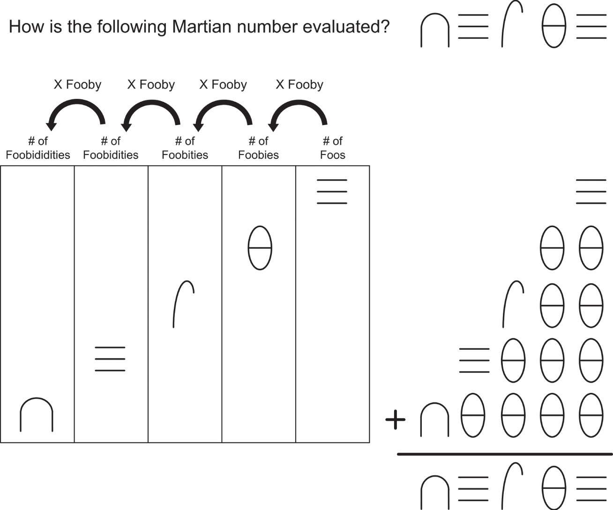

*<a id="c02-fig-0001"></a>**Hình 2.1**: Giải phẫu của ∩≡ ⌠ Θ ≡*

Fooby nhân fooby là foobity, và chữ số ⌠ cho chúng ta biết có foo foobity (một foobity duy nhất) trong con số. Cột kế tiếp, theo đúng mẫu, là foobity nhân fooby, tức foobidity. Trong ký pháp theo cột, foobidity được viết là ⌠ ΘΘΘ. Chữ số ≡ cho chúng ta biết có bas foobidity trong con số. Bas foobidity là một con số có tên riêng, basbidity, có thể viết là ≡ ΘΘΘ. Hãy để ý sự có mặt của basbidity trong tổng theo cột.

Cột tiếp theo bên trái có giá trị fooby nhân foobidity, tức foobididity. Chữ số ∩ cho chúng ta biết có bar foobididity trong con số. Bar foobididity (viết là ∩ ΘΘΘΘ) cũng là một con số có tên riêng, barbididity. Cũng hãy để ý sự có mặt của barbididity trong tổng theo cột, cùng với bốn chữ số xip giữ chỗ cho các cột trống.

Tổng theo cột diễn đạt ý nghĩa của cách một con số được ghép lại: con số chứa barbididity, basbidity, foobity và bas. Gộp tất cả lại bằng phép cộng đơn giản, bạn sẽ có ∩ ≡ ⌠Θ ≡. Tên của nó được phát âm đơn giản bằng cách nối các giá trị thành phần với nhau bằng dấu gạch nối: barbididity-basbidity-foobity-bas. Hãy để ý rằng trong tên không có phần nào biểu thị cột fooby trống. Chẳng hạn, trong base 10 quen thuộc của chúng ta, chúng ta không đọc số 401 là <a id="Page_16"></a>“bốn trăm, không chục, một.” Chúng ta chỉ nói “bốn trăm lẻ một.” Cũng theo cách đó, thay vì nói “xip fooby,” người sao Hỏa chỉ đơn giản là bỏ nó đi.

Như một bài tập, dựa trên những gì tôi đã nói với bạn cho đến giờ về các con số sao Hỏa, hãy tính ra giá trị theo kiểu Trái Đất tương đương với ∩ ≡ ⌠ Θ ≡.

### Bản chất của một number base

Vì các chuyến du lịch lên sao Hỏa khó có thể sớm bắt đầu, vậy biết hệ đếm sao Hỏa thì có ích gì trên Trái Đất này? Chỉ thế này thôi: đó là một cách tuyệt vời để hiểu được ý nghĩa của một number base mà không bị phân tâm bởi những chữ số quen thuộc và base 10 phổ quát của chúng ta.

Trong một hệ ký pháp số theo cột như của chúng ta lẫn của người sao Hỏa, *base* của hệ đếm là độ lớn mà mỗi cột của một con số vượt hơn độ lớn của cột bên phải nó. Trong hệ base 10 của chúng ta, mỗi cột biểu thị một giá trị gấp 10 lần cột bên phải nó. Trong một hệ base fooby như hệ được dùng trên sao Hỏa, mỗi cột biểu thị một giá trị gấp fooby lần giá trị của cột bên phải nó. (Phòng khi bạn vẫn chưa nhận ra, người sao Hỏa thật ra đang dùng base 4—nhưng tôi muốn bạn nhìn nó từ góc độ của người sao Hỏa trước đã.) Mỗi hệ có một bộ ký hiệu chữ số, với số lượng ký hiệu bằng đúng base. Trong base 10 của chúng ta, có 10 ký hiệu, từ 0 đến 9. Trong base 4, có bốn chữ số, từ 0 đến 3. *Trong bất kỳ number base nào, bản thân base không bao giờ có thể được biểu diễn bằng một chữ số duy nhất!*

<a id="head-2-2"></a>

## Octal: Grinch đã đánh cắp số tám và số chín như thế nào

Tạm biệt sao Hỏa. Ngoài rất nhiều sắt oxit và vài nhóm hát *a capella* tuyệt vời, họ chẳng có mấy thứ để cống hiến cho dân 10-fingered chúng ta. Ở đây cũng có một số number base kỳ lạ tương tự đang được dùng, và tôi muốn rẽ ngang một chút để ghé qua một hệ chiếm giữ một thế giới riêng ngay tại Trái Đất này: thế giới của Digital Equipment Corporation, được biết đến nhiều hơn với tên DEC.

Hồi thập niên '60, DEC đã phát minh ra minicomputer như một đối thủ thách thức những chiếc mainframe đồ sộ và đắt đỏ do IBM tiên phong. (Thời đại của minicomputer đã qua từ lâu, và bản thân DEC giờ cũng đã đi vào lịch sử.) Để bảo đảm rằng không software nào có thể được chuyển từ một mainframe của IBM sang một minicomputer của DEC, DEC đã thiết kế các máy của mình chỉ hiểu những con số được biểu diễn trong base *8*.

Hãy suy nghĩ về điều đó một chút, dựa trên kinh nghiệm của chúng ta với người sao Hỏa. Trong base 8, phải có tám chữ số. DEC đã đủ chu đáo để không tự phát minh ra các ký hiệu chữ số riêng, nên thứ họ dùng là các chữ số truyền thống của Trái Đất từ 0 đến 7. *Không có chữ số 8 trong base 8!* Điều đó lúc nào cũng cần một chút thời gian để quen, nhưng nó là một phần trong định nghĩa của một number base. DEC đã đặt một cái tên thích hợp cho hệ base 8 của mình: *octal*.

Một con số theo cột trong octal tuân theo quy tắc mà chúng ta đã gặp khi suy nghĩ về hệ sao Hỏa: mỗi cột có giá trị gấp *base* lần giá trị của cột bên phải nó. (Cột ngoài cùng bên phải luôn là hàng đơn vị.) Trong trường hợp octal, mỗi cột có giá trị gấp tám lần giá trị của cột kế tiếp bên phải.

### Ai đã đánh cắp số tám và số chín?

Điều này cho xem thì dễ hiểu hơn là kể. Việc đếm trong octal bắt đầu theo một cách rất quen thuộc: một, hai, ba, bốn, năm, sáu, bảy … 10.

Đây chính là chỗ rắc rối bắt đầu. Trong octal, 10 đứng sau bảy. Chuyện gì đã xảy ra với tám và chín? Grinch đã đánh cắp chúng sao? (Hay là người sao Hỏa?) Chẳng phải đâu. Chúng vẫn còn đó—nhưng chúng mang những cái tên khác. Trong octal, khi bạn nói “10,” ý bạn là “tám.” Tệ hơn nữa, khi bạn nói “11,” ý bạn là “chín.”

Đáng tiếc thay, điều mà DEC đã *không* làm là phát minh ra những cái tên khéo léo cho các giá trị cột. Cột đầu tiên, dĩ nhiên, là cột hàng đơn vị. Cột kế tiếp ở bên trái cột hàng đơn vị là cột hàng chục, y như trong hệ decimal của chính chúng ta. Nhưng đó chính là chỗ mắc mứu và là lý do tôi lôi sao Hỏa vào chuyện này: *cột “hàng chục” của octal thật ra có giá trị là 8*.

Có lẽ lúc này bạn đang bắt đầu nhức đầu. Uống một viên aspirin đi. Tôi sẽ đợi.

Một bảng đếm sẽ giúp ích. <a id="R_c02-tbl-0003"></a>[Bảng 2.3](#c02-tbl-0003) đếm đến 30 octal, có giá trị là 24 decimal. Tôi không thích dùng các từ *eleven*, *twelve*, v.v., trong các base khác base 10, nhưng quy ước trong octal xưa nay vẫn là đọc các con số giống như chúng ta đọc trong decimal, chỉ thêm từ *octal* phía sau. Đừng quên nói *octal*—nếu không, mọi người sẽ *thật sự* bối rối!

*<a id="c02-tbl-0003"></a>**Bảng 2.3**: Đếm trong Octal, Base 8*

| CHỮ SỐ OCTAL | CÁCH ĐỌC OCTAL | GIÁ TRỊ DECIMAL TƯƠNG ĐƯƠNG |
|---|---|---|
| 0 | Zero | 0 |
| 1 | One | 1 |
| 2 | Two | 2 |
| 3 | Three | 3 |
| 4 | Four | 4 |
| 5 | Five | 5 |
| 6 | Six | 6 |
| 7 | Seven | 7 |
| 10 | Ten | 8 |
| 11 | Eleven | 9 |
| 12 | Twelve | 10 |
| 13 | Thirteen | 11 |
| 14 | Fourteen | 12 |
| 15 | Fifteen | 13 |
| 16 | Sixteen | 14 |
| 17 | Seventeen | 15 |
| 20 | Twenty | 16 |
| 21 | Twenty-one | 17 |
| 22 | Twenty-two | 18 |
| 23 | Twenty-three | 19 |
| 24 | Twenty-four | 20 |
| 25 | Twenty-five | 21 |
| 26 | Twenty-six | 22 |
| 27 | Twenty-seven | 23 |
| 30 | Thirty | 24 |

Hãy nhớ rằng mỗi cột trong một number base có giá trị gấp *base* lần cột bên phải nó, nên cột “hàng chục” trong octal thật ra là cột hàng tám. (Người ta gọi nó là cột hàng chục vì nó được viết là 10 và đọc là “ten.”) Tương tự, cột bên trái cột hàng chục là cột hàng trăm (vì nó được viết là 100 và đọc là “hundreds”), nhưng cột hàng trăm thật ra có giá trị 8 nhân 8, tức 64. Cột tiếp theo bên trái có giá trị 64 nhân 8, tức 512, và cột bên trái cột đó có giá trị 512 nhân 8, tức 4,096.

Đây là lý do mà nếu ai đó nói về giá trị “ten octal,” ý họ là 8; “one hundred octal,” ý họ là 64; và cứ thế. <a id="R_c02-tbl-0004"></a>[Bảng 2.4](#c02-tbl-0004) tóm tắt các giá trị cột octal và giá trị decimal tương đương của chúng.

<a id="Page_19"></a>

*<a id="c02-tbl-0004"></a>**Bảng 2.4**: Các cột Octal dưới dạng lũy thừa của tám*

| OCTAL LŨY THỪA CỦA 8 |  | DECIMAL OCTAL |
|---|---|---|
| 1 = 8<sup>0</sup> | = | 1 × 8 = 10 |
| 10 = 8<sup>1</sup> | = | 8 × 8 = 100 |
| 100 = 8<sup>2</sup> | = | 64 × 8 = 1000 |
| 1000 = 8<sup>3</sup> | = | 512 × 8 = 10000 |
| 10000 = 8<sup>4</sup> | = | 4096 × 8 = 100000 |
| 100000 = 8<sup>5</sup> | = | 32768 × 8 = 1000000 |
| 1000000 = 8<sup>6</sup> | = | 262144 × 8 = 10000000 |

Một chữ số ở cột đầu tiên (cột hàng đơn vị, hay cột hàng một) cho biết số octal đó chứa bao nhiêu đơn vị. Một chữ số ở cột kế tiếp bên trái, cột hàng chục, cho biết số octal đó chứa bao nhiêu số tám. Một chữ số ở cột thứ ba, cột hàng trăm, cho biết có bao nhiêu số 64 trong con số, và cứ thế. Ví dụ, 400 octal có nghĩa là con số chứa bốn số 64, tức 256 trong decimal.

Đúng vậy, nó rối rắm, rối rắm vô cùng. Cách tốt nhất để mọi thứ ngấm vào đầu là mổ xẻ một con số octal cỡ vừa, giống như chúng ta đã làm với một con số sao Hỏa cỡ vừa. Đó chính là điều đang diễn ra trong <a id="R_c02-fig-0002"></a>[Hình 2.2](#c02-fig-0002): con số octal 76225 được tách ra thành từng cột rồi cộng lại.

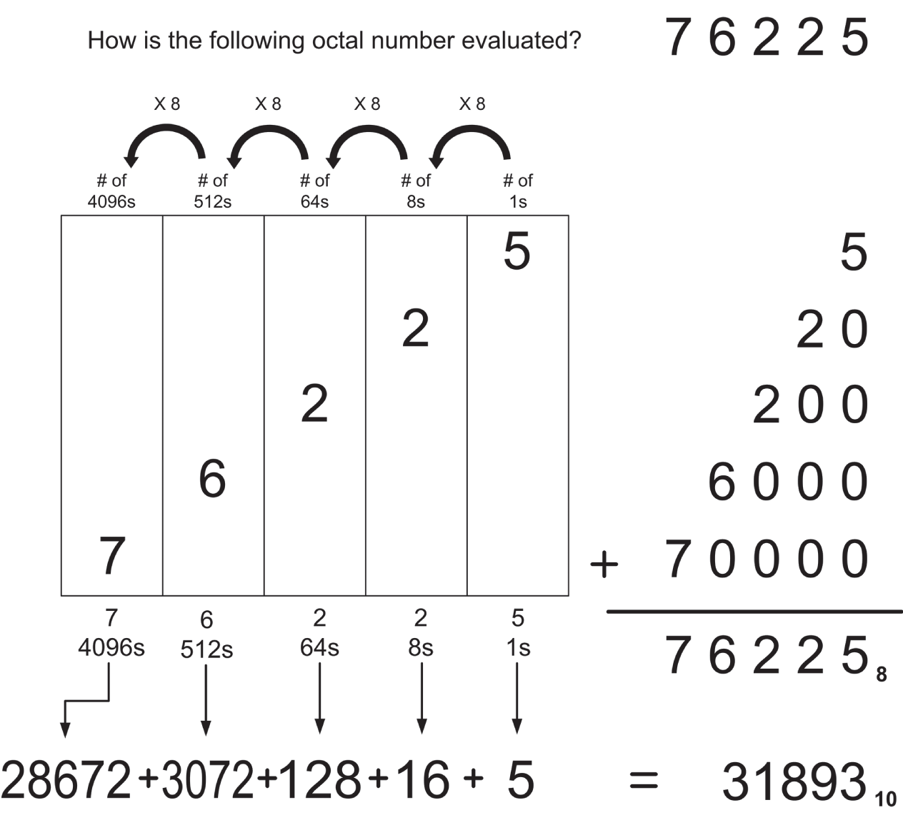

*<a id="c02-fig-0002"></a>**Hình 2.2**: Giải phẫu của 76225 octal*

Ở đây nó hoạt động y như trong hệ sao Hỏa, trong decimal, hay trong bất kỳ number base nào khác mà bạn có thể nghĩ ra. Nói một cách tổng quát (và hơi hình thức), mỗi cột có một giá trị bằng number base được nâng lên lũy thừa bằng vị trí thứ tự của cột đó trừ 1. Ví dụ, giá trị của cột đầu tiên là number base nâng lên lũy thừa 1 trừ 1, tức lũy thừa không. Vì bất kỳ số nào nâng lên lũy thừa không cũng bằng 1, nên cột đầu tiên trong *bất kỳ* number base nào cũng luôn có giá trị là một và được gọi là *cột hàng đơn vị*. Cột thứ hai có giá trị là number base nâng lên lũy thừa 2 trừ 1, tức lũy thừa một, <a id="Page_20"></a>chính là giá trị của bản thân number base. Trong octal giá trị này là 8; trong decimal là 10; trong các số base fooby của sao Hỏa là fooby. Cột thứ ba có giá trị bằng number base nâng lên lũy thừa 3 trừ 1, tức lũy thừa hai, và cứ thế.

Trong mỗi cột, chữ số chiếm cột đó cho biết con số, xét toàn bộ, chứa bao nhiêu lần giá trị của cột. Ở đây, chữ số 6 trong 76225 octal cho chúng ta biết có sáu lần giá trị của cột nó trong tổng giá trị 76225 octal. Chữ số sáu chiếm cột thứ tư, có giá trị là 8<sup>4-1</sup>, tức 8<sup>3</sup>, hay 512. Điều này cho chúng ta biết có sáu số 512 trong con số xét toàn bộ.

Bạn có thể chuyển giá trị của một con số trong bất kỳ base nào sang decimal (base 10 của chúng ta) bằng cách xác định giá trị của từng cột trong base ngoài hành tinh (không phải decimal) đó, rồi nhân giá trị của mỗi cột với chữ số nằm trong cột đó (để tạo ra giá trị decimal tương đương của từng chữ số), và cuối cùng lấy tổng các giá trị decimal tương đương của tất cả các cột. Việc này được thực hiện trong [Hình 2.2](#c02-fig-0002), và con số octal cùng giá trị decimal tương đương của nó được trình bày cạnh nhau. Một điều đáng để ý trong [Hình 2.2](#c02-fig-0002) là những chữ số subscript nhỏ ở bên phải các tổng theo cột. Các subscript này được dùng trong nhiều ấn phẩm kỹ thuật để chỉ ra number base. Chẳng hạn, subscript trong giá trị 76225<sub>8</sub> cho biết giá trị 76225 ở đây biểu thị một đại lượng trong octal, tức base 8. Không giống như sự khác biệt hiển nhiên giữa các chữ số sao Hỏa và các chữ số decimal truyền thống của chúng ta, thực sự chẳng có gì ở bản thân một con số octal để phân biệt nó là octal. (Chúng ta sẽ gặp phần nào chính vấn đề này một chút nữa khi đối mặt với hexadecimal.) Ngược lại, giá trị 31893<sub>10</sub> được subscript của nó cho thấy là một đại lượng base 10, tức decimal. Cách này chủ yếu được dùng trong các bài viết khoa học và nghiên cứu. Trong phần lớn các ấn phẩm về máy tính (kể cả cuốn này), người ta dùng những cách đánh dấu khác; sẽ nói thêm về điều đó sau.

Giờ chúng ta đã xem xét ký pháp theo cột từ cả góc độ sao Hỏa lẫn góc độ octal, hãy chắc chắn rằng bạn hiểu ký pháp theo cột hoạt động thế nào trong một base bất kỳ trước khi chúng ta đi tiếp.

<a id="head-2-3"></a>

## Hexadecimal: Giải quyết tình trạng thiếu chữ số

Octal khó có thể hữu ích với bạn, trừ khi bạn làm như một người bạn của tôi đã làm: phục chế một chiếc máy tính DEC PDP8 cổ lỗ mà anh ấy đã mua lại từ trường đại học của mình dưới dạng hàng thanh lý, tính tiền theo cân. (Anh ấy bảo nó rẻ hơn khoai tây đáng kể, dù không dễ chiên bằng. Không hẳn là dễ bằng.) Như tôi đã đề cập trước đó, hệ đếm *thực sự* cần phải tính đến trong thế giới microcomputer là base 16, mà chúng ta gọi là *hexadecimal*, hay (một cách trìu mến hơn) đơn giản là *hex*.

Hexadecimal có chung những đặc điểm thiết yếu của mọi number base, kể cả hệ sao Hỏa lẫn octal. Nó là một ký pháp theo cột, trong đó mỗi cột có giá trị gấp 16 lần giá trị của cột bên phải nó. Nó có 16 chữ số, chạy từ 0 đến … đến gì nhỉ?

Ở đây chúng ta bị thiếu chữ số. Từ không đến chín thì chúng ta vẫn ổn. Tuy nhiên, 10, 11, 12, 13, 14 và 15 cần được biểu diễn bằng những ký hiệu đơn lẻ nào đó. Vì không có thêm chữ số nào, những người phát triển ký pháp hexadecimal vào đầu thập niên 1950 đã mượn sáu chữ cái đầu tiên của bảng chữ cái để đóng vai trò các chữ số cần thiết.

Vậy thì việc đếm trong hexadecimal diễn ra như sau: 1, 2, 3, 4, 5, 6, 7, 8, 9, A, B, C, D, E, F, 10, 11, 12, 13, 14, 15, 16, 17, 18, 19, 1A, 1B, 1C, và cứ thế. <a id="R_c02-tbl-0005"></a>[Bảng 2.5](#c02-tbl-0005) trình bày lại điều này một cách có tổ chức hơn, kèm theo các giá trị decimal tương đương đến 32.

*<a id="c02-tbl-0005"></a>**Bảng 2.5**: Đếm trong Hexadecimal, Base 16*

| CHỮ SỐ HEXADECIMAL | CÁCH ĐỌC (THÊM “HEX” PHÍA SAU) | GIÁ TRỊ DECIMAL TƯƠNG ĐƯƠNG |
|---|---|---|
| 0 | Zero | 0 |
| 1 | One | 1 |
| 2 | Two | 2 |
| 3 | Three | 3 |
| 4 | Four | 4 |
| 5 | Five | 5 |
| 6 | Six | 6 |
| 7 | Seven | 7 |
| 8 | Eight | 8 |
| 9 | Nine | 9 |
| A | A | 10 |
| B | B | 11 |
| C | C | 12 |
| D | D | 13 |
| E | E | 14 |
| F | F | 15 |
| 10 | Ten (hoặc, One-oh) | 16 |
| 11 | One-one | 17 |
| 12 | One-two | 18 |
| 13 | One-three | 19 |
| 14 | One-four | 20 |
| 15 | One-five | 21 |
| 16 | One-six | 22 |
| 17 | One-seven | 23 |
| 18 | One-eight | 24 |
| 19 | One-nine | 25 |
| 1A | One-A | 26 |
| 1B | One-B | 27 |
| 1C | One-C | 28 |
| 1D | One-D | 29 |
| 1E | One-E | 30 |
| 1F | One-F | 31 |
| 20 | Twenty (hoặc, Two-oh) | 32 |

Một trong những quy ước trong hexadecimal mà tôi rất ưa thích là bỏ đi những từ như *eleven* và *twelve*, vốn gắn hơi quá chặt với hệ decimal của chúng ta và chỉ gây ra sự nhầm lẫn tai hại. Khi gặp số 11 trong hexadecimal (thường được viết là 11H để cho chúng ta biết mình đang nói ở base nào), chúng ta sẽ nói “one-one hex.” Đừng quên nói “hex” sau một con số hexadecimal, một lần nữa là để tránh nhầm lẫn tai hại. Việc này không cần thiết với các chữ số đơn từ 0 đến 9, vốn biểu thị đúng cùng những giá trị trong cả decimal lẫn hexadecimal.

Một số người vẫn nói những thứ như “twelve hex,” cách nói này hợp lệ và có nghĩa là 18 decimal. Nhưng tôi không ưa nó và khuyên bạn đừng dùng. Chuyện các base ngoài hành tinh này đã đủ rối rắm rồi, đâu cần đeo thêm cho người ngoài hành tinh mấy cái mặt nạ Charlie Chaplin.

Mỗi cột trong hệ hexadecimal có giá trị gấp 16 lần giá trị của cột bên phải nó. (Cột ngoài cùng bên phải, như trong *bất kỳ* number base nào, là cột hàng đơn vị và có giá trị 1.) Như bạn có thể đoán, giá trị của từng cột tăng lên nhanh đến đáng sợ khi bạn đi từ phải sang trái. <a id="R_c02-tbl-0006"></a>[Bảng 2.6](#c02-tbl-0006) cho thấy giá trị của bảy cột đầu tiên trong hexadecimal. Để so sánh, hãy để ý rằng cột thứ bảy trong ký pháp decimal có giá trị 1 triệu, trong khi cột thứ bảy trong hexadecimal có giá trị 16,777,216.

*<a id="c02-tbl-0006"></a>**Bảng 2.6**: Các cột Hexadecimal dưới dạng lũy thừa của 16*

| HEXADECIMAL | LŨY THỪA CỦA 16 | DECIMAL |
|---|---|---|
| 1H | = 16<sup>0</sup> = | 1 x 16 = 10H |
| 10H | = 16<sup>1</sup> = | 16 x 16 = 100H |
| 100H | = 16<sup>2</sup> = | 256 x 16 = 1000H |
| 1000H | = 16<sup>3</sup> = | 4096 x 16 = 10000H |
| 10000H | = 16<sup>4</sup> = | 65536 x 16 = 100000H |
| 100000H | = 16<sup>5</sup> = | 1048576 x 16 = 1000000H |
| 1000000H | = 16<sup>6</sup> = | 16777216 etc…. |

Để giúp bạn hiểu các con số hexadecimal được cấu tạo thế nào, tôi đã mổ xẻ một con số hex cỡ vừa trong <a id="R_c02-fig-0003"></a>[Hình 2.3](#c02-fig-0003), theo cùng cách mà trước đó tôi đã mổ xẻ các con số trong cả base fooby của sao Hỏa lẫn trong octal, base 8. Cũng như trong octal, số không giữ chỗ trong một cột mà không thêm giá trị nào vào con số xét toàn bộ. Hãy để ý trong [Hình 2.3](#c02-fig-0003) rằng có 0, tức là không có, số 256 nào trong con số 3C0A9H.

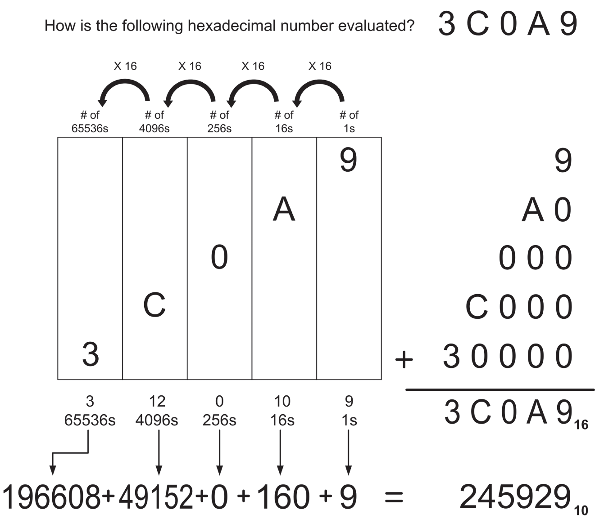

*<a id="c02-fig-0003"></a>**Hình 2.3**: Giải phẫu của 3C0A9H*

Như trong [Hình 2.2](#c02-fig-0002), giá trị decimal của mỗi cột được trình bày bên dưới cột đó, và tổng của tất cả các cột được trình bày ở cả decimal lẫn hex. (Hãy để ý các subscript!)

<a id="Page_24"></a>

<a id="head-2-4"></a>

## Từ Hex sang Decimal và từ Decimal sang Hex

Phần lớn các thao tác với số hex mà bạn sẽ thực hiện là những phép chuyển đổi đơn giản giữa hex và decimal, theo cả hai chiều. Cách dễ nhất để thực hiện những phép chuyển đổi như vậy là dùng một máy tính hex, hoặc là một máy tính bỏ túi “thật” như chiếc TI Programmer lừng danh từ thập niên 1980 (mà tôi vẫn còn giữ, dù nó là một battery-eater tệ hại), hoặc là một máy tính dạng software có khả năng làm việc với hexadecimal. Ứng dụng Galculator (Gnome Calculator) mà bạn có thể cài từ hầu hết các repository của Linux sẽ tính toán trong decimal, hex, octal và binary nếu bạn chọn View ➪ Scientific. Máy tính của Windows cũng hoạt động theo cách đó: chế độ xem mặc định là basic, và bạn phải chọn chế độ xem Programmer để làm việc với bất kỳ base ngoài hành tinh nào. Speedcrunch là một máy tính khác làm việc được với decimal, hex, octal và binary ngay từ get-go. Một số máy tính này có thể đã được cài sẵn trong Linux distro của bạn. Hãy kiểm tra ứng dụng quản lý software của bạn để xem chúng đã có chưa.

Dĩ nhiên, dùng máy tính chẳng đòi hỏi gì ở chất xám của bạn, và sẽ chẳng giúp bạn hiểu hệ đếm hexadecimal tốt hơn chút nào. Vì vậy, trong lúc bạn còn là một học viên tương đối non tay về các base ngoài hành tinh, hãy tránh xa mọi thứ hiểu được hex, dù đó là hardware, software hay những đồng nghiệp bằng xương bằng thịt.

Thật ra, công cụ tốt nhất trong lúc bạn đang học là một chiếc máy tính four-function đơn giản có memory. Các phương pháp chuyển đổi mà tôi mô tả ở đây đều sử dụng một chiếc máy tính như vậy, vì điều tôi đang cố dạy bạn là chuyển đổi number base, chứ không phải phép cộng decimal hay phép chia dài.

### Từ Hex sang Decimal

Rồi bạn sẽ hiểu ra rằng việc chuyển số hex sang decimal dễ hơn nhiều so với chiều ngược lại. Phương pháp chung là làm đúng những gì chúng ta đã làm suốt từ đầu trong các hình number-dissection [Hình 2.1](#c02-fig-0001), [2.2](#c02-fig-0002) và [2.3](#c02-fig-0003): tìm ra giá trị được biểu thị bởi từng cột riêng lẻ trong số hex, rồi cộng tổng tất cả các giá trị cột đó lại trong decimal.

Hãy thử một bài dễ. Số hex là 7A2. Bắt đầu từ cột bên phải. Đây là cột hàng đơn vị trong bất kỳ hệ đếm nào. Bạn có 2 đơn vị, nên hãy nhập 2 vào máy tính. Giờ hãy lưu số 2 đó vào memory. (Hoặc nhấn nút SUM, nếu máy của bạn có nút SUM.)

Xong phần hàng đơn vị. Hãy nhớ rằng điều bạn thực sự đang làm là giữ một tổng cộng dồn các giá trị của những cột trong số hex. Chuyển sang cột kế tiếp bên trái. Hãy nhớ rằng trong hex, mỗi cột biểu thị một giá trị gấp 16 lần giá trị của cột bên phải nó. Vì vậy, cột thứ hai tính từ bên phải là cột hàng 16. (Hãy tham khảo [Bảng 2.6](#c02-tbl-0006) nếu bạn không nhớ các giá trị cột.) Cột hàng 16 có chữ A. A trong hex là 10 decimal. Do đó, tổng giá trị của cột đó là 16 × 10, tức 160. Hãy thực hiện phép nhân đó trên máy tính, rồi <a id="Page_25"></a>cộng tích vào số 2 mà bạn đã lưu trong memory. (Một lần nữa, nút SUM là cách tiện lợi để làm việc này nếu máy tính của bạn có nút đó.)

Hãy nhớ bạn đang làm gì: tính giá trị từng cột trong decimal và giữ một tổng cộng dồn. Giờ hãy chuyển sang cột thứ ba tính từ bên phải. Cột này chứa chữ số 7. Giá trị của cột thứ ba là 16 × 16, tức 256. Hãy thực hiện 256 × 7 trên máy tính, rồi cộng tích vào tổng cộng dồn của bạn.

Bạn đã xong. Hãy lấy tổng cộng dồn ra từ memory của máy tính. Tổng phải là 1,954, chính là giá trị decimal tương đương của 7A2H.

Hãy thử lại lần nữa, nhanh hơn, bớt lải nhải một chút và với một con số lớn hơn nhiều: C6F0DBH.

1. Trước tiên, tính giá trị cột hàng đơn vị. B × 1 = 11 × 1 = 11. Bắt đầu tổng cộng dồn của bạn với 11.
2. Tính giá trị cột hàng 16. D × 16 = 13 × 16 = 208. Cộng 208 vào tổng cộng dồn của bạn.
3. Tính giá trị cột hàng 256. 0 × 256 = 0. Đi tiếp.
4. Tính giá trị cột hàng 4,096. F × 4,096 = 15 × 4,096 = 61,440. Cộng nó vào tổng cộng dồn của bạn.
5. Tính giá trị cột hàng 65,536. 6 × 65,536 = 393,216. Cộng nó vào tổng cộng dồn.
6. Tính giá trị cột hàng 1,048,576. C × 1,048,576 = 12 × 1,048,576 = 12,582,912. Cộng nó vào tổng của bạn.

Tổng cộng dồn phải là 13,037,787.

Cuối cùng, hãy tự làm mà không cần bất kỳ trợ giúp nào với con số sau: 1A55BEH.

### Từ Decimal sang Hex

Đến lúc này hẳn là bạn đã bắt đầu vỡ lẽ. Điều đó tốt, vì đi theo chiều ngược lại, từ base 10 decimal quen thuộc của chúng ta sang hex, khó hơn *nhiều* và đòi hỏi nhiều phép toán hơn. Điều chúng ta phải làm là tìm các giá trị cột hex “bên trong” một con số decimal—và việc đó đòi hỏi dùng khá nhiều đến con ngáo ộp của học sinh fifth-grade: phép chia dài.

Nhưng hãy bắt tay vào việc, một lần nữa bắt đầu với một con số decimal khá dễ: 449. Máy tính sẽ cực kỳ có ích. Hãy gõ số 449 và lưu nó vào memory của máy tính.

Điều chúng ta cần làm trước tiên là tìm giá trị cột hex *lớn nhất* có mặt trong 449 ít nhất *một lần*. Bạn còn nhớ những bài “gazinta” hồi grade-school không? (12 *gazinta* 855 bao nhiêu lần?) Phép chia thường được giới thiệu cho học sinh như một cách để tìm xem một số nào đó có mặt—“goes into”—trong một số khác bao nhiêu lần. Đại loại là như vậy. Nhìn lại [Bảng 2.6](#c02-tbl-0006), chúng ta có thể thấy 256 là lũy thừa lớn nhất của 16, và do đó là giá trị cột hex lớn nhất, có mặt trong 449 ít nhất một lần. (Lũy thừa lớn kế tiếp của 16—512—rõ ràng là quá lớn để có mặt trong 449.)

Vậy, chúng ta bắt đầu với 256 và xác định 256 “gazinta” 449 bao nhiêu lần: 449 / 256 = 1.7539. Ít nhất một lần, nhưng chưa tới hai lần. Vậy 449 chỉ chứa một số 256. Hãy viết số 1 ra giấy. *Đừng nhập nó vào máy tính*. Ở đây chúng ta không giữ một tổng cộng dồn; nếu có thì có thể nói là chúng ta đang giữ một số dư cộng dồn. Số 1 là chữ số hex ngoài cùng bên trái của giá trị hex tương đương với 449 decimal.

Chúng ta biết chỉ có một số 256 trong 449. Điều chúng ta phải làm bây giờ là *loại bỏ* số 256 đó khỏi con số ban đầu, vì chúng ta đã “đếm” nó bằng cách viết số 1 ra giấy. Hãy lấy 449 trừ 256. Lưu hiệu số, 193, vào memory.

Cột 256 đã được loại khỏi con số mà chúng ta đang chuyển đổi. Giờ chúng ta chuyển sang cột kế tiếp bên phải, cột hàng 16. Có bao nhiêu số 16 trong 193? 193 / 16 = 12.0625. Điều này có nghĩa là cột hàng 16 trong giá trị hex tương đương của 449 chứa một … 12? Hừmmm … hãy nhớ tình trạng thiếu chữ số, và sự thật là trong hex, giá trị mà chúng ta gọi là 12 được biểu diễn bằng chữ C. Từ góc độ hex, chúng ta đã tìm ra rằng con số ban đầu chứa C trong cột hàng 16. Hãy viết chữ C vào bên phải số 1 của bạn: 1C. Đến giờ mọi thứ vẫn ổn.

Chúng ta đã có cột hàng 16, nên cũng như với cột hàng 256, chúng ta phải loại các số 16 ra khỏi phần còn lại của con số ban đầu. Tổng giá trị của cột hàng 16 là C × 16 = 12 × 16 = 192. Hãy lấy giá trị 193 ra từ memory của máy tính và trừ đi 192. Chỉ còn lại một số 1 nhỏ bé cô đơn.

Vậy là chúng ta đã xuống đến cột hàng đơn vị. Hiển nhiên là trong một có một đơn vị. Hãy viết số 1 đó vào bên phải chữ C trong con số hexadecimal của chúng ta: 1C1. 449 decimal tương đương với 1C1 hex.

Giờ có lẽ bạn sẽ bắt đầu hiểu vì sao các programmer lại thích máy tính hexadecimal đến vậy.

Hãy nhìn lại bức tranh toàn cảnh của phép chuyển đổi decimal-to-hex. Chúng ta đang tìm các cột hexadecimal ẩn trong giá trị decimal. Chúng ta tìm cột lớn nhất có trong con số decimal, tìm giá trị của cột đó, rồi lấy con số decimal trừ đi giá trị ấy. Sau đó chúng ta tìm cột hex nhỏ hơn kế tiếp, rồi cột nhỏ hơn kế tiếp nữa, và cứ thế, vừa đi vừa loại bỏ giá trị của từng cột ra khỏi con số decimal. Theo một nghĩa nào đó, chúng ta đang chia con số cho các lũy thừa của 16 nhỏ dần liên tiếp và giữ một số dư cộng dồn bằng cách loại bỏ từng cột khi đếm xong nó.

Hãy thử lại lần nữa. Con số bí mật là 988,664.

1. Tìm cột lớn nhất có trong 988,664 từ [Bảng 2.6](#c02-tbl-0006): 65,536. 988,664 / 65,536 = 15 và lẻ. Bỏ qua phần lẻ. 15 = F trong hex. Viết F ra.
2. Loại F × 65,536 ra khỏi 988,664. Lưu số dư: 5,624.
3. Chuyển sang cột nhỏ hơn kế tiếp. 5,624 / 4,096 = 1 và lẻ. Viết số 1 ra.
4. <a id="Page_27"></a>Loại 1 × 4,096 ra khỏi số dư: 5,624 – 4096 = 1528. Lưu số dư mới: 1,528.
5. Chuyển sang cột nhỏ hơn kế tiếp. 1,528 / 256 = 5 và lẻ. Viết số 5 ra.
6. Loại 5 × 256 ra khỏi số dư đã lưu, 1,528. Lưu 248 làm số dư mới.
7. Chuyển sang cột nhỏ hơn kế tiếp. 248 / 16 = 15 và lẻ. 15 = F trong hex. Viết F ra.
8. Loại F × 16 ra khỏi số dư đã lưu, 248. Số dư, 8, là số đơn vị trong cột cuối cùng. Viết số 8 ra.

Vậy là xong: 988,664 decimal = F15F8H.

Hãy để ý sự có mặt của chữ *H* ở cuối số hex. Từ giờ trở đi, mọi số hex trong phần văn bản của cuốn sách này đều sẽ có chữ H đó gắn vào đuôi. Điều này quan trọng, vì không phải *mọi* số hex đều chứa chữ số dạng chữ cái để hét lên rằng con số đó ở base 16. Có số 157H cũng chắc chắn như có số 157 decimal, và hai số này *không* phải là cùng một số. (Nhanh nào: chúng khác nhau bao nhiêu?) Đừng quên chữ H đó khi viết các chương trình assembly của bạn, như tôi sẽ nhắc lại với bạn sau này.

<a id="head-2-5"></a>

## Luyện tập. Luyện tập! LUYỆN TẬP!

Cách tốt nhất (thật ra là cách duy nhất) để có được cảm nhận bản năng về ký pháp hex là dùng nó thật nhiều. Hãy chuyển *từng* số hex sau đây sang decimal. Đặt từng con số lên bàn mổ xẻ và xác định xem có bao nhiêu số 1, bao nhiêu số 16, bao nhiêu số 256, bao nhiêu số 4,096, v.v., có mặt trong con số đó, rồi cộng chúng lại trong decimal.

```
CCH
157H
D8H
BB29H
7AH
8177H
A011H
99H
2B36H
FACEH
8DB3H
9H
```

Làm xong rồi thì giờ hãy làm ngược lại, và chuyển từng số decimal sau đây sang hex. Hãy nhớ phương pháp chung: Từ [Bảng 2.6](#c02-tbl-0006), chọn <a id="Page_28"></a>lũy thừa lớn nhất của 16 mà *nhỏ hơn* con số decimal cần chuyển đổi. Tìm xem lũy thừa đó của 16 có mặt trong con số decimal bao nhiêu lần, và viết kết quả ra làm chữ số hex ngoài cùng bên trái của con số được chuyển đổi. Sau đó lấy con số decimal trừ đi tổng giá trị được biểu thị bởi chữ số hex đó. Rồi lặp lại quá trình, dùng lũy thừa nhỏ hơn kế tiếp của 16, cho đến khi bạn đã trừ con số decimal xuống còn không.

```
39
413
22
67,349
6,992
41
1,117
44,919
12,331
124,217
91,198
307
112,374,777
```

(Điểm cộng cho số cuối cùng đó ….) Nếu bạn cần luyện tập thêm, hãy chọn vài số decimal, chuyển chúng sang hex rồi chuyển ngược trở lại. Khi làm xong, hãy kiểm tra bài làm của bạn bằng máy tính.

<a id="head-2-6"></a>

## Số học trong Hex

Khi ngày càng thành thạo assembly language, bạn sẽ ngày càng làm nhiều phép tính số học trong base 16. Thậm chí (trời đất ơi) bạn có thể đi đến chỗ làm việc đó *trong đầu*. Dù vậy, việc đó cũng cần luyện tập.

Phép cộng và phép trừ về cơ bản giống như những gì chúng ta biết trong decimal, chỉ thêm vài chữ số cho có hương vị. Bí quyết chẳng có gì hơn là thuộc bảng cộng của bạn đến 0FH. Cách tốt nhất để làm điều này không phải là tự nghĩ thầm, “Nào, nếu C là 12 và F là 15, thì C + F là 12 + 15, tức 27 decimal nhưng là 1BH.” Thay vào đó, bạn chỉ nên nói thầm trong đầu, “C + F là 1BH.”

Đúng vậy, đó là một yêu cầu không nhỏ. Nhưng giờ tôi hỏi bạn, như tôi sẽ còn hỏi lại bạn trên hành trình này: bạn muốn hack assembly … hay bạn chỉ muốn làm cho vui? Học piano cần luyện tập, và việc khắc sâu những kỹ năng cốt lõi của lập trình assembly language vào tận các synapse của bạn, nơi chúng thuộc về, cũng cần luyện tập.

Vì vậy, hãy để tôi nói giọng như một bà giáo già và bảo bạn học thuộc những thứ sau đây. Nếu cần thì hãy làm flash card:

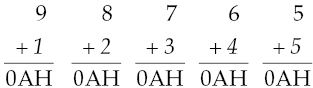

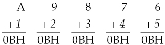

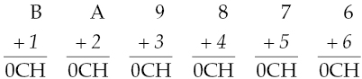

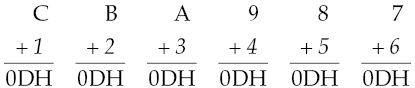

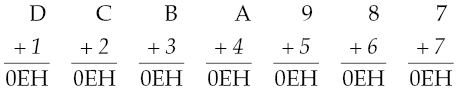

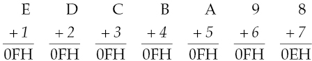

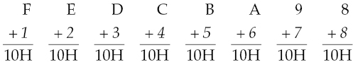

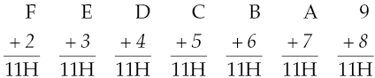

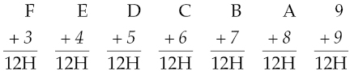

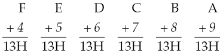

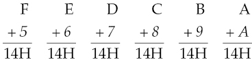

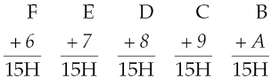

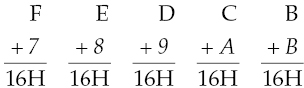

<a id="Page_30"></a>

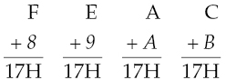

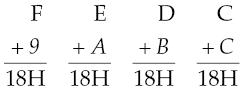

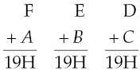

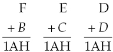

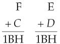

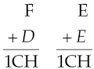

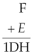

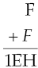

Nếu không có gì khác, thì ít nhất bài tập này cũng khiến bạn mừng vì máy tính không làm việc trong base 64.

### Các cột và carry

Khi đã ghi nhớ (ít nhiều) tất cả các phép cộng single-column này, bạn có thể bắt tay vào phép cộng nhiều cột. Nó hoạt động gần như y hệt như với decimal. Hãy cộng từng cột bắt đầu từ bên phải, và carry sang cột kế tiếp bất cứ khi nào tổng của một cột vượt quá 0FH.

Ví dụ:

<a id="Page_31"></a>

```
  1       1
  2 F 3 1 A DH
+ 9 6 B A 0 7H
  C 5 E B B 4H

```

Hãy cẩn thận làm bài này từng cột một. Tổng của cột đầu tiên (tức là cột ngoài cùng bên phải) là 14H, không thể nằm gọn trong một cột, nên chúng ta phải carry số một sang cột kế tiếp bên trái. Tuy nhiên, ngay cả khi có thêm số 1 đó, tổng của cột thứ hai là 0BH, nằm gọn trong một cột và không cần carry.

Tiếp tục cộng về phía bên trái. Cột second-to-last sẽ lại overflow, và bạn sẽ cần carry số một sang cột cuối cùng. Miễn là bạn đã thuộc các tổng single-digit của mình, việc này dễ như trở bàn tay.

Ừ thì, ít nhiều là vậy.

Giờ đây là một điều bạn nên ghi nhớ:

*Giá trị lớn nhất mà bạn có thể carry ra khỏi một phép cộng single-column của hai số là 1*.

Bạn đang ở base nào cũng không quan trọng: 16, 10, fooby hay 2. Bạn hoặc sẽ carry một số 1 (theo tiếng sao Hỏa là một foo) ra khỏi một cột, hoặc chẳng carry gì cả. Vì lý do nào đó mà sự thật này khiến người ta ngạc nhiên, vậy hãy tự hỏi: có hai chữ số đơn nào trong base 10 quen thuộc mà khi cộng lại buộc bạn phải carry 2 không? Chữ số lớn nhất là 9, và 9 + 9 = 18. Viết 8 và carry 1. Ngay cả khi bạn phải cộng thêm một carry từ cột trước đó, điều đó cũng chỉ đưa bạn lên (tối đa) 19. Một lần nữa, bạn carry 1 và không hơn. Điều này quan trọng khi bạn cộng số trên giấy, hay bên trong lớp silicon của CPU, như chúng ta sẽ tìm hiểu ở vài chương sau.

### Phép trừ và borrow

Nếu bạn đã thuộc các tổng single-column, bạn thường có thể cày qua phép trừ bằng cách chuyển sang một kiểu suy nghĩ đảo ngược: “Nếu E + 6 bằng 14H, thì 14H – E phải bằng 6.” Cách thay thế là học thuộc một số lượng bảng còn lớn hơn nữa, và vì chính tôi cũng chưa học thuộc chúng, nên tôi sẽ không bắt bạn làm thế.

Nhưng theo thời gian, đó lại là điều thường xảy ra. Trong phép trừ hex, bạn nên có khả năng tìm ra kết quả của bất kỳ phép trừ single-column nào bằng cách lộn inside-out một tổng hexadecimal quen thuộc. Và cũng như với base 10, các phép trừ nhiều cột được thực hiện theo từng cột, mỗi lần một cột:

```
 F76CH
-A05BH
 5711H
```

Trong lúc xem xét từng cột, bạn nên tự hỏi: “Số nào cộng với số ở dưới thì cho ra số ở trên?” Ở đây, từ các bảng của mình bạn phải biết rằng B + 1 = C, nên hiệu giữa B và C là 1. Cột ngoài cùng bên trái thật ra khó hơn: số nào cộng với A cho ra F? Cố lên; ngay cả tôi cũng phải nghĩ về nó vào một ngày không được minh mẫn.

Dĩ nhiên, rắc rối xuất hiện khi số ở trên trong một cột nhỏ hơn số tương ứng ở dưới. Khi đó (giống như chính phủ liên bang trong một đợt mua sắm máy bay ném bom thả ga) bạn chẳng còn cách nào khác ngoài việc borrow.

Borrow là một trong những quy trình rote-learned thời grade-school mà ít người thực sự hiểu. (Hiểu được nó là ngầm thừa nhận rằng một chút gì đó của New Math thật sự đã ngấm vào đầu, thật kinh khủng.) Nhìn từ trên cao, điều xảy ra trong một borrow là một đơn vị đếm được lấy từ một cột và áp vào cột bên phải nó. Tôi nói *áp vào* thay vì *cộng vào* vì khi di chuyển từ một cột sang cột bên phải nó, đơn vị đếm đó được nhân với 10, trong đó 10 biểu thị number base. (Hãy nhớ rằng 10 trong octal có giá trị 8, còn 10 trong hexadecimal có giá trị 16.)

Nghe thì có vẻ tệ hơn thực tế. Hãy xem một borrow trong thực tế, và bạn sẽ hiểu ra:

```
 9 2H
-4 FH
```

Ở đây, phép trừ ở cột ngoài cùng bên phải không thể thực hiện như vậy được, vì F lớn hơn 2. Vì thế, chúng ta borrow từ cột kế tiếp bên trái.

Từ gần 60 năm trước vọng lại, tôi vẫn còn nghe thấy Sơ Marie Bernard già cặm cụi trên bảng đen, dù là trong base 10: “Gạch số 9 đi; biến nó thành 8. Biến số 2 thành 12. Và 12 trừ F là bao nhiêu, cả lớp?” Là 3, thưa Sơ. Và đó là cách một borrow hoạt động. (Tôi mong bà Sơ đáng thương sẽ tha thứ cho tôi vì đã đặt những byte hex vào miệng bà ….)

Hãy nghĩ xem điều gì đã xảy ra ở đó, xét về mặt chức năng. *Chúng ta đã lấy 9 trừ 1 và cộng 10H vào 2*. Một sai lầm hiển nhiên là lấy 9 trừ 1 rồi cộng 1 vào 2, điều mà (tôi có cần nói ra không?) sẽ không đúng. Hãy nghĩ theo cách này: chúng ta đang chuyển một phần giá trị dư thừa của một cột sang bên phải nó, nơi đang cần thêm giá trị. Giá trị *tổng thể* của số ở trên không thay đổi (đó là lý do chúng ta gọi nó là *borrow* chứ không phải *steal*), nhưng bên nhận khoản vay được tăng thêm *10*, chứ không phải *1*.

Sau khi borrow, những gì chúng ta có trông đại loại như thế này:

```
  812H
- 4 FH
```

(Trên bảng đen của Sơ Marie Bernard, chúng tôi gạch số 9 đi và biến nó thành 8. Còn tôi thì chỉ đơn giản biến nó thành 8. Silicon có những ưu điểm hơn phấn—có điều là kiếp trước làm số 9 của số 8 không còn hiện ra rõ ràng như vậy.)

Và dĩ nhiên, một khi đã đến đây, các phép trừ theo cột đều ra kết quả, và chúng ta phát hiện ra rằng hiệu số là 43H.

Đôi khi người ta hỏi liệu có bao giờ bạn phải borrow nhiều hơn 1 không. Câu trả lời, nói thẳng ra, là *không*. Ví dụ, nếu bạn borrow 2, bạn sẽ cộng 20 vào cột nhận, và *20 trừ đi bất kỳ chữ số đơn nào vẫn còn là một số two-digit*. Nghĩa là, hiệu số sẽ không nằm gọn trong một cột. Phép trừ có một tính đối xứng quan trọng với phép cộng:

> *Giá trị lớn nhất mà bạn từng cần borrow trong bất kỳ phép trừ single-column nào của hai số là 1*.

<a id="Page_33"></a>

### Borrow qua nhiều cột

Hiểu được chừng ấy về borrow là bạn đã đi được phần lớn chặng đường. Nhưng, đời vốn vậy, bạn sẽ *thường xuyên* gặp một phép trừ tương tự như thế này:

```
  F 0 0 0H
- 3 B 6 CH
```

Cột 1 cần borrow, nhưng cả cột 2 lẫn cột 3 đều chẳng có gì để cho vay. Hồi còn học tiểu học, Sơ Marie Bernard hẳn sẽ tuôn ra với hiệu suất machine-gun: “Gạch chữ F đi, biến nó thành E. Biến số 0 thành 10. Rồi gạch nó đi, biến nó thành F. Biến số 0 kế tiếp thành 10; gạch nó đi, biến nó thành F. Rồi biến số 0 cuối cùng thành 10.” Hiểu chưa? (Tôi đã hiểu. Ở trường Công giáo hồi đầu thập niên 60, hậu quả của việc *không* hiểu thì khủng khiếp đến mức không dám nghĩ tới.)

Điều xảy ra là hai số 0 ở giữa đóng vai trò môi giới cho vay giữa chữ F và số 0 ngoài cùng bên phải, giữ lại tiền hoa hồng dưới dạng đủ giá trị để cho phép phép trừ ở chính cột của chúng diễn ra. Mỗi cột bên phải cột cuối cùng borrow 10 từ cột láng giềng bên trái và cho cột láng giềng bên phải vay 1. Sau khi tất cả các borrow lan dần qua số ở trên, những gì chúng ta có trông như thế này (trừ đi tất cả những cross-outs của Sơ):

```
  E F F10H
- 3 B 6 CH
```

Đến đây, từng phép trừ theo cột đều có thể thực hiện được, và hiệu số là B494H.

Khi nhớ lại các mánh khóe thời grade-school, đừng rơi vào lối mòn decimal cũ kỹ là nghĩ rằng “Gạch số 10 đi, và biến nó thành 9.” Trong thế giới hexadecimal, 10H – 1 = F. Gạch số 10 đi, và biến nó thành *F*.

### Làm vậy để làm gì?

Tất cả những điều này để làm gì nếu bạn đã có một máy tính hex hay một máy tính trên màn hình hex-capable? Mục đích là để *luyện tập*. Hexadecimal là *lingua franca* của các assembler, nếu được phép bóp méo nghiêm trọng một phép ẩn dụ. Bạn càng khắc sâu sự hiểu biết gut-level về hex vào phản xạ của mình, assembly language sẽ càng dễ. Hơn nữa, việc hiểu cấu trúc bên trong của chính chiếc máy sẽ dễ dàng hơn *nhiều* nếu bạn có được sự nắm bắt trực giác đó về các giá trị hex. Chúng ta đang đặt nền móng quan trọng ở đây. Hãy nghiêm túc với nó ngay bây giờ và sau này bạn sẽ đỡ rụng tóc hơn.

<a id="Page_34"></a>

<a id="head-2-7"></a>

## Binary

Hexadecimal là bài luyện tập tuyệt vời để đương đầu với number base kỳ lạ nhất trong tất cả: *binary*. Binary là base 2. Dựa trên những gì chúng ta đã học về các number base cho đến giờ, chúng ta có thể suy ra điều gì về base 2?

- Mỗi cột có giá trị gấp hai lần cột bên phải nó.
- Chỉ có hai chữ số (0 và 1) trong base này.

Như bạn có thể hình dung, việc đếm trong binary hơi lạ một chút. Nó diễn ra như sau: 0, 1, 10, 11, 100, 101, 110, 111, 1,000 …. Vì nói “Zero, one, 10, 11, 100, …” nghe thật vô lý, nên hợp lý hơn là chỉ đọc rõ từng chữ số riêng lẻ, theo sau là từ *binary*. Ví dụ, phần lớn mọi người nói “one zero one one one zero one binary” thay vì “one million, eleven thousand, one hundred one binary” khi đọc con số 1011101—một con số nghe thì khổng lồ cho đến khi bạn xét thấy giá trị của nó trong decimal chỉ là 93.

Có vẻ kỳ quặc, nhưng binary tuân theo tất cả những quy tắc mà chúng ta đã bàn trong chương này về các number base. Việc chuyển đổi giữa binary và decimal được thực hiện bằng chính những phương pháp đã mô tả cho hexadecimal trong một phần trước của chương này.

Vì việc đếm trong binary là chuyện đếm cột chẳng kém gì đếm chữ số (do chỉ có hai chữ số), nên thật đáng để nhìn thật lâu và thật kỹ vào <a id="R_c02-tbl-0007"></a>[Bảng 2.7](#c02-tbl-0007), bảng cho thấy giá trị của các cột số binary đến 32 vị trí. (Kéo nó ra đến 64 vị trí sẽ gặp rắc rối vì độ lớn của giá trị decimal tương đương, như tôi sẽ cho bạn thấy ngay sau đây.)

*<a id="c02-tbl-0007"></a>**Bảng 2.7**: Các cột Binary dưới dạng lũy thừa của 2*

| BINARY | LŨY THỪA CỦA 2 | DECIMAL |
|---|---|---|
| 1 | =2<sup>0</sup>= | 1 |
| 10 | =2<sup>1</sup>= | 2 |
| 100 | =2<sup>2</sup>= | 4 |
| 1000 | =2<sup>3</sup>= | 8 |
| 10000 | =2<sup>4</sup>= | 16 |
| 100000 | =2<sup>5</sup>= | 32 |
| 1000000 | =2<sup>6</sup>= | 64 |
| 10000000 | =2<sup>7</sup>= | 128 |
| 100000000 | =2<sup>8</sup>= | 256 |
| 1000000000 | =2<sup>9</sup>= | 512 |
| 10000000000 | =2<sup>10</sup>= | 1024 |
| 100000000000 | =2<sup>11</sup>= | 2048 |
| 1000000000000 | =2<sup>12</sup>= | 4096 |
| 10000000000000 | =2<sup>13</sup>= | 8192 |
| 100000000000000 | =2<sup>14</sup>= | 16384 |
| 1000000000000000 | =2<sup>15</sup>= | 32768 |
| 10000000000000000 | =2<sup>16</sup>= | 65536 |
| 100000000000000000 | =2<sup>17</sup>= | 131072 |
| 1000000000000000000 | =2<sup>18</sup>= | 262144 |
| 10000000000000000000 | =2<sup>19</sup>= | 524288 |
| 100000000000000000000 | =2<sup>20</sup>= | 1048576 |
| 1000000000000000000000 | =2<sup>21</sup>= | 2097152 |
| 10000000000000000000000 | =2<sup>22</sup>= | 4194304 |
| 100000000000000000000000 | =2<sup>23</sup>= | 8388608 |
| 1000000000000000000000000 | =2<sup>24</sup>= | 16777216 |
| 10000000000000000000000000 | =2<sup>25</sup>= | 33554432 |
| 100000000000000000000000000 | =2<sup>26</sup>= | 67108864 |
| 1000000000000000000000000000 | =2<sup>27</sup>= | 134217728 |
| 10000000000000000000000000000 | =2<sup>28</sup>= | 268435456 |
| 100000000000000000000000000000 | =2<sup>29</sup>= | 536870912 |
| 1000000000000000000000000000000 | =2<sup>30</sup>= | 1073741824 |
| 10000000000000000000000000000000 | =2<sup>31</sup>= | 2147483648 |
| 100000000000000000000000000000000 | =2<sup>32</sup>= | 4294967296 |

Chỉ cần nhìn qua kim tự tháp số không đồ sộ đó cũng đủ thấy rằng việc nghĩ đến chuyện đọc các cột lớn hơn thành chuỗi chữ số là vô vọng: “one zero zero zero zero zero zero zero …” và cứ thế. Ở đây rất cần một ký pháp viết tắt, nên lát nữa tôi sẽ cung cấp cho bạn một ký pháp như vậy—và danh tính của nó sẽ khiến bạn ngạc nhiên.

Bạn có thể phản đối rằng những con số lớn như số ở dòng cuối cùng trong bảng khó có khả năng gặp trong lập trình thông thường. Xin lỗi, nhưng ngay cả những microprocessor 32-bit lỗi thời như 386/486/Pentium cũng có thể nuốt những con số như thế chỉ trong một ngụm điện và ăn hàng tỷ con số như vậy cho bữa trưa. Giờ đây khi hầu như tất cả các PC phổ thông đều dùng CPU 64-bit, bạn *phải* làm quen <a id="Page_36"></a>với việc suy nghĩ bằng những con số như 2<sup>64</sup>, dù bản thân những con số đó khổng lồ:

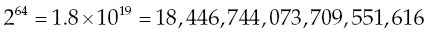

Con số này có thể được hình dung (hoàn toàn do trùng hợp) là (xấp xỉ) số ngôi sao trong vũ trụ quan sát được của chúng ta. Cách các nhà thiên văn học tính ra con số đó thật hấp dẫn; xem `https://bigthink.com/starts-with-a-bang/how-many-stars`.

Thậm chí đừng hỏi 2<sup>128</sup> ra bao nhiêu trong decimal. Câu trả lời vượt quá sức tưởng tượng của tôi, mà giống như Han Solo, tôi có thể tưởng tượng ra *rất nhiều* đấy.

Giờ thì, cũng như với octal và hexadecimal, có thể xảy ra vấn đề nhận dạng khi dùng binary. Số 101 trong binary *không* giống với 101 trong hex, hay 101 trong decimal. Vì lý do này, hãy luôn thêm hậu tố “B” vào các giá trị binary của bạn để bảo đảm rằng những người đọc chương trình của bạn (kể cả chính bạn, sáu tuần sau khi viết) biết bạn đang làm việc với number base nào.

### Các giá trị trong Binary

Việc chuyển một giá trị trong binary sang một giá trị trong decimal được thực hiện theo cùng cách như trong hex—thật ra còn đơn giản hơn, vì lý do đơn giản là bạn không còn phải đếm xem giá trị của một cột có mặt bao nhiêu lần trong một cột nào đó. Trong hex, bạn phải xem có bao nhiêu số 16 trong cột hàng 16, và cứ thế. Trong binary, giá trị của một cột hoặc là có mặt (1 lần) hoặc là không có mặt (0 lần).

Làm qua một ví dụ đơn giản sẽ làm rõ điều này. Số binary 11011010B là một giá trị binary tương đối điển hình trong công việc máy tính small-time. (Thật ra là thuộc loại nhỏ—nhiều số binary thông dụng có kích thước gấp đôi nó hoặc hơn.) Chuyển 11011010B sang decimal quy về việc quét nó từ phải sang trái với sự trợ giúp của [Bảng 2.7](#c02-tbl-0007) và cộng dồn giá trị của bất kỳ cột nào chứa số 1, đồng thời bỏ qua mọi cột chứa số 0.

Hãy xóa máy tính của bạn và bắt đầu nào:

1. Cột 0 chứa số 0; bỏ qua nó.
2. Cột 1 chứa số 1. Điều đó có nghĩa là giá trị của nó, 2, có mặt trong giá trị của con số. Vì thế chúng ta bấm 2 vào máy tính.
3. Cột 2 là 0. Bỏ qua nó.
4. Cột 3 chứa số 1. Giá trị của cột là 2<sup>3</sup>, tức 8; cộng 8 vào tổng của chúng ta.
5. Cột 4 cũng chứa số 1; 2<sup>4</sup> là 16, chúng ta cộng nó vào tổng.
6. Cột 5 là 0. Bỏ qua nó.
7. Cột 6 chứa số 1; 2<sup>6</sup> là 64, vậy cộng 64 vào tổng.
8. Cột 7 cũng chứa số 1. Giá trị của cột 7 là 2<sup>7</sup>, tức 128. Cộng 128 vào tổng, và chúng ta có gì? 218. Đó là giá trị decimal của 11011010B. Dễ như vậy đấy.

Việc chuyển từ decimal sang binary, tuy khó hơn, được thực hiện *y hệt* như cách chuyển từ decimal sang hex. Hãy quay lại đọc phần đó một lần nữa, tìm kiếm *phương pháp chung* đã được dùng. Nói cách khác, hãy xem những gì đã được làm và tách các nguyên tắc cốt lõi ra khỏi mọi chỗ nhắc đến một base cụ thể như hex.

Tôi cá là đến giờ bạn có thể tự tìm ra mà không gặp mấy khó khăn.

Nói lạc đề một chút, có lẽ bạn đã để ý rằng tôi bắt đầu đếm các cột từ 0 thay vì từ 1. Một điểm đặc thù của lĩnh vực máy tính là chúng ta luôn bắt đầu đếm mọi thứ từ 0. Thật ra, gọi đó là một điểm đặc thù thì không công bằng; cách của máy tính mới là cách hợp lý, vì 0 là một con số hoàn toàn đàng hoàng và không nên bị phân biệt đối xử. Sự rạn nứt xảy ra vì trong thế giới vật lý thực của chúng ta, việc đếm mọi thứ cho chúng ta biết có *bao nhiêu* thứ ở đó, trong khi trong thế giới máy tính, việc đếm mọi thứ thường được thực hiện để *đặt tên* cho chúng. Nghĩa là, chúng ta cần làm việc với bit số 0, rồi bit số 1, và cứ thế, nhiều hơn rất nhiều so với việc cần biết có bao nhiêu bit.

Nhân tiện, đây không phải chuyện bắt bẻ vặt vãnh. Vấn đề này sẽ còn xuất hiện lặp đi lặp lại liên quan đến các memory address, thứ mà như tôi đã nói và sẽ còn nói lại, chính là chìa khóa để hiểu assembly language.

> *Trong giới lập trình, hãy luôn bắt đầu đếm từ 0!*

Một ví dụ thực tế về những mâu thuẫn mà nguyên tắc này có thể gây ra nảy sinh từ câu hỏi sau: Năm nào mở đầu thiên niên kỷ mới của chúng ta? Phần lớn mọi người sẽ trả lời theo trực giác là năm 2000—và trong giai đoạn chuẩn bị đón năm 2000, nhiều người đã trả lời như vậy—nhưng về mặt kỹ thuật, thế kỷ hai mươi vẫn tiếp tục bước đi chậm chạp của nó cho đến ngày 1 tháng Giêng năm 2001. Tại sao? *Vì không có năm 0*. Khi các nhà sử học đếm năm chuyển từ B.C. sang A.D., họ đi thẳng từ năm 1 B.C. sang năm 1 A.D. Do đó, thế kỷ thứ nhất bắt đầu từ năm 1 và kết thúc vào năm 100. Thế kỷ thứ hai bắt đầu từ năm 101 và kết thúc vào năm 200. Bằng cách kéo dài dãy này, bạn có thể thấy rằng thế kỷ 20 bắt đầu năm 1901 và kết thúc năm 2000. Mặt khác, nếu chúng ta đủ khôn ngoan để bắt đầu đếm năm trong kỷ nguyên hiện tại theo kiểu máy tính, từ năm 0, thì thế kỷ 20 quả thực đã kết thúc vào cuối năm 1999.

Giờ là lúc thích hợp để luyện tập chuyển đổi các con số từ binary sang decimal và ngược lại. Hãy mài răng với những số sau:

<a id="Page_38"></a>

```
110
10001
11111
11
101
1100010111010010
11000
1011

```

Khi đã làm xong, hãy chuyển các giá trị decimal sau sang binary:

```
77
42
106
255
18
6309
121
58
18,446
```

### Tại sao lại là Binary?

Nếu phải mất đến tám chữ số (11011010) để biểu diễn một con số three-digit bình thường như 218, thì binary với tư cách một number base có vẻ là một khoản đầu tư trí tuệ tồi. Chắc chắn đối với chúng ta nó sẽ là sự lãng phí băng thông trí óc, và ngay cả những người ngoài hành tinh chỉ có hai ngón tay có lẽ cũng đã nghĩ ra một hệ thống tốt hơn.

Vấn đề là, đèn hoặc sáng hoặc tắt.

Đây chỉ là một cách khác để nói (như tôi sẽ bàn chi tiết trong [Chương 3](ch03_lifting_the_hood.vi.md)) rằng xét đến tận cùng, *máy tính là những thiết bị điện*. Trong một thiết bị điện, hoặc có voltage hoặc không có; hoặc có dòng điện chạy qua hoặc không. Từ rất sớm, các nhà khoa học máy tính đã quyết định rằng sự có mặt của voltage trong một mạch máy tính sẽ biểu thị chữ số 1, còn sự vắng mặt của voltage tại cùng điểm đó trong mạch sẽ biểu thị chữ số 0. Như thế không nhiều chữ số lắm, nhưng đủ cho hệ đếm binary. Đây là lý do duy nhất chúng ta dùng binary, nhưng là một lý do khá thuyết phục, và chúng ta đành phải chấp nhận nó. Tuy nhiên, bạn sẽ không nhất thiết bị chết chìm trong những số một và số không, vì tôi đã dạy bạn một dạng viết tắt rồi.

<a id="head-2-8"></a>

## Hexadecimal như cách viết tắt cho Binary

Con số 218 biểu diễn trong binary là 11011010B. Tuy nhiên, biểu diễn trong hex thì cùng giá trị đó khá gọn: DAH. Hai chữ số hex tạo nên DAH đáng được xem xét kỹ hơn. AH (hay 0AH, như assembler của bạn sẽ yêu cầu vì những lý do tôi sẽ giải thích sau) biểu thị 10 decimal. Chuyển bất kỳ con số nào sang binary đơn giản chỉ là phát hiện các lũy thừa của 2 bên trong nó. Lũy thừa lớn nhất của 2 bên trong 10 decimal là 8. Ghi ra chữ số 1 và lấy 10 trừ 8. Còn lại 2. Giờ, 4 là một lũy thừa của 2, nhưng không có số 4 nào ẩn trong 2, nên chúng ta đặt một số 0 vào bên phải số 1. Lũy thừa nhỏ hơn kế tiếp của 2 là 2, và có một số 2 trong 2. Ghi thêm một số 1 vào bên phải số 0. Hai trừ 2 được 0, nên không còn số 1 nào trong con số đó. Ghi một số 0 cuối cùng vào bên phải các chữ số còn lại để biểu thị cột hàng 1. Những gì bạn có là:

```
1 0 1 0
```

Hãy nhìn lại giá trị binary tương đương của 218: 11011010. Bốn chữ số cuối cùng là 1010—giá trị binary tương đương của 0AH.

Cách tương tự cũng áp dụng được cho nửa trên của DAH. Nếu bạn tính ra giá trị binary tương đương của 0DH như chúng ta vừa làm (và đó sẽ là một bài tập trí óc tốt), kết quả là 1101. Hãy nhìn giá trị binary tương đương của 218 theo cách này:

```
   218     decimal
1101 1010  binary
  D    A   hex
```

Hẳn là bạn đang dần nhận ra rằng mình có thể chuyển những chuỗi dài các số 1 và số 0 binary sang dạng hex gọn hơn bằng cách chuyển mỗi bốn chữ số binary (bắt đầu từ bên phải, *không phải* từ bên trái!) thành một chữ số hex duy nhất.

Ví dụ, đây là một số binary 32-bit chẳng có chút gì đáng chú ý:

```
11110000000000001111101001101110
```

Tuy nhiên, nó là một tập hợp bit khá khó chịu để ghi nhớ hay thao tác, vậy hãy tách nó thành các nhóm bốn chữ số từ bên phải:

```
1111 0000 0000 0000 1111 1010 0110 1110
```

Mỗi nhóm bốn chữ số binary này có thể được biểu diễn bằng một chữ số hexadecimal duy nhất. Hãy thực hiện việc chuyển đổi ngay bây giờ. Kết quả bạn nhận được phải như sau:

```
1111 0000 0000 0000 1111 1010 0110 1110
 F     0    0    0    F    A    6    E
```

Nói cách khác, giá trị hex tương đương của chuỗi dài lê thê đó là

```
F000FA6E
```

Dĩ nhiên, khi sử dụng, bạn sẽ thêm chữ *H* vào cuối và cũng đặt một số 0 ở đầu, nên trong bất kỳ công việc assembly language nào, con số này thực tế sẽ được viết là 0F000FA6EH.

Bỗng nhiên, chuyện này bắt đầu trông dễ nắm bắt hơn một chút.

*Hexadecimal là cách viết tắt của programmer cho các số binary của máy tính*.

Đây là lý do trước đó tôi đã nói rằng máy tính dùng base 2 (binary) và base 16 (hexadecimal) cùng một lúc theo một kiểu khá tâm thần phân liệt. Điều tôi chưa nói là thật ra máy tính không phải kẻ tâm thần phân liệt; *bạn* mới là người đó. Tận sâu trong lõi (như tôi sẽ giải thích trong [Chương 3](ch03_lifting_the_hood.vi.md)) máy tính *chỉ* dùng binary. Hex là phương tiện giúp bạn và tôi làm việc với máy tính dễ dàng hơn. May mắn là cứ mỗi bốn chữ số binary có thể được biểu diễn bằng một chữ số hex, nên sự tương ứng này gọn gàng và dễ hiểu, ngay cả khi nó dài 64 bit—tức 16 chữ số hexadecimal.

<a id="head-2-9"></a>

## Chuẩn bị tính toán

Mọi thứ cho đến thời điểm này đều là nền móng cần thiết. Tôi đã giải thích về mặt khái niệm máy tính *làm* gì và đã trao cho bạn những công cụ để hiểu những con số hơi ngoài hành tinh mà chúng dùng. Nhưng cho đến giờ tôi chưa nói gì về việc máy tính thực sự *là* gì, và lẽ ra phải nói từ lâu rồi. Chúng ta sẽ còn quay lại với các số hexadecimal hết lần này đến lần khác trong cuốn sách này; cho đến giờ tôi chưa nói gì về phép nhân hex hay bit-banging. Lý do rất rõ ràng: trước khi bạn có thể đập vào một bit, bạn phải biết các bit sống ở đâu. Vậy, hãy mở nắp capo ra và xem liệu chúng ta có thể bắt gặp vài bit trong lúc chúng hoạt động hay không.
