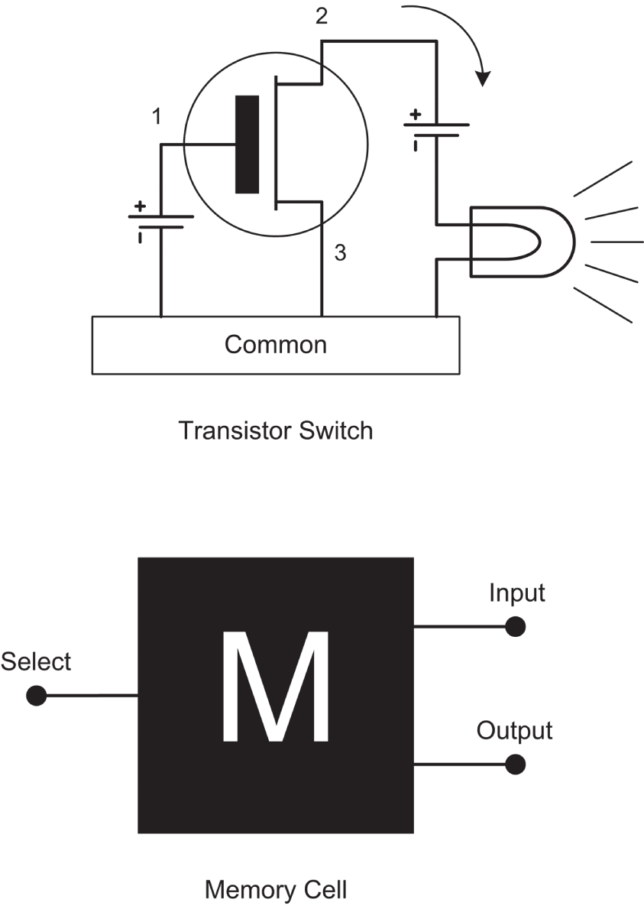
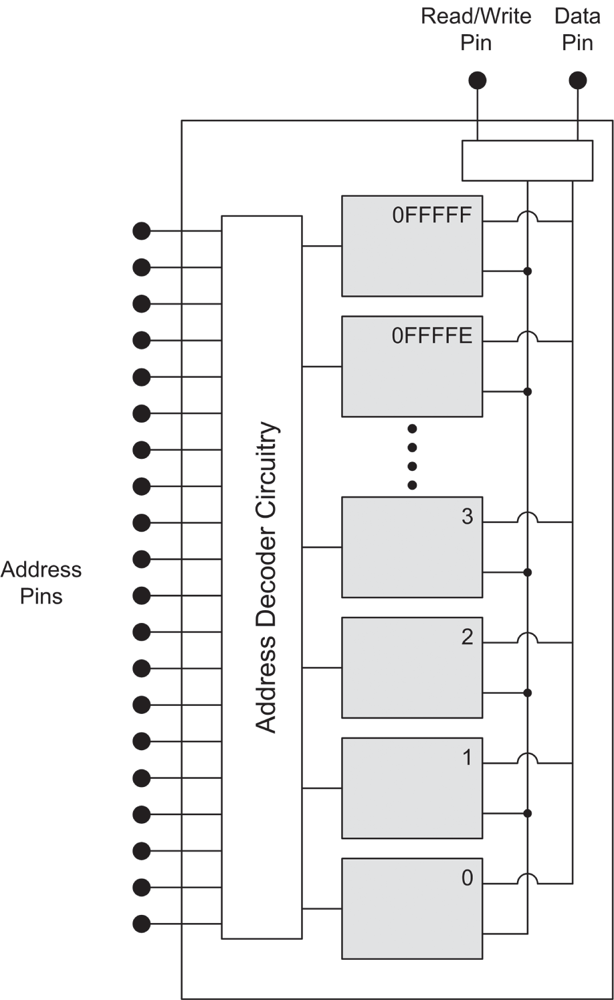
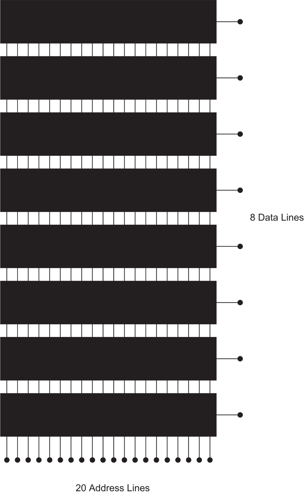
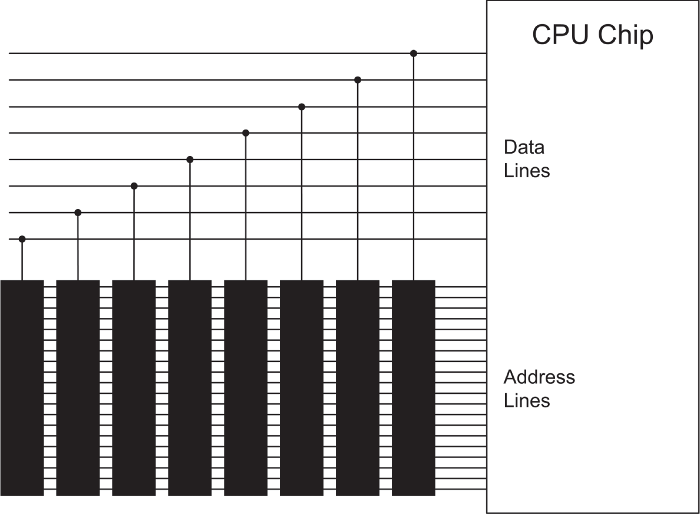
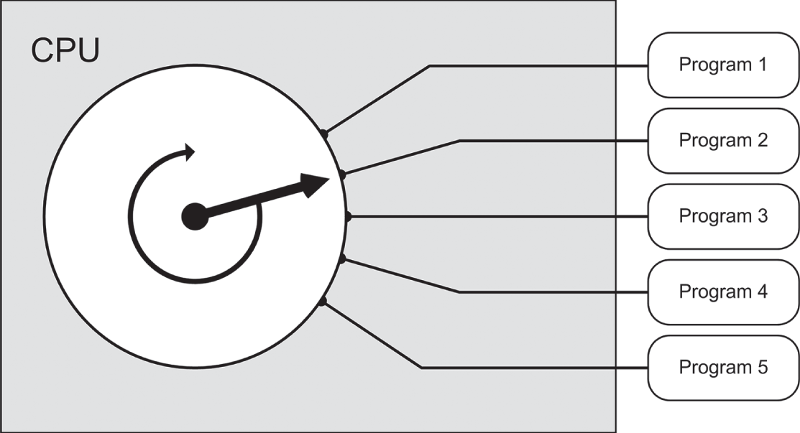
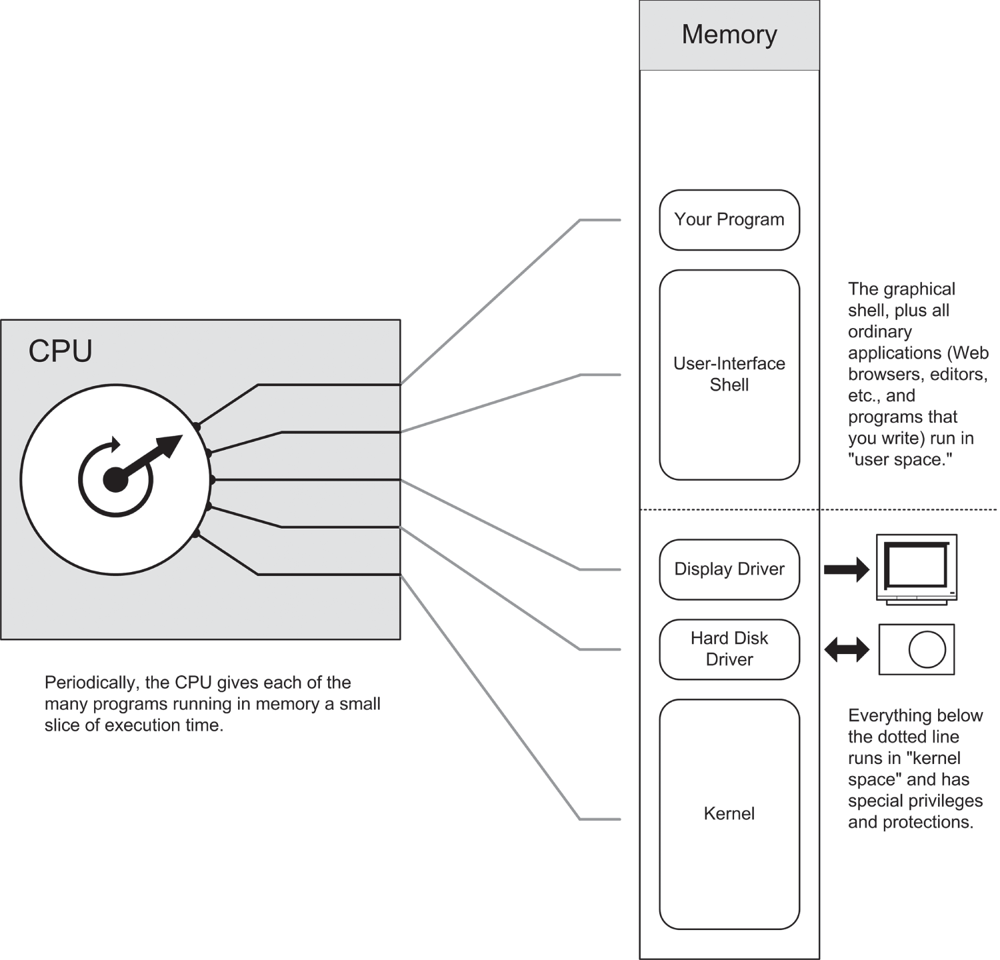

# CHƯƠNG 3 Mở nắp máy: ***Khám phá máy tính thực sự là gì***

## RAXie, chúng tôi hầu như chẳng biết gì về bạn

Vào tháng Giêng năm 1970, tôi đang ở chặng cuối của năm cuối cấp trung học, và hệ thống trường công lập Chicago đã lắp đặt một chiếc máy tính ở đâu đó. Cả một xe tải những thiết bị máy đánh chữ IBM sành điệu này được chở đến trường Lane Tech, và một thầy giáo dạy toán đang bối rối bị bắt đi dạy khoa học máy tính (họ cũng thật trơ trẽn khi gọi nó như vậy) cho cả một trường trung học toàn những cậu con trai ồn ào (và phần lớn là mọt sách).

Tôi đã hiểu ra khá nhanh. Bạn gõ ra một xấp những tấm thẻ máy tính ngớ ngẩn này trên máy card-punch, thả chúng vào khay thẻ của một trong những thiết bị máy đánh chữ, rồi kinh ngạc nhìn chiếc máy đánh chữ nhảy múa quả cầu chữ nhỏ của nó trên giấy kẻ sọc xanh, in ra danh sách thông báo lỗi không thể tránh khỏi của bạn. Thật là vui. Tôi được toàn điểm A. Tôi thậm chí còn giữ lại chương trình đầu tiên tôi từng viết làm được một việc hữu ích, vì thiên văn học là niềm đam mê của tôi lúc đó: một xấp thẻ nhỏ sinh ra một bảng các hệ số hiệu chỉnh parabol để hand-figuring gương kính thiên văn. (Tôi vẫn còn xấp thẻ đó, mặc dù đống nhựa dính nhớp do những sợi dây chun mục nát để lại sẽ không tốt cho một máy đọc thẻ, giả sử là vẫn còn tồn tại một cái.)

Câu hỏi cứ day dứt tôi mãi là RAX (cái tên thật hợp của chiếc máy tính) thực chất là loại quái vật gì. Thứ chúng tôi có là những chiếc máy đánh chữ RAM-charged mà RAX điều khiển qua đường dây điện thoại—chừng đó thì tôi hiểu. Nhưng bản thân RAX là gì?

Tôi đã hỏi thầy giáo. Tóm tắt lại, cuộc trò chuyện diễn ra đại loại như sau:

TÔI: “Ừm, thưa thầy, chính xác thì RAX *là* gì ạ?”

THẦY: “Hả? Ừm, một máy tính. Một máy tính điện tử.”

TÔI: “Tài liệu môn học cũng ghi như vậy ạ. Nhưng em muốn biết RAX được làm từ gì và nó hoạt động thế nào.”

THẦY: “À, thầy chắc chắn RAX hoàn toàn là solid-state.”

TÔI: “Ý thầy là bên trong không có đòn bẩy và bánh răng nào.”

THẦY: “Ồ, có thể có vài cái. Nhưng không có bóng đèn chân không.”

TÔI: “Em không lo về bóng đèn. Em đoán là ở đâu đó trong nó có một máy tính toán. Nhưng cái gì khiến nó nhớ được rằng A đứng trước B? Làm sao nó biết FORMAT nghĩa là gì? Làm sao nó biết giờ? Nó phải làm gì để trả lời điện thoại?”

THẦY: “Thôi nào, đó chính là lý do máy tính tuyệt vời đến thế! Người ta ghép tất cả lại với nhau để chúng ta không phải lo về những thứ như vậy! Ai quan tâm RAX là gì chứ? RAX biết FORTRAN và sẽ thực thi bất kỳ chương trình FORTRAN đúng nào. Đó mới là điều quan trọng, phải không?”

Thầy bắt đầu toát mồ hôi. Tôi cũng vậy. Hết cuộc trò chuyện.

Tháng Sáu năm đó, tôi tốt nghiệp với 3 inch thẻ đục lỗ FORTRAN đã debug và chạy được trong cặp sách mà vẫn hoàn toàn không biết RAX thực sự *là* gì.

Điều đó làm tôi băn khoăn cho đến tận ngày nay.

### Gus tới giải cứu

Tôi đang nghĩ về RAX 6 năm sau, khi ngồi trên chuyến xe buýt đại lộ Devon của Chicago để đi làm, với số mới nhất của tạp chí *Popular Electronics* trên đùi. Bài chính mô tả một dự án do-it-yourself tên là COSMAC ELF, gồm một tấm perfboard đầy các chip mạch tích hợp, tất cả được nối dây với nhau, cùng với vài công tắc gạt và một cặp màn hình số LED.

Đó là một máy tính. (Nhãn ghi rõ ngay trên đó, hừm.) Bài báo chỉ cho chúng tôi cách lắp ráp nó, và chỉ có vậy thôi. Những chip ấy làm gì? Toàn bộ thiết bị làm gì? Chẳng thấy cái máy đánh chữ robot sành điệu nào ở đâu cả. Điều đó khiến tôi phát điên.

Như thường lệ, người bạn Gus Flassig của tôi lên xe buýt ở đại lộ Ashland và ngồi xuống cạnh tôi. Tôi hỏi anh ấy COSMAC ELF làm gì. Anh ấy là con người đầu tiên khiến khái niệm về một máy tính *vật lý* trở nên mạch lạc đối với tôi:

> **“Đây là các chip memory. Bạn nạp các con số vào chip memory bằng cách gạt những công tắc này theo các mẫu mã binary khác nhau, trong đó “lên” nghĩa là một 1-bit, và “xuống” nghĩa là một 0-bit. Mỗi con số trong memory có một ý nghĩa nào đó đối với chip CPU. Một con số khiến nó cộng; một con số khác khiến nó trừ; một số khác khiến nó ghi các con số khác vào memory, và rất nhiều thứ khác. Một chương trình gồm một loạt những con số instruction này nằm liền nhau trong memory. Máy tính đọc con số đầu tiên, làm điều con số đó bảo nó làm, rồi đọc con số thứ hai, làm điều con số đó nói, và cứ thế, cho đến khi nó hết số.”**

Nếu *bạn* không thấy điều đó rõ ràng tuyệt đối; đừng lo. Tôi có lợi thế là một người chơi điện tử nghiệp dư (nên tôi biết một số chip làm gì) và đã viết vài chương trình bằng FORTRAN của RAX. Nhưng đối với tôi, trời ơi, mọi thứ đột nhiên đạt tới khối lượng tới hạn và nổ tung trong đầu cho đến khi hơi nước bắt đầu phụt ra khỏi tai. Tôi đã *hiểu* ra!

Dù RAX là gì đi nữa, tôi biết nó phải là một thứ gì đó giống COSMAC ELF, chỉ ở quy mô lớn hơn. Tôi đã lắp một chiếc ELF. Đó là một bài học khá lớn và giúp tôi hiểu bản chất của máy tính ở một mức rất sâu. Tôi không khuyến khích bất kỳ ai, ngoại trừ những người hoàn toàn điên rồ, tự wirewrap máy tính của mình từ các chip rời nữa, mặc dù đó là việc khá phổ biến vào khoảng mid-to-late những năm 1970.

Trong chương này, tôi sẽ cung cấp cho bạn một số hiểu biết mà tôi có được khi tự lắp ráp máy tính của mình theo cách khó khăn. (Bạn có thắc mắc chữ “hard” trong “hardware” từ đâu ra không? Không phải từ âm thanh nó tạo ra khi bạn đập nó xuống bàn đâu, tôi hứa đấy.)

## Switch, Transistor và Memory

Switch thì ghi nhớ.

Hãy nghĩ mà xem: bạn bật công tắc trên tường cạnh cửa, và đèn ở giữa trần nhà sáng lên. Nó cứ sáng như vậy. Khi rời phòng, bạn gạt công tắc xuống, và đèn tắt. Nó cứ tắt như vậy. Trừ phi có ma quỷ quấy phá, công tắc sẽ giữ nguyên vị trí bạn để lại lần cuối cho đến khi bạn hoặc ai đó khác quay lại và gạt nó sang vị trí còn lại. Ngay cả khi bóng đèn bị cháy, bạn vẫn có thể nhìn vị trí cần gạt của công tắc và biết mạch đèn đang bật hay tắt.

Theo một nghĩa nào đó, công tắc ghi nhớ lệnh cuối cùng của nó cho đến khi bạn thay đổi nó và “ghi đè” lệnh trước đó bằng một lệnh mới. Theo nghĩa này, một công tắc đèn biểu diễn một kiểu phần tử memory sơ khai.

Công tắc đèn mang tính cơ khí nhiều hơn là điện. Điều này không ngăn chúng đóng vai trò memory. Thực tế, chiếc máy tính đầu tiên (Difference Engine 19th-century của Babbage) hoàn toàn là cơ khí. Thực tế, phiên bản lớn hơn nhiều mà ông thiết kế nhưng chưa bao giờ hoàn thành lẽ ra sẽ *chạy bằng hơi nước* (steam-powered). Cỗ máy của Babbage có rất nhiều cam nhỏ có thể bị các cam khác gạt từ vị trí này sang vị trí khác. Các con số được mã hóa và ghi nhớ dưới dạng các mẫu vị trí của cam.

### Một nếu đi đường bộ…

Việc một switch là cơ khí, điện, thủy lực hay thứ gì khác là không quan trọng. Điều quan trọng là một switch chứa một mẫu two-way: bật hoặc tắt; lên hoặc xuống; có dòng chảy hoặc không có dòng chảy. Có thể gán một ý nghĩa cho mẫu đó. Paul Revere đã bảo bạn mình thiết lập một mật mã ở nhà thờ Old North Church: “Một nếu đi đường bộ, hai nếu đi đường biển.” Một khi được thắp, những ngọn đèn trên tháp chuông vẫn sáng (và qua đó ghi nhớ mật mã rất quan trọng đó) đủ lâu để Paul kêu gọi dân quân và đánh bại quân Anh.

Vậy nói chung, thứ chúng ta gọi là *memory* là một tập hợp các switch sẽ giữ một mẫu đủ lâu để mẫu đó được một người hoặc một cơ chế đọc và hiểu. Đối với mục đích của chúng ta, những switch đó sẽ là switch điện, nhưng hãy nhớ rằng cả máy tính cơ khí lẫn máy tính thủy lực đều đã được đề xuất và chế tạo với mức độ thành công khác nhau.

> *Memory gồm các vật chứa cho những mẫu có thể thay đổi, giữ lại một mẫu đã được đưa vào cho đến khi ai đó hoặc thứ gì đó thay đổi mẫu đó*.

### Switch Transistor

Một vấn đề khi xây dựng hệ thống memory máy tính từ công tắc đèn là công tắc đèn khá chuyên biệt: chúng cần ngón tay để gạt, và output của chúng là một đường dẫn dòng điện. Lý tưởng nhất, một switch memory máy tính nên được vận hành bởi chính lực mà nó điều khiển. Điều này cho phép các mẫu được lưu trong memory được truyền sang các vị trí lưu trữ memory khác. Trong thế giới điện cơ thô kệch, một switch như vậy được gọi là *relay*.

Relay là một switch cơ khí được vận hành bằng điện với mục đích điều khiển điện. Bạn “gạt” một relay bằng cách cấp cho nó một xung điện, xung này cấp năng lượng cho một chiếc búa nhỏ đập một cần gạt sang bên này hoặc bên kia. Cần gạt này sau đó mở hoặc đóng một bộ tiếp điểm điện, giống hệt như chiếc công tắc đèn garden-variety của bạn. Máy tính đã từng được chế tạo từ relay, mặc dù như bạn có thể hình dung, đó là chuyện từ rất lâu rồi, và (với một relay điển hình có kích thước cỡ một viên đá lạnh) chúng không phải là những máy tính đặc biệt mạnh.

Máy tính hoàn toàn điện tử được làm từ các switch transistor. *Transistor* là những tinh thể silicon nhỏ xíu dùng các tính chất điện đặc biệt của silicon để đóng vai trò switch. Tôi sẽ không cố giải thích những tính chất đặc biệt đó là gì, vì điều đó sẽ cần cả một cuốn sách riêng. Hãy coi một switch transistor là một kiểu hộp đen điện và mô tả nó theo input và output.

[Hình 3.1](#c03-fig-0001) thể hiện một switch transistor. (Đó là một transistor *field-effect*, thực ra chỉ là một loại transistor, nhưng đó là loại mà các máy tính hiện nay của chúng ta được làm từ.) Khi một điện áp được đặt vào chân 1, dòng điện chạy giữa chân 2 và chân 3. Khi điện áp được ngắt khỏi chân 1, dòng điện ngừng chạy giữa chân 2 và chân 3.

Trong thực tế, cần thêm một nhúm nhỏ các linh kiện khác (thường là diode và tụ điện) để mọi thứ hoạt động trơn tru trong bối cảnh memory máy tính. Đây không nhất thiết là những linh kiện nhỏ được nối bằng dây vào bên ngoài transistor (mặc dù trong các máy tính dùng transistor đời đầu thì đúng là như vậy) mà giờ được cắt từ cùng tinh thể silicon mà bản thân transistor được cắt ra và gần như không chiếm chút không gian nào. Gộp lại, switch transistor và các linh kiện hỗ trợ của nó được gọi là một *memory cell*. Tôi đã giấu sự phức tạp về điện của memory cell bên trong một ký hiệu black-box phù hợp trong [Hình 3.1](#c03-fig-0001).

***Hình 3.1**: Switch transistor và memory cell*

Một memory cell giữ dòng điện chạy qua nó ở mức tối thiểu vì dòng điện sinh ra nhiệt, và nhiệt là kẻ thù của các linh kiện điện. Mạch của memory cell được bố trí sao cho nếu bạn đặt một điện áp nhỏ vào chân input của nó và một điện áp tương tự vào chân *select* của nó, một điện áp sẽ xuất hiện *và giữ nguyên* trên chân output của nó. Điện áp output đó sẽ giữ nguyên ở trạng thái đã đặt cho đến khi bạn ngắt điện áp khỏi toàn bộ cell, hoặc ngắt điện áp khỏi chân input trong khi đặt một điện áp vào chân select.

Điện áp “bật” được đặt vào tất cả các chân này được giữ ở một mức nhất quán (ngoại trừ, dĩ nhiên, khi nó bị ngắt hoàn toàn). Nói cách khác, bạn không đặt 12 volt vào chân input rồi đổi thành 6 volt hay 17 volt. Các nhà thiết kế máy tính chọn một điện áp và giữ nguyên nó. Mẫu này có bản chất binary: hoặc bạn đặt một điện áp vào chân input, hoặc bạn ngắt điện áp hoàn toàn. Chân output phản ánh điều đó: hoặc nó giữ một điện áp cố định hoặc nó không giữ điện áp nào cả.

Chúng ta áp một quy ước mã cho tình trạng đó: *sự có mặt của điện áp biểu thị một binary 1, và sự vắng mặt của điện áp biểu thị một binary 0*. Quy ước này là tùy ý. Chúng ta cũng có thể nói rằng *sự vắng mặt* của điện áp biểu thị một binary 1 và ngược lại (và máy tính đã từng được chế tạo theo cách này vì những lý do khó hiểu), nhưng lựa chọn là của chúng ta. Việc để *sự có mặt* của một thứ gì đó biểu thị một binary 1 tự nhiên hơn, và đó là cách mọi thứ đã phát triển trong dòng chính của ngành máy tính.

Một memory cell máy tính đơn lẻ, như loại transistor-based mà chúng ta đang nói đến ở đây, giữ một chữ số binary, hoặc 1 hoặc 0. Chữ số này được gọi là một *bit*. Bit là nguyên tử không thể chia nhỏ của thông tin. Không có half-a-bit, và cũng không có bit-and-a-half.

> *Một bit là một chữ số binary đơn lẻ, hoặc 1 hoặc 0*.

### Bit thu nhỏ đến khó tin

Một bit không cho chúng ta biết nhiều. Để hữu ích, chúng ta cần tập hợp *rất nhiều* memory cell lại với nhau. Transistor khởi đầu với kích thước khá nhỏ (những chiếc đầu tiên từ những năm 1950 trông rất giống những chiếc mũ ống khói cho lính chì) và từ đó còn nhỏ đi nữa. Những transistor đầu tiên được tạo ra từ những mẩu tinh thể germanium hoặc silicon nhỏ cỡ một phần tám inch vuông. Kích thước của mẩu tinh thể không thay đổi quá nhiều kể từ đó, nhưng bản thân các transistor đã thu nhỏ đến mức khó tin.

Nếu như lúc đầu, một chip chứa một transistor, thì theo thời gian, các nhà thiết kế bán dẫn đã chia chip thành bốn vùng bằng nhau và biến mỗi vùng thành một transistor độc lập. Từ đó, việc thêm các linh kiện nhỏ xíu khác cần thiết để biến một transistor thành một memory cell máy tính chỉ là một bước nhảy dễ dàng.

Mẩu silicon là một thứ nhỏ bé và mong manh và được bọc trong một vỏ molded-plastic hình chữ nhật dài, giống một thanh kẹo cao su nhỏ có các chân kim loại để làm các kết nối điện.

Thứ chúng ta có lúc này là một kiểu hộp đựng trứng điện: bốn ngăn nhỏ, mỗi ngăn có thể chứa một bit binary đơn lẻ. Rồi quá trình thu nhỏ bắt đầu. Đầu tiên là 8 bit, rồi 16, rồi các bội số của 8 và 16, tất cả trên cùng một chip silicon nhỏ xíu. Đến cuối những năm 1960, có thể tạo 256 memory cell trên một chip silicon, thường là một mảng 8 cell nhân 32. Năm 1976, máy tính COSMAC ELF của tôi chứa hai chip memory. Trên mỗi chip là một mảng memory cell rộng 4 và dài 256. (Hãy hình dung một hộp đựng trứng *thật* dài.) Vì vậy, mỗi chip có thể giữ 1,024 bit.

Đây là dung lượng chip memory khá điển hình vào thời điểm đó. Chúng tôi gọi chúng là “chip RAM 1K” vì chúng giữ khoảng 1,000 bit *random-access memory* (RAM). Chữ *K* bắt nguồn từ *kilobit*, tức là 1,000 bit. Chúng ta sẽ sớm quay lại khái niệm *random access* nghĩa là gì.

Đến khoảng mid-1970s, màn memory-shrinking vĩ đại đã tăng tốc tối đa. Các chip một kilobyte được chia chéo thành các chip 4K chứa 4,096 bit memory. Các chip 4K gần như ngay lập tức được chia thành các chip 16K (16,384 bit memory). Những chip 16K này là tiêu chuẩn khi IBM PC lần đầu xuất hiện năm 1981. Đến năm 1982, các chip lại được chia một lần nữa, và 16K trở thành 64K, với 65,536 bit bên trong cùng thanh kẹo cao su nhỏ đó. Hãy nhớ rằng chúng ta đang nói về hơn 65,000 transistor (cộng với các linh kiện lặt vặt khác) được tạo trên một mẩu silicon vuông mỗi cạnh khoảng quarter-inch.

Đến năm 1985, chip 64K đã bị gạt sang một bên bởi đứa con drawn-and-quartered của nó, chip 256K (262,144 bit). Dung lượng chip memory nhìn chung tăng theo hệ số 4 đơn giản vì chip current-generation được chia thành 4 vùng bằng nhau, rồi trên mỗi vùng lại đặt cùng số transistor mà thế hệ chip trước đã chứa trên toàn bộ chip silicon.

Đến năm 1990, chip 256K đã đi vào lịch sử, và chip 1 megabit là công nghệ tiên tiến nhất. (*Mega* trong tiếng Hy Lạp nghĩa là triệu.) Đến năm 1992, chip 4 megabit đã chiếm lĩnh. Sinh vật nhỏ này có tổng cộng 4,194,304 bit bên trong, vẫn không lớn hơn thanh kẹo cao su quế nhỏ đó. Vào khoảng thời gian đó, bản thân các chip trở nên nhỏ và mong manh đến mức bốn hoặc tám chip được hàn lên những bo mạch in nhỏ xíu để chúng có thể chịu được sự thao tác của những con người vụng về. Những “memory stick” này là thứ mà các máy tính hiện đại sử dụng. Chúng có ưu điểm là trong nhiều trường hợp bạn có thể tháo ra và thay bằng những memory stick còn lớn hơn khi chúng có mặt trên thị trường.

Cuộc chơi chip memory vẫn tiếp tục với tốc độ nhanh, và vào năm 2022, chip 16 gigabit là phổ biến. Đó là 16 *tỷ* bit trên mỗi chip.

Liệu nó có dừng lại ở đây không? Khó có khả năng. Nhiều hơn là tốt hơn trong thế giới của trò chơi điện tử hoạt hình real-time và video 4K này, và chúng ta đang đem đến một số công nghệ mạnh mẽ đáng kinh ngạc để tạo ra các hệ thống memory ever-denser. Một số nhà vật lý cảnh báo rằng các định luật vật lý có thể sớm hô time-out cho cuộc chơi này, vì các transistor giờ nhỏ đến mức khó đẩy nhiều hơn một electron mỗi lần qua chúng. Tại thời điểm đó, một số hạn chế thực sự xấu xí của cuộc sống gọi là *cơ học lượng tử* bắt đầu cản đường. Chúng ta sẽ tìm ra cách vượt qua những hạn chế này (chúng ta luôn làm được), nhưng trong quá trình đó, toàn bộ bản chất của memory máy tính có thể thay đổi.

Nếu việc cố theo dõi những gì là “hiện hành” trong thế giới máy tính khiến bạn đau đầu, thì, bạn không đơn độc đâu.

### Random Access

Những người mới đôi khi thấy *random* là một từ gây bối rối và khó chịu khi nói về memory, vì nó thường gợi đến sự hỗn loạn hoặc không thể đoán trước. Ý nghĩa thực sự của từ này ở đây là “tùy ý”, chỉ ra rằng bạn có thể thò tay vào một chip random-access memory và lấy ra bất kỳ bit nào nó chứa mà không làm xáo trộn các bit khác, giống như bạn có thể chọn tùy ý một cuốn sách từ nhiều giá sách chứa hàng nghìn cuốn của thư viện công cộng mà không phải lục qua chúng theo thứ tự hay làm xáo trộn vị trí của các cuốn sách khác trên giá.

Memory không phải lúc nào cũng hoạt động theo cách này. Trước khi memory được đặt trên chip silicon, nó được lưu trên một loại máy điện từ nào đó, thường là trống hoặc đĩa quay có họ hàng xa với các ổ cứng chúng ta dùng ngày nay. Memory từ tính quay đưa một tập hợp bit theo vòng tròn đi qua bên dưới một cảm biến từ. Các bit đi qua bên dưới cảm biến từng cái một, và nếu bạn lỡ mất bit bạn muốn, giống như lỡ một chuyến xe buýt Chicago vào tháng Giêng, bạn chỉ còn cách chờ nó đi qua lần nữa. Đây là các *serial-access device*. Chúng đưa các bit của chúng cho bạn theo kiểu tuần tự, theo một thứ tự cố định, từng cái một, và bạn phải chờ bit bạn muốn đến lượt theo thứ tự của nó.

Không cần phải nhớ điều đó; chúng ta đã từ bỏ các serial-access device cho memory chính của máy tính từ lâu rồi. Chúng ta vẫn dùng những hệ thống như vậy cho *mass storage*, như tôi sẽ mô tả vài trang nữa. (Ổ cứng của bạn về bản chất là một serial-access device.)

Random access hoạt động như sau: bên trong chip, mỗi bit được lưu trong memory cell riêng của nó, giống hệt memory cell được vẽ sơ đồ trong [Hình 3.1](#c03-fig-0001). Mỗi memory cell trong số however-many memory cell đó có một số duy nhất. Số này là *address* của cell (và do đó của bit). Nó giống như địa chỉ trên một con phố: bit ở góc phố là số 0 Silicon Alley, bit nhà bên cạnh là số 1, và cứ thế. Bạn không phải gõ cửa bit 0 hỏi nó là bit nào rồi sang nhà bên cạnh hỏi tiếp, cho đến khi tìm thấy bit bạn muốn. Nếu có address, bạn có thể phóng thẳng xuống phố và đỗ xe ngay trước cửa bit bạn định ghé thăm.

Mỗi chip có một số chân nhô ra. Phần lớn các chân này được gọi là *address pin*. Một chân được gọi là *data pin*. (Xem [Hình 3.2](#c03-fig-0002).) Các address pin là các dây dẫn điện mang một mã address binary. Address này là một số binary, chỉ được biểu diễn bằng các số 1 và 0. Bạn đặt address này vào các address pin bằng cách mã hóa binary 1 thành (chẳng hạn) 5 volt, và binary 0 thành 0 volt. Nhiều điện áp khác đã được dùng và vẫn đang được dùng trong phần cứng máy tính. Điều quan trọng là tất cả chúng ta đều đồng ý rằng một điện áp nhất định trên một chân biểu diễn một binary 1. Các mạch đặc biệt bên trong chip RAM giải mã address này thành một trong các input select của vô số memory cell bên trong chip. Với bất kỳ address nào được đặt vào các address pin, chỉ *một* input select sẽ được nâng lên năm volt, qua đó chọn memory cell đó.

Tùy theo việc bạn định đọc một bit hay ghi một bit, data pin được chuyển giữa input hoặc output của các memory cell, như được thể hiện trong [Hình 3.2](#c03-fig-0002).

Nhưng tất cả những việc đó đều được thực hiện bên trong chip. Đối với bạn ở bên ngoài, một khi bạn đã đặt address vào các address pin, *voilà*! Data pin sẽ chứa một điện áp biểu diễn giá trị của bit bạn yêu cầu. Nếu bit đó chứa binary 1, data pin sẽ chứa một tín hiệu 5-volt; nếu không, bit binary 0 sẽ được biểu diễn bằng 0 volt.

***Hình 3.2**: Một chip RAM*

### Memory Access Time

Các chip được phân loại theo khoảng thời gian dữ liệu xuất hiện trên data pin sau khi bạn đã đặt address vào các address pin. Hiển nhiên, càng nhanh càng tốt, nhưng một số chip (vì những lý do điện mà, một lần nữa, rất khó giải thích) nhanh hơn những chip khác.

Nhiều năm trước, khi máy tính dùng các chip riêng lẻ cắm vào bo mạch chủ, memory access time (chủ yếu) là khoảng thời gian để dữ liệu xuất hiện sau khi một address được đặt vào các chip. Ngay cả khi đó, cũng có những vấn đề khác liên quan đến tốc độ của chip CPU và cách hệ thống memory tổng thể được thiết kế.

Ngày nay, các hệ thống memory PC tập trung vào memory stick (sẽ nói thêm về chúng sau), vốn gộp nhiều chip memory với rất nhiều mạch hỗ trợ. Các stick nhạy cảm với tốc độ CPU của máy tính mà chúng làm việc trong đó và với loại socket mà chúng cắm vào. Định thời memory đã trở nên phức tạp hơn rất nhiều trong 20 năm qua. Nhiều yếu tố chi phối tốc độ mà chip memory có thể nhận một address và giao hàng. Đây là một lời giải thích tốt, kèm cảnh báo trước rằng đó là một bài trình bày *rất* kỹ thuật:

`https://appuals.com/ram-timings-cas-ras-trcd-trp-tras-explained`

Tôi có thể trấn an bạn rằng bạn không cần hiểu hoàn toàn những chi tiết phức tạp của phần cứng memory PC để học assembly language. Khi bạn học thêm về bên trong PC nói chung, từng chút một mọi thứ sẽ vào đúng chỗ của nó.

### Byte, Word, Double Word và Quad Word

Những ngày mà một máy tính nghiêm túc có thể được chế tạo chỉ với một chip memory đã qua lâu rồi (thực ra là đã qua hàng thập kỷ). Chiếc COSMAC ELF năm 1976 tội nghiệp của tôi cần ít nhất hai chip. Máy tính ngày nay cần nhiều chip, bất kể thực tế là chip memory ngày nay có thể giữ hàng tỷ bit thay vì 2,048 bit ít ỏi của ELF.

Hệ thống memory của chúng ta phải lưu thông tin của chúng ta. Cách chúng ta tổ chức một hệ thống memory từ một nắm chip memory sẽ phần lớn được quyết định bởi cách chúng ta tổ chức thông tin của mình.

Câu trả lời bắt đầu với thứ được gọi là *byte*. Việc ông tổ của mọi tạp chí máy tính lấy từ này làm tên cho thấy tầm quan trọng của nó trong thế giới máy tính. (Than ôi, *Byte Magazine* đã ngừng xuất bản vào cuối năm 1998.) Từ góc độ *chức năng*, memory được đo bằng byte. Một byte là tám bit. Hai byte cạnh nhau được gọi là một *word*, và hai word cạnh nhau được gọi là một *double word*. Một *quad word*, như bạn có thể hình dung, gồm hai double word, tổng cộng là bốn word hay tám byte. Theo chiều ngược lại, trước đây một số người gọi một nhóm bốn bit là một nybble—một *nybble* là nửa byte. (Thuật ngữ này giờ hầu như đã tuyệt chủng.)

Đây là chuyến tham quan nhanh:

- Một bit là một chữ số binary đơn lẻ, 0 hoặc 1.
- Một byte là 8 bit nằm cạnh nhau.
- Một word là 2 byte nằm cạnh nhau: 16 bit.
- Một double word là 2 word nằm cạnh nhau: 32 bit.
- Một quad word là 2 double word nằm cạnh nhau: 64 bit.

Máy tính được thiết kế để lưu trữ và thao tác thông tin của con người. Các phần tử cơ bản của diễn ngôn con người được xây dựng từ một tập ký hiệu gồm các chữ cái của bảng chữ cái (mỗi chữ có hai dạng, viết hoa và viết thường), các chữ số, và các ký hiệu bao gồm dấu phẩy, dấu hai chấm, dấu chấm, dấu chấm than, v.v. Thêm vào đó các biến thể quốc tế khác nhau của chữ cái như *ä* và *ò* cùng các ký hiệu toán học khó hiểu hơn, và bạn sẽ thấy rằng thông tin của con người cần một tập ký hiệu gồm hơn 200 ký hiệu. (Tập ký hiệu được dùng trong gần như mọi máy tính PC-style được đưa ra trong [Phụ lục C](ch16_appendix_c_character_set_charts.vi.md).)

Byte là trung tâm của sơ đồ này vì một ký hiệu trong tập ký hiệu đó có thể được biểu diễn gọn gàng trong một byte. Một byte là 8 bit, và 28 là 256. Điều này có nghĩa là một số binary có kích thước 8 bit có thể là một trong 256 giá trị khác nhau, được đánh số từ 0 đến 255. Vì chúng ta dùng những ký hiệu này rất nhiều, phần lớn những gì chúng ta làm trong chương trình máy tính được biểu diễn bằng các khối byte-sized biểu diễn số hoặc văn bản. Điều này không có nghĩa là máy tính chỉ xử lý từng byte đơn lẻ. Thực tế, hầu hết máy tính ngày nay có thể xử lý thông tin mỗi lần một quad word (tám byte, hay 64 bit). Các máy 32-bit từng có vẻ bất khả chiến bại cách đây 20 năm đang nhanh chóng chìm vào màn sương lịch sử.

Để việc quốc tế hóa và bản địa hóa phần mềm trở nên khả thi, có một tiêu chuẩn cho các bộ ký tự gọi là Unicode, bản thân nó là một tập hợp các tiêu chuẩn. Các bộ ký tự Unicode có thể được biểu diễn bằng một đến bốn byte, trong đó byte đầu tiên gần như giống hệt bộ ký tự tiêu chuẩn ASCII long-established. Giải thích cách mã hóa Unicode hoạt động nằm ngoài sứ mệnh của cuốn sách này, nhưng đối với các lập trình viên bên ngoài nước Mỹ, nó rất đáng để nghiên cứu.

### Những chip xinh xắn xếp thành hàng

Một trong những điều khó hiểu hơn đối với người mới học là một chip RAM đơn lẻ thậm chí không chứa nổi *1* byte…mặc dù nó có thể chứa vài *tỷ* bit. Hầu hết các chip RAM riêng lẻ mà chúng ta dùng ngày nay có không quá tám data pin, và một số chỉ có *một* data pin. Toàn bộ hệ thống memory được tạo ra bằng cách kết hợp về mặt điện các chip memory riêng lẻ theo những cách khéo léo.

Một ví dụ đơn giản sẽ giúp ích. Hãy xem [Hình 3.3](#c03-fig-0003). Tôi đã vẽ một hệ thống memory phân bố một byte được lưu trữ trên tám chip RAM riêng biệt. Mỗi hình chữ nhật đen biểu diễn một chip RAM giống như chip được thể hiện trong [Hình 3.2](#c03-fig-0002). Có một bit của byte được lưu bên trong mỗi chip trong tám chip, tại cùng một address trên cả tám chip. 20 address pin của cả tám chip được nối với nhau, “song song” như một thợ điện có thể nói. Khi máy tính đặt một memory address lên 20 đường address, address đó xuất hiện đồng thời trên các address pin của cả tám chip memory trong hệ thống memory. Theo cách này, một address duy nhất được đặt đồng thời vào các address pin của cả tám chip, và chúng giao cả tám bit đồng thời trên tám đường dữ liệu, mỗi chip một bit.

***Hình 3.3**: Một hệ thống memory 1-megabyte đơn giản*

Trong thế giới thực, những hệ thống memory đơn giản như vậy không còn tồn tại, và có nhiều cách khác nhau để phân bố các chip (và các bit được lưu trong chúng) trên một hệ thống memory. Thực tế, mọi chip memory ngày nay đều lưu nhiều hơn một bit tại mỗi address. Các chip lưu một, hai, ba, bốn hoặc tám bit mỗi address là tương đối phổ biến. Cách thiết kế một hệ thống memory máy tính nhanh và hiệu quả là cả một phân ngành trong kỹ thuật điện, và khi các chip memory của chúng ta được cải tiến để chứa ngày càng nhiều memory cell, cách thiết kế hệ thống memory vật lý “tốt nhất” sẽ thay đổi, có lẽ một cách triệt để.

Xét cho cùng, đã lâu lắm rồi chúng ta không phải cắm từng chip memory riêng lẻ vào máy tính. Ngày nay, các chip memory gần như luôn được tập hợp lại thành các dual inline memory module (DIMM) plug-in với nhiều dung lượng khác nhau. Các module này là những bo mạch nhỏ green-colored dài khoảng 5″ và cao 1″. Từ khoảng năm 1990, mọi máy tính để bàn PC-compatible đều dùng các module như vậy, thường là theo cặp. Mỗi module hiện đang được dùng thường lưu 64 bit tại mỗi memory address.

Ngày nay, vào năm 2022, có vô số module memory DIMM khác nhau đến mức gây hoa mắt, với số chân khác nhau và các tổ hợp chip khác nhau để phục vụ các loại máy tính khác nhau. Điều quan trọng cần nhớ là cách các chip memory được kết hợp thành một hệ thống memory *không* ảnh hưởng đến cách chương trình của bạn hoạt động. Khi một chương trình bạn viết truy cập một byte memory tại một address cụ thể, máy tính sẽ lo việc lấy nó từ đúng chỗ trong rừng chip và bo mạch DIMM đó. Một hệ thống memory được bố trí theo một cách nào đó có thể đưa dữ liệu từ memory về *nhanh hơn* một hệ thống memory khác được bố trí theo cách khác, nhưng các address là như nhau, và dữ liệu là như nhau. Từ góc nhìn của chương trình của bạn, không có khác biệt nào về chức năng trừ khi tốc độ chạy của chương trình là quan trọng.

Tóm lại, về mặt điện, memory của máy tính bạn gồm một hoặc nhiều hàng chip memory trên các bo mạch nhỏ (và thường có thể tháo rời), mỗi chip chứa một số lượng *lớn* memory cell được làm từ transistor và các linh kiện điện nhỏ xíu khác. Phần lớn thời gian, để tránh nhầm lẫn, việc quên đi các transistor và thậm chí cả các hàng chip vật lý cũng hữu ích không kém. (Thầy giáo FORTRAN thời trung học của tôi không *hoàn toàn* sai…nhưng thầy đúng vì những lý do sai.)

Qua nhiều năm, các hệ thống memory đã được truy cập theo những cách khác nhau. Các máy tính Eight-bit (giờ đã cổ lỗ và gần như tuyệt chủng) truy cập memory mỗi lần tám bit (một byte). Các máy tính Sixteen-bit truy cập memory mỗi lần 16 bit (một word), và các máy tính 32-bit truy cập memory mỗi lần 32 bit (một double word). Các máy tính hiện đại dựa trên bộ xử lý x64 64-bit truy cập memory mỗi lần 64 bit (một quad word). Điều này có thể gây nhầm lẫn, vì vậy trong hầu hết các trường hợp, tốt hơn là hình dung một hàng rất dài các vật chứa byte-sized, mỗi vật chứa có address duy nhất riêng của nó. Đừng cho rằng trong các máy tính xử lý thông tin mỗi lần một word thì chỉ *word* mới có address. Một quy ước trong architecture PC là *mọi* byte đều có address số duy nhất riêng của nó, bất kể có bao nhiêu byte được lấy từ memory trong một thao tác.

> *Mọi byte memory trong máy tính đều có address duy nhất riêng của nó, ngay cả trong các máy tính xử lý mỗi lần 2, 4 hoặc 8 byte thông tin*.

Nếu điều này có vẻ phản trực giác, thì thêm một phép ẩn dụ nữa sẽ giúp ích. Khi bạn đến thư viện để mượn ba tập của bộ tiểu thuyết giả tưởng đồ sộ *The Lord of the Rings* của Tolkien, bạn sẽ thấy rằng mỗi tập trong ba tập có số danh mục thẻ riêng (về cơ bản là address của tập đó trong thư viện) nhưng bạn lấy cả ba tập xuống cùng lúc và xử lý chúng như một thực thể duy nhất. Nếu thực sự *muốn*, bạn có thể chỉ mượn mỗi lần một cuốn ra khỏi thư viện, nhưng làm vậy sẽ đòi hỏi thêm hai chuyến đến thư viện sau đó để lấy hai tập còn lại, điều này lãng phí thời gian và công sức của bạn.

Máy tính 64-bit cũng vậy. Mọi byte đều có address riêng, nhưng khi một máy tính 64-bit truy cập một byte trong memory chính, nó thực ra đọc *64* byte, với byte được yêu cầu nằm ở đâu đó trong khối đã được đọc. Khối 64 byte này được gọi là một *cache line*. Cache về cơ bản là một khối các vị trí memory *bên trong chính chip CPU*, chứ không phải bên ngoài trong các DIMM trên bo mạch chủ. Đọc dữ liệu hoặc instruction từ cache nhanh hơn rất nhiều so với đọc chúng từ memory bên ngoài. Khi chương trình của bạn chạy thong thả, đọc, ghi và thực thi, phần lớn những gì chương trình đang dùng đã có sẵn trong cache. CPU có một số bộ máy cực kỳ tinh vi để quản lý cache. Bộ máy này liên tục đưa memory từ bên ngoài CPU vào, cố gắng hết sức để dự đoán chương trình của bạn sẽ dùng memory nào tiếp theo.

Việc mô tả cách bộ máy cache-management này hoạt động liên quan đến những thứ phức tạp khác như virtual memory, paging và branch prediction, vốn nằm ngoài phạm vi của một cuốn sách nhập môn như thế này. Tin tốt là toàn bộ bộ máy này được điều khiển bởi sự phối hợp giữa CPU và hệ điều hành. Chương trình của bạn sẽ chạy theo cùng một cách bất kể cái gì có trong cache và cái gì không. (Một lần nữa, nó có thể chạy nhanh hơn hoặc chậm hơn tùy theo CPU phải đưa vào bao nhiêu từ memory bên ngoài.) Là một lập trình viên mới bắt đầu, bạn không cần bận tâm đến cache line và tất cả những thứ còn lại. Tuy nhiên, khi bạn đã đủ là một chuyên gia assembly để hiểu caching và các cơ chế quản lý memory khác ảnh hưởng đến tốc độ của chương trình như thế nào, bạn sẽ cần học những cơ chế đó từ đầu đến cuối.

## Người giám sát phân xưởng và dây chuyền lắp ráp

Tất cả những gì nói về việc đọc thứ gì đó từ memory và ghi thứ gì đó vào memory cho đến giờ đều cẩn thận né tránh câu hỏi *ai* đang thực hiện việc đọc và ghi. Kẻ đó gần như luôn là một chip duy nhất, và cũng là một chip đáng nể: *central processing unit*, hay CPU. Nếu bạn là chủ tịch kiêm CEO của máy tính cá nhân của mình, thì CPU là người giám sát phân xưởng của bạn, người bảo đảm rằng các mệnh lệnh của bạn được thực hiện ở bên dưới giữa đám chip, nơi công việc được làm.

Một số người sẽ nói rằng CPU là thứ thực sự làm việc, nhưng mặc dù phần lớn là đúng, đó là một sự đơn giản hóa quá mức. Rất nhiều công việc thực sự được thực hiện trong hệ thống memory và cả trong cái được gọi là *ngoại vi* (peripheral), như bo mạch hiển thị video, cổng USB và cổng mạng, v.v. Vì vậy, mặc dù CPU làm rất nhiều việc, nó cũng chia một phần khá lớn công việc cho các thành phần khác trong máy tính, phần lớn để cho phép CPU làm những gì nó làm tốt nhất nhanh hơn nhiều. Giống như bất kỳ nhà quản lý giỏi nào, người giám sát phân xưởng giao cho các subsystem khác của máy tính bất cứ việc gì có thể.

Hầu hết các chip CPU được dùng trong những chiếc máy mà chúng ta gộp chung thành một nhóm và gọi là PC đều được thiết kế bởi một công ty tên là Intel, công ty gần như đã phát minh ra CPU single-chip từ tận đầu những năm 1970. CPU của Intel đã tiến hóa nhanh chóng kể từ đó, như tôi sẽ mô tả ở phần sau của chương này. Đã có nhiều thay đổi về chi tiết qua nhiều năm, nhưng nhìn từ trên cao, những gì bất kỳ CPU Intel hay Intel-compatible nào làm về cơ bản là như nhau.

### Trao đổi với Memory

Công việc quan trọng nhất của chip CPU là giao tiếp với hệ thống memory của máy tính. Giống như chip memory, chip CPU là một mẩu silicon vuông nhỏ mà trên đó có đặt rất nhiều transistor—ngày nay là nhiều *tỷ* transistor! Chip silicon mong manh được bọc trong một vỏ kim loại/gốm với một số lượng lớn chân kết nối điện nhô ra từ mặt dưới hoặc các cạnh của nó. Giống như các chân của chip memory, các chân của CPU truyền thông tin được mã hóa dưới dạng các mức điện áp, thường là từ 3 đến 5 volt. Năm volt trên một chân biểu thị binary 1, và không volt trên một chân biểu thị binary 0.

Giống như chip memory, chip CPU có một số chân dành cho memory address, và các chân này được nối với hệ thống chip memory của máy tính. Tôi đã vẽ điều này trong [Hình 3.4](#c03-fig-0004), và hệ thống memory ở bên trái chip CPU chính là hệ thống tôi đã vẽ trong [Hình 3.3](#c03-fig-0003), chỉ là được xoay nghiêng. Khi CPU muốn đọc một byte (hoặc một word, double word hay quad word) từ memory, nó đặt memory address của byte cần đọc lên các address pin của nó, được mã hóa dưới dạng một số binary. Một phần nhỏ xíu của một giây sau đó, byte được yêu cầu xuất hiện (cũng dưới dạng một số binary) trên các data pin của các chip memory. Chip CPU cũng có data pin, và nó húp lấy byte do các chip memory đưa ra qua các data pin của chính nó.

Dĩ nhiên, quá trình này cũng hoạt động theo chiều ngược lại. Để ghi một byte vào memory, trước tiên CPU đặt memory address nơi nó muốn ghi lên các address pin của nó. Một số nano giây sau đó (con số này thay đổi giữa các hệ thống tùy theo tốc độ hệ thống chung và cách memory được bố trí), CPU đặt byte nó muốn ghi vào memory lên các data pin của nó. Hệ thống memory ngoan ngoãn lưu byte đó bên trong mình tại address được yêu cầu.

Dĩ nhiên, [Hình 3.4](#c03-fig-0004) hoàn toàn mang tính khái niệm. Các hệ thống memory hiện đại phức tạp hơn *rất nhiều* so với những gì được thể hiện trong hình, nhưng nhìn từ trên cao, tất cả đều hoạt động theo cùng một cách: CPU chuyển một address cho hệ thống memory, và hệ thống memory hoặc nhận dữ liệu từ CPU để lưu tại address đó hoặc đặt dữ liệu tìm thấy tại address đó lên data bus của máy tính để CPU xử lý.

***Hình 3.4**: CPU và memory*

### Đi trên Data Bus

Sự give-and-take này giữa CPU và hệ thống memory chiếm phần lớn những gì xảy ra bên trong máy tính của bạn. Thông tin chảy từ memory vào CPU rồi quay trở lại. Thông tin cũng chảy theo những đường khác. Máy tính của bạn chứa các thiết bị bổ sung gọi là *peripheral* (ngoại vi), là nguồn hoặc đích (hoặc cả hai) của thông tin.

Bo mạch hiển thị video, ổ đĩa, cổng USB và cổng mạng là những peripheral phổ biến nhất trong các máy tính PC-type. Giống như CPU và memory, xét cho cùng chúng đều là các thiết bị điện. Hầu hết các peripheral hiện đại gồm một hoặc hai chip lớn và có lẽ một vài chip nhỏ hơn hỗ trợ các chip lớn. Giống như cả chip CPU lẫn chip memory, các thiết bị ngoại vi này có cả address pin lẫn data pin. Một số peripheral, đặc biệt là bo mạch video, có chip memory riêng và, ngày nay, có cả CPU chuyên dụng riêng. (Bo mạch video high-performance hiện đại của bạn bản thân nó là một máy tính high-powered, mặc dù là một máy tính có công việc cụ thể và hạn chế.)

Các peripheral “nói chuyện” với CPU (tức là, chúng chuyển dữ liệu cho CPU hoặc nhận dữ liệu từ CPU) và đôi khi với nhau. Những cuộc trò chuyện này diễn ra qua các kết nối điện liên kết các address pin và data pin mà mọi thiết bị trong máy tính đều có chung. Các đường điện này được gọi là *data bus* và tạo thành một kiểu đường dây chung liên kết CPU với mọi phần khác của máy tính. Có một hệ thống phân xử điện phức tạp quyết định khi nào và theo thứ tự nào các thiết bị khác nhau có thể dùng đường dây chung này để nói chuyện với nhau. Nhưng nhìn chung nó diễn ra theo cùng một cách: một address được đặt lên bus, tiếp theo là một ít dữ liệu. (Lượng dữ liệu di chuyển mỗi lần phụ thuộc vào các peripheral liên quan.) Các tín hiệu đặc biệt được gửi đi trên bus cùng với address để chỉ ra address đó là của một vị trí trong memory, hay của một trong các peripheral gắn với data bus. Address của một peripheral được gọi là *I/O address* để phân biệt nó với một *memory address* như những address chúng ta đã thảo luận từ đầu đến giờ.

Data bus là phần tử chính trong các *expansion slot* có mặt trên rất nhiều máy tính PC-type, mặc dù ngày nay ít hơn so với những thập kỷ trước. Nhiều peripheral (đặc biệt là video display adapter) là các bo mạch in cắm vào những khe này. Các peripheral nói chuyện với CPU và với memory thông qua các kết nối data bus được đưa ra dưới dạng các chân điện trong các expansion slot.

Dù expansion slot tiện lợi đến đâu, chúng vẫn đưa độ trễ vào một hệ thống máy tính. Theo thời gian, ngày càng nhiều peripheral chỉ đơn giản là một vài chip ở một góc của bo mạch chính (*motherboard*) bên trong máy tính. Những peripheral như vậy được gọi là peripheral *tích hợp* (integrated), phổ biến nhất là đồ họa tích hợp, gồm một hoặc nhiều chip special-purpose trên motherboard. Ngày nay, vào năm 2022, có những PC hiện đại được thiết kế riêng cho đồ họa hoạt hình real-time high-resolution (phần lớn là cho trò chơi), và những máy như vậy thường có các expansion slot đặc biệt được thiết kế riêng để chứa bo mạch đồ họa.

### Những chiếc túi của người giám sát phân xưởng

Mọi CPU đều chứa một vài ngăn lưu trữ dữ liệu nhỏ gọi là *register*. Các register này vừa là túi áo vừa là bàn làm việc của người giám sát phân xưởng. Khi CPU cần một chỗ để cất tạm thứ gì đó trong một lúc ngắn, một register trống chính là chỗ đó. CPU luôn có thể lưu dữ liệu ra memory, nhưng việc đó mất nhiều thời gian hơn đáng kể so với cất dữ liệu vào một register. Vì các register thực sự nằm bên trong CPU, việc đặt dữ liệu vào một register hay đọc lại nó từ một register là *nhanh*.

Nhưng quan trọng hơn, register là bàn làm việc của người giám sát. Khi CPU cần cộng hai số, cách dễ nhất và nhanh nhất là đặt các số vào hai register và cộng hai register với nhau. Tổng (theo thông lệ thường của CPU) sẽ thay thế một trong hai số ban đầu đã được cộng, nhưng sau đó tổng có thể được đặt vào một register khác nữa, được cộng với một số khác nữa trong một register khác, được lưu ra memory, hoặc tham gia vào bất kỳ thao tác nào trong vô số thao tác khác.

> *Công việc đang làm dở trực tiếp của CPU được giữ trong các vật chứa lưu trữ tạm thời gọi là* register.

Công việc liên quan đến register luôn nhanh vì các register nằm bên trong CPU và được kết nối đặc biệt với nhau và với bộ máy bên trong của CPU. Cần rất ít sự di chuyển dữ liệu—và dữ liệu nào có di chuyển cũng không phải đi quá xa.

Giống như memory cell và, thực tế, giống như toàn bộ CPU, register được làm từ transistor. Nhưng thay vì có address dạng số, register có tên riêng như RAX hay RDI. Phức tạp hơn nữa, mặc dù mọi register CPU đều có một số thuộc tính chung nhất định, một số register có những năng lực đặc biệt riêng không được các register khác chia sẻ. Việc hiểu cách thức và giới hạn của các register CPU giống như theo dõi một hội nghị hòa bình thế giới: có những quan hệ đối tác, liên minh, và luôn có vô số những âm mưu bí mật gây hoa mắt mà mỗi register theo đuổi. Không có hệ thống chung nào mô tả những thứ như vậy; giống như các động từ bất quy tắc, bạn chỉ đơn giản phải học thuộc chúng.

Hầu hết các peripheral cũng có register, và register của peripheral thậm chí còn hạn chế về phạm vi hơn register của CPU. Mục đích của chúng khá tường minh và hoàn toàn không bí mật. Điều này không ngăn chúng gây nhầm lẫn, như bất kỳ ai từng thử lập trình một bo mạch video ở mức register đều có thể chứng thực. May mắn là, ngày nay gần như mọi giao tiếp với các thiết bị ngoại vi đều được hệ điều hành xử lý, như tôi sẽ giải thích ở phần sau của cuốn sách này.

### Dây chuyền lắp ráp

Nếu CPU là người giám sát phân xưởng, thì các peripheral là những công nhân assembly-line, và data bus chính là dây chuyền lắp ráp. (Tuy nhiên, không giống hầu hết các dây chuyền lắp ráp, người giám sát làm việc trên dây chuyền vất vả hơn rất nhiều so với phần còn lại của đội!)

Ví dụ, thông tin đi vào máy tính qua một peripheral cổng mạng, peripheral này ghép các bit nhận được từ cáp mạng máy tính thành các byte dữ liệu biểu diễn ký tự và chữ số. Sau đó cổng mạng đặt byte đã ghép lên data bus, từ đó CPU nhặt nó lên, đếm nó, hoặc xử lý nó theo những cách khác, rồi đặt nó trở lại data bus. Sau đó bo mạch hiển thị lấy byte từ data bus và ghi nó vào video memory để bạn có thể thấy nó trên màn hình.

Đây là một mô tả được đơn giản hóa nghiêm trọng, nhưng rõ ràng, *rất nhiều* thứ đang diễn ra bên trong chiếc hộp. Sự giao tiếp dữ dội liên tục dọc theo data bus giữa CPU, memory và các peripheral là điều hoàn thành công việc mà máy tính làm. Khi đó câu hỏi nảy sinh: ai bảo người giám sát và đội của anh ta phải làm gì? *Bạn*. Bạn làm điều đó thế nào? Bạn viết một chương trình. Chương trình ở đâu? Nó ở trong memory, cùng với tất cả phần dữ liệu còn lại được lưu trong memory. Thực tế, chương trình *là* dữ liệu, và đó là cốt lõi của toàn bộ ý tưởng lập trình như chúng ta biết.

## Chiếc hộp làm theo kế hoạch

Cuối cùng, chúng ta đến với bản chất của việc tính toán: bản chất của chương trình và cách chúng chỉ đạo CPU điều khiển máy tính và hoàn thành công việc của bạn.

Chúng ta đã thấy memory có thể được dùng để lưu các byte thông tin như thế nào. Những byte này đều là mã binary, các mẫu bit 1 và bit 0 được lưu dưới dạng các mức điện áp nhỏ xíu và cùng nhau tạo nên các số binary. Chúng ta cũng đã nói về các ký hiệu và cách một số mã binary nhất định có thể được diễn giải là có ý nghĩa đối với con người chúng ta, những thứ như chữ cái, chữ số, dấu câu, v.v.

Cũng như bảng chữ cái và các chữ số biểu diễn một tập mã và ký hiệu có ý nghĩa đối với con người chúng ta, có một tập mã có ý nghĩa đối với CPU. Những mã này được gọi là *machine instruction*, và tên của chúng gợi đúng bản chất thực sự của chúng: các instruction cho CPU. Khi CPU đang thực thi một chương trình, nó lấy một chuỗi số ra khỏi data bus, từng số một. Mỗi số bảo CPU làm một việc gì đó. CPU biết cách làm. Khi thực thi xong một instruction, nó lấy instruction tiếp theo và thực thi instruction đó. Nó tiếp tục làm như vậy cho đến khi có thứ gì đó (một lệnh trong chương trình, hoặc tín hiệu điện như một nút reset) bảo nó dừng lại.

Hãy lấy một hai ví dụ từ các chip CPU 32-bit cũ hơn của Intel. (Tôi dùng chúng làm ví dụ ở đây vì điểm mấu chốt là một machine instruction là một con số đóng vai trò một lệnh đối với CPU. Các machine instruction cụ thể không quan trọng trong cuộc thảo luận cụ thể này.)

Mã binary 8-bit 01000000 (40H) có ý nghĩa đối với CPU. Đó là một mệnh lệnh: *Cộng 1 vào register AX và đặt tổng trở lại vào AX*. Đó là instruction đơn giản hết mức có thể. Hầu hết các machine instruction chiếm nhiều hơn một byte. Nhiều instruction dài hai byte, và không ít instruction dài bốn byte. Thực tế, instruction dài nhất trong số chúng dài 15 byte. Các mã binary 11010110 01110011 (0D6H 073H) tạo thành một mệnh lệnh khác: *Nạp giá trị 73H vào register DH*. Ở đầu kia của dải phổ, các mã binary 11110011 10100100 (0F3H 0A4H) chỉ thị CPU làm như sau (hít một hơi thật sâu): *Bắt đầu chuyển số byte được chỉ định trong register CX từ address 32-bit được lưu trong các register DS và SI tới address 32-bit được lưu trong các register ES và DI, cập nhật address trong cả SI lẫn DI sau khi chuyển mỗi byte, đồng thời giảm CX đi một mỗi lần, và cuối cùng dừng lại khi CX trở thành không*.

Tôi sẽ quay lại chi tiết về machine instruction trong các chương sau khi chúng ta bắt tay vào viết code assembly x64 thực sự. Điểm mấu chốt ở đây là machine instruction là những con số (hoặc những chuỗi số ngắn) mà CPU hiểu là các lệnh (command) để làm một việc gì đó. Có những instruction thực hiện phép toán số học (cộng, trừ, nhân và chia) và phép toán logic (AND, OR, XOR, v.v.), và những instruction chuyển thông tin đi khắp memory. Một số instruction dùng để “lái” đường đi mà việc thực thi chương trình theo trong logic của chương trình đang được thực thi. Một số instruction có những chức năng rất khó hiểu và không xuất hiện thường xuyên ngoài phần bên trong của hệ điều hành. Điều quan trọng cần nhớ lúc này là *mỗi instruction bảo CPU thực hiện một nhiệm vụ nhìn chung nhỏ và hạn chế*. Nhiều instruction được đưa cho CPU theo trình tự chỉ đạo CPU thực hiện những nhiệm vụ phức tạp hơn nhiều. Viết chuỗi instruction đó chính *là* lập trình assembly language thực sự.

Hãy nói thêm về điều đó.

### Fetch và Execute

Một chương trình máy tính không gì hơn là một chuỗi các machine instruction này được lưu trong memory. Không có gì đặc biệt về chuỗi đó, cũng như về vị trí của nó trong memory. Nó có thể ở gần như bất cứ đâu, và các byte trong chuỗi không gì hơn là các số binary.

Các số binary tạo nên một chương trình máy tính chỉ đặc biệt ở cách CPU xử lý chúng. Khi một CPU 64-bit hiện đại bắt đầu chạy một chương trình, nó bắt đầu bằng việc fetch các byte (không phải word, double word hay quad word) từ một address agreed-upon trong memory. (Address bắt đầu này được thống nhất thế nào là một vấn đề của hệ điều hành và lúc này không quan trọng.) Những byte ban đầu này là phần mở đầu của một luồng instruction đi vào từ memory để được thực thi. Luồng này được nạp vào một hệ thống memory đặc biệt bên trong CPU gọi là *instruction cache*, mà CPU có thể truy cập rất nhanh. Khi CPU xử lý dần các instruction trong cache, nhiều instruction hơn được tự động nạp từ memory để giữ cho cache luôn đầy (hoặc gần đầy) mọi lúc.

Điểm then chốt cần nhớ ở đây là *không phải mọi machine instruction đều có cùng độ dài*. Trong x64, một instruction có thể dài từ 1 đến 15 byte. CPU xem xét luồng byte machine instruction đi vào trong cache để xác định mỗi instruction bắt đầu và kết thúc ở đâu. Khi CPU nhận diện được một instruction trong luồng, nó thực thi instruction đó rồi tiếp tục xem xét luồng để nhận diện instruction tiếp theo.

Bên trong CPU có một register đặc biệt gọi là *instruction pointer*, theo đúng nghĩa đen chứa address của instruction tiếp theo cần được thực thi. Trong các CPU x64, instruction pointer có tên là RIP. Mỗi khi một instruction được thực thi, instruction pointer được cập nhật để trỏ tới instruction tiếp theo trong memory. Có một phép màu silicon nào đó đang diễn ra bên trong các CPU hiện đại “đoán” xem thứ gì sẽ được fetch tiếp theo và giữ nó trên một cái kệ bên cạnh để nó có mặt ở đó khi được fetch, chỉ là nhanh hơn nhiều—nhưng quá trình như tôi đã mô tả là đúng về mặt kết quả.

Tất cả những điều này được thực hiện theo đúng nghĩa đen là đều đặn như máy đồng hồ. Máy tính có một subsystem điện gọi là *system clock*, thực ra là một bộ dao động phát ra các xung square-wave ở những khoảng thời gian rất chính xác. Số lượng khổng lồ các switch transistor siêu nhỏ bên trong CPU phối hợp hành động của chúng theo các xung do system clock tạo ra. Trong những năm trước, thường mất vài clock cycle (về cơ bản là các xung từ clock) để thực thi một instruction duy nhất. Khi máy tính trở nên nhanh hơn và thiết kế bên trong của chúng tinh vi hơn, phần lớn machine instruction được thực thi trong một clock cycle duy nhất. Các CPU hiện đại có thể thực thi các instruction song song, nên nhiều instruction thường có thể được thực thi trong một clock cycle duy nhất.

Vậy quá trình diễn ra như sau: fetch và execute; fetch và execute. CPU đi dần qua memory, với register instruction pointer dẫn đường. Trong khi đi, nó làm việc: chuyển dữ liệu đi khắp memory, chuyển các giá trị qua lại giữa các register, chuyển dữ liệu cho các peripheral, xử lý dữ liệu trong các phép toán số học hoặc logic.

> *Chương trình máy tính là danh sách các machine instruction binary được lưu trong memory. Chúng không khác gì bất kỳ danh sách byte dữ liệu nào khác được lưu trong memory, ngoại trừ ở cách chúng được diễn giải khi được CPU fetch*.

### Bên trong người giám sát

Trước đó tôi đã nhấn mạnh rằng machine instruction là các mã *binary*. Đây là điều chúng ta thường lướt qua, nhưng để hiểu bản chất thực sự của CPU, chúng ta phải bước ra khỏi hình ảnh dai dẳng về machine instruction như những *con số*. Chúng *không phải* là con số. Chúng là những *mẫu* binary được thiết kế để gạt các switch điện. Chúng ta gọi chúng là con số để không phải học cách xử lý những chuỗi (dài) các số một và số không. 01010001 hay 51H? Bạn nói xem.

Bên trong CPU có một số lượng *rất* lớn transistor. Chiếc Intel Core i5 Quad mà tôi có trên bàn chứa 582 triệu transistor, và các chip CPU có hơn một tỷ transistor giờ đã là chuyện bình thường. Chiếc i7 Broadwell E 10-core ra mắt năm 2016 có 3.3 *tỷ* transistor. Từ đó con số chỉ có tăng lên.

Nói ngoài lề một chút: tại sao tôi vẫn dùng một chiếc máy 10-year-old với vỏn vẹn 582 triệu transistor? Nó làm mọi thứ tôi cần nó làm, *và nó chạy mát*. Mát là điều *quan trọng*. Tất cả những gì tôi cần khi đang là mùa hè ở Phoenix với nhiệt độ 118 độ ngoài trời là một chiếc hộp đầy quạt bơm nhiệt vào văn phòng của tôi để tôi lại phải trả tiền cho công ty điện lực bơm nó ra ngoài. Nếu tôi là một nhà phát triển trò chơi điện tử hay một nhà khoa học chạy những mô hình máy tính đáng kể, thì, tôi sẽ mua một CPU có nhiều transistor nhất mà tôi có thể mua được và coi hóa đơn tiền điện là một chi phí kinh doanh. *Bạn cần gì phụ thuộc vào việc bạn làm gì*. Sức mạnh máy tính đi kèm cái giá cả về tiền bạc lẫn nhiệt.

Một phần trong số tất cả những transistor đó được dùng để tạo nên những chiếc túi của người giám sát: các machine register để giữ thông tin. Trong architecture x64, các register này đều có kích thước 64 bit (8 byte). Một số lượng đáng kể transistor được dùng để tạo nên bộ lưu trữ short-term gọi là *cache* mà tôi sẽ mô tả sau. (Tạm thời, hãy nghĩ về cache như một bộ kệ lưu trữ nhỏ luôn ở ngay cạnh khuỷu tay người giám sát, khiến người giám sát không cần phải đi ngang qua phòng để lấy thêm vật liệu.) Tuy nhiên, phần lớn transistor của CPU là các switch được nối với các switch khác, các switch này lại được nối với nhiều switch hơn nữa trong một mạng lưới phức tạp mind-numbingly.

Đây là một trường hợp mà một ví dụ “nhìn từ trên cao” là thiết yếu. Machine instruction one-byte cực kỳ đơn giản 01010001 (51H) chỉ thị CPU push giá trị được lưu trong register 64-bit RCX lên stack. CPU chia việc này thành hai bước riêng biệt. Trước hết, CPU trừ 8 khỏi giá trị trong register stack pointer (RSP) để dành chỗ cho register 64-bit trên stack. Tiếp theo, giá trị trong RCX được sao chép tới vị trí memory giờ được register stack pointer tham chiếu. Vậy là công việc đã xong, và CPU sẵn sàng chuyển sang instruction tiếp theo. Bạn sẽ sớm thấy từng instruction riêng lẻ được CPU diễn giải như thế nào thành chuỗi một hoặc nhiều bước fine-grained. Việc nghĩ về sự thực thi machine instruction 01010001 theo cách này rất bổ ích để hiểu bản chất thực sự của máy tính.

Việc tất cả những điều này xảy ra chính xác như thế nào về mặt điện là cực kỳ khó giải thích, nhưng bạn phải nhớ rằng *bất kỳ* con số nào được lưu bên trong CPU cũng có thể được coi là một mã binary, kể cả các giá trị được lưu trong register. Ngoài ra, hầu hết các switch bên trong CPU có nhiều hơn một tay gạt. Những switch này được gọi là *gate* và hoạt động theo các quy tắc logic. Có lẽ hai, ba, hoặc thậm chí nhiều hơn những lần gạt switch “lên” phải đến một gate cụ thể cùng lúc để một lần gạt switch “xuống” đi qua được gate đó.

Những gate này được dùng để xây dựng bộ máy bên trong phức tạp trong CPU. Các tập hợp gate có thể cộng hai số trong một thiết bị gọi là *adder*, mà một lần nữa không gì hơn là một đội gồm hàng trăm switch nhỏ làm việc cùng nhau, trước hết như những gate rồi như những gate làm việc cùng nhau để tạo thành một adder. Có những cơ chế khác bên trong CPU, tất cả đều được làm từ các switch transistor và gate.

Vậy, người giám sát máy tính của bạn được làm từ các switch—giống như mọi phần khác của máy tính. Nó chứa một số lượng mind-boggling những switch như vậy, được kết nối với nhau theo những cách còn mind-boggling hơn nữa. Nhưng điều quan trọng là dù bạn choáng ngợp hay (như tôi, vào những off-days) chỉ đơn giản là chán ngán với tất cả những thứ đó, CPU, và rốt cuộc là máy tính, *làm chính xác những gì chúng ta bảo nó làm*. Chúng ta thiết lập một danh sách các machine instruction như một bảng trong memory, rồi, trời đất ơi, khối gạch silicon câm lặng đó sống dậy và bắt đầu làm việc kiếm cơm.

### Thay đổi hướng đi

Phép màu thật sự đầu tiên trong bản chất của máy tính là một chuỗi mã binary trong memory bảo máy tính phải làm gì, từng bước một. Phép màu thứ hai thực sự là viên ngọc trên vương miện: *có những machine instruction thay đổi thứ tự mà các machine instruction được fetch và execute*.

Nói cách khác, một khi CPU đã thực thi một machine instruction làm một việc hữu ích, machine instruction tiếp theo có thể bảo CPU quay lại và làm lại lần nữa—và lần nữa, và lần nữa, bao nhiêu lần cần thiết. CPU có thể đếm số lần nó đã thực thi instruction cụ thể hoặc danh sách instruction đó và tiếp tục lặp lại chúng cho đến khi đạt tới một số lần đã định trước.

Hoặc nó có thể sắp xếp để bỏ qua hoàn toàn một số chuỗi machine instruction nhất định nếu chúng hoàn toàn không cần được thực thi.

Điều này có nghĩa là danh sách machine instruction trong memory không nhất thiết bắt đầu từ trên cùng và chạy thẳng không chệch hướng xuống dưới cùng. CPU có thể thực thi 50 hay 100 hay 1,000 instruction đầu tiên rồi nhảy tới cuối chương trình—hoặc nhảy về đầu và bắt đầu lại. Nó có thể nhảy cóc và nảy lên nảy xuống trong danh sách như một hòn đá ném lia trên mặt ao phẳng lặng. Nó có thể thực thi vài instruction ở trên này, rồi phóng xuống chỗ khác và thực thi thêm vài instruction, rồi phóng ngược lại và tiếp tục từ chỗ nó đã dừng, tất cả mà không lỡ một nhịp nào hay thậm chí không lãng phí quá nhiều thời gian.

Điều này được thực hiện thế nào? Hãy nhớ lại rằng CPU có một register đặc biệt luôn chứa address của instruction tiếp theo cần được thực thi. Register này, instruction pointer, về bản chất không khác gì các register khác trong CPU. Cũng như một machine instruction có thể cộng một vào register RCX, một machine instruction khác có thể cộng—hoặc trừ—một số nào đó vào hoặc khỏi address được lưu trong instruction pointer. Cộng 100 (decimal) vào instruction pointer, và CPU sẽ *ngay lập tức* bỏ qua 100 byte xuống phía dưới danh sách machine instruction trước khi tiếp tục. Trừ 100 khỏi address được lưu trong instruction pointer, và CPU sẽ *ngay lập tức* nhảy *ngược* 100 byte lên phía trên danh sách machine instruction.

Cuối cùng, cú đánh thứ ba: *CPU có thể thay đổi hướng thực thi dựa trên công việc mà nó đang làm*. CPU có thể quyết định có thực thi một instruction hay một nhóm instruction nhất định hay không, dựa trên các giá trị được lưu trong memory, hoặc dựa trên trạng thái riêng của một số register CPU one-bit đặc biệt gọi là *flag*. CPU có thể đếm xem nó cần làm một việc gì đó bao nhiêu lần rồi làm việc đó đúng bấy nhiêu lần. Hoặc nó có thể làm một việc gì đó rồi làm lại, lại, và lại, mỗi lần kiểm tra (bằng cách xem một dữ liệu nào đó ở đâu đó) để xem nó đã xong chưa hay phải chạy qua nhiệm vụ thêm một lần nữa.

Vậy, bạn không chỉ có thể bảo CPU phải làm gì, mà còn có thể bảo nó phải đi đâu. Tốt hơn nữa, đôi khi bạn có thể để CPU, giống như một chú chó săn trung thành, đánh hơi ra hướng đi tốt nhất để hoàn thành công việc theo cách nhanh nhất có thể.

Trong [Chương 1](ch01_it_s_all_in_the_plan.vi.md), tôi đã nói về một chương trình máy tính là một chuỗi các bước và các phép kiểm tra. Hầu hết các machine instruction mà CPU hiểu là các bước, nhưng những instruction khác là các phép kiểm tra. Các phép kiểm tra luôn là phép kiểm tra two-way, và thực tế lựa chọn phải làm gì luôn như nhau: nhảy hoặc không nhảy. *Chỉ có vậy*. Bạn có thể kiểm tra bất kỳ điều kiện nào trong rất nhiều điều kiện khác nhau bên trong CPU, nhưng lựa chọn *luôn luôn* là hoặc nhảy tới một chỗ khác trong chương trình hoặc cứ tiếp tục chạy đều.

## Làm gì và làm thế nào: Architecture và Microarchitecture

Cuốn sách này thực ra là về lập trình bằng assembly language cho các CPU 64-bit của Intel, cũng như những CPU do các công ty khác sản xuất để tương thích với CPU của Intel. Có *rất nhiều* chip CPU x86-family khác nhau của Intel và Intel-compatible. Một danh sách đầy đủ sẽ bao gồm 8086, 8088, 80186, 80286, 80386, 80486, Celeron, Pentium, Pentium Pro, Pentium MMX, Pentium II, Pentium D, Pentium III, Pentium 4, Pentium Xeon, Xeon, Core, Athlon, và theo đúng nghĩa đen là hàng chục chip khác giờ nằm trong các họ có tên như Haswell và Coffee Lake. Hơn nữa, đó mới chỉ là các chip CPU do Intel thiết kế và bán. Các công ty khác (chủ yếu là AMD) đã thiết kế các chip CPU Intel-compatible của riêng họ, bổ sung thêm hàng chục chip nữa vào danh sách đầy đủ. Và trong một loại CPU duy nhất thường còn có thêm ba hoặc bốn biến thể nữa, với những cái tên kỳ lạ như Coppermine, Katmai, Conroe, Haswell, Coffee Lake, v.v.

Làm sao ai có thể theo dõi được tất cả những thứ này?

Câu trả lời nhanh: thực ra không ai làm được. Tại sao? Đối với gần như mọi mục đích, khối chi tiết khổng lồ đó không quan trọng. Linh hồn của một CPU được chia khá rõ ràng thành hai phần: *CPU làm gì*, và *CPU làm điều đó thế nào*. Chúng ta, với tư cách lập trình viên, nhìn nó từ bên ngoài: CPU làm gì. Các kỹ sư điện và nhà thiết kế hệ thống tạo ra bo mạch chủ máy tính và các hệ thống phần cứng khác có tích hợp bộ xử lý Intel cần biết một phần những thứ còn lại, nhưng họ là một nhóm nhỏ và dẻo dai, và họ biết mình là ai.

### Architecture tiến hóa

Góc nhìn từ bên ngoài của lập trình viên chúng ta bao gồm các register CPU, tập machine instruction mà CPU hiểu, và các subsystem special-purpose như bộ xử lý toán nhanh, vốn thường có machine instruction và register riêng của chúng. Tất cả những thứ này đều được Intel định nghĩa dài dòng, và được công bố trực tuyến và trong những cuốn sách khá dày để các lập trình viên có thể nghiên cứu và hiểu chúng. Gộp lại, những định nghĩa này được gọi là *architecture* của CPU.

Một architecture CPU tiến hóa theo thời gian, khi các nhà cung cấp bổ sung instruction mới, register mới và các tính năng khác vào dòng sản phẩm. Lý tưởng nhất, việc này được thực hiện với sự chú ý tới *backward compatibility* (tương thích ngược), nghĩa là các tính năng mới nhìn chung không thay thế, vô hiệu hóa hoặc thay đổi tác động bên ngoài của các tính năng cũ hơn. Intel đã làm rất tốt về backward compatibility trong dòng sản phẩm x86 chính của mình, bắt đầu từ năm 1978 với CPU 8086. Trong một số giới hạn nhất định, ngay cả các chương trình được viết cho chiếc 8086 cổ lỗ cũng sẽ chạy trên CPU Core i5 Quad 64-bit hiện đại trên bàn của tôi. Bất kỳ sự không tương thích nào phát sinh thường liên quan đến các hệ điều hành khác nhau hơn là đến chi tiết của bản thân các CPU.

Dĩ nhiên, điều ngược lại thì không đúng. Các machine instruction mới len lỏi dần vào dòng sản phẩm của Intel qua nhiều năm. Một machine instruction mới được giới thiệu lần đầu năm 1996 sẽ không được nhận ra bởi một CPU được thiết kế, chẳng hạn, năm 1993. Nhưng một machine instruction được giới thiệu lần đầu năm 1993 gần như luôn có mặt và hoạt động giống hệt trong các CPU mới hơn.

Ngoài những lần bổ sung định kỳ vào instruction set, các architecture thỉnh thoảng có những bước nhảy vọt. Những bước nhảy vọt như vậy thường liên quan đến một sự thay đổi về “độ rộng” của CPU. Năm 1986, architecture 16-bit của Intel mở rộng lên 32 bit với sự ra đời của CPU 80386, CPU này bổ sung rất nhiều instruction và chế độ hoạt động, và tăng gấp đôi độ rộng của các register CPU. Năm 2003, architecture chủ đạo của Intel lại mở rộng thêm lần nữa, lần này lên 64 bit, với các instruction mới, chế độ hoạt động mới và các register được mở rộng. Tuy nhiên, các CPU tuân theo architecture 64-bit mở rộng vẫn sẽ chạy phần mềm được viết cho architecture 32-bit cũ hơn.

Architecture 32-bit của Intel được gọi là IA-32 (Intel Architecture 32-bit). Architecture 64-bit mới hơn được gọi là x64 vì những lý do kỳ lạ, chủ yếu là vì *Intel không phải là người khởi xướng nó*. Đối thủ chính của Intel là AMD đã tạo ra một architecture x86 64-bit backward-compatible vào đầu những năm 2000, và nó được làm tốt đến mức Intel phải nuốt niềm kiêu hãnh của mình và áp dụng nó. Có rất nhiều kiêu hãnh phải nuốt: architecture 64-bit của chính Intel, gọi là IA-64 Itanium, đã bị thị trường thẳng thừng từ chối vì những lý do kỹ thuật vượt xa những gì tôi có thể giải thích trong cuốn sách này.

Chỉ với vài trục trặc nhỏ, architecture Intel 64-bit mới hơn *bao gồm* architecture IA-32, đến lượt nó lại bao gồm architecture x86 16-bit còn cũ hơn nữa. Biết CPU nào đã bổ sung instruction nào vào architecture là hữu ích, cần nhớ rằng khi bạn dùng một instruction “mới”, code của bạn sẽ không chạy trên các chip CPU được sản xuất trước khi instruction mới đó xuất hiện.

### Bộ máy bí mật dưới tầng hầm

Vì vấn đề backward-compatibility, các nhà thiết kế CPU không bổ sung instruction mới hay register mới vào một architecture nếu không có lý do *rất* chính đáng. Có những cách khác, tốt hơn, để cải thiện một họ CPU. Quan trọng nhất trong số đó là tăng throughput của bộ xử lý, điều *không* chỉ đơn thuần là tăng tốc độ clock của CPU. Cách còn lại là giảm tiêu thụ điện năng. Đây thậm chí phần lớn không phải là vấn đề “xanh”. Như tôi đã đề cập trước đó, một lượng điện năng nhất định mà CPU dùng bị lãng phí thành nhiệt, và nhiệt thải, nếu không được giảm thiểu, có thể nướng chín một chip CPU và làm hỏng các linh kiện xung quanh. Nó cũng tạo ra những chiếc hộp fan-filled ồn ào và hóa đơn tiện ích cao hơn. Vì vậy, các nhà thiết kế luôn tìm cách giảm điện năng cần để thực hiện cùng các nhiệm vụ.

Tăng throughput của bộ xử lý có nghĩa là tăng số instruction mà CPU thực thi theo thời gian. Có rất nhiều mánh khóe bí hiểm gắn với việc tăng throughput, với những cái tên như prefetching, cache L1, L2 và L3, branch prediction, hyper-pipelining, macro-ops fusion, cùng nhiều cái khác. Một số kỹ thuật này được tạo ra để giảm hoặc loại bỏ các nút thắt cổ chai bên trong CPU để CPU và hệ thống memory có thể bận rộn gần như mọi lúc. Các kỹ thuật khác mở rộng khả năng của CPU xử lý nhiều instruction cùng lúc.

Gộp lại, tất cả các cơ chế điện bí ẩn mà nhờ đó CPU làm những gì các instruction của nó bảo nó làm được gọi là *microarchitecture* của CPU. Đó là bộ máy dưới tầng hầm mà bạn không thể thấy. Phép ẩn dụ về người giám sát phân xưởng hơi đổ vỡ ở đây. Để tôi đưa ra một phép ẩn dụ khác.

Giả sử bạn sở hữu một công ty sản xuất các bộ phận hộp số tự động cho Ford. Bạn có hai nhà máy riêng biệt. Một nhà máy đã 40 năm tuổi, và một nhà máy vừa mới xây xong. Cả hai nhà máy đều sản xuất *chính xác* cùng các bộ phận—chúng buộc phải như vậy vì Ford lắp chúng vào hộp số của họ mà không biết hay quan tâm nhà máy nào trong hai nhà máy của bạn đã sản xuất chúng. Vì vậy, một cam hay một vỏ hộp là giống hệt nhau trong phạm vi 10/1000 inch, dù chúng được làm ở nhà máy cũ hay nhà máy mới của bạn.

Nhà máy cũ của bạn đã tồn tại được một thời gian. Nhà máy mới của bạn được thiết kế và xây dựng dựa trên mọi thứ bạn đã học được khi vận hành nhà máy cũ trong suốt 40 năm qua. Nó có bố cục hợp lý hơn, chiếu sáng tốt hơn, và dụng cụ tự động hóa hiện đại cần ít người vận hành hơn và chạy lâu hơn mà không cần điều chỉnh.

Kết quả là nhà máy mới của bạn có thể sản xuất những cam và vỏ hộp đó nhanh hơn và hiệu quả hơn nhiều, lãng phí ít điện năng và nguyên liệu thô hơn, và cần ít người hơn để làm việc đó. Sẽ đến ngày bạn xây một nhà máy thứ ba còn hiệu quả hơn dựa trên những gì bạn đã học được khi vận hành nhà máy thứ hai, và bạn sẽ đóng cửa nhà máy thứ nhất.

Dù vậy, các cam và vỏ hộp vẫn như nhau, bất kể chúng được làm ở đâu. Chính xác chúng được làm *như thế nào* không phải là mối quan tâm của Ford hay của bất kỳ ai khác. Miễn là các cam được làm từ cùng vật liệu, theo cùng thông số kỹ thuật và dung sai kích thước, thì cái “như thế nào” không quan trọng.

Toàn bộ dụng cụ, bố cục dây chuyền lắp ráp và cấu trúc chung của mỗi nhà máy có thể được coi là microarchitecture của nhà máy đó. Mỗi khi bạn xây một nhà máy mới, microarchitecture của nhà máy mới hiệu quả hơn trong việc làm những gì các nhà máy cũ vẫn làm từ trước đến nay.

CPU cũng vậy. Intel và AMD liên tục thiết kế lại microarchitecture CPU của họ để làm cho chúng hiệu quả hơn. Thúc đẩy những nỗ lực này là các kỹ thuật chế tạo silicon được cải tiến, cho phép đặt ngày càng nhiều transistor trên một die CPU duy nhất. Nhiều transistor hơn nghĩa là nhiều switch hơn và nhiều giải pháp tiềm năng hơn cho cùng những vấn đề cũ về throughput và hiệu quả điện năng.

Dĩ nhiên, chỉ thị tối cao trong việc cải tiến microarchitecture là tránh “làm hỏng” các chương trình hiện có bằng cách thay đổi cách machine instruction hay register hoạt động. Đó là lý do nó là bộ máy *bí mật* dưới tầng hầm. Các nhà thiết kế CPU dày công duy trì một ranh giới rất rõ ràng giữa những gì CPU làm và cách những nhiệm vụ đó thực sự được hoàn thành ở bên dưới trong khu rừng hàng tỷ transistor đó.

Tất cả những tên mã kỳ lạ như Conroe, Katmai, Haswell hay Coffee Lake thực ra chỉ ra những tinh chỉnh trong microarchitecture. Những thay đổi lớn trong microarchitecture cũng có tên: P6, Netburst, Core, v.v. Chúng được mô tả rất chi tiết trên mạng, nhưng đừng cảm thấy tệ nếu bạn không theo kịp hết. Phần lớn thời gian tôi cũng chỉ bám trụ được bằng móng tay.

Tôi nói tất cả những điều này để bạn, với tư cách một lập trình viên mới vào nghề, không đánh giá các khác biệt microarchitecture của Intel quá mức cần thiết. Đó là một trường hợp *cực kỳ* hiếm (kiểu như, gần như không bao giờ) khi một khác biệt về chi tiết microarchitecture mang lại cho bạn một lợi thế có thể khai thác trong cách bạn viết code chương trình. Được rồi, microarchitecture không được giữ bí mật (có một lượng thông tin đáng choáng ngợp về nó trên mạng), nhưng vì sự tỉnh táo của bạn, có lẽ bạn nên coi nó là một điều bí ẩn trong lúc này. Chúng ta còn nhiều điều quan trọng hơn cần học ngay bây giờ.

## Giám đốc nhà máy xuất hiện

Những gì tôi đã mô tả cho đến giờ không hẳn là “một máy tính” mà là “sự tính toán”. Một CPU thực thi một chương trình chưa làm nên một máy tính. Thiết bị COSMAC ELF 8-bit mà tôi lắp năm 1976 là một thí nghiệm, và cùng lắm là một kiểu đồ chơi giáo dục.

ELF là một CPU với một ít memory và vừa đủ hỗ trợ điện (thông qua các công tắc và chữ số LED) để tôi có thể nhập các machine instruction binary và xem điều gì đang xảy ra bên trong các register và chip memory. Tôi đã học được rất nhiều từ nó, nhưng nó không *hữu ích* theo bất kỳ nghĩa nào của từ này.

Chiếc máy tính hữu ích đầu tiên của tôi xuất hiện vài năm sau đó. Nó có bàn phím, một màn hình CRT (mặc dù không phải loại có khả năng hiển thị đồ họa), một cặp ổ đĩa mềm 8″ và một máy in daisy-wheel. Những người Retro-techies sẽ đánh giá cao việc trái tim đang đập của nó là một CPU 8080 *1 MHz*! Chiếc máy cực kỳ hữu ích, và tôi đã viết rất nhiều bài báo cho tạp chí và ba cuốn sách đầu tiên của mình bằng nó. Tôi có một số chương trình ứng dụng đơn giản cho nó, như trình xử lý văn bản WordStar nguyên thủy. Nhưng thứ khiến nó hữu ích lại là một thứ khác: một hệ điều hành.

### Operating System: Văn phòng ở góc nhà

*Operating system* (hệ điều hành) là một chương trình quản lý hoạt động của một hệ thống máy tính. Nó giống như bất kỳ chương trình nào khác ở chỗ nó gồm một chuỗi machine instruction được CPU thực thi. Hệ điều hành khác ở chỗ chúng có những năng lực đặc biệt thường không được trao cho trình xử lý văn bản và chương trình bảng tính. Nếu chúng ta tiếp tục phép ẩn dụ CPU là người giám sát phân xưởng, thì hệ điều hành là giám đốc nhà máy. Toàn bộ nhà máy vật chất nằm dưới sự kiểm soát của nó. Nó giám sát việc đưa nguyên liệu thô vào nhà máy. Nó giám sát công việc diễn ra bên trong nhà máy (bao gồm cả công việc do người giám sát phân xưởng làm) và đóng gói thành phẩm để giao cho khách hàng.

Thực ra, các hệ điều hành microcomputer đời đầu của chúng ta không mạnh lắm và không làm được nhiều. Chúng “quay đĩa” và xử lý việc lưu dữ liệu vào ổ đĩa và đưa dữ liệu về từ đĩa khi được yêu cầu. Chúng nhận các lần gõ phím từ bàn phím và gửi ký tự tới màn hình hiển thị video. Với một chút mày mò, chúng có thể gửi ký tự tới máy in. Chỉ có vậy thôi.

Hệ điều hành CP/M là “công nghệ tiên tiến nhất” cho microcomputer để bàn vào năm 1979. Nếu bạn nhập tên một chương trình trên bàn phím, CP/M sẽ ra đĩa, nạp chương trình từ một file trên đĩa vào memory, rồi theo đúng nghĩa đen trao toàn bộ quyền điều khiển máy cho chương trình đã được nạp. Khi WordStar chạy, nó ghi đè lên command processor của hệ điều hành trong memory vì memory thời đó cực kỳ đắt và không có nhiều. Khi WordStar thoát, command processor của CP/M sẽ được nạp lại từ đĩa mềm và chỉ đơn giản chờ một lệnh khác từ bàn phím.

### BIOS: Software, chỉ là không mềm đến thế

Khi các hệ thống máy tính của chúng ta trở nên nhanh hơn và memory rẻ hơn, các hệ điều hành cũng được cải tiến cùng với trình xử lý văn bản và bảng tính của chúng ta. Khi IBM PC xuất hiện năm 1981, PC DOS đã thay thế CP/M gần như chỉ sau một đêm. Không gian memory lớn hơn nhiều của PC (gấp 16 lần của CP/M) làm cho nhiều thứ hơn trở nên khả thi và hầu hết mọi thứ nhanh hơn. DOS có thể làm nhiều hơn CP/M rất nhiều. Điều này khả thi vì DOS có sự trợ giúp.

IBM đã lấy code chương trình xử lý bàn phím, màn hình, cổng serial và ổ đĩa và ghi cứng nó vào một loại chip memory đặc biệt gọi là *read-only memory* (ROM). Memory random-access thông thường bị xóa trắng khi bị ngắt điện. ROM giữ lại dữ liệu của nó dù có điện hay không. Phần mềm trên ROM được gọi là Basic Input/Output System (BIOS) vì nó xử lý input của máy tính (như bàn phím) và output của máy tính (như màn hình và máy in).

Để hoàn toàn công bằng với CP/M, nó cũng có một BIOS, nhưng BIOS đó hạn chế về phạm vi hơn nhiều so với BIOS của DOS và phải được nạp vào memory cùng với hệ điều hành. Theo một nghĩa rất thực, BIOS của CP/M là một phần của hệ điều hành, trong khi BIOS của DOS là một phần của bản thân máy tính.

Ở đâu đó trên đường đi, phần mềm như BIOS, vốn tồn tại trên các chip ROM “nonvolatile”, được đặt biệt danh là *firmware* vì mặc dù nó vẫn là phần mềm, nó không hẳn, ừm, *mềm* như phần mềm được lưu trong memory. Mọi máy tính hiện đại đều có một BIOS firmware, mặc dù phần mềm BIOS giờ làm những việc khác so với năm 1981.

### Phép màu Multitasking

PC DOS đã có một thời trị vì dài. Các phiên bản Windows đầu tiên thực ra không phải là những hệ điều hành hoàn toàn mới mà chỉ đơn giản là các trình quản lý file và trình khởi chạy chương trình được vẽ trên màn hình ở chế độ đồ họa. Ở dưới tầng hầm bên dưới các biểu tượng, DOS vẫn ở đó, làm những gì nó vẫn luôn làm.

Mãi đến năm 1995, mọi thứ mới thay đổi một cách triệt để. Năm đó Microsoft phát hành Windows 95, không chỉ có giao diện người dùng đồ họa mới mà còn có một thứ triệt để hơn nhiều ở dưới tầng hầm. Windows 95 hoạt động ở protected mode 32-bit và cần ít nhất một CPU 80386-class để chạy. (Tôi sẽ giải thích chi tiết “protected mode” nghĩa là gì trong [Chương 4](ch04_location_location_location.vi.md).) Tạm thời, hãy nghĩ về protected mode như cho phép hệ điều hành chắc chắn là Ông Chủ và không còn chỉ là một kẻ ngang hàng với trình xử lý văn bản và bảng tính. Windows 95 không tận dụng đầy đủ protected mode vì nó vẫn phải xử lý DOS và các ứng dụng DOS, và phần mềm “legacy” như vậy được viết từ rất lâu trước khi protected mode trở thành một lựa chọn. Tuy nhiên, Windows 95 có một thứ chưa từng thấy trước đó trong thế giới máy tính cá nhân low-cost: *pre-emptive multitasking*.

Đến năm 1995, memory đã đủ rẻ để có thể có không chỉ một hoặc hai mà nhiều chương trình cùng thường trú trong memory cùng lúc. Trong một sự phối hợp phức tạp với CPU, Windows 95 đã tạo ra ảo giác thuyết phục rằng mọi chương trình trong memory đều đang chạy cùng lúc. Điều này được thực hiện bằng cách cho mỗi chương trình được nạp vào memory một “lát” thời gian ngắn của CPU. Một chương trình sẽ bắt đầu chạy trên CPU, và một số machine instruction của nó sẽ được thực thi. Tuy nhiên, sau một khoảng thời gian định sẵn (thường là một phần nhỏ của một giây), Windows 95 sẽ “pre-empt” chương trình thứ nhất đó và trao quyền điều khiển CPU cho chương trình thứ hai trong danh sách. Chương trình đó sẽ thực thi các instruction trong vài mili giây cho đến khi nó cũng bị pre-empted. Windows 95 sẽ đi xuống danh sách, để mỗi chương trình chạy một chút. Khi đến cuối danh sách, nó sẽ bắt đầu lại từ đầu và tiếp tục chạy qua danh sách, theo kiểu round-robin, để mỗi chương trình chạy một chút. Các CPU 32-bit thời đó đủ nhanh để một người dùng ngồi trước màn hình sẽ nghĩ rằng mọi chương trình đang chạy đồng thời.

Phép ẩn dụ trong [Hình 3.5](#c03-fig-0005) có thể làm điều này rõ ràng hơn. Hãy hình dung một công tắc xoay, trong đó một rotor quay liên tục và lần lượt chạm vào từng tiếp điểm trong số nhiều tiếp điểm, mỗi vòng quay một lần. Mỗi khi nó chạm vào tiếp điểm của một trong các chương trình, chương trình đó được phép chạy. Khi rotor chuyển sang tiếp điểm tiếp theo, chương trình trước đó dừng ngay tại chỗ, và chương trình tiếp theo có một chút thời gian để chạy.

***Hình 3.5**: Ý tưởng về multitasking*

Hệ điều hành có thể định nghĩa một mức ưu tiên cho mỗi chương trình trong danh sách để một số chương trình có nhiều thời gian chạy hơn những chương trình khác. Các task High-priority có nhiều clock cycle hơn để thực thi, trong khi các task low-priority có ít hơn.

### Thăng chức thành Kernel

Khả năng multitask của Windows 95 được ca ngợi rất nhiều, nhưng vào năm 1995, ít người từng nghe nói về một hệ điều hành Unix-like tên là Linux, mà một chàng trai trẻ người Phần Lan tên là Linux Torvalds đã viết gần như cho vui và phát hành năm 1991.

Bản phát hành đầu tiên đó của Linux chạy ở chế độ văn bản và không có giao diện người dùng đồ họa phức tạp như Windows 95, nhưng nó có thể xử lý multitasking và có một cấu trúc bên trong mạnh mẽ hơn nhiều. Cốt lõi của Linux là một khối code gọi là *kernel*, tận dụng đầy đủ protected mode IA-32. Kernel Linux hoàn toàn tách biệt khỏi giao diện người dùng, và nó được bảo vệ khỏi hư hại do các chương trình hoạt động sai ở những nơi khác trong hệ thống. Memory hệ thống được gắn nhãn là *kernel space* hoặc *user space*, và không có gì chạy trong user space có thể ghi vào (và nhìn chung cũng không thể đọc từ) bất cứ thứ gì được lưu trong kernel space. Giao tiếp giữa kernel space và user space được xử lý thông qua các system call được kiểm soát chặt chẽ. (Sẽ nói thêm về điều này ở phần sau của cuốn sách.)

Truy cập trực tiếp vào phần cứng vật lý, bao gồm memory, video và các peripheral, bị giới hạn cho phần mềm chạy trong kernel space. Các chương trình muốn sử dụng các peripheral của hệ thống chỉ có thể truy cập thông qua các device driver kernel-mode.

Microsoft đã phát hành hệ điều hành Unix-inspired của riêng mình vào năm 1993. Windows NT có một cấu trúc bên trong rất giống Linux, với kernel và các device driver chạy trong kernel space và mọi thứ khác chạy trong user space. Thiết kế cơ bản này vẫn đang được dùng, cho cả Linux lẫn các hệ kế thừa của Windows NT từ Windows 2000 đến Windows 11 ngày nay. Thiết kế chung cho các hệ điều hành protected-mode thực sự được thể hiện dưới dạng sơ đồ trong [Hình 3.6](#c03-fig-0006).

### Sự bùng nổ Core

Vào đầu những năm 2000, PC để bàn bắt đầu được bán với hai socket CPU. Windows 2000/XP/Vista và Linux đều hỗ trợ việc dùng nhiều chip CPU trong một hệ thống duy nhất, thông qua một cơ chế gọi là *symmetric multiprocessing* (SMP). Multiprocessing là “symmetric” (đối xứng) khi mọi bộ xử lý đều như nhau. Trong hầu hết các trường hợp, khi có hai CPU, hệ điều hành chạy code của chính nó trên một CPU, và các ứng dụng user-mode chạy trên CPU còn lại.

Khi công nghệ được cải tiến, Intel và AMD đã có thể đặt hai đơn vị thực thi code giống hệt nhau nhưng hoàn toàn độc lập trên một chip duy nhất. Kết quả là các CPU dual-core đầu tiên, AMD Athlon 64 X2 (2005) và Intel Core 2 Duo (2006). Các CPU Four-core trở nên phổ biến vào năm 2007. Các CPU Eight-core ra đời năm 2014, với microarchitecture Haswell. Năm 2016, chiếc i7-6950X gia nhập ngành với 10 core và microarchitecture Broadwell mới.

***Hình 3.6**: Một hệ điều hành protected-mode trưởng thành*

Điều quan trọng cần nhớ là *hiệu năng không chỉ nằm ở số core* mà ở throughput của bộ xử lý và ở một mức độ nào đó là cache. (Sẽ nói thêm về cache sau.) Vào thời điểm viết sách (2023), hầu hết máy tính để bàn văn phòng có bốn hoặc tám core. Như vậy là quá đủ sức mạnh tính toán cho các trình xử lý văn bản, bảng tính và trình duyệt web thông thường.

Điều mà số lượng lớn core chủ yếu cho phép là xử lý nhiều thứ tương đối đơn giản *song song*. Trong một trang trại server Internet, nhiều máy server, mỗi máy có rất rất nhiều core, đang kiên trì phân phát trang web cho đám đông người dùng Internet. Phân phát một trang web không compute-intensive. Server nhận request, tìm tài liệu HTML và các thành phần của nó, rồi đẩy chúng ra qua cổng mà request đã đi vào. Đây là một chuyên ngành tính toán, và Intel và AMD giờ đang thiết kế các CPU multicore chuyên dụng để phục vụ thị trường đó.

Và ôi, những con số core. Intel đã xuất xưởng một CPU 56-core vào năm 2022. Mỗi core có thể chạy hai thread, tổng cộng là 112. Chip Epyc Milan 7763 của AMD được xuất xưởng sớm hơn một năm và có 64 core có khả năng chạy tổng cộng 128 thread.

Muốn có một chiếc trên bàn của bạn không? Nó chỉ tốn của bạn…$7,900. Cho riêng con chip. Nhưng trừ khi bạn cần chạy 128 thứ song song ở tốc độ tối đa, nó sẽ chẳng giúp ích gì nhiều cho bạn. Đây là những chip data-center.

Bộ máy microarchitecture dưới tầng hầm đó thay đổi và tiến hóa theo thời gian. Đã có các hệ thống quad-core từ năm 2007, nhưng một hệ thống quad-core vào năm 2022 nhanh hơn và hiệu quả hơn *rất* nhiều so với các hệ thống quad-core đầu tiên.

### Kế hoạch

Tôi có thể tóm tắt tất cả những điều này bằng cách mượn một trong những phép ẩn dụ mạnh mẽ nhất về máy tính từng được nói ra: *máy tính là một chiếc hộp làm theo kế hoạch*. Đây là lời của Ted Nelson, tác giả của cuốn sách kỳ lạ *Computer Lib/Dream Machines* (1974) và là một trong những người rất hiếm hoi có thói quen khiến người ta phát cáu là đúng gần như mọi lúc.

Bạn viết kế hoạch. Máy tính làm theo nó bằng cách chuyển các instruction, từng byte một, cho CPU. Ở tầng đáy, quá trình đó là một phản ứng dây chuyền điện phức tạp khủng khiếp liên quan đến hàng trăm nghìn switch được cấu tạo từ nhiều trăm nghìn, hàng triệu, hoặc thậm chí hàng tỷ transistor. Tuy nhiên, phần đó được che giấu khỏi bạn để bạn không phải lo về nó. Một khi bạn bảo núi transistor đó phải làm gì, chúng sẽ biết cách làm.

Kế hoạch này, danh sách machine instruction này trong memory, chính là chương trình assembly language của bạn. Mục đích thứ yếu của cuốn sách này là dạy bạn sắp xếp đúng các machine instruction trong memory để CPU dùng. Mục đích chính của cuốn sách này là dạy bạn hiểu cách máy làm theo các chương trình của bạn để làm công việc bạn cần nó làm.

Nếu may mắn, đến giờ bạn đã có một hiểu biết khái niệm hợp lý về cả việc máy tính là gì lẫn việc chúng làm gì. Đã đến lúc bắt đầu xem xét kỹ hơn bản chất của các thao tác mà machine instruction chỉ thị CPU thực hiện. Phần lớn, như với mọi thứ trong ngành máy tính, đây là chuyện về memory, cả memory tầm thường ngoài bo mạch chủ lẫn những hoàng đế của sự ghi nhớ, các register CPU.
