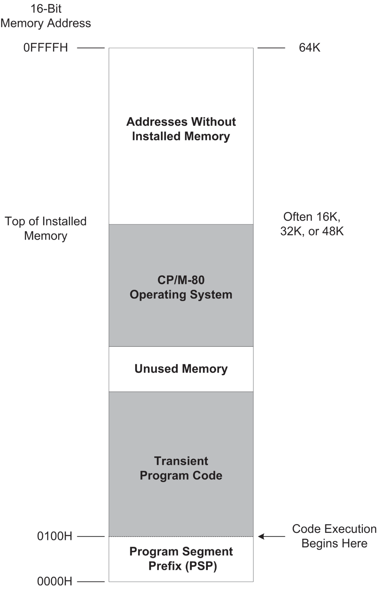
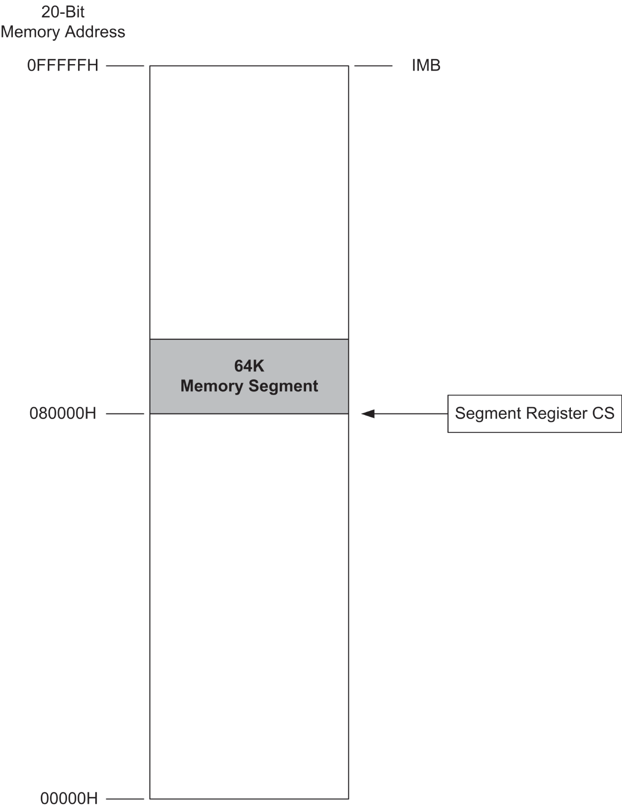
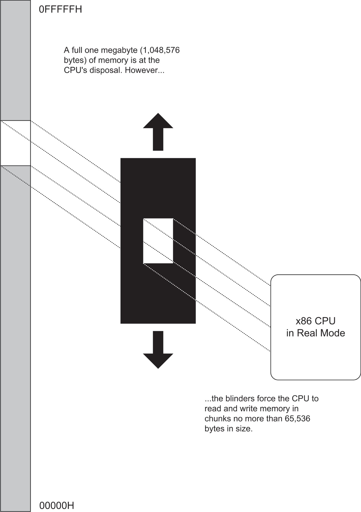
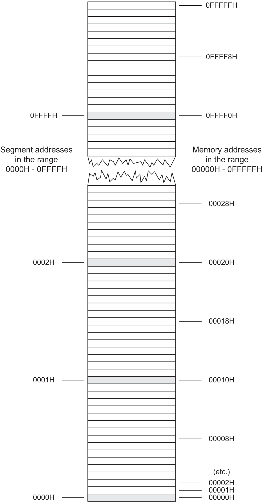
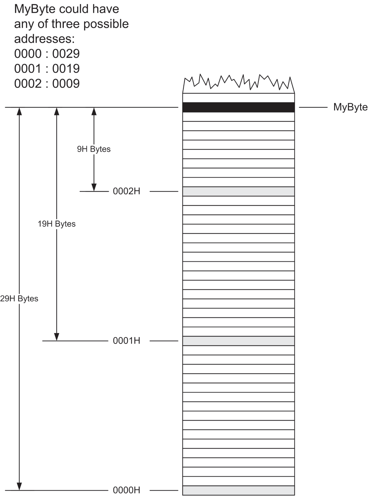
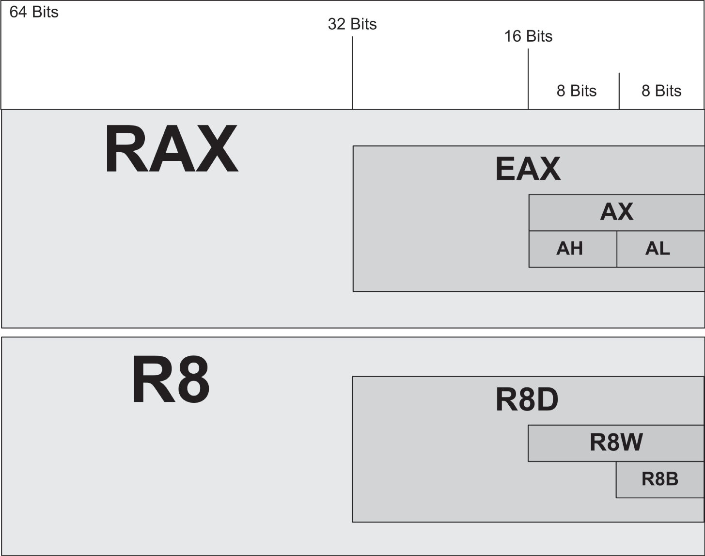
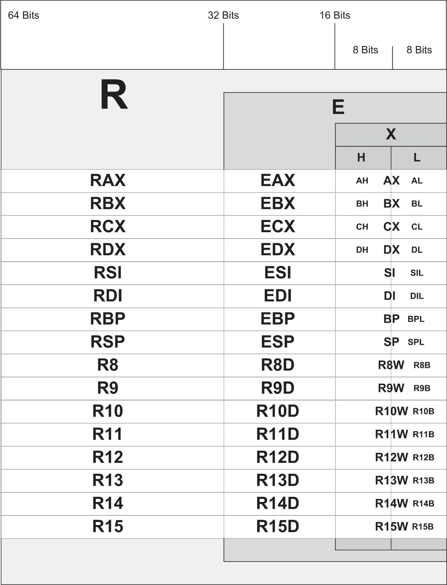
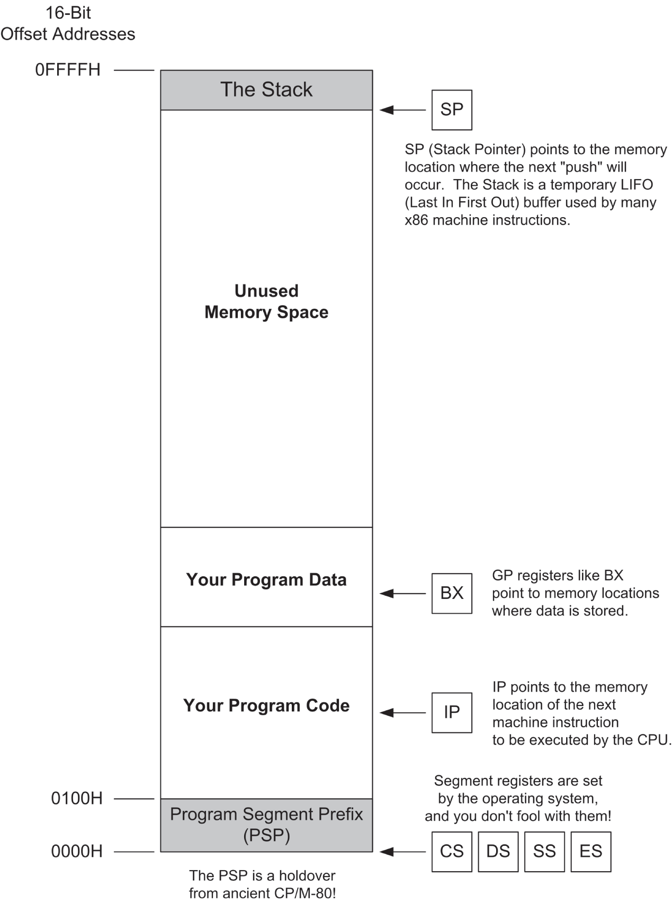
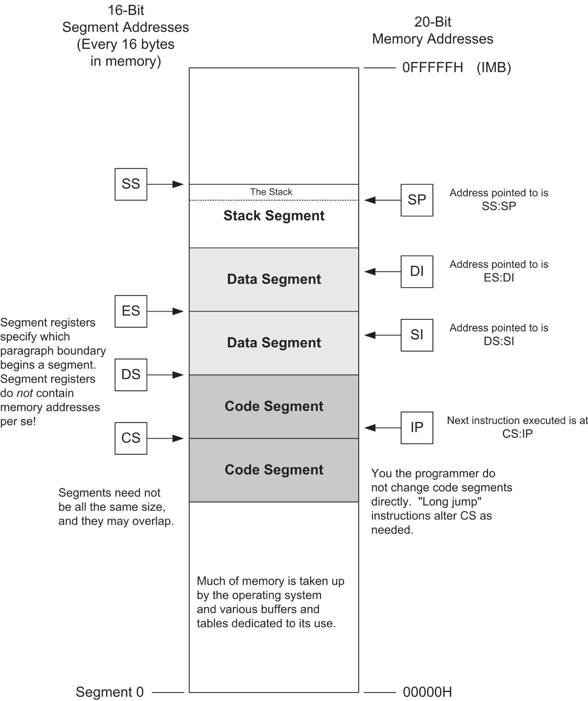
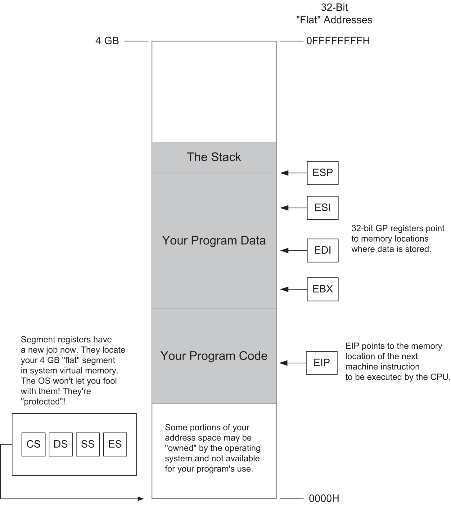

# <a id="Page_73"></a>CHƯƠNG 4 Vị trí, vị trí, vị trí: *Register, Memory Addressing và biết mọi thứ nằm ở đâu*

Tôi viết cuốn sách này phần lớn vì tôi không thể tìm được một cuốn sách nhập môn nào về assembly language mà tôi tôn trọng dù chỉ một chút. Gần như mọi cuốn sách về assembly đều bắt đầu bằng việc giới thiệu khái niệm instruction set rồi bắt đầu mô tả các machine instruction, từng cái một. Điều này thật ngu ngốc, và tác giả của những cuốn sách như vậy đáng bị đánh đòn. Thật mạnh. *Ngay cả khi bạn đã học từng instruction một trong một instruction set, bạn vẫn chưa học được assembly language*.

Bạn thậm chí còn chưa đến gần.

Lời phản bác ngây thơ rằng CPU tồn tại để thực thi machine instruction có thể dễ dàng bị gạt đi: nó thực thi machine instruction một khi đã có chúng trong đôi tay điện tử của mình. Công việc *thực sự* của CPU, và thách thức thực sự của assembly language, nằm ở việc định vị các instruction và dữ liệu cần thiết trong memory. Bất kỳ kẻ ngốc nào cũng có thể học machine instruction. *Kỹ năng assembly language bao gồm một sự hiểu biết sâu sắc về memory addressing*. Mọi thứ khác chỉ là chi tiết—và lại là những chi tiết dễ.

<a id="head-2-16"></a>

## Niềm vui của Memory Model

Memory addressing là một chuyện khó, và còn khó hơn nhiều bởi thực tế là có khá nhiều cách khác nhau để address memory trong họ CPU <a id="Page_74"></a>Intel/AMD. Mỗi cách này được gọi là một *memory model*. Có ba memory model chính mà bạn có thể dùng với các thành viên gần đây hơn của họ Intel, và một số biến thể nhỏ của ba model đó, đặc biệt là model ở giữa.

Khi lập trình cho Linux 64-bit hiện đại, bạn gần như bị giới hạn trong một memory model, và một khi đã hiểu memory addressing tốt hơn một chút, bạn sẽ *rất* mừng vì điều đó. Tuy nhiên, tôi sẽ mô tả khá chi tiết cả ba model ở đây, mặc dù hai model cũ hơn trong bộ ba đã trở thành đồ cổ trong bảo tàng. Đừng bỏ qua phần thảo luận về những món đồ cổ đó. Cũng như việc nghiên cứu hóa thạch để tìm hiểu các sinh vật khác nhau đã tiến hóa theo thời gian như thế nào sẽ cho bạn hiểu biết tốt hơn về sinh vật như chúng tồn tại ngày nay, việc biết một chút về các memory model cũ của Intel sẽ cho bạn một hiểu biết trực quan hơn về memory model duy nhất mà bạn có khả năng sẽ *dùng*.

Memory model lâu đời nhất và giờ đã cổ lỗ được gọi là *real mode flat model*. Nó đã hoàn toàn hóa thạch nhưng tương đối đơn giản. Memory model cao tuổi (và giờ đã nghỉ hưu) được gọi là *real-mode segmented model*. Nó có thể là thứ đáng ghét nhất mà bạn từng học trong *bất kỳ* loại lập trình nào, assembly hay không phải assembly. (Nếu bạn mới bắt đầu vào năm 2023, gần như chắc chắn bạn sẽ được miễn phải học nó.) Lập trình DOS ở thời đỉnh cao đã dùng real-mode segmented model, và kết quả là rất nhiều Pepto Bismol đã được bán ra. Memory model mới nhất được gọi là *protected-mode flat model*, có hai phiên bản: 32-bit và 64-bit. Đây là memory model đằng sau các hệ điều hành hiện đại như Windows 2000/XP/Vista/7/8/10/11 và Linux. Lưu ý rằng protected mode flat model *chỉ* có trên các CPU 386 và mới hơn hỗ trợ architecture IA-32 hoặc x64. 8086, 8088 và 80286 không hỗ trợ nó. Windows 9*x* nằm đâu đó giữa các model, và tôi ngờ rằng ngoài những người ở Microsoft ra thì chưa ai thực sự hiểu hết mọi chỗ uẩn khúc trong cách nó address memory—và có khi ngay cả họ cũng không. May mắn thay, nếu chưa phải là hóa thạch, thì nó chắc chắn đã chết và nằm trong mộ.

Tôi có một chiến lược trong cuốn sách này, và trước khi lao vào, tôi sẽ trình bày nó: tôi sẽ bắt đầu bằng việc giải thích memory addressing hoạt động thế nào trong real mode flat model, vốn có trong DOS. Nó dễ học đến kinh ngạc. Tôi sẽ thảo luận real-mode segmented model ở một mức độ nào đó vì bạn sẽ cứ vấp phải nó chỗ này chỗ kia và cần hiểu nó, ngay cả khi bạn không bao giờ viết một dòng code nào cho nó. Công việc thực sự được làm ngày nay và về sau nằm ở “long mode” 64-bit, cho Windows, Linux, hoặc bất kỳ hệ điều hành protected-mode 64-bit thực sự nào. Bản thân model này cũng dễ học đến kinh ngạc—phần khó là cố gắng suy nghĩ như một C compiler trong khi code của bạn gọi vào các thư viện hỗ trợ nó, điều ít hoặc không liên quan gì đến bản thân memory model. Chìa khóa của toàn bộ vấn đề là: *real mode flat model rất giống một protected-mode flat model thu nhỏ*.

Có một flat model lớn và một flat model nhỏ. Nếu bạn nắm được real mode flat model, bạn sẽ không gặp khó khăn gì với protected-mode flat model. Con khỉ <a id="Page_75"></a>ở giữa chỉ là cái giá bạn phải trả để tự coi mình là một bậc thầy thực sự về memory addressing.

Vậy hãy cùng xem thứ điên rồ này hoạt động thế nào.

### *16 bit cho bạn 64 KB*

Năm 1974, năm tôi tốt nghiệp đại học, Intel giới thiệu CPU 8080 và về cơ bản đã phát minh ra microcomputing. (Vâng, tôi là một ông già, nhưng tôi được ban cho ý thức về lịch sử—nhờ đã sống qua khá nhiều phần của nó.) 8080 là một món đồ white-hot vào thời điểm đó. Tôi có một chiếc chạy ở 1 MHz, và nó là một trình xử lý văn bản khá hiệu quả, đó cũng là việc chủ yếu tôi làm với nó.

8080 là một CPU 8-bit, nghĩa là nó xử lý mỗi lần 8 bit thông tin. Tuy nhiên, nó có 16 đường address đi ra. “Bitness” của một CPU—các general-purpose register của nó rộng bao nhiêu bit—là quan trọng, nhưng theo quan điểm của tôi, thước đo quan trọng hơn nhiều về hiệu quả của một CPU là nó có thể huy động bao nhiêu đường address trong một thao tác. Năm 1974, 16 đường address là tham vọng, vì memory *cực kỳ* đắt, và hầu hết các máy chỉ có 4K hoặc 8 KB byte (nhớ rằng, nghĩa là 4,000 hoặc 8,000 byte) là tối đa—và một số có ít hơn nhiều.

Mười sáu đường address sẽ address được 64 KB byte. Nếu bạn đếm theo binary (cách máy tính luôn đếm) và giới hạn mình trong 16 cột binary, bạn có thể đếm từ 0 đến 65,535. (Cách nói thông tục “64 KB64 KB” là viết tắt cho con số 66,536.) Điều này có nghĩa là mỗi vị trí trong 65,536 vị trí memory riêng biệt có thể có address duy nhất riêng, từ 0 lên đến 65,535.

Sơ đồ memory-addressing của 8080 rất đơn giản: bạn đặt một address 16-bit ra các đường address, và bạn nhận lại giá trị 8-bit được lưu tại address đó. Lưu ý rằng *không* có mối quan hệ tất yếu nào giữa số đường address trong một hệ thống memory và kích thước dữ liệu được lưu tại mỗi vị trí memory! 8080 lưu 8 bit tại mỗi vị trí, nhưng nó đã có thể lưu 16 hoặc thậm chí 32 bit tại mỗi vị trí mà vẫn có 16 đường memory address.

Hệ điều hành được dùng nhiều nhất với 8080, hơn hẳn mọi hệ điều hành khác, là CP/M-80. CP/M-80 hơi khác thường ở chỗ nó nằm ở *đỉnh* của memory được lắp đặt—đôi khi để nó có thể được chứa trong ROM, nhưng chủ yếu chỉ để nó tránh đường và cho phép một điểm bắt đầu memory nhất quán cho các *transient program*—những chương trình (không giống hệ điều hành) chỉ được nạp vào memory và chạy khi cần. Khi CP/M-80 đọc một chương trình từ đĩa để chạy, nó sẽ nạp chương trình vào vùng memory thấp, tại address 0100H—tức là cách đáy memory 256 byte. 256 byte đầu tiên của memory được gọi là *program segment prefix* (PSP) và chứa nhiều mẩu thông tin lặt vặt cũng như một memory buffer general-purpose cho input/output (I/O) đĩa của chương trình. Nhưng bản thân code thực thi không bắt đầu cho đến address 0100H.

Tôi đã vẽ memory model của 8080 và CP/M-80 trong <a id="R_c04-fig-0001"></a>[Hình 4.1](#c04-fig-0001).

<a id="Page_76"></a>



*<a id="c04-fig-0001"></a>**Hình 4.1**: Memory model của 8080*

Memory model của 8080 khi dùng với CP/M-80 rất đơn giản, và người ta dùng nó rất nhiều. Vì vậy, khi Intel tạo ra CPU 16-bit đầu tiên của mình, 8086, họ muốn giúp mọi người dễ dàng chuyển phần mềm CP/M-80 cũ từ 8080 sang 8086—điều chúng ta gọi là *porting*. Một cách để làm việc này là bảo đảm rằng một hệ thống addressing 16-bit như của 8080 vẫn hoạt động. Vì vậy, mặc dù 8086 có thể address lượng memory gấp 16 lần 8080 (16 × 64 KB64 KB = 1 MB), Intel đã thiết lập 8086 sao cho một chương trình có thể lấy một segment 64 KB byte nào đó trong megabyte memory đó và chạy hoàn toàn bên trong nó, như thể đó là hệ thống memory nhỏ hơn của 8080.

Điều này được thực hiện bằng cách dùng *segment register*—về cơ bản là các con trỏ memory nằm trong register CPU trỏ tới một vị trí trong memory nơi mọi thứ bắt đầu, dù đó là lưu trữ dữ liệu, thực thi code hay bất cứ thứ gì khác. Tôi sẽ nói thêm về segment register rất sớm. Tạm thời, chỉ cần nghĩ về chúng như những con trỏ chỉ ra nơi, trong megabyte memory của 8086, một chương trình được port từ thế giới 8080 sẽ bắt đầu. Xem <a id="R_c04-fig-0002"></a>[Hình 4.2](#c04-fig-0002).



*<a id="c04-fig-0002"></a>**Hình 4.2**: Memory model của 8080 bên trong một hệ thống memory 8086*

Khi nói về 8086 và 8088, có bốn segment register cần xem xét—và một lần nữa, chúng ta sẽ sớm xử lý chúng chi tiết. Nhưng cho mục đích của [Hình 4.2](#c04-fig-0002), hãy xét register gọi là CS—viết tắt của *code <a id="Page_78"></a>segment*. Một lần nữa, nó là một con trỏ trỏ tới một vị trí trong megabyte memory của 8086. Vị trí này đóng vai trò điểm bắt đầu cho một vùng memory 64 KB, mà bên trong đó một chương trình CP/M-80 được chuyển đổi nhanh có thể chạy rất vui vẻ.

Đây là lối suy nghĩ short-term rất khôn ngoan—và là lối suy nghĩ long-term tệ hại thảm khốc. Rất nhiều chương trình CP/M-80 đã được chuyển sang 8086 chỉ trong vài năm. Các vấn đề thực sự bắt đầu khi các lập trình viên cố gắng tạo ra những chương trình mới từ đầu, chưa từng thấy 8080 và không cần đến segmented memory model. Thật tiếc—segmented model đã thống trị architecture của 8086. Các chương trình cần nhiều hơn 64 KB memory cùng lúc phải dùng memory theo các khối 64 KB, chuyển giữa các khối bằng cách chuyển giá trị vào và ra khỏi segment register.

Đây là một cơn ác mộng. Tin tốt là không ai ngoại trừ những người chơi đồ retrotech còn phải dùng lại nó nữa. Tuy nhiên, có một lý do tốt để học nó: hiểu cách memory addressing real-mode segmented hoạt động sẽ giúp bạn hiểu các flat model ngày nay hoạt động thế nào, và trong quá trình đó bạn sẽ hiểu bản chất của các CPU ngày nay tốt hơn rất nhiều.

### *Bản chất của một Megabyte*

Khi chạy ở segmented real mode, các CPU x86 có thể dùng tới một megabyte memory có thể address trực tiếp. Memory này cũng được gọi là *real mode memory*. Như tôi đã thảo luận ngắn gọn trong [Chương 3](ch03_lifting_the_hood.vi.md), một megabyte memory thực ra không phải là 1 triệu byte memory, mà là 1,048,576 byte. Một lần nữa, cũng như thuật ngữ viết tắt “64 KB”, một megabyte không ra số tròn trong base 10 của chúng ta vì máy tính hoạt động trên base 2. 1,048,576 byte đó khi biểu diễn trong base 2 là 100000000000000000000B byte. Đó là 2<sup>20</sup>, một thực tế mà chúng ta sẽ sớm quay lại. Con số in ra 100000000000000000000B cồng kềnh đến mức tốt hơn nên biểu diễn nó bằng base 16 tương thích (và gọn hơn nhiều), hệ hexadecimal mà chúng ta đã đi qua trong [Chương 2](ch02_alien_bases.vi.md). Đại lượng 2<sup>20</sup> tương đương với 16<sup>5</sup> và có thể được viết trong hexadecimal là 100000H. (Nếu khái niệm number base vẫn làm bạn bối rối, tôi khuyên bạn đọc lại [Chương 2](ch02_alien_bases.vi.md) thêm một lần, nếu bạn chưa đọc, hoặc, có lẽ, ngay cả khi bạn đã đọc.)

Giờ, đây là một câu hỏi hóc búa và tuyệt đối then chốt: trong một dãy memory chứa 100000H byte, address của byte cuối cùng trong dãy memory là gì? Câu trả lời không phải là 100000H. Gợi ý nằm ở mặt kia của câu hỏi đó: address của byte đầu tiên trong memory là gì? Câu trả lời đó, có thể bạn còn nhớ, là 0. Máy tính luôn bắt đầu đếm từ 0. Đó là một sự phân đôi sẽ xuất hiện lặp đi lặp lại trong lập trình máy tính. Phần tử cuối cùng trong một hàng bốn phần tử là phần tử 3, vì phần tử đầu tiên trong một hàng bốn phần tử là phần tử số 0. Đếm: 0, 1, 2, 3.

Address của một byte trong một dãy memory chỉ là số thứ tự của byte đó *bắt đầu từ không*. Điều này có nghĩa là address cuối cùng, hay cao nhất, trong một dãy memory chứa 1 megabyte là 100000H trừ một, hay 0FFFFFH. (Số không ở đầu, mặc dù không cần thiết về mặt toán học, có ở đó để tiện cho assembler của bạn và giúp <a id="Page_79"></a>chương trình assembler không bị nhầm lẫn. Hãy tập thói quen dùng số không ở đầu cho mọi số hex bắt đầu bằng các chữ số hex từ A đến F.)

Vậy, các address trong một megabyte memory chạy từ 00000H đến 0FFFFFH. Trong ký hiệu binary, điều đó tương đương với phạm vi từ 00000000000000000000B đến 11111111111111111111B. Đó là rất nhiều bit—chính xác là 20. Nếu bạn nhìn lại [Hình 3-3](ch03_lifting_the_hood.vi.md#c03-fig-0003) trong [Chương 3](ch03_lifting_the_hood.vi.md), bạn sẽ thấy rằng một dãy memory một megabyte có 20 đường address. Mỗi bit trong 20 bit address đó được dẫn tới một trong 20 đường address đó để bất kỳ address nào được biểu diễn bằng 20 bit sẽ xác định một và chỉ một byte trong số 1,048,576 byte chứa trong dãy memory.

Đó chính là một megabyte memory: một cách bố trí chip memory nào đó bên trong máy tính, được nối bằng một address bus gồm 20 đường. Một address 20-bit được đưa vào 20 đường address đó để xác định 1 byte trong megabyte.

### *Backward Compatibility và Virtual 86 Mode*

Các CPU hiện đại có thể address lượng memory lớn hơn rất nhiều so với thế này, và tôi sẽ sớm giải thích bằng cách nào. Với các CPU 8086 và 8088 ban đầu, 20 đường address và 1 megabyte memory theo đúng nghĩa đen là tất cả những gì chúng có. 386 và các CPU 32-bit sau này của Intel có thể address 4 gigabyte memory mà không cần chia nhỏ nó thành các segment nhỏ hơn. Khi một CPU 32-bit hoạt động ở protected mode flat model, một segment *là* 4 gigabyte—nên một segment, phần lớn, là quá đủ, và có thể có nhiều hơn nếu hệ thống của bạn được lắp 8, 16 hoặc 64 GB memory. Với long mode x64, thì, một segment của bạn có thể dài bao nhiêu tùy bạn muốn. Nó dài bao nhiêu có thể khiến bạn ngạc nhiên. Chúng ta sẽ quay lại điều đó khi bài học lịch sử kết thúc.

Tuy nhiên, có cả một núi phần mềm DOS được viết để dùng segment ở khắp nơi và phải được xử lý. Vì vậy, để duy trì *backward compatibility* với 8086 và 8088 cổ lỗ, các CPU mới hơn được trao năng lực tự giới hạn mình vào những gì các chip cũ có thể address và thực thi. Khi một CPU Pentium-class trở lên cần chạy phần mềm được viết cho real-mode segmented model, nó thực hiện một mẹo gọn gàng khiến nó, tạm thời, *trở thành* một chiếc 8086. Điều này được gọi là *virtual-86 mode*, và nó đã mang lại backward compatibility tuyệt vời cho phần mềm DOS.

Khi bạn khởi chạy một cửa sổ MS-DOS hay “DOS box” trong Windows NT và các phiên bản Windows sau này, bạn đang dùng virtual-86 mode để tạo ra cái về thực chất là một hòn đảo real-mode nhỏ bên trong hệ thống memory protected mode của Windows. Đó là cách tốt duy nhất để giữ backward compatibility đó, vì những lý do mà bạn sẽ hiểu khá sớm.

### *Tấm che mắt 16-Bit*

Trong real-mode segmented model, một CPU x86 có thể “thấy” trọn một megabyte memory. Tức là, các chip CPU tự thiết lập để có thể dùng 20 trong số 32 address pin của chúng và có thể chuyển một address 20-bit cho hệ thống memory. Từ góc <a id="Page_80"></a>nhìn đó, có vẻ khá đơn giản và dễ hiểu. Tuy nhiên, phần lớn khó khăn mà bạn có thể gặp khi hiểu real-mode segmented model bắt nguồn từ thực tế này: mặc dù những CPU đó có thể thấy trọn một megabyte memory, chúng bị buộc phải nhìn megabyte đó qua tấm che mắt 16-bit.

Phép ẩn dụ tấm che mắt gần với nghĩa đen hơn bạn nghĩ. Hãy nhìn <a id="R_c04-fig-0003"></a>[Hình 4.3](#c04-fig-0003). Hình chữ nhật dài biểu diễn megabyte memory mà CPU có thể address trong real-mode segmented model. CPU ở bên phải. Ở giữa là một miếng bìa cứng ẩn dụ có một khe được cắt trên đó. Khe rộng 1 byte và dài 65,536 byte. CPU có thể trượt miếng bìa đó lên xuống suốt chiều dài hệ thống memory của nó. Tuy nhiên, *tại bất kỳ thời điểm nào*, nó chỉ có thể truy cập 65,536 byte.

Góc nhìn của CPU về memory trong real-mode segmented model rất kỳ lạ. Nó bị buộc phải nhìn memory theo từng khối, trong đó không có khối nào dài hơn 65,536 byte—một lần nữa, cái chúng ta gọi là “64 KB”. Việc sử dụng những khối đó—tức là, biết khối nào đang được dùng và làm thế nào để chuyển từ khối này sang khối khác—là thách thức thực sự của lập trình real-mode segmented model. Đã đến lúc xem xét kỹ hơn chúng là gì và hoạt động thế nào.

<a id="head-2-17"></a>

## Bản chất của Segment

Cho đến giờ chúng ta đã nói một cách không chính thức về segment như những khối memory bên trong không gian memory lớn hơn mà CPU có thể thấy và dùng. Trong bối cảnh real-mode segmented model, một *segment* là một vùng memory bắt đầu trên một paragraph boundary và kéo dài một số byte nào đó. Trong real-mode segmented model, con số này nhỏ hơn hoặc bằng 64 KB (65,536). Chúng ta đã nói về con số 64 KB trước đây. Nhưng paragraph là gì?

Tạm dừng để học một bài về những chi tiết vụn vặt old-time của họ 86-family. Một *paragraph* là một đơn vị đo memory bằng 16 byte. Nó là một trong rất nhiều thuật ngữ kỹ thuật được dùng để mô tả các lượng memory khác nhau. Chúng ta đã nói về một số thuật ngữ trước đây, và tất cả đều là bội số chẵn của 1 byte (ngoại trừ “nybble” now-archaic, tức 4 bit, hay nửa byte). Byte là nguyên tử dữ liệu, nhớ chứ; các bit memory rời rạc giống các hạt hạ nguyên tử hơn và không bao giờ tồn tại khi không có một byte (hoặc nhiều hơn) memory để chứa chúng. Một số thuật ngữ này được dùng nhiều hơn những thuật ngữ khác, nhưng bạn nên biết tất cả chúng, được đưa ra trong <a id="R_c04-tbl-0001"></a>[Bảng 4.1](#c04-tbl-0001).

Một số thuật ngữ này, như 10 byte, hiếm khi xuất hiện, và những thuật ngữ khác, như page, hầu như không bao giờ xuất hiện. Thuật ngữ *paragraph* chưa bao giờ phổ biến và phần lớn chỉ được dùng liên quan đến những vị trí trong memory nơi segment có thể bắt đầu.



*<a id="c04-fig-0003"></a>**Hình 4.3**: Nhìn một megabyte qua tấm che mắt 64 KB*

*<a id="c04-tbl-0001"></a>**Bảng 4.1**: Các thuật ngữ tập hợp cho memory*

| TÊN | SỐ BYTE THEO DECIMAL | SỐ BYTE THEO HEX |
|---|---|---|
| Byte | 1 | 01H |
| Word | 2 | 02H |
| Double word | 4 | 04H |
| Quad word | 8 | 08H |
| Ten byte | 10 | 0AH |
| Paragraph | 16 | 10H |
| Page | 256 | 100H |
| Segment | 65,536 | 10000H |

<a id="Page_82"></a>Mọi memory address chia hết cho 16 được gọi là một *paragraph boundary*. Paragraph boundary đầu tiên là address 0. Cái thứ hai là address 10H, cái thứ ba là address 20H, và cứ thế. (Nhớ rằng 10H bằng 16 decimal.) Bất kỳ paragraph boundary nào cũng có thể được coi là điểm bắt đầu của một segment.

Điều này *không* có nghĩa là một segment thực sự bắt đầu mỗi 16 byte lên xuống suốt megabyte memory đó. Một segment giống như một ngăn kệ trong những chiếc tủ sách điều chỉnh được hiện đại. Ở mặt sau của tủ sách có rất nhiều khe nhỏ cách nhau one-half inch. Giá đỡ kệ có thể được cắm vào bất kỳ khe nhỏ nào. Tuy nhiên, không có hàng trăm ngăn kệ, mà chỉ có bốn hoặc năm. Gần như mọi khe đều trống và không được dùng. Chúng tồn tại để một số lượng ngăn kệ nhỏ hơn nhiều có thể được điều chỉnh lên xuống theo chiều cao của tủ sách khi cần.

Tương tự, paragraph boundary là những khe nhỏ nơi một segment có thể bắt đầu. Trong real-mode segmented model, một chương trình có thể chỉ dùng bốn hoặc năm segment, nhưng mỗi segment đó có thể bắt đầu tại bất kỳ paragraph boundary nào trong số 65,536 paragraph boundary tồn tại trong megabyte memory có sẵn trong real-mode segmented model.

Lại là con số đó: 65,536—64 KB thân yêu của chúng ta. Có 64 KB paragraph boundary khác nhau nơi một segment có thể bắt đầu. Mỗi paragraph boundary có một số. Như thường lệ, các số bắt đầu từ 0 và đi đến 64 KB trừ một; theo decimal là 65,535, hay theo hex là 0FFFFH. Vì một segment có thể bắt đầu tại bất kỳ paragraph boundary nào, số của paragraph boundary nơi một segment bắt đầu được gọi là *segment address* của segment cụ thể đó. Thực tế, chúng ta hiếm khi nói về paragraph hay paragraph boundary. Khi bạn thấy thuật ngữ *segment address* gắn với real-mode segmented model, hãy nhớ rằng mỗi segment address nằm xa hơn 16 byte (một paragraph) trong memory so với segment address trước nó. Xem <a id="R_c04-fig-0004"></a>[Hình 4.4](#c04-fig-0004). Trong hình, mỗi thanh được tô bóng là một segment address, và các segment bắt đầu mỗi 16 byte. Segment address cao nhất là 0FFFFH, cách đỉnh của một megabyte memory của real mode 16 byte.



*<a id="c04-fig-0004"></a>**Hình 4.4**: Memory address so với segment address*

<a id="Page_84"></a>

Tóm lại, segment có thể bắt đầu tại bất kỳ segment address nào. Có 65,536 segment address phân bố đều trên trọn một megabyte memory của real mode, cách nhau 16 byte. Một segment address là một sự cho phép hơn là một sự bắt buộc; trong tất cả 64 KB segment address khả dĩ, chỉ năm hoặc sáu cái thực sự được dùng để bắt đầu segment tại bất kỳ thời điểm nào. Hãy nghĩ về segment address như những khe nơi segment có thể được đặt.

Chuyện segment address là vậy; giờ, còn bản thân segment thì sao? Điều quan trọng nhất cần hiểu là một segment có thể có kích thước tới 64 KB byte, nhưng nó không *bắt buộc* phải như vậy. Một segment có thể chỉ dài 1 byte, hoặc dài 256 byte, hoặc dài 21,378 byte, hoặc bất kỳ độ dài nào dưới 64 KB byte.

### *Một chân trời, không phải một nơi chốn*

Bạn định nghĩa một segment chủ yếu bằng cách nêu nơi nó bắt đầu. Vậy thì, cái gì định nghĩa một segment *dài* bao nhiêu? Thực ra không có gì cả—và ở đây chúng ta đi vào một số vấn đề ngữ nghĩa rất hóc búa. Một segment là một *chân trời* hơn là một *nơi chốn*. Một khi bạn định nghĩa nơi một segment bắt đầu, segment đó có thể bao gồm bất kỳ vị trí nào trong memory be-tween điểm bắt đầu đó và chân trời—vốn cách 65,536 byte xuôi dòng.

Dĩ nhiên, không có gì nói rằng một segment phải dùng hết toàn bộ memory đó. Trong hầu hết các trường hợp, khi một segment được định nghĩa tại một segment address nào đó, một chương trình chỉ coi vài trăm hoặc có lẽ vài nghìn byte tiếp theo là một phần của segment đó, trừ khi đó là một chương trình world-class thực sự. Hầu hết người mới bắt đầu đọc về segment và nghĩ về chúng như một kiểu cấp phát memory, một vùng memory được bảo vệ có tường ở cả hai bên, dành riêng cho một mục đích cụ thể nào đó.

Điều này xa sự thật hết mức có thể. Trong real mode, không có gì được bảo vệ bên trong một segment, và segment không được dành riêng cho bất kỳ register hay phương thức truy cập cụ thể nào. Các segment có thể chồng lấn lên nhau. (Người ta thường không nghĩ tới hoặc không nhận ra điều này.) Theo một nghĩa rất thực, segment không thực sự tồn tại, *ngoại trừ* như những chân trời mà một loại tham chiếu memory nhất định không thể vượt qua. Nó quay về bộ tấm che mắt 64 KB mà CPU đeo, như tôi đã vẽ trong [Hình 4.3](#c04-fig-0003). Hãy nghĩ theo cách này: *một segment là vị trí trong memory nơi tấm che mắt 64 KB của CPU được đặt*. Khi nhìn memory qua tấm che mắt, bạn có thể thấy các byte bắt đầu từ segment address và tiếp tục cho đến khi tấm che mắt chặn bạn lại, cách đó 64 KB byte.

Chìa khóa để hiểu định nghĩa phải thừa nhận là siêu hình này về segment là biết segment được dùng thế nào, và để hiểu điều đó rốt cuộc cần một cuộc thảo luận chi tiết về register.

### *Tạo Address 20-Bit từ Register 16-Bit*

Một *register*, như tôi đã đề cập một cách không chính thức trong các chương trước, là một vị trí memory *bên trong* chip CPU chứ không phải bên ngoài CPU trong một dãy memory ở đâu đó. <a id="Page_85"></a>8086, 8088 và 80286 thường được gọi là CPU 16-bit vì các register bên trong của chúng gần như đều có kích thước 16 bit. 80386 và các hậu duệ của nó trong suốt 25 năm được gọi là CPU 32-bit vì hầu hết các register bên trong của chúng có kích thước 32 bit. CPU 32-bit cuối cùng của Intel là dòng Lincroft Atom, ra mắt năm 2010 và nhắm vào các thiết bị di động. CPU để bàn 32-bit cuối cùng của họ là một thành viên của họ Pentium 4 ra mắt năm 2002. Kỷ nguyên 32-bit có thể đáng để xem xét kỹ, nhưng giờ đây vào năm 2023 nó đã thực sự và hoàn toàn kết thúc.

Các CPU x64 có thiết kế 64 bit, với các register rộng 64 bit. Các CPU Intel có khá nhiều register, và chúng quả thực là một đội ngũ thú vị.

Register làm nhiều việc, nhưng có lẽ việc đơn lẻ quan trọng nhất của chúng là giữ address của các vị trí quan trọng trong memory. Nếu bạn còn nhớ, 8086 và 8088 có 20 address pin, và megabyte memory của chúng (chính là memory real-mode segmented mà chúng ta đang nói đến) cần các address có kích thước 20 bit.

Làm thế nào để đặt một memory address 20-bit vào một register 16-bit?

Dễ thôi. Bạn không đặt.

Bạn đặt một address 20-bit vào *hai* register 16-bit.

Điều xảy ra là thế này: mọi vị trí memory trong megabyte memory của real mode đều có không phải một address mà là *hai*. Mọi byte trong memory được giả định là nằm trong một segment. Vậy, address đầy đủ của một byte gồm address của segment chứa nó, cùng với khoảng cách của byte đó tính từ đầu segment đó. Address của segment (như chúng ta đã nói trước đây) là *segment address* của byte. Khoảng cách của byte tính từ đầu segment là *offset address* của byte. Cả hai address đều phải được chỉ định để mô tả đầy đủ vị trí của bất kỳ byte đơn lẻ nào trong trọn một megabyte memory real-mode. Khi viết ra, segment address đứng trước, tiếp theo là offset address. Hai address được phân tách bằng dấu hai chấm. Các address segment:offset luôn được viết bằng hexadecimal.

Tôi đã vẽ <a id="R_c04-fig-0005"></a>[Hình 4.5](#c04-fig-0005) để giúp điều này rõ ràng hơn một chút. Một byte dữ liệu mà chúng ta sẽ gọi là `MyByte` tồn tại trong memory tại vị trí được đánh dấu. Address của nó được ghi là 0001:0019. Điều này có nghĩa là `MyByte` nằm trong segment 0001H và cách đầu segment đó 0019H byte. Lưu ý rằng có một quy ước là khi dùng hai số để chỉ định một address với dấu hai chấm ở giữa, bạn *không* kết thúc mỗi số bằng *H* cho hexadecimal.

Tuy nhiên, vũ trụ vốn ngang trái, và những con mắt tinh ý sẽ nhận ra rằng `MyByte` có thể có hai address khác hoàn toàn hợp lệ: 0:0029 và 0002:0009. Tại sao vậy? Hãy nhớ rằng một segment có thể bắt đầu mỗi 16 byte trên suốt một megabyte real memory. Một segment, một khi đã bắt đầu, bao trùm mọi byte từ gốc của nó lên đến 65,535 byte phía trên trong memory. Không có gì sai khi các segment chồng lấn lên nhau, và trong [Hình 4.5](#c04-fig-0005) chúng ta có ba segment chồng lấn. `MyByte` nằm cách đầu segment thứ nhất 29H byte, segment này bắt đầu tại segment address 0000H. `MyByte` nằm cách đầu segment thứ hai 19H byte, segment này bắt đầu tại segment address 0001H. Không phải là `MyByte` ở hai hay ba chỗ cùng lúc. Nó chỉ ở một chỗ, nhưng chỗ đó có thể được mô tả theo bất kỳ cách nào trong ba cách.



*<a id="c04-fig-0005"></a>**Hình 4.5**: Segment và offset*

<a id="Page_86"></a>Nó hơi giống hệ thống street-numbering của Chicago. Phố Howard nằm cách “gốc” của Chicago, phố Madison, 76 dãy nhà về phía bắc. Tuy nhiên, phố Howard chỉ nằm cách đại lộ Touhy 4 dãy nhà về phía bắc. Bạn có thể mô tả vị trí của phố Howard tương đối với phố Madison hoặc đại lộ Touhy, tùy theo điều bạn muốn làm.

Một byte tùy ý ở đâu đó giữa megabyte memory của segmented real mode có thể nằm trong theo đúng nghĩa đen hàng nghìn segment khác nhau. Byte đó *thực sự* nằm trong segment nào hoàn toàn là vấn đề quy ước.

<a id="Page_87"></a>Tóm lại, để biểu diễn một address 20-bit trong hai register 16-bit là đặt segment address vào một register 16-bit và offset address vào một register 16-bit khác. Hai register gộp lại xác định 1 byte trong số tất cả 1,048,576 byte trong megabyte memory của real mode.

Điều này có vụng về không? Bạn *không* thể hình dung được đâu. Nhưng đó là điều tốt nhất chúng ta có thể làm trong rất nhiều năm.

<a id="head-2-18"></a>

## Segment Register

Hãy nghĩ về segment address như vị trí bắt đầu của tấm che mắt 64 KB của real mode. Thông thường, bạn sẽ dịch chuyển tấm che mắt để bao trùm vị trí bạn muốn làm việc rồi để tấm che mắt ở yên một chỗ trong khi di chuyển quanh bên trong giới hạn 64 KB của nó.

Đây chính xác là cách các register có xu hướng được dùng trong assembly language real mode segmented model. 8086, 8088 và 80286 có đúng bốn segment register được chỉ định riêng làm nơi giữ segment address. 386 và các CPU sau này có thêm hai register nữa cũng có thể được dùng trong real mode. (Bạn cần biết model CPU bạn đang chạy nếu định dùng hai segment register bổ sung, vì các CPU cũ hơn không có chúng.) Mỗi segment register là một vị trí memory 16-bit tồn tại bên trong chính chip CPU. Bất kể CPU đang làm gì, nếu nó đang address một vị trí nào đó trong memory, segment address của vị trí đó có mặt trong một trong sáu segment register.

Các segment register có tên phản ánh chức năng chung của chúng: CS, DS, SS, ES, FS và GS. FS và GS chỉ tồn tại trong 386 và các CPU Intel x86 32-bit sau này—nhưng vẫn có kích thước 16 bit. *Mọi segment register đều có kích thước 16 bit, bất kể CPU nào*. Điều này đúng ngay cả với các CPU Intel 64-bit hiện đại, mặc dù có một điểm lưu ý—sẽ nói thêm về điều đó ngay sau đây.

- *CS là viết tắt của code segment*. Machine instruction tồn tại tại một offset nào đó trong một code segment. Segment address của code segment chứa instruction đang được thực thi được chứa trong CS.
- *DS là viết tắt của data segment*. Biến và các dữ liệu khác tồn tại tại một offset nào đó trong một data segment. Có thể có nhiều data segment, nhưng CPU chỉ có thể dùng mỗi lần một data segment, bằng cách đặt segment address của segment đó vào register DS.
- *SS là viết tắt của stack segment*. *Stack* là một thành phần rất quan trọng của CPU được dùng để lưu trữ tạm thời dữ liệu và address. Tôi sẽ giải thích stack hoạt động thế nào ở phần sau; tạm thời chỉ cần hiểu rằng, giống như mọi thứ khác trong megabyte memory của real mode, stack có một segment address, được chứa trong SS.
- <a id="Page_88"></a>*ES là viết tắt của extra segment*. Extra segment đúng như tên gọi: một segment dự phòng có thể được dùng để chỉ định một vị trí trong memory.
- *FS và GS là bản sao của ES*. Cả hai đều là các segment “extra” bổ sung không có công việc hay chuyên môn cụ thể nào. Tên của chúng xuất phát từ việc chúng được tạo ra sau ES. (Hãy nghĩ: E, F, G.) Đừng quên rằng chúng *chỉ* tồn tại trong 386 và các CPU Intel sau này.

### *Segment Register và x64*

Giờ, có một điều kỳ lạ về segment register trong architecture x64: *chúng không được dùng trong các chương trình ứng dụng*. Hoàn toàn không. Hãy nghĩ mà xem: 64 bit có thể xác định 2<sup>64</sup> byte memory. Trong ký hiệu khoa học decimal, đó là 1.8 x 10<sup>19</sup>. Đọc thành tiếng, chúng ta sẽ nói “18 exabyte”. Nếu từ đó còn mới với bạn, bạn không đơn độc. Một *exabyte* là một tỷ gigabyte, tức là một tỷ tỷ byte. Chiếc máy làm việc hằng ngày none-too-new của tôi chứa 16 gigabyte RAM. Hầu hết máy tính để bàn new-build ngày nay có thể lắp 64 GB, và chỉ đến thế. Ngay cả game thủ cũng hiểu rằng hơn 64 GB RAM sẽ không cải thiện trải nghiệm chơi game của họ.

Toàn bộ mục đích của segment register là cho phép address 20 bit không gian address bằng hai register 16-bit. Khi một register 64-bit duy nhất có thể address gần bằng số byte memory nhiều như số ngôi sao trong vũ trụ quan sát được (tôi không phóng đại điều đó đâu!), segment register trở nên vô dụng, ít nhất là trong lập trình ứng dụng. Các hệ điều hành dùng hai trong số chúng cho những mục đích vượt xa phạm vi giải thích của cuốn sách này. Những register còn lại vẫn ở đó nhưng có thể gây rắc rối nếu bạn cố dùng chúng. Tóm lại, khi bạn chuyển sang long mode x64, các segment register 16-bit quen thuộc đơn giản là biến mất.

Vậy…các CPU x64 của Intel có 64 đường address không? Không. Thậm chí không có bộ máy nào bên trong chip để hỗ trợ hơn 48 bit address trên các CPU x64 cũ hơn. (Intel đã nâng giá trị này lên 52 bit cho một số CPU high-end vài năm trước.) Tại sao lại nhiều đến thế? Một phần là để hướng tới những công nghệ memory mà chúng ta chưa thể hình dung. Vấn đề không đơn giản như vậy, và không đủ chỗ để tôi đi vào chi tiết hơn trong cuốn sách này. Nhưng đây là câu đáng giá nhất:

> *Từ góc nhìn 64-bit, segment register giờ đã là lịch sử*.

### *General-Purpose Register*

Mọi CPU Intel đều có một đội register đa năng để làm phần lớn công việc tính toán bằng assembly language. Những *general-purpose register* này giữ giá trị cho thao tác số học và logic, cho bit-shifting (sẽ nói thêm về điều này sau), và nhiều thứ khác, bao gồm cả việc giữ memory address. Chúng thực sự là những chiếc túi của người thợ bên trong CPU.

Nhưng giờ chúng ta đến với một trong những khác biệt lớn nhất và hiển nhiên nhất giữa các kỷ nguyên khác nhau của microcomputing Intel: độ rộng của các general-purpose register. Chiếc 8080 nguyên thủy có các register 8-bit. Các CPU x86 16-bit (8086, 8088, 80186 và 80286) có các register 16-bit. Các CPU x86 32-bit bắt đầu từ 386 có các register 32-bit. Và trong thế giới x64, CPU có 14 general-purpose register 64-bit. Hai register nữa, stack pointer và base pointer, là các register chuyên biệt và tồn tại trong các architecture 16-bit, 32-bit và 64-bit. Stack pointer luôn trỏ tới đỉnh của stack. (Tôi sẽ nói nhiều hơn về stack trong các chương sau.) Base pointer hơi giống một chiếc đánh dấu trang và được dùng để truy cập dữ liệu “sâu hơn” trong stack; một lần nữa, rốt cuộc chúng ta sẽ đến với stack, và tôi sẽ giải thích điều này sâu hơn.

Giống như segment register, các general-purpose register x64 là các vị trí memory tồn tại bên trong chính chip CPU. Các general-purpose register thực sự là đa năng ở chỗ tất cả chúng đều chia sẻ một bộ năng lực lớn. Tuy nhiên, một số general-purpose register cũng có cái mà tôi gọi là “mục đích ngầm”: một nhiệm vụ hoặc một tập nhiệm vụ mà chỉ chúng mới có thể thực hiện. Tôi sẽ giải thích tất cả những mục đích ngầm này dần dần—cần nhớ rằng một số mục đích ngầm thực ra là những hạn chế của các CPU 16-bit cũ hơn. Các general-purpose register 32-bit và 64-bit mới hơn thì, ừm, *đa năng* hơn nhiều.

Trong thế giới 64-bit hiện tại của chúng ta, các general-purpose register thuộc bốn loại chung: các general-purpose register 16-bit, các extended general-purpose register 32-bit, các general-purpose register 64-bit, và các nửa register 8-bit. Bốn loại này hoàn toàn không biểu diễn bốn bộ register riêng biệt. Các register 8-bit, 16-bit và 32-bit thực ra là tên của các vùng *bên trong* các register 64-bit. Sự phát triển của register trong họ CPU x86 lâu đời diễn ra bằng cách *mở rộng* các register có trong các CPU cũ hơn. Thêm một phòng vào nhà bạn không biến nó thành hai ngôi nhà—chỉ là một ngôi nhà lớn hơn. Và các register x86 cũng vậy.

Có tám general-purpose register 16-bit: AX, BX, CX, DX, BP, SI, DI và SP. (SP và BP kém đa năng hơn một chút so với những register khác, nhưng chúng ta sẽ đến điều đó sau.) Tất cả chúng đều có trong các CPU 8086, 8088, 80186 và 80286. Tất cả đều có kích thước 16 bit, và bạn có thể đặt vào chúng bất kỳ giá trị nào có thể biểu diễn bằng 16 bit trở xuống. Khi Intel mở rộng architecture x86 lên 32 bit vào năm 1985, họ đã tăng gấp đôi kích thước của cả tám register và đặt cho chúng tên mới bằng cách thêm tiền tố *E* trước mỗi tên register, tạo thành EAX, EBX, ECX, EDX, EBP, ESI, EDI và ESP.

Mọi thứ lại thay đổi một lần nữa vào năm 2003, khi Intel bắt đầu áp dụng architecture x64 64-bit backward-compatible của AMD. Một lần nữa, Intel lúc đó đã có architecture 64-bit của riêng mình, IA-64 Itanium, nhưng Itanium có một số khó khăn kỹ thuật tinh tế nhưng quan trọng trong microarchitecture của nó mà tôi không thể mô tả trong một cuốn sách nhập môn như thế này. Intel sau đó đã nuốt niềm kiêu hãnh của mình và làm điều khôn ngoan là áp dụng architecture 64-bit thành công của AMD. Than ôi, 8080 đứng một mình. Backward compatibility chỉ có thể kéo dài về quá khứ đến một mức nào đó trước khi nó trở thành một con bug nhiều hơn là một tính năng.

Architecture x64 đã mở rộng dàn general-purpose register từ 32 lên 64 bit. Lần này tiền tố trở thành *R*. Vì vậy giờ thay vì EAX 32-bit, chúng ta có RAX, và cứ thế xuống danh sách các register 32-bit. Intel cũng thêm tám register 64-bit mới chưa từng là một phần của architecture của họ trước đây. Tên của chúng phần lớn là số: từ R8 đến R15.

Các register x64 64-bit thực ra là register bên trong register. Giống như nhiều thứ khác, điều này thể hiện bằng hình thì dễ hơn nói. Hãy xem <a id="R_c04-fig-0006"></a>[Hình 4.6](#c04-fig-0006), hình trình bày cách điều này hoạt động với các register x64 RAX và R8.



*<a id="c04-fig-0006"></a>**Hình 4.6**: Register bên trong register*

RAX chứa EAX, AX, AH và AL. EAX chứa AX, AH và AL. AX chứa AH và AL. Các tên “RAX”, “EAX”, “AX”, “AH” và “AL” đều hợp lệ trong x64. Bạn có thể dùng tất cả những tên này trong các chương trình assembly language của mình để truy cập 64 bit chứa trong RAX hoặc một số phần nhỏ hơn nhất định của nó. Muốn truy cập 32 bit thấp của RAX? Dùng tên EAX. Muốn truy cập 16 bit thấp nhất của RAX? Dùng AX.

<a id="Page_91"></a>

### *Các nửa Register*

Điều tương tự cũng đúng với bốn general-purpose register RAX, RBX, RCX và RDX, nhưng có thêm một điểm đặc biệt: 16 bit thấp tự chúng được chia thành hai nửa 8-bit có tên. Vậy, những gì chúng ta có là tên register ở bốn cấp. Các register 16-bit AX, BX, CX và DX có mặt như các phần 16-bit thấp của EAX, EBX, ECX và EDX, các register này đến lượt chúng lại là các phần 32-bit thấp của RAX, RBX, RCX và RDX.

Nhưng AX, BX, CX và DX tự chúng được chia thành các nửa 8-bit, và assembler nhận biết các tên đặc biệt cho hai nửa đó. Các chữ A, B, C và D được giữ lại, nhưng thay vì chữ *X*, một nửa được chỉ định bằng *H* (cho nửa cao) hoặc *L* (cho nửa thấp). Mỗi nửa register có kích thước 1 byte (8 bit). Vì vậy, tạo nên register 16-bit AX, bạn có các nửa register byte-sized AH và AL; bên trong BX có BH và BL, và cứ thế.

Các register x64 mới R8-R15 có thể được address dưới dạng 64 bit, 32 bit, 16 bit và 8 bit. Tuy nhiên, sơ đồ AH/AL cho 16 bit thấp là một mẹo *chỉ* dành cho RAX-RDX. Sơ đồ đặt tên cho các register R cung cấp một cách gợi nhớ: D cho double word, W cho word, và B cho byte. Ví dụ, nếu bạn muốn xử lý 8 bit thấp nhất của R8, bạn dùng tên R8B.

Đừng mắc sai lầm của người mới bắt đầu là cho rằng R8, R8D, R8W và R8B là bốn register riêng biệt và độc lập! Một phép ẩn dụ tốt hơn là nghĩ về các tên register như quốc gia/bang/hạt/thành phố. Một thành phố là một phần nhỏ của một hạt, hạt là một phần nhỏ của một bang, và cứ thế. Nếu bạn ghi một giá trị vào R8B, bạn thay đổi giá trị được lưu trong R8, R8D và R8W.

Một lần nữa, điều này thể hiện tốt nhất bằng một sơ đồ. Xem <a id="R_c04-fig-0007"></a>[Hình 4.7](#c04-fig-0007), hình mở rộng của [Hình 4.6](#c04-fig-0006) để bao gồm mọi general-purpose register của x64. Những register này mang tính low-half. Ngoài AH, BH, CH và DH, không có tên nào cho nửa cao của bất kỳ general-purpose register nào.

Dĩ nhiên, có thể truy cập nửa cao của bất kỳ register nào bằng cách dùng nhiều hơn một machine instruction. Bạn chỉ không thể làm điều đó bằng tên trong một lần, trừ khi bạn đang xử lý bốn ngoại lệ 8-bit đã đề cập ở trên.

Việc có thể coi các register AX, BX, CX và DX như các nửa 8-bit có thể cực kỳ tiện lợi trong những tình huống bạn đang thao tác rất nhiều đại lượng 8-bit. Mỗi nửa register có thể được coi là một register riêng biệt, cho bạn gấp đôi số chỗ để đặt đồ trong khi chương trình làm việc. Như bạn sẽ thấy sau này, việc tìm một chỗ để nhét một giá trị vào lúc cấp bách là một trong những thách thức lớn mà các lập trình viên assembly-language phải đối mặt.



*<a id="c04-fig-0007"></a>**Hình 4.7**: Các register 8-bit, 16-bit, 32-bit và 64-bit*

<a id="Page_92"></a>

### *Instruction Pointer*

Thêm một loại register nữa sống bên trong mọi CPU Intel, kể cả x64. Instruction pointer IP thuộc một hạng riêng. Trong các mode 16-bit, instruction pointer được gọi đơn giản là IP. Trong các mode 32-bit, nó là EIP. Trong x64, nó là RIP. <a id="Page_93"></a>Tuy nhiên, trong mọi trường hợp, register này không thể được lập trình viên assembly truy cập trực tiếp. Thay vào đó, nó được truy cập gián tiếp khi thực hiện một lệnh nhảy, một lệnh rẽ nhánh có điều kiện, một lời gọi procedure hoặc một interrupt. Trong thảo luận chung không giới hạn ở một mode cụ thể, tôi sẽ theo quy ước và gọi nó là IP.

Trái ngược hoàn toàn với đám general-purpose register thực sự đa năng, IP là một chuyên gia *par excellence*—thậm chí chuyên biệt hơn cả các segment register. Nó chỉ có thể làm một việc: nó chứa offset address của machine instruction tiếp theo cần được thực thi trong code segment hiện tại.

Một *code segment* là một vùng memory nơi các machine instruction được lưu trữ. Tùy theo memory model bạn đang dùng, có thể có nhiều code segment trong một chương trình, hoặc (phần lớn thời gian) chỉ có một. *Code segment hiện tại* là code segment có segment address đang được lưu trong code segment register CS. Tại bất kỳ thời điểm nào, machine instruction đang được thực thi tồn tại bên trong code segment hiện tại. Trong real-mode segmented model, giá trị trong CS có thể thay đổi thường xuyên. Trong các flat model (bao gồm long mode x64), giá trị trong CS (gần như) không bao giờ thay đổi—và chắc chắn không bao giờ thay đổi theo yêu cầu của một chương trình ứng dụng. Quản lý code segment và instruction pointer giờ là công việc của hệ điều hành. Điều này đặc biệt đúng trong long mode x64, nơi chỉ có một segment chứa *mọi thứ*, và segment register có quá ít việc để làm trong user space đến mức về cơ bản chúng vô hình đối với các chương trình user-space như những chương trình bạn viết.

Trong khi thực thi một chương trình, CPU dùng IP để theo dõi nó đang ở đâu trong code segment hiện tại. Mỗi khi một instruction được thực thi, IP được *tăng* thêm một số byte nào đó. Số byte đó là kích thước của instruction vừa được thực thi. Kết quả thực là đẩy IP xa hơn vào memory để nó trỏ tới đầu của instruction *tiếp theo* cần được thực thi. Các instruction có nhiều kích thước khác nhau, thường dao động từ 1 đến 15 byte. CPU biết kích thước của mỗi instruction mà nó thực thi. Nó cẩn thận tăng IP thêm đúng số byte để thực tế nó trỏ tới đầu của instruction tiếp theo chứ không phải chỉ trỏ vào giữa instruction vừa rồi hay vào giữa một instruction hoàn toàn khác.

Nếu IP chứa offset address của machine instruction tiếp theo, thì segment address ở đâu? Segment address được giữ trong code segment register CS. Cùng nhau, CS và IP chứa address đầy đủ của machine instruction tiếp theo cần được thực thi.

Bản chất của address này phụ thuộc vào CPU bạn đang dùng và memory model bạn đang dùng nó cho. Trong 8086, 8088 và (thường là) 80286, IP có kích thước 16 bit. Trong 386 và các CPU sau này, IP (giống như mọi register khác ngoại trừ segment register) lên cấp thành kích thước 32 bit và trở thành EIP.

Trong real-mode segmented model, CS và IP làm việc cùng nhau cho bạn một address 20-bit trỏ tới một trong 1,048,576 byte trong memory real-mode. Trong các flat model (sẽ nói thêm về điều này ngay sau đây), CS được hệ điều hành thiết lập và giữ <a id="Page_94"></a>không đổi. IP làm mọi việc trỏ instruction mà bạn, lập trình viên, phải xử lý. Trong flat model 16-bit (real-mode flat model), điều này có nghĩa là IP có thể theo việc thực thi instruction trên suốt một segment memory 64 KB đầy đủ. Flat model 32-bit làm được nhiều hơn gấp đôi rất nhiều; 32 bit có thể biểu diễn 4,294,967,290 memory address khác nhau. Trong long mode 64-bit, thì, RIP có thể address lượng memory nhiều bằng tất cả những gì bạn có thể lắp vào máy trong suốt đời bạn và chắc chắn là cả đời tôi. Ý kiến còn chia rẽ về việc liệu sẽ có CPU 128-bit hay không. Tôi không nghĩ vậy, vì những lý do tôi sẽ đề cập ở phần sau của chương này.

IP đáng chú ý ở chỗ là register *duy nhất* không thể đọc cũng không thể ghi trực tiếp. Có những mẹo có thể được dùng để lấy giá trị hiện tại trong IP, nhưng có được giá trị của IP không hữu ích như bạn nghĩ, và bạn sẽ không phải làm việc đó thường xuyên.

### *Flags Register*

Còn một loại register nữa bên trong CPU: cái mà chúng ta gọi chung là *flags register*. Nó có kích thước 16 bit trong 8086, 8088 và 80286, và tên chính thức của nó là FLAGS. Nó có kích thước 32 bit trong các CPU 32-bit, và tên chính thức của nó trong các CPU 32-bit là EFLAGS. Register RFLAGS trong x64 có kích thước 64 bit. Chỉ dưới một nửa số bit trong register RFLAGS được dùng làm các register single-bit gọi là *flag*. (Phần còn lại không được định nghĩa.) Mỗi flag riêng lẻ này có một tên viết tắt two-character, như CF, DF, OF, v.v., và mỗi flag có một ý nghĩa rất cụ thể bên trong CPU.

Vì một bit đơn lẻ chỉ có thể chứa một trong hai giá trị, 1 hoặc 0, việc kiểm tra một flag trong assembly language thực sự là chuyện two-way: hoặc giá trị của flag là 1 hoặc không phải. Khi giá trị của flag là 1, chúng ta nói rằng flag được *set*. Khi giá trị của flag là 0, chúng ta nói rằng flag được *clear*.

Khi chương trình của bạn thực hiện một phép kiểm tra, thứ nó kiểm tra là một hoặc thỉnh thoảng là hai flag single-bit trong register RFLAGS. Sau đó nó đi theo một đường thực thi riêng tùy theo trạng thái của flag hoặc các flag. Có các instruction nhảy riêng cho mọi flag thông dụng, và thêm vài instruction nữa để kiểm tra các cặp flag cụ thể.

Register RFLAGS hầu như không bao giờ được xử lý như một khối trừ khi các flag đang được lưu lên stack. Lúc này chúng ta đang tập trung vào memory addressing, nên tạm thời tôi chỉ hứa sẽ đi vào chi tiết các kiến thức về flag vào những thời điểm phù hợp hơn ở phần sau của cuốn sách, khi chúng ta thảo luận các machine instruction kiểm tra các flag khác nhau trong register RFLAGS.

### *Math Coprocessor và các Register của chúng*

Kể từ CPU 80486DX 32-bit, đã có một math coprocessor trên cùng chip silicon với CPU general-purpose. Thời xa xưa, chip toán là một IC hoàn toàn riêng biệt cắm vào socket riêng trên motherboard. Các CPU x64 đều có math coprocessor tích hợp, với <a id="Page_95"></a>register và machine instruction riêng của chúng. Architecture x64 dùng thế hệ thứ ba của math coprocessor, AVX. (Các architecture MMX và SSE là hai thế hệ đầu tiên và có trước AVX.)

Câu hỏi thường được đặt ra là, *khi nào chúng ta sẽ có CPU 128-bit?* Sự thật là, *chúng ta đã có rồi*—cho những thứ quan trọng. Nơi duy nhất mà register 128-bit là thiết yếu là trong các ứng dụng toán học nâng cao, như mô hình hóa 3D, xử lý video, mật mã học, nén dữ liệu và AI. Mọi CPU hiện đại có tích hợp coprocessor SSE đều có các register 128-bit để math coprocessor dùng. (CPU general-purpose không thể dùng trực tiếp chúng.) Và nó không dừng lại ở đó. Coprocessor AVX nâng mức cược lên 256 bit. Và AVX-512, ra mắt năm 2021, phần lớn cho các CPU server, có thể làm toán trong các register 512-bit. Với các register toán 128-, 256- và 512-bit sẵn có để xử lý số, có rất ít lý do để mở rộng các register GP lên 128 bit. 64 bit được coi rộng rãi là một kiểu “điểm ngọt” cho tính toán general-purpose và sẽ vẫn như vậy trong một thời gian rất dài.

Việc giải thích cách dùng SSE, chứ chưa nói đến AVX, nằm *hoàn toàn* ngoài phạm vi của cuốn sách này. Có thể tìm thấy một phần trình bày tốt cho người mới bắt đầu trong *Beginning x64 Assembly Programming* của Jo Van Hoey (Apress, 2019). Lập trình math coprocessor tinh tế và phức tạp. Tôi khuyên bạn nên khá thành thạo assembly x64 thông thường trước khi lao vào phía toán học.

<a id="head-2-19"></a>

## Bốn Assembly Programming Model chính

Tôi đã đề cập ở đầu chương này rằng có bốn programming model chính có thể dùng trên các CPU Intel x64-bit, mặc dù hai trong số đó giờ được coi là lỗi thời. Sự khác biệt giữa chúng nằm (chủ yếu) ở việc dùng register để address memory. (Và những khác biệt khác, đặc biệt ở phía cao cấp, phần lớn được hệ điều hành che giấu khỏi bạn.) Trong mục này, tôi sẽ tóm tắt bốn model để tham khảo lịch sử. Chỉ một trong số đó, long mode x64, sẽ được trình bày chi tiết trong phần còn lại của cuốn sách.

### *Real-Mode Flat Model*

Trong real mode, nếu bạn còn nhớ, CPU chỉ có thể thấy 1 megabyte (1,048,576) memory. Bạn có thể truy cập đến từng byte cuối cùng trong khoảng million-odd byte đó bằng cách dùng mẹo register segment:offset đã trình bày trước đó để tạo một address 20-bit từ hai address 16-bit chứa trong segment register và offset register. Hoặc…bạn có thể bằng lòng với 64 KB memory và không đụng đến segment chút nào.

Trong real-mode flat model, chương trình của bạn và mọi dữ liệu nó làm việc phải tồn tại bên trong một khối memory 64 KB duy nhất. Sixty-four kilobyte! Xì! Bạn có thể làm được gì chỉ với 64 KB byte? Thì, phiên bản đầu tiên của WordStar cho IBM PC vừa trong 64 KB. Ba bản phát hành lớn đầu tiên của Turbo Pascal cũng vậy—thực tế, bản thân chương trình Turbo Pascal chiếm ít hơn 64 KB nhiều vì nó biên dịch các chương trình vào memory. Toàn bộ gói Turbo Pascal—compiler, trình soạn thảo văn bản và vài công cụ lặt vặt—chỉ hơn 39K một chút. Thirty-nine kilobyte! Ngày nay bạn thậm chí không thể viết một lá thư cho mẹ bằng Microsoft Word trong chừng ấy không gian nhỏ bé!

Real-mode flat model được thể hiện dưới dạng sơ đồ trong <a id="R_c04-fig-0008"></a>[Hình 4.8](#c04-fig-0008). Nó không có gì nhiều. Các segment register đều được đặt để trỏ tới đầu khối memory 64 KB mà bạn có thể làm việc. (Hệ điều hành đặt chúng khi nó nạp và chạy chương trình của bạn.) Tất cả chúng đều trỏ tới cùng một chỗ và không bao giờ thay đổi chừng nào chương trình của bạn còn chạy. Vì vậy, bạn có thể đơn giản quên chúng đi. Phù! Không segment register, không đụng đến segment, và không có chút phức tạp xấu xí nào đi kèm chúng.

<a id="Page_97"></a>



*<a id="c04-fig-0008"></a>**Hình 4.8**: Real-mode flat model*

Hầu hết các general-purpose register có thể chứa address của các vị trí trong memory. Bạn dùng chúng cùng với các machine instruction để đưa dữ liệu vào từ memory và ghi nó ra lại.

Ở trên cùng của segment duy nhất mà chương trình của bạn tồn tại bên trong, bạn sẽ thấy một vùng nhỏ gọi là *stack*. Stack là một vị trí lưu trữ last in, first out (LIFO) với một số thuộc tính và cách dùng rất đặc biệt. Tôi sẽ giải thích stack là gì và hoạt động thế nào khá chi tiết trong một chương sau.

### *Real-Mode Segmented Model*

Hai phiên bản đầu tiên của cuốn sách này hoàn toàn tập trung vào real-mode segmented model, vốn là programming model chủ đạo suốt kỷ nguyên MS-DOS. Đó là một hệ thống phức tạp, xấu xí, đòi hỏi bạn phải nhớ rất nhiều quy tắc nhỏ và cạm bẫy. Tôi đã giải thích segment ở đầu chương này và sẽ không đi vào nhiều chi tiết ở đây, đặc biệt khi xét đến việc real-mode segmented model ngày nay được dùng ít đến mức nào.

Trong real-mode segmented model, chương trình của bạn có thể thấy trọn 1 MB memory mà CPU có trong real mode. Nó làm điều này bằng cách kết hợp một segment address 16-bit với một offset address 16-bit. Tuy nhiên, nó không chỉ đơn giản dán chúng lại thành một address 32-bit. Bạn cần nhớ lại phần thảo luận của tôi về segment ở đầu chương này. Một segment address không thực sự là một memory address. Một segment address chỉ định một trong 65,535 khe nơi một segment có thể bắt đầu. Cứ mỗi 16 byte lại có một khe như vậy từ đáy memory lên đỉnh. Segment address 0000H chỉ định khe đầu tiên như vậy, tại vị trí đầu tiên trong memory. Segment address 0001H chỉ định khe tiếp theo, nằm cao hơn 16 byte trong memory. Nhảy up-memory thêm 16 byte nữa sẽ đưa bạn đến segment address 0002H, và cứ thế. Bạn có thể chuyển một segment address thành một memory address 20-bit thực tế bằng cách nhân nó với 16. Vì vậy, segment address 0002H tương đương với memory address 0020H, là byte thứ 32 trong memory.

CPU xử lý việc kết hợp segment và offset thành một address 20-bit đầy đủ ở bên trong. Công việc *của bạn* là bảo CPU hai thành phần khác nhau của address 20-bit đó được lưu ở đâu. Ký hiệu thông lệ là phân tách segment register và offset register bằng một dấu hai chấm. Đây là một ví dụ:

```
SS : SP
SS : BP
ES : DI
DS : SI
CS : BX
```

Mỗi tổ hợp trong năm tổ hợp register này chỉ định một address 20-bit đầy đủ. Ví dụ, ES:DI chỉ định address là khoảng cách trong DI tính từ đầu segment được chỉ ra trong extra segment register ES.



*<a id="c04-fig-0009"></a>**Hình 4.9**: Real-mode segmented model*

Để tóm tắt trực quan real-mode segmented model, tôi đã vẽ một sơ đồ phác thảo model này trong <a id="R_c04-fig-0009"></a>[Hình 4.9](#c04-fig-0009). Trái với real-mode flat model (được thể hiện trong [Hình 4.8](#c04-fig-0008)), sơ đồ ở đây thể hiện *toàn bộ* memory, không chỉ một khối 64 KB nhỏ mà chương trình real-mode flat model của bạn được cấp khi chạy. Một chương trình được viết cho real-mode segmented model có thể thấy toàn bộ memory real-mode.

Sơ đồ thể hiện hai code segment và hai data segment. Trong thực tế, bạn có thể có bất kỳ số lượng hợp lý nào code segment và data segment, không chỉ hai mỗi loại. Bạn có thể truy cập hai data segment cùng lúc, vì bạn có hai segment register sẵn có để làm việc đó: DS và ES. (Trong 386 và các <a id="Page_99"></a>bộ xử lý sau này, bạn có thêm hai segment register nữa, FS và GS.) Mỗi register có thể chỉ định một data segment, và bạn có thể chuyển dữ liệu từ segment này sang segment khác bằng bất kỳ instruction nào trong số vài machine instruction. Tuy nhiên, bạn chỉ có một code segment register, CS. CS luôn trỏ tới code segment hiện tại, và instruction tiếp theo cần được thực thi được trỏ tới bởi register IP. Bạn không nạp giá trị trực tiếp vào CS để chuyển từ code segment này sang code segment khác. Chương trình của bạn có thể trải trên nhiều code segment, và khi một instruction nhảy (có nhiều loại) cần đưa việc thực thi vào một code segment khác, nó thay đổi giá trị trong CS cho bạn.

Chỉ có một stack segment cho bất kỳ chương trình đơn lẻ nào, được chỉ định bởi stack segment register SS. Register stack pointer SP trỏ tới memory address (tương đối với SS, mặc dù theo hướng upside-down) nơi thao tác stack tiếp theo sẽ diễn ra. Stack sẽ cần được giải thích khá nhiều, việc mà tôi sẽ làm ở phần sau.

Bạn cần nhớ rằng trong real mode, sẽ có những phần của hệ điều hành nằm trong memory cùng với chương trình của bạn, cùng với các bảng dữ liệu hệ thống quan trọng. Bạn có thể phá hủy một phần hệ điều hành do dùng segment register bất cẩn, việc này sẽ khiến hệ điều hành bị crash và kéo chương trình của bạn theo. Đây là mối nguy đã thúc đẩy Intel xây dựng các tính năng mới vào 80386 và các CPU sau này để hỗ trợ một mode “protected”. Trong protected mode, các chương trình ứng dụng (tức là các chương trình bạn viết, trái với hệ điều hành hay device driver) không thể phá hủy hệ điều hành cũng như các chương trình ứng dụng khác tình cờ đang chạy ở chỗ khác trong memory nhờ multitasking. Đó là ý nghĩa của từ *protected* (được bảo vệ).

### *32-Bit Protected Mode Flat Model*

Các CPU của Intel đã triển khai một architecture protected mode rất tốt kể từ khi 386 lần đầu xuất hiện năm 1985. Tuy nhiên, các chương trình ứng dụng không thể tự mình sử dụng protected mode. Hệ điều hành phải thiết lập và quản lý một protected mode trước khi các chương trình ứng dụng có thể chạy bên trong nó. MS-DOS không thể làm điều này, và Microsoft Windows cũng không thực sự làm được cho đến khi Windows NT lần đầu xuất hiện năm 1994. Linux, không có vấn đề “legacy” real-mode nào phải xử lý, đã hoạt động ở protected mode kể từ lần đầu xuất hiện năm 1992.

Các chương trình assembly language Protected-mode có thể được viết cho cả Linux lẫn các bản phát hành Windows từ NT trở đi. Tôi loại trừ Windows 9x vì những lý do kỹ thuật. Memory model của nó là một sự lai ghép độc quyền kỳ quặc giữa real mode và protected mode và rất khó hiểu đầy đủ—và giờ gần như hoàn toàn không còn liên quan. Cũng lưu ý rằng các chương trình được viết cho Windows không nhất thiết phải có bản chất đồ họa. Cách dễ nhất để lập trình ở protected mode trong Windows là tạo *console application*, là các chương trình text-mode chạy trong một cửa sổ text-mode gọi là *console*. Console được điều khiển thông qua một dòng lệnh tương tự như dòng lệnh trong MS-DOS—với *rất nhiều* lệnh sẵn có hơn. Console application dùng protected mode flat model và khá đơn giản so với việc viết ứng dụng GUI cho Windows hay Linux, những thứ tôi sẽ không đề cập trong cuốn sách này.

Tôi đã vẽ protected mode flat model 32-bit trong <a id="R_c04-fig-0010"></a>[Hình 4.10](#c04-fig-0010). Chương trình của bạn thấy một khối memory address duy nhất chạy từ không đến hơn 4 gigabyte một chút. Mỗi address là một đại lượng 32-bit. Mọi general-purpose register đều có kích thước 32 bit, nên một register GP có thể trỏ tới bất kỳ vị trí nào trong toàn bộ không gian address 4 GB. Instruction pointer cũng có kích thước 32 bit, nên EIP có thể chỉ ra bất kỳ machine instruction nào ở bất cứ đâu trong 4 GB memory.

<a id="Page_101"></a>



*<a id="c04-fig-0010"></a>**Hình 4.10**: Protected mode flat model 32-bit*

Các segment register vẫn tồn tại, nhưng chúng hoạt động theo một cách hoàn toàn khác. Bạn không những không phải đụng đến chúng, mà bạn còn *không thể*. Các segment register giờ được coi là một phần của hệ điều hành, và trong hầu hết mọi trường hợp bạn không thể đọc cũng không thể thay đổi trực tiếp chúng. Công việc mới của chúng là định nghĩa không gian memory 4 GB của bạn tồn tại ở đâu trong memory vật lý hoặc virtual memory. Memory vật lý có thể lớn hơn 4 GB nhiều, và vào thời điểm viết sách, 4 GB memory không đặc biệt đắt. Tuy nhiên, một register 32-bit chỉ có thể biểu diễn 4,294,967,296 vị trí khác nhau. Nếu bạn có hơn 4 GB memory trong máy tính, hệ điều hành phải bố trí một vùng 4 GB bên trong memory, và các chương trình 32-bit của bạn bị giới hạn hoạt động trong vùng này. Định nghĩa vùng 4 GB này nằm ở đâu trong hệ thống memory lớn hơn của bạn là công việc của các segment register, và hệ điều hành giữ chúng rất kín đáo.

Tôi sẽ không nói nhiều về virtual memory trong cuốn sách này. Đó là một hệ thống trong đó một không gian memory lớn hơn nhiều có thể được “ánh xạ” lên bộ lưu trữ đĩa, để ngay cả khi chỉ có 4 GB memory vật lý trong máy, CPU vẫn có thể address một không gian memory “ảo” lớn hơn hàng tỷ byte. Một lần nữa, điều này được hệ điều hành xử lý, và được xử lý theo cách gần như hoàn toàn trong suốt đối với phần mềm bạn viết.

Chỉ cần hiểu rằng khi chương trình x86 của bạn chạy, nó nhận một không gian address 4 GB để vui chơi, và bất kỳ register 32-bit nào cũng có thể tự mình address bất kỳ vị trí nào trong 4 tỷ vị trí memory đó. Vâng, đây là một sự đơn giản hóa quá mức, đặc biệt đối với các PC để bàn Intel-based thông thường. Không phải toàn bộ 4 GB đều thuộc quyền sử dụng của chương trình bạn, và có những phần nhất định của không gian memory mà bạn không thể dùng hay thậm chí nhìn vào. Đáng tiếc là, các quy tắc là riêng cho hệ điều hành bạn đang chạy, và tôi không thể khái quát quá xa mà không chỉ định Linux hay Windows NT hay một OS protected mode nào khác.

Nhưng đáng để nhìn lại [Hình 4.8](#c04-fig-0008) và so sánh real-mode flat model với protected-mode flat model 32-bit. Khác biệt chính là trong real-mode flat model, chương trình của bạn sở hữu toàn bộ 64 KB memory mà hệ điều hành giao cho nó. Trong protected-mode flat model 32-bit, bạn được giao một phần của 4 GB memory làm của riêng, trong khi các phần khác vẫn thuộc về hệ điều hành. Ngoài điều đó ra, những điểm tương đồng thật đáng chú ý: một general-purpose (GP) register có thể *tự mình* chỉ định bất kỳ vị trí memory nào trong toàn bộ không gian memory address, và các segment register là công cụ của hệ điều hành chứ không phải của bạn, lập trình viên ứng dụng.

<a id="head-2-20"></a>

## Long Mode 64-Bit

Những phần tóm tắt trước là bối cảnh lịch sử. Mode lập trình thứ tư là mode chúng ta sẽ dùng cho các ví dụ code thực tế trong cuốn sách này.

Architecture x64 định nghĩa ba mode chung: real mode, protected mode và long mode. Real mode là một compatibility mode cho phép CPU chạy các hệ điều hành và phần mềm real-mode cũ hơn như DOS và Windows 3.1. Trong real mode, CPU hoạt động giống như một chiếc 8086 hay CPU x86 16-bit khác hoạt động trong real mode và hỗ trợ cả real mode flat model lẫn real mode segmented model. Protected mode cũng là một compatibility mode và khiến CPU “trông giống” một CPU 32-bit đối với phần mềm để các CPU x64 có thể chạy Windows 2000/XP/Vista/7/8 và các hệ điều hành 32-bit khác như các phiên bản Linux cũ hơn, cùng với các driver và ứng dụng 32-bit của chúng. (Windows 10 và 11 giờ hoàn toàn là 64-bit trên các máy 64-bit new-build.)

Nhưng đó là các compatibility mode 16-bit và 32-bit được đưa vào hoàn toàn vì phần mềm legacy. Long mode là một mode 64-bit thực sự. Khi CPU ở long mode, mọi register trừ segment register đều rộng 64 bit, và mọi machine instruction hoạt động trên operand 64-bit đều có sẵn. Chỉ có một segment, lớn bằng mức (tạm thời) bạn có thể chi trả. Mọi thứ là một phần của chương trình bạn, hoặc dữ liệu mà chương trình bạn xử lý, đều được chứa trọn vẹn trong một segment thực sự khổng lồ đó. Long mode X64 đơn giản về mặt khái niệm đến mức tôi không vẽ sơ đồ. Nó gần như giống hệt [Hình 4.10](#c04-fig-0010), ngoại trừ việc không có “trần” 4 GB.

Long mode cũng là một protected mode, và việc tính toán thông thường đòi hỏi một hệ điều hành hiểu protected mode và làm công việc nội trợ way-down-deep của nó. Trong long mode, segment register thuộc về hệ điều hành, và bạn không cần thao tác chúng hay thậm chí không cần biết đến chúng, đặc biệt khi còn là người mới bắt đầu.

Còn rất nhiều điều về memory addressing long-mode x64 mà tôi không thể giải thích nếu không giải thích trước một chút về bản thân quá trình lập trình—và các công cụ bạn dùng để làm việc đó.
