# <a id="Page_103"></a>CHƯƠNG 5 Quyền được Assemble: *Quá trình tạo chương trình Assembly Language*

<a id="head-2-64"></a>

## Sáu mươi chín cách viết code

Bài thơ “In the Neolithic Age” (1895) của Rudyard Kipling cho chúng ta một lời quở trách nhỏ gọn về sự tự tin chắc nịch của bộ lạc. Sau khi vung tay đánh trả thành công bằng chiếc rìu diorite đáng tin cậy, người kể chuyện thời Đồ đá mới của bài thơ ăn thịt những kẻ thù cũ của mình trong khi tự chúc mừng vì đã đi theo Con Đường Bộ Lạc Chân Chính Duy Nhất. Than ôi, cột vật tổ của anh ta lại có suy nghĩ khác và, trong một linh ảnh lúc nửa đêm, đã đặt người kể chuyện tự phụ của chúng ta vào đúng chỗ của anh ta.

> “Có chín và sáu mươi cách để dựng nên những khúc ca bộ lạc,
>
> Và mỗi một cách trong số đó đều đúng!”

Bài học của bài thơ là hãy tin vào cột vật tổ của bạn (và đọc thêm Kipling!). Điều đúng với những khúc ca bộ lạc cũng đúng với các phương pháp lập trình. Có *ít nhất* chín và sáu mươi cách để làm ra chương trình, và tôi đã thử phần lớn trong số đó suốt những năm tháng kể từ khi viết dòng FORTRAN đầu tiên vào năm 1970. Chúng đều khác nhau, nhưng tất cả đều hoạt động theo nghĩa là tất cả đều tạo ra các chương trình có thể được nạp và chạy—một khi lập trình viên đã tìm ra cách tuân theo một phương pháp cụ thể và dùng các công cụ đi kèm với nó.

<a id="Page_104"></a>Dù vậy, mặc dù tất cả những kỹ thuật lập trình này đều hoạt động, chúng không thể thay thế cho nhau, và điều gì hiệu quả với một ngôn ngữ lập trình hay bộ công cụ này sẽ không áp dụng được cho một ngôn ngữ lập trình hay bộ công cụ khác. Năm 1977, tôi học lập trình bằng một ngôn ngữ gọi là APL (A Programming Language; thật sâu sắc làm sao!) bằng cách gõ vào từng dòng code và xem mỗi dòng làm gì. Đó là cách APL hoạt động: mỗi dòng phần lớn là một thực thể độc lập, thực hiện một phép tính hoặc một kiểu thao tác mảng nào đó, và một khi bạn nhấn Enter, dòng đó sẽ nghiền ra một kết quả và in nó ra cho bạn. (Tôi học nó trên một máy in/terminal IBM Selectric.) Dĩ nhiên, bạn có thể xâu chuỗi các dòng lại với nhau để tạo ra những chương trình phức tạp hơn, và tôi đã làm vậy, nhưng đó là một cách làm ra chương trình đầy say mê, xuất phát từ trạng thái hoàn toàn mù tịt ban đầu, kiểm tra mọi thứ từng microstep một.

Sau đó tôi học BASIC gần như theo cùng cách tôi đã học APL, nhưng có những ngôn ngữ khác đòi hỏi những kỹ thuật khác, tốt hơn. Pascal và C đều đòi hỏi học hỏi đáng kể từ trước, vì bạn không thể chỉ nện vào một dòng rồi thực thi nó một cách độc lập. Muộn hơn nhiều nữa, khi Microsoft Windows trở nên phổ biến, Visual Basic và đặc biệt là Dephi đã thay đổi các quy tắc một cách triệt để. Lập trình trở thành một kiểu cơ chế stimulus-response, trong đó hệ điều hành gửi lên các kích thích gọi là *event* (phím bấm, cú nhấp chuột, v.v.) và các chương trình đơn giản phần lớn gồm các phản hồi cho những event đó.

Assembly language không được xây dựng theo cùng cách như C, Java hay Pascal. Nói thẳng ra, bạn *không thể* viết chương trình assembly language thuần túy bằng cách thử và sai, cũng không thể làm điều đó bằng cách để người khác suy nghĩ thay cho bạn. Đó là một quá trình phức tạp và khó nhằn so với BASIC hay Perl hay những môi trường trực quan như Delphi, Lazarus hay Gambas. Bạn phải chú ý. Bạn phải đọc bản nhạc. Trên hết, bạn phải luyện tập.

Trong chương này, tôi sẽ dạy bạn những khúc ca bộ lạc của assembly language như cách tôi đã học được chúng.

<a id="head-2-65"></a>

## File và những gì bên trong

Mọi việc lập trình đều xoay quanh xử lý file. Một số phương pháp lập trình che giấu một số file đó, và mọi phương pháp, ở một mức độ nào đó, đều cố gắng giúp con người dễ hiểu hơn những gì bên trong các file đó. Nhưng xét đến tận cùng, bạn sẽ tạo file, xử lý file, đọc file và thực thi file.

Hầu hết mọi người hiểu rằng file là một tập hợp dữ liệu được lưu trên một phương tiện, ví dụ một ổ đĩa cứng, một thumb drive hay thẻ flash memory, một đĩa quang, hoặc thỉnh thoảng là một thiết bị kỳ lạ nào đó. Tập hợp dữ liệu được đặt tên và được thao tác như một đơn vị. Hệ điều hành của bạn chi phối việc quản lý file trên các phương tiện lưu trữ. Rốt cuộc, nó cho phép bạn xem dữ liệu bên trong một file và có thể ghi những thay đổi bạn tạo ra trở lại file đó hoặc vào một file mới mà bạn tạo với sự hỗ trợ của hệ điều hành.

Assembly language đáng chú ý ở chỗ nó gần như không che giấu gì khỏi bạn, và để giỏi nó, bạn phải sẵn sàng đi vào bên trong bất kỳ file nào bạn làm việc cùng và <a id="Page_105"></a>hiểu nó đến tận mức byte và đôi khi là mức bit. Việc này mất nhiều thời gian hơn, nhưng nó trả một khoản cổ tức khổng lồ về kiến thức: *bạn sẽ biết mọi thứ hoạt động như thế nào*. Ngược lại, APL và BASIC đã từng và vẫn là những bí ẩn. Tôi gõ vào một dòng, và máy tính nhả lại một phản hồi. Điều xảy ra ở giữa đã được che giấu rất kỹ. Trong assembly language, bạn thấy *tất cả*. Mánh khóe là hiểu được điều bạn đang nhìn.

### Binary File so với Text File

Việc nhìn không phải lúc nào cũng dễ. Nếu bạn đã làm việc với Windows hay Linux (và trước đó là DOS) trong một khoảng thời gian bất kỳ, có thể bạn đã có cảm nhận về sự khác biệt giữa các file theo cách bạn “nhìn” chúng. Một text file đơn giản được mở và xem xét trong một trình soạn thảo văn bản đơn giản. Một file của trình xử lý văn bản được mở trong đúng loại trình xử lý văn bản đã tạo ra nó. Một file trình chiếu PowerPoint được mở từ bên trong ứng dụng PowerPoint. Nếu bạn thử nạp nó vào Word hay Excel, ứng dụng sẽ hiển thị rác hoặc (nhiều khả năng hơn) lịch sự từ chối tuân theo lệnh mở. Cố mở một file chương trình executable trong một trình xử lý văn bản hay trình soạn thảo văn bản khác thường sẽ chẳng đưa bạn đến đâu hoặc cho bạn hàng màn hình đầy rác.

*Text file* là các file có thể được mở và xem xét một cách có ý nghĩa trong một trình soạn thảo văn bản, như Notepad hay Wordpad trong Windows, hoặc bất kỳ trình nào trong số rất nhiều trình soạn thảo văn bản có sẵn cho Linux. *Binary file* là các file chứa những giá trị không hiển thị một cách có ý nghĩa dưới dạng văn bản. Hầu hết các trình xử lý văn bản higher-end làm vấn đề rối thêm bằng cách thao tác văn bản rồi trộn văn bản với thông tin định dạng không chuyển thành văn bản mà thay vào đó quy định những thứ như khoảng cách đoạn, chiều cao dòng, v.v. Hãy mở một tài liệu Word hay OpenOffice trong một trình soạn thảo văn bản đơn giản như Notepad, và bạn sẽ thấy ý tôi.

Text file chứa chữ hoa và chữ thường cùng các chữ số, cộng với những ký hiệu lặt vặt như dấu câu. Có 94 ký tự hiển thị được như vậy. Text file cũng chứa một nhóm ký tự gọi là *whitespace*. Các ký tự whitespace tạo cấu trúc cho text file bằng cách chia chúng thành các dòng và tạo khoảng trống bên trong các dòng. Chúng bao gồm ký tự space quen thuộc, ký tự tab, ký tự newline chỉ ra kết thúc dòng, và đôi khi một vài ký tự khác. Có những ký tự hóa thạch như ký tự BEL, vốn được dùng nhiều thập kỷ trước để rung chiếc chuông đồng cơ khí nhỏ trong các máy teletype, và mặc dù về mặt kỹ thuật BEL được coi là whitespace, hầu hết các trình soạn thảo văn bản đơn giản là bỏ qua nó.

Text file trong thế giới PC phức tạp hơn một chút, vì có thêm 127 ký tự khác chứa glyph cho các ký hiệu toán học, các ký tự có dấu và các dấu bổ trợ khác, chữ cái Hy Lạp, và các ký tự “box draw” từng được dùng rộng rãi để vẽ các biểu mẫu màn hình trên màn hình văn bản vào thời xa xưa trước khi có các giao diện đồ họa người dùng như Windows và Cinnamon. Những ký tự bổ sung này hiển thị thế nào trong một trình soạn thảo văn bản hay cửa sổ terminal hoàn toàn phụ thuộc vào trình soạn thảo văn bản hay cửa sổ terminal đó và cách nó được cấu hình.

<a id="Page_106"></a>Text file còn trở nên phức tạp hơn nữa khi bạn đưa vào các bảng chữ cái non-Western thông qua chuẩn Unicode. Giải thích Unicode chi tiết nằm ngoài phạm vi của cuốn sách này, nhưng có một phần giới thiệu tốt trên Wikipedia.

Text file dễ hiển thị, chỉnh sửa và hiểu. Than ôi, thế giới lập trình có *nhiều* thứ hơn text file. Trong các chương trước, tôi đã định nghĩa chương trình máy tính là gì, từ góc nhìn của máy tính. Một chương trình, theo nghĩa ẩn dụ, là một hành trình dài gồm những bước rất nhỏ. Những bước này là một danh sách các giá trị binary biểu diễn machine instruction chỉ thị CPU làm những gì nó phải làm để hoàn thành công việc trước mắt. Những machine instruction này, ngay cả ở dạng viết tắt hexadecimal, vẫn là thứ tiếng lóng khó hiểu đối với con người. Đây là một chuỗi ngắn các giá trị binary được biểu diễn bằng hexadecimal:

```
FE FF A2 37 4C 0A 29 00 91 CB 60 61 E8 E3 20 00 A8 00 B8 29 1F FF 69 55
```

Đây có phải là một phần của một chương trình thật hay không? Có lẽ bạn sẽ phải hỏi CPU mới biết được, trừ khi bạn là một kẻ cuồng machine-code binary thuộc loại chưa từng thấy kể từ năm 1978. (Tiết lộ trước: không phải.)

Nhưng CPU không gặp khó khăn gì với các chương trình được trình bày ở dạng này. Thực tế, CPU không thể xử lý chương trình theo bất kỳ cách nào khác. Bản thân CPU đơn giản là không được trang bị để hiểu và tuân theo một chuỗi ký tự như

```
LET X = 42
```

hay thậm chí một thứ mà con người chúng ta gọi là assembly language:

```
mov rax,42
```

Đối với CPU, mọi thứ đều là binary-only. CPU *có thể* diễn giải một chuỗi ký tự văn bản như các machine instruction binary, nhưng nếu điều này xảy ra, đó hoàn toàn là sự trùng hợp, và sự trùng hợp đó sẽ không kéo dài quá ba hay bốn ký tự. Chuỗi instruction đó cũng không có khả năng làm được điều gì hữu ích.

Nhìn từ trên cao, quá trình lập trình assembly language (hay lập trình bằng nhiều ngôn ngữ khác) bao gồm việc lấy các text file human-readable và bằng cách nào đó dịch chúng thành các file chứa chuỗi machine instruction binary mà CPU có thể hiểu. Bạn, với tư cách là một lập trình viên assembly language, cần hiểu file nào là file nào (sẽ nói nhiều hơn về điều này sau) và mỗi file được xử lý thế nào. Ngoài ra, bạn sẽ cần có khả năng “mở” một binary file executable và xem xét các giá trị binary mà nó chứa.

### Xem bên trong Binary File bằng GHex Hex Editor

May mắn là có những tiện ích có thể mở, hiển thị và cho phép bạn thay đổi ký tự hoặc byte binary bên trong *bất kỳ* loại file nào. Chúng được gọi là *binary editor* hay *hexadecimal editor*, và cái tốt nhất trong số đó, theo kinh nghiệm của tôi (ít nhất là cho thế giới Linux 64-bit), là GHex hex editor. Nó được thiết kế để hoạt động dưới các giao diện đồ họa người dùng như Cinnamon và dễ tìm hiểu bằng cách khám phá các menu.

GHex không được cài đặt tự động theo mặc định dưới Linux Mint. Cách cài đặt ứng dụng dưới Linux khác nhau giữa các distro lớn. Tôi đã là người dùng Linux Mint kể từ bản phát hành Maya. Những hướng dẫn cài đặt tôi đưa vào đây sẽ dành cho Linux Mint 20.3 Una Cinnamon, một bản phát hành Long Term Support (LTS) vào thời điểm tôi viết những dòng này năm 2023.

Để cài GHex dưới Linux Mint, hãy mở Software Manager và tìm *GHex*. Sẽ có cả một gói Debian lẫn một Flatpack. Tôi khuyên dùng gói Debian. (Tôi không đủ chỗ ở đây để giải thích sự khác biệt.) Chọn gói Debian và nhấp Install. Khi mọi thứ đã xong xuôi, đóng Software Manager. Nhấp nút menu Mint và chọn mục Programming. Biểu tượng GHex sẽ ở đó. Nếu bạn cũng muốn có nó như một biểu tượng trên desktop, hãy right-click GHex và chọn Add To Desktop.

Một cách tốt để minh họa GHex cũng sẽ minh họa tại sao lập trình viên cần hiểu ngay cả text file ở mức byte. Trong kho listing của cuốn sách này (xem phần giới thiệu để biết URL) có hai file, `samwindows.txt` và `samlinux.txt`. Hãy giải nén cả hai. Khởi chạy GHex, và dùng lệnh File ➪ Open để mở `samlinux.txt`.

<a id="R_c05-fig-0001"></a>[Hình 5.1](#c05-fig-0001) cho thấy cửa sổ GHex ở kích thước nhỏ nhất để tiết kiệm chỗ trên trang in ở đây; dù sao thì bản thân file chỉ dài 15 byte. Với các file lớn hơn, bạn có thể phóng to GHex cả theo chiều ngang lẫn chiều dọc.

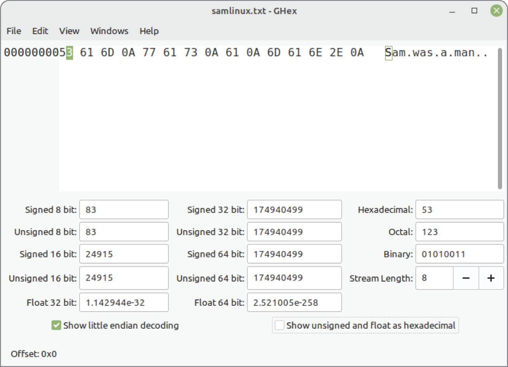

*<a id="c05-fig-0001"></a>**Hình 5.1**: Hiển thị một text file Linux bằng GHex editor*

Khung hiển thị được chia thành ba phần. Cột bên trái là cột offset. Nó chứa offset tính từ đầu file của byte đầu tiên được hiển thị trên dòng đó ở cột giữa. Offset được cho bằng hexadecimal. Nếu bạn đang ở đầu file, cột offset sẽ là 00000000H. Cột giữa là cột hiển thị hex. Nó hiển thị một dòng byte dữ liệu từ file ở định dạng hexadecimal. Bao nhiêu byte được hiển thị phụ thuộc vào cách bạn chỉnh kích thước cửa sổ GHex. Ở cột giữa, phần hiển thị luôn ở dạng hexadecimal, với mỗi byte được phân tách khỏi các byte kế cận bằng một dấu space. Cột bên phải là cùng dòng dữ liệu đó với mọi ký tự văn bản “hiển thị được” được thể hiện dưới dạng văn bản. Các giá trị binary không hiển thị được được biểu diễn bằng ký tự dấu chấm.

Nếu bạn mở tab `samwindows.txt`, GHex sẽ tạo một cửa sổ mới, và bạn sẽ thấy phần hiển thị tương tự cho file kia, file được tạo bằng trình soạn thảo văn bản Windows Notepad. File `samwindows.txt` dài hơn một chút, và bạn có một dòng byte dữ liệu thứ hai ở cột giữa. Offset của dòng thứ hai là 00000010. Đây là offset tính bằng hex của byte đầu tiên trong dòng thứ hai.

Giờ, tại sao hai file lại khác nhau? Hãy mở một cửa sổ terminal và di chuyển đến thư mục bạn đang dùng cho các file học assembly của mình. Dùng lệnh `cat` để hiển thị cả hai file. Phần hiển thị trong cả hai trường hợp sẽ giống hệt nhau.

```
Sam
was
a
man.
```

<a id="R_c05-fig-0002"></a>[Hình 5.2](#c05-fig-0002) cho thấy GHex editor hiển thị `samwindows.txt`. Hãy nhìn kỹ hai file như GHex hiển thị chúng (hoặc nhìn [Hình 5.1](#c05-fig-0001) và [5.2](#c05-fig-0002)) và cố tự mình tìm ra sự khác biệt trước khi đọc tiếp.

Ở cuối mỗi dòng văn bản trong cả hai file là một byte 0AH. Phiên bản Windows của file có thêm một chút: một byte 0DH đứng trước mỗi byte 0AH. File Linux không có các byte 0DH. Dù các text file “thuần” được chuẩn hóa đến đâu, vẫn có thể có những khác biệt nhỏ tùy theo hệ điều hành mà các file được tạo ra. Theo quy ước, các text file Windows (và các text file DOS thời xưa) đánh dấu kết thúc mỗi dòng bằng hai ký tự: 0DH theo sau là 0AH. Linux (và gần như mọi hệ điều hành Unix-descendent) đánh dấu kết thúc mỗi dòng chỉ bằng một byte 0AH.

Như bạn đã thấy khi dùng `cat` với hai file, Linux hiển thị cả hai phiên bản giống hệt nhau và chính xác. Tuy nhiên, nếu bạn lấy phiên bản Linux của file và nạp nó vào trình soạn thảo văn bản Windows Notepad, bạn sẽ thấy một điều hơi khác, như được thể hiện trong <a id="R_c05-fig-0003"></a>[Hình 5.3](#c05-fig-0003).

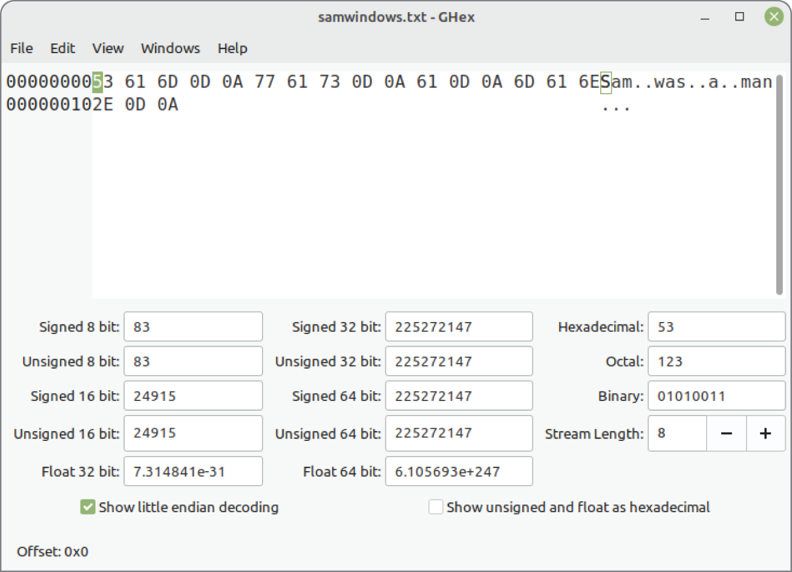

*<a id="c05-fig-0002"></a>**Hình 5.2**: Hiển thị một text file Windows bằng GHex editor*

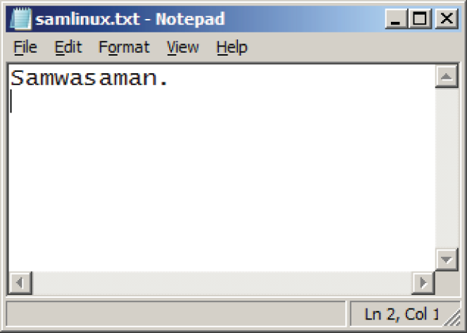

*<a id="c05-fig-0003"></a>**Hình 5.3**: Một text file Linux được hiển thị dưới Windows*

Notepad mong đợi thấy *cả* 0DH lẫn 0AH ở cuối mỗi dòng văn bản và không hiểu một giá trị 0AH đơn độc là một dấu end-of-line (EOL). Vì vậy, nó bỏ qua các ký tự 0AH, và các từ đều chạy liền nhau trên cùng một dòng. (Hãy nhớ từ phần hiển thị GHex rằng không có ký tự space nào trong `samlinux.txt`.) Không phải mọi phần mềm Windows đều khó tính như vậy. Nhiều hoặc hầu hết các tiện ích Windows khác hiểu rằng 0AH là một dấu EOL hoàn toàn hợp lệ.

<a id="Page_110"></a>Các byte 0DH và 0AH ở cuối mỗi dòng làm nổi bật một ví dụ khác về ký tự “hóa thạch”. Từ rất, rất lâu rồi, trong kỷ nguyên teletype, có hai lệnh điện riêng biệt được tích hợp vào máy teletype để xử lý phần cuối của một dòng văn bản khi in một tài liệu: một lệnh đẩy giấy lên dòng tiếp theo, và lệnh kia đưa đầu in trở về lề trái. Chúng được gọi là *line feed* và *carriage return*. Carriage return được mã hóa là 0DH và line feed là 0AH. Nhiều hệ thống máy tính và phần mềm ngày nay bỏ qua mã carriage return, mặc dù một số ít (như Notepad) vẫn đòi hỏi nó để hiển thị text file đúng cách.

Khác biệt nhỏ này trong các chuẩn text file sẽ không phải là một vấn đề lớn với bạn khi còn là người mới bắt đầu. Điều quan trọng lúc này là bạn hiểu cách nạp một file vào GHex editor (hoặc bất kỳ hex editor nào bạn thích; có rất nhiều) và xem xét file ở mức từng byte riêng lẻ.

Bạn có thể làm nhiều hơn với GHex chứ không chỉ nhìn. Việc chỉnh sửa một file đã nạp có thể được thực hiện ở cột giữa (binary) hoặc cột phải (văn bản). Bạn có thể chuyển con trỏ chỉnh sửa qua lại giữa hai cột bằng cách nhấn phím Tab. Bên trong mỗi cột, con trỏ có thể được di chuyển từ byte này sang byte khác bằng các phím mũi tên stand-alone. GHex bỏ qua trạng thái của phím Insert. Bất cứ thứ gì bạn gõ sẽ ghi đè lên các ký tự tại con trỏ.

Tôi không cần phải nói rằng một khi bạn đã thực hiện những thay đổi hữu ích cho một file, hãy lưu nó trở lại đĩa bằng cách nhấp nút Save.

### Diễn giải Raw Data

Việc nhìn một text file như một dòng các giá trị hexadecimal là một bài học hay về một nguyên lý nền tảng của tính toán: *mọi thứ đều được tạo từ bit, và các bit pattern có nghĩa là những gì chúng ta thống nhất rằng chúng có nghĩa*. Chữ cái hoa *S* bắt đầu cả hai text file được hiển thị trong GHex là số hexadecimal 53H. Nó cũng là số decimal 83. Xét đến tận cùng, nó là một pattern gồm tám bit: 01010011. Bên trong file này, chúng ta thống nhất với nhau rằng bit pattern 01010011 biểu diễn chữ cái hoa *S*. Trong một binary file executable, bit pattern 01010011 có thể có nghĩa hoàn toàn khác, tùy theo vị trí nó tình cờ nằm trong file và những bit pattern nào khác tồn tại gần đó trong file.

Đây là lý do khung dưới của GHex editor tồn tại. Nó lấy chuỗi byte bắt đầu tại con trỏ và cho bạn thấy mọi cách khác nhau mà những byte đó có thể được diễn giải. Hãy nhớ rằng không phải lúc nào bạn cũng nhìn text file trong một hex editor như GHex. Bạn có thể đang xem xét một file dữ liệu được sinh ra bởi một chương trình bạn đang viết, và file dữ liệu đó có thể biểu diễn một chuỗi số nguyên có dấu 32-bit. Hoặc file dữ liệu đó có thể biểu diễn một chuỗi số nguyên không dấu 16-bit. Hoặc file dữ liệu đó có thể biểu diễn một chuỗi số floating-point 64-bit. Hoặc nó có thể là hỗn hợp của bất kỳ hay tất cả những thứ trên. Tất cả những gì bạn sẽ thấy trong khung giữa là một chuỗi các giá trị hexadecimal. Những giá trị đó biểu diễn điều gì phụ thuộc vào chương trình nào đã ghi chúng vào file và những giá trị đó tượng trưng cho điều gì <a id="Page_111"></a>theo quy ước trong thế giới “thực”. Chúng là số tiền đô la? Số đo? Các điểm dữ liệu được sinh ra bởi một loại thiết bị đo nào đó? Điều đó tùy thuộc vào bạn—và vào phần mềm bạn dùng. File, như mọi file, đơn giản là một chuỗi các binary pattern được lưu ở đâu đó mà chúng ta hiển thị (bằng GHex) dưới dạng các giá trị hexadecimal để chúng dễ hiểu và dễ thao tác hơn.

Hãy di chuyển con trỏ quanh danh sách các giá trị hex ở cột giữa, và quan sát cách các diễn giải trong khung dưới thay đổi. Lưu ý rằng một số diễn giải chỉ nhìn vào một byte (8 bit); những diễn giải khác nhìn vào hai byte (16 bit), bốn byte (32 bit) hoặc tám byte (64 bit). Trong mọi trường hợp, chuỗi byte được diễn giải bắt đầu tại con trỏ và đi về phía bên phải. Ví dụ, với con trỏ ở vị trí đầu tiên trong file:

- 53H có thể được diễn giải là giá trị decimal 83.
- 53 61H có thể được diễn giải là decimal 21345.
- 53 61 6D 0AH có thể được diễn giải là decimal 1398893834.
- 53 61 6D 0A 77 61 73 0AH có thể được diễn giải là số floating-point 4.54365038640977<sup>93</sup>.

(Sự khác biệt giữa một giá trị có dấu và một giá trị không dấu sẽ phải chờ đến phần sau của cuốn sách này.) Điều quan trọng cần hiểu là trong mọi trường hợp, đó là cùng một chuỗi byte tại cùng một vị trí bên trong file. Tất cả những gì thay đổi là chúng ta nhìn vào bao nhiêu byte và chúng ta chọn thống nhất rằng chuỗi byte đó biểu diễn loại giá trị nào.

Điều này có thể trở nên rõ ràng hơn ở phần sau, khi chúng ta bắt đầu viết các chương trình làm việc với số. Và, nhân nói về số…

### “Endianness”

Ở góc dưới bên trái (lower-left) của khung dưới GHex editor có một hộp kiểm ghi “Show little endian decoding.” Theo mặc định, hộp không được đánh dấu, nhưng trong hầu hết mọi trường hợp, nó nên được đánh dấu. Hộp này cho GHex biết nên diễn giải các chuỗi byte như giá trị số theo thứ tự “big endian” hay theo thứ tự “little endian”. Nếu bạn đánh dấu rồi bỏ đánh dấu hộp kiểm, các giá trị hiển thị trong khung dưới sẽ thay đổi triệt để, ngay cả khi bạn không di chuyển con trỏ chút nào. Khi bạn thay đổi trạng thái của hộp kiểm đó, bạn đang thay đổi cách GHex editor diễn giải một chuỗi byte trong một file thành một loại số nào đó.

Nếu bạn còn nhớ từ [Chương 4](ch04_location_location_location.vi.md), một byte đơn lẻ có thể biểu diễn các số từ 0 đến 255. Nếu bạn muốn biểu diễn một số lớn hơn 255, bạn phải dùng nhiều hơn một byte để làm điều đó. Một chuỗi hai byte liên tiếp có thể biểu diễn bất kỳ số nào từ 0 đến 65,535. Tuy nhiên, một khi bạn có nhiều hơn một byte biểu diễn một giá trị số, *thứ tự của các byte trở nên then chốt*.

Hãy quay lại hai byte đầu tiên trong một trong hai file chúng ta đã nạp vào GHex trước đó. Trên danh nghĩa, chúng là các chữ cái *S* và *a*, nhưng đó đơn giản là một cách diễn giải khác. Chuỗi hexadecimal 53 61H cũng có thể được diễn giải như một số. 53H xuất hiện đầu tiên trong file. 61H xuất hiện sau nó. (Xem [Hình 5-1](#c05-fig-0001) và [5-2](#c05-fig-0002).) Vậy, khi gộp lại thành một giá trị 16-bit duy nhất, hai byte trở thành số hex 53 61H.

Hay có phải vậy không? Có lẽ hơi kỳ lạ, nó không đơn giản như thế. Xem <a id="R_c05-fig-0004"></a>[Hình 5.4](#c05-fig-0004). Phần bên trái của hình là một trích đoạn nhỏ thông tin được hiển thị trong khung hiển thị hex của GHex cho text file ví dụ của chúng ta. Nó chỉ cho thấy hai byte đầu tiên và offset của chúng tính từ đầu file. Phần bên phải của hình là cùng thông tin đó nhưng bị đảo trái sang phải, như thể nhìn trong gương. Đó là cùng các byte theo cùng thứ tự, nhưng chúng ta nhìn chúng khác đi. Thứ mà ban đầu chúng ta giả định là số hex 16-bit 53 61H giờ có vẻ là 61 53H.

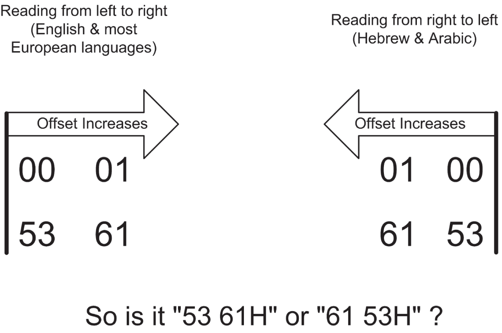

*<a id="c05-fig-0004"></a>**Hình 5.4**: Khác biệt về thứ tự hiển thị so với khác biệt về thứ tự đánh giá*

Con số có thay đổi không? Không, xét từ góc nhìn của máy tính. Tất cả những gì thay đổi là cách chúng ta in nó trên trang của cuốn sách này. Theo thói quen, người đọc tiếng Anh bắt đầu ở bên trái và đọc về phía bên phải. Bố cục phần hiển thị của GHex hex editor phản ánh điều đó. Nhưng một số ngôn ngữ khác trên thế giới, bao gồm tiếng Do Thái và tiếng Ả Rập, bắt đầu ở lề phải và đọc về phía bên trái. Phản xạ đầu tiên của một lập trình viên Ả Rập có thể là nhìn hai byte đó thành 61 53H, đặc biệt nếu họ đang dùng phần mềm được thiết kế theo các quy ước của tiếng Ả Rập, hiển thị nội dung file từ phải sang trái.

Thực ra nó còn rối rắm hơn thế. Các ngôn ngữ phương Tây (bao gồm tiếng Anh) hơi bị phân liệt, ở chỗ chúng đọc *văn bản* từ trái sang phải, nhưng đánh giá các cột số từ phải sang trái. Số 426 gồm bốn trăm, hai chục và sáu đơn vị, chứ không phải bốn đơn vị, hai chục và sáu trăm. Theo quy ước ở phương Tây này, cột có trọng số nhỏ nhất ở bên phải, và giá trị của các cột tăng dần từ phải sang trái. Cột có trọng số lớn nhất là cột ngoài cùng bên trái. (Tôi đã trình bày sâu về số theo cột trong [Chương 2](ch02_alien_bases.vi.md).)

<a id="Page_113"></a>Sự rối rắm là một ý tưởng tồi trong tính toán. Vì vậy, dù một chuỗi byte được hiển thị từ trái sang phải hay từ phải sang trái, tất cả chúng ta đều phải thống nhất về việc byte nào trong số đó biểu diễn chữ số có trọng số nhỏ nhất và byte nào là chữ số có trọng số lớn nhất trong một số multibyte. Trong máy tính, chúng ta có hai lựa chọn.

- Chúng ta có thể thống nhất rằng byte có trọng số nhỏ nhất của một giá trị multibyte nằm ở offset thấp nhất và byte có trọng số lớn nhất nằm ở offset cao nhất.
- Chúng ta có thể thống nhất rằng byte có trọng số lớn nhất của một giá trị multibyte nằm ở offset thấp nhất và byte có trọng số nhỏ nhất nằm ở offset cao nhất.

*Hai lựa chọn này loại trừ lẫn nhau*. Một máy tính phải hoạt động theo lựa chọn này hoặc lựa chọn kia; chúng không thể được dùng cùng lúc tùy theo ý thích của một chương trình. Hơn nữa, lựa chọn này không giới hạn ở hệ điều hành hay ở một chương trình cụ thể. Lựa chọn này được nung thẳng vào silicon của CPU và instruction set của nó. Một architecture máy tính lưu byte có trọng số nhỏ nhất của một giá trị multibyte ở offset thấp nhất trong memory hoặc register được gọi là *little endian*. Một architecture máy tính lưu byte có trọng số lớn nhất của một giá trị multibyte ở offset thấp nhất được gọi là *big endian*.

<a id="R_c05-fig-0005"></a>[Hình 5.5](#c05-fig-0005) sẽ làm điều này rõ ràng hơn. Trong các hệ thống big-endian, một giá trị multibyte bắt đầu bằng byte có trọng số *lớn nhất* của nó. Trong các hệ thống little-endian, một giá trị multibyte bắt đầu bằng byte có trọng số *nhỏ nhất* của nó. Hãy nghĩ: big endian, đầu lớn trước. Little endian, đầu nhỏ trước.

Có những khác biệt *lớn* đang bị đặt cược ở đây! Hai byte bắt đầu text file ví dụ của chúng ta biểu diễn số decimal 21,345 trong một hệ thống big endian nhưng là 24,915 trong một hệ thống little endian.

Có thể lập trình khá nhiều mà không cần biết đến “endianness” của một hệ thống. Nếu bạn lập trình bằng các ngôn ngữ higher-level như Visual Basic, Pascal hay C, hầu hết các hệ quả của endianness được ngôn ngữ và compiler của ngôn ngữ che giấu—ít nhất là cho đến khi có điều gì đó trục trặc ở mức thấp. Một khi bạn bắt đầu đọc file ở mức byte, bạn phải biết cách đọc chúng. Và nếu bạn đang lập trình bằng assembly language, tốt hơn hết là bạn nên thoải mái với endianness ngay từ đầu.

Đọc phần hiển thị hex của dữ liệu số trong các hệ thống big-endian rất dễ, vì các chữ số xuất hiện theo thứ tự mà người phương Tây mong đợi, với các chữ số có trọng số lớn nhất ở bên trái. Trong các hệ thống little-endian, mọi thứ bị đảo ngược, và càng dùng nhiều byte để biểu diễn một số, nó càng có thể trở nên rối rắm. <a id="R_c05-fig-0006"></a>[Hình 5.6](#c05-fig-0006) cho thấy những khác biệt endian giữa các cách đánh giá một giá trị 32-bit. Các lập trình viên Little-endian phải đọc phần hiển thị hex của các giá trị multibyte như thể họ đang đọc tiếng Do Thái hay tiếng Ả Rập, từ phải sang trái.

Tôi sẽ không trình bày hình cho một đại lượng 64-bit ở đây vì sự phức tạp của nó có thể che mờ ý nghĩa. Nếu bạn có thể “thấy” một đại lượng 32-bit theo kiểu little-endian, 64 bit sẽ chỉ là một bước nhảy ngắn, nếu đó có phải là một bước nhảy nào.

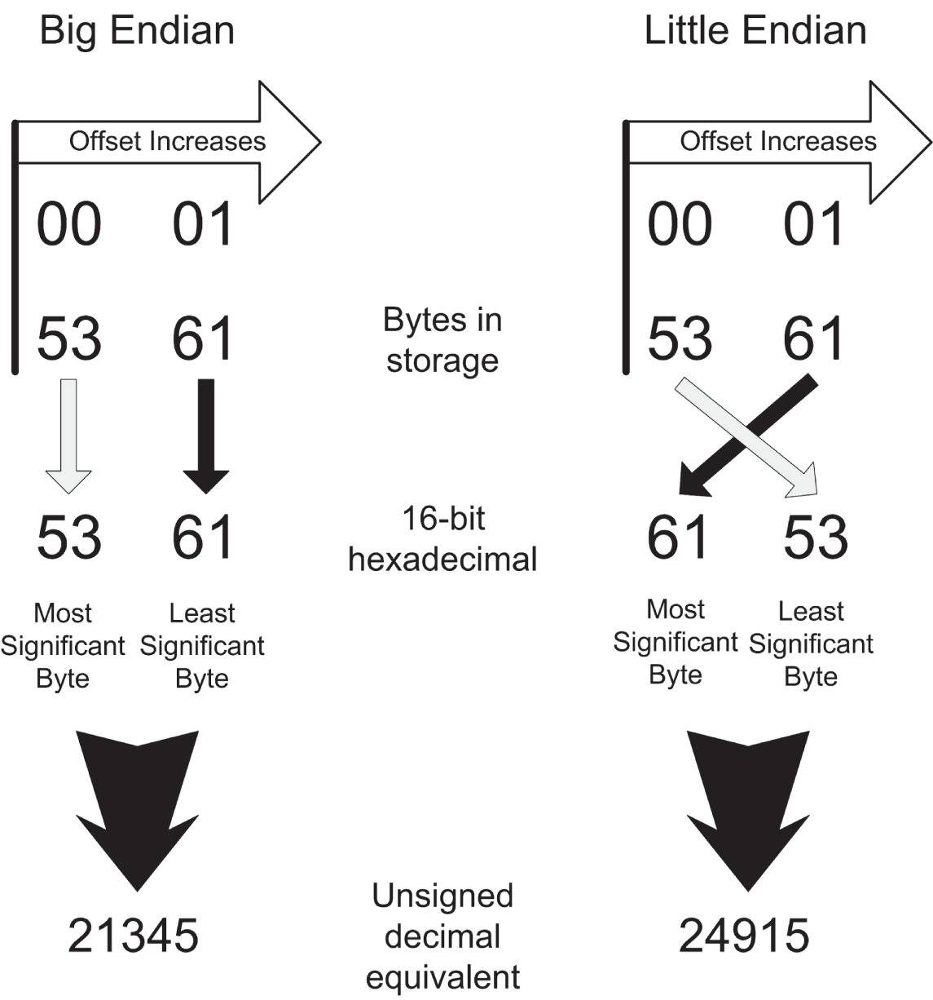

*<a id="c05-fig-0005"></a>**Hình 5.5**: Big endian so với little endian cho một giá trị 16-bit*

Hãy nhớ rằng các khác biệt endianness không chỉ áp dụng cho các byte được lưu trong file mà còn cho các byte được lưu trong memory. Khi (như tôi sẽ giải thích sau) bạn xem xét các giá trị số được lưu trong memory bằng một debugger, mọi quy tắc tương tự đều áp dụng.

Vậy, các hệ thống Linux dùng “endianness” nào? Cả hai! (Mặc dù không cùng lúc.) Một lần nữa, vấn đề không nằm ở hệ điều hành. Toàn bộ architecture phần cứng Intel x86/x64, từ chiếc 8086 khiêm tốn cho đến Core i9 mới nhất, đều là little endian. Các architecture phần cứng khác, như 68000 của Motorola và PowerPC nguyên thủy, và hầu hết các architecture mainframe của IBM như System/370, là big endian. Các architecture phần cứng gần đây hơn được thiết kế là “bi-endian”, nghĩa là chúng có thể được cấu hình (với chút khó khăn) để diễn giải các giá trị số theo cách này hoặc cách kia ở mức phần cứng. Alpha, MIPS và architecture Itanium IA-64 của Intel là bi-endian.

Nếu (như cuốn sách này yêu cầu) bạn đang chạy Linux trên một CPU Intel hoặc AMD x64 thông thường, bạn sẽ là little endian, và bạn nên đánh dấu hộp trên GHex editor có nhãn “Show little-endian decoding.” Các công cụ lập trình khác có thể cho bạn tùy chọn chọn hiển thị big-endian hoặc hiển thị little-endian. Hãy đảm bảo rằng dù bạn dùng công cụ nào, bạn đã chọn đúng tùy chọn.

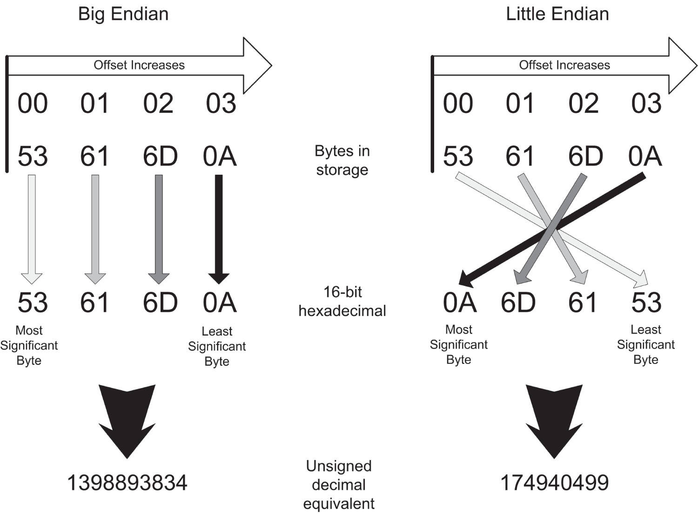

*<a id="c05-fig-0006"></a>**Hình 5.6**: Big endian so với little endian cho một giá trị 32-bit*

<a id="Page_115"></a>Dĩ nhiên, Linux có thể được làm cho chạy trên *bất kỳ* architecture phần cứng nào. Vì vậy, việc dùng Linux không đảm bảo bạn sẽ đối mặt với một hệ thống big-endian hay little-endian, và đó là một lý do tôi đã nói khá dài về endianness ở đây. Bạn phải biết endianness nào đang có hiệu lực thông qua việc nghiên cứu hệ thống, mặc dù bạn có thể biết được bằng cách quan sát: lưu một số nguyên 32-bit vào memory rồi nhìn nó bằng một debugger. Nếu bạn biết hex của mình (và *tốt nhất* là bạn nên biết!), endianness của hệ thống sẽ hiện ra ngay trước mắt bạn.

<a id="head-2-66"></a>

## Văn bản đi vào, Code đi ra

Nhìn từ trên cao, mọi việc lập trình đều là vấn đề xử lý file. Mục tiêu là lấy một hoặc nhiều text file human-readable và xử lý chúng để tạo ra một file chương trình executable mà bạn có thể nạp và chạy dưới bất kỳ hệ điều hành và architecture phần cứng nào bạn đang dùng. Với cuốn sách này, đó sẽ là Linux trên một CPU Intel x64, nhưng quá trình chung mà tôi sẽ mô tả trong mục này áp dụng cho gần như mọi kiểu lập trình dưới gần như mọi hệ điều hành.

Lập trình như một quá trình thay đổi rất nhiều theo ngôn ngữ và theo bộ công cụ hỗ trợ ngôn ngữ đó. Trong các môi trường phát triển tương tác đồ họa hiện đại như Visual Basic, Delphi và Lazarus, phần lớn việc xử lý file <a id="Page_116"></a>được thực hiện “ở hậu trường”, trong khi bạn, lập trình viên, đang nhìn chằm chằm vào một hoặc nhiều file đang hiển thị và cân nhắc nước đi tiếp theo. Trong assembly language thì không phải vậy. Hầu hết lập trình viên assembly language dùng một bộ công cụ đơn giản hơn nhiều và xử lý các file một cách tường minh như những chuỗi bước rời rạc được nhập từ dòng lệnh hoặc từ một script file.

Dù được thực hiện thế nào, quá trình chung chuyển đổi text file thành binary file là một quá trình dịch, và các chương trình làm việc đó, như một lớp, được gọi là translator. Một *translator* là một chương trình nhận các source file human-readable và sinh ra một loại binary file nào đó. Binary file đầu ra có thể là một file chương trình executable mà CPU có thể hiểu, hoặc nó có thể là một file font, một file dữ liệu binary nén, hoặc bất kỳ loại nào trong hàng trăm loại binary file khác.

*Program translator* là các translator sinh ra machine instruction mà CPU có thể hiểu. Một program translator đọc một source code file từng dòng một và ghi ra một binary file gồm các machine instruction thực hiện những hành động máy tính mà source code file mô tả. Binary file này được gọi là *object code file*.

Một *compiler* là một program translator đọc vào các source code file được viết bằng các ngôn ngữ higher-level như C hay Pascal và ghi ra các object code file.

Một *assembler* là một loại compiler đặc biệt. Nó cũng là một program translator đọc các source code file và xuất ra các object code file để CPU thực thi. Tuy nhiên, assembler là một translator được thiết kế đặc biệt để dịch thứ chúng ta gọi là *assembly language* thành object code. Theo cùng nghĩa mà một compiler ngôn ngữ cho Pascal hay C biên dịch (compile) một source code file thành một object code file, chúng ta nói rằng một assembler *assemble* một source code file assembly language thành một object code file. Quá trình, một quá trình dịch, là tương tự trong cả hai trường hợp. Tuy nhiên, assembly language có một đặc tính quan trọng vượt trội khiến nó khác biệt với compiler: *toàn quyền kiểm soát object code*.

### Assembly Language

Một số người định nghĩa assembly language là một ngôn ngữ trong đó một dòng source code sinh ra một machine instruction. Điều này chưa bao giờ đúng theo nghĩa đen, vì một số dòng trong một source code file assembly language là các chỉ thị cho chương trình translator (chứ không phải cho CPU) và hoàn toàn không sinh ra machine instruction nào.

Đây là một định nghĩa tốt hơn:

> **Assembly language là một ngôn ngữ translator cho phép toàn quyền kiểm soát từng machine instruction riêng lẻ được sinh ra bởi chương trình translator. Một chương trình translator như vậy được gọi là *assembler*.**

Ngược lại, các compiler Pascal hay C đưa ra vô số quyết định vô hình và không thể thay đổi về cách một câu lệnh ngôn ngữ nhất định sẽ được dịch <a id="Page_117"></a>thành một chuỗi machine instruction. Ví dụ, câu lệnh Pascal đơn lẻ sau đây gán giá trị 42 cho một biến số tên là `I`:

```
I := 42;
```

Khi một compiler Pascal đọc dòng này, nó xuất ra một chuỗi bốn hoặc năm machine instruction lấy giá trị số literal 42 và lưu nó vào memory tại một vị trí được mã hóa bằng tên `I`. Thông thường, bạn, lập trình viên Pascal, *không hề biết* bốn hay năm instruction này thực sự là gì, và bạn hoàn toàn không có cách nào thay đổi chúng, ngay cả khi bạn biết một chuỗi machine instruction nhanh hơn và hiệu quả hơn chuỗi mà compiler dùng. Compiler Pascal có cách riêng để sinh machine instruction, và bạn không có lựa chọn nào khác ngoài việc chấp nhận những gì nó ghi vào object code file để thực hiện công việc của các câu lệnh Pascal bạn đã viết trong source code file.

Công bằng mà nói, các compiler ngôn ngữ high-level hiện đại thường triển khai một thứ gọi là *in-line assembly*, cho phép lập trình viên “lấy lại” quyền kiểm soát từ compiler và “thả vào” một chuỗi machine instruction do chính họ thiết kế. Khá nhiều công việc assembly language hiện đại được thực hiện theo cách này, nhưng nó thực ra được coi là một kỹ thuật nâng cao, vì trước tiên bạn phải hiểu compiler sinh code của chính nó như thế nào thì mới có thể “làm tốt hơn” bằng in-line assembly. (Và đừng cho rằng, như nhiều người vẫn làm, bạn có thể làm tốt hơn compiler mà không cần rất nhiều học hỏi và luyện tập! Các compiler của thế kỷ Twenty-first sinh code hiệu quả *cực kỳ* giỏi!)

Một assembler thấy *ít nhất* một dòng trong source code file cho mỗi machine instruction mà nó sinh ra. Nó thấy nhiều dòng hơn thế, và các dòng bổ sung xử lý nhiều thứ khác nhau, nhưng *mọi* machine instruction trong object code file cuối cùng đều được điều khiển bởi một dòng tương ứng trong source code file.

Mỗi machine instruction trong số rất nhiều machine instruction của CPU có một *mnemonic* tương ứng trong assembly language. Như chính từ này gợi ý, các mnemonic này khởi đầu như những công cụ giúp lập trình viên nhớ một machine instruction binary cụ thể. Ví dụ, mnemonic cho machine instruction binary FCH, instruction xóa direction flag, là `CLD`—dễ nhớ hơn FCH cả một dặm đường quê. Và đó là cho một machine instruction 1-byte. Nhiều machine instruction có mnemonic đơn giản được assemble thành bốn byte hoặc nhiều hơn.

Khi bạn viết source code file bằng assembly language, bạn sẽ sắp xếp một chuỗi mnemonic, thường là một mnemonic mỗi dòng trong source code text file. Một phần của một source code file x64 có thể trông như thế này:

<a id="Page_118"></a>

```
mov rax,1             ; 01H specifies the sys_write kernel call
mov rdi,1             ; 01H specifies file descriptor stdout
mov rsi,Message       ; Load starting address of display string into RSI
mov rdx,MessageLength ; Load the number of chars to display into RDX
syscall               ; Make the kernel call
```

Ở đây, các từ `mov` và `syscall` ở lề trái là các mnemonic. Các số và các mục văn bản ngay bên phải mỗi mnemonic là các *operand* của mnemonic đó. Có nhiều loại operand khác nhau cho các machine instruction khác nhau, và một vài instruction (như `CLD` hay `SYSCALL`) hoàn toàn không dùng operand nào.

Gộp lại, một mnemonic và các operand của nó được gọi là một *instruction*. (Các từ bên phải dấu chấm phẩy là comment và không phải là một phần của instruction.) Instruction là từ tôi sẽ dùng phần lớn thời gian trong cuốn sách này để chỉ đại diện human-readable của một trong các instruction machine code binary thuần túy của CPU. Để nói cụ thể về mã binary, chúng ta sẽ luôn dùng từ *machine instruction*.

Công việc quan trọng nhất của assembler là đọc các dòng từ source code file và ghi machine instruction vào một object code file. Xem <a id="R_c05-fig-0007"></a>[Hình 5.7](#c05-fig-0007).

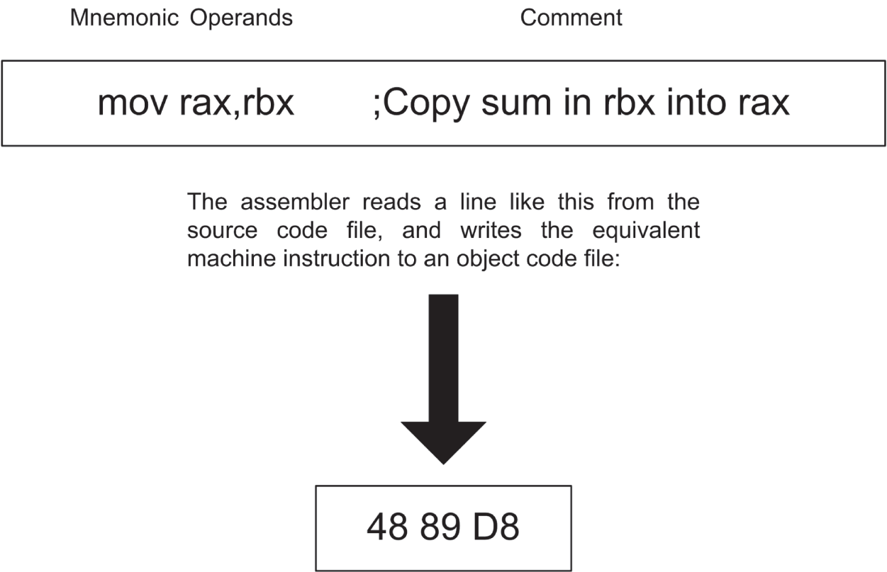

*<a id="c05-fig-0007"></a>**Hình 5.7**: Assembler làm gì*

### Comment

Bên phải mỗi instruction (xem [Hình 5.7](#c05-fig-0007)) là văn bản bắt đầu bằng dấu chấm phẩy. Văn bản này được gọi là *comment*, và mục đích của nó hẳn là hiển nhiên: làm sáng tỏ phần nào việc instruction assembly language đi kèm dùng để làm gì. Instruction `MOV RAX,RBX` đặt giá trị hiện tại của register RBX vào register RAX—nhưng *tại sao*? Instruction đó đang hoàn thành điều gì trong bối cảnh chương trình assembly language mà bạn đang viết? Comment cung cấp câu trả lời tại sao—và *bạn* cung cấp comment.

Về mặt cấu trúc, một comment bắt đầu bằng dấu chấm phẩy đầu tiên trên một dòng và tiếp tục về phía bên phải đến dấu EOL ở cuối dòng đó. Một comment không cần nằm trên cùng dòng với một instruction. Rất nhiều mô tả hữu ích trong các chương trình assembly language tồn tại trong các *comment block*, là những chuỗi <a id="Page_119"></a>dòng chỉ gồm văn bản comment. Mỗi dòng trong một comment block bắt đầu bằng một dấu chấm phẩy ở lề trái.

Hơn hẳn bất kỳ ngôn ngữ lập trình nào khác, comment là yếu tố then chốt cho sự thành công của các chương trình assembly language của bạn. Khuyến nghị riêng của tôi là *mọi* instruction trong source code file của bạn nên có một comment ở bên phải. Hơn nữa, mọi nhóm instruction hoạt động cùng nhau theo một cách nào đó nên có một comment block đứng trước, giải thích nhóm instruction đó “từ trên cao” và cách chúng phối hợp với nhau.

Comment là một lĩnh vực mà việc hiểu cấu trúc của một text file là quan trọng—vì trong assembly language, comment kết thúc ở cuối dòng. Trong hầu hết các ngôn ngữ khác như Pascal và C, comment được đặt *giữa* các cặp dấu phân cách comment như `(*` và `*)`, và các dấu EOL ở cuối dòng bị bỏ qua.

Tóm lại, *comment bắt đầu tại dấu chấm phẩy và kết thúc tại EOL*.

Ghi chú hơi kỳ lạ: Khi tôi viết ấn bản này năm 2022, tôi gặp một bug trong SASM IDE vi phạm các “quy tắc” của comment. Từ *section* trong một comment đôi khi khiến SASM bị crash. Đó là một bug, tôi đã báo cáo nó, và rốt cuộc nó sẽ được sửa. Nếu bạn đang dùng SASM và nó bị crash, hãy kiểm tra xem bạn có dùng từ *section* trong một comment ở đâu đó không.

### Cẩn thận với Source Code “Write-Only”!

Đây là thời điểm thích hợp không kém bất kỳ lúc nào để chỉ ra một vấn đề nghiêm trọng của assembly language. Bản thân các instruction ngắn gọn đến mức gần như biến mất, và để làm bất cứ điều gì hữu ích cũng cần *rất nhiều* instruction. Và trong khi mỗi instruction nêu (một cách ngắn gọn) việc nó làm, có rất ít thứ trong chính source code chỉ ra bối cảnh mà instruction đó hoạt động bên trong. Hãy đặt tên cho mọi thứ sao cho gợi ý được những mục được đặt tên đó làm gì. Điều này bao gồm tên procedure, code label, biến và equate. `TheBuffer` không cho chúng ta biết gì về việc buffer đó đang dùng vào việc gì. `CharInputBuffer` ít nhất cũng gợi ý rằng nó liên quan đến việc nhập ký tự.

*Indicative naming* (như tôi gọi) giúp được một chút, nhưng comment làm phần lớn công việc nặng nhọc khi nói đến việc tạo bối cảnh. Không có bối cảnh, assembly language bắt đầu biến thành thứ chúng ta gọi là code “write-only”. Nó có thể xảy ra như thế này: vào ngày 1 tháng Mười Một, trong cơn hăng say sáng tạo, bạn nặn ra khoảng 300 instruction trong một chương trình tiện ích ngắn làm một việc quan trọng. Bạn quay lại vào ngày 1 tháng Giêng để thêm một tính năng cho chương trình—và phát hiện ra rằng *bạn không còn nhớ nó hoạt động thế nào nữa*. Các instruction riêng lẻ đều đúng, và chương trình assemble và chạy đúng như mong đợi, nhưng kiến thức về cách tất cả ghép lại với nhau và cách nó hoạt động từ trên cao đã biến mất dưới sức nặng của những kỷ niệm Giáng sinh và tám tuần làm những việc khác. Nói cách khác, bạn đã *viết* nó, nhưng bạn không còn *đọc* được nó cũng như không thay đổi được nó. *Voilà!* Code Write-only.

Mặc dù đúng là comment có chiếm chỗ trong các source code file trên đĩa của bạn, chúng *không* được sao chép vào các executable code file, và một chương trình có <a id="Page_120"></a>hàng đống comment trong source code chạy nhanh *đúng bằng* chính chương trình đó khi không có comment nào.

Bạn sẽ bỏ ra một khoản đầu tư đáng kể về thời gian và công sức khi viết chương trình assembly language—nhiều hơn rất nhiều so với các ngôn ngữ “đi được nửa đường lên thiên đường” như C và Pascal, và nhiều hơn không thể tưởng tượng nổi so với các IDE “chúng tôi làm hết cho bạn” như Delphi và Lazarus. Nó khó hơn hầu như mọi cách viết chương trình khác, và nếu bạn không viết comment, có thể rốt cuộc bạn sẽ phải đơn giản là vứt bỏ hàng trăm dòng code khó hiểu và viết lại nó, *từ đầu*.

Hãy làm việc thông minh. Viết comment cho đến khi gục ngã.

### Object Code, Linker và Library

Assembler đọc các source code file của bạn và sinh ra một object code file chứa các machine instruction mà CPU hiểu, cộng với bất kỳ dữ liệu nào bạn đã định nghĩa trong source code.

Không có lý do gì khiến một assembler không thể đọc một source code file và ghi ra một chương trình executable hoàn chỉnh làm object code file của nó, nhưng điều này gần như không bao giờ được làm. Assembler tôi dạy trong cuốn sách này, NASM, có thể làm điều đó cho các chương trình DOS và có thể ghi ra các file executable COM cho real mode flat model. Các hệ điều hành hiện đại hơn như Linux và Windows quá phức tạp cho việc đó, và thực ra, chẳng có lợi ích thực sự nào trong kiểu assembly one-step như vậy, trừ khi bạn mới bắt đầu học viết assembly language.

Vì vậy, các object code file do các assembler hiện đại tạo ra là một kiểu bước trung gian giữa source code và chương trình executable. Bước trung gian này là một loại binary file gọi là *object module* hay đơn giản là object code file.

Bản thân object code file không thể chạy như chương trình. Cần thêm một bước nữa, gọi là *linking*, để biến các object code file thành các file chương trình executable.

Lý do có object code file làm bước trung gian là một source code file lớn duy nhất có thể được cắt thành nhiều source code file nhỏ hơn để giữ các file ở kích thước và độ phức tạp dễ quản lý. Assembler assemble riêng từng mảnh, và vài object code file thu được sau đó được linker dệt lại với nhau thành một file chương trình executable duy nhất. Quá trình này được thể hiện trong <a id="R_c05-fig-0008"></a>[Hình 5.8](#c05-fig-0008).

Khi bạn mới bắt đầu học lập trình assembly, ít có khả năng bạn sẽ viết các chương trình trải trên nhiều source code file. Điều này có thể khiến linker có vẻ thừa thãi, vì chương trình của bạn chỉ có một mảnh và do đó chẳng có gì để link lại với nhau. Như nhiều thứ khác trong lập trình (đặc biệt là lập trình assembly), nó không đơn giản như vậy. Linker xử lý một bước then chốt trên con đường từ source code đến chương trình executable: nó chuyển đổi object code do assembler sinh ra thành một chương trình executable. Với các chương trình đơn giản, có thể chỉ có một object code file cần chuyển đổi. Với các chương trình lớn hơn và tinh vi hơn, nhiều khả năng sẽ có vài file; không, rất nhiều file.

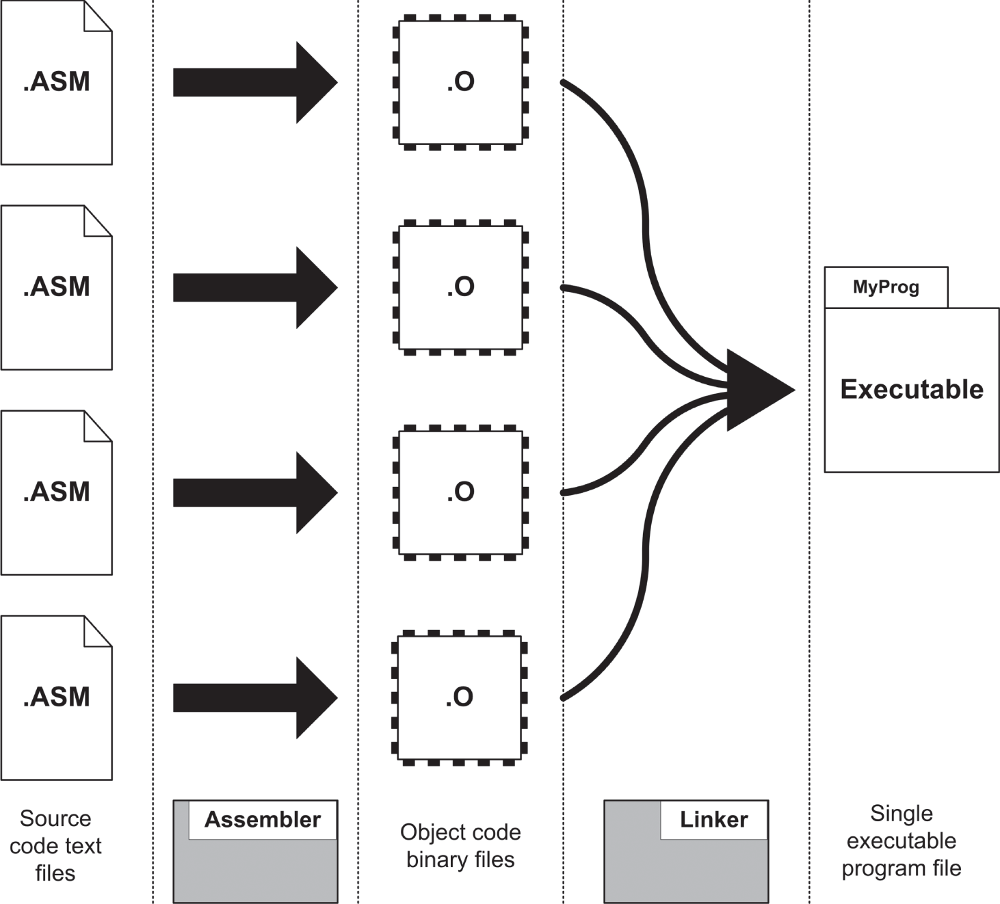

*<a id="c05-fig-0008"></a>**Hình 5.8**: Assembler và linker*

Hãy nhớ rằng *linker làm nhiều hơn là link*. Nó không chỉ khâu các cục object code lại với nhau thành một executable file duy nhất. Nó đảm bảo rằng các lời gọi hàm đi ra từ một object module sẽ đến được object module đích và rằng tất cả rất nhiều tham chiếu memory thực sự tham chiếu đến đúng thứ chúng cần tham chiếu. Công việc của assembler thì hiển nhiên; công việc của linker thì tinh tế. Cả hai đều cần thiết để tạo ra một executable file hoàn chỉnh, hoạt động được.

Hơn nữa, bạn sẽ nhanh chóng đến lúc bắt đầu tách những phần thường dùng trong các chương trình của mình ra thành các code library cá nhân của riêng bạn. Có hai lý do để làm điều này.

- Bạn có thể chuyển các routine đã được kiểm thử, đã được chứng minh vào các library riêng và link chúng vào bất kỳ chương trình nào bạn viết có thể cần đến chúng. Bằng cách này, bạn có thể dùng lại code hết lần này đến lần khác và không phải chế tạo lại những bánh xe cũ mỗi khi bắt đầu một dự án lập trình mới bằng assembly language.
- Một khi các phần của một chương trình đã được kiểm thử và thấy là đúng, không cần phải tốn thời gian assemble chúng hết lần này đến lần khác cùng với <a id="Page_122"></a>các phần mới hơn, chưa được kiểm thử của chương trình. Một khi một chương trình lớn đạt đến hàng nghìn dòng code (và bạn sẽ đến đó sớm hơn bạn nghĩ!), bạn có thể tiết kiệm một lượng thời gian đáng kể bằng cách chỉ assemble phần chương trình bạn đang làm việc và link các phần đã hoàn chỉnh vào chương trình cuối cùng mà không phải re-assembling *từng* phần của toàn bộ chương trình mỗi lần bạn assemble *bất kỳ* phần nào của nó.

Công việc của linker phức tạp và không dễ mô tả. Mỗi object module có thể chứa những thứ sau:

- Code chương trình, bao gồm các procedure có tên
- Các tham chiếu đến các procedure có tên nằm bên ngoài module
- Các đối tượng dữ liệu có tên như số và chuỗi với các giá trị được định nghĩa trước
- Các đối tượng dữ liệu có tên chỉ là không gian trống được “dành riêng” để chương trình dùng sau này
- Các tham chiếu đến các đối tượng dữ liệu nằm bên ngoài module
- Thông tin debug
- Những thứ lặt vặt khác, ít phổ biến hơn, giúp linker tạo executable file

Để xử lý vài object module thành một executable module duy nhất, trước tiên linker phải xây dựng một chỉ mục gọi là *symbol table*, với một mục cho mỗi mục có tên trong mỗi object module mà nó link, kèm thông tin về tên nào (gọi là *symbol*) chỉ tới vị trí nào bên trong module. Một khi symbol table hoàn tất, linker xây dựng một image về cách chương trình executable sẽ được sắp xếp trong memory khi hệ điều hành nạp nó. Image này sau đó được ghi ra đĩa dưới dạng executable file.

Điều quan trọng nhất về image mà linker xây dựng liên quan đến address. Các object module được phép tham chiếu đến các symbol trong các object module khác. Trong quá trình assemble, những *external reference* này được để lại như những lỗ hổng sẽ được lấp sau—điều này hoàn toàn tự nhiên, vì module chứa các external symbol này có thể chưa được assemble hoặc thậm chí chưa được viết. Khi linker xây dựng image của file chương trình executable cuối cùng, nó biết được tất cả các symbol nằm ở đâu bên trong image và do đó có thể thả các address thật vào tất cả các lỗ hổng external reference.

Thông tin debug, theo một nghĩa nào đó, là một bước lùi. Các phần của source code, vốn đã bị loại bỏ hoàn toàn từ sớm trong quá trình assemble, được assembler đặt trở lại vào object module. Những phần source code này chủ yếu là tên của các mục dữ liệu và procedure, và chúng được nhúng vào object file để giúp lập trình viên (là bạn!) dễ dàng thấy tên của các mục dữ liệu khi debug chương trình. (Tôi sẽ đi sâu hơn vào khái niệm debug ở phần sau.) Thông tin debug là tùy chọn; nghĩa là, linker <a id="Page_123"></a>không cần nó để xây dựng một executable file đúng đắn. Bạn chọn nhúng thông tin debug vào object file trong khi vẫn đang làm việc với chương trình. Một khi chương trình đã hoàn tất và được debug hết khả năng của bạn, bạn chạy linker thêm một lần nữa, mà không yêu cầu thông tin debug. Việc link một chương trình đã được debug kỹ lưỡng mà không có thông tin debug giống như “dọn dẹp gọn gàng” bằng cách làm cho executable file hoàn chỉnh nhỏ hơn và do đó dễ phân phối cho người khác hơn.

### Relocatability

Các microcomputer nguyên thủy như các hệ thống 8080 chạy CP/M-80 có một memory architecture đơn giản. Các chương trình được viết để được nạp và chạy tại một memory address vật lý cụ thể. Với CP/M, đó là 0100H. Lập trình viên có thể giả định rằng mọi chương trình sẽ bắt đầu tại 0100H và đi lên từ đó. Memory address của các mục dữ liệu và procedure là các address vật lý thực sự, và mỗi lần chương trình chạy, các mục dữ liệu của nó được nạp và tham chiếu tại *chính xác* cùng một chỗ trong memory.

Mọi thứ thay đổi với sự xuất hiện của 8086, và các hệ điều hành 8086-specific như CP/M-86 và PC DOS. Những cải tiến trong architecture Intel được giới thiệu cùng 8086 khiến chương trình không cần phải được assemble để chạy tại một memory address vật lý cụ thể nào. Tính năng này được gọi là *relocatability* và là một phần cần thiết của bất kỳ hệ điều hành hiện đại nào, đặc biệt khi nhiều chương trình có thể chạy cùng lúc. Xử lý relocatability rất phức tạp, và tôi không đủ chỗ để giải thích sâu về nó ở đây. Một khi bạn đã thoải mái hơn với quá trình assembly language, nó sẽ trở thành một chủ đề xứng đáng để nghiên cứu thêm.

<a id="head-2-67"></a>

## Quá trình phát triển Assembly Language

Như bạn thấy, có rất nhiều loại file khác nhau và khá nhiều chương trình tham gia vào quá trình viết, assemble và kiểm thử một chương trình assembly language. Bản thân quá trình nghe có vẻ phức tạp hơn thực tế. Tôi đã vẽ cho bạn một bản đồ để giúp bạn giữ phương hướng trong các phần thảo luận ở phần còn lại của chương này. <a id="R_c05-fig-0009"></a>[Hình 5.9](#c05-fig-0009) cho thấy dạng phổ biến nhất mà quá trình phát triển assembly language có, theo kiểu “nhìn từ trên cao”. Thoạt nhìn nó có thể trông giống bản đồ hệ thống đường cao tốc ở LA, nhưng thực tế luồng đi khá đơn giản, và bạn sẽ làm nó đủ nhiều để nó trở thành bản năng thứ hai chỉ sau vài buổi tối miệt mài với một hai chương trình.

Tóm gọn lại, quá trình rút về như sau:

1. Tạo source code file assembly language của bạn trong một trình soạn thảo văn bản.
2. Dùng assembler để tạo một object module từ source code file của bạn.
3. Dùng linker để chuyển object module (và bất kỳ object module nào đã được assemble trước đó là một phần của dự án) thành một file chương trình executable duy nhất.
4. Kiểm thử file chương trình bằng cách chạy nó, dùng debugger nếu cần.
5. Quay lại trình soạn thảo văn bản ở bước 1, sửa mọi lỗi bạn có thể đã mắc trước đó, và viết code mới khi cần.
6. Lặp lại các bước 1–5 cho đến khi xong.

<a id="Page_125"></a>

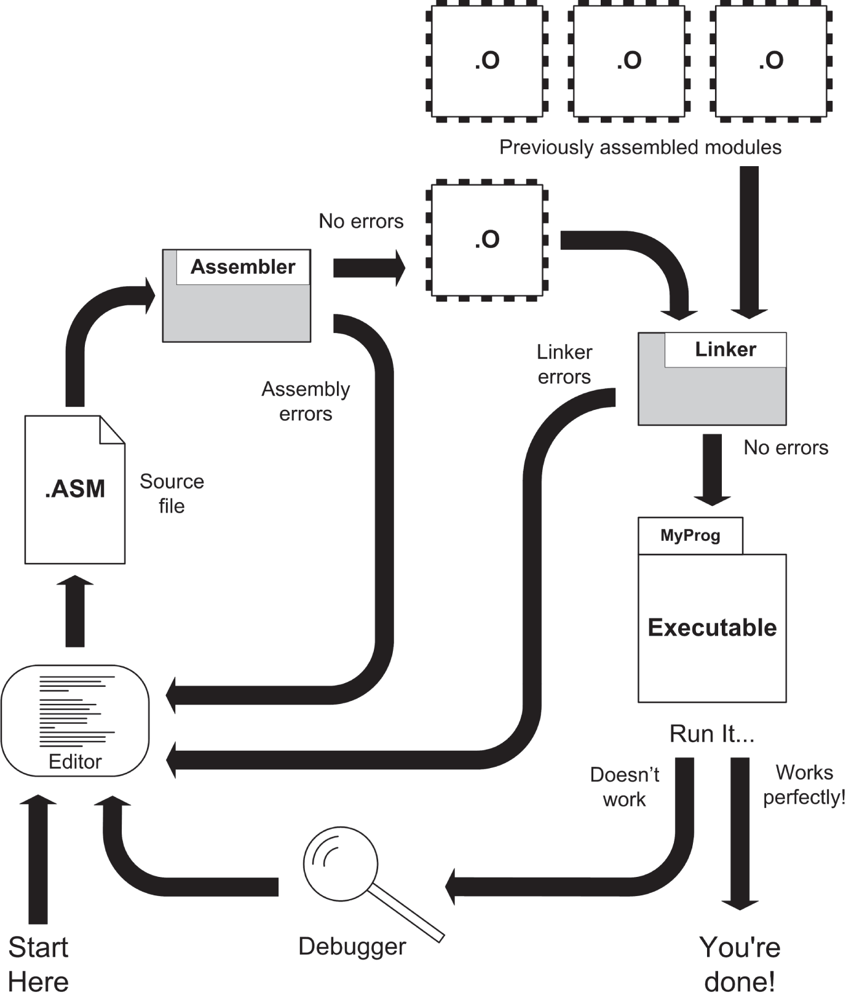

*<a id="c05-fig-0009"></a>**Hình 5.9**: Quá trình phát triển assembly language*

### Kỷ luật tổ chức Working Directory

Lập trình viên thường đếm từ 0, và nếu chúng ta đếm các bước trong quá trình phát triển assembly language, bước 0 là thiết lập một hệ thống thư mục trên PC Linux của bạn để quản lý các file bạn sẽ tạo ra và xử lý trong quá trình làm việc.

Có một quy tắc ở đây mà bạn cần hiểu và áp dụng ngay từ đầu: *chỉ lưu một dự án trong một thư mục*. Nghĩa là, khi bạn muốn viết một chương trình Linux tên là TextCaser, hãy tạo một thư mục tên là TextCaser (hoặc một tên khác không làm bạn nhầm lẫn) và không giữ gì trong thư mục đó ngoài các file liên quan trực tiếp đến dự án TextCaser. Nếu bạn có một dự án khác đang làm tên là TabExploder, hãy cho dự án đó một thư mục riêng. Trước hết, đây là một thực hành quản lý tốt, và nó ngăn các makefile của bạn bị nhầm lẫn (sẽ nói thêm về điều này sau khi tôi bàn đến make và makefile).

Tôi khuyên bạn nên thiết lập một sơ đồ thư mục cho các dự án phát triển assembly của mình, và kinh nghiệm của tôi gợi ý một thứ như sau: tạo một thư mục dưới thư mục Home Linux của bạn tên là Assembly (hoặc nghĩ ra một tên mô tả phù hợp khác), và tạo các thư mục dự án riêng lẻ như các thư mục con dưới thư mục assembly language tổng đó.

Nhân tiện, đặt tên thư mục giống tên file ASM chính của dự án là hoàn toàn ổn; nghĩa là, `textcaser.asm` hoàn toàn vui vẻ sống trong một thư mục tên là `textcaser`.

Đến đây, nếu bạn chưa tải về và giải nén kho listing của cuốn sách này, tôi đề nghị bạn làm việc đó—chúng ta sẽ cần một trong các file trong kho cho phần minh họa trong mục này. File có tên là `asmsbs4e.zip`, và có thể tìm thấy nó ở đây:

`www.copperwood.com/pub`

hoặc, cách khác, ở đây:

`www.junkbox.com/pub`

(Tôi đặt hai domain này trên hai dịch vụ Internet hosting khác nhau để ít nhất một trong số chúng luôn hoạt động và sẵn sàng. File là giống hệt nhau, dù bạn tải về từ site nào.)

Khi được giải nén, kho listing sẽ tạo các thư mục dự án riêng lẻ dưới bất kỳ thư mục cha nào bạn chọn. Tôi khuyên bạn giải nén nó dưới thư mục Assembly của mình, hoặc bất kỳ tên nào bạn rốt cuộc đặt cho nó.

Một lời cảnh báo ngắn cho người dùng Windows lần đầu đến với Linux: *các định danh Linux là case-sensitive*. Điều đó có nghĩa là `textcaser` và `Textcaser` là hai thư mục khác nhau và có thể được dùng để chứa hai dự án hoàn toàn riêng biệt.

Như bạn có thể hình dung, đó là một ý tưởng tồi. Hãy chọn tên thư mục và tên file sao cho chúng tuân theo một kiểu lược đồ nào đó, như CamelCase. Hoặc cứ để mọi thứ ở dạng chữ thường, đó là cách thường làm trong khắp thế giới Unix.

<a id="Page_126"></a>

### Chỉnh sửa Source Code File

Bạn bắt đầu quá trình phát triển thực sự bằng cách gõ code chương trình vào một trình soạn thảo văn bản. Trình soạn thảo văn bản *nào* thì không quan trọng lắm, và có hàng chục trình để lựa chọn. Trong cuốn sách này, tôi sẽ khuyến nghị một môi trường phát triển tương tác (IDE) có chứa một trình soạn thảo văn bản, một tiện ích make và một front end cho gdb, debugger của Linux. Điều quan trọng duy nhất cần nhớ là các trình xử lý văn bản như Microsoft Word và Open Office Writer nhúng rất nhiều dữ liệu binary bổ sung vào các file tài liệu của chúng, vượt ra ngoài văn bản mà bạn gõ. Dữ liệu binary này điều khiển những thứ như khoảng cách dòng, font và cỡ font, header và footer trang, và nhiều thứ khác mà assembler của bạn không cần đến và chẳng hiểu gì về chúng. Assembler không phải lúc nào cũng giỏi bỏ qua những dữ liệu như vậy, điều có thể gây ra lỗi lúc assemble.

Còn về việc bạn nghĩ ra những gì để gõ vào, à, đó là một câu hỏi riêng và là câu hỏi mà tôi dành phần lớn một chương ngắn ở phía sau. Chắc chắn bạn sẽ có một đống ghi chú, có lẽ một ít pseudocode, vài sơ đồ, và có thể một flowchart chính thức. Tất cả những thứ này đều có thể được làm trên màn hình bằng các tiện ích phần mềm hoặc bằng bút chì trên một tập giấy kẻ ô.

Các source code file assembly language gần như luôn được lưu vào đĩa với phần mở rộng file `.asm`. Nói cách khác, với một chương trình tên là MyProg, source code file assembly language sẽ được đặt tên là `MyProg.asm`.

### Assemble Source Code File

Như bạn có thể thấy từ luồng trong [Hình 5.9](#c05-fig-0009), trình soạn thảo văn bản tạo ra một source code text file với phần mở rộng `.asm`. File này sau đó được chuyển cho chính chương trình assembler để dịch thành một file object module. Dưới Linux và với NASM assembler mà tôi tập trung vào trong cuốn sách này, phần mở rộng file cho object code file sẽ là `.o`.

Khi bạn gọi assembler từ dòng lệnh, bạn cung cấp cho nó tên của source code file mà bạn muốn nó xử lý. Linux sẽ nạp assembler từ đĩa và chạy nó, và assembler sẽ mở source code file mà bạn đã chỉ định trên dòng lệnh. Gần như ngay sau đó (đặc biệt với các chương trình học nhỏ mà bạn sẽ mày mò trong cuốn sách này), nó sẽ tạo một object file cùng tên với source file, nhưng với phần mở rộng file `.o`.

Khi assembler đọc các dòng từ source code file, nó sẽ xem xét chúng, xây dựng một symbol table tóm tắt mọi mục có tên trong source code file, tạo các machine instruction binary mà các dòng source code biểu diễn, rồi ghi các machine instruction đó và thông tin symbol vào file object module. Khi assembler hoàn tất và đóng file object module, công việc của nó đã xong, và nó kết thúc. Trên các PC hiện đại và với các chương trình có ít hơn 500 dòng code, việc này xảy ra trong một giây hoặc ít hơn (đôi khi ít hơn nhiều).

<a id="Page_127"></a>

### Assembler Error

Lưu ý rằng các đoạn trước mô tả điều xảy ra nếu file `.asm` là *đúng*. Đúng ở đây nghĩa là file hoàn toàn dễ hiểu đối với assembler và có thể được dịch thành machine instruction mà assembler không bị nhầm lẫn. Nếu assembler gặp phải thứ gì đó nó không hiểu khi đọc một dòng từ source code file, chúng ta gọi đoạn văn bản bị hiểu sai đó là một *error*, và assembler hiển thị một *error message*.

Ví dụ, dòng assembly language sau đây sẽ làm assembler bối rối và gây ra một error message:

```
mov rax,rvx
```

Lý do rất đơn giản: không có thứ gì như `rvx`. Thứ được gõ ra thành `rvx` thực ra định là `rbx`, tên của một register CPU. (Phím *V* nằm ngay cạnh phím *B* và có thể bị gõ nhầm mà các ngón tay của bạn chưa chắc đã biết là chúng đã sai. Tôi từng làm vậy rồi!)

Lỗi đánh máy kiểu này cho đến nay là loại lỗi dễ phát hiện nhất. Những lỗi khác cần chút nghiên cứu mới tìm ra liên quan đến việc vi phạm rất nhiều quy tắc của assembler—trong hầu hết trường hợp chính là các quy tắc của CPU. Ví dụ:

```
mov eax,rbx
```

Thoạt nhìn, dòng này có vẻ đúng, vì EAX và RBX đều là register thật. Tuy nhiên, nghĩ lại, bạn có thể nhận ra rằng EAX là một register 32-bit, còn RBX là một register 64-bit. Bạn không được phép sao chép một register 64-bit vào một register 32-bit.

Bạn không cần nhớ chi tiết operand của instruction ở đây; chúng ta sẽ đi vào các quy tắc sau, khi thảo luận chi tiết hơn về từng instruction riêng lẻ. Lúc này, chỉ cần hiểu rằng một số thứ có thể trông hợp lý với bạn (đặc biệt khi còn là người mới bắt đầu) đơn giản là trái quy tắc vì những lý do kỹ thuật và bị coi là error.

Và đó là những lỗi dễ. Có những lỗi khó hơn nhiều, *rất nhiều*, liên quan đến sự mâu thuẫn giữa hai dòng source code mà nếu đứng riêng thì đều hợp lệ. Tôi sẽ không đưa ra ví dụ nào ở đây, nhưng tôi muốn chỉ ra rằng error có thể thực sự là những thứ xấu xí, ẩn giấu, cần rất nhiều nghiên cứu và vò đầu bứt tóc mới tìm ra. Toto, chúng ta chắc chắn *không* còn ở BASIC nữa rồi….

Các error message khác nhau giữa các assembler, và chúng có thể không phải lúc nào cũng hữu ích như bạn mong đợi. Error mà NASM hiển thị khi gặp lỗi đánh máy `evx` như sau:

```
testerr.asm:20: symbol 'evx' undefined
```

Thông báo này khá rõ ràng, giả sử bạn biết “symbol” là gì. Và nó cho bạn biết nên tìm ở đâu: “20” là số dòng nơi nó nhận ra error. Error message mà NASM đưa ra khi bạn cố nạp một register 64-bit vào một register 32-bit thì kém hữu ích hơn nhiều.

```
testerr.asm:22: invalid combination of opcode and operands
```

Thông báo này cho bạn biết bạn đã phạm tội thực hiện những hành vi bất hợp pháp với một opcode và các operand của nó, nhưng chỉ có vậy. *Bạn* phải biết điều gì hợp lệ và điều gì bất hợp lệ để thực sự hiểu mình đã làm sai điều gì. Giống như vượt biển báo dừng, không biết luật không phải là lý do bào chữa, và không giống sở cảnh sát địa phương, assembler sẽ bắt được bạn *mọi* lần.

*Các error message của assembler không miễn trừ cho bạn việc phải hiểu các quy tắc của CPU hay của assembler*.

Điều này sẽ trở nên rõ ràng ngay lần đầu tiên bạn ngồi xuống viết code assembly của riêng mình. Tôi hy vọng không làm bạn quá sợ hãi khi cảnh báo rằng với những error khó hiểu hơn, các error message có thể gần như chẳng giúp ích được gì.

Bạn có thể mắc (hay *sẽ* mắc—hãy thực tế đi) nhiều hơn một error khi viết các source code file của mình. Assembler sẽ hiển thị nhiều hơn một error message trong những trường hợp như vậy, nhưng nó chưa chắc đã hiển thị một error cho *mọi* error có trong source code file. Đến một lúc nào đó, nhiều error làm assembler bối rối đến mức nó không còn chắc phân biệt được đúng sai nữa. Mặc dù đúng là assembler đọc và dịch source code file từng dòng một, có một bức tranh tích lũy về chương trình assembly language cuối cùng được xây dựng dần trong suốt toàn bộ quá trình assemble. Nếu bức tranh này bị bắn thủng lỗ chỗ bởi quá nhiều error, đến lúc nào đó cả bức tranh sẽ sụp đổ.

Assembler sẽ kết thúc, sau khi in ra vô số error message. *Hãy bắt đầu từ cái đầu tiên*, đảm bảo bạn hiểu nó (ghi chép lại!), và tiếp tục. Nếu các error theo sau cái đầu tiên không có nghĩa lý gì, hãy sửa một hai cái đầu tiên rồi assemble lại.

### Trở lại Editor

Cách sửa error là nạp source code file có vấn đề trở lại trình soạn thảo văn bản và bắt đầu săn lùng error. Vòng lặp quay lại này được thể hiện trong [Hình 5.9](#c05-fig-0009). Rất có thể đó sẽ là con đường cao tốc bạn đi nhiều nhất trên tấm bản đồ đường này.

Error message của assembler gần như luôn chứa một số dòng. Hãy di chuyển con trỏ đến số dòng đó và bắt đầu tìm những thứ sai và những thứ viển vông. Nếu bạn tìm ra error ngay lập tức, hãy sửa nó và bắt đầu tìm cái tiếp theo. Giả sử bạn đang dùng một desktop đồ họa Linux như Cinnamon, sẽ hữu ích khi giữ cửa sổ terminal mở cùng lúc với cửa sổ editor để bạn không phải nguệch ngoạc một danh sách số dòng ra giấy hay chuyển hướng output của compiler vào một text file. Với một màn hình 20-inch hoặc lớn hơn, có rất nhiều chỗ cho nhiều cửa sổ cùng lúc.

<a id="Page_129"></a>Có một cách để khiến NASM assembler ghi các error message của nó vào một text file trong quá trình assemble, và chúng ta sẽ nói về điều đó trong [Chương 6](ch06_a_place_to_stand_with_access_to_tools.vi.md).

### Assembler Warning

Dù assembler có vẻ là một sinh vật ít nói đến đâu, đôi khi nó sẽ hiển thị *warning message* trong quá trình assemble. Những warning message này là một câu đố khổng lồ đối với các lập trình viên assembly language mới bắt đầu: chúng có phải là error hay không? Tôi có thể bỏ qua chúng không, hay tôi nên mày mò source code cho đến khi chúng biến mất?

Than ôi, không có câu trả lời dứt khoát. Xin lỗi về điều đó.

Các warning Assembly-time là lúc assembler đóng vai một chuyên gia tư vấn giàu kinh nghiệm và gợi ý rằng có điều gì đó trong source code của bạn hơi đáng ngờ. Điều đó có thể chưa đủ nghiêm trọng để khiến assembler ngừng assemble file, nhưng có thể đủ nghiêm trọng để bạn lưu ý và điều tra. Ví dụ, NASM đôi khi sẽ gắn cờ một warning nếu bạn định nghĩa một label có tên nhưng không đặt instruction nào sau nó. Đó có thể không phải là error, nhưng nhiều khả năng là một sự bỏ sót từ phía bạn, và bạn nên xem kỹ dòng đó và cố nhớ lại mình đã nghĩ gì khi viết nó. (Điều này không phải lúc nào cũng dễ, khi đang là 3 giờ sáng hoặc đã ba tuần kể từ khi bạn viết dòng đó lần đầu.)

Nếu bạn là người mới bắt đầu làm những việc thông thường, kiểu 100-percent-by-the-book, bạn nên mở cuốn tài liệu tham khảo assembler của mình ra và tìm hiểu tại sao assembler lại tut-tutting bạn. Bỏ qua một warning *có thể* gây ra những bug kỳ lạ xuất hiện sau này trong quá trình kiểm thử chương trình. Hoặc, bỏ qua một warning message có thể hoàn toàn không gây hậu quả không mong muốn nào. Tuy nhiên, tôi cảm thấy rằng biết chuyện gì đang diễn ra luôn tốt hơn. Hãy tuân theo quy tắc này:

*Chỉ bỏ qua một warning message của assembler nếu bạn biết chính xác nó có nghĩa là gì*.

Nói cách khác, cho đến khi bạn hiểu tại sao mình nhận được một warning message, hãy đối xử với nó như thể nó là một error message. Chỉ khi bạn hiểu đầy đủ tại sao nó ở đó và nó có nghĩa là gì, bạn mới nên thử đưa ra quyết định có bỏ qua nó hay không.

Tóm lại, phần đầu tiên của quá trình phát triển assembly language (như được thể hiện trong [Hình 5.9](#c05-fig-0009)) là một vòng lặp. Bạn phải chỉnh sửa source code file, assemble nó, và quay lại editor để sửa error cho đến khi assembler không phát hiện thêm error nào nữa. *Bạn không thể tiếp tục cho đến khi assembler cấp cho source code file của bạn một giấy chứng nhận sạch sẽ*, tức là không có error. Tôi cũng khuyên bạn nghiên cứu mọi warning mà assembler đưa ra cho đến khi hiểu rõ chúng. Sửa tình trạng đã kích hoạt warning luôn là một ý hay, đặc biệt khi bạn mới bắt đầu.

Khi không tìm thấy thêm error nào, assembler sẽ ghi một file `.o` ra đĩa, và bạn sẽ sẵn sàng chuyển sang bước tiếp theo.

<a id="Page_130"></a>

<a id="head-2-68"></a>

## Link Object Code File

Như tôi đã giải thích ở phần trước một chút trong chương này, bước link không hiển nhiên và hơi bí ẩn đối với người mới, đặc biệt khi bạn chỉ có một object code module tham gia, như các ví dụ đơn giản trong cuốn sách này. Tuy vậy, nó vẫn then chốt, và trong khi vào thời xa xưa có thể assemble một chương trình assembly language DOS đơn giản thẳng thành một executable file mà không cần bước link, bản chất của các hệ điều hành hiện đại như Linux và Windows khiến điều này là không thể.

Bước link được thể hiện ở nửa bên phải của [Hình 5.9](#c05-fig-0009). Ở góc trên bên phải (upper-right) là một hàng các file `.o`. Những file `.o` này đã được assemble trước đó từ các file `.asm` đúng, tạo ra các file object module chứa machine instruction và đối tượng dữ liệu. Khi linker link file `.o` được tạo ra từ file `.asm` in-progress của bạn, nó thêm vào các file `.o` đã được assemble trước đó. Executable file duy nhất mà linker ghi ra đĩa chứa các machine instruction và các mục dữ liệu từ tất cả các file `.o` đã được trao cho linker khi linker được gọi.

Một khi file `.asm` in-progress đã hoàn tất và được làm cho đúng, file `.o` của nó có thể được đặt lên giá cùng những file khác và được thêm vào file source code `.asm` in-progress *tiếp theo* mà bạn làm việc. Từng chút một, bạn xây dựng chương trình ứng dụng của mình từ những module bạn xây dựng và kiểm thử từng cái một.

Một phần thưởng quan trọng là một số procedure trong một module `.o` có thể được dùng trong một chương trình assembly language tương lai thậm chí còn chưa được bắt đầu. Việc tạo ra những library procedure “bộ đồ nghề” như vậy có thể là một cách cực kỳ hiệu quả để tiết kiệm thời gian bằng cách dùng lại code hết lần này đến lần khác, mà thậm chí không cần đưa nó qua assembler lần nữa!

Có vô số assembler trên thế giới (mặc dù chỉ một vài cái thực sự tốt) và cũng có nhiều linker. Linux đi kèm linker riêng của nó, gọi là ld. (Cái tên này thực ra là viết tắt của “load”, và “loader” là tên gọi ban đầu của linker, trong Thời đại Thứ nhất của Unix, hồi những năm 1970.) Chúng ta sẽ dùng ld cho một số chương trình đơn giản nhất trong cuốn sách này, nhưng trong các chương sau, chúng ta sẽ bàn đến một nét đặc thù của Linux và dùng một compiler C làm linker…ở một mức độ nào đó.

Như tôi đã nói, chúng ta không còn làm BASIC nữa.

Giống như với assembler, việc gọi linker thường được thực hiện từ dòng lệnh terminal Linux. Link nhiều file đòi hỏi phải nêu tên từng file trên dòng lệnh, cùng với tên mong muốn của executable file đầu ra. Bạn cũng có thể cần nhập một hoặc nhiều command-line switch, chúng cho linker thêm chỉ thị và hướng dẫn. Rất ít trong số này đáng quan tâm khi bạn còn là người mới bắt đầu, và tôi sẽ thảo luận những cái bạn cần dọc đường.

Bạn cần biết việc gọi linker ld hoạt động thế nào, nhưng một khi chúng ta đến với IDE tên là SASM, IDE sẽ gọi linker ở hậu trường và khiến bạn không cần phải gõ quá nhiều vào dòng lệnh của cửa sổ terminal.

<a id="Page_131"></a>

### Linker Error

Giống như với assembler, linker có thể phát hiện ra vấn đề khi nó dệt nhiều file `.o` lại với nhau thành một file chương trình executable duy nhất. Linker error tinh vi hơn assembler error và thường khó tìm hơn. May mắn là chúng ít phổ biến hơn và không dễ mắc phải bằng.

Giống như assembler error, linker error là “fatal”; nghĩa là, chúng khiến việc sinh ra executable file là không thể, và khi linker gặp một error như vậy, nó sẽ kết thúc ngay lập tức. Khi bạn đối mặt với một linker error, bạn phải quay lại editor và tìm ra vấn đề là gì. Một khi bạn đã xác định được vấn đề (hoặc *nghĩ* là đã xác định được) và đã thay đổi điều gì đó trong source code file để sửa vấn đề, bạn phải re-assemble rồi re-link chương trình để xem linker error đã biến mất chưa. Cho đến khi nó biến mất, bạn phải vòng lại editor, thử một điều khác, và assemble/link thêm một lần nữa.

Nếu có thể, hãy tránh làm điều này bằng cách thử và sai. Hãy đọc tài liệu của assembler và linker. Hãy hiểu việc bạn đang làm. Bạn càng hiểu nhiều về những gì đang diễn ra bên trong assembler và linker, bạn càng dễ xác định điều gì đang làm linker nổi cơn.

(Gợi ý: gần như luôn luôn là *bạn*!)

### Kiểm tra EXE File

Nếu bạn không nhận được linker error nào, linker sẽ tạo ra một executable file duy nhất chứa tất cả các machine instruction và mục dữ liệu có trong tất cả các file `.o` được nêu tên trên dòng lệnh linker. Executable file chính là chương trình của bạn. Bạn có thể chạy nó để xem nó làm gì bằng cách đơn giản gõ đường dẫn của nó trên dòng lệnh terminal và nhấn Enter.

Một lần nữa, nếu bạn quen với Linux, bạn đã biết điều này, nhưng các chương trình executable trong Linux *không* có hậu tố `.exe` hay bất kỳ hậu tố nào khác. Nó chỉ là tên của chương trình.

Path của Linux phát huy tác dụng ở đây, mặc dù nếu bạn có chút kinh nghiệm đáng kể nào với Linux, bạn đã biết điều này. Cửa sổ terminal là một cách thuần văn bản để nhìn vào working directory của bạn, và tất cả các tiện ích command-line quen thuộc sẽ hoạt động trên bất cứ thứ gì có trong working directory của bạn. Tuy nhiên, hãy nhớ rằng working directory của bạn *không* nằm trong path trừ khi bạn đặt nó vào đó một cách tường minh, và mặc dù người ta tranh cãi về điều này và luôn luôn tranh cãi, có những lý do chính đáng để không đặt working directory vào path.

Khi bạn thực thi một chương trình từ dòng lệnh của cửa sổ terminal, bạn phải cho Linux biết chương trình ở đâu bằng cách thêm tiền tố `./` trước tên chương trình, ký hiệu này đơn giản có nghĩa là “trong working directory”. Điều này <a id="Page_132"></a>khác với DOS, nơi bất kỳ thư mục hiện hành nào cũng nằm trên search path cho các chương trình executable. Một lệnh gọi command-line chương trình của bạn dưới Linux có thể trông như thế này:

```
./myprogram
```

Đây là lúc niềm vui *thực sự* bắt đầu.

### Error và Bug

Khi bạn khởi chạy chương trình theo cách này, một trong hai điều sẽ xảy ra: chương trình sẽ hoạt động như bạn dự định, hoặc bạn sẽ phải đối mặt với tác động của một hoặc nhiều bug chương trình. Một *bug* là bất cứ thứ gì trong chương trình không hoạt động theo cách bạn dự định. Điều này khiến bug có phần chủ quan hơn error. Một người có thể nghĩ các ký tự màu đỏ hiển thị trên nền xanh dương là một bug, trong khi người khác có thể coi đó là một tính năng New Age thông minh và khá hài lòng. Giải quyết những xung đột bug-versus-feature như thế này là việc của bạn. Bạn nên có một ý tưởng rõ ràng về việc chương trình phải làm gì và hoạt động thế nào, được hỗ trợ bởi một bản spec viết hoặc một loại tài liệu nào đó, và đây là tiêu chuẩn để bạn đánh giá một bug.

Các ký tự có màu kỳ quặc là chuyện nhỏ nhất. Khi làm việc với assembly language, *cực kỳ* phổ biến việc một bug làm hủy bỏ việc thực thi chương trình mà trên màn hình có rất ít hoặc không có manh mối nào về chuyện gì đã xảy ra. Nếu bạn may mắn, hệ điều hành sẽ phát vào mông executable của bạn và hiển thị một error message. Chỉ để làm ví dụ, đây là một message bạn sớm hay muộn sẽ thấy, nhiều khả năng là sớm hơn *rất nhiều* so với muộn:

```
Segmentation Fault
```

Một error như vậy được gọi là *runtime error* để phân biệt với assembler error và linker error. Thường thì chương trình của bạn sẽ không làm phiền hệ điều hành. Nó chỉ không làm điều bạn mong đợi, và nó có thể không nói gì nhiều trong quá trình thất bại của mình.

May mắn là Linux là một hệ điều hành vững chãi được thiết kế để tính đến các chương trình nhiều bug, và *cực kỳ* khó có khả năng một trong các chương trình của bạn sẽ “thổi bay cả cỗ máy”, như đã xảy ra rất thường xuyên trong kỷ nguyên DOS nhiều thập kỷ trước.

Nói như vậy, và vì lợi ích của việc ngăn chặn hiệu ứng Babel, tôi nghĩ điều quan trọng ở đây là vạch rõ cẩn thận sự phân biệt giữa error và bug. Một *error* là điều gì đó sai trong source code file của bạn mà assembler hoặc linker đá ra vì không thể chấp nhận được. Một error ngăn quá trình assemble hoặc link đi đến hoàn tất và do đó sẽ ngăn không cho một executable file cuối cùng được tạo ra.

Ngược lại, một *bug* là một vấn đề được phát hiện trong quá trình *thực thi* một chương trình. Bug không được phát hiện bởi cả assembler lẫn linker. Bug có thể vô hại, như một từ viết sai chính tả trong một thông báo trên màn hình hay một dòng được đặt ở sai <a id="Page_133"></a>hàng màn hình; hoặc một bug có thể buộc chương trình của bạn hủy bỏ sớm. Nếu chương trình của bạn cố làm một số việc bị cấm, Linux sẽ kết thúc nó và đưa ra cho bạn một message. Chúng ta gọi những thứ này là *runtime error*, nhưng thực ra chúng được gây ra bởi bug.

Cả error lẫn bug đều đòi hỏi bạn quay lại trình soạn thảo văn bản và thay đổi điều gì đó trong source code file. Sự khác biệt ở đây là hầu hết error từ assembler được báo cáo kèm một số dòng cho bạn biết chính xác cần đến đâu trong source code file để sửa vấn đề. Còn bug thì được để lại như một bài tập cho học viên. Bạn phải săn lùng chúng, và cả assembler lẫn linker đều sẽ không cho bạn nhiều manh mối.

### Đã tới nơi chưa?

[Hình 5.9](#c05-fig-0009) thông báo lối ra khỏi quá trình phát triển assembly language là khi chương trình của bạn hoạt động hoàn hảo. Một câu hỏi nghiêm túc là: làm sao bạn biết khi nào nó hoạt động hoàn hảo? Các chương trình đơn giản được assemble trong khi học ngôn ngữ có thể đủ dễ để kiểm thử trong một hai phút. Nhưng bất kỳ chương trình nào làm được điều gì hữu ích sẽ cần *tối thiểu* hàng *giờ* kiểm thử. Một ứng dụng nghiêm túc và đầy tham vọng có thể mất hàng tuần—hoặc hàng tháng—để kiểm thử kỹ lưỡng. Một chương trình nhận nhiều loại giá trị đầu vào khác nhau và tạo ra nhiều loại đầu ra khác nhau nên được kiểm thử với càng nhiều tổ hợp giá trị đầu vào khác nhau càng tốt, và bạn nên xem xét mọi đầu ra có thể mỗi lần.

Dù vậy, việc tìm ra đến con bug cuối cùng trong một chương trình không tầm thường được một số người coi là một lý tưởng bất khả thi. Có lẽ vậy—nhưng bạn nên cố gắng tiến gần nhất có thể, theo cách hiệu quả nhất mà bạn có thể xoay xở. Tôi sẽ nói thêm về bug và debug trong mục sau và xuyên suốt phần còn lại của cuốn sách này.

### Debugger và Debugging

Phần cuối cùng—và gần như chắc chắn là phần đau đớn nhất—của quá trình phát triển assembly language là debug. *Debugging* đơn giản là quá trình có hệ thống nhờ đó bug được định vị và sửa chữa. Một *debugger* là một chương trình tiện ích được thiết kế đặc biệt để giúp bạn định vị và nhận diện bug.

Debugger nằm trong số những loại phần mềm bí ẩn và difficult-to-understand nhất trong tất cả các loại phần mềm. Debugger nửa là máy X-ray, nửa là kính lúp. Một debugger nạp vào memory *cùng với* chương trình của bạn và ở lại trong memory, song song bên cạnh chương trình của bạn. Sau đó debugger thò những xúc tu xuống chương trình của bạn và cho phép thực hiện những điều thực sự kỳ lạ.

Một trong những vấn đề khi debug chương trình máy tính là chúng hoạt động quá nhanh. Hàng triệu—và đôi khi hàng tỷ—machine instruction có thể được thực thi trong một giây duy nhất, và nếu một trong những instruction đó không hoàn toàn đúng, nó đã <a id="Page_134"></a>qua đi từ lâu trước khi bạn có thể nhận ra đó là instruction nào bằng cách nhìn chằm chằm vào màn hình. Một debugger cho phép bạn thực thi các machine instruction trong một chương trình *từng cái một*, cho phép bạn tạm dừng vô thời hạn giữa mỗi instruction để xem xét tác động của instruction vừa được thực thi. Debugger cũng cho phép bạn nhìn vào nội dung của các mục dữ liệu có tên, cũng như các giá trị được lưu trong bất kỳ register CPU nào, trong lúc tạm dừng giữa các instruction đó. Một số debugger sẽ cho bạn một cửa sổ “hexdump-style” hiển thị memory mà chương trình của bạn đang chạy trong đó.

Debugger có thể làm tất cả những điều bí ẩn này vì chúng cần thiết, và CPU có những tính năng đặc biệt được nung vào silicon của nó để làm cho debugger trở nên khả thi. Cách chúng hoạt động bên trong nằm ngoài phạm vi của cuốn sách này, nhưng đó là một lĩnh vực hấp dẫn, và một khi bạn đã thoải mái với phần bên trong của CPU x64, tôi khuyến khích bạn nghiên cứu thêm về nó. Bạn càng biết nhiều, bạn sẽ làm càng tốt.

Hầu hết các debugger có khả năng hiển thị source code cùng với machine instruction để bạn có thể thấy dòng văn bản source code nào tương ứng với opcode binary nào. Những debugger khác cho phép bạn định vị một biến chương trình bằng tên chứ không chỉ đơn giản bằng memory address.

Nhiều hệ điều hành được phát hành kèm một debugger. DOS và các phiên bản đầu của Windows được phát hành kèm DEBUG, và trong các ấn bản trước của cuốn sách này, tôi đã giải thích DEBUG chi tiết. Linux có một debugger mạnh mẽ tên là gdb, và tôi sẽ giới thiệu nó trong [Chương 6](ch06_a_place_to_stand_with_access_to_tools.vi.md).

<a id="head-2-69"></a>

## Dạo bước trên con đường Assembly

Bạn có thể thôi hỏi “Đến nơi chưa?”, trong đó “nơi” nghĩa là “sẵn sàng để xây dựng một chương trình thực sự hoạt động được”. Chúng ta quả thực đã đến nơi, và trong phần còn lại của chương này, chúng ta sẽ lấy một chương trình đơn giản và đưa nó qua quá trình mà tôi đã vẽ ra bằng hình trong [Hình 5.9](#c05-fig-0009).

Bạn không cần tự viết chương trình. Tôi đã giải thích quá trình, nhưng tôi chưa đi vào chi tiết bất kỳ machine instruction hay register CPU nào. Vì vậy tôi sẽ cung cấp cho bạn một chương trình ví dụ đơn giản và giải thích đủ về cách nó hoạt động để nó không hoàn toàn là một bí ẩn. Trong các chương tiếp theo, chúng ta sẽ xem xét machine instruction và hoạt động của chúng rất chi tiết. Trong lúc chờ đợi, bạn phải hiểu quá trình phát triển assembly language, nếu không thì biết các instruction hoạt động thế nào cũng sẽ chẳng giúp ích gì cho bạn.

### Cài đặt Software

Một trong những điều tuyệt vời về Linux là dải phần mềm đáng kinh ngạc có thể có được cho nó, gần như tất cả đều hoàn toàn miễn phí. Nếu bạn đã dùng Linux trong một khoảng thời gian bất kỳ, có lẽ bạn đã gặp các sản phẩm như LibreOffice, <a id="Page_135"></a>Gimp, Scribus và Calibre. Một vài trong số này được cài đặt sẵn khi bạn cài hệ điều hành. Phần còn lại có được thông qua việc dùng một *package manager*. Package manager là một chương trình catalog sống trên PC của bạn và duy trì danh sách tất cả các gói phần mềm miễn phí có sẵn cho Linux. Bạn chọn những gói bạn muốn, và package manager sau đó sẽ lên mạng, tải chúng về từ ngôi nhà trực tuyến của chúng (gọi là *repository* trong vũ trụ Linux), rồi cài đặt chúng cho bạn.

Trên các phiên bản Linux Mint gần đây, package manager được gọi là Software Manager. Bạn mở nó bằng cách nhấp vào biểu tượng của nó khi nhấp vào biểu tượng Mint ở góc dưới bên trái (lower-left) màn hình. Biểu tượng Software Manager là một hình vuông trắng bo tròn góc với một vòng tròn ở giữa và chín chấm bên trong vòng tròn. <a id="R_c05-fig-0010"></a>[Hình 5.10](#c05-fig-0010) cho thấy cửa sổ ban đầu của Software Manager. Như bạn thấy, phần lớn của nó có thể được coi là “quảng cáo”, mặc dù trong trường hợp này là cho các sản phẩm hoàn toàn miễn phí.


*<a id="c05-fig-0010"></a>**Hình 5.10**: Linux Mint Software Manager*

Khỏi phải nói, bạn cần một kết nối Internet đang hoạt động để dùng Linux Mint Software Manager. Nếu bạn đến từ thế giới Windows, cần hiểu rằng dưới Linux, bạn không phải lo phần mềm đang được cài ở đâu. Gần như mọi phần mềm đều được cài trong cây thư mục `/usr`, ở một chỗ nằm trên search path file của bạn. Một khi đã được cài trên search path, bạn có thể chạy một chương trình đơn giản bằng cách nêu tên nó trên dòng lệnh cửa sổ terminal.

Chạy một chương trình không nằm trên search path đòi hỏi gõ thêm một chút. Hãy mở một cửa sổ terminal và di chuyển đến bất kỳ thư mục nào làm working directory, rồi khởi chạy một chương trình nằm trong thư mục đó bằng cách nêu tên nó trên dòng lệnh với ký hiệu thư mục hiện hành đứng trước, như thế này:

```
./eatsyscall
```

Tiền tố `./` chỉ định thư mục hiện hành.

Trong chương này, chúng ta sẽ cần một số thứ để đi một vòng nhanh qua quá trình phát triển assembly language: một editor, một assembler và một linker.

- Xed editor được cài đặt sẵn với Linux Mint 20.
- NASM assembler sẽ phải được cài đặt.
- Linker ld của Linux được cài đặt sẵn với Linux Mint 20.

Chúng ta cũng sẽ cần một debugger để khám phá sau này. Tình hình debugger phức tạp hơn một chút. Debugger chuẩn mực của Linux, gdb, được cài đặt sẵn trong gần như mọi phiên bản Linux. Tuy nhiên, gdb giống một “engine” debugger hơn là một debugger hoàn chỉnh. Nó cực kỳ mạnh mẽ nhưng được điều khiển bằng command-line, với một đường cong học tập *khổng lồ*. Để làm nó thực sự hữu ích (đặc biệt với người mới bắt đầu), chúng ta phải tải về một thứ gì đó để các điều khiển của nó dễ xử lý hơn và output của nó dễ hiểu hơn. Chức năng này được tích hợp vào một IDE tên là SASM, IDE này (ngoài những thứ khác) có chứa một “front end” cho gdb. Tôi sẽ giải thích cách cài SASM và cách dùng nó (bao gồm front end của nó cho gdb) trong chương tiếp theo. Lúc này, hãy cứ tin rằng debugger là hữu ích và cần thiết trong công việc assembly language. (Tôi có vài gợi ý liên quan đến vấn đề debugger trong [Phụ lục A](ch14_appendix_a_the_return_of_the_insight_debugger.vi.md).)

Lưu ý rằng Xed được gọi là “Text Editor” trên Linux Mint 20. Có thể tìm thấy nó trong mục Accessories, trên menu bật lên khi bạn nhấp nút Mint ở góc dưới bên trái (lower-left) màn hình. Nếu bạn chọn Help ➪ About, bạn sẽ thấy tên thật của nó trong hộp thoại About.

Cài NASM đơn giản đến mức không thể đơn giản hơn. Trong ô tìm kiếm ở đầu cửa sổ Software Manager, gõ **NASM**. Software Manager sẽ bắt đầu tìm kiếm trong các repository của nó ngay lập tức. Nó sẽ hiển thị danh sách mọi gói là NASM hoặc có nhắc đến NASM. Chính NASM sẽ là kết quả tìm kiếm đầu tiên, và mục của nó sẽ được tô sáng màu xanh lá. Nhấp vào mục NASM. Thao tác này sẽ đưa bạn đến một hộp thoại cho phép bạn đọc thêm về assembler. Hộp thoại sẽ có một nút Install màu xanh lá. Nhấp vào nó. Software Manager sẽ tải NASM về từ repository của nó và hỏi mật khẩu Linux của bạn trước khi cài đặt. Sau khi bạn nhập mật khẩu, nó sẽ hoàn tất việc cài đặt.

<a id="Page_137"></a>Lưu ý rằng Software Manager sẽ *không* đặt biểu tượng cho NASM trong mục Programming. NASM không có cửa sổ giao diện người dùng riêng và do đó không đủ điều kiện có một biểu tượng desktop để chạy nó. Bạn phải chạy nó từ một cửa sổ terminal như tôi sẽ giải thích tiếp theo, hoặc thông qua SASM, như tôi sẽ giải thích trong chương tiếp theo.

### Bước 1: Chỉnh sửa chương trình trong Editor

Có rất nhiều trình soạn thảo văn bản cho Linux Mint, và trình dễ hiểu nhất trong số đó có lẽ là Xed. Bạn có thể khởi chạy Xed từ menu Accessories, trong đó nó được gọi là “Text Editor”. (Bạn có thể đặt biểu tượng của nó lên desktop bằng cách right-clicking biểu tượng Text Editor trong Accessories và chọn Add to Desktop.) Sau này chúng ta sẽ dùng SASM làm trình soạn thảo văn bản, nhưng lúc này hãy mở Xed.

Với hộp thoại File ➪ Open của Xed, hãy di chuyển đến thư mục nơi bạn đã đặt file `eatsyscall.asm` từ kho listing của sách. Tôi dùng một thư mục tên là `Assembly` dưới thư mục `Home` và tạo các thư mục dự án dưới thư mục `Assembly`. Double-click file `eatsyscall.asm` trong thư mục đó. Xed sẽ hiển thị file, file mà tôi trình bày ở đây trong <a id="R_c05-fea-0001"></a>[Listing 5.1](#c05-fea-0001). Hãy đọc qua nó. Bạn không cần hiểu nó hoàn toàn, nhưng nó đủ đơn giản để bạn có thể hiểu nó làm gì theo nghĩa chung.

> **<a id="c05-fea-0001"></a>Listing 5.1: eatsyscall.asm**
>
> <a id="Page_138"></a>
>
> ```
> ;  Executable name : EATSYSCALL
> ;  Version         : 1.0
> ;  Created date    : 4/25/2022
> ;  Last update     : 4/25/2022
> ;  Author          : Jeff Duntemann
> ;  Architecture    : x64
> ;  From            : Assembly Language Step By Step, 4th Edition
> ;  Description     : A simple program in assembly for x64 Linux, using
>                      ; NASM 2.14,
> ;                    demonstrating the use of the syscall instruction to display text.
> ;
> ;  Build using these commands:
> ;    nasm -f elf64 -g -F stabs eatsyscall.asm
> ;    ld -o eatsyscall eatsyscall.o
> ;
> SECTION .data       ; Section containing initialized data
>     EatMsg: db "Eat at Joe's!",10
>     EatLen: equ $-EatMsg
> SECTION  .bss           ; Section containing uninitialized data
> SECTION  .text          ; Section containing code
> global   .start         ; Linker needs this to find the entry point!
> start:
>     mov rbp, rsp        ; for correct debugging
>     nop                 ; This no-op keeps gdb happy…
>     mov rax,1           ; 1 = sys_write for syscall
>     mov rdi,1           ; 1 = fd for stdout; i.e., write to the
>                         ; terminal window
>     mov rsi,EatMsg      ; Put address of the message string in rsi
>     mov rdx,EatLen      ; Length of string to be written in rdx
>     syscall             ; Make the system call
>     mov rax,60          ; 60 = exit the program
>     mov rdi,0           ; Return value in rdi 0 = nothing to return
>     syscall             ; Call syscall to exit
> ```

### Bước 2: Assemble chương trình bằng NASM

NASM assembler không có giao diện người dùng theo cách những người không chuyên kỹ thuật hiểu “giao diện người dùng” ngày nay. Nó không mở ra cửa sổ nào, và không có chỗ nào để bạn nhập tên file hay chọn tùy chọn trong các hộp kiểm. NASM hoạt động chỉ qua văn bản, và bạn giao tiếp với nó thông qua một terminal và một phiên console Linux. Nó giống như những ngày DOS xưa cũ khi mọi thứ đều phải được nhập trên dòng lệnh. (Chúng ta quên nhanh làm sao!)

Vậy, hãy mở một cửa sổ terminal. Có nhiều tiện ích terminal khác nhau cho Ubuntu Linux. Cái tôi dùng phần lớn thời gian tên là Konsole, nhưng tất cả đều hoạt động được ở đây. Các cửa sổ terminal thường mở với thư mục home của bạn làm working directory. Một khi bạn có dấu nhắc lệnh, hãy di chuyển đến thư mục dự án `eatsyscall` bằng lệnh `cd`.

```
myname@mymachine:~$ cd assembly/eatsyscall
```

Nếu bạn mới dùng Linux, hãy đảm bảo bạn đang ở đúng thư mục bằng cách kiểm tra nội dung thư mục bằng lệnh `ls`. Ít nhất file `eatsyscall.asm` phải có ở đó, hoặc được giải nén từ kho listing của cuốn sách này hoặc do bạn tự nhập vào bằng một trình soạn thảo văn bản.

Giả sử file `eatsyscall.asm` có mặt, hãy assemble nó bằng cách (cẩn thận) nhập lệnh sau và nhấn Enter:

```
nasm -f elf64 -g -F dwarf eatsyscall.asm
```

Khi NASM không tìm thấy gì sai, nó sẽ không nói gì, và bạn sẽ đơn giản nhận lại dấu nhắc lệnh. Điều đó có nghĩa là việc assemble đã thành công! Nếu bạn tự nhập file `eatsyscall.asm` và gõ sai điều gì đó, bạn có thể gặp error. Hãy đảm bảo file khớp với [Listing 5.1](#c05-fea-0001).

Giờ, tất cả những thứ bạn đã gõ vào terminal có nghĩa là gì? Tôi đã mổ xẻ dòng lệnh bạn vừa nhập trong <a id="R_c05-fig-0011"></a>[Hình 5.11](#c05-fig-0011). Một lệnh gọi NASM bắt đầu bằng tên của chính chương trình. Mọi thứ sau đó là các tham số chi phối quá trình assemble. Những tham số được thể hiện ở đây gần như là tất cả những tham số bạn có khả năng cần đến khi mới học quá trình phát triển assembly language. Còn có những tham số khác với mục đích bí hiểm hơn, và tất cả chúng đều được tóm tắt trong tài liệu NASM. Hãy lần lượt đi qua những tham số được dùng ở đây, theo thứ tự.

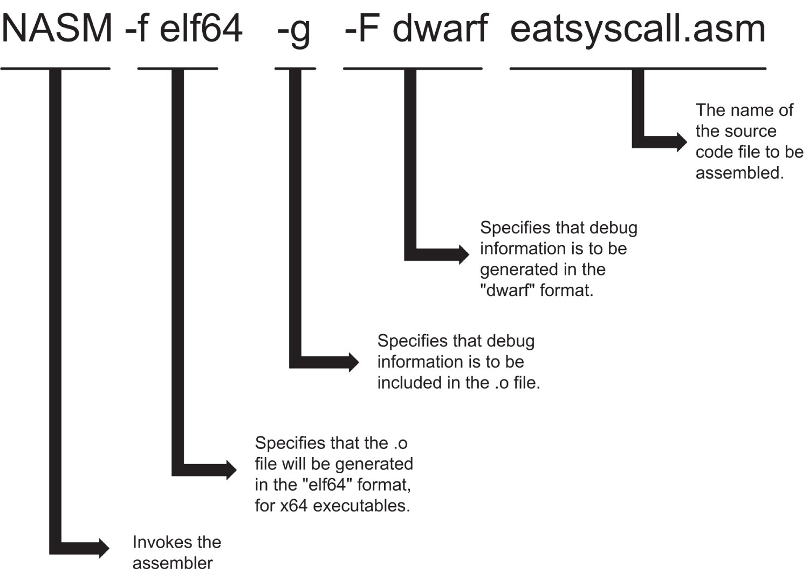

*<a id="c05-fig-0011"></a>**Hình 5.11**: Giải phẫu một dòng lệnh NASM*

- `-f elf64`: Có khá nhiều định dạng object file hữu ích, và mỗi định dạng được sinh ra theo cách khác nhau. NASM assembler có khả năng sinh ra hầu hết chúng, bao gồm các định dạng khác như bin, aout và coff, mà có lẽ bạn sẽ không cần, ít nhất là trong một thời gian. Lệnh `-f` cho NASM biết dùng định dạng nào cho object code file mà nó sắp sinh ra. Định dạng elf64 là thứ bạn muốn cho các executable x64.
- `-g`: Trong khi bạn vẫn đang làm việc với một chương trình, bạn muốn có thông tin debug được nhúng vào object code file để có thể dùng debugger phát hiện vấn đề. (Bạn sẽ học thêm về cách làm điều này trong [Chương 6](ch06_a_place_to_stand_with_access_to_tools.vi.md).) Lệnh `-g` bảo NASM đưa thông tin debug vào file đầu ra. Điều này sẽ làm tăng kích thước file đầu ra một chút, nhưng với các dự án thực hành nhỏ thì không đủ để trở thành vấn đề.
- `-F dwarf`: Giống như với file đầu ra, có những định dạng khác nhau mà NASM có thể dùng để sinh thông tin debug. Một lần nữa, giống như với định dạng file đầu ra, nếu bạn đang làm việc trên Linux x64, có lẽ bạn sẽ dùng định dạng DWARF cho thông tin debug, ít nhất là khi mới bắt đầu. Hãy nhớ rằng các lệnh Linux là case-sensitive. Lệnh `-f` và lệnh `-F` là hai lệnh khác nhau, vì vậy hãy để ý phím shift!
- `eatsyscall.asm`: Mục cuối cùng trên dòng lệnh NASM được thể hiện là tên của file cần assemble. Một lần nữa, như mọi thứ trong Linux, tên file là case-sensitive. `EATSYSCALL.ASM` và `EatSysCall.asm` (cũng như mọi biến thể chữ hoa chữ thường khác) được coi là những file hoàn toàn khác nhau.

<a id="Page_140"></a>Trừ khi bạn ra lệnh khác cho NASM, nó sẽ sinh ra một object code file và đặt tên bằng tên của source code file cùng phần mở rộng file `.o`. “Lệnh khác” được đưa ra thông qua tùy chọn `-o`. Nếu bạn đưa một lệnh `-o` vào dòng lệnh NASM, nó phải được theo sau bởi một tên file, là tên bạn muốn NASM đặt cho object code file được sinh ra. Ví dụ:

```
nasm -f elf64 -g -F dwarf eatsyscall.asm -o eatsyscall.o
```

Ở đây, NASM sẽ assemble source file `eatsyscall.asm` thành object code file `eatdemo.o`.

Giờ, trước khi chuyển sang bước link, hãy xác minh rằng object code file đã được tạo bằng cách dùng lệnh `ls` để liệt kê nội dung working directory của bạn. File `eatsyscall.o` phải có ở đó.

### Bước 3: Link chương trình bằng ld

Đến giờ mọi việc đều ổn. Giờ chúng ta phải tạo một file chương trình executable bằng cách dùng tiện ích linker của Linux, ld. Sau khi đảm bảo object code file `eatsyscall.o` có mặt trong working directory của bạn, hãy gõ lệnh linker sau vào terminal:

```
ld -o eatsyscall eatsyscall.o
```

Nếu chương trình gốc được assemble mà không có error hay warning, object file cũng sẽ link mà không có error nào. Giống như NASM, khi ld không gặp điều gì đáng nói, nó hoàn toàn không nói gì. Không có tin tức gì là tin tốt trong thế giới assembly language—và, thực ra, trong toàn bộ thế giới lập trình nói chung.

Dòng lệnh để link đơn giản hơn dòng lệnh để assemble. Tôi đã vẽ nó ra trong <a id="R_c05-fig-0012"></a>[Hình 5.12](#c05-fig-0012). Lệnh `ld` chạy chính chương trình linker. Lệnh `-o` chỉ định một tên file đầu ra, ở đây là `eatsyscall`. Trong thế giới DOS và Windows, các executable file gần như luôn dùng phần mở rộng file `.exe`. Trong thế giới Linux, các executable thường hoàn toàn không có phần mở rộng file.

<a id="Page_141"></a>

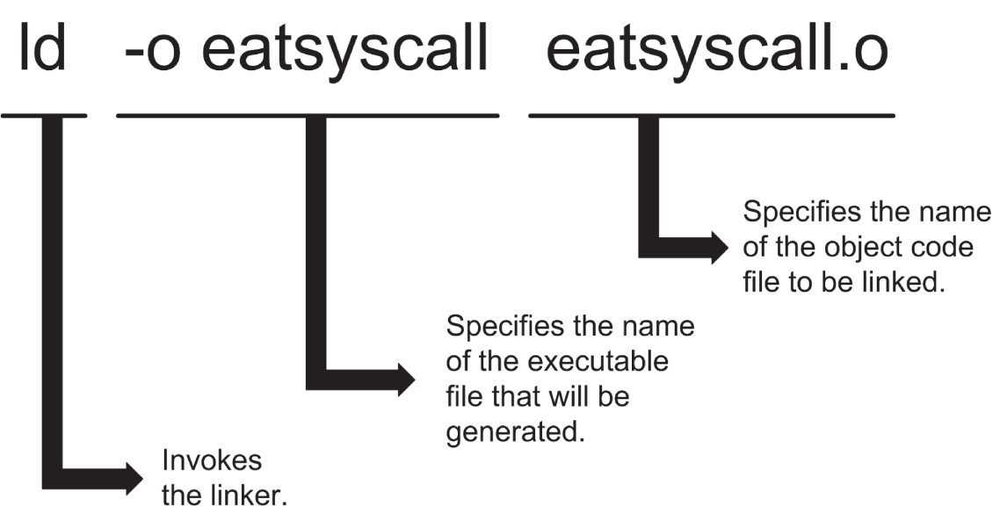

*<a id="c05-fig-0012"></a>**Hình 5.12**: Giải phẫu một dòng lệnh `ld`*

Lưu ý rằng nếu bạn *không* chỉ định tên file executable bằng lệnh `-o`, ld sẽ tạo một file với tên mặc định `a.out`. Nếu có lúc bạn thấy một file bí ẩn tên là `a.out` trong một thư mục dự án của mình, nhiều khả năng điều đó có nghĩa là bạn đã chạy linker mà không có lệnh `-o`.

Những thứ cuối cùng bạn nhập trên dòng lệnh ld là tên của các object file cần link. Trong trường hợp này chỉ có một, nhưng một khi bạn bắt đầu dùng các code library assembly language (dù là của riêng bạn hay do người khác viết), bạn sẽ phải nhập tên của mọi library bạn đang dùng trên dòng lệnh. Thứ tự bạn nhập chúng không quan trọng. Chỉ cần đảm bảo rằng tất cả chúng đều có mặt.

### Bước 4: Kiểm tra Executable File

Một khi linker hoàn tất một lượt error-free, executable file hoàn chỉnh của bạn sẽ chờ bạn trong working directory. Nó là error-free nếu assembler và linker tiêu hóa nó mà không hiển thị error message nào. Tuy nhiên, error-free không có nghĩa là bug-free. Để đảm bảo nó hoạt động, chỉ cần nêu tên nó trên dòng lệnh terminal:

```
./eatsyscall
```

Người mới dùng Linux cần nhớ rằng *working directory của bạn không tự động nằm trên search path*, và nếu bạn đơn giản gõ tên executable trên dòng lệnh (không có tiền tố “working directory” `./`), Linux sẽ không tìm thấy nó. Nhưng khi được nêu tên kèm tiền tố, executable của bạn sẽ nạp, chạy và in ra lời quảng cáo 13-character của nó:

```
Eat at Joe's!
```

Chiến thắng!

### Bước 5: Xem chương trình chạy trong Debugger

Giả sử bạn đã nhập [Listing 5.1](#c05-fea-0001) đúng (hoặc giải nén nó từ kho listing), không có bug nào trong `eatsyscall.asm`. Đó là một tình huống hiếm gặp đối với lập trình viên, đặc biệt là những người mới bắt đầu. Phần lớn thời gian, bạn sẽ cần bắt đầu săn bug gần như ngay lập tức. Cách dễ nhất để làm điều này là nạp executable file vào một debugger để bạn có thể single-step nó, tạm dừng sau khi thực thi mỗi machine instruction để thấy mỗi instruction có tác động gì lên các register và mọi biến được định nghĩa trong memory.

Debugger chuẩn mực dưới Linux là gdb, Gnu Debugger. Chúng ta sẽ dùng gdb trong cuốn sách này, nhưng để giữ cho phần hướng dẫn đơn giản, chúng ta sẽ dùng nó từ bên trong một IDE, một chủ đề tôi sẽ bàn đến trong [Chương 6](ch06_a_place_to_stand_with_access_to_tools.vi.md).

Tôi chỉ có thể dạy một chút xíu gdb trong một cuốn sách dành cho người mới bắt đầu hoàn toàn như thế này. Có một cuốn hướng dẫn tham khảo cho gdb dày 800 trang chữ nhỏ và nặng 5 pound. Tôi khuyến khích bạn khám phá gdb khi kỹ năng của bạn tiến bộ. Bạn cần biết rằng đó là một con dốc dài, đứng dẫn tới một đỉnh núi rất cao. Mọi lệnh cho gdb (và có *rất nhiều*) phải được nhập trên dòng lệnh terminal. Không có menu và (giống như NASM và ld) hoàn toàn không có giao diện đồ họa người dùng.

Điều này không có nghĩa là không tồn tại giao diện đồ họa người dùng nào cho gdb. Có vài cái. Mánh khóe là chúng không phải là một phần của gdb. Có thể tạo một giao diện cửa sổ cho GDB bằng cách thiết lập các menu và hộp thoại chỉ định điều bạn muốn gdb làm, rồi để giao diện cửa sổ chuyển các lệnh dưới dạng văn bản thuần túy cho gdb. Việc này được thực hiện “ở hậu trường” và khuất tầm mắt. Trông như thể bạn đang debug bằng gdb và đúng là bạn đang làm vậy—chỉ là thông qua một kiểu trung gian GUI.

Ấn bản năm 2009 của cuốn sách này đã thảo luận hai giao diện như vậy: một cái tên là Kdbg và cái kia tên là Insight. Kdbg vẫn tồn tại nhưng không hoạt động dưới Linux Mint Cinnamon, còn Insight, than ôi, đã bị loại khỏi các bản phân phối Linux và mọi repository mà tôi biết, từ tận năm 2009. Insight có thể được tải về từ các website và cài đặt dưới Linux, nhưng đó là khá nhiều công việc lặt vặt phiền phức. (Tôi đã viết vài lời khuyên về cách cài đặt và dùng Insight trong [Phụ lục A](ch14_appendix_a_the_return_of_the_insight_debugger.vi.md).)

Phần lớn thì điều đó không quan trọng. Hôm nay, năm 2023, chúng ta có thứ tốt hơn. Hãy lật trang, và cùng gặp một IDE assembly language tên là SASM.
