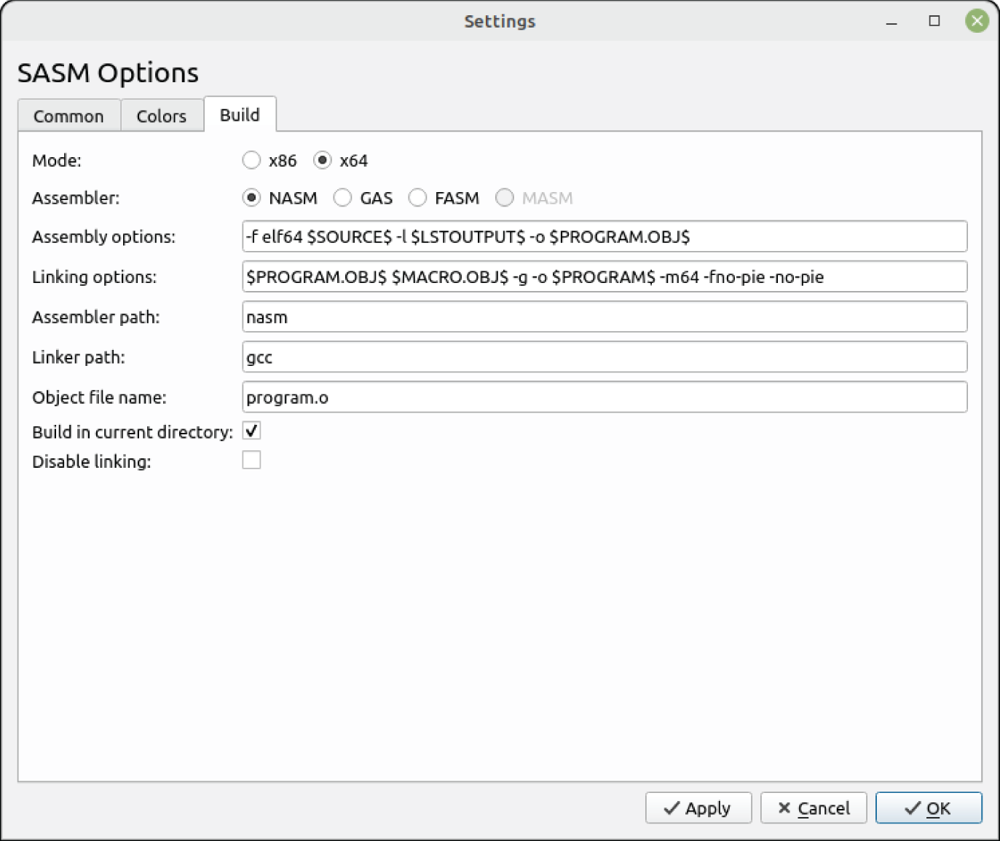
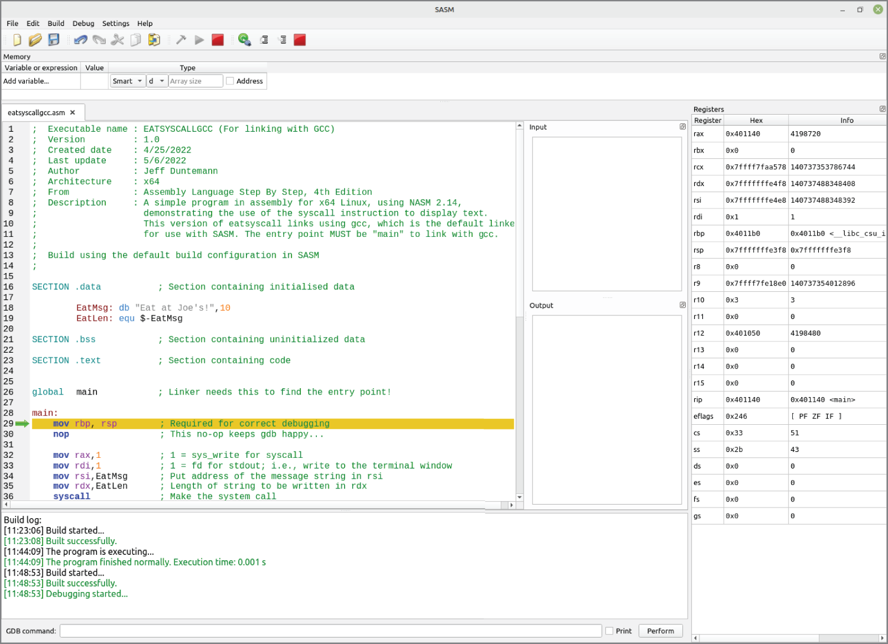
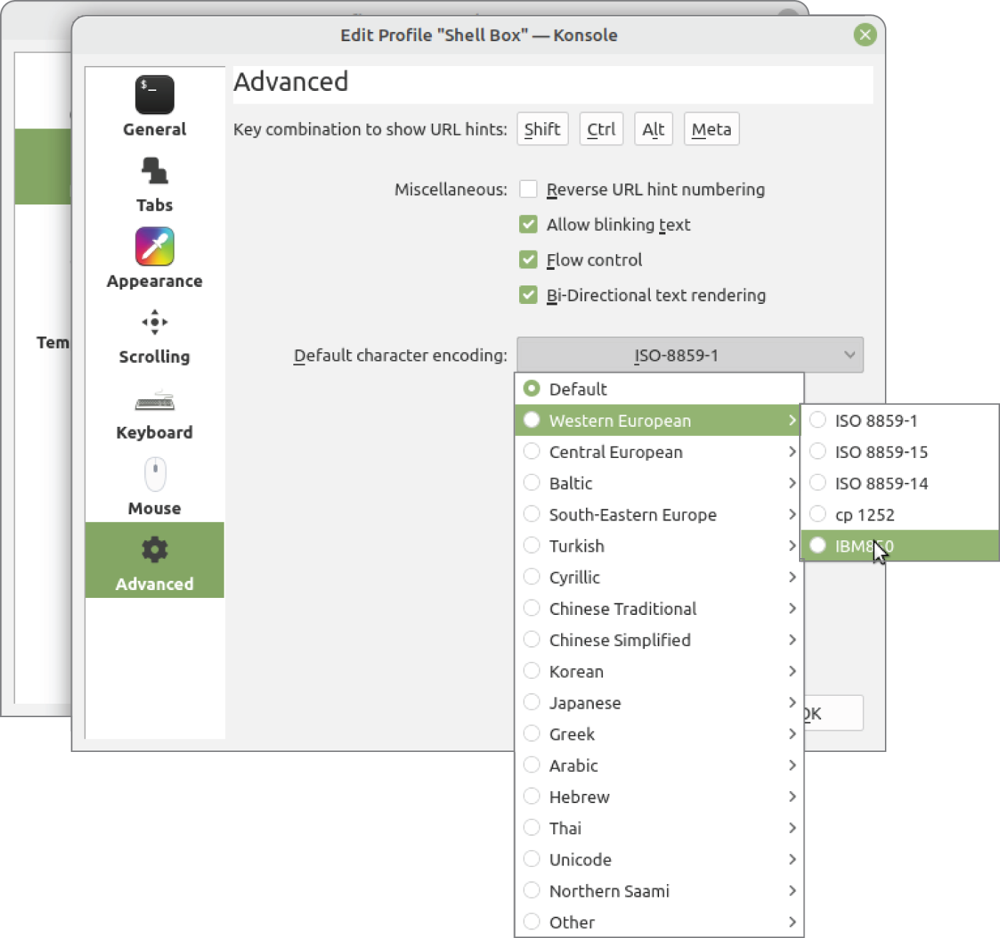
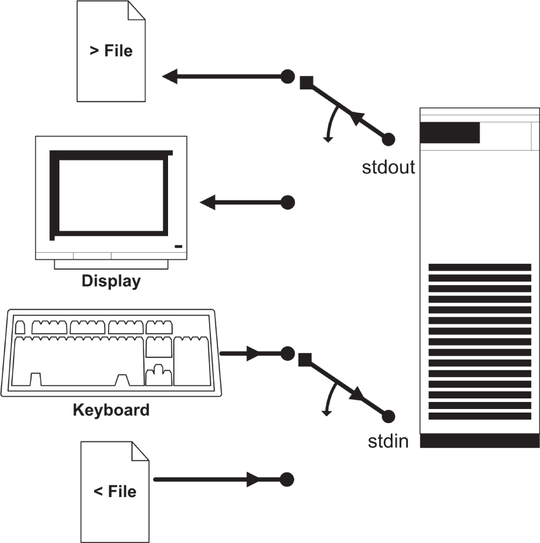
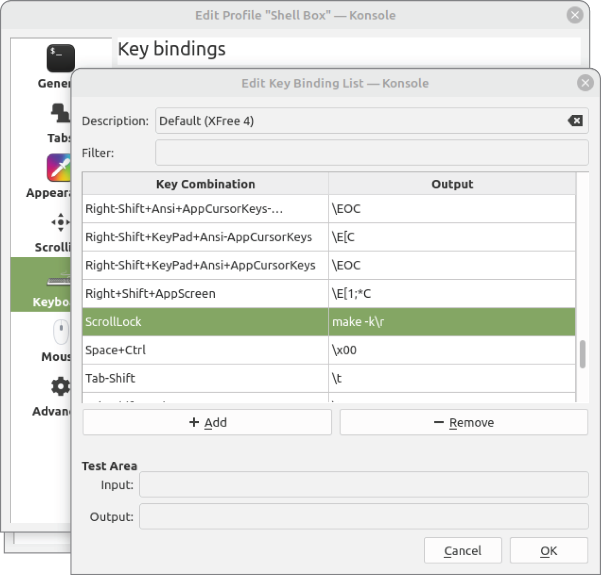

# <a id="Page_143"></a>CHƯƠNG 6 Một chỗ đứng, cùng công cụ trong tầm tay: *Linux và những công cụ định hình cách bạn làm việc*

<a id="head-2-71"></a>

## Integrated Development Environment

Archimedes, người kỹ sư nguyên thủy, có một câu nói ưa thích: “Hãy cho tôi một đòn bẩy đủ dài và một chỗ đứng, tôi sẽ nâng cả Trái Đất.” Ông già này không mấy khi dùng ẩn dụ và đang nói theo nghĩa đen về lợi thế cơ học của những đòn bẩy *thực sự* dài, nhưng đằng sau lời ông có một chân lý lớn hơn về công việc nói chung: để làm xong một việc gì đó, bạn cần một chỗ đứng, cùng công cụ trong tầm tay. Bàn làm việc radio của tôi ngoài gara nhỏ được bố trí theo cách đó: một mặt phẳng rộng để đặt những chiếc máy phát ốm yếu lên, và một cái kệ phía trên nơi oscilloscope, VTVM, máy đếm tần số, máy phát tín hiệu, máy dò tín hiệu và dip meter của tôi nằm trong tầm tay. Ở bức tường đối diện, chỉ cách hai bước chân, là một dãy kệ dài nơi tôi giữ linh kiện, nguyên vật liệu thô như tấm kim loại, phôi bảng mạch và nhựa vụn, cùng thiết bị đo kiểm mà tôi không cần dùng thường xuyên.

Ở một số khía cạnh, hệ điều hành là chỗ đứng của bạn trong khi hoàn thành công việc tính toán. Mọi công cụ bạn cần nên ở ngay đó trong tầm tay, và nên có một cách chuẩn mực, dễ hiểu để truy cập chúng. Nơi lưu trữ dữ liệu của bạn nên ở “gần bên” và dễ duyệt, dễ tìm kiếm. Hệ điều hành Linux đáp ứng nhu cầu này theo cách mà gần như không gì khác trong thế giới điện toán desktop ngày nay làm được.

Các hệ điều hành cổ xưa như DOS cho chúng ta “chỗ đứng” theo một cách hạn chế. DOS cung cấp quyền truy cập vào bộ lưu trữ đĩa và một cách chuẩn để nạp và chạy <a id="Page_144"></a>phần mềm, và không nhiều hơn thế. Bộ công cụ nhỏ, nhưng đó là một khởi đầu tốt, và gần như là tất cả những gì chúng ta có thể xoay xở trên các máy 8088 6 MHz vốn phổ biến vào giai đoạn mid-to-late thập niên 1980.

Theo một số cách, điều thú vị nhất về DOS 2.0 là nó được tạo ra như một phiên bản “dumbed-down” của một hệ điều hành mạnh hơn nhiều, Unix, vốn được các phòng nghiên cứu của AT&T phát triển trong thập niên 1960 và 1970. Vào thời điểm IBM PC xuất hiện, Unix chỉ chạy trên các mainframe và minicomputer lớn, đắt tiền. PC không có đủ sức mạnh tính toán thô để tự chạy Unix, nhưng DOS 2.0 được tạo ra với một filesystem phân cấp rất giống filesystem của Unix, và dòng lệnh của nó cung cấp quyền truy cập vào một tập con các công cụ hoạt động rất giống các công cụ Unix.

PC x86 lớn lên qua nhiều năm, và đến khoảng năm 1990, các CPU của Intel đã đủ mạnh để chạy một hệ điều hành được mô phỏng theo Unix. Trong khi đó, Unix “lớn xuống” cho đến khi hai bên gặp nhau ở đâu đó ở giữa. Năm 1991, lập trình viên trẻ người Phần Lan Linus Torvalds đã viết một bản “trông giống” Unix có thể chạy trên một PC 386-based rẻ tiền. Nó được mô phỏng theo một bản triển khai của Unix gọi là Minix, vốn được viết ở Hà Lan vào cuối thập niên 1980 như một bản trông giống Unix có khả năng chạy trên các máy tính nhỏ. Hệ điều hành Linux của Torvalds rốt cuộc đã thống trị thế giới Unix.

Linux là chỗ đứng của chúng ta, và đó là một chỗ đứng tốt. Nhưng về mặt tiếp cận công cụ, cũng sẽ hữu ích nếu có một kiểu bàn làm việc phần mềm được thiết kế đặc biệt cho loại công việc chúng ta đang làm vào lúc đó. Trình xử lý văn bản là bàn làm việc để viết và in nội dung (chủ yếu là) văn bản. PowerPoint và các bản sao của nó là bàn làm việc để tạo bài thuyết trình, và cứ thế.

NASM assembler mạnh mẽ nhưng ít nói, và gắn chặt không thể tách rời với dòng lệnh, cũng như `ld`, `gdb` và hầu hết các công cụ Unix lâu đời mà bạn sẽ tìm thấy trong rương đồ nghề Linux. Trong [Chương 5](ch05_the_right_to_assemble.vi.md), chúng ta đã chạy qua một dự án phát triển đơn giản theo cách khó khăn kiểu cũ, bằng cách gõ lệnh tại dòng lệnh terminal. Người mới bắt đầu cần biết điều đó hoạt động thế nào, nhưng đó tuyệt nhiên không phải là điều tốt nhất chúng ta có thể làm. Ngoài ra, rốt cuộc bạn có thể vượt quá khả năng của môi trường phát triển tương tác mà bạn đang dùng. Những hoàn cảnh đặc biệt cũng có thể buộc bạn quay lại dòng lệnh Linux để hoàn thành công việc.

Thành công huyền thoại của Turbo Pascal cho DOS trong thập niên 1980 phần lớn là nhờ nó tích hợp một trình soạn thảo và một compiler với nhau. Nó đưa ra một menu cho phép di chuyển dễ dàng và nhanh chóng giữa trình soạn thảo, để viết code; compiler, để biên dịch code thành các executable file; và DOS, nơi các file đó có thể được chạy và kiểm thử. Lập trình bằng Turbo Pascal dễ nắm bắt hơn và nhanh hơn nhiều so với các phương pháp truyền thống đòi hỏi liên tục đưa ra lệnh từ dòng lệnh.

Turbo Pascal là sản phẩm thương mại thực sự thành công đầu tiên cung cấp một môi trường phát triển tương tác (IDE) cho các lập trình viên small-system. <a id="Page_145"></a>Những sản phẩm khác đã xuất hiện trước đó (đặc biệt là UCSD P-system nguyên thủy, vốn chủ yếu được dùng ở các trường đại học), nhưng Turbo Pascal đã đưa ý tưởng này lên bản đồ một cách all-time.

Trong ấn bản trước của cuốn sách này (ấn bản thứ ba, 2009), tôi đã giới thiệu một bộ công cụ gồm trình soạn thảo Kate, terminal Konsole, và front end Insight mạnh mẽ dù không theo lối thông thường cho debugger `gdb`. Trong lần run-through năm 2009 của chúng ta ở [Chương 5](ch05_the_right_to_assemble.vi.md), tôi đã giới thiệu một front end debugger đơn giản hơn gọi là Kdbg.

Thời thế thay đổi. Insight đã bị loại khỏi các distro và repository Linux vào cuối năm 2009, không lâu sau khi ấn bản thứ ba được xuất bản. Nó đã là abandonware kể từ năm 2009, và sản phẩm này cực kỳ khó cài đặt trên các distro Linux hiện đại. Đâu đó trên con đường đến năm 2022, Kdbg cũng đã biến mất khỏi sân khấu Linux và không thể cài đặt trên hầu hết các bản phân phối gần đây. Tôi thích cả hai sản phẩm, nhưng tôi nghĩ tôi hiểu tại sao chúng không còn được dùng nữa. Kate và Konsole vẫn còn rất hiện diện. Tôi sẽ mô tả Konsole khá dài ở phần sau của chương này, trong mục Linux Console.. Bạn có thể dùng Kate nếu muốn, nhưng để soạn thảo văn bản đơn giản, tôi thích trình soạn thảo Xed hơn. Còn về debugger, hãy xem [Phụ lục A](ch14_appendix_a_the_return_of_the_insight_debugger.vi.md). Insight đã trở lại.

Phần lớn là vậy.

Tuy nhiên, khi chuẩn bị ấn bản này, tôi đã tìm thấy một điều đáng chú ý: một IDE được thiết kế đặc biệt cho công việc assembly-language, với trọng tâm là các lập trình viên mới bắt đầu. Simple ASM (SASM) được viết bởi Dmitriy Manushin. Nó vẫn được bảo trì và vẫn đang được phát triển tích cực. Nó đủ mạnh để xử lý hầu hết các chương trình đơn giản mà tôi trình bày trong cuốn sách này. Nó cũng là một cách tốt để giới thiệu việc debug.

Giờ, dù tốt đến đâu ở một số khía cạnh, SASM được thiết kế cho người mới bắt đầu và thiếu một số tính năng nâng cao. Nó là một nơi tuyệt vời để bắt đầu, và nó sẽ cho bạn ý niệm về IDE là gì. Chắc chắn là, một khi bạn bắt đầu viết các chương trình assembly large-scale hoặc bắt đầu trộn assembly với C, SASM sẽ không đủ. Tôi cũng sẽ trình bày tiện ích Make đi kèm với Linux để khi bạn vượt quá SASM, bạn sẽ biết cách tạo makefile của riêng mình. Và mặc dù SASM có cửa sổ terminal riêng, tôi sẽ giải thích terminal Konsole mạnh mẽ hơn, như tôi đã làm năm 2009.

Debugger Insight cũ đã được cho thêm một lượt chạy nữa. Xem [Phụ lục A](ch14_appendix_a_the_return_of_the_insight_debugger.vi.md). Nó không hoàn hảo, nhưng nó vẫn beginner-friendly hơn bất kỳ debugger stand-alone miễn phí nào khác cho Linux.

Có những IDE khác mạnh mẽ hơn trong vũ trụ Linux, như KDevelop, Geany và Eclipse. Việc cố giải thích một cách hữu ích bất kỳ cái nào trong số đó ở đây sẽ tốn nhiều chỗ hơn số chỗ tôi có trong cuốn sách này. Một khi bạn hiểu các nguyên lý cơ bản của IDE, bạn có thể cài đặt và học chúng khi nhu cầu và kỹ năng của bạn đòi hỏi. Trong lúc chờ đợi, chúng ta sẽ bắt đầu với SASM rồi chuyển sang Make và Konsole.

Tôi đã kiểm thử SASM trên Linux Mint Cinnamon và Kubuntu Plasma. Nó hoạt động trên cả hai distro và có thể được cài đặt bằng package manager của từng nền tảng. Tôi đoán là nó sẽ chạy trên bất kỳ distro hiện đại nào.

<a id="Page_146"></a>

<a id="head-2-72"></a>

## Giới thiệu SASM

SASM là một IDE đơn giản được thiết kế đặc biệt cho lập trình assembly language. Đây là các tính năng chính của nó:

- Hỗ trợ các assembler NASM, FASM, MASM và gas. (MASM chỉ hoạt động dưới Windows.)
- Hỗ trợ session, để bạn có thể mở nhiều dự án cùng lúc.
- Một trình soạn thảo source-code với syntax highlighting full-color.
- Các cửa sổ terminal riêng cho standard input và standard output.
- Một debugger source-code cho phép bạn dùng breakpoint và single-stepping trong các dự án assembly language của mình.
- Hiển thị register trong khi debug, và một phần hiển thị memory hữu ích dù hạn chế.

Việc cài đặt nó được thực hiện từ package manager trên bất kỳ distro Linux nào bạn đang dùng. Package manager của Mint được gọi là Software Manager. Dưới Kubuntu, nó được gọi là Discover. (Kubuntu có một phiên bản Discover nâng cao hơn gọi là Muon Discover, nhưng Discover plain-vanilla là hoàn toàn đủ dùng.)

Cả hai package manager đều cho bạn một ô tìm kiếm. Chỉ cần gõ **SASM** và nhấn Enter. Có lẽ bạn sẽ nhận được rất nhiều kết quả tìm kiếm chẳng liên quan gì đến assembly language (hay lập trình nói chung), nhưng ngay ở đầu, bạn sẽ thấy một dòng cho SASM. Hãy nhấp vào dòng đó. Package manager sẽ cho bạn xem phần mô tả về SASM.

Như mọi lần cài đặt, bạn sẽ được hỏi mật khẩu Linux. Nhưng một khi bạn nhập nó, SASM sẽ được cài đặt lên ổ cứng của bạn. Trong menu phần mềm, nó sẽ nằm trong mục Programming. Tôi khuyên bạn nên tạo một biểu tượng trên desktop. Chỉ cần right-click mục của SASM trong mục Programming và chọn Add To Desktop.

### Cấu hình SASM

Không có nhiều thứ để cấu hình. Mọi cấu hình đều được thực hiện từ hộp thoại Settings. Đây là danh sách:

- Trên tab Settings ➪ Common, kéo xuống On Start và chọn “Restore Previous Session.” Bạn không muốn thấy hộp thoại Get Started” mỗi lần chạy SASM.
- Nhấp radio button No, Show Only General-Purpose cho phần hiển thị register. Chúng ta sẽ không thảo luận các tính năng toán học AVX của x64, nên hiển thị các register toán học chỉ làm rối cửa sổ của SASM.
- <a id="Page_147"></a>Trên tab Settings ➪ Build (xem <a id="R_c06-fig-0001"></a>[Hình 6.1](#c06-fig-0001)), nhấp radio button x64 để lập trình 64-bit. SASM cũng hỗ trợ code x86 32-bit, và tùy chọn x86 là mặc định. *Điều này quan trọng*. Bạn sẽ viết code x64, và SASM sẽ không xử lý đúng source code x64 nếu bạn chọn x86.
- Cũng trên tab Settings ➪ Build, đánh dấu hộp Build In Current Directory.
- Mọi thứ khác bạn có thể để nguyên trong lúc này.



*<a id="c06-fig-0001"></a>**Hình 6.1**: Hộp thoại Build của SASM*

Hãy ghi lại số phiên bản, như được hiển thị trong Help ➪ About. Khi tôi viết những dòng này vào đầu năm 2023, phiên bản hiện tại là 3.12.2. Gần như chắc chắn nó sẽ cao hơn vào lúc bạn đọc điều này. Số phiên bản quan trọng vì lý do sau: một lần tìm kiếm gói SASM có thể hiện ra nhiều hơn một gói SASM. Hãy chọn gói có số phát hành mới nhất. Sau đó nhấp nút Install.

### Font của SASM

Vào thời điểm viết sách này (2023), cách SASM dùng font có một điểm chưa được mài nhẵn. Hầu hết những người lập trình đều làm việc với một font monospace thuần túy như Courier. Với Courier và <a id="Page_148"></a>các font monospace khác, mọi cột của bạn sẽ thẳng hàng theo chiều dọc vì mọi ký tự đều có cùng độ rộng.

Font mặc định của SASM là Liberation Mono, vốn không phải là monospace thực sự như Courier. Bạn có thể thay đổi font của cửa sổ editor trong Settings ➪ Common. Hãy đổi font thành Courier 10 Pitch. Đó là một font monospace thực sự và hơi đậm hơn (do đó dễ đọc hơn) so với bất kỳ font monospace nào trong số vài font khác mà SASM đưa ra.

Một thiếu sót khác về font là bạn chỉ có thể chỉ định font cho cửa sổ editor. Font cho cả cửa sổ Input lẫn Output đều không thể thay đổi. Nó thậm chí chẳng gần với monospace chút nào, vì vậy nếu bạn đang cố xuất văn bản hay chữ số thành các cột ngay ngắn, cửa sổ Output sẽ không làm nổi. Để kiểm thử kiểu output đó, hãy lưu EXE file ra đĩa từ SASM, thoát SASM, và chạy chương trình từ bên trong Konsole.

### Dùng compiler để link

SASM có một điểm đặc biệt mà bạn cần biết: theo mặc định, nó dùng Gnu C compiler `gcc` thay vì `ld` để link object code assembly thành các executable file. Compiler `gcc` không tự làm việc link. Thay vào đó, nó đóng vai trung gian và gọi `ld` sau khi `gcc` xác định tất cả những gì `ld` cần link để tạo ra executable. Điều này làm tăng kích thước executable của bạn, mặc dù không đủ để trở thành vấn đề. Thứ nó làm phức tạp hơn là các chỉ dẫn để assemble và link trong tab Build của Settings, mà tôi đã thể hiện trong [Hình 6.1](#c06-fig-0001).

Nhược điểm của việc dùng các tham số build mặc định của SASM là bạn không thể assemble và link chương trình `eatsyscall.asm` mà chúng ta đã xem xét đến giờ. Cần vài thay đổi nhỏ cho `eatsyscall.asm` để làm cho nó tương thích với quá trình build mặc định của SASM.

Giống như Turbo Pascal nguyên thủy, SASM assemble dự án của bạn vào memory để tiết kiệm thời gian. Để có một executable file trên đĩa, bạn phải lưu executable một cách tường minh thành một file trên đĩa bằng tùy chọn menu File ➪ Save .exe.

Theo đúng lời khuyên của tôi về việc chỉ lưu một dự án mỗi thư mục, hãy tạo một thư mục mới dưới thư mục assembly của bạn tên là `eatsyscallgcc`. Giải nén <a id="R_c06-fea-0001"></a>[Listing 6.1](#c06-fea-0001) (file `eatsyscallgcc.asm`) từ kho listing và đặt nó vào thư mục mới.

Một lưu ý cuối cùng về SASM trước khi chúng ta bắt đầu: nó có kèm một include library hàm I/O 64-bit gọi là `io64.inc`. Mặc dù library này hữu ích, tôi sẽ không thảo luận nó trong cuốn sách này. Tôi khuyến khích bạn khám phá nó khi có thời gian.

> **<a id="c06-fea-0001"></a>Listing 6.1: eatsyscallgcc.asm**
>
> <a id="Page_149"></a>
>
> ```
> ;  Executable name : eatsyscallgcc (For linking with gcc)
> ;  Version         : 1.0
> ;  Created date    : 4/25/2022
> ;  Last update     : 4/10/2023
> ;  Author          : Jeff Duntemann
> ;  Architecture    : x64
> ;  From            : x64 Assembly Language Step By Step, 4th Edition
> ;  Description:
> ;    A simple program in assembly for x64 Linux, using NASM 2.14,
> ;    demonstrating the use of the syscall instruction to display text.
> ;    This eatsyscall links via gcc, the default linker
> ;    for use with SASM. The entry point MUST be "main" to link with gcc.
> ;
> ;    Build using the default build configuration in SASM
> ;
>
> SECTION .data           ; Section containing initialized data
>
>  EatMsg: db "Eat at Joe's!",10
>  EatLen: equ $-EatMsg
>
> SECTION .bss       ; Section containing uninitialized data
>
> SECTION .text           ; Section containing code
>
> global   main  ; Linker needs this to find the entry point!
>
> main:
>     mov rbp,rsp         ; SASM may add another copy of this in debug mode!
>
>     mov rax,1           ; 1 = sys_write for syscall
>     mov rdi,1           ; 1 = fd for stdout; write to the terminal window
>     mov rsi,EatMsg      ; Put address of the message string in rsi
>     mov rdx,EatLen      ; Length of string to be written in rdx
>     syscall             ; Make the system call
>
>     mov rax,60          ; 60 = exit the program
>     mov rdi,0           ; Return value in rdi 0 = nothing to return
>     syscall             ; Call syscall to exit
> ```

### Một vòng tham quan nhanh SASM

Vậy hãy xem SASM có thể làm gì, rồi tôi sẽ giải thích nó chi tiết hơn. Với source code file [Listing 6.1](#c06-fea-0001) trong thư mục của nó, hãy dùng File ➪ Open để di chuyển đến thư mục, và nhấp Select khi source file được tô sáng. SASM sẽ nạp source file vào cửa sổ source của nó.

Một lời bên lề ngắn: cửa sổ của SASM có thể trở nên cực kỳ bận rộn khi bạn ở debug mode, vì vậy tôi đặc biệt khuyên bạn luôn phóng to tối đa SASM khi dùng nó.

Bước đầu tiên là build executable. “Build” ở đây bao gồm cả quá trình assemble lẫn link, mà SASM thực hiện trong một bước. Biểu tượng cái búa trên thanh công cụ khởi động quá trình build. Hãy nhấp vào nó.

Việc build sẽ mất chưa đến một giây trên một PC nhanh. Trong khung log ở dưới cùng cửa sổ SASM, bạn sẽ thấy “Built successfully” màu xanh lá. Màu xanh lá nghĩa là mọi thứ đều ổn. Mọi build error sẽ xuất hiện màu đỏ.

Để chạy chương trình, hãy nhấp biểu tượng Run, là hình tam giác xanh lá bên phải biểu tượng Build. Cửa sổ log sẽ báo rằng chương trình đã bắt đầu chạy và kết thúc bình thường. Trong cửa sổ Output, thông điệp “Eat at Joe's!” sẽ xuất hiện.

Vâng, đơn giản thế thôi—nếu chương trình của bạn hoạt động đúng. Nếu không, bạn sẽ cần bắt đầu debug. Biểu tượng Debug là một hình tam giác xanh lá với một con bọ nhỏ màu xám phía trước. (Có thể bạn phải nhìn kỹ mới nhận ra đó là một con bọ.) Hãy nhấp biểu tượng Debug. Một lần nữa, nếu bạn chưa phóng to tối đa cửa sổ SASM, hãy làm ngay bây giờ, vì một khi bạn ở debug mode, có rất nhiều thứ diễn ra trong các khung của cửa sổ, và bạn sẽ cần mọi khoảng màn hình có thể có.

Hai tùy chọn menu Debug sẽ khả dụng một khi bạn ở Debug mode. Hãy nhấp Show Registers và Show Memory. Ở phía bên phải cửa sổ, một khung mới sẽ mở ra. Đó là khung register, và nó sẽ hiển thị nội dung của tất cả các register general-purpose x64. (Các register của math coprocessor sẽ không có ở đó nếu bạn đã cấu hình SASM đúng cho các bản demo của cuốn sách này.) Lưu ý: *bạn chỉ có thể thấy khung register khi ở debug mode*. Hơn nữa, cho đến khi bạn bắt đầu single-stepping, cửa sổ register không phải lúc nào cũng “đầy”.

Khung Memory sẽ xuất hiện ngang phía trên cửa sổ SASM. Dùng nó có thể khá khó, như tôi sẽ giải thích ở phần sau một chút.

Lúc này cửa sổ SASM sẽ trông giống <a id="R_c06-fig-0002"></a>[Hình 6.2](#c06-fig-0002).



*<a id="c06-fig-0002"></a>**Hình 6.2**: Toàn bộ cửa sổ SASM ở debug mode*

Sẽ có một thanh tô sáng màu vàng trên dòng code executable đầu tiên (không phải comment hay label) trong khung source. Việc thực thi đang tạm dừng ở dòng đó. Chúng ta gọi một lần tạm dừng như vậy là một *breakpoint*. Với SASM, dòng code đầu tiên sẽ luôn là một breakpoint de facto khi bạn vào debug mode. Tôi nói “de facto” vì bạn có thể đặt breakpoint của riêng mình trên bất kỳ dòng code nào bằng cách nhấp vào số dòng của dòng đó, ở lề trái khung source. Lúc này, hãy nhấp vào số dòng của dòng này:

```
mov rax,1
```

Một chấm đỏ sẽ xuất hiện bên phải số dòng. Điều đó cho bạn biết có một breakpoint tại dòng đó.

Giờ hãy nhấp biểu tượng Debug. Một khi bạn ở debug mode, biểu tượng Debug bảo SASM tiếp tục thực thi. Phần tô sáng sẽ di chuyển xuống breakpoint của bạn. Điều này quan trọng: việc thực thi dừng tại một breakpoint *trước khi* dòng của breakpoint được thực thi. Instruction `MOV` được tô sáng vẫn chưa được thực thi.

Đây là thời điểm tốt để xem khung register hoạt động. Register RAX là cái đầu tiên trong danh sách. Nó sẽ chứa một giá trị nào đó. Giá trị này không quan trọng. Đó là thứ tôi gọi là “đồ thừa” từ bất cứ việc gì SASM đã làm với RAX trước khi chương trình của bạn bắt đầu thực thi.

Với việc thực thi đang chờ lệnh của bạn, hãy nhấp biểu tượng Step Over, nằm ngay bên phải biểu tượng Debug. Phần tô sáng sẽ di chuyển xuống dòng code tiếp theo. Nếu bạn nhìn vào nội dung của RAX trong khung register, bạn sẽ thấy giờ nó chứa giá trị 1.

Nếu bạn nhấp biểu tượng Step Over lần nữa, phần tô sáng sẽ di chuyển xuống thêm một dòng, và instruction `MOV RDI,1` sẽ được thực thi. Bạn có thể kiểm tra giá trị của RDI trong khung register để thấy rằng nó cũng đã chứa giá trị 1.

Bạn có thể bước qua việc thực thi chương trình của mình từng instruction một bằng cách nhấp biểu tượng Step Over. Một khi bạn thực thi instruction `SYSCALL` cuối cùng, chương trình của bạn sẽ thoát, và debug mode sẽ kết thúc. Khung register và khung memory đều sẽ biến mất.

Có lẽ bạn đã nhận thấy rằng có hai biểu tượng Step, một là Step Over và cái kia là Step Into. Khác biệt là gì? Với các chương trình rất đơn giản như chương trình này, không có gì khác. Hai cái này tách biệt nhau một khi bạn tạo procedure và procedure library cho các chương trình assembly của mình. Bạn gọi một procedure bằng instruction `CALL`. Nhưng giả sử procedure của bạn đã hoạt động tốt. Bạn không cần bước qua nó. Vì vậy bằng cách nhấp nút Step Over, bạn bỏ qua lời gọi procedure và tiếp tục. Nếu thay vào đó bạn nhấp Step Into, SASM cho phép bạn bước qua các machine instruction của procedure, trước khi quay trở lại chỗ trong chương trình nơi có lời gọi procedure.

Tôi sẽ bàn lại điều này chi tiết hơn khi chúng ta đến phần procedure ở sau trong cuốn sách.

Tóm lại, debugger cho phép bạn “nhìn vào bên trong” code assembly theo hai cách: bằng cách cho phép bạn đặt breakpoint và chạy code ở tốc độ tối đa cho đến khi việc thực thi chạm vào một breakpoint; hoặc bằng cách bước từng instruction một, tạm dừng <a id="Page_152"></a>sau mỗi bước để quan sát register hoặc memory. Dĩ nhiên, bạn có thể dùng cả hai, dùng một breakpoint để nhanh chóng đến điểm quan tâm rồi bước qua vùng quan tâm để xem nó đang làm gì.

### Editor của SASM

Editor của SASM khá cơ bản. Nó cung cấp hầu hết các lệnh soạn thảo văn bản thông dụng được dùng trong các trình soạn thảo source code: Open, Save, Save As, Close, Select All, Cut, Copy, Paste và Find/Replace. Lệnh duy nhất tôi nhớ là Delete Line, qua phím tắt Ctrl+Y lâu đời. Để xóa một dòng, bạn phải chọn nó bằng chuột rồi nhấn phím Delete. Tôi thừa nhận rằng điều này có thể được coi là một tính năng an toàn, ít nhất là khi bạn mới bắt đầu.

### SASM đòi hỏi gì ở code của bạn

Nếu bạn nhìn kỹ chương trình demo `eatsyscallgcc.asm`, bạn có thể nhận ra vài khác biệt giữa nó và chương trình `eatsyscall.asm` mà chúng ta đã xem xét trước đó. SASM có hai yêu cầu do nó dùng `gcc` làm trình quản lý link.

- Entry point của chương trình *phải* là `main` thay vì `_start`, và `main` phải viết thường; xem bên dưới.
- Dòng đầu tiên trong thân chương trình phải là `MOV RBP,RSP`. NASM không case-sensitive theo mặc định, và dạng chữ thường `mov rbp,rsp` là thứ bạn sẽ thấy trong cửa sổ editor. Điều này là có chủ ý: bạn cần thoải mái với cả source code all-lowercase lẫn source code all-caps. Trong phần văn bản của sách, code sẽ được viết hoa; trong các listing, nó sẽ viết thường.

Tại sao lại có những yêu cầu này? SASM tự động link các chương trình của bạn với thư viện C chuẩn, `libc`. Theo một cách nào đó, thứ bạn đang viết với SASM là một chương trình C mà không viết code C. Có những quy ước cần thiết trong một chương trình C áp dụng ngay cả khi chương trình không được viết bằng C. Một trong những quy ước đó là thân của một chương trình C luôn được gọi là `main`. Một quy ước khác là lưu register stack pointer RSP vào register RBP trước khi bất cứ điều gì khác xảy ra. Điều này cho phép chương trình truy cập dữ liệu trên stack mà không phá hủy giá trị ban đầu của stack pointer RSP.

Một đặc điểm kỳ quặc của SASM mà tôi không thích là dù bạn có đặt `MOV RBP,RSP` làm instruction đầu tiên trong chương trình hay không, *SASM sẽ thêm nó khi bạn vào debug mode*. Vì vậy nếu bạn đặt instruction `MOV` ở đầu chương trình, bạn sẽ có *hai* bản `MOV RBP,RSP` ngay khi vào debug mode. Điều đó sẽ không gây hại gì, nhưng nó kỳ lạ. (Lưu ý rằng đây có thể là một bug, và vào lúc bạn đọc cuốn sách này, nó có thể đã được loại bỏ trong một bản phát hành mới hơn.) Nó cũng đi ngược lại một thứ gọi là *standard prolog* mà tôi sẽ thảo luận trong [Chương 11](ch11_strings_and_things.vi.md) và [12](ch12_heading_out_to_c.vi.md).

<a id="Page_153"></a>SASM là một cách tốt để học các kỹ thuật assembly đơn giản. Nó đặc biệt tốt cho việc debug trực quan, vì bạn thấy source code của mình—và các comment của bạn—trong khi bước qua một chương trình. Có lẽ bạn sẽ nâng cấp lên một IDE mạnh hơn khi kỹ năng của bạn tiến bộ. Trong khi bạn chỉ mới bước chân vào assembly language, SASM IDE sẽ là quá đủ tốt.

Đó là phần demo nhanh về những gì SASM có thể làm. Đã đến lúc nói về vài công cụ khác hữu ích trong công việc assembly language.

<a id="head-2-74"></a>

## Linux và terminal

Người dùng Unix ghét phải thừa nhận điều đó vào thời ấy, nhưng khi được tạo ra, Unix thực sự là một hệ điều hành mainframe giống như của IBM, và nó hỗ trợ nhiều người dùng đồng thời thông qua timesharing. Mỗi người dùng giao tiếp với máy tính trung tâm thông qua các terminal riêng biệt, stand-alone, đặc biệt là các terminal thuộc dòng VT của Digital Equipment Corporation.

Những terminal này *không* hiển thị các desktop đồ họa mà chúng ta đã coi là thiết yếu kể từ khoảng năm 1995. Chúng là các thiết bị text-only, thường trình bày 25 dòng 80 ký tự, không có biểu tượng hay cửa sổ. Một số ứng dụng dùng toàn màn hình, trình bày các menu được đánh số và các trường fill-in để nhập dữ liệu. Phần lớn các công cụ phần mềm Unix, đặc biệt là những công cụ được lập trình viên dùng, được điều khiển từ dòng lệnh và gửi lại output kiểu scroll-up-from-the-bottom.

Linux hoạt động theo cùng cách. Nói đơn giản nhất, Linux *chính là* Unix. Linux không dùng các “dumb terminal” bên ngoài như DEC VT100 của thập niên 1970, nhưng bộ máy phần mềm terminal-oriented kiểu DEC-style vẫn còn đó bên trong Linux và vẫn hoạt động, dưới dạng terminal emulation.

### Linux Console

Có vô số chương trình terminal emulator cho Linux và các cách triển khai Unix khác như BSD. Ubuntu và Kubuntu đi kèm một chương trình gọi là GNOME Terminal, và bạn có thể tải về và cài đặt nhiều chương trình khác từ package manager của distro. Chương trình tôi dùng cho các phần thảo luận trong cuốn sách này và khuyên dùng nói chung có tên là Konsole. Hãy cài nó nếu bạn chưa cài.

Khi bạn mở một chương trình terminal emulator dưới Linux, bạn nhận được một dòng lệnh văn bản với một con trỏ nhấp nháy, rất giống dòng lệnh DOS cũ hay tiện ích Command Prompt trong Windows. Chương trình terminal cố hết sức để hoạt động giống một trong những serial terminal CRT DEC cũ từ Thời đại Thứ nhất của Unix. Theo mặc định, một chương trình terminal emulator dùng bàn phím và màn hình PC cho input và output của nó. Và thứ mà nó kết nối tới là một thiết bị Linux đặc biệt gọi là *dev/console*, là một thiết bị được định nghĩa trước cung cấp khả năng giao tiếp với chính hệ thống Linux.

<a id="Page_154"></a>Cần nhớ rằng một chương trình terminal chỉ là một chương trình, và bạn có thể cài nhiều loại chương trình terminal khác nhau trên máy Linux của mình, với nhiều instance của mỗi loại đang chạy, tất cả cùng một lúc. Tuy nhiên, chỉ có *một* Linux console, theo ý tôi là thiết bị tên dev/console chuyển các lệnh đến hệ thống Linux và trả về các phản hồi của hệ thống. Theo mặc định, một chương trình terminal emulator kết nối tới dev/console khi nó khởi chạy. Nếu muốn, bạn có thể dùng một terminal emulator Linux để kết nối tới những thứ khác thông qua mạng, mặc dù điều đó hoạt động thế nào và cách làm nằm ngoài phạm vi của cuốn sách này.

Cách đơn giản nhất để giao tiếp với một chương trình Linux là thông qua một terminal emulator như chương trình Konsole, là chương trình tôi sẽ nhắc đến trong cuốn sách này. Lựa chọn thay thế cho terminal emulator là viết chương trình cho một loại hệ thống cửa sổ nào đó. Chỉ riêng việc mô tả các desktop manager của Linux và hệ thống X Window hoạt động bên dưới chúng đã tốn cả một cuốn sách (hoặc vài cuốn) và liên quan đến nhiều lớp phức tạp thực sự chẳng dính dáng gì đến assembly language. Vì vậy trong cuốn sách này, các chương trình ví dụ sẽ hoạt động hoàn toàn từ dòng lệnh terminal emulator.

### Character encoding trong Konsole

Không có nhiều thứ để cấu hình trong một chương trình terminal emulator, ít nhất là khi bạn đang chập chững những bước đầu tiên trong assembly language. Một điều thực sự quan trọng đối với các chương trình ví dụ trong cuốn sách này là *character encoding*. Một terminal emulator phải đặt ký tự vào cửa sổ của nó, và một trong các tùy chọn có thể cấu hình trong terminal emulator liên quan đến việc glyph nào tương ứng với mã ký tự 8-bit nào. Lưu ý kỹ rằng điều này không liên quan trực tiếp đến font. Một glyph là một ký hiệu cụ thể có thể nhận diện được, như chữ cái *A* hay ký hiệu @. Ký hiệu đó được vẽ ra về mặt đồ họa thế nào phụ thuộc vào font bạn dùng. Khi được vẽ bằng các font khác nhau, một glyph cụ thể có thể béo hơn hay gầy hơn, hoặc có những chân nhỏ hay những nét trang trí đủ kiểu. Bạn có thể hiển thị một chữ *A* bằng vô số font, nhưng giả sử font đó không quá cầu kỳ (và những font như vậy có tồn tại), bạn vẫn có thể nhận ra một glyph cụ thể là chữ *A*.

Character encoding ánh xạ một giá trị số tới một glyph cụ thể. Trong chuẩn ASCII phương Tây quen thuộc của chúng ta, số decimal 65 được gắn với glyph mà chúng ta nhận ra là chữ *A* viết hoa. Trong một character encoding khác, được tạo ra để vẽ một bảng chữ cái non-Roman hoàn toàn khác (như tiếng Do Thái, tiếng Ả Rập hay tiếng Thái), số 65 có thể được gắn với một glyph hoàn toàn khác.

Cuốn sách này được viết bằng bảng chữ cái Roman cho độc giả phương Tây và phần lớn là English-speaking, nên các glyph mặc định cho bảng chữ cái của terminal emulator sẽ hoàn toàn ổn. Tuy nhiên, character set ASCII thực ra chỉ đi từ ký tự 0 đến ký tự 127. Tám bit có thể biểu diễn các giá trị lên đến 256, nên có thêm 128 ký tự “cao” nằm ngoài đầu trên của chuẩn ASCII. Không có chuẩn nào mạnh gần bằng ASCII về việc mã hóa glyph nào cho 128 ký tự đó. Các lược đồ character encoding khác nhau bao gồm nhiều glyph khác nhau, phần lớn là các ký tự Roman có dấu bổ trợ (umlaut, circumflex, tilde, dấu trọng âm, v.v.), các chữ cái Hy Lạp chính, và các ký hiệu từ toán học và logic.

Khi IBM phát hành chiếc PC nguyên thủy năm 1981, nó có kèm các glyph mà IBM đã tạo ra cho các terminal mainframe của mình nhiều năm trước đó để cho phép vẽ các hộp trên những màn hình terminal text-only không thể hiển thị đồ họa pixel. Những glyph này hóa ra hữu ích để phân định các biểu mẫu fill-in và những thứ khác. Character set ROM-based của PC rốt cuộc được gọi là Code [Page 437](ch12_heading_out_to_c.vi.md#Page_437), bao gồm rất nhiều ký hiệu khác như bốn chất của bộ bài.

Một lược đồ character encoding tương tự sau đó được dùng trong bản triển khai Unix của IBM, AIX, và được gọi là IBM-850. IBM-850 bao gồm một tập con các ký tự box-draw trong CP437, cộng với rất nhiều ký tự bảng chữ cái Roman có dấu bổ trợ, để cho phép hiển thị đúng văn bản bằng các ngôn ngữ khác ngoài tiếng Anh.

Các terminal emulator Linux theo mặc định không mã hóa lược đồ CP437 cũng như lược đồ IBM-850 (và do đó cả các ký tự box-border của nó). Lược đồ encoding IBM-850 có sẵn, nhưng bạn phải chọn nó từ các menu. Nhân tiện, vào thời điểm viết sách này, tôi chưa từng thấy một terminal emulator Linux nào có khả năng hiển thị character set CP437 nguyên thủy của IBM. Có thể có, nhưng CP437 bị coi là lỗi thời, và việc đòi hỏi nó để chạy một chương trình bạn viết sẽ làm người dùng khó chịu.

Hãy khởi chạy Konsole và kéo xuống mục Settings ➪ Manage Profiles. Konsole đi kèm một profile, tên là Default. Trong hộp thoại Manage Profiles hiện ra, chọn New Profile, và đặt cho profile mới một cái tên như **Shell Box**. Lưu nó. Trong hộp thoại Edit Profile, chọn tab Advanced, và tìm drop-down Default Character Encoding trong khung. Nhấp Select, và từ danh sách được đưa ra, di chuột lên Western European cho đến khi danh sách encoding xuất hiện. Chọn IBM850, và nhấp OK (xem <a id="R_c06-fig-0003"></a>[Hình 6.3](#c06-fig-0003)).

Để dùng character encoding IBM-850, bạn cần làm cho profile Shell Box mới trở thành profile mặc định của Konsole. Việc này được thực hiện bằng cách chọn Settings ➪ Manage Profiles và nhấp vào hộp kiểm ngay bên trái tên profile. Khi profile Shell Box có hiệu lực, các ký tự box-border của IBM sẽ sẵn có để các chương trình của bạn sử dụng. Chúng ta sẽ dùng chúng vài chương nữa.



*<a id="c06-fig-0003"></a>**Hình 6.3**: Đổi character encoding của Konsole sang IBM-850*

<a id="Page_156"></a>

### Ba file Unix chuẩn

Máy tính đã được mô tả như những cỗ máy di chuyển dữ liệu khắp nơi, và đó không phải là một cách nhìn tồi. Dù vậy, cách tốt nhất để nắm được input và output của chương trình thông qua terminal emulator là hiểu một trong những nguyên lý thiết kế nền tảng của Unix: *mọi thứ đều là file*. Một file có thể là một tập hợp dữ liệu trên đĩa, như tôi đã giải thích khá chi tiết trong [Chương 5](ch05_the_right_to_assemble.vi.md). Nhưng theo nghĩa tổng quát hơn, *file là một điểm cuối trên một con đường mà dữ liệu đi qua*. Khi bạn ghi vào một file, bạn đang gửi dữ liệu dọc theo một con đường tới một điểm cuối. Khi bạn đọc từ một file, bạn đang nhận dữ liệu từ một điểm cuối. Con đường mà dữ liệu đi giữa các file có thể hoàn toàn nằm trong một máy tính duy nhất, hoặc có thể nằm giữa các máy tính dọc theo một loại mạng nào đó. Dữ liệu có thể được xử lý và thay đổi dọc đường, hoặc có thể đơn giản di chuyển từ điểm cuối này sang điểm cuối khác mà không bị sửa đổi. Không quan trọng. Mọi thứ đều là file, và mọi file đều được bộ máy file nội bộ của Unix đối xử ít nhiều như nhau.

Châm ngôn “mọi thứ đều là file” áp dụng cho nhiều thứ hơn là các tập hợp dữ liệu trên đĩa. Bàn phím của bạn là một file: nó là một điểm cuối sinh ra dữ liệu và gửi nó đi đâu đó. Màn hình của bạn là một file: nó là một điểm cuối nhận dữ liệu từ đâu đó và hiển thị nó lên nơi bạn có thể thấy. File Unix không nhất thiết phải là text file. Binary file (như các executable do SASM tạo ra) được xử lý theo cùng cách.

Có ba file chuẩn được Unix định nghĩa và luôn mở sẵn cho các chương trình của bạn trong khi chương trình đang chạy. Tôi đã liệt kê chúng trong <a id="R_c06-tbl-0001"></a>[Bảng 6.1](#c06-tbl-0001).

*<a id="c06-tbl-0001"></a>**Bảng 6.1**: Ba file Unix chuẩn*

| FILE | ĐỊNH DANH C | FILE DESCRIPTOR | MẶC ĐỊNH LÀ |
|---|---|---|---|
| Standard Input | stdin | 0 | Bàn phím |
| Standard Output | stdout | 1 | Màn hình |
| Standard Error | stderr | 2 | Màn hình |

Xét đến tận cùng, một file được hệ điều hành biết đến thông qua file descriptor của nó, vốn chỉ là một con số. Ba số đầu tiên như vậy thuộc về ba file chuẩn. Khi bạn mở một file có sẵn hoặc tạo một file mới từ bên trong một chương trình, Linux sẽ trả về một giá trị file descriptor riêng cho file bạn đã mở hoặc tạo. Để thao tác với file, bạn gọi vào hệ điều hành và truyền cho nó file descriptor của file bạn muốn làm việc. [Bảng 6.1](#c06-tbl-0001) cũng cung cấp các định danh quy ước mà các file chuẩn được biết đến trong thế giới C. Ví dụ, khi người ta nói về “stdout”, họ đang nói về file descriptor 1.

Nếu bạn nhìn lại Listing 5-1, chương trình ví dụ ngắn tôi đã trình bày trong [Chương 5](ch05_the_right_to_assemble.vi.md) trong lần walk-through quá trình phát triển assembly language, bạn sẽ thấy dòng này:

```
mov rdi,1 ; 1 = fd for stdout; write to the terminal window
```

Khi chúng ta gửi khẩu hiệu nhỏ “Eat at Joe's!” lên màn hình, thực ra chúng ta đang ghi nó vào file descriptor 1, standard output. Bằng cách đổi giá trị thành 2, chúng ta có thể đã gửi khẩu hiệu đó tới standard error thay vào đó. Nó sẽ không được hiển thị khác đi chút nào trên màn hình. Standard error giống hệt standard output về mọi mặt xét theo cách dữ liệu được xử lý. Theo thông lệ, các chương trình như NASM gửi error message của chúng tới standard error, nhưng văn bản được ghi vào standard error không được đánh dấu là “error message” hay được hiển thị bằng màu hay character set khác. Standard error và standard output tồn tại để chúng ta có thể giữ output của chương trình tách biệt khỏi các error của chương trình và các thông điệp khác liên quan đến việc chương trình đang làm gì và làm thế nào.

Điều này sẽ có ý nghĩa hơn nhiều một khi bạn hiểu một trong những cơ chế cơ bản hữu ích nhất của mọi hệ điều hành Unix-descended: I/O redirection.

<a id="Page_158"></a>

### I/O Redirection

Theo mặc định, standard output đi tới màn hình. (Đây thường là một cửa sổ terminal emulator.) Nhưng đó chỉ là mặc định. Bạn có thể thay đổi điểm cuối cho một luồng dữ liệu đến từ standard output. Thay vào đó, dữ liệu từ standard output có thể được gửi tới một file trên đĩa. File là file; lưu lượng dữ liệu giữa các file được Linux xử lý theo cùng một cách, vì vậy chuyển đổi điểm cuối chẳng phải là mánh khóe gì lớn. Dữ liệu từ standard output có thể được gửi tới một file có sẵn, hoặc có thể được gửi tới một file mới được tạo ra khi chương trình của bạn chạy.

Input cho các chương trình của bạn theo mặc định đến từ bàn phím, nhưng tất cả những gì bàn phím gửi đi là văn bản. Văn bản này cũng có thể đến từ một text file khác. Chuyển đổi nguồn dữ liệu được gửi tới chương trình của bạn không khó hơn việc chuyển đổi đích đến cho output của nó. Cơ chế này được gọi là *I/O redirection*, và chúng ta sẽ dùng nó cho rất nhiều chương trình ví dụ ở phần sau của cuốn sách này.

Có lẽ bạn đã dùng I/O redirection trong công việc với Linux, ngay cả khi bạn không biết tên của nó. Tất cả các lệnh shell cơ bản của Linux đều gửi output của chúng tới standard output. Ví dụ, lệnh `ls` gửi một danh sách nội dung của working directory tới standard output. Bạn có thể bắt lấy danh sách đó bằng cách chuyển hướng văn bản do `ls` phát ra vào một file trên đĩa Linux, bằng cách nhập lệnh này tại dòng lệnh:

```
ls > dircontents.txt
```

File `dircontents.txt` được tạo ra nếu nó chưa tồn tại, và văn bản do ls phát ra được lưu trong `dircontents.txt`. Sau đó bạn có thể in file hoặc nạp nó vào một trình soạn thảo văn bản.

Ký hiệu > là một trong hai toán tử redirection. Ký hiệu \< hoạt động theo chiều ngược lại và chuyển hướng standard input ra khỏi bàn phím và sang một file khác, thường là một text file được lưu trên đĩa. Điều này ít hữu ích cho việc đưa các lệnh bàn phím cho một chương trình hơn là cho việc cung cấp nguyên liệu thô mà chương trình sẽ làm việc trên đó.

Giả sử bạn muốn viết một chương trình để ép mọi văn bản chữ thường trong một file thành ký tự chữ hoa. (Đây là một việc ngược đời một cách tuyệt vời, vì ký tự chữ hoa khiến một số người dùng Unix half-nuts.) Bạn có thể viết chương trình để lấy văn bản từ standard input và gửi văn bản của nó tới standard output. Điều này dễ làm xét từ góc độ lập trình—và thực tế, chúng ta sẽ làm điều đó ở phần sau một chút trong cuốn sách.

Bạn có thể kiểm thử chương trình bằng cách gõ dòng văn bản này từ bàn phím:

```
i want live things in their pride to remain.
```

Chương trình của bạn sẽ xử lý dòng văn bản này và gửi văn bản đã xử lý tới standard output, nơi nó sẽ được hiển thị lên màn hình terminal emulator:

<a id="Page_159"></a>

```
I WANT LIVE THINGS IN THEIR PRIDE TO REMAIN.
```

Chà, phép thử đã thành công: có vẻ mọi thứ hoạt động bên trong chương trình. Vậy, bước tiếp theo là kiểm thử `uppercaser` trên một số file thật. Bạn hoàn toàn không cần thay đổi chương trình `uppercaser`. Chỉ cần nhập điều này tại dấu nhắc shell:

```
uppercaser < santafetrail.txt > vachelshouting.txt
```

Nhờ phép màu của I/O redirection, chương trình của bạn sẽ đọc toàn bộ văn bản từ một file trên đĩa tên là `santafetrail.txt`, ép mọi ký tự chữ thường thành chữ hoa, rồi ghi văn bản đã viết hoa vào file trên đĩa `vachelshouting.txt`.

Các toán tử redirection có thể được hình dung như những mũi tên chỉ theo hướng dữ liệu đang di chuyển. Dữ liệu đang được lấy từ file `santafetrail.txt` và gửi tới chương trình `uppercaser`; do đó, ký hiệu \< chỉ từ file input tới chương trình nơi dữ liệu đang đi tới. Chương trình `uppercaser` đang gửi dữ liệu tới file output `vachelshouting.txt`, và do đó toán tử redirection chỉ ra khỏi tên chương trình và hướng về tên của file output.

Nhìn từ trên cao, những gì đang diễn ra trông giống như những gì tôi đã vẽ trong <a id="R_c06-fig-0004"></a>[Hình 6.4](#c06-fig-0004). I/O redirection hoạt động như một kiểu công tắc dữ liệu, lái các luồng dữ liệu ra khỏi các file chuẩn tới các file nguồn và đích có tên do bạn tự chọn.



*<a id="c06-fig-0004"></a>**Hình 6.4**: I/O redirection*

### Text filter đơn giản

Thực ra chúng ta sẽ tạo một chương trình nhỏ tên là `uppercaser` ở phần sau, và đó chính xác là việc nó sẽ làm: đọc văn bản từ một text file, xử lý văn bản, và ghi văn bản đã xử lý vào một file output. Bên trong chương trình, chúng ta sẽ đọc <a id="Page_160"></a>từ standard input và ghi ra standard output. Điều này khiến chương trình không cần phải nhắc người dùng nhập tên file input và output, tạo file output, v.v. Linux sẽ làm tất cả những việc đó cho chúng ta, điều này khiến nhiệm vụ lập trình dễ hơn *rất nhiều*.

Các chương trình hoạt động theo cách này đại diện cho một cơ chế chuẩn trong thế giới Unix rộng lớn, gọi là *filter*. Bạn đã gặp vài cái trong số đó rồi. Bản thân NASM assembler là một filter: nó nhận các text file đầy source code assembly language, xử lý chúng, và ghi ra một binary file đầy object code và thông tin symbol. Linker của Linux đọc vào một hoặc nhiều file đầy object code và thông tin symbol rồi ghi ra một file chương trình executable. NASM và linker hoạt động trên nhiều thứ hơn văn bản đơn giản, nhưng không sao. File là file là file, và bộ máy mà Linux dùng để thao tác với file không phân biệt giữa text file và binary file.

Các chương trình filter không phải lúc nào cũng dùng I/O redirection để định vị input và output của chúng. NASM và hầu hết các linker lấy tên file nguồn và đích từ dòng lệnh, đó là một mẹo hữu ích mà chúng ta sẽ thảo luận ở phần sau của cuốn sách này. Dù vậy, I/O redirection khiến việc lập trình các chương trình text filter đơn giản dễ hơn *rất nhiều*.

Một khi bạn nắm được cách các chương trình filter hoạt động, bạn sẽ bắt đầu hiểu tại sao file standard error tồn tại và nó làm gì. Một chương trình filter xử lý dữ liệu input thành dữ liệu output. Dọc đường, nó có thể cần đưa ra một error message hoặc đơn giản là xác nhận với chúng ta rằng nó vẫn đang cần mẫn làm việc và chưa rơi vào một vòng lặp vô tận. Để làm điều đó, chúng ta cần một kênh giao tiếp độc lập với input và output của chương trình. Standard error cung cấp một kênh giao tiếp như vậy. Chương trình của bạn có thể đưa các thông điệp trạng thái và error message dạng văn bản lên màn hình terminal emulator bằng cách ghi các thông điệp đó vào file standard error, tất cả trong thời gian nó đang làm việc và file standard output đang bận ghi output của chương trình ra đĩa.

Standard error có thể được chuyển hướng giống như standard output, và nếu bạn muốn bắt các thông điệp trạng thái và/hoặc error message của chương trình vào một file trên đĩa tên là `joblog.txt`, bạn sẽ khởi chạy chương trình từ dòng lệnh terminal theo cách này:

```
uppercaser < santafetrail.txt > vachelshouting.txt 2> joblog.txt
```

Ở đây, toán tử `2>` chỉ định rằng file descriptor 2 (nếu bạn còn nhớ, đó là standard error) là thứ đang được chuyển hướng tới `joblog.txt`.

Nếu bạn chuyển hướng output (từ bất kỳ nguồn nào) tới một file có sẵn trên đĩa, redirection sẽ thay thế bất cứ thứ gì có thể đã có trong file bằng dữ liệu mới, và dữ liệu cũ sẽ bị ghi đè và mất đi. Nếu bạn muốn nối thêm dữ liệu được chuyển hướng vào cuối một file có sẵn đã chứa dữ liệu, thay vào đó bạn phải dùng toán tử nối thêm `>>`.

<a id="Page_161"></a>

### Dùng Standard Input và Standard Output từ bên trong SASM

Hầu hết các chương trình demo đơn giản trong cuốn sách này dùng standard input (stdin) và standard output (stdout) của Linux. SASM có một cửa sổ riêng cho mỗi cái. Khi chương trình của bạn gửi ký tự tới stdout (như chương trình `eatsyscall` và hầu hết các chương trình khác làm), các ký tự sẽ xuất hiện trong cửa sổ Output.

Cách dùng cửa sổ Input thì kém hiển nhiên hơn. Thông thường, stdin đọc ký tự từ một text file trên đĩa. Khi bạn gọi một chương trình dùng stdin trên dòng lệnh terminal, bạn sẽ dùng stdin như thế này:

```
hexdump2 < texttestfile.txt
```

Ở đây, chương trình `hexdump2` (mà chúng ta sẽ xem xét ở phần sau của cuốn sách này) lấy dữ liệu từ một file tên là `texttestfile.txt` và gửi một hex dump đã định dạng của file tới stdout.

Đó là dùng dòng lệnh terminal. Vậy, làm sao bạn dùng stdin từ *bên trong* SASM?

Đơn giản thôi: hãy sao chép văn bản bạn muốn chương trình xử lý từ một file hoặc một nguồn văn bản khác và dán nó vào cửa sổ Input của SASM. Lệnh dán nằm trên context menu right-click khi chuột ở trong cửa sổ Input. Văn bản sẽ xuất hiện trong cửa sổ Input. Khi chương trình của bạn cần văn bản từ stdin, nó sẽ dùng system call 0 để đọc văn bản vào từng ký tự một, cho đến khi toàn bộ văn bản đã được đọc. Bạn cũng có thể đơn giản gõ văn bản từ bàn phím vào cửa sổ Input trước khi chương trình bắt đầu chạy. Văn bản được gõ sẽ được xử lý giống như văn bản được dán vào cửa sổ.

Để xóa cửa sổ Input, hãy đặt chuột vào cửa sổ, right-click, và chọn Select All (phím tắt Ctrl+A), sau đó nhấn phím Delete.

Lưu ý rằng việc đọc văn bản từ cửa sổ Input sẽ *không* xóa văn bản đó khỏi cửa sổ. Tất cả vẫn ở đó cho đến khi bạn xóa thủ công.

### Điều khiển terminal bằng escape sequence

Theo mặc định, output tới một cửa sổ terminal emulator đi vào ở đầu bên trái của dòng dưới cùng, và các dòng đã hiển thị trước đó cuộn lên mỗi khi một dòng mới được thêm vào ở dưới cùng. Điều này hoàn toàn hữu ích, nhưng nó không đẹp và chắc chắn không đủ tư cách là một “giao diện người dùng” theo bất kỳ nghĩa trung thực nào. Từng có rất nhiều ứng dụng “full-screen” được viết cho hệ điều hành Unix vào thời xa xưa, và chúng viết các trường nhập dữ liệu và lời nhắc của mình khắp màn hình. Khi các terminal hiển thị màu xuất hiện, văn bản có thể được hiển thị bằng các màu khác nhau, trên các trường có nền được đặt là màu trắng hoặc một màu khác để tương phản với văn bản.

<a id="Page_162"></a>Điều này được thực hiện thế nào? Các terminal DEC VT cũ như VT100 có thể được điều khiển bằng các chuỗi ký tự đặc biệt được nhúng vào luồng dữ liệu được gửi tới terminal từ standard output hoặc standard error. Những chuỗi ký tự này được gọi là *escape sequence*, vì chúng là một sự “thoát ra” (dù chỉ là tạm thời) khỏi luồng dữ liệu thông thường được gửi lên để hiển thị.

Các terminal VT theo dõi các luồng dữ liệu mà chúng đang hiển thị và nhặt ra các ký tự trong escape sequence để diễn giải riêng. Một escape sequence sẽ được diễn giải là một lệnh xóa màn hình. Một escape sequence khác sẽ được diễn giải là một lệnh hiển thị các ký tự tiếp theo trên màn hình bắt đầu từ dòng thứ năm tính từ đỉnh màn hình và ký tự thứ ba mươi tính từ lề trái. Có hàng chục escape sequence được nhận biết như vậy, và chúng cho phép các terminal văn bản tương đối thô sơ thời đó trình bày văn bản được định dạng gọn gàng cho người dùng, mỗi lần trọn một màn hình.

Một terminal emulator Linux như Konsole là một chương trình được viết để “trông giống” một trong những terminal DEC cũ đó, ít nhất là về cách nó hiển thị dữ liệu trên các màn hình máy tính LCD thế kỷ 21 của chúng ta. Hãy gửi chuỗi ký tự “Eat at Joe's!” tới Konsole, và Konsole ngoan ngoãn hiển thị nó trong cửa sổ của mình, đúng như những chiếc VT100 cũ đã làm. Chúng ta đã thấy điều đó với Listing 5-1. Tuy nhiên, Konsole theo dõi luồng ký tự mà chúng ta gửi tới nó, và nó cũng biết những escape sequence đó. Chìa khóa cho sự cảnh giác của Konsole nằm ở một ký tự đặc biệt thường vô hình: Esc, có giá trị số tương đương là 27 decimal, hay 01Bh. Khi Konsole thấy một ký tự Esc đi vào trong luồng văn bản mà nó đang hiển thị, nó nhìn rất cẩn thận vào vài ký tự tiếp theo. Nếu ba ký tự đầu tiên sau ký tự Esc là “[2J,” Konsole nhận ra đó là escape sequence ra lệnh cho nó xóa màn hình. Tuy nhiên, nếu bốn ký tự sau Esc là “[11H,” thì Konsole thấy một escape sequence ra lệnh cho nó di chuyển con trỏ về vị trí home ở góc trên bên trái (upper-left) của màn hình.

Có theo đúng nghĩa đen hàng chục escape sequence khác nhau, tất cả đều biểu diễn các lệnh để di chuyển con trỏ; thay đổi màu chữ và màu nền của ký tự; chuyển đổi font hoặc character encoding; xóa các dòng, các phần của dòng, hoặc các phần của toàn bộ màn hình; v.v. Các chương trình chạy trong một cửa sổ terminal có thể nắm toàn quyền kiểm soát màn hình bằng cách gửi các escape sequence được chế tác cẩn thận tới standard output. (Chúng ta sẽ làm một phần việc này ở phần sau một chút, vì vậy hãy nhớ rằng có những điều cần lưu ý, và toàn bộ chuyện này không đơn giản như nghe có vẻ.) Trước kỷ nguyên của các ứng dụng giao diện đồ họa người dùng (GUI), gửi escape sequence tới terminal (hoặc terminal emulator) chính xác là cách việc lập trình hiển thị dưới Unix được thực hiện.

Lưu ý rằng cửa sổ Output của SASM *không* hiểu các escape sequence ký tự! Nếu chương trình của bạn phát ra văn bản được định dạng bằng escape sequence, hãy lưu EXE file ra đĩa, thoát SASM, và kiểm thử nó dưới Konsole, vốn hiểu các escape sequence đơn giản.

<a id="Page_163"></a>

### Vậy tại sao không phải ứng dụng GUI?

Điều đó đưa chúng ta đến một câu hỏi thú vị. Cuốn sách này đã được in hơn 35 năm (kể từ mùa xuân năm 1990), và tôi nhận được rất nhiều thư về nó. Câu hỏi number-one là thế này: làm sao tôi có thể viết ứng dụng GUI? Phần lớn những người viết thư cho tôi muốn nói đến ứng dụng Windows, nhưng đây đó cũng có người hỏi về việc viết ứng dụng assembly cho GNOME hay KDE. Tôi đã rút ra bài học từ nhiều năm trước và không bao giờ trả lời bằng câu “Tại sao bạn lại muốn làm *điều đó?*” mà thay vào đó trả lời bằng sự thật trung thực: đó là một dự án đòi hỏi một lượng nghiên cứu và công sức *khổng lồ*, cho một lợi ích tương đối ít ỏi.

Mặt khác, nếu bạn *thực sự* học viết ứng dụng GUI cho Windows hay Linux, bạn sẽ hiểu các cơ chế UI của những hệ điều hành đó hoạt động thế nào. Và điều đó chắc chắn có thể có giá trị, nếu bạn có thời gian và sức lực để dành cho nó.

Vấn đề là có một rào cản gia nhập *khổng lồ*. Trước khi bạn có thể viết ứng dụng GUI đầu tiên bằng assembly, bạn phải biết *tất cả* hoạt động thế nào, với những giá trị rất lớn của “tất cả”. Các ứng dụng GUI đòi hỏi quản lý các “signal” (trong Windows là “event”) do hệ điều hành gửi lên, cho biết các phím đã được nhấn hay các nút chuột đã được nhấp, v.v. Các ứng dụng GUI phải quản lý một “widget set” lớn và phức tạp gồm các nút, menu, trường fill-out và một số lượng mind-boggling các lời gọi giao diện lập trình ứng dụng (API). Còn có memory cần quản lý và việc vẽ lại cần làm khi một phần vùng hiển thị màn hình của ứng dụng bị “bẩn” (tức là bị thứ khác ghi đè hoặc được ứng dụng cập nhật) hoặc khi người dùng thay đổi kích thước cửa sổ hay các cửa sổ của ứng dụng.

Phần bên trong của lập trình GUI Windows là một trong những thứ xấu xí nhất tôi từng thấy. (Linux cũng phức tạp không kém, mặc dù không xấu xí bằng.) May mắn là đó là một kiểu xấu xí được chuẩn hóa và dễ dàng được đóng gói bên trong các code library không thay đổi nhiều từ ứng dụng này sang ứng dụng khác. Đây là lý do các IDE đồ họa và các sản phẩm ngôn ngữ lập trình rất high-level lại phổ biến đến vậy: chúng che giấu phần lớn sự xấu xí của việc giao tiếp với bộ máy GUI của hệ điều hành đằng sau một tập các class library chuẩn hoạt động bên trong một application framework. Bạn có thể viết những ứng dụng rất tốt bằng Delphi hay Visual Basic (cho Windows) hoặc Lazarus hay Gambas cho Linux, chỉ với một sự hiểu biết sơ sài về những gì đang diễn ra ở tận sâu bên dưới. Nếu bạn muốn làm việc bằng assembly, về cơ bản bạn phải biết tất cả trước cả khi bắt đầu.

Điều này có nghĩa là bạn phải bắt đầu ở một chỗ khác. Nếu bạn thực sự muốn viết ứng dụng GUI bằng assembly language cho một trong các desktop manager của Linux, hãy tiếp cận theo cách này:

1. Học lập trình Linux bằng một ngôn ngữ high-level native-code có năng lực như Pascal, C hoặc C++. Các hệ thống ngôn ngữ trung gian như Python, Basic hay Perl sẽ không giúp bạn nhiều ở đây.
2. <a id="Page_164"></a>Hãy giỏi ngôn ngữ đó. Nghiên cứu code mà nó sinh ra bằng cách nạp nó vào một debugger, hoặc biên dịch thành source assembly language và nghiên cứu các source code file assembly được sinh ra.
3. Học cách viết và link các hàm assembly language với các chương trình được viết bằng ngôn ngữ high-level bạn đã chọn.
4. Nghiên cứu cơ chế cửa sổ nằm bên dưới. Với Linux, đó sẽ là công nghệ X Window, về chủ đề này đã có vài cuốn sách hay được viết. (Cuốn tôi thích nhất là *The Joy of X* của Niall Mansfield; Addison-Wesley, 1994.)
5. Nghiên cứu chi tiết của một desktop environment và widget set cụ thể, dù là GNOME, KDE, xfce hay một cái nào khác. Cách tốt nhất để làm điều này là viết ứng dụng cho nó bằng ngôn ngữ high-level bạn đã chọn và nghiên cứu code assembly language mà compiler phát ra.
6. Cuối cùng, hãy thử tạo code assembly của riêng bạn bằng cách bắt chước những gì compiler sinh ra.

Đừng mong tìm được nhiều sự trợ giúp trên mạng. Unix (và do đó Linux) đầu tư rất nhiều vào văn hóa portability, vốn đòi hỏi phần lớn hệ điều hành và mọi ứng dụng được viết cho nó có thể chuyển sang một nền tảng phần cứng mới bằng một lần biên dịch lại đơn giản. Assembly language là đứa con mồ côi bị ghét bỏ trong thế giới Unix (gần như bị ghét bằng ngôn ngữ high-level ưa thích của chính tôi, Pascal), và nhiều người theo chủ nghĩa bộ lạc văn hóa sẽ cố thuyết phục bạn từ bỏ việc làm bất cứ điều gì tham vọng bằng assembly. Hãy kháng cự—nhưng hãy nhớ rằng bạn sẽ phải hoàn toàn tự lực.

Nếu bạn chỉ đơn giản đang tìm một thử thách nâng cao hơn trong assembly language, hãy tìm hiểu việc viết ứng dụng mạng dùng Unix socket. Việc này đòi hỏi nghiên cứu ít hơn *rất nhiều*, và các ứng dụng bạn tạo ra rất có thể hữu ích cho việc quản trị server hoặc các gói phần mềm “chạy nền” khác không đòi hỏi giao diện đồ họa người dùng. Có vài cuốn sách về lập trình socket, phần lớn do W. Richard Stevens viết. Hãy đọc thêm; đó là một lĩnh vực hấp dẫn.

<a id="head-2-75"></a>

## Dùng Linux Make

Nếu bạn đã từng lập trình bằng C, gần như chắc chắn bạn đã quen với khái niệm về tiện ích Make. Cơ chế Make lớn lên trong thế giới C, và mặc dù nó đã được nhiều ngôn ngữ lập trình và môi trường khác áp dụng, nó chưa bao giờ được áp dụng triệt để như trong thế giới C.

Điều cơ chế Make làm là build các file chương trình executable từ các phần thành phần của chúng. Tiện ích Make là một người điều khiển con rối thực thi các chương trình khác theo một kế hoạch tổng thể, là một text file đơn giản gọi là makefile. *Makefile* hơi giống một chương trình máy tính ở chỗ nó chỉ định một việc gì đó phải được làm như thế nào. Nhưng không giống một chương trình máy tính, nó không chỉ định <a id="Page_165"></a>chuỗi thao tác chính xác cần thực hiện. Điều nó làm là chỉ định những phần nào của một chương trình là cần thiết để build các phần khác của chương trình, và bằng cách đó rốt cuộc định nghĩa những gì cần để build executable file cuối cùng. Nó làm điều này bằng cách chỉ định một số quy tắc gọi là *dependency*.

### Dependency

Trong suốt phần còn lại của cuốn sách này, chúng ta sẽ xem xét những chương trình bé tí, thường có 100 dòng code hoặc ít hơn. Trong thế giới thực, các chương trình hữu ích có thể cần hàng nghìn, hàng chục nghìn, hay thậm chí hàng triệu dòng source code. Quản lý một khối lượng source code khổng lồ như vậy là *vấn đề* trung tâm trong software engineering. Viết chương trình theo kiểu module là phương pháp lâu đời nhất và most-used để đối phó với độ phức tạp của chương trình. Cắt một chương trình lớn thành những khúc nhỏ hơn và làm việc riêng với từng khúc giúp ích rất nhiều. Trong những chương trình đầy tham vọng, một số khúc được cắt tiếp thành những khúc còn nhỏ hơn nữa, và đôi khi các khúc khác nhau được viết bằng nhiều hơn một ngôn ngữ lập trình. Dĩ nhiên, điều đó tạo ra thách thức bổ sung là phải biết các khúc được tạo ra thế nào và chúng khớp với nhau ra sao. Để làm điều đó, bạn thực sự cần một bản thiết kế.

Makefile chính là một bản thiết kế như vậy.

Trong một chương trình dạng module, mỗi khúc code được tạo ra bằng cách nào đó, thường là bằng một compiler hoặc một assembler. Compiler, assembler và linker nhận một hoặc nhiều file và tạo ra các file mới từ chúng. Một assembler, như bạn đã học, nhận một file ASM đầy source code assembly language và dùng nó để tạo ra một object code file có thể link được. Bạn không thể tạo object code file mà không có và không làm việc với source code file. Object code file *phụ thuộc* vào source code file cho chính sự tồn tại của nó.

Tương tự, một linker kết nối nhiều object code file lại với nhau thành một executable file duy nhất. Executable file phụ thuộc vào sự tồn tại của các object code file cho sự tồn tại của chính nó. Nội dung của một makefile chỉ định file nào là cần thiết để tạo ra file nào khác và những bước nào là cần thiết để thực hiện việc tạo ra đó. Tiện ích Make nhìn vào các quy tắc (gọi là *dependency*) trong makefile và gọi bất kỳ compiler, assembler và tiện ích nào khác mà nó thấy là cần thiết để build executable hoặc library file cuối cùng.

Có vô số biến thể tiện ích Make, và không phải makefile nào cũng dễ hiểu đối với mọi tiện ích Make ở mọi nơi. Tuy nhiên, tiện ích Make của Unix khá chuẩn, và tiện ích đi kèm với Linux là cái chúng ta sẽ thảo luận ở đây.

Hãy lấy một ví dụ thực sự make (build) một chương trình assembly Linux đơn giản. Thông thường, khi tạo một makefile, bạn bắt đầu bằng cách xác định file hoặc các file nào là cần thiết để tạo ra file chương trình executable. Executable file được tạo ra ở bước link, vì vậy dependency đầu tiên bạn phải định nghĩa là những file nào linker cần để tạo executable file. Bản thân dependency có thể được phát biểu khá đơn giản.

```
eatsyscall: eatsyscall.o
```

Tất cả những gì dòng này nói là để sinh ra executable file eatsyscall (được trình bày trong [Chương 5](ch05_the_right_to_assemble.vi.md) dưới dạng Listing 5.1), trước tiên chúng ta cần có file `eatsyscall.o`. Dòng trên thực ra là một dòng dependency được viết đúng như cách nó nên được viết để đưa vào một makefile. Trong bất kỳ chương trình nào trừ những chương trình nhỏ nhất (như chương trình này), linker sẽ phải link nhiều hơn một file `.o`. Vì vậy đây có lẽ là loại dependency đơn giản nhất có thể: một executable file phụ thuộc vào một object code file. Nếu có các file bổ sung phải được link để sinh ra executable file, chúng được đặt trong một danh sách, phân tách bằng dấu space:

```
linkbase: linkbase.o linkparse.o linkfile.o
```

Dòng này cho chúng ta biết rằng executable file `linkbase` phụ thuộc vào *ba* object code file, và cả ba file này phải tồn tại trước khi chúng ta có thể sinh ra executable file mà chúng ta muốn.

Những dòng như thế này cho chúng ta biết những file nào là cần thiết, nhưng không cho biết phải làm gì với chúng. Đó là một phần thiết yếu của bản thiết kế, và nó được xử lý trong một dòng theo sau dòng dependency. Hai dòng phối hợp với nhau. Đây là cả hai dòng cho ví dụ đơn giản của chúng ta:

```
eatsyscall: eatsyscall.o
     ld -o eatsyscall.o eatsyscall
```

Ít nhất là với phiên bản Make của Linux, *dòng thứ hai phải được thụt lề bằng đúng một ký tự tab ở đầu dòng*. Tôi nhấn mạnh điều này vì Make sẽ đưa cho bạn một error nếu không có ký tự tab ở đầu dòng thứ hai. *Dùng ký tự space để thụt lề sẽ không hoạt động*. Một error message “thiếu tab” điển hình (thứ người mới bắt đầu gặp rất nhiều) trông như thế này:

```
Makefile:2: *** missing separator. Stop.
```

Ở đây, thiếu một tab ở đầu dòng 2.

Hai dòng của makefile khi gộp lại hẳn khá dễ hiểu: dòng thứ nhất cho chúng ta biết file hoặc các file nào là cần thiết để làm công việc. Dòng thứ hai cho chúng ta biết công việc phải được làm thế nào: trong trường hợp này, bằng cách dùng linker `ld` để link `eatsyscall.o` thành executable file `eatsyscall`.

Gọn gàng và ngăn nắp: chúng ta chỉ định những file nào là cần thiết và phải làm gì với chúng. Tuy nhiên, cơ chế Make còn một khía cạnh rất quan trọng nữa: biết liệu toàn bộ công việc thực sự có cần phải làm hay không.

<a id="Page_167"></a>

### Khi một file là Up-to-Date

Có vẻ ngớ ngẩn khi phải nói thẳng ra điều này, nhưng một khi một file đã được biên dịch hoặc link, việc đó đã xong, và không cần phải làm lại…*cho đến khi chúng ta sửa đổi một trong các source file hoặc object code file cần thiết*. Tiện ích Make biết điều này. Nó có thể biết khi nào một tác vụ biên dịch hay link thực sự cần làm, và nếu công việc không cần phải làm, Make sẽ từ chối làm nó.

Làm sao Make biết công việc có cần làm hay không? Hãy xem xét dependency này:

```
eatsyscall: eatsyscall.o
```

Make nhìn vào đây và hiểu rằng executable file `eatsyscall` phụ thuộc vào object code file `eatsyscall.o` và rằng bạn không thể sinh ra `eatsyscall` mà không có `eatsyscall.o`. Nó cũng biết khi nào cả hai file được thay đổi lần cuối, và nếu executable file `eatsyscall` *mới hơn* `eatsyscall.o`, nó suy ra rằng mọi thay đổi được thực hiện với `eatsyscall.o` đã được phản ánh trong `eatsyscall`. (Nó có thể hoàn toàn chắc chắn về điều này vì cách duy nhất để sinh ra `eatsyscall` là xử lý `eatsyscall.o`.)

Tiện ích Make chú ý kỹ đến timestamp của Linux. Bất cứ khi nào bạn chỉnh sửa một source code file hoặc sinh ra một object code file hay một executable file, Linux cập nhật timestamp của file đó thành thời điểm các thay đổi cuối cùng được hoàn tất. Và mặc dù bạn có thể đã tạo file gốc từ sáu tháng trước, theo quy ước chúng ta nói rằng một file *mới hơn* một file khác nếu giá trị thời gian trong timestamp của nó gần đây hơn giá trị của file kia, ngay cả khi file kia chỉ mới được tạo ra 10 phút trước.

(Trong trường hợp bạn chưa quen với khái niệm *timestamp*, đó đơn giản là một giá trị mà hệ điều hành giữ trong một thư mục filesystem cho mỗi file trong thư mục đó. Timestamp của một file được cập nhật thành giờ đồng hồ hiện tại bất cứ khi nào file bị thay đổi.)

Khi một file mới hơn tất cả các file mà nó phụ thuộc vào (theo các dependency được nêu ra trong makefile), file đó được gọi là *up-to-date*. Sinh lại nó sẽ chẳng đạt được gì, vì mọi thông tin chứa trong các file thành phần đều đã được phản ánh trong file phụ thuộc.

### Chuỗi dependency

Đến giờ, điều này có vẻ như rất nhiều phiền phức mà chẳng vì mục đích gì lớn. Nhưng giá trị thực sự của cơ chế Make bắt đầu xuất hiện khi một makefile duy nhất chứa các *chuỗi* dependency. Ngay cả trong những makefile đơn giản nhất, cũng sẽ có những dependency phụ thuộc vào các dependency khác. Chương trình ví dụ hoàn toàn tầm thường của chúng ta cần hai câu lệnh dependency trong makefile của nó.

Hãy xem xét rằng câu lệnh dependency sau chỉ định cách sinh ra một executable file từ một object code file (`.o`):

```
eatsyscall: eatsyscall.o
     ld -o eatsyscall.o eatsyscall
```

Ý chính ở đây là để build file `eatsyscall`, bạn bắt đầu với `eatsyscall.o` và xử lý nó theo công thức ở dòng thứ hai. Vậy `eatsyscall.o` đến từ đâu? Điều đó đòi hỏi một câu lệnh dependency thứ hai.

```
eatsyscall.o: eatsyscall.asm
     nasm -f elf64 -g -F dwarf eatsyscall.asm
```

Ở đây chúng ta giải thích rằng để sinh ra `eatsyscall.o`, chúng ta cần `eatsyscall.asm`, và để sinh ra nó, chúng ta theo công thức ở dòng thứ hai. Makefile đầy đủ sẽ không chứa gì hơn hai dependency này:

```
eatsyscall: eatsyscall.o
     ld -o eatsyscall.o eatsyscall
eatsyscall.o: eatsyscall.asm
     nasm -f elf64 -g -F dwarf eatsyscall.asm
```

Hai câu lệnh dependency này định nghĩa hai bước mà chúng ta phải thực hiện để sinh ra một file chương trình executable từ source code file assembly language rất đơn giản `eatlinux.asm` của chúng ta. Tuy nhiên, từ hai dependency tôi trình bày ở đây, không hiển nhiên rằng mọi phiền phức này là đáng giá. Assemble `eatlinux.asm` gần như đòi hỏi chúng ta phải link `eatlinux.o` để tạo ra `eatlinux`. Hai bước đi cùng nhau trong hầu như mọi trường hợp.

Nhưng hãy xem xét một dự án lập trình real-world, trong đó có hàng trăm source code file riêng biệt. Chỉ một số file trong số đó có thể đang “trên giá” trong một editor và đang được thay đổi vào bất kỳ ngày nào. Tuy nhiên, để build và kiểm thử chương trình cuối cùng, *tất cả* các file đều cần thiết. Nhưng…tất cả các bước biên dịch và các bước assemble có cần thiết không? Hoàn toàn không.

Một chương trình executable được linker đan lại với nhau từ một hoặc nhiều—thường là *nhiều hơn rất nhiều*—object code file. Nếu tất cả trừ (giả sử) hai trong số các object code file đều up-to-date, không có lý do gì để assemble 147 source code file còn lại. Bạn chỉ assemble hai source-code file đã bị thay đổi rồi link tất cả 149 object code file thành executable.

Dĩ nhiên, thách thức là phải nhớ chính xác *hai* file *nào* đã thay đổi—và phải chắc chắn rằng *mọi* thay đổi được thực hiện gần đây với *bất kỳ* file nào trong số 149 source code file đều được phản ánh trong executable file cuối cùng. Đó là rất nhiều thứ phải nhớ, hoặc phải tra cứu ghi chép. Và nó còn tệ hơn khi có nhiều hơn một người làm việc trên dự án, như sẽ là trường hợp ở gần như mọi xưởng phát triển phần mềm thương mại. Tiện ích Make khiến việc phải nhớ bất kỳ điều gì trong số này trở nên không cần thiết. Make tự tìm ra và chỉ làm những gì phải làm—không hơn, không kém.

<a id="Page_169"></a>Tiện ích Make nhìn vào makefile, và nó nhìn vào timestamp của tất cả các source code file và object code file được nêu ra trong makefile. Nếu executable file mới hơn tất cả các object code file, không cần làm gì cả. Tuy nhiên, nếu *bất kỳ* object code file nào mới hơn executable file, executable file phải được link lại. Và nếu một hoặc nhiều source code file mới hơn executable file hoặc các object code file tương ứng của chúng, phải thực hiện một số việc assemble hoặc biên dịch trước khi thực hiện bất kỳ việc link nào.

Điều Make làm là bắt đầu với executable file và tìm các chuỗi dependency đi ra từ đó. Executable file phụ thuộc vào một hoặc nhiều object file, các object file này đến lượt chúng lại phụ thuộc vào một hoặc nhiều source code file. Make đi theo con đường ngược lên các chuỗi khác nhau, ghi nhận những gì mới hơn một executable file và những gì phải làm để sắp xếp mọi thứ cho đúng. Sau đó Make thực thi compiler, assembler và linker một cách có chọn lọc để chắc chắn rằng rốt cuộc executable file mới hơn tất cả các file mà nó phụ thuộc vào. Make đảm bảo rằng mọi công việc cần làm đều được làm. Hơn nữa, Make tránh tốn thời gian không cần thiết vào việc biên dịch và assemble các file đã up-to-date và không cần được biên dịch hay assemble. Xét rằng một lần full build (ý tôi là việc biên dịch lại/assemble lại và link lại từng file một trong dự án) có thể mất hàng giờ với một chương trình đầy tham vọng, Make tiết kiệm được một lượng thời gian chờ đợi khổng lồ khi tất cả những gì bạn cần làm là kiểm thử các thay đổi được thực hiện với một phần nhỏ của chương trình.

Thực ra tiện ích Make của Unix còn nhiều thứ hơn thế này, nhưng những gì tôi đã mô tả là các nguyên lý cơ bản. Bạn có khả năng làm cho việc assemble và biên dịch có điều kiện, việc đưa file vào có điều kiện, và nhiều thứ khác nữa. Bạn sẽ không cần bận tâm đến những thứ như vậy trong những lần đầu xông pha vào assembly language (hay lập trình C nói chung), nhưng thật tốt khi biết rằng sức mạnh đó có sẵn khi kỹ năng lập trình của bạn tiến bộ và bạn đảm nhận những dự án tham vọng hơn.

### Gọi Make

Chạy Make dễ gần như bất cứ việc gì bạn từng làm trong lập trình: bạn gõ **`make`** trên dòng lệnh terminal và nhấn Enter. Make sẽ lo phần còn lại. Chỉ có một tùy chọn command-line đáng quan tâm đối với người mới bắt đầu, đó là `-k`. Tùy chọn `-k` chỉ thị Make dừng build bất kỳ file nào xảy ra error và để nguyên bản sao trước đó của file đích. (Nó tiếp tục build mọi file khác cần build.) Khi không có tùy chọn `-k`, Make có thể ghi đè các object code file và executable file hiện có của bạn bằng các bản sao không hoàn chỉnh, điều này không phải là tận thế nhưng đôi khi gây phiền toái, cũng như gây rối. Nếu điều này chưa hoàn toàn có nghĩa với bạn ngay lúc này, đừng lo—dùng `-k` là một ý hay cho đến khi bạn *thực sự* chắc chắn rằng mình không cần đến nó.

<a id="Page_170"></a>Nói như vậy, với các dự án đơn giản trong đó mỗi thư mục có một dự án và một makefile phù hợp tên là `makefile` trong mỗi thư mục, hãy di chuyển đến thư mục dự án mà bạn muốn làm việc, và gõ lệnh này:

```
make -k
```

Bất cứ lúc nào bạn thực hiện *bất kỳ* thay đổi nào với một trong các source code file của mình, dù nhỏ đến đâu, bạn sẽ phải chạy Make để kiểm thử hệ quả của thay đổi đó. Là người mới bắt đầu, có lẽ bạn sẽ học theo phương pháp “chỉnh rồi thử”, nghĩa là bạn có thể chỉ thay đổi một machine instruction trên một dòng trong source code file rồi “xem điều đó làm gì”.

Nếu bạn có xu hướng học theo cách này (tôi cũng vậy, và chẳng có gì sai với điều đó!), bạn sẽ chạy Make *rất nhiều*. Mọi IDE Linux và rất nhiều trình soạn thảo văn bản Linux cho phép bạn chạy Make mà không cần rời khỏi chương trình. Đáng tiếc là SASM không có tính năng đó. Nó có hệ thống build riêng, không mạnh bằng Make. Nhưng khi bạn tốt nghiệp từ SASM lên một IDE full-blown như KDevelop hay Eclipse, bạn sẽ tìm thấy cách khởi chạy Make từ một mục menu hoặc một key binding.

Và nếu bạn dùng một terminal emulator có thể tùy biến như Konsole, bạn không cần IDE. Bạn có thể khởi chạy Make chỉ bằng một phím bấm. Konsole cho phép bạn tạo các key binding tùy chỉnh. Một *key binding* là một sự liên kết giữa một phím bấm hoặc tổ hợp phím bấm với một chuỗi văn bản được nhập vào terminal console.

### Tạo key binding tùy chỉnh cho Make

Để có cho mình một phím Make, bạn phải thêm một key binding vào Konsole. Điều thú vị là Konsole được nhúng trong một số trình soạn thảo văn bản như trình soạn thảo Kate. Thêm key binding vào Konsole sẽ tự động thêm nó vào Kate. Thực tế, bất kỳ chương trình nào dùng Konsole làm terminal emulator của nó sẽ thừa hưởng key binding Make của bạn.

Đây là cách tạo một key binding trong Konsole. Tùy chọn này bị chôn sâu trong cây menu của Konsole, vì vậy hãy đọc kỹ.

1. Khởi chạy Konsole từ desktop, *không phải* từ bên trong một chương trình nào khác.
2. Chọn Settings ➪ Manage profiles từ menu chính của Konsole.
3. Tạo một profile mới nếu bạn chưa tạo. Ở phần trước trong [chương này, tôi](ch01_it_s_all_in_the_plan.vi.md) đã mô tả cách tạo một profile mới cho Konsole để cung cấp character encoding IBM-850 (vì bộ ký tự box-border cũ), và nếu bạn đã tạo một profile mới hồi đó, hãy chọn profile mới đó và mở nó.
4. Khi hộp thoại Edit Profile xuất hiện, nhấp tab Keyboard.
5. Khi hộp thoại Key Bindings xuất hiện, hãy đảm bảo rằng xFree 4 được chọn. Đây là bộ key binding mặc định được Konsole dùng. Nhấp nút Edit.
6. Khi hộp thoại Edit Key Binding List xuất hiện, cuộn xuống danh sách binding để xem đã có key binding nào cho phím ScrollLock trong cột Key Combination chưa. Chúng ta sẽ chiếm dụng phím ScrollLock, phím mà tôi coi là phím dễ hy sinh nhất trên bàn phím PC chuẩn. Nếu ScrollLock đã có key binding cho một việc gì đó, bạn có thể phải chọn một phím khác—hoặc thay đổi output mà binding hiện tại chỉ định.
7. Nếu chưa có key binding nào cho Scroll Lock, hãy tạo một cái: nhấp nút Add. Một dòng trống sẽ xuất hiện ở cuối bảng binding. Gõ ScrollLock (không có dấu space!) vào cột Key Combination.
8. Nhấp vào cột Output bên phải ScrollLock. Việc này cho phép chúng ta nhập một chuỗi sẽ được Konsole phát ra standard output bất cứ khi nào phím ScrollLock được nhấn trong lúc Konsole có focus. Gõ chuỗi sau, không kèm dấu ngoặc kép: `make -k\r` (xem <a id="R_c06-fig-0005"></a>[Hình 6.5](#c06-fig-0005)).
9. Nhấp OK trong hộp thoại Edit Key Bindings List, và nhấp OK trong hộp thoại Key Bindings. Sau đó nhấp Close trong hộp thoại Manage Profiles. Bạn đã xong!

<a id="Page_172"></a>



*<a id="c06-fig-0005"></a>**Hình 6.5**: Thêm một key binding vào Konsole*

Hãy kiểm thử key binding mới bằng cách mở Konsole và nhấn phím ScrollLock. Konsole sẽ gõ `make -k` trên dòng lệnh, theo sau là Enter. (Đó là ý nghĩa của `\r` trong chuỗi key binding.) Make sẽ được gọi, và tùy theo việc Konsole có đang mở ở một thư mục dự án có makefile trong đó hay không, Make sau đó sẽ build dự án của bạn.

Lưu ý rằng nếu bạn gọi Make thành công trên một dự án nhất định, Make sẽ không lặp lại hành động nếu bạn ngay lập tức nhấn ScrollLock (hoặc bất kỳ phím nào bạn đã chọn cho key binding) lần nữa, mà không chỉnh sửa source code hay xóa object code file. Thay vào đó Make sẽ nói, “‘eatsyscall’ is up to date.’”

### Dùng Touch để buộc build

Như tôi đã nói ở trên, nếu executable file của bạn mới hơn tất cả các file mà nó phụ thuộc vào, Make sẽ từ chối thực hiện build—xét cho cùng, theo cách hiểu riêng của nó về quá trình này, khi executable file của bạn mới hơn mọi thứ nó phụ thuộc vào, chẳng có việc gì để làm.

Tuy nhiên, thỉnh thoảng có những tình huống bạn muốn Make thực hiện build ngay cả khi executable đã up-to-date. Tình huống bạn nhiều khả năng gặp nhất khi còn là người mới bắt đầu là khi bạn đang mày mò chính makefile. Nếu bạn đã thay đổi makefile và muốn kiểm thử nó nhưng executable của bạn đã up-to-date, bạn cần dùng chút thuyết phục. Linux có một lệnh gọi là Touch chỉ có một công việc duy nhất: cập nhật timestamp của một file thành giờ đồng hồ hiện tại. Nếu bạn gọi Touch trên source code file của mình, nó sẽ trở nên “mới hơn” executable file một cách kỳ diệu, và Make sẽ ngoan ngoãn thực hiện build.

Hãy gọi `touch` trong một cửa sổ terminal, theo sau là tên của file cần được “touch”.

```
touch eatsyscall.asm
```

Sau đó gọi Make lần nữa, và việc build sẽ diễn ra—giả sử makefile của bạn tồn tại và đúng!

<a id="head-2-76"></a>

## Debug bằng SASM

Các tính năng debug của SASM không được kích hoạt cho đến khi bạn vào debug mode một cách tường minh bằng cách chọn Debug ➪ Debug từ menu, nhấn F5 trên bàn phím, hoặc nhấp biểu tượng Debug trên thanh công cụ. SASM sẽ tô sáng dòng code đầu tiên trong chương trình, mà đối với các tính năng build của SASM phải như sau:

```
mov rbp,rsp
```

Chương trình tạm dừng tại dòng được tô sáng. Lúc này bạn có thể làm một trong ba việc.

- Thực thi đến một breakpoint.
- Single-step.
- Kết thúc debug và quay lại chỉnh sửa source code.

Việc đặt breakpoint được thực hiện bằng cách nhấp vào số dòng trong code nơi bạn muốn việc thực thi tạm dừng. Một vòng tròn đỏ sẽ xuất hiện bên phải số dòng. Vòng tròn cho bạn biết rằng có một breakpoint đang có hiệu lực tại dòng đó. Để thực thi code đến breakpoint, bạn có thể chọn Debug ➢ Continue từ menu, nhấp biểu tượng Debug trên thanh công cụ, hoặc nhấn F5. Cả ba hành động đó đều là toggle: khi ở edit mode, chúng đưa SASM vào debug mode, và khi ở debug mode, chúng tiếp tục thực thi đến breakpoint tiếp theo. Nếu không còn breakpoint nào nữa, việc thực thi tiếp tục cho đến khi chương trình thoát. Khi chương trình thoát, cửa sổ log sẽ báo “Debugging finished,” và SASM sẽ trở về edit mode.

Điều quan trọng cần nhớ là *bạn không thể chỉnh sửa source code khi ở debug mode*, dù điều đó đôi khi có vẻ tiện lợi đến đâu. Hai mode loại trừ lẫn nhau. Hãy quay lại edit mode trước—và việc đó đơn giản là nhấp nút Stop màu đỏ.

Single-stepping rất đơn giản. Bạn có thể chọn hai tùy chọn step từ menu Debug hoặc nhấp các nút step trên thanh công cụ. Hai nút step là Step Over và Step Into. Trong khi bạn làm việc với các chương trình rất đơn giản, Step Over là lệnh bạn sẽ dùng. Mỗi lần bạn nhấp Step Over, instruction được tô sáng sẽ được thực thi, và phần tô sáng sẽ di chuyển tới machine instruction tiếp theo. Hãy nhớ, *một instruction nằm dưới phần tô sáng vẫn chưa được thực thi*. Bạn phải bước tới instruction tiếp theo để thực thi instruction được tô sáng.

Tùy chọn Step Into làm điều tương tự như Step Over cho đến khi instruction sắp được thực thi tiếp theo là một instruction `CALL`. Khi một instruction `CALL` được tô sáng, bạn có ba lựa chọn.

- Nhấp Step Over và bỏ qua instruction `CALL`.
- Nhấp Step Into và đi theo instruction `CALL` vào subroutine được `CALL` nêu tên. Việc thực thi sẽ di chuyển vào subroutine cho đến khi một instruction `RET` (return) được thực thi. Sau đó instruction ngay sau instruction `CALL` sẽ được tô sáng. (Sẽ nói thêm về subroutine ở phần sau của cuốn sách này.)
- Như mọi khi, bạn có thể thoát khỏi debug mode bằng cách nhấp biểu tượng Stop màu đỏ trên thanh công cụ.

Trong khi single-stepping, hãy quan sát các register trong cửa sổ Registers. Khi có điều gì đó trong code của bạn thay đổi một register, thay đổi đó sẽ xuất hiện ngay lập tức trong cửa sổ. Tên register được hiển thị ở cột bên trái của cửa sổ Registers bằng hexadecimal. Cột bên phải là cột Info. Phần lớn thời gian, cột Info hiển thị register bằng decimal.

<a id="Page_174"></a>Ngoại lệ lớn nhất là register EFlags. Chúng ta sẽ nói chi tiết về flag trong [Chương 7](ch07_following_your_instructions.vi.md). Lúc này, hãy nghĩ về EFlags như một tập hợp các register 1-bit cho biết một trạng thái binary (một trong hai cách). Bạn có thể kiểm tra trạng thái của từng flag và rẽ nhánh tới một phần khác của chương trình tùy theo một bit flag nhất định đi theo chiều nào.

Một lời bên lề: trong x64, EFlags đã mở rộng lên 64 bit và trở thành RFlags, như bạn có thể đoán. Tuy nhiên, vào thời điểm viết sách này, 32 bit cao của RFlags chưa được giao trách nhiệm nào và được dành riêng cho Intel sử dụng trong tương lai. Vì lý do này, cửa sổ Registers của SASM hiển thị EFlags thay vì RFlags. Điều đó không có nghĩa là bạn đang bỏ lỡ flag nào. Mọi flag tồn tại đều nằm trong EFlags.

Cửa sổ Registers hiển thị tên của các flag được set (bằng 1) theo tên, bên trong dấu ngoặc vuông. Trong khung Info, EFlags sẽ trông giống như thế này:

```
[ PF ZF IF ]
```

(Đây chỉ là một ví dụ; bạn có thể thấy nhiều hơn hoặc ít hơn các flag.) Có nhiều instruction rẽ nhánh kiểm tra từng flag riêng lẻ, và thật tiện lợi khi thấy những flag nào được set (hoặc không được set) trước khi bạn thực thi một instruction rẽ nhánh.

Giờ, so với hầu hết các debugger, tùy chọn hiển thị memory của SASM cực kỳ hạn chế. Trong [Chương 7](ch07_following_your_instructions.vi.md), tôi mô tả cách hiển thị các mục dữ liệu. Việc hiển thị các dải memory đủ phức tạp đến mức tôi sẽ chỉ cho bạn một debugger mạnh hơn (dù khó tiếp cận hơn nhiều) làm tốt hơn việc cho bạn thấy những gì có trong một vùng memory (xem [Phụ lục A](ch14_appendix_a_the_return_of_the_insight_debugger.vi.md)).

### Hãy cầm lấy công cụ của bạn…

Đến đây, bạn đã có nền tảng cần thiết và những công cụ cần thiết. Đã đến lúc (cuối cùng!) ngồi xuống và bắt đầu xem xét chi tiết instruction set x64, rồi bắt đầu viết chương trình một cách nghiêm túc.
