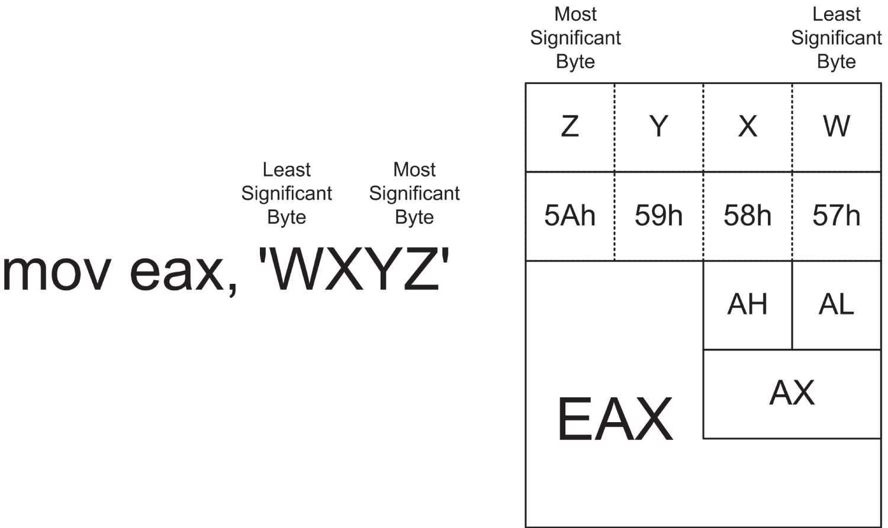
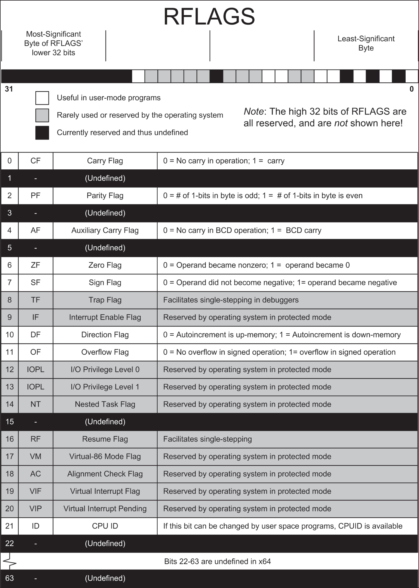

# <a id="Page_175"></a>CHƯƠNG 7 Làm theo instruction của bạn: *Gặp gỡ machine instruction tận mặt*

Sau một màn độc thoại dài, một danh hài nổi tiếng từng nói: tôi kể cho các bạn câu chuyện *đó* để có thể kể cho các bạn câu chuyện *này*….” Chúng ta đã đi được một phần ba cuốn sách này, và tôi thậm chí còn chưa bắt đầu mô tả chi tiết thành phần chủ yếu của assembly language trên PC: instruction set x64 64-bit. Hầu hết các cuốn sách về assembly language, kể cả những cuốn nhắm đến người mới bắt đầu, đều cho rằng instruction set là một điểm khởi đầu tốt không kém bất kỳ điểm nào khác cho câu chuyện của họ, mà không xem xét đến khối nền tảng mà thiếu nó, hầu hết các lập trình viên mới bắt đầu sẽ hoàn toàn lạc lối và bỏ cuộc.

Định hướng là then chốt. Đó là lý do tôi bắt đầu từ điểm khởi đầu *thực sự* và mất 200 trang để đến được chỗ mà những người khác bắt đầu.

Hãy nhớ rằng cuốn sách này được tạo ra để cung cấp nền tảng và định hướng thiết yếu đó cho những bước đầu tiên của bạn trong chính assembly language. Nó *không phải* là một khóa học đầy đủ về assembly language x64. Một khi bạn đi đến cuối cuốn sách này, bạn sẽ có lợi thế hơn khi đọc bất kỳ cuốn nào trong vô số cuốn sách khác về assembly language của các tác giả và nhà xuất bản khác.

Và đã đến lúc chúng ta đi vào trọng tâm của vấn đề, xuống tận nơi phần mềm gặp silicon.

<a id="Page_176"></a>

<a id="head-2-77"></a>

## Tự xây cho mình một sandbox

Cách tốt nhất để làm quen với instruction set x64 là tự xây cho mình một sandbox và cứ thế vui chơi. Một chương trình assembly language không cần phải chạy đúng từ Linux. Nó thậm chí không cần hoàn chỉnh, theo nghĩa thông thường của chương trình. Tất cả những gì nó cần là dễ hiểu đối với NASM và linker, và bản thân điều đó không đòi hỏi nhiều công sức.

Trong biệt ngữ dân kỹ thuật riêng của tôi, một *sandbox* là một chương trình chỉ được dự định chạy *duy nhất* trong một debugger. Nếu bạn muốn thấy một instruction có tác động gì lên memory hay lên một trong các register, việc single-stepping nó trong debugger của SASM sẽ cho bạn thấy một cách sống động. Chương trình không cần trả về kết quả nhìn thấy được trên dòng lệnh. Nó chỉ cần chứa các instruction được viết đúng dạng.

Trong thực tế, ý tưởng sandbox của tôi hoạt động như thế này: bạn assemble và link một chương trình tên là `newsandbox.asm`. Bạn tạo một chương trình NASM tối thiểu ở dạng source code và lưu nó ra đĩa với tên `sandbox.asm`. Bất cứ khi nào bạn muốn chơi đùa với machine instruction, bạn mở `newsandbox.asm` trong SASM và lưu lại nó với tên `SANDBOX.ASM`, ghi đè lên bất kỳ phiên bản `sandbox.asm` cũ hơn nào có thể đang tồn tại. (Nếu vì lý do nào đó bạn muốn giữ một chương trình sandbox cụ thể, hãy lưu nó dưới một tên khác.) Bạn có thể thêm instruction vào để quan sát.

Có thể các thí nghiệm của bạn sẽ cho ra một tổ hợp machine instruction hữu ích đáng để lưu lại. Trong trường hợp đó, hãy lưu file sandbox với tên `EXPERIMENT1.ASM` (hoặc bất kỳ tên mô tả nào bạn muốn đặt), và bạn có thể đưa chuỗi đó vào một chương trình “thật” bất cứ khi nào bạn sẵn sàng.

### Một chương trình NASM tối thiểu cho SASM

Vậy một chương trình đòi hỏi những gì để được NASM assemble bên trong SASM IDE? Thật ra, không nhiều. <a id="R_c07-fea-0001"></a>[Listing 7.1](#c07-fea-0001) là source code của thứ tôi dùng làm sandbox khởi đầu trong SASM. Thực tế, [Listing 7.1](#c07-fea-0001) trình bày nhiều hơn những gì NASM đòi hỏi về mặt kỹ thuật, nhưng không nhiều hơn những gì nó cần để hữu ích như một sandbox.

> **<a id="c07-fea-0001"></a>Listing 7.1: newsandbox.asm**
>
> ```
> section .data
> section .text
>
> global main
>
> main:
>      mov rbp, rsp ;Save stack pointer for debugger
>      nop
> ; Put your experiments between the two nops…
> ; Put your experiments between the two nops…
>      nop
>
> section .bss
> ```

Thực tế, NASM sẽ assemble một source code file hoàn toàn không chứa instruction mnemonic nào—mặc dù công bằng mà nói, executable không có instruction đó sẽ không được Linux chạy. Điều chúng ta *thực sự* cần là một điểm khởi đầu được đánh dấu là global—ở đây là label `main`. (Dùng `main` là một yêu cầu của SASM, không phải của NASM.) Chúng ta cũng cần định nghĩa một data section và một text section như được thể hiện. Data section chứa các mục dữ liệu có tên sẽ được gán giá trị ban đầu khi chương trình chạy. Thông điệp quảng cáo cũ “Eat at Joe's” từ Listing 5.1 là một mục dữ liệu có tên trong data section. Text section chứa code chương trình. Cả hai section này đều cần thiết để tạo một executable, ngay cả khi một hoặc cả hai đều trống.

Section được đánh dấu `.bss` không hoàn toàn thiết yếu, nhưng có nó là tốt nếu bạn định thử nghiệm. Section `.bss` chứa dữ liệu chưa được khởi tạo, tức là không gian được dành sẵn cho các mục dữ liệu không được gán giá trị ban đầu khi chương trình bắt đầu chạy. Về cơ bản, đây là các buffer trống, dành cho dữ liệu sẽ được sinh ra hoặc được đọc từ đâu đó trong khi chương trình đang chạy. Theo thông lệ, section `.bss` nằm sau section `.text`. (Tôi sẽ còn nói nhiều hơn về section `.bss` và dữ liệu chưa khởi tạo trong các chương sắp tới.)

Có hai instruction `NOP` trong `sandbox.asm`. Hãy nhớ rằng các instruction `NOP` chẳng làm gì ngoài việc chiếm một chút thời gian. Chúng ở đó để giúp việc quan sát chương trình trong debugger của SASM dễ dàng hơn. Để chơi đùa với machine instruction, hãy đặt các instruction bạn chọn vào giữa hai comment. Build chương trình, nhấp nút Debug, và vui chơi thôi!

Hãy đặt một breakpoint ở instruction đầu tiên bạn đặt giữa các comment, và nhấp Debug. Việc thực thi sẽ bắt đầu và dừng tại breakpoint của bạn. Để quan sát tác động của instruction đó, hãy nhấp nút Step Over. Đây là lý do có instruction `NOP` thứ hai: khi bạn single-step một instruction, phải có một instruction *sau* instruction đó để việc thực thi tạm dừng lại. Nếu instruction đầu tiên trong sandbox của bạn cũng là instruction cuối cùng, việc thực thi sẽ “chạy ra khỏi mép” ngay ở lần single step đầu tiên, và chương trình của bạn sẽ kết thúc. Khi điều đó xảy ra, khung Registers và Memory của SASM sẽ trống trơn, và bạn sẽ không thể thấy tác động của instruction đó!

Khái niệm chạy ra khỏi mép chương trình là một khái niệm thú vị. Nếu bạn nhấp nút Debug hoặc nhấn phím tắt F5 của nó, bạn sẽ thấy điều gì xảy ra khi bạn không kết thúc chương trình đúng cách: Linux sẽ đưa ra một segmentation fault, thứ có thể có nhiều nguyên nhân. Tuy nhiên, điều đã xảy ra trong trường hợp này là chương trình của bạn đã cố thực thi một vị trí *vượt quá* cuối section `.text`. Linux biết chương trình của bạn dài bao nhiêu, và nó sẽ không cho phép bạn thực thi bất kỳ instruction nào không có mặt trong chương trình khi nó được nạp.

<a id="Page_178"></a>Dĩ nhiên, điều đó chẳng gây hại lâu dài gì. Linux *rất* giỏi xử lý các chương trình cư xử sai và bị viết sai dạng (đặc biệt là các chương trình đơn giản), và không điều gì bạn có khả năng vô tình làm sẽ ảnh hưởng đến tính toàn vẹn của chính Linux. Bạn có thể tránh sinh ra segmentation fault bằng cách nhấp nút Stop màu đỏ trước khi đẩy việc thực thi ra khỏi cuối chương trình thí nghiệm nhỏ của mình. SASM sẽ chuyển từ Debug mode sang Edit mode. Hãy nhớ rằng nếu bạn thoát Debug mode, bạn sẽ không còn thấy được các register hay các mục memory.

Dĩ nhiên, nếu bạn chỉ muốn để một chương trình chạy, bạn có thể thêm vài dòng thực hiện một `SYSCALL` tới routine `Exit` của x64 ở cuối sandbox. Bằng cách đó, nếu việc thực thi chạy ra khỏi đáy các thí nghiệm của bạn, `SYSCALL` sẽ chấm dứt việc thực thi một cách êm đẹp. Sau đây là code cho `Exit SYSCALL`:

```
mov rax,60   ; Code for Exit Syscall
mov rdi,0    ; Return a code of zero
syscall      ; Make kernel call
```

Hãy đặt code này *sau* `NOP` thứ hai, và bạn đã được bảo vệ. Lưu ý rằng tôi *không* làm điều này với file `newsandbox.asm` trong kho listing.

<a id="head-2-79"></a>

## Instruction và operand của chúng

Hoạt động phổ biến nhất trong công việc assembly language là đưa dữ liệu từ chỗ này sang chỗ kia. Có vài cách chuyên biệt để làm điều này, nhưng chỉ có một cách thực sự tổng quát: instruction `MOV`. `MOV` có thể di chuyển một byte, word (16 bit), double word (32 bit) hoặc quad word (64 bit) dữ liệu từ register này sang register khác, từ một register vào memory, hoặc từ memory vào một register. Điều `MOV` *không thể* làm là di chuyển dữ liệu trực tiếp từ một address trong memory sang một address khác trong memory. (Để làm điều đó, bạn cần hai instruction `MOV` riêng biệt: thứ nhất từ memory vào một register và thứ hai từ register đó ra lại một chỗ khác trong memory.)

Cái tên `MOV` hơi không đúng với thực chất, vì điều thực sự xảy ra là dữ liệu được *sao chép* từ nguồn tới đích. Tuy nhiên, một khi đã được sao chép tới đích, dữ liệu không biến mất khỏi nguồn mà tiếp tục tồn tại ở cả hai nơi. Điều này hơi mâu thuẫn với khái niệm trực giác của chúng ta về việc di chuyển một thứ gì đó, vốn thường có nghĩa là thứ đó biến mất khỏi vị trí nguồn và xuất hiện lại ở vị trí đích.

<a id="head-2-80"></a>

## Source operand và destination operand

Hầu hết các machine instruction, kể cả `MOV`, có một hoặc nhiều *operand*. (Một số instruction không có operand hoặc hoạt động ngầm định trên register hay memory. <a id="Page_179"></a>Khi đó là trường hợp này, tôi sẽ chú ý nhắc đến nó trong phần văn bản.) Hãy xem machine instruction này:

```
mov rax,1
```

Có hai operand trong instruction trên. Operand thứ nhất là RAX, và operand thứ hai là chữ số 1. Theo quy ước trong assembly language, operand thứ nhất (ngoài cùng bên trái) thuộc về một machine instruction là *destination operand*. Operand thứ hai tính từ bên trái là *source operand*.

Với instruction `MOV`, ý nghĩa của hai operand khá sát nghĩa đen: source operand được sao chép vào destination operand. Trong instruction trên, source operand (giá trị literal 1) được sao chép vào destination operand RAX. Ý nghĩa của nguồn và đích không hề sát nghĩa đen như vậy trong các instruction khác, nhưng một quy tắc kinh nghiệm là thế này: bất cứ khi nào một machine instruction khiến một giá trị mới được sinh ra, giá trị mới đó được đặt vào destination operand.

Có ba loại dữ liệu khác nhau có thể được dùng làm operand. Đó là *memory data*, *register data* và *immediate data*. Tôi đã bày một số instruction `MOV` ví dụ lên bàn mổ xẻ trong <a id="R_c07-tbl-0001"></a>[Bảng 7.1](#c07-tbl-0001) để bạn cảm nhận được cách các loại dữ liệu khác nhau được chỉ định làm operand cho instruction `MOV`.

*<a id="c07-tbl-0001"></a>**Bảng 7.1**: MOV và các operand của nó*

| MACHINE<br>INSTRUCTION | DESTINATION<br>OPERAND | SOURCE OPERAND | GHI CHÚ VỀ OPERAND |
|---|---|---|---|
| MOV | RAX, | 42h | Nguồn là immediate data. |
| MOV | RBX, | RDI | Cả hai đều là register data 64-bit. |
| MOV | BX, | CX | Cả hai đều là register data 16-bit. |
| MOV | DL, | BH | Cả hai đều là register data 8-bit. |
| MOV | [RBP], | RDI | Đích là memory data 64-bit tại address được lưu trong RBP. |
| MOV | RDX, | [RSI] | Nguồn là memory data 64-bit tại address được lưu trong RSI. |

### Immediate Data

Instruction `MOV RAX,42h` trong [Bảng 7.1](#c07-tbl-0001) là một ví dụ tốt về việc dùng thứ chúng ta gọi là *immediate data*, được truy cập thông qua một addressing mode gọi là *immediate addressing*. Immediate addressing có tên như vậy vì mục được address là dữ liệu được tích hợp ngay trong chính machine instruction. CPU không phải đi đâu để tìm immediate data. Nó không nằm trong register, cũng không được lưu trong một mục dữ liệu ở đâu đó ngoài kia trong memory. Immediate data luôn nằm ngay bên trong instruction đang được nạp và thực thi.

Immediate data phải có kích thước phù hợp với operand. Ví dụ, bạn không thể di chuyển một giá trị immediate 16-bit vào một phần register 8-bit như AH hay DL. NASM sẽ không cho phép bạn assemble một instruction như thế này:

```
mov cl,067EFh
```

CL là một register 8-bit, và 067EFh là một đại lượng 16-bit. Không được đâu!

Vì nó được tích hợp ngay trong một machine instruction, bạn có thể nghĩ rằng immediate data sẽ được truy cập nhanh. Điều này chỉ đúng đến một mức nào đó: nạp *bất cứ thứ gì* từ memory đều tốn nhiều thời gian hơn nạp bất cứ thứ gì từ một register, và xét cho cùng, các instruction được lưu trong memory. Vì vậy, mặc dù address immediate data có phần nhanh hơn address dữ liệu thông thường được lưu trong memory, không cái nào nhanh được gần bằng việc đơn giản lấy một giá trị từ một register CPU.

Cũng hãy nhớ rằng *chỉ* source operand mới có thể là immediate data. Destination operand là nơi dữ liệu *đi tới*, không phải nơi nó đến từ đó. Vì immediate data gồm các hằng số literal (những số như 1, 0, 42 hay 07F2Bh), việc cố sao chép một thứ gì đó *vào* immediate data thay vì *từ* immediate data đơn giản là vô nghĩa và luôn là một error.

NASM cho phép một số dạng immediate data thú vị. Ví dụ, điều sau đây hoàn toàn hợp lệ, dù không nhất thiết hữu ích như vẻ ngoài thoạt nhìn của nó:

```
mov eax,'WXYZ'
```

Đây là một instruction tốt để nạp vào sandbox và thực thi trong debugger. Hãy nhìn nội dung của register EAX trong phần hiển thị register:

```
0x5a595857
```

Điều này có vẻ kỳ lạ, nhưng hãy nhìn kỹ: các giá trị số tương đương của các ký tự ASCII viết hoa W, X, Y và Z đã được nạp nose-to-tail vào EAX. Nếu bạn chưa nắm vững ASCII, hãy xem bảng trong [Phụ lục C](ch16_appendix_c_character_set_charts.vi.md). W là 57h, X là 58h, Y là 59h, và Z là 5Ah. Mỗi giá trị tương đương ký tự có kích thước 8 bit, vì vậy bốn cái vừa khít vào register EAX 32-bit. Tuy nhiên, chúng bị ngược!

Thật ra, không phải vậy. Hãy nhớ lại khái niệm “endianness” mà tôi đã giới thiệu ở đầu [Chương 5](ch05_the_right_to_assemble.vi.md), và nếu bạn không nhớ, hãy quay lại đọc lại mục đó. Architecture x86/x64 là “little endian”, nghĩa là byte có trọng số nhỏ nhất trong một chuỗi multibyte được lưu ở address thấp nhất. Điều này cũng áp dụng cho register và trở nên hợp lý một khi bạn hiểu cách chúng ta gọi tên các đơn vị lưu trữ bên trong một register.

Sự nhầm lẫn xuất hiện là do thói quen phân liệt của chúng ta: đọc văn bản từ trái sang phải, trong khi đọc số từ phải sang trái. Hãy xem <a id="R_c07-fig-0001"></a>[Hình 7.1](#c07-fig-0001). <a id="Page_181"></a>(Ví dụ này dùng register EAX 32-bit để làm cho hình bớt phức tạp và dễ hiểu hơn.) Khi được coi là một chuỗi ký tự văn bản, chữ *W* trong WXYZ được coi là phần tử có trọng số nhỏ nhất. Tuy nhiên, EAX là một vật chứa số, trong đó cột có trọng số nhỏ nhất luôn (đối với các ngôn ngữ phương Tây) ở bên phải. Byte có trọng số nhỏ nhất trong EAX chúng ta gọi là AL, và đó là chỗ chữ *W* đi vào. Byte có trọng số second-to-least trong EAX chúng ta gọi là AH, và đó là chỗ chữ *X* đi vào. Hai byte có trọng số lớn nhất trong EAX không có tên riêng và không thể được address riêng lẻ, nhưng chúng vẫn là các byte 8-bit và có thể chứa các giá trị 8-bit như ký tự ASCII. Ký tự có trọng số lớn nhất trong chuỗi WXYZ là chữ *Z*, và nó được lưu trong byte có trọng số lớn nhất của EAX.



*<a id="c07-fig-0001"></a>**Hình 7.1**: Chuỗi ký tự dưới dạng immediate data*

### Register Data

Dữ liệu được lưu bên trong một register CPU được gọi là *register data*, và việc truy cập register data trực tiếp là một addressing mode gọi là *register addressing*. Register addressing được thực hiện bằng cách đơn giản nêu tên register mà chúng ta muốn làm việc. Đây là vài ví dụ hoàn toàn hợp lệ về register data và register addressing:

```
mov rbp,rsi   ; 64-bit
add ecx,edx   ; 32-bit
add di,ax     ; 16-bit
mov bl,ch     ; 8-bit
```

Ở đây chúng ta không *chỉ* nói về instruction `MOV`. Instruction `ADD` làm đúng điều bạn có thể đoán và cộng source operand với destination operand. Tổng thay thế bất cứ thứ gì có trong destination operand. Bất kể instruction nào, register addressing xảy ra bất cứ khi nào dữ liệu trong một register được tác động trực tiếp.

Assembler theo dõi một số điều vô nghĩa, và một tình huống như vậy là nêu tên một nửa register 16-bit và một register 64-bit đầy đủ trong cùng một instruction. Những thao tác như vậy không hợp lệ—xét cho cùng, việc di chuyển một nguồn 8-byte vào một đích 2-byte có nghĩa là gì? Và mặc dù việc di chuyển một nguồn 2-byte vào một đích 8-byte có vẻ khả thi và đôi khi thậm chí hợp lý, CPU không hỗ trợ điều đó, và nó không thể được làm trực tiếp. Nếu bạn thử, NASM sẽ đưa cho bạn error này:

```
error: invalid combination of opcode and operands
```

Nói cách khác, nếu bạn đang di chuyển dữ liệu từ register sang register, register nguồn và register đích *phải* có cùng kích thước.

Quan sát register data trong debugger là một cách tốt để có được cảm nhận bản năng về cách điều này hoạt động, đặc biệt khi bạn mới bắt đầu. Hãy thực hành một chút. Nhập các instruction này vào sandbox của bạn, build executable, và nạp executable sandbox vào debugger:

```
xor rbx,rbx
xor rcx,rcx

mov rax,067FEh
mov rbx,rax
mov cl,bh
mov ch,bl
```

Đặt một breakpoint ở instruction đầu tiên, rồi nhấp Run. Single-step qua các instruction, quan sát cẩn thận điều gì xảy ra với RAX, RBX và RCX. Hãy nhớ rằng cửa sổ Registers của SASM *không* hiển thị riêng lẻ và tách biệt các phần register 8-bit, 16-bit hay 32-bit. EAX là một phần của RAX, AX là một phần của EAX, và CL là một phần của ECX, v.v. Bất cứ thứ gì bạn đặt vào RAX cũng đã nằm trong EAX, AX và AL.

Một khi bạn đã single-stepping xong, hãy nhấp biểu tượng Stop màu đỏ để kết thúc chương trình. Hãy nhớ rằng nếu bạn chọn Debug ➪ Continue hoặc cố bước qua cuối chương trình, Linux sẽ đưa cho bạn một segmentation fault vì không kết thúc chương trình đúng cách. Lỗi đó sẽ không làm hại gì; hãy nhớ rằng sandbox không được kỳ vọng là một chương trình Linux hoàn chỉnh và đúng đắn. Tuy nhiên, “giết” chương trình bằng Stop thay vì sinh ra lỗi là một thói quen tốt.

Hãy chú ý hai instruction đầu tiên. Khi bạn muốn đặt giá trị 0 vào một register, cách nhanh nhất là dùng instruction `XOR`, instruction thực hiện một phép toán `XOR` bitwise trên source operand và destination operand. Như chúng ta sẽ thấy ở phần sau một chút, XOR một giá trị với chính nó cho ra 0. Vâng, bạn có thể dùng

<a id="Page_183"></a>

```
mov rbx,0
```

thay vào đó, nhưng cách đó phải đi ra memory để nạp giá trị immediate 0. XOR một register với chính nó không đi ra memory cho cả source operand lẫn destination operand và do đó nhanh hơn một chút.

Một khi bạn đã đưa RBX và RCX về không, đây là điều xảy ra: instruction `MOV` đầu tiên là một ví dụ về immediate addressing dùng các register 64-bit. Giá trị hexadecimal 16-bit 067FEH được di chuyển vào register RAX. (Lưu ý ở đây rằng bạn *có thể* `MOV` một giá trị *immediate* 16-bit hoặc bất kỳ kích thước nào khác vừa với register đích.) Instruction thứ hai dùng register addressing để sao chép register data từ EAX vào EBX.

Instruction `MOV` thứ ba và thứ tư đều di chuyển dữ liệu giữa các phần register 8-bit thay vì các register 16-, 32- hay 64-bit. Hai instruction này đạt được một điều thú vị. Hãy nhìn phần hiển thị register cuối cùng, và so sánh giá trị của RBX và RCX. Bằng cách di chuyển giá trị từ BX vào CX từng byte một, có thể đảo ngược thứ tự của hai byte tạo nên BX. Nửa cao của BX (thứ đôi khi chúng ta gọi là *most significant byte*, hay MSB, của BX) được di chuyển vào nửa thấp của CX. Sau đó nửa thấp của BX (thứ đôi khi chúng ta gọi là *least significant byte*, hay LSB, của BX) được di chuyển vào nửa cao của CX. Đây chỉ là một mẫu nhỏ trong số các mánh mà bạn có thể thực hiện với các register general-purpose.

Chỉ để giúp bạn từ bỏ ý nghĩ rằng instruction `MOV` nên được dùng để hoán đổi hai nửa của một register 16-bit, hãy để tôi đề nghị bạn làm như sau: quay lại SASM và thêm instruction này vào cuối sandbox của bạn:

```
xchg cl,ch
```

Build lại sandbox và quay vào debugger để xem điều gì xảy ra. Instruction `XCHG` hoán đổi các giá trị chứa trong hai operand của nó. Những gì đã được hoán đổi trước đó lại được hoán đổi lần nữa, và giá trị trong RCX sẽ khớp với các giá trị đã có trong RAX và RBX. Một ý hay trong khi viết những chương trình assembly language đầu tiên của bạn là định kỳ double-check instruction set để xem rằng thứ bạn đã chắp vá lại với bốn hay năm instruction không thể làm được bằng một instruction duy nhất. Instruction set của Intel rất giỏi đánh lừa bạn về mặt đó.

Có một lưu ý ở đây: đôi khi một “trường hợp đặc biệt” nhanh hơn về thời gian thực thi trên máy so với một trường hợp tổng quát hơn. Phép chia cho một lũy thừa của 2 có thể được thực hiện bằng instruction `DIV`, nhưng nó cũng có thể được thực hiện bằng instruction `SHR` (Shift Right). `DIV` tổng quát hơn (bạn có thể dùng nó để chia cho bất kỳ số nguyên không dấu nào, không chỉ lũy thừa của 2), nhưng nó chậm hơn rất nhiều. (Tôi sẽ nói thêm về `DIV` ở phần sau của chương này.) Tốc độ của từng instruction riêng lẻ ngày nay ít quan trọng hơn nhiều so với 30 năm trước. Dù vậy, với các chương trình có các hàm lặp đi lặp lại phức tạp được thực thi hàng nghìn hay hàng trăm nghìn lần trong một vòng lặp, tốc độ instruction rất có thể tạo ra sự khác biệt.

<a id="Page_184"></a>

### Memory Data và Effective Address

Immediate data được tích hợp ngay trong machine instruction của chính nó. Register data được lưu trong một trong số các register nội bộ của CPU. Ngược lại, *memory data* được lưu ở đâu đó trong mảnh memory hệ thống mà một chương trình “sở hữu”, tại một memory address 64-bit.

Với một hoặc hai ngoại lệ quan trọng (các string instruction, mà tôi sẽ trình bày ở một mức độ nào đó—nhưng không đầy đủ—ở phần sau), chỉ *một* trong hai operand của một instruction có thể chỉ định một vị trí memory. Nói cách khác, bạn có thể di chuyển một giá trị immediate vào memory, một giá trị memory vào một register, hoặc một tổ hợp tương tự nào đó, nhưng bạn *không thể* di chuyển trực tiếp một giá trị memory sang một giá trị memory khác. Đây là một hạn chế vốn có của các CPU Intel ở mọi thế hệ (không chỉ x64), và chúng ta phải sống chung với nó, dù đôi khi nó bất tiện đến đâu.

Để chỉ định rằng chúng ta muốn dữ liệu tại vị trí memory được chứa trong một register chứ không phải dữ liệu trong chính register đó, chúng ta dùng dấu ngoặc vuông bao quanh tên register. Nói cách khác, để di chuyển quadword trong memory tại address được chứa trong RBX vào register RAX, chúng ta sẽ dùng instruction sau:

```
mov rax,[rbx]
```

Dấu ngoặc vuông có thể chứa nhiều hơn tên của một register 64-bit duy nhất, như chúng ta sẽ học chi tiết ở phần sau. Ví dụ, bạn có thể cộng một hằng số literal với một register bên trong dấu ngoặc, và NASM sẽ làm phép tính.

```
mov rax,[rbx+16]
```

Tương tự với việc cộng hai register general-purpose, như thế này:

```
mov rax,[rbx+rcx]
```

Và như thể thế vẫn chưa đủ, bạn có thể cộng hai register cộng thêm một hằng số literal.

```
mov rax,[rbx+rcx+11]
```

Dĩ nhiên, không phải thứ gì cũng được. Bất cứ thứ gì nằm bên trong dấu ngoặc được gọi là *effective address* của một mục dữ liệu trong memory, và có những quy tắc quy định điều gì có thể là một effective address hợp lệ và điều gì không. Ở giai đoạn tiến hóa hiện tại của phần cứng Intel, hai register có thể được cộng với nhau để tạo thành effective address, nhưng không thể ba hay nhiều hơn. Nói cách khác, đây *không phải* là các dạng effective address hợp lệ:

```
mov rax,[rbx+rcx+rdx]
mov rax,[rbx+rcx+rsi+rdi]
```

Các dạng effective address phức tạp hơn thì dễ minh họa hơn là giải thích, nhưng trước tiên chúng ta phải học thêm vài điều khác. Chúng đặc biệt <a id="Page_185"></a>hữu ích khi bạn làm việc với lookup table, và tôi sẽ đi vào điều đó khá dài ở phần sau. Lúc này, điều quan trọng nhất cần làm là *không* nhầm lẫn một mục dữ liệu với nơi nó tồn tại!

### Nhầm lẫn dữ liệu với address của nó

Điều này nghe có vẻ tầm thường, nhưng hãy tin tôi, đó là một việc khá dễ mắc phải. Hồi Listing 5.1, chúng ta có định nghĩa dữ liệu này và instruction này:

```
EatMsg: db "Eat at Joe’s!"
.  .  .  .
mov rsi,EatMsg
```

Nếu bạn từng tiếp xúc với các ngôn ngữ high-level như Pascal, bản năng đầu tiên của bạn có thể là cho rằng bất cứ dữ liệu nào được lưu trong `EatMsg` sẽ được sao chép vào RSI. Assembly không hoạt động theo cách đó. Instruction `MOV` đó thực ra sao chép *address* của `EatMsg`, chứ không phải thứ được lưu *trong* (đúng ra là tại) `EatMsg`.

*Trong assembly language, tên biến biểu diễn address, không phải dữ liệu!*

Vậy, làm sao bạn thực sự “lấy được” dữ liệu được biểu diễn bởi một biến như `EatMsg`? Một lần nữa, việc đó được làm bằng dấu ngoặc vuông.

```
mov rdx,[EatMsg]
```

Điều instruction này làm là đi ra vị trí trong memory được chỉ định bởi address mà `EatMsg` biểu diễn, kéo vào lượng dữ liệu 64 bit đầu tiên từ address đó, và nạp dữ liệu đó vào RDX bắt đầu từ byte có trọng số nhỏ nhất trong RDX. Với nội dung chúng ta đã định nghĩa cho `EatMsg`, đó sẽ là tám ký tự *E*, *a*, *t*, một dấu space, *a*, *t*, một dấu space, và *J*.

### Kích thước của memory data

Nhưng nếu bạn chỉ muốn làm việc với một ký tự duy nhất chứ không phải tám ký tự đầu tiên thì sao? Nếu bạn không muốn cả 64 bit thì sao? Về cơ bản, nếu bạn muốn dùng một byte dữ liệu, bạn cần nạp nó vào một vật chứa byte-sized. Register RAX có kích thước 64 bit. Tuy nhiên, chúng ta có thể address byte least-significant của RAX dưới tên AL. AL có kích thước một byte, và bằng cách lấy AL làm destination operand, chúng ta có thể mang về byte đầu tiên của `EatMsg` theo cách này:

```
mov al,[EatMsg]
```

Dĩ nhiên, AL được chứa *bên trong* RAX—nó không phải là một register riêng biệt. (Hãy nhìn lại [Hình 7.1](#c07-fig-0001) nếu điều này chưa rõ ngay với bạn.) Nhưng cái tên “AL” cho phép chúng ta chỉ nạp mỗi lần một byte từ memory.

<a id="Page_186"></a>Chúng ta có thể thực hiện một mánh tương tự bằng cách dùng tên EAX để chỉ 4 byte thấp (32 bit) của RAX:

```
mov eax,[EatMsg]
```

Lần này, các ký tự *E*, *a*, *t* và một dấu space được đọc từ memory và đặt vào bốn byte có trọng số nhỏ nhất của RAX.

Vấn đề kích thước trở nên rắc rối là khi bạn ghi dữ liệu trong một register ra memory. NASM không “nhớ” kích thước của biến như các ngôn ngữ higher-level làm. Nó biết `EatMsg` *bắt đầu* ở đâu trong memory, và chỉ có vậy. Bạn phải cho NASM biết cần di chuyển bao nhiêu byte dữ liệu. Việc này được thực hiện bằng một *size specifier*. Đây là một ví dụ:

```
mov byte [EatMsg],'G'
```

Ở đây, chúng ta cho NASM biết rằng chúng ta chỉ muốn di chuyển một byte duy nhất ra memory bằng cách dùng size specifier `BYTE`. Các size specifier khác bao gồm `WORD` (16 bit), `DWORD` (32 bit) và `QWORD` (64 bit).

### Những ngày xưa tồi tệ

Hãy vui mừng vì bạn đang học assembly Intel vào thời nay. Những năm trước nó phức tạp hơn *rất nhiều*. Ở real mode dưới DOS, có vài hạn chế đối với các thành phần của một effective address mà ngày nay đơn giản là không còn tồn tại, dù ở protected mode 32-bit hay long mode 64-bit. Ở real mode, chỉ một số register general-purpose x86 nhất định mới có thể giữ một memory address: BX, BP, SI và DI. Những register khác, AX, CX và DX, thì không thể.

Tệ hơn nữa, mọi address đều có hai phần, như chúng ta đã học trong [Chương 4](ch04_location_location_location.vi.md). Bạn phải để tâm đến việc một address nằm trong segment nào, và bạn phải đảm bảo chỉ định segment ở những chỗ segment không hiển nhiên. Bạn phải dùng những cấu trúc như `[DS:BX]` hay `[ES:BP]`. Bạn phải mày mò với những thứ quỷ quái gọi là `ASSUMEs`, về những thứ này càng nói ít càng tốt. (Nếu vì lý do nào đó bạn bị buộc phải lập trình ở real mode cho x86, hãy cố tìm một bản ấn bản thứ hai của cuốn sách này, từ năm 2000, trong đó tôi xử lý toàn bộ mớ hỗn độn đó với chi tiết đến rợn người.)

Theo rất nhiều cách, cuộc sống bây giờ đơn giản là *tốt hơn*.

<a id="head-2-81"></a>

## Tập hợp quanh những lá cờ nào, anh em!

Mặc dù tôi đã nhắc đến nó trong phần tổng quan về architecture x64, chúng ta vẫn chưa nghiên cứu chi tiết register RFlags. RFlags đúng là một ngăn kéo đồ lặt vặt chứa những mẩu thông tin nhỏ rời rạc, và thật khó (và có lẽ gây hiểu lầm) nếu chỉ ngồi xuống và mô tả chi tiết tất cả chúng cùng một lúc. Điều tôi sẽ làm là mô tả ngắn gọn các flag CPU ở đây rồi chi tiết hơn khi chúng ta gặp chúng trong lúc <a id="Page_187"></a>thảo luận các instruction khác nhau thay đổi giá trị của flag hoặc dùng chúng khi rẽ nhánh.

Một *flag* là một bit thông tin duy nhất có ý nghĩa độc lập với mọi bit khác. Một bit có thể được CPU *set* thành 1 hoặc *clear* về 0 tùy theo nhu cầu của nó. Ý tưởng là cho bạn, lập trình viên, biết trạng thái của một số điều kiện nhất định bên trong CPU để chương trình của bạn có thể kiểm tra và hành động theo trạng thái của các điều kiện đó. Hiếm hơn nhiều, chính bạn, lập trình viên, set một flag như một cách báo hiệu điều gì đó cho CPU.

Tôi thường hình dung một hàng hộp thư ở vùng quê, mỗi hộp có một lá cờ nhỏ màu đỏ bên hông. Mỗi lá cờ có thể dựng lên hoặc hạ xuống, và nếu cờ của nhà Smith dựng lên, nó cho người đưa thư biết rằng nhà Smith đã bỏ thư vào hộp để được lấy đi. Người đưa thư nhìn xem cờ của nhà Smith có được dựng lên không (một phép kiểm tra) và, nếu có, mở hộp thư nhà Smith và lấy thư gửi đi đang chờ.

RFlags nói chung là một register 64-bit duy nhất nằm sâu bên trong CPU. Nó là phần mở rộng 64-bit của register EFlags 32-bit, register này đến lượt nó lại là phần mở rộng 32-bit của register Flags 16-bit có trong các CPU 8086/8088 cổ xưa. Chỉ 18 bit của register RFlags thực sự là flag. Phần còn lại được dành riêng để dùng sau này trong các thế hệ CPU Intel tương lai. Ngay cả trong số các flag đã được định nghĩa, chỉ một vài flag là phổ biến, và còn ít hơn nữa là hữu ích khi bạn mới đang học đường đi nước bước. Một số chỉ được dùng bên trong phần mềm hệ thống như hệ điều hành và hoàn toàn không khả dụng trong các chương trình userspace.

Hơi lộn xộn một chút, nhưng hãy xem <a id="R_c07-fig-0002"></a>[Hình 7.2](#c07-fig-0002), hình tóm tắt mọi flag hiện được định nghĩa trong architecture x64. Các flag tôi đặt trên nền xám là những flag bí hiểm mà bạn có thể yên tâm bỏ qua lúc này. Các khoảng trống và đường được tô đen được coi là dành riêng và không chứa flag nào được định nghĩa.

Mỗi flag trong register RFlags có một ký hiệu hai, ba hay four-letter mà hầu hết lập trình viên biết đến chúng. Tôi dùng những ký hiệu đó trong cuốn sách này, và bạn nên làm quen với chúng. Các flag phổ biến nhất, ký hiệu của chúng và mô tả ngắn gọn về ý nghĩa của chúng như sau:

- OF—Overflow flag được set khi kết quả của một phép toán số học trên một đại lượng số nguyên có dấu trở nên quá lớn để vừa với operand mà nó chiếm ban đầu. OF thường được dùng như “carry flag” trong số học có dấu.

- DF—Direction flag là một kẻ lập dị trong số các flag ở chỗ nó cho *CPU* biết điều mà *bạn* muốn nó biết, chứ không phải ngược lại. Nó quy định hướng di chuyển của hoạt động (up-memory hoặc down-memory) trong khi thực thi các string instruction. Khi DF được set, các string instruction tiến từ memory cao về phía memory thấp. Khi DF bị clear, các string instruction tiến từ memory thấp về phía memory cao.

  

  *<a id="c07-fig-0002"></a>**Hình 7.2**: Register RFlags của x64*

- <a id="Page_189"></a>IF—Interrupt Enable flag là một flag two-way. CPU set nó trong một số điều kiện nhất định, và bạn có thể tự set nó bằng các instruction `STI` và `CLI`—mặc dù có lẽ bạn sẽ không làm vậy; xem bên dưới. Khi IF được set, interrupt được cho phép và có thể xảy ra khi được yêu cầu. Khi IF bị clear, interrupt bị CPU bỏ qua. Các chương trình thông thường có thể set và clear flag này mà không bị trừng phạt gì ở Real Mode, hồi kỷ nguyên DOS. Dưới Linux (dù 32-bit hay 64-bit), IF được dành riêng cho hệ điều hành và đôi khi cho các driver của nó sử dụng. Nếu bạn cố dùng các instruction `STI` và `CLI` bên trong một chương trình của mình, Linux sẽ đưa cho bạn một general protection fault, và chương trình của bạn sẽ bị kết thúc. Hãy coi IF là off-limits đối với lập trình userspace như chúng ta đang thảo luận trong cuốn sách này.

- TF—Khi được set, Trap flag cho phép debugger quản lý single-stepping, bằng cách buộc CPU chỉ thực thi một instruction duy nhất trước khi gọi một interrupt routine. Đây không phải là một flag đặc biệt hữu ích cho lập trình thông thường, và tôi sẽ không nói thêm gì về nó trong cuốn sách này.

- SF—Sign flag được set khi kết quả của một phép toán khiến operand trở thành âm. Với từ *âm*, chúng ta chỉ có ý nói rằng bit highest-order trong operand (*sign bit*) trở thành 1 trong một phép toán số học có dấu. Bất kỳ phép toán nào để lại dấu dương cho kết quả sẽ clear SF.

- ZF—Zero flag được set khi kết quả của một phép toán trở thành không. Nếu thay vào đó destination operand trở thành một giá trị khác không, ZF bị clear. Bạn sẽ dùng flag này rất nhiều cho các conditional jump.

- AF—Auxiliary Carry flag chỉ được dùng cho số học BCD. Số học BCD coi mỗi byte operand là một cặp “nybble” 4-bit và cho phép một thứ gần giống số học decimal (cơ số 10) được thực hiện trực tiếp trong phần cứng CPU bằng cách dùng một trong các instruction số học BCD. Những instruction này được coi là lỗi thời và không có mặt trong x64. Tôi không trình bày chúng trong cuốn sách này.

- PF—Parity flag sẽ có vẻ quen thuộc ngay lập tức đối với bất kỳ ai hiểu truyền thông dữ liệu nối tiếp và hoàn toàn kỳ quặc đối với bất kỳ ai không hiểu. PF cho biết số bit được set (1) trong byte low-order của một kết quả là chẵn hay lẻ. Ví dụ, nếu kết quả là 0F2H, PF sẽ bị clear vì 0F2H (11110010) chứa một số lẻ bit 1. Tương tự, nếu kết quả là 3AH (00111100), PF sẽ được set vì có một số chẵn (bốn) bit 1 trong kết quả. Flag này là di sản từ thời mọi giao tiếp máy tính đều được thực hiện qua một cổng nối tiếp, mà đối với cổng đó, một hệ thống phát hiện lỗi gọi là *parity checking* phụ thuộc <a id="Page_190"></a>vào việc biết số bit được set trong một byte ký tự là chẵn hay lẻ. PF rất hiếm khi được dùng, và tôi sẽ không mô tả thêm về nó.

- CF—Carry flag được dùng trong các phép toán số học không dấu. Nếu kết quả của một phép toán số học hoặc phép shift “mang ra” một bit khỏi operand, CF được set. Ngược lại, nếu không có gì được mang ra, CF bị clear.

### Phép tắc flag

Thứ tôi gọi là “phép tắc flag” là cách một instruction nhất định ảnh hưởng đến các flag trong register RFlags. Bạn *phải* nhớ rằng phần mô tả các flag ở những trang trước *chỉ* là những khái quát hóa và phải tuân theo các hạn chế cụ thể và các trường hợp đặc biệt do từng instruction áp đặt. Phép tắc flag đối với từng flag thay đổi rất nhiều từ instruction này sang instruction khác, mặc dù *ý nghĩa* của việc dùng flag có thể giống nhau trong mọi trường hợp.

Ví dụ, một số instruction khiến số không xuất hiện trong một operand thì set ZF, trong khi những instruction khác thì không. Đáng buồn là không có hệ thống nào cho việc đó và không có cách dễ dàng nào để ghi nhớ nó rành mạch trong đầu. Khi bạn định dùng các flag để kiểm tra thông qua các instruction conditional jump, bạn phải kiểm tra từng instruction riêng lẻ để xem các flag khác nhau bị ảnh hưởng thế nào.

*Phép tắc flag là một vấn đề rất riêng của từng instruction. Hãy tra một tài liệu tham khảo instruction cho từng instruction để xem nó có ảnh hưởng đến các flag hay không. Đừng giả định gì cả!*

### Quan sát flag từ SASM

Register RFlags là một register, giống như RAX, và khi bạn ở debug mode, giá trị của nó được hiển thị trong phần Registers của SASM. Giá trị của các flag được hiển thị giữa dấu ngoặc vuông. Khi bạn bắt đầu debug code userspace, SASM thường sẽ hiển thị tên của các flag PF, ZF và IF.

```
[ PF ZF IF ]
```

Điều này có nghĩa là vì lý do nào đó, khi Linux cho phép bạn bắt đầu debug, Parity flag, Zero flag và Interrupt Enable flag đang được set. Những giá trị ban đầu này là “đồ thừa” từ code được thực thi trước đó và hoàn toàn không phải do code của bạn trong debugger gây ra. Hơn nữa, giá trị của chúng không mang ý nghĩa gì vào phiên debug của bạn và do đó không cần diễn giải.

Khi bạn thực thi một instruction ảnh hưởng đến các flag trong một phiên debug, SASM sẽ hiển thị tên của một flag nếu flag đó được set hoặc sẽ xóa tên của flag nếu flag đó bị clear.

<a id="Page_191"></a>

### Cộng và trừ một bằng INC và DEC

Một bài học đơn giản về phép tắc flag liên quan đến hai instruction `INC` và `DEC`. Một số machine instruction x86 đi theo cặp, trong đó có `INC` và `DEC`. Chúng lần lượt tăng và giảm một operand đi một.

Cộng một vào một thứ gì đó hay trừ một khỏi một thứ gì đó là những hành động xảy ra *rất nhiều* trong lập trình máy tính. Nếu bạn đang đếm số lần một chương trình thực thi một vòng lặp, đếm byte trong một bảng, hoặc làm một việc gì đó tiến lên hay lùi lại từng đơn vị một, `INC` hay `DEC` có thể là những cách rất nhanh để thực hiện phép cộng hay phép trừ thực sự.

Cả `INC` lẫn `DEC` đều chỉ nhận một operand. Assembler sẽ gắn cờ một error nếu bạn cố dùng `INC` hay `DEC` với hai operand hoặc không có operand nào. Không cái nào hoạt động trên immediate data.

Hãy thử cả hai bằng cách thêm các instruction sau vào sandbox của bạn. Build sandbox như thường lệ, vào debug mode, và bước qua nó:

```
mov eax,0FFFFFFFFh
mov ebx,02Dh
dec ebx
inc eax
```

Hãy quan sát điều gì xảy ra với các register EAX và EBX. Giảm EBX biến giá trị 2DH thành giá trị 2CH như có thể đoán trước. Mặt khác, tăng 0FFFFFFFFH làm register EAX quay vòng về 0, vì 0FFFFFFFFH là giá trị không dấu lớn nhất có thể được biểu diễn trong một register 32-bit. (Tôi dùng EAX trong ví dụ ở đây vì lấp đầy register RAX 64-bit bằng bit cần *rất nhiều* chữ *F*!) Cộng 1 vào nó làm nó quay vòng về không, giống như cộng 1 vào 99 làm hai chữ số ngoài cùng bên phải của tổng quay về không khi tạo ra số 100. Khác biệt với `INC` là *không có carry*. Carry flag không bị INC ảnh hưởng, vì vậy đừng cố dùng nó để thực hiện số học nhiều chữ số.

- Overflow flag (OF) bị clear vì operand, khi được diễn giải như một số nguyên có dấu, không trở nên quá lớn để vừa với EBX. Điều này có thể không giúp ích gì cho bạn nếu bạn không biết điều gì làm cho một số trở thành “có dấu”, vì vậy hãy tạm để đó.
- Sign flag (SF) bị clear vì bit cao của EBX không trở thành 1 do kết quả của phép toán. Nếu bit cao của EBX trở thành 1, giá trị trong EBX, khi được diễn giải như một giá trị số nguyên có dấu, sẽ trở thành âm, và SF được set khi một giá trị trở thành âm. Giống như OF, SF không mấy hữu ích trừ khi bạn đang làm số học có dấu.
- Zero flag (ZF) bị clear vì destination operand không trở thành không. Nếu nó trở thành không, ZF sẽ được set thành 1.
- <a id="Page_192"></a>Auxiliary Carry flag (AF) bị clear vì không có BCD carry nào từ bốn bit thấp của EBX sang bốn bit cao kế tiếp. (Các instruction BCD đã bị loại khỏi instruction set x64, vì vậy AF ngày nay vô dụng và có thể bỏ qua.)
- Parity flag (PF) bị clear vì số 1-bits trong operand sau khi phép giảm xảy ra là ba, và PF bị clear khi số bit trong destination operand là lẻ. Hãy tự kiểm tra: giá trị trong EBX sau instruction DEC là 02Ch. Ở dạng binary, đó là 00101100. Có ba 1-bits trong giá trị, và do đó PF bị clear.

Instruction `DEC` không ảnh hưởng đến flag IF, flag này vẫn được set. Thực tế, gần như không có gì thay đổi flag IF, và các ứng dụng userspace như sandbox (và mọi thứ khác bạn có khả năng viết trong khi học assembly) bị cấm thay đổi IF.

Giờ, hãy thực thi instruction `INC EAX`, và re-display các register trong phần Console. Bùm! Lần này có rất nhiều hoạt động:

- Parity flag PF được set vì số 1-bits trong EAX giờ là không, và PF được set khi số 1-bits trong operand trở thành chẵn. Số không được coi là một số chẵn.
- Auxiliary Carry flag AF được set vì bốn bit thấp trong EAX đi từ FFFF về 0000. Điều này ngụ ý một carry từ bốn bit thấp ra bốn bit cao, và AF được set khi một carry ra khỏi bốn bit thấp của operand xảy ra. (Một lần nữa, bạn không thể dùng AF trong lập trình x64.)
- Zero flag ZF được set vì EAX trở thành không.
- Như trước, flag IF không thay đổi và luôn luôn được set. Hãy nhớ rằng IF thuộc về riêng Linux và không bị code userspace ảnh hưởng.

### Flag thay đổi việc thực thi chương trình như thế nào

Quan sát các flag thay đổi giá trị sau khi các instruction thực thi là một cách tốt để học phép tắc flag. Tuy nhiên, mục đích và giá trị thực sự của các flag không nằm ở bản thân giá trị của chúng, mà ở cách chúng ảnh hưởng đến luồng machine instruction trong chương trình của bạn.

Có cả một loại machine instruction “nhảy” tới một vị trí khác trong chương trình dựa trên giá trị hiện tại của một hoặc nhiều flag. Những instruction này được gọi là các instruction *conditional jump*, và hầu hết các flag trong RFLAGS đều có một hoặc nhiều instruction conditional jump đi kèm. Chúng được liệt kê trong [Phụ lục B](ch15_appendix_b_partial_x64_instruction_reference.vi.md).

Hãy nghĩ lại khái niệm “bước và phép kiểm tra” mà tôi đã giới thiệu trong [Chương 1](ch01_it_s_all_in_the_plan.vi.md). Hầu hết các machine instruction là những bước được thực hiện trong một danh sách chạy nhìn chung từ trên xuống dưới. Các instruction conditional jump là các phép kiểm tra. Chúng kiểm tra điều kiện của một trong các flag và hoặc tiếp tục đi tiếp hoặc nhảy tới một vị trí khác trong chương trình của bạn.

Ví dụ đơn giản nhất về một instruction conditional jump, và là instruction bạn có khả năng dùng nhiều nhất, là `JNZ`, Jump If Not Zero. Instruction `JNZ` kiểm tra giá trị của Zero flag. Nếu ZF được set (tức là bằng 1), không có gì xảy ra, và CPU tiếp tục thực thi instruction kế tiếp theo trình tự. Tuy nhiên, nếu ZF *không* được set (tức là nếu nó bị clear và bằng 0), thì việc thực thi sẽ đi tới một đích mới trong chương trình của bạn.

Điều này nghe có vẻ tệ hơn thực tế. Bạn không phải lo cộng hay trừ thứ gì. Trong gần như mọi trường hợp, đích được cho dưới dạng một *label*. Label là những tên mô tả được đặt cho các vị trí trong chương trình của bạn. Trong NASM, một label là một chuỗi ký tự theo sau là dấu hai chấm, thường được đặt trên một dòng chứa một instruction.

Như rất nhiều thứ trong assembly language, điều này sẽ trở nên rõ ràng hơn với một ví dụ đơn giản. Hãy nạp một sandbox mới, và gõ vào các instruction sau:

```
         mov rax,5
DoMore:  dec rax
         jnz DoMore
```

Build sandbox và vào debug mode. Hãy quan sát giá trị của RAX trong phần Registers khi bạn bước qua các instruction này. Đặc biệt, hãy quan sát điều gì xảy ra trong cửa sổ source code khi bạn thực thi instruction `JNZ`. `JNZ` nhảy tới label được nêu làm operand của nó nếu ZF bằng 0. Nếu ZF = 1, nó “rơi xuống” instruction tiếp theo.

Instruction `DEC` giảm giá trị trong operand của nó; ở đây là RAX. Chừng nào giá trị trong RAX chưa đổi thành 0, Zero flag vẫn bị clear. Và chừng nào Zero flag còn bị clear, `JNZ` nhảy ngược lại label `DoMore`. Vì vậy trong năm lượt, `DEC` hạ giá trị trong RAX xuống một nấc, và `JNZ` nhảy ngược lại `DoMore`. Nhưng ngay khi `DEC` đưa RAX xuống 0, Zero flag được set, và `JNZ` “rơi xuống” instruction `NOP` ở cuối sandbox.

Những cấu trúc như thế này được gọi là *vòng lặp* (loop) và phổ biến trong mọi kiểu lập trình, không chỉ assembly language. Vòng lặp được thể hiện ở trên không hữu ích, nhưng nó minh họa cách bạn có thể lặp lại một instruction bao nhiêu lần tùy ý, bằng cách nạp một giá trị đếm ban đầu vào một register và giảm giá trị đó một lần cho mỗi lượt qua vòng lặp. Instruction `JNZ` kiểm tra ZF mỗi lượt và biết thoát khỏi vòng lặp khi register đếm về 0.

Chúng ta có thể làm cho vòng lặp hữu ích hơn một chút mà không thêm nhiều phức tạp. Thứ chúng ta cần thêm là một mục dữ liệu để vòng lặp làm việc trên đó. Hãy nạp <a id="R_c07-fea-0002"></a>[Listing 7.2](#c07-fea-0002) vào một sandbox SASM, build nó, rồi vào debug mode.

<a id="Page_194"></a>

> **<a id="c07-fea-0002"></a>Listing 7.2: kangaroo.asm**
>
> ```
> section .data
>         Snippet db "KANGAROO"
>
> section .text
>         global main
> main:
>         mov rbp,rsp ;Save stack pointer for debugger
>         nop
> ; Put your experiments between the two nops…
>
>         mov rbx,Snippet
>         mov rax,8
> DoMore: add byte [rbx],32
>         inc rbx
>         dec rax
>         jnz DoMore
>
> ; Put your experiments between the two nops…
>         nop
> ```

### Cách xem xét biến trong SASM

Chương trình `KANGAROO.ASM` định nghĩa một biến rồi thay đổi nó. Vậy làm sao chúng ta thấy được những thay đổi đang được thực hiện? SASM có khả năng hiển thị các biến có tên ở debug mode. Tôi cần lưu ý ở đây rằng vào thời điểm viết sách này, SASM 3.11.2 *không* có khả năng hiển thị các vùng memory tùy ý theo kiểu hexdump-style. Các debugger nâng cao hơn sẽ làm được điều đó, và tôi thảo luận một debugger như vậy trong [Phụ lục A](ch14_appendix_a_the_return_of_the_insight_debugger.vi.md).

Điều SASM làm là hiển thị các biến có tên. Để dùng tính năng này, bạn phải chọn hộp kiểm Show Memory *khi bạn đang ở debug mode*. (Hộp kiểm bị làm mờ ở edit mode.) Theo mặc định, cửa sổ Show Memory nằm ở đầu màn hình SASM. Để hiển thị nội dung của một biến có tên trong một chương trình hay sandbox bạn đã build, bạn phải làm thế này:

1. Vào debug mode.
2. Trong trường Variable Or Expression, nhập **Snippet**.
3. Trong trường Type, chọn Smart trong menu pull-down ngoài cùng bên trái.
4. Trong trường kế tiếp, chọn b từ menu pull-down.
5. Trong trường kế tiếp, gõ độ dài của biến bạn muốn xem, tính bằng byte. Với ví dụ này, vì nội dung của `Snippet` dài tám ký tự, hãy nhập **8**.

Một khi bạn làm xong, bạn sẽ thấy “KANGAROO” trong trường Value. Đó là thứ nằm trong `Snippet`. Xong việc đó, hãy bước qua chương trình với `Snippet` đang được hiển thị.

<a id="Page_195"></a>Sau tám lượt qua vòng lặp, “KANGAROO” đã trở thành “kangaroo”—bằng cách nào? Hãy nhìn instruction `ADD` nằm tại label `DoMore`. Trước đó trong chương trình, chúng ta đã sao chép memory address của `Snippet` vào register RBX. Instruction `ADD` cộng giá trị literal 32 vào bất kỳ số nào nằm tại address được lưu trong RBX. Nếu bạn nhìn vào các bảng ASCII trong [Phụ lục C](ch16_appendix_c_character_set_charts.vi.md), bạn sẽ nhận thấy rằng hiệu giữa giá trị của các chữ cái viết hoa ASCII và các chữ cái viết thường ASCII là 32. Chữ *K* viết hoa có giá trị 4Bh, và chữ *k* viết thường có giá trị 6Bh. 6Bh–4Bh là 20h, ở dạng decimal là 32. Vì vậy nếu chúng ta coi các chữ cái ASCII là số, chúng ta có thể cộng 32 vào một chữ cái viết hoa và biến nó thành một chữ cái viết thường.

Điều vòng lặp làm là thực hiện tám lượt, mỗi lượt cho một chữ cái trong “KANGAROO.” Sau mỗi `ADD`, chương trình tăng address trong RBX, việc này đưa ký tự tiếp theo của “KANGAROO” vào tầm ngắm. Nó cũng giảm RAX, register đã được nạp số ký tự trong biến `Snippet` trước khi vòng lặp bắt đầu. Vì vậy trong cùng một vòng lặp, chương trình đang đếm lên dọc theo chiều dài của `Snippet` trong RBX, trong khi đếm xuống số chữ cái còn lại trong RAX. Khi RAX về không, điều đó có nghĩa là chúng ta đã đi qua hết các ký tự trong `Snippet`, và chúng ta đã xong.

Các operand của instruction `ADD` đáng được xem kỹ hơn. Đặt RBX bên trong dấu ngoặc vuông là tham chiếu đến nội dung của `Snippet`, chứ không phải address của nó. Nhưng quan trọng hơn, size specifier `BYTE` cho NASM biết rằng chúng ta chỉ đang ghi một byte duy nhất vào memory address trong RBX. NASM không có cách nào biết được điều đó nếu không được nói. Có thể ghi một byte, hai byte, bốn byte hoặc tám byte vào memory cùng một lúc, tùy theo điều chúng ta cần đạt được. Tuy nhiên, chúng ta phải cho NASM biết chúng ta muốn nó dùng bao nhiêu byte, bằng một size specifier.

Đừng quên rằng `KANGAROO.ASM` vẫn là một chương trình sandbox, chỉ phù hợp để single-stepping trong debugger của SASM. Nếu bạn chỉ “để nó chạy”, nó sẽ sinh ra một segmentation fault khi việc thực thi đi qua instruction `NOP` cuối cùng. Một khi bạn đã single-step tới `NOP` cuối cùng đó, hãy giết chương trình và hoặc bắt đầu thực thi lại hoặc thoát debug mode.

<a id="head-2-83"></a>

## Giá trị có dấu và không dấu

Trong assembly language, chúng ta có thể làm việc với cả giá trị số có dấu lẫn không dấu. Dĩ nhiên, giá trị có dấu là những giá trị có thể trở thành âm. Một giá trị không dấu luôn dương. Có các instruction cho bốn phép toán số học cơ bản trong instruction set x64 cơ bản, và những instruction này có thể hoạt động trên cả giá trị có dấu lẫn không dấu. (Với phép nhân và phép chia, có các instruction riêng cho phép tính có dấu và không dấu, như tôi sẽ giải thích sau.)

Chìa khóa để hiểu sự khác biệt giữa giá trị số có dấu và không dấu là biết CPU đặt dấu ở đâu. Nó không phải là một ký tự gạch ngang mà <a id="Page_196"></a>thực ra là một bit trong bit pattern binary biểu diễn số đó. Bit cao nhất trong byte có trọng số lớn nhất của một giá trị có dấu là *sign bit*. Nếu sign bit là một 1-bit, số đó là âm. Nếu sign bit là một 0-bit, số đó là dương.

Trong suốt mọi chuyện này, hãy nhớ rằng việc một bit pattern binary nhất định biểu diễn một giá trị có dấu hay không dấu phụ thuộc vào cách chúng ta chọn dùng nó. Nếu chúng ta định thực hiện số học có dấu, bit cao của một giá trị register hoặc một vị trí memory được coi là sign bit. Nếu chúng ta không định thực hiện số học có dấu, các bit cao của chính những giá trị đó ở chính những chỗ đó sẽ đơn giản là các bit có trọng số lớn nhất của các giá trị không dấu. Bản chất có dấu của một giá trị nằm ở cách chúng ta đối xử với giá trị đó, không nằm ở bản chất của bit pattern bên dưới biểu diễn giá trị. Ví dụ, số binary 10101111 biểu diễn một giá trị có dấu hay không dấu? Câu hỏi này vô nghĩa nếu không có ngữ cảnh: nếu chúng ta cần coi giá trị là một giá trị có dấu, chúng ta coi bit high-order là sign bit, và giá trị là -81. Nếu chúng ta cần coi giá trị là một giá trị không dấu, chúng ta coi bit cao chỉ là một chữ số khác trong một số binary, và giá trị là 175.

### Two's Complement và NEG

Một sai lầm mà người mới bắt đầu đôi khi mắc phải là cho rằng bạn có thể làm cho một giá trị trở thành âm bằng cách set sign bit thành 1. Không phải vậy! Bạn không thể đơn giản lấy giá trị 42 rồi biến nó thành -42 bằng cách set sign bit. Giá trị bạn nhận được chắc chắn sẽ là âm, nhưng nó sẽ *không* phải là -42.

Một cách để cảm nhận cách số âm được biểu diễn trong assembly language là giảm một số dương xuống tận vùng âm. Hãy mở một sandbox sạch và nhập các instruction này:

```
        mov eax,5
DoMore: dec eax
        jmp DoMore
```

(Tôi dùng register EAX 32-bit ở đây vì một register 64-bit “đầy đủ” khá khó hiển thị trên trang in. Bài học rút ra vẫn như vậy.) Build sandbox như thường lệ và vào debug mode. Lưu ý rằng chúng ta đã thêm một instruction mới ở đây, và một mối nguy: instruction `JMP` *không* nhìn vào các flag. Khi được thực thi, nó *luôn luôn* nhảy tới operand của nó; vì vậy, việc thực thi sẽ nảy ngược lại label `DoMore` mỗi một lần `JMP` thực thi. Nếu bạn tinh ý, bạn sẽ nhận thấy rằng không có lối thoát nào khỏi chuỗi instruction cụ thể này, và, vâng, đây chính là “vòng lặp vô tận” huyền thoại mà thỉnh thoảng bạn sẽ rơi vào.

Vì vậy, hãy đảm bảo bạn đặt một breakpoint ở instruction `MOV` ban đầu, và đừng cứ thế thả cho chương trình chạy. Hoặc…cứ làm đi! (Sẽ không có gì bị hại.) Nếu bạn nhấp vào hình vuông màu đỏ, SASM sẽ dừng chương trình. Dưới DOS, bạn sẽ bị kẹt và phải khởi động lại PC. Linux tạo ra một nền tảng lập trình vững chãi hơn nhiều, một nền tảng không sụp đổ trong biển lửa chỉ vì sai lầm nhỏ nhất của bạn.

<a id="Page_197"></a>Hãy bắt đầu single-stepping sandbox, và quan sát EAX trong phần Registers. Giá trị khởi đầu 5 sẽ đếm xuống 4, rồi 3, rồi 2, rồi 1, rồi 0, và rồi…0FFFFFFFFh! Đó là cách biểu diễn 32-bit của giá trị đơn giản -1. Nếu bạn tiếp tục giảm EAX, bạn sẽ cảm nhận được điều gì xảy ra:

```
0FFFFFFFFh (-1)
0FFFFFFFEh (-2)
0FFFFFFFDh (-3)
0FFFFFFFCh (-4)
0FFFFFFFBh (-5)
0FFFFFFFAh (-6)
0FFFFFFF9h (-7)
```

…và cứ thế. Khi số âm được xử lý theo cách này, chúng ta gọi nó là *two's complement*. Trong assembly language Intel, số âm được lưu dưới dạng two's complement của giá trị tuyệt đối của chúng, mà nếu bạn còn nhớ từ môn toán eighth-grade, là khoảng cách của một số tới 0, theo chiều dương hoặc chiều âm.

Phần toán học đằng sau two's complement tinh tế đến bất ngờ, và tôi giới thiệu bạn đến Wikipedia để có một phần trình bày đầy đủ hơn những gì tôi có thể dành chỗ trong cuốn sách (vốn đã dài) này.

`en.wikipedia.org/wiki/Two's_complement/`

Điều kỳ diệu của việc biểu diễn số âm ở dạng two's complement là CPU thực sự không cần phải trừ ở mức logic transistor của nó. Nó đơn giản sinh ra two's complement của số trừ và cộng nó vào số bị trừ. Việc này tương đối dễ đối với CPU, và tất cả diễn ra một cách trong suốt đối với các chương trình của bạn, nơi phép trừ được thực hiện gần như theo cách bạn mong đợi.

Tin tốt là bạn gần như không bao giờ phải tính một giá trị two's complement bằng tay. Có một machine instruction sẽ làm việc đó cho bạn: `NEG`. Instruction `NEG` sẽ nhận một giá trị dương làm operand và phủ định giá trị đó, tức là làm cho nó trở thành âm. Nó làm điều đó bằng cách sinh ra dạng two's complement của giá trị dương. Hãy nạp các instruction sau vào một sandbox sạch và single-step qua chúng. Quan sát EAX trong phần Registers:

```
mov eax,42
neg eax
add eax,42
```

Chỉ trong một nhát, 42 trở thành 0FFFFFFD6h, biểu diễn hexadecimal two's complement của -42. Cộng 42 vào giá trị này, và quan sát EAX về 0.

Đến đây, câu hỏi có thể nảy sinh: những số dương và số âm lớn nhất có thể được biểu diễn trong một, hai, bốn hay tám byte là gì? Hai giá trị đó, cộng với mọi giá trị ở giữa, tạo thành *range* (phạm vi) của một giá trị được biểu diễn bằng một số bit nhất định. Tôi đã trình bày điều này trong <a id="R_c07-tbl-0002"></a>[Bảng 7.2](#c07-tbl-0002).

<a id="Page_198"></a>

*<a id="c07-tbl-0002"></a>**Bảng 7.2**: Phạm vi của các giá trị có dấu*

| KÍCH THƯỚC GIÁ TRỊ | GIÁ TRỊ ÂM LỚN NHẤT | GIÁ TRỊ DƯƠNG LỚN NHẤT |  |  |
|---|---|---|---|---|
|  | DECIMAL | HEX | DECIMAL | HEX |
| 8 bit | -128 | 80h | 127 | 7Fh |
| 16 bit | -32768 | 8000h | 32767 | 7FFFh |
| 32 bit | -2147483648 | 80000000h | 2147483647 | 7FFFFFFFh |
| 64 bit:<br>Giá trị âm lớn nhất, Decimal: -9223372036854775808<br>Giá trị âm lớn nhất, Hex: 8000000000000000h<br>Giá trị dương lớn nhất, Decimal: 9223372036854775807<br>Giá trị dương lớn nhất, Hex: 7FFFFFFFFFFFFFFFh |  |  |  |  |

Nếu bạn tinh ý và biết đếm bằng hex, bạn có thể nhận ra một điều ở đây từ bảng: giá trị dương lớn nhất và giá trị âm lớn nhất cho một kích thước giá trị nhất định *cách nhau đúng một đơn vị đếm*. Nghĩa là, nếu bạn đang làm việc với 8 bit và cộng một vào giá trị dương lớn nhất, 7Fh, bạn được 80h, giá trị âm lớn nhất.

Bạn có thể quan sát điều này xảy ra trong SASM bằng cách thực thi hai instruction sau trong một sandbox và quan sát RAX trong phần hiển thị Registers:

```
mov rax,07FFFFFFFFFFFFFFFh
inc rax
```

(Hãy đảm bảo bạn gõ đúng số chữ *F*! Đó là một chữ 7 và 15 chữ F.) Sau khi instruction `MOV` thực thi, RAX sẽ hiển thị giá trị decimal 9223372036854775807. Đó là giá trị có dấu cao nhất có thể biểu diễn trong 64 bit. Tăng giá trị thêm 1 bằng instruction `INC`, và ngay lập tức giá trị trong RAX trở thành -9223372036854775808.

### Sign Extension và MOVSX

Có một cái bẫy tinh vi cần tránh khi bạn làm việc với các giá trị có dấu ở các kích thước khác nhau. Sign bit là bit cao trong một byte, word hay double word có dấu. Nhưng điều gì xảy ra khi bạn phải di chuyển một giá trị có dấu vào một register hay vị trí memory lớn hơn? Ví dụ, điều gì xảy ra nếu bạn cần di chuyển một giá trị 16-bit có dấu vào một register 32-bit? Nếu bạn dùng instruction `MOV`, chẳng có gì tốt đẹp. Hãy thử điều này:

```
mov ax,-42
mov ebx,eax
```

Dạng hexadecimal của -42 là 0FFD6h. Nếu bạn có giá trị đó trong một register 16-bit như AX và dùng `MOV` để di chuyển giá trị vào một register lớn hơn như EBX hay RBX, *sign bit sẽ không còn là sign bit nữa*. Nói cách khác, một khi -42 đi từ một vật chứa 16-bit sang một vật chứa 32-bit, nó thay đổi từ -42 thành 65494. Sign bit vẫn còn đó. Nó chưa bị clear về không. Tuy nhiên, trong một register lớn hơn, sign bit cũ giờ chỉ là một bit khác trong một giá trị binary, không có ý nghĩa đặc biệt nào.

Ví dụ này hơi gây hiểu lầm. Trước hết, chúng ta không thể di chuyển một giá trị từ AX vào EBX theo đúng nghĩa đen. Instruction `MOV` chỉ xử lý các register operand có cùng kích thước. Tuy nhiên, hãy nhớ rằng AX đơn giản là hai byte thấp của EAX. Chúng ta có thể di chuyển AX vào EBX bằng cách di chuyển EAX vào EBX, và đó là điều chúng ta đã làm trong ví dụ trên.

Than ôi, SASM không có khả năng hiển thị cho chúng ta các giá trị có dấu 8-bit, 16-bit hay 32-bit. Debugger của nó chỉ có thể hiển thị RAX, và chúng ta chỉ có thể thấy AL, AH, AX hay EAX bằng cách thấy chúng bên trong RAX. Đó là lý do, trong ví dụ trên, SASM hiển thị giá trị mà chúng ta nghĩ là -42 thành 65494. Phần Registers của SASM không có khái niệm sign bit nào ngoại trừ ở bit cao nhất của một giá trị 64-bit.

Các CPU Intel hiện đại cung cấp cho chúng ta một lối thoát khỏi cái bẫy này, dưới dạng instruction `MOVSX`. `MOVSX` có nghĩa là “Move with Sign Extension”, và nó là một trong nhiều instruction không có mặt trong các CPU 8086/8088 nguyên thủy. `MOVSX` được giới thiệu cùng họ CPU 386, và vì Linux sẽ không chạy trên bất cứ thứ gì cũ hơn 386, bạn có thể cho rằng mọi PC Linux đều hỗ trợ instruction `MOVSX`.

Hãy nạp đoạn này vào một sandbox và thử nó:

```
xor rax,rax
mov ax,-42
movsx rbx,ax
```

Dòng đầu tiên chỉ đơn giản là đưa RAX về không để đảm bảo không có “đồ thừa” nào được lưu trong nó từ code được thực thi trước đó. Hãy nhớ rằng SASM không thể hiển thị riêng AX, và vì vậy sẽ hiển thị RAX là chứa 65494. Tuy nhiên, khi bạn di chuyển AX vào RBX bằng `MOVSX`, giá trị của RBX khi đó sẽ được hiển thị là -42. Điều đã xảy ra là instruction `MOVSX` đã thực hiện *sign extension* trên các operand của nó, lấy sign bit từ đại lượng 16-bit trong AX và biến nó thành sign bit của đại lượng 64-bit trong RBX.

`MOVSX` khác đáng kể so với `MOV` ở chỗ *các operand của nó có thể có kích thước khác nhau*. `MOVSX` có vài biến thể khả dĩ, mà tôi đã tóm tắt trong <a id="R_c07-tbl-0003"></a>[Bảng 7.3](#c07-tbl-0003).

<a id="Page_200"></a>

*<a id="c07-tbl-0003"></a>**Bảng 7.3**: Instruction MOVSX*

| INSTRUCTION | ĐÍCH | NGUỒN | GHI CHÚ VỀ OPERAND |
|---|---|---|---|
| MOVSX | r16 | r/m8 | 8-bit có dấu sang 16-bit có dấu |
| MOVSX | r32 | r/m8 | 8-bit có dấu sang 32-bit có dấu |
| MOVSX | r64 | r/m8 | 8-bit có dấu sang 64-bit có dấu |
| MOVSX | r32 | r/m16 | 16-bit có dấu sang 32-bit có dấu |
| MOVSX | r64 | r/m16 | 16-bit có dấu sang 64-bit có dấu |
| MOVSX | r64 | r/m32 | 32-bit có dấu sang 64-bit có dấu |

Lưu ý rằng destination operand *chỉ* có thể là một register. Ký hiệu ở đây là thứ bạn sẽ thấy trong nhiều tài liệu tham khảo assembly language khi mô tả operand của instruction. Ký hiệu “r16” là viết tắt của “bất kỳ register 16-bit nào.” Tương tự, “r/m” có nghĩa là “register hoặc memory” và được theo sau bởi kích thước bit. Ví dụ, “r/m16” có nghĩa là “bất kỳ register 16-bit hay vị trí memory 16-bit nào.”

Nói như vậy, sau khi giải một số bài toán bằng assembly language, có thể bạn sẽ thấy rằng số học có dấu được dùng ít hơn bạn nghĩ. Biết nó hoạt động thế nào là tốt, nhưng đừng ngạc nhiên nếu bạn trải qua hàng tháng hay thậm chí hàng năm mà chưa bao giờ cần đến nó.

<a id="head-2-84"></a>

## Implicit operand và MUL

Phần lớn thời gian, bạn trao giá trị cho machine instruction thông qua một hoặc hai operand được đặt ngay đó trên dòng bên cạnh mnemonic. Điều này tốt, vì khi bạn nói `MOV RAX,RBX`, bạn biết *chính xác* thứ gì đang di chuyển, nó đến từ đâu và nó đang đi đâu. Than ôi, không phải lúc nào cũng vậy. Một số instruction tác động lên register hay thậm chí vị trí memory không được nêu trong danh sách operand. Những instruction này thực ra có operand, nhưng chúng biểu diễn những giả định do instruction đưa ra. Những operand như vậy được gọi là *implicit operand*, và chúng không thay đổi và không thể bị thay đổi. Để thêm rối rắm, hầu hết các instruction có implicit operand cũng có cả explicit operand.

Những ví dụ tốt nhất về implicit operand trong instruction set x64 là các instruction nhân và chia. Instruction set x64 có hai bộ instruction nhân và chia. Một bộ, `MUL` và `DIV`, xử lý các phép tính không dấu. Bộ kia, `IMUL` và `IDIV`, xử lý các phép tính có dấu. `MUL` và `DIV` được dùng thường xuyên hơn nhiều so với các bản thay thế signed-math của chúng, và chúng là thứ tôi sẽ thảo luận trong mục này.

Instruction `MUL` làm điều bạn mong đợi: nó nhân hai giá trị và trả về một tích. Tuy nhiên, trong số các phép toán cơ bản, phép nhân có một vấn đề đặc biệt: nó sinh ra các giá trị output thường lớn hơn *khủng khiếp* so với các giá trị input. Điều này khiến không thể theo khuôn mẫu thông thường trong operand của instruction Intel, nơi giá trị được sinh ra bởi một instruction đi vào destination operand.

Hãy xem xét một phép nhân 32-bit. Giá trị không dấu lớn nhất vừa với một register 32-bit là 4,294,967,295. Nhân số đó chỉ với hai thôi và bạn đã có một tích 33-bit, tích này sẽ không còn vừa với bất kỳ register 32-bit nào. Vấn đề này đã đeo đẳng các architecture Intel (thực ra là mọi architecture) ngay từ đầu. Khi x86 là một architecture 16-bit, vấn đề là đặt tích của hai giá trị 16-bit ở đâu, tích này có thể dễ dàng tràn một register 16-bit.

Các nhà thiết kế của Intel đã giải quyết vấn đề theo cách duy nhất họ có thể: bằng cách dùng *hai* register để giữ tích. Điều này không hiển nhiên ngay với non-mathematicians, nhưng nó đúng (hãy thử trên máy tính bỏ túi!) rằng tích lớn nhất của hai số binary có thể được biểu diễn bằng không quá gấp đôi số bit mà thừa số lớn hơn đòi hỏi. Nói đơn giản, mọi tích của hai giá trị 16-bit sẽ vừa trong 32 bit, và mọi tích của hai giá trị 32-bit sẽ vừa trong 64 bit. Vì vậy mặc dù có thể cần hai register để giữ tích, sẽ không bao giờ cần *nhiều hơn* hai register.

Điều đó đưa chúng ta đến instruction `MUL`. `MUL` là một con chim lạ xét từ góc độ operand: nó chỉ nhận một operand, chứa một trong các thừa số cần nhân. Thừa số kia là ngầm định, cũng như cặp register nhận tích của phép tính. Vì vậy `MUL` trông đơn giản một cách đánh lừa.

```
mul rbx
```

Hiển nhiên, nếu có phép nhân đang diễn ra, thì ở đây có nhiều thứ tham gia hơn chỉ RBX. Các implicit operand phụ thuộc vào kích thước của explicit operand. Điều này cho chúng ta bốn biến thể, mà tôi đã tóm tắt trong <a id="R_c07-tbl-0004"></a>[Bảng 7.4](#c07-tbl-0004).

*<a id="c07-tbl-0004"></a>**Bảng 7.4**: Instruction MUL*

| INSTRUCTION | EXPLICIT OPERAND (THỪA SỐ 1) | IMPLICIT OPERAND (THỪA SỐ 2) | IMPLICIT OPERAND (TÍCH) |
|---|---|---|---|
| MUL r/m8 | r/m8 | AL | AX |
| MUL r/m16 | r/m16 | AX | DX : AX |
| MUL r/m32 | r/m32 | EAX | EDX : EAX |
| MUL r/m64 | r/m64 | RAX | RDX : RAX |

Thừa số thứ nhất được cho trong explicit operand duy nhất, có thể là một giá trị trong register hoặc trong một vị trí memory. Thừa số thứ hai là ngầm định và luôn nằm trong register general-purpose “A” phù hợp với kích thước của thừa số thứ nhất. Nếu thừa số thứ nhất là một giá trị 8-bit, thừa số thứ hai luôn nằm trong register 8-bit AL. Nếu thừa số thứ nhất là một giá trị 16-bit, thừa số thứ hai luôn nằm trong register 16-bit AX, và cứ thế. Một khi tích đòi hỏi hơn 16 bit, các <a id="Page_202"></a>register DX được trưng dụng để giữ phần high-order của tích. Với “high-order” ở đây, ý tôi là phần của tích không vừa trong register “A”. Ví dụ, nếu bạn nhân hai giá trị 16-bit và tích là 02A456Fh, register AX sẽ chứa 0456Fh, và register DX sẽ chứa 02Ah.

Lưu ý rằng khi một tích đủ nhỏ để vừa trọn vẹn trong register thứ nhất trong hai register giữ tích, register high-order (dù là AH, DX, EDX hay RDX) được đưa về không. Register thường trở nên khan hiếm trong công việc assembly, nhưng ngay cả khi bạn *chắc chắn* rằng các phép nhân của mình luôn có tích nhỏ, bạn không thể dùng register high-order cho bất cứ việc gì khác trong khi một instruction `MUL` được thực thi.

Ngoài ra, lưu ý rằng giá trị immediate không thể được dùng làm operand cho `MUL`; nghĩa là, bạn không thể làm thế này, dù việc nêu thừa số thứ nhất dưới dạng một giá trị immediate thường sẽ hữu ích đến đâu:

```
mul 42
```

### MUL và Carry flag

Không phải mọi phép nhân đều sinh ra tích đủ lớn để cần đến hai register. Phần lớn thời gian bạn sẽ thấy rằng 64 bit là quá đủ. Vậy làm sao bạn biết có chữ số có nghĩa nào trong register high-order hay không? `MUL` rất hữu ích ở chỗ set Carry flag CF khi giá trị của tích tràn khỏi register low-order. Nếu, sau một `MUL`, bạn thấy CF bằng 0, bạn có thể bỏ qua register high-order, yên tâm biết rằng toàn bộ tích nằm trong register lower-order trong hai register.

Điều này đáng để minh họa nhanh bằng sandbox. Trước hết, hãy thử một phép nhân “nhỏ” trong đó tích sẽ dễ dàng vừa trong một register 32-bit duy nhất.

```
mov eax,447
mov ebx,1739
mul ebx
```

Hãy nhớ rằng ở đây chúng ta đang nhân EAX với EBX. Bước qua ba instruction, và sau khi instruction `MUL` đã thực thi, hãy nhìn vào phần Registers để thấy tích trong EDX và EAX. EAX chứa 777333, và EDX chứa 0. Tiếp theo hãy nhìn trạng thái hiện tại của các flag khác nhau. Không có dấu hiệu của CF, nghĩa là CF đã bị clear về 0.

Tiếp theo, hãy thêm các instruction sau vào sandbox của bạn, sau ba instruction đã được thể hiện ở trên:

<a id="Page_203"></a>

```
mov eax,0FFFFFFFFh
mov ebx,03B72h
mul ebx
```

Hãy bước qua chúng như thường lệ, quan sát nội dung của EAX, EDX và EBX trong phần Registers. Sau instruction `MUL`, hãy nhìn các flag trong phần Registers. Carry flag CF sẽ được set thành 1 (Overflow flag OF, Sign flag SF, Interrupt enable flag IF và Parity flag PF cũng vậy, nhưng những flag đó thường không hữu ích trong số học không dấu). Điều CF về cơ bản cho bạn biết ở đây là có các chữ số có nghĩa trong phần high-order của tích, và chúng được lưu trong EDX đối với phép nhân 32-bit, RDX đối với phép nhân 64-bit, và cứ thế.

### Phép chia không dấu bằng DIV

Khi còn là học sinh lớp ba, tôi nhớ mình đã thẳng thừng tuyên bố trong lớp rằng phép chia là phép nhân làm ngược lại, và tôi đã gần với sự thật hơn mức mà Sơ Agnes Eileen tội nghiệp sẵn lòng thừa nhận vào lúc đó. Điều đó chắc chắn đủ đúng để có một sự tương đồng mạnh giữa instruction nhân không dấu `MUL` và instruction chia không dấu `DIV`. `DIV` làm điều bạn mong đợi từ kiến thức third-grade của mình: nó chia một giá trị cho một giá trị khác và cho bạn một thương và một số dư. Hãy nhớ, ở đây chúng ta đang làm số học số nguyên chứ không phải số thập phân, vì vậy không có cách nào biểu diễn một thương thập phân như 17.76 hay 3.14159. Những thứ này đòi hỏi bộ máy “floating-point” của architecture CPU, một chủ đề rộng lớn và tinh tế mà tôi sẽ không trình bày trong cuốn sách này.

Trong phép chia, bạn không gặp vấn đề mà phép nhân gặp phải, là sinh ra các giá trị output lớn với một số giá trị input. Nếu bạn chia một giá trị 16-bit cho một giá trị 16-bit khác, bạn sẽ không bao giờ nhận được một thương không vừa trong một register 16-bit. Mặt khác, sẽ hữu ích nếu có thể chia những số rất lớn, và vì vậy các kỹ sư của Intel đã tạo ra một thứ rất giống ảnh phản chiếu của `MUL`: với phép chia 64-bit, bạn đặt một giá trị số bị chia vào RDX và RAX, nghĩa là nó có thể có kích thước lên đến 128 bit. Số chia được lưu trong explicit operand duy nhất của `DIV`, có thể là một register hoặc trong memory. (Giống như `MUL`, bạn không thể dùng một giá trị immediate làm operand.) Thương được trả về trong RAX, và số dư trong RDX.

Đó là tình huống cho một phép chia 64-bit đầy đủ. Giống như `MUL`, các implicit operand của `DIV` phụ thuộc vào kích thước của explicit operand duy nhất, ở đây đóng vai trò số chia. Có bốn “kích thước” phép toán `DIV`, tùy theo kích thước của explicit operand, tức số chia. Điều này được tóm tắt trong <a id="R_c07-tbl-0005"></a>[Bảng 7.5](#c07-tbl-0005).

<a id="Page_204"></a>

*<a id="c07-tbl-0005"></a>**Bảng 7.5**: Instruction DIV*

| INSTRUCTION | EXPLICIT OPERAND (SỐ CHIA) | IMPLICIT OPERAND (SỐ BỊ CHIA) | KẾT QUẢ (THƯƠNG) | KẾT QUẢ (SỐ DƯ) |
|---|---|---|---|---|
| DIV r/m8 | r/m8 | AX | AL | AH |
| DIV r/m16 | r/m16 | DX : AX | AX | DX |
| DIV r/m32 | r/m32 | EDX : EAX | EAX | EDX |
| DIV r/m64 | r/m64 | RDX : RAX | RAX | RDX |

Tôi thậm chí sẽ không thử in ra số nguyên mà bạn có thể lưu trong 128 bit bằng hai register 64-bit. Trong ký hiệu khoa học, đó là 3.4 × 10<sup>38</sup>. Xét rằng 64 bit có thể chứa 1.8 × 10<sup>19</sup> và con số đó chỉ thiếu một chút so với số ngôi sao ước tính trong vũ trụ quan sát được, tôi đề nghị coi con số đó như một sự trừu tượng không được hiển thị.

Hãy cho `DIV` chạy thử một vòng. Đặt code sau vào một sandbox mới:

```
mov rax,250    ; Dividend
mov rbx,5      ; Divisor
div rbx        ; Do the DIV
```

Explicit operand là số chia, được lưu trong RBX. Số bị chia nằm trong RAX. Hãy bước qua nó. Sau khi `DIV` thực thi, thương sẽ được đặt vào RAX, thay thế số bị chia. Không có số dư, vì vậy RDX bằng không. Hãy đưa vào một số bị chia và một số chia mới không chia hết cho nhau; 247 và 17 sẽ dùng được. Một khi bạn thực thi `DIV` với các operand mới, hãy nhìn RDX. Nó sẽ chứa 9. Đó là số dư của bạn.

Instruction `DIV` không đặt dữ liệu hữu ích nào vào bất kỳ flag nào. Thực tế, `DIV` sẽ để OF, SF, ZF, AF, PF và CF ở trạng thái không xác định. Đừng cố kiểm tra bất kỳ flag nào trong số đó trong một instruction jump theo sau `DIV`.

Như bạn có thể đoán, chia cho không sẽ kích hoạt một error kết thúc chương trình của bạn: một arithmetic exception. Kiểm tra các giá trị số chia để đảm bảo không có số không nào rơi vào số chia là một ý hay. Còn chia không cho một số khác không thì không kích hoạt error; nó sẽ đơn giản đặt các giá trị 0 vào các register thương và số dư. Chỉ để cho vui, hãy thử cả hai trường hợp trong sandbox của bạn để xem điều gì xảy ra.

### MUL và DIV là những kẻ chậm chạp

Một câu hỏi phổ biến của người mới bắt đầu về `MUL` và `DIV` liên quan đến hai phiên bản “nhỏ hơn” của cả hai instruction. (Xem [Bảng 7.4](#c07-tbl-0004) và [7.5](#c07-tbl-0005).) Nếu một phép nhân hay chia 64-bit có thể xử lý bất cứ thứ gì architecture x64 có thể nhét vào register, tại sao các phiên bản nhỏ hơn lại cần thiết? Có phải tất cả chỉ là vấn đề backward compatibility với các CPU 16-bit cũ hơn?

Không hoàn toàn. Trong nhiều trường hợp, đó là vấn đề tốc độ. Các instruction `DIV` và `MUL` gần như là những instruction chậm nhất trong toàn bộ instruction set x64. Chúng chắc chắn không chậm như trước đây, nhưng so với các instruction khác như `MOV` hay `ADD`, chúng ì ạch như bùn. Hơn nữa, cả phiên bản 32-bit lẫn 64-bit của cả hai instruction đều chậm hơn phiên bản 16-bit, và phiên bản 8-bit là nhanh nhất. `DIV` chậm hơn `MUL`, nhưng cả hai đều là những kẻ chậm chạp.

Giờ, tối ưu tốc độ là một chuyện *rất* trơn trượt trong thế giới x86/x64—và không phải là thứ người mới bắt đầu nên bận tâm. Việc instruction nằm trong cache CPU so với việc phải kéo chúng từ memory là một khác biệt tốc độ lấn át hầu hết các khác biệt tốc độ giữa bản thân các instruction. Những <a id="Page_205"></a>yếu tố khác phát huy tác dụng trong các CPU gần đây nhất khiến việc khái quát hóa về tốc độ instruction gần như là không thể, và chắc chắn là không thể phát biểu với bất kỳ độ chính xác nào.

Nếu bạn chỉ làm vài phép nhân hay chia riêng lẻ, đừng để bất kỳ điều gì trong số này làm bạn bận tâm. Nơi tốc độ instruction có thể trở nên quan trọng là bên trong các vòng lặp nơi bạn liên tục làm *rất nhiều* phép tính, như trong mã hóa dữ liệu hay mô phỏng vật lý. Quy tắc kinh nghiệm cá nhân của riêng tôi là dùng phiên bản nhỏ nhất của `MUL` và `DIV` mà các giá trị input cho phép—được điều hòa bởi một quy tắc kinh nghiệm còn mạnh hơn rằng phần lớn thời gian, *tốc độ instruction không quan trọng*. Khi bạn đã đủ kinh nghiệm về assembly để đưa ra các quyết định hiệu năng ở mức instruction, bạn sẽ biết điều đó. Cho đến lúc đó, hãy tập trung làm cho chương trình của bạn bug-free và để tốc độ cho CPU lo.

<a id="head-2-85"></a>

## Đọc và dùng một tài liệu tham khảo assembly language

Lập trình assembly language là chuyện về chi tiết. Trời ạ, đúng là chuyện về chi tiết. Có những điểm tương đồng lớn giữa các instruction, nhưng chính những khác biệt mới hạ gục bạn khi bạn bắt đầu đưa chương trình cho con mắt không khoan nhượng của assembler.

Ghi nhớ hàng loạt chi tiết nhỏ nhặt, rối rắm liên quan đến vài chục instruction khác nhau là việc tàn khốc và không cần thiết. Ngay cả những Tay Cự Phách cũng không cố giữ tất cả trong đầu mọi lúc. Hầu hết đều giữ sẵn một loại tài liệu tham khảo nào đó để gợi nhớ về chi tiết của machine instruction.

### Công cụ gợi nhớ cho những bộ nhớ phức tạp

Vấn đề này đã tồn tại từ lâu. Hồi năm 1975, khi tôi lần đầu gặp microcomputer, một tài liệu gợi nhớ instruction set đầy đủ và hữu ích có thể được in trên hai mặt của một tấm thẻ gấp ba vừa trong túi áo sơ mi của bạn. Những tấm thẻ như vậy rất phổ biến, và bạn có thể kiếm được chúng cho gần như bất kỳ microprocessor nào. Vì những lý do không rõ ràng, chúng được gọi là “thẻ xanh” (blue card), mặc dù hầu hết được in trên bìa cứng trắng bình thường.

Đến khoảng đầu cho tới mid-1980s, thứ từng là một tấm thẻ duy nhất giờ đã thành một cuốn sách nhỏ 89-page, có kích thước vừa túi. Cuốn *Programmer's Reference Pocket Guide* của Intel cho họ CPU 8086 được phát hành kèm Macro Assembler của Microsoft, và ai tôi quen cũng có một cuốn. (Tôi vẫn còn giữ cuốn của mình.) Nó thực sự vừa trong túi áo sơ mi, miễn là không có thứ gì khác dày hơn một danh sách đi chợ cố chia sẻ chỗ.

Sức mạnh và độ phức tạp của architecture x86 bùng nổ vào mid-1980s, và một bản tóm tắt đầy đủ mọi instruction ở mọi dạng của chúng, cộng với mọi giải thích cần thiết, đã trở thành tài liệu book-sized và, theo năm tháng, đòi hỏi <a id="Page_206"></a>không phải một mà vài cuốn sách để trình bày đầy đủ. Intel cung cấp các phiên bản PDF của tài liệu bộ xử lý dưới dạng tải về miễn phí, và bạn có thể lấy chúng ở đây:

`www.intel.com/content/www/us/en/developer/articles/technical/intel-sdm.html`

Chúng đáng để có—nhưng hãy quên chuyện nhét chúng vào túi đi. Riêng tài liệu tham khảo instruction set đã chiếm *hơn 2,300 trang* trong một PDF duy nhất, và có vài cuốn liên quan khác để hoàn thiện bộ. Cuốn bạn muốn là Volume 2. Tin tốt là bạn có thể tải các file PDF về miễn phí và duyệt chúng trên PC hoặc chỉ in ra những mục bạn thấy tiện dụng cho một dự án cụ thể. (Sách in có bán qua `lulu.com`, nhưng chúng đắt.) Tôi chắc chắn khuyên bạn ít nhất nên làm quen tương đối với các instruction x64 thông dụng trước khi đương đầu với tài liệu tham khảo đầy đủ (và kiệt sức!) của Intel.

Thirty-odd năm trước, đã có những sách hướng dẫn tham khảo book-sized xuất sắc cho họ CPU x86, cuốn hay nhất trong số đó là *PC Magazine Technical Reference: The Processor and Coprocessor* của Robert L. Hummel (Ziff-Davis Press, 1992). Mặc dù tôi thường xuyên thấy nó trên các trang sách cũ, nó sẽ chỉ đưa bạn đi xa đến 486. Tôi vẫn coi đó là một thứ tốt để có trên giá sách nếu bạn bắt gặp nó ở đâu đó và có thể mua được với giá rẻ.

### Một tài liệu tham khảo assembly language cho người mới bắt đầu

Như tôi đã mô tả, vấn đề với các tài liệu tham khảo assembly language là để đầy đủ, chúng không thể nhỏ. Tuy nhiên, rất nhiều độ phức tạp của các instruction set x86/x64 thời nay nằm ở các instruction và bộ máy memory addressing chỉ có ích cho hệ điều hành và driver. Với các ứng dụng nhỏ chạy ở user mode, chúng đơn giản là không áp dụng.

Vì vậy, vì sự quan tâm dành cho những người mới bắt đầu với assembly language, tôi đã soạn một tài liệu tham khảo cho người mới bắt đầu về các instruction x86/x64 thông dụng nhất, trong [Phụ lục B](ch15_appendix_b_partial_x64_instruction_reference.vi.md). Nó có ít nhất một trang về mỗi instruction tôi trình bày trong cuốn sách này, cộng với vài instruction bổ sung mà ai cũng nên biết. Nó *không* bao gồm mô tả về *mọi* instruction, mà chỉ những instruction thông dụng nhất và hữu ích nhất. Một khi bạn đã đủ thành thạo để dùng những instruction bí hiểm hơn, bạn sẽ có thể đọc tài liệu x64 của Intel và tự mình tiến bước.

Một số instruction từ x86 32-bit đã bị loại khỏi instruction set x64, và tôi không đưa những instruction đó vào [Phụ lục B](ch15_appendix_b_partial_x64_instruction_reference.vi.md).

Dưới đây là một mục mẫu từ [Phụ lục B](ch15_appendix_b_partial_x64_instruction_reference.vi.md). Hãy tham khảo nó trong phần thảo luận sau.

Mnemonic của instruction nằm ở đầu trang tại lề trái. Bên phải mnemonic là tên của instruction, mang tính mô tả hơn một chút so với mnemonic trần trụi.

### Flag

Ngay bên dưới mnemonic là một biểu đồ nhỏ về các flag CPU trong register RFlags. Như tôi đã mô tả ở trên, register RFlags là một tập hợp các giá trị 1-bit lưu giữ một số thông tin thiết yếu về trạng thái của máy trong những khoảng thời gian ngắn. Nhiều (nhưng tuyệt nhiên không phải tất cả) instruction x64 thay đổi giá trị của một hoặc nhiều flag. Sau đó các flag có thể được kiểm tra riêng lẻ bằng một trong các instruction Jump On Condition, những instruction thay đổi tiến trình của chương trình tùy theo trạng thái của các flag.

Mỗi flag có một tên, và mỗi flag có một ký hiệu trong mini-chart flag. Theo thời gian, bạn sẽ biết các flag qua ký hiệu two-character của chúng, nhưng cho đến lúc đó, tên đầy đủ của các flag được hiển thị bên phải biểu đồ nhỏ. Phần lớn các flag không được dùng thường xuyên (nếu có dùng) trong công việc assembly language mới bắt đầu. Phần lớn những gì bạn sẽ để ý, xét về flags-wise, là Zero flag (ZF) và Carry flag (CF).

Sẽ có một dấu sao (\*) bên dưới ký hiệu của bất kỳ flag nào bị instruction ảnh hưởng. Flag bị ảnh hưởng *như thế nào* phụ thuộc vào việc instruction làm gì. Bạn sẽ phải đoán ra điều đó từ phần Notes. Khi một instruction hoàn toàn không ảnh hưởng đến flag nào, từ \<none> sẽ xuất hiện trong biểu đồ nhỏ flag.

Trong trang ví dụ ở đây, biểu đồ nhỏ cho biết instruction `NEG` ảnh hưởng đến Overflow flag, Sign flag, Zero flag, Auxiliary Carry flag, Parity flag và Carry flag. Cách các flag bị ảnh hưởng phụ thuộc vào kết quả của phép phủ định trên operand được chỉ định. Những cách này được tóm tắt trong đoạn thứ hai của phần Notes.

<a id="Page_208"></a>

<a id="head-2-86"></a>

## NEG Negate (Two's Complement; tức là nhân với −1)

### Flag bị ảnh hưởng

```
O D I T S Z A P C  OF: Overflow flag  TF: Trap flag AF: Aux carry
F F F F F F F F F  DF: Direction flag SF: Sign flag PF: Parity flag
*       * * * * *  IF: Interrupt flag ZF: Zero flag CF: Carry flag
```

### Dạng hợp lệ

```
NEG r8
NEG m8
NEG r16
NEG m16
NEG r32        386+
NEG m32        386+
NEG r64        x64
NEG m64        x64
```

### Ví dụ

```
NEG AL
NEG DX
NEG ECX
NEG RCX
NEG BYTE [BX]   ; Negates BYTE quantity at [BX]
NEG WORD [DI]   ; Negates WORD quantity at [BX]
NEG DWORD [EAX] ; Negates DWORD quantity at [EAX]
NEG QWORD [RCX] ; Negates QWORD quantity at [RCX]
```

### Ghi chú

Đây là thứ tương đương trong assembly language của việc nhân một giá trị với − 1. Hãy nhớ rằng phép phủ định *không* giống như việc đơn giản đảo từng bit trong operand. (Một instruction khác, `NOT`, làm việc đó.) Quá trình này cũng được biết đến là việc sinh ra *two's complement* của một giá trị. Two's complement của một giá trị cộng với giá trị đó cho ra không: 1 = $FF; 2 = $FE; 3 = $FD; và cứ thế.

Nếu operand bằng 0, CF bị clear, và ZF được set; ngược lại, CF được set, và ZF bị clear. Nếu operand chứa giá trị âm lớn nhất đối với kích thước operand, operand không thay đổi, nhưng OF và CF được set. SF được set nếu kết quả là âm, nếu không SF bị clear. PF được set nếu 8 bit low-order của kết quả chứa một số chẵn bit được set (1); ngược lại, PF bị clear.

Lưu ý: bạn *phải* dùng một size specifier (`BYTE`, `WORD`, `DWORD`, `QWORD`) với memory data!

<a id="Page_209"></a>

```
r8 = AL AH BL BH CL CH DL DH        r16 = AX BX CX DX BP SP SI DI
sr = CS DS SS ES FS GS              r32 = EAX EBX ECX EDX EBP                                     ESP ESI EDI
m8 = 8-bit memory data              m16 = 16-bit memory data
m32 = 32-bit memory data            i8 = 8-bit immediate data
i16 = 16-bit immediate data         i32 = 32-bit immediate data
d8 = 8-bit signed displacement      d16 = 16-bit signed displacement
d32 = 32-bit unsigned displacement
```

### Dạng hợp lệ

Một mnemonic nhất định biểu diễn một machine instruction duy nhất, nhưng mỗi instruction có thể bao gồm nhiều hơn một dạng hợp lệ. Dạng của một instruction thay đổi theo loại và thứ tự của các operand được truyền cho nó.

Những gì các dạng riêng lẻ thực sự biểu diễn là các opcode số binary khác nhau. Ví dụ, bên dưới bề mặt, instruction `POP RAX` là số 058h, trong khi instruction `POP RSI` là số 05Eh. Hầu hết các opcode x64 không phải là các giá trị 8-bit đơn lẻ, và hầu hết dài ít nhất hai byte, và thường là bốn byte hoặc hơn.

Khi bạn muốn dùng một instruction với một tập operand nhất định, hãy đảm bảo bạn kiểm tra mục Legal Forms của sách hướng dẫn tham khảo cho instruction đó để chắc chắn rằng tổ hợp đó là hợp lệ. Ngày nay có nhiều dạng hợp lệ hơn so với những ngày DOS xưa tồi tệ, và nhiều hạn chế còn lại liên quan đến segment register, thứ mà dù sao bạn cũng sẽ không thể dùng khi viết các ứng dụng người dùng long-mode 64-bit thông thường.

Trong trang tham khảo ví dụ về instruction `NEG`, bạn thấy rằng một segment register không thể là operand của `NEG`. (Nếu có thể, sẽ có một mục `NEG sr` trong danh sách Legal forms.)

### Ký hiệu operand

Các ký hiệu được dùng để chỉ bản chất của các operand trong mục Legal Forms được tóm tắt ở cuối trang của mỗi instruction trong [Phụ lục A](ch14_appendix_a_the_return_of_the_insight_debugger.vi.md). Chúng gần như self-explanatory, nhưng tôi sẽ dành một chút thời gian để giải thích thêm về chúng ở đây:

- **r8**—Một nửa register 8-bit, một trong AH, AL, BH, BL, CH, CL, DH hoặc DL.
- **r16**—Một register general-purpose 16-bit, một trong AX, BX, CX, DX, BP, SP, SI hoặc DI.
- **r32**—Một register general-purpose 32-bit, một trong EAX, EBX, ECX, EDX, EBP, ESP, ESI hoặc EDI.
- **r64**—Một register general-purpose 64-bit, một trong RAX, RBX, RCX, RDX, RBP, RSP, RSI, RDI, hoặc một trong R8-R15.
- **sr**—Một trong các segment register, CS, DS, SS, ES, FS hoặc GS.
- **m8**—Một byte 8-bit memory data.
- **m16**—Một word 16-bit memory data.
- **m32**—Một word 32-bit memory data.
- **m64**—Một word 64-bit memory data.
- **i8**—Một byte 8-bit immediate data.
- **i16**—Một word 16-bit immediate data.
- **i32**—Một word 32-bit immediate data.
- **i64**—Một word 64-bit immediate data.
- **d8**—Một displacement có dấu 8-bit. Chúng ta chưa trình bày những thứ này, nhưng một *displacement* là một khoảng cách giữa vị trí hiện tại trong code và một chỗ khác trong code mà chúng ta muốn nhảy tới. Nó *có dấu* (tức là có thể âm hoặc dương) vì một displacement dương đưa bạn nhảy lên cao hơn (về phía trước) trong memory, trong khi một displacement âm đưa bạn nhảy xuống thấp hơn (về phía sau) trong memory. Chúng ta sẽ xem xét chi tiết khái niệm này ở phần sau.
- **d16**—Một displacement có dấu 16-bit. Một lần nữa, để dùng với các instruction jump và call.
- **d32**—Một displacement có dấu 32-bit.
- **d64**—Một displacement có dấu 64-bit.

### Ví dụ

Trong khi mục Legal Forms cho thấy những tổ hợp operand nào là hợp lệ đối với một instruction nhất định, mục Examples cho thấy các ví dụ về instruction trong sử dụng thực tế, đúng như cách nó sẽ được viết trong một chương trình assembly language. Tôi đã cố đưa vào một tập ví dụ tốt cho mỗi instruction, minh họa phạm vi các khả năng khác nhau với instruction đó. Không phải mọi dạng hợp lệ đều có mặt trong các ví dụ.

### Ghi chú

Mục Notes của trang tham khảo mô tả ngắn gọn hành động của instruction và cung cấp thông tin về cách nó ảnh hưởng đến các flag, cách việc sử dụng nó có thể bị hạn chế, và bất kỳ chi tiết nào khác cần được ghi nhớ, đặc biệt là những điều mà người mới bắt đầu sẽ bỏ sót hoặc hiểu sai.

### Những gì không có ở đây…

Tôi đã loại khỏi [Phụ lục B](ch15_appendix_b_partial_x64_instruction_reference.vi.md) mọi instruction không còn tồn tại trong instruction set x64.

[Phụ lục B](ch15_appendix_b_partial_x64_instruction_reference.vi.md) khác với hầu hết các tài liệu tham khảo assembly language chi tiết ở chỗ nó không bao gồm thông tin mã hóa opcode binary, cũng như chỉ dẫn về việc mỗi dạng của instruction dùng bao nhiêu machine cycle.

Mã hóa binary của một instruction là chuỗi byte binary thực sự mà CPU tiêu hóa và nhận ra là machine instruction. Thứ chúng ta gọi là `POP RAX`, máy nhìn thấy là số binary 58h. Thứ chúng ta gọi là `ADD RSI,07733h`, máy nhìn thấy là chuỗi 7-byte 48h 81h 0C6h 33h 77h 00h 00h. Machine instruction được mã hóa thành từ một cho đến tận <a id="Page_211"></a>15 byte tùy theo chúng là instruction gì và operand của chúng là gì. Trình bày hệ thống xác định mã hóa sẽ là gì đối với một instruction bất kỳ là cực kỳ phức tạp, ở chỗ các byte thành phần của nó phải được thiết lập bit-by-bit từ vài bảng lớn. Tôi đã quyết định rằng cuốn sách này không phải là nơi cho phần thảo luận cụ thể đó và đã để thông tin mã hóa ra ngoài [Phụ lục B](ch15_appendix_b_partial_x64_instruction_reference.vi.md). (Vấn đề này là một điều khiến các cuốn sách tham khảo instruction của Intel to như vậy.)

Cuối cùng, tôi không đưa vào bất cứ chỗ nào trong cuốn sách này thông tin cho biết một machine instruction nhất định tiêu tốn bao nhiêu machine cycle. Một *machine cycle* là một xung của đồng hồ chính khiến PC thực hiện phép màu của nó. Mỗi instruction dùng một số chu kỳ đó để làm công việc của mình, và con số này thay đổi lung tung tùy theo những tiêu chí mà tôi sẽ không giải thích trong cuốn sách này. Tệ hơn, số machine cycle được một instruction nhất định sử dụng khác nhau giữa các model bộ xử lý Intel. Một instruction có thể dùng ít chu kỳ hơn trên Pentium so với trên 486, hoặc có lẽ nhiều hơn. (Nhìn chung, theo năm tháng các machine instruction của Intel đã dùng ít clock cycle hơn, nhưng điều này không đúng với từng instruction một.)

Hơn nữa, như Michael Abrash giải thích trong cuốn sách đồ sộ *Michael Abrash's Graphics Programming Black Book* (Coriolis Group Books, 1997), việc biết yêu cầu chu kỳ của từng instruction riêng lẻ hiếm khi đủ để cho phép ngay cả một lập trình viên assembly language lão luyện tính được một chuỗi instruction nhất định sẽ mất bao nhiêu thời gian để thực thi. Cache CPU, prefetching, branch prediction, hyperthreading và vô số yếu tố khác kết hợp và tương tác với nhau khiến những phép tính như vậy gần như không thể, trừ khi ở mức khái quát. Cả ông ấy và tôi đều đồng ý rằng đây không phải là chủ đề phù hợp cho người mới bắt đầu, nhưng nếu đến lúc nào đó bạn muốn biết thêm, tôi đề nghị bạn tìm cuốn sách của ông ấy và tự mình xem.
