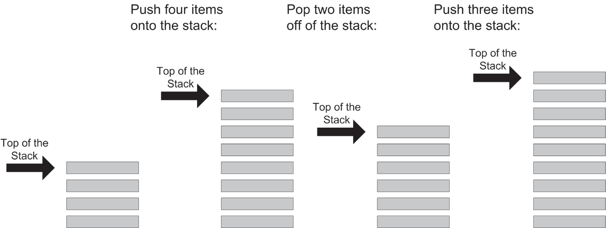
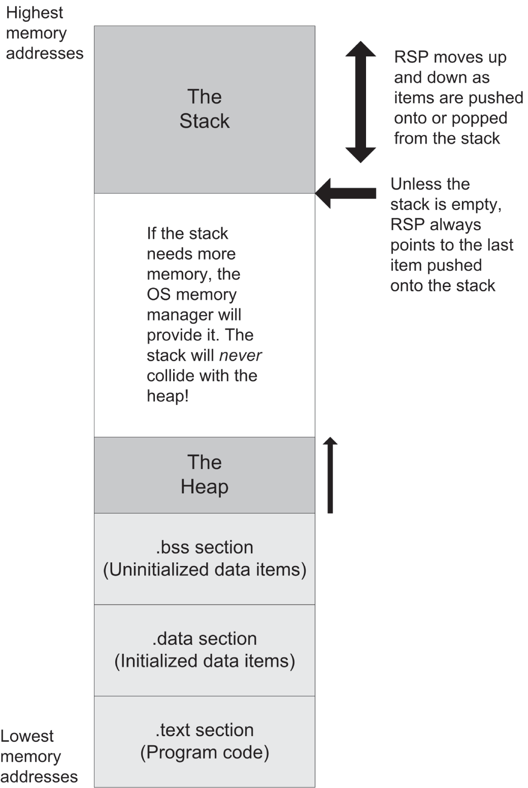
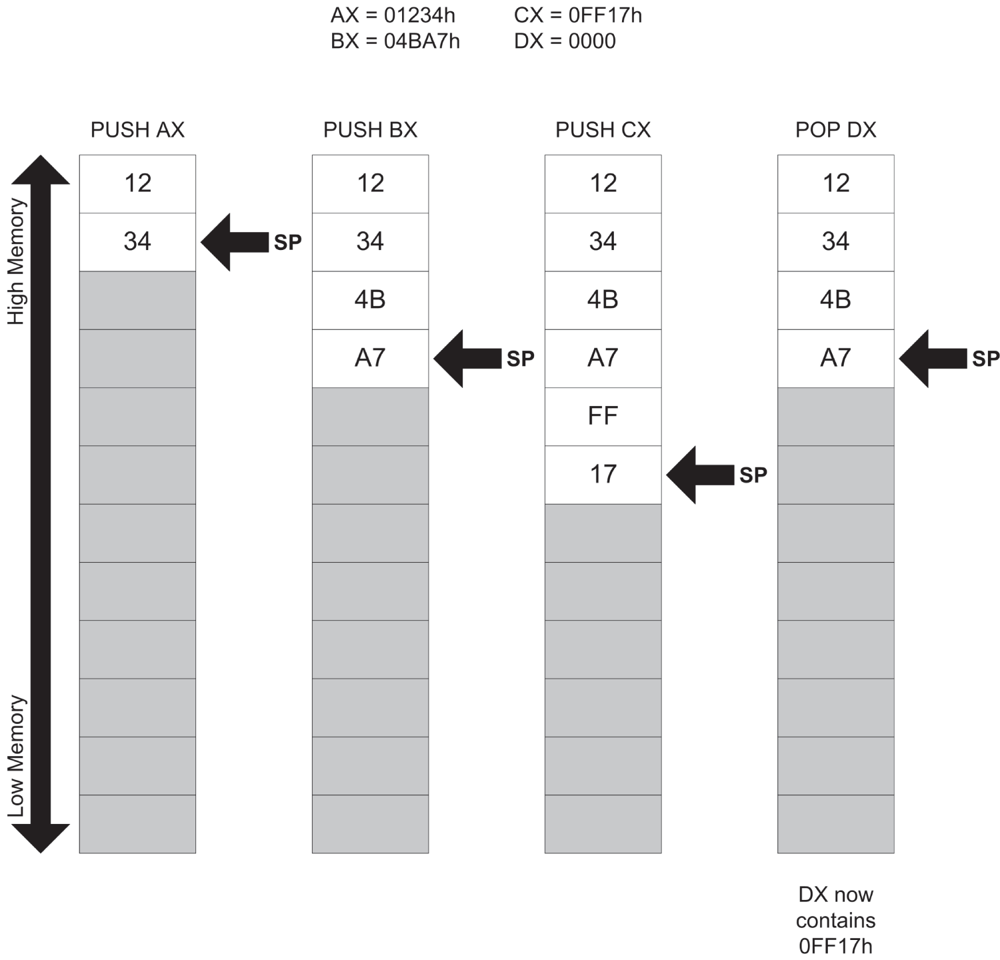
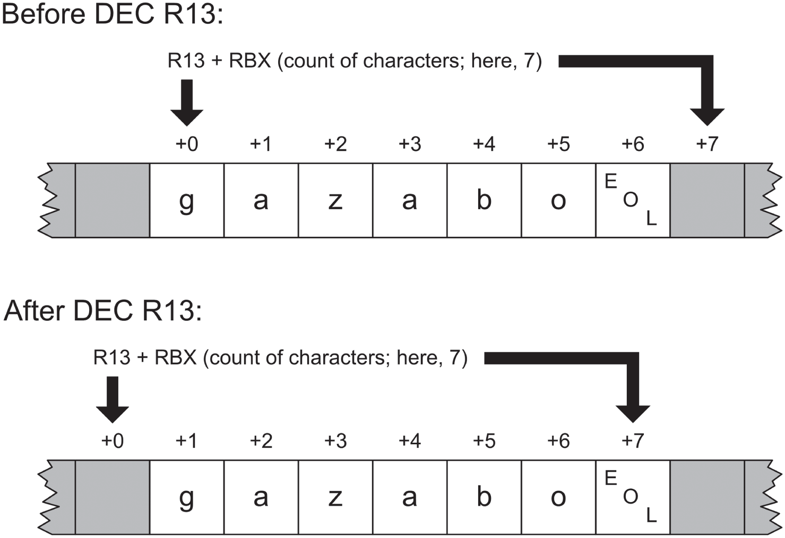

# <a id="Page_213"></a>CHƯƠNG 8 Mục tiêu cao cả của chúng ta: *Tạo ra những chương trình hoạt động được*

<a id="head-2-87"></a>

## Bộ khung của một chương trình assembly language

Người ta không gọi nó là “assembly” (lắp ráp) mà không có lý do. Đối diện với nhiệm vụ viết một chương trình assembly language gợi lên hình ảnh của buổi sáng Giáng sinh: bạn đã đổ 1,567 chi tiết kim loại nhỏ ra khỏi một cái hộp lớn ghi “Land Shark HyperBike (Some Assembly Required)” và giờ bạn phải bằng cách nào đó lắp tất cả lại với nhau mà không thừa ra chi tiết nào. (Trong khi đó, bọn trẻ có vẻ hơn cả vui sướng khi chơi trong cái hộp….)

Thực ra tôi đã giải thích gần như mọi thứ bạn tuyệt đối *phải* hiểu để tạo ra chương trình assembly language đầu tiên của mình. Dù vậy, vẫn có một bước nhảy không hề nhỏ từ đây đến đó; bạn đối diện với rất nhiều chi tiết nhỏ có cạnh sắc có thể khớp với nhau theo vô số cách khác nhau, hầu hết là sai, một số dùng được, nhưng chỉ vài cách là lý tưởng.

Vậy đây là kế hoạch: trong chương này, tôi sẽ đưa cho bạn chiếc Land Shark HyperBike đã hoàn chỉnh và chạy được—rồi tôi sẽ tháo tung nó ra trước mắt bạn. Đây là cách tốt nhất để học lắp ráp: bằng cách tháo rời những chương trình được viết bởi những người biết mình đang làm gì. Trong phần còn lại của chương này, chúng ta sẽ tháo rời thêm vài chương trình nữa, với hy vọng rằng đến khi kết thúc, bạn sẽ có thể tự mình đi theo chiều ngược lại.

Trong Listing 5.1 ở [Chương 5](ch05_the_right_to_assemble.vi.md), tôi đã trình bày có lẽ là chương trình đúng đắn đơn giản nhất cho Linux làm được một điều gì đó nhìn thấy được mà vẫn dễ hiểu và có thể mở rộng. Kể từ đó, chúng ta đã xem xét các instruction trong một sandbox thông qua debugger của SASM. Đó là một cách tốt để làm quen với từng instruction riêng lẻ, nhưng chẳng mấy chốc một sandbox đơn giản là không đủ. Giờ bạn đã nắm được các instruction x64 thông dụng nhất (và biết cách thiết lập một sandbox để thử nghiệm và làm quen với những instruction khác), chúng ta cần chuyển sang các chương trình hoàn chỉnh.

Như bạn đã thấy khi chạy nó, chương trình `EASTSYSCALL.ASM` hiển thị một dòng văn bản (ngắn) trên màn hình của bạn.

```
Eat at Joe's!
```

Để làm được điều đó, bạn đã phải đưa 35 dòng văn bản cho assembler! Nhiều dòng trong số 35 dòng đó là comment và không cần thiết theo nghĩa chặt chẽ nhất, nhưng chúng đóng vai trò tài liệu nội bộ cho phép bạn hiểu chương trình đang làm gì (hoặc, quan trọng hơn, *làm thế nào*) sau sáu tháng hay một năm kể từ bây giờ.

<a id="R_c08-fea-0001"></a>[Listing 8.1](#c08-fea-0001) là chính chương trình bạn đã thấy trong Listing 5.1, nhưng nó ngắn, và tôi sẽ in lại nó ở đây để bạn không phải lật qua lật lại trong phần thảo luận ở các trang sau.

> **<a id="c08-fea-0001"></a>Listing 8.1: eatsyscall.asm**
>
> <a id="Page_215"></a>
>
> ```
> ;  Executable name : eatsyscall
> ;  Version         : 1.0
> ;  Created date    : 4/25/2022
> ;  Last update     : 5/10/2023
> ;  Author          : Jeff Duntemann
> ;  Architecture    : x64
> ;  From            : x64 Assembly Language Step By Step, 4th Edition
> ;  Description     : A simple program in assembly for x64 Linux
>                      using NASM
> ;                    2.14, demonstrating the use of the syscall
>                      instruction
> ;                    to display text. Not for use within SASM.
> ;
> ;  Build using these commands:
> ;    nasm -f elf64 -g -F dwarf eatsyscall.asm
> ;    ld -o eatsyscall eatsyscall.o
> ;
>
> SECTION .data       ; Section containing initialized data
>
>     EatMsg: db Eat at Joe's!",10
>     EatLen: equ $-EatMsg
>
> SECTION .bss        ; Section containing uninitialized data
>
> SECTION .text       ; Section containing code
>
> global  _start      ; Linker needs this to find the entry point!
>
> _start:
>     push rbp
>     mov rbp,rsp
>
>     mov rax,1       ; 1 = sys_write for syscall
>     mov rdi,1       ; 1 = fd for stdout; i.e., write to the
>                       terminal window
>     mov rsi,EatMsg  ; Put address of the message string in rsi
>     mov rdx,EatLen  ; Length of string to be written in rdx
>     syscall         ; Make the system call
>
>     mov rax,60      ; 60 = exit the program
>     mov rdi,0       ; Return value in rdi 0 = nothing to return
>     syscall         ; Call syscall to exit
> ```

### Comment block mở đầu

Một trong những mục tiêu của việc viết code assembly language là dùng càng ít instruction càng tốt để hoàn thành công việc. Điều này *không* có nghĩa là tạo ra một source code file càng ngắn càng tốt. Kích thước của source file *chẳng liên quan gì* đến kích thước của executable file được assemble từ nó! Bạn càng đưa nhiều comment vào file, bạn sẽ càng nhớ rõ mọi thứ hoạt động thế nào bên trong chương trình vào lần tới bạn cầm nó lên. Tôi nghĩ bạn sẽ thấy kinh ngạc khi logic của một chương trình assembly language phức tạp nguội lạnh trong đầu bạn nhanh đến mức nào. Chỉ sau không quá 48 giờ làm việc với các dự án khác, tôi đã quay lại các dự án assembly và phải vật lộn để lấy lại tốc độ tối đa trong việc phát triển.

Comment không phải là phí thời gian hay phí chỗ. IBM từng nói: “Một dòng comment cho mỗi dòng code.” Điều đó tốt—và nên được coi là mức *tối thiểu* cho công việc assembly language. Một cách tốt hơn (mà thực tế tôi sẽ theo trong các ví dụ phức tạp hơn ở phần sau của chương) là dùng một dòng chú thích ngắn bên phải mỗi dòng code, cùng với một comment block ở đầu mỗi chuỗi instruction phối hợp với nhau để hoàn thành một nhiệm vụ riêng biệt nào đó.

Ở đầu mỗi chương trình nên có một kiểu comment block được chuẩn hóa, chứa một số thông tin quan trọng.

- Tên của source code file.
- Tên của executable file.
- Ngày bạn tạo file.
- Ngày bạn sửa đổi file lần cuối.
- Tên của người viết nó.
- Tên và phiên bản của assembler được dùng để tạo nó.
- <a id="Page_216"></a>Một mô tả “tổng quan” về những gì chương trình hay library làm. Hãy dùng bao nhiêu chỗ tùy thích. Điều đó không ảnh hưởng đến kích thước hay tốc độ của chương trình executable.
- Một bản sao các lệnh được dùng để build file, lấy từ make file nếu bạn dùng make file, hoặc từ hộp thoại Build của SASM nếu bạn dùng SASM.

Thách thức với một comment block mở đầu là cập nhật nó để phản ánh trạng thái hiện tại của dự án. Không công cụ nào của bạn sẽ tự động làm việc đó. Đó là việc của bạn.

### Section .data

Các chương trình user-space thông thường được viết bằng NASM cho Linux được chia thành ba section. Thứ tự các section này xuất hiện trong chương trình thực sự không quan trọng, nhưng theo quy ước, section `.data` đứng đầu, tiếp theo là section `.bss` rồi đến section `.text`.

Section `.data` chứa các định nghĩa dữ liệu của những mục dữ liệu được khởi tạo. Dữ liệu được khởi tạo là dữ liệu có giá trị trước khi chương trình bắt đầu chạy. Những giá trị này là một phần của executable file. Chúng được nạp vào memory khi executable file được nạp vào memory để thực thi. Bạn không phải nạp giá trị cho chúng, và không có machine cycle nào được dùng để tạo ra chúng ngoài những gì cần để nạp toàn bộ chương trình vào memory.

Điều quan trọng cần nhớ về section `.data` là bạn định nghĩa càng nhiều mục dữ liệu được khởi tạo, executable file sẽ càng lớn, và sẽ mất càng lâu để nạp nó từ đĩa vào memory khi bạn chạy nó.

Chúng ta sẽ sớm nói chi tiết về cách các mục dữ liệu được khởi tạo được định nghĩa.

### Section .bss

Không phải mục dữ liệu nào cũng cần có giá trị trước khi chương trình bắt đầu chạy. Ví dụ, khi bạn đang đọc dữ liệu từ một file trên đĩa, bạn cần có một chỗ để dữ liệu đi vào sau khi nó đến từ đĩa. Các buffer dữ liệu như vậy được định nghĩa trong section Block Start Symbol (`.bss`) của chương trình. Qua nhiều năm, tôi đã nghe nó được gọi bằng vài cái tên khác, như Buffer Start Symbol. Từ viết tắt chẳng quan trọng chút nào. Trong section `.bss`, bạn cấp phát các khối memory để dùng sau và đặt tên cho các khối đó.

Mọi assembler đều có cách dành ra một số byte cho một buffer và đặt tên cho buffer đó, nhưng bạn không chỉ định những giá trị nào sẽ được lưu trong buffer. (Sẽ nói thêm về điều này sau.) Những giá trị đó sẽ xuất hiện do hoạt động của chương trình trong khi chương trình đang chạy.

Có một khác biệt then chốt giữa các mục dữ liệu được định nghĩa trong section `.data` và các mục dữ liệu được định nghĩa trong section `.bss`: các mục dữ liệu trong section `.data` làm tăng <a id="Page_217"></a>kích thước executable file của bạn. Các mục dữ liệu trong section `.bss` thì không. Một buffer chiếm 16,000 byte (hoặc nhiều hơn, đôi khi *nhiều hơn rất nhiều*) có thể được định nghĩa trong `.bss` mà gần như không làm tăng gì (khoảng 50 byte cho phần mô tả) cho kích thước executable file.

Điều này khả thi là nhờ cách Linux loader đưa chương trình vào memory. Khi bạn build executable file, linker của Linux thêm thông tin vào file mô tả mọi symbol bạn đã định nghĩa, bao gồm các symbol đặt tên cho các mục dữ liệu. Loader biết những mục dữ liệu nào không có giá trị ban đầu, và nó cấp phát không gian trong memory cho chúng khi đưa executable vào từ đĩa. Các mục dữ liệu có giá trị ban đầu được đọc vào cùng với giá trị của chúng.

Chương trình rất đơn giản `eatsyscall.asm` không cần buffer nào hay mục dữ liệu chưa khởi tạo nào khác và về mặt kỹ thuật hoàn toàn không đòi hỏi phải định nghĩa một section `.bss`. Tôi đưa vào một section như vậy chỉ để cho bạn thấy nó được định nghĩa thế nào. Có một section `.bss` trống không làm tăng kích thước executable file của bạn, và xóa một section `.bss` trống cũng không làm executable file của bạn nhỏ đi chút nào.

### Section .text

Các machine instruction thực sự tạo nên chương trình của bạn đi vào section `.text`. Thông thường, không có mục dữ liệu nào được định nghĩa trong `.text`. Section `.text` chứa các symbol gọi là *label* xác định các vị trí trong code chương trình cho các lệnh nhảy và lời gọi, nhưng ngoài các instruction mnemonic của bạn, chỉ có vậy.

Mọi label global đều phải được khai báo trong section `.text`, nếu không các label sẽ không thể được “nhìn thấy” bên ngoài chương trình của bạn, dù là bởi linker của Linux hay bởi loader của Linux. Hãy xem xét vấn đề label kỹ hơn một chút.

### Label

Một *label* là một kiểu đánh dấu trang, mô tả một chỗ trong code chương trình và đặt cho nó một cái tên dễ nhớ hơn một memory address trần trụi. Label được dùng để chỉ ra những chỗ mà các instruction jump nên nhảy tới và để đặt tên cho các procedure assembly language có thể gọi được. Tôi sẽ giải thích tất cả những điều đó được làm thế nào trong các chương sau.

Trong lúc này, đây là những điều quan trọng nhất cần biết về label:

- *Label phải bắt đầu bằng một chữ cái hoặc bằng dấu gạch dưới, dấu chấm hoặc dấu chấm hỏi*. Ba ký tự sau có ý nghĩa đặc biệt đối với assembler, vì vậy đừng dùng chúng cho đến khi bạn biết NASM diễn giải chúng thế nào.
- *Label phải được theo sau bởi dấu hai chấm khi chúng được định nghĩa*. Về cơ bản, đây là điều cho NASM biết rằng định danh đang được định nghĩa là một label. NASM sẽ cho qua nếu không có dấu hai chấm và sẽ không gắn cờ error, nhưng dấu hai chấm đóng đinh nó và <a id="Page_218"></a>ngăn một instruction mnemonic gõ sai bị nhầm thành một label. Vì vậy hãy dùng dấu hai chấm!
- *Label phân biệt chữ hoa chữ thường*. Ví dụ, *yikes:*, *Yikes:* và *YIKES:* là ba label hoàn toàn khác nhau. Đây là một quy ước trong ngôn ngữ C nhưng khác với thực hành ở rất nhiều ngôn ngữ khác (đặc biệt là Pascal), nơi label và các định danh khác *không* case-sensitive. Hãy ghi nhớ điều này nếu bạn có kinh nghiệm với các ngôn ngữ high-level khác ngoài C.

Sau này, chúng ta sẽ thấy những label như vậy được dùng làm đích của các instruction jump và call. Ví dụ, machine instruction sau chuyển luồng thực thi instruction tới vị trí được đánh dấu bởi label `GoHome`:

```
jmp GoHome
```

Hãy chú ý rằng dấu hai chấm *không* được dùng ở đây. Dấu hai chấm chỉ được đặt ở chỗ label được *định nghĩa*, không phải ở chỗ nó được *tham chiếu*. Hãy nghĩ theo cách này: dùng dấu hai chấm khi bạn đang *đánh dấu* một vị trí, không phải khi bạn đang *đi tới* đó.

Chỉ có một label trong `eatsyscall.asm`, và nó hơi đặc biệt một chút. Label `_start` chỉ ra nơi chương trình bắt đầu. (Nó case-sensitive, vì vậy đừng thử dùng `_START` hay `_Start`.) Label này phải được đánh dấu là global ở đầu section `.text`, như được thể hiện.

SASM thay đổi mọi thứ một chút. Khi bạn đang biên dịch một chương trình assembly language trong SASM, label `_start` trở thành `main`. SASM dùng Gnu C compiler `gcc` làm trung gian giữa NASM và linker của Linux, `ld`. Điều SASM làm, theo một nghĩa nào đó, là tạo ra một chương trình C không có chút code C nào trong đó. Mọi chương trình C đều phải có một điểm khởi đầu, và trong một chương trình C, điểm khởi đầu đó luôn là `main`. Có những lý do để làm điều này liên quan đến việc link các hàm được viết bằng C vào chương trình assembly của bạn, như tôi sẽ giải thích cách làm ở phần sau.

Hãy nhớ điều này: khi assemble từ một make file, hãy dùng `_start`. Khi assemble từ bên trong SASM, hãy dùng `main`.

### Biến cho dữ liệu được khởi tạo

Định danh `EatMsg` trong section `.data` định nghĩa một *biến*. Cụ thể, `EatMsg` là một biến chuỗi (sẽ nói thêm ngay sau đây), nhưng dù vậy, như mọi biến, nó là một trong một lớp các mục mà chúng ta gọi là *dữ liệu được khởi tạo*: một thứ đi kèm với một giá trị chứ không chỉ là một cái hộp trống mà chúng ta có thể đặt một giá trị vào đó tại một lúc nào đó trong tương lai. Một biến được định nghĩa bằng cách gắn một định danh với một *data definition directive*. Data definition directive trông như thế này:

<a id="Page_219"></a>

```
MyByte      db 07h                 ; 8 bits in size
MyWord      dw 0FFFFh              ; 16 bits in size
MyDouble    dd 0B8000000h          ; 32 bits in size
MyQuad      dq 07FFFFFFFFFFFFFFFh  ; 64 bits in size
```

Hãy nghĩ về directive `DB` là “Define Byte.” `DB` dành ra một byte memory để lưu dữ liệu. Hãy nghĩ về directive `DW` là “Define Word.” `DW` dành ra một word (16 bit, hay hai byte) memory để lưu dữ liệu. Hãy nghĩ về directive `DD` là “Define Double.” `DD` dành ra một double word trong memory để lưu trữ. `DQ` có nghĩa là “Define Quad”, tức là một quad word, có kích thước 64 bit.

### Biến chuỗi

Biến chuỗi là một trường hợp đặc biệt thú vị. Một *chuỗi* (string) đúng là như tên gọi: một dãy hay chuỗi ký tự, tất cả nằm liền nhau trong memory. Có một biến chuỗi được định nghĩa trong `eatsyscall.asm`:

```
EatMsg: db "Eat at Joe's!",10
```

Chuỗi là một ngoại lệ đối với quy tắc chung rằng một data definition directive dành ra một lượng memory cụ thể. Directive `DB` thông thường chỉ dành ra một byte. Tuy nhiên, một chuỗi có thể dài bao nhiêu tùy thích. Vì không có data directive nào dành ra 17 byte, hay 42, chuỗi được định nghĩa đơn giản bằng cách gắn một label với chỗ mà chuỗi *bắt đầu*. Label `EatMsg` và directive `DB` của nó chỉ định một byte trong memory làm điểm bắt đầu của chuỗi. Số ký tự trong chuỗi là thứ cho assembler biết cần dành ra bao nhiêu byte lưu trữ cho chuỗi đó.

Có thể dùng ký tự nháy đơn (‘) hoặc nháy kép (”) để phân định một chuỗi, và lựa chọn là tùy bạn, *trừ khi* bạn đang định nghĩa một giá trị chuỗi mà bản thân nó chứa một hoặc nhiều ký tự nháy. Hãy chú ý rằng trong `eatsyscall.asm`, biến chuỗi `EatMsg` chứa một ký tự single-quote được dùng làm dấu lược. Vì chuỗi chứa một ký tự single-quote, bạn *phải* phân định nó bằng nháy kép. Điều ngược lại cũng đúng: nếu bạn định nghĩa một chuỗi chứa một hoặc nhiều ký tự double-quote, bạn phải phân định nó bằng ký tự single-quote:

```
Yukkh: db 'He said, "How disgusting!" and threw up.',10
```

Bạn có thể kết hợp vài chuỗi con riêng biệt thành một biến chuỗi duy nhất bằng cách phân tách các chuỗi con bằng dấu phẩy. Đây là một cách hoàn toàn hợp lệ (và đôi khi hữu ích) để định nghĩa một biến chuỗi:

```
TwoLineMsg: db "Eat at Joe's...",10,
"...Ten million flies can't ALL be wrong!",10
```

Vậy, con số literal 10 được nhét vào các chuỗi ví dụ ở trên là gì? Trong công việc văn bản trên Linux, ký tự end of line (EOL) có giá trị số là 10 decimal, hay 0Ah. Nó cho hệ điều hành biết một dòng được gửi để hiển thị lên console kết thúc ở đâu. Mọi văn bản tiếp theo được hiển thị lên console sẽ được hiển thị ở dòng kế tiếp phía dưới, tại lề trái. Trong biến `TwoLineMsg`, ký tự EOL nằm giữa hai chuỗi con sẽ chỉ thị Linux hiển thị chuỗi con thứ nhất trên một dòng của console, và chuỗi con thứ hai trên dòng kế tiếp của console phía dưới nó:

```
Eat at Joe's!
Ten million flies can't ALL be wrong!
```

Bạn có thể ghép nối những con số riêng lẻ như vậy bên trong một chuỗi, nhưng bạn phải nhớ rằng, giống như EOL, *chúng sẽ không hiện ra dưới dạng số*. Một chuỗi là một chuỗi *ký tự*. Một con số được nối vào một chuỗi sẽ được hầu hết các routine của hệ điều hành diễn giải là một ký tự ASCII. Sự tương ứng giữa số và ký tự ASCII được thể hiện trong [Phụ lục C](ch16_appendix_c_character_set_charts.vi.md). Để hiển thị số trong một chuỗi, bạn phải biểu diễn chúng dưới dạng ký tự ASCII, hoặc dưới dạng literal ký tự, như ký tự chữ số 7, hoặc dưới dạng giá trị số tương đương với ký tự ASCII, như 37h.

Trong công việc assembly thông thường, gần như mọi biến chuỗi đều được định nghĩa bằng directive `DB` và có thể được coi là chuỗi byte. (Một ký tự ASCII có kích thước một byte.) Bạn có thể định nghĩa biến chuỗi bằng `DW`, `DD` hay `DQ`, nhưng chúng được xử lý hơi khác so với những biến được định nghĩa bằng `DB`. Hãy xem các biến sau:

```
WordString:   dw 'CQ'
DoubleString: dd 'Stop'
QuadString:   dq 'KANGAROO'
```

Directive `DW` định nghĩa một biến word-length, và một word (16 bit) có thể chứa hai ký tự 8-bit. Tương tự, directive `DD` định nghĩa một biến double word (32-bit), có thể chứa bốn ký tự 8-bit. Directive `DQ` định nghĩa một biến quad word, có thể chứa tám ký tự 8-bit. Cách xử lý khác biệt xuất hiện khi bạn nạp các chuỗi có tên này vào register. Hãy xem ba instruction sau:

```
mov ax,[WordString]
mov edx,[DoubleString]
mov rax,[QuadString]
```

Hãy nhớ ở đây rằng để di chuyển dữ liệu trong một biến vào một register, bạn phải đặt tên của biến (chính là address của nó) giữa dấu ngoặc vuông. Không có dấu ngoặc, thứ bạn di chuyển vào register là address của biến trong memory, *không phải* dữ liệu tồn tại tại address đó.

Trong instruction `MOV` thứ nhất, các ký tự *CQ* được đặt vào register AX, với *C* trong AL và *Q* trong AH. Trong instruction `MOV` thứ hai, các ký tự *Stop* được nạp vào EDX theo thứ tự little-endian, với *S* trong byte bậc thấp nhất của EDX, *t* trong byte thấp thứ hai, và cứ thế. Nếu bạn nhìn chuỗi `QuadString` được nạp vào RAX từ SASM, bạn sẽ thấy nó chứa “KANGAROO” được viết ngược.

<a id="Page_221"></a>Nạp chuỗi vào một register duy nhất theo cách này (giả sử chúng vừa!) ít phổ biến hơn (và ít hữu ích hơn) rất nhiều so với việc dùng `DB` để định nghĩa chuỗi ký tự, và bạn sẽ không thường xuyên làm việc đó.

Vì `eatsyscall.asm` không định nghĩa dữ liệu chưa khởi tạo nào trong section `.bss` của nó, tôi sẽ hoãn việc thảo luận những định nghĩa như vậy cho đến khi chúng ta xem chương trình ví dụ tiếp theo.

### Suy ra độ dài chuỗi bằng EQU và $

Bên dưới định nghĩa của `EatMsg` trong file `eatsyscall.asm` là một cấu trúc thú vị.

```
EatLen: equ $-EatMsg
```

Đây là một ví dụ về một lớp lớn hơn những thứ gọi là *phép tính assembly-time*. Điều chúng ta đang làm ở đây là tính độ dài của biến chuỗi `EatMsg` và làm cho giá trị độ dài đó có thể được code chương trình truy cập thông qua label `EatLen`. Tại bất kỳ điểm nào trong chương trình, nếu bạn cần dùng độ dài của `EatMsg`, bạn có thể dùng label `EatLen`.

Một câu lệnh chứa directive `EQU` được gọi là một *equate*. Một equate là một cách gắn một giá trị với một label. Một label như vậy sau đó được đối xử rất giống một hằng có tên trong Pascal. Bất cứ khi nào assembler gặp một equate trong quá trình assemble, nó sẽ thay tên của equate bằng giá trị của nó. Đây là một ví dụ:

```
FieldWidth: equ 10
```

Ở đây, chúng ta đang nói với assembler rằng label `FieldWidth` đại diện cho giá trị số 10. Một khi equate đó được định nghĩa, hai machine instruction sau là *hoàn toàn* như nhau:

```
mov eax,10
mov eax,FieldWidth
```

Điều này có hai ưu điểm.

- Một equate làm cho instruction dễ hiểu hơn bằng cách dùng một tên mô tả cho một giá trị. Chúng ta biết giá trị 10 dùng để làm gì; nó là độ rộng của một trường.
- Một equate làm cho chương trình dễ thay đổi hơn về sau. Nếu một lúc nào đó độ rộng trường đổi từ 10 thành 12, chúng ta chỉ cần thay đổi source code file ở *một* dòng thay vì ở mọi chỗ chúng ta truy cập độ rộng trường.

Đừng đánh giá thấp giá trị của ưu điểm thứ hai này. Một khi chương trình của bạn trở nên lớn hơn và tinh vi hơn, bạn có thể thấy mình dùng một giá trị cụ thể hàng chục hay hàng trăm lần trong một chương trình duy nhất. Hoặc bạn có thể biến giá trị đó thành một equate và thay đổi một dòng để sửa một giá trị được dùng 267 lần, hoặc bạn có thể đi khắp code và thay đổi riêng lẻ cả 267 chỗ dùng giá trị—ngoại trừ năm hay sáu chỗ bạn bỏ sót, gây ra hỗn loạn khi bạn assemble và chạy chương trình lần tới.

Kết hợp phép tính assembly language với equate cho phép làm một số điều tuyệt vời một cách rất đơn giản. Như tôi sẽ giải thích ngay sau đây, để hiển thị một chuỗi trong Linux, bạn cần truyền cả address của chuỗi lẫn độ dài của nó cho hệ điều hành. Bạn có thể biến độ dài của chuỗi thành một equate theo cách này:

```
EatMsg: db "Eat at Joe's!",10
EatLen: equ 14
```

Cách này hoạt động, vì chuỗi `EatMsg` thực tế dài 14 ký tự, kể cả ký tự EOL. Nhưng giả sử Joe bán quán ăn của mình cho Ralph, và bạn thay “Joe” bằng “Ralph.” Bạn phải thay đổi không chỉ thông điệp quảng cáo mà cả độ dài của nó.

```
EatMsg: db "Eat at Ralph's!",10
EatLen: equ 16
```

Khả năng bạn quên cập nhật equate `EatLen` với độ dài thông điệp mới là bao nhiêu? Làm kiểu việc đó đủ thường xuyên, và bạn *sẽ* quên. Với một phép tính assembly-time, bạn chỉ cần thay đổi định nghĩa của biến chuỗi, và độ dài của nó được NASM tự động tính vào lúc assemble.

Bằng cách nào? Theo cách này:

```
EatLen: equ $-EatMsg
```

Tất cả phụ thuộc vào token “ở đây” thần kỳ, được biểu diễn bằng ký hiệu đô la khiêm tốn. Như tôi đã giải thích ở trên, vào lúc assemble, NASM nhai qua các source code file của bạn và xây dựng một file trung gian có phần mở rộng `.o`. Token $ đánh dấu chỗ NASM đang ở trong quá trình xây dựng file trung gian (*không phải* source code file!). Label `EatMsg` đánh dấu đầu chuỗi khẩu hiệu quảng cáo. Ngay sau ký tự cuối cùng của `EatMsg` là label `EatLen`. Hãy nhớ, label không phải là dữ liệu, mà là *vị trí*—và trong trường hợp của assembly language, là address. Khi NASM đến label `EatLen`, giá trị của $ là vị trí ngay sau ký tự cuối cùng trong `EatMsg`. Phép tính assembly-time là lấy vị trí được biểu diễn bởi token $ (mà khi phép tính được thực hiện chứa vị trí ngay sau cuối chuỗi `EatMsg`) và trừ đi vị trí đầu của chuỗi `EatMsg`. Cuối – Đầu = Độ dài.

Phép tính này được thực hiện mỗi lần bạn assemble file, vì vậy bất cứ khi nào bạn thay đổi nội dung của `EatMsg`, giá trị `EatLen` sẽ được tính lại tự động. Bạn có thể thay đổi văn bản bên trong chuỗi theo bất kỳ cách nào bạn thích và không bao giờ phải lo về việc thay đổi một giá trị độ dài ở bất cứ đâu trong chương trình.

<a id="Page_223"></a>Phép tính Assembly-time có những công dụng khác, nhưng đây là công dụng phổ biến nhất và là công dụng duy nhất bạn có khả năng dùng khi còn là người mới bắt đầu.

<a id="head-2-89"></a>

## Last In, First Out thông qua stack

Chương trình nhỏ `eatsyscall.asm` không làm được nhiều: nó hiển thị một chuỗi văn bản ngắn trong console Linux. Tuy nhiên, việc giải thích nó làm điều đơn giản đó như thế nào sẽ cần chút công sức, và trước khi tôi có thể bắt đầu, tôi phải giải thích một trong những khái niệm then chốt không chỉ của architecture x86/x64 mà thực tế là của mọi ngành tính toán: *stack*.

Stack là một cơ chế lưu trữ được tích hợp ngay trong phần cứng CPU. Intel không phát minh ra nó; stack đã là một phần không thể thiếu của phần cứng máy tính từ thập niên 1950. Cái tên này rất phù hợp, và để có một phép ẩn dụ dùng được, tôi có thể quay về thời trung học của mình, khi tôi làm nhân viên rửa bát cho Bệnh viện Resurrection ở khu Northwest Side của Chicago.

### Năm trăm chiếc đĩa mỗi giờ

Hồi đó có rất nhiều công việc khác nhau trong bếp bệnh viện, nhưng việc tôi làm phần lớn thời gian là lấy những chiếc đĩa sạch ra khỏi một băng chuyền đang chạy, nhô ra liên tục từ cái miệng rồng bốc hơi nghi ngút của một chiếc máy rửa bát 180°. Đó là việc nóng nực, nhưng đỡ nhớp nháp hơn nhiều so với việc nhét những chiếc đĩa bẩn vào đầu kia của máy.

Khi bạn lấy 500 chiếc đĩa mỗi giờ ra khỏi một chiếc máy rửa bát, tốt hơn hết là bạn nên có một chỗ hiệu quả nào đó để cất chúng. Hiển nhiên, bạn có thể đơn giản chồng chúng lên một cái bàn, nhưng những chồng đĩa sứ ở bất kỳ chỗ nào có những cậu thiếu niên ồn ào lui tới là đang mời gọi một thảm họa bát đĩa. Thay vào đó, thứ bệnh viện có là cả một đội quân những chiếc tủ nhỏ bằng thép không gỉ có bánh xe, được trang bị một hoặc nhiều piston tròn spring-loaded tiếp cận từ phía trên. Khi bạn có một nắm đĩa, bạn ấn chúng xuống piston. Lò xo của piston được điều chỉnh sao cho sức nặng của những chiếc đĩa được thêm vào đẩy cả chồng đĩa xuống vừa đủ để chiếc đĩa trên cùng mới nằm ngang bằng với mặt trên của tủ.

Mỗi piston chứa được khoảng 50 chiếc đĩa. Chúng tôi đẩy một chiếc tủ đến cạnh miệng rồng, chất đầy đĩa vào, rồi đẩy nó trở lại bếp, nơi những chiếc đĩa sạch được dùng ở ca ăn tiếp theo để dọn khay cho bệnh nhân.

Thật bổ ích khi theo dõi đường đi của chiếc đĩa đầu tiên ra khỏi máy rửa bát trong một ca nhất định. Chiếc đĩa đó vào piston đầu tiên và sau đó bị 49 chiếc đĩa còn lại mà tủ có thể chứa đẩy xuống đáy piston. Sau khi tủ được đẩy vào bếp, các cô trong bếp lấy từng chiếc đĩa ra khỏi tủ khi dọn khay cho bệnh nhân. Chiếc đĩa *đầu tiên* ra khỏi tủ là chiếc đĩa *cuối cùng* được cho vào. Chiếc đĩa *cuối cùng* ra khỏi tủ từng là chiếc đĩa *đầu tiên* được cho vào.

Stack của Intel (và hầu hết các stack khác trong các architecture máy tính khác) cũng giống như vậy. Chúng ta gọi nó là stack last in, first out (*LIFO*). Thay vì đĩa, chúng ta đẩy (push) các khúc dữ liệu lên đỉnh stack, và chúng ở lại trên stack cho đến khi chúng ta lấy chúng ra theo thứ tự ngược lại.

Stack không tồn tại trong một hốc tường riêng biệt nào đó của CPU. Nó tồn tại trong memory thông thường, và thực tế thứ chúng ta gọi là “stack” thực ra là một cách quản lý dữ liệu trong memory. Stack là một chỗ mà chúng ta có thể tạm cất một hai (hoặc bao nhiêu cũng được) giá trị và quay lại lấy chúng sau đó một chút. Ưu điểm chính của stack là nó không đòi hỏi chúng ta đặt tên cho dữ liệu được lưu. Chúng ta đặt dữ liệu đó lên stack, và chúng ta lấy lại nó sau đó theo vị trí của nó, hoặc trong một số trường hợp bằng cách truy cập stack dùng memory addressing thông thường tương đối với một điểm cố định trong memory của stack. (Sẽ nói thêm về cách thứ hai ở phần sau một chút, sau khi chúng ta nắm vững mọi điều cơ bản.)

Biệt ngữ liên quan đến việc dùng stack phản ánh phép ẩn dụ người rửa bát của tôi: khi chúng ta đặt một thứ lên stack, chúng ta nói rằng chúng ta *push* nó; khi chúng ta lấy một thứ ra khỏi stack, chúng ta nói rằng chúng ta *pop* nó. Stack lớn lên hoặc co lại khi dữ liệu được push lên hoặc pop ra khỏi nó. Mục được push lên stack gần đây nhất được gọi là nằm ở đỉnh stack. Khi chúng ta pop một mục ra khỏi stack, thứ chúng ta nhận được là mục ở đỉnh stack. Tôi đã vẽ điều này ra về mặt khái niệm trong <a id="R_c08-fig-0001"></a>[Hình 8.1](#c08-fig-0001).



*<a id="c08-fig-0001"></a>**Hình 8.1**: Stack*

Trong architecture x64, đỉnh stack được đánh dấu bởi một register gọi là *stack pointer*, với tên chính thức là RSP. Nó là một register 64-bit, và nó giữ memory address của mục cuối cùng được push lên stack.

<a id="Page_225"></a>

### Xếp chồng mọi thứ lộn ngược

Điều khiến mọi thứ khó hình dung hơn một chút là stack của Intel về cơ bản là upside-down. Nếu bạn hình dung một vùng memory với address thấp nhất ở dưới đáy và address cao nhất ở trên đỉnh, stack bắt đầu từ trên trần, và khi các mục được push lên stack, stack lớn dần xuống dưới, về phía memory thấp.

<a id="R_c08-fig-0002"></a>[Hình 8.2](#c08-fig-0002) cho thấy một cách khái quát cách Linux tổ chức memory mà nó cấp cho chương trình của bạn khi chương trình chạy. Ở đáy memory là ba section mà bạn định nghĩa trong chương trình: `.text` ở các address thấp nhất, tiếp theo là `.data`, tiếp theo là `.bss`. Stack nằm tận ở đầu đối diện của khối memory của chương trình. Ở giữa cuối section `.bss` và đỉnh stack về cơ bản là memory trống. Các chương trình C thường xuyên dùng không gian memory trống này để cấp phát biến “ngay tại chỗ” trong một vùng gọi là *heap*. Các chương trình assembly cũng có thể làm điều đó, mặc dù nó không dễ như nghe có vẻ, và tôi không đủ chỗ để trình bày nó trong cuốn sách này. Tôi vẽ heap trong [Hình 8.2](#c08-fig-0002) vì điều quan trọng là biết nó nằm ở đâu trong memory map user-space. Giống như stack, heap lớn lên hoặc co lại khi các cấu trúc dữ liệu được tạo ra (bằng cách cấp phát memory) hoặc bị hủy (bằng cách giải phóng memory).

Điều quan trọng cần nhớ (đặc biệt nếu bạn đã từng có kinh nghiệm viết assembly cho DOS) là chúng ta không còn ở real mode nữa. Khi ứng dụng của bạn bắt đầu chạy, Linux dành riêng một dải virtual memory liền mạch cho stack, mặc định vào khoảng 8 gigabyte. (Lượng virtual memory chính xác phụ thuộc vào cách Linux được cấu hình và có thể khác nhau.) Trong số này, chỉ vài page thực sự được cam kết ở đỉnh của không gian virtual address. Khi stack lớn dần xuống và hết memory vật lý, một page fault xảy ra, và thêm memory vật lý được OS ánh xạ vào không gian virtual address rồi trở nên khả dụng cho stack sử dụng. Điều này tiếp diễn cho đến khi toàn bộ không gian ảo bị cạn kiệt—điều về cơ bản không bao giờ xảy ra trừ khi chương trình đang ngấu nghiến không gian stack do một bug.

Virtual memory là một thứ tuyệt vời nhưng phức tạp, và tôi không thể đi vào chi tiết về nó trong cuốn sách này. Bài học rút ra ở đây là stack của ứng dụng của bạn gần như có thể có mọi memory nó cần nhờ virtual memory, và bạn không còn phải lo về việc hết memory.

Lưu ý duy nhất tôi nên đưa ra về [Hình 8.2](#c08-fig-0002) là kích thước tương đối của các section chương trình so với stack không nên được hiểu theo nghĩa đen. Bạn có thể có hàng nghìn byte code chương trình và hàng chục nghìn byte dữ liệu trong một chương trình assembly cỡ trung bình, nhưng so với điều đó, stack vẫn khá nhỏ: tối đa vài trăm byte và thường ít hơn thế.



*<a id="c08-fig-0002"></a>**Hình 8.2**: Stack trong memory chương trình*

<a id="Page_226"></a>

### Các instruction Push-y

Bạn có thể đặt dữ liệu lên stack theo vài cách, nhưng cách trực tiếp nhất liên quan đến hai machine instruction có liên hệ với nhau, `PUSH` và `PUSHFQ`. Hai instruction này tương tự nhau về cách hoạt động, và chúng khác nhau chủ yếu ở thứ chúng push lên stack:

- `PUSH` push một giá trị register hoặc memory 16-bit hay 64-bit do bạn chỉ định trong source code. Lưu ý rằng *bạn không thể push một giá trị 8-bit hay 32-bit lên stack!* Bạn sẽ nhận một error nếu cố làm vậy.
- `PUSHFQ` push toàn bộ register RFlags 64-bit lên stack. (`Q` ở đây có nghĩa là “quadword”.) Điều này diễn ra ngay cả khi hơn một nửa số flag trong RFlags được dành riêng và không có công dụng gì. Bạn sẽ không thường dùng `PUSHFQ`, nhưng nó có sẵn nếu bạn cần.

<a id="Page_227"></a>Đây là vài ví dụ về họ instruction `PUSH` khi được sử dụng:

```
pushfq       ; Push the RFlags register
push rax     ; Push the RAX register
push bx      ; Push the 16-bit register BX
push [rdx]   ; Push the quadword in memory at RDX
```

Lưu ý rằng `PUSHFQ` không nhận operand nào. Bạn sẽ sinh ra một assembler error nếu cố trao operand cho `PUSHFQ`; instruction này push register RFlags 64-bit lên stack, và đó là tất cả những gì nó có khả năng làm.

`PUSH` hoạt động theo cách này, với operand 64-bit: trước tiên RSP được giảm đi 64 bit (tám byte) để nó trỏ tới một vùng trống của memory stack dài tám byte. Sau đó bất cứ thứ gì cần được push lên stack được ghi vào memory tại address trong RSP. *Voilà*! Dữ liệu đã an toàn trên stack, và RSP đã bò tám byte gần hơn về phía đáy memory. `PUSH` cũng có thể push các giá trị 16-bit lên stack, và khi làm vậy, khác biệt duy nhất là RSP di chuyển hai byte thay vì tám.

Mọi memory giữa vị trí ban đầu của RSP và vị trí hiện tại của nó (đỉnh stack) đều chứa dữ liệu thật đã được push một cách tường minh lên stack và có lẽ sẽ được pop ra khỏi stack sau đó. Một phần dữ liệu đó đã được hệ điều hành push lên stack trước khi chạy chương trình của bạn, và chúng ta sẽ nói về điều đó ở phần sau một chút trong cuốn sách.

Những gì có thể và không thể được push lên stack ở long mode x64 khá đơn giản: bất kỳ register general-purpose 16-bit và 64-bit nào cũng có thể được push riêng lẻ lên stack. Bạn không thể push AL hay BH hay bất kỳ register 8-bit nào khác. Immediate data 16-bit và 64-bit có thể được push lên stack. Các chương trình Linux User-space không thể push segment register lên stack trong bất kỳ hoàn cảnh nào. Với x64, segment register thuộc về OS và không khả dụng đối với các chương trình user-space.

Có vẻ kỳ lạ đến đâu thì cũng vậy, các giá trị 32-bit (bao gồm mọi register 32-bit) *không* thể được push lên stack.

### POP Goes the Opcode

Nhìn chung, thứ gì được push thì phải được pop, nếu không bạn có thể rơi vào bất kỳ loại rắc rối nào trong vài loại rắc rối khác nhau. Việc lấy một mục dữ liệu *ra khỏi* stack dễ làm nhất bằng một cặp instruction khác, `POP` và `POPFQ`. Như bạn có thể đoán, `POP` là công cụ pop general-purpose one-at-a-time, trong khi `POPFQ` chuyên dùng để pop các flag ra khỏi stack và vào RFlags.

<a id="Page_228"></a>

```
popfq         ; Pop the top 8 bytes from the stack into RFlags
pop rcx       ; Pop the top 8 bytes from the stack into RCX
pop bx        ; Pop the top 2 bytes from the stack into BX
pop [rbx]     ; Pop the top 8 bytes from the stack into memory at EBX
```

Giống như `PUSH`, `POP` chỉ hoạt động trên các operand 16-bit hoặc 64-bit. Đừng cố pop dữ liệu từ stack vào một register 8-bit hay 32-bit như AH hay ECX.

`POP` hoạt động gần như theo cách `PUSH` làm, nhưng ngược lại. Giống như `PUSH`, lượng dữ liệu lấy ra khỏi stack phụ thuộc vào kích thước của operand. Pop stack vào một register 16-bit lấy hai byte trên cùng ra khỏi stack. Pop stack vào một register 64-bit lấy tám byte trên cùng ra khỏi stack.

Lưu ý rằng không có gì trong CPU hay trong Linux nhớ kích thước của các mục dữ liệu mà bạn đặt lên stack. *Bạn phải tự biết kích thước của mục cuối cùng được push lên stack*. Nếu mục cuối cùng bạn push lên stack là một register 16-bit, việc pop stack vào một register 64-bit sẽ lấy ra khỏi stack nhiều hơn sáu byte so với lượng bạn đã push. Điều này được gọi là làm *lệch* (misalign) stack, và nó chẳng mang lại gì ngoài rắc rối—đó là một lý do tại sao bạn nên làm việc với các register và giá trị memory 64-bit bất cứ khi nào có thể và tránh dùng stack với các giá trị 16-bit.

Khi một instruction `POP` được thực thi, mọi việc diễn ra theo thứ tự này: trước tiên, dữ liệu tại address hiện được lưu trong RSP được sao chép từ stack và đặt vào operand của `POP`, bất kể bạn chỉ định operand đó là gì. Sau đó, RSP được tăng (thay vì giảm) theo kích thước của operand—hoặc 16 bit hoặc 64 bit—để trên thực tế RSP di chuyển hai hoặc tám byte lên phía trên stack, xa khỏi memory thấp.

Điều đáng chú ý là RSP được giảm *trước khi* đặt một word lên stack lúc push nhưng được tăng *sau khi* lấy một word ra khỏi stack lúc pop. Một số CPU khác bên ngoài vũ trụ x86 hoạt động theo cách ngược lại, điều đó không sao—chỉ cần đừng nhầm lẫn chúng. Với x86/x64, điều này luôn đúng: *trừ khi stack hoàn toàn trống, RSP trỏ tới dữ liệu thật, không phải không gian trống*. Thông thường, bạn không cần nhớ sự thật đó, vì `PUSH` và `POP` lo tất cả cho bạn, và bạn không phải tự theo dõi RSP đang trỏ tới đâu.

### PUSHA và POPA đã biến mất

Gần như mọi thứ bạn có trong assembly 32-bit vẫn còn trong assembly x64. Một số thứ đã thay đổi, nhưng rất ít thứ bị loại bỏ khi x86 trở thành x64.

Thực tế đã có một số hy sinh. Bốn instruction đã biến mất hoàn toàn: `PUSHA`, `PUSHAD`, `POPA` và `POPAD`. Trong các architecture trước đó, những instruction này được dùng để push hoặc pop tất cả các register general-purpose cùng một lúc.

Vậy, tại sao chúng lại biến mất? Tôi chưa bao giờ tìm được một lời giải thích có thẩm quyền, nhưng tôi có một giả thuyết: có *rất nhiều* register general-purpose hơn trong x64. Push 15 register 64-bit lên stack thay vì 7 register 32-bit chiếm một khúc lớn không gian stack. (Stack pointer ESP không bị `PUSHA`/`POPA` tác động vì lý do hiển nhiên là ESP định nghĩa stack!)

Nếu vì lý do nào đó bạn muốn bảo toàn các register general-purpose trên stack, bạn sẽ phải push và pop chúng riêng lẻ.

<a id="Page_229"></a>

### Push và pop chi tiết

Nếu bạn vẫn còn hơi lơ mơ về cách stack hoạt động, cho phép tôi trình bày một ví dụ cho thấy chi tiết cách stack vận hành, với các giá trị thật. Để sơ đồ đi kèm được rõ ràng, tôi sẽ dùng các register 16-bit thay vì các register 64-bit. Điều này sẽ cho phép tôi thể hiện từng byte riêng lẻ trên stack. Nó hoạt động theo cùng cách với các giá trị 64-bit. Một lần nữa, khác biệt là tám byte được push hoặc pop thay vì hai.

<a id="R_c08-fig-0003"></a>[Hình 8.3](#c08-fig-0003) cho thấy stack trông thế nào sau khi mỗi instruction trong bốn instruction được thực thi. (Tôi dùng các giá trị 16-bit trong hình cho rõ ràng. Cơ chế là như nhau với các giá trị 64-bit.) Giá trị của bốn register general-purpose `X` 16-bit tại một điểm giả định nào đó trong quá trình thực thi của một chương trình được thể hiện ở đầu hình. AX được push lên stack đầu tiên. Byte có trọng số nhỏ nhất của nó nằm tại RSP, và byte có trọng số lớn nhất của nó nằm tại RSP+1. (Hãy nhớ rằng cả hai byte được push lên stack cùng một lúc, như một đơn vị!)



*<a id="c08-fig-0003"></a>**Hình 8.3**: Stack hoạt động thế nào*

Mỗi lần một trong các register 16-bit được push lên stack, RSP được giảm hai byte, di chuyển xuống về phía memory thấp. Ba cột đầu tiên lần lượt cho thấy AX, BX và CX được push lên stack. Nhưng hãy chú ý điều gì xảy ra ở cột thứ tư, khi instruction `POP DX` được thực thi. Stack pointer được tăng thêm hai byte và di chuyển xa khỏi memory thấp. DX giờ chứa một bản sao nội dung của CX. Trên thực tế, CX đã được push lên stack rồi ngay lập tức được pop ra vào DX.

Nếu bạn muốn thử [Hình 8.3](#c08-fig-0003) trong một sandbox SASM, hãy mở một sandbox mới và thêm các machine instruction này:

```
xor rax,rax  ;We first zero out all 4 64-bit "x" registers
xor rbx,rbx  ;so there are no "leftovers" in the high bits
xor rcx,rcx
xor rdx,rdx

mov ax,01234h  ;Place values in AX, BX, and CX
mov bx,04ba7h
mov cx,0ff17h

push ax        ;Push AX,BX,& CX onto the stack
push bx
push cx

pop dx         ;Pop the top of the stack into DX.
```

Hãy vào debug mode và single-step qua các instruction này, quan sát cả stack pointer RSP lẫn bốn register 16-bit sau mỗi bước. Bạn cũng có thể theo dõi diễn biến trong [Hình 8.3](#c08-fig-0003).

Vâng, đó là một cách cực kỳ vòng vo để sao chép giá trị của CX vào DX. `MOV DX,CX` nhanh hơn và trực tiếp hơn nhiều. Tuy nhiên, đôi khi phải di chuyển giá trị register thông qua stack. Hãy nhớ rằng instruction `MOV` sẽ *không* hoạt động trên register RFlags. Nếu bạn muốn nạp một bản sao của RFlags vào một register 64-bit, trước tiên bạn phải push RFlags lên stack bằng `PUSHFQ` rồi pop giá trị flag ra khỏi stack vào register bạn chọn bằng `POP`. Vì vậy, việc đưa RFlags vào RBX được thực hiện bằng code sau. Bạn có thể quan sát nó hoạt động bằng cách đặt những dòng này vào một sandbox và single-stepping qua chúng:

```
xor rbx,rbx     ; Clear rbx
pushfq          ; Push the RFlags register onto the stack
pop qword rbx   ; ...and pop it immediately into RBX
```

Mặc dù bạn có thể khôi phục các giá trị flag vào RFlags bằng `POPFQ`, không phải mọi bit của RFlags đều có thể được thay đổi bằng cách pop chúng ra khỏi stack vào RFlags. Các bit VM và RF không bị `POPFQ` ảnh hưởng. Những cái bẫy nhỏ như thế này gợi ý rằng bạn không nên thử lưu và khôi phục các flag cho đến khi bạn biết *chính xác* mình đang làm gì.

<a id="Page_231"></a>

### Lưu trữ ngắn hạn

Stack nên được coi là một chỗ để cất đồ trong ngắn hạn. Các mục được lưu trên stack không có tên và nhìn chung phải được lấy ra khỏi stack theo thứ tự ngược với thứ tự chúng được đặt vào. Last in, first out, hãy nhớ. LIFO!

Một công dụng tuyệt vời của stack cho phép những register all-too-few đảm nhận nhiều nhiệm vụ. Nếu bạn cần một register để tạm giữ một giá trị nào đó cho CPU thao tác và tất cả các register đều đang được dùng, hãy push một trong các register đang bận lên stack. Giá trị của nó sẽ vẫn an toàn trên stack trong khi bạn dùng register cho những việc khác. Khi bạn dùng xong register, hãy pop giá trị cũ của nó ra khỏi stack—và bạn đã có được lợi ích của một register bổ sung mà không thực sự có nó. (Cái giá phải trả, dĩ nhiên, là thời gian bạn bỏ ra để di chuyển giá trị của register đó lên và xuống khỏi stack. Đó không phải là việc bạn muốn làm giữa một vòng lặp often-repeated!)

Lưu trữ Short-term trong quá trình thực thi chương trình là công dụng đơn giản nhất và hiển nhiên nhất của stack, nhưng công dụng quan trọng nhất của nó có lẽ là trong việc gọi procedure và các kernel service của Linux. Và giờ bạn đã hiểu stack, chúng ta có thể bàn đến vấn đề bí ẩn của system call Linux.

<a id="head-2-90"></a>

## Dùng kernel service của Linux thông qua Syscall

Mọi thứ khác trong `eatsyscall.asm` đều là sự chuẩn bị cho instruction duy nhất thực hiện công việc thực sự duy nhất của chương trình: hiển thị một dòng văn bản trong console Linux. Ở trung tâm của chương trình là một lời gọi vào hệ điều hành Linux. Một lời gọi thứ hai vào Linux nằm ở cuối, khi chương trình kết thúc và cần cho Linux biết rằng nó đã xong.

Như tôi đã giải thích trong [Chương 6](ch06_a_place_to_stand_with_access_to_tools.vi.md), một hệ điều hành vừa giống một vị thần vừa giống một con quỷ troll, và Linux cũng không khác. Nó kiểm soát mọi thành phần quan trọng nhất của máy theo kiểu thần thánh: memory, các ổ đĩa, máy in, bàn phím, các cổng khác nhau (Ethernet, USB, nối tiếp, Bluetooth, v.v.), và màn hình. Đồng thời, Linux giống như một con troll sống dưới một cây cầu dẫn tới tất cả những bộ phận đó của máy bạn: bạn nói với con troll điều bạn muốn làm, và con troll sẽ đi làm việc đó cho bạn. Có vài trăm kernel service của Linux có sẵn. Đây là nơi bạn có thể tìm thấy một danh sách tốt các system call Linux x64:

`soliduscode.com/linux-system-calls`

Một trong các service mà Linux cung cấp là truy cập text-mode đơn giản vào màn hình PC của bạn. Với mục đích của `eatsyscall.asm`—vốn chỉ là một bài học về việc viết và chạy được chương trình assembly language đầu tiên—các service đơn giản là đủ.

Vậy—làm sao chúng ta dùng các service của Linux? Nếu bạn đã nhìn kỹ `eatsyscall.asm`, bạn hẳn còn nhớ hai chỗ có machine instruction `SYSCALL`. <a id="Page_232"></a>Trong các bản Linux x64, instruction `SYSCALL` là cách bạn truy cập các kernel service của Linux.

### Kernel service X64 thông qua instruction SYSCALL

Trong các phiên bản Linux 32-bit, software interrupt `INT 80h` là cách để đến được bộ điều phối kernel service. `INT 80h` không còn được dùng nữa. Architecture x64 cho chúng ta một thứ tốt hơn *rất* nhiều: instruction `SYSCALL`.

Thách thức khi truy cập kernel service là thế này: chuyển việc thực thi sang một code library mà không hề biết library đó ở đâu. Instruction `SYSCALL` nhìn vào một register CPU mà các chương trình user-space không thể truy cập. Khi kernel Linux khởi động, nó đặt address của bộ điều phối service của mình vào register này. Một trong những việc đầu tiên mà instruction `SYSCALL` làm là nâng mức đặc quyền của nó từ mức 3 (user) lên mức 0 (kernel). Sau đó nó đọc address trong register điều phối service và nhảy tới address đó để gọi bộ điều phối.

Hầu hết các system call x64 dùng `SYSCALL` đều có tham số, được truyền trong các register CPU. Những register nào? Không phải ngẫu nhiên. Thực tế, có một thứ gọi là System V Application Binary Interface (ABI) cho Linux, đặt ra cả một hệ thống để truyền tham số cho Linux thông qua `SYSCALL`. Nó làm nhiều hơn thế, nhưng thứ chúng ta quan tâm ở đây là bộ máy cho phép bạn gọi kernel service bằng `SYSCALL`. Phần trình bày trực tuyến tốt nhất về những lời gọi đó ở đây:

`soliduscode.com/category/technology/assembly`

### ABI so với API?

Đây là một chỗ tốt cho một lời lạc đề ngắn. Nếu bạn có chút kinh nghiệm lập trình nào, có lẽ bạn đã nghe về “API call” hay “Windows API”. Vậy, khác biệt giữa ABI và API là gì? API là viết tắt của *application programming interface*. Một API là một tập hợp các hàm có thể gọi được, chủ yếu được dùng bởi các ngôn ngữ lập trình high-level như Pascal hay C. Một chương trình assembly language có thể gọi một hàm API, và tôi sẽ cho bạn thấy cách làm ở phần sau một chút.

Ngược lại, một application binary interface là một mô tả chi tiết về điều xảy ra ở tận mức machine-code khi một mẩu machine code binary nói chuyện với một mẩu khác hoặc với phần cứng CPU như register. Nó là một tầng “bên dưới” API. ABI định nghĩa một tập hợp các hàm cơ bản có thể gọi được, thường do hệ điều hành cung cấp, như được làm trong Linux. Định nghĩa này mô tả cách truyền tham số cho rất nhiều hàm kernel service. Một ABI cũng định nghĩa cách linker link các module đã được biên dịch hoặc assemble thành một chương trình binary executable duy nhất và nhiều thứ khác vượt ngoài những gì tôi có thể thảo luận trong cuốn sách này.

<a id="Page_233"></a>

### Lược đồ tham số register của ABI

Hãy xem kỹ hơn chương trình `eatsyscall.asm` mà tôi đã đưa vào vài trang đầu của chương này. Code sau ghi một thông điệp văn bản ra console Linux:

```
mov rax,1           ; 1 = sys_write for syscall
mov rdi,1           ; 1 = fd for stdout; i.e., write to the                        terminal window
mov rsi,EatMsg      ; Put address of the message string in rsi
mov rdx,EatLen      ; Length of string to be written in rdx
syscall             ; Make the system call
```

Tóm gọn lại, code này đặt một số giá trị nhất định vào một số register nhất định rồi thực thi instruction `SYSCALL`. Bộ điều phối service của Linux lấy các giá trị được đặt trong các register đó rồi gọi hàm được chỉ định trong RAX.

Có một hệ thống để chỉ định register nào được dùng cho service nào và tham số nào (nếu có) cho service đó. Cách tốt nhất để giải thích là cho bạn xem hai dòng đầu tiên của bảng system call System V ABI, trong <a id="R_c08-tbl-0001"></a>[Bảng 8.1](#c08-tbl-0001).

*<a id="c08-tbl-0001"></a>**Bảng 8.1**: Quy ước system call của System V ABI*

| RAX SYSTEM CALL |  | RDI | RSI | RDX | R10 | R8 | R9 |
|---|---|---|---|---|---|---|---|
| 0 | sys_read | File descriptor | Address của buf. | Độ dài của buf. | n/a | n/a | n/a |
| 1 | sys_write | File descriptor | Address của văn bản | Độ dài của văn bản | n/a | n/a | n/a |

Mọi cột ngoại trừ System Call đều là register. System Call là tên human-readable của system call, là tên được các ngôn ngữ high-level như Pascal và C dùng để thực hiện system call thông qua instruction `SYSCALL`. Vì Linux được viết chủ yếu bằng C, ngôn từ bạn sẽ thấy trong các bảng system call sẽ là ngôn từ C. Tôi đã nhào nặn ngôn từ đó một chút để bảng dễ hiểu hơn đối với người mới bắt đầu.

Register RAX được dành riêng cho mã số chỉ định system call cần thực hiện. Tên của system call 1 là `sys_write`. Các register sau tên system call chứa tham số. ABI chỉ định sáu register được dùng cho tham số. Không phải system call nào cũng cần sáu tham số. Lời gọi `sys_write` được dùng trong `eatsyscall.asm` chỉ có ba. Danh sách tham số luôn bắt đầu với RDI và dùng các register theo thứ tự được cho trong bảng.

RDI, RSI, RDX, R10, R8, R9

Sau khi các tham số của một system call đã được gán hết vào register, mọi register còn lại không được dùng cho system call đó đều không áp dụng cho system call và được để trống.

<a id="Page_234"></a>Các tham số cho `sys_write` là:

- **RDI:** File descriptor mà văn bản sẽ được ghi vào. Trong Linux (và mọi biến thể của Unix), file descriptor cho `sys_write` là 1.
- **RSI:** Address của văn bản cần ghi ra console.
- **RDX:** Độ dài (số ký tự) của văn bản cần ghi ra console.

Nếu bất kỳ system call nào cần trả về một giá trị số, giá trị đó được hệ thống trả về trong RAX.

### Thoát chương trình thông qua SYSCALL

Có một instruction `SYSCALL` thứ hai trong `eatsyscall.asm`, và nó có một công việc khiêm tốn nhưng then chốt: tắt chương trình và trả quyền điều khiển cho Linux. Điều này nghe có vẻ đơn giản hơn thực tế, và một khi bạn hiểu thêm một chút về phần bên trong của Linux, bạn sẽ trân trọng công việc phải làm cả để khởi chạy một process lẫn để tắt nó.

Tuy nhiên, xét từ góc độ chương trình của bạn, nó dirt-simple: bạn đặt số của service `sys_exit` vào RAX, đặt một return code vào RDI, rồi thực thi `SYSCALL`:

```
mov rax,60          ; 60 = sys_exit to exit the program gracefully
mov rdi,0           ; Return value in rdi 0 = nothing to return
syscall             ; Call syscall to exit this program
```

Return code là một giá trị số mà bạn có thể định nghĩa tùy ý. Về mặt kỹ thuật, không có hạn chế nào về việc nó là gì (ngoài việc phải vừa trong một register 64-bit), nhưng theo quy ước, giá trị trả về 0 có nghĩa là “mọi thứ hoạt động OK; tắt bình thường.” Các giá trị trả về khác 0 thường cho biết một loại error nào đó. Hãy nhớ rằng trong các chương trình lớn hơn, bạn phải để ý những thứ không hoạt động như mong đợi: không tìm thấy một file trên đĩa, một ổ đĩa bị đầy, v.v. Nếu một chương trình không thể làm công việc của mình và phải kết thúc sớm, nó nên có cách nào đó để cho bạn (hoặc trong một số trường hợp, một chương trình khác) biết điều gì đã sai. Return code là một cách tốt để làm điều này.

Thoát theo cách này không chỉ là chuyện lịch sự. *Mọi* chương trình x64 bạn viết *phải* thoát bằng cách thực hiện một lời gọi tới `sys_exit` thông qua bộ điều phối kernel service. Nếu một chương trình chỉ “chạy ra khỏi mép”, thực tế nó sẽ kết thúc, nhưng Linux sẽ đưa ra một segmentation fault, và bạn sẽ chẳng biết thêm gì về chuyện đã xảy ra. Đây là lý do các chương trình “sandbox” của bạn chỉ được dùng để debug bên trong SASM. Chúng là những đoạn chương trình và sẽ sinh ra segmentation fault nếu bạn cứ để chúng chạy.

Các chương trình được viết trong SASM dùng các thành phần của Standard C Library, thư viện này cho chương trình một section “shutdown code” thực sự thực hiện system call exit. Những chương trình như vậy kết thúc bằng cách thực thi một instruction `RET`, như tôi sẽ giải thích sau.

<a id="Page_235"></a>

### Những register nào bị SysCall làm hỏng?

Mặc dù x64 cho bạn số register general-purpose gấp đôi x86, không phải tất cả các register “general-purpose” đó đều rảnh để bạn dùng ở bất cứ đâu, vào bất cứ lúc nào. Từ một đến sáu register trong số đó là cần thiết để thực hiện một system call Linux bằng `SYSCALL`. Sáu register đó được nêu ra trong [Bảng 8.1](#c08-tbl-0001), và trong phần văn bản ở sau một chút. Số register được dùng thay đổi theo system call, và bạn sẽ phải tra chúng trong một bảng system call để biết bao nhiêu. Nếu một system call không cần hết sáu register tham số của `SYSCALL` (`sys_read` và `sys_write` chỉ dùng ba), bạn có thể dùng bất kỳ register nào không cần thiết cho system call đó trong code của mình.

Bản thân instruction `SYSCALL` dùng RAX, RCX và R11 ở bên trong. Sau khi `SYSCALL` trả về, bạn không thể cho rằng RAX, RCX hay R11 sẽ có cùng giá trị như trước `SYSCALL`.

<a id="head-2-91"></a>

## Thiết kế một chương trình không tầm thường

Đến đây, bạn đã biết phần lớn những gì cần biết để thiết kế và viết các tiện ích nhỏ thực hiện công việc đáng kể—công việc thậm chí có thể hữu ích. Trong mục này, chúng ta sẽ tiếp cận thách thức viết một chương trình tiện ích từ góc độ kỹ thuật của việc giải quyết một vấn đề. Điều này đòi hỏi nhiều hơn là chỉ viết code. Nó đòi hỏi phát biểu vấn đề, chia nhỏ nó thành các phần thành phần của vấn đề, rồi nghĩ ra một giải pháp cho vấn đề dưới dạng một chuỗi bước và phép kiểm tra có thể được triển khai thành một chương trình assembly language.

Có một vấn đề kiểu “chicken-and-egg” với mục này: thật khó viết một chương trình assembly không tầm thường mà không có conditional jump và thật khó giải thích conditional jump mà không minh họa chúng trong một chương trình không tầm thường. Tôi đã đề cập sơ qua về jump trong các chương trước và sẽ bàn chi tiết về chúng trong [Chương 9](ch09_bits_flags_branches_and_tables.vi.md). Các jump tôi dùng trong chương trình demo ở mục này khá đơn giản, và nếu bạn còn hơi mơ hồ về chi tiết, hãy đọc [Chương 9](ch09_bits_flags_branches_and_tables.vi.md) rồi quay lại đi qua mục này cùng các ví dụ của nó một lần nữa.

### Định nghĩa vấn đề

Nhiều năm trước, tôi ở trong một nhóm đang viết một hệ thống thu thập và kiểm tra dữ liệu từ các văn phòng thực địa trên khắp thế giới rồi gửi dữ liệu đó tới một cơ sở tính toán trung tâm lớn, nơi nó sẽ được lập bảng, phân tích và dùng để sinh ra các báo cáo tình trạng. Điều này nghe đủ dễ, và thực tế bản thân việc thu thập dữ liệu ngoài các văn phòng thực địa không khó. Điều làm dự án khó là nó liên quan đến vài loại máy tính riêng biệt và rất khác nhau nhìn dữ liệu theo những cách hoàn toàn khác nhau và thường không tương thích. Vấn đề liên quan đến chuyện mã hóa dữ liệu mà tôi đã đề cập ngắn gọn trong [Chương 6](ch06_a_place_to_stand_with_access_to_tools.vi.md). Chúng tôi phải xử lý ba hệ thống mã hóa khác nhau cho các ký tự dữ liệu. Một ký tự được <a id="Page_236"></a>diễn giải theo một cách trên một hệ thống sẽ không được coi là cùng ký tự đó trên một trong các hệ thống khác.

Để chuyển dữ liệu từ một hệ thống sang một trong các hệ thống khác, chúng tôi phải tạo ra phần mềm dịch mã hóa dữ liệu từ lược đồ này sang lược đồ khác. Một trong các lược đồ dùng một trình quản lý cơ sở dữ liệu không tiêu hóa tốt ký tự chữ thường, vì những lý do có vẻ kỳ quặc hồi đó và có lẽ không thể tưởng tượng nổi ngày nay. Chúng tôi phải dịch mọi ký tự chữ thường thành chữ hoa trước khi có thể đưa các file dữ liệu vào hệ thống đó. Còn có những vấn đề mã hóa khác nhưng đó là một vấn đề quan trọng, và vì nó là một vấn đề đơn giản để mô tả rồi giải quyết, nó là một bài tập đầu tiên tốt về thiết kế chương trình assembly language thực thụ.

Ở mức cao nhất, vấn đề cần giải quyết ở đây có thể được phát biểu như sau: *Chuyển mọi ký tự chữ thường trong một file dữ liệu thành chữ hoa*.

Với điều đó trong đầu, ghi chép về vấn đề là một ý hay. Đặc biệt, hãy ghi chép về các giới hạn của bất kỳ giải pháp được đề xuất nào. Chúng tôi từng gọi những ghi chép này là “ranh giới” (bounds) của giải pháp, và chúng cần được ghi nhớ trong khi suy nghĩ về chương trình sẽ giải quyết vấn đề.

- Chúng ta sẽ làm việc dưới Linux.
- Dữ liệu tồn tại trong các file trên đĩa.
- Chúng ta không biết trước bất kỳ file nào sẽ lớn bao nhiêu.
- Không có kích thước tối đa hay tối thiểu cho các file.
- Chúng ta sẽ dùng I/O redirection để truyền tên file cho chương trình.
- Tất cả các file input đều theo cùng một lược đồ mã hóa. Chương trình có thể cho rằng một ký tự *a* trong một file được mã hóa giống như một ký tự *a* trong một file khác. (Trong trường hợp của chúng ta, đó là ASCII.)
- Chúng ta phải bảo toàn file gốc ở dạng gốc của nó, thay vì đọc dữ liệu từ file gốc rồi ghi nó trở lại vào file gốc. (Tại sao? Nếu quá trình bị crash, chúng ta sẽ phá hủy file gốc mà chưa sinh ra trọn vẹn một file output.)

Trong một dự án real-world, có thể có hàng trang và hàng trang những ghi chép như vậy, nhưng chỉ vài sự thật ở đây là đủ để định hình giải pháp đơn giản của chúng ta cho vấn đề character-case. Lưu ý rằng những ghi chép này mở rộng về những gì phải làm, và ở một mức độ nào đó đặt giới hạn cho bản chất của giải pháp cuối cùng, nhưng không cố nói việc đó phải được làm *như thế nào*. Đó là điều chúng ta làm ở bước tiếp theo.

### Bắt đầu với pseudocode

Một khi chúng ta hiểu bản chất của vấn đề kỹ lưỡng nhất có thể, chúng ta có thể bắt đầu chế tác một giải pháp. Lúc đầu, việc này rất giống quá trình tôi mô tả trong [Chương 1](ch01_it_s_all_in_the_plan.vi.md), nơi một người lập một danh sách việc “cần làm” để chạy các việc vặt trong ngày. Bạn phát biểu một giải pháp ở dạng khái quát và bằng càng ít câu lệnh <a id="Page_237"></a>càng tốt. Rồi từng chút một, bạn tinh chỉnh giải pháp đã phát biểu bằng cách chia các bước lớn hơn thành những bước nhỏ hơn mà các bước lớn đó chứa đựng.

Trong trường hợp của chúng ta, giải pháp khá dễ phát biểu ở dạng khái quát. Để bắt đầu, đây là một dạng mà phát biểu đó có thể có:

```
Read a character from the input file.
Convert the character to uppercase (if necessary)
Write the character to the output file.
Repeat until done.
```

Đây thực sự là một giải pháp, dù có lẽ là một cái “nhìn từ trên cao” cực độ. Nó thiếu *chi tiết*, nhưng không thiếu chức năng. Nếu chúng ta thực thi các bước được liệt kê, chúng ta sẽ có một chương trình làm điều chúng ta cần nó làm. Cũng lưu ý rằng các câu lệnh được đưa ra không phải là câu lệnh được viết bằng bất kỳ ngôn ngữ lập trình nào. Chúng chắc chắn không phải là instruction assembly language. Chúng là mô tả của vài hành động, độc lập với bất kỳ hệ thống cụ thể nào để thực hiện những hành động đó. Những danh sách câu lệnh như thế này, vì chúng được cố ý *không* viết thành code cho một môi trường lập trình cụ thể, được gọi là *pseudocode*.

### Tinh chỉnh dần dần

Từ phát biểu đầu tiên đầy đủ nhưng detail-challenged về giải pháp, chúng ta tiến tới một phát biểu chi tiết hơn về giải pháp. Chúng ta làm điều này bằng cách tinh chỉnh các câu lệnh pseudocode để mỗi câu cụ thể hơn về cách hành động được mô tả phải được thực hiện. Chúng ta lặp lại quá trình này, thêm nhiều chi tiết hơn mỗi lần, cho đến khi những gì chúng ta có có thể dễ dàng được dịch thành các instruction assembly language thực sự. Quá trình này, gọi là *successive refinement* (tinh chỉnh dần dần), không riêng cho assembly language. Nó được dùng với mọi ngôn ngữ lập trình ở mức độ này hay mức độ khác, nhưng nó hoạt động đặc biệt tốt với assembly.

Hãy nhìn chằm chằm vào pseudocode ở trên và tạo một phiên bản mới với chi tiết bổ sung. Chúng ta biết mình sẽ dùng Linux cho chương trình—đó là một phần của spec và là một trong các ranh giới của bất kỳ giải pháp nào—vì vậy chúng ta có thể bắt đầu thêm các chi tiết riêng cho cách Linux làm những việc như vậy. Lần tinh chỉnh tiếp theo có thể trông như thế này:

```
Read a character from standard input (stdin)
Test the character to see if it's lowercase.
If the character is lowercase, convert it to uppercase by subtracting 20h.
Write the character to standard output (stdout).
Repeat until done.
Exit the program by calling sys_exit.
```

Ở mỗi lượt, hãy nhìn thật lâu và thật kỹ vào từng câu lệnh hành động để xem nó có thể che giấu những chi tiết gì, và mở rộng những chi tiết đó trong lần tinh chỉnh tiếp theo. Đôi khi việc này <a id="Page_238"></a>sẽ dễ; đôi khi, ừm, không dễ lắm. Trong phiên bản trước, câu lệnh “Repeat until done” thoạt đầu nghe khá rõ ràng và hiển nhiên, cho đến khi bạn nghĩ về việc “done” có nghĩa là gì ở đây: hết dữ liệu trong file input. Làm sao chúng ta biết khi nào file input hết ký tự? Điều này có thể đòi hỏi chút nghiên cứu, nhưng trong hầu hết các hệ điều hành (kể cả Linux), routine mà bạn gọi để đọc dữ liệu từ một file trả về một giá trị. Giá trị này có thể cho biết một lần đọc thành công, một lỗi đọc, hoặc các kết quả special-case như “end of file” (EOF). Các chi tiết chính xác có thể để sau; điều quan trọng ở đây là chúng ta phải kiểm tra EOF khi đọc ký tự từ file. Một phiên bản mở rộng (và được sắp xếp lại một chút) của pseudocode giải pháp có thể trông như thế này:

```
Read a character from standard input (stdin)
Test if we have reached End Of File (EOF)
If we have reached EOF, we're done, so jump to exit
Test the character to see if it's lowercase.
If the character is lowercase, convert it to uppercase by subtracting 20h.
Write the character to standard output (stdout).
Go back and read another character.
Exit the program by calling sys_exit.
```

Và cứ thế chúng ta tiếp tục, thêm chi tiết mỗi lần. Hãy để ý rằng giờ điều này bắt đầu trông giống code chương trình hơn một chút. Cứ để vậy: khi số câu lệnh tăng lên, sẽ hữu ích nếu thêm label cho những câu lệnh đại diện cho đích nhảy để chúng ta không nhầm lẫn các đích nhảy, ngay cả trong pseudocode. Cũng hữu ích nếu chia pseudocode thành các khối, với các câu lệnh liên quan được nhóm lại với nhau. Sớm hay muộn, chúng ta sẽ đến được một thứ như sau:

```
Read:  Set up registers for the sys_read kernel call.
Call sys_read to read from stdin.
Test for EOF.
If we're at EOF, jump to Exit.

Test the character to see if it's lowercase.
If it's not a lowercase character, jump to Write.
Convert the character to uppercase by subtracting 20h.

Write: Set up registers for the Write kernel call.
Call sys_write to write to stdout.
Jump back to Read and get another character.

Exit:  Set up registers for terminating the program via sys_exit.
Call sys_exit.
```

Đây là một ví dụ tốt về việc “uốn” câu lệnh pseudocode theo hướng hệ điều hành và ngôn ngữ lập trình mà bạn sẽ dùng. Mọi ngôn ngữ lập trình đều có những điểm kỳ quặc, những giới hạn và một “hình dạng” chung của chúng. Nếu bạn ghi nhớ hình dạng này trong khi chế tác pseudocode, việc thực hiện bước chuyển cuối cùng sang code thật sẽ dễ dàng hơn.

Đến một lúc nào đó, pseudocode của bạn sẽ có mọi chi tiết mà nó có thể chứa mà vẫn còn là pseudocode. Để đi xa hơn, bạn sẽ phải bắt đầu biến pseudocode thành code assembly thật. Điều này có nghĩa là bạn phải lấy từng câu lệnh và tự hỏi: tôi có biết cách chuyển câu lệnh pseudocode này thành một hoặc nhiều câu lệnh assembly language không? Điều này đặc biệt đúng khi bạn còn là người mới bắt đầu, nhưng ngay cả sau khi bạn đã có được tay nghề của một lập trình viên assembly language, bạn có thể không biết mọi thứ cần biết. Trong hầu hết các ngôn ngữ lập trình (kể cả assembly), thường có vài hoặc đôi khi rất nhiều cách khác nhau để triển khai một hành động cụ thể. Một số cách có thể nhanh hơn những cách khác; một số có thể chậm hơn nhưng dễ đọc và dễ sửa đổi hơn. Một số giải pháp có thể chỉ giới hạn ở một tập con của toàn bộ dòng CPU Intel. Chương trình của bạn có cần chạy trên các CPU x86 cũ hơn không? Hay bạn có thể cho rằng ai cũng sẽ có một hệ thống với CPU 64-bit? (Những tờ ghi chép ban đầu của bạn nên bao gồm những điều kiện ranh giới như vậy cho bất kỳ giải pháp dùng được nào cho vấn đề ban đầu.)

Bước nhảy từ pseudocode sang instruction có vẻ là một bước lớn, nhưng tin tốt là một khi bạn đã chuyển pseudocode thành instruction, bạn có thể biến văn bản đó thành một source code file assembly language và thả SASM vào đó để phát hiện những lỗi ngớ ngẩn về cú pháp của bạn. Hãy chuẩn bị dành chút thời gian sửa assembly error rồi đến bug chương trình, nhưng nếu bạn đã đi qua quá trình tinh chỉnh với một cái đầu sáng suốt và sự kiên nhẫn hợp lý, bạn có thể ngạc nhiên về việc chương trình mình có được ngay lần thử đầu tiên tốt đến mức nào.

Một bản dịch có năng lực của pseudocode ở trên sang assembly thật được thể hiện trong <a id="R_c08-fea-0002"></a>[Listing 8.2](#c08-fea-0002). (Đây là phiên bản link qua `gcc` thay vì `ld`. Hãy mở nó và build nó trong SASM.) Hãy đọc qua nó và xem bạn có thể theo kịp bản dịch từ pseudocode không, với những gì bạn đã biết về assembly language. Code được thể hiện sẽ hoạt động nhưng chưa “hoàn chỉnh” theo bất kỳ nghĩa thực sự nào. Nó là một “bản cắt đầu tiên” cho code thật trong quá trình tinh chỉnh dần dần. Nó cần được suy nghĩ thấu đáo về việc nó là một giải pháp tốt đến đâu và đầy đủ đến đâu cho vấn đề ban đầu. *Một chương trình hoạt động được chưa chắc đã là một chương trình hoàn chỉnh*.

> **<a id="c08-fea-0002"></a>Listing 8.2: uppercaser1gcc.asm**
>
> <a id="Page_240"></a>
>
> ```
> section .bss
>     Buff resb 1
>
> section .data
>
> section .text
> global   main
>
> main:
>     mov rbp, rsp   ; for correct debugging
>
> Read:
>     mov rax,0      ; Specify sys_read call
>     mov rdi,0      ; Specify File Descriptor 0: Standard Input
>     mov rsi,Buff   ; Pass address of the buffer to read to
>     mov rdx,1      ; Tell sys_read to read one char from stdin
>     syscall        ; Call sys_read
>
>     cmp rax,0      ; Look at sys_read's return value in RAX
>     je Exit        ; Jump If Equal to 0 (0 means EOF) to Exit:
>                    ; or fall through to test for lowercase
>
>     cmp byte [Buff],61h  ; Test input char against lowercase 'a'
>     jb Write             ; If below 'a' in ASCII chart, not lowercase
>     cmp byte [Buff],7Ah  ; Test input char against lowercase 'z'
>     ja Write             ; If above 'z' in ASCII chart, not lowercase
>
>                          ; At this point, we have a lowercase character
>     sub byte [Buff],20h  ; Subtract 20h from lowercase to give uppercase
>                          ; and then write out the char to stdout:
> Write:
>     mov rax,1        ; Specify sys_write call
>     mov rdi,1        ; Specify File Descriptor 1: Standard output
>     mov rsi,Buff     ; Pass address of the character to write
>     mov rdx,1        ; Pass number of chars to write
>     syscall          ; Call sys_write
>     jmp Read         ; The go to the beginning to get another char
>
> Exit:    ret              ; End program
> ```

Điều này trông đáng sợ, nhưng nó gần như hoàn toàn gồm các instruction và khái niệm mà chúng ta đã thảo luận. Đây là vài ghi chú về những điều bạn có thể chưa hoàn toàn hiểu vào lúc này:

- `Buff` là một biến chưa khởi tạo và do đó nằm trong section `.bss` của chương trình. Nó là không gian được dành riêng có một address. `Buff` không có giá trị ban đầu và không chứa gì cho đến khi chúng ta đọc một ký tự từ `stdin` và lưu nó vào đó.
- Khi một lời gọi tới `sys_read` trả về 0, `sys_read` đã đến cuối file mà nó đang đọc. Nếu nó trả về một giá trị dương, giá trị này là số ký tự nó đã đọc được từ file. Trong trường hợp này, vì chúng ta chỉ yêu cầu một ký tự, `sys_read` sẽ trả về hoặc số đếm là 1 hoặc 0 cho biết chúng ta đã hết ký tự.
- Instruction `CMP` so sánh hai operand của nó và set các flag tương ứng. Instruction conditional jump theo sau mỗi instruction `CMP` hành động dựa trên trạng thái của các flag. (Sẽ nói thêm về điều này trong [Chương 9](ch09_bits_flags_branches_and_tables.vi.md).)
- <a id="Page_241"></a>Instruction `JB` (Jump If Below) nhảy nếu operand bên trái của `CMP` đứng trước có giá trị thấp hơn operand bên phải của nó.
- Instruction `JA` (Jump If Above) nhảy nếu operand bên trái của `CMP` đứng trước có giá trị cao hơn operand bên phải của nó.
- Vì một memory address (như `Buff`) đơn giản trỏ tới một vị trí trong memory không có kích thước cụ thể nào, bạn phải đặt từ hạn định `BYTE` giữa `CMP` và memory operand của nó để cho assembler biết rằng bạn muốn so sánh hai giá trị 8-bit. Trong trường hợp này, hai giá trị 8-bit là một ký tự ASCII như *w* và một giá trị hex như 7Ah.
- Vì các chương trình được viết trong SASM dùng Standard C Library, chúng thường kết thúc bằng một instruction `RET` thay vì hàm `SYSCALL Exit`.

Việc chạy chương trình executable được thực hiện bằng I/O redirection. Dòng lệnh cho `uppercaser1` trông như thế này:

```
./uppercaser1> outputfile < inputfile
```

Cả `inputfile` lẫn `outputfile` đều có thể là bất kỳ text file nào. Đây là một điều nên thử:

```
./uppercaser1> allupper.txt < uppercaser1.asm
```

File `allupper.txt` sẽ được tạo ra khi bạn chạy chương trình, và nó sẽ được lấp đầy bằng source code của chương trình, với mọi ký tự bị ép thành chữ hoa.

Lưu ý rằng nếu bạn đang làm việc bên trong SASM, bạn có thể đặt văn bản cần chuyển đổi vào cửa sổ Input. (Hãy nạp một text file thuần vào một trình soạn thảo văn bản và lấy ra một ít văn bản bằng lệnh Copy rồi thả nó vào cửa sổ Input bằng Paste.) Khi bạn chạy chương trình, nó sẽ đọc văn bản từ cửa sổ Input, ép nó thành chữ hoa, rồi ghi văn bản đã chuyển đổi vào cửa sổ Output. SASM ánh xạ cửa sổ Input tới `stdin`, và cửa sổ Output tới `stdout`.

### Những khoảnh khắc “Úi!” không thể tránh khỏi

Đặc biệt khi bạn còn là người mới bắt đầu, có thể bạn sẽ phát hiện ra, khi thử bước cuối cùng này đi từ pseudocode sang machine instruction, rằng bạn đã hiểu sai điều gì đó hoặc quên điều gì đó và pseudocode của bạn chưa đầy đủ hoặc chưa đúng. (Hoặc cả hai!) Bạn cũng có thể nhận ra rằng có những cách tốt hơn để làm một việc gì đó bằng câu lệnh assembly so với những gì một bản dịch sát nghĩa đen của pseudocode có thể cho bạn. Học hỏi là một chuyện bừa bộn, và dù bạn nghĩ mình giỏi đến đâu, bạn sẽ luôn luôn học hỏi.

Một ví dụ tốt, và là ví dụ có thể thực sự đã nảy ra trong đầu bạn khi đọc code assembly ở trên, là thế này: *chương trình không có phát hiện lỗi*. Nó chỉ giả định rằng bất kỳ tên file input nào người dùng nhập cho I/O redirection cũng là một file tồn tại và không bị hỏng có dữ liệu trong đó, rằng sẽ có chỗ trên <a id="Page_242"></a>ổ đĩa hiện tại cho file output, v.v. Đó là một cách vận hành nguy hiểm, dù có trời biết là người ta đã từng làm vậy. Các system call Linux File-related trả về giá trị lỗi, và bất kỳ chương trình nào dùng chúng đều nên xem xét những giá trị lỗi đó và hành động tương ứng.

Vì vậy sẽ có những lúc bạn phải sắp xếp lại pseudocode một cách nghiêm túc giữa chừng quá trình, hoặc thậm chí vứt bỏ hoàn toàn và bắt đầu lại. Những nhận thức này có một thói quen khó chịu là xuất hiện khi bạn đang ở giai đoạn cuối cùng của việc chuyển pseudocode thành machine instruction. Hãy sẵn sàng.

Và có một vấn đề khác có thể đã nảy ra trong đầu bạn, nếu bạn biết chút gì về file I/O low-level: lời gọi kernel `sys_read` của Linux không bị giới hạn ở việc trả về một ký tự duy nhất mỗi lần. Bạn truyền address của một buffer cho `sys_read`, và `sys_read` sẽ cố lấp đầy buffer đó bằng bao nhiêu ký tự từ file input tùy theo bạn bảo nó. Nếu bạn thiết lập một buffer có kích thước 500 byte, bạn có thể yêu cầu `sys_read` mang vào 500 ký tự từ `stdin` và đặt chúng vào buffer đó. Vì vậy một lời gọi duy nhất tới `sys_read` có thể cho bạn 500 ký tự (hoặc 1,000, hoặc 16,000) để làm việc, tất cả cùng một lúc. Điều này giảm lượng thời gian Linux bỏ ra để chạy đi chạy lại giữa filesystem của nó và chương trình của bạn, nhưng nó cũng thay đổi hình dạng của chương trình theo những cách đáng kể. Bạn lấp đầy buffer, rồi bạn phải bước qua buffer từng ký tự một, chuyển bất cứ thứ gì ở dạng chữ thường trong đó thành chữ hoa.

Vâng, lẽ ra bạn nên biết điều đó ngay từ đầu, trong khi tinh chỉnh một giải pháp pseudocode cho vấn đề của mình—và sau khi bạn đã làm việc này một thời gian, bạn sẽ biết. Có một số lượng đáng ngại những chi tiết như vậy mà bạn phải có sẵn trong đầu, và bạn sẽ không ghi khắc tất cả chúng vào trí nhớ không phai trong một buổi chiều. Thỉnh thoảng, một phát hiện như vậy có thể buộc bạn phải “lùi lại” một hai vòng lặp và đúc lại một phần pseudocode của mình.

### Quét một buffer

Đó là trường hợp với ví dụ hiện tại. Chương trình cần xử lý lỗi, mà trong trường hợp này chủ yếu liên quan đến việc kiểm tra các giá trị trả về từ `sys_read` và `sys_write` và hiển thị các thông điệp có ý nghĩa lên console Linux. Không có khác biệt kỹ thuật nào giữa việc hiển thị error message và việc hiển thị khẩu hiệu cho các quán ăn greasy-spoon, vì vậy có lẽ tôi sẽ để bạn tự thêm xử lý lỗi như một bài tập. (Đừng quên `stderr`.)

Tuy nhiên, thách thức thú vị hơn liên quan đến file I/O có buffer. Các lời gọi kernel read và write của Unix là buffer-oriented chứ không phải character-oriented, vì vậy chúng ta phải đúc lại pseudocode để lấp đầy buffer bằng ký tự rồi xử lý các buffer.

Hãy quay lại pseudocode và thử xem:

```
Read:  Set up registers for the sys_read kernel call.
       Call sys_read to read a buffer full of characters from stdin.
       Test for EOF.
       If we're at EOF, jump to Exit.

       Set up registers as a pointer to scan the buffer.
Scan:  Test the character at buffer pointer to see if it's lowercase.
       If it's not a lowercase character, skip conversion.
       Convert the character to uppercase by subtracting 20h.
       Decrement buffer pointer.
       If we still have characters in the buffer, jump to Scan.

Write: Set up registers for the Write kernel call.
       Call sys_write to write the processed buffer to stdout.
       Jump back to Read and get another buffer full of characters.

Exit:  Set up registers for terminating the program via sys_exit.
       Call sys_exit.
```

Phiên bản này thêm mọi thứ bạn cần để đọc một buffer từ đĩa, quét và chuyển đổi các ký tự trong buffer, rồi ghi buffer trở lại ra đĩa. (Dĩ nhiên, buffer phải được mở rộng từ một ký tự lên một kích thước hữu ích nào đó, như 1024 ký tự.) Ý chính của mánh buffer là thiết lập một con trỏ vào buffer rồi xem xét và (nếu cần) chuyển đổi ký tự tại address được biểu diễn bởi con trỏ. Sau đó chúng ta di chuyển con trỏ tới ký tự tiếp theo trong buffer và làm điều tương tự, lặp lại quá trình cho đến khi đã xử lý hết các ký tự trong buffer.

Quét một buffer là một ví dụ rất tốt về một vòng lặp assembly language. Ở mỗi lượt qua vòng lặp, chúng ta phải kiểm tra một điều gì đó để xem chúng ta đã xong chưa và có nên thoát khỏi vòng lặp không. “Điều gì đó” trong trường hợp này là con trỏ. Chúng ta có thể đặt con trỏ ở đầu buffer và kiểm tra xem khi nào nó đến cuối, hoặc chúng ta có thể đặt con trỏ ở cuối buffer và làm ngược lên, kiểm tra xem khi nào chúng ta đến đầu buffer.

Cả hai cách tiếp cận đều sẽ hoạt động. Tuy nhiên, bắt đầu từ cuối và làm ngược lên về phía đầu buffer có thể được thực hiện nhanh hơn một chút và với ít instruction hơn. (Tôi sẽ giải thích tại sao ngay sau đây.) Lần tinh chỉnh tiếp theo của chúng ta nên bắt đầu nói về những điều cụ thể: register nào làm gì, v.v.

<a id="Page_244"></a>

```
Read:  Set up registers for the sys_read kernel call.
       Call sys_read to read a buffer full of characters from stdin.
       Store the number of characters read in RSI
       Test for EOF (rax = 0).
       If we're at EOF, jump to Exit.

       Put the address of the buffer in rsi.
       Put the number of characters read into the buffer in rdx.
Scan:  Compare the byte at [r13+rbx] against 'a'.
       If the byte is below 'a' in the ASCII sequence, jump to Next.
       Compare the byte at [r13+rbx] against 'z'.
       If the byte is above 'z' in the ASCII sequence, jump to Next.
       Subtract 20h from the byte at [r13+rbx].
Next:  Decrement rbx by one.
       Jump if not zero to Scan.

Write: Set up registers for the Write kernel call.
       Call sys_write to write the processed buffer to stdout.
       Jump back to Read and get another buffer full of characters.
Exit:  Set up registers for terminating the program via sys_exit.
       Call sys_exit.
```

Lần tinh chỉnh này nhận ra rằng không phải có một phép kiểm tra cần thực hiện, mà là hai. Các ký tự chữ thường đại diện cho một dải trong dãy ASCII, và các dải có đầu và cuối. Chúng ta phải xác định xem ký tự đang được xem xét có nằm trong dải đó không. Việc đó đòi hỏi kiểm tra ký tự để xem nó hoặc nằm dưới ký tự thấp nhất trong dải chữ thường (*a*) hoặc nằm trên ký tự cao nhất trong dải chữ thường (*z*). Nếu ký tự đang xét không phải chữ thường, không cần xử lý gì, và chúng ta nhảy tới code đẩy con trỏ sang ký tự tiếp theo.

Việc di chuyển bên trong buffer liên quan đến hai register. Address của đầu buffer được đặt vào R13. Số ký tự trong buffer được đặt vào register RBX. Nếu bạn cộng hai register lại, bạn sẽ được address của ký tự cuối cùng trong buffer. Nếu bạn giảm bộ đếm ký tự trong RBX, tổng của R13 và RBX sẽ trỏ tới ký tự second-to-last trong buffer. Mỗi lần bạn giảm RBX, bạn sẽ có address tới một ký tự gần đầu buffer hơn một bậc. Khi RBX được giảm về không, bạn sẽ ở đầu buffer, và mọi ký tự đều đã được xử lý.

### Lỗi “Off by One”

Nhưng khoan…điều đó không hoàn toàn đúng. Có một bug trong pseudocode, và nó là một trong những bug phổ biến nhất của người mới bắt đầu trong toàn bộ assembly language: lỗi “off by one” huyền thoại. Tổng của R13 và RBX sẽ trỏ tới một address *vượt quá* cuối buffer một bậc. Và khi số đếm trong RBX về không, một ký tự—ký tự ở ngay đầu buffer—sẽ vẫn chưa được xem xét và (nếu nó là chữ thường) chưa được động tới. Cách dễ nhất để giải thích bug này đến từ đâu là vẽ nó ra, như tôi đã làm trong <a id="R_c08-fig-0004"></a>[Hình 8.4](#c08-fig-0004).

Có một text file rất ngắn trong kho listing của cuốn sách này tên là `gazabo.txt`. Nó chỉ chứa một từ vô nghĩa duy nhất *gazabo* và dấu EOL, tổng cộng bảy ký tự. [Hình 8.4](#c08-fig-0004) cho thấy file `gazabo.txt` trông thế nào sau khi Linux nạp nó vào một buffer trong memory. Address của buffer đã được nạp vào register R13, và số ký tự (ở đây là 7) đã được nạp vào RBX. Nếu bạn cộng R13 và RBX, address thu được sẽ vượt quá cuối buffer vào memory không được dùng (bạn hy vọng vậy!).



*<a id="c08-fig-0004"></a>**Hình 8.4**: Lỗi “off by one”*

Loại vấn đề này có thể xảy ra bất cứ khi nào bạn bắt đầu trộn lẫn offset address và số đếm của các thứ. Số đếm bắt đầu từ 1, còn offset bắt đầu từ 0. Ký tự #1 thực ra nằm ở offset 0 tính từ đầu buffer, ký tự #2 nằm ở offset 1, và cứ thế. Chúng ta đang cố dùng một giá trị trong RBX *vừa* làm số đếm *vừa* làm offset, và nếu các offset vào buffer được giả định bắt đầu từ 0, một lỗi off-by-one là không thể tránh khỏi.

Giải pháp rất đơn giản: hãy giảm address của buffer (được lưu trong R13) đi 1 trước khi bắt đầu quét. R13 giờ trỏ tới vị trí memory ngay *trước* ký tự đầu tiên trong buffer. Với R13 được thiết lập theo cách này, chúng ta có thể dùng giá trị số đếm trong R13 vừa làm số đếm *vừa* làm offset. Đến khi giá trị trong R13 được giảm về 0, chúng ta đã xử lý ký tự *g*, và chúng ta thoát khỏi vòng lặp.

Một thí nghiệm thú vị là “comment out” machine instruction `DEC R13` rồi chạy chương trình. Việc này được thực hiện bằng cách đơn giản đặt một dấu chấm phẩy ở đầu dòng chứa `DEC R13` và build lại. Hãy gõ **gazabo** hoặc bất cứ thứ gì khác toàn chữ thường vào cửa sổ Input rồi chạy chương trình.

<a id="Page_246"></a>

### Từ pseudocode đến code assembly

Đến đây tôi sẽ thực hiện bước nhảy đáng sợ đó sang machine instruction thật, nhưng để ngắn gọn, sẽ chỉ thể hiện bản thân vòng lặp:

```
; Set up the registers for the process buffer step:
     mov rbx,rax          ; Place the number of bytes read into rbx
     mov r13,Buff         ; Place address of buffer into r13
     dec r13              ; Adjust r13 to offset by one

; Go through the buffer and convert lowercase to uppercase characters:

Scan:
     cmp byte [r13+rbx],61h  ; Test input char against lowercase 'a'
     jb Next                 ; If below 'a' in ASCII, not lowercase
     cmp byte [r13+rbx],7Ah  ; Test input char against lowercase 'z'
     ja Next                 ; If above 'z' in ASCII, not lowercase

                             ; At this point, we have a lowercase char
     sub byte [r13+rbx],20h  ; Subtract 20h to give uppercase...

Next:
     dec rbx                 ; Decrement counter
     jnz Scan                ; If characters remain, loop back
```

Trạng thái của buffer và các register con trỏ trước khi bắt đầu quét được thể hiện ở phần thứ hai của [Hình 8.4](#c08-fig-0004). Lượt đầu tiên, giá trị trong RBX là số đếm ký tự trong buffer. Tổng R13 + RBX trỏ tới ký tự EOL ở cuối buffer. Lượt tiếp theo, RBX được giảm xuống 6, và R13 + RBX trỏ tới chữ *o* trong *gazabo*. Mỗi lần chúng ta giảm RBX, chúng ta nhìn vào Zero flag bằng cách dùng instruction `JNZ`, instruction này nhảy ngược lại label Scan khi Zero flag *không* được set. Ở lượt cuối cùng qua vòng lặp, RBX chứa 1, và R13 + RBX trỏ tới chữ *g* ở vị trí đầu tiên trong buffer. Chỉ khi RBX được giảm về không thì `JNZ` mới “rơi xuống” và vòng lặp kết thúc.

Những người theo chủ nghĩa thuần túy có thể nghĩ rằng việc giảm address trong R13 trước khi vòng lặp bắt đầu là một mánh đáng ngờ. Họ half-right: sau khi bị giảm, R13 trỏ tới một vị trí trong memory nằm ngoài ranh giới của buffer. Nếu chương trình cố ghi vào vị trí đó, một biến khác có thể bị hỏng, hoặc có thể dẫn đến một segmentation fault. Logic của vòng lặp không đòi hỏi ghi vào address cụ thể đó, nhưng việc đó có thể dễ dàng được làm do nhầm lẫn.

<a id="R_c08-fea-0003"></a>[Listing 8.3](#c08-fea-0003) thể hiện chương trình hoàn chỉnh, được comment đầy đủ với mọi pseudocode đã được chuyển thành code assembly.

> **<a id="c08-fea-0003"></a>Listing 8.3: uppercaser2gcc.asm**
>
> <a id="Page_248"></a>
>
> ```
> ;  Executable name : uppercaser2gcc
> ;  Version         : 2.0
> ;  Created date    : 6/17/2022
> ;  Last update     : 5/8/2023
> ;  Author          : Jeff Duntemann
> ;  Description     : A simple program in assembly for Linux, using NASM
> ;                    2.15.05, demonstrating simple text file I/O
> ;                    (through redirection) for reading an input file to
> ;                    a buffer in blocks, forcing lowercase characters to
> ;                    uppercase, and writing the modified buffer to
> ;                    an output file.
> ;
> ;  Run it this way in a terminal window:
> ;
> ;    uppercaser2> (output file) < (input file)
> ;
> ;  Build in SASM using the default make lines and x64 checked
> ;
>
> SECTION .bss          ; Section containing uninitialized data
>
>     BUFFLEN  equ 128       ; Length of buffer
>     Buff:    resb BUFFLEN  ; Text buffer itself
>
> SECTION .data         ; Section containing initialised data
>
> SECTION .text         ; Section containing code
>
> global main           ; Linker needs this to find the entry point
>
> main:
>     mov rbp,rsp       ; for correct debugging
>
> ; Read a buffer full of text from stdin:
> Read:
>     mov rax,0        ; Specify sys_read call
>     mov rdi,0        ; Specify File Descriptor 0: Standard Input
>     mov rsi,Buff     ; Pass offset of the buffer to read to
>     mov rdx,BUFFLEN  ; Pass number of bytes to read at one pass
>     syscall          ; Call sys_read to fill the buffer
>     mov r12,rax      ; Copy sys_read return value to r12 for later
>     cmp rax,0        ; If rax=0, sys_read reached EOF on stdin
>     je Done          ; Jump If Equal (to 0, from compare)
>
> ; Set up the registers for the process buffer step:
>     mov rbx,rax      ; Place the number of bytes read into rbx
>     mov r13,Buff     ; Place address of buffer into r13
>     dec r13          ; Adjust count to offset
>
> ; Go through the buffer and convert lowercase to uppercase characters:
> Scan:
>     cmp byte [r13+rbx],61h  ; Test input char against lowercase 'a'
>     jb .Next                ; If below 'a' in ASCII, not lowercase
>     cmp byte [r13+rbx],7Ah  ; Test input char against lowercase 'z'
>     ja .Next                ; If above 'z' in ASCII, not lowercase
>                             ; At this point, we have a lowercase char
>     sub byte [r13+rbx],20h  ; Subtract 20h to give uppercase...
> .Next:
>     dec rbx                 ; Decrement counter
>     cmp rbx,0
>     jnz Scan                ; If characters remain, loop back
>
> ; Write the buffer full of processed text to stdout:
> Write:
>     mov rax,1               ; Specify sys_write call
>     mov rdi,1               ; Specify File Descriptor 1: Standard output
>     mov rsi,Buff            ; Pass offset of the buffer
>     mov rdx,r12             ; Pass # of bytes of data in the buffer
>     syscall                 ; Make kernel call
>     jmp Read                ; Loop back and load another buffer full
>
> ; All done! Let's end this party:
> Done:
>     ret
> ```

### Cái bẫy của cửa sổ Output trong SASM

Có một thiếu sót trong SASM mà bạn có thể vấp phải, nếu bạn đang kiểm thử các chương trình như `uppercaser2gcc` bên trong SASM, dùng các cửa sổ Input và Output. Vấn đề là cửa sổ Output chỉ chứa được một lượng văn bản nhất định. Nếu bạn lấp đầy buffer của cửa sổ Output, output tiếp theo sẽ không gây ra error nào, nhưng mẩu văn bản cuối cùng sẽ đẩy mẩu văn bản đầu tiên ra khỏi mép trên của cửa sổ Output.

Một khi bạn đã có một chương trình hoạt động tương đối trong SASM, hãy lưu EXE file ra đĩa. Sau đó thoát SASM, mở một cửa sổ terminal, di chuyển đến thư mục dự án, và thực thi chương trình của bạn ở đó. Tôi không biết Linux có đặt giới hạn về lượng văn bản nó sẽ chuyển qua `stdout` hay không, nhưng tôi đã chuyển một số file khá lớn tới stdout mà không bị mất chút văn bản nào.

<a id="head-2-94"></a>

## Đi xa hơn

Quá trình chung này sẽ phục vụ bạn tốt dù bạn lập trình bằng ngôn ngữ nào. Đây là vài ghi chú khi bạn tiếp tục, cho dự án này và cho mọi dự án tương lai của bạn:

- Hãy nhớ rằng không có gì nói rằng bạn phải chuyển mọi thứ từ pseudocode sang machine instruction trong một lượt. Tinh chỉnh dần dần thì, ừm, là *dần dần*. Một phát biểu hoàn toàn hợp lý cho vấn đề có thể bao gồm một hỗn hợp instruction và pseudocode. Theo thời gian, bạn sẽ phát triển một kỹ thuật phù hợp với mình, và khi bạn trở nên tự tin hơn với tư cách lập trình viên, bạn sẽ thực hiện ít lượt tinh chỉnh hơn, và tốt hơn.
- Đừng ngại vẽ hình. Những bản phác thảo bằng bút chì về con trỏ, buffer, v.v., nguệch ngoạc trên một tập giấy kẻ ô, có thể hữu ích vô cùng khi cố nắm bắt một vòng lặp phức tạp hay bất kỳ quá trình nào có nhiều bộ phận chuyển động.
- *Hãy lưu lại ghi chép của bạn*, dù chúng xấu xí đến đâu. Ký ức về quá trình lập trình sẽ phai nhạt. Nếu bạn viết một tiện ích và dùng nó trong sáu tháng, có thể bạn sẽ cần ôn lại cách phần ruột của nó vận hành trước khi thử cải tiến nó. Hãy ném mọi thứ vào một tập hồ sơ (real-world), kể cả bản in giấy của pseudocode đã được ghi vào file trên đĩa.

Chương trình chúng ta phát triển trong chương này là một ví dụ đơn giản về một *text filter* của Unix. Filter rất phổ biến trong công việc Unix, và tôi sẽ quay lại khái niệm này trong các chương sau. Trong lúc đó, hãy quay lại và thêm kiểm tra lỗi cho chương trình `uppercaser`, ở cả phần đọc lẫn phần ghi. Vâng, bạn sẽ cần một tài liệu tham khảo system call, tôi đã dẫn ra một tài liệu như vậy ở phần trước của cuốn sách. Còn những tài liệu khác trên mạng. Nghiên cứu có thể là phần khó khăn nhất của lập trình, và điều đó sẽ không trở nên dễ dàng hơn; hãy tin tôi.
