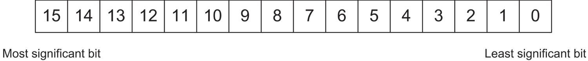
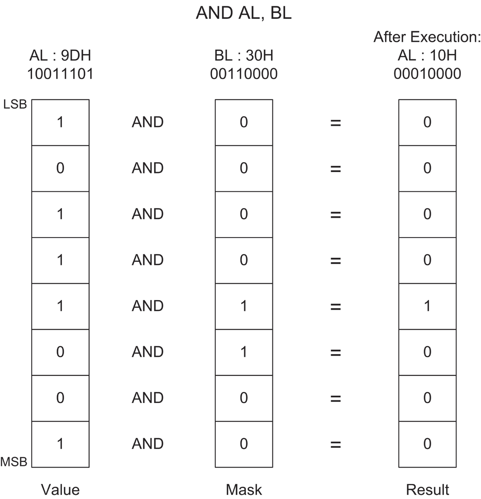
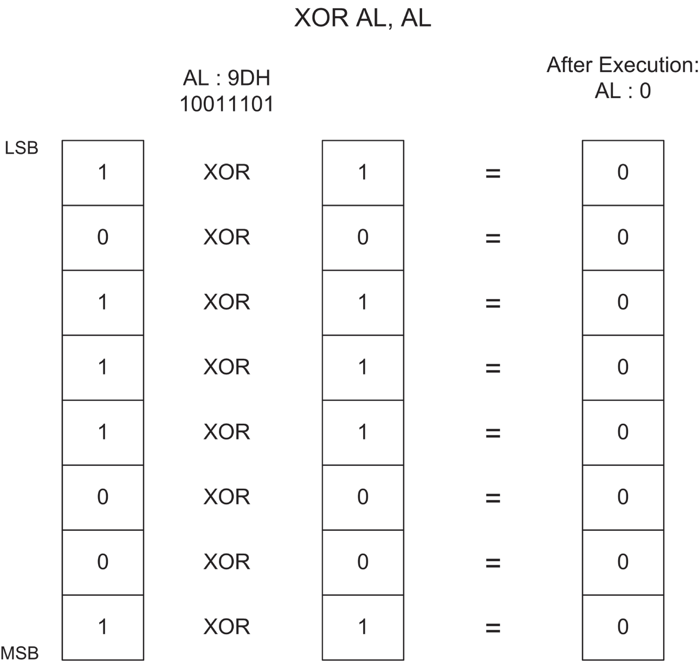
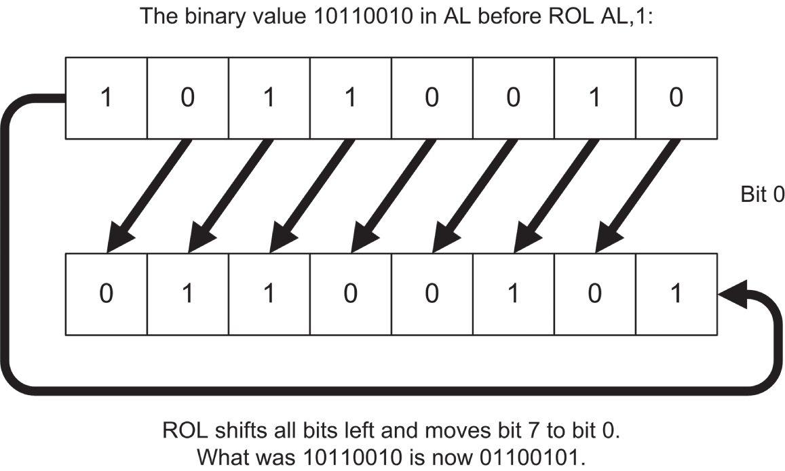
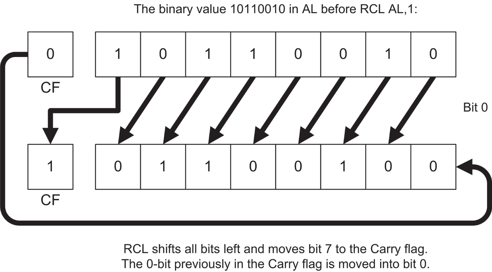
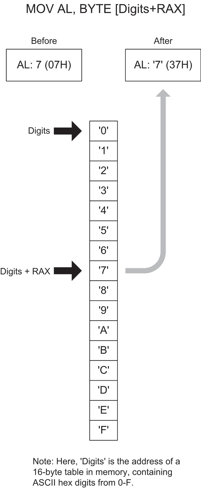
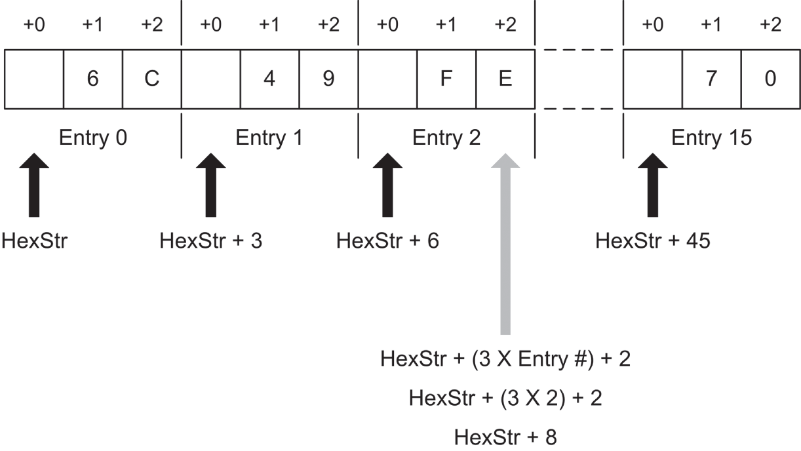
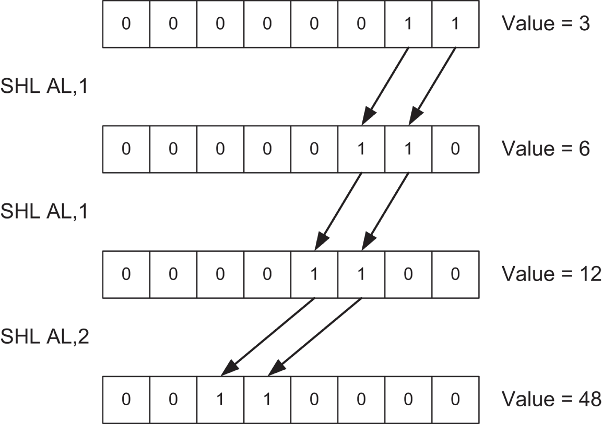
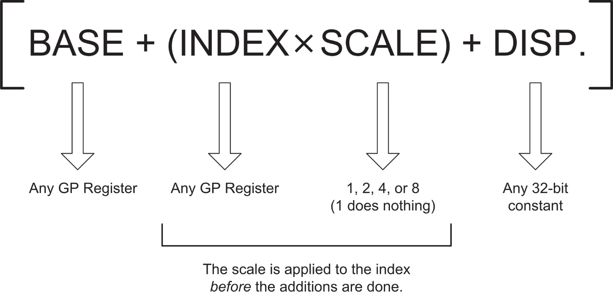
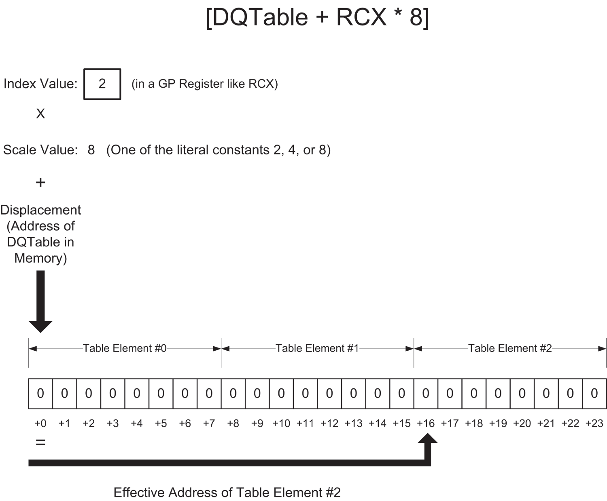

# <a id="Page_251"></a>CHƯƠNG 9 Bit, flag, nhánh và bảng: *Từng bước bước vào lập trình assembly chính thống*

Như bạn đã thấy đến giờ, phương pháp chung của tôi để giải thích mọi thứ bắt đầu bằng cái “nhìn từ trên cao” rồi đi xuống dần về phía chi tiết. Tôi làm như vậy vì đó là cách con người học: bằng cách cắm những sự thật riêng lẻ vào một khung lớn hơn làm rõ những sự thật đó liên quan với nhau thế nào. Có thể (vừa đủ) đi từ chi tiết đến bức tranh tổng thể, nhưng qua 60-odd năm đập đầu vào đủ loại chủ đề để theo đuổi kiến thức, tôi đã thấy rất rõ rằng có khung tổng thể đặt sẵn trước khiến việc thiết lập mọi mối liên hệ giữa các sự thật dễ hơn *rất nhiều*. Nó giống như cẩn thận xếp đá thành một đống gọn gàng trước khi xúc chúng vào một cái hộp. Nếu mục tiêu là đưa đá vào hộp, tốt hơn nhiều là có cái hộp đặt sẵn trước khi bắt đầu nhặt đá.

Và ở đây cũng vậy. Bức tranh tổng thể phần lớn đã được đặt sẵn. Từ giờ trở đi trong cuốn sách này, chúng ta sẽ xem xét chi tiết của code assembly và xem chúng khớp vào cái nhìn lớn hơn đó thế nào.

<a id="head-2-95"></a>

## Bit là bit (và byte cũng là bit)

Assembly language rất coi trọng bit. Xét cho cùng, bit là thứ tạo nên byte, và một kỹ năng assembly language thiết yếu là xây dựng byte rồi tháo rời chúng ra lần nữa. Một kỹ thuật gọi là bit mapping được dùng rộng rãi trong assembly language. *Bit mapping* gán những ý nghĩa đặc biệt cho từng bit riêng lẻ bên trong một byte để tiết kiệm không gian và vắt kiệt từng chút tiện ích cuối cùng ra khỏi một lượng memory nhất định.

<a id="Page_252"></a>Có một họ instruction trong instruction set x64 cho phép bạn thao tác các bit bên trong byte bằng cách áp dụng các phép toán logic Boolean giữa các byte trên cơ sở bit-by-bit. Đó là các *bitwise logical instruction*: `AND`, `OR`, `XOR` và `NOT`. Một họ instruction khác cho phép bạn trượt các bit qua lại bên trong một byte hay word duy nhất. Đó là các instruction shift/rotate most-used: `ROL`, `ROR`, `RCL`, `RCR`, `SHL` và `SHR`. (Có vài instruction khác mà tôi sẽ không thảo luận trong cuốn sách này.)

### Đánh số bit

Làm việc với bit đòi hỏi chúng ta có cách chỉ định mình đang làm việc với những bit nào. Theo quy ước, các bit trong assembly language được đánh số, bắt đầu từ 0, tại *bit least-significant* trong byte, word, double word hay mục khác mà chúng ta đang dùng làm bit map. *Bit least-significant* là bit có giá trị nhỏ nhất trong hệ số binary. Nó cũng là bit ở ngoài cùng bên phải, nếu bạn viết giá trị ra dưới dạng một số binary theo cách thông thường.

Tôi đã thể hiện điều này trong <a id="R_c09-fig-0001"></a>[Hình 9.1](#c09-fig-0001), cho một word 16-bit. Việc đánh số bit hoạt động hoàn toàn như nhau bất kể bạn đang làm việc với bao nhiêu bit: byte, word, double word hay quadword. Bit 0 *luôn* ở đầu right-hand, và số thứ tự bit tăng dần về phía bên trái.



*<a id="c09-fig-0001"></a>**Hình 9.1**: Đánh số bit*

*Khi bạn đếm bit, hãy bắt đầu từ bit ở đầu right-hand, và đánh số chúng sang trái bắt đầu từ 0*.

### “Đó là việc hợp logic để làm, Jim…”

Thuật ngữ *logic Boolean* nghe bí hiểm và đáng sợ, nhưng đáng chú ý là nó phản ánh thực tế của suy nghĩ và hành động thông thường. Ví dụ, toán tử Boolean AND xuất hiện trong nhiều quyết định bạn đưa ra mỗi ngày trong đời. Chẳng hạn, để viết một tấm séc không bị trả lại, bạn phải có tiền trong tài khoản séc AND có séc trong sổ séc của mình. Chỉ một trong hai thứ thì không làm được việc. Bạn không thể viết một tấm séc mà bạn không có, và một tấm séc không có tiền đằng sau sẽ bị trả lại. Những người sống bằng sổ séc dùng toán tử AND thường xuyên.

Khi các nhà toán học nói về logic Boolean, họ thao tác với các giá trị trừu tượng gọi là True và False. Toán tử AND hoạt động như thế này: Condition1 <a id="Page_253"></a>AND Condition2 sẽ được coi là True nếu *cả* Condition1 lẫn Condition2 đều True. Nếu một trong hai điều kiện là False, kết quả sẽ là False.

Thực tế có bốn tổ hợp khác nhau của hai giá trị input, vì vậy các phép toán logic giữa hai giá trị thường được tóm tắt ở một dạng gọi là *bảng chân trị* (truth table). Bảng chân trị cho toán tử logic AND (chưa *phải* là instruction `AND`; chúng ta sẽ đến đó ngay sau đây) được thể hiện trong <a id="R_c09-tbl-0001"></a>[Bảng 9.1](#c09-tbl-0001).

*<a id="c09-tbl-0001"></a>**Bảng 9.1**: Bảng chân trị AND cho logic hình thức*

| CONDITION1 | TOÁN TỬ | CONDITION2 | KẾT QUẢ |
|---|---|---|---|
| False | AND | False = | False |
| False | AND | True = | False |
| True | AND | False = | False |
| True | AND | True = | True |

Bảng chân trị chẳng có gì bí ẩn. Nó chỉ là một bản tóm tắt mọi khả năng của toán tử AND khi được áp dụng cho hai điều kiện input. Điều quan trọng cần nhớ về AND là *chỉ* khi cả hai giá trị input đều True thì kết quả mới cũng là True.

Đó là cách các nhà toán học nhìn AND. Theo ngôn ngữ assembly language, instruction `AND` nhìn vào hai bit và cho ra một bit thứ ba dựa trên giá trị của hai bit đầu. Theo quy ước, chúng ta coi bit 1 là True và bit 0 là False. *Logic* là giống hệt nhau; chúng ta chỉ đang dùng các ký hiệu khác để biểu diễn True và False. Ghi nhớ điều đó, chúng ta có thể viết lại bảng chân trị của `AND` để nó có ý nghĩa hơn cho công việc assembly language. Xem <a id="R_c09-tbl-0002"></a>[Bảng 9.2](#c09-tbl-0002).

*<a id="c09-tbl-0002"></a>**Bảng 9.2**: Bảng chân trị AND cho assembly language*

| BIT 1 | TOÁN TỬ | BIT 2 | BIT KẾT QUẢ |
|---|---|---|---|
| 0 | AND | 0 = | 0 |
| 0 | AND | 1 = | 0 |
| 1 | AND | 0 = | 0 |
| 1 | AND | 1 = | 1 |

### Instruction AND

Instruction `AND` hiện thân cho khái niệm này trong instruction set x64. Instruction `AND` thực hiện phép toán logic AND trên hai operand like-sized và thay thế destination operand bằng kết quả của toàn bộ phép toán. <a id="Page_254"></a>(Hãy nhớ rằng destination operand là operand gần mnemonic nhất.) Nói cách khác, hãy xem instruction này:

```
and al,bl
```

Điều sẽ xảy ra ở đây là CPU sẽ thực hiện một loạt tám phép toán AND bitwise trên tám bit trong AL và BL. Bit 0 của AL được `AND` với bit 0 của BL, bit 1 của AL được AND với bit 1 của BL, và cứ thế. Mỗi phép toán AND sinh ra một bit kết quả, và bit đó được đặt vào destination operand (ở đây là AL) *sau khi* cả tám phép toán AND diễn ra. Đây là một điểm chung giữa các machine instruction thực hiện một phép toán nào đó trên hai operand và tạo ra một kết quả: kết quả thay thế operand thứ nhất (destination operand) chứ *không phải* operand thứ hai!

### Che bit (masking)

Một công dụng chính của instruction `AND` là cô lập một hoặc nhiều bit ra khỏi một giá trị byte, word, dword hay qword. *Cô lập* ở đây đơn giản có nghĩa là đặt mọi bit *không mong muốn* về một giá trị 0 đáng tin cậy. Ví dụ, giả sử chúng ta quan tâm đến việc kiểm tra bit 4 và 5 của một giá trị để xem những bit đó là gì. Để làm điều đó, chúng ta phải có khả năng bỏ qua các bit khác (bit 0 đến 3 và 6 đến 7), và cách duy nhất để bỏ qua bit một cách an toàn là đặt chúng về 0.

`AND` là con đường để đi. Chúng ta thiết lập một *bit mask* trong đó các số thứ tự bit mà chúng ta muốn xem xét và kiểm tra được đặt thành 1, và các bit chúng ta muốn bỏ qua được đặt thành 0. Để che hết mọi bit trừ bit 4 và 5, chúng ta phải thiết lập một mask trong đó bit 4 và 5 được đặt thành 1, với mọi bit khác bằng 0. Mask này ở dạng binary là 00110000B, hay 30H. (Để kiểm chứng, hãy đếm các bit từ đầu right-hand của số binary, bắt đầu từ 0.) Bit mask này sau đó được AND với giá trị đang xét. <a id="R_c09-fig-0002"></a>[Hình 9.2](#c09-fig-0002) cho thấy phép toán này đang hoạt động, với bit mask 30H vừa mô tả và giá trị ban đầu là 9DH.

Ba giá trị binary liên quan được thể hiện xếp theo chiều dọc, với bit least-significant (tức là đầu right-hand) của mỗi giá trị ở trên cùng. Bạn hẳn có thể lần theo từng phép toán AND và kiểm chứng nó bằng cách nhìn vào [Bảng 9.2](#c09-tbl-0002).

Kết quả cuối cùng là mọi bit trừ bit 4 và 5 đều *được đảm bảo* là 0 và do đó có thể được bỏ qua một cách an toàn. Bit 4 và 5 có thể là 0 hoặc 1. (Đó là lý do chúng ta cần kiểm tra chúng; chúng ta không *biết* chúng là gì.) Với giá trị ban đầu là 9DH, bit 4 hóa ra là 1, và bit 5 hóa ra là 0. Nếu giá trị ban đầu là một giá trị khác, bit 4 và 5 có thể cùng là 0, cùng là 1, hoặc một tổ hợp nào đó của hai giá trị.

Đừng quên: kết quả của instruction `AND` thay thế destination operand sau khi phép toán hoàn tất.



*<a id="c09-fig-0002"></a>**Hình 9.2**: Giải phẫu một instruction AND*

<a id="Page_255"></a>

### Instruction OR

Liên quan chặt chẽ với phép toán logic AND là OR, phép toán mà, giống như phép toán logic AND, có một hiện thân cùng tên trong instruction set x86/x64. Về mặt cấu trúc, instruction `OR` hoạt động giống hệt `AND`. Chỉ có bảng chân trị của nó là khác: trong khi `AND` đòi hỏi cả hai operand của nó đều là 1 thì kết quả mới là 1, `OR` hài lòng khi ít nhất *một* operand có giá trị 1. Bảng chân trị cho `OR` được thể hiện trong <a id="R_c09-tbl-0003"></a>[Bảng 9.3](#c09-tbl-0003).

<a id="Page_256"></a>

*<a id="c09-tbl-0003"></a>**Bảng 9.3**: Bảng chân trị OR cho assembly language*

| BIT 1 | TOÁN TỬ | BIT 2 | BIT KẾT QUẢ |
|---|---|---|---|
| 0 | OR | 0 = | 0 |
| 0 | OR | 1 = | 1 |
| 1 | OR | 0 = | 1 |
| 1 | OR | 1 = | 1 |

Vì nó không phù hợp để cô lập bit, instruction `OR` được dùng hiếm hơn nhiều so với `AND`.

### Instruction XOR

Ở một hạng riêng là phép toán exclusive OR, được hiện thân trong instruction `XOR`. Một lần nữa, `XOR` làm một cách khái quát điều `AND` và `OR` làm: nó thực hiện một phép toán logic bit-by-bit trên hai operand của nó, và kết quả thay thế destination operand. Tuy nhiên, phép toán logic là *exclusive or*, nghĩa là kết quả là 1 chỉ khi hai operand *khác nhau* (tức là 1 và 0 hoặc 0 và 1). Bảng chân trị cho `XOR` (xem <a id="R_c09-tbl-0004"></a>[Bảng 9.4](#c09-tbl-0004)) hẳn sẽ làm khái niệm hơi trơn tuột này rõ ràng hơn một chút.

*<a id="c09-tbl-0004"></a>**Bảng 9.4**: Bảng chân trị XOR cho assembly language*

| BIT 1 | TOÁN TỬ | BIT 2 | BIT KẾT QUẢ |
|---|---|---|---|
| 0 | XOR | 0 = | 0 |
| 0 | XOR | 1 = | 1 |
| 1 | XOR | 0 = | 1 |
| 1 | XOR | 1 = | 0 |

Hãy xem kỹ [Bảng 9.4](#c09-tbl-0004)! Trong trường hợp đầu tiên và cuối cùng, nơi hai operand *giống nhau*, kết quả là 0. Trong hai trường hợp ở giữa, nơi hai operand *khác nhau*, kết quả là 1.

Có thể làm một số điều thú vị với instruction `XOR`, nhưng hầu hết chúng hơi bí hiểm đối với một cuốn sách cho người mới bắt đầu như thế này. Một công dụng không hiển nhiên nhưng tiện lợi của `XOR` là thế này: `XOR` bất kỳ giá trị nào với *chính nó* cho ra 0. Nói cách khác, nếu bạn thực thi instruction `XOR` với cả hai operand là cùng một register, register đó sẽ bị clear về 0:

```
xor rax,rax   ; Zero out the rax register
```

Thời xưa, cách này nhanh hơn việc nạp số 0 vào một register từ immediate data bằng `MOV`. Mặc dù điều đó không còn đúng nữa, đây là một mánh thú vị nên biết. Cách nó hoạt động hẳn là hiển nhiên khi đọc bảng chân trị, nhưng để nhấn mạnh, tôi đã trình bày nó trong <a id="R_c09-fig-0003"></a>[Hình 9.3](#c09-fig-0003).

Hãy theo từng phép toán exclusive OR riêng lẻ ngang qua hình tới giá trị kết quả của nó. Vì mỗi bit trong AL được XOR với chính nó, trong mọi trường hợp các phép toán XOR diễn ra giữa hai operand giống hệt nhau. Đôi khi cả hai là 1, đôi khi cả hai là 0, nhưng trong mọi trường hợp hai cái là như nhau. Với phép toán XOR, khi hai operand giống nhau, kết quả luôn là 0. *Voilà*! Số không trong một register.



*<a id="c09-fig-0003"></a>**Hình 9.3**: Dùng XOR để đưa một register về không*

<a id="Page_257"></a>

### Instruction NOT

Dễ hiểu nhất trong mọi bitwise logical instruction là `NOT`. Bảng chân trị cho `NOT` đơn giản hơn những bảng khác chúng ta đã xem vì `NOT` chỉ nhận một operand. Và điều nó làm cũng đơn giản: `NOT` lấy trạng thái của mỗi bit trong operand duy nhất của nó và đổi bit đó sang trạng thái ngược lại. Cái gì là 1 trở thành 0, và cái gì là 0 trở thành 1. Tôi thể hiện điều này trong <a id="R_c09-tbl-0005"></a>[Bảng 9.5](#c09-tbl-0005).

<a id="Page_258"></a>

*<a id="c09-tbl-0005"></a>**Bảng 9.5**: Bảng chân trị NOT cho assembly language*

| BIT | TOÁN TỬ | BIT KẾT QUẢ |
|---|---|---|
| 0 | NOT | 1 |
| 1 | NOT | 0 |

### Segment register không phản hồi logic!

Bạn sẽ không truy cập trực tiếp các segment register cho đến khi đi vào chiều sâu của lập trình operating-system. Segment register giờ thuộc về OS để nó tự sử dụng, và các chương trình user-space không thể thay đổi chúng theo bất kỳ cách nào.

Nhưng ngay cả khi bạn bắt đầu làm việc ở mức operating-system, các segment register đi kèm những hạn chế đáng kể. Một hạn chế như vậy là chúng không thể được dùng với bất kỳ bitwise logic instruction nào. Nếu bạn thử, assembler sẽ đưa cho bạn một error “Illegal use of segment register”. Nếu bạn cần thực hiện một phép toán logic trên một segment register, trước tiên bạn phải sao chép giá trị của segment register vào một trong các register general-purpose, thực hiện phép toán logic trên register GP, rồi sao chép kết quả trong register GP trở lại segment register.

Các register general-purpose được gọi là “general purpose” là có lý do, và các segment register không hề general-purpose theo bất kỳ cách nào. Chúng là những chuyên gia về memory addressing, và nếu có lúc nào bạn phải làm việc với các giá trị segment, cách tiếp cận chung là làm việc đó trong một register general-purpose rồi sao chép giá trị đã sửa đổi trở lại segment register đang xét.

<a id="head-2-96"></a>

## Dịch bit

Cách khác để thao tác bit bên trong một byte thì trực tiếp hơn một chút: bạn *dịch* (shift) chúng về phía bên này hoặc bên kia. Có vài điểm rắc rối trong quá trình này, nhưng các instruction shift đơn giản nhất khá hiển nhiên: `SHL` SHifts operand của nó sang trái (Left), trong khi `SHR` SHifts operand của nó sang phải (Right).

Mọi instruction shift (kể cả những instruction phức tạp hơn một chút mà tôi sẽ mô tả ở phần sau một chút) đều có cùng dạng chung, được minh họa ở đây bằng instruction `SHL`:

```
shl <register/memory>,<count>
```

Operand thứ nhất là mục tiêu của phép shift, tức là giá trị mà bạn sẽ dịch. Nó có thể là register data hoặc memory data, nhưng không thể là immediate data. Operand thứ hai chỉ định số bit cần dịch.

### Dịch bao nhiêu?

Operand `<count>` này có một lịch sử kỳ lạ. Trên các chip 8086 và 8088 cổ xưa, nó có thể là một trong hai thứ: chữ số immediate 1, hoặc register CL. (*Không phải* CX!) Nếu bạn chỉ định số đếm là 1, thì phép shift sẽ dịch một bit. Nếu bạn muốn dịch nhiều hơn một bit mỗi lần, trước tiên bạn phải nạp số đếm shift vào register CL. Trong những ngày trước khi các register general-purpose x86 trở nên thực sự general-purpose, việc đếm từng là “mục đích ngầm” của CX (và do đó của CL). Nó sẽ đếm số lần shift, số lượt qua vòng lặp, các phần tử chuỗi và vài thứ khác. Đó là lý do nó đôi khi được gọi là *count register* và có thể được ghi nhớ nhờ chữ *C* trong *count*. Bắt đầu từ 286 và với mọi CPU x86/x64 gần đây hơn, operand `<count>` có thể là bất kỳ giá trị immediate nào từ 0 đến 255. Số đếm shift cũng có thể được truyền trong CL nếu bạn thích. Lưu ý rằng bạn không thể chỉ định RCX cho số đếm, mặc dù nó “chứa” CL. Ngay cả trong x64, các instruction shift thực sự đòi hỏi hoặc một giá trị immediate từ 0–255 hoặc CL. Bất kỳ register nào khác được chỉ định cho giá trị đếm sẽ kích hoạt một assembler error.

Hiển nhiên, dịch 0 bit là vô nghĩa, nhưng nó khả thi và không bị coi là error. *Hãy cẩn thận khi gõ*.

Giờ, có một dấu sao quan trọng đối với đoạn trên: *bạn không thể dịch nhiều vị trí hơn số vị trí mà register đích có*. Ở long mode 64-bit, bạn không thể dịch (hoặc rotate; xem mục tiếp theo) quá 63 lần đếm. Cố làm vậy sẽ không kích hoạt error. Nó chỉ đơn giản là không hoạt động. Nó không hoạt động vì trước khi instruction được thực thi, CPU che giá trị đếm xuống còn sáu bit thấp nhất. Sáu bit thấp đó chỉ có thể đếm đến 63. Cần bảy bit để biểu diễn 64.

Một giá trị literal 146 sẽ không gây ra error, nhưng bạn sẽ chỉ dịch destination operand đi 18 vị trí.

Ở protected mode 32-bit, CPU che giá trị đếm xuống còn năm bit thấp nhất, vì năm bit có thể đếm đến 31.

### Dịch bit hoạt động thế nào

Hiểu các instruction shift đòi hỏi bạn nghĩ về các số đang được dịch như các số *binary*, chứ không phải số hexadecimal hay decimal. (Nếu bạn còn mơ hồ về ký hiệu binary, một lần nữa, hãy đọc lại tập trung [Chương 2](ch02_alien_bases.vi.md).) Một ví dụ đơn giản sẽ bắt đầu với register AX chứa giá trị 0B76FH. (Tôi dùng AX cho ví dụ ở đây để giữ các số binary ngắn và dễ nắm bắt, nhưng các instruction shift có thể được dùng trên register ở bất kỳ kích thước nào.) Khi được biểu diễn như một số binary (và do đó như một bit pattern), 0B76FH như sau:

```
1011011101101111
```

Hãy nhớ rằng mỗi chữ số trong một số binary là một bit. Nếu bạn thực thi một instruction `SHL AX,1`, thứ bạn sẽ thấy trong AX sau phép shift là:

```
0110111011011110
```

Một số 0 đã được chèn vào ở đầu right-hand của số, và toàn bộ mọi thứ đã bị đẩy sang trái một chữ số. Hãy chú ý rằng một bit 1 đã bị đẩy ra khỏi đầu trái của số vào cõi hư vô vũ trụ.

Bạn thậm chí có thể dùng các instruction shift trên CL, với CL chứa số đếm. Điều này hợp lệ, dù nó trông kỳ lạ, và có thể không phải là ý hay nhất:

<a id="Page_260"></a>

```
mov cl,1
shl cl,cl
```

Điều xảy ra trong ví dụ này là giá trị đếm trong CL được dịch trái theo giá trị mà CL chứa. Ở đây bit 1 trong CL được dịch để trở thành một bit 2. Nếu điều này vẫn có vẻ lạ, hãy đặt nó vào một sandbox và quan sát các register.

### Đẩy bit vào Carry flag

Việc dịch một bit ra khỏi đầu trái của một giá trị binary không *hoàn toàn* gửi bit đó vào cõi hư vô vũ trụ. Một bit bị dịch ra khỏi đầu trái của một giá trị binary bị đẩy vào một cái xô tạm thời cho bit gọi là Carry flag (CF). Carry flag là một trong những bit thông tin được tập hợp lại thành register RFlags, mà tôi đã mô tả trong [Chương 7](ch07_following_your_instructions.vi.md). Bạn có thể kiểm tra trạng thái của Carry flag bằng một instruction rẽ nhánh, như tôi sẽ giải thích ở phần sau một chút trong chương này.

Tuy nhiên, khi dùng các instruction shift, hãy nhớ rằng *rất nhiều* instruction khác nhau dùng Carry flag—không chỉ các instruction shift. Nếu bạn đẩy một bit vào Carry flag với ý định kiểm tra bit đó sau để xem nó là gì, hãy kiểm tra nó *trước khi* bạn thực thi một instruction khác ảnh hưởng đến Carry flag. Danh sách đó bao gồm mọi instruction số học, mọi bitwise logical instruction, vài instruction lặt vặt khác—và, dĩ nhiên, mọi instruction shift khác.

Nếu bạn dịch một bit vào Carry flag rồi ngay lập tức thực thi một instruction shift khác, bit đã bị đẩy vào Carry flag trước đó *sẽ* bị đẩy ra khỏi tận cùng thế giới vào cõi hư vô vũ trụ.

### Các instruction rotate

Nói như vậy, nếu số phận của một bit là *không* bị mất vào cõi hư vô vũ trụ, thay vào đó bạn cần dùng các instruction rotate `RCL`, `RCR`, `ROL` và `ROR`. Các instruction rotate gần như giống hệt các instruction shift, nhưng có một khác biệt then chốt: một bit bị đẩy ra khỏi một đầu của operand xuất hiện lại ở đầu đối diện của operand. Khi bạn rotate một operand nhiều hơn một bit, các bit diễu hành đều đặn theo một hướng, rơi ra khỏi đầu cuối và ngay lập tức xuất hiện lại ở đầu đối diện. Do đó các bit “xoay vòng” qua operand khi instruction rotate được thực thi.

Như rất nhiều thứ khác, điều này thể hiện bằng hình thì tốt hơn nói. Hãy xem <a id="R_c09-fig-0004"></a>[Hình 9.4](#c09-fig-0004). Ví dụ được thể hiện ở đây là instruction `ROL` (Rotate Left), nhưng instruction `ROR` hoạt động theo cùng cách, với các bit di chuyển theo hướng ngược lại. Một giá trị binary ban đầu 10110010 (0B2h) được đặt vào AL. Khi một instruction `ROL` AL,1 được thực thi, mọi bit trong AL diễu hành sang trái một vị trí. 1-bit ở bit 7 rời AL ở phía cánh gà bên trái nhưng chạy vòng quanh và xuất hiện lại ngay lập tức từ cánh gà bên phải.

Một lần nữa, `ROR` hoạt động hoàn toàn theo cùng cách, nhưng sự di chuyển của các bit là từ trái sang phải thay vì (như với `ROL`) từ phải sang trái. Số bit mà một operand được rotate có thể là một giá trị immediate hoặc một giá trị trong CL.



*<a id="c09-fig-0004"></a>**Hình 9.4**: Các instruction rotate hoạt động thế nào*

<a id="Page_261"></a>

### Rotate bit qua Carry flag

Có một cặp instruction rotate thứ hai trong instruction set x86/x64: `RCR` (Rotate Carry Right) và `RCL` (Rotate Carry Left). Chúng hoạt động như `ROL` và `ROR`, nhưng có một điểm đặc biệt: các bit bị dịch ra khỏi đầu cuối của một operand và re-enter operand ở đầu kia đi qua Carry flag. Do đó, đường đi mà bất kỳ bit đơn lẻ nào đi trong một lần rotate qua CF dài hơn một bit so với trong `ROL` và `ROR`. Tôi đã thể hiện điều này bằng hình trong <a id="R_c09-fig-0005"></a>[Hình 9.5](#c09-fig-0005).

<a id="Page_262"></a>



*<a id="c09-fig-0005"></a>**Hình 9.5**: Các instruction rotate qua carry hoạt động thế nào*

### Đặt một giá trị biết trước vào Carry flag

Cũng hữu ích khi nhớ rằng các instruction trước đó có thể để lại giá trị trong CF, và những giá trị đó sẽ được rotate vào một operand trong một instruction `RCL` hay `RCR`. Một số người có cách hiểu sai rằng CF bị ép về 0 trước một instruction shift hay rotate, và điều đó đơn giản là không đúng. Nếu một instruction khác để lại một 1-bit trong CF ngay trước một instruction `RCR` hay `RCL`, 1-bit đó sẽ ngoan ngoãn đi vào destination operand, dù bạn có muốn hay không.

Nếu việc bắt đầu một lần rotate với một giá trị biết trước trong CF là quan trọng, có một cặp instruction x86 sẽ làm việc đó cho bạn: `CLC` và `STC`. `CLC` clear Carry flag về 0. `STC` set Carry flag thành 1. Không instruction nào nhận operand và không cái nào có tác động nào khác.

<a id="head-2-97"></a>

## Bit-Bashing trong thực tế

Như chúng ta đã thấy trong các chương trước, Linux có một phương pháp khá tiện lợi để hiển thị văn bản lên màn hình của bạn. Vấn đề là nó chỉ hiển thị *văn bản*—nếu bạn muốn hiển thị một giá trị số từ một register dưới dạng một cặp chữ số hex, Linux sẽ không giúp. Trước tiên bạn phải chuyển giá trị số thành biểu diễn chuỗi của nó rồi hiển thị biểu diễn chuỗi đó bằng cách gọi kernel service `sys_write` thông qua `syscall`.

Chuyển số hexadecimal thành chữ số hexadecimal không khó, và code làm việc đó minh họa vài khái niệm mới mà chúng ta đang khám phá trong chương này. Code trong <a id="R_c09-fea-0001"></a>[Listing 9.1](#c09-fea-0001) là phần lõi bare-bones của một tiện ích hex-dump. Khi bạn chuyển hướng input của nó từ một file bất kỳ, nó sẽ đọc file đó mỗi lần 16 byte và hiển thị 16 byte đó trên một dòng, dưới dạng 16 giá trị hexadecimal phân tách bằng dấu space. Code chứa một số kỹ thuật mới đáng để thảo luận. Sau đó, trong [Chương 10](ch10_dividing_and_conquering.vi.md), chúng ta sẽ mở rộng nó để thêm cột tương đương ASCII ở bên phải cột `hexdump`.

> **<a id="c09-fea-0001"></a>Listing 9.1: hexdump1gcc.asm**
>
> ```
> ;  Executable name : hexdump1gcc
> ;  Version         : 2.0
> ;  Created date    : 5/9/2022
> ;  Last update     : 5/8/2023
> ;  Author          : Jeff Duntemann
> ;  Description     : A simple program in assembly for Linux, using
> ;                    NASM 2.15 under the SASM IDE, demonstrating the
> ;                    conversion of binary values to hexadecimal
> ;                    strings. It acts as a very simple hex dump utility
> ;                    for files, without the ASCII equivalent column.
> ;
> ;  Run it this way:
> ;    hexdump1gcc < (input file)
> ;
> ;  Build using SASM's default build setup for x64
> ;
> SECTION .bss               ; Section containing uninitialized data
>
>     BUFFLEN  equ 16        ; We read the file 16 bytes at a time
>     Buff:    resb BUFFLEN  ; Text buffer itself, reserve 16 bytes
>
> SECTION .data              ; Section containing initialised data
>
>     HexStr: db " 00 00 00 00 00 00 00 00 00 00 00 00 00 00 00 00",10
>     HEXLEN equ $-HexStr
>
>     Digits: db "0123456789ABCDEF"
>
> SECTION .text             ; Section containing code
>
> global  main              ; Linker needs this to find the entry point!
>
> main:
>     mov rbp,rsp           ; SASM Needs this for debugging
>
> ; Read a buffer full of text from stdin:
> Read:
>     mov rax,0             ; Specify sys_read call 0
>     mov rdi,0             ; Specify File Descriptor 0: Standard Input
>     mov rsi,Buff          ; Pass offset of the buffer to read to
>     mov rdx,BUFFLEN       ; Pass number of bytes to read at one pass
>     syscall               ; Call sys_read to fill the buffer
>     mov r15,rax           ; Save # of bytes read from file for later
>     cmp rax,0             ; If rax=0, sys_read reached EOF on stdin
>     je Done               ; Jump If Equal (to 0, from compare)
>
> ; Set up the registers for the process buffer step:parm
>     mov rsi,Buff          ; Place address of file buffer into esi
>     mov rdi,HexStr        ; Place address of line string into edi
>     xor rcx,rcx           ; Clear line string pointer to 0
>
> ; Go through the buffer and convert binary values to hex digits:
> Scan:
>     xor rax,rax           ; Clear rax to 0
>
> ; Here we calculate the offset into the line string, which is rcx X 3
>     mov rdx,rcx           ; Copy the pointer into line string into rdx
> ;   shl rdx,1             ; Multiply pointer by 2 using left shift
> ;   add rdx,rcx           ; Complete the multiplication X3
>     lea rdx,[rdx*2+rdx]   ; This does what the above 2 lines do!
>                           ; See discussion of LEA later in Ch. 9
> ; Get a character from the buffer and put it in both rax and rbx:
>     mov al,byte [rsi+rcx] ; Put a byte from the input buffer into al
>     mov rbx,rax           ; Duplicate byte in bl for second nybble
>
> ; Look up low nybble character and insert it into the string:
>     and al,0Fh                  ; Mask out all but the low nybble
>     mov al,byte [Digits+rax]    ; Look up the char equivalent of nybble
>     mov byte [HexStr+rdx+2],al  ; Write the char equivalent to
>                                 ;   the line string
>
> ; Look up high nybble character and insert it into the string:
>     shr bl,4               ; Shift high 4 bits of char into low 4 bits
>     mov bl,byte [Digits+rbx]   ; Look up char equivalent of nybble
>     mov byte [HexStr+rdx+1],bl ; Write the char equivalent to
>                                ;   the line string
>
> ; Bump the buffer pointer to the next character and see if we're done:
>     inc rcx       ; Increment line string pointer
>     cmp rcx,r15   ; Compare to the number of characters in the buffer
>     jna Scan      ; Loop back if rcx is <= number of chars in buffer
>
> ; Write the line of hexadecimal values to stdout:
>     mov rax,1       ; Specify syscall call 1: sys_write
>     mov rdi,1       ; Specify File Descriptor 1: Standard output
>     mov rsi,HexStr  ; Pass address of line string in rsi
>     mov rdx,HEXLEN  ; Pass size of the line string in rdx
>     syscall         ; Make kernel call to display line string
>     jmp Read        ; Loop back and load file buffer again
>
> ; All done! Let's end this party:
> Done:
>     ret             ; Return to the glibc shutdown code
>
> ```

Về cốt lõi, chương trình `hexdump1` là một chương trình filter và có cùng bộ máy filter chung mà tôi đã dùng trong <a id="Page_264"></a>chương trình `uppercaser2` từ [Chương 8](ch08_our_object_all_sublime.vi.md). Các phần quan trọng của chương trình cho phần thảo luận này là các phần đọc 16 byte từ buffer input và chuyển chúng thành một chuỗi ký tự để hiển thị lên console Linux. Đây là code nằm giữa label `Scan` và instruction RET. Tôi sẽ nhắc đến khối code đó trong phần thảo luận tiếp theo.

Nếu bạn đọc [Listing 9.1](#c09-fea-0001), bạn sẽ thấy rằng hai dòng code bị comment out. Đây không phải là nhầm lẫn, và tôi sẽ quay lại điều đó.

### Tách một byte thành hai nybble

Hãy nhớ rằng các giá trị được Linux đọc từ một file được đọc vào memory dưới dạng giá trị binary. Hexadecimal là một cách hiển thị giá trị binary, và để bạn hiển thị giá trị binary dưới dạng các chữ số hexadecimal ASCII có thể hiển thị được, bạn phải thực hiện một số chuyển đổi.

<a id="Page_265"></a>Hiển thị một giá trị binary 8-bit duy nhất đòi hỏi hai chữ số hexadecimal. Bốn bit dưới cùng trong một byte được biểu diễn bằng một chữ số (chữ số least-significant, hay ngoài cùng bên phải), và bốn bit trên cùng trong byte được biểu diễn bằng một chữ số khác (chữ số có trọng số lớn nhất, hay ngoài cùng bên trái). Ví dụ, giá trị binary 11100110 tương đương với E6 ở dạng hex. (Tôi đã trình bày chi tiết tất cả điều này trong [Chương 2](ch02_alien_bases.vi.md).) Việc chuyển một giá trị 8-bit thành hai chữ số 4-bit phải được thực hiện từng chữ số một, nghĩa là chúng ta phải tách byte duy nhất đó thành hai đại lượng 4-bit, thường được gọi là *nybble*, đặc biệt trong công việc assembly.

Trong chương trình hexdump1, một byte được đọc từ `Buff` và được đặt vào hai register, RAX và RBX. Việc này được làm vì việc tách nybble cao khỏi nybble thấp trong một byte có tính phá hủy, ở chỗ về cơ bản chúng ta đưa nybble mà chúng ta không muốn về không.

Để cô lập nybble thấp trong một byte, chúng ta cần *che bỏ* nybble cao không mong muốn. Việc này được thực hiện bằng một instruction `AND`:

```
and al,0Fh
```

Hằng số immediate 0Fh biểu diễn bằng binary là 00001111. Nếu bạn theo phép toán qua bảng chân trị AND ([Bảng 9.2](#c09-tbl-0002)), bạn sẽ thấy rằng bất kỳ bit nào AND với 0 đều bằng 0. Chúng ta AND nybble cao của register AL với 0000, việc này đưa về không bất cứ thứ gì có thể có ở đó. AND nybble thấp với 1111 giữ nguyên các bit của nybble thấp đúng như chúng vốn có.

Khi xong, chúng ta có nybble thấp của byte được đọc từ `Buff` trong AL.

### Dịch nybble cao vào nybble thấp

Che bỏ nybble cao khỏi byte input trong AL sẽ phá hủy nó. Chúng ta cần nybble cao đó, nhưng chúng ta có một bản sao thứ hai trong RBX, và đó là bản sao mà từ đó chúng ta sẽ trích ra nybble cao. Giống như với nybble thấp, thực tế chúng ta sẽ làm việc với tám bit có trọng số nhỏ nhất của RBX, dưới tên BL. Hãy nhớ rằng BL chỉ là một cách khác để gọi tám bit thấp nhất của RBX. Nó không phải là một register khác. Nếu một giá trị được nạp vào RBX, tám bit least-significant của nó nằm trong BL.

Chúng ta có thể che bỏ nybble thấp trong BL bằng một instruction `AND`, để lại nybble cao, nhưng có một vướng mắc: che bỏ bốn bit thấp của một byte không biến bốn bit cao thành một nybble. Chúng ta phải bằng cách nào đó di chuyển bốn bit cao của byte input vào bốn bit thấp.

Cách nhanh nhất để làm điều này đơn giản là dịch BL sang phải bốn bit. Đây là điều instruction `SHR BL,4` làm. Nybble thấp đơn giản bị dịch ra khỏi mép của BL, vào Carry flag, rồi ra cõi hư vô vũ trụ. Sau phép shift, cái từng là nybble cao trong BL giờ là nybble thấp.

Đến đây, chúng ta có nybble thấp của byte input trong AL, và nybble cao của byte input trong BL. Thách thức tiếp theo là chuyển số binary four-bit trong một nybble (ví dụ, 1110) thành chữ số hex ASCII có thể hiển thị của nó; trong ví dụ này, đó là ký tự “E”.

<a id="Page_266"></a>

### Dùng lookup table

Trong section `.data` của chương trình là định nghĩa của một *lookup table* rất đơn giản. Bảng `Digits` có định nghĩa như sau:

```
Digits db '0123456789ABCDEF'
```

Điều quan trọng cần lưu ý về bảng `Digits` là mỗi chữ số chiếm một vị trí trong chuỗi mà offset của nó tính từ đầu chuỗi chính là giá trị mà nó biểu diễn. Nói cách khác, ký tự ASCII 0 nằm ngay đầu chuỗi, offset không byte tính từ đầu chuỗi. Ký tự 7 nằm cách đầu chuỗi bảy byte, và cứ thế.

Chúng ta “tra” một ký tự trong bảng `Digits` bằng một tham chiếu memory:

```
mov al,byte [Digits+rax]
```

Như phần lớn assembly language, mọi thứ ở đây phụ thuộc vào memory addressing. Ký tự chữ số hex đầu tiên trong lookup table nằm tại address trong `Digits`. Để lấy được chữ số mong muốn, chúng ta phải *index* vào lookup table. Chúng ta làm điều này bằng cách cộng một offset vào bảng với address bên trong dấu ngoặc. Offset này là nybble trong AL.

Cộng offset trong AL với address của `Digits` (dùng RAX) đưa chúng ta tới ngay ký tự là tương đương ASCII của giá trị trong AL. Tôi đã vẽ điều này ra bằng hình trong <a id="R_c09-fig-0006"></a>[Hình 9.6](#c09-fig-0006).

Có hai điều có thể gây nhầm lẫn về instruction `MOV` lấy một chữ số từ `Digits` và đặt nó vào AL:

- Chúng ta phải dùng RAX trong tham chiếu memory thay vì AL, vì *AL không thể tham gia vào các phép tính effective address*. Đừng quên rằng AL nằm “bên trong” RAX! (Sẽ nói thêm về các phép tính effective address ở phần sau một chút trong chương này.)
- Chúng ta đang thay thế nybble trong AL bằng ký tự tương đương của nó. Instruction trước tiên lấy ký tự tương đương của nybble từ bảng rồi lưu ký tự tương đương đó trở lại vào AL. Nybble từng ở trong AL bị ghi đè và do đó biến mất.

Đến giờ, chúng ta đã đọc một ký tự từ lookup table vào AL. Việc chuyển đổi nybble đó đã xong. Nhiệm vụ tiếp theo nghe có vẻ đơn giản nhưng thực ra khó đến bất ngờ: ghi ký tự chữ số hex ASCII giờ đang được lưu trong AL vào chuỗi hiển thị tại `HexStr`.



*<a id="c09-fig-0006"></a>**Hình 9.6**: Dùng lookup table*

<a id="Page_267"></a>

### Nhân bằng cách dịch và cộng

Chương trình hexdump1 đọc byte từ một file và hiển thị chúng thành các dòng, với 16 byte được biểu diễn bằng hex trên mỗi dòng. Một mẫu output từ hexdump1 được thể hiện ở đây:

```
 3B 20 20 45 78 65 63 75 74 61 62 6C 65 20 6E 61
 6D 65 20 3A 20 45 40 54 53 59 53 43 40 4C 4C 0D
 0A 3B 20 20 56 65 72 73 69 6F 6E 20 20 20 20 20
 20 20 20 20 3A 20 30 2E 30 0D 0A 3B 20 20 43 72
 65 60 74 65 64 20 64 60 74 65 20 20 20 20 3A 20
 30 2F 37 2F 32 30 30 39 0D 0A 3B 20 20 4C 60 73
 74 20 75 70 64 60 74 65 20 20 20 20 20 3A 20 32
 2F 30 38 2F 32 30 30 39 0D 0A 3B 20 20 40 75 74
 68 6F 72 20 20 20 20 20 20 20 20 20 20 3A 20 4A
```

Mỗi dòng này là một lần hiển thị của cùng một mục dữ liệu: `HexStr`, một chuỗi 48 ký tự có giá trị EOL (0ah) ở cuối. Mỗi lần hexdump1 đọc một khối 16 byte từ file input, nó định dạng chúng thành các chữ số hex ASCII và chèn chúng vào `HexStr`. Theo một nghĩa nào đó, đây là một kiểu thao tác bảng khác, ngoại trừ việc thay vì tra một thứ gì đó trong bảng, chúng ta đang ghi giá trị *vào* một bảng dựa trên một index.

Một cách để nghĩ về `HexStr` là như một bảng gồm 16 mục, mỗi mục dài ba ký tự. (Xem <a id="R_c09-fig-0007"></a>[Hình 9.7](#c09-fig-0007).) Trong mỗi mục, ký tự đầu tiên là một dấu space, và ký tự thứ hai và thứ ba là chính các chữ số hex. Các ký tự space đã có sẵn ở đó, như một phần của định nghĩa ban đầu của `HexStr` trong section `.data`. `HexStr` “trống” ban đầu có ký tự 0 ở mọi vị trí chữ số hex. Để “lấp đầy” `HexStr` bằng dữ liệu “thật” cho phần hiển thị của mỗi dòng, chúng ta phải quét qua `HexStr` trong một vòng lặp assembly language, ghi ký tự nybble thấp và ký tự nybble cao vào `HexStr` một cách riêng biệt.



*<a id="c09-fig-0007"></a>**Hình 9.7**: Một bảng gồm 16 mục three-byte*

Điều khó ở đây là với mỗi lượt qua vòng lặp, chúng ta phải “đẩy” index vào `HexStr` thêm ba thay vì chỉ thêm một. Offset của một trong những mục 3-byte đó trong `HexStr` là index của mục nhân với ba. Tôi đã mô tả các instruction `MUL`, xử lý phép nhân không dấu tùy ý trong instruction set x86/x64. Tuy nhiên, `MUL` chậm so với các instruction khác. Nó cũng có những hạn chế khác, đặc biệt là cách nó đòi hỏi các register cụ thể cho các implicit operand của nó.

May mắn là, với một chút khéo léo, có những cách khác nhanh hơn để nhân trong assembly. Những cách này dựa trên sự thật rằng nhân với lũy thừa của hai là rất dễ và rất nhanh, bằng cách dùng instruction `SHL` (Shift Left). Có thể điều này không hiển nhiên ngay với bạn, nhưng mỗi lần bạn dịch một đại lượng sang trái một bit, bạn đang nhân đại lượng đó với hai. Dịch một đại lượng sang trái hai bit, và bạn đang nhân nó với bốn. Dịch nó sang trái ba bit, và bạn đang nhân với tám, và cứ thế.

Bạn có thể tin lời tôi, hoặc bạn có thể thực sự quan sát nó diễn ra trong một sandbox. Hãy thiết lập một sandbox mới trong SASM và nhập các instruction sau:

```
mov al,3
shl al,1
shl al,1
shl al,2
```

Build sandbox và vào debug mode. Sau đó bước qua các instruction, quan sát giá trị của RAX thay đổi trong phần Registers ở mỗi bước.

Instruction đầu tiên nạp giá trị 3 vào AL. Instruction tiếp theo dịch AL sang trái một bit. Giá trị trong AL trở thành 6. Instruction `SHL` thứ hai lại dịch AL sang trái một bit, và 6 trở thành 12. Instruction `SHL` thứ ba dịch AL hai bit, và 12 trở thành 48. Tôi đã thể hiện điều này bằng hình trong <a id="R_c09-fig-0008"></a>[Hình 9.8](#c09-fig-0008).

<a id="Page_270"></a>



*<a id="c09-fig-0008"></a>**Hình 9.8**: Nhân bằng cách dịch*

Nhưng nếu bạn muốn nhân với ba thì sao? Dễ thôi: bạn nhân với 2 rồi cộng thêm một bản sao nữa của số bị nhân vào tích. Trong chương trình `hexdump1`, việc đó được làm theo cách này:

```
mov rdx,rcx   ; Copy the character counter into edx
shl rdx,1     ; Multiply pointer by 2 using left shift
add rdx,rcx   ; Complete the multiplication X3
```

Ở đây, số bị nhân được nạp từ bộ đếm vòng lặp RCX vào RDX. Sau đó RDX được dịch trái một bit để nhân nó với 2. Cuối cùng, RCX được cộng một lần vào tích RDX để biến nó thành phép nhân với 3.

Phép nhân với những số khác không phải lũy thừa của hai có thể được thực hiện bằng cách kết hợp một `SHL` với một hoặc nhiều `ADD`. Để nhân một giá trị trong RCX với bảy, bạn sẽ làm thế này:

```
mov rdx,rcx   ; Keep a copy of the multiplicand in rcx
shl rdx,2     ; Multiply rdx by 4
add rdx,rcx   ; Makes it X 5
add rdx,rcx   ; Makes it X 6
add rdx,rcx   ; Makes it X 7
```

Điều này có thể trông vụng về, nhưng đáng chú ý là nó vẫn nhanh hơn việc dùng `MUL`! (Và có một cách thậm chí còn nhanh hơn để nhân với ba mà tôi sẽ cho bạn thấy ở phần sau một chút trong chương này.)

Một khi bạn hiểu bảng chuỗi `HexStr` được thiết lập thế nào, việc ghi các chữ số hex vào nó rất đơn giản. Chữ số hex có trọng số nhỏ nhất nằm trong AL, và chữ số hex có trọng số lớn nhất nằm trong BL. Việc ghi cả hai chữ số hex vào `HexString` được thực hiện bằng một effective memory address three-part:

```
mov byte [HexStr+rdx+2],al ; Write LSB char digit to line string
mov byte [HexStr+rdx+1],bl ; Write MSB char digit to line string
```

Hãy tham khảo lại [Hình 9.7](#c09-fig-0007) để tự mình tính ra: bạn bắt đầu với address của toàn bộ `HexStr`. RDX chứa offset của ký tự đầu tiên trong một mục nhất định. Để có được address của mục đang xét, bạn cộng `HexStr` với RDX. Tuy nhiên, address đó là của ký tự đầu tiên trong mục, mà trong `HexStr` luôn là một ký tự space. Vị trí của chữ số LSB trong một mục là offset của mục +2, và vị trí của chữ số MSB trong một mục là offset của mục +1. Vì vậy, address của chữ số LSB là `HexStr` + offset của mục + 2. Vì vậy, address của chữ số MSB là `HexStr` + offset của mục + 1.

<a id="head-2-99"></a>

## Flag, phép kiểm tra và rẽ nhánh

Nhìn từ trên cao, ý tưởng về các instruction conditional jump rất đơn giản, và không có nó, bạn sẽ chẳng làm được bao nhiêu trong assembly. Tôi đã dùng conditional jump một cách không chính thức trong vài chương trình ví dụ gần đây mà không nói nhiều về chúng, <a id="Page_271"></a>vì ý nghĩa của các jump khá hiển nhiên từ ngữ cảnh, và chúng cần thiết để minh họa những điều khác. Nhưng bên dưới sự đơn giản của ý tưởng về jump trong assembly language là rất nhiều phức tạp. Đã đến lúc đi sâu xuống và trình bày chi tiết điều đó.

### Unconditional jump

Một *jump* đúng là như tên gọi: một sự thay đổi đột ngột trong luồng thực thi instruction. Thông thường, các instruction được thực thi lần lượt, theo thứ tự, đi từ memory thấp về phía memory cao. Các *instruction jump* thay đổi address của instruction tiếp theo cần được thực thi. Thực thi một instruction jump, và *vụt!* Đột nhiên bạn đã ở một chỗ khác. Một instruction jump có thể đưa việc thực thi tiến về phía trước trong memory hoặc lùi về phía sau. Nó có thể bẻ việc thực thi quay ngược thành một vòng lặp (và nó có thể buộc logic chương trình của bạn thành những nút thắt).

Có hai loại jump: có điều kiện và không điều kiện. Một jump *không điều kiện* (unconditional) là một jump *luôn luôn* xảy ra. Nó có dạng này:

```
jmp <label>
```

Khi instruction này thực thi, trình tự thực thi chuyển tới instruction nằm tại label được chỉ định bởi `<label>`. Đơn giản chỉ có vậy.

### Conditional jump

Một instruction jump *có điều kiện* (conditional) là một trong những phép kiểm tra huyền thoại mà tôi đã giới thiệu trong [Chương 1](ch01_it_s_all_in_the_plan.vi.md). Khi được thực thi, một *conditional jump* kiểm tra một điều gì đó, thường là một, thỉnh thoảng là hai, hoặc hiếm hơn nhiều là ba flag trong register RFlags. Nếu flag hay các flag đang được kiểm tra tình cờ ở một trạng thái cụ thể, việc thực thi sẽ nhảy tới một label ở chỗ khác; ngược lại, nó đơn giản rơi xuống instruction kế tiếp theo trình tự.

Bản chất two-way này rất quan trọng. Hoặc một instruction conditional jump nhảy hoặc nó rơi xuống. Nhảy hoặc không nhảy. Nó không thể nhảy tới một trong hai chỗ, hay ba chỗ. Việc nó có nhảy hay không phụ thuộc vào giá trị hiện tại của một tập bit rất nhỏ bên trong CPU.

Như tôi đã đề cập ở phần trước trong cuốn sách khi thảo luận về toàn bộ register RFlags, có một flag được một số instruction nhất định set thành 1 khi kết quả của instruction đó bằng không: Zero flag ZF. Instruction `DEC` (DECrement) là một ví dụ tốt. `DEC` trừ 1 khỏi operand của nó. Nếu nhờ phép trừ đó mà operand trở thành không, ZF được set thành 1. Một trong các instruction conditional jump, `JZ` (Jump if Zero), kiểm tra ZF. Nếu ZF được thấy là set thành 1, một jump xảy ra, và việc thực thi chuyển tới label sau mnemonic `JZ`. Nếu ZF được thấy là 0, việc thực thi rơi xuống instruction kế tiếp theo trình tự. Đây có thể là conditional jump phổ biến nhất trong toàn bộ instruction set x86/x64. Nó thường được dùng khi bạn đang đếm ngược một register về không trong khi thực thi một vòng lặp, và khi register đếm <a id="Page_272"></a>số lượt qua vòng lặp về không nhờ instruction `DEC`, vòng lặp kết thúc, và việc thực thi tiếp tục lại tại instruction ngay sau vòng lặp.

Đây là một ví dụ đơn giản (dù không tối ưu), dùng các instruction mà bạn hẳn đã hiểu:

```
     mov [RunningSum],0 ; Clear the running total
     mov rcx,17         ; We're going to do this 17 times

WorkLoop:
     add [RunningSum],3 ; Add three to the running total
     dec rcx            ; Subtract 1 from the loop counter
     jz SomewhereElse   ; If the counter is 0, we're done!
     jmp WorkLoop
```

Biến `RunningSum` đã được định nghĩa trước đó với specifier `DQ`, khiến nó có kích thước 64 bit. Trước khi vòng lặp bắt đầu, chúng ta thiết lập một giá trị trong RCX, register này đóng vai trò count register và chứa số lần chúng ta sẽ chạy qua vòng lặp. Thân vòng lặp là nơi một việc gì đó được thực hiện ở mỗi lượt qua vòng lặp. Trong ví dụ này, nó là một instruction `ADD` duy nhất, nhưng thân vòng lặp có thể dài hàng chục hay hàng trăm instruction.

Sau khi công việc của vòng lặp được hoàn thành, count register được giảm đi 1 bằng một instruction `DEC`. Ngay sau đó, instruction `JZ` kiểm tra Zero flag. Giảm RCX từ 17 xuống 16, hay từ 4 xuống 3, không set ZF, và instruction `JZ` đơn giản rơi xuống. Instruction sau `JZ` là một instruction unconditional jump, nó ngoan ngoãn và nhất quán đưa việc thực thi quay lại label `WorkLoop` mọi lần.

Giờ, giảm RCX từ 1 xuống 0 *thì có* set ZF…và đó là lúc vòng lặp kết thúc. `JZ` cuối cùng đưa chúng ta ra khỏi vòng lặp bằng cách nhảy tới `SomewhereElse` (một label trong chương trình lớn hơn không được thể hiện ở đây), và việc thực thi rời khỏi vòng lặp.

Có thể bạn đủ tinh ý (hoặc đủ kinh nghiệm) để nghĩ rằng đây là một cách tồi để thiết lập một vòng lặp, và bạn đúng. (Điều đó không có nghĩa là nó chưa bao giờ được làm, cũng không có nghĩa là chính bạn sẽ không làm vậy trong một khoảnh khắc late-night thiếu kiên nhẫn.) Thứ chúng ta thực sự tìm kiếm mỗi lượt qua vòng lặp là khi một điều kiện—Zero flag—*không* được set, và cũng có một instruction cho việc đó.

### Nhảy khi một điều kiện vắng mặt

Có khá nhiều instruction conditional jump, trong đó tôi sẽ thảo luận vài cái nhưng không phải tất cả trong cuốn sách này. Số lượng của chúng tăng lên bởi sự thật rằng gần như mọi instruction conditional jump đều có một bản ngã thứ hai: một jump khi điều kiện được chỉ định *không* được set thành 1.

Instruction `JZ` cung cấp một ví dụ tốt về việc nhảy theo một điều kiện. `JZ` nhảy tới một vị trí mới trong code segment nếu Zero flag (ZF) được set thành 1. <a id="Page_273"></a>Bản ngã thứ hai của `JZ` là `JNZ` (Jump if Not Zero). `JNZ` nhảy tới một label nếu ZF bằng 0 và rơi xuống nếu ZF bằng 1.

Điều này có thể gây nhầm lẫn lúc đầu, vì `JNZ` nhảy khi ZF bằng 0. Hãy nhớ rằng tên của instruction áp dụng cho *điều kiện* đang được kiểm tra chứ không nhất thiết là giá trị bit binary của flag. Trong ví dụ code trên, `JZ` nhảy khi instruction `DEC` giảm một bộ đếm về không. Điều kiện đang được kiểm tra là một điều gì đó liên quan đến một instruction trước đó, *không* đơn giản là trạng thái của ZF.

Hãy nghĩ theo cách này: một điều kiện dựng một lá cờ. “Dựng một lá cờ” có nghĩa là set flag thành 1. Khi một trong vô số instruction ép một operand về giá trị không (đó là điều kiện), Zero flag được dựng lên. Logic của instruction nói về điều kiện, *không phải* về flag.

Làm ví dụ, hãy cải thiện vòng lặp nhỏ được thể hiện ở trên bằng cách thay đổi logic vòng lặp để dùng `JNZ`:

```
mov word [RunningSum],0  ; Clear the running total
mov ecx,17               ; We're going to do this 17 times

WorkLoop:
add word [RunningSum],3  ; Add 3 to the running total
dec ecx                  ; Subtract 1 from the loop counter
jnz WorkLoop             ; If the counter is 0, we're done!
```

Instruction `JZ` đã được thay bằng một instruction `JNZ`. Điều đó hợp lý hơn nhiều, vì để khép vòng lặp chúng ta phải nhảy, và chúng ta chỉ khép vòng lặp khi bộ đếm còn lớn hơn 0. Việc nhảy ngược lại label `WorkLoop` sẽ chỉ xảy ra khi bộ đếm còn lớn hơn 0.

Một khi bộ đếm giảm về 0, vòng lặp được coi là đã xong. `JNZ` “rơi xuống”, và code theo sau vòng lặp (mà tôi không thể hiện ở đây) được thực thi. Điểm mấu chốt là nếu bạn có thể đặt nhiệm vụ tiếp theo của chương trình ngay sau instruction `JNZ`, bạn *hoàn toàn* không cần dùng instruction unconditional `JMP`. Việc thực thi instruction sẽ chỉ chảy một cách tự nhiên vào nhiệm vụ tiếp theo cần được thực hiện. Chương trình sẽ có một luồng top-to-bottom tự nhiên hơn và less-tangled, và sẽ dễ đọc, dễ hiểu hơn.

### Flag

Trong [Chương 7](ch07_following_your_instructions.vi.md), tôi đã giải thích register RFlags và mô tả ngắn gọn mục đích của mọi flag mà nó chứa. RFlags thưa thớt; hơn một nửa của nó được dành riêng cho việc sử dụng trong tương lai và do đó không được định nghĩa. Hầu hết các flag được định nghĩa không quá hữu ích, đặc biệt khi bạn mới bắt đầu làm lập trình viên assembly. Carry flag (CF) và Zero flag (ZF) sẽ chiếm 90 phần trăm việc bạn dính dáng đến flag khi còn là người mới bắt đầu, với Direction flag (DF), Sign flag (SF) và <a id="Page_274"></a>Overflow flag (OF) cùng nhau chiếm thêm 9.998 phần trăm. Có lẽ đọc lại phần đó của [Chương 7](ch07_following_your_instructions.vi.md) bây giờ là một ý hay, phòng khi việc nắm vững phép tắc flag của bạn đã hơi gỉ sét.

Như tôi đã giải thích ở trên, `JZ` nhảy khi ZF bằng 1, trong khi `JNZ` nhảy khi ZF bằng 0. Hầu hết các instruction thực hiện một phép toán nào đó trên một operand (như `AND`, `OR`, `XOR`, `INC`, `DEC` và mọi instruction số học) set ZF theo kết quả của phép toán. Mặt khác, các instruction chỉ đơn giản di chuyển dữ liệu (như `MOV`, `XCHG`, `PUSH` và `POP`) hoàn toàn không ảnh hưởng đến ZF hay bất kỳ flag nào khác. (Hiển nhiên, `POPF` ảnh hưởng đến các flag bằng cách pop giá trị top-of-stack vào chúng.) Một ngoại lệ khó chịu là instruction `NOT`, instruction thực hiện một phép toán logic trên operand của nó nhưng *không* set flag nào—ngay cả khi nó khiến operand của nó trở thành 0. Trước khi bạn viết code phụ thuộc vào flag, *hãy kiểm tra tài liệu tham khảo instruction* để đảm bảo bạn nắm đúng phép tắc flag cho instruction cụ thể đó. Instruction set x86/x64 kỳ quặc hết chỗ nói.

### So sánh bằng CMP

Một công dụng chính của flag là trong việc điều khiển vòng lặp. Một công dụng khác là trong việc so sánh giữa hai giá trị. Các chương trình của bạn thường sẽ cần biết một giá trị trong register hay memory có bằng một giá trị khác hay không. Hơn nữa, bạn có thể muốn biết một giá trị lớn hơn hay nhỏ hơn một giá trị nếu nó không bằng giá trị đó. Có một instruction jump để thỏa mãn mọi nhu cầu, nhưng phải có thứ gì đó set các flag để instruction jump được hưởng lợi. Instruction `CMP` (CoMPare) là thứ set các flag cho các tác vụ so sánh.

Cách dùng `CMP` đơn giản và trực quan. Operand thứ hai được so sánh với operand thứ nhất, và vài flag được set tương ứng:

```
cmp <op1>,<op2>    ; Sets OF, SF, ZF, AF, PF, and CF
```

Ý nghĩa của phép so sánh có thể được ghi nhớ nếu bạn đơn giản diễn đạt lại phép so sánh theo thuật ngữ số học:

```
Result = <op1> - <op2>
```

`CMP` rất giống một phép trừ trong đó kết quả của phép trừ bị vứt bỏ, và chỉ các flag bị ảnh hưởng. Operand thứ hai được trừ khỏi operand thứ nhất. Dựa trên kết quả của phép trừ, các flag mà nó ảnh hưởng được set thành các giá trị phù hợp.

Sau một instruction `CMP`, bạn có thể nhảy dựa trên vài điều kiện số học. Những người có nền tảng toán học hợp lý, và các lập trình viên FORTRAN hay Pascal, sẽ nhận ra các điều kiện: *Bằng*, *Không bằng*, *Lớn hơn*, *Nhỏ hơn*, *Lớn hơn hoặc bằng* và *Nhỏ hơn hoặc bằng*. Ý nghĩa của các toán tử này suy ra từ tên của chúng và giống hệt ý nghĩa của các toán tử tương đương trong hầu hết các ngôn ngữ high-level.

<a id="Page_275"></a>

### Rừng instruction jump

Có một dải instruction jump đến hoa mắt, nhưng những instruction liên quan đến các quan hệ số học được sắp xếp gọn gàng thành chỉ sáu loại, mỗi loại cho một trong sáu điều kiện tôi vừa liệt kê. Sự phức tạp nảy sinh từ sự thật rằng có *hai* mnemonic cho mỗi machine instruction, ví dụ, `JLE` (Jump if Less than or Equal) và `JNG` (Jump if Not Greater than). Hai mnemonic này là *từ đồng nghĩa* ở chỗ assembler sinh ra cùng một opcode binary khi nó gặp một trong hai mnemonic. Các từ đồng nghĩa là một sự tiện lợi cho bạn, lập trình viên, ở chỗ chúng cung cấp hai cách khác nhau để nghĩ về một instruction jump nhất định. Trong ví dụ trên, *Jump if Less than or Equal to* về mặt logic giống hệt *Jump if Not Greater than*. (Hãy nghĩ mà xem!) Nếu điều quan trọng của phép so sánh trước đó là xem một giá trị có nhỏ hơn hoặc bằng một giá trị khác hay không, bạn sẽ dùng mnemonic `JLE`. Mặt khác, nếu bạn đang kiểm tra để chắc chắn một đại lượng không lớn hơn một đại lượng khác, bạn sẽ dùng `JNG`. Lựa chọn là của bạn.

Một sự phức tạp khác là có một bộ instruction riêng cho các phép so sánh số học có dấu và không dấu. Tôi chưa nói nhiều về toán học assembly language trong cuốn sách này và do đó chưa nói nhiều về sự khác biệt giữa đại lượng có dấu và không dấu. Một đại lượng *có dấu* là một đại lượng trong đó bit cao của đại lượng được coi là một flag built-in cho biết đại lượng đó có âm hay không. Nếu bit đó là 1, đại lượng được coi là âm. Nếu bit đó là 0, đại lượng được coi là dương.

Số học có dấu trong assembly language phức tạp và tinh tế và không hữu ích như bạn có thể nghĩ ngay. Tôi sẽ không trình bày chi tiết nó trong cuốn sách này, mặc dù hầu hết các cuốn sách assembly language đều đề cập đến nó ở một mức độ nào đó. Tất cả những gì bạn cần biết để có một hiểu biết high-level về số học có dấu là trong số học có dấu, các đại lượng âm là hợp lệ và bit có trọng số lớn nhất của một giá trị được coi là sign bit. (Nếu sign bit được set thành 1, giá trị được coi là âm.) Mặt khác, số học không dấu không nhận biết số âm, và bit có trọng số lớn nhất chỉ là thêm một bit trong số binary biểu diễn giá trị đang được kiểm tra.

### “Greater Than” so với “Above”

Để phân biệt các jump có dấu với các jump không dấu, các mnemonic dùng hai cách diễn đạt khác nhau cho quan hệ giữa hai giá trị:

- *Giá trị có dấu* được nghĩ đến theo kiểu *greater than* (lớn hơn) hoặc *less than* (nhỏ hơn). Ví dụ, để kiểm tra xem một operand có dấu có lớn hơn một operand khác không, bạn sẽ dùng mnemonic `JG` (Jump if Greater) sau một instruction `CMP`.
- *Giá trị không dấu* được nghĩ đến theo kiểu *above* (trên) hoặc *below* (dưới). Ví dụ, để biết một operand không dấu có lớn hơn (above) một operand khác không, bạn sẽ dùng mnemonic `JA` (Jump if Above) sau một instruction `CMP`.

<a id="Page_276"></a><a id="R_c09-tbl-0006"></a>[Bảng 9.6](#c09-tbl-0006) tóm tắt các mnemonic jump số học và các từ đồng nghĩa của chúng. Mọi mnemonic chứa từ *above* hoặc *below* đều dành cho giá trị không dấu, trong khi mọi mnemonic chứa từ *greater* hoặc *less* đều dành cho giá trị có dấu. Hãy so sánh các mnemonic với từ đồng nghĩa của chúng và xem cách hai cái biểu diễn những góc nhìn đối lập để nhìn vào các instruction giống hệt nhau.

*<a id="c09-tbl-0006"></a>**Bảng 9.6**: Các mnemonic instruction jump và từ đồng nghĩa của chúng*

| MNEMONIC |  | TỪ ĐỒNG NGHĨA |  |
|---|---|---|---|
| JA | Jump if Above | JNBE | Jump if Not Below or Equal |
| JAE | Jump if Above or Equal | JNB | Jump if Not Below |
| JB | Jump if Below | JNAE | Jump if Not Above or Equal |
| JBE | Jump if Below or Equal | JNA | Jump if Not Above |
| JE | Jump if Equal | JZ | Jump if result is Zero |
| JNE | Jump if Not Equal | JNZ | Jump if result is Not Zero |
| JG | Jump if Greater | JNLE | Jump if Not Less than or Equal |
| JGE | Jump if Greater or Equal | JNL | Jump if Not Less |
| JL | Jump if Less | JNGE | Jump if Not Greater or Equal |
| JLE | Jump if Less or Equal | JNG | Jump if Not Greater |

[Bảng 9.6](#c09-tbl-0006) chỉ đơn giản dùng để mở rộng các mnemonic thành một dạng dễ hiểu hơn và gắn một mnemonic với từ đồng nghĩa của nó. Mặt khác, <a id="R_c09-tbl-0007"></a>[Bảng 9.7](#c09-tbl-0007) sắp xếp các mnemonic theo điều kiện logic và theo cách dùng của chúng với giá trị có dấu và không dấu. Cũng được liệt kê trong [Bảng 9.7](#c09-tbl-0007) là các flag có giá trị được mỗi instruction jump kiểm tra. Hãy chú ý rằng một số instruction jump đòi hỏi một trong hai giá trị flag khả dĩ để thực hiện jump trong khi những instruction khác đòi hỏi *cả* hai giá trị flag.

Một số jump có dấu so sánh hai flag với nhau. Ví dụ, `JG` sẽ nhảy khi ZF bằng 0 hoặc khi Sign flag (SF) bằng Overflow flag (OF). (Xem [Bảng 9.7](#c09-tbl-0007).) Tôi sẽ không dành thêm thời gian giải thích bản chất của Sign flag hay Overflow flag. Chừng nào bạn đã nắm vững ý nghĩa của từng instruction, việc hiểu chính xác cách các instruction kiểm tra flag có thể chờ đến khi bạn đã có được chút kinh nghiệm lập trình.

*<a id="c09-tbl-0007"></a>**Bảng 9.7**: Các phép kiểm tra số học hữu ích sau một instruction CMP*

| ĐIỀU KIỆN | TOÁN TỬ PASCAL | GIÁ TRỊ<br>KHÔNG DẤU | NHẢY<br>KHI | GIÁ TRỊ<br>CÓ DẤU | NHẢY<br>KHI |
|---|---|---|---|---|---|
| Bằng | = | JE | ZF=1 | JE | ZF=1 |
| Không bằng | \<> | JNE | ZF=0 | JNE | ZF=0 |
| Lớn hơn | > | JA | CF=0 và ZF=0 | JG | ZF=0 hoặc SF=OF |
| Không nhỏ hơn hoặc bằng |  | JNBE | CF=0 và ZF=0 | JNLE | ZF=0 hoặc SF=OF |
| Nhỏ hơn | \< | JB | CF=1 | JL | SF\<>OF |
| Không lớn hơn hoặc bằng |  | JNAE | CF=1 | JNGE | SF\<>OF |
| Lớn hơn hoặc bằng | >= | JAE | CF=0 | JGE | SF=OF |
| Không nhỏ hơn |  | JNB | CD=0 | JNL | SF=OF |
| Nhỏ hơn hoặc bằng | \<= | JBE | CF=1 hoặc ZF=1 | JLE | ZF=1 hoặc SF\<>OF |
| Không lớn<br>hơn |  | JNA | CF=1 hoặc ZF=1 | JNG | ZF=1 hoặc SF\<>OF |

<a id="Page_277"></a>Một số người gặp khó khăn trong việc hiểu tại sao các mnemonic `JE` và `JZ` lại là từ đồng nghĩa, cũng như `JNE` và `JNZ`. Hãy nghĩ lại cách một phép so sánh được thực hiện bên trong CPU: operand thứ hai được trừ khỏi operand thứ nhất, và nếu kết quả bằng 0 (cho biết hai operand thực tế bằng nhau), Zero flag ZF được set thành 1. Đó là lý do `JE` và `JZ` là từ đồng nghĩa: cả hai đều chỉ đơn giản kiểm tra trạng thái của Zero flag.

### Tìm 1-Bits bằng TEST

Instruction set x86/x64 nhận ra rằng việc kiểm tra bit được làm rất nhiều trong assembly language, và nó cung cấp thứ tương đương với một instruction `CMP` cho bit: `TEST`. `TEST` thực hiện một phép toán logic `AND` giữa hai operand rồi set các flag như instruction `AND` sẽ làm, *mà không* thay đổi destination operand như `AND` sẽ làm. Đây là cú pháp của instruction `TEST`:

```
test <operand>,<bit mask>
```

Operand bit mask nên chứa một bit 1 ở mỗi vị trí cần tìm một bit 1 trong operand, và các bit 0 ở mọi bit khác.

Điều `TEST` làm là thực hiện phép toán logic `AND` giữa destination operand của instruction và bit mask rồi set các flag như instruction `AND` sẽ làm. Kết quả của phép toán `AND` bị vứt bỏ, và destination operand không thay đổi. Ví dụ, nếu bạn muốn xác định bit 3 của RAX có được set thành 1 không, bạn có thể dùng instruction này:

```
test rax,08h       ; Bit 3 in binary is 00001000B, or 08h
```

Dĩ nhiên, bit 3 không có giá trị số 3—bạn phải nhìn bit pattern của mask và biểu diễn nó dưới dạng một giá trị binary hay hexadecimal. (Bit 3 biểu diễn giá trị 8 trong binary.) Dùng binary cho các hằng số literal là hoàn toàn hợp lệ trong NASM và thường là cách diễn đạt rõ ràng nhất cho việc bạn đang làm khi làm việc với bit mask:

```
test rax,00001000B ; Bit 3 in binary is 00001000B, or 08h
```

Destination operand RAX không thay đổi do kết quả của phép toán, nhưng bảng chân trị AND được áp dụng giữa RAX và bit pattern binary 00001000. Nếu bit 3 trong RAX là một bit 1, thì Zero flag bị clear về 0. Nếu bit 3 trong RAX là một bit 0, thì Zero flag được set thành 1. Tại sao? Nếu bạn AND 1 (trong bit mask) với 0 (trong RAX), bạn được 0. (Hãy tra nó trong bảng chân trị AND, mà tôi đã trình bày trong [Bảng 9.2](#c09-tbl-0002).) Và nếu cả tám phép toán AND bitwise đều cho ra 0, kết quả là 0, và Zero flag được dựng lên thành 1, cho biết rằng kết quả bằng 0.

Chìa khóa để hiểu `TEST` là nghĩ về `TEST` như một kiểu Bóng ma của Opcode, trong đó Opcode là `AND`. `TEST` đeo một chiếc mặt nạ (có thể nói vậy) và *giả vờ* là `AND` nhưng rồi không đi đến cùng với kết quả của phép toán. Nó chỉ đơn giản set các flag *như thể* một phép toán `AND` đã xảy ra.

Instruction `CMP` mà chúng ta đã nói ở trên là một Bóng ma của Opcode khác và có quan hệ với `SUB` giống như quan hệ của `TEST` với `AND`. `CMP` trừ operand thứ hai khỏi operand thứ nhất nhưng không đi đến cùng và lưu kết quả vào destination operand. Nó chỉ set các flag *như thể* một phép trừ đã xảy ra. Như chúng ta đã thấy, điều này có thể cực kỳ hữu ích khi kết hợp với các instruction conditional jump.

Đây là một điều quan trọng cần nhớ: *`TEST` chỉ hữu ích để tìm bit 1*. Nếu bạn cần nhận diện bit 0, trước tiên bạn phải lật mỗi bit sang trạng thái ngược lại bằng instruction `NOT`. `NOT` đổi mọi bit 1 thành bit 0 và đổi mọi bit 0 thành bit 1. Một khi mọi bit 0 đã được lật thành bit 1, bạn có thể kiểm tra một bit 1 ở chỗ bạn cần tìm một bit 0. (Đôi khi vẽ nó ra giấy sẽ giúp giữ mọi thứ rành mạch trong đầu.)

Cuối cùng, `TEST` sẽ *không* kiểm tra một cách đáng tin cậy hai hay nhiều bit 1 trong operand *cùng một lúc*. `TEST` không kiểm tra sự hiện diện của một bit pattern; *nó kiểm tra sự hiện diện của một bit 1 duy nhất*. Nói cách khác, nếu bạn cần kiểm tra để đảm bảo rằng *cả* bit 4 lẫn bit 5 đều được set thành 1, `TEST` sẽ không làm nổi.

<a id="Page_279"></a>

### Tìm 0-Bits bằng BT

Như tôi đã giải thích, `TEST` có những giới hạn của nó: nó không được tạo ra để xác định khi nào một bit được set thành 0. `TEST` đã ở với chúng ta từ những CPU X86 sớm nhất, nhưng 386 và các bộ xử lý mới hơn có một instruction cho phép bạn kiểm tra cả bit 0 lẫn bit 1. `BT` (Bit Test) thực hiện một nhiệm vụ rất đơn giản: nó sao chép bit được chỉ định từ operand thứ nhất vào Carry flag CF. Nói cách khác, nếu bit được chọn là một bit 1, Carry flag được set. Nếu bit được chọn là một bit 0, Carry flag bị clear. Sau đó bạn có thể dùng bất kỳ instruction conditional jump nào xem xét và hành động theo trạng thái của CF.

`BT` dễ dùng. Nó nhận hai operand: destination operand là giá trị chứa bit đang xét. Source operand là số thứ tự của bit mà bạn muốn kiểm tra, *đếm từ 0*:

```
bt <value containing bit>,<bit number>
```

Một khi bạn thực thi một instruction `BT`, bạn nên ngay lập tức kiểm tra giá trị trong Carry flag và rẽ nhánh dựa trên giá trị của nó. Đây là một ví dụ:

```
bt  rax,4   ; Test bit 4 of RAX
jnc quit    ; We're all done if bit 4 = 0
```

Một điều cần cẩn thận, đặc biệt nếu bạn đã quen dùng `TEST`, là *bạn không tạo ra một bit mask*. Với source operand của `BT`, bạn đang chỉ định số thứ tự của một bit. Hằng số literal 4 được thể hiện trong code trên là *số thứ tự* của bit, không phải *giá trị* của bit, và đó là một khác biệt then chốt.

Cũng lưu ý trong code trên rằng chúng ta đang rẽ nhánh nếu CF *không* được set; đó là điều `JNC` (Jump if Not Carry) làm.

<a id="head-2-100"></a>

## Memory addressing ở long mode X64 chi tiết

Theo rất nhiều cách, cuộc sống bây giờ *tốt hơn*. Và tôi không chỉ nói về nha khoa hiện đại, mạng plug-and-play và CPU eight-core. Tôi từng lập trình assembly cho các CPU 8088 real-mode trong chiếc IBM PC nguyên thủy. Và tôi nhớ memory addressing ở real-mode.

Giống như nha khoa thập niên 1950, memory addressing real-mode 8088-based chỉ là…đau đớn. Đó là một mớ hỗn độn ghê tởm gồm những hạn chế, những cái bẫy, những giới hạn và những miếng Band-Aids, tất cả đều thực sự gào lên rằng CPU đang *tuyệt vọng* thèm thêm transistor trên die. Ví dụ, memory addressing bị giới hạn ở BX và BP trong hầu hết các instruction, điều đó có nghĩa là phải xoay xở rất nhiều khi vài mục riêng biệt phải được address trong memory cùng một lúc. Và nghĩ về việc quản lý segment vẫn khiến tôi rùng mình.

<a id="Page_280"></a>Chà, qua 40 năm qua, các CPU Intel-family của chúng ta đã có được gần như mọi transistor chúng muốn, và phần lớn những hạn chế memory addressing 16-bit đáng giận đó đơn giản đã biến mất. Bạn có thể address memory bằng *bất kỳ* register general-purpose nào. Bạn thậm chí có thể address memory trực tiếp bằng stack pointer RSP, điều mà tổ tiên 16-bit của nó là SP không thể làm. (Bạn không nên *thay đổi* giá trị trong RSP mà không hết sức cẩn thận, nhưng RSP giờ có thể tham gia vào các addressing mode mà stack pointer từng bị loại trừ ở vùng đất real-mode 16-bit.)

Protected mode 32-bit trên họ CPU 386 đã giới thiệu một lược đồ memory-addressing general-purpose trong đó mọi register GP đều có thể tham gia ngang nhau. Memory addressing ở long mode x64 hiện thực cùng lược đồ đó với rất ít thay đổi. Tôi đã phác thảo nó trong <a id="R_c09-fig-0009"></a>[Hình 9.9](#c09-fig-0009), có lẽ là hình quan trọng nhất trong toàn bộ cuốn sách này. *Memory addressing là kỹ năng then chốt trong công việc assembly language*. Nếu bạn không hiểu CPU address memory thế nào, không gì khác có ý nghĩa.



*<a id="c09-fig-0009"></a>**Hình 9.9**: Memory addressing ở long mode x64*

Khi tôi lần đầu nghiên cứu và hiểu lược đồ này, với những vết thương vẫn còn rỉ máu từ memory addressing phân đoạn 8088 16-bit, nó trông tốt đến mức khó tin. Nhưng đó là sự thật! Đây là các quy tắc:

- Register base và index có thể là bất kỳ register general-purpose 64-bit nào, kể cả RSP.
- Displacement có thể là bất kỳ hằng số 32-bit nào, hoặc là một giá trị literal hoặc là một giá trị có tên. Hiển nhiên, 0, dù hợp lệ, không hữu ích.
- Scale phải là một trong các giá trị 1, 2, 4 hoặc 8. Chỉ vậy thôi! Giá trị 1 là hợp lệ, nhưng vì scale được dùng để nhân một giá trị khác, 1 không làm được gì hữu ích.
- <a id="Page_281"></a>Register index được nhân với scale trước khi các phép cộng được thực hiện. Nói cách khác, nó không phải là (base + index) × scale. Chỉ register index mới có thể được nhân với scale.
- Mọi thành phần đều là tùy chọn và có thể được dùng trong gần như bất kỳ tổ hợp nào.
- Có thể dùng cả register 32-bit lẫn 64-bit, nhưng *bạn không được trộn lẫn kích thước register trong một address duy nhất*. Nghĩa là, các register trong một thao tác memory addressing duy nhất phải hoặc đều là 32-bit hoặc đều là 64-bit.
- Register 16-bit và 8-bit *không* được dùng trong memory addressing.

Trong phạm vi những quy tắc đó, có vài cách khác nhau để bạn có thể address memory, bằng cách gom các thành phần address được thể hiện trong [Hình 9.9](#c09-fig-0009) theo các tổ hợp khác nhau. Các ví dụ được thể hiện trong <a id="R_c09-tbl-0008"></a>[Bảng 9.8](#c09-tbl-0008).

*<a id="c09-tbl-0008"></a>**Bảng 9.8**: Các lược đồ Memory-Addressing ở long mode 64-Bit*

| LƯỢC ĐỒ | VÍ DỤ | MÔ TẢ |
|---|---|---|
| [BASE] | [rdx] | Chỉ có base |
| [DISPLACEMENT] | [0F3h] hoặc<br>[\<variable>] | Displacement, hoặc literal hoặc hằng có tên |
| [BASE + DISPLACEMENT] | [rcx + 033h] | Base cộng displacement |
| [BASE + INDEX] | [rax + ecx] | Base cộng index |
| [INDEX x SCALE] | [rbx \* 4] | Index nhân scale |
| [INDEX x SCALE + DISPLACEMENT] | [rax \* 8 + 65] | Index nhân scale cộng displacement |
| [BASE + INDEX x SCALE] | [rsp + rdi \* 2] | Base cộng index nhân scale |
| [BASE + INDEX x SCALE + DISP.] | [rsi + rbp \* 4 + 9] | Base cộng index nhân scale cộng displacement |

### Phép tính effective address

Mỗi dòng trong [Bảng 9.8](#c09-tbl-0008) tóm tắt một phương pháp biểu diễn một memory address ở long mode 64-bit. Tất cả trừ hai dòng đầu đều liên quan đến một chút số học giữa hai hay nhiều số hạng bên trong dấu ngoặc biểu thị một address. Phép số học này được gọi là *effective address calculation* (phép tính effective address), và kết quả của phép tính là *effective address*. Thuật ngữ này có nghĩa là address rốt cuộc sẽ được dùng để đọc hoặc ghi memory, bất kể nó được biểu diễn thế nào. Phép tính effective address được instruction thực hiện, khi instruction được thực thi.

Effective address trong lược đồ Base đơn giản là giá trị 64-bit được lưu trong register GP giữa dấu ngoặc. Không có phép tính nào, nhưng thứ chúng ta thấy trong source code không phải là một address literal hay symbolic. Vì vậy mặc dù <a id="Page_282"></a>instruction được viết với một tên register giữa dấu ngoặc, address sẽ được gửi ra hệ thống memory khi code thực thi được lưu bên trong register.

Trong hầu hết các trường hợp khi bạn làm việc với một effective address, có một chút số học diễn ra. Ví dụ, trong lược đồ Base + Index, nội dung của hai register GP giữa dấu ngoặc được cộng lại khi instruction được thực thi để tạo thành effective address.

### Displacement

Trong số vài thành phần của một address long mode x64 hợp lệ, số hạng displacement thực ra là thứ trơn tuột nhất để hiểu. Như tôi đã chỉ ra ở đoạn trên, số hạng displacement có thể là một address literal, nhưng trong suốt những năm lập trình assembly protected-mode, tôi chưa bao giờ làm điều đó cũng như thấy ai khác làm. Lý do? *Bạn gần như không bao giờ biết address literal của một thứ gì đó vào lúc assemble*. Còn một lý do khác để không dùng address literal, mà tôi sẽ đến ngay sau đây.

Khi số hạng displacement đứng một mình, nó hầu như luôn là một address symbolic. Ý tôi là một mục dữ liệu có tên mà bạn đã định nghĩa trong các section `.data` hoặc `.bss` của mình, như biến `HexStr` từ chương trình `hexdump1` trong [Listing 9.1](#c09-fea-0001):

```
mov rax,HexStr
```

Thứ được đặt vào RAX ở đây là address được gán cho biến `HexStr` khi chương trình được OS nạp vào memory. Như mọi address, nó chỉ là một con số, nhưng nó được xác định khi chương trình được nạp chứ không phải vào lúc assemble, như một address số hằng literal sẽ được xác định. Cũng lưu ý rằng mẩu source code trên nạp một address vào RAX, *không phải* giá trị trong memory tại address đó. Để làm điều đó bạn cần dấu ngoặc:

```
mov rax,[HexStr]
```

Rất nhiều người mới bắt đầu bị nhầm lẫn khi thấy thứ trông giống hai số hạng displacement trong một address duy nhất. Sự nhầm lẫn bắt nguồn từ sự thật rằng nếu NASM thấy hai (hoặc nhiều hơn) giá trị hằng trong một tham chiếu memory, nó sẽ kết hợp chúng vào lúc assemble thành một giá trị displacement duy nhất, được instruction `MOV` đặt vào RAX. Đó là điều được làm ở đây:

```
mov rax,HexStr+3
```

Hãy chú ý sự vắng mặt của dấu ngoặc. Address được tham chiếu một cách symbolic bởi biến tên `HexStr` đơn giản được cộng với hằng số literal 3 để tạo thành một giá trị displacement duy nhất.

*Đặc điểm then chốt của một số hạng displacement là nó không được lưu trong register*.

<a id="Page_283"></a>

### Vấn đề kích thước displacement của x64

Giờ, có một cái bẫy x64-specific liên quan đến displacement: một giá trị displacement không được có kích thước quá 32 bit. Tại sao? Như đôi khi tôi phải nói…chuyện đó phức tạp. Và nó chẳng liên quan gì đến số bit address được hỗ trợ trong silicon của một CPU x64 nhất định. Nói đơn giản nhất mà tôi có thể, việc giới hạn displacement ở 32 bit là một quyết định thiết kế tại AMD vào buổi bình minh của thời đại x64 đã “dính” lại. Nó có thể được sửa vào một ngày nào đó—hoặc có thể không. Nhưng, này, đừng bao giờ nói “không bao giờ.”

Trong lúc đó, chúng ta đành phải sống chung với nó.

### Base addressing

Khi bạn loại trừ Displacement addressing, mọi memory addressing x64 đều dựa trên register. Lược đồ Base addressing đơn giản dùng một register duy nhất mà một address đã được nạp vào. Nó được gọi là *Base* vì mọi lược đồ addressing phức tạp hơn đều bắt đầu với Base và mở rộng nó. Đây là một ví dụ về Base addressing:

```
mov qword rax,[rcx]
```

Instruction này lấy bất kỳ giá trị 64-bit nào được lưu trong memory tại address chứa trong register RCX và nạp nó vào register RAX.

### Base + Displacement addressing

Một lược đồ addressing đơn giản và phổ biến là Base + Displacement, và tôi đã minh họa nó trong chương trình `hexdump1` ở [Listing 9.1](#c09-fea-0001). Instruction chèn một ký tự ASCII vào dòng output trông như thế này:

```
mov byte [HexStr+rdx+2],al
```

Điều xảy ra ở đây là một giá trị ký tự 8-bit được lưu trong register AL được ghi vào byte trong memory được address là `HexStr+RDX+2`. Đây là một ví dụ hoàn hảo về trường hợp có hai số hạng displacement mà NASM kết hợp thành một. Tên biến `HexStr` được phân giải thành một con số (address của `HexStr`), và nó dễ dàng được cộng với hằng số literal 2. Vì vậy, thực ra chỉ có một số hạng base (RDX) và một số hạng displacement.

Nó cũng là một ví dụ tốt về việc ngay cả các register 8-bit vẫn có công dụng của chúng, đặc biệt khi bạn làm việc với các giá trị 8-bit như ký tự ASCII. Cũng lưu ý rằng thứ tự của các số hạng trong một address không quan trọng. Effective address cũng có thể là `RDX+HexStr+2`.

<a id="Page_284"></a>

### Base + Index addressing

Có lẽ lược đồ addressing đơn lẻ phổ biến nhất là Base + Index, trong đó effective address được tính bằng cách cộng nội dung của hai register GP bên trong dấu ngoặc. Tôi đã minh họa lược đồ addressing này trong [Chương 8](ch08_our_object_all_sublime.vi.md), trong chương trình `uppercaser2` ở Listing 8.2. Việc chuyển một ký tự trong buffer input từ chữ thường thành chữ hoa được thực hiện bằng cách trừ 20h khỏi nó:

```
sub byte [r13+rbx],20h
```

Address của buffer trước đó đã được đặt vào RBP, và con số trong RCX là offset tính từ đầu buffer của ký tự đang được xử lý trong bất kỳ lượt nào qua vòng lặp. Cộng address của buffer với một offset vào buffer cho ra effective address của ký tự mà instruction `SUB` tác động lên.

Nhưng khoan…tại sao không dùng Base + Displacement addressing? Instruction này sẽ hợp lệ:

```
sub byte [Buff+rbx],20h
```

Tuy nhiên, nếu bạn còn nhớ từ chương trình (và sẽ đáng để nhìn lại và đọc phần văn bản đi kèm), chúng ta đã phải giảm address của `Buff` đi 1 trước khi bắt đầu vòng lặp. Nhưng khoan thêm chút nữa…liệu chúng ta có thể để NASM thực hiện chỉnh sửa nhỏ đó bằng cách thêm một số hạng displacement thứ hai là -1 không? Quả thật chúng ta có thể, và nó sẽ hoạt động. Vòng lặp trung tâm của chương trình `uppercaser2` khi đó sẽ trông như thế này:

<a id="Page_285"></a>

```
; Set up the registers for the process buffer step:

     mov rbx,rax          ; Place the number of bytes read into rbx
     mov r13,Buff         ; Place address of buffer into r13
;    dec r13                We don't need this instruction anymore!

; Go through the buffer and convert lowercase to uppercase characters:

Scan:
     cmp byte [r13-1+rbx],61h  ; Test input char against lowercase 'a'
     jb Next                   ; If below 'a' in ASCII, not lowercase
     cmp byte [r13-1+rbx],7Ah ; Test input char against lowercase 'z'
     ja Next                  ; If above 'z' in ASCII, not lowercase

                              ; Now we have a lowercase char
     sub byte [r13-1+rbx],20h ; Subtract 20h to give uppercase…

Next:
     dec rbx                  ; Decrement counter
     jnz Scan                 ; If characters remain, loop back
```

Instruction `DEC R13` trong khối đầu tiên không còn cần thiết nữa, và trong code trên, dòng đó đã bị comment out. NASM làm phép tính, và address của `Buff` được giảm đi 1 bên trong biểu thức effective address khi chương trình được nạp. Đây thực ra là cách đúng để viết vòng lặp cụ thể này, và tôi đã suy nghĩ rất lâu và rất kỹ về việc nên thể hiện nó hồi [Chương 8](ch08_our_object_all_sublime.vi.md) hay chờ đến khi tôi có thể giải thích chi tiết các lược đồ memory addressing.

Một số người thấy cái tên “Base + Displacement” gây nhầm lẫn, vì trong hầu hết các trường hợp, số hạng Displacement chứa một address, còn số hạng Base là một register chứa một offset vào một mục dữ liệu tại address đó. Từ *displacement* giống từ *offset* theo kinh nghiệm của hầu hết mọi người, điều này có thể dẫn đến nhầm lẫn. Đây là một lý do tôi không nhấn mạnh tên của các lược đồ memory addressing khác nhau trong cuốn sách này và chắc chắn không khuyên học thuộc các tên đó. *Hãy hiểu phép tính effective address hoạt động thế nào*, và bỏ qua tên của các lược đồ.

### Index X Scale + Displacement addressing

Base + Index addressing là thứ bạn thường sẽ dùng để quét qua một buffer trong memory từng byte một. Nhưng nếu bạn cần truy cập một mục dữ liệu trong một buffer hay bảng mà mỗi mục dữ liệu không phải là một byte duy nhất, mà là một word hay double word thì sao? Điều này đòi hỏi bộ máy memory addressing mạnh hơn một chút.

Như một lưu ý bên lề ở đây, từ *array* (mảng) là thuật ngữ chung cho thứ tôi đã gọi là buffer hay bảng. Những tác giả khác có thể gọi một bảng là một array, đặc biệt khi bối cảnh của phần thảo luận là một ngôn ngữ high-level. Nhưng cả ba thuật ngữ đều quy về cùng một định nghĩa: một dãy các mục dữ liệu trong memory, tất cả đều cùng kích thước và cùng định nghĩa bên trong. Trong các chương trình tôi đã cho bạn xem đến giờ, chúng ta chỉ nói về những bảng và buffer rất đơn giản gồm một dãy các giá trị 1-byte nằm liền nhau. Bảng `Digits` trong chương trình `hexdump1` ở [Listing 9.1](#c09-fea-0001) là một bảng như vậy:

```
Digits: db "0123456789ABCDEF"
```

Nó gồm 16 ký tự ASCII single-byte nằm liền nhau trong memory, bắt đầu tại address được biểu diễn bởi `Digits`. Bạn có thể truy cập ký tự “C” bên trong `Digits` theo cách này, dùng Base + Displacement addressing:

```
mov rcx,12
mov rdx,[Digits+rcx]
```

Nhưng nếu bạn có một bảng chứa các giá trị số 64-bit thì sao? Một bảng như vậy đủ dễ để định nghĩa:

```
Sums: dq "15,12,6,0,21,14,4,0,0,19"
```

Từ hạn định `DQ` cho NASM biết rằng mỗi mục trong bảng `Sums` là một đại lượng quad word 64-bit. Các hằng số literal đưa một giá trị số vào mỗi phần tử của bảng. Address của phần tử đầu tiên (ở đây là 15) trong `Sums` chính là address của toàn bộ bảng. Vậy address của phần tử thứ hai, 12, là gì? Và làm sao bạn truy cập nó từ code assembly?

Hãy nhớ rằng memory được address byte-by-byte, chứ không phải theo kiểu double word-by-double word hay quad word-by-quad word. Mục thứ hai trong bảng nằm ở offset 8 byte vào bảng. Nếu bạn cố tham chiếu mục thứ hai trong bảng bằng một address `[Sums+1]`, bạn sẽ nhận được một trong các byte bên trong quad word của phần tử bảng đầu tiên, và điều đó sẽ *không* hữu ích.

Đây là chỗ khái niệm *scaling* xuất hiện. Một address có thể bao gồm một số hạng Scale, là một hệ số nhân và có thể là bất kỳ hằng số literal nào trong số 2, 4 hoặc 8. (Hằng số literal 1 về mặt kỹ thuật là hợp lệ, nhưng vì scale là một hệ số nhân, 1 không phải là một giá trị scale hữu ích.) Tích của số hạng index và số hạng scale được cộng với displacement để cho ra effective address. Điều này được biết đến là lược đồ addressing Index × Scale + Displacement. Hãy nhớ rằng số hạng Scale chỉ có thể được dùng cùng với số hạng Index.

Thông thường, số hạng scale là kích thước của các phần tử riêng lẻ trong bảng. Nếu bảng của bạn gồm các giá trị word 2-byte, scale sẽ là 2. Nếu bảng của bạn gồm các giá trị double word 4-byte, scale sẽ là 4. Nếu bảng của bạn gồm các giá trị quad word 8-byte, scale sẽ là 8.

Cách tốt nhất để giải thích điều này là bằng một sơ đồ. Trong <a id="R_c09-fig-0010"></a>[Hình 9.10](#c09-fig-0010), chúng ta đối diện với address `[DQTable+ECX*8]`. `DQTable` là một bảng các giá trị quad word (64-bit). Address của `DQTable` là displacement. Register RCX là index, và trong ví dụ này nó chứa 2, là số thứ tự của phần tử bảng mà bạn muốn truy cập. Vì đó là một bảng các quad word 8-byte, giá trị scale là 8. Cũng lưu ý rằng ký hiệu nhân không phải là một chữ “x” mà là một dấu sao. Ký hiệu nhân “×” không phải là một phần của character set ASCII, vì vậy giống như hầu hết các ngôn ngữ high-level, assembly dùng dấu sao làm ký hiệu toán tử nhân.

Vì mỗi phần tử bảng có kích thước 8 byte, offset của phần tử #2 tính từ đầu bảng là 16. Effective address của phần tử được tính bằng cách trước tiên nhân index với scale rồi cộng tích với address của `DQTable`. Thế đấy!



*<a id="c09-fig-0010"></a>**Hình 9.10**: Address scaling hoạt động thế nào*

### Các lược đồ addressing khác

Bất kỳ lược đồ addressing nào bao gồm scaling đều hoạt động đúng theo cách này. Những khác biệt nằm ở những số hạng nào khác được tính vào effective address. Lược đồ Base + Index × Scale cộng một index đã scale với một giá trị base trong register thay vì một displacement:

```
mov rcx,2           ; Index is in rcx
mov rbp,DDTable     ; Table address is in rbp
mov rdx,[rbp+rcx*8] ; Put the selected element into rdx
```

Không phải lúc nào bạn cũng làm việc với address của một biến được định nghĩa trước như `DDTable`. Đôi khi address của bảng sẽ đến từ một chỗ khác, thường gặp nhất là một bảng two-dimensional gồm một số bảng con trong memory, <a id="Page_288"></a>mỗi bảng con chứa một số phần tử. Những bảng như vậy được truy cập theo hai bước: trước tiên bạn suy ra address của bảng bên trong trong bảng bên ngoài, rồi bạn suy ra address của phần tử mong muốn bên trong bảng bên trong.

Ví dụ quen thuộc nhất về loại bảng two-dimensional này là thứ tôi đã trình bày trong các ấn bản trước của cuốn sách này, được viết cho DOS. Buffer memory video văn bản 25-line × 80-character dưới DOS là một bảng two-dimensional. Mỗi dòng trong 25 dòng là một bảng gồm 80 ký tự, và mỗi ký tự được biểu diễn bằng một word 2-byte. (Một byte là giá trị ASCII, và byte kia chỉ định các thuộc tính như màu, gạch chân, v.v.) Vì vậy, toàn bộ buffer là một bảng tổng gồm 24 bảng nhỏ hơn, mỗi bảng chứa 80 giá trị word 2-byte.

Kiểu hệ thống truy cập video đó đã chết cùng DOS; Linux không cho phép bạn truy cập trực tiếp vào memory video của PC. Tuy nhiên, nó đã được làm rất nhiều trong kỷ nguyên DOS, và là một ví dụ tốt về một bảng two-dimensional.

Scaling sẽ phục vụ bạn tốt với các bảng có phần tử 2-byte, 4-byte hoặc 8-byte. Vậy nếu bảng của bạn gồm các phần tử 3-byte thì sao? Hay các phần tử 5-byte? Hay các phần tử 17-byte? Than ôi, trong những trường hợp như vậy, bạn sẽ phải thực hiện một số phép tính bổ sung để nhắm tới một phần tử cụ thể. Phép tính effective address sẽ không tự làm hết công việc. Tôi đã cho bạn một ví dụ về một bảng như vậy trong [Listing 9.1](#c09-fea-0001). Chuỗi hiển thị dòng là một bảng các phần tử 3-byte. Mỗi phần tử chứa một ký tự space theo sau là hai ký tự chữ số hex. Vì các phần tử đều dài ba ký tự, scaling không thể được thực hiện bên trong instruction và phải được xử lý riêng.

Việc này không khó. Scaling cho các phần tử 3-byte trong bảng `HexStr` trong chương trình `hexdump1` được thực hiện như thế này:

```
mov rdx,rcx    ; Copy the character counter into rdx
shl rdx,1      ; Multiply counter by 2 using left shift
add rdx,rcx    ; Complete the multiplication X3
```

Phép tính để nhân một giá trị trong RDX với 3 được thực hiện bằng một sự kết hợp giữa một instruction `SHL` để nhân với 2, theo sau là một instruction `ADD` cộng thêm một bản sao thứ ba của giá trị index vào giá trị index đã được dịch, trên thực tế nhân giá trị đếm ban đầu với 3.

Scaling cho các giá trị index khác có thể được thực hiện theo cùng cách. Scaling với 5 sẽ được thực hiện bằng cách dịch giá trị index sang trái 2 bit, do đó nhân nó với 4, theo sau là cộng thêm một bản sao nữa của giá trị index để hoàn tất phép nhân với 5. Nói chung, để scale một giá trị index với X:

1. Tìm lũy thừa lớn nhất của 2 nhỏ hơn X.
2. Dịch giá trị index sang trái theo lũy thừa đó của 2.
3. Cộng một bản sao của giá trị index ban đầu vào bản sao đã được dịch bao nhiêu lần cần thiết để hoàn tất phép nhân với X.

<a id="Page_289"></a>Ví dụ, nếu X là 11, phép tính scale sẽ được thực hiện theo cách này:

```
mov rdx,rcx ; Copy the index into rdx
shl rdx,3   ; Multiply index X 8 by shifting index left 3X
add rdx,rcx ; Add first of 3 additional copies of index
add rdx,rcx ; Add second of 3 additional copies of index
add rdx,rcx ; Add third of 3 additional copies of index
```

Cách này hoạt động tốt nhất với các giá trị small-scale tương đối; một khi bạn vượt quá 20, sẽ có rất nhiều instruction `ADD`. Lúc đó, câu trả lời không phải là tính scale mà là tra scale trong một bảng được định nghĩa đặc biệt cho một giá trị scale nhất định. Ví dụ, giả sử các phần tử bảng của bạn mỗi phần tử dài 25 byte. Bạn có thể định nghĩa một bảng gồm các bội số của 25:

```
ScaleValues: dd 0,25,50,75,100,125,150,175,200,225,250,275
```

Để scale một giá trị index là 6 cho kích thước mục là 25, bạn sẽ tra tích của 6 × 25 trong bảng theo cách này:

```
mov rcx,6
mov rax,[ScaleValues+rcx*4]
```

Giá trị trong RAX giờ chứa effective address của byte đầu tiên của phần tử 6, đếm các phần tử (như thường lệ) từ 0.

### LEA: cỗ máy toán học Top-Secret

Nhưng khoan, còn *nữa*. Một trong những instruction kỳ quặc nhất và ở một số khía cạnh tuyệt vời nhất trong architecture Intel là `LEA`, Load Effective Address. Trên bề mặt, điều nó làm rất đơn giản: nó tính một effective address bằng các số hạng giữa dấu ngoặc của source operand và nạp address đó vào bất kỳ register general-purpose 64-bit nào được cho làm destination operand của nó.

Hãy nhìn lại code được thể hiện ngay trước khi mục này bắt đầu. Instruction `MOV` tra phần tử có index 6 trong bảng `ScaleValues`. Để tra mục ở index 6, trước tiên nó phải tính effective address của mục ở index 6. Address này sau đó được dùng để truy cập memory.

Nhưng nếu bạn muốn lưu address đó vào một register để dùng sau mà không phải tính lại từ đầu thì sao? Đó là điều `LEA` làm. Đây là `LEA` đang hoạt động:

```
lea rbx,[ScaleValues+rcx*4]
```

Điều xảy ra ở đây là CPU tính effective address được cho bên trong dấu ngoặc và nạp address đó vào register RBX. Hãy nhớ rằng các mục riêng lẻ trong một bảng không có label và do đó không thể được tham chiếu trực tiếp. `LEA` cho bạn khả năng tính effective address của bất kỳ phần tử nào trong một bảng (hoặc bất kỳ address nào có thể tính được!) và thả address đó vào một register.

<a id="Page_290"></a>Bản thân điều này đã rất hữu ích. Tuy nhiên, `LEA` có một mục đích “off-label”: làm toán nhanh mà không cần shift, add hay `MUL`. Nếu bạn còn nhớ, có một phép tính trong chương trình `hexdump1gcc` nhân với 3 bằng một shift và một add:

```
mov rdx,rcx   ; Copy the character counter into rdx
shl rdx,1     ; Multiply pointer by 2 using left shift
add rdx,rcx   ; Complete the multiplication X3
```

Cách này hoạt động. Nhưng hãy xem thứ chúng ta có thể dùng làm chính xác điều tương tự:

```
mov rdx,rcx         ; Copy the character counter into rdx
lea rdx,[rdx*2+rdx] ; Multiply rdx X 3
```

Không chỉ cách này hầu như luôn nhanh hơn shift kết hợp với add, mà từ source code của bạn cũng rõ ràng hơn loại phép tính nào đang thực sự được thực hiện. Việc thứ rốt cuộc nằm trong RDX có thể thực tế không phải là address hợp lệ của bất cứ thứ gì là không quan trọng. *`LEA` không cố tham chiếu address mà nó tính*. Nó làm phép toán trên những thứ bên trong dấu ngoặc và thả kết quả vào destination operand. Xong việc. Memory không bị động tới, và các flag không bị ảnh hưởng.

Dĩ nhiên, bạn bị giới hạn ở những phép tính có thể thực hiện để cho ra effective address. Nhưng ngay lập tức, bạn có thể nhân bất kỳ register GP nào với 2, 3, 4, 5, 8 và 9. Đó không phải là toán tùy ý, nhưng nhân với 2, 3, 4, 5, 8 và 9 xuất hiện thường xuyên trong công việc assembly, và bạn có thể kết hợp `LEA` với shift và add để làm toán phức tạp hơn và “lấp những lỗ hổng.” Bạn cũng có thể dùng nhiều instruction `LEA` liên tiếp. Hai instruction `LEA` liên tiếp có thể nhân một giá trị với 10, điều quả thực hữu ích:

```
lea rbx,[rbx*2]     ; Multiply rbx X 2, put product in RBX
lea rbx,[rbx*4+rbx] ; Multiply rbx X 5 for a total of X 10
```

Một số người coi cách dùng `LEA` này là một mánh hèn hạ, nhưng trong suốt những năm tôi làm việc với assembly x86/x64, tôi chưa bao giờ thấy mặt trái nào. Trước khi ném năm hay sáu instruction vào nồi để nấu ra một phép nhân cụ thể, hãy xem liệu hai hay ba `LEA` có làm được thay không. `LEA` làm công việc của nó trong một machine cycle, và toán học trên CPU không thể nhanh hơn thế!

<a id="head-2-101"></a>

## Dịch ký tự bằng bảng

Có một kiểu tra bảng phổ biến (hoặc có lẽ từng phổ biến) đến mức các kỹ sư của Intel đã nung cả một instruction vào architecture x86 chỉ để làm việc đó. Kiểu tra bảng đó là thứ tôi đã ám chỉ ở gần cuối [Chương 8](ch08_our_object_all_sublime.vi.md): chuyển đổi ký tự. Đầu thập niên 1980, tôi cần chuyển đổi character set theo nhiều cách khác nhau, cách đơn giản nhất là ép mọi ký tự chữ thường thành chữ hoa. Và vì vậy trong [Chương 8](ch08_our_object_all_sublime.vi.md), chúng ta đã xây dựng một chương trình đơn giản đi qua một <a id="Page_291"></a>file mỗi lần một buffer, mang ký tự vào, chuyển mọi ký tự chữ thường thành chữ hoa, rồi ghi tất cả chúng ra lại một file mới.

Bản thân việc chuyển đổi rất đơn giản: bằng cách dựa vào bảng ASCII về quan hệ giữa mọi ký tự chữ hoa và chữ thường tương ứng của chúng, chúng ta có thể chuyển một ký tự chữ thường thành chữ hoa bằng cách đơn giản trừ 20h (32) khỏi ký tự đó. Cách đó đáng tin cậy, nhưng nó rất mang tính trường hợp đặc biệt. Chỉ tình cờ là các ký tự chữ thường ASCII luôn cao hơn 32 trên bảng so với các ký tự chữ hoa tương đương của chúng. Bạn sẽ làm gì nếu cần chuyển mọi ký tự “thanh dọc” (ASCII 124) thành dấu chấm than? (Tôi đã từng phải làm việc này một lần, vì một trong những chiếc mainframe già lẩm cẩm không tiêu hóa được thanh dọc.) Bạn có thể viết code đặc biệt cho từng trường hợp riêng lẻ mà bạn phải xử lý…

…hoặc bạn có thể dùng một bảng dịch (translation table).

### Translation table

Một translation table là một loại bảng đặc biệt, và nó hoạt động theo cách sau: bạn thiết lập một bảng giá trị, với một mục cho mỗi giá trị khả dĩ cần được dịch. Một con số (hoặc một ký tự, được coi như một giá trị số) được dùng làm index vào bảng. Tại vị trí index trong bảng là một giá trị được dùng để thay thế giá trị ban đầu đã được dùng làm index. Tóm lại, giá trị ban đầu index vào bảng và tìm thấy một giá trị mới thay thế giá trị ban đầu, do đó dịch giá trị cũ thành một giá trị mới.

Chúng ta đã làm điều này một lần trước đây, trong chương trình `hexdump1gcc` ở [Listing 9.1](#c09-fea-0001). Hãy nhớ lại bảng `Digits`:

```
Digits: db "0123456789ABCDEF"
```

Đây là một translation table, dù lúc đó tôi không gọi nó như vậy. Ý tưởng, nếu bạn còn nhớ, là tách hai nửa 4-bit của một byte 8-bit và chuyển những giá trị 4-bit đó thành các ký tự ASCII biểu diễn chữ số hexadecimal. Trọng tâm lúc đó là tách byte thành hai nybble thông qua các phép toán logic bitwise, nhưng cũng có việc dịch diễn ra ở đó.

Việc dịch được thực hiện bằng ba instruction sau:

```
mov al,byte [rsi+rcx]    ; Put a byte from the input buffer
                         ; into al
and al,0Fh               ; Mask out all but the low nybble
mov al,byte [Digits+rax] ; Look up the char equivalent of nybble
```

Instruction đầu tiên nạp một byte từ buffer input vào register AL 8-bit. Instruction thứ hai che bỏ mọi thứ trừ nybble thấp của AL. Instruction thứ ba thực hiện một lần lấy từ memory: nó dùng giá trị trong AL để index vào bảng Digits và mang về bất kỳ giá trị nào nằm ở mục thứ AL trong bảng. (Việc này phải được làm bằng cách dùng RAX giữa dấu ngoặc, vì AL không thể tham gia vào các phép tính effective address. Chỉ cần nhớ rằng AL là byte lowest-order trong register RAX.) Nếu AL chứa 0, phép tính effective address cộng 0 vào address của `Digits`, mang về mục thứ 0 của bảng, là ký tự ASCII cho 0. Nếu AL chứa 5, phép tính effective address cộng 5 vào address của Digits, mang về mục thứ 5 của bảng, là ký tự ASCII cho 5. Và cứ thế với cả 16 giá trị khả dĩ có thể được biểu diễn trong một nybble 4-bit. Về cơ bản, code được dùng để dịch một con số thành ký tự ASCII tương đương của con số đó.

Chỉ có 16 chữ số hexadecimal khả dĩ, vì vậy bảng chuyển đổi trong `hexdump1gcc` chỉ cần dài 16 byte. Một byte chứa đủ bit để biểu diễn 256 giá trị khác nhau, vì vậy nếu chúng ta định dịch các giá trị byte-sized, chúng ta sẽ cần một bảng có 256 mục. Về mặt kỹ thuật, character set ASCII chỉ dùng 128 giá trị đầu tiên, nhưng như tôi đã mô tả ở phần trước trong cuốn sách này, 128 giá trị “cao” thường được gán cho các ký tự đặc biệt như chữ cái non-English, ký tự “box-draw”, ký hiệu toán học, v.v. Một công dụng phổ biến của việc dịch ký tự là chuyển mọi ký tự có giá trị cao hơn 128 thành một thứ gì đó thấp hơn 128 để tránh hỗn loạn trong các hệ thống cũ hơn không thể xử lý các giá trị ASCII mở rộng.

Một bảng như vậy đủ dễ để định nghĩa trong một chương trình assembly language:

```
UpCase:
    db 20h,20h,20h,20h,20h,20h,20h,20h,20h,09h,0Ah,20h,20h,20h,20h,20h
    db 20h,20h,20h,20h,20h,20h,20h,20h,20h,20h,20h,20h,20h,20h,20h,20h
    db 20h,21h,22h,23h,24h,25h,26h,27h,28h,29h,2Ah,2Bh,2Ch,2Dh,2Eh,2Fh
    db 30h,31h,32h,33h,34h,35h,36h,37h,38h,39h,3Ah,3Bh,3Ch,3Dh,3Eh,3Fh
    db 40h,41h,42h,43h,44h,45h,46h,47h,48h,49h,4Ah,4Bh,4Ch,4Dh,4Eh,4Fh
    db 50h,51h,52h,53h,54h,55h,56h,57h,58h,59h,5Ah,5Bh,5Ch,5Dh,5Eh,5Fh
    db 60h,41h,42h,43h,44h,45h,46h,47h,48h,49h,4Ah,4Bh,4Ch,4Dh,4Eh,4Fh
    db 50h,51h,52h,53h,54h,55h,56h,57h,58h,59h,5Ah,7Bh,7Ch,7Dh,7Eh,20h
    db 20h,20h,20h,20h,20h,20h,20h,20h,20h,20h,20h,20h,20h,20h,20h,20h
    db 20h,20h,20h,20h,20h,20h,20h,20h,20h,20h,20h,20h,20h,20h,20h,20h
    db 20h,20h,20h,20h,20h,20h,20h,20h,20h,20h,20h,20h,20h,20h,20h,20h
    db 20h,20h,20h,20h,20h,20h,20h,20h,20h,20h,20h,20h,20h,20h,20h,20h
    db 20h,20h,20h,20h,20h,20h,20h,20h,20h,20h,20h,20h,20h,20h,20h,20h
    db 20h,20h,20h,20h,20h,20h,20h,20h,20h,20h,20h,20h,20h,20h,20h,20h
    db 20h,20h,20h,20h,20h,20h,20h,20h,20h,20h,20h,20h,20h,20h,20h,20h
    db 20h,20h,20h,20h,20h,20h,20h,20h,20h,20h,20h,20h,20h,20h,20h,20h
```

Bảng `UpCase` được định nghĩa trong 16 dòng gồm 16 giá trị hexadecimal riêng biệt. Việc nó được chia ra 16 dòng trong listing code thuần túy là để dễ đọc trên màn hình hay trang in và không ảnh hưởng đến bảng binary mà NASM sinh ra trong file `.o` output. Một khi ở dạng binary, nó là 256 giá trị 8-bit nằm liền nhau.

Một ghi chú nhanh về cú pháp ở đây: khi định nghĩa bảng (hoặc bất kỳ cấu trúc dữ liệu nào chứa nhiều giá trị được định nghĩa trước), dấu phẩy được dùng để phân tách các giá trị <a id="Page_293"></a>bên trong một định nghĩa duy nhất. Không cần dấu phẩy ở cuối các dòng của các định nghĩa DB trong bảng trên. Mỗi định nghĩa DB là riêng biệt và độc lập, nhưng vì chúng nằm kề nhau trong memory, chúng ta có thể coi 16 định nghĩa DB như một bảng 256-byte duy nhất.

Bất kỳ translation table nào cũng có thể được coi là biểu diễn một hoặc nhiều “quy tắc” chi phối điều xảy ra trong quá trình dịch. Bảng `UpCase` được thể hiện ở trên biểu diễn các quy tắc dịch sau:

- Mọi ký tự ASCII chữ thường được dịch thành chữ hoa.
- Mọi ký tự ASCII in được nhỏ hơn 127 mà *không* phải chữ thường được dịch thành chính chúng. (Chúng không hẳn được “để nguyên” mà vẫn được dịch, chỉ là thành cùng những ký tự đó.)
- Mọi giá trị ký tự “cao” từ 127 đến 255 được dịch thành ký tự space ASCII (32, hay 20h).
- Mọi ký tự ASCII không in được (về cơ bản là các giá trị 0–31, cộng với 127) được dịch thành space *ngoại trừ* các giá trị 9 và 10.
- Các giá trị ký tự 9 và 10 (tab và EOL) được dịch thành chính chúng.

Không tệ cho một mục dữ liệu duy nhất, nhỉ? (Hãy tưởng tượng sẽ tốn bao nhiêu công sức để làm tất cả những chuyện lắt nhắt đó thuần túy bằng machine instruction!)

### Dịch bằng MOV hoặc bằng XLAT

Vậy, làm sao chúng ta dùng bảng `UpCase`? Cách hiển nhiên sẽ là thế này:

- Nạp ký tự cần dịch vào AL.
- Tạo một tham chiếu memory dùng AL làm số hạng base và `UpCase` làm số hạng displacement, và `MOV` byte tại tham chiếu memory đó vào AL, thay thế giá trị ban đầu được dùng làm số hạng base.

Instruction `MOV` giả định sẽ trông như thế này:

```
mov al, byte [UpCase+al]
```

Chỉ có một vấn đề: *NASM sẽ không cho bạn làm điều này*. Ở protected mode 32-bit và long mode x64, register AL không thể tham gia vào các phép tính effective address, và bất kỳ register 8-bit nào khác cũng vậy. Hãy đón chào `XLAT`.

Instruction `XLAT` được hard-coded để dùng một số register nhất định theo một số cách nhất định. Cả hai operand của nó đều là ngầm định:

- Address của translation table phải nằm trong RBX.
- Ký tự cần dịch phải nằm trong AL.
- Ký tự đã dịch sẽ được trả về trong AL, thay thế ký tự ban đầu được đặt trong AL.

Với các register đã được thiết lập, instruction `XLAT` không có operand nào và được dùng một mình đơn độc:

```
xlat
```

Tôi sẽ thành thật ở đây: `XLAT` không còn là một chiến thắng lớn như trước đây. Ở long mode x64, điều tương tự có thể được làm bằng instruction sau:

```
mov al, byte [UpCase+rax]
```

Register 64-bit RAX có thể thay thế cho AL 8-bit bé nhỏ khi tính effective address của ký tự được dùng để dịch ký tự trong AL. Chỉ có một vướng mắc: bạn phải xóa sạch mọi giá trị “đồ thừa” trong 56 bit cao của RAX, nếu không bạn có thể vô tình index vượt xa ranh giới của translation table. Vấn đề này không nảy sinh với `XLAT` vì instruction `XLAT` *chỉ* dùng AL làm index, bỏ qua bất cứ thứ gì khác có thể nằm trong các bit cao hơn của RAX.

Việc xóa RAX trước khi nạp giá trị cần dịch vào AL được thực hiện theo một trong hai cách phổ biến sau:

```
xor rax,rax
mov rax,0
```

Thực ra, xét yêu cầu của `XLAT` là phải dùng AL và RBX, hai cách là ngang nhau, nhưng chủ đề lớn hơn về việc dịch ký tự thông qua bảng mới thực sự là điều tôi đang cố trình bày ở đây. <a id="R_c09-fea-0002"></a>[Listing 9.2](#c09-fea-0002) đưa tất cả vào thực tế. Chương trình như được thể hiện làm chính xác điều chương trình `uppercaser2` trong Listing 8.2 làm: nó ép mọi ký tự chữ thường trong một file input thành chữ hoa và ghi chúng ra một file output. Tôi không gọi nó là “uppercaser3” vì nó là một bộ dịch ký tự general-purpose. Trong ví dụ cụ thể này, với bảng `UpCase`, nó dịch ký tự chữ thường thành chữ hoa; tuy nhiên, đó chỉ đơn giản là một trong các quy tắc mà bảng `UpCase` biểu diễn. Thay đổi bảng, và bạn thay đổi các quy tắc. Bạn có thể dịch bất kỳ hay tất cả 256 giá trị khác nhau trong một byte thành bất kỳ giá trị hay các giá trị 8-bit nào.

Tôi đã thêm một bảng thứ hai vào chương trình để bạn thử nghiệm. Bảng `Custom` biểu diễn các quy tắc sau:

- Mọi ký tự ASCII in được nhỏ hơn 127 được dịch thành chính chúng. (Chúng không hẳn được “để nguyên” mà vẫn được dịch, chỉ là thành cùng những ký tự đó.)
- Mọi giá trị ký tự “cao” từ 127 đến 255 được dịch thành ký tự space ASCII (32, hay 20h.)
- Mọi ký tự ASCII non-printable (về cơ bản là các giá trị 0–31, cộng với 127) được dịch thành space *ngoại trừ* các giá trị 9 và 10.
- Các giá trị ký tự 9 và 10 (tab và EOL) được dịch thành chính chúng.

Về cơ bản, nó để nguyên mọi ký tự in được (cộng với tab và EOL) và chuyển mọi giá trị ký tự khác thành 20h, ký tự space. Bạn có thể thay label `UpCase` bằng `Custom` trong chương trình, thực hiện các thay đổi cho bảng `Custom`, và thử nó. Hãy chuyển cái thanh dọc phiền phức đó thành dấu chấm than. Đổi mọi ký tự “Z” thành “Q.” Việc thay đổi quy tắc được thực hiện bằng cách thay đổi bảng. Code hoàn toàn không thay đổi!

Giống như các chương trình trước, `xlat1gcc` đọc từ standard input và ghi ra standard output. Hãy sao chép một ít văn bản vào clipboard và thả nó vào cửa sổ Input của SASM. Sau đó chạy chương trình, và xem nó ghi gì vào cửa sổ Output.

> **<a id="c09-fea-0002"></a>Listing 9.2: xlat1gcc.asm**
>
> ```
> ;  Executable name : xlat1gcc
> ;  Version         : 2.0
> ;  Created date    : 8/21/2022
> ;  Last update     : 7/17/2023
> ;  Author          : Jeff Duntemann
> ;  Description     : A simple program in assembly for Linux,
> ;                  : using NASM 2.15, demonstrating the XLAT
> ;                  : instruction to translate characters using
> ;                  : translation tables.
> ;
> ;  Run it either in SASM or using this command in the Linux terminal:
> ;
> ;     xlat1gcc < input file> output file
> ;
> ;       If an output file is not specified, output goes to stdout
> ;
> ;  Build using SASM's default build setup for x64
> ;  To test from a terminal, save out the executable to disk.
>
> SECTION .data       ; Section containing initialised data
>
>     StatMsg: db "Processing…",10
>     StatLen: equ $-StatMsg
>     DoneMsg: db "…done!",10
>     DoneLen: equ $-DoneMsg
>
> ; The following translation table translates all lowercase characters
> ; to uppercase. It also translates all non-printable characters to
> ; spaces, except for LF and HT. This is the table used by default in
> ; this program.
>     UpCase:
>     db 20h,20h,20h,20h,20h,20h,20h,20h,20h,09h,0Ah,20h,20h,20h,20h,20h
>     db 20h,20h,20h,20h,20h,20h,20h,20h,20h,20h,20h,20h,20h,20h,20h,20h
>     db 20h,21h,22h,23h,24h,25h,26h,27h,28h,29h,2Ah,2Bh,2Ch,2Dh,2Eh,2Fh
>     db 30h,31h,32h,33h,34h,35h,36h,37h,38h,39h,3Ah,3Bh,3Ch,3Dh,3Eh,3Fh
>     db 40h,41h,42h,43h,44h,45h,46h,47h,48h,49h,4Ah,4Bh,4Ch,4Dh,4Eh,4Fh
>     db 50h,51h,52h,53h,54h,55h,56h,57h,58h,59h,5Ah,5Bh,5Ch,5Dh,5Eh,5Fh
>     db 60h,41h,42h,43h,44h,45h,46h,47h,48h,49h,4Ah,4Bh,4Ch,4Dh,4Eh,4Fh
>     db 50h,51h,52h,53h,54h,55h,56h,57h,58h,59h,5Ah,7Bh,7Ch,7Dh,7Eh,20h
>     db 20h,20h,20h,20h,20h,20h,20h,20h,20h,20h,20h,20h,20h,20h,20h,20h
>     db 20h,20h,20h,20h,20h,20h,20h,20h,20h,20h,20h,20h,20h,20h,20h,20h
>     db 20h,20h,20h,20h,20h,20h,20h,20h,20h,20h,20h,20h,20h,20h,20h,20h
>     db 20h,20h,20h,20h,20h,20h,20h,20h,20h,20h,20h,20h,20h,20h,20h,20h
>     db 20h,20h,20h,20h,20h,20h,20h,20h,20h,20h,20h,20h,20h,20h,20h,20h
>     db 20h,20h,20h,20h,20h,20h,20h,20h,20h,20h,20h,20h,20h,20h,20h,20h
>     db 20h,20h,20h,20h,20h,20h,20h,20h,20h,20h,20h,20h,20h,20h,20h,20h
>     db 20h,20h,20h,20h,20h,20h,20h,20h,20h,20h,20h,20h,20h,20h,20h,20h
>
> ; The following translation table is "stock" in that it translates all
> ; printable characters as themselves, and converts all non-printable
> ; characters to spaces except for LF and HT. You can modify this to
> ; translate anything you want to any character you want. To use it,
> ; replace the default table name (UpCase) with Custom in the code below.
>     Custom:
>     db 20h,20h,20h,20h,20h,20h,20h,20h,20h,09h,0Ah,20h,20h,20h,20h,20h
>     db 20h,20h,20h,20h,20h,20h,20h,20h,20h,20h,20h,20h,20h,20h,20h,20h
>     db 20h,21h,22h,23h,24h,25h,26h,27h,28h,29h,2Ah,2Bh,2Ch,2Dh,2Eh,2Fh
>     db 30h,31h,32h,33h,34h,35h,36h,37h,38h,39h,3Ah,3Bh,3Ch,3Dh,3Eh,3Fh
>     db 40h,41h,42h,43h,44h,45h,46h,47h,48h,49h,4Ah,4Bh,4Ch,4Dh,4Eh,4Fh
>     db 50h,51h,52h,53h,54h,55h,56h,57h,58h,59h,5Ah,5Bh,5Ch,5Dh,5Eh,5Fh
>     db 60h,61h,62h,63h,64h,65h,66h,67h,68h,69h,6Ah,6Bh,6Ch,6Dh,6Eh,6Fh
>     db 70h,71h,72h,73h,74h,75h,76h,77h,78h,79h,7Ah,7Bh,7Ch,7Dh,7Eh,20h
>     db 20h,20h,20h,20h,20h,20h,20h,20h,20h,20h,20h,20h,20h,20h,20h,20h
>     db 20h,20h,20h,20h,20h,20h,20h,20h,20h,20h,20h,20h,20h,20h,20h,20h
>     db 20h,20h,20h,20h,20h,20h,20h,20h,20h,20h,20h,20h,20h,20h,20h,20h
>     db 20h,20h,20h,20h,20h,20h,20h,20h,20h,20h,20h,20h,20h,20h,20h,20h
>     db 20h,20h,20h,20h,20h,20h,20h,20h,20h,20h,20h,20h,20h,20h,20h,20h
>     db 20h,20h,20h,20h,20h,20h,20h,20h,20h,20h,20h,20h,20h,20h,20h,20h
>     db 20h,20h,20h,20h,20h,20h,20h,20h,20h,20h,20h,20h,20h,20h,20h,20h
>     db 20h,20h,20h,20h,20h,20h,20h,20h,20h,20h,20h,20h,20h,20h,20h,20h
>
> SECTION .bss            ; Section containing uninitialized data
>
>     READLEN    equ 1024        ; Length of buffer
>     ReadBuffer: resb READLEN    ; Text buffer itself
>
> SECTION .text           ; Section containing code
>
> global  main
>
> main:
>     mov rbp,rsp      ; This keeps gdb happy…
>
> ; Display the "I'm working..." message via stderr:
>     mov rax,1        ; Specify sys_write call
>     mov rdi,2        ; Specify File Descriptor 2: Standard error
>     mov rsi,StatMsg  ; Pass address of the message
>     mov rdx,StatLen  ; Pass the length of the message
>     syscall          ; Make kernel call
>
> ; Read a buffer full of text from stdin:
> read:
>     mov rax,0        ; Specify sys_read call
>     mov rdi,0        ; Specify File Descriptor 0: Standard Input
>     mov rsi,ReadBuffer  ; Pass address of the buffer to read to
>     mov rdx,READLEN     ; Pass number of bytes to read at one pass
>     syscall
>     mov rbp,rax      ; Copy sys_read return value for safekeeping
>     cmp rax,0        ; If rax=0, sys_read reached EOF
>     je done          ; Jump If Equal (to 0, from compare)
>
> ; Set up the registers for the translate step:
>     mov rbx,UpCase      ; Place the address of the table into rbx
>     mov rdx,ReadBuffer  ; Place the address of the buffer into rdx
>     mov rcx,rbp         ; Place number of bytes in the buffer into rcx
>
> ; Use the xlat instruction to translate the data in the buffer:
> translate:
>     xor rax,rax             ; Clear rax
>     mov al,byte [rdx-1+rcx] ; Load character into AL for translation
>     xlat                    ; Translate character in AL via table
>     mov byte [rdx-1+rcx],al ; Put the xlated character back in buffer
>     dec rcx                 ; Decrement character count
>     jnz translate     ; If there are more chars in the buffer, repeat
>
> ; Write the buffer full of translated text to stdout:
> write:
>     mov rax,1           ; Specify sys_write call
>     mov rdi,1           ; Specify File Descriptor 1: Standard output
>     mov rsi,ReadBuffer  ; Pass address of the buffer
>     mov rdx,rbp         ; Pass the # of bytes of data in the buffer
>     syscall             ; Make kernel call
>     jmp read            ; Loop back and load another buffer full
>
> ; Display the "I'm done" message via stderr:
> done:
>     mov rax,1           ; Specify sys_write call
>     mov rdi,2           ; Specify File Descriptor 2: Standard error
>     mov rsi,DoneMsg     ; Pass address of the message
>     mov rdx,DoneLen     ; Pass the length of the message
>     syscall             ; Make kernel call
>
> ; All done! Let's end this party:
>     ret                 ; Return to the glibc shutdown code
>
>
> ```
>
> <a id="Page_298"></a>

<a id="head-2-103"></a>

## Bảng thay cho phép tính

Sự chuẩn hóa giữa các hệ thống máy tính đã khiến việc dịch ký tự ít phổ biến hơn rất nhiều so với trước đây, nhưng translation table có thể cực kỳ hữu ích trong những lĩnh vực khác. Một trong số đó là thực hiện toán nhanh hơn. Hãy xem bảng sau:

```
Squares: db 0,1,4,9,16,25,36,49,64,81,100,121,144,169,196,225
```

Không có gì bí ẩn ở đây: `Squares` là một bảng bình phương của các số từ 0–15. Nếu bạn cần bình phương của 14 trong một phép tính, bạn có thể dùng `MUL`, instruction chậm hơn hầu hết các instruction khác và đòi hỏi hai register GP. Hoặc bạn có thể đơn giản lấy kết quả từ bảng `Squares`:

```
mov rcx,14
mov al,byte [Squares+rcx]
```

*Voilà*! RAX giờ chứa bình phương của 14. Bạn có thể làm cùng mánh đó với `XLAT`, dù nó đòi hỏi bạn dùng một số register nhất định. Cũng hãy nhớ rằng `XLAT` bị giới hạn ở các đại lượng 8-bit. Bảng `Squares` được thể hiện ở đây là bảng giá trị bình phương lớn nhất mà `XLAT` có thể dùng, vì giá trị bình phương tiếp theo (của 16) là 256, không thể được biểu diễn trong 8 bit, và do đó một lookup table chứa nó không thể được `XLAT` dùng.

Làm cho các mục của một lookup table giá trị bình phương có kích thước 16 bit sẽ cho phép bạn đưa vào bình phương của mọi số nguyên đến 255. Và nếu bạn cho mỗi mục trong bảng 32 bit, bạn có thể đưa vào bình phương của các số nguyên đến 65,535, nhưng đó sẽ là một bảng *rất* đồ sộ!

Tôi không đủ chỗ trong cuốn sách này để đi vào toán floating-point, nhưng việc dùng bảng để tra các giá trị cho những thứ như căn bậc hai từng được làm rất thường xuyên. Các CPU hiện đại với các hệ thống toán học như AVX khiến những kỹ thuật như vậy kém hấp dẫn hơn rất nhiều. Dù vậy, khi đối diện với một thách thức tính toán, bạn nên luôn giữ khả năng dùng tra bảng ở đâu đó trong một góc tâm trí của mình.
