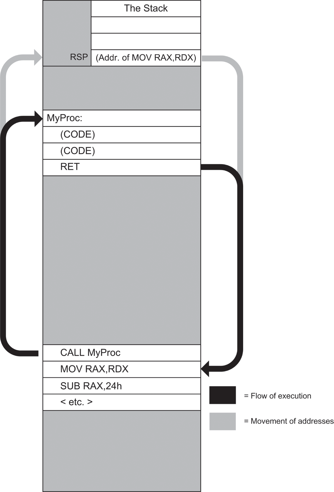
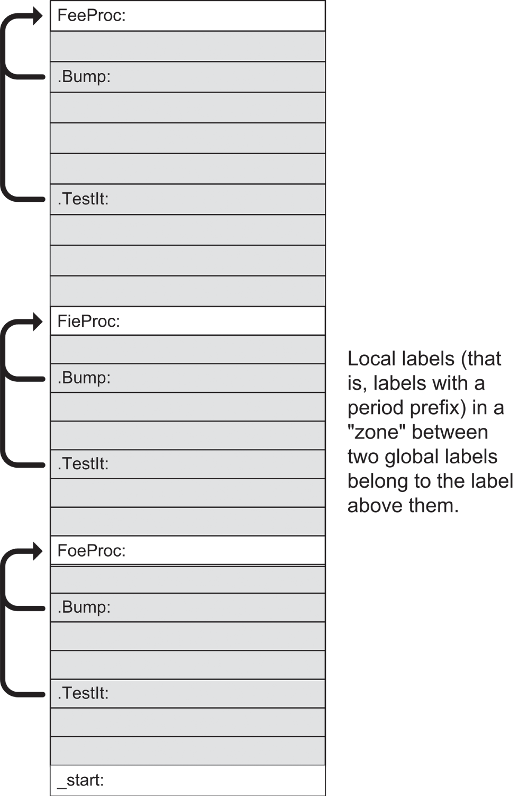
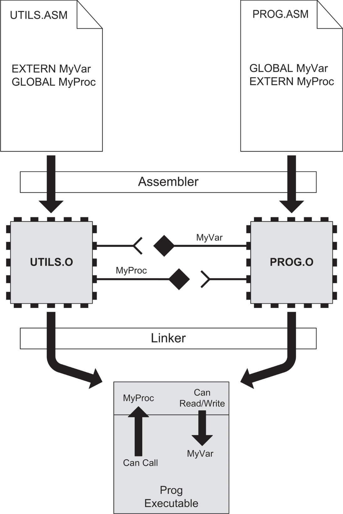
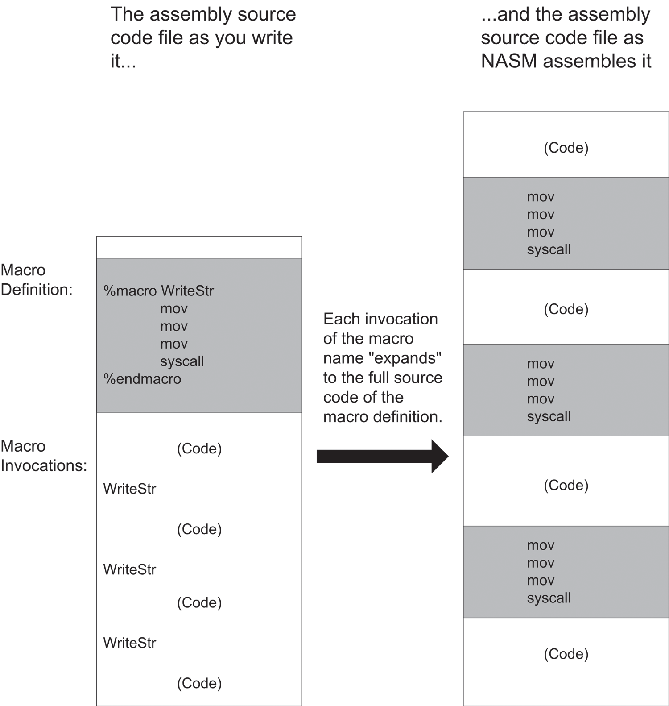

# <a id="Page_299"></a>CHƯƠNG 10 Chia để trị: *Dùng procedure và macro để chiến đấu với độ phức tạp của chương trình*

Độ phức tạp giết chết—ít nhất là giết chết chương trình. Đây là một trong những bài học đầu tiên tôi từng học được khi làm lập trình viên, và nó đã bám theo tôi suốt 40-odd năm xen giữa.

Vậy hãy nghe cho kỹ: có một ngôn ngữ lập trình gọi là APL (viết tắt của *A Programming Language*, thông minh làm sao) mang trong mình không ít chất Sao Hỏa. APL là ngôn ngữ máy tính thứ hai tôi từng học (trên một mainframe IBM lớn), và khi học nó, tôi đã học được nhiều hơn một chút so với chỉ APL.

APL dùng một lối ký hiệu cô đọng, bao gồm cả character set riêng của nó (nhiều ký tự trong đó là chữ cái Hy Lạp), chẳng mấy giống với ASCII quen thuộc của chúng ta. Character set này có hàng chục ký hiệu nhỏ kỳ quặc, mỗi ký hiệu có khả năng làm những điều mạnh mẽ đáng kinh ngạc như nghịch đảo ma trận. Bạn có thể làm được nhiều hơn trong một dòng APL so với trong một dòng của bất kỳ ngôn ngữ nào khác tôi từng học kể từ đó. Sự kết hợp giữa bộ ký hiệu kỳ lạ và lối ký hiệu cô đọng đến mức gần như biến mất khiến rất khó đọc và nhớ một dòng code APL thực sự *làm* gì.

Chuyện xảy ra vào năm 1977. Sau khi đã nắm vững (hoặc tôi tưởng vậy) toàn bộ thư viện ký hiệu, tôi bắt tay vào viết một chương trình định dạng văn bản. Chương trình sẽ nhận một file plain-text và sinh ra một bản in được căn đều hai bên trái phải, với tiêu đề được căn giữa, cộng với vài thứ khác thuộc loại mà ngày nay chúng ta coi là đương nhiên nhưng hồi thập niên '70 vẫn còn rất xa lạ.

<a id="Page_300"></a>Chương trình lớn dần trong khoảng một tuần lên đến khoảng 600 dòng gồm những ký hiệu APL nhỏ ngoằn ngoèo. Tôi làm cho nó chạy được, và nó chạy tốt—miễn là tôi không cố định dạng một cột rộng hơn 64 ký tự. Khi đó mọi thứ đều ra lộn xộn.

Úi. Tôi in toàn bộ ra và ngồi xuống debug một cách nghiêm túc. Rồi tôi nhận ra với một cảm giác kinh hoàng chìm nghỉm rằng, sau khi viết xong phần cuối của chương trình, *tôi không còn biết phần đầu hoạt động thế nào nữa*.

Bộ ký hiệu APL đặc biệt chỉ là một phần của vấn đề. Tôi sớm nhận ra rằng sai lầm quan trọng nhất mình đã mắc là viết toàn bộ thành một khối code nguyên khối 600-line. Không có sự phân chia chức năng nào, không có gì cho biết bất kỳ đoạn code 10-line nào đang cố hoàn thành điều gì.

Người Sao Hỏa đã thắng. Tôi làm điều duy nhất có thể: tôi vứt bỏ nó. Và tôi đành chấp nhận lề lởm chởm trong văn bản của mình. Như tôi đã nói, độ phức tạp giết chết. Điều này đúng với assembly language cũng như với APL, Java, C, Pascal hay bất kỳ ngôn ngữ lập trình nào khác từng tồn tại. Giờ bạn đã có thể viết những chương trình khá phức tạp bằng assembly, tốt hơn hết là bạn nên học cách quản lý độ phức tạp đó, nếu không bạn sẽ thấy mình phải bỏ đi rất nhiều code chỉ vì bạn không còn nhớ (hay hiểu ra) nó hoạt động thế nào.

<a id="head-2-1"></a>

## Hộp trong hộp

Quản lý độ phức tạp là thách thức lớn trong lập trình. Chìa khóa của kỹ năng này là một điều nghe như huyền học phương Đông nhưng thực ra chỉ là một quan sát từ cuộc sống: *bên trong bất kỳ hành động nào cũng có vô số hành động nhỏ hơn*. Hãy nhìn vào các hoạt động thường ngày của bạn. Khi bạn đánh răng, bạn làm những việc sau:

1. Cầm tuýp kem đánh răng lên.
2. Vặn nắp ra.
3. Đặt nắp lên mặt bồn rửa.
4. Cầm bàn chải đánh răng lên.
5. Bóp kem đánh răng lên bàn chải từ giữa tuýp.
6. Đưa bàn chải vào miệng.
7. Chải tới chải lui thật mạnh trong 2 phút.
8. Súc miệng.

Và cứ thế. Khi đánh răng, bạn thực hiện từng hành động trong số đó. Tuy nhiên, khi nghĩ về trình tự đó, bạn không lướt qua toàn bộ danh sách. Bạn nghĩ đến khái niệm đơn giản gọi là “đánh răng”.

Hơn nữa, khi nghĩ về những gì nằm sau hành động mà chúng ta gọi là “thức dậy buổi sáng”, bạn có thể lập ra một danh sách hoạt động như thế này:

1. Tắt đài radio báo thức.
2. Bò ra khỏi giường.
3. <a id="Page_301"></a>Mặc áo choàng.
4. Thả chó ra ngoài.
5. Làm bữa sáng.
6. Ăn sáng.
7. Đánh răng.
8. Cạo râu.
9. Tắm.
10. Mặc quần áo.

Đánh răng chắc chắn nằm trong danh sách, nhưng bên trong hoạt động mà bạn gọi là “đánh răng” là cả một danh sách những hành động nhỏ hơn, như tôi đã minh họa ở trên. Điều tương tự cũng có thể nói về hầu hết các hoạt động trong danh sách vừa rồi. Ví dụ, cần bao nhiêu hành động riêng lẻ để chuẩn bị một bữa sáng tử tế? Vậy mà trong một cụm từ ngắn gọn, dù bao quát, “thức dậy buổi sáng”, bạn bao trùm cả vô số hành động nhỏ và nhỏ hơn nữa đó mà không phải vất vả lần theo từng cái một.

Điều tôi đang mô tả là phương pháp “hộp Trung Hoa” để chiến đấu với độ phức tạp. Thức dậy buổi sáng liên quan đến hàng trăm hành động nhỏ, vì vậy chúng ta chia khối đó thành những khúc mạch lạc và đặt các khúc vào những chiếc hộp khái niệm nhỏ. “Làm bữa sáng” nằm trong một hộp, “đánh răng” nằm trong hộp khác, “mặc quần áo” trong một hộp khác nữa, và cứ thế. Xem xét kỹ hơn bất kỳ hộp nào cũng cho thấy nội dung của nó có thể được chia tiếp thành nhiều hộp, và những hộp nhỏ hơn đó lại thành những hộp còn nhỏ hơn nữa.

Quá trình này không (và không thể) tiếp diễn mãi mãi, nhưng nó nên tiếp diễn chừng nào cần để thỏa mãn tiêu chí này: *nội dung của bất kỳ hộp nào cũng phải dễ hiểu chỉ với một chút xem xét*. Không hộp nào nên chứa thứ gì quá tinh vi hay quá lớn và rối rắm đến mức cần hàng giờ nhìn chằm chằm và hair-pulling mới hiểu ra.

### Procedure như những chiếc hộp cho code

Sai lầm tôi đã mắc khi viết chương trình định dạng văn bản bằng APL là tôi ném toàn bộ tập hợp 600 dòng code APL vào một chiếc hộp khổng lồ có ghi “text formatter”.

Trong khi viết nó, lẽ ra tôi nên để mắt tìm những chuỗi câu lệnh code phối hợp với nhau để làm một nhiệm vụ có thể nhận diện được. Khi phát hiện những chuỗi như vậy, lẽ ra tôi nên tách chúng ra thành *procedure* và đặt cho mỗi cái một tên mô tả. Khi đó mỗi chuỗi sẽ có một thẻ ghi nhớ (tên của nó) cho chức năng của chuỗi. Nếu cần 10 câu lệnh để căn đều một dòng văn bản, 10 câu lệnh đó lẽ ra nên được gom lại với nhau và đặt tên là `JustifyLine`, và cứ thế.

Sau này, lập trình viên APL huyền thoại của Xerox là Jim Dunn nói với tôi rằng tôi không bao giờ nên viết một procedure APL nào không vừa trên một màn hình terminal 25-line duy nhất. “Quá 25 dòng là bạn đang làm quá nhiều trong một procedure. Hãy chia nó ra,” ông nói. Mỗi khi làm việc với APL sau đó, tôi đều tuân theo quy tắc kinh nghiệm khôn ngoan đó. Người Sao Hỏa thỉnh thoảng vẫn tấn công, nhưng khi họ tấn công, đó không còn là một tổn thất toàn diện nữa.

Mọi ngôn ngữ máy tính được dùng phổ biến ngày nay đều hiện thực procedure ở dạng này hay dạng khác, và assembly language cũng không ngoại lệ. Chương trình assembly language của bạn có thể có rất nhiều procedure. Thực tế, không có giới hạn nào về *số lượng* procedure bạn có thể đưa vào một chương trình, miễn là tổng số byte code chứa trong tất cả các procedure gộp lại, cộng với bất kỳ dữ liệu nào chúng dùng, vừa với memory mà Linux cấp cho nó. Ngày nay, với memory rẻ có sẵn theo những khúc multi-gigabyte, việc viết code không vừa với phần cấp phát của Linux là gần như không thể xảy ra.

Bất kỳ độ phức tạp nào bạn có thể tạo ra trong assembly language đều có thể được quản lý bằng procedure.

Hãy bắt đầu sớm với một ví dụ về procedure đang hoạt động. Hãy đọc kỹ <a id="R_c10-fea-0001"></a>[Listing 10.1](#c10-fea-0001) và chúng ta hãy xem điều gì khiến nó hoạt động và (quan trọng hơn) điều gì giúp nó vẫn dễ hiểu.

> <a id="head-2-2"></a>
>
> **<a id="c10-fea-0001"></a>Listing 10.1: hexdump2gcc.asm**
>
> ```
> ;  Executable name : hexdump2gcc
> ;  Version         : 2.0
> ;  Created date    : 5/9/2022
> ;  Last update     : 5/8/2023
> ;  Author          : Jeff Duntemann
> ;  Description     : A simple hexdump utility demonstrating the use of
> ;                  : assembly language procedures
> ;
> ;  Build with SASM's x64 build setup, which uses gcc & requires "main"
> ;  To run, type or paste some text into SASM's Input window and click
> ;  Run. The hex dump of the input text will appear in SASM's Output
> ;  window.
>
> SECTION .bss       ; Section containing uninitialized data
>
>     BUFFLEN        EQU 10h
>     Buff:          resb BUFFLEN
>
> SECTION .data      ; Section containing initialised data
>
> ; Here we have two parts of a single useful data structure, implementing
> ; the text line of a hex dump utility. The first part displays 16 bytes
> ; in hex separated by spaces. Immediately following is a 16-character
> ; line delimited by vertical bar characters. Because they are adjacent,
> ; the two parts can be referenced separately or as a single contiguous
> ; unit. Remember that if DumpLine is to be used separately, you must
> ; append an EOL before sending it to the Linux console.
> DumpLine:       db " 00 00 00 00 00 00 00 00 00 00 00 00 00 00 00 00 "
> DUMPLEN         EQU $-DumpLine
> ASCLine:        db "|................|",10
> ASCLEN          EQU $-ASCLine
> FULLLEN         EQU $-DumpLine
>
> ; The HexDigits table is used to convert numeric values to their hex
> ; equivalents. Index by nybble without a scale: [HexDigits+eax]
> HexDigits:      db "0123456789ABCDEF"
>
> ; This table is used for ASCII character translation, into the ASCII
> ; portion of the hex dump line, via XLAT or ordinary memory lookup.
> ; All printable characters "play through" as themselves. The high 128
> ; characters are translated to ASCII period (2Eh). The non-printable
> ; characters in the low 128 are also translated to ASCII period, as is
> ; char 127.
> DotXlat:
>     db 2Eh,2Eh,2Eh,2Eh,2Eh,2Eh,2Eh,2Eh,2Eh,2Eh,2Eh,2Eh,2Eh,2Eh,2Eh,2Eh
>     db 2Eh,2Eh,2Eh,2Eh,2Eh,2Eh,2Eh,2Eh,2Eh,2Eh,2Eh,2Eh,2Eh,2Eh,2Eh,2Eh
>     db 20h,21h,22h,23h,24h,25h,26h,27h,28h,29h,2Ah,2Bh,2Ch,2Dh,2Eh,2Fh
>     db 30h,31h,32h,33h,34h,35h,36h,37h,38h,39h,3Ah,3Bh,3Ch,3Dh,3Eh,3Fh
>     db 40h,41h,42h,43h,44h,45h,46h,47h,48h,49h,4Ah,4Bh,4Ch,4Dh,4Eh,4Fh
>     db 50h,51h,52h,53h,54h,55h,56h,57h,58h,59h,5Ah,5Bh,5Ch,5Dh,5Eh,5Fh
>     db 60h,61h,62h,63h,64h,65h,66h,67h,68h,69h,6Ah,6Bh,6Ch,6Dh,6Eh,6Fh
>     db 70h,71h,72h,73h,74h,75h,76h,77h,78h,79h,7Ah,7Bh,7Ch,7Dh,7Eh,2Eh
>     db 2Eh,2Eh,2Eh,2Eh,2Eh,2Eh,2Eh,2Eh,2Eh,2Eh,2Eh,2Eh,2Eh,2Eh,2Eh,2Eh
>     db 2Eh,2Eh,2Eh,2Eh,2Eh,2Eh,2Eh,2Eh,2Eh,2Eh,2Eh,2Eh,2Eh,2Eh,2Eh,2Eh
>     db 2Eh,2Eh,2Eh,2Eh,2Eh,2Eh,2Eh,2Eh,2Eh,2Eh,2Eh,2Eh,2Eh,2Eh,2Eh,2Eh
>     db 2Eh,2Eh,2Eh,2Eh,2Eh,2Eh,2Eh,2Eh,2Eh,2Eh,2Eh,2Eh,2Eh,2Eh,2Eh,2Eh
>     db 2Eh,2Eh,2Eh,2Eh,2Eh,2Eh,2Eh,2Eh,2Eh,2Eh,2Eh,2Eh,2Eh,2Eh,2Eh,2Eh
>     db 2Eh,2Eh,2Eh,2Eh,2Eh,2Eh,2Eh,2Eh,2Eh,2Eh,2Eh,2Eh,2Eh,2Eh,2Eh,2Eh
>     db 2Eh,2Eh,2Eh,2Eh,2Eh,2Eh,2Eh,2Eh,2Eh,2Eh,2Eh,2Eh,2Eh,2Eh,2Eh,2Eh
>     db 2Eh,2Eh,2Eh,2Eh,2Eh,2Eh,2Eh,2Eh,2Eh,2Eh,2Eh,2Eh,2Eh,2Eh,2Eh,2Eh
>
> SECTION .text      ; Section containing code
>
> ;---------------------------------------------------------------------
> ; ClearLine:   Clear a hex dump line string to 16 0 values
> ; UPDATED:     5/9/2022
> ; IN:          Nothing
> ; RETURNS:     Nothing
> ; MODIFIES:    Nothing
> ; CALLS:       DumpChar
> ; DESCRIPTION: The hex dump line string is cleared to binary 0 by
> ;              calling DumpChar 16 times, passing it 0 each time.
>
> ClearLine:
>     push rax       ; Save all caller's r*x GP registers
>     push rbx
>     push rcx
>     push rdx
>
>     mov  rdx,15    ; We're going to go 16 pokes, counting from 0
> .poke:
>     mov rax,0      ; Tell DumpChar to poke a '0'
>     call DumpChar  ; Insert the '0' into the hex dump string
>     sub rdx,1      ; DEC doesn't affect CF!
>     jae .poke       ; Loop back if RDX>= 0
>
>     pop rdx        ; Restore caller's r*x GP registers
>     pop rcx
>     pop rbx
>     pop rax
>     ret            ; Go home
>
> ;---------------------------------------------------------------------
> ; DumpChar:    "Poke" a value into the hex dump line string.
> ; UPDATED:     5/9/2022
> ; IN:          Pass the 8-bit value to be poked in RAX.
> ;              Pass the value's position in the line (0-15) in RDX
> ; RETURNS:     Nothing
> ; MODIFIES:    RAX, ASCLine, DumpLine
> ; CALLS:       Nothing
> ; DESCRIPTION: The value passed in RAX will be put in both the hex dump
> ;              portion and in the ASCII portion, at the position passed
> ;              in RDX, represented by a space where it is not a
> ;              printable character.
>
> DumpChar:
>     push rbx    ; Save caller's RBX
>     push rdi    ; Save caller's RDI
>
> ; First we insert the input char into the ASCII part of the dump line
>     mov bl,[DotXlat+rax]      ; Translate nonprintables to '.'
>     mov [ASCLine+rdx+1],bl    ; Write to ASCII portion
>
> ; Next we insert the hex equivalent of the input char in the hex
> ; part of the hex dump line:
>     mov rbx,rax               ; Save a second copy of the input char
>     lea rdi,[rdx*2+rdx]       ; Calc offset into line string (RDX X 3)
>
> ; Look up low nybble character and insert it into the string:
>     and rax,000000000000000Fh ; Mask out all but the low nybble
>     mov al,[HexDigits+rax]    ; Look up the char equiv. of nybble
>     mov [DumpLine+rdi+2],al   ; Write the char equiv. to line string
>
> ; Look up high nybble character and insert it into the string:
>     and rbx,00000000000000F0h ; Mask out all the but 2nd-lowest nybble
>     shr rbx,4                ; Shift high 4 bits of byte into low 4 bits
>     mov bl,[HexDigits+rbx]   ; Look up char equiv. of nybble
>     mov [DumpLine+rdi+1],bl  ; Write the char equiv. to line string
> ; Done! Let's return:
>     pop rdi     ; Restore caller's RDI
>     pop rbx     ; Restore caller's RBX
>     ret         ; Return to caller
>
> ;---------------------------------------------------------------------
> ; PrintLine:    Displays DumpLine to stdout
> ; UPDATED:      5/8/2023
> ; IN:           DumpLine, FULLEN
> ; RETURNS:      Nothing
> ; MODIFIES:     Nothing
> ; CALLS:        Kernel sys_write
> ; DESCRIPTION:  The hex dump line string DumpLine is displayed to
> ;               stdout using syscall function sys_write. Registers
> ;               used are preserved.
>
> PrintLine:
>
>     push rax          ; Alas, we don't have pushad anymore.
>     push rbx
>     push rcx
>     push rdx
>     push rsi
>     push rdi
>
>     mov rax,1         ; Specify sys_write call
>     mov rdi,1         ; Specify File Descriptor 1: Standard output
>     mov rsi,DumpLine  ; Pass address of line string
>     mov rdx,FULLLEN   ; Pass size of the line string
>     syscall           ; Make kernel call to display line string
>
>     pop rdi           ; Nor popad.
>     pop rsi
>     pop rdx
>     pop rcx
>     pop rbx
>     pop rax
>     ret               ; Return to caller
>
>
> ;----------------------------------------------------------------------
> ; LoadBuff:    Fills a buffer with data from stdin via syscall sys_read
> ; UPDATED:     5/8/2023
> ; IN:          Nothing
> ; RETURNS:     # of bytes read in R15
> ; MODIFIES:    RCX, R15, Buff
> ; CALLS:       syscall sys_read
> ; DESCRIPTION: Loads a buffer full of data (BUFFLEN bytes) from stdin
> ;              using syscall sys_read and places it in Buff. Buffer
> ;              offset counter RCX is zeroed, because we're starting in
> ;              on a new buffer full of data. Caller must test value in
> ;              R15: If R15 contains 0 on return, we've hit EOF on stdin.
> ;              < 0 in R15 on return indicates some kind of error.
>
> LoadBuff:
>     push rax      ; Save caller's RAX
>     push rdx      ; Save caller's RDX
>     push rsi      ; Save caller's RSI
>     push rdi      ; Save caller's RDI
>
>     mov rax,0     ; Specify sys_read call
>     mov rdi,0     ; Specify File Descriptor 0: Standard Input
>     mov rsi,Buff      ; Pass offset of the buffer to read to
>     mov rdx,BUFFLEN   ; Pass number of bytes to read at one pass
>     syscall       ; Call syscall's sys_read to fill the buffer
>     mov r15,rax   ; Save # of bytes read from file for later
>     xor rcx,rcx   ; Clear buffer pointer RCX to 0
>
>     pop rdi       ; Restore caller's RDI
>     pop rsi       ; Restore caller's RSI
>     pop rdx       ; Restore caller's RDX
>     pop rax       ; Restore caller's RAX
>     ret           ; And return to caller
>
> GLOBAL main ; You need to declare "main" here because SASM uses gcc
>             ; to do builds.
>
> ; --------------------------------------------------------------------
> ; MAIN PROGRAM BEGINS HERE
> ;---------------------------------------------------------------------
>
> main:
>     mov rbp, rsp; for correct debugging
>
> ; Whatever initialization needs doing before loop scan starts is here:
>     xor r15,r15     ; Zero out r15,rsi, and rcx
>     xor rsi,rsi
>     xor rcx,rcx
>     call LoadBuff   ; Read first buffer of data from stdin
>     cmp r15,0       ; If r15=0, sys_read reached EOF on stdin
>     jbe Exit
>
> ; Go through the buffer and convert binary byte values to hex digits:
> Scan:
>     xor rax,rax                ; Clear RAX to 0
>     mov al,[Buff+rcx]          ; Get a byte from the buffer into AL
>     mov rdx,rsi                ; Copy total counter into RDX
>     and rdx,000000000000000Fh  ; Mask out lowest 4 bits of char counter
>     call DumpChar              ; Call the char poke procedure
> ; Bump the buffer pointer to the next char and see if buffer's done:
>     inc rsi           ; Increment total chars processed counter
>     inc rcx           ; Increment buffer pointer
>     cmp rcx,r15       ; Compare with # of chars in buffer
>     jb .modTest       ; If we've processed all chars in buffer...
>     call LoadBuff     ; ...go fill the buffer again
>     cmp r15,0         ; If r15=0, sys_read reached EOF on stdin
>     jbe Done          ; If we get EOF, we're done
>
> ; See if we're at the end of a block of 16 and need to display a line:
> .modTest:
>     test rsi,000000000000000Fh ; Test 4 lowest bits in counter for 0
>     jnz Scan          ; If counter is *not* modulo 16, loop back
>     call PrintLine    ; ...otherwise print the line
>     call ClearLine    ; Clear hex dump line to 0's
>     jmp Scan          ; Continue scanning the buffer
>
> ; All done! Let's end this party:
> Done:
>     call PrintLine    ; Print the final "leftovers" line
> Exit:
>     mov rsp,rbp
>     pop rbp
>     ret
> ```

Tôi thừa nhận, cái đó trông hơi đáng sợ. Nó có hơn 200 dòng code và với một tỉ lệ đáng kể là chương trình lớn nhất trong cuốn sách này cho đến giờ. Tuy nhiên, điều nó làm khá đơn giản. Nó là một sự mở rộng trực tiếp của chương trình `hexdump1gcc` từ Listing 9.1. Nếu bạn còn nhớ, một chương trình hex dump nhận một file thuộc bất kỳ loại nào (văn bản, executable, dữ liệu binary, bất cứ thứ gì) và hiển thị nó lên màn hình (ở đây là lên console Linux) sao cho mỗi byte trong chương trình được cho dưới dạng hexadecimal. Listing 9.1 đã làm được chừng đó. Điều `hexdump2gcc` thêm vào là một cột hiển thị thứ hai trong đó mọi ký tự ASCII in được (chữ cái, chữ số, ký hiệu) được hiển thị ở dạng “thật” của chúng, với các ký tự không in được được biểu diễn bằng một ký tự space-holder. Ký tự space-holder này thường là ký tự dấu chấm ASCII, nhưng đó chỉ là một quy ước, và nó có thể là bất cứ thứ gì.

Nếu bạn lưu executable file ra đĩa từ SASM, bạn có thể hiển thị hex dump của bất kỳ file Linux nào bằng `hexdump2gcc`, gọi nó theo cách này:

```
$./hexdump2gcc < filename
```

Toán tử I/O redirection \< lấy bất kỳ dữ liệu nào tồn tại trong file bạn nêu tên ở bên phải nó và dẫn dữ liệu đó vào standard input. Chương trình `hexdump2gcc` lấy dữ liệu từ standard input và in nó ra ở định dạng hex dump, 16 byte mỗi dòng, với bao nhiêu dòng cần thiết để hiển thị toàn bộ file.

Ví dụ, hex dump của một makefile điển hình được thể hiện ở đây:

```
68 65 78 64 75 6D 70 32 3A 20 68 65 78 64 75 6D |hexdump2: hexdum|
70 32 2E 6F 0A 09 6C 64 20 2D 6F 20 68 65 78 64 |p2.o..ld -o hexd|
75 6D 70 32 20 68 65 78 64 75 6D 70 32 2E 6F 0A |ump2 hexdump2.o.|
68 65 78 64 75 6D 70 32 2E 6F 3A 20 68 65 78 64 |hexdump2.o: hexd|
75 6D 70 32 2E 61 73 6D 0A 09 6E 61 73 6D 20 2D |ump2.asm..nasm -|
66 20 65 6C 66 20 2D 67 20 2D 46 20 73 74 61 62 |f elf -g -F stab|
73 20 68 65 78 64 75 6D 70 32 2E 61 73 6D 0A 00 |s hexdump2.asm..|
```

Makefile là văn bản thuần túy, vì vậy không có nhiều ký tự không in được trong bản dump. Tuy nhiên, hãy chú ý rằng tab và EOL, hai ký tự không in được thường có mặt trong các text file Linux, được nhìn thấy rõ ràng, cả ở dạng hex trong cột bên trái lẫn dưới dạng dấu chấm trong cột bên phải. Điều này hữu ích, vì khi file được hiển thị dưới dạng văn bản thuần túy trên console, các ký tự tab và EOL là vô hình. (Chúng có *tác động* nhìn thấy được, nhưng bạn không thể thấy bản thân các ký tự.) Có một hex dump của một file cho bạn thấy chính xác các ký tự tab và EOL nằm ở đâu trong file và có bao nhiêu cái ở bất kỳ chỗ cụ thể nào.

Với độ phức tạp của `hexdump2gcc`, có thể sẽ hữu ích nếu cho bạn thấy chương trình hoạt động thế nào thông qua pseudocode trước khi chúng ta đi quá sâu vào cơ chế hoạt động bên trong của một bộ máy procedure. Đây là cách chương trình hoạt động, nhìn từ trên (rất) cao:

```
As long as there is data available from stdin, do the following:
    Read data from stdin
    Convert data bytes to a suitable hexadecimal/ASCII display form
    Insert formatted data bytes into a 16-byte hex dump line
    Every 16 bytes, display the hex dump line
```

Đây là một ví dụ tốt về một lượt pseudocode ban đầu, khi bạn biết đại khái mình muốn chương trình làm gì nhưng vẫn còn hơi mơ hồ về chính xác cách làm. Nó sẽ cho bạn một sự hiểu biết head-start về pseudocode chi tiết hơn nhiều (và thiên về *cách làm*) được thể hiện ở đây:

```
Zero out the byte count total (RSI) and offset counter (RCX)
Call LoadBuff to fill a buffer with first batch of data from stdin
    Test number of bytes fetched into the buffer from stdin
        If the number of bytes was 0, the file was empty; jump to Exit
Scan:
    Get a byte from the buffer and put it in AL
    Derive the byte's position in the hex dump line string
    Call DumpChar to poke the byte into the line string
    Increment the total counter and the buffer offset counter
    Test and see if we've processed the last byte in the buffer:
        If so, call LoadBuff to fill the buffer with data from stdin
        Test number of bytes fetched into the buffer from stdin
            If the number of bytes was 0, we hit EOF; jump to Exit
    Test and see if we've poked 16 bytes into the hex dump line
        If so, call PrintLine to display the hex dump line
 Loop back to Scan
Exit:
    Shut down the program gracefully per Linux requirements
```

<a id="Page_309"></a>Không giống các ví dụ pseudocode tôi đã trình bày trong [Chương 8](ch08_our_object_all_sublime.vi.md), ở đây có những tham chiếu tường minh đến procedure. Tôi nghĩ rằng chúng có thể gần như self-explanatory từ ngữ cảnh, đó là dấu hiệu của một procedure tốt. Ví dụ, `CALL LoadBuff` có nghĩa là “thực thi một procedure nạp buffer.” Đó là điều `LoadBuff` làm, và đó là *tất cả* những gì `LoadBuff` làm. Bạn không phải đối diện với mọi chi tiết về cách `LoadBuff` làm công việc của nó. Điều này giúp dễ nắm bắt hơn luồng logic lớn hơn mà toàn bộ chương trình biểu diễn.

Hãy xem qua chính code [Listing 10.1](#c10-fea-0001) và xem bạn có thể hiểu pseudocode trên liên quan thế nào đến các machine instruction thực sự không. Một khi bạn đã nắm được điều đó, chúng ta có thể bắt đầu nói về procedure sâu hơn.

<a id="head-2-3"></a>

## Gọi và trả về

Ngay gần đầu khối chương trình chính trong `hexdump2gcc` là một machine instruction mà tôi chưa dùng trước đây trong cuốn sách này:

```
call LoadBuff
```

Label `LoadBuff` chỉ tới một procedure. Như bạn có thể đã đoán ra (đặc biệt nếu bạn đã lập trình bằng một ngôn ngữ cũ hơn như BASIC hay FORTRAN), `CALL LoadBuff` đơn giản bảo CPU đi thực thi một procedure tên là `LoadBuff` rồi quay lại khi `LoadBuff` chạy xong. `LoadBuff` được định nghĩa ở phần trước trong [Listing 10.1](#c10-fea-0001), nhưng để phần thảo luận sau được rõ ràng, tôi sẽ in lại nó ở đây.

`LoadBuff` là một ví dụ đầu tiên tốt về procedure, vì nó khá straight-line về mặt logic, và nó dùng các instruction và khái niệm mà chúng ta đã thảo luận. Giống như các chương trình assembly language nói chung, một procedure như `LoadBuff` bắt đầu thực thi ở trên cùng, chạy tuần tự qua các instruction trong thân của nó, và tại một điểm nào đó kết thúc. Điểm kết thúc không nhất thiết phải ở tận đáy chuỗi instruction, nhưng “điểm kết thúc” của một procedure luôn là chỗ mà procedure quay trở lại phần chương trình đã gọi nó. Chỗ này là bất cứ nơi nào bạn thấy bản ngã thứ hai của `CALL`, `RET` (viết tắt của RETurn).

```
LoadBuff:
    push rax       ; Save caller's RAX
    push rdx       ; Save caller's RDX
    push rsi       ; Save caller's RSI
    push rdi       ; Save caller's RDI
    mov rax,0      ; Specify sys_read call
    mov rdi,0      ; Specify File Descriptor 0: Standard Input
    mov rsi,Buff   ; Pass offset of the buffer to read to
    mov rdx,BUFFLEN   ; Pass number of bytes to read at one pass
    syscall        ; Call syscall's sys_read function fill the buffer
    mov r15,rax    ; Save # of bytes read from file for later
    xor rcx,rcx    ; Clear buffer pointer RCX to 0
    pop rdi        ; Restore caller's RDI
    pop rsi        ; Restore caller's RSI
    pop rdx        ; Restore caller's RDX
    pop rax        ; Restore caller's RAX
    ret            ; And return to caller
```

Trong một ví dụ rất đơn giản như `LoadBuff`, `RET` nằm ở tận cuối chuỗi instruction trong procedure. Tuy nhiên, `RET` có thể nằm ở bất cứ đâu trong procedure, và có những tình huống bạn có thể thấy đơn giản nhất là có nhiều hơn một instruction `RET` trong một procedure. Instruction nào trong số vài instruction `RET` thực sự đưa việc thực thi trở lại nơi gọi phụ thuộc vào việc procedure làm gì và nó gặp phải hoàn cảnh nào, nhưng điều đó không quan trọng. Mỗi `RET` là một “điểm thoát” trở lại code đã gọi procedure, và (quan trọng hơn) mọi instruction `RET` bên trong một procedure đều đưa việc thực thi trở lại cùng một vị trí: instruction ngay sau instruction `CALL` đã gọi procedure.

Những điểm quan trọng về cấu trúc procedure là:

- Một procedure phải bắt đầu bằng một label, mà (như bạn hẳn còn nhớ) là một định danh theo sau là dấu hai chấm.
- Ở đâu đó bên trong procedure, phải có ít nhất một instruction `RET`.
- Có thể có nhiều hơn một instruction `RET`. Việc thực thi phải quay lại từ một procedure thông qua một instruction `RET`, nhưng có thể có nhiều hơn một cửa thoát khỏi một procedure. Lối thoát nào được dùng phụ thuộc vào luồng thực thi của procedure, nhưng với các instruction conditional jump, bạn có thể có lối thoát ở bất cứ đâu thỏa mãn yêu cầu logic của procedure. Mọi lối thoát đó đều dẫn tới cùng một chỗ: instruction sau instruction `CALL` đã gọi procedure.
- Một procedure có thể dùng `CALL` để gọi một procedure khác. (Sẽ nói thêm về điều này ngay sau đây.)

Cách mà `CALL` và `RET` vận hành có thể nghe quen thuộc: trước tiên `CALL` push address của instruction *kế tiếp* sau nó lên stack. Sau đó `CALL` chuyển việc thực thi tới address được biểu diễn bởi label đặt tên cho procedure, trong trường hợp này là `LoadBuff`. Các instruction chứa trong procedure được thực thi. Cuối cùng, procedure được kết thúc bằng instruction `RET`. Instruction `RET` pop return address ra khỏi đỉnh stack và chuyển việc thực thi tới address đó. Vì address được push là address của instruction đầu tiên *sau* instruction `CALL`, việc thực thi tiếp tục như thể `CALL` hoàn toàn không thay đổi luồng thực thi instruction. Xem <a id="R_c10-fig-0001"></a>[Hình 10.1](#c10-fig-0001).

<a id="Page_311"></a>



*<a id="c10-fig-0001"></a>**Hình 10.1**: Gọi một procedure và trả về*

### Lời gọi bên trong lời gọi

Bên trong một procedure, bạn có thể làm bất cứ điều gì bạn có thể làm bên trong chính chương trình chính. Điều này bao gồm việc gọi các procedure khác từ bên trong một procedure và thực hiện các lời gọi `SYSCALL` tới kernel service của Linux.

Có một ví dụ đơn giản trong `hexdump2gcc`: procedure `ClearLine` gọi procedure `DumpChar` để “xóa” biến dòng hex dump `DumpLine`:

```
ClearLine:
    push rax       ; Save all caller's r*x GP registers
    push rbx
    push rcx
    push rdx
    mov rdx,15     ; We're going to go 16 pokes, counting from 0
.poke:
    mov rax,0      ; Tell DumpChar to poke a '0'
    call DumpChar  ; Insert the '0' into the hex dump string
    sub rdx,1      ; DEC doesn't affect CF!
    jae .poke      ; Loop back if RDX>= 0
    pop rdx        ; Restore all caller's r*x registers
    pop rcx
    pop rbx
    pop rax
    ret            ; Go home
```

Về cơ bản, điều `ClearLine` làm là dùng procedure `DumpChar` theo kiểu special-case, mà tôi sẽ giải thích chi tiết ngay sau đây. Khi được lấp đầy dữ liệu và hiển thị lên console, biến `DumpLine` trông như thế này:

```
75 6D 70 32 2E 61 73 6D 0A 09 6E 61 73 6D 20 2D |ump2.asm..nasm -|
```

Mỗi giá trị hex two-character, và mỗi ký tự ASCII trong cột ASCII ở bên phải, được chèn vào bằng một lời gọi duy nhất tới `DumpChar`. Cần 16 lời gọi tới `DumpChar` để “lấp đầy” biến `DumpLine`. Đến lúc đó nó có thể được hiển thị. Sau khi `DumpLine` được hiển thị lên console, `hexdump2gcc` tiếp tục vòng lặp của nó và bắt đầu lấp đầy `DumpLine` lần nữa. Cứ mỗi 16 lời gọi tới `DumpChar`, `hexdump2gcc` lại hiển thị `DumpLine` lên console…ngoại trừ lần *cuối cùng*. Một file đang được dump lên console có thể không dài (và thường không dài) đúng bằng một bội số của 16 byte. Vì vậy lần hiển thị cuối cùng của `DumpLine` có thể là một dòng không đầy đủ gồm hai, ba, chín, mười một, hay bao nhiêu ký tự đi nữa ít hơn mười sáu, thứ mà tôi gọi là “đồ thừa”. Khi một dòng không đầy đủ được hiển thị, vài byte cuối trong dòng dump có thể là dữ liệu “cũ” đã được gửi lên console ở lần hiển thị `DumpLine` trước đó. Để tránh điều này, `DumpLine` được xóa về các giá trị không ngay sau mỗi lần nó được hiển thị trên terminal. Đây là điều `ClearLine` làm. Sau một lời gọi tới `ClearLine`, `DumpLine` trông như thế này:

```
00 00 00 00 00 00 00 00 00 00 00 00 00 00 00 00 |................|
```

`ClearLine` làm điều đơn giản và hiển nhiên: nó gọi `DumpChar` 16 lần, mỗi lần truyền cho `DumpChar` giá trị 0 trong RAX. `DumpChar` “chọc” một ký tự ASCII tương đương của giá trị hex 00 và một dấu chấm ASCII để biểu diễn giá trị 0 vào mọi vị trí trong cột ASCII. 00 không phải là một ký tự ASCII hiển thị được và, như mọi ký tự non-displayable, được biểu diễn bằng một dấu chấm trong output hexdump.

<a id="Page_313"></a>

### Những mối nguy của đệ quy vô tình

Việc gọi procedure từ bên trong procedure đòi hỏi bạn chú ý ít nhất một chút đến một thứ: không gian stack. Hãy nhớ rằng mỗi lời gọi procedure push một return address 64-bit lên stack. Return address này không bị lấy ra khỏi stack cho đến khi instruction `RET` của procedure đó được thực thi. Nếu bạn thực thi một instruction `CALL` khác trước khi trả về từ một procedure, instruction `CALL` thứ hai push một return address khác lên stack. Nếu bạn cứ tiếp tục gọi procedure từ bên trong procedure, cứ mỗi `CALL` sẽ có một return address chồng lên trên stack cho đến khi bạn bắt đầu trả về từ tất cả các procedure *lồng nhau* đó.

Đây từng là một vấn đề thực sự dưới DOS, khi memory khan hiếm và các chương trình có thể chỉ cấp phát vài trăm byte memory cho stack, đôi khi ít hơn. Mỗi address được push lên stack khiến stack lớn dần xuống về phía các section `.data` và `.text` của chương trình. Gọi quá “sâu” có thể khiến stack va chạm với dữ liệu hay code, gây ra một vụ crash chương trình mà thường cũng kéo DOS sụp theo. Dưới Linux x64, bạn có *rất* nhiều memory hơn, cộng với một trình quản lý virtual memory trong OS, và bạn sẽ phải lồng procedure sâu đến theo đúng nghĩa đen hàng triệu tầng mới gặp rắc rối, và đó quả thực sẽ là một chương trình đầy tham vọng.

Tuy nhiên…bạn vẫn có thể gặp một kiểu rắc rối tương tự bằng cách dùng sai một kỹ thuật lập trình nâng cao gọi là . Trong đệ quy (recursion), một procedure gọi *chính nó* để hoàn thành công việc. Điều này thường có vẻ kỳ lạ với người mới bắt đầu, nhưng đó là một cách được tôn trọng và chính đáng để biểu diễn một loại logic chương trình nhất định. Mánh khóe với đệ quy, dĩ nhiên, là biết khi nào dừng lại. Với mỗi `CALL` tới chính nó, một procedure đệ quy rốt cuộc phải thực thi một `RET`. Ngay cả khi procedure đệ quy gọi chính nó hàng chục hay hàng trăm lần, chừng nào các instruction `CALL` cân bằng với các instruction `RET`, sẽ không có điều gì tệ xảy ra.

Vấn đề bắt đầu khi bạn viết một procedure đệ quy tồi và logic xác định khi nào dùng instruction `RET` all-important đó bị viết sai. Khi nào trả về thường được chi phối bởi một instruction conditional jump. Hiểu sai ý nghĩa hay phép tắc flag của instruction đó, và procedure không bao giờ trả về mà cứ tiếp tục gọi chính nó lần này đến lần khác. Trên một PC hiện đại, một procedure assembly language có thể gọi chính nó một triệu lần trong một giây hoặc ít hơn. Đến một lúc nào đó, stack đạt đến giới hạn tột cùng của sự phát triển (do hệ điều hành đặt ra), nơi nó hết không gian memory. Khi điều đó xảy ra, Linux đưa cho bạn một segmentation fault.

Như tôi đã nói, đệ quy là một chủ đề nâng cao, và tôi sẽ không giải thích cách dùng nó đúng trong cuốn sách này. Tôi nhắc đến nó ở đây chỉ vì có thể dùng đệ quy một cách *vô tình*. Theo ví dụ hiện tại của chúng ta, giả sử bạn đang viết `ClearLine` vào đêm khuya, và tại chỗ `ClearLine` gọi <a id="Page_314"></a> `DumpChar`, bạn lơ mơ viết `CALL ClearLine` trong khi định viết `CALL DumpChar`. Đừng lắc đầu; tôi đã lập trình từ năm 1970 và tôi đã làm vậy nhiều hơn một lần. Sớm hay muộn bạn cũng sẽ làm vậy. `Clearline` không được thiết kế để đệ quy, vì vậy nó sẽ rơi vào một vòng lặp not-quite-endless, gọi chính nó cho đến khi hết memory stack và kích hoạt một segmentation fault.

Hãy thêm “đệ quy vô tình” vào danh sách các bug bạn tìm kiếm khi Linux đưa cho bạn một segmentation fault. Nó thuộc về loại bug mà tôi gọi là “không phổ biến nhưng không thể tránh khỏi.”

### Một bug phép tắc flag cần đề phòng

Và nhân đang nói về bug, procedure `ClearLine` khá đơn giản và làm một việc đơn giản. Nó cũng cung cấp một khoảnh khắc dạy học hữu ích về một bug flags-related thường xuyên làm người mới bắt đầu vấp ngã. Hãy xem cách thay thế sau để viết `ClearLine`:

```
ClearLine:
    push rax       ; Save all caller's r*x GP registers
    push rbx
    push rcx
    push rdx

    mov  rdx,15    ; We're going to go 16 pokes, counting from 0

.poke:
    mov rax,0      ; Tell DumpChar to poke a '0'
    call DumpChar  ; Insert the '0' into the hex dump string
    sub rdx,1      ; DEC doesn't affect CF!
    jae .poke       ; Loop back if RDX>= 0

    pop rdx        ; Restore caller's r*x GP registers
    pop rcx
    pop rbx
    pop rax
    ret            ; Go home
```

Cách này có hoạt động không? Nếu bạn nghĩ có, hãy nghĩ lại. Vâng, chúng ta đang đếm ngược từ 15 về 0, thực hiện 16 lượt qua một vòng lặp đơn giản. Vâng, instruction `DEC` được dùng rất nhiều trong vòng lặp, khi chúng ta đếm ngược về không. Nhưng vòng lặp này hơi khác một chút, vì chúng ta cần làm một số việc khi giá trị bộ đếm trong RDX bằng 0 rồi giảm thêm một lần nữa. Conditional jump được thể hiện là `JAE`, Jump Above or Equal. Nó phải nhảy ngược lại Poke khi giá trị trong EDX đi *xuống dưới* không. `DEC` sẽ đếm một bộ đếm xuống không rồi xuống dưới không hoàn toàn ổn…vậy tại sao `JAE` lại không nhảy sau `DEC`? Ý nghĩa thì đúng.

<a id="Page_315"></a>Tuy nhiên, phép tắc flag thì sai. Nếu bạn tra tài liệu tham khảo instruction trong [Phụ lục B](ch15_appendix_b_partial_x64_instruction_reference.vi.md) cho `JAE`, bạn sẽ thấy rằng nó nhảy khi CF=0. CPU không hiểu “ý nghĩa” trong `JAE`. Nó không phải là một bộ óc; nó chỉ là một đống cát rất nhỏ và rất sạch. Tất cả những gì nó hiểu là instruction `JAE` nhảy khi CF=0. Giờ, nếu bạn tra instruction `DEC` trong [Phụ lục B](ch15_appendix_b_partial_x64_instruction_reference.vi.md) và xem xét kỹ danh sách flag, bạn sẽ thấy rằng *`DEC` hoàn toàn không ảnh hưởng đến CF*, và CF là thứ `JAE` xem xét trước khi quyết định nhảy hay không nhảy.

Đây là lý do chúng ta dùng instruction `SUB` để giảm register bộ đếm trong trường hợp này, vì `SUB` *có* ảnh hưởng đến CF và cho phép instruction `JAE` hoạt động đúng. Không có vấn đề tốc độ nào; `SUB` nhanh đúng bằng `DEC`. Bài học ở đây là bạn cần hiểu cách các instruction conditional jump diễn giải các flag khác nhau. Ý nghĩa của một jump có thể đánh lừa. Phép tắc flag mới là điều quan trọng.

### Procedure và dữ liệu chúng cần

Chương trình hoàn thành công việc bằng cách tác động lên dữ liệu: dữ liệu trong buffer, dữ liệu trong biến có tên, và dữ liệu trong register. Procedure thường được tạo ra để thực hiện một loại thao tác duy nhất trên một loại dữ liệu cụ thể. Các chương trình gọi những procedure như vậy coi chúng như những meat-grinders dữ liệu: dữ liệu loại này đi vào, và dữ liệu đã biến đổi thuộc loại khác đi ra.

Ngoài ra, dữ liệu thường được trao cho một procedure để điều khiển hoặc định hướng công việc mà nó làm. Ví dụ, một procedure có thể cần một giá trị đếm để biết phải thực hiện một thao tác bao nhiêu lần, hoặc nó có thể cần một bit mask để áp dụng cho một số giá trị dữ liệu vì một lý do nào đó, và có thể không phải lần nào cũng chính xác là cùng một bit mask.

Khi viết procedure, bạn cần quyết định procedure cần dữ liệu gì để làm công việc của nó và dữ liệu đó sẽ được cung cấp cho procedure như thế nào. Có hai lớp dữ liệu chung trong công việc assembly (và trong hầu hết việc lập trình bằng các ngôn ngữ non-exotic) theo phương thức truy cập: global và local.

Dữ liệu global rất phổ biến trong công việc assembly thuần túy, đặc biệt với những chương trình nhỏ như những chương trình tôi đang trình bày trong cuốn sách này. Dữ liệu global có thể được truy cập bởi bất kỳ code nào ở bất cứ đâu trong chương trình. Một mục dữ liệu global được định nghĩa trong các section `.data` hoặc `.bss` của chương trình. Register CPU cũng là vật chứa cho dữ liệu global, vì register là một phần của CPU và có thể được truy cập từ bất cứ đâu trong một chương trình.

Khái niệm dữ liệu global trở nên phức tạp hơn khi bạn tách một chương trình thành một chương trình chính và nhiều nhóm procedure gọi là *library*, như tôi sẽ giải thích ở phần sau một chút trong chương này.

Nhưng với các chương trình đơn giản, cách hiển nhiên để truyền dữ liệu cho một procedure thường là cách tốt nhất: đặt dữ liệu vào một hoặc nhiều register rồi gọi procedure. <a id="Page_316"></a>Chúng ta đã thấy cơ chế này hoạt động, trong việc thực hiện các lời gọi tới kernel service của Linux thông qua instruction `SYSCALL`. Với input console, bạn đặt số service vào RAX, file descriptor vào RDI, address của một chuỗi vào RSI, và độ dài của chuỗi vào RDX. Sau đó bạn thực hiện lời gọi bằng `SYSCALL`.

Với các procedure thông thường cũng không khác. Bạn viết một procedure với giả định rằng khi procedure bắt đầu chạy, các giá trị nó cần sẽ nằm trong những register cụ thể. Bạn phải đảm bảo rằng code gọi procedure đặt đúng giá trị vào đúng register trước khi gọi procedure, nhưng thực sự nó không phức tạp hơn thế.

Bảng, buffer và các mục dữ liệu có tên khác được truy cập từ procedure giống như từ bất kỳ phần nào khác của chương trình, thông qua các biểu thức memory addressing “giữa dấu ngoặc”.

### Lưu các register của nơi gọi

Một khi bạn bắt đầu viết những chương trình đáng kể bằng assembly, bạn sẽ nhận ra rằng bạn không bao giờ có đủ register, và (không giống các ngôn ngữ higher-level như C và Pascal) bạn không thể cứ tạo thêm khi cần. Register phải được dùng cẩn thận, và bạn sẽ thấy rằng trong bất kỳ chương trình nào có độ phức tạp đáng kể, mọi register thường đều đang được dùng mọi lúc.

Việc tạt vào một procedure từ bên trong chương trình chính (hoặc từ bên trong một procedure khác) mang theo một vấn đề cụ thể và tinh vi. Bạn có thể gọi một procedure từ bất cứ đâu—điều đó có nghĩa là *bạn sẽ không phải lúc nào cũng biết những register nào đã đang được dùng khi procedure được gọi*.

Hay là bạn biết?

Có một quy ước về những register nào phải được bảo toàn bên trong một procedure và những register nào không cần. Quy ước này là một phần của System V ABI x86-x64 application binary interface) và tôi sẽ giải thích chi tiết nó trong [Chương 11](ch11_strings_and_things.vi.md) và [12](ch12_heading_out_to_c.vi.md). Một số register được coi là “volatile”, nghĩa là chúng có thể bị một procedure thay đổi, và những register khác là “nonvolatile”, nghĩa là chúng phải được bảo toàn. Hãy chờ; nó sắp đến rồi.

Nếu một procedure chỉ xem xét giá trị của một register (nhưng không thay đổi nó), không cần phải bảo toàn nó. Ví dụ, một procedure có thể giả định rằng một register nào đó chứa một giá trị bộ đếm mà nó cần để index vào một bảng, và nó có thể dùng register đó tự do miễn là không thay đổi giá trị của nó. Tuy nhiên, bất cứ khi nào một register bị một procedure thay đổi (trừ khi nơi gọi kỳ vọng một cách tường minh một giá trị trả về trong một register), nó nên được lưu và khôi phục trước khi procedure thực thi `RET` để quay lại nơi gọi.

Việc lưu các giá trị register được thực hiện bằng `PUSH`:

<a id="Page_317"></a>

```
push rbx
push rsi
push rdi

```

Mỗi instruction `PUSH` push một giá trị register 64-bit lên stack. Những giá trị đó sẽ vẫn an toàn trên stack cho đến khi chúng được pop trở lại vào cùng các register ngay trước khi trả về nơi gọi:

```
pop rdi
pop rsi
pop rbx
ret
```

Có một chi tiết tuyệt đối then chốt ở đây, một chi tiết gây ra vô số bug chương trình rất kỳ lạ: *các giá trị của nơi gọi phải được pop ra khỏi stack theo thứ tự ngược với thứ tự chúng được push*. Nói cách khác, nếu bạn push RBX, theo sau là RSI, theo sau là RDI, bạn phải pop chúng ra khỏi stack theo thứ tự RDI rồi RSI rồi RBX. CPU sẽ ngoan ngoãn pop các giá trị được lưu trên stack vào bất kỳ register nào theo bất kỳ thứ tự nào bạn viết. Nhưng nếu bạn làm sai thứ tự, về cơ bản bạn sẽ đang *thay đổi* các register của nơi gọi thay vì lưu chúng. Thứ từng ở trong RBX giờ có thể nằm trong RDI, và logic chương trình của nơi gọi có thể đơn giản là phát điên.

Tôi đã cho thấy điều này xảy ra thế nào khi lần đầu giải thích stack trong [Chương 8](ch08_our_object_all_sublime.vi.md), nhưng có thể lúc đó nó chưa thấm. Hãy lật nhanh lại [Hình 8.3](ch08_our_object_all_sublime.vi.md#c08-fig-0003) và xem điều gì xảy ra ở cột ngoài cùng bên phải. Giá trị của CX đã được push lên stack, nhưng instruction tiếp theo là `POP DX`. Thứ từng ở trong CX giờ nằm trong DX. Nếu đó là điều bạn muốn, tốt thôi—và đôi khi đó có thể là cách tốt nhất để giải một vấn đề cụ thể. Nhưng nếu bạn đang push giá trị register để bảo toàn chúng, thứ tự của các lần push và pop là tuyệt đối then chốt.

Cách tốt nhất để tiếp cận việc bảo toàn register là push/pop bất kỳ register nào bị procedure thay đổi ở bên trong procedure. Điều này loại trừ các register truyền giá trị cho procedure: chúng đã được nơi gọi cố ý thay đổi ngay trước lời gọi procedure. Hãy xem xét rằng một procedure được định nghĩa một lần nhưng được gọi nhiều lần từ nhiều chỗ khác trong code của bạn. Nếu bạn cố lưu các register mà procedure thay đổi *trước khi* gọi procedure, bạn sẽ có nhiều việc push và pop diễn ra hơn rất nhiều so với việc bảo toàn các register mà procedure dùng ở *bên trong* procedure.

Ngoài ra, nếu một procedure truyền một giá trị trở lại nơi gọi trong một register, nơi gọi giả định rằng giá trị của register đó sẽ thay đổi và sẽ dùng giá trị mới trong register đó.

Ồ, còn một điểm rắc rối nữa: các procedure của bạn không phải là những thứ duy nhất dùng—và thay đổi—register. Linux cũng nhúng tay vào.

### Bảo toàn register qua system call Linux

Linux cũng dùng register. Nó làm điều này khá trong suốt đối với code của chính bạn. Vấn đề nghiêm túc duy nhất là biết những register nào bị thay đổi trong các system call thông qua instruction `SYSCALL` và những register nào được để yên. Than ôi, không có câu trả lời đơn giản. Nó hoàn toàn phụ thuộc vào system call *nào* bạn thực hiện.

Nhưng trước hết và trên hết, bản thân instruction `SYSCALL` dùng hai register:

- `SYSCALL` lưu return address vào register RCX.
- `SYSCALL` lưu RFlags vào register R11.

Đây là thứ tương đương về chức năng với việc `SYSCALL` push RCX và R11 lên stack. Tuy nhiên, lưu giá trị vào register nhanh hơn *rất nhiều* so với push giá trị lên stack. Pop giá trị ra khỏi stack cũng chậm, vì vậy `SYSCALL` không khôi phục gì cả. Mỗi lần bạn thực thi `SYSCALL`, RCX và R11 sẽ bị ghi đè.

Và đó chưa phải là tất cả việc ghi đè liên quan đến việc thực hiện một system call. Việc dùng register trong một system call rơi vào ba loại:

- Bạn cần truyền tham số cho code system call trong register.
- Bản thân code system call dùng thêm một số register.
- System call có thể trả về giá trị trong register mà code của bạn có thể cần.

Định nghĩa của các system call `SYSCALL` bao gồm các chi tiết cụ thể. Định nghĩa này là một phần của System V ABI x86-64. Nếu phần thân lớn hơn trong code của bạn dùng một register bị ghi đè trong một system call, bạn phải hoặc chọn một register khác để dùng trong thân chương trình hoặc lưu nó lên stack bằng một instruction `PUSH` trước khi thiết lập tham số và thực thi `SYSCALL`. Sau system call, bạn phải khôi phục nó bằng một instruction `POP`. Dùng stack theo cách này có thể gây ra vấn đề với stack alignment trừ khi bạn hiểu điều gì khiến stack được căn chỉnh và làm thế nào để giữ nó như vậy. Tôi sẽ bàn chi tiết điều đó trong [Chương 11](ch11_strings_and_things.vi.md) và [12](ch12_heading_out_to_c.vi.md).

Còn có vấn đề register volatile so với nonvolatile, mà tôi cũng trình bày trong [Chương 11](ch11_strings_and_things.vi.md) và [12](ch12_heading_out_to_c.vi.md).

Quá trình thực hiện một system call thông qua `SYSCALL` không phức tạp. Tuy nhiên, lần cuối tôi xem, có 335 system call. Mỗi system call đòi hỏi một số thứ nhất định được truyền cho nó trong những register cụ thể. Đó là *rất nhiều* thứ phải nhớ. Phần lớn thời gian bạn sẽ cần tra chi tiết của việc thực hiện system call trong một tài liệu tham khảo in hoặc trên mạng. Một tài liệu tham khảo tôi khuyên dùng ở đây:

`https://hackeradam.com/x86-64-linux-syscalls`

Một tài liệu khác ở đây:

`https://blog.rchapman.org/posts/Linux_System_Call_Table_for_x86_64`

Cả hai đều là những bảng rất lớn giống bảng tính, với các cột cho việc dùng register và các giá trị cần thiết cho mỗi số system call.

Giờ, các trang web đến rồi đi, và nếu bạn dùng cuốn sách này vài năm sau khi nó được xuất bản năm 2023, các trang web được dẫn có thể đơn giản là không còn nữa. Hãy tìm kiếm trên web “system call table x64” và bạn sẽ thấy vài cái. Hãy đảm bảo rằng <a id="Page_319"></a>bảng bạn dùng là cho system call chứ không phải cho các lời gọi userspace. Lời gọi userspace là các lời gọi vào code library `glibc` được dùng trong lập trình C, đó là một câu chuyện hoàn toàn khác. Gọi `glibc` từ assembly là khả thi và thường rất hữu ích. Tôi sẽ nói thêm về điều đó trong [Chương 12](ch12_heading_out_to_c.vi.md).

Một lưu ý nghiêm túc nếu bạn đã làm chút công việc assembly Linux ở protected mode 32-bit: *các tham số system call x64 không giống với các tham số trong x86 32-bit*. Trong hầu hết các trường hợp, chúng thậm chí còn chẳng gần giống.

Trong Linux x64, có một hệ thống cho việc dùng register: số system call (nói cách khác, system call nào bạn đang gọi) luôn nằm trong RAX. Một system call sẽ nhận tối đa sáu tham số. Các register được dùng để truyền tham số theo thứ tự này: RDI, RSI, RDX, R10, R8 và R9. Nói cách khác, tham số thứ nhất được truyền trong RDI. Tham số thứ hai được truyền trong RSI, và cứ thế.

Không có system call nào đòi hỏi bất kỳ tham số nào được truyền cho nó trên stack.

Lưu ý: dù một register (chẳng hạn như R9) có được dùng để truyền tham số cho một system call hay không, *register đó không được bảo toàn*. Chỉ có bảy register được Linux bảo toàn qua một system call: R12, R13, R14, R15, RBX, RSP và RBP.

Sau một `SYSCALL`, RAX sẽ chứa một giá trị trả về. Nếu RAX âm, nó cho biết đã có lỗi xảy ra trong lời gọi. Với hầu hết các system call, giá trị 0 cho biết thành công.

### PUSHAD và POPAD đã biến mất

Tôi đã nhắc đến điều này trong [Chương 8](ch08_our_object_all_sublime.vi.md), nhưng nó đáng được nhắc lại: có những trường hợp một procedure dùng hầu hết hoặc tất cả các register general-purpose. Trước x64, có một cặp instruction có thể push và pop *tất cả* các register GP 32-bit trong một lần. Đó là `PUSHAD` và `POPAD`. (Một cặp instruction khác, `PUSHA` và `POPA`, sẽ push và pop tất cả các register GP 16-bit. Chúng cũng đã biến mất.)

Giờ x64 có 15 register GP, với mỗi register cần tám byte trên stack, chẳng phải điều này lãng phí không gian stack sao? Không nhất thiết. Vâng, push một register lên stack tốn thời gian, nhưng hãy nhớ: trong *mọi* trường hợp bạn cân nhắc liệu một instruction có tốn nhiều thời gian thực thi hơn một instruction khác hay không, bạn phải xem xét instruction đó được thực thi bao nhiêu lần. Nếu một instruction nằm trong một vòng lặp chặt được thực thi tuần tự hàng chục nghìn hay hàng triệu lần, tốc độ instruction là quan trọng. Mặt khác, nếu một instruction chỉ được thực thi vài lần trong suốt quá trình chạy của một chương trình, tốc độ của nó cùng lắm chỉ là một cân nhắc nhỏ và thường có thể bỏ qua.

Vâng, `PUSHAD` và `POPAD` từng là những lối tắt tiện lợi. Chúng đã biến mất. Giờ bạn phải suy nghĩ cẩn thận về những register mà một procedure sửa đổi rồi push riêng lẻ những register đó lên stack và pop riêng lẻ chúng ra khỏi stack khi procedure trả về.

Để có một ví dụ tốt, hãy xem procedure `LoadBuff` được thể hiện ở phần trước của chương này trong `hexdump2gcc`. `LoadBuff` bảo toàn bốn register của nơi gọi: RAX, RDX, RSI và RDI. Tuy nhiên, nó thay đổi hai register khác, RCX và R15, mà không bảo toàn chúng.

Tại sao? Register RCX chứa một giá trị “global”: vị trí của ký tự tiếp theo cần được xử lý trong biến buffer file `Buff`. `LoadBuff` được gọi khi một buffer đầy dữ liệu đã được xử lý xong hoàn toàn, và một lượt dữ liệu mới phải được mang vào từ `stdin`. Khi buffer được lấp đầy lại, bộ đếm buffer phải được đặt lại về 0 để việc xử lý có thể bắt đầu lại và làm việc qua dữ liệu mới từ đầu của nó. `LoadBuff` làm điều này, và RCX đã được xóa được truyền trở lại nơi gọi.

R15 cũng có một sứ mệnh: nó mang về số byte được nạp vào `Buff` bởi lời gọi `SYSCALL` tới `sys_read`. Lời gọi tới `sys_read` yêu cầu số byte được chỉ định bởi equate `BUFFLEN` gần đầu chương trình. Tuy nhiên, vì ít file nào có độ dài đúng bằng bội số của `BUFFLEN`, số byte trong lô dữ liệu cuối cùng được mang vào từ `stdin` sẽ ít hơn `BUFFLEN`. Giá trị này cũng được coi là global và được chương trình chính dùng để xác định khi nào buffer hiện tại đã được xử lý xong hoàn toàn.

`LoadBuff` bảo toàn các register trên stack và khôi phục chúng trước khi trả về code đã gọi nó. Giờ, không có lý do gì bắt buộc việc push và pop để bảo toàn register luôn phải được thực hiện bên trong procedure.

Code gọi có thể tự bảo toàn các register của chính nó, và điều này thỉnh thoảng được làm. Ví dụ, hãy xem chuỗi instruction (hư cấu) này:

```
push rbx
push rdx
call CalcSpace
pop  rdx
pop  rbx
```

Chỉ có một khác biệt giữa việc bảo toàn register bên ngoài procedure thay vì bên trong: code gọi procedure có thể chọn những register nào của nó đang được dùng và do đó cần được bảo toàn. Lưu tất cả các register sẽ là lãng phí nếu không phải register nào cũng đang được code của nơi gọi dùng.

Giờ, có thể có nhiều hơn một lời gọi tới `CalcSpace` trong chương trình. Mỗi lời gọi như vậy đòi hỏi chuỗi năm instruction này thay vì chỉ một. Nếu việc bảo toàn register được thực hiện bên trong procedure, việc bảo toàn chỉ cần bốn instruction, chấm hết, bất kể có bao nhiêu chỗ trong code gọi procedure. Với các PC x64 hiện đại, khác biệt về kích thước code và tốc độ sẽ không đáng kể. Ưu điểm của việc đặt việc bảo toàn register bên trong procedure là code chương trình chính của bạn sẽ bớt lộn xộn hơn.

Không có quy tắc cứng nhắc nào về việc phải bảo toàn những register nào, mặc dù có những khuyến nghị mạnh trong System V ABI x86-64. Tôi sẽ thảo luận chi tiết những khuyến nghị đó trong [Chương 11](ch11_strings_and_things.vi.md) và [12](ch12_heading_out_to_c.vi.md). Một số register là *volatile* và <a id="Page_321"></a>không cần được bảo toàn. Một số là *nonvolatile*, và nên được bảo toàn. Một lần nữa, tôi sẽ quay lại điều này trong hai chương tiếp theo, những chương cũng bàn đến các vấn đề quan trọng như stack alignment.

Bạn cần biết các register đang được dùng thế nào tại bất kỳ điểm nào trong chương trình và viết code tương ứng. (Ghi chép tốt về việc dùng register khi bạn thiết kế chương trình là quan trọng.) Lời khuyên duy nhất tôi muốn đưa ra mang tính thận trọng và nghiêng về phía tránh bug: hãy bảo toàn mọi register mà bạn biết là không được dùng theo kiểu global cũng như không được dùng để truyền giá trị trở lại nơi gọi. Thời gian dành cho việc bảo toàn register là nhỏ so với sự bực bội do các bug gây ra bởi xung đột register.

### Dữ liệu local

Dữ liệu local, trái với dữ liệu global, là dữ liệu chỉ có thể được truy cập (chúng ta nói là “nhìn thấy được”) bởi một procedure cụ thể hoặc trong một số trường hợp bởi một library. (Một lần nữa, hãy tạm hoãn phần thảo luận về library.) Khi procedure có dữ liệu local, đó gần như luôn là dữ liệu được đặt lên stack khi một procedure được gọi.

Các instruction `PUSH` đặt dữ liệu lên stack. Khi một phần code của bạn gọi một procedure bằng instruction `CALL`, nó có thể truyền dữ liệu xuống procedure đó bằng cách dùng `PUSH` một hoặc nhiều lần trước instruction `CALL`. Sau đó procedure có thể truy cập những mục dữ liệu đã được `PUSH` này trên stack. Tuy nhiên, có một lời cảnh báo: procedure không thể chỉ đơn giản pop những mục dữ liệu đó ra khỏi stack vào register, vì *return address đang cản đường*.

Hãy nhớ rằng việc đầu tiên `CALL` làm là push address của machine instruction tiếp theo lên stack. Khi procedure của bạn nhận quyền điều khiển, return address đó nằm ở đỉnh stack (TOS, như chúng ta nói), sẵn sàng cho instruction `RET` không thể tránh khỏi dùng để về nhà. Bất cứ thứ gì được nơi gọi push lên stack trước instruction `CALL` đều nằm *trên* return address. Những mục này vẫn có thể được truy cập bằng memory addressing thông thường và stack pointer RSP. Tuy nhiên, bạn không thể dùng `POP` để lấy chúng mà không pop và re-pushing return address. Cách đó hoạt động, và tôi đã làm vậy một hai lần, nhưng nó chậm và cũng không cần thiết, một khi bạn hiểu bản chất của một “stack frame” và cách address memory bên trong nó. Một lần nữa, tôi sẽ bàn đến khái niệm stack frame ở phần sau trong cuốn sách này, vì nó tuyệt đối then chốt một khi bạn bắt đầu gọi các procedure library được viết bằng C hoặc các ngôn ngữ higher-level khác. Lúc này, chỉ cần hiểu rằng dữ liệu global gần như luôn được định nghĩa trong các section `.data` và `.bss` của chương trình, trong khi dữ liệu local được đặt lên stack để dùng “cục bộ” cho một lời gọi cụ thể tới một procedure cụ thể. Dữ liệu local đòi hỏi chút cẩn thận và kỷ luật để dùng an toàn, vì những lý do tôi sẽ giải thích sau.

<a id="Page_322"></a>

### Đặt dữ liệu hằng trong định nghĩa procedure

Đến giờ bạn đã quen nghĩ về code như thứ sống trong section `.text`, và dữ liệu như thứ sống trong các section `.data` hoặc `.bss`. Trong gần như mọi trường hợp, đây là một cách tốt để tổ chức mọi thứ, nhưng không có yêu cầu tuyệt đối nào rằng bạn phải tách code và dữ liệu theo cách này. Có thể định nghĩa dữ liệu bên trong một procedure bằng các pseudoinstruction của NASM, bao gồm `DB`, `DW`, `DD,` và `DQ`. Tôi đã tạo một procedure hữu ích cho thấy việc này được làm thế nào, và nó là một ví dụ tốt về khi nào nên làm vậy.

Procedure `newlines` cho phép bạn phát ra một số ký tự newline tới `stdout`, được chỉ định bởi một giá trị truyền cho subroutine trong RDX:

```
;---------------------------------------------------------------------
; Newlines: Sends between 1-15 newlines to the Linux console
; VERSION:  2.0
; UPDATED:  8/27/2022
; IN: EDX:  # of newlines to send, from 1 to 15
; RETURNS:  Nothing
; MODIFIES: RAX, RDI
; CALLS:    Kernel sys_write
; DESCRIPTION: The number of newline chareacters (0Ah) specified
; in RDX is sent to stdout using using SYSCALL sys_write. This
; procedure demonstrates placing constant data in the
; procedure definition itself, rather than in the .data or
; .bss sections.

newlines:

    cmp rdx,15      ; Make sure caller didn't ask for more than 15
    ja .exit        ; If so, exit without doing anything
    mov rsi,EOLs    ; Put address of EOLs table into ECX
    mov rax,1       ; Specify sys_write
    mov rdi,1       ; Specify stdout
    syscall         ; Make the kernel call
.exit:
    Ret             ; Go home!

EOLs db 10,10,10,10,10,10,10,10,10,10,10,10,10,10,10
```

Bảng `EOLs` chứa 15 ký tự EOL. Nếu bạn còn nhớ, khi ký tự EOL được gửi tới `stdout`, console diễn giải nó là một newline, trong đó vị trí con trỏ của console bị đẩy xuống một dòng. Nơi gọi truyền số newline mong muốn trong RDX. Procedure `newlines` trước tiên kiểm tra để đảm bảo rằng nơi gọi không yêu cầu nhiều newline hơn số ký tự EOL có trong bảng rồi đưa address của bảng `EOLs` và số được yêu cầu vào một lời gọi thông thường tới `sys_write` bằng `SYSCALL`. Về cơ bản, `sys_write` hiển thị RDX ký tự đầu tiên của bảng EOLs lên console, console diễn giải dữ liệu đó thành RDX newline.

Có dữ liệu ngay trong procedure có nghĩa là dễ dàng cắt và dán định nghĩa procedure từ chương trình này sang chương trình khác mà không bỏ quên bảng ký tự EOL thiết yếu. Vì code duy nhất từng dùng bảng `EOLs` là chính procedure newlines, không có lợi ích gì khi đặt bảng `EOLs` trong section `.data` dễ nhìn thấy ở vị trí trung tâm hơn. Và mặc dù bảng `EOLs` không phải là local theo nghĩa computer-science kỹ thuật (nó không được nơi gọi `newlines` đặt lên stack), nó “trông” local và giữ cho các section `.data` và `.bss` của bạn khỏi trở nên lộn xộn hơn một chút với dữ liệu chỉ được tham chiếu từ bên trong một procedure duy nhất.

Có một source file chương trình hoàn chỉnh tên là `newlinestest.asm` sẵn sàng để assemble trong kho listing của cuốn sách này. (Hãy build nó bằng SASM.) Nó chứa procedure `newlines`, sẽ cho phép bạn chơi đùa với nó.

### Thêm mánh với bảng

Chương trình `hexdump2gcc` hoạt động rất giống chương trình `hexdump1gcc` từ Listing 9.1, nhưng nó có thêm vài mánh trong túi đồ nghề. Một mánh đáng chú ý nằm ở định nghĩa của biến dòng hex dump `DumpLine`:

```
DumpLine:    db " 00 00 00 00 00 00 00 00 00 00 00 00 00 00 00 00 "
DUMPLEN      EQU $-DumpLine
ASCLine:     db "|................|",10
ASCLEN       EQU $-ASCLine
FULLLEN      EQU $-DumpLine
```

Những gì chúng ta có ở đây là một biến được khai báo thành hai phần. Mỗi phần có thể được dùng riêng, hoặc (như thường được làm) hai phần có thể được dùng cùng nhau. Phần thứ nhất của `DumpLine` là chuỗi chứa 16 chữ số hex. Độ dài của nó được định nghĩa bởi equate `DUMPLEN`. (Lưu ý rằng quy ước cá nhân của tôi là đặt tên equate bằng chữ hoa. Equate không phải là cùng loài động vật với biến, và tôi thấy rằng việc tách biệt equate để có thể phân biệt chúng với biến chỉ trong nháy mắt làm cho chương trình dễ đọc hơn. Đây không phải là yêu cầu của NASM; bạn có thể đặt tên equate bằng chữ thường hoặc chữ hỗn hợp tùy ý.)

Phần thứ hai của `DumpLine` là cột ASCII, và nó có label riêng, `ASCLine`. Một chương trình chỉ cần cột ASCII có thể dùng riêng biến `ASCLine`, cùng với equate độ dài đi kèm của nó, `ASCLEN`. Giờ, vì hai phần của `DumpLine` nằm kề nhau trong memory, việc tham chiếu `DumpLine` cho phép bạn tham chiếu cả hai phần như một đơn vị, chẳng hạn khi bạn muốn gửi một dòng tới `stdout` thông qua `SYSCALL`. Trong trường hợp này, equate tính độ dài của toàn bộ dòng là `FULLLEN`.

Có một tên riêng cho các phần two-line là hữu ích, vì dữ liệu không được ghi vào cũng như không được đọc từ hai phần đó theo bất kỳ cách nào giống nhau. Hãy xem procedure `DumpChar` từ `hexdump2gcc`:

```
 DumpChar:
    push rbx    ; Save caller's RBX
    push rdi    ; Save caller's RDI

; First we insert the input char into the ASCII portion of the dump line
    mov bl,[DotXlat+rax]      ; Translate nonprintables to '.'
    mov [ASCLine+rdx+1],bl    ; Write to ASCII portion

; Next we insert the hex equivalent of the input char in the hex portion
; of the hex dump line:
    mov rbx,rax               ; Save a second copy of the input char
    lea rdi,[rdx*2+rdx]       ; Calc offset into line string (RDX X 3)

; Look up low nybble character and insert it into the string:
    and rax,000000000000000Fh ; Mask out all but the low nybble
    mov al,[HexDigits+rax]    ; Look up the char equiv. of nybble
    mov [DumpLine+rdi+2],al   ; Write the char equiv. to line string

; Look up high nybble character and insert it into the string:
    and rbx,00000000000000F0h ; Mask out all the but 2nd-lowest nybble
    shr rbx,4               ; Shift high 4 bits of byte into low 4 bits
    mov bl,[HexDigits+rbx]    ; Look up char equiv. of nybble
    mov [DumpLine+rdi+1],bl   ; Write the char equiv. to line string

; Done! Let's return:
    pop rdi     ; Restore caller's RDI
    pop rbx     ; Restore caller's RBX
    ret         ; Return to caller
```

Việc ghi vào cột ASCII rất đơn giản, vì mỗi ký tự trong cột ASCII là một byte duy nhất trong memory, và effective address của bất kỳ vị trí nào trong `ASCLine` đều dễ tính:

```
mov [ASCLin+rdx+1],bl   ; Write to ASCII portion
```

Tuy nhiên, mỗi vị trí trong phần hex dump của dòng gồm ba ký tự: một dấu space theo sau là hai chữ số hex. Khi được coi như một bảng, việc address một mục cụ thể trong `DumpLine` đòi hỏi một scale bằng 3 trong phép tính effective address:

```
lea rdi,[rdx*2+rdx]   ; Calc offset into line string (RDX × 3)
```

Lưu ý ở đây rằng `RDX*2+RDX` tương đương với `RDX` × `3` như được nêu trong comment của dòng. Hai phần của dòng hex dump được xử lý rất khác nhau xét từ góc độ thao tác dữ liệu, và chúng chỉ hoạt động cùng nhau khi được gửi tới `stdout`. Vậy thì, việc đặt cho mỗi phần trong hai phần một label riêng là hữu ích. Struct trong C và record trong Pascal được xử lý rất giống như vậy “bên dưới lớp da.”

<a id="Page_325"></a>Bảng `DotXlat` từ `hexdump2gcc` là một ví dụ khác về dịch ký tự và, như mọi translation table như vậy, biểu diễn các quy tắc cần thiết để hiển thị cả 256 giá trị ASCII khác nhau một cách nhất quán trong một dòng văn bản:

- Mọi ký tự in được được dịch thành chính chúng.
- Mọi ký tự không in được (bao gồm mọi ký tự điều khiển, và mọi ký tự từ 127 trở lên) được dịch thành dấu chấm ASCII.

<a id="head-2-4"></a>

## Label local và độ dài của jump

Sớm hay muộn, khi chương trình của bạn trở nên dài hơn và phức tạp hơn, bạn sẽ vô tình dùng lại một label. Tôi sẽ không trình bày chương trình nào đặc biệt dài hay phức tạp trong cuốn sách này, vì vậy việc gặp vấn đề với các code label xung đột nhau sẽ không phải là một vấn đề thực tế ở đây. Nhưng khi bạn bắt đầu viết những chương trình nghiêm túc hơn, rốt cuộc bạn sẽ viết hàng trăm hay thậm chí (với chút luyện tập và kiên trì) hàng nghìn dòng code assembly trong một source code file duy nhất. Bạn sẽ sớm thấy rằng các code label trùng lặp sẽ là một vấn đề. Làm sao bạn luôn nhớ được rằng mình đã dùng label `Scan` ở dòng 187 của một chương trình 2,732-line?

Bạn sẽ không nhớ. Và sớm hay muộn (đặc biệt nếu bạn nghiền buffer và bảng rất nhiều), bạn sẽ thử dùng label `Scan` lần nữa. NASM sẽ bắt lỗi bạn bằng một error.

Đây là một vấn đề đủ phổ biến (đặc biệt với những label hiển nhiên hữu ích như `Scan`) đến mức các tác giả của NASM đã tạo ra một tính năng để xử lý nó: *label local*. Label local dựa trên sự thật rằng gần như mọi label trong công việc assembly (ngoài tên subroutine và các section lớn) đều mang bản chất “local”, ý tôi là chúng chỉ được tham chiếu bởi các instruction jump ở *rất* gần chúng—có lẽ chỉ cách hai hay ba instruction. Những label như vậy thường là một phần của các vòng lặp chặt và không được tham chiếu từ xa trong code và thường chỉ được tham chiếu từ một chỗ.

Đây là một ví dụ, từ thân chính của `hexdump2gcc`:

```
; Go through the buffer and convert binary byte values to hex digits:
Scan:
    xor rax,rax                ; Clear RAX to 0
    mov al,[Buff+rcx]          ; Get a byte from the buffer into AL
    mov rdx,rsi                ; Copy total counter into RDX
    and rdx,000000000000000Fh  ; Mask out lowest 4 bits of char counter
    call DumpChar              ; Call the char poke procedure

; Bump the buffer pointer to the next char and see if buffer's done:
    inc rsi           ; Increment total chars processed counter
    inc rcx           ; Increment buffer pointer
    cmp rcx,r15       ; Compare with # of chars in buffer
    jb .modTest       ; If we've processed all chars in buffer...
    call LoadBuff     ; ...go fill the buffer again
    cmp r15,0         ; If r15=0, sys_read reached EOF on stdin
    jbe Done          ; If we get EOF, we're done

; See if we're at the end of a block of 16 and need to display a line:
.modTest:
    test rsi,000000000000000Fh ; Test 4 lowest bits in counter for 0
    jnz Scan          ; If counter is *not* modulo 16, loop back
    call PrintLine    ; ...otherwise print the line
    call ClearLine    ; Clear hex dump line to 0's
    jmp Scan          ; Continue scanning the buffer
```

Lưu ý rằng label `.modTest` có một dấu chấm phía trước. Dấu chấm này đánh dấu nó là một *label local*. Một label local là local đối với label *không local* đầu tiên (tức là label đầu tiên không có tiền tố dấu chấm; chúng ta gọi những label này là *global*) đứng trước nó trong code. Trong trường hợp cụ thể này, label global mà `.modTest` thuộc về là `Scan`. Khối trên là phần thân chính của chương trình quét buffer file input, định dạng dữ liệu input thành các dòng 16 byte, và hiển thị những dòng đó lên console.

Một label global “sở hữu” một label local theo cách nào? Đó là vấn đề về tầm nhìn bên trong source code: một label local không thể được tham chiếu từ chỗ cao hơn trong source code file so với label global sở hữu nó, mà, một lần nữa, là label global đầu tiên ở phía trên nó trong file.

Trong trường hợp này, label local `.modTest` không thể được tham chiếu phía trên label global `Scan`. Điều này có nghĩa là có thể có một label `.modTest` thứ hai trong chương trình, ở “phía bên kia” của `Scan`. Chừng nào còn có một label global nằm giữa hai label local cùng tên, NASM không gặp khó khăn gì khi phân biệt chúng.

Label local cũng có thể tồn tại bên trong procedure. Trong một ví dụ khác từ `hexdump2gcc`, có một label local `.poke` trong procedure `ClearLine`. Nó thuộc về label `ClearLine` và do đó không thể được tham chiếu từ bất kỳ procedure nào khác ở chỗ khác trong chương trình hay library. (Đừng quên rằng tên procedure là label global.) Sự cô lập bên trong một procedure duy nhất này không hiển nhiên ngay, nhưng nó đúng và bắt nguồn từ sự thật rằng “bên dưới” một procedure trong một chương trình hay library luôn có hoặc một procedure khác hoặc label `_start` hay `main` đánh dấu đầu chương trình chính. Điều đó trở nên hiển nhiên một khi bạn thấy nó được vẽ ra, như tôi đã làm trong <a id="R_c10-fig-0002"></a>[Hình 10.2](#c10-fig-0002).



*<a id="c10-fig-0002"></a>**Hình 10.2**: Label local và các label global sở hữu chúng*

Đây là vài ghi chú về label local:

- Label local bên trong procedure *ít nhất* là local đối với procedure mà chúng được định nghĩa trong đó. (Đây là toàn bộ ý nghĩa của [Hình 10.2](#c10-fig-0002).) Dĩ nhiên, bạn có thể có label global bên trong procedure. Hãy nhớ rằng điều này sẽ giới hạn tầm nhìn của label local hơn nữa.
- Có vẻ kỳ lạ, nhưng định nghĩa những label global không bao giờ được tham chiếu, chỉ để cung cấp quyền sở hữu cho label local, là hoàn toàn hợp lệ và thường hữu ích. Nếu bạn đang viết một chương trình tiện ích simple-ish thực thi theo kiểu straight-through mà không có nhiều jump hay vòng lặp quay ngược long-distance, bạn có thể đi được một đoạn dài mà không cần chèn một label global. Tôi thích dùng label global để phân tách các phần chức năng lớn của một chương trình, <a id="Page_328"></a>dù những label đó có bao giờ được gọi hay không. Điều này cho phép tôi dùng label local tự do bên trong những module chức năng lớn đó.
- Nếu bạn đang viết code dày đặc với nhiều label global và local đan xen, hãy cẩn thận để không cố `JMP` tới một label local ở phía bên kia của một label global. Đây là một lý do để *không* có 15 label local tên là `.scan` hay `.loopback` bên trong một phần của chương trình—bạn có thể dễ dàng nhầm lẫn chúng, và khi cố nhảy tới một label cách năm instruction phía trên, có thể bạn đang vô tình nhảy tới một label cách bảy instruction phía *dưới*. NASM sẽ không cảnh báo bạn nếu có một label local cùng tên ở phía bạn của một label global và bạn cố nhảy tới một label local ở phía bên kia của label global. Những bug như thế này đôi khi có thể khó tìm đến điên người. Như mọi công cụ, label local phải được dùng một cách có ý thức để mang lại lợi ích lớn nhất.
- Đây là một quy tắc kinh nghiệm tôi dùng: label local và mọi jump tới chúng nên nằm trong phạm vi một màn hình code. Nói cách khác, bạn nên có thể thấy cả một label local lẫn mọi thứ tham chiếu đến nó mà không cần cuộn trình soạn thảo chương trình. Đây chỉ là một hướng dẫn sơ bộ để giúp bạn giữ sự mạch lạc trong chương trình của mình, nhưng tôi thấy nó rất hữu ích trong công việc của chính mình.

### “Ép buộc” truy cập label local

Thỉnh thoảng (không thường xuyên lắm), bạn có thể thấy cần truy cập một label local từ “phía bên kia” của label global sở hữu nó. NASM cung cấp một cách để làm điều này, mặc dù tôi thừa nhận rằng tôi chưa bao giờ cần làm vậy. Chìa khóa để ép buộc truy cập một label local bên ngoài phạm vi của nó (vùng chương trình mà từ đó nó thông thường nhìn thấy được) là hiểu cách NASM xử lý label local “bên dưới lớp da.”

Một label local có một định nghĩa ngầm định bao gồm label global mà nó thuộc về. Label local `.modTest` mà tôi đã thảo luận ở trên trong mục này thuộc về label global `Scan`. Bên trong, NASM biết `.modtest` dưới tên `Scan.modTest`. Nếu có một label local `.modtest` khác ở chỗ khác trong chương trình (thuộc về, giả sử, một label global `Calc`), bạn có thể ép một jump tới nó bằng cách đưa tên của chủ sở hữu nó vào instruction jump:

```
jne Calc.modTest
```

Theo một nghĩa nào đó, bên dưới lớp vỏ, một label local chỉ là “cái đuôi” của một label global. Nếu cần, bạn có thể truy cập một label local bằng cách thêm label của chủ sở hữu global của nó vào trước và do đó coi nó như một label global.

Một lần nữa, tôi chưa bao giờ phải làm điều này và tôi không coi đó là thực hành tốt, nhưng thật tốt khi biết khả năng đó có sẵn nếu có lúc cần đến.

<a id="Page_329"></a>

### Jump short, near và far

Một trong những assembler error kỳ quặc nhất mà bạn có thể từng gặp có thể xuất hiện trong một chương trình hoàn toàn đúng, và nếu bạn làm việc với NASM đủ lâu và tạo ra những chương trình đủ lớn, bạn *sẽ* gặp nó. Nó đây:

```
error: short jump is out of range
```

Error này xảy ra khi một instruction conditional jump ở quá xa label mà nó tham chiếu, trong đó “quá xa” có nghĩa là cách quá nhiều vị trí trong memory. Điều này *chỉ* áp dụng cho conditional jump; instruction unconditional jump `JMP` không bị error này.

Vấn đề nảy sinh do những cách khác nhau mà NASM có thể sinh ra một opcode binary cho một instruction conditional jump cụ thể. Có hai loại conditional jump khác nhau, dựa trên việc label đích của jump ở xa bao nhiêu. Một đích jump nằm trong phạm vi 127 byte so với instruction conditional jump được gọi là một . Một đích jump ở xa hơn 127 byte nhưng vẫn nằm trong code segment hiện tại được gọi là một *near jump*.

Có một loại jump thứ ba gọi là một, liên quan đến việc rời khỏi hoàn toàn code segment hiện tại vì bất kỳ lý do gì. Trong thế giới real-mode DOS cũ, điều này có nghĩa là chỉ định cả một segment address lẫn một offset address cho đích jump. Far jump không được dùng thường xuyên lắm, mặc dù tôi đã dùng chúng một hai lần hồi kỷ nguyên DOS. Đừng quên rằng segment giờ thuộc về hệ điều hành để nó tự sử dụng. Ở protected mode 32-bit và long mode 64-bit, far jump *cực kỳ* hiếm và liên quan đến đủ loại phức tạp của hệ điều hành mà tôi không thể đi vào trong cuốn sách này. Với lập trình userspace, chúng hoàn toàn không cần thiết.

Vấn đề thực sự nằm ở sự khác biệt giữa short jump và near jump. Một instruction conditional jump short sinh ra một opcode binary ngắn—và do đó gọn. Opcode short jump luôn có kích thước hai byte, không hơn. Opcode near jump có kích thước bốn hoặc sáu byte, tùy theo nhiều yếu tố. Code gọn có nghĩa là code nhanh, và thực hiện một short jump (hơi) nhanh hơn thực hiện một near jump trong hầu hết các trường hợp. Hơn nữa, nếu bạn dùng short jump phần lớn thời gian, các executable file của bạn sẽ nhỏ hơn một chút.

Xét rằng 90 phần trăm hoặc hơn các instruction conditional jump bạn viết nhắm tới các vị trí chương trình chỉ cách vài instruction, việc NASM mặc định sinh opcode cho short jump là hợp lý. Thực tế, *NASM sinh opcode cho short jump trừ khi bạn bảo nó một cách tường minh dùng near jump*. Một near jump được chỉ định bằng từ hạn định `NEAR`:

<a id="Page_330"></a>

```
jne Scan      ; Jump within 127 bytes in either direction
jne near Scan ; Jump anywhere in the current code segment

```

Người mới bắt đầu có xu hướng gặp error “short jump out of range” theo cách này: bạn bắt đầu một chương trình và đặt một label như `Exit:` ở cuối, định nhảy tới label `Exit:` từ vài phần khác nhau của chương trình. Khi chương trình còn mới và vẫn khá nhỏ, nó có thể hoạt động tốt. Tuy nhiên, rốt cuộc code được thêm vào giữa chương trình sẽ đẩy các conditional jump gần đầu chương trình ra xa hơn 127 byte so với label `Exit:` ở cuối. Bùm! NASM đưa cho bạn error “short jump out of range”.

Cách sửa rất dễ: với bất kỳ jump nào mà NASM gọi là “out of range”, hãy chèn từ hạn định `NEAR` vào giữa mnemonic của instruction conditional jump và label đích. Để nguyên những cái khác.

<a id="head-2-5"></a>

## Xây dựng library procedure bên ngoài

Bạn sẽ nhận thấy rằng chương trình `hexdump2gcc` được cho trong [Listing 10.1](#c10-fea-0001) có phần lớn code được tách ra thành các procedure. Đó là điều nên làm, vì lợi ích của việc giữ cho chương trình dễ hiểu và dễ bảo trì. Tuy nhiên, các procedure được khai báo bên trong file `hexdump2gcc.asm` chỉ có thể được dùng bởi chính chương trình `hexdump2gcc`. Nếu bạn viết một chương trình mạnh hơn mà vì lý do nào đó cần hiển thị một bản dump hex/ASCII của một số dữ liệu, những procedure đó có thể được dùng lại—chỉ là không phải khi chúng vẫn còn nằm bên trong file `hexdump2gcc.asm`.

Câu trả lời là chuyển các procedure của `hexdump2gcc` ra hoàn toàn khỏi `hexdump2gcc.asm` và đặt chúng vào một source code file riêng gọi là một . Nó có thể đầy procedure, nhưng nó không có phần chương trình chính và do đó không có label `_start:` hay `main:` để chỉ ra nơi việc thực thi bắt đầu. Tất cả những gì nó chứa là procedure (và có thể vài định nghĩa dữ liệu), vì vậy nó không thể được linker dịch thành một chương trình executable riêng.

Một khi bạn tạo các library file chứa procedure, có hai cách để dùng chúng:

- Một library file có thể được assemble riêng thành một file `.o`, file này đến lượt nó có thể được linker của Linux link vào các chương trình khác mà bạn có thể viết trong tương lai.
- Một library file có thể được đưa vào source code file của chương trình chính, bằng một directive gọi là `%INCLUDE`. (Tôi sẽ cho bạn biết cách dùng `%INCLUDE` ngay sau đây.) Đây là điều bạn phải làm để dùng library từ các chương trình được viết bên trong SASM.

### Khi công cụ chạm đến giới hạn

Dù SASM dễ học và dễ dùng đến đâu đối với người mới bắt đầu với assembly language (đó là mục đích SASM được tạo ra), SASM IDE có những thiếu sót của nó, và chúng ta sắp gặp phải một thiếu sót đáng kể: *SASM không thể link nhiều <a id="Page_331"></a>object code file assembly lại với nhau thành một executable file duy nhất*. Về cơ bản, ngoại trừ trong những trường hợp rất hạn chế, nó không thể thực hiện separate assembly.

Tôi đã mô tả ngắn gọn quá trình separate assembly hồi [Chương 5](ch05_the_right_to_assemble.vi.md) và thể hiện nó bằng hình trong [Hình 5.8](ch05_the_right_to_assemble.vi.md#c05-fig-0008) và [5.9](ch05_the_right_to_assemble.vi.md#c05-fig-0009). Một chương trình duy nhất có thể gồm ba hay bốn source code file `.asm` riêng biệt, mỗi file được assemble riêng thành một file `.o` riêng. Để tạo ra executable file cuối cùng, linker `ld` của Linux đan tất cả các file `.o` lại với nhau, phân giải mọi tham chiếu từ file này sang file kia, cuối cùng tạo ra executable file.

Separate assembly không được SASM hỗ trợ đầy đủ.

Tôi sẽ mô tả chi tiết separate assembly của library file ở phần sau của chương này. Các ví dụ sẽ phải được build mà không có SASM, bằng makefile. Không có SASM, việc debug cũng sẽ là một thách thức, và chúng ta cũng sẽ nói về điều đó. Trong lúc đó, có một mánh mà SASM có sẽ cho phép bạn tạo các library procedure riêng biệt.

### Dùng include file trong SASM

NASM có một directive cho phép bạn “include” một file vào một file khác trong một thao tác assemble. Directive `%INCLUDE` được theo sau bởi tên của một text file, trong dấu nháy kép:

```
%INCLUDE "%textlibgcc.asm"
```

(Đừng quên dấu nháy kép!) Chỉ có source code text file mới có thể được dùng ở đây. Bạn không thể include một binary file thuộc bất kỳ loại nào. Điều xảy ra là khi NASM đang assemble một source code file và gặp một directive `%INCLUDE`, nó mở file được directive `%INCLUDE` nêu tên và bắt đầu kéo văn bản vào từ include file, line-by-line.

Lưu ý rằng include file *không* được chèn vào source file assembly language chính của bạn. Về cơ bản, khi NASM gặp `%INCLUDE`, nó ngừng assemble source file chính của bạn và bắt đầu assemble include file. Một khi đã xử lý hết các dòng trong include file, nó tiếp tục ngay tại chỗ nó đã dừng sau directive `%INCLUDE` và tiếp tục assemble source file chính của bạn.

Nhiều include file không thành vấn đề; bạn có thể có bao nhiêu directive `%INCLUDE` trong một source file chương trình tùy thích. Bạn cũng có thể có các directive `%INCLUDE` trong một library file mà bản thân nó là một include file, dù làm vậy đủ nhiều thì source code của bạn sẽ rất lộn xộn, và tôi không khuyên làm vậy trừ khi bạn có một lý do rất chính đáng.

Không cần khai báo đặc biệt nào trong một include file, vì theo nghĩa thực dụng, nó là một phần của source file chứa directive `%INCLUDE`. Để có một ví dụ về include file, hãy xem <a id="R_c10-fea-0002"></a>[Listing 10.2](#c10-fea-0002), là một include file library gồm các procedure được dùng trong <a id="R_c10-fea-0003"></a>[Listing 10.3](#c10-fea-0003) (`hexdump3gcc.asm`) để ghi văn bản ra console Linux.

> <a id="head-2-6"></a>
>
> **<a id="c10-fea-0002"></a>Listing 10.2: textlibgcc.asm**
>
> ```
> ;  Library name    : textlibgcc
> ;  Version         : 2.0
> ;  Created date    : 5/9/2022
> ;  Last update     : 5/9/2023
> ;  Author          : Jeff Duntemann
> ;  Description     : A simple include library demonstrating the use of
> ;                  : the %INCLUDE directive within SASM
> ;
> ;  Note that this file cannot be assembled by itself, as SASM does not
> ;  support separate assembly. It can only be used as the target of an
> ;  %INCLUDE directive.
> ;
>
> SECTION .bss        ; Section containing uninitialized data
>
>     BUFFLEN  EQU 10h
>     Buff     resb BUFFLEN
>
> SECTION .data       ; Section containing initialised data
>
> ; Here we have 2 parts of a single useful data structure, implementing
> ; the text line of a hex dump utility. The first part displays 16 bytes
> ; in hex separated by spaces. Immediately following is a 16-character
> ; line delimited by vertical bar characters. Because they are adjacent,
> ; the 2 parts can be referenced separately or as a single contiguous
> ; unit. Remember that if DumpLine is to be used separately, you must
> ; append an EOL before sending it to the Linux console.
>
> DumpLine:  db " 00 00 00 00 00 00 00 00 00 00 00 00 00 00 00 00 "
> DUMPLEN    EQU $-DumpLine
> ASCLine:   db "|................|",10
> ASCLEN     EQU $-ASCLine
> FULLLEN    EQU $-DumpLine
>
> ; The HexDigits table is used to convert numeric values to their hex
> ; equivalents. Index by nybble without a scale: [HexDigits+eax]
> HexDigits: db "0123456789ABCDEF"
>
> ; This table is used for ASCII character translation, into the ASCII
> ; portion of the hex dump line, via XLAT or ordinary memory lookup.
> ; All printable characters "play through" as themselves. The high 128
> ; characters are translated to ASCII period (2Eh). The non-printable
> ; characters in the low 128 are also translated to ASCII period, as is
> ; char 127.
> DotXlat:
>     db 2Eh,2Eh,2Eh,2Eh,2Eh,2Eh,2Eh,2Eh,2Eh,2Eh,2Eh,2Eh,2Eh,2Eh,2Eh,2Eh
>     db 2Eh,2Eh,2Eh,2Eh,2Eh,2Eh,2Eh,2Eh,2Eh,2Eh,2Eh,2Eh,2Eh,2Eh,2Eh,2Eh
>     db 20h,21h,22h,23h,24h,25h,26h,27h,28h,29h,2Ah,2Bh,2Ch,2Dh,2Eh,2Fh
>     db 30h,31h,32h,33h,34h,35h,36h,37h,38h,39h,3Ah,3Bh,3Ch,3Dh,3Eh,3Fh
>     db 40h,41h,42h,43h,44h,45h,46h,47h,48h,49h,4Ah,4Bh,4Ch,4Dh,4Eh,4Fh
>     db 50h,51h,52h,53h,54h,55h,56h,57h,58h,59h,5Ah,5Bh,5Ch,5Dh,5Eh,5Fh
>     db 60h,61h,62h,63h,64h,65h,66h,67h,68h,69h,6Ah,6Bh,6Ch,6Dh,6Eh,6Fh
>     db 70h,71h,72h,73h,74h,75h,76h,77h,78h,79h,7Ah,7Bh,7Ch,7Dh,7Eh,2Eh
>     db 2Eh,2Eh,2Eh,2Eh,2Eh,2Eh,2Eh,2Eh,2Eh,2Eh,2Eh,2Eh,2Eh,2Eh,2Eh,2Eh
>     db 2Eh,2Eh,2Eh,2Eh,2Eh,2Eh,2Eh,2Eh,2Eh,2Eh,2Eh,2Eh,2Eh,2Eh,2Eh,2Eh
>     db 2Eh,2Eh,2Eh,2Eh,2Eh,2Eh,2Eh,2Eh,2Eh,2Eh,2Eh,2Eh,2Eh,2Eh,2Eh,2Eh
>     db 2Eh,2Eh,2Eh,2Eh,2Eh,2Eh,2Eh,2Eh,2Eh,2Eh,2Eh,2Eh,2Eh,2Eh,2Eh,2Eh
>     db 2Eh,2Eh,2Eh,2Eh,2Eh,2Eh,2Eh,2Eh,2Eh,2Eh,2Eh,2Eh,2Eh,2Eh,2Eh,2Eh
>     db 2Eh,2Eh,2Eh,2Eh,2Eh,2Eh,2Eh,2Eh,2Eh,2Eh,2Eh,2Eh,2Eh,2Eh,2Eh,2Eh
>     db 2Eh,2Eh,2Eh,2Eh,2Eh,2Eh,2Eh,2Eh,2Eh,2Eh,2Eh,2Eh,2Eh,2Eh,2Eh,2Eh
>     db 2Eh,2Eh,2Eh,2Eh,2Eh,2Eh,2Eh,2Eh,2Eh,2Eh,2Eh,2Eh,2Eh,2Eh,2Eh,2Eh
>
>
> SECTION .text       ; Section containing code
>
> ;---------------------------------------------------------------------
> ; ClearLine:    Clear a hex dump line string to 16 0 values
> ; UPDATED:      5/9/2023
> ; IN:           Nothing
> ; RETURNS:      Nothing
> ; MODIFIES:     Nothing
> ; CALLS:        DumpChar
> ; DESCRIPTION:  The hex dump line string is cleared to binary 0 by
> ;               calling DumpChar 16 times, passing it 0 each time.
>
> ClearLine:
>     push rax       ; Save all caller's r*x GP registers
>     push rbx
>     push rcx
>     push rdx
>
>     mov rdx,15     ; We're going to go 16 pokes, counting from 0
> .poke:
>     mov rax,0      ; Tell DumpChar to poke a '0'
>     call DumpChar  ; Insert the '0' into the hex dump string
>     sub rdx,1      ; DEC doesn't affect CF!
>     jae .poke      ; Loop back if RDX>= 0
>
>     pop rdx        ; Restore all caller's GP registers
>     pop rcx
>     pop rbx
>     pop rax
>     ret             ; Go home
>
> ;---------------------------------------------------------------------
> ; DumpChar:     "Poke" a value into the hex dump line string.
> ; UPDATED:      5/9/2023
> ; IN:           Pass the 8-bit value to be poked in RAX.
> ;               Pass the value's position in the line (0-15) in RDX
> ; RETURNS:      Nothing
> ; MODIFIES:     RAX, ASCLine, DumpLine
> ; CALLS:        Nothing
> ; DESCRIPTION:  The value passed in RAX will be put in both the hex dump
> ;               portion and in the ASCII portion, at the position passed
> ;               in RDX, represented by a space where it is not a
> ;               printable character.
>
> DumpChar:
>     push rbx    ; Save caller's RBX
>     push rdi    ; Save caller's RDI
>
> ; First we insert the input char into the ASCII portion of the dump line
>     mov bl,[DotXlat+rax]    ; Translate nonprintables to '.'
>     mov [ASCLine+rdx+1],bl   ; Write to ASCII portion
>
> ; Next we insert the hex equivalent of the input char in the hex portion
> ; of the hex dump line:
>     mov rbx,rax           ; Save a second copy of the input char
>     lea rdi,[rdx*2+rdx]   ; Calc offset into line string (RDX X 3)
>
> ; Look up low nybble character and insert it into the string:
>     and rax,000000000000000Fh ; Mask out all but the low nybble
>     mov al,[HexDigits+rax]    ; Look up the char equiv. of nybble
>     mov [DumpLine+rdi+2],al   ; Write the char equiv. to line string
>
> ; Look up high nybble character and insert it into the string:
>     and rbx,00000000000000F0h ; Mask out all the but 2nd-lowest nybble
>     shr rbx,4                 ; Shift high 4 bits of rbx into low 4 bits
>     mov bl,[HexDigits+rbx]    ; Look up char equiv. of nybble
>     mov [DumpLine+rdi+1],bl   ; Write the char equiv. to line string
>
> ;Done! Let's go home:
>     pop rdi    ; Restore caller's RDI
>     pop rbx    ; Restore caller's RBX
>     ret        ; Return to caller
>
> ;---------------------------------------------------------------------
> ; PrintLine:   Displays DumpLine to stdout
> ; UPDATED:     5/9/2022
> ; IN:          DumpLine, FULLEN
> ; RETURNS:     Nothing
> ; MODIFIES:    Nothing
> ; CALLS:       Kernel sys_write
> ; DESCRIPTION: The hex dump line string DumpLine is displayed to stdout
> ;              using syscall function sys_write. Registers used
> ;              are preserved, along with RCX & R11.
> PrintLine:
>     ; Alas, we don't have pushad anymore.
>     push rax
>     push rbx
>     push rcx         ; syscall clobbers
>     push rdx
>     push rsi
>     push rdi
>     push r11         ; syscall clobbers
>
>     mov rax,1        ; Specify sys_write call
>     mov rdi,1        ; Specify File Descriptor 1: Standard output
>     mov rsi,DumpLine ; Pass address of line string
>     mov rdx,FULLLEN  ; Pass size of the line string
>     syscall          ; Make kernel call to display line string
>
>     pop r11          ; syscall clobbers
>     pop rdi
>     pop rsi
>     pop rdx
>     pop rcx          ; syscall clobbers
>     pop rbx
>     pop rax
>     ret              ; Return to caller
>
>
> ;---------------------------------------------------------------------
> ; LoadBuff:    Fills a buffer with data from stdin via syscall sys_read
> ; UPDATED:     5/9/2023
> ; IN:          Nothing
> ; RETURNS:     # of bytes read in R15
> ; MODIFIES:    RCX, R15, Buff
> ; CALLS:       syscall sys_read
> ; DESCRIPTION: Loads a buffer full of data (BUFFLEN bytes) from stdin
> ;              using syscall sys_read and places it in Buff. Buffer
> ;              offset counter RCX is zeroed, because we're starting in
> ;              on a new buffer full of data. Caller must test value in
> ;              R15: If R15 contains 0 on return, we've hit EOF on stdin.
> ;              < 0 in R15 on return indicates some kind of error.
>
> LoadBuff:
>     push rax         ; Save caller's RAX
>     push rdx         ; Save caller's RDX
>     push rsi         ; Save caller's RSI
>     push rdi         ; Save caller's RDI
>
>     mov rax,0        ; Specify sys_read call
>     mov rdi,0        ; Specify File Descriptor 0: Standard Input
>     mov rsi,Buff     ; Pass offset of the buffer to read to
>     mov rdx,BUFFLEN  ; Pass number of bytes to read at one pass
>     syscall          ; Call syscall's sys_read to fill the buffer
>     mov r15,rax      ; Save # of bytes read from file for later
>     xor rcx,rcx      ; Clear buffer pointer RCX to 0
>
>     pop rdi          ; Restore caller's RDI
>     pop rsi          ; Restore caller's RSI
>     pop rdx          ; Restore caller's RDX
>     pop rax          ; Restore caller's RAX
>     ret              ; And return to caller
> ```

Một chương trình dùng một procedure library sẽ nhỏ hơn nhiều so với một chương trình chứa toàn bộ bộ máy trong source code file duy nhất của nó. [Listing 10.3](#c10-fea-0003) về cơ bản là `hexdump2gcc.asm` với các procedure của nó được lấy ra và gom vào include file mà tôi đã trình bày dưới dạng [Listing 10.2](#c10-fea-0002).

> <a id="head-2-7"></a>
>
> **<a id="c10-fea-0003"></a>Listing 10.3: hexdump3gcc.asm**
>
> ```
> ;  Executable name  : hexdump3gcc
> ;  Version          : 2.0
> ;  Created date     : 9/5/2022
> ;  Last update      : 5/9/2023
> ;  Author           : Jeff Duntemann
> ;  Description      : A simple hex dump utility demonstrating the use
> ;                   : of code libraries by inclusion via %INCLUDE
> ;
> ;  Build using SASM's standard x64 build setup
> ;
> ;  Type or paste some text into Input window and click Build & Run.
> ;
>
> SECTION .bss        ; Section containing uninitialized data
>
> SECTION .data       ; Section containing initialised data
>
> SECTION .text       ; Containing code
>
> %INCLUDE "textlibgcc.asm"
>
> GLOBAL main   ; You need to declare "main" here because SASM uses gcc
>               ; to do builds.
>
> ;---------------------------------------------------------------------
> ; MAIN PROGRAM BEGINS HERE
> ;---------------------------------------------------------------------
>
> main:
>     mov rbp, rsp; for correct debugging
> ; Whatever initialization needs doing before loop scan starts is here:
>     xor r15,r15     ; Zero out r15,rsi, and rcx
>     xor rsi,rsi
>     xor rcx,rcx
>     call LoadBuff   ; Read first buffer of data from stdin
>     cmp r15,0       ; If r15=0, sys_read reached EOF on stdin
>     jbe Exit
>
> ; Go through the buffer and convert binary byte values to hex digits:
> Scan:
>     xor rax,rax                ; Clear RAX to 0
>     mov al,[Buff+rcx]          ; Get a byte from the buffer into AL
>     mov rdx,rsi                ; Copy total counter into RDX
>     and rdx,000000000000000Fh  ; Mask out lowest 4 bits of char counter
>     call DumpChar              ; Call the char poke procedure
>
> ; Bump the buffer pointer to the next char and see if buffer's done:
>     inc rsi           ; Increment total chars processed counter
>     inc rcx           ; Increment buffer pointer
>     cmp rcx,r15       ; Compare with # of chars in buffer
>     jb .modTest       ; If we've processed all chars in buffer...
>     call LoadBuff     ; ...go fill the buffer again
>     cmp r15,0         ; If r15=0, sys_read reached EOF on stdin
>     jbe Done          ; If we get EOF, we're done
>
> ; See if we're at the end of a block of 16 and need to display a line:
> .modTest:
>     test rsi,000000000000000Fh ; Test 4 lowest bits in counter for 0
>     jnz Scan                ; If counter is *not* modulo 16, loop back
>     call PrintLine          ; ...otherwise print the line
>     call ClearLine          ; Clear hex dump line to 0's
>     jmp Scan                ; Continue scanning the buffer
>
> ; All done! Let's end this party:
> Done:
>     call PrintLine   ; Print the final "leftovers" line
>
> Exit:
>     ret
> ```

<a id="Page_337"></a>

### Include file của SASM phải được lưu ở đâu

Một trong những vấn đề của bất kỳ ngôn ngữ lập trình nào hỗ trợ include file là assembler hay compiler sẽ tìm các include file đó ở đâu. Với SASM, bạn có hai lựa chọn:

1. Bạn có thể tạo và dùng các include file library trong working directory hiện tại, tức là thư mục nơi source file chính của bạn sống. Đây là <a id="Page_338"></a>điều bạn nên làm khi đang phát triển library mà sau này sẽ được dùng làm include file.
2. Bạn có thể dùng các include file library sống trong một thư mục do SASM tạo ra cho mục đích đó khi SASM được cài đặt. Đây là thư mục đó:

```
/usr/share/sasm/include
```

Chẳng có gì to tát, phải không? Chà, có một vướng mắc: bạn cần đăng nhập với tư cách root để thả một include file vào thư mục include của SASM. Giải thích chi tiết các lệnh Linux nằm ngoài phạm vi của cuốn sách này, vì vậy nếu bạn còn mơ hồ về việc lấy quyền root, hãy tìm kiếm trên web. Tài khoản root được tạo tự động khi bạn cài Linux; bạn phải “nhận” nó bằng cách đặt cho nó một mật khẩu. Một lần nữa, có quá nhiều chi tiết cho những trang này, nhưng có các hướng dẫn trên mạng, và đó là một kỹ năng bạn sẽ cần nếu định làm bất kỳ kiểu lập trình Linux nghiêm túc nào.

Vậy tại sao phải bận tâm đến thư mục include hard-to-reach đó? Đơn giản là thế này: nếu bạn giữ library của mình trong working directory của vài dự án, một thay đổi được thực hiện với bản sao library của một dự án sẽ không xảy ra với tất cả các bản sao khác của cùng library đó ở những chỗ khác giữa các dự án khác nhau của bạn. Nếu bạn bất cẩn về điều này, các bản sao của một library nhất định sẽ dần dần “tiến hóa” xa nhau, và các procedure trong library đó sẽ bắt đầu cư xử khác nhau hoặc gây ra bug.

Cám dỗ áp dụng các bản sửa “quick 'n' dirty” cho những vấn đề nhỏ trong một source code file rất mạnh. Đừng làm vậy—đặc biệt là với include file library. Hãy tạo và hoàn thiện một include file library như một dự án hay một phần của dự án, rồi, với quyền root, thả nó vào thư mục include của SASM. Bằng cách đó, mọi dự án của bạn sẽ dùng cùng một bản sao duy nhất của include library.

### Cách tốt nhất để tạo một include file library

Nếu bạn định phát triển một procedure library include-style từ đầu với SASM, đây là một quy trình tried-and-true để dùng:

1. Thiết kế các procedure. Tôi đơn giản tạo một tài liệu văn bản và gõ ra mô tả về những gì các procedure của library phải làm, dần dần tinh chỉnh các mô tả cho đến khi các mô tả thực sự là code.
2. Mở chương trình sandbox mà tôi đã mô tả ở trên, và nhập source code của các procedure. Nếu bạn đã viết chúng như một phần của các chương trình khác, hãy copy/paste source code của chúng vào file mới.
3. Tạo code “bài tập” đơn giản trong thân chương trình sandbox gọi các procedure của bạn và cho chúng chạy thử đủ kiểu. Debug như bạn vẫn luôn làm với debugger của SASM. Việc này sẽ làm lộ ra những lỗi ngớ ngẩn tương đối đơn giản như push và pop register sai thứ tự, làm hỏng register của nơi gọi, v.v.
4. <a id="Page_339"></a>Một khi phần debug dễ đã xong, hãy include source code của library vào một chương trình “thật” và kiểm thử các procedure của library kỹ lưỡng hơn.
5. Khi bạn đã hài lòng rằng mọi procedure đều hoạt động như thiết kế, hãy gom chúng lại vào một file *không có* khung sandbox, và thả chúng vào thư mục include file của SASM.
6. Giữ một bản sao của library mới ở chỗ khác, một chỗ mà bạn sao lưu thường xuyên.
7. Nếu vào bất kỳ lúc nào bạn thực hiện *bất kỳ* thay đổi nào với source code của library, hãy kiểm thử kỹ lưỡng các thay đổi rồi thả file đã sửa đổi vào thư mục include của SASM, thay thế phiên bản trước đó đã có ở đó.

Đến đây chúng ta sẽ tạm gác SASM sang một bên và nói về việc dùng separate assembly để link các object code file `.o` đã được assemble trước thành một executable file duy nhất. Rất dễ bị SASM “làm hư”, vì nó đặt rất nhiều công cụ hữu ích trong một IDE—một IDE được tạo ra đặc biệt cho những bước đầu tiên của học viên trong lập trình assembly language.

Tôi sẽ tiếp tục trình bày code ví dụ để dùng bên trong SASM trong cuốn sách này, vốn là một phần giới thiệu về các khái niệm tính toán và assembly language. Nhưng bạn sẽ cần biết separate assembly hoạt động thế nào, một khi bạn “tốt nghiệp” từ SASM lên các IDE phức tạp hơn và các kỹ thuật lập trình tinh vi hơn.

### Separate assembly và module

Xét từ góc độ quá trình assemble, mỗi file `.asm` riêng biệt được coi là một *module*, dù nó chứa một label `_start:` hay `main:` và do đó là một chương trình hay chỉ đơn giản chứa các procedure. Mỗi module chứa code và có thể vài định nghĩa dữ liệu. Khi mọi khai báo được thực hiện đúng, tất cả các module có thể tự do “nói chuyện” với nhau thông qua các lời gọi procedure, và bất kỳ procedure nào cũng có thể tham chiếu đến bất kỳ định nghĩa dữ liệu nào ở bất cứ đâu trong số các file mà linker kết hợp. (Label local vẫn chỉ nhìn thấy được đối với label global sở hữu chúng.) Mỗi executable file chỉ có thể chứa một label `_start:` hay `main:`, vì vậy trong số vài module được link vào một executable file, chỉ một module có thể chứa label `_start:` hay `main:` và do đó là chương trình chính.

Điều này nghe khó hơn thực tế. Mánh khóe đơn giản là làm đúng mọi khai báo.

### Khai báo global và external

Và đó là một mánh dễ hơn *rất nhiều* so với trước đây. Hồi những ngày DOS xưa tồi tệ, bạn phải định nghĩa code segment và data segment cho việc sử dụng các library được assemble riêng của mình và đảm bảo rằng những segment đó được đánh dấu là `PUBLIC`, và cứ thế mãi. Với các chương trình user-space ở protected-mode 32-bit và long mode x64 dưới Linux, chỉ có *một* segment, chứa code, dữ liệu và stack—theo nghĩa đen là mọi thứ mà một chương trình có. Phần lớn việc “kết nối” thủ công mà chúng ta từng phải làm giờ được NASM, linker và Linux loader làm tự động. Tạo library giờ dễ như trở bàn tay, không phức tạp hơn tạo chương trình và ở một số khía cạnh thậm chí còn dễ hơn.

Cốt lõi của việc lập trình theo module là “hoãn” việc phân giải address cho đến lúc link. Có thể bạn đã trải nghiệm vấn đề phân giải address nếu đã bắt đầu tự viết chương trình bằng assembly. Nó có thể xảy ra một cách tình cờ: nếu bạn định viết một procedure trong một chương trình nhưng trong cơn hăng hái cuồng nhiệt lại viết code tham chiếu đến label của procedure (chưa được viết) đó trước, NASM sẽ hớn hở đưa cho bạn một error message:

```
error: symbol 'MyProc' undefined
```

Trong lập trình theo module, bạn sẽ thường xuyên gọi những procedure không tồn tại ở bất cứ đâu trong source code file mà bạn đang thực sự làm việc. Làm sao để vượt qua những con chó canh gác của assembler?

Câu trả lời là khai báo một procedure là *external*. Điều này hoạt động rất đúng như tên gọi: assembler được cho biết rằng một label nhất định sẽ phải được tìm thấy ở đâu đó bên ngoài chương trình, trong một module khác, vào lúc sau. Một khi được cho biết điều đó, NASM vui vẻ cho bạn qua với một label chưa được định nghĩa, tạm thời. Bạn đã hứa với NASM rằng bạn sẽ cung cấp nó sau, và NASM chấp nhận lời hứa của bạn. (Linker sẽ bắt bạn giữ lời hứa đó ở bước link.) NASM sẽ gắn cờ tham chiếu là external và tiếp tục mà không thổi còi phạt label chưa được định nghĩa.

Lời hứa mà bạn đưa ra với NASM trông như thế này:

```
EXTERN MyProc
```

Ở đây, bạn đã nói với assembler rằng label `MyProc` biểu diễn một procedure và rằng nó sẽ được tìm thấy ở đâu đó bên ngoài module hiện tại. Đó là tất cả những gì assembler cần biết để giữ lại error message của nó.

Và làm xong điều đó, phần việc của assembler trong thỏa thuận đã hoàn tất. Nó để lại một ổ cắm trống trong chương trình của bạn, nơi address của procedure external có thể được cắm vào sau. Đôi khi tôi nghĩ về nó như một cái khuyên mà sau này procedure external sẽ móc vào.

Ở bên module kia, nơi procedure `MyProc` thực sự được định nghĩa, chỉ định nghĩa procedure là chưa đủ. Một cái khuyên cần một cái móc. Bạn phải báo trước cho assembler rằng `MyProc` sẽ được tham chiếu từ bên ngoài module. Assembler cần rèn ra cái móc sẽ móc vào cái khuyên. Bạn rèn cái móc bằng cách khai báo procedure là *global*, nghĩa là các module khác ở bất cứ đâu trong chương trình đều có thể tự do tham chiếu đến procedure đó. Khai báo một procedure là global không phức tạp hơn khai báo nó là external:

```
GLOBAL MyProc
```

Một procedure được khai báo là `GLOBAL` tại nơi nó được định nghĩa có thể được tham chiếu từ bất cứ đâu mà label của nó được khai báo là `EXTERN`.

Với cả cái móc lẫn cái khuyên đã sẵn sàng, ai thực sự kết nối chúng? Linker làm việc đó trong thao tác link. Vào lúc link, linker lấy hai file `.o` do assembler sinh ra, một từ chương trình của bạn và cái kia từ module chứa `MyProc`, và kết hợp chúng thành một file binary executable duy nhất. Số file `.o` không bị giới hạn ở hai; bạn có thể có gần như bất kỳ số lượng module external được assemble riêng nào trong một chương trình duy nhất. (Một lần nữa, chỉ một trong số chúng—chương trình chính—có thể có label `_start:` hay `main:`.) Khi executable file do linker tạo ra được nạp và chạy, chương trình có thể gọi `MyProc` một cách gọn gàng và nhanh chóng như thể cả hai đã được khai báo trong cùng một source code file.

Quá trình này được tóm tắt bằng hình trong <a id="R_c10-fig-0003"></a>[Hình 10.3](#c10-fig-0003).



*<a id="c10-fig-0003"></a>**Hình 10.3**: Kết nối global và external*

Điều gì hoạt động với procedure thì cũng hoạt động với dữ liệu, và nó có thể hoạt động theo cả hai chiều. Chương trình của bạn có thể khai báo bất kỳ biến có tên nào là `GLOBAL`, và biến đó sau đó có thể được dùng bởi bất kỳ module nào trong đó cùng tên biến được khai báo là external bằng directive `EXTERN`. Cuối cùng, bản thân các procedure library có thể chia sẻ dữ liệu và procedure với nhau theo bất kỳ tổ hợp nào, miễn là mọi khai báo global và external được xử lý đúng.

Một chương trình hay module chứa procedure hoặc biến được khai báo là global thì *export* những mục đó. Ngoài ra, chúng ta nói rằng một chương trình hay module dùng procedure hoặc biến external đối với nó thì *import* những mục đó.

### Cơ chế của global và external

Chương trình `hexdump2gcc` trong [Listing 10.1](#c10-fea-0001) chứa vài procedure. Hãy kéo những procedure đó ra khỏi module chương trình chính và tạo một module library được assemble riêng từ chúng để chúng ta có thể thấy tất cả hoạt động thế nào.

Tôi đã mô tả chi tiết các yêu cầu về source code của chương trình assembly language trong vài chương gần đây. Các module library được assemble riêng tương tự như chương trình và có thể có cả ba section (`.text`, `.data` và `.bss`) mà các module chương trình có thể có. Tuy nhiên, có hai khác biệt lớn, liên quan đến những thứ mà module library thiếu:

- *Module external không chứa chương trình chính và do đó không có start address*. Nghĩa là, không có label `_start`: hay `main:` nào tồn tại trong một library để cho linker biết rằng đây là điểm mà việc thực thi code sẽ bắt đầu. Module library không được dự định để chạy một mình, vì vậy một label `_start:` hay `main:` trong một module library vừa không cần thiết vừa là căn cứ cho một linker error fatal nếu `_start:` đã tồn tại trong module chương trình chính.
- *Module external không trả về Linux*. Nếu chỉ module chương trình chính chứa label `_start:` hay `main:`, thì chỉ module chương trình chính mới nên chứa `sys_exit SYSCALL` cần thiết để tắt chương trình và trả quyền điều khiển cho Linux. Như một quy tắc kinh nghiệm chung, *đừng bao giờ thực hiện một lời gọi tới* `sys_exit` *từ bên trong một procedure*, dù đó là một procedure nằm trong cùng module với chương trình chính hay một procedure nằm trong một module library external. Chương trình chính nhận quyền chạy từ OS, và chương trình chính nên trả lại nó.

Trước tiên, hãy xem <a id="R_c10-fea-0004"></a>[Listing 10.4](#c10-fea-0004). Về cơ bản, nó là cùng chương trình với `hexdump2gcc`, nhưng các procedure của nó được gom vào một library file được assemble riêng tên là `textlib.asm`. Nó làm chính xác những điều giống như `hexdump2gcc`. Nó nhỏ hơn `hexdump2gcc` xét từ góc độ source code, vì phần lớn bộ máy của nó đã được thuê ngoài. Thuê ngoài ở đâu? Bạn chưa biết—và bạn không cần biết. NASM sẽ hoãn việc phân giải address của các procedure bị thiếu chừng nào bạn liệt kê tất cả các procedure bị thiếu bằng directive `EXTERN`.

> <a id="head-2-8"></a>
>
> **<a id="c10-fea-0004"></a>Listing 10.4: hexdump3.asm**
>
> ```
> ;  Executable name : hexdump3
> ;  Version         : 2.0
> ;  Created date    : 9/14/2022
> ;  Last update     : 5/17/2023
> ;  Author          : Jeff Duntemann
> ;  Description     : A simple hex dump utility demonstrating the
> ;                  : use of eparately assembled code libraries via
> ;                  : EXTERN & GLOBAL
> ;
> ;  Build using these commands:
> ;    nasm -f elf64 -g -F dwarf hexdump3.asm
> ;    ld -o hexdump3 hexdump3.o <path>/textlib.o
> ;
> SECTION .bss         ; Section containing uninitialized data
>
> SECTION .data        ; Section containing initialised data
>
> SECTION .text        ; Section containing code
>
> EXTERN ClearLine, DumpChar, LoadBuff, PrintLine
> EXTERN Buff, BuffLength
>
> GLOBAL _start:
>
> _start:
>     push rbp         ;Alignment prolog
>     mov rbp,rsp
>     and rsp,-16
>
> ; Whatever initialization needs doing before the loop scan starts
> ;   is here:
>     xor r15,r15      ; Clear registers to initial 0
>     xor rsi,rsi
>     xor rcx,rcx
>     call LoadBuff    ; Read first buffer of data from stdin
>     cmp r15,0        ; If r15=0, sys_read reached EOF on stdin
>     jbe Exit
>
> ; Go through the buffer and convert binary values to hex digits:
> Scan:
>     xor rax,rax               ; Clear RAX to 0
>     mov al,[Buff+rcx]         ; Get a char from the buffer into AL
>     mov rdx,rsi               ; Copy total counter into RDX
>     and rdx,000000000000000Fh ; Mask out lowest 4 bits of char counter
>     call DumpChar             ; Call the char poke procedure
>
> ; Bump the buffer pointer to the next character and see if the buffer
> ; is done:
>     inc rsi                   ; Increment buffer pointer
>     inc rcx                   ; Increment total chars processed counter
>     cmp rcx,r15               ; Compare with # of chars in buffer
>     jb modTest                ; If we've processed all chars in buffer
>     call LoadBuff             ; go fill the buffer again
>     cmp r15,0                 ; If r15=0, sys_read reached EOF on stdin
>     jbe Done                  ; If we get EOF, we're done
>
> ; See if we're at the end of a block of 16 and need to display a line:
> modTest:
>     test rsi,000000000000000Fh ; Test 4 lowest bits in counter for 0
>     jnz Scan                  ; If counter is *not* modulo 16, loop back
>     call PrintLine            ; ...otherwise print the line
>     call ClearLine            ; Clear hex dump line to 0's
>     jmp Scan                  ; Continue scanning the buffer
>
> ; All done! Let's end this party:
> Done:
>     call PrintLine             ; Print the "leftovers" line
>
> Exit:
>     mov rsp,rbp                ; Epilog
>     pop rbp
>
>     mov rax,60                 ; Code for Exit system call
>     mov rdi,0                  ; Return a code of zero
>     syscall                    ; Make system call
> ```

Khai báo external của nhiều mục có thể được đặt trên một dòng duy nhất, phân tách bằng dấu phẩy, như trong `hexdump3`:

```
EXTERN ClearLine, DumpChar, PrintLine
```

Không bắt buộc phải có một directive `EXTERN` duy nhất. Có thể có vài directive trong một module; thực tế, mỗi định danh external có thể có directive `EXTERN` riêng của nó. Tùy bạn. Tuy nhiên, khi bạn có một danh sách định danh external khá dài, đừng mắc sai lầm này, đây là một error:

```
EXTERN InitBlock, ReadBlock, ValidateBlock, WriteBlock, CleanUp, ShowStats, PrintSummary            ; ERROR!
```

Khai báo `EXTERN` không thể trải qua ranh giới dòng. (Thực tế, gần như không có gì trong assembly language có thể trải qua ranh giới dòng, đặc biệt là với NASM. Các lập trình viên Pascal và C khá thường xuyên va phải điểm kỳ quặc này khi họ là first-timers với assembly language.) Nếu bạn có quá nhiều khai báo external không vừa trên một dòng duy nhất với một `EXTERN` duy nhất, hãy đặt các directive `EXTERN` bổ sung trên các dòng tiếp theo.

Để link `hexdump3` thành một chương trình executable hoạt động được, chúng ta phải tạo một module library external cho mỗi procedure của nó. Tất cả những gì cần là các procedure và dữ liệu của chúng trong đúng section và các khai báo `GLOBAL` cần thiết. Đó là những gì có trong <a id="R_c10-fea-0005"></a>[Listing 10.5](#c10-fea-0005).

> <a id="head-2-9"></a>
>
> **<a id="c10-fea-0005"></a>Listing 10.5: textlib.asm**
>
> ```
> ;  Module name      : textlib.asm
> ;  Version          : 2.0
> ;  Created date     : 9/14/2022
> ;  Last update      : 5/9/2023
> ;  Author           : Jeff Duntemann
> ;  Description      : A simple procedure library demonstrating the use
> ;                   : of separately assembled code libraries via EXTERN
> ;
> ;  Build using this command:
> ;    nasm -f elf64 -g -F dwarf textlib.asm
> ;
> ;
>
> SECTION .bss               ; For containing uninitialized data
>
>     BUFFLEN  EQU 10h       ; We read the input file 16 bytes at a time
>     Buff:    resb BUFFLEN  ; Reserve memory for the input file read
>                            ; buffer
>
> SECTION .data              ; For containing initialised data
>
> ; Here we have two parts of a single useful data structure, implementing
> ; the text line of a hex dump utility. The first part displays 16 bytes
> ; in hex separated by spaces. Immediately following is a 16-character
> ; line delimited by vertical bar characters. Because they are adjacent,
> ; they can be referenced separately or as a single contiguous unit.
> ; Remember that if DumpLine is to be used separately, you must append an
> ; EOL before sending it to the Linux console.
>
> DumpLine:   db " 00 00 00 00 00 00 00 00 00 00 00 00 00 00 00 00 "
> DUMPLEN     EQU $-DumpLine
> ASCLine:    db "|................|",10
> ASCLEN      EQU $-ASCLine
> FULLLEN     EQU $-DumpLine
>
> ; The equates shown above must be applied to variables to be exported:
> DumpLength: dq DUMPLEN
> ASCLength:  dq ASCLEN
> FullLength: dq FULLLEN
> BuffLength: dq BUFFLEN
>
> ; The HexDigits table is used to convert numeric values to their hex
> ; equivalents. Index by nybble without a scale, e.g.: [HexDigits+rax]
> HexDigits:  db "0123456789ABCDEF"
> ; This table allows us to generate text equivalents for binary numbers.
> ; Index into the table by the nybble using a scale of 4:
> ; [BinDigits + rcx*4]
> BinDigits:  db "0000","0001","0010","0011"
>             db "0100","0101","0110","0111"
>             db "1000","1001","1010","1011"
>             db "1100","1101","1110","1111"
>
> ; Exported data items and procedures:
> GLOBAL  Buff, DumpLine, ASCLine, HexDigits, BinDigits
> GLOBAL  ClearLine, DumpChar, NewLines, PrintLine, LoadBuff
>
> ; This table is used for ASCII character translation, into the ASCII
> ; portion of the hex dump line, via XLAT or ordinary memory lookup.
> ; All printable characters "play through" as themselves. The high 128
> ; characters are translated to ASCII period (2Eh). The non-printable
> ; characters in the low 128 are also translated to ASCII period, as is
> ; char 127.
>     DotXlat:
>     db 2Eh,2Eh,2Eh,2Eh,2Eh,2Eh,2Eh,2Eh,2Eh,2Eh,2Eh,2Eh,2Eh,2Eh,2Eh,2Eh
>     db 2Eh,2Eh,2Eh,2Eh,2Eh,2Eh,2Eh,2Eh,2Eh,2Eh,2Eh,2Eh,2Eh,2Eh,2Eh,2Eh
>     db 20h,21h,22h,23h,24h,25h,26h,27h,28h,29h,2Ah,2Bh,2Ch,2Dh,2Eh,2Fh
>     db 30h,31h,32h,33h,34h,35h,36h,37h,38h,39h,3Ah,3Bh,3Ch,3Dh,3Eh,3Fh
>     db 40h,41h,42h,43h,44h,45h,46h,47h,48h,49h,4Ah,4Bh,4Ch,4Dh,4Eh,4Fh
>     db 50h,51h,52h,53h,54h,55h,56h,57h,58h,59h,5Ah,5Bh,5Ch,5Dh,5Eh,5Fh
>     db 60h,61h,62h,63h,64h,65h,66h,67h,68h,69h,6Ah,6Bh,6Ch,6Dh,6Eh,6Fh
>     db 70h,71h,72h,73h,74h,75h,76h,77h,78h,79h,7Ah,7Bh,7Ch,7Dh,7Eh,2Eh
>     db 2Eh,2Eh,2Eh,2Eh,2Eh,2Eh,2Eh,2Eh,2Eh,2Eh,2Eh,2Eh,2Eh,2Eh,2Eh,2Eh
>     db 2Eh,2Eh,2Eh,2Eh,2Eh,2Eh,2Eh,2Eh,2Eh,2Eh,2Eh,2Eh,2Eh,2Eh,2Eh,2Eh
>     db 2Eh,2Eh,2Eh,2Eh,2Eh,2Eh,2Eh,2Eh,2Eh,2Eh,2Eh,2Eh,2Eh,2Eh,2Eh,2Eh
>     db 2Eh,2Eh,2Eh,2Eh,2Eh,2Eh,2Eh,2Eh,2Eh,2Eh,2Eh,2Eh,2Eh,2Eh,2Eh,2Eh
>     db 2Eh,2Eh,2Eh,2Eh,2Eh,2Eh,2Eh,2Eh,2Eh,2Eh,2Eh,2Eh,2Eh,2Eh,2Eh,2Eh
>     db 2Eh,2Eh,2Eh,2Eh,2Eh,2Eh,2Eh,2Eh,2Eh,2Eh,2Eh,2Eh,2Eh,2Eh,2Eh,2Eh
>     db 2Eh,2Eh,2Eh,2Eh,2Eh,2Eh,2Eh,2Eh,2Eh,2Eh,2Eh,2Eh,2Eh,2Eh,2Eh,2Eh
>     db 2Eh,2Eh,2Eh,2Eh,2Eh,2Eh,2Eh,2Eh,2Eh,2Eh,2Eh,2Eh,2Eh,2Eh,2Eh,2Eh
>
> SECTION .text              ; For code
>
> ;---------------------------------------------------------------------
> ; ClearLine:   Clear a Full-Length hex dump line to 16 0 values
> ; UPDATED:     5/8/2023
> ; IN:          Nothing
> ; RETURNS:     Nothing
> ; MODIFIES:    Nothing
> ; CALLS:       DumpChar
> ; DESCRIPTION: The hex dump line string is cleared to binary 0.
>
> ClearLine:
>     push rax        ; Save all caller's r*x GP registers
>     push rbx
>     push rcx
>     push rdx
>
>     mov rdx,15      ; We're going to go 16 pokes, counting from 0
> .poke:
>     mov rax,0       ; Tell DumpChar to poke a '0'
>     call DumpChar   ; Insert the '0' into the hex dump string
>     sub rdx,1       ; DEC doesn't affect CF!
>     jae .poke       ; Loop back if RDX>= 0
>
>     pop rdx         ; Restore caller's r*x GP registers
>     pop rcx
>     pop rbx
>     pop rax
>     ret             ; Go home
>
> ;---------------------------------------------------------------------
> ; DumpChar:     "Poke" a value into the hex dump line string DumpLine.
> ; UPDATED:      5/1/2023
> ; IN:           Pass the 8-bit value to be poked in RAX.
> ;               Pass the value's position in the line (0-15) in RDX
> ; RETURNS:      Nothing
> ; MODIFIES:     RAX
> ; CALLS:        Nothing
> ; DESCRIPTION:  The value passed in RAX will be placed in both the hex
> ;               dump portion and in the ASCII portion, at the position
> ;               passed in RCX, represented by a space where it is not a
> ;               printable character.
>
> DumpChar:
>     push rbx    ; Save caller's RBX
>     push rdi    ; Save caller's RDI
>
> ; First we insert the input char into the ASCII portion of the dump line
>     mov bl,[DotXlat+rax]      ; Translate nonprintables to '.'
>     mov [ASCLine+rdx+1],bl    ; Write to ASCII portion
>
> ; Next we insert the hex equivalent of the input char in the hex portion
> ; of the hex dump line:
>     mov rbx,rax               ; Save a second copy of the input char
>     lea rdi,[rdx*2+rdx]       ; Calc offset into line string (RDX X 3)
>
> ; Look up low nybble character and insert it into the string:
>     and rax,000000000000000Fh ; Mask out all but the low nybble
>     mov al,[HexDigits+rax]    ; Look up the char equivalent of nybble
>     mov [DumpLine+rdi+2],al   ; Write the char equivalent to line string
>
> ; Look up high nybble character and insert it into the string:
>     and rbx,00000000000000F0h ; Mask out all the but second-lowest nybble
>     shr rbx,4                 ; Shift high 4 bits of char into low 4 bits
>     mov bl,[HexDigits+rbx]    ; Look up char equivalent of nybble
>     mov [DumpLine+rdi+1],bl   ; Write the char equiv. to line string
>
> ;Done! Let's go home:
>     pop rdi     ; Restore caller's EDI register value
>     pop rbx     ; Restore caller's EBX register value
>     ret         ; Return to caller
>
> ;---------------------------------------------------------------------
> ; Newlines:     Sends between 1-15 newlines to the Linux console
> ; UPDATED:      5/9/2023
> ; IN:           # of newlines to send, from 1 to 15
> ; RETURNS:      Nothing
> ; MODIFIES:     Nothing
> ; CALLS:        Kernel sys_write
> ; DESCRIPTION:  The number of newline chareacters (0Ah) specified in
> ;               RDX is sent to stdout using using SYSCALL sys_write.
> ;               This procedure demonstrates placing constant data in
> ;               the procedure definition itself, rather than in .data
> ;               or .bss
>
> Newlines:
>     push rax       ; Push caller's registers
>     push rsi
>     push rdi
>     push rcx       ; Used by syscall
>     push rdx
>     push r11       ; Used by syscall
>
>     cmp rdx,15     ; Make sure caller didn't ask for more than 15
>     ja .exit       ; If so, exit without doing anything
>     mov rcx,EOLs   ; Put address of EOLs table into ECX
>     mov rax,1      ; Specify sys_write call
>     mov rdi,1      ; Specify File Descriptor 1: Standard output
>     syscall        ; Make the system call
>
> .exit:
>     pop r11        ; Restore all caller's registers
>     pop rdx
>     pop rcx
>     pop rdi
>     pop rsi
>     pop rax
>     ret            ; Go home!
>
> EOLs db 10,10,10,10,10,10,10,10,10,10,10,10,10,10,10
> ;---------------------------------------------------------------------
> ; PrintLine:    Displays the hex dump line string via SYSCALL sys_write
> ; UPDATED:      5/9/2023
> ; IN:           Nothing
> ; RETURNS:      Nothing
> ; MODIFIES:     RAX RCX RDX RDI RSI
> ; CALLS:        SYSCALL sys_write
> ; DESCRIPTION:  The hex dump line string DumpLine is displayed to stdout
> ;               using SYSCALL sys_write.
>
>
> PrintLine:
>     ; Alas, we don't have pushad anymore.
>     push rax            ; Push caller's registers
>     push rbx
>     push rcx            ; Used by syscall
>     push rdx
>     push rsi
>     push rdi
>     push r11            ; Used by syscall
>
>     mov rax,1           ; Specify sys_write call
>     mov rdi,1           ; Specify File Descriptor 1: Standard output
>     mov rsi,DumpLine    ; Pass offset of line string
>     mov rdx,FULLLEN     ; Pass size of the line string
>     syscall             ; Make system call to display line string
>
>     pop r11             ; Restore callers registers
>     pop rdi
>     pop rsi
>     pop rdx
>     pop rcx
>     pop rbx
>     pop rax
>     ret                 ; Go home!
>
> ;---------------------------------------------------------------------
> ; LoadBuff:     Fills a buffer w. data from stdin via syscall sys_read
> ; UPDATED:      5/9/2023
> ; IN:           Nothing
> ; RETURNS:      # of bytes read in R15
> ; MODIFIES:     RAX, RDX, RSI, RDI, RCX, R15, Buff
> ; CALLS:        syscall sys_read
> ; DESCRIPTION:  Loads a buffer full of data (BUFFLEN bytes) from stdin
> ;               using syscall sys_read and places it in Buff. Buffer
> ;               oin on a new buffer full of data. Caller must test value
> ;               in R15: If R15 contains 0 on return, we've hit EOF on
> ;               stdin. Less than 0 in R15 on return indicates some kind
> ;               of error.
> LoadBuff:
>     push rax        ; Save caller's RAX
>     push rdx        ; Save caller's RDX
>     push rsi        ; Save caller's RSI
>     push rdi        ; Save caller's RDI
>
>     mov rax,0       ; Specify sys_read call
>     mov rdi,0       ; Specify File Descriptor 0: Standard Input
>     mov rsi,Buff    ; Pass offset of the buffer to read to
>     mov rdx,BUFFLEN ; Pass number of bytes to read at one pass
>     syscall         ; Call syscall's sys_read to fill the buffer
>     mov r15,rax     ; Save # of bytes read from file for later
>     xor rcx,rcx     ; Clear buffer pointer RCX to 0
>
>     pop rdi         ; Restore caller's RDI
>     pop rsi         ; Restore caller's RSI
>     pop rdx         ; Restore caller's RDX
>     pop rax         ; Restore caller's RAX
>     ret             ; And return to caller
> ```

Có hai dòng khai báo định danh global, mỗi dòng có directive `GLOBAL` riêng. Như một quy ước trong công việc của riêng tôi, tôi tách các khai báo procedure và mục dữ liệu có tên và cho mỗi loại một dòng riêng. (Dĩ nhiên, vì khai báo `GLOBAL` không thể vượt qua một dòng văn bản, bạn có thể cần nhiều hơn hai dòng nếu có nhiều global cần export.)

```
GLOBAL  Buff, DumpLine, ASCLine, HexDigits, BinDigits
GLOBAL  ClearLine, DumpChar, NewLines, PrintLine, LoadBuff
```

Bất kỳ procedure hay mục dữ liệu nào cần được export (tức là được cung cấp bên ngoài module) đều phải được khai báo trên một dòng sau một directive `GLOBAL`. Bạn không phải khai báo mọi thứ trong một module là global. Thực tế, một cách để quản lý độ phức tạp và ngăn một số loại bug là suy nghĩ kỹ và giới hạn nghiêm ngặt những gì các module khác có thể “thấy” bên trong các module đồng loại. Một module có thể có các procedure và mục dữ liệu có tên “private” chỉ có thể được tham chiếu bên trong module. Làm cho những mục này private thực ra là mặc định: chỉ cần đừng khai báo chúng là global.

Hãy lưu ý kỹ rằng mọi mục được khai báo global đều phải được khai báo global *trước khi* chúng được định nghĩa trong source code. Trong thực tế, điều này có nghĩa là bạn cần khai báo các procedure global ở đầu section `.text`, trước khi bất kỳ procedure nào thực sự được định nghĩa. Tương tự, mọi mục dữ liệu có tên global đều phải được khai báo trong section `.data` trước khi các mục dữ liệu được định nghĩa.

Equate có thể được export từ module, mặc dù đây là một cải tiến của NASM assembler và không nhất thiết đúng với mọi assembler. Tôi nghĩ điều đó rủi ro, <a id="Page_351"></a>và thay vì export equate, tôi định nghĩa các biến có tên để chứa các giá trị được định nghĩa bởi equate:

```
DumpLength:     dq DUMPLEN
ASCLength:      dq ASCLEN
FullLength:     dq FULLLEN
BuffLength:     dq BUFFLEN
```

Nếu bạn muốn chúng được export, hãy khai báo các biến là `GLOBAL`. Lưu ý rằng các ví dụ được thể hiện *không* được export từ `textlib.asm` và chỉ nhằm minh họa kỹ thuật.

### Link library vào chương trình của bạn

Với tất cả các chương trình ví dụ trước được trình bày trong cuốn sách này, các makefile khá đơn giản. Ví dụ, đây là makefile cho chương trình `hexdump2`:

```
hexdump2: hexdump2.o
      ld -o hexdump2 hexdump2.o
hexdump2.o: hexdump2.asm
      nasm -f elf64 -g -F dwarf hexdump2.asm
```

Lời gọi linker chuyển `HEXDUMP2.O` thành executable file `hexdump2`, và đó là tất cả những gì nó phải làm. Thêm một library file làm bức tranh phức tạp hơn một chút. Giờ linker phải thực hiện một chút việc link thực sự giữa nhiều file. Các library file bổ sung ở định dạng `.o` được thêm vào lời gọi linker sau tên của file có thể link của chương trình chính. Có thể có bất kỳ số lượng (hợp lý) file `.o` nào trong một bước link. Để build `hexdump3`, chúng ta chỉ cần hai. Đây là makefile cho `hexdump3`:

```
hexdump3: hexdump3.o
      ld -o hexdump3 hexdump3.o ../textlib/textlib.o
hexdump3.o: hexdump3.asm
      nasm -f elf64 -g -F dwarf hexdump3.asm
```

File `textlib.o` đơn giản được đặt trên dòng gọi linker sau file `.o` của chính chương trình. Có một điểm rắc rối trong makefile trên: library file nằm trên một đường dẫn tương đối so với thư mục chứa dự án `hexdump3`. Đặt `../textlib/` trước tên file `textlib.o` cho phép linker đi “lên, ngang qua, và xuống” qua file system Linux vào thư mục dự án của library. Nếu không, bạn sẽ phải đặt `textlib.o` trong cùng thư mục với `hexdump3.o`, hoặc sao chép nó vào một thư mục dưới `usr/lib`, nằm trên search path mặc định.

<a id="Page_352"></a>Một thư mục dưới `usr/lib` thực ra sẽ là một chỗ rất tốt cho nó, *một khi nó đã hoàn chỉnh và được kiểm thử kỹ lưỡng—*với những giá trị lớn của “kỹ lưỡng”. Trong khi bạn vẫn đang tích cực làm việc với một library, tốt nhất là giữ nó trong một thư mục dự án riêng bên trong cùng cây thư mục với mọi thư mục dự án khác của bạn để bạn có thể sửa bug và thêm những tính năng mà bạn chưa nghĩ ra cho đến khi đã dùng nó một thời gian để build các chương trình khác.

### Mối nguy của quá nhiều procedure và quá nhiều library

Trong lập trình assembly cũng như trong cuộc sống, một thứ tốt mà có quá nhiều cũng thành hại. Tôi đã thấy những code library gồm hàng trăm file, mỗi file chứa một procedure duy nhất. Đây cũng không phải là những procedure đứng độc lập. Chúng gọi nhau tứ tung, trong một mạng lưới thực thi dày đặc rất khó lần theo ở mức source code, đặc biệt nếu bạn thừa kế một library như vậy từ người khác và phải nắm bắt (thường là rất nhanh) cách các cơ chế mà library hiện thực thực sự hoạt động. Thiếu tài liệu văn bản rất chi tiết, không có “cái nhìn từ trên cao” nào giúp bạn nắm được cái gì gọi cái gì từ đâu. Nếu library đến từ chỗ khác và được dùng như một “hộp đen”, điều đó có thể không phải là thảm họa, mặc dù tôi vẫn thích biết bất kỳ library nào tôi dùng hoạt động thế nào.

Than ôi, có một lý do chính đáng để tạo các library single-procedure như vậy: khi bạn link một library vào một chương trình, *toàn bộ library được thêm vào executable file*, kể cả những procedure và định nghĩa dữ liệu không bao giờ được tham chiếu từ chương trình chính. Nếu mỗi procedure được assemble riêng vào một file `.o` nhỏ ấm cúng của riêng nó, linker sẽ *chỉ* thêm vào chương trình của bạn những procedure thực sự sẽ được chương trình gọi (và do đó thực thi).

Nhiều thứ phụ thuộc vào nơi code của bạn rốt cuộc đến. Nếu mục tiêu của bạn là executable file nhỏ nhất có thể, điều này là đáng kể, và có những lục địa trong thế giới assembly language (đặc biệt là những lục địa liên quan đến embedded system) nơi mỗi byte đều quan trọng và “dead code” không bao giờ chạy làm tăng chi phí không cần thiết cho phần cứng low-end mà code phải chạy trên đó.

Kích thước code assembly language sẽ không phải là vấn đề trên các PC Linux thông thường với 16 gigabyte memory và một terabyte đĩa. Nếu đó là nơi code của bạn sẽ chạy, có lẽ bạn nên có ít library hơn và source code dễ hiểu hơn, ngay cả khi rốt cuộc bạn có vài nghìn byte code trong executable file không bao giờ thực sự gặp CPU face-to-face.

<a id="head-2-10"></a>

## Nghệ thuật chế tác procedure

Tạo procedure không chỉ đơn giản là cắt ra một đoạn code từ một trong các chương trình của bạn và làm thành một chiếc bánh mì kẹp `CALL` và `RET`. Mục đích chính của toàn bộ ý tưởng procedure là làm cho code của bạn dễ <a id="Page_353"></a>bảo trì hơn, bằng cách gom các instruction phục vụ một mục đích chung vào những thực thể có tên. Đừng quên người Sao Hỏa và cách họ bắt cóc chương trình định dạng văn bản APL tội nghiệp của tôi năm 1977. Khả năng bảo trì có lẽ là quả hạch khó bẻ nhất trong thiết kế phần mềm, và khả năng bảo trì phụ thuộc hoàn toàn vào khả năng hiểu được. Toàn bộ ý tưởng trong việc chế tác các procedure library là làm cho code của bạn dễ hiểu—chủ yếu là với bạn nhưng rất có thể cũng với những người khác có thể thừa kế hoặc sẽ cố dùng code của bạn.

Vì vậy trong mục này, tôi sẽ nói một chút về cách nghĩ về procedure và quá trình tạo ra chúng, với khả năng bảo trì code trong đầu.

### Khả năng bảo trì và tái sử dụng

Mục đích quan trọng nhất của procedure là quản lý độ phức tạp trong chương trình của bạn bằng cách thay thế một chuỗi machine instruction bằng một cái tên mô tả. Á quân sát nút (runner-up) là tái sử dụng code. Chẳng có ý nghĩa gì khi viết cùng những cơ chế thông dụng từ đầu mỗi khi bắt đầu một dự án mới. Hãy viết chúng một lần, viết chúng thật tốt, và dùng chúng mãi mãi.

Hai mục đích tương tác với nhau. Tái sử dụng code hỗ trợ khả năng bảo trì code theo vài cách:

- Tái sử dụng có nghĩa là tổng lượng code cần bảo trì trên toàn bộ các dự án của bạn ít hơn.
- Tái sử dụng bảo toàn thời gian và công sức bạn đã đầu tư vào việc debug.
- Tái sử dụng buộc bạn duy trì một số quy ước viết code nhất định qua các dự án theo thời gian (vì library của bạn đòi hỏi điều đó), điều này cho các dự án của bạn một “nét giống nhau gia đình” giúp chúng dễ nắm bắt hơn sau khi bạn đã rời xa chúng một thời gian.
- Tái sử dụng có nghĩa là bạn sẽ có ít chuỗi code làm gần như cùng một việc nhưng theo những cách hơi khác nhau.

Điểm cuối cùng này tinh tế nhưng quan trọng. Khi bạn đang debug, thứ bạn liên tục tham chiếu đến ở đâu đó trong đầu là sự hiểu biết về cách mỗi phần của chương trình hoạt động. Bạn muốn sự hiểu biết này là duy nhất cho mỗi chương trình bạn viết, nhưng mọi chuyện không diễn ra như vậy. Trí nhớ không chính xác, và ký ức về những thứ riêng biệt nhưng rất giống nhau có xu hướng nhòe vào nhau sau một thời gian. (Nhanh lên: đó là một chiếc Toyota 4Runner 2001 hay một chiếc Toyota 4Runner 2003?) Trong lập trình, chi tiết quan trọng một cách then chốt, và trong lập trình assembly language, có *rất nhiều* chi tiết. Nếu bạn scratch-wrote một procedure `RefreshText` ba lần cho ba chương trình khác nhau chỉ khác nhau ở những điểm nhỏ, có thể bạn đang dựa vào sự hiểu biết về một hiện thực `RefreshText` trong khi nhìn chằm chằm vào một hiện thực khác. Những procedure similar-but-not-identical này càng lùi xa về quá khứ, bạn càng có khả năng nhầm lẫn chúng và tốn thời gian gỡ rối những điểm kỳ quặc nhỏ trong cách mỗi cái vận hành.

<a id="Page_354"></a>Tuy nhiên, nếu chỉ có một procedure `RefreshText`, thì chỉ có một sự hiểu biết về `RefreshText` cần có. Mọi điểm lợi thế của tái sử dụng được nhắc đến đều quy về điều này: quản lý độ phức tạp bằng cách đơn giản giảm lượng độ phức tạp phải quản lý.

### Quyết định cái gì nên là procedure

Vậy khi nào một khối instruction nên được kéo ra và biến thành một procedure? Không có quy tắc hard-and-fast nào, nhưng đây là vài heuristic hữu ích đáng để thảo luận:

- Hãy tìm những hành động xảy ra nhiều lần bên trong một chương trình.
- Hãy tìm những hành động có thể không xảy ra nhiều lần trong bất kỳ chương trình đơn lẻ nào nhưng có xu hướng xảy ra theo cùng một cách trong nhiều hoặc hầu hết các chương trình.
- Khi chương trình trở nên lớn (và với “lớn” ý tôi là vượt quá cỡ demo của sách hướng dẫn; giả sử khoảng 1,000 dòng), hãy tìm những khối chức năng có thể biến thành procedure để luồng thực thi tổng thể trong chương trình chính trở nên ngắn hơn, đơn giản hơn, và do đó dễ hiểu hơn. (Sẽ nói thêm về điều này ngay sau đây.)
- Hãy tìm những hành động bên trong một chương trình có thể thay đổi theo thời gian để đáp ứng những tác động nằm ngoài tầm kiểm soát của bạn (đặc tả dữ liệu, library third-party, những thứ như vậy) và cô lập những hành động đó trong procedure.

Tóm lại: hãy nghĩ lớn, và nghĩ long-term. Bạn sẽ không mãi là người mới bắt đầu. Hãy cố dự đoán những nỗ lực lập trình của bạn “trên con đường phía trước” và tạo ra những procedure có tính hữu ích chung. “Chung” ở đây không chỉ có nghĩa là hữu ích bên trong chương trình duy nhất mà bạn tình cờ đang làm việc ngay lúc này, mà còn hữu ích trong những chương trình bạn sẽ viết trong tương lai.

Không có “kích thước tối thiểu” nào cho procedure nếu chúng được gọi đủ thường xuyên. Những procedure cực kỳ đơn giản—ngay cả những cái chỉ có bốn hay năm instruction—tự chúng không che giấu nhiều độ phức tạp. Chúng *có* đặt cho một số hành động được dùng thường xuyên những cái tên mô tả, bản thân điều đó đã có giá trị. Chúng cũng có thể cung cấp những viên gạch cơ bản chuẩn để tạo ra những procedure lớn hơn và mạnh hơn. Dù vậy, một chuỗi code ngắn (5 đến 10 instruction) chỉ được gọi một hoặc có lẽ hai lần trong một chương trình cỡ trung bình gồm vài trăm machine instruction là một ứng viên kém để trở thành procedure, trừ khi nó là ứng viên để tái sử dụng trong các chương trình tương lai. Khi đó nó thuộc về một code library, và code không thể nằm trong library trừ khi nó nằm trong một procedure.

Cũng không có “kích thước tối đa” nào cho procedure, và có những hoàn cảnh mà những procedure rất lớn là hợp lý, nếu chúng phục vụ một mục đích well-defined nào đó. Hãy nhớ rằng procedure không phải lúc nào cũng cần nằm trong library. Bạn có thể thấy hữu ích khi định nghĩa những procedure lớn chỉ được gọi một lần khi chương trình của bạn trở nên đủ lớn để cần chia nhỏ thành các khúc chức năng <a id="Page_355"></a>vì mục đích dễ hiểu. Một chương trình assembly language thousand-line có thể chia tốt thành một chuỗi bảy hay tám procedure khá lớn. Mỗi procedure chỉ được dự định gọi một lần từ chương trình chính, nhưng điều này cho phép chương trình chính của bạn ngắn, dễ nắm bắt, và rất cho thấy chương trình đang làm gì:

```
Start: call Initialize    ; Open spec files, create buffers
       call OpenFile      ; Open the target data file
Input: call GetRec        ; Fetch a record from the open file
       cmp rax,0          ; Test for EOF on file read
       je Done            ; If we've hit EOF, time to shut 'er down
       call ProcessRec    ; Crunch the rec
       call VerifyRec     ; Validate the modified data against the spec
       call WriteRec      ; Write the modified record out to the file
       jmp Input          ; Go back and do it all again
Done:  call CloseFile     ; Close the opened file
       call CleanUp       ; Delete the temp files
       mov rax,60         ; Code for Exit system call
       mov rdi,0          ; Return a code of zero
       syscall            ; Make system call
```

Thân chương trình (tưởng tượng) này gọn gàng và dễ đọc và cung cấp một cái nhìn từ trên cao cần thiết khi bạn bắt đầu tiếp cận một chương trình assembly language thousand-line. Hãy nhớ rằng người Sao Hỏa luôn ẩn nấp đâu đó gần đây, nóng lòng biến chương trình của bạn thành những chữ tượng hình không thể đọc được.

Không có vũ khí nào chống lại họ có được một nửa sức mạnh của procedure.

### Hãy dùng comment header!

Theo thời gian, bạn sẽ thấy mình tạo ra hàng chục hay thậm chí hàng trăm procedure vì mục tiêu quản lý độ phức tạp. Các library procedure “đóng hộp” mà hầu hết các nhà cung cấp ngôn ngữ high-level cung cấp kèm compiler của họ đơn giản là không tồn tại với NASM. Nhìn chung, khi bạn cần một hàm này hay hàm khác, bạn sẽ phải tự viết nó.

Giữ cho một danh sách routine như vậy rành mạch không phải là việc dễ khi bạn tự viết tất cả chúng. Bạn *phải* ghi tài liệu những sự thật thiết yếu về từng procedure riêng lẻ, nếu không bạn sẽ quên chúng, hoặc bạn sẽ nhớ sai và hành động theo thông tin tồi. (Những bug thu được thường khó tìm một cách quỷ quái vì bạn *chắc chắn* rằng mình nhớ mọi thứ cần biết về procedure đó! Xét cho cùng, chính bạn đã *viết* nó!)

Tôi đặc biệt khuyên bạn thêm một comment header vào mọi procedure bạn viết, dù nó đơn giản đến đâu. Một header như vậy ít nhất nên chứa thông tin sau:

- Tên của procedure
- Ngày nó được sửa đổi lần cuối
- <a id="Page_356"></a>Tên của mỗi entry point, nếu procedure có nhiều entry point
- Procedure làm gì
- Nơi gọi phải truyền cho nó những mục dữ liệu nào để nó hoạt động đúng
- Procedure trả về dữ liệu gì (nếu có), và dữ liệu đó được trả về ở đâu (ví dụ, trong register RCX)
- Procedure sửa đổi những register hay mục dữ liệu nào
- Procedure gọi những procedure nào khác, nếu có
- Mọi “cái bẫy” cần được ghi nhớ khi viết code dùng procedure
- Ngoài ra, thông tin khác đôi khi cũng hữu ích trong comment header:
  - Phiên bản của procedure, nếu bạn dùng việc đánh phiên bản
  - Ngày nó được tạo
  - Tên của người viết procedure, nếu bạn đang làm việc với code được chia sẻ trong một nhóm

Một procedure header điển hình dùng được có thể trông giống như thế này:

```
;---------------------------------------------------------------------
; LoadBuff:    Fills a buffer with data from stdin via syscall sys_read
; UPDATED:     10/9/2022
; IN:          Nothing
; RETURNS:     # of bytes read in RAX
; MODIFIES:    RCX, R15, Buff
; CALLS:       syscall sys_read
; DESCRIPTION: Loads a buffer full of data (BUFFLEN bytes) from stdin
;              using syscall sys_read and places it in Buff. Buffer
;              offset counter RCX is zeroed, because we're starting in
;              on a new buffer full of data. Caller must test value in
;              RAX: If RAX contains 0 on return, we hit EOF on stdin.
;              < 0 in RAX on return indicates some kind of error.
```

Một comment header *không* miễn cho bạn trách nhiệm comment từng dòng code riêng lẻ bên trong procedure! Như tôi đã nói nhiều lần, đặt một comment ngắn ở bên phải mỗi dòng chứa một instruction mnemonic là một ý hay, và cũng (trong các procedure dài hơn) đặt một comment block mô tả mỗi khối chức năng lớn bên trong procedure.

<a id="head-2-11"></a>

## Điều khiển con trỏ đơn giản trong console Linux

Như một bước chuyển từ procedure assembly language sang macro assembly language, tôi muốn dành chút thời gian cho chi tiết về việc điều khiển màn hình console Linux từ bên trong chương trình của bạn. Hãy quay lại màn hình quảng cáo greasy-spoon nhỏ của chúng ta cho quán ăn của Joe. Hãy làm nó sinh động hơn một chút, trước tiên xóa console Linux rồi căn giữa văn bản quảng cáo trên màn hình đã được xóa. Tôi sẽ trình bày cùng một chương trình hai lần, lần đầu với vài phần được biểu diễn dưới dạng procedure và lần sau với cùng những phần đó được biểu diễn dưới dạng macro.

Procedure trước, như được thể hiện trong <a id="R_c10-fea-0006"></a>[Listing 10.6](#c10-fea-0006).

> <a id="head-2-12"></a>
>
> **<a id="c10-fea-0006"></a>Listing 10.6: eattermgcc.asm**
>
> ```
> ;  Executable name : eattermgcc
> ;  Version         : 2.0
> ;  Created date    : 6/18/2022
> ;  Last update     : 5/10/2023
> ;  Author          : Jeff Duntemann
> ;  Description     : A simple program in assembly for Linux, using
> ;                  : NASM 2.15, demonstrating the use of escape
> ;                  : sequences to do simple "full-screen" text output
> ;                  : to a terminal like Konsole.
> ;
> ;  Build using SASM's x64 build configuration.
> ;
> ;  Run by executing the executable binary file.
> ;
>
> section .data      ; Section containing initialised data
>
>     SCRWIDTH       equ 80             ; Default is 80 chars wide
>     PosTerm:       db 27,"[01;01H"    ; <ESC>[<Y>;<X>H
>     POSLEN         equ $-PosTerm      ; Length of term position string
>     ClearTerm:     db 27,"[2J"        ; <ESC>[2J
>     CLEARLEN       equ $-ClearTerm    ; Length of term clear string
>     AdMsg:         db "Eat At Joe's!" ; Ad message
>     ADLEN          equ $-AdMsg        ; Length of ad message
>     Prompt:        db "Press Enter: " ; User prompt
>     PROMPTLEN      equ $-Prompt       ; Length of user prompt
>
> ; This table gives us pairs of ASCII digits from 0-80. Rather than
> ; calculate ASCII digits to insert in the terminal control string,
> ; we look them up in the table and read back two digits at once to
> ; a 16-bit register like DX, which we then poke into the terminal
> ; control string PosTerm at the appropriate place. See GotoXY.
> ; If you intend to work on a larger console than 80 X 80, you must
> ; add additional ASCII digit encoding to the end of Digits. Keep in
> ; mind that the code shown here will only work up to 99 X 99.
>     Digits: db "0001020304050607080910111213141516171819"
>             db "2021222324252627282930313233343536373839"
>             db "4041424344454647484950515253545556575859"
>             db "606162636465666768697071727374757677787980"
>
> SECTION .bss       ; Section containing uninitialized data
> SECTION .text      ; Section containing code
>
> ;---------------------------------------------------------------------
> ; ClrScr:       Clear the Linux console
> ; UPDATED:      9/13/2022
> ; IN:           Nothing
> ; RETURNS:      Nothing
> ; MODIFIES:     Nothing
> ; CALLS:        SYSCALL sys_write
> ; DESCRIPTION:  Sends the predefined control Estring <ESC>[2J to the
> ;               console, which clears the full display
>
> ClrScr:
>     push rax          ; Save pertinent registers
>     push rbx
>     push rcx
>     push rdx
>     push rsi
>     push rdi
>
>     mov rsi,ClearTerm ; Pass offset of terminal control string
>     mov rdx,CLEARLEN  ; Pass the length of terminal control string
>     call WriteStr     ; Send control string to console
>
>     pop rdi           ; Restore pertinent registers
>     pop rsi
>     pop rdx
>     pop rcx
>     pop rbx
>     pop rax
>     ret               ; Go home
>
>
> ;---------------------------------------------------------------------
> ; GotoXY:       Position the Linux Console cursor to an X,Y position
> ; UPDATED:      9/13/2022
> ; IN:           X in AH, Y in AL
> ; RETURNS:      Nothing
> ; MODIFIES:     PosTerm terminal control sequence string
> ; CALLS:        Kernel sys_write
> ; DESCRIPTION:  Prepares a terminal control string for the X,Y
> ;               coordinates passed in AL and AH and calls sys_write
> ;               to position the console cursor to that X,Y position.
> ;               Writing text to the console after calling GotoXY will
> ;               begin display of text at that X,Y position.
>
> GotoXY:
>     push rax                ; Save caller's registers
>     push rbx
>     push rcx
>     push rdx
>     push rsi
>
>     xor rbx,rbx             ; Zero RBX
>     xor rcx,rcx             ; Ditto RCX
>
> ; Poke the Y digits:
>     mov bl,al               ; Put Y value into scale term RBX
>     mov cx,[Digits+rbx*2]   ; Fetch decimal digits to CX
>     mov [PosTerm+2],cx      ; Poke digits into control string
>
> ; Poke the X digits:
>     mov bl,ah                   ; Put X value into scale term EBX
>     mov cx,[Digits+rbx*2]       ; Fetch decimal digits to CX
>     mov [PosTerm+5],cx          ; Poke digits into control string
>
> ; Send control sequence to stdout:
>     mov rsi,PosTerm         ; Pass address of the control string
>     mov rdx,POSLEN          ; Pass the length of the control string
>     call WriteStr           ; Send control string to the console
>
> ; Wrap up and go home:
>     pop rsi                 ; Restore caller's registers
>     pop rdx
>     pop rcx
>     pop rbx
>     pop rax
>     ret                     ; Go home
>
> ;---------------------------------------------------------------------
> ; WriteCtr:     Send a string centered to an 80-char wide Linux console
> ; UPDATED:      5/10/2023
> ; IN:           Y value in AL, String addr. in RSI, string length in RDX
> ; RETURNS:      Nothing
> ; MODIFIES:     PosTerm terminal control sequence string
> ; CALLS:        GotoXY, WriteStr
> ; DESCRIPTION:  Displays a string to the Linux console centered in an
> ;               80-column display. Calculates the X for the passed-in
> ;               string length, then calls GotoXY and WriteStr to send
> ;               the string to the console
>
> WriteCtr:
>     push rbx           ; Save caller's RBX
>     xor rbx,rbx        ; Zero RBX
>     mov bl,SCRWIDTH    ; Load the screen width value to BL
>     sub bl,dl          ; Take diff. of screen width and string length
>     shr bl,1           ; Divide difference by two for X value
>     mov ah,bl          ; GotoXY requires X value in AH
>     call GotoXY        ; Position the cursor for display
>     call WriteStr      ; Write the string to the console
>     pop rbx            ; Restore caller's RBX
>     ret                ; Go home
>
>
> ;---------------------------------------------------------------------
> ; WriteStr:     Send a string to the Linux console
> ; UPDATED:      5/10/2023
> ; IN:           String address in RSI, string length in RDX
> ; RETURNS:      Nothing
> ; MODIFIES:     Nothing
> ; CALLS:        Kernel sys_write
> ; DESCRIPTION:  Displays a string to the Linux console through a
> ;               sys_write kernel call
>
> WriteStr:
>     push rax    ; Save pertinent registers
>     push rdi
>     mov rax,1   ; Specify sys_write call
>     mov rdi,1   ; Specify File Descriptor 1: Stdout
>     syscall     ; Make the kernel call
>     pop rdi     ; Restore pertinent registers
>     pop rax
>     ret         ; Go home
>
> global  main
>
> main:
>     push rbp    ; Prolog
>     mov rbp, rsp   ; for correct debugging
>
> ; First we clear the terminal display...
>     call ClrScr
>
> ; Then we post the ad message centered on the 80-wide console:
>     xor rax,rax    ; Zero out RAX.
>     mov al,12
>     mov rsi,AdMsg
>     mov rdx,ADLEN
>     call WriteCtr
>
> ; Position the cursor for the "Press Enter" prompt:
>     mov rax,0117h  ; X,Y = 1,23 as a single hex value in AX
>     call GotoXY    ; Position the cursor
>
> ; Display the "Press Enter" prompt:
>     mov rsi,Prompt      ; Pass offset of the prompt
>     mov rdx,PROMPTLEN   ; Pass the length of the prompt
>     call WriteStr       ; Send the prompt to the console
> ; Wait for the user to press Enter:
>     mov rax,0      ; Code for sys_read
>     mov rdi,0      ; Specify File Descriptor 0: Stdin
>     syscall        ; Make kernel call
>
> ; And we're done!
> Exit:
>     pop rbp
>     ret
> ```

Có vài bộ máy mới ở đây. Mọi chương trình tôi đã trình bày đến giờ trong cuốn sách này đều đơn giản gửi các dòng văn bản tuần tự tới standard output, và console hiển thị chúng tuần tự, mỗi dòng ở dòng kế tiếp phía dưới, cuộn lên từ dưới đáy.

Điều này có thể rất hữu ích, nhưng nó không phải là điều tốt nhất chúng ta có thể làm. Hồi [Chương 6](ch06_a_place_to_stand_with_access_to_tools.vi.md), tôi đã mô tả ngắn gọn cách console Linux có thể được điều khiển bằng cách gửi cho nó các “escape sequence” được nhúng trong luồng văn bản đi từ chương trình của bạn tới `stdout`. Sẽ hữu ích nếu đọc lại mục “Điều khiển terminal bằng escape sequence” đó nếu đã lâu rồi, vì tôi sẽ không tóm tắt lại sâu ở đây.

Ví dụ đơn giản nhất về một escape sequence để điều khiển console là xóa toàn bộ màn hình console thành khoảng trống. (Về cơ bản là các ký tự space.) Trong chương trình eattermgcc, chuỗi này là một biến chuỗi gọi là `ClearTerm`:

<a id="Page_361"></a>

```
ClearTerm:      db 27,"[2J"  ; <ESC>[2J
```

Escape sequence dài bốn ký tự. Nó bắt đầu bằng `ESC`, một ký tự không in được mà chúng ta thường d`esc`ribe (mô tả) bằng giá trị decimal của nó trong bảng ASCII, 27. (Hoặc hex, là 1Bh.) Ngay sau ký tự `ESC` là ba ký tự in được: [2J. Chúng in được, nhưng chúng không được in ra vì chúng theo sau `ESC`. Console theo dõi các ký tự `ESC` và diễn giải mọi ký tự theo sau `ESC` theo một cách đặc biệt, theo một lược đồ lớn và rất phức tạp. Những chuỗi cụ thể biểu diễn những lệnh cụ thể cho console, như chuỗi này, chuỗi xóa màn hình.

Không có dấu hiệu nào ở cuối một escape sequence để cho biết chuỗi đã kết thúc. Console biết từng escape sequence một đến từng chữ cái, kể cả mỗi chuỗi dài bao nhiêu, và không có sự mơ hồ nào. Trong trường hợp chuỗi `ClearTerm`, console biết rằng khi nó thấy ký tự “J”, chuỗi đã hoàn tất. Sau đó nó xóa màn hình và tiếp tục hiển thị các ký tự mà chương trình của bạn gửi tới `stdout`.

Không cần làm gì đặc biệt về việc gửi một escape sequence tới console. Escape sequence đi tới `stdout` thông qua `SYSCALL`, giống như mọi văn bản khác. Bạn có thể nhúng escape sequence vào giữa văn bản in được bằng cách sắp xếp cẩn thận các directive `DB` trong các section `.text` của chương trình. Điều này quan trọng: mặc dù escape sequence không được hiển thị trên màn hình console, chúng vẫn phải được đếm khi bạn truyền độ dài của một chuỗi văn bản cho `sys_write` thông qua `SYSCALL`.

<a id="Page_362"></a>Escape sequence để xóa màn hình dễ hiểu, vì nó luôn như nhau và luôn làm cùng một việc. Chuỗi định vị con trỏ khó hơn nhiều, vì nó nhận các tham số chỉ định vị trí X,Y mà con trỏ sẽ được di chuyển tới. Mỗi tham số này là một số decimal dạng văn bản two-digit bằng ASCII phải được chương trình của bạn nhúng vào chuỗi trước khi chuỗi được gửi tới `stdout`. Mọi cái khó trong việc di chuyển con trỏ quanh console Linux đều liên quan đến việc nhúng các tham số X và Y đó vào escape sequence.

Chuỗi mặc định như được định nghĩa trong eattermgcc được gọi là `PosTerm`:

```
PosTerm:      db 27,"[01;01H"      ; <ESC>[<Y>;<X>H
```

Giống như `ClearTerm`, nó bắt đầu bằng một ký tự `ESC`. Kẹp giữa ký tự [ và ký tự H là hai tham số. Giá trị Y đứng trước và được phân tách khỏi giá trị X bằng một dấu chấm phẩy. Hãy lưu ý kỹ rằng đây *không phải* là các số binary, mà là hai ký tự ASCII biểu diễn các chữ số decimal, trong trường hợp này là ASCII 48 (0) và ASCII 49 (1). Bạn không thể cứ thế chọc giá trị binary 1 vào escape sequence. Console không hiểu giá trị binary 1 là ASCII 49. Các giá trị binary cho vị trí X và Y phải được chuyển thành các ký tự ASCII tương đương rồi chèn vào escape sequence.

Đây là điều procedure `GotoXY` làm. Các giá trị binary được chuyển thành các ký tự ASCII tương đương bằng cách tra các ký tự ASCII trong một bảng. Bảng `Digits` trình bày các biểu diễn ASCII two-digit của các giá trị số từ 0 đến 80. Các giá trị nhỏ hơn 10 có số không đứng đầu, như 01, 02, 03, v.v. Đây là nơi phép màu xảy ra bên trong `GotoXY`:

```
; Poke the Y digits:
    mov bl,al                   ; Put Y value into scale term RBX
    mov cx,[Digits+rbx*2]       ; Fetch decimal digits to CX
    mov [PosTerm+2],cx          ; Poke digits into control string

; Poke the X digits:
    mov bl,ah                   ; Put X value into scale term EBX
    mov cx,[Digits+rbx*2]       ; Fetch decimal digits to CX
    mov [PosTerm+5],cx          ; Poke digits into control string
```

Các giá trị X,Y được truyền trong hai register 8-bit AL và AH. Mỗi giá trị được đặt vào một RBX đã được xóa, register này trở thành một số hạng trong một effective address bắt đầu tại `Digits`. Vì mỗi phần tử của bảng `Digits` có kích thước hai ký tự, chúng ta phải scale offset với hai.

Mánh khóe (nếu có) là mang về cả hai chữ số ASCII bằng một tham chiếu memory và đặt chúng vào register 16-bit CX. Với hai chữ số ASCII trong CX, sau đó chúng ta chọc cả hai cùng lúc vào vị trí thích hợp của chúng trong chuỗi escape sequence. Giá trị Y bắt đầu tại offset 2 vào chuỗi, và giá trị X bắt đầu tại offset 5.

Một khi chuỗi `PosTerm` đã được sửa đổi cho một cặp tọa độ X,Y cụ thể, chuỗi được gửi tới `stdout` và được console diễn giải như một escape sequence điều khiển vị trí con trỏ. Ký tự tiếp theo được gửi tới console sẽ xuất hiện tại vị trí con trỏ mới, và các ký tự tiếp sau sẽ theo ở các vị trí tiếp sau cho đến khi và trừ khi một chuỗi điều khiển con trỏ khác được gửi tới console.

Khi chạy các chương trình phát ra mã điều khiển con trỏ, hãy đảm bảo rằng cửa sổ console của bạn lớn hơn các giá trị X và Y tối đa mà con trỏ của bạn sẽ đạt tới, nếu không các dòng sẽ bị gập lại, và không có gì hiện ra đúng chỗ bạn định. Chương trình `eattermgcc` có một bảng `Digits` dùng được tới 80 × 80. Nếu bạn muốn làm việc trên một màn hình lớn hơn, bạn sẽ phải mở rộng bảng `Digits` với các ký tự ASCII tương đương của các giá trị two-digit tới 99. Do cách bảng được thiết lập và tham chiếu, bạn chỉ có thể lấy các giá trị two-digit, và do đó với code được thể hiện ở đây, bạn bị giới hạn ở một console 99 × 99 ký tự.

Đây không phải là vấn đề nghiêm trọng, vì các màn hình text-mode trong Linux thường tôn trọng chuẩn text-terminal cổ xưa 80 × 24.

### Những lưu ý khi điều khiển console

Tất cả điều này nghe thật tuyệt—nhưng nó không hoàn toàn tuyệt như nghe có vẻ. Những chuỗi điều khiển rất cơ bản như xóa màn hình và di chuyển con trỏ có lẽ là phổ quát và nhiều khả năng sẽ hoạt động giống hệt nhau trên bất kỳ console Linux nào bạn có thể tìm thấy. Chắc chắn chúng hoạt động trên GNOME Terminal và Konsole, hai tiện ích console terminal phổ biến nhất cho các distro Linux Debian-based.

Đáng tiếc là lịch sử của terminal Unix và việc điều khiển terminal là một câu chuyện rất loang lổ, và với các chức năng điều khiển console nâng cao hơn, các chuỗi có thể không được hỗ trợ hoặc có thể khác nhau giữa các hiện thực console. Để đảm bảo mọi thứ hoạt động, chương trình của bạn sẽ phải thăm dò console để tìm ra nó hỗ trợ đặc tả terminal nào, rồi phát ra các escape sequence tương ứng.

Thật đáng tiếc. Trong Konsole, escape sequence sau đổi nền console thành màu xanh lá:

```
GreenBack:    db 27,"[42m"
```

Ít nhất nó làm vậy trong Konsole. Chuỗi này và những chuỗi tương tự phổ quát đến đâu, tôi đơn giản là không biết. Tương tự với vô số lệnh điều khiển console khác, thông qua đó bạn có thể bật tắt các đèn LED bàn phím PC, thay đổi màu chữ, hiển thị với gạch chân, v.v. Có thể tìm thêm về điều này (theo phong cách Unix ngắn gọn) trong các man page Linux dưới từ khóa “console_codes.” Tôi khuyến khích bạn thử nghiệm, ghi nhớ rằng các console khác nhau (đặc biệt là những console trên các hiện thực Unix non-Linux) có thể phản ứng theo những cách khác nhau với những chuỗi khác nhau.

<a id="Page_364"></a>Dù vậy, điều khiển output console chưa phải là phần tệ nhất. Chén thánh của lập trình console là tạo ra các ứng dụng văn bản full-screen “vẽ” một biểu mẫu lên console, hoàn chỉnh với các trường nhập dữ liệu, rồi cho phép người dùng tab từ trường này sang trường khác, nhập dữ liệu vào mỗi trường. Điều này trở nên khó khăn quỷ quái trong Linux do cần truy cập từng phím bấm riêng lẻ ở bàn phím console, thông qua một thứ gọi là *raw mode*. Chỉ riêng việc giải thích raw mode hoạt động thế nào đã chiếm phần lớn một chương và liên quan đến nhiều chủ đề Linux khá nâng cao, mà tôi không đủ chỗ trong cuốn sách này.

Cách Unix chuẩn để xử lý console là một thư viện C gọi là ncurses, và mặc dù ncurses có thể được gọi từ assembly, nó quả thực là một thứ béo phì và xấu xí. Một lựa chọn tốt hơn cho lập trình viên assembly là một thư viện mới hơn nhiều được viết đặc biệt cho assembly NASM, gọi là LinuxAsmTools. Ban đầu nó được viết bởi Jeff Owens và làm gần như mọi thứ ncurses làm mà không có các quy ước gọi brute-force của C và hàng đống rác rưởi C khác. LinuxAsmTools miễn phí và open-source. Than ôi, có thể bạn sẽ phải săn lùng nó. Hãy tìm kiếm trên Google “Linux ASM Tools” và bạn hẳn sẽ tìm thấy một đường dẫn, nhiều khả năng tới GitHub. Thư viện đã chuyển chỗ vài lần kể từ khi tôi lần đầu phát hiện ra nó vào mid-oughts, và tôi ngờ rằng nó sẽ lại chuyển chỗ.

<a id="head-2-13"></a>

## Tạo và dùng macro

Có nhiều hơn một cách để chia một chương trình assembly language thành những khúc dễ quản lý hơn. Procedure là cách hiển nhiên nhất và chắc chắn là dễ hiểu nhất. Cơ chế gọi và trả về từ procedure được tích hợp ngay trong CPU và độc lập với bất kỳ sản phẩm assembler nào.

Các assembler lớn ngày nay cung cấp một công cụ complexity-management khác: *macro*. Macro là một giống mèo hoàn toàn khác. Trong khi procedure được hiện thực bằng cách dùng các instruction `CALL` và `RET` tích hợp ngay trong instruction set, macro là một mánh của assembler và không phụ thuộc vào bất kỳ instruction hay nhóm instruction cụ thể nào.

Nói đơn giản nhất, một macro là một label đại diện cho một chuỗi dòng văn bản nào đó. Chuỗi dòng văn bản này có thể (nhưng không nhất thiết) là một chuỗi instruction. Khi assembler gặp label macro trong một source code file, nó thay thế label macro bằng các dòng văn bản mà label macro đại diện. Điều này được gọi là  macro, vì tên của macro (chiếm một dòng văn bản) được thay thế bằng vài dòng văn bản, rồi chúng được assemble như thể chúng đã xuất hiện trong source code file từ đầu. (Dĩ nhiên, một macro không nhất thiết phải là vài dòng văn bản. Nó có thể chỉ là một dòng—nhưng khi đó lợi ích của việc dùng chúng ít đi rất nhiều!)

Macro có phần giống include file, như những include file tôi đã giải thích ở phần trước của chương này. Bạn có thể nghĩ về một macro như một include file được tích hợp sẵn trong source code file. Nó là một chuỗi dòng văn bản được định nghĩa một lần, được đặt một tên mô tả, rồi được thả vào source code hết lần này đến lần khác khi cần bằng cách đơn giản dùng tên của macro.

Quá trình này được thể hiện trong <a id="R_c10-fig-0004"></a>[Hình 10.4](#c10-fig-0004). Source code như được lưu trên đĩa có một định nghĩa macro, được bao giữa các directive `%MACRO` và `%ENDMACRO`. Ở phần sau trong file, tên của macro xuất hiện vài lần. Khi assembler xử lý file này, nó sao chép định nghĩa macro vào một buffer ở đâu đó trong memory. Khi assemble văn bản được đọc từ đĩa, assembler thả các câu lệnh chứa trong macro vào văn bản ở bất cứ đâu tên macro xuất hiện. File trên đĩa không bị ảnh hưởng; việc mở rộng macro *chỉ* diễn ra trong memory.

<a id="Page_366"></a>



*<a id="c10-fig-0004"></a>**Hình 10.4**: Macro hoạt động thế nào*

### Cơ chế định nghĩa macro

Một định nghĩa macro trông hơi giống một định nghĩa procedure, được đóng khung giữa một cặp directive đặc biệt của NASM: `%MACRO` và `%ENDMACRO`. Lưu ý rằng directive `%ENDMACRO` nằm trên dòng *sau* dòng cuối cùng của macro. Đừng mắc sai lầm coi `%ENDMACRO` như một label đánh dấu dòng cuối cùng của macro.

Một thiếu sót nhỏ của macro so với procedure là macro chỉ có thể có *một* entry point. Xét cho cùng, một macro là một chuỗi dòng code được chèn vào chương trình của bạn giữa luồng thực thi. Bạn không gọi một macro, và bạn không trả về từ nó. CPU chạy qua nó giống như CPU chạy qua bất kỳ chuỗi instruction nào.

Nhiều hoặc hầu hết các procedure có thể được biểu diễn dưới dạng macro với một chút cẩn thận. Trong <a id="R_c10-fea-0007"></a>[Listing 10.7](#c10-fea-0007), tôi đã lấy chương trình từ [Listing 10.6](#c10-fea-0006) và chuyển mọi procedure thành macro để bạn có thể thấy sự khác biệt giữa hai cách tiếp cận.

> <a id="head-2-14"></a>
>
> **<a id="c10-fea-0007"></a>Listing 10.7: eatmacro.asm**
>
> ```
> ;  Executable name : eatmacro
> ;  Version         : 2.0
> ;  Created date    : 10/11/2022
> ;  Last update     : 5/10/2023
> ;  Author          : Jeff Duntemann
> ;  Description     : A simple program in assembly for Linux, using
> ;                  : NASM 2.14.2, demonstrating the use of escape
> ;                  : escape sequences to do simple "full-screen" text
> ;                  ; output through macros rather than procedures
> ;
> ;  Build using these commands:
> ;    nasm -f elf -g -F dwarf eatmacro.asm
> ;    ld -o eatmacro eatmacro.o
> ;
> ;
> section .data      ; Section containing initialised data
>
>     SCRWIDTH:   equ 80              ; By default 80 chars wide
>     PosTerm:    db 27,"[01;01H"     ; <ESC>[<Y>;<X>H
>     POSLEN:     equ $-PosTerm       ; Length of term position string
>     ClearTerm:  db 27,"[2J"         ; <ESC>[2J
>     CLEARLEN    equ $-ClearTerm     ; Length of term clear string
>     AdMsg:      db "Eat At Joe's!"  ; Ad message
>     ADLEN:      equ $-AdMsg         ; Length of ad message
>     Prompt:     db "Press Enter: "  ; User prompt
>     PROMPTLEN:  equ $-Prompt        ; Length of user prompt
>
> ; This table gives us pairs of ASCII digits from 0-80. Rather than
> ; calculate ASCII digits to insert in the terminal control string,
> ; we look them up in the table and read back two digits at once to
> ; a 16-bit register like DX, which we then poke into the terminal
> ; control string PosTerm at the appropriate place. See GotoXY.
>
> ; If you intend to work on a larger console than 80 X 80, you must
> ; add additional ASCII digit encoding to the end of Digits. Keep in
> ; mind that the code shown here will only work up to 99 X 99.
>     Digits: db "0001020304050607080910111213141516171819"
>             db "2021222324252627282930313233343536373839"
>             db "4041424344454647484950515253545556575859"
>             db "606162636465666768697071727374757677787980"
>
> SECTION .bss       ; Section containing uninitialized data
>
> SECTION .text      ; Section containing code
>
> ;---------------------------------------------------------------------
> ; ExitProg:     Terminate program and return to Linux
> ; UPDATED:      10/11/2022
> ; IN:           Nothing
> ; RETURNS:      Nothing
> ; MODIFIES:     Nothing
> ; CALLS:        Kernel sys_exit
> ; DESCRIPTION:  Calls syscall sys_edit to terminate the program and
> ;               return control to Linux
>
> %macro  ExitProg 0
>     mov rsp,rbp     ; Stack alignment epilog
>     pop rbp
>
>     mov rax,60      ; 60 = exit the program
>     mov rdi,0       ; Return value in rdi 0 = nothing to return
>     syscall         ; Call syscall sys_exit to return to Linux
> %endmacro
>
>
> ;---------------------------------------------------------------------
> ; WaitEnter:    Wait for the user to press Enter at the console
> ; UPDATED:      10/11/2022
> ; IN:           Nothing
> ; RETURNS:      Nothing
> ; MODIFIES:     Nothing
> ; CALLS:        Kernel sys_read
> ; DESCRIPTION:  Calls sys_read to wait for the user to type a newline
> ;               at the console
>
> %macro WaitEnter 0
>     mov rax,0      ; Code for sys_read
>     mov rdi,0      ; Specify File Descriptor 0: Stdin
>     syscall        ; Make kernel call
> %endmacro
>
> ;---------------------------------------------------------------------
> ; WriteStr:     Send a string to the Linux console
> ; UPDATED:      5/10/2023
> ; IN:           String address in %1, string length in %2
> ; RETURNS:      Nothing
> ; MODIFIES:     Nothing
> ; CALLS:        Kernel sys_write
> ; DESCRIPTION:  Displays a string to the Linux console through a
> ;               sys_write kernel call
>
> %macro WriteStr 2   ; %1 = String address; %2 = string length
>     push r11    ; Save pertinent registers
>     push rax
>     push rcx
>     mov rax,1   ; 1 = sys_write for syscall
>     mov rdi,1   ; 1 = fd for stdout; i.e., write to the terminal window
>     mov rsi,%1  ; Put address of the message string in rsi
>     mov rdx,%2  ; Length of string to be written in rdx
>     syscall     ; Make the system call
>     pop rcx
>     pop rax
>     pop r11
> %endmacro
>
>
> ;---------------------------------------------------------------------
> ; ClrScr:       Clear the Linux console
> ; UPDATED:      5/10/2023
> ; IN:           Nothing
> ; RETURNS:      Nothing
> ; MODIFIES:     Nothing
> ; CALLS:        Kernel sys_write
> ; DESCRIPTION:  Sends the predefined control string <ESC>[2J to the
> ;               console, which clears the full display
>
> %macro ClrScr 0
>     push rax    ; Save pertinent registers
>     push rbx
>     push rcx
>     push rdx
>     push rsi
>     push rdi
> ; Use WriteStr macro to write control string to console:
>     WriteStr ClearTerm,CLEARLEN
>     pop rdi     ; Restore pertinent registers
>     pop rsi
>     pop rdx
>     pop rcx
>     pop rbx
>     pop rax
> %endmacro
>
> ;---------------------------------------------------------------------
> ; GotoXY:       Position the Linux Console cursor to an X,Y position
> ; UPDATED:      10/11/2022
> ; IN:           X in %1, Y in %2
> ; RETURNS:      Nothing
> ; MODIFIES:     PosTerm terminal control sequence string
> ; CALLS:        Kernel sys_write
> ; DESCRIPTION:  Prepares a terminal control string for the X,Y
> ;               coordinates passed in AL and AH and calls sys_write to
> ;               position the console cursor to that X,Y position.
> ;               Writing text to the console after calling GotoXY will
> ;               begin display of text at that X,Y position.
>
> %macro GotoXY 2 ; %1 is X value; %2 id Y value
>     push rdx          ; Save caller's registers
>     push rcx
>     push rbx
>     push rax
>     push rsi
>     push rdi
>     xor rdx,rdx       ; Zero EDX
>     xor rcx,rcx       ; Ditto ECX
> ; Poke the Y digits:
>     mov dl,%2              ; Put Y value into offset term EDX
>     mov cx,[Digits+rdx*2]  ; Fetch decimal digits to CX
>     mov [PosTerm+2],cx     ; Poke digits into control string
> ; Poke the X digits:
>     mov dl,%1              ; Put X value into offset term EDX
>     mov cx,[Digits+rdx*2]  ; Fetch decimal digits to CX
>     mov [PosTerm+5],cx     ; Poke digits into control string
> ; Send control sequence to stdout:
>     WriteStr PosTerm,POSLEN
> ; Wrap up and go home:
>     pop rdi           ; Restore caller's registers
>     pop rsi
>     pop rbx
>     pop rcx
>     pop rdx
> %endmacro
>
> ;---------------------------------------------------------------------
> ; WriteCtr:     Send a string centered to an 80-char wide Linux console
> ; UPDATED:      5/10/2023
> ; IN:           Y value in %1, String addr. in %2, string length in %3
> ; RETURNS:      Nothing
> ; MODIFIES:     PosTerm terminal control sequence string
> ; CALLS:        GotoXY, WriteStr
> ; DESCRIPTION:  Displays a string to the Linux console centered in an
> ;               80-column display. Calculates the X for the passed-in
> ;               string length, then calls GotoXY and WriteStr to send
> ;               the string to the console
> %macro WriteCtr 3  ; %1 = row; %2 = String addr; %3 = String length
>     push rbx       ; Save caller's RBX
>     push rdx       ; Save caller's RDX
>     mov rdx,%3     ; Load string length into RDX
>     xor rbx,rbx      ; Zero RBX
>     mov bl,SCRWIDTH  ; Load the screen width value to BL
>     sub bl,dl      ; Calc diff. of screen width and string length
>     shr bl,1       ; Divide difference by two for X value
>     GotoXY bl,%1   ; Position the cursor for display
>     WriteStr %2,%3 ; Write the string to the console
>     pop rdx        ; Restore caller's RDX
>     pop rbx        ; Restore caller's RBX
> %endmacro
>
>
> global  _start     ; Linker needs this to find the entry point!
>
> _start:
>     push rbp       ; Alignment prolog
>     mov rbp,rsp
>     and rasp,-16
>
> ; First we clear the terminal display...
>     ClrScr
> ; Then we post the ad message centered on the 80-wide console:
>     WriteCtr 12,AdMsg,ADLEN
> ; Position the cursor for the "Press Enter" prompt:
>     GotoXY 1,23
> ; Display the "Press Enter" prompt:
>     WriteStr Prompt,PROMPTLEN
> ; Wait for the user to press Enter:
>     WaitEnter
> ; Aand we're done!
>     ExitProg
> ```

Hãy so sánh các macro trong `eatmacro` với các procedure tương đương của chúng trong `eattermgcc`. Chúng đã rũ bỏ các instruction `RET` (và với những macro gọi các macro khác, rũ bỏ cả các instruction `CALL`) nhưng phần lớn gồm gần như chính xác cùng một code.

Macro được gọi đơn giản bằng cách nêu tên chúng. Một lần nữa, đừng dùng instruction `CALL`. Chỉ cần đặt tên của macro trên một dòng:

```
ClrScr
```

Assembler sẽ lo phần còn lại.

<a id="Page_371"></a>

### Định nghĩa macro có tham số

Macro phần lớn là một mánh text-substitution đơn thuần, nhưng việc thay thế văn bản có một số điểm thú vị và đôi khi hữu ích. Một trong số đó là khả năng truyền tham số cho một macro khi macro được gọi.

Ví dụ, trong `eatmacro` có một lần gọi macro `WriteCtr` với ba tham số:

```
WriteCtr 12,AdMsg,ADDLEN
```

Hằng số literal 12 được truyền “vào” macro và được dùng để chỉ định hàng màn hình mà văn bản được căn giữa sẽ được hiển thị trên đó; trong trường hợp này là dòng 12 tính từ trên xuống. Bạn có thể thay 12 bằng 3 hoặc 16 hoặc bất kỳ số nào khác nhỏ hơn số dòng hiện đang được hiển thị trong console Linux. (Nếu bạn cố định vị con trỏ tới một dòng không tồn tại trong console, kết quả khó đoán trước. Thông thường văn bản hiện ra ở dòng dưới cùng của màn hình.) Hai tham số kia được truyền address và độ dài của chuỗi cần hiển thị.

Một lần nữa, tham số macro là sản phẩm của assembler. Chúng không được push lên stack hay được đặt vào một vùng memory chia sẻ hay bất cứ thứ gì như vậy. Các tham số đơn giản là những chỗ giữ chỗ cho các giá trị thực sự (gọi là) mà bạn truyền cho macro thông qua các tham số của nó.

Hãy xem kỹ hơn macro `WriteCtr` để thấy điều này hoạt động thế nào:

```
%macro WriteCtr 3  ; %1 = row; %2 = String addr; %3 = String length
    push rbx       ; Save caller's RBX
    push rdx       ; Save caller's RDX
    mov rdx,%3     ; Load string length into RDX
    xor rbx,rbx        ; Zero RBX
    mov bl,SCRWIDTH    ; Load the screen width value to BL
    sub bl,dl      ; Calc diff. of screen width and string length
    shr bl,1       ; Divide difference by two for X value
    GotoXY bl,%1   ; Position the cursor for display
    WriteStr %2,%3 ; Write the string to the console
    pop rdx        ; Restore caller's RDX
    pop rbx        ; Restore caller's RBX
%endmacro
```

Vậy, các tham số ở đâu? Đây là một lĩnh vực khác mà NASM khác biệt triệt để so với MASM của Microsoft. MASM cho phép bạn dùng các tên symbolic—như từ `Row` hay `StringLength` *—*để đại diện cho tham số. NASM dựa vào một hệ thống đơn giản hơn, khai báo số tham số trong định nghĩa của macro rồi tham chiếu đến mỗi tham số theo số thứ tự bên trong macro, thay vì theo một tên symbolic nào đó.

<a id="Page_372"></a>Trong định nghĩa của macro `WriteCtr`, con số 3 sau tên của macro cho biết assembler phải tìm ba tham số. Con số này phải có mặt—dưới dạng 0—ngay cả khi bạn có một macro như `ClrScr` hoàn toàn không có tham số nào. *Mọi macro đều phải có một số đếm tham số*. Ở bên dưới trong định nghĩa của macro, các tham số được tham chiếu theo số thứ tự. `%1` chỉ tham số đầu tiên được dùng sau lần gọi tên macro `WriteCtr`. `%2` chỉ tham số thứ hai, đếm từ trái sang phải. `%3` chỉ tham số thứ ba, và cứ thế.

Các giá trị thực sự được truyền vào tham số được gọi là *argument* (đối số). Đừng nhầm lẫn các giá trị thực sự với tham số. Nếu bạn hiểu Pascal, nó *hoàn toàn* giống sự khác biệt giữa tham số hình thức và tham số thực sự. Tham số của một macro tương ứng với tham số hình thức của Pascal, trong khi argument của một macro tương ứng với tham số thực sự của Pascal. Tham số của macro là các label theo sau tên macro trên dòng mà nó được *định nghĩa*. Argument là các giá trị được chỉ định trên dòng mà macro được *gọi*.

Tham số macro là một loại label, và chúng có thể được tham chiếu ở bất cứ đâu *bên trong* macro—nhưng *chỉ* bên trong macro. Trong `WriteCtr`, tham số `%3` được tham chiếu như một operand của một instruction `MOV`. Do đó argument được truyền cho macro trong `%3` được nạp vào register RDX.

Argument của macro có thể được truyền làm tham số cho các macro khác. Đây là điều xảy ra bên trong `WriteCtr` khi `WriteCtr` gọi macro `WriteStr`. `WriteStr` nhận hai tham số, và `WriteCtr` truyền các tham số `%2` và `%3` của nó cho `WriteStr` làm argument của nó.

### Cơ chế gọi macro

Bạn có thể truyền một giá trị hằng literal làm argument cho một macro, như giá trị hàng được truyền cho macro `WriteCtr` trong chương trình `eatmacro`. Bạn cũng có thể truyền một tên register làm argument. Đây là một lần gọi `WriteCtr` hợp lệ và hoàn toàn hợp lý:

```
mov al,4
WriteCtr al,AdMsg,ADLEN
```

Bên trong macro `WriteCtr`, NASM thay tên của register AL vào chỗ tham số `%1`:

```
GotoXY bl,%1  ; Position the cursor for display
```

trở thành

```
GotoXY bl,al
```

Hãy lưu ý kỹ rằng mọi quy tắc thông thường chi phối operand của instruction đều áp dụng. Tham số `%1` chỉ có thể chứa một argument 8-bit, vì rốt cuộc `%1` được nạp vào một register 8-bit bên trong `GotoXY`. Bạn không thể hợp lệ truyền register RBP hay CX <a id="Page_373"></a>cho `WriteCtr` trong tham số `%1`, vì bạn không thể di chuyển trực tiếp một register 64-bit, 32-bit hay 16-bit vào một register 8-bit.

Tương tự, bạn có thể truyền một address trong dấu ngoặc làm argument:

```
WriteCtr [RowValue],AdMsg,ADLEN
```

Dĩ nhiên, điều này giả định rằng `RowValue` là một biến có tên được định nghĩa như một mục dữ liệu 8-bit. Nếu một tham số macro được dùng trong một instruction đòi hỏi một argument 64-bit (như các tham số `%2` và `%3` của `WriteCtr`), bạn cũng có thể truyền các label biểu diễn address 64-bit hoặc giá trị số 64-bit.

Khi một macro được gọi, các argument của nó được phân tách bằng dấu phẩy. NASM thả các argument vào các tham số của macro theo thứ tự, từ trái sang phải. Nếu bạn chỉ truyền hai argument cho một macro có ba tham số, nhiều khả năng bạn sẽ nhận được một error message từ assembler, tùy theo cách bạn đã tham chiếu tham số chưa được lấp. Nếu bạn truyền *nhiều* argument cho một macro hơn số tham số để nhận các argument, các argument thừa sẽ bị bỏ qua.

### Label local bên trong macro

Các macro tôi đưa vào `eatmacro.asm` được thiết kế để đơn giản và khá hiển nhiên. Không cái nào chứa bất kỳ instruction jump nào, nhưng code trong macro có thể dùng conditional jump và unconditional jump giống như code trong procedure hay thân chương trình. Tuy nhiên, có một vấn đề quan trọng với label được dùng bên trong macro: label trong chương trình assembly language phải là duy nhất, nhưng về cơ bản một macro được nhân bản trong source code bao nhiêu lần nó được gọi. Điều này có nghĩa là sẽ có error message gắn cờ label trùng lặp … trừ khi label của macro được coi là local. Các mục *local* không có ý nghĩa bên ngoài khuôn khổ trực tiếp mà chúng được định nghĩa bên trong. Label local đối với một macro không nhìn thấy được bên ngoài định nghĩa macro, nghĩa là chúng không thể được tham chiếu ngoại trừ từ code bên trong ranh giới `%MACRO`…`%ENDMACRO`.

Mọi label được định nghĩa bên trong một macro đều được coi là local đối với macro và được assembler xử lý đặc biệt. Đây là một ví dụ; nó là một bản chuyển thể thành macro của một đoạn code tôi đã trình bày ở trên, để ép các ký tự trong một buffer từ chữ thường thành chữ hoa:

<a id="Page_374"></a>

```
%macro UpCase 2      ; %1 = Address of buffer; %2 = Chars in buffer
      mov rdx,%1     ; Place the offset of the buffer into rdx
      mov rcx,%2     ; Place the number of bytes in the buffer into rcx
%%IsLC:cmp byte [rdx+rcx-1],'a'   ; Below 'a'?
      jb %%Bump                   ; Not lowercase. Skip
      cmp byte [rdx+rcx-1],'z'    ; Above 'z'?
      ja %%Bump                   ; Not lowercase. Skip
      sub byte [rdx+rcx-1],20h    ; Force byte in buffer to uppercase
%%Bump:dec rcx                    ; Decrement character count
      jnz %%IsLC                  ; If more chars in the buffer, repeat
%endmacro

```

Một label trong một macro được làm cho local bằng cách bắt đầu nó bằng hai ký hiệu phần trăm: `%%`. Khi đánh dấu một vị trí trong macro, label local nên được theo sau bởi một dấu hai chấm. Khi được dùng làm operand cho một instruction jump hay call (như `JA`, `JB` và `JNZ` ở trên), label local *không* được theo sau bởi dấu hai chấm. Điều quan trọng là hiểu rằng trừ khi các label `IsLC` và `Bump` được làm cho local đối với macro bằng cách thêm tiền tố `%%` vào mỗi cái, sẽ có nhiều bản của một label trong chương trình (giả sử macro được gọi nhiều hơn một lần), và assembler sẽ sinh ra một error label trùng lặp ở lần gọi thứ hai và mọi lần gọi tiếp theo.

Vì label thực tế phải là duy nhất bên trong chương trình của bạn, NASM lấy một label local như `%%Bump` và sinh ra từ nó một label sẽ là duy nhất trong chương trình của bạn. Nó làm điều này bằng cách dùng tiền tố `..@` cộng một số four-digit và tên của label. Mỗi lần macro của bạn được gọi, NASM sẽ thay đổi con số và do đó sinh ra các từ đồng nghĩa duy nhất cho mỗi label local bên trong macro. Ví dụ, label `%%Bump` có thể trở thành `..@1771.Bump` cho một lần gọi nhất định, và con số sẽ khác nhau mỗi lần macro được gọi. Điều này diễn ra ở hậu trường, và bạn sẽ hiếm khi biết nó đang diễn ra trừ khi bạn đọc các file listing code dump do NASM sinh ra.

### Macro library dưới dạng include file

Giống như procedure có thể được gom vào các module library bên ngoài chương trình của bạn, macro cũng có thể được gom vào các macro library. Một *macro library* thực ra chẳng là gì ngoài một text file chứa source code cho các macro trong library. Không giống các procedure được gom vào một module, macro library không được assemble riêng và phải được đưa qua assembler mỗi lần chương trình được assemble. Đây là một vấn đề với macro nói chung, không chỉ với các macro được gom vào library. Các chương trình quản lý độ phức tạp bằng cách chia code thành macro sẽ assemble chậm hơn các chương trình đã được chia thành các module được assemble riêng. Với tốc độ của các PC 2020-era, điều này ngày nay ít là vấn đề hơn nhiều so với hồi năm 1989 khi tôi viết ấn bản đầu tiên của cuốn sách này, nhưng với những dự án rất lớn, nó có thể ảnh hưởng đến tốc độ build.

Macro library được dùng bằng cách “include” chúng vào source code file của chương trình. Phương tiện để làm điều này là directive `%INCLUDE`. Directive `%INCLUDE` đứng trước tên của macro library:

```
%include "mylib.mac"
```

Về mặt kỹ thuật, câu lệnh này có thể nằm ở bất cứ đâu trong source code file của bạn, nhưng bạn phải nhớ rằng mọi macro phải được định nghĩa đầy đủ trước khi chúng được gọi. Vì lý do này, dùng directive `%INCLUDE` ở gần đầu section `.text` của source code file là một ý hay, trước khi bất kỳ lần gọi nào tới một trong các macro của library có thể xảy ra.

<a id="Page_375"></a>Nếu macro file bạn muốn include vào một chương trình không nằm trong cùng thư mục với chương trình của bạn, bạn có thể cần cung cấp một tên đường dẫn đầy đủ như một phần của directive `%INCLUDE`:

```
%include "../macrolibs/mylib.mac"
```

Nếu không, NASM có thể không định vị được macro file và sẽ đưa cho bạn một error message. (Hãy tìm hiểu nếu bạn không biết cách tạo một tên đường dẫn đầy đủ trong Linux, vì đó thực sự không phải là một chủ đề lập trình.)

### Macro so với procedure: ưu và nhược

Macro có những ưu điểm so với procedure. Một trong số đó là tốc độ. Thực thi các instruction `CALL` và `RET` điều khiển việc vào và ra khỏi một procedure tốn thời gian. Trong một macro, không instruction nào trong hai cái đó được dùng. Chỉ những instruction thực hiện công việc thực sự của macro mới được thực thi, vì vậy công việc của macro được thực hiện nhanh nhất có thể.

Có một cái giá cho tốc độ này, và cái giá đó nằm ở memory phụ trội được dùng, đặc biệt nếu macro được gọi rất nhiều lần. Hãy chú ý trong [Hình 10.4](#c10-fig-0004) rằng ba lần gọi macro `WriteStr` sinh ra tổng cộng 18 instruction trong memory. Nếu macro đã được thiết lập như một procedure, nó sẽ cần sáu instruction trong thân procedure, cộng với một instruction `RET` và ba instruction `CALL` để làm cùng công việc. Điều này sẽ cần tổng cộng tám instruction cho hiện thực procedure, và mười tám cho hiện thực macro. Và nếu macro được gọi năm hay bảy lần hoặc hơn, khác biệt sẽ tăng lên. *Mỗi lần một macro được gọi, mọi instruction của nó lại được nhân bản trong chương trình thêm một lần nữa*.

Trong các chương trình ngắn, điều này có thể không thành vấn đề, và trong những tình huống mà code phải nhanh nhất có thể—như trong graphics driver—macro có rất nhiều ưu thế, bằng cách loại bỏ chi phí procedure của các lời gọi và trả về. Đó là một trade-off đơn giản để hiểu: hãy nghĩ đến macro cho tốc độ và procedure cho sự gọn nhẹ.

Mặt khác, trừ khi bạn thực sự *đang* viết một thứ gì đó tuyệt đối performance-dependent—như graphics driver—trade-off này nhỏ đến mức không đáng kể. Với phần mềm thông thường, khác biệt về kích thước giữa một hiện thực procedure-oriented và một hiện thực macro-oriented có thể chỉ là 2,000 hay 3,000 byte, và khác biệt về tốc độ có lẽ sẽ không thể phát hiện được. Trên các CPU hiện đại, hiệu năng của bất kỳ phần mềm nào cũng *rất* khó dự đoán, và các thiết bị lưu trữ đồ sộ cùng các hệ thống memory khiến kích thước chương trình kém quan trọng hơn nhiều so với một thế hệ trước. Nếu bạn đang cố quyết định nên dùng procedure hay macro trong bất kỳ trường hợp cụ thể nào, những yếu tố khác ngoài kích thước hay tốc độ sẽ chiếm ưu thế.

<a id="Page_376"></a>Ví dụ, tôi luôn thấy phần mềm macro-intensive khó debug hơn nhiều. Các công cụ phần mềm không nhất thiết xử lý tốt macro. Làm ví dụ, thành phần Insight của debugger Gdb không hiển thị văn bản macro đã mở rộng trong cửa sổ source-code của nó. Insight không được thiết kế với việc debug assembly thuần túy trong đầu (Gdb, như hầu hết các công cụ Unix, có một thiên hướng C mạnh mẽ), và khi bạn bước vào một macro, *phần tô sáng source code đơn giản dừng lại*, cho đến khi việc thực thi ra khỏi macro. Do đó bạn không thể bước qua code của một macro như bạn có thể bước qua code procedure hay chương trình. Gdb vẫn sẽ debug như mọi khi từ cửa sổ console, nhưng debug trên console là một quá trình rất đau đớn so với góc nhìn trực quan có được từ SASM hay Insight.

Cuối cùng, có một vấn đề khác liên quan đến macro khó giải thích hơn nhiều, nhưng đó là lý do tôi nổi tiếng là không thoải mái với chúng: *dùng macro quá nhiều, và code của bạn sẽ không còn trông giống assembly language nữa*. Hãy nhìn lại phần chương trình chính của chương trình `eatmacro.asm`, không có comment của nó:

```
ClrScr
WriteCtr 12,AdMsg,ADLEN
GotoXY 1,23
WriteStr Prompt,PROMPTLEN
WaitEnter
ExitProg
```

Đó là toàn bộ chương trình chính. Toàn bộ thứ đó đã bị nuốt trọn bởi các lần gọi macro. Đây là assembly language, hay nó là—trời ạ!—một phương ngữ của BASIC?

Tôi thừa nhận, tôi đã thay toàn bộ chương trình chính bằng các lần gọi macro ở đây để chứng minh luận điểm, nhưng chắc chắn có thể tạo ra quá nhiều macro đến mức các chương trình assembly của bạn bắt đầu trông giống một ngôn ngữ high-level kỳ quặc nào đó. Thực ra tôi đã dùng một thứ tương tự như thế này hồi cuối thập niên 1970 khi tôi làm lập trình viên cho Xerox. Họ có một ngôn ngữ in-house về cơ bản là một assembler 8080 với hàng đống macro để dùng trên các microcomputer 8080-based đời đầu (rất chậm; bạn có tin là *1* megahertz không?). Nó hoạt động được. Nó *phải* hoạt động được, với sức mạnh tính toán nhỏ bé như vậy để xử lý.

Sự thật khó nghe là macro có thể làm rõ những gì một chương trình đang làm, hoặc, khi dùng quá mức, chúng có thể che khuất hoàn toàn cách mọi thứ thực sự hoạt động “bên dưới lớp da.” Trong các dự án của mình, tôi chỉ dùng macro để giảm bớt sự lộn xộn của các chuỗi instruction rất lặp đi lặp lại, đặc biệt là những thứ như thiết lập register trước khi thực hiện system call Linux. Xét cho cùng, toàn bộ ý nghĩa của lập trình assembly là nuôi dưỡng một sự hiểu biết trọn vẹn về những gì đang diễn ra ở tận nơi phần mềm gặp CPU. Bất cứ thứ gì cản trở sự hiểu biết đó đều nên được dùng một cách cẩn thận, thành thạo, và (trên hết) *dè sẻn*—nếu không thì bạn cũng có thể đi học C cho xong.
