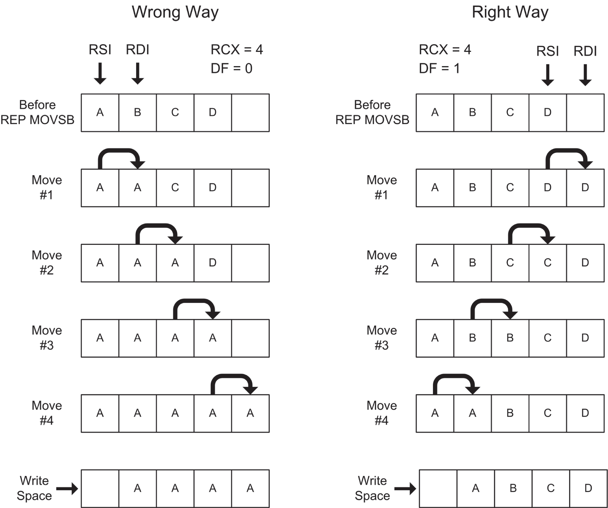
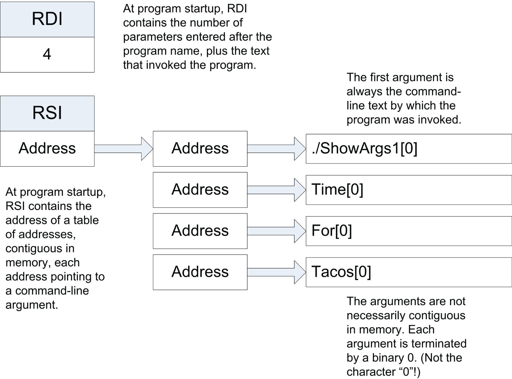
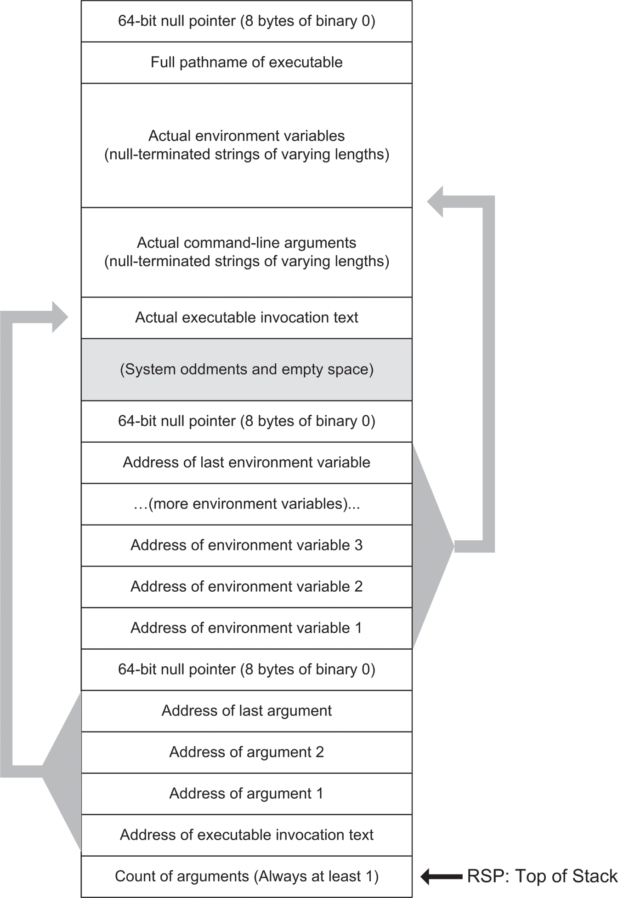

# <a id="Page_377"></a>CHƯƠNG 11 Chuỗi và những thứ khác: *Những instruction chuỗi đáng kinh ngạc*

Hầu hết mọi người, sau khi học một chút assembly language, đều càu nhàu về số lượng instruction có vẻ khổng lồ cần để làm bất cứ điều gì hữu ích. Nhìn chung, đây là một lời phàn nàn chính đáng—và là lý do chính khiến người ta viết chương trình bằng các ngôn ngữ higher-level như Pascal và BASIC. Mặt khác, instruction set x64 đầy những điều bất ngờ, và điều bất ngờ có khả năng khiến những lập trình viên assembly tập sự há hốc miệng nhất là nhóm instruction mà chúng ta gọi là *string instruction*.

Chỉ riêng chúng, trong số mọi instruction trong instruction set x64, có sức mạnh xử lý những dãy dài byte, word, double word hay quad word cùng một lúc. Hãy nhớ rằng trong assembly language, bất kỳ dãy byte hay đơn vị lớn hơn liền nhau nào trong memory đều có thể được coi là một chuỗi—*không* đơn giản là các dãy ký tự human-readable. Đáng kinh ngạc hơn, các string instruction xử lý những dãy byte hay đơn vị lớn hơn này theo một cách gọn gàng phi thường: bằng cách thực thi một vòng lặp instruction hoàn toàn *bên trong* CPU! Trên thực tế, một string instruction là cả một vòng lặp instruction hoàn chỉnh được nung vào một machine instruction duy nhất.

Các string instruction tinh tế và phức tạp, và tôi sẽ không thể trình bày chúng một cách đầy đủ trong cuốn sách này. Phần lớn những gì chúng làm được xếp vào loại chủ đề nâng cao. Dù vậy, bạn có thể có một khởi đầu tốt trong việc hiểu các string instruction bằng cách dùng chúng để xây dựng vài công cụ đơn giản thêm vào bộ đồ nghề video của mình.

Hơn nữa, theo ý tôi, các string instruction dễ dàng là khía cạnh hấp dẫn nhất của công việc assembly language.

<a id="Page_378"></a>

<a id="head-2-15"></a>

## Khái niệm chuỗi trong assembly language

Đôi khi từ ngữ làm chúng ta thất vọng bằng cách hút lấy ý nghĩa dễ dàng như nam châm hút mạt sắt. Từ *string* (chuỗi) là một thủ phạm lớn ở đây. Nó có nghĩa gần như giống nhau trong mọi việc lập trình máy tính, nhưng có vô số biến thể nhỏ trên chủ đề duy nhất đó. Nếu bạn đã học về chuỗi trong Pascal (như tôi), bạn sẽ thấy rằng những gì bạn biết không hoàn toàn áp dụng được khi bạn lập trình bằng C/C++, Python, BASIC, hay (đặc biệt là) assembly.

Vậy đây là Cái nhìn Tổng thể: một *chuỗi* là bất kỳ nhóm byte liền nhau nào trong memory, chứa bất kỳ loại dữ liệu nào, ở bất kỳ kích thước tùy ý nào mà hệ điều hành của bạn cho phép. (Với Linux hiện đại, kích thước đó có thể *rất lớn*.) Khái niệm định nghĩa chủ yếu của một chuỗi assembly language là các byte thành phần của nó nằm ngay đó liền nhau, không bị gián đoạn.

Điều đó khá cơ bản. Hầu hết các ngôn ngữ high-level xây dựng trên khái niệm chuỗi theo vài cách. Các hiện thực Pascal kế thừa từ UCSD Pascal (và sau đó là Turbo Pascal) coi chuỗi là một kiểu dữ liệu riêng biệt, với một bộ đếm độ dài ở đầu chuỗi để cho biết có bao nhiêu byte trong chuỗi. Trong C, một chuỗi không có byte độ dài nào phía trước. Thay vào đó, một chuỗi C được coi là kết thúc khi gặp một byte có giá trị binary là 0. Điều này sẽ quan trọng trong công việc assembly, phần lớn trong số đó liên quan mật thiết đến C và thư viện C chuẩn, nơi bộ máy string-handling của C sống. Trong BASIC, chuỗi được lưu trong một thứ gọi là *string space*, có rất nhiều bộ máy code built-in đi kèm, để quản lý string space và xử lý thao tác way-down-deep trên dữ liệu chuỗi.

Khi bạn bắt đầu làm việc với assembly, bạn phải từ bỏ tất cả những thứ của ngôn ngữ high-level đó. Chuỗi assembly chỉ là những vùng memory liền nhau. Chúng bắt đầu tại một address được chỉ định nào đó, đi qua một số byte nào đó, và dừng lại. Không có bộ đếm độ dài nào cho bạn biết có bao nhiêu byte trong chuỗi, không có ký tự ranh giới chuẩn nào như binary 0 để cho biết một chuỗi bắt đầu hay kết thúc ở đâu. Bạn chắc chắn có thể viết các routine assembly language cấp phát các chuỗi kiểu Pascal–style hay C-style và thao tác với chúng. Tuy nhiên, để tránh nhầm lẫn, khi đó bạn phải nghĩ về dữ liệu mà routine của bạn thao tác là chuỗi Pascal hay chuỗi C chứ không phải chuỗi assembly language.

### Lộn ngược “cảm quan chuỗi” của bạn (Inside-Out)

Chuỗi assembly không có giá trị ranh giới hay chỉ báo độ dài. Chúng có thể chứa bất kỳ giá trị nào, kể cả binary 0. Thực tế, bạn thực sự phải thôi nghĩ về chuỗi theo kiểu những vùng cụ thể trong memory. Thay vào đó, bạn nên nghĩ về chuỗi theo các giá trị register định nghĩa chúng.

Điều đó hơi inside-out so với cách bạn nghĩ về chuỗi trong những ngôn ngữ như Pascal, nhưng nó hoạt động: bạn có một chuỗi khi bạn thiết lập một register để trỏ <a id="Page_379"></a>tới một chuỗi. Và một khi bạn trỏ tới một chuỗi, độ dài của chuỗi đó được định nghĩa bởi giá trị mà bạn đặt vào register RCX.

Đây là then chốt, và dù có nguy cơ lặp lại chính mình, tôi sẽ nói lại lần nữa: *chuỗi assembly được định nghĩa hoàn toàn bởi các giá trị bạn đặt vào register*. Có một tập giả định về chuỗi và register được nung vào silicon của CPU. Khi bạn thực thi một trong các string instruction (như tôi sẽ mô tả ngay sau đây), CPU dùng những giả định đó để xác định vùng memory nào nó đọc từ đó hoặc ghi vào đó.

### Chuỗi nguồn và chuỗi đích

Có hai loại chuỗi trong công việc assembly x64. *Chuỗi nguồn* (source string) là những chuỗi mà bạn đọc từ đó. *Chuỗi đích* (destination string) là những chuỗi mà bạn ghi vào đó. Sự khác biệt giữa hai loại *chỉ* là vấn đề register; chuỗi nguồn và chuỗi đích có thể chồng lấn nhau. Thực tế, cùng một vùng memory có thể *vừa* là chuỗi nguồn *vừa* là chuỗi đích, tất cả cùng một lúc.

Đây là những giả định mà CPU đưa ra về chuỗi khi nó thực thi một string instruction ở long mode 64-bit:

- Một chuỗi nguồn được trỏ tới bởi RSI.
- Một chuỗi đích được trỏ tới bởi RDI.
- Độ dài của cả hai loại chuỗi là giá trị bạn đặt vào RCX. Độ dài này được CPU xử lý thế nào phụ thuộc vào instruction cụ thể và cách nó đang được dùng.
- Dữ liệu đến từ một chuỗi nguồn hoặc đi tới một chuỗi đích phải bắt đầu hành trình từ, kết thúc hành trình tại, hoặc đi qua register RAX.

CPU có thể nhận biết cả một chuỗi nguồn lẫn một chuỗi đích cùng lúc, vì RSI và RDI có thể giữ các giá trị độc lập với nhau. Tuy nhiên, vì chỉ có một register RCX, độ dài của chuỗi nguồn và chuỗi đích phải giống hệt nhau khi chúng được dùng đồng thời, như trong việc sao chép một chuỗi nguồn sang một chuỗi đích.

Một cách để nhớ sự khác biệt giữa chuỗi nguồn và chuỗi đích là qua các register offset của chúng. “SI” trong RSI có nghĩa là “source index”, và “DI” trong RDI có nghĩa là “destination index”. “R”, như bạn đã biết, là quy ước mà theo đó các register general-purpose được đánh dấu là có kích thước 64 bit.

### Một màn hình ảo hiển thị văn bản

Cách tốt nhất để khắc sâu tất cả những thông tin nền tảng về chuỗi đó vào tâm trí bạn là xem một số string instruction đang hoạt động. Trong <a id="R_c11-fea-0001"></a>[Listing 11.1](#c11-fea-0001), tôi đã hiện thực một cơ chế thú vị bằng các string instruction: một màn hình văn bản ảo đơn giản cho console Linux.

Hồi những ngày lập trình real-mode dưới DOS trên các máy PC-compatible, chúng ta có quyền truy cập không bị cản trở vào memory buffer làm tươi màn hình video thực sự trên card đồ họa của PC. Nếu chúng ta ghi một ký tự ASCII hay một chuỗi ký tự vào vùng memory tạo nên buffer hiển thị của card, *Bùm!* Các glyph văn bản tương ứng xuất hiện trên màn hình ngay lập tức. Trong các ấn bản trước của cuốn sách này đề cập đến DOS, tôi đã tận dụng bộ máy hiển thị direct-access đó và trình bày một bộ routine hiển thị hữu ích minh họa các string instruction của architecture Intel.

Dưới Linux, điều đó không còn khả thi nữa. Buffer hiển thị đồ họa vẫn còn đó, nhưng giờ nó là tài sản của hệ điều hành Linux, và các ứng dụng user-space không thể ghi vào nó hay thậm chí đọc từ nó một cách trực tiếp.

Viết các ứng dụng text-mode bằng assembly cho console Linux không hề dễ như dưới DOS. Trong [Chương 10](ch10_dividing_and_conquering.vi.md), tôi đã giải thích cách việc điều khiển console terminal (rất) đơn giản có thể được thực hiện bằng cách ghi escape sequence ra console thông qua `sys_write SYSCALL`. Tuy nhiên, ngoại trừ hai hay ba lệnh đơn giản nhất, những biến thể trong hiện thực terminal khiến việc dùng escape sequence “trần trụi” hơi rủi ro. Một chuỗi nhất định có thể có nghĩa này với một terminal và một nghĩa hoàn toàn khác với một terminal khác. Các code library như `ncurses` tốn rất nhiều công sức để phát hiện và thích ứng với vô số đặc tả terminal ngoài kia. Code để làm điều đó không phải là thứ bạn có thể chắp vá trong một buổi chiều, và thực tế, nó là một chủ đề quá lớn để trình bày chi tiết trong một cuốn sách nhập môn như thế này.

Tuy nhiên…chúng ta có thể giở vài mánh hèn hạ và học được vài điều khi giở chúng. Một mánh là cấp phát buffer làm tươi video văn bản của riêng chúng ta trong memory như một biến có tên và định kỳ ghi toàn bộ buffer ra console Linux thông qua một instruction `SYSCALL` duy nhất. Các PC của chúng ta đã trở nên *cực kỳ* nhanh kể từ kỷ nguyên DOS, và buffer video văn bản không lớn. Một buffer hiển thị văn bản 25 × 80 chỉ dài 2,000 ký tự, và toàn bộ có thể được gửi tới console Linux bằng một lời gọi `SYSCALL sys_write` duy nhất. Buffer xuất hiện trên console ngay lập tức, ít nhất là trong chừng mực bất kỳ người quan sát nào có thể nhận ra.

Đặt văn bản vào buffer là việc đơn giản: tính address của một vị trí hàng và cột nhất định trong buffer rồi ghi các giá trị ký tự ASCII vào biến buffer bắt đầu tại address đó. Sau mỗi lần sửa đổi biến buffer, bạn có thể cập nhật màn hình console bằng cách ghi toàn bộ buffer ra console thông qua `SYSCALL`. Những chuyên gia chán chường có thể gọi đây là “brute force” (và vâng, nó không linh hoạt được bằng một góc thư viện `ncurses`), nhưng nó dễ hiểu. Nó không cho bạn quyền kiểm soát màu sắc hay thuộc tính ký tự (gạch chân, nhấp nháy, v.v.), nhưng nó sẽ cho bạn một hiểu biết cơ bản tốt về các string instruction x86.

Hãy xem qua code trong [Listing 11.1](#c11-fea-0001). Trong các mục sau, tôi sẽ đi qua nó từng phần một. Lưu ý rằng có một file riêng để build thông qua SASM, tên là `vidbuff1gcc.asm`. Hai file gần như giống hệt nhau và khác nhau gần như hoàn toàn ở start address global `_start` so với `main`, thứ mà SASM đòi hỏi.

> <a id="head-2-16"></a>
>
> **<a id="c11-fea-0001"></a>Listing 11.1: vidbuff1.asm**
>
> ```
> ;  Executable name : vidbuff1
> ;  Version         : 2.0
> ;  Created date    : 10/12/2022
> ;  Last update     : 5/13/2023
> ;  Author          : Jeff Duntemann
> ;  Description     : A simple program in assembly for Linux, using NASM
> ;                  : 2.14.02, demonstrating string instruction operation
> ;                  : by "faking" : full-screen memory-mapped text I/O.
> ;
> ;    Build with this makefile, adding the required tabs where needed:
> ;
> ;    vidbuff1: vidbuff1.o
> ;         ld -o vidbuff1 vidbuff1.o
> ;    vidbuff1.o: vidbuff1.asm
> ;         nasm -f elf64 -g -F dwarf vidbuff1.asm
> ;
> ;    Note that output to the console from this program will NOT display
> ;    correctly unless you have enabled the IBM850 character encoding in
> ;    the terminal program being used to display the console!
> ;
>
> SECTION .data           ; Section containing initialized data
>     EOL     equ 10      ; Linux end-of-line character
>     FILLCHR equ 32      ; ASCII space character
>     HBARCHR equ 196     ; Use dash char if this won't display
>     STRTROW equ 2       ; Row where the graph begins
>
> ; We use this to display a ruler across the screen.
>     TenDigits   db 31,32,33,34,35,36,37,38,39,30
>     DigitCount  db 10
>     RulerString db "12345678901234567890123456789012345678901234567890123456789012345678901234567890"
>     RULERLEN    equ $-RulerString
>
> ; The dataset is just a table of byte-length numbers:
>     Dataset db 9,17,71,52,55,18,29,36,18,68,77,63,58,44,0
>     Message db "Data current as of 5/13/2023"
>     MSGLEN  equ $-Message
>
> ; This escape sequence will clear the console terminal and place the
> ; text cursor to the origin (1,1) on virtually all Linux consoles:
>     ClrHome db 27,"[2J",27,"[01;01H"
>     CLRLEN  equ $-ClrHome   ; Length of term clear string
>
> SECTION .bss            ; Section containing uninitialized data
>
>     COLS    equ 81          ; Line length + 1 char for EOL
>     ROWS    equ 25          ; Number of lines in display
>     VidBuff resb COLS*ROWS  ; Buffer size adapts to ROWS & COLS
>
> SECTION .text        ; Section containing code
>
> global  _start       ; Linker needs this to find the entry point!
>
> ClearTerminal:
>     push r11         ; Save all modified registers
>     push rax
>     push rcx
>     push rdx
>     push rsi
>     push rdi
>
>     mov rax,1        ; Specify sys_write call
>     mov rdi,1        ; Specify File Descriptor 1: Standard Output
>     mov rsi,ClrHome  ; Pass address of the escape sequence
>     mov rdx,CLRLEN   ; Pass the length of the escape sequence
>     syscall          ; Make system call
>
>     pop rdi          ; Restore all modified registers
>     pop rsi
>     pop rdx
>     pop rcx
>     pop rax
>     pop r11
>     ret
>
> ;---------------------------------------------------------------------
> ; Show:         Display a text buffer to the Linux console
> ; UPDATED:      5/10/2023
> ; IN:           Nothing
> ; RETURNS:      Nothing
> ; MODIFIES:     Nothing
> ; CALLS:        Linux sys_write
> ; DESCRIPTION:  Sends the buffer VidBuff to the Linux console via
> ;               sys_write. The number of bytes sent to the console
> ;               calculated by multiplying the COLS equate by the
> ;               ROWS equate.
>
> Show:
>     push r11         ; Save all registers we're going to change
>     push rax
>     push rcx
>     push rdx
>     push rsi
>     push rdi
>     mov rax,1        ; Specify sys_write call
>     mov rdi,1        ; Specify File Descriptor 1: Standard Output
>     mov rsi,VidBuff  ; Pass address of the buffer
>     mov rdx,COLS*ROWS  ; Pass the length of the buffer
>     syscall          ; Make system call
>     pop rdi          ; Restore all modified registers
>     pop rsi
>     pop rdx
>     pop rcx
>     pop rax
>     pop r11
>     ret
>
>
> ;---------------------------------------------------------------
> ; ClrVid:       Clears buffer to spaces and replaces EOLs
> ; UPDATED:      5/10/2023
> ; IN:           Nothing
> ; RETURNS:      Nothing
> ; MODIFIES:     VidBuff, DF
> ; CALLS:        Nothing
> ; DESCRIPTION:  Fills the buffer VidBuff with a predefined character
> ;               (FILLCHR) and then places an EOL character at the end
> ;               of every line, where a line ends every COLS bytes in
> ;               VidBuff.
>
> ClrVid:
>     push rax            ; Save registers that we change
>     push rcx
>     push rdi
>     cld                 ; Clear DF; we're counting up-memory
>     mov al,FILLCHR      ; Put the buffer filler char in AL
>     mov rdi,VidBuff     ; Point destination index at buffer
>     mov rcx,COLS*ROWS   ; Put count of chars stored into RCX
>     rep stosb           ; Blast byte-length chars at the buffer
>
> ; Buffer is cleared, now re-insert the EOL char after each line:
>     mov rdi,VidBuff     ; Point destination at buffer again
>     dec rdi             ; Start EOL position count at VidBuff char 0
>     mov rcx,ROWS        ; Put number of rows in count register
> .PtEOL:
>     add rdi,COLS        ; Add column count to RDI
>     mov byte [rdi],EOL  ; Store EOL char at end of row
>     loop .PtEOL         ; Loop back if still more lines
>     pop rdi             ; Restore caller's registers
>     pop rcx
>     pop rax
>     ret                 ; and go home!
>
>
> ;----------------------------------------------------------------
> ; WrtLn:       Writes a string to a text buffer at a 1-based X,Y
> ; UPDATED:     5/10/2023
> ; IN:          The address of the string is passed in RSI
> ;              The 1-based X position (row #) is passed in RBX
> ;              The 1-based Y position (column #) is passed in RAX
> ;              The length of the string in chars is passed in RCX
> ; RETURNS:     Nothing
> ; MODIFIES:    VidBuff, RDI, DF
> ; CALLS:       Nothing
> ; DESCRIPTION: Uses REP MOVSB to copy a string from the
> ;                address in RSI to an X,Y location in the
> ;                text buffer VidBuff.
>
> WrtLn:
>     push rax        ; Save registers we will change
>     push rbx
>     push rcx
>     push rdi
>     cld             ; Clear DF for up-memory write
>     mov rdi,VidBuff ; Load destination index with buffer address
>     dec rax         ; Adjust Y value down by 1 for address
>                     ;   calculation
>     dec rbx         ; Adjust X value down by 1 for address
>                     ; calculation
>     mov ah,COLS     ; Move screen width to AH
>     mul ah          ; Do 8-bit multiply AL*AH to AX
>     add rdi,rax     ; Add Y offset into vidbuff to RDI
>     add rdi,rbx     ; Add X offset into vidbuf to RDI
>     rep movsb       ; Blast the string into the buffer
>     pop rdi         ; Restore registers we changed
>     pop rcx
>     pop rbx
>     pop rax
>     ret             ; and go home!
>
>
> ;-------------------------------------------------------------
> ; WrtHB:        Generates a horizontal line bar at X,Y
> ; UPDATED:      5/10/2023
> ; IN:           The 1-based X position (row #) is passed in RBX
> ;               The 1-based Y position (column #) is passed in RAX
> ;               The length of the bar in chars is passed in RCX
> ; RETURNS:      Nothing
> ; MODIFIES:     VidBuff, DF
> ; CALLS:        Nothing
> ; DESCRIPTION:  Writes a horizontal bar to the video buffer VidBuff,
> ;               at th1e 1-based X,Y values passed in RBX,RAX. The bar
> ;               is "made of" the character in the equate HBARCHR. The
> ;               default is character 196; if your terminal won't
> ;               display that (you need the IBM 850 character set)
> ;               change the value in HBARCHR to ASCII dash or something
> ;               else supported in your terminal.
> WrtHB:
>     push rax         ; Save registers we change
>     push rbx
>     push rcx
>     push rdi
>     cld              ; Clear DF for up-memory write
>     mov rdi,VidBuff  ; Put buffer address in destination register
>     dec rax          ; Adjust Y value down by 1 for address calculation
>     dec rbx          ; Adjust X value down by 1 for address calculation
>     mov ah,COLS      ; Move screen width to AH
>     mul ah           ; Do 8-bit multiply AL*AH to AX
>     add rdi,rax      ; Add Y offset into vidbuff to EDI
>     add rdi,rbx      ; Add X offset into vidbuf to EDI
>     mov al,HBARCHR   ; Put the char to use for the bar in AL
>     rep stosb        ; Blast the bar char into the buffer
>     pop rdi          ; Restore registers we changed
>     pop rcx
>     pop rbx
>     pop rax
>     ret              ; And go home!
>
>
> ;----------------------------------------------------------------
> ; Ruler:        Generates a "1234567890"-style ruler at X,Y
> ; UPDATED:      5/10/2023
> ; IN:           The 1-based X pos (row #) is passed in RBX
> ;               The 1-based Y pos (column #) is passed in RAX
> ;               The length of the ruler in chars is passed in RCX
> ; RETURNS:      Nothing
> ; MODIFIES:     VidBuff
> ; CALLS:        Nothing
> ; DESCRIPTION:  Writes a ruler to the video buffer VidBuff, at
> ;               the 1-based X,Y position passed in RBX,RAX.
> ;               The ruler consists of a repeating sequence of
> ;               the digits 1 through 0. The ruler will wrap
> ;               to subsequent lines and overwrite whatever EOL
> ;               characters fall within its length, if it will not fit
> ;               entirely on the line where it begins. Note that the
> ;               Show procedure must be called after Ruler to display
> ;               the ruler on the console.
>
> Ruler:
>     push rax         ; Save the registers we change
>     push rbx
>     push rcx
>     push rdx
>     push rdi
>     mov rdi,VidBuff  ; Load video buffer address to RDI
>     dec rax        ; Adjust Y value down by 1 for address calculation
>     dec rbx        ; Adjust X value down by 1 for address calculation
>     mov ah,COLS      ; Move screen width to AH
>     mul ah           ; Do 8-bit multiply AL*AH to AX
>     add rdi,rax      ; Add Y offset into vidbuff to RDI
>     add rdi,rbx      ; Add X offset into vidbuf to RDI
>
> ; RDI now contains the memory address in the buffer where the ruler
> ; is to begin. Now we display the ruler, starting at that position:
>     mov rdx,RulerString ; Load address of ruler string into RDX
> DoRule:
>     mov al,[rdx] ; Load first digit in the ruler to AL
>     stosb        ; Store 1 char; note that there's no REP prefix!
>     inc rdx      ; Increment RDX to point to next char in ruler string
>     loop DoRule  ; Decrement RCX & Go back for another char until RCX=0
>     pop rdi      ; Restore the registers we changed
>     pop rdx
>     pop rcx
>     pop rbx
>     pop rax
>     ret          ; And go home!
>
> ;--------------------------------------------------------------------
> ; MAIN PROGRAM:
>
> _start:
>     push rbp
>     mov rbp,rsp
>     and rsp,-16
>
> ; Get the console and text display text buffer ready to go:
>     call ClearTerminal ; Send terminal clear string to console
>     call ClrVid        ; Init/clear the video buffer
>
> ; Next we display the top ruler:
>     mov rax,1        ; Load Y position to AL
>     mov rbx,1        ; Load X position to BL
>     mov rcx,COLS-1   ; Load ruler length to RCX
>     call Ruler       ; Write the ruler to the buffer
>
> ; Thow up an informative message centered on the last line
>     mov rsi,Message  ; Load the address of the message to RSI
>     mov rcx,MSGLEN   ; and its length to RCX
>     mov rbx,COLS     ; and the screen width to RBX
>     sub rbx,rcx      ; Calc diff of message length and screen width
>     shr rbx,1        ; Divide difference by 2 for X value
>     mov rax,20       ; Set message row to Line 24
>     call WrtLn       ; Display the centered message
>
> ; Here we loop through the dataset and graph the data:
>     mov rsi,Dataset  ; Put the address of the dataset in RSI
>     mov rbx,1        ; Start all bars at left margin (X=1)
>     mov r15,0        ; Dataset element index starts at 0
> .blast:
>     mov rax,r15      ; Add dataset number to element index
>     add rax,STRTROW  ; Bias row value by row # of first bar
>     mov cl,byte [rsi+r15] ; Put dataset value in lowest byte of RCX
>     cmp rcx,0        ; See if we pulled a 0 from the dataset
>     je .rule2        ; If we pulled a 0 from the dataset, we're done
>     call WrtHB       ; Graph the data as a horizontal bar
>     inc r15          ; Increment the dataset element index
>     jmp .blast       ; Go back and do another bar
>
> ; Display the bottom ruler:
> .rule2:
>     mov rax,r15      ; Use the dataset counter to set the ruler row
>     add rax,STRTROW  ; Bias down by the row # of the first bar
>     mov rbx,1        ; Load X position to BL
>     mov rcx,COLS-1   ; Load ruler length to RCX
>     call Ruler       ; Write the ruler to the buffer
>
> ; Having written all that to the buffer, send buffer to the console:
>     call Show        ; Refresh the buffer to the console
>
> ; And return control to Linux:
> Exit:
>     mov rsp,rbp
>     pop rbp
>
>     mov rax,60       ; End program via Exit Syscall
>     mov rdi,0        ; Return a code of zero
>     syscall          ; Return to Linux
> ```

<a id="Page_387"></a>

<a id="head-2-17"></a>

## REP STOSB, khẩu súng máy phần mềm

Buffer hiển thị văn bản ảo của chúng ta chẳng là gì hơn một vùng memory thô được dành riêng trong section `.bss`, bằng directive `RESB`. Kích thước của buffer được định nghĩa bởi hai equate, chỉ định số hàng và số cột mà bạn muốn. Theo mặc định tôi đã đặt nó là 25 hàng và 80 cột, nhưng các màn hình console 2023-era có thể hiển thị một màn hình văn bản lớn hơn thế rất nhiều. Bạn có thể thay đổi các equate `COLS` và `ROWS` để định nghĩa buffer lớn tới 255 × 255, mặc dù nếu cửa sổ terminal của bạn không lớn đến thế, kết quả của bạn sẽ (nói một cách khoan dung) khó đoán trước.

Việc thay đổi kích thước màn hình văn bản được thực hiện bằng cách thay đổi một hoặc cả hai equate đó. Bất kỳ thay đổi nào khác phải được thực hiện với code đều được <a id="Page_388"></a>xử lý tự động. Lưu ý rằng việc này phải được làm vào lúc assemble vì nhiều phép tính là các phép tính assembly-time do NASM thực hiện khi bạn build chương trình.

Bạn không cần khớp chính xác kích thước cửa sổ terminal với các giá trị `ROWS` và `COLS` bạn chọn, miễn là cửa sổ terminal *lớn hơn* `ROWS` × `COLS`. Nếu bạn phóng to tối đa cửa sổ terminal (như Konsole), màn hình văn bản của bạn sẽ xuất hiện bắt đầu ở góc trên bên trái (upper-left) của màn hình.

### Machine-Gunning màn hình ảo

Khi Linux nạp chương trình của bạn vào memory, nó thường xóa các biến chưa khởi tạo (như `VidBuff` từ [Listing 11.1](#c11-fea-0001)) về các số không binary. Điều này tốt, nhưng các số không binary không hiển thị đúng trên console Linux. Để trông “trống” trên console, memory buffer hiển thị phải được xóa về ký tự space ASCII. Điều này có nghĩa là ghi giá trị 20h vào memory từ đầu buffer đến cuối buffer.

Những việc như vậy nên luôn được làm trong các vòng lặp chặt. Cách hiển nhiên là đặt address của buffer hiển thị vào RDI, số byte trong buffer làm tươi vào RCX, giá trị ASCII để xóa buffer vào AL, rồi viết một vòng lặp chặt theo cách này:

```
Clear:  mov [rdi],al  ; Write the value in AL to memory
        inc rdi       ; Bump RDI to next byte in the buffer
        dec rcx       ; Decrement RCX by one position
        jnz Clear     ; And loop again until RCX is 0
```

Cách này sẽ hoạt động. Nó thậm chí nhanh ở mức chấp nhận được, đặc biệt trên các CPU mới hơn. Nhưng *toàn bộ* code ở trên tương đương với một instruction duy nhất này:

```
rep stosb
```

Thật đấy. Không, *thật sự* đấy.

Instruction `STOSB` là đơn giản nhất trong các string instruction của Intel và là một chỗ tốt để bắt đầu. Có hai phần trong instruction như tôi đã thể hiện, một tình huống mà chúng ta chưa thấy trước đây. `REP` là một loại sinh vật mới, gọi là *prefix* (tiền tố), và nó thay đổi cách CPU xử lý instruction mnemonic theo sau nó. Chúng ta sẽ quay lại `REP` ngay sau đây. Ngay lúc này, hãy xem `STOSB`. Mnemonic này có nghĩa là STOre String by Byte. Giống như mọi string instruction, `STOSB` đưa ra một số giả định nhất định về một số register CPU. Nó chỉ làm việc trên chuỗi đích, vì vậy RSI không tham gia. Tuy nhiên, những giả định sau phải được tôn trọng và xử lý:

- RDI phải được nạp address của chuỗi đích. (Hãy nghĩ: R*DI*, cho *d*estination *i*ndex.)
- RCX phải được nạp số lần giá trị trong AL sẽ được lưu vào chuỗi.
- <a id="Page_389"></a>AL phải được nạp giá trị 8-bit cần được lưu vào chuỗi.
- Direction flag DF phải được set hoặc clear, tùy theo bạn muốn việc tìm kiếm là up-memory (clear; dùng `CLD`) hay down-memory (set; dùng `STD`). Tôi sẽ nói thêm về DF khi được dùng với `STOSB` ở phần sau một chút.

### Thực thi instruction STOSB

Một khi bạn thiết lập ba register này, bạn có thể yên tâm thực thi một instruction `STOSB`. Khi bạn làm vậy, đây là điều xảy ra:

1. Giá trị byte trong AL được sao chép tới memory address được lưu trong RDI.
2. RDI được tăng thêm 1, để giờ nó trỏ tới byte *kế tiếp* trong memory sau byte vừa được ghi vào.

Lưu ý rằng ở đây chúng ta *không* machine-gunning—ít nhất là chưa. *Một* bản sao của AL được sao chép tới *một* vị trí trong memory. Register RDI được điều chỉnh để nó sẵn sàng cho lần *tiếp theo* `STOSB` được thực thi.

Một điểm rất quan trọng cần nhớ là RCX *không* bị `STOSB` giảm. RCX chỉ được giảm tự động *khi* bạn đặt prefix `REP` trước `STOSB`. Thiếu prefix `REP`, bạn phải tự làm việc giảm, hoặc một cách tường minh bằng `DEC` hoặc bằng instruction `LOOP`, như tôi sẽ giải thích ở phần sau một chút trong chương này.

Vì vậy, bạn không thể làm cho `STOSB` chạy tự động mà không có `REP`. Tuy nhiên, nếu muốn, bạn có thể thực thi các instruction khác trước khi thực thi một `STOSB` khác. Chừng nào bạn không làm xáo trộn RDI hay RCX, bạn có thể làm bất cứ điều gì bạn muốn. Rồi khi bạn thực thi `STOSB` lần nữa, một bản sao khác của AL sẽ đi ra vị trí được RDI trỏ tới, và RDI sẽ lại được điều chỉnh. (Bạn phải nhớ giảm RCX bằng cách nào đó.) Lưu ý rằng bạn có thể thay đổi giá trị trong AL nếu muốn, nhưng giá trị đã thay đổi sẽ được sao chép vào memory. Có thể bạn muốn làm vậy—không có luật nào nói rằng bạn phải lấp đầy một chuỗi chỉ bằng một giá trị duy nhất.

Tuy nhiên, điều này giống như sự khác biệt giữa một vũ khí bán tự động (bắn một viên mỗi lần bạn bóp và nhả cò) và một vũ khí hoàn toàn tự động, bắn liên tục chừng nào bạn còn giữ cò. Để làm cho `STOSB` hoàn toàn tự động, chỉ cần treo prefix `REP` ở phía trước nó. Điều `REP` làm đơn giản đến tuyệt đẹp: nó thiết lập vòng lặp chặt nhất trong mọi vòng lặp chặt hoàn toàn *bên trong* CPU và bắn các bản sao của AL vào memory lặp đi lặp lại (lý do cho tên của nó), tăng RDI thêm 1 mỗi lần và giảm RCX đi 1, cho đến khi RCX được giảm về 0. Rồi nó dừng lại, và khi khói tan, bạn sẽ thấy rằng toàn bộ chuỗi đích của bạn, dù lớn đến đâu, đã được lấp đầy bằng các bản sao của AL.

Trời ơi, *đó* mới là lập trình chứ!

<a id="Page_390"></a>Trong chương trình `vidbuff1` được trình bày trong [Listing 11.1](#c11-fea-0001), code để xóa buffer hiển thị nằm trong procedure `ClrVid`. Các dòng liên quan là những dòng được thể hiện ở đây:

```
cld                 ; Clear DF so we're counting up-memory
mov al,FILLCHR      ; Put the buffer filler char in AL
mov rdi,VidBuff     ; Point destination index at buffer
mov rcx,COLS*ROWS   ; Put count of chars stored into RCX
rep stosb           ; Blast chars at the buffer
```

Equate `FILLCHR` theo mặc định được đặt là 32, là ký tự space ASCII. Bạn có thể đặt nó để lấp đầy buffer bằng một ký tự khác, mặc dù điều đó hữu ích đến đâu thì không rõ. Cũng lưu ý rằng số ký tự cần được ghi vào memory được NASM tính vào lúc assemble là `COLS` nhân `ROWS`. Điều này cho phép bạn thay đổi kích thước màn hình ảo mà không phải thay đổi code xóa buffer hiển thị.

### STOSB và Direction flag DF

Mở đầu chuỗi code ngắn được thể hiện ở trên là một instruction tôi chưa thảo luận trước đây: `CLD`. Nó điều khiển một điều then chốt trong công việc string instruction: hướng trong memory mà phép toán chuỗi đi theo.

Phần lớn thời gian bạn dùng `STOSB`, bạn sẽ muốn chạy nó “lên dốc” trong memory, tức là từ một memory address thấp hơn tới một memory address cao hơn. Trong `ClrVid`, bạn đặt address đầu buffer làm tươi video vào RDI rồi bắn ký tự vào memory tại các memory address cao dần. Mỗi lần `STOSB` bắn một byte vào memory, RDI được tăng để trỏ tới byte *cao hơn kế tiếp* trong memory.

Đây là cách hợp logic để làm việc, nhưng không phải lúc nào cũng phải làm theo cách đó. `STOSB` cũng có thể dễ dàng bắt đầu ở một address cao và di chuyển xuống dưới trong memory. Ở mỗi lần lưu vào memory, thay vào đó RDI có thể được *giảm* đi 1.

`STOSB` bắn theo chiều nào—lên dốc về phía các memory address cao dần hay xuống dốc về phía các address thấp dần—được chi phối bởi một trong các flag trong register RFlags. Đây là *Direction flag* DF. Công việc duy nhất trong đời của DF là điều khiển hướng hành động của một số instruction nhất định mà, giống như `STOSB`, có thể di chuyển theo một trong hai hướng trong memory. Hầu hết chúng (như `STOSB` và các anh chị em của nó) là string instruction.

Ý nghĩa của DF là thế này: khi DF được *set* (tức là khi DF có giá trị 1), `STOSB` và các string instruction đồng loại làm việc xuống dốc, từ address cao hơn tới address thấp hơn. Khi DF bị *clear* (tức là khi nó có giá trị 0), `STOSB` và các anh chị em của nó làm việc lên dốc, từ address thấp hơn tới address cao hơn. Điều này đến lượt nó đơn giản là hướng mà register RDI được điều chỉnh: khi DF được set, RDI được giảm trong khi thực thi string instruction. Khi DF bị clear, RDI được tăng.

<a id="Page_391"></a>Direction flag mặc định là 0 (lên dốc) khi CPU được reset. Nó thường được thay đổi theo một trong hai cách: bằng instruction `CLD`, hoặc bằng instruction `STD`. `CLD` clear DF về 0, và `STD` set DF thành 1. (Khi debug, bạn nên nhớ rằng instruction `POPF` cũng có thể thay đổi DF bằng cách pop cả một bộ flag mới từ stack vào register RFlags.) Vì trạng thái mặc định của DF là bị clear về 0 và mọi string instruction trong chương trình demo `vidbuff1` đều làm việc lên dốc trong memory, về mặt kỹ thuật không cần đưa một instruction `CLD` vào procedure `ClrVid`. Tuy nhiên, các phần khác của một chương trình có thể thay đổi DF. Luôn là một ý hay khi đặt instruction thích hợp trong số `CLD` hoặc `STD` ngay trước một string instruction để đảm bảo khẩu súng máy của bạn bắn đúng hướng!

Đôi khi người ta nhầm lẫn và nghĩ rằng DF cũng chi phối việc RCX được tăng hay giảm bởi các string instruction. Không phải vậy! Không có gì trong một string instruction *từng* tăng RCX. RCX giữ một giá trị đếm, *không phải* một memory address. Bạn đặt một số đếm vào RCX, và nó đếm ngược mỗi lần một string instruction bắn cho đến khi về 0. DF chẳng có tiếng nói gì về điều đó. Về cơ bản, RDI là nơi mục tiêu nằm, và RCX là số viên đạn trong băng đạn của bạn.

### Định nghĩa các dòng trong buffer hiển thị

Tuy nhiên, xóa `VidBuff` thành ký tự space chưa phải là hết câu chuyện. Để hiển thị đúng trên các chương trình terminal hiển thị console Linux, dữ liệu hiển thị phải được chia thành các dòng. Các dòng được phân định bởi ký tự EOL, ASCII 10. Một dòng bắt đầu ở đầu buffer và kết thúc bằng ký tự EOL đầu tiên. Dòng tiếp theo bắt đầu ngay sau ký tự EOL và chạy cho đến ký tự EOL tiếp theo, và cứ thế.

Khi văn bản được ghi từng mẩu ra console, mỗi dòng có thể có độ dài khác nhau. Tuy nhiên, trong hệ thống hiển thị ảo của chúng ta, toàn bộ buffer được ghi ra console trong một nhát `SYSCALL`, như một chuỗi các dòng đều có cùng độ dài. Điều này có nghĩa là khi xóa buffer, chúng ta cũng phải chèn các ký tự EOL vào những chỗ chúng ta muốn mỗi dòng được hiển thị kết thúc.

Việc này được thực hiện trong phần còn lại của procedure `ClrVid`. Điều chúng ta phải làm là ghi một ký tự EOL vào buffer cứ mỗi `COLS` byte. Việc này được thực hiện bằng một vòng lặp *rất* chặt. Nếu bạn nhìn phần thứ hai của `ClrVid`, bạn có thể nhận thấy rằng vòng lặp đang xét không *hoàn toàn* bình thường. Hãy giữ ý nghĩ đó—tôi sẽ quay lại instruction `LOOP` ngay sau đây một chút.

### Gửi buffer tới console Linux

Tôi cần nhắc lại: ở đây chúng ta đang nói về một màn hình *ảo*. `VidBuff` chỉ là một vùng memory mà bạn có thể ghi ký tự và chuỗi ký tự vào bằng <a id="Page_392"></a>các instruction assembly language thông thường. Tuy nhiên, sẽ không có gì xuất hiện trên màn hình của bạn cho đến khi bạn gửi buffer tới console Linux.

Việc này đủ dễ. Procedure `Show` trong [Listing 11.1](#c11-fea-0001) thực hiện một lời gọi duy nhất tới kernel service `sys_write` thông qua `SYSCALL` và gửi toàn bộ buffer tới console cùng một lúc. Các ký tự EOL được nhúng trong buffer cứ mỗi `COLS` byte được console xử lý như cách các ký tự EOL luôn được xử lý và buộc một dòng mới bắt đầu ngay sau mỗi EOL. Vì mọi dòng đều có cùng độ dài, việc gửi `VidBuff` tới console tạo ra một vùng văn bản hình chữ nhật sẽ hiển thị đúng trên bất kỳ cửa sổ terminal nào có kích thước ít nhất là `COLS` nhân `ROWS`. (Các cửa sổ nhỏ hơn sẽ làm xáo trộn văn bản của `VidBuff`. Hãy thử chạy chương trình `vidbuff1` trong các cửa sổ terminal various-sized, và bạn sẽ nhanh chóng thấy ý tôi.)

Điều quan trọng là chương trình của bạn gọi `Show` bất cứ khi nào bạn muốn cập nhật màn hình. Việc này có thể được làm thường xuyên bao nhiêu tùy thích, bất cứ khi nào bạn muốn. Trên các PC Linux hiện đại, việc cập nhật diễn ra nhanh đến mức có vẻ tức thời. Với tốc độ đó, chẳng có lý do gì bạn không nên gọi `Show` sau mỗi một lần ghi vào `VidBuff`, nhưng điều đó tùy bạn.

<a id="head-2-18"></a>

## Vũ khí bán tự động: STOSB không có REP

Trong số mọi string instruction, tôi chọn cho bạn xem `REP STOSB` trước vì nó ấn tượng đến cực độ. Nhưng quan trọng hơn, nó *đơn giản*—thực tế, dùng `REP` còn đơn giản hơn là không dùng `REP`. `REP` đơn giản hóa việc xử lý chuỗi từ góc nhìn của lập trình viên, vì nó đưa toàn bộ vòng lặp instruction vào *bên trong* CPU. Bạn có thể dùng instruction `STOSB` mà không có `REP`, nhưng tốn công hơn một chút. Công việc đó bao gồm việc thiết lập vòng lặp instruction bên ngoài CPU và đảm bảo nó đúng.

Tại sao phải bận tâm? Đơn giản là thế này: với `REP STOSB`, bạn chỉ có thể lưu lặp đi lặp lại *cùng một* giá trị vào chuỗi đích. Bất cứ thứ gì bạn đặt vào AL trước khi thực thi `REP STOSB` là giá trị được bắn vào memory RCX lần. `STOSB` có thể được dùng để lưu những giá trị *khác nhau* vào chuỗi đích bằng cách bắn nó theo kiểu bán tự động và thay đổi giá trị trong AL giữa mỗi lần bóp cò.

Bạn mất một chút thời gian khi tự xử lý vòng lặp bên ngoài CPU. Đó là vì có một lượng thời gian nhất định được dùng để nạp các byte instruction của vòng lặp từ memory. Tuy nhiên, nếu bạn giữ vòng lặp chặt nhất có thể, bạn sẽ không mất một lượng tốc độ đáng ngại, đặc biệt trên các bộ xử lý Intel/AMD hiện đại, những bộ xử lý dùng cache rất hiệu quả và không nạp instruction từ memory bên ngoài mỗi lần chúng được thực thi.

### Ai giảm RCX?

Hồi đầu trải nghiệm với assembly language x86, tôi nhớ mình đã bối rối kinh khủng về việc register RCX (thực ra, hồi đó nó <a id="Page_393"></a>đơn giản là register CX) được giảm ở đâu và khi nào khi dùng string instruction. Đó là một vấn đề then chốt, đặc biệt khi bạn *không* dùng prefix `REP`.

Khi bạn dùng `REP STOSB` (hoặc `REP` với bất kỳ string instruction nào), RCX được giảm tự động, đi 1, cho mỗi lần truy cập memory mà instruction thực hiện. Và một khi RCX tự giảm về 0, `REP STOSB` phát hiện rằng RCX giờ bằng 0 và ngừng bắn vào memory. Quyền điều khiển sau đó chuyển sang instruction kế tiếp. Nhưng bỏ `REP` đi, và việc tự động giảm RCX dừng lại. Việc tự động phát hiện khi RCX đã được đếm ngược về 0 cũng vậy.

Hiển nhiên, phải có thứ gì đó giảm RCX vì RCX chi phối số lần string instruction truy cập memory. Nếu `STOSB` không làm việc đó—bạn đoán đúng rồi—*bạn* phải làm việc đó ở chỗ khác, bằng một instruction khác.

Cách hiển nhiên để giảm RCX là dùng `DEC RCX`. Và cách hiển nhiên để xác định RCX đã được giảm về 0 hay chưa là đặt sau instruction `DEC RCX` một instruction `JNZ` (Jump if Not Zero). `JNZ` kiểm tra Zero flag ZF và nhảy ngược lại instruction `STOSB` cho đến khi ZF trở thành true. Và ZF trở thành true khi một instruction `DEC` khiến operand của nó (ở đây là RCX) trở thành 0.

### Các instruction LOOP

Với tất cả điều đó trong đầu, hãy xem vòng lặp instruction assembly language sau. Nó không được lấy từ [Listing 11.1](#c11-fea-0001), mà là một ví dụ cobbled-up về cách làm “khó”:

```
    mov al,30h  ; Put the value of character "0" in AL
DoChar:
    stosb       ; Note that there's no REP prefix!
    inc al      ; Bump the character value in AL up by 1
    dec rcx     ; Decrement the count by 1..
    jnz DoChar  ; ..and loop again if RCX> 0
```

Hãy xem vòng lặp chạy thế nào. `STOSB` bắn, AL được sửa đổi, rồi RCX được giảm. Instruction `JNZ` kiểm tra xem instruction `DEC` có ép RCX về không hay không. Nếu có, Zero flag ZF được set, và vòng lặp sẽ kết thúc. Nhưng cho đến khi ZF được set, việc nhảy được thực hiện ngược lại label `DoChar`, nơi `STOSB` lại bắn một lần nữa.

Có một cách đơn giản hơn, dùng một instruction mà tôi chưa thảo luận cho đến giờ: `LOOP`. Instruction `LOOP` kết hợp việc giảm RCX với một phép kiểm tra và nhảy dựa trên ZF. Nó trông như thế này:

```
    mov al,30h   ; Put the value of character "0" in AL
DoChar:
    stosb        ; Note that there's no REP prefix!
    inc al       ; Bump the character value in AL up by 1
    loop DoChar  ; Go back & do another char until RCX goes to 0
```

Khi được thực thi, instruction `LOOP` trước tiên giảm RCX đi 1. Sau đó nó kiểm tra Zero flag để xem phép giảm có ép RCX về không hay không. Nếu có, nó rơi <a id="Page_394"></a>xuống instruction tiếp theo. Nếu không (tức là nếu ZF vẫn bằng 0, cho biết RCX vẫn lớn hơn 0), `LOOP` rẽ nhánh tới label được chỉ định làm operand của nó.

Vì vậy, vòng lặp cứ tiếp tục lặp `LOOP` cho đến khi RCX đếm ngược về 0. Đến lúc đó, vòng lặp kết thúc, và việc thực thi rơi xuống và tiếp tục với instruction kế tiếp sau `LOOP`.

### Hiển thị một cây thước trên màn hình

Như một minh họa hữu ích về khi nào việc dùng `STOSB` không có `REP` (nhưng có `LOOP`) là hợp lý, hãy để tôi đưa cho bạn một món nữa cho bộ đồ nghề video của mình.

Procedure `Ruler` từ [Listing 11.1](#c11-fea-0001) hiển thị một dãy chữ số tăng dần lặp lại bắt đầu từ 1, với độ dài bất kỳ, tại một vị trí có thể chọn trên màn hình của bạn. Nói cách khác, bạn có thể hiển thị một chuỗi chữ số như thế này ở bất cứ đâu bạn muốn:

```
123456789012345678901234567890123456789012345678901234567890
```

Điều này có thể cho phép bạn xác định một dòng bắt đầu hay một ký tự nào đó nằm ở đâu theo chiều ngang của cửa sổ console. Procedure `Ruler` cho phép bạn chỉ định cây thước dài bao nhiêu, tính bằng chữ số, và nó sẽ được hiển thị ở đâu trên màn hình.

Một lời gọi điển hình tới `Ruler` sẽ trông giống như thế này:

```
mov rax,1       ; Load Y position to AL
mov rbx,1       ; Load X position to BL
mov rcx,COLS-1  ; Load ruler length to RCX
call Ruler      ; Write the ruler to the buffer
```

Lần gọi này đặt một cây thước ở góc trên bên trái (upper-left) của màn hình, bắt đầu tại vị trí 1,1. Độ dài của cây thước được truyền trong RCX. Ở đây, bạn đang chỉ định một cây thước ngắn hơn chiều rộng màn hình một ký tự. Điều này cung cấp một cây thước trải trọn chiều rộng nhìn thấy được của màn hình văn bản ảo của bạn.

Tại sao ngắn hơn một ký tự? Hãy nhớ rằng có một ký tự EOL ở cuối mỗi dòng. Ký tự EOL này không nhìn thấy trực tiếp được, nhưng nó vẫn là một ký tự và cần một byte trong buffer để chứa nó. Equate `COLS` phải luôn tính đến điều này: nếu bạn muốn một màn hình rộng 80-character, `COLS` phải được đặt là 81. Nếu bạn muốn một màn hình rộng 96-character, `COLS` phải được đặt là 97. Nếu bạn viết một lời gọi tới `Ruler` như được thể hiện ở trên, NASM sẽ làm một chút toán assembly-time và luôn sinh ra một cây thước trải trọn chiều rộng (nhìn thấy được) của màn hình văn bản.

Ngoài instruction `LOOP`, có khá nhiều công nghệ assembly mới đang hoạt động ở đây đáng được giải thích. Hãy tạm rẽ khỏi các string instruction một chút và xem xét kỹ hơn.

<a id="Page_395"></a>

### MUL không phải là IMUL

Tôi đã mô tả instruction `MUL` và các implicit operand của nó từ tận [Chương 7](ch07_following_your_instructions.vi.md). Procedure `Ruler` cũng dùng `MUL` để tính một vị trí X,Y trong buffer memory hiển thị nơi `STOSB` có thể bắt đầu đặt các ký tự của thước. Thuật toán xác định offset tính bằng byte vào buffer cho bất kỳ giá trị *X* và *Y* nào trông như thế này:

```
Offset = ((Y * width in characters of a screen line) + X)
```

Khá hiển nhiên, bạn phải đi xuống Y dòng trong buffer màn hình rồi đi sang X byte từ lề trái của màn hình để đến vị trí X,Y của bạn. Phép tính được thực hiện theo cách này bên trong procedure `Ruler`:

```
mov rdi,VidBuff  ; Load video buffer address to RDI
    dec rax      ; Adjust Y value down by 1 for address calculation
    dec rbx      ; Adjust X value down by 1 for address calculation
    mov ah,COLS  ; Move screen width to AH
    mul ah       ; Do 8-bit multiply AL*AH to AX
    add rdi,rax  ; Add Y offset into vidbuff to RDI
    add rdi,rbx  ; Add X offset into vidbuf to RDI
```

Hai instruction `DEC` lo cho sự thật rằng các vị trí X,Y trong hệ thống này là 1-based; tức là, góc upper-left của màn hình là vị trí 1,1 chứ không phải 0,0, như trong một số hệ tọa độ X,Y. Hãy nghĩ theo cách này: nếu bạn muốn hiển thị một cây thước bắt đầu ở tận góc upper-left của màn hình, bạn phải ghi các ký tự của thước bắt đầu tại tận đầu buffer, hoàn toàn không có offset. Vì vậy, vì mục đích tính toán, các giá trị X,Y phải là 0-based.

Với một phép nhân 8-bit dùng `MUL`, một trong các thừa số là ngầm định: AL chứa giá trị Y, và nơi gọi truyền cho `Ruler` giá trị Y trong RAX. Chúng ta đặt chiều rộng màn hình vào AH rồi nhân AH với AL bằng `MUL`. (Xem phần thảo luận về `MUL` trong [Chương 7](ch07_following_your_instructions.vi.md) nếu nó đã trở nên mơ hồ trong thời gian qua.) Tích thay thế các giá trị trong cả AH lẫn AL và được truy cập như giá trị trong AX. Cộng tích đó và giá trị X (được truyền cho `Ruler` trong BL) vào RDI cho bạn memory address chính xác nơi các ký tự của thước phải được ghi.

Giờ, có một bug khá phổ biến cần cảnh báo bạn ở đây: `MUL` không phải là `IMUL`…phần lớn thời gian. `MUL` và `IMUL` là hai instruction chị em đều thực hiện phép nhân. `MUL` coi các giá trị operand của nó là không dấu, trong khi `IMUL` coi chúng là có dấu. Sự khác biệt này không quan trọng chừng nào cả hai thừa số vẫn dương trong một ngữ cảnh có dấu. Về mặt thực tế, với một phép nhân 8-bit, `MUL` và `IMUL` hoạt động giống hệt nhau với các giá trị từ 127 trở xuống. Ở 128 mọi thứ thay đổi. Các giá trị trên 127 được coi là âm trong một ngữ cảnh có dấu 8-bit. `MUL` coi 128 là…128. `IMUL` coi 128 là -1. Úi.

<a id="Page_396"></a>Bạn có thể thay instruction `MUL` bằng `IMUL` trong Ruler, và proc sẽ hoạt động giống hệt nhau cho đến khi bạn truyền cho nó một kích thước màn hình lớn hơn 127. Khi đó, đột nhiên, `IMUL` sẽ tính ra một tích mà trên danh nghĩa là âm…nhưng chỉ khi bạn coi giá trị đó là một giá trị có dấu. Một số âm khi được coi là không dấu là một số dương rất lớn, và một tham chiếu memory tới address được biểu diễn bởi RDI cộng với giá trị bất thường đó sẽ sinh ra một segmentation fault. Hãy thử xem! Không có gì bị hại, và đó là một bài học thú vị. `IMUL` dành cho giá trị có dấu. Với các phép tính memory address, hãy để nó yên và nhớ dùng `MUL` thay vào đó.

### Bài học từ Ruler

Procedure `Ruler` là một ví dụ tốt về việc dùng `STOSB` *không có* prefix `REP`. Chúng ta phải thay đổi giá trị trong AL mỗi lần lưu AL vào memory và do đó không thể dùng `REP STOSB`. Lưu ý rằng không có gì được làm với RDI hay RCX trong khi thay đổi chữ số cần hiển thị, và do đó các giá trị được lưu trong những register đó được giữ lại cho lần thực thi `STOSB` tiếp theo. `Ruler` là một ví dụ tốt về cách `LOOP` làm việc với `STOSB` để điều chỉnh RCX đi xuống và trả quyền điều khiển về đầu vòng lặp. Theo một nghĩa nào đó, `LOOP` làm bên ngoài CPU điều `REP` làm bên trong CPU: điều chỉnh RCX và khép vòng lặp. Hãy cố giữ điều đó rành mạch trong đầu khi dùng bất kỳ string instruction nào!

### Bốn kích thước của STOS

Trước khi chuyển sang các string instruction khác, đáng để chỉ ra rằng có bốn “kích thước” khác nhau của string instruction `STOS`:

- `STOSB` lưu giá trị 8-bit trong AL vào memory.
- `STOSW` lưu giá trị 16-bit trong AX vào memory.
- `STOSD` lưu giá trị 32-bit trong EAX vào memory.
- `STOSQ` lưu giá trị 64-bit trong RAX vào memory.

`STOSW`, `STOSD` và `STOSQ` hoạt động gần như theo cùng cách với `STOSB`. Khác biệt chính nằm ở cách address đích RDI được thay đổi sau mỗi thao tác chuyển memory. RDI được thay đổi theo kích thước của đại lượng mà instruction tác động. Với `STOSW`, RDI thay đổi hai byte, lên hoặc xuống tùy theo trạng thái của DF. Với `STOSD`, RDI thay đổi bốn byte, một lần nữa lên hoặc xuống tùy theo trạng thái của DF. `STOSQ` thay đổi RDI tám byte, lên hoặc xuống tùy theo trạng thái của DF.

Tuy nhiên, trong mọi trường hợp, với prefix `REP` phía trước instruction, register bộ đếm (trong x64 là RCX) được giảm đi *một* sau mỗi thao tác chuyển memory. Nó luôn được giảm, và luôn giảm đi một. RCX đếm *thao tác*. Nó chẳng có tiếng nói gì về memory address hay kích thước của giá trị đang được lưu vào memory.

<a id="Page_397"></a>

### Tạm biệt toán BCD

Đây có vẻ là một chỗ kỳ lạ để nói về những machine instruction không còn khả dụng, nhưng tôi có lý do. Những độc giả đã xem các ấn bản trước của cuốn sách này, đặc biệt là ấn bản năm 2009, có thể nhớ rằng chương trình ví dụ `vidbuff1` ([Listing 11.1](#c11-fea-0001)) đã dùng số học BCD để sinh ra các ký tự tạo nên cây thước.

Nói thẳng ra, những người thiết kế architecture x64 đã loại bỏ mọi instruction toán BCD có trong định nghĩa x86. Đó là sáu instruction:

```
AAA, DAA, DAS, AAS, AAM, AAD
```

Giải thích toán BCD nằm ngoài phạm vi của cuốn sách này (ấn bản năm 2009 có trình bày phần nào nếu bạn thực sự quan tâm), và tôi chỉ nhắc đến nó vì trong ấn bản năm 2009, chương trình `vidbuff1` đã dùng toán BCD. Có những use case cho toán BCD, chủ yếu trong các phép tính tài chính, nhưng các instruction BCD của Intel có từ rất lâu, và ngày nay chúng ta có những kỹ thuật tính toán tài chính tốt hơn.

Về cơ bản, toán BCD cho phép bạn cộng một ký tự ASCII với một ký tự ASCII khác. Nó phức tạp và chậm và không còn khả thi—vì các instruction thực hiện nó không còn khả dụng.

<a id="head-2-19"></a>

## MOVSB: sao chép khối nhanh

Instruction `STOSB` là một thứ hấp dẫn, nhưng về lượng hành động thuần túy được nén vào một dòng code assembly duy nhất thì không gì sánh được với instruction `MOVS`. Giống như `STOS`, `MOVS` có bốn “kích thước”, để xử lý byte (`MOVSB`), word 16-bit (`MOVSW`), double word 32-bit (`MOVSD`) và quad word 64-bit (`MOVSQ`). Để làm việc với ký tự ASCII như chúng ta làm trong chương này, `MOVSB` là cái cần dùng.

Ý chính của instruction `MOVSB` là thế này: một khối memory data tại address được lưu trong RSI được sao chép tới address được lưu trong RDI. Số byte cần di chuyển được đặt vào register RCX. RCX đếm ngược đi một sau mỗi byte được sao chép, và các address trong RSI và RDI được điều chỉnh một. Với `MOVSW`, register nguồn và đích được điều chỉnh hai sau mỗi word được sao chép; với `MOVSD`, chúng được điều chỉnh bốn sau mỗi double word được sao chép, và với `MOVSQ`, chúng được điều chỉnh tám byte sau mỗi quad word được sao chép. Những điều chỉnh này hoặc là tăng hoặc là giảm, tùy theo trạng thái của DF. Trong mọi trường hợp, RCX được giảm đi một mỗi lần một mục dữ liệu đi từ address nguồn tới address đích. Hãy nhớ rằng RCX đang đếm các thao tác chuyển memory, *không phải* các byte address!

Register DF ảnh hưởng đến `MOVSB` theo cùng cách nó ảnh hưởng đến `STOSB`. Theo mặc định, DF bị clear, và các thao tác chuỗi hoạt động “lên dốc” từ memory thấp về phía memory cao. Nếu DF được set, hướng mà các thao tác chuỗi làm việc đi theo chiều ngược lại, từ memory cao về phía thấp.

<a id="Page_398"></a> `MOVSB` có thể hoạt động theo kiểu bán tự động hoặc tự động, giống như với `STOSB`. Thêm prefix `REP` vào `MOVSB`, và (giả sử bạn đã thiết lập đúng các register) một khối memory sẽ được sao chép từ chỗ này sang chỗ kia chỉ trong một instruction, trong một vòng lặp chặt bên trong CPU.

Để minh họa `MOVSB`, tôi đã thêm một procedure ngắn gọi là `WrtLn` vào [Listing 11.1](#c11-fea-0001). `WrtLn` sao chép một chuỗi tới một vị trí X,Y nhất định trong buffer hiển thị `VidBuff`. Nó làm một công việc rất giống `Write` trong Pascal hay `print` trong C. Trước khi gọi `WrtLn`, bạn đặt address nguồn của chuỗi vào RSI, các tọa độ X,Y 1-based vào RBX và RAX, và độ dài của chuỗi tính bằng byte vào RCX.

Code làm công việc trong `WrtLn` khá đơn giản:

```
cld             ; Clear DF for up-memory write
mov rdi,VidBuff ; Load destination index with buffer address
dec rax         ; Adjust Y value down by 1 for address calculation
dec rbx         ; Adjust X value down by 1 for address calculation
mov ah,COLS     ; Move screen width to AH
mul ah          ; Do 8-bit multiply AL*AH to AX
add rdi,rax     ; Add Y offset into vidbuff to RDI
add rdi,rbx     ; Add X offset into vidbuf to RDI
rep movsb       ; Blast the string into the buffer
```

Code để tính offset vào `VidBuff` từ các giá trị X,Y bằng `MUL` giống như code được dùng trong `Ruler`. Trong section chương trình chính của `vidbuff1`, một số phép tính bổ sung được thực hiện để hiển thị một chuỗi được căn giữa trong buffer nhìn thấy được, thay vì tại một vị trí X,Y cụ thể nào đó:

```
mov rsi,Message  ; Load the address of the message to RSI
mov rcx,MSGLEN   ; and its length to RCX
mov rbx,COLS     ; and the screen width to RBX
sub rbx,rcx      ; Calc diff of message length and screen width
shr rbx,1        ; Divide difference by 2 for X value
mov rax,20       ; Set message row to Line 20
call WrtLn       ; Display the centered message
```

### DF và di chuyển khối chồng lấn

Chương trình demo đơn giản `vidbuff1` dùng `MOVSB` để sao chép một thông điệp từ section `.data` của chương trình vào buffer hiển thị. Mặc dù `WrtLn` dùng `MOVSB` để sao chép thông điệp “lên dốc” từ memory thấp tới cao, bạn có thể lập luận rằng bạn cũng có thể dễ dàng sao chép nó từ memory cao “xuống dốc” tới thấp, và bạn sẽ đúng. Direction flag DF có vẻ không hơn gì một vấn đề sở thích…trừ khi và cho đến khi các khối memory nguồn và đích của bạn chồng lấn nhau.

Không có gì đòi hỏi RSI và RDI phải trỏ tới những vùng memory hoàn toàn tách biệt. Các khối memory nguồn và đích có thể chồng lấn nhau, và điều đó thường có thể cực kỳ hữu ích.

Đây là một ví dụ: hãy xem xét thách thức chỉnh sửa văn bản được lưu trong một buffer memory. Giả sử bạn có một chuỗi trong một buffer và muốn chèn một ký tự vào đâu đó giữa chuỗi. Mọi ký tự trong chuỗi sau điểm chèn phải được “dời sang một bên” để nhường chỗ cho ký tự mới được chèn. (Điều này giả định có khoảng trống ở cuối buffer.) Đây là một ứng dụng tự nhiên cho `REP MOVSB`—nhưng việc thiết lập nó có thể khó hơn vẻ ngoài thoạt nhìn.

Tôi nhớ rõ lần đầu tiên tôi thử nó—mà, không phải ngẫu nhiên, cũng là lần đầu tiên tôi từng thử dùng `MOVSB`. Những gì tôi đã làm được thể hiện dưới dạng sơ đồ ở phần bên trái của <a id="R_c11-fig-0001"></a>[Hình 11.1](#c11-fig-0001). Mục tiêu là di chuyển một chuỗi sang phải một vị trí để tôi có thể chèn một ký tự space phía trước nó.



*<a id="c11-fig-0001"></a>**Hình 11.1**: Dùng MOVSB trên các khối memory chồng lấn*

Tôi trỏ RSI tới byte đầu tiên trong chuỗi và trỏ RDI tới vị trí tôi muốn di chuyển chuỗi tới. Sau đó tôi thực thi một instruction `REP MOVSB` “lên dốc”, và khi khói tan, tôi phát hiện ra rằng mình đã thay toàn bộ chuỗi bằng ký tự đầu tiên của nó. Vâng, đó là một sai lầm hiển nhiên…một khi bạn thấy nó thực sự *xảy ra*. (Vâng, khi tôi mắc sai lầm này, các register có kích thước 16 bit và tôi trẻ hơn nhiều, nhưng mọi thứ hoạt động như nhau ở long mode x64, và bug này vẫn *rất* dễ mắc phải.)

Ở phía bên phải của hình là cách một thao tác chèn như vậy thực sự nên được làm. Bạn phải bắt đầu ở đầu cao của chuỗi và làm việc “xuống dốc” về phía điểm chèn. Lần di chuyển ký tự đầu tiên phải đưa ký tự cuối cùng của chuỗi vào khoảng buffer trống và tránh đường cho lần di chuyển ký tự tiếp theo, và cứ thế. Theo cách này, hai vùng memory chồng lấn nhau tất cả trừ một byte có thể được sao chép từ vùng này sang vùng kia mà không mất dữ liệu nào.

Điều này thể hiện bằng hình thì dễ hơn nói. Nếu bạn có thể quan sát việc di chuyển diễn ra, nó sẽ rõ ràng hơn rất nhiều. Tôi đã tạo một sandbox demo về việc di chuyển khối chồng lấn trong <a id="R_c11-fea-0002"></a>[Listing 11.2](#c11-fea-0002). Nó được thiết kế cho SASM, đó là lý do nó có hậu tố `gcc`.

> <a id="head-2-20"></a>
>
> **<a id="c11-fea-0002"></a>Listing 11.2: movsbdemogcc.asm**
>
> <a id="Page_401"></a>
>
> ```
>  section .data
>                  ;0000000000111
>                  ;0123456789012
>     EditBuff: db 'abcdefghijklm '
>     BUFFLEN   equ $-EditBuff
>     ENDPOS    equ 12 ; 0-based number of last visible character
>     INSRTPOS  equ 1
>
> section .text
>
> global main
>
> main:
> ;   This a "sandbox" program for single-stepping in the SASM debugger,
> ;   and is not a complete program. Just letting it fly will segfault.
>
>     mov rbp, rsp; for correct debugging
>
> ; Put your experiments between the two nops…
>     nop
>
>     std                        ; We're doing a "downhill" transfer
>     mov rbx,EditBuff
>     mov rsi,EditBuff+ENDPOS    ; Start at end of visible text
>     mov rdi,EditBuff+ENDPOS+1  ; Bump text right by 1
>     mov rcx,ENDPOS-INSRTPOS+2  ; # of chars to bump; not a 0-based
>                                ; address but a count
>     rep movsb                  ; Move 'em!
>     mov byte [rbx],' '         ; Write a space at insert point
>
> ; Put your experiments between the two nops…
>     nop
>
> ```

Để quan sát việc di chuyển trong SASM, bạn phải nạp code trong [Listing 11.2](#c11-fea-0002), build nó, rồi khởi động debugger. Một khi bạn ở debug mode, hãy chọn Debug ➪ Show Memory. Trong trường Variable Or Expression, nhập **EditBuff**. Trong trường Type, chọn Char từ drop-down thứ nhất, và b từ drop-down thứ hai. `EditBuff` dài 14 ký tự (kể cả dấu space ở cuối), vì vậy hãy nhập **14** vào trường thứ ba. Đừng nhấp vào hộp kiểm Address.

Đây là cách nó hoạt động: `ENDPOS` là offset 0-based của ký tự không phải space cuối cùng trong chuỗi. Lưu ý rằng đây *không phải* là một số đếm, mà là một offset tính từ đầu `EditBuff`. Offset của ký tự cuối cùng “m” tính từ đầu buffer là 12 byte. Nếu bạn bắt đầu với address của `EditBuff` trong RSI và cộng 12 vào nó, RSI sẽ trỏ vào chữ “m.” Đến lượt RDI được trỏ vào offset của vị trí buffer đầu tiên *sau* ký tự cuối cùng trong chuỗi, đó là lý do cho phép tính assembly-time `ENDPOS+1`, trỏ vào ký tự space ở cuối `EditBuff`.

Việc suy ra số đếm cần đặt vào RCX phải tính đến bản chất 0-based của các offset address. Bạn phải cộng 2 vào hiệu giữa vị trí cuối của chuỗi (`ENDPOS`) và vị trí chèn (`INSRTPOS`) vì cả hai đều 0-based, và để có được số đếm đúng, bạn phải cộng lại hai số 1 bổ sung mà bạn sẽ có nếu `ENDPOS` và `INSRTPOS` đều là các số 1-based. (Hãy nhớ rằng số đếm các thứ *không* 0-based!)

Hãy chú ý instruction `STD` bắt đầu khối code. `STD` set Direction Flag DF thành 1, việc này buộc các string instruction làm việc “xuống dốc” từ memory cao về phía memory thấp. DF mặc định là 0, vì vậy để code này hoạt động, instruction `STD` *phải* có mặt!

### Single-Stepping các string instruction REP

Tôi nên nhắc đến ở đây rằng mặc dù một instruction `REP MOVSB` có vẻ là một instruction duy nhất, nó thực ra là một vòng lặp cực kỳ chặt được hiện thực như một instruction duy nhất. Single-stepping `REP MOVSB` trong một debugger *không* thực thi toàn bộ vòng lặp trong một nhát! Mỗi lần bạn nhấp biểu tượng Step Into của SASM, chỉ một thao tác chuyển memory sẽ diễn ra.

Ví dụ, nếu RCX được nạp một giá trị đếm là 13, bạn sẽ phải nhấp biểu tượng Step Into 13 lần để bước qua toàn bộ instruction. Điều này cho phép bạn quan sát memory và register thay đổi trong khi instruction hoạt động. Tuy nhiên, với các giá trị đếm lớn trong RCX, điều đó có thể trở thành *rất nhiều* lần nhấp. Nếu bạn tự tin về tính đúng đắn của việc thiết lập string instruction, có thể bạn muốn đặt một breakpoint ở instruction kế tiếp sau string instruction `REP` và nhấp Continue (hoặc nhấn F5) để thực thi string instruction ở tốc độ tối đa mà không tạm dừng sau mỗi thao tác chuyển memory. SASM sẽ tạm dừng tại breakpoint, và bạn có thể xem xét trạng thái cuối cùng của buffer memory và tiếp tục single-stepping từ đó.

<a id="Page_402"></a>Vấn đề khác khi quan sát di chuyển memory bằng debugger của SASM là cách kỳ quặc mà SASM hiển thị buffer chuỗi. Nếu bạn chọn Smart từ drop-down thứ nhất, SASM sẽ hiển thị `EditBuff` như một chuỗi ký tự ở dạng “abcdefghijklm” nhưng *không có dấu space ở cuối*. Bạn có thể quan sát việc di chuyển diễn ra với cách hiển thị đó, nhưng đó không phải là toàn bộ bức tranh và có thể làm bạn nhầm lẫn.

Cách hiển thị Char của `EditBuff` như vậy một phần vì nó cho phép bạn đưa vào các ký tự không hiển thị được như EOL. Một ký tự được hiển thị bằng giá trị decimal tương đương của nó rồi đến ký tự thực sự trong dấu nháy đơn, như thế này:

```
{97'a',98'b',99'c',100'd',101'e',102'f'103'g', ... 32''}
```

Định dạng này sẽ cho bạn thấy ký tự space ở cuối `EditBuff`, nhưng bạn sẽ phải quan sát kỹ để thấy việc di chuyển khi nó diễn ra.

Hy vọng chân thành của tôi là một ngày nào đó SASM sẽ có một phần hiển thị memory hexdump-style, như phần hiển thị trong Insight.

<a id="head-2-21"></a>

## Lưu dữ liệu vào chuỗi không liên tục

Đôi khi bạn phải phá vỡ quy tắc. Cho đến giờ tôi đã giải thích các string instruction với giả định rằng chuỗi đích luôn là một dãy byte liên tục trong memory. Điều này không nhất thiết đúng. Ngoài việc thay đổi giá trị trong RAX giữa các lần thực thi `STOSB`, bạn cũng có thể thay đổi *address đích*. Kết quả cuối cùng là bạn có thể lưu dữ liệu vào vài vùng memory khác nhau bên trong một vòng lặp rất chặt duy nhất.

### Hiển thị một bảng ASCII

Tôi đã tạo một chương trình demo nhỏ cho SASM để cho bạn thấy ý tôi. Nó không hữu ích bằng procedure `Ruler` trong [Listing 11.1](#c11-fea-0001), nhưng nó chứng minh được luận điểm và dễ hiểu nếu bạn đã theo tôi đến giờ. Chương trình `showchargcc` dùng rất nhiều bộ máy cơ bản giống như `vidbuff1`, bao gồm cơ chế hiển thị ảo và `Ruler`. Vì vậy để tiết kiệm chỗ trang trong sách, tôi sẽ không thể hiện toàn bộ chương trình ở đây. Source code file hoàn chỉnh (như mọi code được trình bày trong cuốn sách này) có thể được tải về từ trang web assembly language của tôi trong file zip kho listing.

Chương trình `showchargcc` xóa màn hình, hiển thị một cây thước ở dòng 1, và bên dưới đó hiển thị một bảng chứa 224 trong số 256 ký tự ASCII, được hiển thị gọn gàng thành 7 dòng mỗi dòng 32 ký tự. Bảng bao gồm 127 ký tự ASCII “cao”, kể cả các ký tự foreign-language, các ký tự line-draw và các ký hiệu lặt vặt. Thứ nó không hiển thị là 32 ký tự ASCII đầu tiên. Linux coi chúng là ký tự điều khiển, và ngay cả những ký tự có sẵn glyph cũng không được hiển thị lên console.

Chương trình `showchargcc` giới thiệu một vài khái niệm và instruction mới, tất cả đều liên quan đến vòng lặp chương trình. (Các string instruction như `STOSB` và vòng lặp chương trình liên quan mật thiết với nhau.) Để tiết kiệm chỗ trang, <a id="R_c11-fea-0003"></a>[Listing 11.3](#c11-fea-0003) trình bày `showchargcc` mà không có các procedure của nó. Mọi procedure và macro mà nó gọi đều có trong [Listing 11.1](#c11-fea-0001).

> <a id="head-2-22"></a>
>
> **<a id="c11-fea-0003"></a>Listing 11.3: showchargcc.asm (không kèm procedure)**
>
> ```
> ;  Executable name : showchargcc
> ;  Version         : 2.0
> ;  Created date    : 10/19/2022
> ;  Last update     : 5/17/2023
> ;  Author          : Jeff Duntemann
> ;  Description     : A simple program in assembly for Linux,
> ;    demonstrating discontinuous string writes to memory using STOSB
> ;    without REP. The program loops through characters 32 through 255
> ;    and writes a simple "ASCII chart" in a display buffer. The chart
> ;    consists of 8 lines of 32 characters, with the lines not
> ;    continuous in memory.
> ;
> ;  Build using the standard SASM x64 build lines
> ;
>
> SECTION .data       ; Section containing initialized data
>     EOL      equ 10  ; Linux end-of-line character
>     FILLCHR  equ 32  ; Default to ASCII space character
>     CHRTROW  equ 2   ; Chart begins 2 lines from top
>     CHRTLEN  equ 32  ; Each chart line shows 32 chars
>
> ; This escape sequence will clear the console terminal and place the
> ; text cursor to the origin (1,1) on virtually all Linux consoles:
>     ClrHome db 27,"[2J",27,"[01;01H"
>     CLRLEN  equ $-ClrHome    ; Length of term clear string
>     EOL     equ 10           ; Linux end-of-line character
>
> ; We use this to display a ruler across the screen.
>     RulerString db "1234567890123456789012345678901234567890123456789012345678901234567
> 8901234567890"
>     RULERLEN    equ $-RulerString
>
> SECTION .bss                ; Section containing uninitialized data
>
>     COLS equ 81             ; Line length + 1 char for EOL
>     ROWS equ 25             ; Number of lines in display
>     VidBuff resb COLS*ROWS  ; Buffer size adapts to ROWS & COLS
>
> SECTION .text           ; Section containing code
>
> global   main           ; Linker needs this to find the entry point!
> ;--------------------------------------------------------------------
> ; MAIN PROGRAM:
> ;--------------------------------------------------------------------
> main:
>     mov rbp, rsp        ; for correct debugging
>
> ; Get the console and text display text buffer ready to go:
>     call ClearTerminal  ; Send terminal clear string to console
>     call ClrVid       ; Init/clear the video buffer
>
> ; Show a 64-character ruler above the table display:
>     mov rax,1         ; Start ruler at display position 1,1
>     mov rbx,1
>     mov rcx,32        ; Make ruler 32 characters wide
>     call Ruler        ; Generate the ruler
>
> ; Now let's generate the chart itself:
>     mov rdi,VidBuff         ; Start with buffer address in RDI
>     add rdi,COLS*CHRTROW    ; Begin table display down CHRTROW lines
>     mov rcx,224       ; Show 256 chars minus first 32
>     mov al,32         ; Start with char 32; others won't show
> .DoLn:
>     mov bl,CHRTLEN    ; Each line will consist of 32 chars
> .DoChr:
>     stosb             ; Note that there's no REP prefix!
>     jrcxz AllDone     ; When the full set is printed, quit
>     inc al            ; Bump the character value in AL up by 1
>     dec bl            ; Decrement the line counter by one
>     loopnz .DoChr     ; Go back & do another char until BL goes to 0
>     add rdi,COLS-CHRTLEN   ; Move RDI to start of next line
>     jmp .DoLn         ; Start display of the next line
>
> ; Having written all that to the buffer, send buffer to the console:
> AllDone:
>     call Show         ; Refresh the buffer to the console
>
> Exit:
>     ret
> ```

<a id="Page_404"></a>

### Vòng lặp instruction lồng nhau

Một khi mọi register đã được thiết lập đúng theo các giả định của `STOSB`, công việc thực sự của `showchargcc` được thực hiện bởi hai vòng lặp instruction, cái này nằm trong cái kia. Vòng lặp bên trong hiển thị một dòng gồm 32 ký tự. Vòng lặp bên ngoài chia phần hiển thị thành bảy dòng như vậy. Vòng lặp bên trong thú vị hơn nhiều trong hai cái. Nó đây:

<a id="Page_405"></a>

```
.DoChr:
    stosb          ; Note that there's no REP prefix!
    jrcxz AllDone  ; When the full set is printed, quit
    inc al         ; Bump the character value in AL up by 1
    dec bl         ; Decrement the line counter by one
    loopnz .DoChr  ; Go back & do another char until BL goes to 0
```

Công việc ở đây (đặt một ký tự vào buffer hiển thị) lại được thực hiện bởi `STOSB`. Một lần nữa, `STOSB` đang làm việc một mình, không có `REP`. Không có `REP` để kéo vòng lặp vào bên trong CPU, bạn phải tự thiết lập vòng lặp.

Hãy nhớ điều gì xảy ra mỗi lần `STOSB` bắn: ký tự trong AL được ghi vào vị trí memory được RDI trỏ tới, và RDI được tăng thêm 1. Ở đầu kia của vòng lặp, instruction `LOOPNZ` giảm RCX đi 1 và khép vòng lặp.

Trong khi thiết lập register, chúng ta đã nạp vào RCX số ký tự chúng ta muốn hiển thị—trong trường hợp này là 224. (Đó là 224 ký tự vì 32 ký tự đầu tiên trong danh sách đầy đủ 256 ký tự phần lớn là ký tự điều khiển và không thể hiển thị.) Mỗi lần `STOSB` bắn, nó đặt thêm một ký tự vào buffer hiển thị `VidBuff`, và còn lại ít hơn một ký tự cần hiển thị. RCX đóng vai trò bộ đếm chính, theo dõi khi nào chúng ta cuối cùng hiển thị ký tự cuối cùng còn lại. Khi RCX về không, chúng ta đã hiển thị tập con thích hợp của character set ASCII và công việc đã xong.

### Nhảy khi RCX về 0

`JRCXZ` là một instruction rẽ nhánh đặc biệt được tạo ra riêng để giúp với những vòng lặp như thế này. Trong [Chương 10](ch10_dividing_and_conquering.vi.md), tôi đã giải thích cách có thể rẽ nhánh bằng một trong rất nhiều biến thể của instruction `JMP`, dựa trên trạng thái của một hoặc nhiều flag CPU. Ở phần trước trong chương này, tôi đã giải thích instruction `LOOP`, là một kiểu instruction `JMP` special-purpose, được kết hợp với một instruction `DEC RCX` ngầm định. `JRCXZ` là thêm một biến thể nữa của instruction `JMP`, nhưng là một biến thể không theo dõi flag nào hay giảm register nào. Thay vào đó, `JRCXZ` theo dõi register RCX. Khi thấy RCX vừa về không, nó nhảy tới label được chỉ định. Nếu RCX vẫn khác không, việc thực thi rơi xuống instruction kế tiếp.

Trong trường hợp vòng lặp bên trong được thể hiện ở trên, `JRCXZ` rẽ nhánh tới code “đóng cửa tiệm” khi thấy RCX cuối cùng đã về 0. Đây là cách chương trình `showchar` kết thúc.

Hầu hết các instruction `JMP` khác đều có đối tác rẽ nhánh khi flag chi phối *không* đúng. Nghĩa là, `JC` (Jump on Carry) rẽ nhánh khi Carry flag bằng 1. Đối tác của nó, `JNC` (Jump on Not Carry), nhảy nếu Carry flag *không* bằng 1. Tuy nhiên, `JRCXZ` là một kẻ cô độc. *Không có* instruction `JRCXNZ`, vì vậy đừng đi tìm nó trong tài liệu tham khảo instruction!

<a id="Page_406"></a>

### Khép vòng lặp bên trong

Giả sử RCX chưa bị instruction `STOSB` giảm về 0 (một điều kiện được `JRCXZ` theo dõi), vòng lặp tiếp tục. AL được tăng. Đây là cách ký tự ASCII kế tiếp được chọn. Giá trị trong AL được `STOSB` gửi tới vị trí được lưu trong RDI. Nếu bạn tăng giá trị trong AL, bạn đổi ký tự được hiển thị sang ký tự kế tiếp. Ví dụ, nếu AL chứa giá trị cho ký tự A (65), việc tăng AL đổi ký tự A thành B (66). Ở lượt tiếp theo qua vòng lặp, `STOSW` sẽ bắn một chữ B lên màn hình thay vì chữ A.

Sau khi mã ký tự trong AL được tăng, BL được giảm. Giờ, BL không liên quan trực tiếp đến các string instruction. Không có gì trong bất kỳ giả định nào của các string instruction liên quan đến BL. Ở đây chúng ta đang dùng BL cho một việc hoàn toàn khác. BL đóng vai trò một bộ đếm chi phối độ dài của các dòng ký tự được hiển thị trên màn hình. BL trước đó đã được nạp giá trị được biểu diễn bởi equate `CHRTLEN`, có giá trị 32. Ở mỗi lượt qua vòng lặp, instruction `DEC BL` giảm giá trị của BL đi 1. Rồi instruction `LOOPNZ` có khoảnh khắc tỏa sáng của nó.

`LOOPNZ` hơi khác một chút so với người bạn `LOOP` mà chúng ta đã xem xét ở trên. Nó khác vừa đủ để đẩy bạn vào rắc rối nếu bạn không thực sự hiểu nó hoạt động thế nào. Cả `LOOP` lẫn `LOOPNZ` đều giảm register RCX đi 1. `LOOP` theo dõi trạng thái của register RCX và khép vòng lặp cho đến khi RCX về 0. `LOOPNZ` theo dõi *cả* trạng thái của register RCX *lẫn* trạng thái của Zero flag ZF. (`LOOP` bỏ qua ZF.) `LOOPNZ` sẽ chỉ khép vòng lặp nếu RCX \<> 0 *và* ZF = 0. Nói cách khác, `LOOPNZ` chỉ khép vòng lặp nếu RCX vẫn còn gì đó trong nó *và* nếu Zero flag ZF không được set.

Vậy chính xác thì `LOOPNZ` đang theo dõi điều gì ở đây? Hãy nhớ rằng ngay trước instruction `LOOPNZ`, chúng ta đang giảm BL đi 1 thông qua một instruction `DEC BL`. Instruction `DEC` *luôn* ảnh hưởng đến ZF. Nếu operand của `DEC` về không do kết quả của instruction `DEC`, ZF lên 1 (được set). Ngược lại, ZF vẫn ở 0 (vẫn bị clear). Vì vậy, trên thực tế, `LOOPNZ` đang theo dõi trạng thái của register BL. Cho đến khi BL được giảm về 0 (set ZF), `LOOPNZ` khép vòng lặp. Sau khi BL về không, vòng lặp bên trong kết thúc, và việc thực thi rơi qua `LOOPNZ` xuống instruction tiếp theo.

Còn RCX thì sao? Chà, `LOOPNZ` thực tế có theo dõi RCX—nhưng `JRCXZ` cũng vậy. `JRCXZ` thực ra là công tắc chi phối khi nào toàn bộ vòng lặp—cả phần bên trong lẫn bên ngoài—đã làm xong công việc và phải dừng lại. Vì vậy, mặc dù `LOOPNZ` có theo dõi RCX, có người khác đang làm nhiệm vụ đó, và người khác đó sẽ hành động với RCX trước khi `LOOPNZ` kịp làm. Do đó công việc của `LOOPNZ` là giảm RCX nhưng theo dõi BL. Nó chi phối vòng lặp bên trong trong hai vòng lặp.

<a id="Page_407"></a>

### Khép vòng lặp bên ngoài

Nhưng điều đó có nghĩa là `JRCXZ` khép vòng lặp bên ngoài không? Không. `JRCXZ` cho chúng ta biết khi nào *cả hai* vòng lặp đều đã xong. Việc khép vòng lặp bên ngoài được thực hiện hơi khác so với khép vòng lặp bên trong. Hãy xem lại hai vòng lặp lồng nhau:

```
.DoLn:
    mov bl,CHRTLEN       ; Each line will consist of 32 chars
.DoChr:
    stosb                ; Note that there's no REP prefix!
    jrcxz AllDone        ; When the full set is printed, quit
    inc al               ; Bump the character value in AL up by 1
    dec bl               ; Decrement the line counter by one
    loopnz .DoChr        ; Go back & do another char until BL = 0
    add rdi,COLS-CHRTLEN ; Move RDI to start of next line
    jmp .DoLn            ; Start display of the next line
```

Vòng lặp bên trong được coi là hoàn tất khi chúng ta đã hiển thị trọn một dòng của bảng ASCII lên màn hình. BL chi phối độ dài của một dòng, và khi BL về không (điều mà instruction `LOOPNZ` phát hiện), một dòng đã xong. Sau đó `LOOPNZ` rơi xuống instruction `ADD` sửa đổi RDI.

Chúng ta sửa đổi RDI để nhảy từ address của cuối một dòng đã hoàn tất trong buffer hiển thị tới đầu dòng tiếp theo ở lề trái. Điều này có nghĩa là chúng ta phải “wrap” qua một số ký tự từ cuối dòng bảng ASCII tới cuối màn hình nhìn thấy được. Số byte mà việc này đòi hỏi được cho bởi biểu thức assembly-time `COLS-CHRTLEN`. Về cơ bản, đây là hiệu giữa độ dài của một dòng bảng ASCII và chiều rộng của màn hình ảo. (*Không phải* chiều rộng của cửa sổ terminal mà màn hình ảo được hiển thị lên!) Kết quả của biểu thức là số byte mà chúng ta phải di chuyển tiếp vào buffer hiển thị để đến đầu dòng tiếp theo ở lề trái màn hình.

Nhưng sau khi việc wrap đó được thực hiện bằng cách sửa đổi RDI, công việc của vòng lặp bên ngoài đã xong, và chúng ta khép vòng lặp. Lần này, chúng ta làm điều đó một cách *vô điều kiện* bằng một instruction `JMP` đơn giản. Đích của instruction `JMP` là label local `.DoLn`. Không có “nếu”, không có tranh cãi. Ở đầu vòng lặp bên ngoài (được biểu diễn bởi label `.DoLn`), chúng ta nạp lại độ dài của một dòng bảng vào register BL now-empty rồi thả trở lại vào vòng lặp bên trong. Vòng lặp bên trong lại bắt đầu bắn ký tự vào buffer và sẽ tiếp tục làm vậy cho đến khi `JRCXZ` phát hiện rằng RCX đã về 0.

Đến lúc đó, cả vòng lặp bên trong lẫn bên ngoài đều đã xong, và toàn bộ bảng ASCII đã được ghi vào `VidBuff`. Với việc này đã hoàn tất, buffer có thể được gửi tới console Linux bằng cách gọi procedure `Show`.

<a id="Page_408"></a>

### Tóm tắt Showchar

Hãy nhìn lại những gì chúng ta vừa đi qua, vì phải thừa nhận là nó khá phức tạp. Chương trình `showchar` chứa hai vòng lặp lồng nhau: vòng lặp bên trong bắn ký tự lên màn hình thông qua `STOSB`. Vòng lặp bên ngoài bắn các *dòng* ký tự lên màn hình, bằng cách lặp lại vòng lặp bên trong một số lần. (Ở đây là 7.)

Vòng lặp bên trong được chi phối bởi giá trị trong register BL, ban đầu được thiết lập để nhận độ dài của một dòng ký tự. (Ở đây là 32.) Vòng lặp bên ngoài không được chi phối một cách tường minh bởi số dòng cần hiển thị. Nghĩa là, bạn không nạp số 7 vào một register rồi giảm nó. Thay vào đó, vòng lặp bên ngoài tiếp tục cho đến khi giá trị trong RCX về 0, cho biết toàn bộ công việc—hiển thị tất cả 224 ký tự mà chúng ta muốn hiển thị—đã xong.

Cả vòng lặp bên trong lẫn bên ngoài đều sửa đổi các register mà `STOSB` làm việc. Vòng lặp bên trong sửa đổi AL sau mỗi ký tự được bắn lên màn hình. Điều này giúp có thể hiển thị một ký tự khác nhau mỗi lần `STOSB` bắn. Vòng lặp bên ngoài sửa đổi RDI (register destination index) mỗi lần một *dòng* ký tự hoàn tất. Điều này cho phép chúng ta chia chuỗi đích thành bảy dòng riêng biệt, không liên tục, không giống nhau.

<a id="head-2-23"></a>

## Argument Command-Line, tìm kiếm chuỗi và stack Linux

Khi khởi chạy một chương trình tại dấu nhắc lệnh console Linux, bạn có tùy chọn đưa vào bất kỳ số lượng argument hợp lý nào sau tên đường dẫn của chương trình executable. Nói cách khác, bạn có thể thực thi một chương trình tên là `showargs1` như thế này:

```
$./showargs1 time for tacos
```

Ba argument theo sau tên chương trình và được phân tách bằng ký tự space. Lưu ý rằng chúng *không* giống các tham số I/O redirection, vốn đòi hỏi dùng các toán tử redirection “>” hoặc “\<” và được Linux xử lý riêng.

Khi một trong các chương trình của bạn bắt đầu chạy, mọi argument command-line đã được nhập khi chương trình được khởi chạy đều được truyền cho chương trình trên stack Linux. Trong chương này, chúng ta sẽ xem cách truy cập argument command-line của một chương trình từ một chương trình assembly language. Trong quá trình đó, chúng ta sẽ được thấy thêm một string instruction x86 nữa đang hoạt động: `SCASB`.

### Hiển thị argument Command-Line từ SASM

Việc Linux đặt argument command-line lên stack không có nghĩa là bạn phải truy cập trực tiếp stack để lấy chúng. Từ các chương trình được viết bên trong SASM IDE, quyền truy cập argument đến với bạn trong các register RSI và RDI. Nó hoạt động như thế này:

- Khi chương trình khởi động, register RDI chứa một giá trị, 1 hoặc lớn hơn, cho biết số argument command-line. Giá trị luôn ít nhất là 1 vì Linux luôn đặt văn bản lệnh gọi command-line của chương trình làm mục đầu tiên trong danh sách argument command-line của nó.
- Khi khởi động, register RSI chứa address của mục đầu tiên trong danh sách argument command-line. Hãy nhớ rằng mục đầu tiên đó luôn là lệnh gọi command-line của chương trình. Nếu không có argument command-line nào, văn bản lệnh gọi là thứ duy nhất bạn có thể truy cập từ RSI. Nếu có argument command-line, sẽ có một danh sách address trong memory, với mỗi address trỏ tới một trong các argument.

Hãy nhớ rằng điều này đúng với các chương trình bạn build bằng SASM dùng các tham số build mặc định, hoặc các chương trình non-SASM mà bạn link bằng `gcc`. Tại sao? SASM dùng Gnu C compiler `gcc` làm linker và đòi hỏi label `main:` làm điểm bắt đầu của chương trình. Mọi chương trình C đều có cái gọi là *main function*, `main()`, là phần chương trình mà bạn viết. Về bản chất, thứ SASM build là một chương trình C mà bạn viết hàm `main()` cho nó. Phần khéo léo là `gcc` link vào một khối code chạy *trước khi* hàm `main()` của bạn bắt đầu thực thi.

Code “khởi động” này làm một số việc. Với phần thảo luận này, điều quan trọng là nó sao chép số đếm argument và con trỏ tới bảng argument từ stack vào các register RSI và RDI. Xem <a id="R_c11-fig-0002"></a>[Hình 11.2](#c11-fig-0002). Lưu ý rằng các chương trình được link với `glibc` nhưng được build bên ngoài SASM cũng có thông tin hữu ích giống vậy trong RSI và RDI, nhờ code khởi động của `glibc`.

Sau này tôi sẽ giải thích cách các chương trình assembly được build mà không link với `gcc` có thể đọc cùng thông tin đó từ stack. Lúc này hãy xem <a id="R_c11-fea-0004"></a>[Listing 11.4](#c11-fea-0004), một chương trình hiển thị các tham số command-line cho bạn, được viết cho SASM.

> <a id="Page_411"></a>
>
> <a id="head-2-24"></a>
>
> **<a id="c11-fea-0004"></a>Listing 11.4: showargs1gcc.asm**
>
> ```
> ;  Executable name : showargs1gcc
> ;  Version         : 2.0
> ;  Created date    : 10/17/2022
> ;  Last update     : 5/11/2023
> ;  Author          : Jeff Duntemann
> ;  Description     : A simple program for Linux, using NASM 2.14.02,
> ;                  : demonstrating how to access command line
> ;                  : arguments from programs written/built in SASM.
> ;
> ;                Build using SASM standard x64 build setup
> ;
> SECTION .data               ; Section containing initialized data
>     ErrMsg db "Terminated with error.",10
>     ERRLEN equ $-ErrMsg
>
>     MAXARGS equ 5        ; More than 5 arguments triggers an error
>
> SECTION .bss             ; Section containing uninitialized data
>
> SECTION .text            ; Section containing code
>
> global  main             ; Linker needs this to find the entry point!
>
> main:
>     mov rbp, rsp         ; for correct SASM debugging
>
>     mov r14,rsi          ; Put offset of arg table in r14
>     mov r15,rdi          ; Put argument count in r15
>
>     cmp qword r15,MAXARGS  ; Test for too many arguments
>     ja Error               ; Show error message if too many args
>                            ; and quit
>
> ; Use SCASB to find the 0 at the end of the single argument
>     xor rbx,rbx            ; RBX contains the 0-based # (not address)
>                            ; of current arg
> Scan1:
>     xor rax,rax            ; Searching for string-termination 0, so
>                            ; clear AL to 0
>     mov rcx,0000ffffh      ; Limit search to 65535 bytes max
>     mov rdi,qword [r14+rbx*8] ; Put address of string to search in
>                               ; RDI, for SCASB
>     mov rdx,rdi        ; Copy string address into RDX for subtraction
>
>     cld                  ; Set search direction to up-memory
>     repne scasb          ; Search for null (0) in string at RDI
>     jnz Error            ; Jump to error message display
>                          ; if null not found.
>
>     mov byte [rdi-1],10  ; Store an EOL where the null used to be
>     sub rdi,rdx          ; Subtract position of 0 in RDI from start
>                          ; address in RDX
>     mov r13,rdi          ; Put calculated arg length into R13
>
> ; Display the argument to stdout:
>     mov rax,1            ; Specify sys_write call
>     mov rdi,1            ; Specify File Descriptor 1: Standard Output
>     mov rsi,rdx          ; Pass offset of the arg in RSI
>     mov rdx,r13          ; Pass length of arg in RDX
>     syscall              ; Make kernel call
>     inc rbx              ; Increment the argument counter
>     cmp rbx,r15          ; See if we've displayed all the arguments
>     jb Scan1             ; If not, loop back and do another
>     jmp Exit             ; We're done! Let's pack it in!
>
> Error:
>     mov rax,1            ; Specify sys_write call
>     mov rdi,1            ; Specify File Descriptor 2: Standard Error
>     mov rsi,ErrMsg       ; Pass offset of the error message
>     mov rdx,ERRLEN       ; Pass the length of the message
>     syscall              ; Make kernel call
>
> Exit:
>     ret
> ```



*<a id="c11-fig-0002"></a>**Hình 11.2**: Cách truy cập tham số từ bên trong SASM*

### Tìm kiếm chuỗi bằng SCASB

Vì code khởi động của `glibc` sao chép số đếm argument và con trỏ bảng vào register cho bạn, việc lấy argument command-line rất dễ. Bạn có thứ tương đương với một bảng address trên stack, và mỗi address trỏ tới một argument. Phần khó duy nhất là xác định có bao nhiêu byte thuộc về mỗi argument để bạn có thể sao chép dữ liệu argument tới chỗ khác nếu cần hoặc truyền nó cho một system call Linux như `sys_write`. Vì mỗi argument kết thúc bằng một 0-byte duy nhất, thách thức rất rõ ràng: chúng ta phải tìm số 0 đó.

Việc này có thể được làm theo cách hiển nhiên, trong một vòng lặp đọc một byte từ một address trong memory, rồi so sánh byte đó với 0 trước khi tăng một bộ đếm và đọc byte tiếp theo trong memory. Tuy nhiên, tin tốt là instruction set x64 hiện thực một vòng lặp như vậy trong một string instruction không lưu dữ liệu (như `STOSB`) hay sao chép dữ liệu (như `MOVSB`) mà thay vào đó tìm kiếm trong memory một giá trị dữ liệu cụ thể. Instruction này là `SCASB` (Scan String by Byte), và nếu bạn đã theo phần trình bày của tôi về các string instruction khác đến giờ, việc hiểu nó hẳn sẽ dễ như ăn bánh.

[Listing 11.4](#c11-fea-0004) minh họa `SCASB` bằng cách nhìn vào các argument command-line trên stack và xây dựng một bảng độ dài argument. Sau đó nó hiển thị lại các argument (cùng với văn bản lệnh gọi của executable file) ra `stdout` thông qua một lời gọi tới `sys_write`.

Việc đầu tiên cần làm là sao chép số đếm argument và con trỏ bảng vào các register khác, trong trường hợp này là R14 và R15. Tại sao? Cả hai register RSI và RDI đều có mục đích ngầm: RDI là một phần của việc dùng `SCASB` (sẽ nói thêm ngay sau đây) và RSI được dùng để thực hiện các lời gọi `sys_write`. Bạn sẽ muốn số đếm argument và con trỏ bảng address được giữ an toàn trong những register sẽ không được dùng cho những việc khác.

Ở đây chúng ta dùng một prefix lần đầu tiên trong cuốn sách này: `REPNE`. Có thể đọc nó là “Repeat while not equal” (lặp khi không bằng). Tôi sẽ giải thích chi tiết hơn ngay sau đây. Khi `REPNE` được dùng cùng với `SCASB`, instruction `REPNE SCASB` có thể tìm byte 0 ở cuối mỗi argument. Việc thiết lập `SCASB` gần giống việc thiết lập `STOSB`:

- Với các lần tìm kiếm up-memory (như lần này), instruction `CLD` được dùng để đảm bảo Direction flag DF bị clear.
- Address của byte đầu tiên của chuỗi cần tìm kiếm được đặt vào RDI. Ở đây, nó là address của một argument command-line được lưu ở đâu đó trên stack.
- Giá trị cần tìm được đặt vào register 8-bit AL. (Ở đây là chữ số binary 0.)
- Một số đếm tối đa được đặt vào RCX. Việc này được làm để tránh tìm kiếm quá xa trong memory trong trường hợp byte bạn đang tìm thực ra không có ở đó.

Với mọi thứ đã sẵn sàng, `REPNE SCASB` có thể được thực thi. Giống như với `STOSB`, việc này tạo ra một vòng lặp chặt bên trong CPU. Ở mỗi lượt qua vòng lặp, byte tại `[RDI]` được so sánh với giá trị trong AL. Nếu các giá trị bằng nhau, vòng lặp được thỏa mãn, và `REPNE SCASB` ngừng thực thi. Nếu các giá trị *không* bằng nhau, RDI được tăng thêm 1, RCX được giảm đi 1, và vòng lặp tiếp tục với một phép kiểm tra nữa của byte tại `[RDI]`.

Khi `REPNE SCASB` tìm thấy ký tự trong AL và kết thúc, RDI sẽ trỏ tới byte *sau* vị trí của ký tự được tìm thấy trong chuỗi tìm kiếm. Nếu bạn muốn <a id="Page_413"></a>truy cập ký tự được tìm thấy, bạn phải trừ 1 khỏi RDI, như chương trình làm khi nó thay ký tự 0 kết thúc bằng một ký tự EOL:

```
mov byte [rdi-1],10 ; Store an EOL where the 0 used to be
```

### REPNE so với REPE

Đáng để xem kỹ hơn prefix `REPNE` ở đây, cùng với đối tác có ý nghĩa ngược lại của nó, `REPE`. Instruction `SCASB` hơi khác `STOSB` và `MOVSB` ở chỗ nó là một string instruction *có điều kiện*. `STOSB` và `MOVSB` đều lặp lại hành động của chúng một cách vô điều kiện khi có prefix `REP` đứng trước. Không có phép kiểm tra nào diễn ra ngoại trừ việc kiểm tra RCX để xem vòng lặp đã chạy đủ số lần lặp định trước hay chưa. Ngược lại, `SCASB` thực hiện một phép kiểm tra riêng mỗi lần nó bắn, và mỗi phép kiểm tra có thể đi theo hai hướng. Đó là lý do chúng ta không dùng prefix vô điều kiện `REP` với `SCASB`, mà dùng hoặc prefix `REPNE` hoặc prefix `REPE`.

Khi chúng ta đang tìm một byte trong chuỗi tìm kiếm khớp với byte trong AL, chúng ta dùng prefix `REPNE`, như được làm trong chương trình `showargs1gcc`. Khi chúng ta đang tìm một byte trong chuỗi tìm kiếm *không* khớp với byte trong AL, chúng ta dùng `REPE`. Có thể bạn nghĩ rằng điều này nghe có vẻ ngược đời, và đúng là vậy. Tuy nhiên, ý nghĩa của prefix `REPNE` là thế này: lặp lại `SCASB` chừng nào `[RDI]` không bằng AL. Tương tự, ý nghĩa của prefix `REPE` là thế này: lặp lại `SCASB` chừng nào `[RDI]` bằng AL. Prefix cho biết instruction `SCASB` nên tiếp tục bắn trong bao lâu, chứ không phải khi nào nó nên dừng lại.

Điều quan trọng cần nhớ là `REPNE SCASB` có thể kết thúc vì một trong hai lý do: nó tìm thấy một byte khớp với byte trong AL, hoặc nó đếm RCX về 0. Trong gần như mọi trường hợp, nếu RCX bằng không khi `REPNE SCASB` kết thúc, điều đó có nghĩa là byte trong AL không được tìm thấy trong chuỗi tìm kiếm. Tuy nhiên, có khả năng hy hữu là RCX tình cờ đếm về không đúng lúc `[RDI]` chứa một giá trị khớp với AL. Điều đó không mấy khả năng, nhưng có một số tổ hợp dữ liệu mà nó có thể xảy ra.

Mỗi lần `SCASB` bắn, nó thực hiện một phép so sánh, và phép so sánh đó hoặc set hoặc clear Zero flag ZF. `REPNE` sẽ kết thúc instruction khi phép so sánh của nó set ZF thành 1. `REPE` sẽ kết thúc instruction khi phép so sánh của nó clear ZF về 0. Tuy nhiên, để tuyệt đối chắc chắn rằng bạn bắt được kết quả “tìm kiếm thất bại”, bạn *phải* kiểm tra ZF ngay sau khi instruction `SCASB` kết thúc.

Với `REPNE SCASB`: dùng `JNZ`.

Với `REPE SCASB`: dùng `JZ`.

### Bạn không thể truyền argument Command-Line cho chương trình bên trong SASM

Nếu bạn build rồi chạy [Listing 11.4](#c11-fea-0004) bên trong SASM, thứ sẽ được hiển thị là mục đầu tiên trong danh sách, chính là văn bản lệnh gọi chương trình. Tuy nhiên, văn bản <a id="Page_414"></a>lệnh gọi này sẽ không bao gồm tên `showargs1gcc`. Thứ bạn sẽ thấy là thế này hoặc một thứ rất giống thế này:

```
/tmp/SASM/SASMprog.exe
```

Tại sao? Khi bạn chạy một chương trình bên trong SASM, thứ bạn đang chạy là một file binary tạm thời tên là `SASMprog.exe`. SASM sinh ra file này khi nó build một chương trình cho bạn. Đó là cùng một tên file cho mọi chương trình bạn viết trong SASM. Executable file `showargs1gcc` không tồn tại cho đến khi bạn tạo nó bằng cách lưu executable ra đĩa. Và bạn không thể chạy nó cho đến khi bạn mở một cửa sổ terminal, di chuyển đến thư mục nơi chương trình executable tồn tại, rồi chạy nó từ dòng lệnh.

Điều đó dẫn chúng ta đến một trong những thiếu sót lớn của SASM: theo hiểu biết tốt nhất của tôi, không có cơ chế nào trong SASM để lưu các argument command-line sẽ được truyền cho một chương trình đang chạy bên trong SASM. Để `showargs1gcc` thực sự hiển thị argument, bạn phải lưu nó thành một executable file và chạy nó từ dòng lệnh terminal.

Nếu bạn chạy `showargs1gcc` từ dòng lệnh theo cách này:

```
$ ./showargs1gcc time for tacos
```

bạn sẽ thấy những thứ sau trong cửa sổ terminal:

```
./showargs1gcc
time
for
tacos
```

Mỗi argument command-line nằm trên một dòng riêng vì chương trình thay 0-byte ở cuối mỗi argument bằng một ký tự EOL.

Chỉ một lời nhắc nhanh: bạn lưu một executable file bằng cách chọn mục menu File ➪ Save .exe trong SASM rồi nhập tên bạn muốn đặt cho file chương trình executable. Tên không nhất thiết phải là tên của source code file bỏ đi `.asm`. Bạn không cần dùng hậu tố `.exe`. Hầu hết các executable Linux chỉ là một cái tên hoàn toàn không có hậu tố. Bạn có thể đặt tên nó tùy ý. Tuy nhiên, tôi đặc biệt đề nghị bạn lưu executable file trong cùng thư mục nơi source code file và makefile của nó sống.

<a id="head-2-25"></a>

## Stack, cấu trúc của nó và cách dùng nó

Stack lớn hơn và phức tạp hơn nhiều so với bạn có thể nghĩ. Khi Linux nạp chương trình của bạn, nó đặt rất nhiều thông tin lên stack trước khi để code của chương trình bắt đầu thực thi. Điều này bao gồm văn bản lệnh gọi của executable đang chạy, mọi argument command-line đã được người dùng nhập khi thực thi chương trình, và trạng thái hiện tại của môi trường Linux, là một tập hợp từ lớn đến *rất* lớn các chuỗi cấu hình dạng văn bản định nghĩa Linux được thiết lập thế nào.

<a id="Page_415"></a>Tất cả được bố trí theo một kế hoạch, và tôi đã tóm tắt kế hoạch đó trong <a id="R_c11-fig-0003"></a>[Hình 11.3](#c11-fig-0003). Trước tiên, vài lời nhắc lại về biệt ngữ: *đỉnh stack* (top of the stack) nằm (ngược với trực giác) ở dưới đáy sơ đồ. Đó là vị trí memory được RSP trỏ tới khi chương trình của bạn bắt đầu chạy. *Đáy stack* (bottom of the stack) nằm ở trên đỉnh sơ đồ. Đó là address cao nhất trong không gian virtual address mà Linux cấp cho chương trình của bạn khi nó nạp chương trình và chạy nó. Chuyện “đỉnh” và “đáy” này là một quy ước cổ xưa làm rất nhiều người nhầm lẫn. Các sơ đồ memory thường bắt đầu với memory thấp ở dưới đáy trang và vẽ memory cao hơn ở phía trên, mặc dù điều này có nghĩa là đáy stack nằm ở trên đỉnh sơ đồ. Hãy quen với nó đi; nếu bạn định hiểu tài liệu, bạn không có lựa chọn nào khác.

Linux xây dựng stack từ memory cao về phía memory thấp, bắt đầu từ đáy stack và đi down-memory từ đó. Khi code chương trình của bạn thực sự bắt đầu chạy, RSP trỏ tới đỉnh stack. Đây là mô tả chi tiết hơn về những gì bạn sẽ tìm thấy trên stack lúc khởi động:

- Tại RSP (tức là đỉnh stack) là một số 64-bit, cho bạn biết số đếm các argument command-line có trên stack. *Giá trị này luôn ít nhất là 1*, ngay cả khi không có argument nào được nhập. Văn bản mà người dùng gõ khi thực thi chương trình được đếm cùng với mọi tham số command-line, và “văn bản lệnh gọi” này luôn có mặt, đó là lý do số đếm luôn ít nhất là 1.
- Mục 64-bit tiếp theo up-memory từ RSP là address của văn bản lệnh gọi mà executable file được chạy bằng nó. Văn bản có thể là đầy đủ, nghĩa là tên đường dẫn bao gồm đường dẫn thư mục tới file từ thư mục `/home` của bạn; ví dụ, `/home/asmstuff/asm4ecode/showargs2/showargs2`. Đây là cách văn bản lệnh gọi trông khi bạn chạy chương trình từ debugger Insight. (Thêm về Insight trong [Phụ lục A](ch14_appendix_a_the_return_of_the_insight_debugger.vi.md).) Nếu bạn dùng phương pháp “dot slash” để gọi một executable từ bên trong thư mục hiện tại, bạn sẽ thấy tên executable có tiền tố `./`.
- Nếu có argument command-line nào được nhập, address 64-bit của chúng nằm up-memory từ RSP, với address của argument đầu tiên (ngoài cùng bên trái) theo sau là address của argument thứ hai, và cứ thế. Số argument hiển nhiên là thay đổi, mặc dù bạn sẽ hiếm khi cần nhiều hơn bốn hay năm.
- Danh sách address của các argument command-line được kết thúc bằng một null pointer, là biệt ngữ chỉ 64 bit binary 0.
- Up-memory từ null pointer bắt đầu một danh sách khá dài các address 64-bit. Bao nhiêu thì phụ thuộc vào hệ thống Linux cụ thể của bạn, nhưng có thể gần 200. Mỗi address này trỏ tới một chuỗi null-terminated (sẽ nói thêm ngay sau đây) chứa một trong các định nghĩa thuộc về môi trường Linux.
- Ở cuối danh sách address các biến môi trường Linux là một null pointer 64-bit khác, và nó đánh dấu điểm cuối “thư mục” của stack. Vượt quá điểm này, bạn dùng các address tìm được trước đó trên stack để truy cập các mục nằm xa hơn nữa up-memory.

<a id="Page_417"></a>



*<a id="c11-fig-0003"></a>**Hình 11.3**: Stack Linux khi chương trình thực thi*

### Truy cập trực tiếp stack

[Listing 11.4](#c11-fea-0004) chạy trong SASM, và code khởi động C giúp sao chép số đếm argument và address bảng argument vào register. Nếu bạn không dùng SASM, bước hữu ích đó sẽ không xảy ra. Bạn phải truy cập trực tiếp stack. <a id="R_c11-fea-0005"></a>[Listing 11.5](#c11-fea-0005) cho thấy việc này có thể được làm thế nào.

> <a id="head-2-26"></a>
>
> **<a id="c11-fea-0005"></a>Listing 11.5: showargs2.asm**
>
> ```
> ;  Executable   : showargs2
> ;  Version      : 2.0
> ;  Created date : 11/3/2022
> ;  Last update  : 5/15/2023
> ;  Author       : Jeff Duntemann
> ;  Description  : A simple program in assembly for Linux, using
> ;                 NASM 2.15.05, demonstrating the way to access
> ;                 command line arguments on the stack. This version
> ;                 accesses the stack "nondestructively" by using
> ;                 memory references calculated from RBP rather than
> ;                 POP instructions.
> ;
> ;    Use this makefile to build, with the required tab characters:
> ;
> ;    showargs2: showargs2.o
> ;        ld -o showargs2 -g showargs2.o
> ;    showargs2.o: showargs2.asm
> ;        nasm -f elf64 -g -F dwarf showargs2.asm -l showargs2.lst
> ;
>
> SECTION .data           ; Section containing initialized data
>
>     ErrMsg db "Terminated with error.",10
>     ERRLEN equ $-ErrMsg
>
> SECTION .bss            ; Section containing uninitialized data
>
> ; This program handles up to MAXARGS command-line arguments. Change
> ; the value of MAXARGS if you need to handle more arguments than the
> ; default 10. Argument lengths are stored in a table. Access arg
> ; lengths this way:
> ;     [ArgLens + <index reg>*8]
> ; Note that when the argument lengths are calculated, an EOL char
> ; (10h) is stored into each string where the terminating null was
> ; originally. This makes it easy to print out an argument
> ; using sys_write.
>
>     MAXARGS   equ  10       ; Maximum # of args we support
>     ArgLens:  resq MAXARGS  ; Table of argument lengths
> SECTION .text       ; Section containing code
>
> global  _start      ; Linker needs this to find the entry point!
>
> _start:
>     push rbp        ; Alignment prolog
>     mov rbp, rsp
>     and rsp,-16
>
> ; Copy the command line argument count from the stack and validate it:
>     mov r13,[rbp+8]         ; Copy argument count from the stack
>     cmp qword r13,MAXARGS   ; See if the arg count exceeds MAXARGS
>     ja Error                ; If so, exit with an error message
>
> ; Here we calculate argument lengths and store lengths in
> ; table ArgLens:
>     mov rbx,1               ; Stack address offset starts at RBX*8
>
> ScanOne:
>     xor rax,rax     ; Searching for 0, so clear AL to 0
>     mov rcx,0000ffh ; Limit search to 65535 bytes max
>     mov rdi,[rbp+8+rbx*8] ; Put address of string to search in RDI
>     mov rdx,rdi     ; Copy starting address into RDX
>
>     cld             ; Set search direction to up-memory
>     repne scasb     ; Search for null (binary 0) in string at RDI
>     jnz Error       ; REPNE SCASB ended without finding AL
>
>     mov byte [rdi-1],10  ; Store an EOL where the null used to be
>     sub rdi,rdx          ; Subtract position of 0 from start address
>     mov [ArgLens+rbx*8],rdi  ; Put length of arg into table
>     inc rbx         ; Add 1 to argument counter
>     cmp rbx,r13     ; See if arg counter exceeds argument count
>     jbe ScanOne     ; If not, loop back and scan another one
>
> ; Display all arguments to stdout:
>     mov rbx,1 ; Start (for stack addressing reasons) at 1
> Showem:
>     mov rax,1       ; Specify sys_write call
>     mov rdi,1       ; Specify File Descriptor 1: Standard Output
>     mov rsi,[rbp+8+rbx*8]   ; Pass offset of the argument
>     mov rdx,[ArgLens+rbx*8] ; Pass the length of the argument
>     syscall         ; Make kernel call
>     inc rbx         ; Increment the argument counter
>     cmp rbx,r13     ; See if we've displayed all the arguments
>     jbe Showem      ; If not, loop back and do another
>     jmp Exit        ; We're done! Let's pack it in!
>
> Error:
>     mov rax,1       ; Specify sys_write call
>     mov rdi,1       ; Specify File Descriptor 2: Standard Error
>     mov rsi,ErrMsg  ; Pass offset of the error message
>     mov rdx,ERRLEN  ; Pass the length of the message
>     syscall         ; Make kernel call
>
> Exit:
>     mov rsp,rbp
>     pop rbp
>
>     mov rax,60      ; Code for Exit Syscall
>     mov rdi,0       ; Return a code of zero
>     syscall         ; Make kernel call
> ```

<a id="Page_419"></a>

### Prolog và epilog của chương trình

Đây là một ghi chú nhanh về một chủ đề khó: stack alignment. Tôi sẽ trình bày chi tiết hơn về stack alignment trong [Chương 12](ch12_heading_out_to_c.vi.md), nhưng [Listing 11.5](#c11-fea-0005) chứa một điều thú vị: *alignment prolog*.

```
push rbp        ; Alignment prolog
mov rbp, rsp
and rsp,-16
```

Nó đi ở đầu các chương trình *không* link với library `glibc`. (Đây là những chương trình bắt đầu tại label `_start:`. Các chương trình bạn tạo bằng `make` thường dùng alignment prolog.) Chuẩn ABI x64 đòi hỏi stack phải được căn chỉnh trên một ranh giới 16-byte (không phải bit!). `AND RSP,-16` là thứ đảm bảo rằng stack sẽ được căn chỉnh. Tôi đã thảo luận về `AND` trước đây; bạn hẳn sẽ nhanh chóng hiểu rằng instruction này ép bốn bit thấp của stack pointer về 0. Giờ nó được căn chỉnh theo một ranh giới 16-byte, ngay cả khi trước đó không phải vậy.

Push RBP lên stack cho bạn một cái neo mà từ đó address các mục dữ liệu như tham số command-line tồn tại “thấp hơn” (thực ra có nghĩa là “ở memory cao hơn”) trên stack. Nó cũng giúp giữ cho stack được căn chỉnh, mặc dù điều đó hoạt động thế nào sẽ phải chờ đến chương tiếp theo. Hệ quả thực tế của việc có RBP ở đỉnh stack là nó chứa giá trị ban đầu của stack pointer. Nhược điểm là bạn phải bỏ qua nó để đến các argument command-line.

Còn có một thứ gọi là *epilog*, đi ở cuối chương trình, ngay trước khi nó trả quyền điều khiển cho Linux. Epilog (một lần nữa, chỉ cho các chương trình non-SASM) đi ngay trước khi chương trình thoát bằng `SYSCALL`:

<a id="Page_420"></a>

```
mov rsp,rbp
pop rbp

```

Mục đích của epilog là khôi phục stack về trạng thái nó có khi vào hàm. Điều đó xảy ra thế nào sẽ phải chờ đến [Chương 12](ch12_heading_out_to_c.vi.md). Giờ, bạn có thể hỏi ở đây tại sao chúng ta dùng alignment prolog trong ví dụ này mà không dùng trong bất kỳ ví dụ nào trước đó. Với các chương trình được link bằng compiler `gcc` và library `glibc`, stack sẽ đã được căn chỉnh sẵn. Vì vậy, các chương trình SASM không cần alignment prolog. SASM có đòi hỏi instruction `MOV RBP,RSP` ở đầu hàm `MAIN:`, nếu không giao diện debugger của nó có thể không hoạt động đúng.

Một lần nữa, tôi sẽ bàn chi tiết hơn về stack alignment trong [Chương 12](ch12_heading_out_to_c.vi.md). Với các chương trình đơn giản không dùng stack nhiều (như hầu hết các ví dụ trong cuốn sách này), việc stack bị lệch có thể không gây ra nhiều hay bất kỳ rắc rối nào. Dù vậy, tập thói quen đặt alignment prolog ở đầu các chương trình non-SASM của bạn là một ý hay.

### Address dữ liệu trên stack

Truy cập stack đòi hỏi bạn biết có gì trên nó và ở đâu. “Ở đâu” bắt đầu tại thứ chúng ta gọi là đỉnh stack, là address có trong stack pointer RSP khi chương trình bắt đầu chạy. Lưu ý rằng ngay sau khi push RBP lên stack, prolog sao chép RSP vào RBP. Điều này cho bạn một con trỏ vững chắc tới stack như nó tồn tại khi Linux bắt đầu thực thi chương trình của bạn. Với đỉnh stack ban đầu được giữ an toàn trong RBP, stack pointer RSP có thể di chuyển lên hoặc xuống khi các procedure được gọi và trả về. (Chương trình `showargs2` không làm điều nào trong số đó, vì mục đích đơn giản.) Ngoài ra, bạn có thể push các giá trị tạm thời lên stack để dùng sau, mặc dù với số register general-purpose gấp đôi trong architecture x64, việc này được làm ngày càng ít đi khi code mới được viết. RBP từng là BP trong kỷ nguyên 16-bit, và cái tên có nghĩa là “base pointer”. Nó được tạo ra để giữ giá trị ban đầu của stack pointer, cung cấp một “cơ sở” để tham chiếu các mục khác trên stack.

Vậy có gì trên stack khi bạn thừa hưởng nó từ Linux? Tôi đã vẽ nó ra trong [Hình 11.3](#c11-fig-0003). Đây là trạng thái của nó trước khi prolog push RBP lên. Ở đỉnh stack là một giá trị 8-byte biểu diễn số argument command-line. Luôn có ít nhất 1 mục trên stack: văn bản lệnh gọi chương trình. Nói cách khác, nếu giá trị trong `[RBP]` là 5, có bốn argument command-line thực sự. Mục thứ năm là văn bản lệnh gọi, xuất hiện đầu tiên trên stack. Chương trình sẽ hiển thị một error message nếu nhập nhiều hơn `MAXARGS` argument (ở đây là 10).

Ngay sau số đếm argument là một bảng address 64-bit trỏ tới các argument thực sự. Có bao nhiêu address phụ thuộc vào số argument được nhập trên dòng lệnh. Luôn có ít nhất một. Address đầu tiên trong bảng là address của văn bản được người dùng nhập để gọi chương trình. Sau đó các address trỏ tới các argument command-line theo thứ tự mà người dùng đã nhập chúng.

Mọi thứ được đọc từ stack trong `showargs2` đều được đọc dựa trên address trong RBP. Việc kiểm tra số argument với một giá trị tối đa được thực hiện theo cách này:

```
mov r13,[rbp+8]   ; Copy argument count from the stack into R13
cmp r13,MAXARGS   ; See if the arg count exceeds MAXARGS
ja Error          ; If so, exit with an error message
```

Ở đây, số đếm argument nằm tại address chứa trong RBP cộng tám byte, vì RBP đã được prolog push lên stack và phải được “vượt qua” để đến số đếm argument. Việc RBP giữ address cho assembler biết rằng giá trị được biểu diễn bởi MAXARGS phải được coi là một quad word 64-bit, ngay cả khi giá trị của nó chỉ là 10. Hãy nhớ rằng equate là giá trị, *không phải* vị trí trong memory. Nếu số đếm argument vượt quá 10, chương trình hủy bỏ với một error message ngắn.

Việc quét từng argument để định vị ký tự 0 kết thúc của nó được thực hiện bằng phép tính effective address phức tạp nhất có thể trong x64: Base + (Index x Scale) + Displacement. (Xem phần thảo luận về effective address, đặc biệt là các hình, trong [Chương 9](ch09_bits_flags_branches_and_tables.vi.md).)

```
mov rsi,qword [rbp+8+rbx*8]
```

Các số hạng effective address ở đây được thể hiện theo một thứ tự khác trong code để dễ hiểu hơn một chút cách tham chiếu memory cụ thể này hoạt động. Hãy đọc nó theo cách này:

1. Bạn bắt đầu với address “base” để tham chiếu stack, trong RBP.
2. Bạn cộng 8 vào base để “vượt qua” RBP ở đỉnh stack. Đây là số hạng “displacement” của effective address.
3. Bạn nhân số thứ tự 1-based của address đang được truy cập với 8, là kích thước (tính bằng byte) của mọi address trong x64. Nói cách khác, với mục thứ hai trong danh sách argument, bạn sẽ nhân số thứ tự được lưu trong RBX với 8, kích thước của address trong x64. Giá trị nhỏ nhất được cộng vào ít nhất là 8, giá trị này đưa bạn vượt qua số đếm argument.
4. Cộng tích của RBX và 8 vào base cộng displacement, và bạn có address của argument đầu tiên trong bảng. Address này được sao chép vào RDI, để dùng với instruction `REPNE SCASB`.

Nếu điều này chưa hoàn toàn rõ ràng với bạn, hãy quay lại và đọc lại. Memory addressing là khái niệm quan trọng nhất trong công việc assembly language. Nếu bạn không hiểu memory addressing, việc biết các machine instruction và register sẽ giúp bạn rất ít, nếu có.

### Đừng pop!

Trong ấn bản năm 2009 của cuốn sách này, tôi đã trình bày một phiên bản của `showargs` truy cập các mục trên stack bằng cách pop chúng vào register. Nó chắc chắn hoạt động, nhưng giờ vào năm 2023, tôi khuyên bạn tránh pop các thứ ra khỏi stack trừ khi chính code của bạn đã push chúng lên đó. Như bạn có thể hình dung, pop số đếm argument vào một register như RAX làm thay đổi nội dung stack ban đầu bằng cách di chuyển RSP. Nếu bạn có thể tham chiếu nội dung stack thông qua một memory address duy nhất dựa trên RBP, bạn sẽ không phải lo nhiều về những bug có thể xảy ra một khi RSP không còn trỏ tới đỉnh stack như khi bạn nhận nó ban đầu từ Linux.
