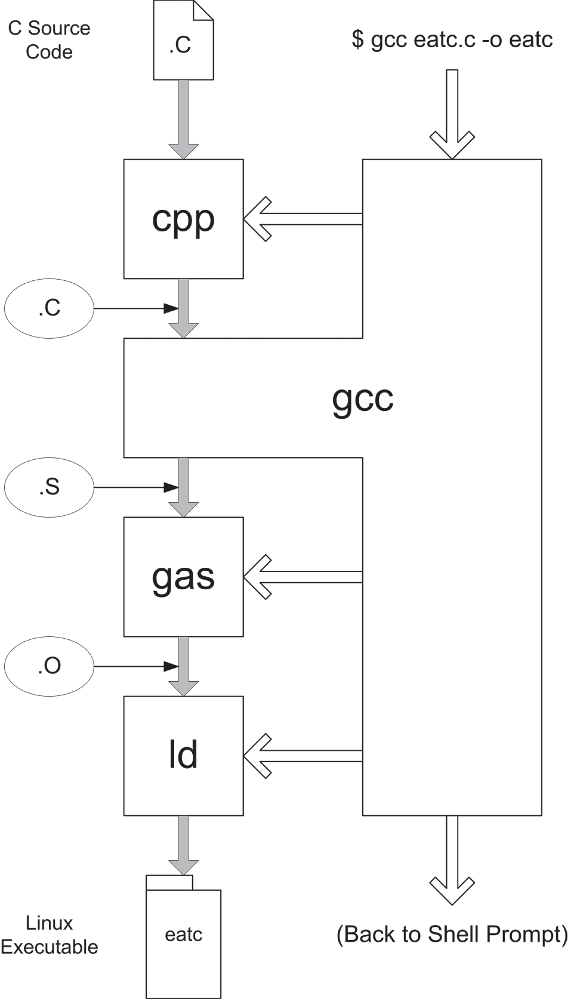
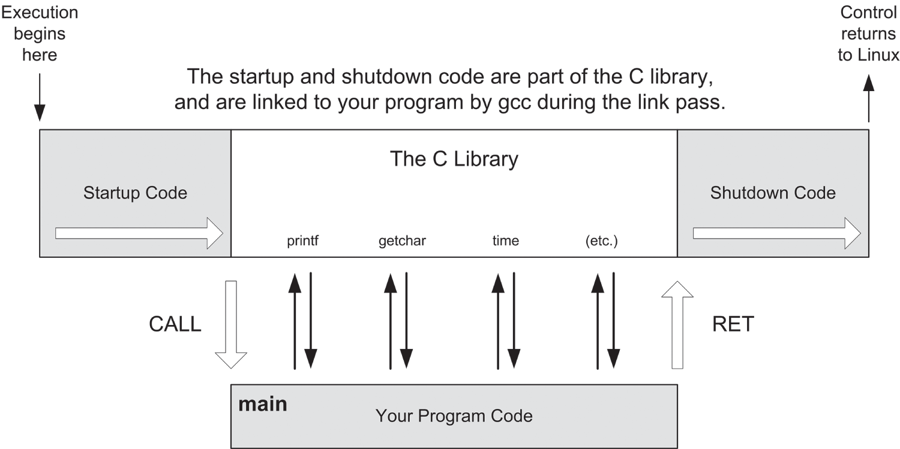
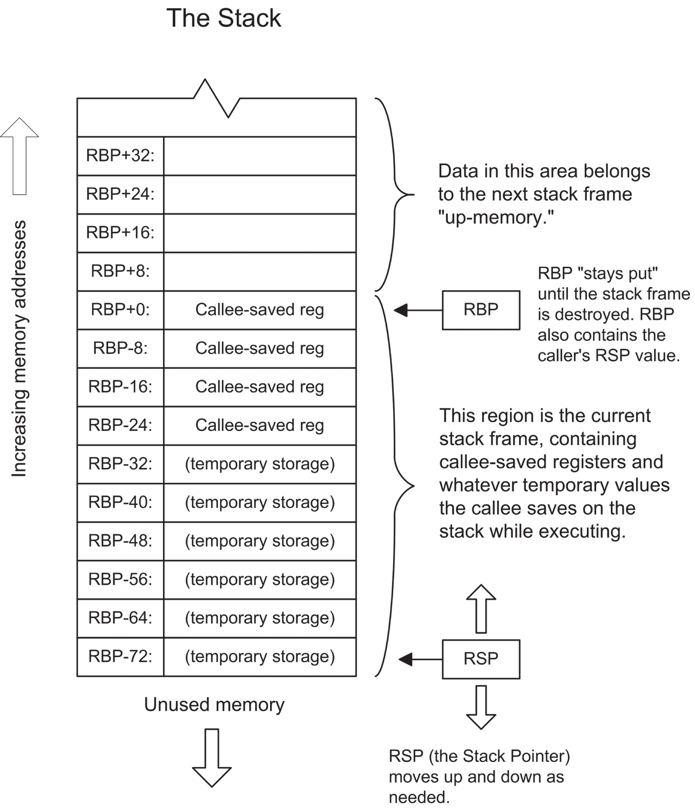
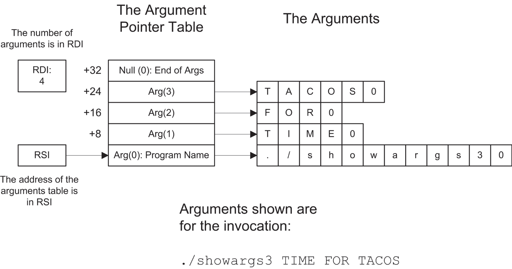

# <a id="Page_423"></a>CHƯƠNG 12 Hướng tới C: *Gọi các hàm external được viết bằng ngôn ngữ C*

Học assembly language có rất nhiều giá trị, phần lớn bắt nguồn từ yêu cầu rằng bạn *phải* biết chi tiết mọi thứ hoạt động thế nào, nếu không bạn sẽ không đi được xa. Ngay từ buổi bình minh của ngành tính toán điện tử số, điều này đã luôn đúng, nhưng từ đó nảy ra một câu hỏi hợp lý*: tôi có thực sự phải biết tất cả những thứ đó không?*

Câu trả lời hợp lý là không. Có thể viết những chương trình cực kỳ hiệu quả mà không cần nắm vững ở mức assembly-level về cỗ máy bên dưới và hệ điều hành. Đây là điều các ngôn ngữ higher-level được tạo ra để cho phép: lập trình dễ hơn, nhanh hơn ở một mức trừu tượng cao hơn. Không rõ bao nhiêu phần trong phần mềm ngày nay sẽ tồn tại được nếu tất cả đều phải được viết bằng assembly language.

Điều đó bao gồm cả Linux. Có một số phần nhỏ của Linux được viết bằng assembly, nhưng nhìn chung, phần lớn hệ điều hành được viết bằng C. (Ngày nay, post-2022, các phần của Linux đang bắt đầu được viết bằng một ngôn ngữ lập trình mới hơn nhiều và memory-secure hơn tên là Rust.) Vũ trụ Linux xoay quanh ngôn ngữ C, và nếu bạn định dùng assembly language một cách đáng kể dưới Linux, tốt hơn hết là bạn nên chuẩn bị học một ít C và dùng nó khi cần.

Có một lợi ích gần như ngay lập tức: có thể truy cập các library procedure được viết bằng C. Có hàng nghìn library như vậy, và những library gắn với hệ điều hành Linux phần lớn miễn phí và đi kèm source code C. Có <a id="Page_424"></a>những ưu và nhược điểm khi dùng library các *hàm* C (như procedure được gọi trong văn hóa C), nhưng lý do thực sự để học các kỹ năng liên quan đến việc gọi hàm C là nó là một phần của việc biết mọi thứ hoạt động thế nào, đặc biệt dưới Linux, nơi ngôn ngữ C đã để lại dấu vân tay ở khắp mọi nơi bạn nhìn.

Hầu như mọi ví dụ lập trình bạn sẽ thấy cho Linux mà không liên quan đến các ngôn ngữ thông dịch như Perl hay Python đều sẽ bằng C hoặc C++. (Tôi sẽ không đề cập đến C++ trong cuốn sách này—cũng như Rust, kẻ up-and-comer.) Quan trọng nhất, thư viện runtime C chứa rất nhiều hàm cực kỳ hữu ích nhưng đòi hỏi bạn dùng các giao thức C khi thực hiện lời gọi tới những hàm đó. Vì vậy nếu bạn chưa biết ngôn ngữ C, hãy mua một cuốn sách và bắt tay vào gõ một ít C. Bạn không cần làm nhiều, nhưng hãy đảm bảo bạn hiểu mọi khái niệm C cơ bản, đặc biệt là khi chúng áp dụng cho lời gọi hàm. Tôi sẽ cố lấp những lỗ hổng lower-level trong cuốn sách này, nhưng tôi không thể dạy bản thân ngôn ngữ đó cũng như mọi hành lý đi kèm với nó. Có thể bạn thấy C hơi khó chịu (như tôi đã và vẫn thấy) hoặc có thể bạn sẽ yêu nó, nhưng điều bạn phải hiểu là *bạn không thể thoát khỏi nó*, ngay cả khi mối quan tâm chính của bạn với Linux nằm ở assembly language.

<a id="head-2-27"></a>

## GNU là gì?

Hồi cuối thập niên 1970, một hacker Unix lỗi lạc tên là Richard Stallman muốn có bản Unix của riêng mình. Tuy nhiên, ông không muốn trả tiền cho nó, vì vậy ông làm điều hiển nhiên—ít nhất là hiển nhiên đối với ông: ông bắt đầu viết phiên bản của riêng mình. (Nếu điều đó không hiển nhiên với bạn, chà, bạn không hiểu văn hóa Unix.) Tuy nhiên, ông không hài lòng với mọi công cụ lập trình có sẵn vào thời đó và cũng phản đối giá cả đắt đỏ của chúng. Vì vậy, như một điều kiện tiên quyết để viết phiên bản Unix của riêng mình, Stallman bắt tay vào viết compiler, assembler và debugger của riêng mình. (Ông đã viết trình soạn thảo của riêng mình, EMACS huyền thoại.)

Stallman đặt tên phiên bản Unix của mình là *GNU*, một từ viết tắt đệ quy có nghĩa là “GNU's Not Unix.” Đây là một trò cười hay và là một cách để lách qua các luật sư thương hiệu của AT&T, những người hồi đó rất khó tính về việc ai dùng từ *Unix* và dùng thế nào. Theo thời gian, các công cụ GNU có cuộc sống riêng của chúng, và tình cờ là Stallman chưa bao giờ thực sự hoàn thành bản thân hệ điều hành GNU. Những phiên bản Unix miễn phí khác xuất hiện, và trong vài năm đã có một vở kịch nhiều tập về việc ai thực sự sở hữu phần nào của cái gì. Điều này khiến Stallman ghê tởm đến mức ông thành lập Free Software Foundation làm căn cứ cho việc phát triển các công cụ GNU và tạo ra một loại giấy phép phần mềm cấp tiến gọi là GNU Public License (GPL), đôi khi được gọi không chính thức là “copyleft”. Stallman phát hành các công cụ GNU theo GPL, giấy phép này không chỉ đòi hỏi phần mềm phải miễn phí (kể cả mọi source code) mà còn ngăn người ta thực hiện những sửa đổi nhỏ cho phần mềm rồi nhận tác phẩm phái sinh là của mình. Những thay đổi và cải tiến phải được trả lại cho cộng đồng GNU.

<a id="Page_425"></a>Điều này có vẻ là một sự điên rồ lớn vào thời đó, nhưng qua những năm kể từ đó, nó đã mang một logic kỳ lạ và một cuộc sống riêng. GPL đã cho phép phần mềm được phát hành theo GPL tiến hóa cực kỳ nhanh vì một số lượng lớn người dùng và cải tiến nó và trả lại những cải tiến mà không tính phí hay hạn chế. Từ nồi lẩu open-source sôi sục này, rốt cuộc Linux đã ra đời, hệ điều hành GPL hàng đầu. Linux được xây dựng và được bảo trì bằng bộ công cụ GNU. Nếu bạn định lập trình dưới Linux, bất kể bạn dùng ngôn ngữ nào, rốt cuộc bạn sẽ dùng một hoặc nhiều công cụ GNU.

### Compiler kiểu dao đa năng Thụy Sĩ

Bản EMACS mà bạn sẽ tìm thấy trên các bản phân phối Linux hiện đại không còn lại nhiều Richard Stallman trong đó—nó đã được viết lại không biết bao nhiêu lần bởi nhiều người khác trong 30-odd năm qua. Nơi di sản của Stallman tồn tại mạnh mẽ nhất là trong các compiler ngôn ngữ GNU. Có một số compiler như vậy, nhưng cái mà bạn phải hiểu kỹ lưỡng nhất có thể là GNU C Compiler, `gcc`. (Chữ thường là một kiểu ám ảnh trong thế giới Unix, một sự tôn sùng không được nhiều người hiểu rõ, kể cả tôi.)

Tại sao dùng một compiler C để làm việc với assembly? Chủ yếu là vì thế này: `gcc` làm nhiều hơn rất nhiều so với việc chỉ biên dịch code C. Nó là một kiểu công cụ phát triển dao đa năng Thụy Sĩ. Thực tế, có lẽ tốt hơn tôi nên mô tả điều nó làm là *build* phần mềm chứ không chỉ đơn giản là *biên dịch* nó. Ngoài việc biên dịch code C thành object code, `gcc` còn chi phối cả bước assemble lẫn bước link.

Bước assemble ư? Đúng vậy đấy. Có một GNU assembler gọi là `gas`, mặc dù đó là một thứ kỳ quặc không thực sự được dự định để lập trình viên con người dùng. Điều `gcc` làm là điều khiển `gas` và GNU linker `ld` (mà bạn đã đang dùng trong makefile) như những con rối trên dây. Nếu bạn dùng `gcc`, đặc biệt ở mức người mới bắt đầu, bạn không phải mày mò trực tiếp nhiều với `gas` hay `ld`.

Hãy nói thêm về điều này.

### Build code theo cách GNU

Công việc assembly language khác với công việc C, và `gcc` trước hết là một compiler C. Do đó, chúng ta cần xem xét trước quá trình build code C. Trên bề mặt, build một chương trình C cho Linux bằng các công cụ GNU khá đơn giản. Tuy nhiên, ở hậu trường, đó là một chuyện rối rắm nghiêm trọng. Mặc dù có vẻ như `gcc` làm mọi việc, điều `gcc` thực sự làm là đóng vai bộ điều khiển chính cho vài công cụ GNU, giám sát một dây chuyền lắp ráp code mà bạn không cần thấy trừ khi bạn đặc biệt muốn thấy.

Về lý thuyết, đây là tất cả những gì bạn cần làm để sinh ra một file binary executable từ source code C:

<a id="Page_426"></a>

```
gcc eatc.c –o eatc
```

Ở đây, `gcc` lấy file `eatc.c` (là một source code file C) và nghiền nó để tạo ra executable file `eatc`. (Tùy chọn `–o` cho `gcc` biết đặt tên gì cho executable file đầu ra.) Tuy nhiên, có nhiều thứ đang diễn ra ở đây hơn những gì bạn thấy. Hãy xem <a id="R_c12-fig-0001"></a>[Hình 12.1](#c12-fig-0001) khi chúng ta đi qua nó. Trong hình, các mũi tên tô bóng chỉ sự di chuyển của thông tin. Các mũi tên trống chỉ sự điều khiển chương trình.



*<a id="c12-fig-0001"></a>**Hình 12.1**: `gcc` build các executable Linux như thế nào*

Lập trình viên gọi `gcc` từ dòng lệnh shell, thường là trong một cửa sổ terminal. Sau đó `gcc` nắm quyền điều khiển hệ thống và ngay lập tức gọi một tiện ích gọi là C preprocessor, `cpp`. Preprocessor lấy source code file C <a id="Page_427"></a>ban đầu và xử lý một số mục nhất định như `#includes` và `#defines`. Có thể coi nó như một kiểu lượt mở rộng macro trên source code file C.

Khi `cpp` làm xong công việc của nó, `gcc` thực sự tiếp quản. Từ source code file C đã được tiền xử lý, `gcc` sinh ra một source code file assembly language có phần mở rộng file `.s`. Đây theo đúng nghĩa đen là code assembly tương đương với các câu lệnh C trong file `.c` ban đầu, ở dạng human-readable. Nếu bạn phát triển được chút kỹ năng đọc cú pháp và mnemonic assembly của AT&T (sẽ nói thêm về điều này ở phần sau một chút), bạn có thể học được *rất nhiều* từ việc xem xét các file `.s` do `gcc` tạo ra.

Khi `gcc` đã sinh xong bản tương đương assembly language của source code file C, nó gọi GNU assembler, `gas`, để assemble file `.s` thành object code. Object code này được ghi ra một file có phần mở rộng `.o`.

Bước cuối cùng liên quan đến linker, `ld`. File `.o` chứa code binary, nhưng nó *chỉ* là code binary được sinh ra từ các câu lệnh trong file `.c` ban đầu. File `.o` *không* chứa code từ các thư viện C chuẩn vốn rất quan trọng trong lập trình C. Những thư viện đó đã được biên dịch sẵn và chỉ cần được link vào ứng dụng của bạn. Linker `ld` làm công việc này theo chỉ đạo của `gcc`. Phần hay là `gcc` biết chính xác thư viện C chuẩn nào cần được link vào ứng dụng của bạn để làm cho nó hoạt động, và nó luôn đưa vào đúng thư viện với đúng phiên bản của chúng. Vì vậy, mặc dù `gcc` không thực sự làm việc link, *nó biết những gì cần được link*—và đó quả thực là kiến thức có giá trị, khi chương trình của bạn ngày càng phức tạp hơn.

Cuối cùng, `ld` nhả ra file chương trình executable đã được link đầy đủ. Đến lúc đó, việc build đã xong, và `gcc` trả quyền điều khiển cho shell Linux. Lưu ý rằng tất cả những điều này thường được thực hiện bằng một lệnh đơn giản tới `gcc`!

### SASM dùng GCC

Một số điều này có thể bắt đầu nghe quen thuộc. Chúng ta đã dùng SASM được vài chương rồi, và SASM có một cách làm việc khác về căn bản so với những gì chúng ta đã học với makefile và tiện ích `make` của Linux. Tôi đã ám chỉ từ sớm đến sự thật rằng thứ SASM tạo ra thực ra là một chương trình C được viết bằng assembly language. Nếu bạn nhìn vào tab Build của menu Settings của SASM, hãy chú ý rằng `gcc` (chứ không phải `ld`) được hiển thị trong đường dẫn linker. Điều này không có nghĩa là `ld` không được dùng, như khi chúng ta dùng makefile. Nó có nghĩa là `gcc` có toàn quyền kiểm soát quá trình link, gọi `ld` khi cần để link vào các thư viện code C binary đã được biên dịch sẵn.

### Cách dùng gcc trong công việc assembly

Quá trình tôi vừa mô tả, và đã vẽ ra cho bạn trong [Hình 12.1](#c12-fig-0001), là cách một chương trình C được build dưới Linux bằng các công cụ GNU. Tôi đã đi vào một số chi tiết ở đây vì chúng ta sẽ dùng một phần—chỉ một phần thôi—của quá trình này để làm cho <a id="Page_428"></a>việc lập trình assembly của chúng ta dễ hơn. Đúng là chúng ta không cần chuyển source code C thành code assembly—và thực tế, chúng ta không cần gas để chuyển source code assembly gas thành object code. Tuy nhiên, chúng ta cần chuyên môn của `gcc` về việc link. Chúng ta sẽ khai thác quá trình code-building của GNU ở giai đoạn link để `gcc` có thể điều phối bước link cho chúng ta.

Khi chúng ta assemble một chương trình Linux `.asm` bằng NASM, NASM sinh ra một file `.o` chứa object code binary. Như chúng ta đã thấy, việc gọi NASM dưới Linux 64-bit thường được thực hiện theo cách này:

```
nasm –f elf64 -g -F dwarf eatclib.asm
```

Lệnh này sẽ chỉ thị NASM assemble file `eatclib.asm` và sinh ra một file tên là `eatclib.o`. Phần `–f elf64` bảo NASM sinh object code ở định dạng ELF 64-bit thay vì một trong vô số định dạng object code khác mà NASM có khả năng tạo ra. Phần `-g -F dwarf` cho phép sinh thông tin debug trong file đầu ra, ở định dạng `DWARF`. Bản thân file `eatclib.o` không executable. Nó cần được link. Vì vậy, chúng ta gọi `gcc` và chỉ thị nó link chương trình cho chúng ta:

```
gcc eatclib.o –o eatclib –no-pie
```

Phần nào trong đây bảo `gcc` link chứ không biên dịch? Input file duy nhất được nêu trong lệnh là một file `.o` chứa object code. Riêng sự thật này đã cho `gcc` biết rằng tất cả những gì cần làm là link file `.o` với thư viện runtime C để tạo ra executable cuối cùng. Phần `–o eatclib` cho `gcc` biết rằng tên của executable file cuối cùng sẽ là `eatclib`.

Việc đưa vào specifier `–o` là quan trọng. Nếu bạn không cho `gcc` biết chính xác đặt tên gì cho executable file cuối cùng, nó sẽ cho qua và đặt cho file tên mặc định của một executable, `a.out`.

Argument dòng lệnh `-no-pie` bảo `gcc` không link executable cho công nghệ position-independent executable (PIE). Tôi sẽ giải thích chi tiết điều này ở phần sau của chương này. Nó nhằm giảm tính dễ bị tổn thương của một executable trước một số kiểu khai thác nhất định. Dùng tùy chọn `–no-pie` trong các chương trình đơn giản, mang tính giáo dục như những chương trình trong cuốn sách này là được. Với code production, bạn cần PIE.

### Tại sao không dùng gas?

Có thể bạn đang thắc mắc tại sao, nếu có một assembler hoàn toàn tốt được cài tự động với mọi bản Linux, tôi lại bận tâm cho bạn thấy cách cài và dùng một cái khác. Hai lý do:

- GNU assembler `gas` dùng một cú pháp kỳ lạ hoàn toàn không giống cú pháp của mọi assembler quen thuộc khác được dùng trong thế giới x86/x64, kể cả NASM. Nó có cả một bộ instruction mnemonic riêng của nó. Tôi thấy <a id="Page_429"></a>chúng xấu xí, phản trực giác và khó đọc. Đây là cú pháp AT&T, được đặt tên như vậy vì nó được AT&T tạo ra như một lối ký hiệu assembly portable để giúp Unix dễ port từ CPU bên dưới này sang CPU khác hơn. Nó xấu xí một phần vì nó được thiết kế để mang tính chung chung, và nó có thể được cấu hình lại cho bất kỳ architecture CPU hợp lý nào có thể xuất hiện.
- Quan trọng hơn, theo quan điểm của tôi, khái niệm “assembly language portable” là một sự mâu thuẫn về từ ngữ. Một assembly language nên là một sự phản chiếu trực tiếp, đầy đủ, one-for-one của architecture máy bên dưới. Bất kỳ nỗ lực nào làm cho một assembly language mang tính chung chung đều đưa ngôn ngữ đó ra xa cỗ máy và giới hạn khả năng của lập trình viên assembly trong việc chỉ đạo CPU như cách nó được thiết kế để được chỉ đạo. Tổ chức đã tạo ra và phát triển một architecture CPU ở vị trí tốt nhất để định nghĩa các instruction mnemonic và cú pháp assembly language của CPU mà không thỏa hiệp. Đó là lý do tôi sẽ luôn dùng và dạy các mnemonic của Intel.

Nếu mọi chuyện chỉ đơn giản như vậy, tôi sẽ hoàn toàn không nhắc đến `gas`, vì bạn không cần `gas` để viết assembly language Linux bằng NASM. Tuy nhiên, một trong những cách chính mà rốt cuộc bạn sẽ học được nhiều lời gọi thư viện C chuẩn là dùng chúng trong các chương trình C ngắn rồi xem xét các file đầu ra assembly `.s` mà `gcc` sinh ra. Vì vậy có chút khả năng đọc mnemonic AT&T có thể hữu ích trong khi bạn đang làm quen với các quy ước gọi C được dùng dưới Linux. Tôi sẽ đưa ra một cái nhìn tổng quan về cú pháp AT&T ở phần sau một chút trong chương này.

<a id="head-2-28"></a>

## Link với thư viện C chuẩn

Khi bạn viết một chương trình all-assembly bằng makefile và tiện ích `make`, bạn viết *toàn bộ* nó. Ngoài thỉnh thoảng lặn vào kernel service của Linux, mọi code chạy chỉ là code mà bạn viết. Việc link vào các library procedure assembly language bên ngoài làm bức tranh này phức tạp hơn một chút, đặc biệt nếu bạn không phải là người đã viết những library đó. Việc link với các hàm trong thư viện C chuẩn (mà với Linux được gọi là `glibc`) làm bức tranh còn phức tạp hơn nữa. Có thể sẽ an ủi phần nào khi biết rằng link với các routine `glibc` trong assembly language x64 dễ hơn so với trong assembly language x86 32-bit.

Như tôi đã đề cập ở trên, viết một chương trình assembly trong SASM rất giống viết một chương trình C trong đó bạn viết thân chính của chương trình bằng assembly. Các chương trình do SASM sinh ra là một kiểu lai giữa C và assembly language. Nếu bạn tạo một chương trình assembly language Linux link vào các hàm `glibc`, bạn đang làm gần như điều tương tự. Cấu trúc của kiểu lai này được thể hiện trong <a id="R_c12-fig-0002"></a>[Hình 12.2](#c12-fig-0002).



*<a id="c12-fig-0002"></a>**Hình 12.2**: Cấu trúc của một chương trình lai C-assembly*

Chương trình của bạn không còn là chuyện start-at-the-top-and-go-down đơn giản như các chương trình assembly trước đây của bạn. `glibc` không chỉ là một tập hợp các hàm rời rạc. Nó là thư viện runtime C chuẩn, và như một phần của tính chuẩn mực của nó, nó áp đặt một cấu trúc nhất định cho bất kỳ chương trình nào link với nó. Cấu trúc này bao gồm một khối code chạy trước khi chương trình của bạn bắt đầu, và một khối code khác chạy sau khi chương trình của bạn kết thúc. Chương trình của bạn được code khởi động gọi như thể chương trình của bạn là một procedure (bằng instruction `CALL`), và nó trả quyền điều khiển cho code thư viện C bằng một instruction `RET`.

Về mặt kỹ thuật, chương trình của bạn *là* một procedure (một lần nữa, được gọi là *function* ở C-land), và sẽ hữu ích nếu nghĩ về nó như vậy. Đó là cách tôi đã vẽ nó trong [Hình 12.2](#c12-fig-0002). Khi Linux bắt đầu thực thi chương trình của bạn, nó thực ra bắt đầu, không phải ở đầu code mà *bạn* viết mà ở đầu khối code khởi động. Khi code khởi động đã làm những gì nó phải làm, nó thực thi một instruction `CALL` đưa việc thực thi xuống code assembly của bạn. Khi chương trình assembly language của bạn trả quyền điều khiển cho nơi gọi nó thông qua `RET`, code tắt máy bắt đầu thực thi, và chính code tắt máy mới thực sự trả quyền điều khiển cho Linux thông qua lời gọi kernel `syscall` cần thiết.

Một khi bạn link code C vào các chương trình assembly của mình, việc dùng `SYSCALL` service 60 để thoát chương trình và trả về Linux không phải là ý hay. Có một số việc dọn dẹp cần làm, có thể bao gồm flush buffer và đóng file hay đóng kết nối mạng. Code tắt máy C làm tất cả những việc này, và nếu bạn bỏ qua nó, những điều tồi tệ có thể xảy ra. Những điều tồi tệ đó có lẽ sẽ không xảy ra khi bạn làm việc với các ví dụ code đơn giản như những ví dụ được trình bày trong cuốn sách này, nhưng một khi bạn bắt đầu trở nên tham vọng và viết các chương trình thousand-line, tất cả những điều đó trở nên khả thi và sẽ gây cho bạn vô vàn phiền muộn.

Về cơ bản, khi làm việc với C, hãy làm mọi thứ theo cách của C.

<a id="Page_431"></a>Ở giữa code khởi động và code tắt máy, bạn có thể thực hiện bao nhiêu lời gọi vào `glibc` tùy thích. Khi bạn link chương trình bằng `gcc`, code chứa các routine thư viện C mà bạn gọi được link vào chương trình của bạn. Hãy lưu ý kỹ rằng code khởi động và tắt máy, cũng như mọi code cho các hàm thư viện mà chương trình của bạn gọi, đều hiện diện về mặt vật lý trong executable file mà bạn sinh ra bằng `gcc`.

### Quy ước gọi C

Thư viện `glibc` không chọn riêng các chương trình assembly language để đối xử đặc biệt. Các chương trình C thuần túy hoạt động gần như giống hệt như vậy, và đây là lý do phần chương trình chính của một chương trình C được gọi là *hàm* main. Nó thực sự là một hàm, code thư viện C chuẩn cho việc khởi động gọi nó bằng một instruction `CALL`, và nó trả quyền điều khiển cho code tắt máy bằng cách thực thi một instruction `RET`.

Do đó, cách chương trình chính nhận quyền điều khiển là ví dụ đầu tiên bạn sẽ thấy về một tập quy tắc mà chúng ta gọi là *C calling convention* (quy ước gọi C). Thư viện C chuẩn nhất quán hết mức, và đó là ưu điểm lớn nhất của nó. Mọi hàm thư viện C được triển khai trên các bộ xử lý x64 đều tuân theo những quy tắc này. Hãy nung chúng vào khớp thần kinh của bạn từ sớm, và bạn sẽ rụng tóc ít hơn rất nhiều so với tôi khi cố tìm ra chúng bằng cách đập đầu vào chúng.

Trước hết và trên hết, chương trình của bạn phải bắt đầu bằng label global `main:`. Dùng `_start:` sẽ không hoạt động. Hàm main được đặt label là `main:`, chấm hết. Các chương trình SASM luôn bắt đầu bằng `main:` vì SASM dùng `gcc` để link vào code từ `glibc`.

Đó là nơi bạn bắt đầu. Phần còn lại trở nên khá phức tạp khá nhanh.

### Caller, callee và clobber

Nếu bạn đã từng học lập trình assembly cho Linux 32-bit (như tôi đã dạy trong ấn bản năm 2009 của cuốn sách này), bạn đã học rằng việc truyền tham số cho các hàm C-style được thực hiện bằng cách push tham số lên stack trước khi thực hiện lời gọi. Tất cả đã biến mất. (OK, *gần như* tất cả đã biến mất. Tôi sẽ quay lại điều này.)

Khác biệt lớn nhất giữa các quy ước gọi 32-bit và các quy ước gọi 64-bit nằm ở cách bạn truyền tham số cho hàm. Việc truyền sáu tham số đầu tiên cho một hàm x64 được thực hiện trong register thay vì trên stack. Nếu một hàm có hơn sáu tham số (điều không phổ biến, và thường là thiết kế tồi), các tham số còn lại được truyền trên stack.

Điều này được làm vì giờ chúng ta có nhiều register hơn rất nhiều so với thời kỳ 32-bit. Push và pop stack chạm vào memory và do đó chậm. Ghi vào và đọc từ register ở lại bên trong CPU và do đó nhanh hơn nhiều. Công nghệ cache CPU hiện đại làm cho việc dùng stack nhanh hơn thời xa xưa, đúng vậy, nhưng ngay cả truy cập cache memory cũng chậm hơn truy cập register.

Có thể bạn còn nhớ rằng trong các chương trước, các chương trình đã truyền tham số cho các lời gọi hàm Linux bằng instruction `SYSCALL` của x64. Mọi tham số như vậy (ít nhất là trong các chương trình đơn giản mà chúng ta đã làm) đều được truyền trong register. Hơn nữa, có một hệ thống cho việc đó: sáu tham số đầu tiên được truyền trong những register cụ thể theo một thứ tự rất cụ thể. Thứ tự này như sau:

RDI

RSI

RDX

RCX

R8

R9

Tham số đầu tiên được truyền cho một hàm luôn được truyền trong RDI. Nếu có hai tham số cần được truyền cho một hàm, tham số thứ nhất được truyền trong RDI và tham số thứ hai trong RSI, và cứ thế. Điều này đúng với các lời gọi thông qua `SYSCALL`, và nó cũng đúng với việc gọi các hàm thư viện C.

Thứ tự tham số trong register thì đơn giản. Phần tiếp theo thì tinh tế: một hàm có thể dùng bên trong và do đó thay đổi những register nào, và những register nào phải giữ nguyên sau khi hàm thực thi? Nói theo biệt ngữ lập trình viên: chúng ta có thể clobber (làm hỏng) những register nào?

Một lần nữa, có một hệ thống cho việc đó. Bảy register sau không thể bị một hàm clobber: RSP, RBP, RBX, R12, R13, R14 và R15. Nhóm register này được gọi là các register *nonvolatile*, về cơ bản có nghĩa là những register phải được callee bảo toàn (hoặc để không dùng).

Khoan—*cái gì cơ?*

Thêm biệt ngữ. Hàm có thể gọi các hàm khác. Một hàm gọi một hàm khác là *caller* (bên gọi). Hàm được gọi là *callee* (bên được gọi). Có một kiểu quan hệ tin cậy giữa caller và callee: callee hứa với caller rằng khi callee kết thúc thực thi, giá trị của RSP, RBP, RBX, R12, R13, R14 và R15 sẽ giống như lúc callee bắt đầu thực thi. Callee có thể dùng các register nonvolatile, nhưng những register nó dùng phải được lưu trước (push lên stack) và khôi phục (pop ra khỏi stack) trước khi callee trả về caller.

Các register khác được gọi là *volatile*, nghĩa là callee có thể dùng và thay đổi chúng mà không bị trừng phạt. Đó là RAX, RCX, RDX, RSI, RDI, R8, R9, R10 và R11. Nếu bạn tinh ý, bạn sẽ nhận thấy rằng cả sáu register được dùng trong C calling convention đều là register volatile. Điều này hợp lý vì caller đã đang dùng chúng để truyền giá trị xuống callee.

Nhưng nếu caller đã đang dùng một số register volatile thì sao? Nếu caller muốn bất kỳ register volatile nào sống sót qua chuyến đi qua callee, <a id="Page_433"></a>caller phải lưu chúng trước khi gọi hàm callee. Sau khi callee trả về caller, caller khôi phục bất kỳ register volatile nào nó đã lưu trên stack bằng cách pop các giá trị đã lưu trở lại vào register.

Điều này ngụ ý nhiều việc push và pop hơn so với thường lệ. Một trong những thách thức đối với một lập trình viên assembly language giỏi đơn giản là tránh xa memory, bao gồm cả việc push và pop stack. Giờ chúng ta có nhiều register hơn để dùng, và sự khéo léo trong việc dùng những register đó sẽ được đền đáp, bằng cách làm cho việc truy cập stack ít thường xuyên hơn.

> *Chỉ lưu những register bạn* phải *lưu, sau khi bạn đã dùng hết mọi lựa chọn khác*.

Có những lý do khiến instruction set x64 loại bỏ `PUSHA` và `POPA`.

### Thiết lập một stack frame

Dù có nhiều register hơn, stack vẫn cực kỳ quan trọng trong công việc assembly language, và điều này đúng gấp đôi trong các chương trình giao tiếp với C, vì trong C (và thực ra hầu hết các ngôn ngữ high-level native-code khác, kể cả Pascal) stack có một vai trò trung tâm.

Một cơ chế low-level thực sự liên quan đến công việc assembly Linux là *stack frame*. Compiler phụ thuộc vào stack frame để tạo biến local trong hàm, và mặc dù stack frame kém hữu ích hơn trong công việc assembly thuần túy, bạn phải hiểu chúng nếu định gọi các hàm được viết bởi một compiler ngôn ngữ high-level.

Một stack frame là một vị trí trên stack được đánh dấu là thuộc về một hàm cụ thể, kể cả hàm `main()`. Về cơ bản, nó là vùng nằm giữa các address chứa trong hai register: base pointer RBP và stack pointer RSP. Điều này vẽ ra thì dễ hơn giải thích; xem <a id="R_c12-fig-0003"></a>[Hình 12.3](#c12-fig-0003).

Một stack frame được tạo ra bằng cách push một bản sao của RBP lên stack rồi sao chép stack pointer RSP vào register RBP. Hai instruction đầu tiên trong bất kỳ chương trình assembly nào tôn trọng C calling convention phải là:

```
push rbp
mov  rbp,rsp
```

Rất nhiều người gọi đây là *prolog* của chương trình, vì nó phải được đưa vào làm phần đầu của bất kỳ chương trình nào tôn trọng C calling convention. Trừ khi có prolog, debugger gdb và các front end debugger của nó như Insight sẽ không hoạt động đúng.

Một khi RBP được neo làm một đầu của stack frame, stack pointer RSP được tự do di chuyển lên xuống stack khi code của bạn cần cho việc lưu trữ tạm thời. Việc gọi các hàm trong `glibc` dưới x64 đòi hỏi ít push và pop hơn so với trong thế giới 32-bit cũ, giờ khi hầu hết tham số được truyền cho hàm trong register.



*<a id="c12-fig-0003"></a>**Hình 12.3**: Một stack frame*

<a id="Page_434"></a>

### Hủy một stack frame trong epilog

Trước khi chương trình của bạn kết thúc việc thực thi bằng cách trả quyền điều khiển cho code khởi động/tắt máy (hãy tham khảo [Hình 12.2](#c12-fig-0002) nếu mối quan hệ này chưa rõ), stack frame của nó phải bị hủy. Điều này nghe với nhiều người như thể có điều gì đó sai đang xảy ra, nhưng không phải vậy: stack frame phải bị hủy, nếu không chương trình của bạn sẽ crash. (“Cất đi” có lẽ là một thuật ngữ tốt hơn “hủy” … nhưng lập trình viên thích ngôn từ đầy màu sắc, như bạn sẽ biết một khi dành chút thời gian đáng kể giữa họ.)

Stack của bạn phải sạch trước khi bạn hủy stack frame và trả quyền điều khiển cho code tắt máy. Điều này đơn giản có nghĩa là mọi register callee-saved <a id="Page_435"></a>và giá trị tạm thời mà bạn có thể đã push lên stack trong khi chương trình chạy đều phải được dọn sạch. *Push gì thì pop nấy!* Xong việc đó, chúng ta làm ngược lại logic đã theo khi tạo stack frame: chúng ta pop giá trị RBP của caller ra khỏi stack và thoát, thông qua hai instruction mà cùng nhau thường được gọi là *epilog*:

```
pop rbp
ret
```

Thế là xong! Stack frame đã biến mất, và stack giờ ở cùng trạng thái như khi code khởi động trao quyền điều khiển cho chương trình của bạn. Instruction `RET` gửi quyền điều khiển tới code tắt máy của thư viện C, để nó có thể làm bất kỳ việc dọn dẹp nào cần làm trước khi trả quyền điều khiển cho Linux.

### Stack alignment

Mục đích của prolog và epilog không hiển nhiên ngay, đặc biệt nếu bạn đến với x64 lần đầu sau khi làm việc trong thế giới Linux 32-bit. Nó quy về một yêu cầu mới: stack x64 phải được căn chỉnh trên một ranh giới 16-byte. Điều này có nghĩa là khi bạn trả về từ một hàm (kể cả `main:`), stack pointer phải trỏ tới một address chia hết cho 16. Tại sao đây lại là vấn đề? Hãy nhớ rằng khi một procedure (một *hàm* theo biệt ngữ C) được gọi, caller push return address lên stack. Một return address có kích thước 8 byte. Nhưng nếu bạn truy cập stack sau khi thêm 8 byte vào nó (thay vì 16), những điều tồi tệ có thể xảy ra. Không chắc chắn, nhưng nó có thể xảy ra, đặc biệt khi code của bạn trở nên tham vọng hơn các ví dụ đơn giản trong cuốn sách này.

Prolog push RBP lên stack. Việc này thêm 8 byte nữa vào stack, tổng cộng là 16. Do đó stack vẫn được căn chỉnh. Trong epilog, bạn pop giá trị của RBP ra khỏi stack. Instruction `RET` kết thúc epilog pop return address ra khỏi stack vào instruction pointer, vì vậy bạn đã lấy ra tổng cộng 16 byte khỏi stack. Stack đã được căn chỉnh khi hàm `main:` của bạn nhận quyền điều khiển, nhờ code khởi động của `glibc`, và tốt hơn hết nó vẫn phải được căn chỉnh khi chương trình của bạn thực thi instruction `RET` trả quyền điều khiển cho code tắt máy của `glibc`.

Stack alignment cũng được đòi hỏi khi `glibc` không tham gia, như trong các chương trình dùng label `_start:` thay vì `main:` . Lần này `glibc` sẽ không giúp bạn vì nó không có ở đó. Một prolog và epilog vẫn phải có mặt, mặc dù có nhiều việc hơn một chút phải làm so với khi bạn link `glibc` vào chương trình. Prolog cần thiết được gọi là *stack alignment prolog*:

```
push rbp
mov rbp,rsp
and rsp,-16
```

Khác biệt nằm ở instruction `AND RSP,-16`. Instruction này đưa về không bốn bit thấp nhất của stack pointer RSP. Chữ số hex cuối cùng của address khi đó <a id="Page_436"></a>trở thành 0, và stack được căn chỉnh trên một ranh giới 16-byte. Nếu bạn cẩn thận trong việc dùng stack, nó sẽ vẫn được căn chỉnh, như chúng ta sẽ thấy ngay sau đây.

Đây là stack alignment epilog:

```
mov rsp,rbp
pop rbp
```

Một khác biệt khác khi dùng `_start` là epilog không thể trả về Linux bằng cách thực thi một instruction `RET`. Bạn phải dùng service Exit thông qua `SYSCALL`, như tôi đã giải thích trong các chương trước. Sau khi `POP RBP`, bạn có thể dùng `SYSCALL` service 60 để trả quyền điều khiển cho Linux.

Vậy còn các procedure mà bạn tự viết thì sao? Lý tưởng nhất, mọi procedure nên bắt đầu bằng prolog và kết thúc bằng epilog. Bạn thường có thể thoát được mà không dùng prolog/epilog trong các hàm của riêng mình, đặc biệt nếu chúng đơn giản và không làm nhiều với stack. Tôi đã bỏ prolog/epilog trong một số chương trình ví dụ trong cuốn sách này vì mục đích đơn giản. Ngoài ra, tôi không bàn chi tiết về stack frame cho đến chương cuối cùng này, và không thể hiểu được stack alignment nếu không biết stack hoạt động thế nào.

Ở phần sau của chương này, trong <a id="R_c12-fea-0006"></a>[Listing 12.6](#c12-fea-0006), `randtest`, chương trình truyền một tham số thứ bảy cho `printf()` bằng cách push tham số lên stack. Việc giữ stack căn chỉnh trên một ranh giới 16-byte được thực hiện theo một cách khác: bằng cách push một mục “giả” lên stack (ở đây là RAX; nội dung của nó không quan trọng) rồi, sau khi gọi `printf()`, cộng 16 vào RSP thay vì 8. Đây là nơi việc đó được làm; đừng lo nếu bạn không hiểu mọi thứ trong đoạn code sau:

```
shownums:
    mov r12,qword [Pulls]    ; Put pull count into r12
    xor r13,r13
.dorow:
    mov rdi,ShowArray        ; Pass address of base string
    mov rsi,[Stash+r13*8+0]  ; Pass first element
    mov rdx,[Stash+r13*8+8]  ; Pass second element
    mov rcx,[Stash+r13*8+16] ; Pass third element
    mov r8,[Stash+r13*8+24]  ; Pass fourth element
    mov r9,[Stash+r13*8+32]  ; Pass fifth element
    push rax                 ; To keep the stack 16 bytes aligned
    push qword [Stash+r13*8+40] ; Pass sixth element on the stack.
    xor rax,rax         ; Tell printf() no vector values coming
    call printf         ; Display the random numbers
    add rsp,16          ; Stack cleanup: 2 item X 8 bytes = 16
```

Trong phần code này, push RAX giảm stack đi 8. Push tham số thứ bảy lên stack giảm stack thêm 8 nữa, tổng cộng là 16, giữ cho stack được căn chỉnh. Đến giờ mọi việc đều ổn. Nhưng đó mới chỉ là một nửa công việc. Vì vậy sau khi lời gọi tới `printf()` được thực hiện, chúng ta “dọn dẹp” stack bằng một chút số học nhanh: cộng lại kích thước của cả tham số lẫn bản sao giả <a id="Page_437"></a>của RAX vào stack pointer. Trong đoạn code, việc push hai giá trị `QWORD` lên stack đã di chuyển address trong RSP down-memory 16 byte. Để dọn dẹp, chúng ta cộng lại 16 byte đó bằng một instruction `ADD RSP,16`. Khi đó stack sẽ vừa được căn chỉnh vừa “sạch” trở lại.

Ở trên tôi đã bảo bạn “push gì thì pop nấy.” Đôi khi việc pop không thực tế. Chừng nào bạn khôi phục stack pointer về giá trị nó có trước lần push, mọi thứ sẽ ổn. Nếu bạn push giá trị lên stack làm local storage, hãy đảm bảo bạn cộng lại tổng kích thước của tất cả những giá trị đó vào RSP để làm cho stack “sạch” trở lại. Và nếu bạn không push một bội số của 16 byte lên stack, hãy độn thêm bằng cách push các giá trị giả cho đến khi tổng là một bội số của 16.

Giờ, tại sao các tác giả của System V ABI x86-64 lại bắt buộc một stack căn chỉnh 16-byte? Giữ cho stack luôn căn chỉnh trên các ranh giới 16-byte làm cho code đơn giản hơn cho một số việc, bao gồm việc dùng vector SSE khi chúng được lưu trên stack. Tôi sẽ không trình bày SSE hay các hệ thống con toán học khác trong CPU Intel trong cuốn sách này, vì vậy đừng lo nếu điều đó chưa có nghĩa với bạn. Một khi bạn đã có tay nghề assembly language, tôi khuyến khích bạn khám phá các instruction toán học và các vector register của x64.

Một ghi chú cuối cùng về stack alignment: SASM có vấn đề với prolog và epilog tôi trình bày ở đây. Nó cần instruction `mov rbp,rsp` ở đầu, nhưng không gì hơn thế. Epilog của SASM đơn giản là `RET` cuối cùng.

### Xuất ký tự bằng puts()

Gần như hàm hữu ích đơn giản nhất trong `glibc` là `puts()`, hàm gửi ký tự tới standard output. Thực hiện một lời gọi tới `puts()` từ assembly language đơn giản đến mức có thể làm trong ba dòng code. Chương trình trong <a id="R_c12-fea-0001"></a>[Listing 12.1](#c12-fea-0001) minh họa `puts()`. Chương trình `eatlibc` có prolog và epilog. Nếu bạn bỏ đi ba instruction thiết lập và thực hiện lời gọi tới `puts()`, bạn có thể coi phần còn lại như khuôn mẫu để tạo các chương trình mới gọi hàm trong `glibc`.

Gọi `puts()` theo cách này là một ví dụ tốt, ở dạng thu nhỏ, về quá trình chung mà bạn sẽ dùng để gọi gần như bất kỳ routine thư viện C nào. Một lần nữa, theo các quy ước gọi x64 chung, chúng ta đặt address của chuỗi cần hiển thị vào RDI. Chúng ta không cần truyền giá trị độ dài chuỗi. Hàm `puts()` bắt đầu ở đầu chuỗi tại address được truyền trong RDI và gửi ký tự tới `stdout` cho đến khi nó gặp một ký tự 0 (null). Có bao nhiêu ký tự nằm giữa byte đầu tiên của chuỗi và ký tự null đầu tiên thì đó là số ký tự mà console nhận được.

> <a id="head-2-29"></a>
>
> **<a id="c12-fea-0001"></a>Listing 12.1: eatlibc.asm**
>
> <a id="Page_438"></a>
>
> ```
> ;  Executable name : eatlibc
> ;  Version         : 3.0
> ;  Created date    : 11/12/2022
> ;  Last update     : 5/24/2023
>
> ;  Author          : Jeff Duntemann
> ;  Description     : Demonstrates calls made into libc, using NASM
> ;                    2.14.02 to send a short text string to stdout
> ;                    with puts().
> ;
> ;  Build using these commands:
> ;    nasm -f elf64 -g -F dwarf eatlibc.asm
> ;    gcc eatlibc.o -o eatlibc –no-pie
>
>
> SECTION .data           ; Section containing initialized data
>
> EatMsg: db "Eat at Joe's!",0
>
> SECTION .bss            ; Section containing uninitialized data
>
> SECTION .text           ; Section containing code
>
> extern puts             ; The simple "put string" routine from libc
> global main          ; Required for the linker to find the entry point
>
> main:
>     push rbp         ; Prolog sets up stack frame
>     mov rbp,rsp
>
> ;; Everything before this is boilerplate; use it for all ordinary apps!
>
>     mov rdi,EatMsg   ; Put address of string into rdi
>     call puts        ; Call libc function for displaying strings
>     xor rax,rax      ; Pass a 0 as the program's return value.
>
> ;; Everything after this is boilerplate; use it for all ordinary apps!
>     pop rbp          ; Destroy stack frame before returning
>     ret              ; Return control to Linux
> ```

<a id="head-2-30"></a>

## Xuất văn bản có định dạng bằng printf()

Routine thư viện `puts()` có vẻ khá hữu ích, nhưng so với vài anh chị em tinh vi hơn của nó, nó chỉ là đồ trẻ con. Với `puts()`, bạn chỉ có thể gửi một chuỗi văn bản đơn giản tới một file (theo mặc định là `stdout`), không có bất kỳ kiểu định dạng nào. Tệ hơn, `puts()` luôn thêm một ký tự EOL vào cuối phần hiển thị của nó, dù bạn có đưa một ký tự như vậy vào dữ liệu chuỗi hay không. Điều này ngăn bạn dùng nhiều lời gọi tới `puts()` để xuất vài chuỗi văn bản trên cùng một dòng trên terminal.

Điều tốt nhất có thể nói về `puts()` là nó có ưu điểm đơn giản. Với gần như mọi nhu cầu xuất ký tự, bạn sẽ tốt hơn nhiều nếu dùng một hàm thư viện mạnh hơn nhiều gọi là `printf()`. Hàm `printf()` cho phép bạn làm một số điều thực sự hữu ích, tất cả chỉ với một lời gọi hàm:

- Xuất văn bản có hoặc không có EOL kết thúc
- Chuyển dữ liệu số thành văn bản theo nhiều định dạng, bằng cách xuất các mã định dạng cùng với dữ liệu
- Xuất văn bản gồm nhiều chuỗi được lưu riêng biệt ra một file

Nếu bạn đã làm việc với C hơn nửa giờ, `printf()` sẽ hoàn toàn hiển nhiên với bạn, nhưng với những người đến từ các ngôn ngữ khác, nó có thể cần chút giải thích.

Routine `printf()` sẽ vui vẻ hiển thị một chuỗi đơn giản như “Eat at Joe's!”—nhưng bạn có thể trộn các chuỗi văn bản khác và dữ liệu số đã chuyển đổi vào chuỗi gốc đó khi nó đi tới standard output, và hiển thị tất cả liền mạch cùng nhau. Việc này được thực hiện bằng cách thả các *mã định dạng* (formatting code) vào chuỗi gốc rồi truyền cho `printf()` một mục dữ liệu cho mỗi mã định dạng đó, cùng với chuỗi gốc. Một mã định dạng bắt đầu bằng một dấu phần trăm và bao gồm thông tin liên quan đến loại và kích thước của mục dữ liệu đang được trộn vào chuỗi gốc, cũng như cách thông tin đó nên được trình bày.

Hãy xem một ví dụ rất đơn giản để bắt đầu. Đây là một chuỗi gốc chứa một mã định dạng:

```
"The answer is %d, and don't you forget it!"
```

Mã định dạng `%d` đơn giản bảo `printf()` chuyển một giá trị số nguyên có dấu thành văn bản và thay văn bản đó vào chỗ mã định dạng trong chuỗi gốc. Dĩ nhiên, giờ bạn phải truyền một giá trị số nguyên cho `printf()` (và tôi sẽ cho bạn thấy việc đó được làm thế nào ngay sau đây), nhưng khi bạn làm vậy, `printf()` sẽ chuyển số nguyên thành văn bản và trộn nó vào chuỗi gốc khi gửi văn bản tới luồng. Nếu giá trị decimal được truyền là 42, trên console bạn sẽ thấy thế này:

```
The answer is 42, and don't you forget it!
```

Một mã định dạng thực ra có khá nhiều cấu trúc, và toàn bộ cơ chế `printf()` có nhiều điểm phức tạp hơn số chỗ tôi có để mô tả chi tiết trong cuốn sách này. Bất kỳ tài liệu tham khảo C tốt nào cũng sẽ giải thích chi tiết toàn bộ. Phần trình bày của Wikipedia rất xuất sắc:

`https://en.wikipedia.org/wiki/Printf`

<a id="R_c12-tbl-0001"></a>[Bảng 12.1](#c12-tbl-0001) liệt kê các mã định dạng phổ biến và hữu ích nhất.

<a id="Page_440"></a>

*<a id="c12-tbl-0001"></a>**Bảng 12.1**: Các mã định dạng của Printf()*

|  |  |
|---|---|
| %d | In một số nguyên có dấu, base-10. |
| %u | In một số nguyên không dấu, base-10. |
| %x, %X | In một số nguyên không dấu bằng hex; %x cho chữ thường, %X cho chữ hoa. |
| %s | In một chuỗi null-terminated. |
| %c | In một ký tự duy nhất. |
| %f | In một số floating-point. |
| %% | In một ký tự “%” literal. |

Cải tiến quan trọng nhất bạn có thể thực hiện với mã định dạng là đặt một giá trị số nguyên giữa ký hiệu % và chữ cái mã:

```
%5d
```

Mã này bảo `printf()` hiển thị giá trị theo kiểu right-justified bên trong một trường rộng năm ký tự. Nếu bạn không đặt một giá trị độ rộng trường ở đó, `printf()` sẽ đơn giản cho giá trị bao nhiêu chỗ mà các chữ số của nó cần.

Hãy nhớ rằng nếu bạn cần hiển thị một ký hiệu phần trăm, bạn phải đưa hai ký hiệu phần trăm liên tiếp vào chuỗi: cái thứ nhất là một mã định dạng bảo `printf()` hiển thị cái thứ hai như chính nó, chứ không phải như lead-in của một mã định dạng.

### Truyền tham số cho printf()

Việc truyền giá trị cho `printf()` tuân theo các quy ước gọi x64. Nếu bạn đang hiển thị một chuỗi có nhúng mã định dạng, chuỗi gốc nên là tham số thứ nhất, với address của nó được truyền trong RDI. Sau đó, giá trị đầu tiên cần được trộn vào chuỗi được truyền trong RSI, giá trị thứ hai trong RDX, và cứ thế, theo thứ tự register tham số chuẩn. Các giá trị được cắm vào các mã trong chuỗi theo thứ tự, từ trái sang phải.

<a id="R_c12-fea-0002"></a>[Listing 12.2](#c12-fea-0002) trình bày một minh họa rất đơn giản về việc định dạng bằng `printf()`. Một điều thú vị cần chú ý là bạn có thể truyền số hoặc bằng tham chiếu hoặc bằng giá trị. Số nguyên thứ nhất được truyền bằng cách đặt address của nó vào RSI. Số nguyên thứ hai được truyền bằng cách sao chép một giá trị literal vào RDX. Số nguyên thứ ba cũng được truyền như một literal trong RCX. Giá trị thứ ba được hiển thị ở dạng ký hiệu hexadecimal, mặc dù literal là một giá trị số nguyên base-10 đơn giản được nạp vào RCX. Hàm `printf()` có thể làm rất nhiều chuyển đổi như vậy.

Bạn có thể trộn các chuỗi văn bản vào chuỗi gốc theo cách tương tự bằng cách nạp address của các chuỗi cần trộn vào register và dùng mã `%s` chỉ thị cho `printf()` nơi cắm các chuỗi phụ vào.

Tôi đã bỏ comment header để tiết kiệm chỗ trang. Makefile cho `answer.asm` là thế này:

```
answer: answer.o
     gcc answer.o –o answer –no-pie
answer.o: answer.asm
     nasm –f elf64 –g –F dwarf answer.asm
```

Đừng quên chèn các tab cần thiết nếu bạn gõ vào và lưu makefile!

> <a id="head-2-31"></a>
>
> **<a id="c12-fea-0002"></a>Listing 12.2: answer.asm**
>
> ```
> section .data
>    answermsg db "The answer is %d ... or is it %d? No! It's 0x%x!",10,0
>    answernum dd 42
>
> section .bss
>
> section .text
>
> extern  printf
>
> global  main
>
> main:
>     push rbp            ; Prolog
>     mov rbp,rsp
>
>     mov rax,0           ; Count of vector regs..here, 0
>
>     mov rdi,answermsg   ; Message/format string goes in RDI
>     mov rsi,[answernum] ; 2nd arg in RSI
>     mov rdx,43          ; 3rd arg in RDX. You can use a numeric literal
>     mov rcx,42          ; 4th arg in RCX. Show this one in hex
>     mov rax,0           ; This tells printf no vector params are coming
>     call printf         ; Call printf()
>
>     pop rbp             ; Epilog
>
>     ret                 ; Return from main() to shutdown code
>
> ```

Khi bạn chạy answer, đây là thứ bạn sẽ thấy:

<a id="Page_442"></a>

```
The answer is 42 ... or is it 43? No! It's 0x2a!

```

### Printf() cần một số 0 đứng trước trong RAX

Còn một điểm rắc rối nhỏ nữa khi dùng `printf()`. Trong gần như mọi trường hợp (và chắc chắn khi bạn mới bắt đầu với assembly), bạn nên đặt instruction `MOV RAX,0` trước lời gọi `printf()`. Số 0 trong RAX cho hàm `printf()` biết rằng không có tham số floating-point nào trong vector register đang được truyền cho nó. Một khi bạn bắt đầu dùng giá trị vector, bạn cần đặt số đếm các tham số đó vào RAX trước khi gọi `printf()`. Giải thích floating-point và vector register nằm ngoài phạm vi của cuốn sách này, vì vậy nếu bạn quan tâm, hãy tìm hiểu nó trên mạng.

Yêu cầu tương tự này cũng áp dụng cho `scanf()`.

### Bạn phải có –No-Pie

Trong các makefile cho các chương trình trong chương này dùng `gcc` làm linker, bạn sẽ thấy tùy chọn `gcc` là `–no-pie`. Mục đích của tùy chọn này là ngăn `gcc` link chương trình của bạn thành một PIE. Giải thích chi tiết PIE sẽ là một chủ đề nâng cao vượt xa phạm vi của cuốn sách này. Nói ngắn gọn: PIE là một cách để ngăn một số kiểu khai thác code, bằng cách đặt các phần của executable file ở các vị trí ngẫu nhiên khi executable được nạp. Điều này khiến không thể đoán trước một đoạn code nhất định sẽ thực thi ở đâu.

Các cuộc tấn công Return-oriented programming (ROP) phụ thuộc vào việc biết một số phần nhất định của chương trình nằm ở đâu trong hệ thống virtual memory của Linux. Các chương trình PIE ít bị tổn thương trước tấn công ROP hơn. Tùy chọn `–no-pie` chỉ thị rằng linker sẽ *không* sinh ra một PIE. Về lý thuyết, điều này khiến các chương trình ví dụ `–no-pie` từ cuốn sách này dễ bị tấn công. Về lý thuyết thôi. Một khi bạn là một lập trình viên lão luyện sản xuất phần mềm cho sử dụng chung (chứ không chỉ đơn giản là học lập trình), bạn nên biết đủ để hiểu các vấn đề và nên tìm hiểu nó trên mạng. PIE làm phức tạp việc debug phần nào, đó là lý do tôi không dùng PIE trong các ví dụ ở đây. Nhưng một khi một chương trình bạn đang viết đã được debug và hoạt động tốt, hãy build lại nó thành một PIE, đó là mặc định khi `gcc` đóng vai linker.

<a id="head-2-32"></a>

## Nhập dữ liệu bằng fgets() và scanf()

Đọc ký tự từ bàn phím Linux bằng instruction `SYSCALL` và lời gọi kernel `sys_read` thì đơn giản nhưng không mấy linh hoạt. Thư viện C chuẩn có một cách tốt hơn. Thực tế, các hàm thư viện C để đọc dữ liệu từ bàn phím (là nguồn dữ liệu mặc định được gán cho standard input) gần như là nghịch đảo của các hàm hiển thị dữ liệu ra standard output.

Nếu bạn lục lọi trong một tài liệu tham khảo thư viện C (và bạn nên làm vậy—có vô số routine thú vị ở đó mà bạn có thể gọi từ các chương trình assembly), bạn có thể phát hiện ra routine `gets()`. Có thể bạn đã thắc mắc (nếu tôi không chọn nói cho bạn ở đây) tại sao tôi không trình bày nó. Routine `gets()` đơn giản đến cực điểm: bạn truyền cho nó tên của một mảng chuỗi để đặt ký tự vào, rồi người dùng gõ ký tự trên bàn phím, những ký tự này được đặt vào mảng. Khi người dùng nhấn Enter, `gets()` nối thêm một ký tự null vào cuối văn bản đã nhập và trả về. Có gì mà không yêu chứ?

Chà, mảng lớn bao nhiêu? Và người dùng của bạn ngớ ngẩn đến mức nào?

Đây là vướng mắc: *không có cách nào bảo* `gets()` *khi nào ngừng nhận ký tự*. Nếu người dùng gõ vào nhiều ký tự hơn số chỗ bạn đã cấp phát trong một mảng để nhận chúng, `gets()` sẽ hớn hở tiếp tục nhận ký tự và ghi đè lên bất kỳ dữ liệu nào nằm cạnh mảng của bạn trong memory. Nếu thứ đó là một thứ quan trọng, chương trình của bạn gần như chắc chắn sẽ hoạt động sai và có thể đơn giản là crash.

Đó là lý do, nếu bạn cố dùng `gets()`, `gcc` sẽ cảnh báo bạn rằng `gets()` nguy hiểm. Nó cổ xưa, và bộ máy tốt hơn *rất nhiều* đã được tạo ra trong (rất nhiều) thập kỷ kể từ khi Unix và thư viện C chuẩn lần đầu được thiết kế. Người kế nhiệm được chỉ định của `gets()` là `fgets()`, có một số thiết bị an toàn built-in—và cũng có một số phức tạp.

Những phức tạp bắt nguồn từ sự thật rằng bạn phải truyền một file handle cho `fgets()`. Nhìn chung, các routine thư viện C chuẩn có tên bắt đầu bằng `f` tác động lên file. (Tôi sẽ giải thích cách làm việc với file trên đĩa ở phần sau một chút trong chương này.) Bạn có thể dùng `fgets()` để đọc văn bản từ một file trên đĩa—nhưng hãy nhớ, theo thuật ngữ Unix, bàn phím của bạn đã được kết nối với một file, file gọi là standard input, `stdin`. Nếu chúng ta có thể kết nối `fgets()` với standard input, chúng ta có thể đọc văn bản từ bàn phím, đó là điều mà hàm `gets()` cũ kỹ và nguy hiểm làm tự động.

Phần thưởng khi dùng `fgets()` là nó cho phép chúng ta chỉ định số ký tự tối đa mà routine nhận từ bàn phím. Bất cứ thứ gì khác người dùng gõ sẽ bị cắt bớt và vứt bỏ. Nếu giá trị tối đa này không lớn hơn buffer chuỗi bạn định nghĩa để giữ các ký tự được người dùng nhập, sẽ không có khả năng nào việc dùng `fgets()` làm crash chương trình của bạn.

Kết nối `fgets()` với standard input rất dễ. Như tôi đã giải thích ở phần trước trong cuốn sách này, Linux định nghĩa trước ba file handle chuẩn, và những handle này được link vào chương trình của bạn tự động. Ba handle đó là `stdin` (standard input), `stdout` (standard output) và `stderr` (standard error). Để nhận input từ bàn phím thông qua `fgets()`, chúng ta muốn dùng định danh `stdin`. Nó đã có sẵn ở đó; bạn chỉ cần khai báo nó là `EXTERN` để tham chiếu nó từ bên trong các chương trình assembly language của mình.

Vậy, đây là cách dùng hàm `fgets()`:

1. Hãy đảm bảo bạn đã khai báo `EXTERN` `fgets` và `EXTERN stdin` cùng với các khai báo external khác ở đầu section `.text` của chương trình.
2. Khai báo một biến buffer đủ lớn để giữ dữ liệu chuỗi bạn muốn người dùng nhập. Dùng directive `RESB` trong section `.bss` của chương trình.
3. Nạp address của buffer vào RDI.
4. Tiếp theo, nạp giá trị cho biết số ký tự tối đa bạn muốn `fgets()` nhận vào RSI. Hãy đảm bảo nó không lớn hơn biến buffer bạn khai báo trong `.bss`!
5. Nạp giá trị của `stdin` vào RDX. Lưu ý kỹ: đừng truyền address của giá trị external `stdin`. *Hãy truyền giá trị thực sự* mà mục external `stdin` chứa, bằng cách dùng dấu ngoặc: `[stdin]`
6. Gọi `fgets`.

Như mọi khi, các tham số bạn truyền cho `fgets()` được nhập vào register theo thứ tự được chỉ định trong quy ước gọi x64. Điều này tiện lợi hơn *rất nhiều* so với việc push chúng lên stack, như đã được làm trong thế giới 32-bit.

<a id="R_c12-fea-0003"></a>[Listing 12.3](#c12-fea-0003) là một chương trình đơn giản minh họa cách lấy văn bản từ standard input thông qua `fgets()`. Một lần nữa, để ngắn gọn, tôi đã bỏ comment header.

> <a id="head-2-33"></a>
>
> **<a id="c12-fea-0003"></a>Listing 12.3: fgetstest.asm**
>
> <a id="Page_445"></a>
>
> ```
> ;   Use this makefile, after adding the required tabs:
> ;
> ;   fgetstest: fgetstest.o
> ;       gcc fgetstest.o -o fgetstest -no-pie
> ;   fgetstest.o: fgetstest.asm
> ;       nasm -f elf64 -g -F dwarf fgetstest.asm
>
> SECTION .data       ; Section containing initialized data
>
> message: db "You just entered: %s."
>
> SECTION .bss        ; Section containing uninitialized data
>
> testbuf: resb 20
> BUFLEN   equ $-testbuf
>
> SECTION .text       ; Section containing code
>
> extern printf
> extern stdin
> extern fgets
>
> global main         ; Required so the linker can find the entry point
>
> main:
>     push rbp        ; Set up stack frame for debugger
>     mov rbp,rsp
>
> ;;; Everything before this is boilerplate; use for all ordinary apps!
>
> ; Get a number of characters from the user:
>     mov rdi,testbuf   ; Put address of buffer into RDI
>     mov rsi,BUFLEN    ; Put # of chars to enter into RSI
>     mov rdx,[stdin]   ; Put value of stdin into RDX
>     call fgets        ; Call libc function for entering data
>
> ;Display the entered characters:
>     mov rdi,message   ; Base string's address goes in RDI
>     mov rsi,testbuf   ; Data entry buffer's address goes in RSI
>     mov rax,0         ; Count of vector regs..here, 0
>     call printf       ; Call libc function to display entered chars
>
> ;;; Everything after this is boilerplate; use for all ordinary apps!
>     pop rbp           ; Epilog: Destroy stack frame before returning
>
>     ret                  ; Return to glibc shutdown code
> ```

Chương trình fgetstest minh họa việc nhúng một mã chuỗi `%s` vào chuỗi gốc. Nó không đòi hỏi gì hơn việc đặt `%s` vào chuỗi gốc rồi sao chép address của chuỗi cần chèn vào register quy ước gọi x64 khả dụng tiếp theo. Ở đây, đó là RSI.

Từ phía người dùng của màn hình, `fgets()` đơn giản nhận ký tự cho đến khi người dùng nhấn Enter. Nó không tự động trả về sau khi người dùng gõ số ký tự tối đa được phép. (Điều đó sẽ ngăn người dùng lùi lại trên input và sửa nó.) Tuy nhiên, bất cứ thứ gì người dùng gõ vượt quá số ký tự được phép đều bị vứt bỏ.

### Dùng scanf() để nhập giá trị số

Theo một kiểu kỳ lạ, hàm thư viện C `scanf()` là `printf()` chạy ngược: thay vì xuất dữ liệu có định dạng trong một luồng ký tự, `scanf()` nhận một luồng dữ liệu ký tự từ bàn phím và chuyển nó thành dữ liệu số được lưu trong một biến số. Hàm s`canf()` hoạt động rất tốt, và nó hiểu rất nhiều định dạng mà tôi sẽ không thể giải thích ở đây, đặc biệt là cho việc nhập số floating-point. (Giá trị Floating-point là một vấn đề đặc biệt trong công việc assembly, và tôi sẽ không bàn đến chúng trong cuốn sách này.) Mục Wikipedia rất tốt:

`https://en.wikipedia.org/wiki/Scanf_format_string`

Với hầu hết các chương trình đơn giản bạn có thể viết trong khi đang định hướng với assembly, bạn sẽ nhập các số nguyên đơn giản, và `scanf()` rất giỏi việc đó. Bạn truyền cho `scanf()` tên của một biến số để lưu giá trị được nhập vào, và một mã định dạng cho biết giá trị đó sẽ có dạng gì khi nhập dữ liệu. Hàm `scanf()` sẽ lấy các ký tự do người dùng gõ và chuyển chúng thành giá trị số nguyên mà các ký tự biểu diễn. Nghĩa là, `scanf()` sẽ lấy hai ký tự ASCII “4” và “2” được nhập liên tiếp và chuyển chúng thành giá trị số base 10 là 42 sau khi người dùng nhấn Enter.

Còn chuỗi nhắc, hướng dẫn người dùng gõ gì thì sao? Chà, nhiều người mới có ý tưởng rằng bạn có thể kết hợp lời nhắc với mã định dạng trong một chuỗi duy nhất được trao cho `scanf()`, nhưng than ôi, cách đó sẽ không hoạt động. Có vẻ như nó nên hoạt động—này, xét cho cùng, bạn có thể kết hợp mã định dạng với chuỗi gốc cần hiển thị bằng `printf()`. Và trong `scanf()`, về lý thuyết bạn có thể dùng một chuỗi gốc chứa mã định dạng … nhưng khi đó người dùng sẽ phải gõ cả lời nhắc lẫn dữ liệu số!

Vì vậy, về mặt thực tế, chuỗi duy nhất được `scanf()` dùng là một chuỗi chứa các mã định dạng. Nếu bạn muốn có lời nhắc, bạn phải hiển thị lời nhắc bằng `printf()` trước khi gọi `scanf()`. Để giữ lời nhắc và việc nhập dữ liệu trên cùng một dòng, hãy đảm bảo bạn *không* có ký tự EOL ở cuối chuỗi nhắc!

Hàm `scanf()` tự động nhận input ký tự từ standard input. Bạn không cần truyền cho nó file handle `stdin`, như bạn làm với `fgets()`. Có một hàm `glibc` riêng gọi là `fscanf()` mà bạn *có* phải truyền một file handle cho nó, nhưng với việc nhập dữ liệu số nguyên thì không có mối nguy nào khi dùng `scanf()`.

Đây là cách dùng routine `scanf()`:

1. Hãy đảm bảo rằng bạn đã khai báo `EXTERN scanf` cùng với các khai báo external khác ở đầu section `.TEXT`.
2. Khai báo một biến memory có kiểu phù hợp để giữ dữ liệu số được `scanf()` đọc và chuyển đổi. Các ví dụ của tôi ở đây sẽ là cho dữ liệu số nguyên, vì vậy bạn sẽ tạo một biến như vậy bằng directive `DQ` hoặc directive `RESQ`. Hiển nhiên, nếu bạn định giữ vài giá trị riêng biệt, bạn sẽ cần khai báo một biến cho mỗi giá trị được nhập.
3. Để gọi `scanf()` để nhập một giá trị duy nhất, trước tiên hãy sao chép address của chuỗi định dạng chỉ định dữ liệu đó sẽ đến theo định dạng nào vào RDI. Với các giá trị số nguyên, đây thường là chuỗi `%d`.
4. Sao chép address của biến memory sẽ giữ giá trị vào RSI. (Xem phần thảo luận sau về việc nhập nhiều giá trị trong một lời gọi.)
5. Xóa RAX về không, cho `scanf()` biết rằng không có tham số vector register nào đang được truyền trong lời gọi hàm.
6. Gọi `scanf()`.

Có thể đưa cho `scanf()` một chuỗi chứa nhiều mã định dạng để người dùng có thể nhập nhiều giá trị số chỉ với một lời gọi tới `scanf()`. Tôi đã thử điều này, và nó tạo ra một giao diện người dùng rất kỳ quặc. Tính năng đó được dùng tốt hơn nếu bạn đang viết một chương trình đọc một text file chứa các hàng giá trị số nguyên được biểu diễn dưới dạng văn bản và chuyển chúng thành các biến số nguyên thực sự trong memory. Để đơn giản lấy giá trị số từ người dùng thông qua bàn phím, tốt nhất là chỉ nhận một giá trị cho mỗi lời gọi tới `scanf()`.

Chương trình `charsin.asm` trong <a id="R_c12-fea-0004"></a>[Listing 12.4](#c12-fea-0004) cho thấy cách bạn thiết lập lời nhắc bên cạnh một trường nhập dữ liệu để nhận cả dữ liệu chuỗi lẫn dữ liệu số từ người dùng thông qua bàn phím. Sau khi nhận dữ liệu, chương trình hiển thị những gì đã được nhập, bằng `printf()`.

> <a id="head-2-34"></a>
>
> **<a id="c12-fea-0004"></a>Listing 12.4: charsin.asm**
>
> ```
> ;  Executable name : charsin
> ;  Version         : 3.0
> ;  Created date    : 11/19/2022
> ;  Last update     : 11/20/2022
> ;  Author          : Jeff Duntemann
> ;  Description     : A character input demo for Linux, using
> ;                    NASM 2.14.02, incorporating calls to both
> ;                    fgets() and scanf().
> ;
> ;  Build using these commands:
> ;    nasm -f elf64 -g -F dwarf charsin.asm
> ;    gcc charsin.o -o charsin -no-pie
> ;
>
> [SECTION .data]         ; Section containing initialized data
>
> SPrompt  db 'Enter string data, followed by Enter: ',0
> IPrompt  db 'Enter an integer value, followed by Enter: ',0
> IFormat  db '%d',0
> SShow    db 'The string you entered was: %s',10,0
> IShow    db 'The integer value you entered was: %5d',10,0
>
> [SECTION .bss]          ; Section containing uninitialized data
>
> IntVal   resq 1         ; Reserve an uninitialized double word
> InString resb 128       ; Reserve 128 bytes for string entry buffer
>
> [SECTION .text]         ; Section containing code
>
> extern stdin            ; Standard file variable for input
> extern fgets
> extern printf
> extern scan
>
> global main             ; Required so linker can find entry point
>
> main:
>     push rbp            ; Prolog: Set up stack frame
>     mov rbp,rsp
>
> ;;; Everything before this is boilerplate; use for all ordinary apps!
> ; First, an example of safely limited string input using fgets:
>     mov rdi,SPrompt     ; Load address of the prompt string into RDI
>     mov rax,0           ; Count of vector regs..here, 0
>     call printf         ; Display it
>
>     mov rdi,InString    ; Copy address of buffer for entered chars
>     mov rsi,72          ; Accept no more than 72 chars from keybd
>     mov rdx,[stdin]     ; Load file handle for standard input into RDX
>     call fgets          ; Call fgets to allow user to enter chars
>
>     mov rdi,SShow       ; Copy address of the string prompt into RSI
>     mov rsi,InString    ; Copy address of entered string data into RDI
>     mov rax,0           ; Count of vector regs..here, 0
>     call printf         ; Display it
>
> ; Next, use scanf() to enter numeric data:
>     mov rdi,IPrompt     ; Copy address of integer input prompt into RDI
>     mov rax,0           ; Count of vector regs..here, 0
>     call printf         ; Display it
>
>     mov rdi,IFormat   ; Copy addr of the integer format string into RDI
>     mov rsi,IntVal      ; Copy address of the integer buffer into RSI
>     mov rax,0           ; Count of vector regs..here, 0
>     call scanf          ; Call scanf to enter numeric data
>
>     mov rdi,IShow       ; Copy address of base string into RDI
>     mov rsi,[IntVal]    ; Copy the integer value to display into RSI
>     mov rax,0           ; Count of vector regs..here, 0
>     call printf         ; Call printf to convert & display the integer
>
> ;;; Everything after this is boilerplate; use for all ordinary apps!
>
>     pop rbp             ; Epilog: Destroy stack frame before returning
>     ret                 ; Return to glibc shutdown code
> ```

<a id="head-2-35"></a>

## Hãy làm một Time Lord của Linux

Các thư viện C chuẩn chứa một nhóm hàm khá đáng kể thao tác với ngày và giờ. Mặc dù những hàm này ban đầu được thiết kế để xử lý các giá trị ngày được sinh ra bởi đồng hồ real-time trong phần cứng minicomputer AT&T cổ xưa vốn thịnh hành trong thập niên 1970, giờ đây chúng đã trở thành một giao diện chuẩn tới khả năng hỗ trợ đồng hồ real-time của bất kỳ hệ điều hành nào. Những người lập trình C cho Windows dùng chính nhóm <a id="Page_448"></a>hàm đó, và chúng hoạt động ít nhiều theo cùng một cách bất kể bạn đang làm việc dưới hệ điều hành nào.

<a id="Page_449"></a>Bằng cách hiểu cách gọi những hàm này như các procedure assembly language, bạn sẽ có thể đọc ngày hiện tại, biểu diễn giá trị giờ và ngày theo nhiều định dạng, áp timestamp cho file, và làm nhiều việc rất hữu ích khác.

Hãy xem nó hoạt động thế nào.

### Cỗ máy thời gian của thư viện C

Ở đâu đó sâu bên trong thư viện C chuẩn, có một khối code mà khi được gọi sẽ nhìn vào đồng hồ real-time trong máy tính, đọc ngày giờ hiện tại, và dịch nó thành một giá trị số nguyên có dấu chuẩn. Giá trị này (về lý thuyết) là số giây đã trôi qua trong “Unix epoch” (hay trong giới lập trình viên, chỉ là “the epoch”), bắt đầu vào ngày 1 tháng Giêng năm 1970, 00:00:00 giờ quốc tế. Mỗi giây trôi qua cộng thêm 1 vào giá trị này. Khi bạn đọc giờ hay ngày hiện tại thông qua thư viện C, thứ bạn lấy về là giá trị hiện tại của con số này.

Con số này được gọi là `time_t`. Trong gần như toàn bộ lịch sử của nó, `time_t` là một số nguyên có dấu 32-bit. Khi năm tháng trôi qua, người ta bắt đầu thắc mắc điều gì sẽ xảy ra khi một số nguyên có dấu 32-bit không còn đủ lớn để chứa số giây kể từ năm 1970. Vào lúc 3:14:07 UTC ngày 19 tháng Giêng năm 2038, các máy tính coi `time_t` là một số nguyên có dấu 32-bit sẽ thấy nó quay vòng về 0, vì một số nguyên có dấu 32-bit chỉ có thể biểu diễn các đại lượng tối đa 2,147,483,647. Đó là rất nhiều giây (và là một khoảng thời gian khá dài để chuẩn bị), nhưng khi đó tôi mới chỉ 86 tuổi, và tôi dự định sẽ có mặt khi điều đó xảy ra. (Tôi còn nhớ toàn bộ cơn hoảng loạn Y2K, hề hề.)

Thực ra, nó sẽ không xảy ra, giống như hiện tượng Y2K khét tiếng đã không làm nền văn minh sụp đổ, như một số người lẽ ra phải hiểu biết hơn đã tuyên bố vào thời đó. Một thư viện C được triển khai đúng đắn hoàn toàn không giả định rằng `time_t` là một đại lượng 32-bit. Vì vậy, khi `time_t` có dấu 32-bit lật vào năm 2038, chúng ta sẽ đã dùng giá trị 64-bit cho mọi thứ, và toàn bộ vấn đề sẽ được hoãn thêm khoảng 292 tỷ năm nữa. Nếu đến lúc đó chúng ta vẫn chưa sửa nó một lần cho xong, chúng ta sẽ đáng bị chôn vùi cùng toàn bộ vũ trụ trong Big Crunch mà các nhà vũ trụ học đang dự đoán sẽ xảy ra ngay sau đó.

Chắc chắn vấn đề này không còn tồn tại trong Linux. Mọi hệ thống Linux 64-bit đều dùng `time_t` 64-bit, và kể từ bản phát hành Linux v5.6 năm 2020, các phiên bản 32-bit của OS cũng dùng `time_t` 64-bit.

Một giá trị `time_t` chỉ là một số đếm giây tùy ý và tự nó không cho bạn biết nhiều, mặc dù nó có thể hữu ích để tính thời gian trôi qua tính bằng giây. Một kiểu dữ liệu chuẩn khác được thư viện C chuẩn triển khai hữu ích hơn nhiều. Một cấu trúc `tm` (thường được gọi là *struct*, và trong giới Pascal là *record*) là một nhóm gồm chín giá trị số 32-bit biểu diễn giờ và ngày hiện tại thành những khúc hữu ích riêng biệt, như được tóm tắt trong <a id="R_c12-tbl-0002"></a>[Bảng 12.2](#c12-tbl-0002). Lưu ý rằng mặc dù trên danh nghĩa một struct (hay record) là một nhóm các giá trị không giống nhau, trong bản triển khai Linux x64 hiện tại, một giá trị `tm` giống một mảng hay một bảng dữ liệu hơn, vì cả chín phần tử đều có cùng kích thước, là 32 bit, hay 4 byte. Tôi đã mô tả nó theo cách đó trong [Bảng 12.2](#c12-tbl-0002), bằng cách đưa vào một giá trị là offset tính từ đầu cấu trúc cho mỗi phần tử trong cấu trúc. Điều này cho phép bạn dùng một con trỏ tới đầu cấu trúc và một offset tính từ đầu để tạo effective address của bất kỳ phần tử nào của cấu trúc.

Lưu ý rằng ngay cả trong một bản Linux 64-bit, các trường `tm` vẫn có kích thước 32 bit. Tại sao vẫn 32 bit? Dễ thôi: không phần tử nào trong `tm` cần đến gần 8 byte để biểu diễn. Giá trị lớn nhất có thể là `tm_yday`, chứa số thứ tự của ngày hiện tại, tức là một số từ 1 đến 366, với 1 là ngày đầu tiên của tháng Giêng. Dĩ nhiên, trong vài thế kỷ nữa số năm kể từ 1900 sẽ vượt quá 366—nhưng một lần nữa, đừng thức chờ nó.

*<a id="c12-tbl-0002"></a>**Bảng 12.2**: Các giá trị chứa trong cấu trúc tm*

| OFFSET TÍNH BẰNG BYTE | TÊN TRONG THƯ VIỆN C | ĐỊNH NGHĨA |
|---|---|---|
| 0 | tm_sec | Số giây sau phút, từ 0 |
| 4 | tm_min | Số phút sau giờ, từ 0 |
| 8 | tm_hour | Giờ trong ngày, từ 0 |
| 12 | tm_mday | Ngày trong tháng, từ 1 |
| 16 | tm_mon | Tháng trong năm, từ 0 |
| 20 | tm_year | Số năm kể từ 1900, từ 0 |
| 24 | tm_wday | Số ngày kể từ Chủ nhật, từ 0 |
| 28 | tm_yday | Ngày trong năm, từ 0 |
| 32 | tm_isdst | Flag Daylight Saving Time |

Phần tử duy nhất cần giải thích thêm một chút là `tm_isdst`. Giá trị trong `tm_isdst` là dương nếu giờ tiết kiệm ánh sáng ban ngày (DST) đang có hiệu lực, và bằng không nếu DST không có hiệu lực. Nếu hệ thống không thể biết DST có đang có hiệu lực hay không, giá trị trong `tm_isdst` là âm.

Có các hàm thư viện C chuyển giá trị `time_t` thành giá trị `tm` và ngược lại. Tôi trình bày một vài hàm trong số đó trong chương này, nhưng tất cả chúng đều khá đơn giản, và một khi bạn đã thấm nhuần kỹ lưỡng các quy ước gọi C, bạn hẳn có thể tự tìm ra một giao thức gọi assembly cho bất kỳ hàm nào trong số chúng.

Thêm một lưu ý cảnh báo bên lề: giá trị `time_t` không phải là số giây chính xác tuyệt đối kể từ đầu Unix epoch. Có những trục trặc trong cách Unix đếm giây, và `time_t` không được điều chỉnh cho các sai số thiên văn tích lũy như giờ NIST real-world được điều chỉnh, thông qua “giây nhuận”. Vì vậy trong những khoảng thời gian ngắn (lý tưởng là dưới một năm), `time_t` có thể được coi là chính xác. Vượt quá khoảng đó, <a id="Page_451"></a>hãy giả định rằng nó sẽ lệch vài giây hoặc hơn, mà không có cách dễ dàng nào để tìm ra cách bù cho các sai số.

### Lấy giá trị time_t từ đồng hồ hệ thống

Bất kỳ giây nào (ít nhất là những giây sau ngày 1 tháng Giêng năm 1970) cũng có thể được biểu diễn như một số nguyên có dấu 64-bit trong một hệ thống Unix-compatible. Việc lấy giá trị cho giờ hiện tại được thực hiện bằng cách gọi hàm `time()`. Giống như mọi hàm được thiết kế theo các quy ước gọi x64, `time()` trả về giá trị `time_t` của nó trong RAX.

Tuy nhiên, có một cái bẫy đôi khi làm người mới bắt đầu vấp ngã: `time()` có thể nhận một tham số. Giống như mọi tham số đầu tiên, nó được truyền cho `time()` trong RDI. Cái bẫy là: nó tùy chọn.

Đại loại vậy.

Khi bạn gọi `time()`, nếu RDI chứa 0, giá trị `time_t` sẽ được trả về trong RAX. Nếu RDI chứa bất cứ thứ gì khác 0, `time()` sẽ cho rằng giá trị trong RDI là một address, và nó sẽ cố ghi giá trị `time_t` vào memory tại address đó. Nếu RDI chứa “đồ thừa” không phải là address hợp lệ, việc gọi `time()` thường sẽ gây ra một segmentation fault. Tôi nói “thường” vì tôi đã nghe nói rằng trên một số hệ thống, bản triển khai của `time()` có thêm một số bộ máy để phát hiện address rác, và nếu một address trong RDI là rác, nó sẽ quay về trả giá trị trong RAX. Dù vậy, bạn không thể trông cậy vào điều đó.

Không cần truyền tham số nào khác cho `time()`. Khi trả về, bạn sẽ có giá trị `time_t` hiện tại trong RAX. Chỉ có vậy thôi. Xét khả năng có những khác biệt trong bản triển khai, tôi không khuyên trao cho `time()` một address. Điều tôi khuyên là để giá trị `time_t` được trả về trong RAX. Điều này *đòi hỏi* bạn xóa RDI về 0 trước khi gọi `time()`.

### Chuyển một giá trị time_t thành chuỗi có định dạng

Một lần nữa, tự nó, một giá trị `time_t` không cho bạn biết nhiều. Thư viện C có một hàm sẽ trả về một con trỏ tới một biểu diễn chuỗi có định dạng của một giá trị `time_t` nhất định. Đó là hàm `ctime()`. Nó trả về một con trỏ tới một chuỗi nằm ở đâu đó trong thư viện runtime. Chuỗi này có định dạng sau:

```
Wed Nov 28 12:13:21 2022
```

Trường đầu tiên là một mã three-character cho thứ trong tuần, theo sau là một mã three-character cho tháng và một trường two-space cho ngày trong tháng. Tiếp theo là giờ, ở định dạng 24-hour, và năm đứng cuối cùng. Để cho đủ bộ (mặc dù đôi khi có thể gây phiền toái), chuỗi được `ctime` trả về được kết thúc bằng một newline.

<a id="Page_452"></a>Đây là cách bạn gọi `ctime` và hiển thị chuỗi giờ/ngày mà nó sinh ra:

```
mov rdi,TimeValue  ; Copy *address* of time_t value into rdi
call ctime         ; Returns pointer to ASCII time string in rax
mov rdi,rax        ; Copy the address in rax into rdi
call puts          ; Call puts to display the ASCII time string
```

Điều này trông khá thông thường, nhưng có một điều ở đây mà bạn *phải* biết, vì nó khác với trải nghiệm gần đây của chúng ta với `glibc`: bạn truyền cho `ctime()` *address* của một giá trị `time_t`, *không phải* bản thân giá trị đó! Bạn đã quen truyền giá trị số nguyên cho hàm bằng cách sao chép những giá trị đó vào RDI, RSI, v.v. Ở đây thì không phải vậy. Một giá trị `time_t` hiện tại, dưới Linux, được biểu diễn như một số nguyên 8-byte, nhưng không có lời hứa nào rằng nó sẽ luôn như vậy. Các phiên bản Linux cũ hơn có thể dùng `time_t` 32-bit. Các cách triển khai Unix khác có thể lung tung đủ kiểu. Vì vậy, để giữ các lựa chọn mở (và để đảm bảo Unix có thể được dùng trong hàng nghìn hay thậm chí hàng tỷ năm tới, hề hề), hàm thư viện C `ctime()` đòi hỏi một con trỏ tới giá trị `time_t` hiện tại thay vì bản thân giá trị `time_t`.

Hãy truyền address của giá trị `time_t` mà bạn muốn biểu diễn dưới dạng chuỗi trong RDI, rồi gọi `ctime()`. Thứ `ctime()` trả về trong RAX là một con trỏ tới chuỗi, chuỗi mà nó giữ ở đâu đó bên trong thư viện runtime. Bạn có thể dùng con trỏ đó để hiển thị chuỗi lên màn hình thông qua `puts` hay `printf` hoặc ghi nó vào một text file.

### Sinh các giá trị giờ local riêng biệt

Thư viện glibc cũng cho bạn một hàm để tách các thành phần khác nhau của ngày và giờ thành các giá trị riêng biệt để bạn có thể dùng chúng riêng lẻ hoặc theo các tổ hợp khác nhau. Hàm này là `localtime()`, và khi được cho một giá trị `time_t`, nó sẽ tách ngày và giờ vào các trường của một cấu trúc `tm`, như được mô tả trong [Bảng 12.2](#c12-tbl-0002). Đây là code để gọi nó:

```
mov rdi,TimeValue   ; Pass address of calendar time value in rdi
call localtime      ; Returns pointer to static time structure in rax
```

Ở đây, `TimeValue` là một giá trị `time_t`. Với giá trị này, `localtime()` trả về trong RAX—rất giống kiểu của `ctime()`—một con trỏ tới một cấu trúc `tm` ở đâu đó bên trong thư viện C. Bằng cách dùng con trỏ này làm base address, bạn có thể truy cập các trường riêng lẻ trong cấu trúc. Mánh khóe nằm ở việc biết offset vào `tm` cho trường giờ/ngày riêng lẻ mà bạn muốn, và dùng offset đó làm một displacement hằng tính từ address base.

<a id="Page_453"></a>

```
mov rdi, yrmsg          ; Pass address of the base string in rdi
mov rsi, dword [rax+20] ; Year value tm_year is 20 bytes offset into tm
mov rax,0               ; Count of vector regs..here, 0
call printf             ; Display string and year value with printf

```

Bằng cách dùng các displacement được thể hiện trong [Bảng 12.2](#c12-tbl-0002), bạn có thể truy cập mọi thành phần khác của giờ và ngày trong cấu trúc `tm`, mỗi thành phần được lưu như một giá trị số nguyên 32-bit.

### Tạo một bản sao struct tm của glibc bằng MOVSD

Đôi khi giữ một bản sao riêng của một cấu trúc `tm` là tiện lợi, đặc biệt nếu bạn đang làm việc với vài giá trị ngày/giờ cùng lúc. Vì vậy, sau khi dùng `localtime()` để lấp đầy cấu trúc `tm` ẩn của thư viện C bằng các giá trị ngày/giờ, bạn có thể sao chép cấu trúc đó sang một cấu trúc được cấp phát trong section `.bss` hoặc `.data` của chương trình.

Việc sao chép như vậy là một cách dùng đơn giản instruction `REP MOVSD` (Repeat Move String Double), một trong một nhóm instruction mà tôi đã giới thiệu trong [Chương 11](ch11_strings_and_things.vi.md). `MOVSD` là một thứ gần như thần kỳ: một khi bạn thiết lập các con trỏ tới vùng dữ liệu bạn muốn sao chép và chỗ bạn muốn sao chép nó tới, bạn lưu kích thước của vùng vào RCX và để `REP MOVSD` lo phần còn lại. Trong một thao tác, nó sẽ sao chép toàn bộ một buffer từ chỗ này trong memory sang chỗ khác.

Để dùng `REP MOVSD`, bạn đặt address của dữ liệu nguồn—tức là dữ liệu cần sao chép—vào RSI. Bạn chuyển address của vị trí đích—nơi dữ liệu sẽ được đặt—vào RDI. Số mục cần di chuyển được đặt vào RCX. Bạn đảm bảo rằng Direction flag DF bị clear (để biết thêm về điều này, xem [Chương 11](ch11_strings_and_things.vi.md)) rồi thực thi `REP MOVSD`:

```
mov rsi,rax    ; Copy address of static tm from rax to rsi
mov rdi,tmcopy ; Put the address of the local tm vartiable in rdi
mov rcx,9      ; A tm struct is 9 dwords in size under Linux
cld            ; Clear df to 0 so we move up-memory
rep movsd      ; Copy static tm struct to local tm copy
```

Tại sao dùng `MOVSD` thay vì người anh 64-bit `MOVSQ` của nó? Struct `tm` về cơ bản là một mảng gồm chín phần tử 4-byte, không phải các phần tử 8-byte.

Ở đây, chúng ta đang di chuyển cấu trúc `tm` của thư viện C sang một buffer được cấp phát trong section `.bss` của chương trình. Cấu trúc `tm` có kích thước chín double word—36 byte. Vì vậy, chúng ta phải dành ra chừng ấy không gian và đặt tên cho nó:

```
TmCopy resd 9 ; Reserve 9 32-bit fields for time struct tm
```

Code trên giả định rằng address của cấu trúc `tm` already-filled của thư viện C nằm trong RAX và rằng một cấu trúc `tm` tên là `TmCopy` đã được cấp phát. Khi được thực thi, nó sẽ sao chép toàn bộ dữ liệu `tm` từ hidey-hole của nó bên trong thư viện runtime C sang buffer `TmCopy` vừa được cấp phát của bạn.

Prefix `REP` đặt `MOVSD` vào chế độ automatic-rifle, như tôi đã giải thích trong [Chương 11](ch11_strings_and_things.vi.md). Nghĩa là, `MOVSD` sẽ tiếp tục di chuyển dữ liệu từ address trong RSI tới address trong RDI, đếm ngược RCX đi một với mỗi lần di chuyển, cho đến khi RCX về không. Rồi nó dừng lại.

Một sai lầm dễ mắc mà bạn nên tránh là quên rằng số đếm trong RCX là số mục dữ liệu cần di chuyển, *không phải* số byte cần di chuyển! Nhờ chữ *D* ở cuối mnemonic của nó, `MOVSD` di chuyển double word, và giá trị bạn đặt vào RCX phải là *số mục 4-byte* cần di chuyển. Vì vậy, khi di chuyển chín double word, `MOVSD` thực tế chuyển 36 byte từ vị trí này sang vị trí khác—nhưng ở đây bạn đang đếm double word, không phải byte.

Chương trình trong <a id="R_c12-fea-0005"></a>[Listing 12.5](#c12-fea-0005) đan tất cả những đoạn code này lại với nhau thành một bản demo các tính năng thời gian chính của Unix. Còn nhiều hàm thời gian nữa cần nghiên cứu trong thư viện C, và với những gì bạn giờ đã biết về lời gọi hàm C, bạn hẳn có thể tự tìm ra các giao thức gọi cho bất kỳ hàm nào trong số chúng.

> <a id="head-2-36"></a>
>
> **<a id="c12-fea-0005"></a>Listing 12.5: timetest.asm**
>
> <a id="Page_456"></a>
>
> ```
> ;  Executable name : timetest
> ;  Version         : 3.0
> ;  Created date    : 11/28/2022
> ;  Last update     : 11/28/2022
> ;  Author          : Jeff Duntemann
> ;  Description     : A demo of time-related functions for Linux, using
> ;                    NASM 2.14.02. Will NOT work in SASM.
> ;
> ;  Built using this makefile, after adding required tabs:
> ;
> ;  timetest: timetest.0
> ;        gcc timetest.o -o timetest -no-pie
> ;  timetest.o: timetest.asm
> ;        nasm -f elf64 -g -F stabs timetest.asm
>
> [SECTION .data]         ; Section containing initialized data
>
> TimeMsg  db "Hey, what time is it?  It's %s",10,0
> YrMsg    db "The year is %d.",10,10,0
> PressEnt db "Press enter after a few seconds: ",0
> Elapsed
> db
> "A total of %d seconds has elapsed since program began running.",10,0
>
> [SECTION .bss]      ; Section containing uninitialized data
>
> OldTime  resq 1     ; Reserve 3 quadwords for time_t values
> NewTime  resq 1
> TimeDiff resq 1
> TimeStr  resb 40    ; Reserve 40 bytes for time string
> TmCopy   resd 9     ; Reserve 9 integer fields for time struct tm
>
> [SECTION .text]     ; Section containing code
>
> extern ctime
> extern difftime
>
> extern getchar
> extern printf
> extern localtime
> extern strftime
> extern time
>
> global main             ; Required so linker can find entry point
>
> main:
>     push rbp            ; Set up stack frame
>     mov rbp,rsp
>
> ;;; Everything before this is boilerplate; use for all ordinary apps!
>
> ; Generate a time_t calendar time value with clib's time function
>     xor rdi,rdi         ; Clear rdi to 0
>     call time           ; Returns calendar time in rax
>     mov [OldTime],rax   ; Save time value in memory variable
>
> ; Generate a string summary of local time with clib's ctime function
>     mov rdi,OldTime     ; Push address of calendar time value
>     call ctime          ; Returns pointer to ASCII time string in rax
>
>     mov rdi,TimeMsg     ; Pass address of base string in rdi
>     mov rsi,rax         ; Pass pointer to ASCII time string in rsi
>     mov rax,0           ; Count of vector regs..here, 0
>     call printf         ; Merge and display the two strings
>
> ; Generate local time values into libc's static tm struct
>     mov rdi,OldTime  ; Push address of calendar time value
>     call localtime   ; Returns pointer to static time structure in rax
>
> ; Make a local copy of libc's static tm struct
>     mov rsi,rax         ; Copy address of static tm from rax to rsi
>     mov rdi,TmCopy      ; Put the address of the local tm copy in rdi
>     mov rcx,9           ; A tm struct is 9 dwords in size under Linux
>     cld                 ; Clear DF so we move up-memory
>     rep movsd           ; Copy static tm struct to local copy
>
> ; Display one of the fields in the tm structure
>     mov rdx,[TmCopy+20] ; Year field is 20 bytes offset into tm
>     add rdx,1900        ; Year field is # of years since 1900
>     mov rdi,YrMsg       ; Put address of the base string into rdi
>     mov rsi,rdx
>     mov rax,0           ; Count of vector regs..here, 0
>     call printf         ; Display string and year value with printf
>
> ; Display the 'Press Enter: ' prompt
>     mov rdi,PressEnt    ; Put the address of the base string into rdi
>     mov rax,0           ; Count of vector regs..here, 0
>     call printf
>
> ; Wait a few seconds for the user to press Enter
> ;   so that we have a time difference:
>     call getchar        ; Wait for user to press Enter
>
> ; Calculating seconds passed since program began running:
>     xor rdi,rdi         ; Clear rdi to 0
>     call time           ; Get current time value; return in EAX
>     mov [NewTime],rax   ; Save new time value
>
>     sub rax,[OldTime]   ; Calculate time difference value
>     mov [TimeDiff],rax  ; Save time difference value
>
>     mov rsi,[TimeDiff]  ; Put difference in seconds rdi
>     mov rdi,Elapsed     ; Push addr. of elapsed time message string
>     mov rax,0           ; Count of vector regs..here, 0
>     call printf         ; Display elapsed time
>
> ;;; Everything after this is boilerplate; use for all ordinary apps!
>
>     pop rbp             ; Epilog: Destroy stack frame before returning
>     ret                 ; Return to glibc shutdown code
> ```

Nếu có lúc bạn chuyển sang các cách triển khai Unix khác bên ngoài phạm vi GNU, hãy nhớ rằng giá trị `time_t` có thể đã có một định nghĩa khác ngoài một số nguyên 32-bit. Hiện tại, `glibc` định nghĩa `time_t` là một số nguyên 64-bit, và bạn có thể tính hiệu thời gian giữa hai giá trị `time_t` đơn giản bằng cách trừ chúng. Với các cách triển khai Unix non-GNU khác, tốt nhất là dùng hàm `difftime()` trong thư viện `libc` để trả về hiệu giữa hai giá trị `time_t`.

<a id="head-2-37"></a>

## Hiểu các instruction mnemonic của AT&T

Có nhiều hơn một bộ instruction mnemonic cho các CPU x86, và đó là nguồn gốc của nhiều nhầm lẫn. Một instruction mnemonic đơn giản là một cách để con người nhớ bit pattern binary 1000100111000011 có nghĩa là gì đối với CPU. Thay vì viết 16 số một và số không liên tiếp (hay thậm chí bản tương đương hexadecimal dễ nắm bắt hơn một chút là 89C3h), chúng ta nói `MOV BX,AX`.

Hãy nhớ rằng mnemonic chỉ là như vậy—công cụ gợi nhớ cho con người—và là những sinh vật mà bản thân CPU không biết đến. Assembler dịch mnemonic thành machine instruction. Mặc dù chúng ta có thể thống nhất với nhau rằng `MOV BX,AX` sẽ được dịch thành 1000100111000011, chẳng có gì thần kỳ về chuỗi `MOV BX,AX`. Chúng ta cũng có thể đã thống nhất dùng `COPY AX TO BX` hay <a id="Page_457"></a>`STICK GPREGA INTO GPREGB`. Chúng ta dùng `MOV BX,AX` vì đó là điều Intel đề nghị chúng ta làm, và vì Intel thiết kế và sản xuất các chip CPU, có lẽ họ biết rõ nhất cách mô tả các chi tiết bên trong của sản phẩm của chính mình.

Bộ instruction mnemonic x86 thay thế mà chúng ta gọi là *mnemonic AT&T* ra đời từ mong muốn làm cho Unix dễ port sang các architecture máy tính khác nhau nhất có thể. Tuy nhiên, mục tiêu của những người triển khai instruction set không giống với mục tiêu của các lập trình viên assembly language, và nếu mục tiêu của bạn là làm chủ hoàn toàn và hiệu quả tối ưu các CPU x86/x64, bạn sẽ tốt hơn nếu viết code bằng bộ của Intel, như tôi đã dạy xuyên suốt cuốn sách này.

Thực ra, mnemonic AT&T trông kỳ lạ và hơi tối nghĩa, ngay cả với tôi. Lý do là chúng chưa bao giờ được dự định để con người dùng viết chương trình assembly language. Chúng được thiết kế để là một *ngôn ngữ trung gian* dễ port, tức là một ngôn ngữ được một phần mềm viết ra để một phần mềm hoàn toàn khác tác động lên. Trong Linux, đó thường sẽ là compiler ngôn ngữ C `gcc`, và Gnu assembler, `gas`. Thực tế, ngôn ngữ C ban đầu được coi là một “assembler high-level”, và so với các ngôn ngữ lập trình khác như COBOL, FORTRAN hay Pascal, đúng là vậy.

Mặc dù có những lý do chính đáng để có thể đọc mnemonic và cú pháp AT&T, nó đã trở nên đủ phức tạp đến mức tôi không thể biện minh cho việc dạy nó sâu trong một cuốn sách cho người mới bắt đầu như thế này.

### Quy ước mnemonic AT&T

Vậy đây là cái nhìn tổng quan: khi `gcc` biên dịch một source code file C thành machine code, điều nó thực sự làm là dịch source code C thành source code assembly language, dùng mnemonic AT&T. Hãy nhìn lại [Hình 12.1](#c12-fig-0001). Compiler `gcc` nhận đầu vào là một source code file `.c` và sinh ra một source file assembly language .s, file này sau đó được trao cho GNU assembler `gas` để assemble. Đây là cách các công cụ GNU hoạt động trên mọi nền tảng, với mọi ngôn ngữ GNU, mà có vài ngôn ngữ ngoài C và C++. Bước assemble thường vô hình đối với lập trình viên, với file `.s` bị vứt bỏ sau khi `gas` chuyển nó thành machine code và `ld` link nó. Bạn có thể bảo `gcc` lưu source code file assembly AT&T ra đĩa bằng cách dùng tùy chọn `–S`:

```
gcc eatc.c –S –o eatc
```

Lưu ý rằng switch `–S` dùng chữ S *viết hoa*. Gần như mọi thứ trong Linux và các hậu duệ Unix khác đều case-sensitive.

Giờ, nếu bạn định làm việc với thư viện C chuẩn và vô số thư viện hàm khác được viết bằng C và cho C, việc làm quen ít nhất ở mức sơ qua với mnemonic AT&T là hợp lý. Có một số quy tắc chung mà một khi đã tiêu hóa, sẽ làm mọi thứ dễ hơn nhiều. Đây là danh sách ở dạng ngắn gọn:

- Mnemonic và tên register AT&T luôn luôn viết thường. Điều này phù hợp với quy ước phân biệt chữ hoa chữ thường của Unix. Tôi đã trộn chữ hoa và chữ thường trong phần văn bản và các ví dụ để giúp bạn quen nhìn source assembly theo cả hai cách, nhưng bạn phải nhớ rằng trong khi cú pháp của Intel (và do đó NASM) gợi ý chữ hoa nhưng vẫn chấp nhận chữ thường, cú pháp AT&T *đòi hỏi* chữ thường.
- Tên register luôn có ký hiệu phần trăm, %, đứng trước. Nghĩa là, thứ Intel sẽ viết là AX hay RBX, AT&T sẽ viết là %ax và %rbx. Điều này giúp assembler nhận ra tên register.
- Mọi instruction mnemonic AT&T có operand đều có một hậu tố single-character cho biết các operand của nó lớn đến đâu. Các chữ cái hậu tố là *b*, *w*, *l* và *q*, chỉ byte (8 bit), word (16 bit), long (32 bit) và quad (64 bit). Thứ Intel sẽ viết là `MOV RBX,RAX`, AT&T sẽ viết là `movq %rax,%rbx`.
- Khi một instruction không nhận operand (`call`, `leave`, `ret`), nó không có hậu tố operand-size. Call và return trông gần như giống nhau trong cả cú pháp Intel lẫn AT&T.
- Trong cú pháp AT&T, source operand và destination operand được đặt theo thứ tự ngược với cú pháp Intel. Nghĩa là, thứ Intel sẽ viết là `MOV RBX,RAX`, AT&T sẽ viết là `movq %rax,%rbx`. Nói cách khác, trong cú pháp AT&T, source operand đứng trước, theo sau là destination.
- Trong cú pháp AT&T, immediate operand luôn có ký hiệu đô la, $, đứng trước. Thứ Intel sẽ viết là `PUSH 42`, AT&T sẽ viết là `pushq $42`. Điều này giúp assembler nhận ra immediate operand.
- Không phải mọi instruction mnemonic AT&T đều được gcc sinh ra. Các bản tương đương với `JCXZ`, `JECXZ`, `LOOP`, `LOOPZ`, `LOOPE`, `LOOPNZ` và `LOOPNE` của Intel đã được thêm vào bộ mnemonic AT&T cách đây chưa lâu lắm, và trong một số phiên bản, `gcc` không sinh code dùng chúng.
- Trong cú pháp AT&T, các displacement trong tham chiếu memory là các đại lượng có dấu được đặt bên ngoài dấu ngoặc tròn chứa các giá trị base, index và scale. Tôi sẽ bàn riêng điều này ở phần sau một chút, vì bạn sẽ thấy nó rất nhiều trong các file `.s`, và bạn nên có thể đọc và hiểu cú pháp memory address của ATT.
- Khi được tham chiếu, tên của một chuỗi thông điệp có tiền tố là ký hiệu đô la ($) giống như các literal số. Trong NASM, một biến chuỗi có tên được coi là một biến chứ không phải một literal. Đây chỉ là thêm một điểm lặt vặt của AT&T cần biết.
- Lưu ý rằng ký hiệu phân cách comment trong lược đồ AT&T là dấu thăng (#) thay vì dấu chấm phẩy được dùng trong gần như mọi assembler Intel-style, kể cả NASM.

<a id="Page_459"></a>

### Cú pháp tham chiếu memory AT&T

Như bạn còn nhớ từ các chương trước, việc tham chiếu một vị trí memory (để phân biệt với việc tham chiếu address của nó) được thực hiện bằng cách bao vị trí của address trong dấu ngoặc vuông, như thế này:

```
mov rax,[rbp]
```

Ở đây, chúng ta lấy bất kỳ đại lượng 64-bit nào nằm tại address chứa trong RBP và nạp nó vào register RAX. Memory addressing phức tạp hơn có thể trông như thế này:

```
mov rax,[rbx-8]         ; Base minus displacement
mov ax, word [bx+di+28] ; Base plus index plus displacement
mov al, byte [bx+di*4]  ; Base plus index times scale
```

Mọi ví dụ được thể hiện ở trên đều dùng cú pháp Intel. Cú pháp AT&T cho memory addressing khác đáng kể. Thay cho dấu ngoặc vuông, mnemonic AT&T dùng dấu ngoặc tròn để bao các thành phần của một memory address:

```
movb (%rbx),%al     # mov byte al,[rbx] in Intel syntax
```

Ở đây, chúng ta đang di chuyển đại lượng byte tại `[rbx]` vào AL. (Đừng quên rằng thứ tự các operand bị đảo ngược so với cú pháp Intel!) Bên trong dấu ngoặc tròn, bạn đặt base, index và scale, khi có. (Base phải luôn có mặt.) Displacement, khi có, phải đi phía trước và *bên ngoài* dấu ngoặc tròn:

```
movl –8(%rbx),%rax       # mov dword rax,[rbx-8] (Intel)
movb 28(%rbx,%rdi),%eax  # mov byte rax,[rbx+edi+28] (Intel)
```

Lưu ý rằng trong cú pháp AT&T, bạn không làm phép tính bên trong dấu ngoặc tròn. Base, index và scale được phân tách bằng dấu phẩy, và dấu cộng và dấu sao không được phép. Lược đồ để diễn giải một tham chiếu memory AT&T như sau:

```
±disp(base,index,scale)
```

Ký hiệu ± mà tôi dùng trong ví dụ sơ đồ ở trên cho biết displacement là *có dấu*; tức là, nó có thể dương hoặc âm để cho biết giá trị displacement được cộng vào hay trừ khỏi phần còn lại của address. Thông thường, bạn chỉ thấy dấu khi nó âm một cách tường minh; không có dấu trừ, mặc định là displacement dương. Các giá trị displacement và scale là tùy chọn.

Tuy nhiên, thứ bạn sẽ thấy phần lớn thời gian là một loại tham chiếu memory rất đơn giản:

<a id="Page_460"></a>

```
-16(%rbp)
```

Dĩ nhiên các displacement sẽ thay đổi, nhưng điều này gần như luôn có nghĩa là một instruction đang tham chiếu một mục dữ liệu ở đâu đó trên stack. Code C cấp phát biến của nó trên stack, trong một stack frame, rồi tham chiếu những biến đó bằng các offset literal tính từ giá trị trong RBP. RBP đóng vai trò điểm bắt đầu address, và các mục trên stack có thể được tham chiếu theo các offset (dương hoặc âm) tính từ RBP. Tham chiếu ở trên sẽ bảo một machine instruction làm việc với một mục tại address trong RBP trừ đi 16 byte.

<a id="head-2-38"></a>

## Sinh số ngẫu nhiên

Trong bước nhảy tiếp theo của chuyến tham quan nhanh các lời gọi thư viện C chuẩn từ assembly này, hãy ngẫu nhiên một cách nghiêm túc. (Hoặc ít nhất là giả ngẫu nhiên một cách khiêm tốn.) Thư viện C chuẩn có một cặp hàm cho phép chương trình sinh số giả ngẫu nhiên. Chữ *giả* (pseudo) ở đây rất quan trọng. Nghiên cứu cho thấy không có cách nào có thể chứng minh được để sinh ra một số ngẫu nhiên thực sự *ngẫu nhiên* thuần túy từ phần mềm. Thực tế, toàn bộ khái niệm *ngẫu nhiên* thực sự có nghĩa là gì là một khái niệm ma quái và khiến rất nhiều nhà toán học bận rộn. Về lý thuyết, bạn cần lấy các tác nhân kích hoạt từ một kiểu hiện tượng lượng tử nào đó (phóng xạ là thứ được nhắc đến thường xuyên nhất) để đạt được tính ngẫu nhiên thực sự. Những thứ như vậy có tồn tại. Nhưng thiếu một bộ sinh random-number radiation-triggered, chúng ta sẽ phải lùi về với pseudo-ness và học cách sống chung với nó.

Một định nghĩa đơn giản hóa về *giả ngẫu nhiên* (pseudorandom) sẽ đại loại như thế này: một bộ sinh số *pseudorandom* cho ra một dãy số không có khuôn mẫu nhận ra được, nhưng dãy đó có thể được lặp lại bằng cách truyền cùng một *seed value* (giá trị mầm) cho bộ sinh. Một *seed value* đơn giản là một số nguyên đóng vai trò giá trị đầu vào cho một thuật toán bí hiểm tạo ra dãy số giả ngẫu nhiên. Truyền cùng một seed cho bộ sinh, và bạn nhận được cùng một dãy. Tuy nhiên, bên trong dãy, sự phân bố các số trong phạm vi của bộ sinh khá rải rác và ngẫu nhiên.

Thư viện C chuẩn chứa hai hàm liên quan đến số giả ngẫu nhiên:

- Hàm `srand()` truyền một seed value mới cho bộ sinh random-number. Giá trị này phải là một số nguyên 32-bit. Nếu không có seed value nào được truyền, seed value mặc định là 1.
- Hàm `rand()` trả về một số giả ngẫu nhiên 31-bit. Bit cao luôn là 0 và do đó giá trị luôn dương nếu được coi là một số nguyên có dấu 32-bit.

Một khi bạn hiểu chúng hoạt động thế nào, việc dùng chúng gần như tầm thường.

<a id="Page_461"></a>

### Gieo mầm cho bộ sinh bằng srand()

Việc đưa seed value vào bộ sinh thực ra phức tạp hơn việc thực hiện lời gọi lấy số giả ngẫu nhiên tiếp theo trong dãy hiện tại. Và không phải là lời gọi tới `srand()` khó đến thế: bạn nạp seed value vào RDI rồi gọi `srand()`. Đó là tất cả những gì bạn phải làm! Hàm `srand()` không trả về giá trị nào. Nhưng … bạn dùng gì làm seed value?

À, đó mới là vấn đề.

Nếu điều quan trọng là chương trình của bạn *không* làm việc với cùng một dãy số giả ngẫu nhiên y hệt mỗi lần chạy, bạn rõ ràng không muốn dùng một số nguyên thông thường được hard-coded vào chương trình. Lý tưởng nhất là bạn muốn có một seed value khác nhau mỗi lần chạy chương trình. Cách đơn giản nhất để làm điều đó (mặc dù có những cách khác) là gieo mầm cho các lời gọi `srand()` bằng số giây kể từ ngày 1 tháng Giêng năm 1970, như được trả về bởi hàm `time()`, mà tôi đã giải thích trong mục trước. Giá trị này, gọi là `time_t`, là một số nguyên có dấu thay đổi mỗi giây, vì vậy với mỗi giây trôi qua, bạn có một seed value mới tùy ý sử dụng, một giá trị mà theo định nghĩa sẽ *không bao giờ* lặp lại. (Ở đây tôi giả định rằng vấn đề quay vòng `time_t` mà tôi đã nhắc đến trong mục trước sẽ được giải quyết trước năm 2038.)

Gần như ai cũng làm điều này, và lưu ý duy nhất là bạn phải chắc chắn rằng bạn không gọi `srand()` để gieo mầm lại cho dãy thường xuyên hơn một lần mỗi giây. Trong hầu hết các trường hợp, với các chương trình được chạy, làm công việc của chúng và kết thúc trong vài phút hay vài giờ, bạn chỉ cần gọi `srand()` một lần, khi chương trình bắt đầu thực thi. Nếu bạn đang viết một chương trình sẽ chạy liên tục trong nhiều ngày hay nhiều tuần hoặc lâu hơn mà không kết thúc (như một server), có lẽ gieo mầm lại cho bộ sinh random-number của bạn mỗi ngày một lần là một ý hay.

Đây là một đoạn code ngắn gọi `time()` để lấy giá trị `time_t` hiện tại rồi trao giá trị thời gian đó cho `srand()`trong RDI:

```
xor rdi,rdi  ; Make sure rdi is set to 0 before calling time()
call time    ; Returns time_t value (32-bit integer) in rax
mov rdi,rax  ; Pass the seed value to srand in rdi
call srand   ; Time_t is the seed value for random # generator
```

Đặt RDI về 0 trước khi gọi `time()` cho hàm `time()` biết rằng bạn không truyền vào một biến để nhận giá trị thời gian. Giá trị `time_t` bạn muốn giữ được trả về trong RAX.

### Sinh số giả ngẫu nhiên

Một khi bạn đã gieo mầm cho bộ sinh, việc lấy các số trong dãy giả ngẫu nhiên rất dễ: bạn lấy số tiếp theo trong dãy với mỗi lời gọi tới `rand()`. Và hàm `rand()` dễ dùng như bất cứ thứ gì trong thư viện C: nó không nhận tham số nào (vì vậy bạn không cần truyền gì cho hàm), và số giả ngẫu nhiên được trả về trong RAX.

Chương trình `randtest.asm` trong [Listing 12.6](#c12-fea-0006) minh họa cách `srand()` và `rand()` hoạt động. Nó cũng trình diễn vài mánh assembly thú vị khác, và tôi sẽ dành phần còn lại của mục này để thảo luận về chúng.

> <a id="head-2-39"></a>
>
> **<a id="c12-fea-0006"></a>Listing 12.6: randtest.asm**
>
> ```
> ;  Executable name : randtest
> ;  Version         : 3.0
> ;  Created date    : 11/29/2022
> ;  Updated date    : 5/24/2023
> ;  Author          : Jeff Duntemann
> ;  Description     : A demo of Unix rand & srand using NASM 2.14.02
> ;
> ;  Build using these commands:
> ;    nasm -f elf64 -g -F dwarf randtest.asm
> ;    gcc randtest.o -o randtest –no-pie
> ;
>
> section .data
>
> Pulls      dq 36 ; How many nums do we pull? (Must be a multiple of 6!)
> Display    db 10,'Here is an array of %d %d-bit random numners:',10,0
> ShowArray  db '%10d %10d %10d %10d %10d %10d',10,0
> NewLine    db 0
> CharTbl
>    db '0123456789ABCDEFGHIJKLMNOPQRSTUVWXYZabcdefghijklmnopqrstuvwxyz-@'
>
> section .bss
>
> [SECTION .bss]          ; Section containing uninitialized data
>
> BUFSIZE  equ 70         ; # of randomly chosen chars
> RandVal  resq 1         ; Reserve an integer variable
> Stash    resq 72        ; Reserve an array of 72 integers for randoms
> RandChar resb BUFSIZE+5 ; Buffer for storing randomly chosen characters
>
> section .text
>
> extern printf
> extern puts
> extern rand
> extern srand
> extern time
>
> ;----------------------------------------------------------------------
> ;  Random number generator procedures  --  Last update 5/13/2023
> ;
>
> ;  This routine provides 6 entry points, and returns 6 different "sizes"
> ;  of pseudorandom numbers based on the value returned by rand. Note
> ;  first of all that rand pulls a 31-bit value. The high 16 bits are
> ;  the most "random" so to return numbers in a smaller range, you fetch
> ;  a 31-bit value and then right-shift it to zero-fill all but the
> ;  number of bits you want. An 8-bit random value will range from
> ;  0-255, a 7-bit value from 0-127, and so on. Respects RBP, RSI, RDI,
> ;  RBX, and RSP. Returns random value in RAX.
> ;------------------------------------------------------------------------
> pull31: mov rcx,0       ; For 31 bit random, we don't shift
>     jmp pull
> pull20: mov rcx,11      ; For 20 bit random, shift by 11 bits
>     jmp pull
> pull16: mov rcx,15      ; For 16 bit random, shift by 15 bits
>     jmp pull
> pull8:  mov rcx,23      ; For 8 bit random, shift by 23 bits
>     jmp pull
> pull7:  mov rcx,24      ; For 7 bit random, shift by 24 bits
>     jmp pull
> pull6:  mov rcx,25      ; For 6 bit random, shift by 25 bits
>     jmp pull
> pull4:  mov rcx,27      ; For 4 bit random, shift by 27 bits
>
> pull:
>     push rbp            ; Prolog: Create stack frame
>     mov rbp,rsp
>
>     mov r15,rcx         ; rand trashes rcx; save shift value in R15
>     call rand           ; Call rand for random value; returned in RAX
>     mov rcx,r15         ; Restore shift value back into RCX
>     shr rax,cl          ; Shift the random value in RAX by the chosen
>                         ;  factor, keeping in mind that part we want
>                         ;  is in CL
>     pop rbp             ; Epilog: Destroy stack frame
>     ret                 ; Go home with random number in RAX
>
> ;; This subroutine pulls random values and stuffs them into an
> ;; integer array.  Not intended to be general purpose.  Note that
> ;; the address of the random number generator entry point must
> ;; be loaded into r13 before this is called, or you'll seg fault!
>
> puller:
>     push rbp            ; Prolog: Create stack frame
>     mov rbp,rsp
>
>     mov r12,[Pulls]     ; Put pull count into R12
> .grab:
>     dec r12             ; Decrement counter in RSI
>     call r13            ; Pull the value; it's returned in RAX
>     mov [Stash+r12*8],rax   ; Store random value in the array
>     cmp r12,0           ; See if we've pulled all STASH-ed
>                         ;   numbers yet
>     jne .grab           ; Do another if R12 <> 0
>
>     pop rbp             ; Epilog: Destroy stack frame
>     ret                 ; Otherwise, go home!
>
>     ;; This subroutine displays numbers six at a time
>     ;; Not intended to be general-purpose...
> shownums:
>     push rbp            ; Prolog: Create stack frame
>     mov rbp,rsp
>
>     mov r12,qword [Pulls]    ; Put pull count into r12
>     xor r13,r13
> .dorow:
>     mov rdi,ShowArray        ; Pass address of base string
>     mov rsi,[Stash+r13*8+0]  ; Pass first element
>     mov rdx,[Stash+r13*8+8]  ; Pass second element
>     mov rcx,[Stash+r13*8+16] ; Pass third element
>     mov r8,[Stash+r13*8+24]  ; Pass fourth element
>     mov r9,[Stash+r13*8+32]  ; Pass fifth element
>     push rax                 ; To keep stack 16-bytes aligned
>     push qword [Stash+r13*8+40] ; Pass 6th element on the stack
>     xor rax,rax     ; Passs 0 to show there will be no fp regs
>     call printf     ; Display the random numbers
>     add rsp,16      ; Stack cleanup: 2 items X 8 bytes = 16
>
>     add r13,6       ; Point to the next group of six randoms in Stash
>     sub r12,6       ; Decrement pull counter
>     cmp r12,0       ; See if pull count has gone to 0
>     ja .dorow       ; If not, we go back and do another row!
>
>     pop rbp         ; Epilog: Destroy stack frame
>     ret             ; Done, so go home!
>
> ; MAIN PROGRAM:
>
> global main         ; Required so linker can find entry point
>
> main:
>     push rbp        ; Prolog: Set up stack frame
>     mov rbp,rsp
>
> ;;; Everything before this is boilerplate;
>
> ; Begin by seeding the random number generator with a time_t value:
> Seedit:
>     xor rdi,rdi     ; Mske sure rdi starts out with a 0
>     call time       ; Returns time_t value (64-bit integer) in rax
>     mov rdi,rax     ; Pass srand a time_t seed in rdi
>     call srand      ; Seed the random number generator
>
> ; All of the following code blocks are identical except for the size
> ; of the random value being generated:
>
> ; Create and display an array of 31-bit random values
>     mov r13,pull31  ; Copy address of random # subroutine into RDI
>     call puller     ; Pull as many numbers as called for in [Pulls]
>
>     mov rdi,Display ; Display the base string
>     mov rsi,[Pulls] ; Display the number of randoms displayed
>     mov rdx,32      ; Display the size of the randoms displayed
>     xor rax,rax     ; Passs 0 to show there will be no fp registers
>     call printf     ; Display the label
>     call shownums   ; Display the rows of random numbers
>
> ; Create and display an array of 20-bit random values
>     mov r13,pull20  ; Copy address of random # subroutine into RDI
>     call puller     ; Pull as many numbers as called for in [Pulls]
>
>     mov rdi,Display ; Display the base string
>     mov rsi,[Pulls] ; Display the number of randoms displayed
>     mov rdx,20      ; Display the size of the randoms displayed
>     xor rax,rax     ; Passs 0 to show there will be no fp registers
>     call printf     ; Display the label
>     call shownums   ; Display the rows of random numbers
>
> ; Create and display an array of 16-bit random values
>     mov r13,pull16  ; Copy address of random # subroutine into RDI
>     call puller     ; Pull as many numbers as called for in [Pulls]
>
>     mov rdi,Display ; Display the base string
>     mov rsi,[Pulls] ; Display the number of randoms displayed
>     mov rdx,16      ; Display the size of the randoms displayed
>     xor rax,rax     ; Passs 0 to show there will be no fp registers
>     call printf     ; Display the label
>     call shownums   ; Display the rows of random numbers
>
> ; Create and display an array of 8-bit random values
>     mov r13,pull8   ; Copy address of random # subroutine into RDI
>     call puller     ; Pull as many numbers as called for in [Pulls]
>
>     mov rdi,Display ; Display the base string
>     mov rsi,[Pulls] ; Display the number of randoms displayed
>     mov rdx,8       ; Display the size of the randoms displayed
>     xor rax,rax     ; Passs 0 to show there will be no fp registers
>     call printf     ; Display the label
>     call shownums   ; Display the rows of random numbers
>
> ; Create and display an array of 7-bit random values
>     mov r13,pull7   ; Copy address of random # subroutine into RDI
>     call puller     ; Pull as many numbers as called for in [Pulls]
>
>     mov rdi,Display ; Display the base string
>     mov rsi,[Pulls] ; Display the number of randoms displayed
>     mov rdx,7       ; Display the size of the randoms displayed
>     xor rax,rax     ; Passs 0 to show there will be no fp registers
>     call printf     ; Display the label
>     call shownums   ; Display the rows of random numbers
>
> ; Create and display an array of 6-bit random values
>     mov r13,pull6   ; Copy address of random # subroutine into RDI
>     call puller     ; Pull as many numbers as called for in [Pulls]
>
>     mov rdi,Display ; Display the base string
>     mov rsi,[Pulls] ; Display the number of randoms displayed
>     mov rdx,6       ; Display the size of the randoms displayed
>     xor rax,rax     ; Passs 0 to show there will be no fp registers
>     call printf     ; Display the label
>     call shownums   ; Display the rows of random numbers
>
> ; Create and display an array of 4-bit random values
>     mov r13,pull4   ; Copy address of random # subroutine into RDI
>     call puller     ; Pull as many numbers as called for in [Pulls]
>
>     mov rdi,Display ; Display the base string
>     mov rsi,[Pulls] ; Display the number of randoms displayed
>     mov rdx,4       ; Display the size of the randoms displayed
>     xor rax,rax     ; Passs 0 to show there will be no fp registers
>     call printf     ; Display the label
>     call shownums   ; Display the rows of random numbers
>
> ; Create a string of random alphanumeric characters:
> Pulchr:
>     mov rbx, BUFSIZE    ; BUFSIZE tells us how many chars to pull
> .loop:
>     dec rbx             ; BUFSIZE is 1-based, so decrement first!
>     mov r13,pull6       ; For random in the range 0-63
>     call r13
>     mov cl,[CharTbl+rax]  ; Use random # in rax as offset into table
>                           ;  and copy character from table into CL
>     mov [RandChar+rbx],cl ; Copy char from CL to character buffer
>     cmp rbx,0           ; Are we done having fun yet?
>     jne .loop           ; If not, go back and pull another
>
> ; Display the string of random characters:
>     mov rdi,NewLine     ; Output a newline
>     call puts           ;  using the newline procedure
>     mov rdi,RandChar    ; Push the address of the char buffer
>     call puts           ; Call puts to display it
>     mov rdi,NewLine     ; Output a newline
>     call puts
>
> ;;; Everything after this is boilerplate; use for all ordinary apps!
>
>     Mov rsp,rbp         ; Epilog: Destroy stack frame
>     pop rbp
>     mov rp
>     ret                 ; Return to glibc shutdown code
> ```

<a id="Page_467"></a>

### Có những bit ngẫu nhiên hơn những bit khác

Dưới Linux x64, hàm `rand()` trả về một giá trị không dấu 31-bit trong RAX dưới dạng một số nguyên 64-bit. (Sign bit của số nguyên—bit cao nhất trong cả 64 bit—luôn bị clear về 0.) Tài liệu Unix cho `rand()` và `srand()` cho biết các bit low-order của một giá trị được `rand()` sinh ra kém ngẫu nhiên hơn các bit high-order. Điều này có nghĩa là nếu bạn định chỉ dùng một số bit của giá trị được `rand()` sinh ra, bạn nên dùng các bit highest-order nhất có thể.

Thành thật mà nói, tôi không biết tại sao lại như vậy, cũng như vấn đề tệ đến mức nào. Tôi không phải là dân toán chuyên sâu, và tôi sẽ tin lời những người đã viết tài liệu cho `rand()`. Nhưng nó liên quan đến vấn đề làm thế nào để giới hạn phạm vi của các số ngẫu nhiên mà bạn sinh ra.

Vấn đề khá hiển nhiên: giả sử bạn muốn lấy một số ký tự ASCII chữ-số ngẫu nhiên. Bạn không cần các số nằm trong phạm vi từ 0 đến 2 tỷ. Chỉ có 127 ký tự ASCII, và thực tế chỉ có 62 là chữ cái và chữ số. (Phần còn lại là dấu câu, whitespace, ký tự điều khiển, hoặc ký tự không in được như mặt cười.) Điều bạn muốn làm là lấy các số ngẫu nhiên trong khoảng từ 0 đến 61.

Lấy các số nằm trong phạm vi từ 0 đến 2 tỷ cho đến khi bạn tìm được một số nhỏ hơn 62 sẽ mất rất lâu. Rõ ràng, bạn cần một cách tiếp cận khác. Cách tôi chọn coi giá trị 31-bit được `rand()` trả về như một tập hợp các bit ngẫu nhiên. Tôi trích ra một tập con các bit đó vừa đủ lớn để đáp ứng nhu cầu của mình. Sáu bit có thể biểu diễn các giá trị từ 0 đến 63, vì vậy tôi lấy 6 bit highest-order từ giá trị 31-bit ban đầu và dùng chúng để chỉ định các ký tự ngẫu nhiên.

Thật dễ: tôi đơn giản dịch giá trị 31-bit sang phải cho đến khi mọi bit trừ 6 bit highest-order đã bị dịch ra khỏi đầu bên phải của giá trị vào quên lãng. Cùng mánh đó hoạt động với bất kỳ số bit (hợp lý) nào. Tất cả những gì bạn phải làm là chọn dịch bao nhiêu bit. Tôi đã tạo một procedure cho `randtest.asm` có nhiều entry point, trong đó mỗi entry point chọn một số bit khác nhau được giữ lại từ giá trị ngẫu nhiên:

```
pull31: mov rcx,0   ; For 31 bit random, we don't shift
    jmp pull
pull20: mov rcx,11  ; For 20 bit random, shift by 11 bits
    jmp pull
pull16: mov rcx,15  ; For 16 bit random, shift by 15 bits
    jmp pull
pull8:  mov rcx,23  ; For 8 bit random, shift by 23 bits
    jmp pull
pull7:  mov rcx,24  ; For 7 bit random, shift by 24 bits
    jmp pull
pull6:  mov rcx,25  ; For 6 bit random, shift by 25 bits
    jmp pull
pull4:  mov rcx,27  ; For 4 bit random, shift by 27 bits

pull:
    push rbp            ; Prolog: Create stack frame
    mov rbp,rsp

    mov r15,rcx         ; rand trashes rcx; save shift value in R15
    call rand           ; Call rand for random value; returned in RAX
    mov rcx,r15         ; Restore shift value back into RCX
    shr rax,cl          ; Shift the value in RAX by the chosen factor
                        ; keeping in mind that part we want is in CL
    pop rbp             ; Epilog: Destroy stack frame
    ret                 ; Go home with random number in RAX
```

Để lấy một số ngẫu nhiên 16-bit, hãy gọi `pull16`. Để lấy một số ngẫu nhiên 8-bit, hãy gọi `pull8`, và cứ thế. Tôi đã phát hiện ra rằng các số nhỏ hơn không ngẫu nhiên bằng các số lớn hơn, và các số được `pull4` trả về có lẽ không đủ ngẫu nhiên để hữu ích. (Tôi để lại code `pull4` để bạn có thể tự thấy bằng cách chạy `randtest`.)

Logic ở đây hẳn dễ theo dõi: bạn chọn một giá trị dịch, đặt nó vào RCX, sao chép RCX vào R15, gọi `rand()`, sao chép RCX trở lại từ R15, rồi dịch số ngẫu nhiên (mà `rand()` trả về trong RAX) theo giá trị trong CL—mà dĩ nhiên là 8 bit thấp nhất của RCX.

Tại sao RCX phải được lưu vào R15? RCX không phải là một trong các register callee-preserved trong C calling convention, và hầu như mọi routine thư viện C đều dùng RCX bên trong và do đó làm hỏng giá trị của nó. Nếu bạn muốn giữ một giá trị trong RCX qua một lời gọi tới một hàm thư viện, bạn phải lưu giá trị của mình ở đâu đó trước lời gọi và khôi phục nó sau khi lời gọi hoàn tất. Trước đây chỉ có một chỗ để lưu một register: stack. Giờ, với các register general-purpose mới của x64, bạn có thể làm mọi công việc của mình với các register mà các routine của `glibc` không làm hỏng và do đó không phải được lưu trên stack.

<a id="Page_469"></a>Tôi dùng routine `pull6` để lấy các số ngẫu nhiên 6-bit để chọn ký tự từ một bảng ký tự, nhờ đó tạo ra một chuỗi ký tự chữ-số ngẫu nhiên. Tôi độn bảng lên 64 phần tử bằng hai ký tự bổ sung (- và @) để không phải kiểm tra mỗi số được lấy xem nó có nhỏ hơn 62 hay không. Nếu bạn cần giới hạn các giá trị ngẫu nhiên vào một phạm vi nào đó không phải là lũy thừa của 2, hãy chọn lũy thừa lớn hơn kế tiếp của 2—nhưng hãy cố thiết kế chương trình sao cho bạn không phải chọn giá trị ngẫu nhiên trong một phạm vi như 0 đến 65. Đã có rất nhiều thứ được viết về số ngẫu nhiên trong các cuốn sách thuật toán, vì vậy nếu khái niệm này làm bạn say mê, tôi chỉ bạn đến đó để nghiên cứu thêm.

### Gọi tới address trong register

Tôi dùng một kỹ thuật trong `randtest` mà đôi khi bị những người mới với assembly quên mất: bạn có thể thực thi một instruction `CALL` tới một address procedure được lưu trong một register. Không phải lúc nào bạn cũng phải dùng `CALL` với một label immediate. Nói cách khác, hai instruction `CALL` sau đều hoàn toàn hợp lệ và tương đương:

```
mov r13,pull8  ; Copy the address represented by label pull8 into r13
call pull8     ; Call the address represented by pull8
call r13       ; Call the address stored in r13
```

Tại sao làm vậy? Theo thời gian bạn sẽ tìm thấy lý do của riêng mình, nhưng nhìn chung nó cho phép bạn coi các lời gọi procedure như tham số. Trong `randtest`, tôi đã tách ra rất nhiều code vào một procedure gọi là `puller` rồi gọi `puller` vài lần cho các kích thước số ngẫu nhiên khác nhau. Tôi đã truyền cho `puller` address của procedure random-number đúng cần gọi bằng cách nạp address của procedure đó vào RDI:

```
; Create and display an array of 8-bit random values:
mov r13,pull8 ; Copy address of random # subroutine into r13
call puller   ; Pull as many numbers as called for in [pulls]
```

Ở bên dưới trong procedure `puller`, code gọi procedure random-number được yêu cầu theo cách này:

<a id="Page_470"></a>

```
puller:
    mov r12,[Pulls]     ; Put pull count into R12
.grab:
    dec r12             ; Decrement counter in RSI
    call r13            ; Pull the value; it's returned in RAX
    mov [Stash+r12*8],rax   ; Store random value in the array
    cmp r12,0           ; See if we've pulled all STASH-ed numbers yet
    jne .grab           ; Do another if R12 <> 0
    ret                 ; Otherwise, go home!

```

Thấy instruction `CALL R13` không? Trong tình huống này (nơi R13 trước đó đã được nạp address của procedure `pull8`), thứ được gọi là `pull8`—mặc dù label `pull8` không có mặt ở đâu trong procedure `puller`. Cùng một code trong `puller` có thể được dùng để lấp đầy một buffer với mọi kích thước số ngẫu nhiên khác nhau, bằng cách gọi address procedure được truyền cho nó trong R13.

Gọi một address trong register cho bạn rất nhiều sức mạnh để khái quát hóa code—chỉ cần đảm bảo bạn ghi tài liệu về việc bạn đang làm, vì label mà bạn đang gọi không nằm trong instruction `CALL`!

### Dùng puts() để gửi một linefeed trần trụi tới console

Chương trình `randtest` cũng minh họa một điều đơn giản nhưng không hiển nhiên: cách gửi một newline “trần trụi” tới console Linux. Tôi đã giải thích ở trên rằng hàm `puts()` của libc luôn kết thúc bất cứ thứ gì nó hiển thị bằng một newline—ngay cả khi bạn không muốn nó hiển thị newline chút nào. Để hiển thị mọi thứ lên console mà không có newline, bạn phải dùng `printf()`.

Vậy nếu bạn muốn gửi một linefeed tới console mà không có gì khác thì sao? Dễ thôi: định nghĩa một biến (tôi gọi nó là `NewLine`) là một byte duy nhất, và đặt số 0 vào đó. Sau đó sao chép address của biến `NewLine` vào RDI, rồi gọi `puts()`:

```
mov rdi,NewLine  ; Output a newline
call puts
```

Hãy nhớ rằng `puts()` hiển thị mọi thứ từ address được truyền cho nó trong RDI cho đến ký tự null đầu tiên (tức là số 0) mà nó gặp. Nếu thứ duy nhất tại address đó là một null, `puts()` sẽ gửi một newline tới console và không gì khác.

### Cách truyền cho một hàm libc hơn sáu tham số

Nếu bạn còn nhớ, trong quy ước gọi x64, sáu tham số đầu tiên được truyền cho một hàm được truyền trong RDI, RSI, RDX, RCX, R8 và R9. Vậy nếu bạn muốn truyền cho `printf()` bảy tham số hoặc nhiều hơn thì sao? Bất cứ thứ gì vượt quá sáu tham số đều phải đi lên stack. Tôi cố ý thiết kế `randtest` để trao bảy tham số cho `printf()`. Hành động diễn ra trong procedure gọi là `shownums`:

```
shownums:
    mov r12,qword [Pulls]    ; Put pull count into r12
    xor r13,r13
.dorow:
    mov rdi,ShowArray        ; Pass address of base string
    mov rsi,[Stash+r13*8+0]  ; Pass first element
    mov rdx,[Stash+r13*8+8]  ; Pass second element
    mov rcx,[Stash+r13*8+16] ; Pass third element
    mov r8,[Stash+r13*8+24]  ; Pass fourth element
    mov r9,[Stash+r13*8+32]  ; Pass fifth element
    push rax                 ; To keep the stack 16 bytes aligned
    push qword [Stash+r13*8+40] ; Pass sixth element on the stack.
    xor rax,rax         ; Tell printf() no vector values coming
    call printf         ; Display the random numbers
    add rsp,16          ; Stack cleanup: 2 item X 8 bytes = 16

```

Tại label `dorow:` là một chuỗi sáu instruction `MOV`, tất cả đều truyền tham số để `printf()` dùng. Address của chuỗi gốc đi trước (trong RDI), theo sau là sáu số ngẫu nhiên tạo nên một hàng. Một khi chúng ta đến số thứ sáu, chúng ta hết register để truyền. Vì vậy giá trị tham số cuối cùng đó được push lên stack, ngay trước khi chúng ta gọi `printf()`.

Chà, *gần như* ngay trước. Ở phần trước của chương này, tôi đã trình bày chính đoạn code này từ một hướng khác: stack alignment. Mặc dù code khởi động của `glibc` căn chỉnh stack theo một giá trị 16-byte, push chỉ một mục lên stack chỉ thêm 8 byte vào stack pointer, và do đó làm lệch stack. Để sửa điều này, hãy push RAX lên stack ngay trước khi push tham số thứ bảy đó lên stack. RAX thêm 8 byte nữa vào stack, đưa nó trở lại căn chỉnh 16-byte. (Thứ thực sự nằm *trong* RAX không quan trọng. Nó chỉ là 8 byte đệm.)

Nếu có tám tham số, tham số thứ tám sẽ được push lên stack ngay sau tham số thứ bảy mà hoàn toàn không cần instruction PUSH RAX nào. Đây là lý do: ý chính của stack alignment là chỉ tăng hoặc giảm stack theo các khúc 16-byte, ngay cả khi một nửa của một trong những khúc đó là một register “giả”.

Push hai giá trị tham số lên stack làm stack tăng 16 byte, vì vậy không cần giá trị giả nào. Thực tế, nếu bạn quên mà vẫn thêm một `PUSH RAX`, bạn sẽ làm lệch stack!

Hàm `printf()` biết tìm ở đâu, và nó sẽ tìm và dùng mọi tham số được truyền cho nó. Tuy nhiên, `printf()` *không* tự dọn dẹp sau khi xong. Nếu bạn push giá trị lên stack cho một lời gọi `printf()`, một khi `printf()` đã dùng xong chúng, bạn phải dọn dẹp stack. Việc này không được làm bằng cách pop (ít nhất không phải trong trường hợp cụ thể này) mà bằng cách cộng kích thước của mục bạn đã push lên stack vào RSP. Hãy nhớ rằng stack lớn dần “xuống” (về phía các address thấp hơn). Nếu chúng ta push một thứ gì đó, RSP nhỏ đi theo kích thước của giá trị được push, trong trường hợp này là một số nguyên 64-bit. Để dọn stack, chúng ta cộng lại kích thước của những gì chúng ta đã push vào RSP. Trong trường hợp này, chúng ta đã push một register 8-byte cộng một số nguyên 8-byte, tổng kích thước 16 byte, vì vậy chúng ta cộng 16 vào RSP. *Voilà*! Giờ stack đã sạch—ít nhất là khỏi lời gọi tới `printf()`.

Hãy theo dõi stack của bạn: push gì thì pop nấy, hoặc cộng lại kích thước của mục đã push vào RSP. Hãy cẩn thận: làm rối stack, và một segmentation fault gần như không thể tránh khỏi.

<a id="Page_472"></a>

<a id="head-2-40"></a>

## C nhìn argument Command-Line như thế nào

Trong [Chương 11](ch11_strings_and_things.vi.md), tôi đã giải thích cách truy cập argument command-line từ một chương trình Linux như một phần của phần thảo luận tổng quát hơn về stack frame. Một trong những điều kỳ quặc hơn về việc link và gọi các hàm từ thư viện C chuẩn trong `glibc` là cách bạn truy cập argument command-line thay đổi, và thay đổi đáng kể.

Các argument vẫn nằm trên stack, cũng như bảng address argument. Tuy nhiên, bạn không còn phải đánh hơi lên xuống stack để tìm chúng nữa.

Chìa khóa là thế này: `main()` là một hàm. Nó chỉ là một phần của một chương trình C. Còn có code khởi động và code tắt máy. Một khi code khởi động làm xong công việc của nó, nó gọi `main()`giống như nó sẽ gọi bất kỳ hàm nào khác. Khi `main()` xong, nó trả quyền điều khiển cho code tắt máy, code này làm công việc của nó, rồi trả quyền điều khiển cho Linux.

Điều làm cho quá trình tìm argument command-line dễ hơn là code khởi động tuân theo các quy ước gọi x64 khi nó gọi `main()`. Sáu tham số đầu tiên được truyền cho một hàm trong register. Register đầu tiên nhận một tham số là RDI.

Khi code khởi động gọi `main()`, nó đặt số đếm argument (`argc` theo biệt ngữ C) vào RDI. Tham số duy nhất khác thường được truyền cho `main()` là address của bảng con trỏ trên stack, theo biệt ngữ C là `argv`. Mỗi address trong bảng `argv` trỏ tới văn bản argument thực sự của nó. Con trỏ tới bảng con trỏ được truyền trong register quy ước gọi thứ hai, RSI.

<a id="R_c12-fea-0007"></a>[Listing 12.7](#c12-fea-0007) tương đương về chức năng với chương trình `showargs2` được trình bày trong [Chương 11](ch11_strings_and_things.vi.md). Tuy nhiên, nó đơn giản hơn đáng kể. Hãy xem qua, và chúng ta sẽ đi qua nó.

> <a id="head-2-41"></a>
>
> **<a id="c12-fea-0007"></a>Listing 12.7: showargs3.asm**
>
> ```
> ;  Executable name : showargs3
> ;  Version         : 3.0
> ;  Created date    : 10/1/1999
> ;  Last update     : 5/13/2023
> ;  Author          : Jeff Duntemann
> ;  Description     : A demo that shows how to access command line
> ;                    arguments stored on the stack by addressing
> ;                    them relative to rbp.
> ;
> ;  Build using these commands:
> ;    nasm -f elf64 -g -F dwarf showargs3.asm
> ;    gcc showargs3.o -o showargs3
> ;
>
> [SECTION .data]    ; Section containing initialized data
>
> ArgMsg db "Argument %d: %s",10,0
>
> [SECTION .bss]     ; Section containing uninitialized data
>
> [SECTION .text]    ; Section containing code
>
> global main        ; Required so linker can find entry point
> extern printf      ; Notify linker that we're calling printf
>
> main:
>     push rbp       ; Set up stack frame for debugger
>     mov rbp,rsp
>
> ;;; Everything before this is boilerplate; use for all ordinary apps!
>
>     mov r14,rdi    ; Get arc count (argc) from RDI
>     mov r13,rsi    ; Put the pointer to the arg table argv from RSI
>     xor r12,r12    ; Clear r12 to 0
>
> .showit:
>     mov rdi,ArgMsg ; Pass address of display string in rdi
>     mov rsi,r12    ; Pass argument number in rsi
>     mov rdx,qword [r13+r12*8]   ; Pass address of an argument in RDX
>     mov rax,0      ; Tells printf() no vector arguments are coming
>     call printf    ; Display the argument # and argument
>
>     inc r12        ; Bump argument # to next argument
>     dec r14        ; Decrement argument counter by 1
>     jnz .showit    ; If argument count is 0, we're done
>
> ;;; Everything after this is boilerplate; use for all ordinary apps!
>
>     mov rsp,rbp    ; Destroy stack frame before returning
>     pop rbp
>
>     ret            ; Return to glibc shutdown code
> ```

Sau prolog, giá trị đếm `argc` được sao chép vào R14. Address của bảng `argv` được sao chép vào R13. R12 được xóa về 0. Ở mỗi lượt qua vòng lặp `.showit`, các giá trị được truyền cho hàm `printf()`, tất cả theo quy ước gọi x64. Address của chuỗi hiển thị được truyền trong RDI, và số thứ tự argument được truyền trong RSI, đánh số từ 0. Address của văn bản của mỗi argument được truyền trong RDX, dùng một effective address được tính theo cách này:

<a id="Page_474"></a>

```
mov rdx,qword  [r13+r12*8]

```

Hãy lật lại [Hình 9.9](ch09_bits_flags_branches_and_tables.vi.md#c09-fig-0009) nếu bạn cần ôn nhanh về phép tính effective address. Số hạng base là R13, là address của đầu bảng. Mỗi address trong bảng chiếm 8 byte, vì vậy bạn coi vị trí thứ tự của các mục bảng (tức là phần tử 0, 1, 2, 3, v.v.) là index và nhân nó với hệ số scale, 8 vì mọi address trong x64 đều có kích thước 8 byte. Khi phép tính xong, effective address của phần tử được chọn trong bảng được sao chép vào RDX. Sau đó RDX mang address của phần tử `argv` cần hiển thị vào `printf()`. (Lưu ý rằng không có số hạng displacement trong phép tính effective address cụ thể này.)

Trong vòng lặp `.showit`, R14 đếm ngược số argument, trong khi R12 cho mỗi argument số thứ tự của nó. Nói cách khác, R14 đếm xem chúng ta còn phải hiển thị bao nhiêu argument, và với mỗi argument, R12 cho nó một số thứ tự đếm lên, để `printf()` hiển thị.

Tất cả điều này hẳn sẽ rõ ràng từ <a id="R_c12-fig-0004"></a>[Hình 12.4](#c12-fig-0004).



*<a id="c12-fig-0004"></a>**Hình 12.4**: Truy cập argument command-line từ hàm `main()` x64*

<a id="head-2-42"></a>

## File I/O đơn giản

Chương trình ví dụ cuối cùng tôi trình bày ở đây trên danh nghĩa là về việc làm việc với các text file disk-based. Tuy nhiên, nó gom lại rất nhiều mánh và tính năng assembly mà tôi đã giải thích trước đó và thêm vài cái nữa. Đó là chương trình lớn nhất và phức tạp nhất tôi đã cho bạn xem, và nếu bạn có thể đọc nó và theo kịp luồng logic, bạn đã có được mọi thứ từ cuốn sách này mà tôi định dạy bạn. Nó giống một chương trình “thật” hơn bất cứ thứ gì khác trong cuốn sách này ở chỗ nó làm việc với argument command-line, ghi output ra một file trên đĩa, và làm những việc hữu ích khác mà bất kỳ tiện ích nào bạn bắt tay xây dựng đều có khả năng đòi hỏi.

<a id="Page_475"></a>Chương trình `textfile.asm` trong <a id="R_c12-fea-0008"></a>[Listing 12.8](#c12-fea-0008) tạo và lấp đầy một text file bằng văn bản. Bạn có thể chỉ định số dòng cần lấp đầy trong file, cũng như văn bản cho các dòng. Nếu bạn không chỉ định văn bản cho file, chương trình sẽ sinh ra một dòng gồm các ký tự được chọn ngẫu nhiên và dùng dòng đó thay vào. Việc gọi chương trình được thực hiện như thế này:

```
$./textfile 50 Time for tacos!
```

Lệnh gọi này tạo một file mới (tên của nó được cố định trong chương trình là `testeroo.txt`) và ghi văn bản “Time for tacos!” vào file 50 lần trước khi đóng file. Nếu file `testeroo.txt` đã tồn tại, nó sẽ bị ghi đè từ đầu. Nếu bạn không gõ gì sau con số đếm dòng, chương trình sẽ lấp đầy file bằng các ký tự chữ-số ngẫu nhiên. Nếu bạn không gõ một số nguyên làm argument đầu tiên (ví dụ, chữ cái `Q`), `textfile` sẽ hiển thị một error message one-line. Nếu bạn chỉ gõ tên chương trình và nhấn Enter, `textfile` sẽ hiển thị vài dòng giải thích nó là gì và cách dùng nó.

### Chuyển chuỗi thành số bằng sscanf()

Khi bạn gõ một con số trên dòng lệnh trong khi gọi một chương trình, bạn có thể truy cập con số đó như một trong các argument command-line, thông qua các cơ chế tôi đã mô tả ở phần trước một chút trong chương này. Tuy nhiên, có một vướng mắc: con số có mặt *dưới dạng văn bản*, và bạn không thể cứ thế lấy chuỗi văn bản “751” rồi nạp nó vào một register hay một biến số nguyên. Để dùng các argument số như những con số, trước tiên bạn phải chuyển biểu diễn văn bản của chúng thành dạng số.

Thư viện C chuẩn có vài hàm để xử lý thách thức này. Một số trong đó, như `strtod()`, khá cụ thể và hạn chế và chỉ chuyển văn bản thành một kiểu số. Tuy nhiên, một trong số đó có khả năng chuyển gần như bất kỳ biểu diễn văn bản nào của một giá trị số hợp lệ thành một dạng số thích hợp. Đó là `sscanf()`, và đó là hàm chúng ta sẽ dùng trong [Listing 12.8](#c12-fea-0008).

Hàm `sscanf()` nhận ba tham số, mà bạn phải nạp vào các register tham số chuẩn, theo thứ tự sau:

1. Tham số thứ nhất là address của chuỗi văn bản cần được chuyển thành giá trị số mà nó biểu diễn. Trong `textfile.asm`, chúng ta nạp vào RDI address của `arg(1)`, là argument command-line đầu tiên bạn gõ trên dòng lệnh khi gọi chương trình.
2. Tiếp theo chúng ta nạp vào RSI address của một chuỗi mã định dạng cho `sscanf()` biết bạn muốn văn bản đầu vào được chuyển thành định dạng số nào. Ở đây chuỗi mã là `%d`, mà như bạn có thể nhớ từ phần thảo luận về `printf()`, là mã cho số nguyên.
3. Tham số thứ ba là address của một biến số để chứa giá trị số do `sscanf()` sinh ra. Nó đi vào RDX. Ở đây chúng ta đang sinh ra một số nguyên 64-bit. Vì vậy, trong `textfile.asm`, chúng ta truyền address của biến `IntBuffer`, được khai báo là một số nguyên 64-bit.
4. Giống như với `printf()` và `scanf()`, hãy xóa RAX về 0 ngay trước khi thực hiện lời gọi tới `sscanf()`.

Một khi ba mục này đã được nạp vào đúng register và RAX đã được xóa, hãy gọi `sscanf()`. Nó trả về giá trị đã chuyển đổi trong biến số mà address của nó bạn đã truyền làm tham số thứ ba. Nó cũng trả về một mã trong RAX để cho biết việc chuyển đổi có thành công hay không. Nếu giá trị trả về trong RAX bằng 0, thì đã có lỗi xảy ra, và bạn không nên cho rằng mình có bất cứ thứ gì có ý nghĩa trong biến số của mình. Nếu việc chuyển đổi diễn ra thành công, bạn sẽ thấy giá trị 1 trong RAX.

Đây là cách đơn giản nhất để dùng `sscanf()`. Nó có thể chuyển đổi cả những mảng số cùng một lúc, nhưng đây là một cách dùng chuyên biệt hơn mà bạn khó có khả năng cần khi mới bắt đầu. Làm những việc chuyên biệt đó thường đòi hỏi vector register, thứ mà tôi không trình bày trong cuốn sách này. Tuy nhiên, điều quan trọng là xóa RAX về 0 trước khi gọi `sscanf()`trong chương trình ví dụ để cho hàm biết rằng sẽ không có vector register nào được dùng.

Chuỗi được truyền cho `sscanf()` làm tham số thứ hai có thể chứa nhiều mã định dạng, và trong trường hợp đó chuỗi mà address của nó bạn truyền làm tham số thứ nhất nên có văn bản mô tả các giá trị số cho mỗi mã định dạng có trong chuỗi định dạng. Trong [Listing 12.8](#c12-fea-0008), văn bản định dạng chỉ chỉ định một giá trị, dùng mã định dạng `%d`.

Toàn bộ quá trình trông như thế này:

```
xor rax,rax         ; Clear rax to 0
mov rdi,qword [r13+8] ; Pass address of an argument in rdi
mov rsi,IntFormat   ; Pass address of integer format code in rsi
mov rdx,IntBuffer   ; Pass address of integer buffer for sscanf output
mov rax,0           ; Tell sscanf() that there are no vector arguments
call sscanf         ; Convert string arg to number with sscanf()
cmp rax,1           ; Return value of 1 says we got a number
je chkdata          ; If we got a number, go on; else abort

mov rdi,Err1        ; Pass address of error 1-line message in rdi
mov rax,0           ; Tell printf() that there are no vector arguments
call printf         ; Show the error message
jmp gohome          ; Exit the program
```

Giả sử người dùng đã nhập ít nhất một argument trên dòng lệnh (và chương trình đã kiểm chứng điều này trước đoạn trích trên), một con trỏ tới argument đầu tiên đó nằm ở offset 8 tính từ đầu bảng con trỏ argument command-line. (Phần tử đầu tiên trong bảng, mà chúng ta gọi là arg(0), trỏ tới tên chương trình như người dùng đã gõ trên dòng lệnh.) Đó là lý do chúng ta nạp nội dung của argument tại `[R13+8]` <a id="Page_477"></a>lên stack; chúng ta đã nạp vào R13 address của bảng con trỏ argument. Thứ nằm tại `[R13+8]` là con trỏ tới `arg(1)`, argument command-line thực sự đầu tiên. (Argument đầu tiên, `arg(0)`, là văn bản mà bạn dùng để gọi chương trình.) Xem [Hình 12.4](#c12-fig-0004) nếu điều này vẫn còn mơ hồ.

### Tạo và mở file

Đến lúc này, bạn hẳn đã khá thoải mái với cơ chế chung để thực hiện các lời gọi thư viện C từ assembly. Và dù bạn có nhận ra hay không, bạn đã khá thoải mái với một số bộ máy để thao tác text file. Bạn đã dùng `printf()` để hiển thị văn bản có định dạng lên màn hình thông qua standard output. Chính cơ chế đó được dùng để ghi văn bản có định dạng ra các text file disk-based—về cơ bản bạn đang thay standard output bằng một file thật trên đĩa. Vì vậy, việc hiểu text file I/O hẳn không phải là một bước nhảy khái niệm lớn.

Nhưng không giống standard output, vốn được thư viện C định nghĩa sẵn cho bạn và luôn khả dụng, bạn phải tạo hoặc mở một text file disk-based để dùng nó. Hàm `fopen()` là thứ làm việc đó.

Có ba cách chung để mở một file: để đọc, để ghi và để nối thêm. Khi bạn mở một file để đọc, bạn có thể đọc văn bản từ nó thông qua những hàm như `fgets()`, nhưng bạn không thể ghi vào file. Khi bạn mở một file để ghi, bất cứ thứ gì có thể đã có trong file trước đó đều bị vứt bỏ, và nội dung mới được ghi bắt đầu từ đầu file. Khi bạn mở một file để nối thêm, bạn có thể ghi vào file, nhưng nội dung mới được ghi *sau* mọi nội dung hiện có, và bất cứ thứ gì ban đầu có trong file đều được giữ lại.

Thông thường, khi bạn mở một file để ghi, bạn không thể đọc từ nó, nhưng có những mode đặc biệt cho phép cả đọc từ lẫn ghi vào một file. Đặc biệt với text file (là thứ chúng ta đang nói đến ở đây), điều đó gây ra một số phức tạp, vì vậy phần lớn text file được mở hoặc để đọc hoặc để ghi, chứ không phải cả hai cùng lúc.

Trong file system Unix, nếu bạn mở một file để ghi hoặc để nối thêm mà file chưa tồn tại, file sẽ được tạo ra. Nếu bạn không biết một file có tồn tại hay không và cần tìm hiểu, hãy thử mở nó để *đọc* chứ không phải để ghi, nếu không bạn sẽ có một file dù trước đó nó có thực sự tồn tại hay không!

Để dùng `fopen()`, bạn phải thiết lập các tham số sau vào register trước lời gọi:

1. Đặt address của chuỗi ký tự chứa tên của file cần mở vào RDI.
2. Đặt address của một mã cho biết file nên được mở ở mode nào vào RSI. Các mode khả dụng khác nhau cho Linux được liệt kê trong <a id="R_c12-tbl-0003"></a>[Bảng 12.3](#c12-tbl-0003). Những mode bạn thường dùng cho text file là `r`, `w` và `a`. Chúng nên được định nghĩa là các chuỗi ký tự ngắn, theo sau là một null:

<a id="Page_478"></a>

```
WriteCode  db 'w',0
OpenCode   db 'r',0
```

Với hai mục đó trong register, bạn thực hiện lời gọi tới `fopen()`. Nếu file được mở thành công, `fopen()` sẽ trả về một file handle trong RAX. Một file handle là một số 64-bit được Linux gán cho một file trong lời gọi tới `fopen()`. Nếu việc mở không thành công, RAX sẽ chứa giá trị 0 thay vì một file handle. Đây là cách mở một file để đọc trông trong code:

```
mov rdi,Filename    ; Pass filename to fopen in RDI
mov rsi,ReadCode    ; Pass pointer to write/create code ('r') in rsi
call fopen          ; Open file for reading
cmp rax,0           ; Test for successful file open: failed if 0
je OpenErr          ; Jump to error handling code if open failed
<use opened file>
```

Quá trình tạo một file rồi ghi vào nó là giống hệt, ngoại trừ việc bạn phải dùng mã `w` thay vì mã `r`. Chúng ta sẽ thấy điều này hoạt động thế nào trong chương trình `textfile.asm`.

*<a id="c12-tbl-0003"></a>**Bảng 12.3**: Các mã truy cập file để dùng với `fopen()`*

| MÃ | MÔ TẢ |
|---|---|
| `"r"` | Mở một text file có sẵn để đọc |
| `"w"` | Tạo một text file mới, hoặc mở và cắt cụt một file có sẵn |
| `"a"` | Tạo một text file mới, hoặc mở một file có sẵn để văn bản mới được thêm vào cuối |
| `"r+"` | Mở một text file có sẵn để ghi hoặc để đọc |
| `"w+"` | Tạo một text file mới, hoặc mở và cắt cụt một file có sẵn để truy cập cả đọc lẫn ghi |
| `"a+"` | Tạo một text file mới, hoặc mở một file có sẵn để đọc hoặc để ghi sao cho văn bản mới có thể được thêm vào cuối |

### Đọc văn bản từ file bằng fgets()

Khi `fopen()` tạo hoặc mở thành công một file cho bạn, nó trả về một file handle trong RAX. Hãy giữ file handle đó an toàn ở đâu đó—tôi khuyên hoặc sao chép nó vào một biến memory được cấp phát cho mục đích đó hoặc đặt nó vào một register mà bạn biết sẽ không được dùng cho việc gì khác. Điều này quan trọng: nếu bạn lưu nó trong RAX, RCX hay RDX rồi thực hiện một lời gọi tới gần như bất kỳ hàm thư viện C nào, file handle trong register sẽ bị làm hỏng, và bạn sẽ mất nó.

Một khi một file được mở để đọc, bạn có thể đọc các dòng văn bản từ nó một cách tuần tự bằng hàm `fgets()`. Mỗi lần bạn gọi `fgets()` trên một text file đã mở, nó sẽ đọc một dòng của file, được định nghĩa là mọi ký tự cho đến ký tự EOL (“newline”) tiếp theo (ASCII 10), mà trong thế giới Unix luôn chỉ ra kết thúc của một dòng văn bản.

Giờ, trong bất kỳ file nào cũng không có cách nào biết trước sẽ có bao nhiêu ký tự cho đến newline tiếp theo, vì vậy sẽ nguy hiểm nếu cứ thả `fgets()` mang về ký tự cho đến khi nó gặp một newline. Nếu bạn cố mở nhầm loại file (một file code binary là một khả năng, hoặc một file dữ liệu nén), bạn có thể mang vào hàng nghìn byte trước khi gặp giá trị binary 10 mà file system coi là một newline. Bất kỳ buffer nào bạn đã cấp phát để giữ văn bản đi vào đều sẽ tràn và `fgets()` có lẽ sẽ phá hủy dữ liệu kế cận và/hoặc làm crash chương trình của bạn.

Vì lý do đó, bạn cũng phải truyền một giá trị giới hạn cho `fgets()`. Khi `fgets()` bắt đầu đọc một dòng, nó theo dõi xem đã mang vào bao nhiêu ký tự từ file, và khi đến số nhỏ hơn giá trị giới hạn một đơn vị, nó ngừng đọc ký tự. Sau đó nó thêm một ký tự EOL vào buffer làm ký tự cuối cùng và trả về.

Hãy thiết lập các lời gọi tới `fgets()` theo cách này:

1. Trước tiên, nạp vào RDI address của buffer ký tự mà `fgets()` sẽ lưu vào đó các ký tự nó đọc từ file.
2. Tiếp theo, nạp vào RSI giá trị giới hạn số đếm ký tự. Đây phải là giá trị số nguyên thực sự, và *không phải* một con trỏ tới giá trị đó!
3. Cuối cùng, nạp vào RDX file handle được `fopen()`trả về khi file được mở.

Xong tất cả những việc đó, hãy gọi `fgets()`. Nếu `fgets()` trả về 0 trong RAX, thì hoặc bạn đã đến cuối file hoặc đã có một lỗi file xảy ra trong khi đọc. Dù thế nào, sẽ không còn dữ liệu nào đến từ file nữa. Nhưng nếu không có số 0 được trả về trong RAX, bạn có thể cho rằng văn bản hợp lệ có mặt trong buffer tại address bạn đã truyền cho `fgets()` trong RDI.

Tôi đã dùng `fgets()` để tạo một hệ thống trợ giúp disk-based rất đơn giản cho `textfile.asm`. Khi người dùng hoàn toàn không nhập argument command-line nào, chương trình `textfile` đọc một text file ngắn từ đĩa và hiển thị nó ra standard output. Nếu file trợ giúp disk-based không thể mở được, `textfile` hiển thị một thông điệp ngắn về điều đó. Đây là một việc thông thường và lịch sự nên làm với các chương trình command-line, và tôi khuyên mọi tiện ích bạn xây dựng để dùng hằng ngày đều hoạt động theo cách này.

Code cho hệ thống trợ giúp tương đối đơn giản và minh họa cả `fopen()` lẫn `fgets()`:

```
diskhelp:
    mov rdi,DiskHelpNm ; Pointer to name of help file is passed in rdi
    mov rsi,OpenCode   ; Pointer to open-for-read code "r" gpes in rsi
    call fopen         ; Attempt to open the file for reading
    cmp rax,0          ; fopen returns null if attempted open failed
    jne .disk          ; Read help info from disk, else from memory
    call memhelp
    ret

.disk:
    mov rbx,rax        ; Save handle of opened file in ebx
.rdln:
    mov rdi,HelpLine   ; Pass pointer to buffer in rdi
    mov rsi,HELPLEN    ; Pass buffer size in rsi
    mov rdx,rbx        ; Pass file handle to fgets in rdx
    call fgets         ; Read a line of text from the file
    cmp rax,0          ; A returned null indicates error or EOF
    jle .done          ; If we get 0 in rax, close up & return
    mov rdi,HelpLine   ; Pass address of help line in rdi
    mov rax,0          ; Tell printf() there are no vector arguments
    call printf        ; Call printf to display help line
    jmp .rdln

.done:
    mov rdi,rbx        ; Pass the handle of the file to be closed in rdi
    call fclose        ; Close the file
    jmp gohome         ; Go home

```

Trước khi procedure `diskhelp` được gọi, nơi gọi truyền một con trỏ tới tên của file trợ giúp cần đọc trong RBX. Sau đó code cố mở file này. Nếu việc cố mở file trợ giúp thất bại, một thông điệp trợ giúp “dự phòng” rất ngắn được hiển thị từ các chuỗi được lưu trong section `.data` của chương trình. (Đây là lời gọi tới `memhelp`, một procedure ngắn khác trong `textfile.asm`.) Đừng bao giờ để người dùng nhìn chằm chằm vào một con trỏ im lặng, tự hỏi chuyện gì đang diễn ra!

Một khi file trợ giúp disk-based đã được mở, chúng ta bắt đầu lặp qua một chuỗi đọc các dòng văn bản từ file đã mở bằng `fgets()` rồi ghi những dòng đó ra standard output bằng `printf()`. Độ dài tối đa của các dòng cần đọc được định nghĩa bởi equate `HELPLEN`.

Tại sao dùng equate? Thay vì được chỉ định ở vài chỗ khắp source code của bạn, độ dài tối đa của các dòng file trợ giúp được định nghĩa chỉ ở một chỗ, loại bỏ khả năng vô tình đặt nhiều giá trị khác nhau ở các phần khác nhau của source code. Nếu bạn cần thay đổi nó, bằng cách dùng equate, bạn có thể thay đổi giá trị ở mọi chỗ nó được dùng bằng cách chỉ thay đổi một equate đó. Equate chống lại bug. Hãy dùng chúng bất cứ khi nào có thể.

Mỗi lần một dòng được đọc từ file, address của dòng được truyền cho `printf()` trong RDI và được hiển thị. Khi không còn dòng nào khả dụng để đọc trong file trợ giúp, `fgets()` trả về 0 trong RAX, và chương trình rẽ nhánh tới lời gọi hàm đóng file.

<a id="Page_481"></a>Hãy chú ý hàm `fclose()`, khi dùng thì khá đơn giản: bạn sao chép file handle của một file đang mở vào RDI, và gọi `fclose()`. Đó là tất cả những gì cần để đóng file!

### Ghi văn bản vào file bằng fprintf()

Ở phần trước của chương này, tôi đã giải thích cách ghi văn bản có định dạng ra màn hình thông qua standard output, bằng hàm `printf()`. Thư viện C chuẩn cung cấp một hàm ghi chính văn bản có định dạng đó ra *bất kỳ* text file đang mở nào. Hàm `fprintf()` làm chính xác điều `printf()` làm, nhưng nó nhận thêm một tham số trên stack: file handle của một text file đang mở. Cùng luồng văn bản mà `printf()` sẽ gửi tới standard output được `fprintf()` gửi tới file đang mở đó.

Vì vậy tôi sẽ không bận tâm re-explaining cách định dạng văn bản cho `printf()` bằng mã định dạng và chuỗi gốc. Nó được làm theo cùng cách, với chính xác cùng các mã. Thay vào đó, tôi sẽ chỉ đơn giản tóm tắt cách thiết lập một lời gọi tới `fprintf()`:

1. Trước tiên (và đây là chỗ `fprintf(`) khác với `printf()`), sao chép vào RDI file handle của file mà văn bản sẽ được ghi vào.
2. Tiếp theo, sao chép address của chuỗi gốc chứa các mã định dạng vào RSI. Một lần nữa, giống như với `printf()`.
3. Cuối cùng, truyền các con trỏ tới các giá trị được chuỗi gốc điều khiển trong register, theo thứ tự được chỉ định trong C calling convention. Không có khác biệt nào ở đây so với cách làm cho một lời gọi tới `printf()`. Giống như với `printf()`, có thể có nhiều hơn một. Trong `textfile.asm`, cái thứ nhất là số dòng (được truyền trong RDX), và cái thứ hai là dòng văn bản do người dùng nhập, được truyền trong RCX.
4. Giống như với `printf()`, hãy xóa RAX về 0 trước khi gọi `fprintf()`.

Sau đó gọi `fprintf()`. Văn bản của bạn sẽ được ghi vào file đang mở. Lưu ý rằng để dùng `fprintf()`, file đích phải đã được mở *để ghi hoặc để nối thêm*. Nếu bạn cố dùng `fprintf()` trên một file được mở để đọc, bạn sẽ sinh ra một lỗi và `fprintf()` sẽ trả về mà hoàn toàn không ghi dữ liệu nào.

Trong trường hợp đó, một mã lỗi sẽ được trả về trong RAX. Tuy nhiên, không giống các hàm khác chúng ta đã thảo luận đến giờ, mã lỗi là một số âm, *không phải* 0! Vì vậy, mặc dù bạn nên so sánh giá trị được trả về với 0, bạn thực sự cần nhảy theo một giá trị *nhỏ hơn* 0—chứ không phải bản thân số 0. Thông thường, để nhảy theo một điều kiện lỗi của `fprintf()`, bạn sẽ dùng instruction `JL` (Jump if Less), instruction sẽ nhảy theo một giá trị nhỏ hơn 0.

Đây là lời gọi `fprintf()` từ `textfile.asm`:

<a id="Page_482"></a>

```
writeline:
    cmp qword r15,0     ; Has the line count gone to 0?
    je closeit          ; If so, close the file and exit
    mov rdi,rbx         ; Pass the file handle in rdi
    mov rsi,WriteBase   ; Pass the base string in rsi
    mov rdx,r14         ; Pass the line number in rdx
    mov rcx,Buff        ; Pass the pointer to the text buffer in rcx
    mov rax,0           ; Tell fprintf that there are no vector arguments
    call fprintf        ; Write the text line to the file
    dec r15             ; Decrement the count of lines to be written
    inc r14             ; Increment the line number
    jmp writeline       ; Loop back and do it again

    ;; We're done writing text; now let's close the file:
closeit:
    mov rdi,rbx         ; Pass the handle of the file to be closed in rdi
    call fclose         ; Closes the file
```

### Ghi chú về việc gom procedure vào library

Đây là bản tóm tắt cách gom các procedure lại với nhau vào library:

- Tạo một source code file mới và dán source code của procedure vào file, file này phải có phần mở rộng file `.ASM`.
- Khai báo các entry point có thể gọi được của mọi procedure trong library, cũng như mọi định danh khác có thể được dùng bởi các chương trình và library khác, là `global`. Điều này làm cho những mục đó nhìn thấy được (và do đó dùng được) bởi các chương trình hay library khác được link với library mới.
- Nếu các procedure gọi bất kỳ hàm thư viện C nào hay procedure nào trong các library khác mà bạn sở hữu hoặc đã tạo, hoặc dùng biến hay các định danh khác được định nghĩa bên ngoài library, hãy khai báo mọi định danh external như vậy là `extern`.
- Khi gọi các procedure library từ một chương trình, hãy cập nhật makefile cho chương trình đó để executable cuối cùng có một dependency vào library.

Điểm cuối cùng này là điểm duy nhất cần thảo luận thêm. Make file được thể hiện tiếp theo build chương trình demo `textfile.asm`, chương trình link vào một library gọi là `linlib.asm`. Lưu ý rằng có cả một dòng mới chỉ định object file `linlib.o` được assemble thế nào và cũng lưu ý rằng file binary cuối cùng textfile phụ thuộc vào cả `textfile.o` lẫn `linlib.o`.

Vì executable `textfile` phụ thuộc vào cả `textfile.o` lẫn `linlib.o`, bất cứ khi nào bạn thay đổi `textfile.asm` hoặc `linlib.asm`, tiện ích `make` sẽ link lại hoàn toàn executable file thông qua `gcc`. Tuy nhiên, trừ khi bạn thay đổi cả hai file `.asm`, chỉ file `.asm` bị thay đổi mới được assemble lại. Phép màu của `make` là nó không làm gì không cần làm.

```
 textfile: textfile.o linlib.o
      gcc textfile.o linlib.o -o textfile –no-pie
textfile.o: textfile.asm
      nasm -f elf64 -g -F dwarf textfile.asm
linlib.o: linlib.asm
      nasm -f elf64 -g -F dwarf linlib.asm
```

File `linlib.asm` hoàn chỉnh có trong kho listing của cuốn sách này. Các procedure nó chứa đã được gom từ các chương trình khác được thể hiện trong chương này, vì vậy in lại tất cả chúng ở đây sẽ là lặp lại.

Cuối cùng, chương trình `textfile.asm` theo sau, toàn bộ. Hãy đảm bảo rằng bạn có thể đọc toàn bộ nó—không có gì ở đây mà tôi chưa trình bày ở đâu đó trong cuốn sách này. Và nếu bạn muốn một thử thách, đây là một thử thách cho dự án tiếp theo của bạn: hãy điều chỉnh `textfile.asm` để đọc vào một text file, và ghi nó ra lại với số dòng được thêm vào trước mỗi dòng văn bản. Cho phép người dùng nhập trên dòng lệnh tên của một file mới để chứa văn bản đã sửa đổi. Giữ lại hệ thống trợ giúp và viết một text file trợ giúp mới cho nó.

Làm được điều đó, và bạn có thể cúi chào: bạn sẽ là một lập trình viên assembly language!

> <a id="head-2-43"></a>
>
> **<a id="c12-fea-0008"></a>Listing 12.8: textfile.asm**
>
> ```
> ;  Executable name : textfile
> ;  Version         : 3.0
> ;  Created date    : 11/21/1999
> ;  Last update     : 5/24/2023
> ;  Author          : Jeff Duntemann
> ;  Description     : A text file I/O demo for Linux, using NASM 2.14.02
> ;
> ;  Build executable using these commands:
> ;    nasm -f elf64 -g -F dwarf textfile.asm
> ;    nasm -f elf64 -g -F dwarf linlib.asm
> ;    gcc textfile.o linlib.o -o textfile -no-pie
> ;
> ;  Note that the textfile program requires several procedures
> ;  in an external library named LINLIB.ASM.
>
> [SECTION .data]     ; Section containing initialized data
>
> IntFormat   dq '%d',0
> WriteBase   db 'Line # %d: %s',10,0
> NewFilename db 'testeroo.txt',0
> DiskHelpNm  db 'helptextfile.txt',0
> WriteCode   db 'w',0
> OpenCode    db 'r',0
> CharTbl
>  db '0123456789ABCDEFGHIJKLMNOPQRSTUVWXYZabcdefghijklmnopqrstuvwxyz-@'
> Err1
>
>  db 'ERROR: The first command line argument must be an integer!',10,0
> HelpMsg
>  db 'TEXTTEST: Generates a test file. Arg(1) should be the # of ',10,0
> HELPSIZE
> EQU $-HelpMsg
>  db 'lines to write to the file.  All other args are concatenated',10,0
>  db 'into a single line and written to the file.  If no text args',10,0
>  db 'are entered, random text is written to the file.  This msg  ',10,0
>  db 'appears only if the file HELPTEXTFILE.TXT cannot be opened. ',10,0
> HelpEnd     dq 0
>
> [SECTION .bss]            ; Section containing uninitialized data
>
>
> LineCount  resq 1        ; Reserve integer to hold line count
> IntBuffer  resq 1        ; Reserve integer for sscanf's return value
> HELPLEN    EQU 72        ; Define length of a line of help text data
> HelpLine   resb HELPLEN  ; Reserve space for disk-based help text line
> BUFSIZE    EQU 64         ; Define length of text line buffer buff
> Buff       resb BUFSIZE+5 ; Reserve space for a line of text
>
> [SECTION .text]           ; Section containing code
>
> ;; These externals are all from the glibc standard C library:
> extern fopen
> extern fclose
> extern fgets
> extern fprintf
> extern printf
> extern sscanf
> extern time
>
> ;; These externals are from the associated library linlib.asm:
> extern seedit           ; Seeds the random number generator
> extern pull6            ; Generates a 6-bit random number from 0-63
>
> global main             ; Required so linker can find entry point
>
> main:
>     push rbp            ; Prolog: Set up stack frame
>     mov rbp,rsp
>
>     mov r12,rdi         ; Save the argument count in r12
>     mov r13,rsi         ; Save the argument pointer table to r13
>
>     call seedit         ; Seed the random number generator
>
>     ;; First test is to see if there are command-line arguments at all.
>     ;; If there are none, we show the help info as several lines. Don't
>     ;; forget that the 1st arg is always the program name, so there's
>     ;; always at least 1 argument, even if we don't use it!
>     cmp r12,1           ; If count in r12 is 1, there are no arguments
>     ja chkarg2          ; Continue if arg count is> 1
>     mov rbx,DiskHelpNm  ; Put address of help file name in rbx
>     call diskhelp       ; If only 1 arg, show help info...
>     jmp gohome          ; ...and exit the program
>
>     ;; Next we check for a numeric command line argument 1:
>
> chkarg2:
>     mov rdi,qword [r13+8] ; Pass address of an argument in rdi
>     mov rsi,IntFormat   ; Pass addr of integer format code in rsi
>     mov rdx,IntBuffer   ; Pass addr of integer buffer for sscanf output
>     xor rax,rax         ; 0 says there will be no vector parameters
>     call sscanf         ; Convert string arg to number with sscanf()
>     cmp rax,1           ; Return value of 1 says we got a number
>     je chkdata          ; If we got a number, go on; else abort
>
>     mov rdi,Err1        ; Pass address of error 1-line message in rdi
>     xor rax,rax         ; 0 says there will be no vector parameters
>     call printf         ; Show the error message
>     jmp gohome          ; Exit the program
>
>     ;; Here we're looking to see if there are more arguments. If there
>     ;; are, we concatenate them into a single string no more than
>     ;; BUFSIZE chars in size. (Yes, I DO know this does what strncat
>     ;; does...)
>
> chkdata:
>     mov r15,[IntBuffer] ; Store the # of lines to write in r15
>     cmp r12,3           ; Is there a second argument?
>     jae getlns          ; If so, we have text to fill a file with
>     call randline       ; If not, generate a line of random text
>                         ; for file. Note that randline returns ptr
>                         ; to line in rsi
>     jmp genfile         ; Go on to create the file
>
>     ;; Here we copy as much command line text as we have, up to BUFSIZE
>     ;; chars, into the line buffer Buff. We skip the first two args
>     ;; (which at this point we know exist) but we know we have at least
>     ;; one text arg in arg(2). Going into this section, we know that
>     ;; r13 contains the pointer to the arg table.
>
> getlns:
>     mov r14,2           ; We know we have at least arg(2), start there
>     mov rdi,Buff        ; Destination pointer is start of char buffer
>     xor rax,rax         ; Clear rax to 0 for the character counter
>     cld                 ; Clear direction flag for up-memory movsb
>
> grab:
>     mov rsi,qword [r13+r14*8]   ; Copy pointer to next arg into rsi
> .copy:
>     cmp byte [rsi],0    ; Have we found the end of the arg?
>     je .next            ; If so, bounce to the next arg
>     movsb               ; Copy char from [rsi] to [rdi]; inc rdi & rsi
>     inc rax             ; Increment total character count
>     cmp rax,BUFSIZE     ; See if we've filled the buffer to max count
>     je addnul           ; If so, go add a null to Buff & we're done
>     jmp .copy
>
> .next:
>     mov byte [rdi],' ' ; Copy space to Buff to separate the args
>     inc rdi            ; Increment destination pointer for space
>     inc rax            ; Add one to character count too
>     cmp rax,BUFSIZE    ; See if we've now filled Buff
>     je addnul          ; If so, go down to add a nul and we're done
>     inc r14            ; Otherwise, increment the arg processed count
>     cmp r14,r12        ; Compare against argument count in r12
>     jae addnul         ; If r14 = arg count in r12, we're done
>     jmp grab           ; Otherwise, go back and copy it
>
> addnul:
>     mov byte [rdi],0   ; Tack a null on the end of Buff
>     mov rsi,Buff       ; File write code expects ptr to text in rsi
>
>     ;; Now we create a file to fill with the text we have:
> genfile:
>     mov rdi,NewFilename ; Pass filename to fopen in RDI
>     mov rsi,WriteCode   ; Pass pointer to write/create code ('w') in rsi
>     call fopen          ; Create/open file
>     mov rbx,rax         ; rax contains the file handle; save in rbx
>
>     ;; File is open.  Now let's fill it with text:
>     mov r14,1           ; R14 now holds the line # in the text file
>
> writeline:
>     cmp qword r15,0     ; Has the line count gone to 0?
>     je closeit          ; If so, close the file and exit
>     mov rdi,rbx         ; Pass the file handle in rdi
>     mov rsi,WriteBase   ; Pass the base string in rsi
>     mov rdx,r14         ; Pass the line number in rdx
>     mov rcx,Buff        ; Pass the pointer to the text buffer in rcx
>     xor rax,rax         ; 0 says there will be no vector parameters
>     call fprintf        ; Write the text line to the file
>     dec r15             ; Decrement the count of lines to be written
>     inc r14             ; Increment the line number
>     jmp writeline       ; Loop back and do it again
>
>     ;; We're done writing text; now let's close the file:
> closeit:
>     mov rdi,rbx     ; Pass the handle of the file to be closed in rdi
>     call fclose     ; Closes the file
> gohome:             ; End program execution
>     pop rbp         ; Epilog: Destroy stack frame before returning
>     ret             ; Return control to the C shutdown code
>
>
> ;;; SUBROUTINES=========================================================
>
> ;----------------------------------------------------------------------
> ; Disk-based mini-help subroutine  --  Last update 12/16/2022
> ;
> ; This routine reads text from a text file, the name of which is passed
> ; by way of a pointer to the name string in ebx. The routine opens the
> ; text file, reads the text from it, and displays it to standard output.
> ; If the file cannot be opened, a very short memory-based message is
> ; displayed instead.
> ;----------------------------------------------------------------------
> diskhelp:
>     push rbp
>     mov rbp,rsp
>
>     mov rdi,DiskHelpNm ; Pointer to name of help file is passed in rdi
>     mov rsi,OpenCode   ; Pointer to open-for-read code "r" gpes in rsi
>     call fopen         ; Attempt to open the file for reading
>     cmp rax,0          ; fopen returns null if attempted open failed
>     jne .disk          ; Read help info from disk, else from memory
>     call memhelp       ; Display the help message
>     pop rbp            ; Epilog
>     ret
>
> .disk:
>     mov rbx,rax        ; Save handle of opened file in ebx
> .rdln:
>     mov rdi,HelpLine   ; Pass pointer to buffer in rdi
>     mov rsi,HELPLEN    ; Pass buffer size in rsi
>     mov rdx,rbx        ; Pass file handle to fgets in rdx
>     call fgets         ; Read a line of text from the file
>     cmp rax,0          ; A returned null indicates error or EOF
>     jle .done          ; If we get 0 in rax, close up & return
>     mov rdi,HelpLine   ; Pass address of help line in rdi
>     xor rax,rax        ; Passs 0 to show there will be no fp registers
>     call printf        ; Call printf to display help line
>     jmp .rdln
>
> .done:
>     mov rdi,rbx        ; Pass handle of the file to be closed in rdi
>     call fclose        ; Close the file
>     jmp gohome         ; Go home
>
> memhelp:
>     push rbp           ; Prolog
>     mov rbp,rsp
>     mov rax,5           ; rax contains the number of newlines we want
>     mov rbx,HelpMsg     ; Load address of help text into rbx
> .chkln:
>     cmp qword [rbx],0   ; Does help msg pointer point to a null?
>     jne .show           ; If not, show the help lines
>     pop rbp             ; Epilog
>     ret                 ; If yes, go home
> .show:
>     mov rdi,rbx         ; Pass address of help line in rdi
>     xor rax,rax         ; 0 in RAX says no vector parameters passed
>     call printf         ; Display the line
>     add rbx,HELPSIZE    ; Increment address by length of help line
>     jmp .chkln          ; Loop back and check to see if we're done yet
>
> showerr:
>     push rbp         ; Prolog
>     mov rsp,rbp
>
>     mov rdi,rax      ; On entry, rax contains address of error message
>     xor rax,rax      ; 0 in RAX says there will be no vector parameters
>     call printf      ; Show the error message
>
>     pop rbp          ; Epilog
>     ret              ; Pass control to shutdown code; no return value
>
> randline:
>     push rbp         ; Prolog
>     mov rbp,rsp
>
>     mov rbx,BUFSIZE     ; BUFSIZE tells us how many chars to pull
>     mov byte [Buff+BUFSIZE+1],0 ; Put a null at the end of the buffer
>                                 ; first
> .loopback:
>     dec rbx             ; BUFSIZE is 1-based, so decrement
>     call pull6          ; Go get a random number from 0-63
>     mov cl,[CharTbl+rax]  ; Use random # in rax as offset into char
>                           ;  table and copy character from table
>                           ;  into cl
>     mov [Buff+rbx],cl   ; Copy char from cl to character buffer
>     cmp rbx,0           ; Are we done having fun yet?
>     jne .loopback       ; If not, go back and pull another
>     mov rsi,Buff        ; Copy address of the buffer into rsi
>
>     pop rbp             ; Epilog: Destroy the stack frame
>     ret                 ;   and go home
> ```
