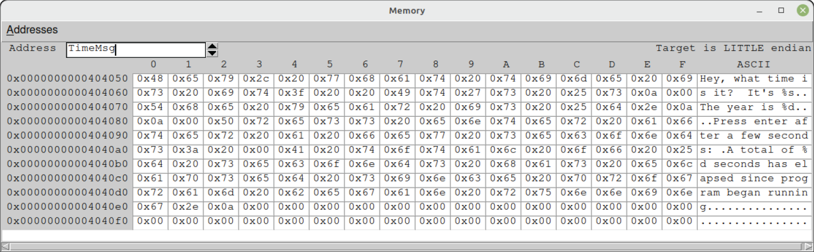
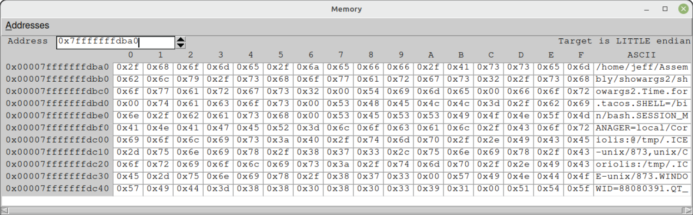

# <a id="Page_493"></a>PHỤ LỤC A Sự trở lại của debugger Insight

Trong ấn bản năm 2009 của cuốn sách này, SASM chưa tồn tại, và tôi đã dùng một debugger miễn phí gọi là Insight cho các bản demo debug của mình. Vài tháng sau khi cuốn sách được xuất bản, mọi repository Linux đều loại bỏ Insight mà không có lời giải thích nào.

Vâng, Insight là một con chim khá lạ. Ban đầu nó được viết bằng một ngôn ngữ thông dịch gọi là Tcl, với một widget set GUI gọi là Tk. Tcl/Tk (như nó được biết đến về sau) được phát hành lần đầu năm 1991. Các widget Tk được mô phỏng theo những widget trong Motif, một trong những GUI đầu tiên và là một phần của Unix Common Desktop Environment. Tôi đã nghe những lời càu nhàu về việc Tk trông “cũ kỹ”, nhưng vấn đề thực sự với Insight là trình thông dịch Tcl được link ngay vào executable. Điều này không phải là chưa từng có, nhưng đó là một việc làm hơi kỳ quặc.

Source code của Insight là open-source và có sẵn trên mạng. Đây đó kể từ năm 2009, người ta đã soạn ra các script để build Insight từ source. Tôi đã thử vài cái, và hầu hết chúng đơn giản là không hoạt động trên các distro Linux gần đây.

Rồi vào năm 2018, một lập trình viên tên là antony-jr trên GitHub đã làm một điều đáng chú ý: anh ấy tạo ra một appimage của Insight. Một là một chương trình binary cho Linux được tạo ra để chạy mà không cần cài đặt. Bạn tải appimage về, đăng nhập Linux với tư cách root, và thả appimage vào `/usr/bin`. Việc đó đặt nó vào search path của bạn, và sau đó nó có thể được chạy từ bất kỳ thư mục nào dưới thư mục `Home` của bạn.

<a id="Page_494"></a>Để tránh công bố ở đây một đường dẫn có thể thay đổi, tôi đề nghị tìm kiếm trên web “Insight” và “antony-jr”. Vào năm 2023, nó được lưu trữ trên GitHub.

Trong phụ lục này, tôi sẽ cho bạn thấy cách dùng appimage Insight để debug các chương trình bạn viết bên ngoài SASM. Insight mới có một số thiếu sót, nhưng cho công việc của người mới bắt đầu trên Linux, nó đúng chỗ và dễ học—và nếu bạn đã thành thạo SASM, học Insight sẽ không phải là một thử thách nghiêm trọng.

<a id="head-2-1"></a>

## Những thiếu sót của Insight

Tôi cần thành thật với bạn ngay từ đầu: Insight có một số vấn đề. Nó được tạo ra từ rất lâu trước khi CPU 64-bit tồn tại, và cửa sổ Memory view của nó không thể hiển thị cho bạn mỗi lần một quadword. May mắn là Registers view không gặp khó khăn gì với các giá trị 64-bit. Nếu không, tôi thậm chí sẽ không cân nhắc mô tả nó trong cuốn sách này.

Các trường nhập liệu khác nhau của Insight không hiểu các phím điều hướng của bàn phím PC, ngoại trừ backspace. Home, End, PgUp, PgDn và các phím mũi tên không đến được Insight. Bạn có thể backspace qua một giá trị trong một trường rồi gõ một giá trị mới. Bạn cũng có thể sao chép và dán giá trị address từ Registers view vào trường address của memory view, nhưng vì một lý do mà tôi không thể nhận ra, Insight đặt dấu ngoặc nhọn quanh giá trị address mà nó đặt lên clipboard. Sau khi dán một address vào một trường, bạn phải xóa những dấu ngoặc đó trước khi nhấn Enter, nếu không Insight sẽ không hiểu address. Bạn có thể định vị con trỏ trong một trường bằng chuột rồi backspace qua dấu ngoặc thứ nhất; sau đó định vị con trỏ ở cuối trường và backspace qua dấu ngoặc kia, cả hai đều trước khi nhấn Enter.

Việc nạp một executable mới để debug có thể thất thường. Bạn phải khởi động Insight từ một cửa sổ console đang hiển thị working directory của executable bạn muốn nạp, nếu không Insight sẽ không thể tìm thấy source code file.

Nếu chương trình của bạn sinh ra một segmentation fault, Insight sẽ crash và biến mất. Insight thỉnh thoảng cũng có thể crash và biến mất ngay cả khi không có segmentation fault. Tôi đoán là việc chạy một debugger 30-year-old ở long mode 64-bit khiến Insight mong manh. Tôi không khuyên thử bất cứ điều gì kỳ lạ với nó.

*Không có* điều nào trong số này là lỗi của antony-jr. Không có công sức của anh ấy, chúng ta sẽ hoàn toàn không có Insight, và nó quả thực lấp được vài lỗ hổng trong những gì SASM có thể làm.

Những vấn đề này là lý do tôi mô tả Insight được hồi sinh trong một phụ lục thay vì trong các chương của sách. Nó miễn phí, và nó vui, đặc biệt nếu bạn muốn nhìn vào buffer memory hay stack, những thứ mà SASM đều không hiển thị tốt. Tôi đã kiểm thử nó với Linux Mint/Cinnamon. Nhưng tôi không đảm bảo rằng nó sẽ hoạt động đúng trên bất kỳ distro Linux nào.

<a id="Page_495"></a>

<a id="head-2-2"></a>

## Mở một chương trình dưới Insight

Để mở một chương trình executable để debug dưới Insight, hãy thực hiện các bước sau:

1. Build phần mềm nếu nó chưa được build một thời gian. Hãy đảm bảo rằng mọi thay đổi bạn đã thực hiện với source code đều được phản ánh trong executable. Insight sẽ phàn nàn nếu source của bạn mới hơn executable.
2. Mở một cửa sổ console trong Konsole, hoặc bất kỳ ứng dụng console nào bạn thích.
3. Di chuyển đến thư mục chứa dự án bạn muốn debug.
4. Khởi chạy appimage Insight từ cửa sổ console đang hiển thị thư mục làm việc chứa executable cần debug. Giả sử bạn đã đặt appimage vào `/usr/bin`, nó sẽ hiện lên từ bất kỳ thư mục nào bạn đang làm việc.
5. Chọn File ➪ Open. Trong hộp thoại Load New Executable, di chuyển đến thư mục làm việc của bạn và gõ tên của file binary executable trong thư mục local của bạn, *không phải* source code file!
6. Insight sẽ mở executable rồi tìm kiếm source file trong thư mục hiện tại. Sau đó nó sẽ mở source code file trong cửa sổ chính của nó.
7. Đôi khi Insight sẽ hiển thị một bản disassembly của executable nhưng sẽ không hiển thị source code. Hãy đảm bảo danh sách drop-down ở đầu bên phải của thanh danh sách đang hiển thị “SOURCE.” Nếu không, hãy kéo danh sách xuống và chọn SOURCE từ vài tùy chọn được liệt kê.
8. Nếu source code của bạn không hiện lên, hãy nhìn vào danh sách drop-down ở đầu bên trái của thanh danh sách. Nó nên hiển thị tên của source code file `.asm` của bạn. Nếu không, hãy kéo danh sách xuống và chọn nó. Nếu nó không có trong danh sách drop-down, hãy đảm bảo source code file của bạn nằm trong working directory của console. Nếu có mà Insight vẫn không hiển thị nó, hãy thoát chương trình và khởi chạy lại.

Insight được thiết kế cho các ngôn ngữ high-level như C. Nó có thể hiển thị một số cửa sổ, chỉ vài cái trong đó hữu ích trong công việc assembly. Hai cửa sổ bạn muốn mở là Registers và Memory. Cả hai đều có thể được chọn từ menu View. Giống như với SASM, cả hai cửa sổ sẽ trống cho đến khi bạn chạy chương trình để debug.

Registers view mặc định là All, bao gồm vô số register AVX cùng với các register general-purpose. Nếu bạn đang làm việc với các ví dụ trong cuốn sách này, hãy chọn General để nhắm vào các register mà bạn đang dùng trong các chương trình ví dụ.

<a id="Page_496"></a>

<a id="head-2-3"></a>

## Đặt argument Command-Line bằng Insight

Một khi bạn đã nạp một chương trình và source code file của nó, nhưng trước khi chạy nó để debug, bạn có thể nạp các argument command-line cho chương trình bạn đang làm việc. Chọn File ➪ Target Settings. Hộp thoại Target Selection sẽ xuất hiện. Trong khung Connection có một trường Arguments. Hãy gõ các argument command-line của bạn vào trường, phân tách bằng dấu space, và nhấp OK. Nếu bạn bước qua một chương trình nhận argument, chương trình sẽ lấy văn bản bạn gõ vào trường Arguments làm argument của nó.

<a id="head-2-4"></a>

## Chạy và bước qua một chương trình

Xét từ góc độ single-stepping, Insight rất giống SASM. Điều đó không có gì ngạc nhiên, vì ở hậu trường cả Insight lẫn SASM đều dùng Gnu debugger `gdb`. Nếu bạn đã trở nên thành thạo dùng giao diện debugger của SASM, bạn sẽ không gặp nhiều khó khăn với Insight.

Về lý thuyết, khi Insight nạp một chương trình để debug, nó đặt một breakpoint ở instruction đầu tiên trong chương trình. Một breakpoint được hiển thị là một hình vuông đỏ ở cột bên trái, cạnh số dòng. Tôi đã nghe những người dùng khác nói rằng Insight không phải lúc nào cũng đặt breakpoint đó. Bạn sẽ cần việc thực thi dừng ở instruction đầu tiên, vì vậy nếu không có hình vuông đỏ nào cạnh số dòng của instruction đầu tiên, hãy nhấp vào bên trái số dòng. Lưu ý rằng breakpoint được đặt trên instruction, *không phải* trên định nghĩa dữ liệu!

Breakpoint của Insight là toggle. Nhấp cạnh một số dòng và một breakpoint xuất hiện dưới dạng một hình vuông đỏ. Nhấp vào hình vuông đỏ, và breakpoint biến mất.

Một khi bạn đã có một breakpoint ở instruction đầu tiên trong chương trình, hãy nhấp biểu tượng người đang chạy ở đầu bên trái thanh biểu tượng. Bạn cũng có thể chọn Run ➪ Run từ thanh menu. Insight khi đó sẽ chạy chương trình.

Vâng, nó sẽ chạy chương trình, nhưng vì bạn đã đặt một breakpoint ở instruction đầu tiên, nó sẽ dừng ở đó trước khi bất kỳ instruction nào được thực thi, với một phần tô sáng màu xanh lá cho thấy việc thực thi tạm dừng ở đâu. Instruction được tô sáng vẫn chưa được thực thi. Giống như với SASM, khi bạn nhấp Step, instruction được tô sáng được thực thi, rồi instruction kế tiếp được tô sáng.

Bước qua một chương trình bên trong Insight phức tạp hơn một chút so với SASM. Có không ít hơn sáu biểu tượng “step”. Bạn có thể di chuột lên các biểu tượng để xem chúng làm gì. Hai cái bạn sẽ dùng thường xuyên nhất là riêng cho assembly language: Step ASM Instruction và Next ASM Instruction. Có hai biểu tượng khác với tên tương tự: Step và Next. Ít nhất là với code assembly, chúng làm điều tương tự như hai biểu tượng ASM Instruction. Từ trải nghiệm của bạn với SASM, Step giống với Step Over, và Next giống với Step Into.

<a id="Page_497"></a>Tóm tắt nhanh từ trải nghiệm SASM của bạn: “Step Into” có nghĩa là “thực thi instruction được tô sáng” ngay cả khi instruction được tô sáng là một instruction `CALL`. Nói cách khác, Step Into sẽ đi theo luồng thực thi vào bên trong procedure, kể cả các procedure được link từ `glibc`. Điều này có thể hữu ích…đôi khi. Nhưng nếu các procedure library của bạn well-behaved và đã được kiểm thử kỹ lưỡng, bạn không cần bước qua chúng trong khi đang debug một chương trình mới. Dĩ nhiên, nếu chương trình mới của bạn chứa các procedure mới, bạn rất có thể muốn bước vào chúng để xem chúng làm gì. Đó là công dụng của Step Into.

Step Over có nghĩa đúng như vậy: thực thi instruction được tô sáng—nhưng nếu đó là một instruction `CALL`, đừng bước qua các instruction của procedure. Đừng hiểu sai ý nghĩa của “Step Over” ở đây: bạn *không* bỏ qua lời gọi procedure. Bạn đang bảo debugger thực thi procedure và tô sáng instruction đầu tiên sau instruction `CALL`.

Về cơ bản, khi bạn step over một lời gọi procedure, debugger chạy procedure ở tốc độ tối đa và gặp bạn tại phần tô sáng ở phía bên kia.

Một lần nữa, giống như với SASM, “Continue” có nghĩa là bắt đầu thực thi ở tốc độ tối đa đến breakpoint tiếp theo. Nếu không còn breakpoint nào trên đường thực thi, Continue sẽ chạy chương trình cho đến khi nó thoát.

“Finish” không có chức năng tương đương trong SASM. Nó đơn giản có nghĩa là thực thi ở tốc độ tối đa cho đến khi chương trình thoát.

Biểu tượng Stop của SASM không có biểu tượng tương đương trong Insight. Để dừng debug một chương trình trong Insight, hãy chọn Run ➪ Kill. Việc đó sẽ dừng phiên debug mà không thực thi thêm.

<a id="head-2-5"></a>

## Cửa sổ Memory

Cách nhìn memory của Insight tốt hơn nhiều so với SASM. Insight cho bạn một hexdump của memory, tương tự như của các chương trình hexdump mà tôi đã trình bày trong cuốn sách này. Khác biệt là của Insight có một cột thứ ba ở phía bên trái, cho memory address của đầu mỗi dòng trong cửa sổ.

Khi bạn hiển thị nó, cửa sổ memory của Insight không cho bạn thấy gì cụ thể. Để hiển thị một thứ gì đó, hãy gõ hoặc một address symbolic hoặc một address literal vào trường Address ở mép trái của cửa sổ. Tên của một mục dữ liệu hoạt động tốt. <a id="R_bapp01-fig-0001"></a>[Hình A-1](#bapp01-fig-0001) cho thấy cửa sổ memory hiển thị memory bắt đầu tại định nghĩa của `TimeMsg` trong chương trình `timetest.asm`. `TimeMsg` là định nghĩa dữ liệu đầu tiên trong chương trình, vì vậy bằng cách bắt đầu ở đó, bạn có thể cuộn xuống để thấy tất cả chúng.

Lưu ý rằng equate không có address và không thể được hiển thị. Các mục dữ liệu lưu trữ được dành riêng có tên trong section `.bss` có thể được hiển thị, nhưng cho đến khi chương trình của bạn lưu thứ gì đó vào những mục đó, thứ cửa sổ sẽ hiển thị là các null (các số 0 binary.)

<a id="Page_498"></a>



*<a id="bapp01-fig-0001"></a>**Hình A.1**: Phần hiển thị memory của Insight cho một section `.data`*

Các mũi tên bên phải trường Address cho phép bạn di chuyển up-memory hoặc down-memory mỗi lần 16 byte.

<a id="head-2-6"></a>

## Hiển thị stack trong Memory view của Insight

Memory view của Insight có thể cho bạn thấy bất kỳ vị trí nào trong không gian memory của chương trình. Điều bạn có thể thấy cực kỳ hữu ích là hiển thị stack. Mánh khóe duy nhất là đưa address của đỉnh stack vào trường address. Một khi bạn đã bắt đầu debug một chương trình, address của stack của nó được tìm thấy trong RBP hoặc RSP. Tin xấu là bạn không thể cứ gõ “RSP” vào trường address. Điều bạn phải làm là tô sáng address được hiển thị cho RSP trong cửa sổ Registers và đưa nó lên clipboard bằng Ctrl+C. Sau đó tô sáng và xóa bất cứ thứ gì có trong trường address, và thả address vào trường bằng Ctrl+V.

Có một cái bẫy kỳ quặc: Insight đặt dấu ngoặc nhọn quanh address mà nó đặt lên clipboard một cách khó hiểu. Vì vậy một address được sao chép sẽ trông giống như thế này:

```
{0x7fffffffd718}
```

Bạn phải bỏ những dấu ngoặc đó đi, nếu không Insight sẽ không hiểu address. Hãy nhấp con trỏ chuột vào đầu trường và xóa dấu ngoặc trái. Nhấp vào đầu đối diện của trường và backspace qua dấu ngoặc phải. Lưu ý rằng Insight không hiểu các phím mũi tên, Home, End, PgUp hay PgDn.

Một khi các dấu ngoặc đã biến mất, hãy nhấn Enter, và Memory view sẽ cho bạn thấy stack.

<a id="head-2-7"></a>

## Xem xét stack bằng Memory view của Insight

Mánh khóe khi đọc một phần hiển thị stack trong Memory view là nhớ rằng số và address có kích thước 64 bit và phần hiển thị là little-endian. Điều đó có nghĩa là thứ tự của tám byte bị đảo ngược theo trọng số. Nói <a id="Page_499"></a>cách khác, byte có trọng số nhỏ nhất của một giá trị 64-bit đi trước, theo sau là các byte có trọng số lớn hơn kế tiếp, và cứ thế. Đây là lý do tám giá trị đầu tiên trên stack là:

```
0x04 0x00 0x00 0x00 0x00 0x00 0x00 0x00
```

Đây là giá trị 64-bit 4, là số đếm của ba tham số command-line cộng với tên đường dẫn của executable file.

Điều tương tự cũng đúng với address. Byte least-significant của một address đi trước, vì vậy tám byte address được trình bày “ngược” so với cách bạn quen nghĩ về address 64-bit. Address đầu tiên trên stack là address của văn bản lệnh gọi mà executable được chạy bằng nó. Nó trông như thế này:

```
0xa0 0xdb 0xff 0xff 0xff 0x7f 0x00 0x00
```

Tám byte này biểu diễn address 64-bit bên dưới. Với đủ luyện tập, bạn sẽ có thể đọc một address mà không cần đảo ngược thứ tự các byte bằng tay.

```
0x7fffffffdba0.
```

Bạn có thể dùng Memory view để “đi theo” một address tới dữ liệu thực sự mà nó trỏ tới up-memory. Hãy gõ address đầu tiên trên stack vào điều khiển điều hướng, và phần xem sẽ di chuyển tới address đó. Trong trường hợp này, đó sẽ là address của văn bản lệnh gọi của executable file. Xem <a id="R_bapp01-fig-0002"></a>[Hình A-2](#bapp01-fig-0002).



*<a id="bapp01-fig-0002"></a>**Hình A.2**: Argument command-line trong memory view của Insight*

Argument command-line và biến môi trường được lưu nose-to-tail trong memory. Mỗi cái được kết thúc bằng một byte 0 duy nhất (một *null*), đó là lý do những chuỗi như vậy được gọi là *null-terminated*. Mặc dù không có lý do kỹ thuật nào cho điều đó, argument command-line và biến môi trường được lưu trong cùng một vùng của stack, với các argument command-line đi trước và các biến môi trường theo sau.

Phần lớn công sức để học Insight liên quan đến cửa sổ Memory view. Phần còn lại sẽ có vẻ khá quen thuộc sau khi bạn đã bỏ chút thời gian debug trong SASM.

<a id="Page_500"></a>

<a id="head-2-8"></a>

## Hãy học gdb!

Hầu hết các debugger Linux được thiết kế để xử lý các ngôn ngữ high-level, đặc biệt là C. Thật bất thường khi một debugger lớn lại giỏi debug assembly. Debugger đằng sau tấm màn của SASM và Insight là `gdb`. Nó hoàn toàn thoải mái với assembly. Tốt hơn nữa, nó gần như chắc chắn là debugger most-used trong lịch sử. Nếu bạn định tiếp tục nghiên cứu assembly language, tôi đặc biệt khuyến khích bạn dành thời gian (đáng kể) cần thiết để học `gdb`. Có hai lý do cho điều này:

- `gdb` có thể rất hữu ích ngay cả khi đứng một mình. Vâng, có thể bạn sẽ mất kiên nhẫn với nó nếu bạn mới chập chững với SASM và Insight. Giao diện pure-text của `gdb` có thể nặng nề. Dù sao cũng hãy làm. Rốt cuộc bạn sẽ vượt quá SASM, và Insight thì là một kiểu hóa thạch sống. `gdb` sẽ không đi đâu cả.
- Luôn có khả năng một front end `gdb` assembly-friendly kiểu như Insight sẽ được viết trong tương lai, và bạn càng biết nhiều về `gdb`, bạn sẽ càng có thể dùng hiệu quả một front end mới khi điều đó xảy ra.

Vâng, có những front end khác cho `gdb`, và tôi chắc rằng mình đã thử hết. Không cái nào xử lý assembly language dễ dàng. Điều này không có gì ngạc nhiên, vì gần như mọi công việc Linux đều được làm bằng C. Có các hướng dẫn trên mạng. Hãy tìm chúng và đi qua chúng. Một PDF one-sheet two-sided miễn phí tên là `gdb` Quick Reference rất tốt. Nó có trên GitHub. Google sẽ tìm thấy nó.
