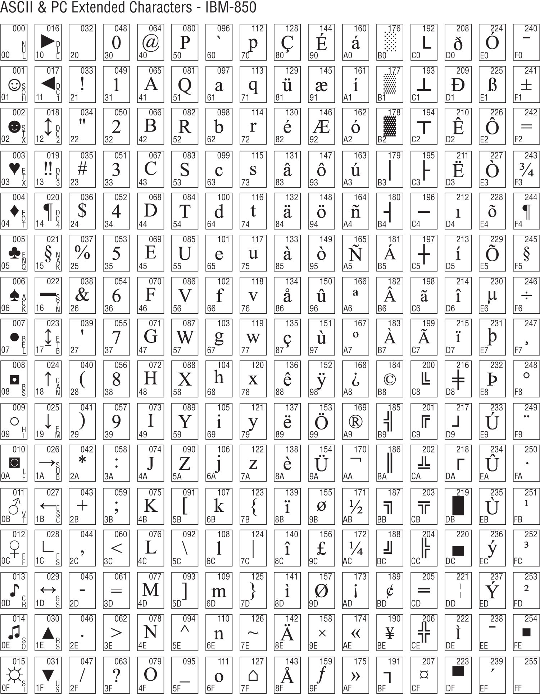
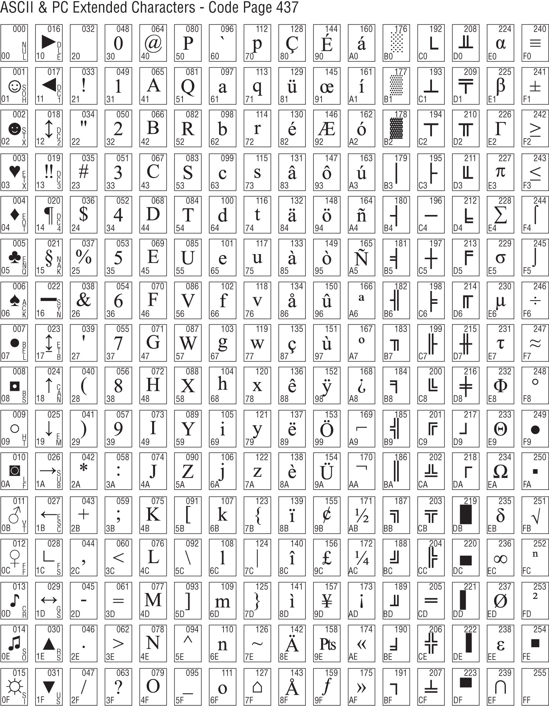

# PHỤ LỤC C Bảng Character Set

Các trang sau chứa phần tóm tắt hai character set thường được dùng trên các máy PC-compatible. Bộ thứ nhất là character set IBM-850, thường có sẵn trên các tiện ích terminal Linux như Konsole và GNOME Terminal. Bộ thứ hai là bộ “Code [Page 437](ch12_heading_out_to_c.vi.md#Page_437)” cũ hơn, về cơ bản là character set được mã hóa vào BIOS ROM của các PC IBM-compatible.

Mỗi ký tự trong mỗi bộ có một glyph block. Mỗi glyph block gồm thông tin sau:

- Dạng thập phân three-digit của số hiệu ký tự, từ 000–255. Chúng nằm ở góc upper-right của mỗi block.
- Dạng hexadecimal của số hiệu ký tự, từ 00–FF. Chúng nằm ở góc lower-left của mỗi block.
- Glyph của ký tự nằm giữa block.
- Với các control character từ 0–31, tên của control character (ví dụ NAK, DLE, CR, v.v.) được in theo chiều dọc ở góc lower-right của block.

Lưu ý character set IBM-850 không được load mặc định trong các Linux terminal utility phổ biến; phải chọn riêng từ menu tùy chọn hoặc thiết lập trước khi character set hiển thị trong terminal window. Xem thêm ở [Chương 6](ch06_a_place_to_stand_with_access_to_tools.vi.md).

