Freescale Semiconductor<br>Application Note

Document Number: AN5199<br>Rev. 0, 12/2015

# Các khái niệm chính khi chuyển từ DPAA1 sang DPAA2 (Key Concepts for the Transition from DPAA1 to DPAA2)

## 1 Giới thiệu

Application note này mô tả các khả năng của Data Path Acceleration Architecture thế hệ thứ hai (DPAA2) trên các dòng sản phẩm QorIQ LayerScape. DPAA2 là thế hệ thứ hai của Freescale Data Path Acceleration Architecture (DPAA1). Application note này dành cho những khách hàng đã quen với các khái niệm và chức năng của DPAA1, và muốn biết những khác biệt chính trước khi chuyển sang các thiết bị có DPAA2.

Application note này giúp bạn hiểu rõ hơn những thay đổi về phần mềm. Đây không phải là tài liệu hướng dẫn chuyển đổi phần mềm. Software development kit (SDK) cho các thiết bị có DPAA2 đã cung cấp các API mới nhất và các ứng dụng enablement minh họa tính năng và khả năng của DPAA2. Tài liệu này nhằm giúp bạn hiểu rõ hơn những thay đổi có trong phần mềm và các API.

Tài liệu này dùng QorIQ LS2085A làm ví dụ để bàn về các chi tiết triển khai cụ thể. Các thiết bị có DPAA2 khác có thể có một số khác biệt nhỏ. Hãy tham khảo reference manual của từng SoC để biết chi tiết riêng của thiết bị. Hình 1, LS2085A với bản triển khai DPAA2, đánh dấu các khối IP của DPAA2 bằng một hình chữ nhật chấm đỏ.

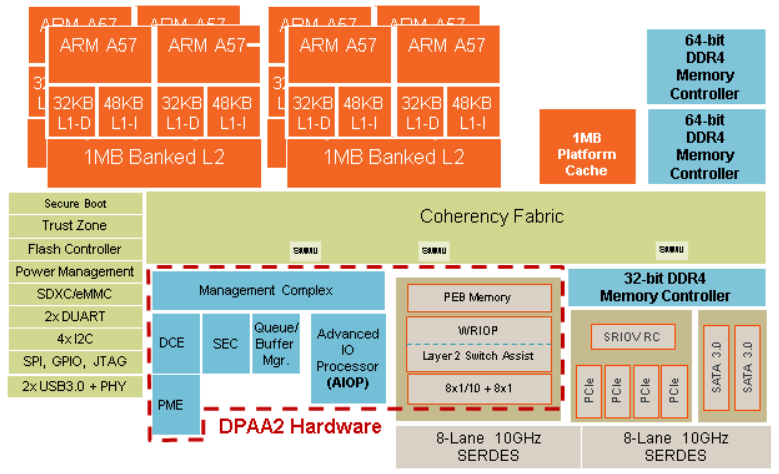

**Hình 1. LS2085A với bản triển khai DPAA2**

## 2 Tổng quan về DPAA2

DPAA2 là một cuộc đại tu lớn trong quá trình phát triển của Data Path Acceleration Architecture. Nó cung cấp một hạ tầng cho các giao diện mạng đơn giản và an toàn, dùng cho cả ứng dụng multicore lẫn ứng dụng ảo hóa. DPAA2 cho phép các CPU core dùng chung một giao diện phần mềm và các API nhất quán để truy cập và chia sẻ các hardware accelerator cho ứng dụng mạng. Các general purpose processor (GPP) có thể dùng accelerator kiểu look-aside hoặc in-line cho những thao tác nặng về tính toán thường gặp trong các ứng dụng truyền thông mạng như:

- Mật mã (Cryptography)
- Nén (Compression)
- Kiểm tra sâu gói tin (deep packet inspection, DPI)
- Mạng định nghĩa bằng phần mềm (software define network, SDN)
- Ảo hóa chức năng mạng (network function virtualization, NFV)

DPAA2 gộp các chức năng của QMan và BMan vào một khối QBMan duy nhất, đồng thời giữ giao diện software connected portal (SCP) quen thuộc của DPAA1. SCP là một giao diện memory mapped để GPP truy cập DPAA2. Vì DPAA2 chỉ có một giao diện SCP dùng cho cả QMan và BMan, phần mềm trên GPP tương tác với các thành phần DPAA2 khác dễ dàng và hiệu quả hơn. Hình 2, Góc nhìn khái niệm về DPAA2, cho thấy QBMan giúp GPP, application input/output processor (AIOP), các accelerator và các giao diện mạng lập lịch traffic và xử lý packet hiệu quả như thế nào.

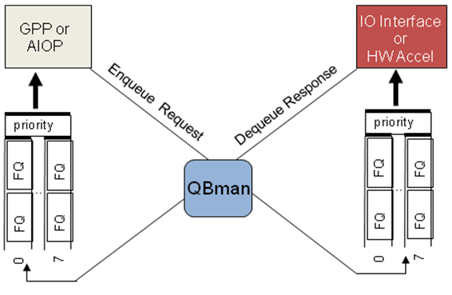

**Hình 2. Góc nhìn khái niệm về DPAA2**

## 3 Cải tiến cho ảo hóa

Management complex (MC) mới cùng các cải tiến phần cứng khác đã tăng cường hỗ trợ ảo hóa. MC hỗ trợ tạo và hủy động các network object cho mọi partition vật lý và ảo. MC trừu tượng hóa các tài nguyên DPAA2 low-level thành các object và thực hiện các chức năng quản lý tài nguyên như phát hiện object, cấp phát, theo dõi và khôi phục khi có sự cố. Nhờ đó GPP có thể truy cập trực tiếp phần cứng DPAA2 từ các máy ảo mà vẫn được cô lập. Xem mục Management complex (MC) để biết thêm về MC mới và cách xử lý object.

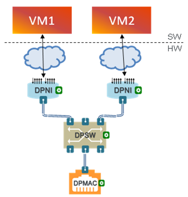

**Hình 3. Góc nhìn của máy ảo về các hardware object của DPAA**

Trong DPAA2, các giao diện cache-coherent dựa trên AXI được dùng thay cho coherency fabric Corenet trên mọi thiết bị dùng ARM core. Ví dụ, LS2085A dùng CCN504. Trong DPAA1, Corenet dùng physical access management unit (PAMU) và logical input/output device number (LIODN) để bảo vệ và cô lập tài nguyên giữa các GPP khác nhau. Ngược lại, các thiết bị DPAA2 dùng isolation context identifier (ICID) thay cho LIODN để phân chia và cô lập tài nguyên. Trong một số trường hợp sử dụng, có thể muốn bỏ qua giới hạn ICID. Khi đó có thể dùng bypass DPAA resource isolation (BDI) để vượt qua việc cô lập ở mức bus.

DPAA2 đưa vào khái niệm virtual frame queue identifier để hỗ trợ tốt hơn việc cô lập partition. Application note này viết tắt frame queue identifier là FQID, và phân biệt virtual frame queue identifier với physical frame queue identifier bằng cách viết đầy đủ chữ “virtual” hoặc “physical” trước chữ viết tắt FQID. Ví dụ: virtual FQID hoặc physical FQID. Trong môi trường DPAA1, phần mềm dùng physical FQID cho các thao tác hàng đợi. Việc cô lập frame queue diễn ra bên ngoài môi trường DPAA. Trong DPAA2, có thể cấu hình các tính năng cô lập tài nguyên của DPAA2 bằng cách đặt BDI bằng 0 ở cả physical FQID lẫn SCP. Khi đã đặt, DPAA2 dùng virtual FQID thay cho physical FQID cho các thao tác enqueue và dequeue. Bằng cách này, physical FQID được ẩn khỏi software partition, và vì vậy một OS partition hay máy ảo khác không thể truy cập được nó.

## 4 WRIOP và AIOP là FMan mới

Chức năng của FMan trong DPAA1 được chia ra giữa wire-rate input/output processor (WRIOP) tốc độ cao và các application input/output processor (AIOP) giàu tính năng. Dù DPAA2 cung cấp các chức năng tương tự FMan như phân tích frame, phân loại và phân phối, các API và công cụ cấu hình thì khác. Hãy tham khảo MC cho việc cấu hình mạng kiểu FMan, và DPAA2 SDK cho các công cụ mới nhất.

### 4.1 Application input/output processor (AIOP)

AIOP là một engine multicore lập trình hoàn toàn bằng C, gắn chặt với các hardware accelerator chuyên dụng để xử lý packet hiệu quả. Trong DPAA1, FMan chỉ offload được một số việc hạn chế như IP assembly, IP fragmentation, IPsec offload (DPA IPSec), v.v. AIOP trong DPAA2 gồm các vi xử lý lập trình được theo yêu cầu, gắn chặt với instruction store, dữ liệu packet, packet context và các accelerator. AIOP hỗ trợ lập trình bằng ngôn ngữ C và cho phép xử lý hoàn toàn tự chủ. Các ứng dụng như Firewall, IPsec, Netflow, OpenFlow Switch và các ứng dụng khác có thể offload hoàn toàn sang AIOP, giải phóng chu kỳ của GPP cho các tác vụ khác.

Hình 4, Góc nhìn chức năng của AIOP và GPP, thể hiện các loại ứng dụng có thể offload sang AIOP. Phần mềm Linux có thể tương tác với AIOP qua một data path AIOP object (DPAIOP). DPAIOP là một configuration object giúp nạp chương trình lên AIOP, chạy AIOP, reset AIOP và nhận thông tin trạng thái, lỗi từ các chương trình AIOP. Hãy tham khảo DPAA2 SDK mới nhất để có danh sách đầy đủ các ứng dụng enablement và công cụ phần mềm.

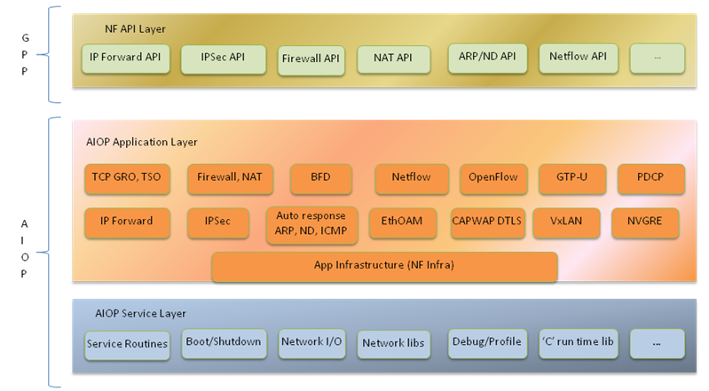

**Hình 4. Góc nhìn chức năng của AIOP và GPP**

### 4.2 Wire-rate input/output processor (WRIOP)

WRIOP thay thế FMAN, cung cấp giao diện tới tầng mạng. WRIOP được thiết kế để dễ phân chia partition hơn, theo nghĩa nó cho phép phần mềm GPP quản lý độc lập các giao diện mạng riêng biệt. WRIOP hỗ trợ hai loại luồng:

- Luồng ingress, thường dùng cho một port nhận Ethernet
- Luồng egress, thường dùng cho một port truyền Ethernet

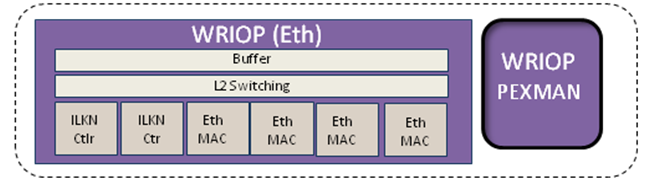

**Hình 5. Góc nhìn mức khối của WRIOP**

WRIOP có nhiều tính năng quen thuộc của FMan. WRIOP hỗ trợ physical port để kết nối tới thiết bị bên ngoài và recycle port cho các chức năng kiểu loop-back. Giống FMan, WRIOP hỗ trợ phân tích packet ingress ở tốc độ wire rate, phân loại để xác định FQID đích và điều khiển tắc nghẽn, policing dựa trên RFC4115 và RFC2698, và gắn timestamp (timestamp của Ethernet MAC, aging của L2 switch, v.v.). Hệ thống phân cấp quyết định được cấu hình bằng một chuỗi action descriptor (AD). WRIOP còn đưa vào khái niệm mới interface profile identifier (IFPID), gán các thuộc tính mặc định cho frame để theo dõi thống kê giao diện, storage profile, MAC channel và thông tin exception.

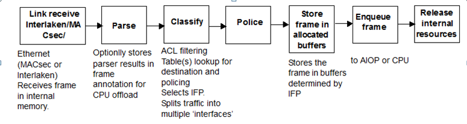

**Hình 6. Góc nhìn chức năng của WRIOP**

WRIOP thêm nhiều chức năng mới vượt ra ngoài FMan. WRIOP có thể cấu hình thành một L2 switch Ethernet tự chủ, có một khối học và chuyển tiếp địa chỉ L2. WRIOP cũng hỗ trợ link aggregation (LAG), nhân bản frame ingress để hỗ trợ multi-cast tốt hơn, và priority flow control (PFC). Giao diện HiGig không còn được hỗ trợ vì WRIOP có thể cấu hình thành L2 switch.

WRIOP có cấu trúc dữ liệu IFPID mới, dùng một ICID khác nhau cho mỗi interface profile, nhờ đó hỗ trợ ảo hóa tốt hơn. Trong DPAA1, FMAN dùng LIODN để cô lập và kiểm soát truy cập. Trong DPAA2, WRIOP có thể chọn một IFPID dựa trên việc phân loại các header của frame (ví dụ, VLAN). Điều này cho phép các chính sách riêng cho:

- Chọn buffer pool
- Thống kê
- Xử lý lỗi
- Quản lý tắc nghẽn

Cuối cùng, WRIOP triển khai một packet express buffer (PEB), cung cấp vùng lưu trữ tạm thời nhanh cho các packet được truyền giữa các khối xử lý của DPAA2. Điều này tiết kiệm tài nguyên ở mức hệ thống (system fabric và băng thông DDR). PEB là một buffer bên trong SoC nhưng nằm ngoài WRIOP. Cần phân biệt PEB với vùng nhớ lấy từ BMan, vốn nằm trong DDR. Một trường hợp dùng PEB là lưu tạm các packet được chuyển mạch ở tầng 2 khi WRIOP được cấu hình thành L2 switch.

### 4.3 Classifier and table lookup unit (CTLU)

DPAA2 đưa vào một classifier table lookup engine mới. Cả WRIOP lẫn AIOP đều có instance riêng của classifier table lookup engine, hoạt động độc lập với nhau. Chúng được gọi là WRIOP classifier and table lookup unit (WRIOP-CTLU) và AIOP classifier and table lookup unit (AIOP-CTLU). Hai CTLU có tính năng tương tự nhưng không giống hệt nhau. Vì AIOP là một khối lập trình được bằng C, AIOP-CTLU có thể hỗ trợ nhiều loại bảng và lệnh người dùng hơn, như sinh hash, checksum L3 và L4, v.v. Vì tài liệu này không bàn chi tiết về mô hình lập trình AIOP, phần nói về CTLU trong mục này chỉ tập trung vào WRIOP-CTLU.

WRIOP classifier có thể thực hiện một chuỗi chức năng trên một luồng frame. WRIOP-CTLU gồm các khối chức năng sau:

- Parser and attributes unit
- Table lookup unit
- QoS and policer unit
- L2 switching unit

.

Parser and attributes unit xem xét cấu trúc của frame (256 byte đầu tiên) dựa trên hiểu biết sẵn có về các giao thức chuẩn, để xác định thuộc tính của frame và trích xuất các giá trị mạng. Giống parser của FMAN trong DPAA1, các frame trong luồng ingress được phân loại qua WRIOP classifier. Các frame trong luồng egress được phân loại cho checksum, xử lý VLAN, QoS mapping và STP của physical port. Có thể thêm các lệnh soft parsing để mở rộng các giao thức được hỗ trợ và/hoặc trích xuất thêm thuộc tính hay giá trị mạng. CTLU hỗ trợ một số thuật toán tra bảng cho các bảng nằm trong bộ nhớ trong hoặc bộ nhớ ngoài:

- Exact match (dựa trên hash) cho portable classifier (bảng nằm trong bộ nhớ trong).
- Access control list (ACL) dựa trên TCAM cho QoS mapping và policer. Mục này được dùng cho việc tìm MAC trong L2 switching và được cập nhật bằng cơ chế tự học.
- Longest prefix match (LPM) cho việc tra cứu kiểu địa chỉ IPv4 hoặc IPv6 (chỉ AIOP-CTLU).
- Multi-field lookup (MFLU) (chỉ AIOP-CTLU).

CTLU hỗ trợ cả tra cứu theo một thuộc tính của frame lẫn tra cứu theo nhiều giá trị (tức là theo lookup key). Mỗi lần tra cứu theo giá trị đều được thực hiện sau một bước ghép key mới. Giống FMan trong DPAA1, có thể bỏ qua bước phân loại và dùng các giá trị từ interface profile ban đầu để xử lý frame.

WRIOP-CTLU lưu bảng trong bộ nhớ trong, vì vậy kích thước bảng bị giới hạn. Ngoài ra, portable classifier có một ternary content addressable memory (TCAM), có thể dùng để lọc ACL hoặc cho bất kỳ kiểu tra cứu ternary nào khác mà ứng dụng cần. Khối QoS mapping and policer của CTLU hỗ trợ quản lý traffic và điều khiển tắc nghẽn. Khối này có các chức năng tương tự policer của FMAN trong DPAA1. CTLU có thể xác định trường QoS và giá trị màu của frame. Nó cũng hỗ trợ đánh dấu màu frame dựa trên RFC-2698 và RFC-4115. WRIOP-CTLU cải thiện hiệu năng chuyển mạch nhờ một L2 switching unit chuyên dụng. L2 switching unit xử lý thuộc tính frame bằng cách tra VLAN tag, xác định bảng IFP, và quản lý các bảng L2 switching như trạng thái STP, aging của bảng MAC và tra cứu ACL.

## 5 Management complex (MC)

MC là một khái niệm hoàn toàn mới trong DPAA2, giúp đơn giản hóa việc quản lý thiết bị. MC cung cấp các lớp trừu tượng và một giao diện lệnh, giúp phần mềm trên GPP và AIOP dùng các accelerator của DPAA2 đơn giản hơn. Các thành phần, hay object, của DPAA2 được tạo ra hoặc qua file data path layout, hoặc do phần mềm driver gửi lệnh tới MC. Đáp lại, MC cấp một identifier duy nhất toàn cục cho object mới. Lưu ý rằng phần mềm GPP chỉ thấy được cấu hình của object. Các thành phần phần cứng riêng lẻ tạo nên object bị MC che đi và phần mềm GPP không thấy được. Một trong những khác biệt chính giữa DPAA1 và DPAA2 là MC trừu tượng hóa phần cứng DPAA2 thành các object do phần mềm quản lý. Lợi ích của MC gồm:

- Người dùng không cần nghiên cứu chi tiết các khối phần cứng DPAA2 để phát triển driver hay để dùng các khả năng của DPAA2.
- Thuật ngữ và cách dùng của nó hướng theo ứng dụng.
- Nó dựa trên các khái niệm mà lập trình viên và kiến trúc sư hệ thống nói chung đã quen thuộc.
- Nó dễ dùng hơn so với việc quản lý trực tiếp phần cứng.
- Nó thể hiện ý đồ kiến trúc của các khối phần cứng.

MC trừu tượng hóa phần cứng DPAA2 thành các object do phần mềm quản lý, có thuật ngữ và cách dùng hướng theo ứng dụng. Sau đây là một vài ví dụ về MC object:

- Network interface (NI)
- MAC
- L2 Switch
- MUX
- Và nhiều object khác...

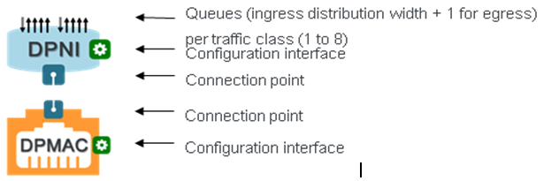

**Hình 7. Các object của DPAA2**

Hình 7, Các object của DPAA2, cho thấy một ví dụ về cách MC kết nối các tài nguyên low-level thành những object mà GPP có thể tương tác. Một ví dụ về object là data path MAC (DPMAC). Một DPMAC object đại diện cho một Ethernet MAC, tức là một thiết bị phần cứng nối với PHY và cho phép truyền, nhận frame Ethernet ở mức vật lý. Một ví dụ khác là data path network interface (DPNI). Một DPNI object đại diện cho trung tâm của các giao diện mạng. Ở chiều ingress, DPNI nhận frame từ một DPMAC hoặc từ object khác như data path switch (DPSW), phân tích header, xác định traffic class của frame, rồi enqueue frame vào một frame queue được chọn dựa trên traffic class và các giá trị header khác. Ở chiều egress, DPNI dequeue frame từ các frame queue và truyền chúng qua một DPMAC hoặc tới một DPAA2 object khác như DPSW.

MC thay thế nhu cầu dùng công cụ frame management configuration (FMC) của DPAA1. Trong môi trường Linux, bạn có thể dùng các file data path layout (DPL) và resource tool (restool) để tương tác với các DPAA2 object. File DPL là một file văn bản chỉ định các container, các object được đặt bên trong chúng, và cả các liên kết giữa các object. Nó được áp dụng trước khi Linux boot, rồi điền vào các resource container được tạo tự động. Restool là một lệnh user space trên Linux do Freescale tạo ra, cho phép xem xét và quản lý động các container và object.

Sau đây là một ví dụ về DPL (…/dpl-examples/git-r0/git/ls2085a/RDB/dpl-eth.0x2A_0x41.dts):

```
/dts-v1/;
 / {
         /*****************************************************************
           * Containers
           *****************************************************************/
            containers {
                    dprc@1 {
                            compatible = "fsl,dprc";
                            parent = "none";
                            options = "DPRC_CFG_OPT_SPAWN_ALLOWED" ,
 "DPRC_CFG_OPT_ALLOC_ALLOWED", "DPRC_CFG_OPT_IRQ_CFG_ALLOWED";
                            objects {
                                    /* ------------- MACs --------------*/
                                    obj@100 {
                                            obj_name = "dpmac@5";
                                    };

                                    /* ------------ DPNIs --------------*/
                                    obj@200 {
                                            obj_name = "dpni@1";
                                    };

                                    /* ------------ DPBPs --------------*/
                                    obj@300 {
                                            obj_name="dpbp@1";
                                    };
```

Để biết thêm về DPL và restool, hãy tham khảo tài liệu DPAA2 SDK.

## 6 Cải tiến frame descriptor (FD) và frame queue descriptor (FQD)

DPAA2 tăng cường thông tin mà FD mang theo. Thay đổi dễ thấy nhất từ DPAA1 sang DPAA2 là cấu trúc FD tăng từ 16B lên 32B. Trong DPAA2, session context được lưu theo từng FD, thay vì theo từng FQD như trong DPAA1. Điều này cho phép nhiều accelerator session dùng chung một cặp frame queue. Nhờ chỉ cần một cặp frame queue, số frame queue cần dùng giảm đi, và việc thiết lập session hiệu quả hơn vì không phải khởi tạo frame queue cho từng session. FD và FQD phối hợp với nhau để biểu diễn thông tin về frame và luồng.

Hình 8, Thay đổi của cặp FD và FQD giữa DPAA1 và DPAA2, thể hiện ba khác biệt chính giữa DPAA1 và DPAA2. Thứ nhất, trong DPAA2, FD giờ hỗ trợ địa chỉ 64-bit. Thứ hai, context A của FQD trong DPAA1 trở thành flow level context (FLC) trong FD của DPAA2, là một con trỏ mang thông tin liên quan tới luồng. Context B trong DPAA1 trở thành FQD context (FQD_CTX) trong DPAA2, chứa FQID đầu ra và thông tin access management qualifiers (AMQ). Điều này giảm đáng kể số frame queue cần cho các ứng dụng mạng. Thứ ba, FQD giờ mang virtual FQID. QBMan có thể được cấu hình để làm việc với physical FQID hoặc virtual FQID. Khả năng này hỗ trợ tốt hơn việc ảo hóa và cô lập frame queue.

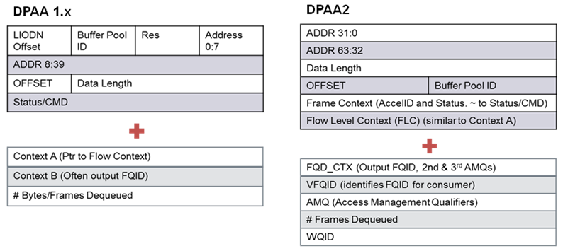

**Hình 8. Thay đổi của cặp FD và FQD giữa DPAA1 và DPAA2**

FD của DPAA2 mang các trường mới giúp tăng cường chức năng. Hình 9, Frame descriptor mẫu, là một biến thể có thể có của cấu trúc FD. Bit stashing control (SC) giờ được đặt trong FD thay vì trong FQD. SC điều khiển lượng dữ liệu từ đầu frame, frame annotation và flow context được stash vào cache của GPP. Frame context (FRC) cho phép bên gửi frame truyền một số thông tin out-of-band tới bên nhận frame. Trường này thay thế các chức năng của context A trong FQD của DPAA1. Frame flow context (FLC) gắn frame với một cấu trúc luồng. Hãy tham khảo reference manual của DPAA2 để biết chính xác cách các thành phần DPAA2 khác nhau dùng cấu trúc dữ liệu FRC và FLC.

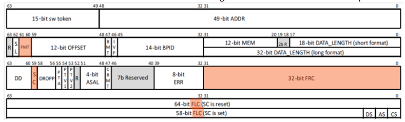

**Hình 9. Frame descriptor mẫu**

Frame format (FMT) xác định định dạng của frame mà FD tham chiếu tới. Giống DPAA1, frame format vẫn gồm single buffer frame và scatter gather frame. DPAA2 đưa vào định dạng Frame list mới để thay thế cấu trúc dữ liệu compound frame. Hình 10, Cấu trúc Frame list của DPAA2, minh họa cách dùng frame list để biểu diễn cả con trỏ buffer đầu vào lẫn đầu ra cho các hardware accelerator của DPAA2 như SEC và PME.

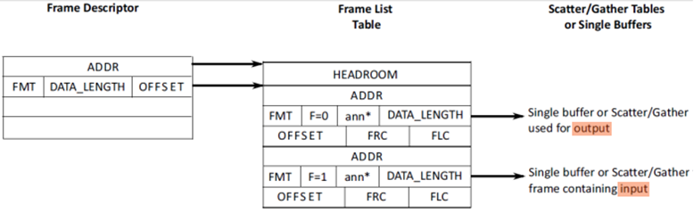

**Hình 10. Cấu trúc Frame list của DPAA2**

DPAA2 có các cấu trúc frame queue descriptor (FQD) mới. Các trường Context A và Context B không còn cần nữa, và có thêm các trường mới. Sau đây là một số trường mới trong FQD của DPAA2 mà người dùng DPAA1 cần chú ý. Thứ nhất, FQID enqueue rejection (FQID_ER) được dùng cho các lần enqueue bị từ chối. Thứ hai, virtual FQID tương đương với các frame queue hiện tại. Phần mềm có thể cấu hình QBMan trả về physical FQID hoặc virtual FQID trong thao tác hàng đợi. Thứ ba, trường FQID_ER có thể dùng để xác định FQID mà các lần enqueue bị từ chối sẽ được trả về. Thứ tư, BDI cung cấp một cơ chế để phần mềm và các DCP portal xác định một lần truy cập tới tài nguyên DPAA có cần được bảo vệ hay không. Hình 11, Định dạng FQD của DPAA2, thể hiện bố cục đầy đủ của FQD trong DPAA2.

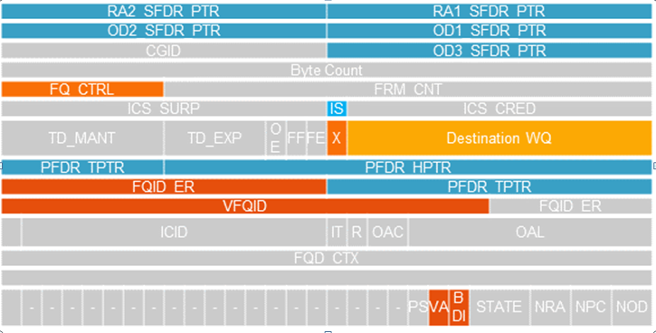

**Hình 11. Định dạng FQD của DPAA2**

Như đã nói ở trên, trong DPAA2, một con trỏ tới flow context được đặt trong FD. Điều này khác căn bản so với mô hình của DPAA1, trong đó bên nhận frame lấy thông tin luồng từ FQD khi dequeue. Mô hình của DPAA2 giảm đáng kể số frame queue mà phần mềm data path cần. Frame queue trở thành các kênh chung giữa bên tạo và bên dùng FD, thay vì là các kênh riêng cho từng network session hay từng luồng.

Trong DPAA2, mọi FQD được lưu bên trong QMan. Bộ nhớ hệ thống không được dùng để lưu FQD. Vì một frame queue có thể chứa nhiều luồng traffic, nhu cầu tạo các frame queue riêng lẻ giảm mạnh. Kết quả là có thể chứa toàn bộ FQD trong bộ nhớ trong của QBMan. Điều này cải thiện đáng kể hiệu năng của QBMan vì mọi FQD đều nằm trong bộ nhớ trong của QBMan. Với bản triển khai DPAA2 trên LS2085, có thể khởi tạo tới hai nghìn frame queue trong bộ nhớ trong của QBMan.

## 7 Thứ tự byte

Endianness là thứ tự sắp xếp các byte trong một word dữ liệu. Trong DPAA1, cả PowerPC core lẫn các khối IP đều là big-endian. Trong DPAA2, chúng tôi đưa ARM core vào SoC LayerScape. Hãy chú ý kỹ endianness của từng khối IP trong SoC. Dù endianness dữ liệu của hầu hết các khối IP cấu hình được (ví dụ DDR, USB, SDHC, v.v.), cần đặc biệt cẩn thận khi truy cập các thanh ghi DPAA2 để cấu hình và debug.

Cần chú ý kỹ endianness của các khối IP khác nhau. Ví dụ, secure fuse processor (SFP) thường chạy ở chế độ big-endian. Tuy nhiên, khi truy cập các thanh ghi SFP từ ARM chạy ở chế độ little-endian thì cần đảo byte. Ví dụ, trong U-Boot, trước tiên hãy đọc thanh ghi SFP version (VER) ở offset 0x1E80038 để xác nhận endianness của thanh ghi. Sau đó dùng cách biểu diễn đó để ghi vào thanh ghi instruction (INGR) ở offset 0x1E80020.

```
Bit 19-16 MAJOR -- Major Release: Read back as 4'b0011 for SFP version 3.x
Bit 11-08 MINOR -- Minor Release: Read back as 4'b0100 for SFP version 3.4.

=> md 0x1e80038 1
01e80038: 00030400                               ....
```

## 8 Chuyển đổi phần mềm ứng dụng

Khách hàng QorIQ thường lấy driver và API của DPAA từ QorIQ Software Development Kit (SDK). Các processor thế hệ DPAA1 cung cấp các mô hình API khác nhau tùy từng trường hợp sử dụng. FMAN, BMAN, QMAN và các hardware accelerator đi kèm driver riêng (FMAN driver, QMAN driver, BMAN driver), các API low level, và các giao diện sysfs, debugfs. Các ứng dụng user space trên Linux thường dùng các API high level như USDPAA, NADK và ODP.

DPAA2 là một cuộc đại tu lớn so với DPAA1. Có những option và tính năng mới được thêm vào, đòi hỏi API mới. Ví dụ, hàm qman_init_fq() giờ được thay bằng cấu hình MC, nên trong DPAA2 không còn QMAN API tương đương. Khách hàng cần đưa các MC object vào môi trường của mình cho các chức năng low level. Khái niệm enqueue và dequeue vẫn giữ nguyên giữa DPAA1 và DPAA2. Ví dụ, API mức driver để enqueue trong DPAA1 là int qman_enqueue(struct qman_fq *fq, const struct qm_fd *fd, u32 flags); thì trong DPAA2 trở thành: int qbman_swp_enqueue(struct qbman_swp *s, const struct qbman_eq_desc *d, const struct qbman_fd *fd)

> **LƯU Ý**
>
> Từ góc nhìn lệnh phần cứng, ngữ nghĩa enqueue/dequeue vẫn giữ nguyên. Nhưng DPAA2 dùng một enqueue descriptor và một dequeue descriptor để truyền cho các hàm enqueue và dequeue, khác với mô hình của DPAA1.

Với các ứng dụng user space trên Linux, việc chuyển đổi phụ thuộc vào việc khách hàng xây dựng ứng dụng dựa trên API của USDPAA, NADK hay ODP. Với DPAA2, điều này phụ thuộc vào bản phát hành của SDK. Các tài liệu API sau có thể giúp khách hàng chuyển ứng dụng của mình sang môi trường DPAA2:

- LS2085 EAR 5.0 NADK Application User Manual Rev. 0.1, 08/2015 (EAR5.0_NADK_Application_User_Manual.pdf)
- LS2085 Early Access Release 5 Open Data Plane (ODP) User Manual Rev. 1.0, 08/2015 (EAR5.0_ODP_Application_User_Manuall.pdf)

> **LƯU Ý**
>
> Hiện tại chưa có đường chuyển đổi trực tiếp từ USDPAA Packet Processing Application Core (PPAC APIs) HOẶC NETCOMM APIs. Khách hàng có thể muốn chuyển ứng dụng user space Linux cũ của mình sang framework ODP.

Những khách hàng muốn tận dụng đầy đủ các hardware offload và accelerator mới của DPAA2 có thể muốn phát triển ứng dụng mới tương tác trực tiếp với MC và AIOP. Trong trường hợp đó, khách hàng cần tham khảo các tài liệu API mới sau:

- LS2085A Early Access Release 5.0 Management Complex - Software API Reference Manual Rev B, 08/2015(LS2085A_EAR5_MC_API_RM_RevB.pdf)
- LS2085A Early Access Release 5.0 NADK & AIOP SL Software API Reference Manual, Rev A, 08/2015(LS2085A_EAR5_NADK_AIOPSLMC_API_RM_RevA.pdf)

## 9 Thuật ngữ

| | |
|---|---|
| AMQ | Access management qualifiers |
| AIOP | Application input/output processor |
| BDI | Bypass data path Isolation |
| CTLU | Classifier and table lookup unit |
| DPAA2 | Data Path Acceleration Architecture, thế hệ thứ hai |
| DPCI | Data path communication interface |
| DPDMUX | Data path demux |
| DPIO | Data path input/output |
| DPL | Data path layout |
| DPLAG | Data path link aggregator |
| DPNI | Data path network interface |
| DPRC | Data path resource container |
| DPSW | Data path switch |
| FD | Frame descriptor |
| FDMA | Frame DMA |
| FLC | Flow level context |
| FMC | Frame management configuration |
| FQ | Frame queue |
| FQD | Frame queue descriptor |
| FQD_CTX | Frame queue descriptor context |
| FQID | Frame queue identifier |
| FRC | Frame context (frame command/status) |
| GPP | General purpose processor |
| GPPL | General purpose processing layer |
| ICID | Isolation context identifier |
| IFPID | Interface profile identifier |
| LAG | Link aggregation |
| LIODN | Logical input/output device number |
| MC | Management complex |
| NFV | Network function virtualization |
| ODP | Open data plane |
| PEB | Packet express buffer |
| PFC | Priority flow control |
| PME | Pattern matching engine |
| SCP | Software connected portal |
| SDN | Software define network |
| SPID | Storage profile identifier |
| VMM | Virtual machine manager |
| WQ | Work queue |
| WRIOP | Wire-rate input/output processor |

## 10 Tài liệu tham khảo

Các tài liệu sau hỗ trợ và bổ sung cho thông tin trong application note này. Hãy liên hệ đại diện bán hàng của Freescale để được truy cập hoặc nhận bản sao của những tài liệu không công khai trên website của Freescale.

Freescale Semiconductor, Data Path Acceleration Architecture, Second Generation (DPAA2) Hardware Reference Manual, DPAA2RM_RevB.pdf, 02/2015

Freescale Semiconductor, SDK ERA1.5, Layerscape2-SDK-SOURCE-20150828-yocto.iso, 08/2015

Freescale Semiconductor, DPAA2 Overview, EAR5.0_DPAA2 Overview.pdf, 08/2015

Freescale Semiconductor, SDK ERA1.5, Advanced I/O Processor User Manual, EAR5.0_AIOP_User_Manuall.pdf, 08/2015

## 11 Lịch sử sửa đổi

Bảng này tóm tắt các lần sửa đổi tài liệu.

**Bảng 1. Lịch sử sửa đổi**

| Revision | Ngày | Mô tả |
|---|---|---|
| 0 | 12/2015 | Bản phát hành công khai đầu tiên. |

---

Cách liên hệ với chúng tôi (How to Reach Us):

Trang chủ (Home Page):<br>freescale.com

Hỗ trợ trên web (Web Support):<br>freescale.com/support

Thông tin trong tài liệu này được cung cấp chỉ để giúp những người triển khai hệ thống và phần mềm dùng các sản phẩm của Freescale. Tài liệu này không cấp bất kỳ giấy phép bản quyền rõ ràng hay ngụ ý nào để thiết kế hoặc chế tạo mạch tích hợp dựa trên thông tin trong tài liệu. Freescale có quyền thay đổi bất kỳ sản phẩm nào ở đây mà không cần báo trước.

Freescale không bảo đảm, không cam kết và không đảm bảo về sự phù hợp của sản phẩm cho bất kỳ mục đích cụ thể nào, và Freescale cũng không chịu bất kỳ trách nhiệm nào phát sinh từ việc áp dụng hay sử dụng bất kỳ sản phẩm hay mạch nào, và đặc biệt khước từ mọi trách nhiệm, bao gồm nhưng không giới hạn ở thiệt hại do hậu quả hoặc thiệt hại ngẫu nhiên. Các tham số “Typical” có thể được nêu trong data sheet và/hoặc specification của Freescale có thể và thực sự thay đổi theo từng ứng dụng, và hiệu năng thực tế có thể thay đổi theo thời gian. Mọi tham số hoạt động, kể cả các giá trị “typical”, phải được các chuyên gia kỹ thuật của khách hàng kiểm chứng cho từng ứng dụng của khách hàng. Freescale không chuyển giao bất kỳ giấy phép nào theo quyền sáng chế của mình hay quyền của người khác. Freescale bán sản phẩm theo các điều khoản và điều kiện bán hàng tiêu chuẩn, có tại địa chỉ sau: freescale.com/SalesTermsandConditions .

Freescale, logo Freescale và QorIQ là nhãn hiệu của Freescale Semiconductor, Inc., Reg. U.S. Pat. & Tm. Off. Layerscape là nhãn hiệu của Freescale Semiconductor, Inc. Mọi tên sản phẩm hay dịch vụ khác thuộc sở hữu của chủ sở hữu tương ứng. ARM, ARM Powered, Cortex và TrustZone là nhãn hiệu đã đăng ký của ARM Limited (hoặc các công ty con) tại EU và/hoặc các nơi khác. Bảo lưu mọi quyền.

© 2015 Freescale Semiconductor, Inc.

Document Number AN5199<br>Revision 0, 12/2015
