# Quá trình boot kernel ARM64 (ARM64 Kernel Booting Process)

Tài liệu này mô tả các yêu cầu đối với boot loader để boot Kernel, ARM64 Virtual Memory Layout, ARM64 IRQ Vectors Setup, FDT mapping và quá trình boot Kernel ARM64.

## 1. Các yêu cầu đối với boot loader để boot Kernel

Boot loader chỉ đơn giản là tên gọi cho mọi phần mềm chạy trên (các) CPU trước khi quyền điều khiển được chuyển cho Linux kernel. Nó có thể gồm code của secure monitor và hypervisor, hoặc chỉ là một vài lệnh để chuẩn bị một môi trường boot tối thiểu.

Về cơ bản, boot loader cần làm những việc sau:<br>(1) Setup và khởi tạo RAM<br>(2) Setup device tree<br>(3) Giải nén kernel image<br>(4) Gọi kernel image

Setup và khởi tạo RAM.<br>Yêu cầu: BẮT BUỘC (MANDATORY)<br>Boot loader phải tìm và khởi tạo toàn bộ RAM mà kernel sẽ dùng để lưu dữ liệu volatile trong hệ thống. Việc này được làm theo cách phụ thuộc vào máy. (Nó có thể dùng thuật toán nội bộ để tự động tìm và xác định kích thước toàn bộ RAM, hoặc dùng hiểu biết sẵn có về RAM của máy, hoặc bất kỳ cách nào khác mà người thiết kế boot loader thấy phù hợp.)

Setup device tree<br>Yêu cầu: BẮT BUỘC (MANDATORY)<br>Device tree blob (dtb) phải được đặt ở một địa chỉ căn theo biên 8 byte và không được lớn quá 2 megabyte. Vì dtb sẽ được map ở chế độ cacheable bằng các block có kích thước tới 2 megabyte, nó không được nằm trong bất kỳ vùng 2M nào phải được map với các thuộc tính riêng.

Giải nén kernel image<br>Yêu cầu: TÙY CHỌN (OPTIONAL)<br>Kernel AArch64 hiện không có bộ giải nén, vì vậy boot loader phải tự giải nén (gzip v.v.) nếu dùng một Image target đã nén (ví dụ Image.gz). Với các bootloader không đáp ứng yêu cầu này, có thể dùng Image target không nén thay thế.

Gọi kernel image<br>Yêu cầu: BẮT BUỘC (MANDATORY)

Kernel Image Header

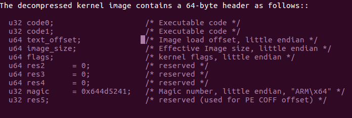

Kernel Image Header: Flags

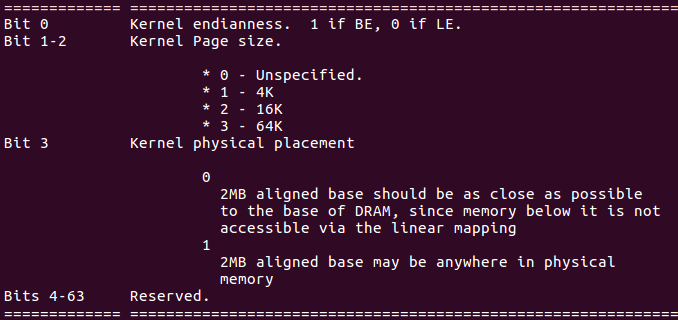

Ví dụ: Kernel Image của lf 5.10.y

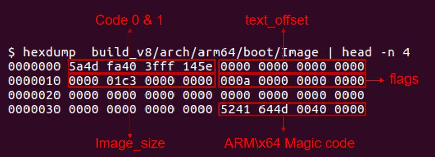

Các ràng buộc khác trước khi nhảy vào kernel

- Ngừng mọi hoạt động DMA (quiesce)
- Thiết lập thanh ghi của CPU chính (primary CPU)<br>x0 = địa chỉ dt blob trong RAM<br>x1-x3 = 0
- Tắt MMU, Instruction cache bật hoặc tắt đều được<br>……

Hãy tham khảo Documentation/arm64/booting.rst.

## 2. ARM64 Virtual Memory Layout

Bố cục bộ nhớ của Linux AArch64 với page 4KB + 4 level (48-bit):

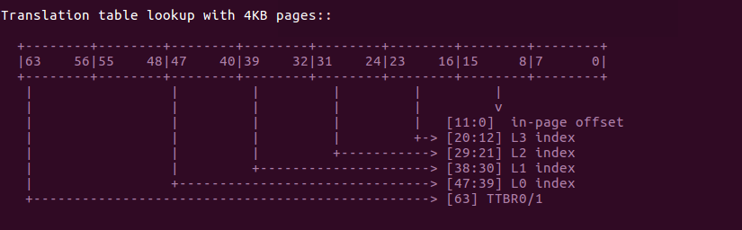

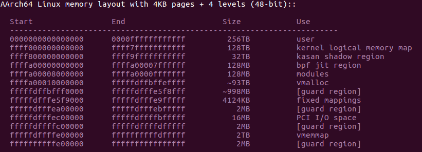

arch/arm64/kernel/vmlinux.lds.S<br>Lưu ý: địa chỉ kernel image bắt đầu từ vùng vmalloc<br>#define KIMAGE\_VADDR (MODULES\_END)

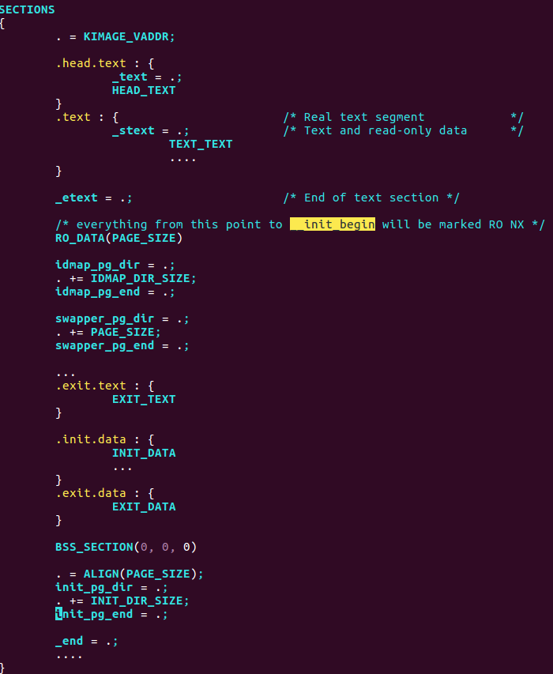

## 3. ARM64 IRQ Vectors Setup

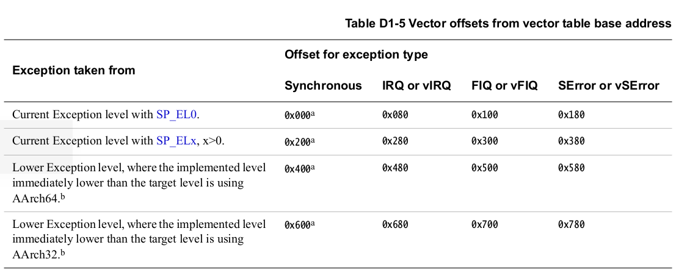

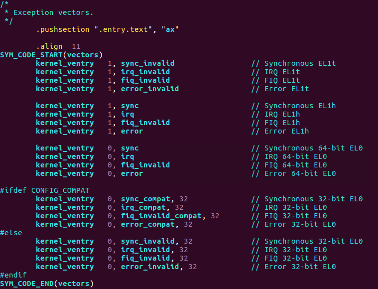

Objdump của vectors:

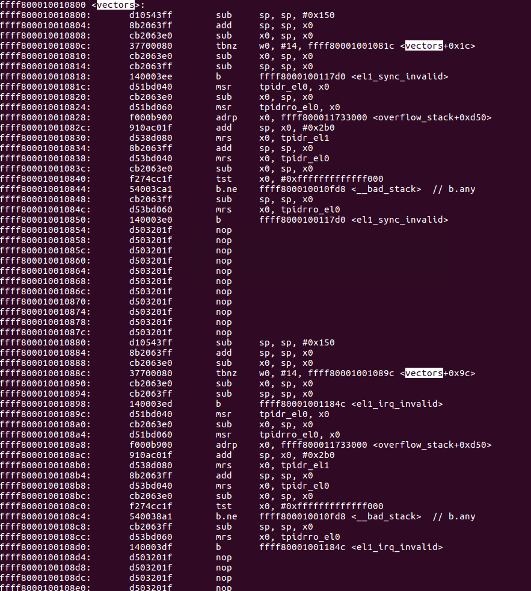

Quá trình xử lý IRQ của hệ thống<br>el1\_irq()->irq\_handler()->handle\_arch\_irq()<br>LƯU Ý: handle\_arch\_irq là irq top level cho một ARCH.<br>Với ARM64, nó thường được đặt bởi driver irqchip của hệ thống, ví dụ gic

```
int __init set_handle_irq(void (*handle_irq)(struct pt_regs *))
{
        if (handle_arch_irq)
                return -EBUSY;

        handle_arch_irq = handle_irq;
        return 0;
}
```

drivers/irqchip/irq-gic-v3.c<br>gic\_init\_bases() -> set\_handle\_irq(gic\_handle\_irq);<br>gic\_handle\_irq() -> handle\_domain\_irq(irq\_domain, hwirq, regs) -> irq handler hoặc chuyển tới handler của irq\_domain kế tiếp

## 4. FDT Mapping

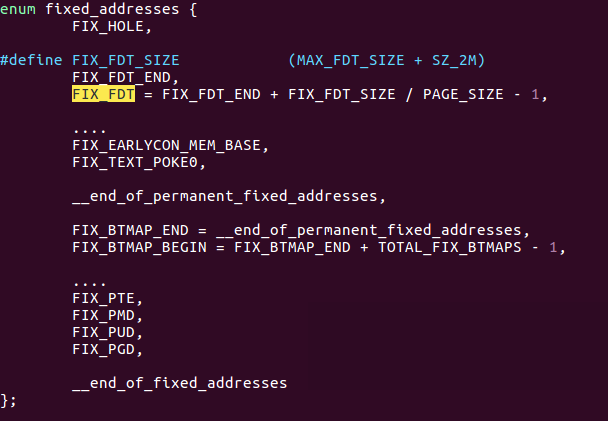

- Page table: init\_pg\_dir
- VA: FIX\_FDT
- PA: dt\_phys do bootloader truyền vào
- LƯU Ý: không được vượt quá 2M
- #define FIXADDR\_TOP (PCI\_IO\_START - SZ\_2M)
- #define \_\_fix\_to\_virt(x) (FIXADDR\_TOP - ((x) << PAGE\_SHIFT))
- dt\_virt\_base = \_\_fix\_to\_virt(FIX\_FDT);

## 5. Quá trình boot Kernel ARM64

### 5.1 Trước start\_kernel

Lệnh đầu tiên trong kernel<br>b primary\_entry // branch to kernel start, magic<br>Các việc chính trước khi vào start kernel

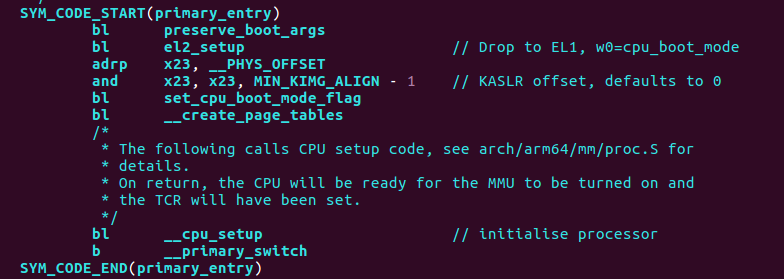

#### 5.1.1 \_\_create\_page\_tables

(1) Identity mapping cho code bật MMU<br>Page table: idmap\_pg\_dir (3 page cấp phát sẵn trong vmlinux.lds.S)<br>VA: \_\_pa lúc runtime của section ".idmap.text"<br>PA: \_\_pa lúc runtime của section ".idmap.text"<br>Lưu ý: section ".idmap.text" chứa code bật MMU<br>(2) Mapping kernel image<br>Page table: init\_pg\_dir<br>VA: KIMAGE\_VADDR / \_\_va(text) lúc compile<br>PA: \_\_pa(\_text) lúc runtime trong DRAM<br>LƯU Ý: section ‘text’ nằm trong dải địa chỉ vmalloc

#### 5.1.2 \_\_cpu\_setup

(1) Invalidate TLB local<br>(2) Tắt quyền truy cập PMU/AMU từ EL0<br>(3) Thuộc tính vùng nhớ (memory region attributes)

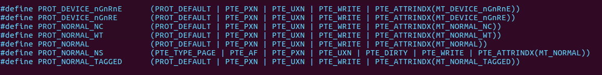

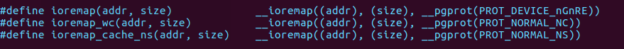

(4) Thiết lập dải địa chỉ 48-bit và page table 4K

#### 5.1.3 \_\_primary\_switch

(1) \_\_enable\_mmu<br>TTBR0: idmap\_pg\_dir<br>TTBR1: init\_pg\_dir<br>(2) Thiết lập ngẫu nhiên hóa địa chỉ kernel image (KASLR)<br>(3) Setup kernel stack, thread\_info/init\_task<br>(4) Nạp VBAR\_EL1 bằng địa chỉ ảo của bảng vector<br>(5) Tính kimage\_voffset để hỗ trợ \_\_pa(x)/\_\_pa\_symbol(x)<br>(6) Xóa BSS<br>(7) Tạo FDT mapping (xem các phần tiếp theo)<br>(8) Gọi vào start\_kernel()

### 5.2 Start\_kernel

(1) Setup kiến trúc (ví dụ setup\_arch())<br>(2) Khởi tạo hệ thống con bộ nhớ (Memory Subsystem)<br>Memory zone<br>Memory buddy system<br>(3) Khởi tạo Schedule<br>(4) Khởi tạo IRQ<br>of\_irq\_init(\_\_irqchip\_of\_table)<br>Driver: IRQCHIP\_DECLARE(gic\_v3, "arm,gic-v3", gic\_of\_init);<br>(5) Khởi tạo Timer<br>Đăng ký Clocks/clocksource/clockevent/cyclecounter.<br>of\_clk\_init(NULL);<br>Driver: CLK\_OF\_DECLARE(imx7ulp\_clk\_scg1, "fsl,imx7ulp-scg1",<br>imx7ulp\_clk\_scg1\_init);<br>TIMER\_OF\_DECLARE(armv8\_arch\_timer, "arm,armv8-timer",<br>arch\_timer\_of\_init);<br>(6) Khởi tạo Console<br>(7) Khởi tạo các chức năng core khác<br>Ví dụ cgroup\_init() / kcsan\_init()<br>(8) Khởi tạo phần còn lại (Rest Init)

#### 5.2.1 Start\_kernel -> setup\_arch

- early\_ioremap\_init cho những nơi dùng sớm early\_ioremap(paddr, size)
- setup\_machine\_fdt
- parse\_early\_param
  - early\_param("mem", early\_mem);
  - early\_param("earlycon", param\_setup\_earlycon);
  - early\_param("debug", debug\_kernel);
- cpu\_uninstall\_idmap
- arm64\_memblock\_init
  - Reserve bộ nhớ mà kernel image dùng
  - Reserve bộ nhớ được chỉ định trong DT và khởi tạo đặc thù nếu có

Ví dụ RESERVEDMEM\_OF\_DECLARE(cma, "shared-dma-pool", rmem\_cma\_setup);

- unflatten\_device\_tree

paging\_init và bootmem\_init

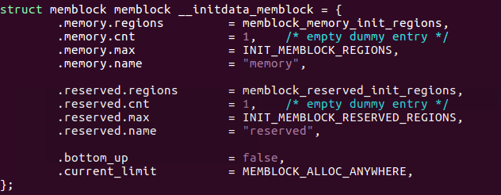

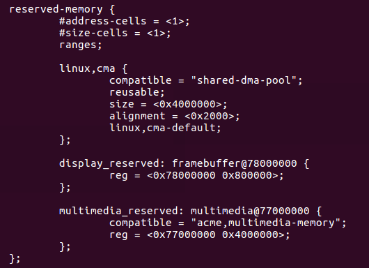

##### 5.2.1.1 Start\_kernel -> setup\_arch -> setup\_machine\_fdt

- Phân tích ‘bootargs’ từ node ‘chosen’ của DT
- Phân tích base và size của bộ nhớ vật lý, thêm vào subsystem memblock
- Phân tích Machine model

##### 5.2.1.2 Start\_kernel -> setup\_arch -> paging\_init / bootmem\_init

- Remap các section của kernel \_text, \_rodata, \_data v.v.<br>với các quyền khác nhau
- Linear mapping cho các block bộ nhớ vật lý khả dụng<br>#define \_\_phys\_to\_virt(x) ((unsigned long)((x) - PHYS\_OFFSET) |<br>PAGE\_OFFSET)
- Chuyển sang swapper\_pg\_dir
- Xây dựng structure page / vmemmap
  - Sparse\_init
- Xây dựng memory zone
  - Thường chỉ có một zone DMA với ARM64

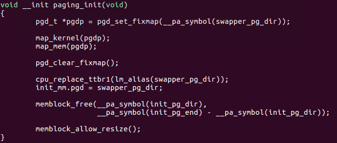

Dump page table sau paging\_init:

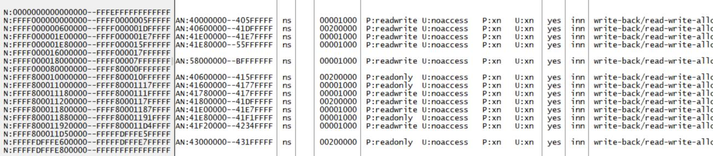

##### 5.2.1.3 Start\_kernel -> setup\_arch -> psci\_init

Firmware interface triển khai các thao tác liên quan tới nguồn điện của CPU, được định nghĩa trong spec ARM PSCI<br>Gồm CPU\_ON/OFF/SUSPNED/MIGRATION *(ghi chú: đúng là SUSPEND)* v.v.

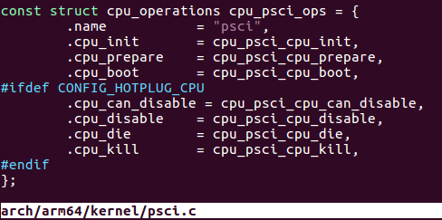

#### 5.2.2 Start\_kernel -> Rest\_init

- Tạo ba kernel thread đầu tiên
  - PID 0 -> Idle thread cho mỗi CPU
    - cpu\_startup\_entry -> do\_idle -> cpuidle\_idle\_call -> cpuidle\_enter ->
    - cpuidle\_enter\_state (do governor chọn) -> psci suspend state (cpuidle-psci.c) -> TF-A
  - PID 1 -> Init thread
    - Tiếp tục chạy kernel\_init() cho phần việc khởi tạo kernel còn lại
  - PID 2 -> kthreadd
    - Dùng cho kthread\_run(hwrng\_fillfn, NULL, "hwrng");
  - Dump từ userspace

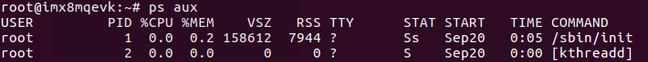

##### 5.2.2.1 Start\_kernel -> Rest\_init -> kernel\_init

- Khởi tạo SMP
  - Bật các CPU không phải boot CPU<br>bringup\_nonboot\_cpus -> cpuhp\_up\_callbacks -><br>boot\_secondary -> cpu\_psci\_cpu\_boot -> TF-A
  - Khác biệt so với boot CPU<br>Về cơ bản giống nhau, chỉ khác là không có \_\_create\_page\_tables
- do\_initcalls
  - Thường dùng để đăng ký device và driver<br>Ví dụ module\_init()
  - Được gọi theo thứ tự dưới đây:<br>\_\_initcall0\_start,<br>…<br>\_\_initcall7\_start,
  - Không còn tác dụng khi build dưới dạng module<br>Tất cả mặc định thành module\_init()
  - Platform device được populate ở arch level<br>Ví dụ arch\_initcall\_sync(of\_platform\_default\_populate\_init);

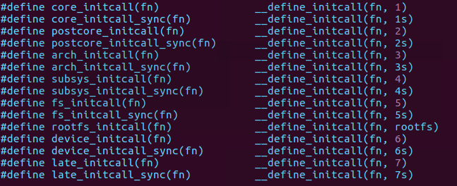

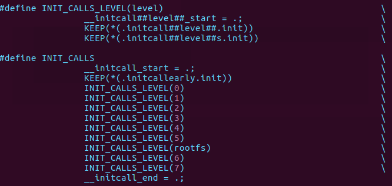

- Filp\_open(/dev/console)
- Mount rootfs trong prepare\_namespace
- Giải phóng init memory nằm giữa \_\_init\_begin và \_\_init\_end
- Chạy ứng dụng userspace đầu tiên theo thứ tự<br>execute\_command. Ví dụ init=/bin/sh<br>CONFIG\_DEFAULT\_INIT<br>/sbin/init, /etc/init, /bin/init, /bin/sh
