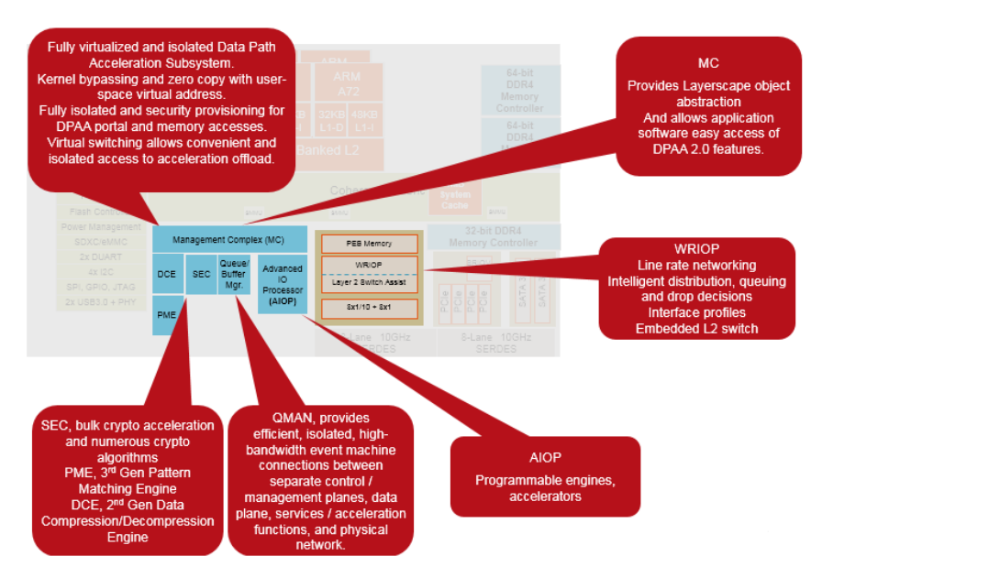

# Chương 1 Giới thiệu

DPAA2 là một kiến trúc mạng ở mức phần cứng có trên một số SoC của NXP. Tài liệu này cung cấp thông tin kỹ thuật về kiến trúc này, chủ yếu dành cho các nhà phát triển phần mềm. Các SoC có DPAA2 chứa các khối IP phần cứng sau:

- Management Complex (bắt buộc)
- WRIOP (bắt buộc)
- QBMan (bắt buộc)
- Các accelerator, như SEC, DCE và PME (đều là tùy chọn)
- AIOP, một packet engine lập trình được (tùy chọn)

Sơ đồ khối sau cho thấy các khối IP phần cứng của DPAA2:

**Figure 1-1. Các khối phần cứng của DPAA2**

Management Complex (MC) là một thành phần then chốt của DPAA2. Như được giải thích chi tiết trong tài liệu này, MC chạy một firmware image do NXP cung cấp, giúp trừu tượng hóa và đơn giản hóa việc cấp phát và cấu hình các phần tử phần cứng khác thông qua các “object” của DPAA2. Các object này cung cấp những dịch vụ quen thuộc, như làm lõi của các giao diện mạng, cung cấp dịch vụ chuyển mạch, cung cấp quyền truy cập tới các accelerator, v.v.

Các chủ đề về MC nằm trong phạm vi tài liệu này gồm:

- Định nghĩa các DPAA2 object: chúng làm gì, giao diện cấu hình của chúng, và cách các object làm việc với nhau.
- Báo cáo và xử lý lỗi cho các object.
- Cách nạp và khởi động MC ở mức phần cứng (cần để nạp firmware), cũng như cách cấp phát bộ nhớ, ICID, v.v. cho nó.
- Mô hình lập trình phần cứng của các command portal của MC. Chúng được dùng để truyền command khi làm việc với các object.
- Các interrupt và báo lỗi từ chính MC (khác với từ các object)

MC và các object trừu tượng hóa phần cấu hình. Chúng không trừu tượng hóa các thao tác I/O thực sự. Các thao tác này được thực hiện bằng QBMan software portal (được cấp phát và cấu hình thông qua các DPIO object). Tuy nhiên, phần mềm phải dùng trực tiếp software portal cho các thao tác I/O thực sự.

Ghi chú về tình trạng tài liệu

Hiện tại, người đọc phải tham khảo tài liệu QBMan đầy đủ trong reference manual phần cứng mức thấp. Tài liệu đó chứa nhiều thông tin hơn mức cần cho việc phát triển phần mềm trên general purpose core và AIOP. Về sau, phần thông tin phần cứng QBMan cần thiết sẽ được đưa vào tài liệu này. Ngoài ra, phần trình bày về các MC command và cách dùng object sẽ được mở rộng.

## 1.1 Đối tượng người đọc

Mục đích của tài liệu này là mô tả các dịch vụ của DPAA2 Management Complex và các cách dùng tốt nhất. Tài liệu này trình bày tổng quan về các chức năng, giao diện và cách dùng được khuyến nghị của Management Complex để kích hoạt các khả năng phần cứng của DPAA2, bao gồm mô hình lập trình cho các DPAA2 object khác nhau.

## 1.2 Định nghĩa và từ viết tắt

- AIOP: phần cứng Advanced I/O Processor
- DCE: Decompression and Compression Engine (engine giải nén và nén)
- DPAA2: Data Path Acceleration Architecture, phiên bản thứ hai.
- DPC: Data Path Configuration
- DPL: Data Path Layout
- GPP: General Purpose Processor
- MC: Management Complex
- QBMan: phần cứng Queue Manager và Buffer Manager
- SEC: phần cứng Security Engine
- WRIOP: Wire-Rate I/O Processor
