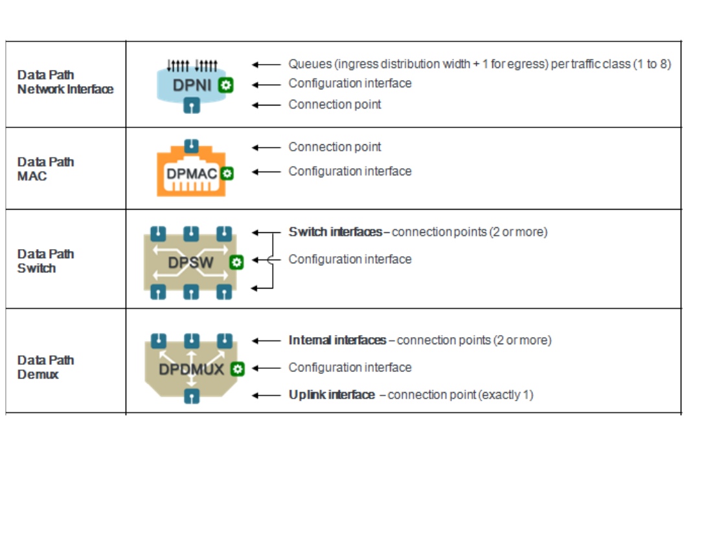
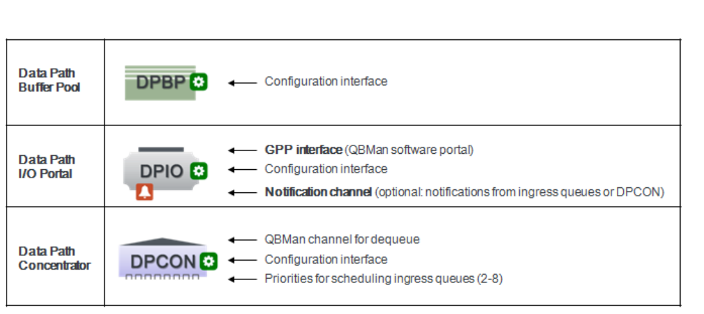
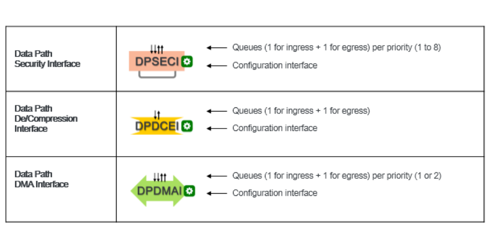
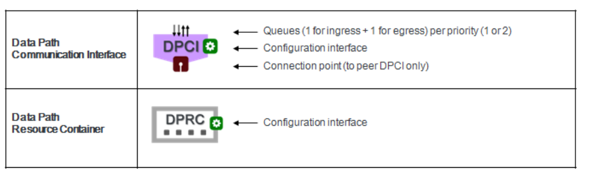
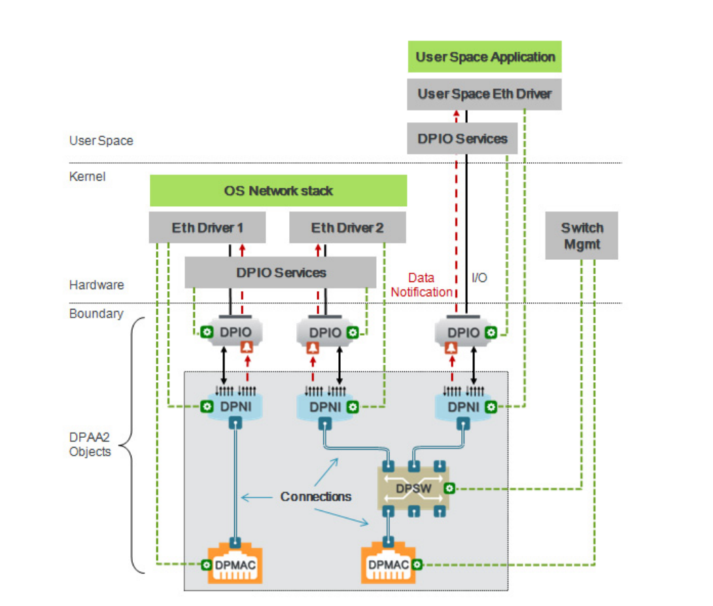
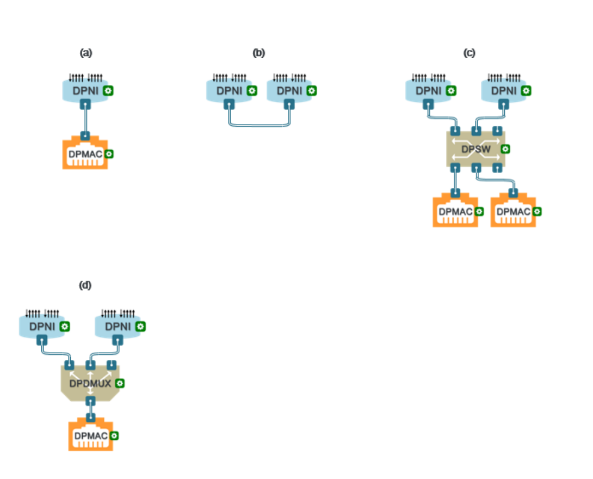

# Chương 2 Tổng quan

Management Complex (MC) là một khối phần cứng trong SoC giúp đơn giản hóa việc quản lý thiết bị DPAA2 - các network object (giao diện mạng, L2 switch), các accelerator, v.v. MC cung cấp các object trừu tượng và một giao diện command giúp phần mềm dùng các DPAA2 object đơn giản hơn; nó cũng cung cấp khả năng quản lý tài nguyên, có thể tạo và gán các object này cho các software context khác nhau (ứng dụng, máy ảo). Nhờ đó các software context có thể truy cập trực tiếp tài nguyên phần cứng, đồng thời các object được cô lập khỏi các context khác; điều này bảo đảm phần mềm độc hại không thể tác động tới các object.

Các process trên GPP và AIOP không truy cập trực tiếp được phần lớn tài nguyên DPAA2; thay vào đó chúng thực hiện các thao tác quản lý DPAA2 cần thiết bằng các MC command, và các command này thay mặt process đó thực hiện việc tương tác thực sự với phần cứng.

## 2.1 Giới thiệu về các DPAA2 object

Mục đích chính của các DPAA2 object do MC cung cấp là đơn giản hóa việc dùng các khối phần cứng DPAA2 thông qua trừu tượng hóa và đóng gói. Các DPAA2 object:

- Đóng gói một chức năng cụ thể
- Tách chức năng đó khỏi phần cứng DPAA2 bằng một lớp trừu tượng
- Thể hiện chức năng thông qua các thuộc tính và method được định nghĩa rõ ràng

MC xuất ra một tập các object logic để kích hoạt DPAA2, như được giải thích trong các mục sau. Các object có thể được tạo động thông qua các lời gọi API riêng, hoặc tạo tĩnh lúc khởi tạo bằng file cấu hình Data Path Layout (DPL). Không phải mọi object và chức năng của object đều có trên mọi nền tảng dựa trên DPAA 2.x; xem thêm chi tiết ở Section 2.1.5, “Hỗ trợ DPAA2 object theo nền tảng.”

Mục này:

- Trình bày mô hình DPAA2 object ở mức khái niệm và mô tả cách các object được tạo, hủy, chuyển giao, cấu hình và sử dụng.
- Liệt kê các loại object và mục đích của chúng.

“Người dùng” thường là phần mềm ứng dụng chạy trên các general purpose processor (core) hoặc trên AIOP. Phần mềm mức driver trên GPP (và đôi khi trên AIOP) làm việc với các object đã được trừu tượng hóa thay vì làm việc trực tiếp với phần cứng. Ví dụ, phần mềm trên GPP làm việc với L2 switch và giao diện mạng thay vì làm việc trực tiếp với WRIOP.

Các DPAA2 object biểu diễn và trừu tượng hóa phần cứng DPAA2 thành những object do phần mềm quản lý, có các đặc điểm sau:

- Thuật ngữ và cách dùng hướng theo ứng dụng, thay vì hướng theo phần cứng.
- Dựa trên các khái niệm mà lập trình viên và kiến trúc sư hệ thống nói chung đã quen thuộc.
- Đơn giản hơn so với quản lý trực tiếp phần cứng.
- Thể hiện ý đồ kiến trúc của các khối phần cứng.

Các dịch vụ DPAA2 object được cung cấp bởi phần mềm chạy dưới dạng firmware trên một khối phần cứng DPAA2 gọi là Management Complex. Người dùng không cần lập trình Management Complex để dùng Network Object Services; họ chỉ cần dùng firmware do NXP cung cấp. Firmware này chạy trên Management Complex thay vì trên một general purpose core để đơn giản hóa việc tích hợp phần mềm NXP với phần mềm của khách hàng. Management Complex cung cấp các object thực hiện những dịch vụ cụ thể; các object có thuộc tính và giao diện trông như phần cứng.

### 2.1.1 Các network object

Mục tiêu chính của DPAA2 là mạng nâng cao, và MC xuất ra nhiều object cho phép người dùng định nghĩa topology của “mạng trên chip” (network on a chip). Topology mạng có thể gồm các giao diện mạng với khả năng khác nhau cùng nhiều loại switch và aggregator, được người dùng định nghĩa và nối với nhau theo cách đơn giản.

#### 2.1.1.1 Data Path Network Interface (DPNI)

MC xuất ra một giao diện mạng chuẩn có thể cấu hình để hỗ trợ nhiều tính năng, từ một giao diện Ethernet cơ bản cho tới một giao diện mạng đầy đủ chức năng. DPNI hỗ trợ các tính năng chuẩn như lọc, QoS, kiểm tra checksum và gắn time-stamp; nó cũng có thể offload công việc khỏi GPP bằng cách thực hiện các chức năng như gỡ/chèn VLAN header, IP Reassembly và IP Fragmentation.

Ở chiều ingress, DPNI nhận frame từ một DPMAC hoặc một object khác như DPSW, phân tích header, xác định traffic class của frame, rồi enqueue frame vào một frame queue được chọn dựa trên traffic class và các giá trị header khác. Cơ chế này hỗ trợ cả việc phân phối frame tới nhiều core dựa trên hash, lẫn việc điều hướng flow trực tiếp (flow steering) tới các core cụ thể. DPNI có thể sinh thông báo có dữ liệu (data availability notification) cho từng queue khi một frame được enqueue.

Ở chiều egress, DPNI dequeue frame từ các frame queue và truyền chúng qua một DPMAC, hoặc tới một DPAA2 object khác như DPSW.

Thông thường, DPNI coi traffic gồm các packet mạng chuẩn (L2, L3, L4, v.v.); tuy nhiên cũng có thể cấu hình DPNI thành một giao diện mạng chung (generic network interface), khi đó profile traffic dựa trên định dạng packet bắt đầu từ các tầng cao hơn. Ví dụ định dạng cho profile này có thể là L5+L6+Payload (như trong các ứng dụng GTP hay CAPWAP). Ở chế độ này, DPNI không dùng để tương tác với network stack chuẩn mà dùng trong các ứng dụng fast-path hay tunnel, vì vậy phù hợp cho kết nối mạng giữa ứng dụng trên GPP và ứng dụng trên AIOP.

#### 2.1.1.2 Data Path MAC (DPMAC)

DPMAC đại diện cho một Ethernet MAC, tức một thiết bị phần cứng nối với PHY và cho phép truyền, nhận frame Ethernet ở mức vật lý; vì DPAA2 cho phép cấu hình các giao diện nội bộ, tổng số giao diện mạng có thể nhiều hơn số MAC object. DPMAC object cũng cung cấp quyền truy cập MDIO, dùng để cấu hình các thiết bị PHY bên ngoài.

Lưu ý rằng các giao thức được hỗ trợ trên một DPMAC object phụ thuộc vào SoC và cấu hình RCW. Để biết giao thức nào được hỗ trợ trên một DPMAC object cụ thể, hãy xem chương “SerDes options” trong Reference Manual của SoC mà bạn quan tâm.

#### 2.1.1.3 Data Path Switch (DPSW)

DPSW object cung cấp chức năng của một switch tầng 2 thông thường. Nó nhận packet ở một port và gửi ra port khác. Nó cũng có thể gửi packet ra nhiều port cho mục đích broadcast, multicast hoặc mirroring.

#### 2.1.1.4 Data Path Demux (DPDMUX)

DPDMUX là một loại switch khác. Nó khác DPSW ở vài điểm. DPDMUX chỉ có một port “uplink”. Ngoài ra, nó có thể được lập trình để điều hướng packet dựa trên các field header vượt ra ngoài tầng 2.

Hình dưới đây tóm tắt các network object của DPAA2 và các ký hiệu dùng để minh họa chúng.

**Figure 1. Tóm tắt các network object của DPAA2 và ký hiệu**

### 2.1.2 Các infrastructure object của DPAA2

MC xuất ra một tập các object hỗ trợ, cung cấp quyền truy cập DPAA2 QBMan theo cách vừa dễ cấu hình, vừa đủ linh hoạt để tận dụng và chia sẻ tài nguyên tối ưu trong các software context.

#### 2.1.2.1 Data Path Buffer Pool (DPBP)

DPBP đại diện cho một buffer pool của QBMan. Nó chủ yếu được các giao diện mạng và accelerator của DPAA2 dùng như một tài nguyên, nhưng nó cũng là một thực thể chủ động vì có thể gửi thông báo buffer pool cạn (depletion notification) tới phần mềm trên GPP core. Chủ sở hữu DPBP chịu trách nhiệm nạp sẵn buffer vào nó

#### 2.1.2.2 Data Path I/O Portal (DPIO)

DPIO object cho phép cấu hình QBMan software portal kèm một notification channel tùy chọn; mục đích chính của nó là cho phép GPP thực hiện I/O qua QBMan – các thao tác hàng đợi phần cứng như enqueue và dequeue, và các thao tác quản lý buffer phần cứng như acquire và release. Nó cũng cho phép nhận thông báo có dữ liệu và thông báo buffer pool cạn. Mỗi DPIO object thường được gắn với một thread của GPP core.

#### 2.1.2.3 Data Path Concentrator (DPCON)

DPCON object cho phép gom các packet ingress từ nhiều giao diện vào một thiết bị duy nhất, mà với GPP core trông như một giao diện. DPCON dùng các tùy chọn lập lịch của QBMan channel để offload việc lập lịch packet ingress cho phần cứng, kể cả lập lịch giữa các giao diện mạng khác nhau.

DPCON cũng hữu ích cho phần mềm polling để lấy frame đầu vào; nó cho phép poll một giao diện duy nhất thay vì nhiều giao diện.

Hình dưới đây tóm tắt các infrastructure object của DPAA2 và các ký hiệu dùng để minh họa chúng.

**Figure 2. Tóm tắt các infrastructure object của DPAA2 và ký hiệu**

### 2.1.3 Các accelerator interface

DPAA2 có nhiều hardware accelerator hỗ trợ GPP trong các tác vụ xử lý dữ liệu. MC xuất ra các accelerator interface object cho phép phần mềm trên GPP gửi request tới các accelerator này và nhận kết quả xử lý dữ liệu của chúng.

#### 2.1.3.1 Data Path Security Interface (DPSECI)

Security engine (SEC) chứa phần cứng hiệu năng cao để tăng tốc và offload mật mã, được thiết kế để hoạt động trong môi trường data path. Nó triển khai:

- Các thuật toán mã hóa khối
- Các thuật toán stream cipher
- Các thuật toán hash
- Các thuật toán public key
- Kiểm tra tính toàn vẹn lúc chạy (run time integrity checking)
- Bộ sinh số ngẫu nhiên

DPSECI object cung cấp cho phần mềm trên GPP một giao diện để gửi request tới SEC và nhận response kết quả.

#### 2.1.3.2 Data Path De/Compression Interface (DPDCEI)

Decompression and Compression Engine (DCE) chứa phần cứng hiệu năng cao cho chức năng giải nén và nén, được thiết kế để hoạt động trong môi trường data path. Chức năng của nó gồm:

- Offload và tăng tốc giải nén và nén DEFLATE theo định nghĩa trong RFC1951
- Offload và tăng tốc giải nén và nén GZIP theo định nghĩa trong RFC1952
- Offload và tăng tốc giải nén và nén ZLIB theo định nghĩa trong RFC1950

DPDCEI object cung cấp cho phần mềm trên GPP một giao diện để gửi request tới DCE và nhận response kết quả.

#### 2.1.3.3 Data Path DMA Interface (DPDMAI)

qDMA controller chứa phần cứng hiệu năng cao cho chức năng truyền dữ liệu, được thiết kế để hoạt động trong môi trường data path. Controller có thể truyền các khối dữ liệu giữa một nguồn và một hoặc nhiều đích. Các khối dữ liệu được truyền có thể nằm liên tục hoặc không liên tục trong bộ nhớ, dùng bảng scatter/gather.

DPDMAI object cung cấp cho phần mềm trên GPP một giao diện để gửi request tới qDMA và nhận response báo hoàn tất.

Hình dưới đây tóm tắt các accelerator interface object của DPAA2 và các ký hiệu dùng để minh họa chúng.

**Figure 3. Tóm tắt các accelerator interface object của DPAA2 và ký hiệu**

### 2.1.4 Các object quản lý và điều khiển

#### 2.1.4.1 Data Path Communication Interface (DPCI)

MC xuất ra một giao diện chung cho giao tiếp giữa các partition (inter-partition communication, IPC). DPCI cho phép giao tiếp dựa trên frame giữa các software context khác nhau, dùng hạ tầng QBMan của DPAA2. Giao thức giao tiếp không được định nghĩa và giao diện không phân tích hay phân loại frame (khác với DPNI là một giao diện mạng chuẩn đầy đủ tính năng).

Các DPCI object cần được nối theo cặp (mỗi software context một DPCI) để tạo thành một liên kết giao tiếp. Kiểu giao tiếp này có thể phục vụ các nhu cầu quản lý/điều khiển cơ bản giữa phần mềm trên GPP và phần mềm trên AIOP, hoặc giữa hai software context trên GPP.

#### 2.1.4.2 Data Path Resource Container (DPRC)

DPRC object cho phép management complex theo dõi các tập object đang được cùng một thành phần phần mềm dùng. Các object trong tập được gọi là nằm trong cùng container. DPRC hoạt động như một bus ảo, và software context có thể truy vấn nó để lấy các DPAA2 object rồi gắn chúng với các device driver của OS. DPRC cũng cho phép một software context tạo các software context con cháu, gán tài nguyên và object cho các context này, và xây dựng topology mạng nội bộ bằng cách nối các DPAA2 network object.

Một số object có phần cứng có khả năng DMA. Mọi object trong cùng một DPRC dùng chung một ICID và một tập IO-MMU mapping. Một số tính năng chính của DPRC gồm:

- Truy cập trực tiếp – Mọi object và tài nguyên trong một container là riêng của container đó, và các thành phần phần mềm được truy cập trực tiếp tới “thanh ghi” (do management complex trừu tượng hóa) của các hardware object.
- Phát hiện động – Một software context được giao một DPRC có thể phát hiện động các object và tài nguyên đặt trong container bằng MC command.
- Hot plug/unplug – Các object có thể được cắm và rút động khỏi DPRC
- Bảo mật – Một software context chỉ thấy các object trong DPRC của nó, và không thể tác động tới các container khác hay hoạt động bình thường của các software context khác. Các giao dịch DMA từ MC object được cô lập bằng IOMMU của hệ thống.

#### 2.1.4.3 Data Path MC Portal (DPMCP)

DPMCP object gắn với các Management Complex Portal, và cho phép phần mềm trên GPP cấu hình interrupt báo hoàn tất command cho các portal này. DPMCP object là tùy chọn nếu phần mềm trên GPP poll portal và không dùng interrupt của portal. Tuy nhiên, để nhất quán và theo dõi tốt hơn các MC portal đang được dùng, nên luôn tạo DPMCP object cho các MC portal mà GPP dùng.

Hình dưới đây tóm tắt các management object của DPAA2 và các ký hiệu dùng để minh họa chúng.

**Figure 4. Tóm tắt các management object của DPAA2 và ký hiệu**

### 2.1.5 Hỗ trợ DPAA2 object theo nền tảng

**Table 2-1. Các DPAA2 object được hỗ trợ theo nền tảng**

| Object | Nền tảng | Ghi chú |
|---|---|---|
| Networking object |   |   |
| DPNI | LS2080, LS2088, LS1088, LX2160, LA1575 | LS1088: Không hỗ trợ TCAM Không hỗ trợ DPNI_OPT_HAS_KEY_MASKING |
| DPMAC | LS2080, LS2088, LS1088, LX2160, LA1575 | Các personality LS1044 và LS1048: không có DPMAC1. |
| DPSW | LS2080, LS2088, LX2160 | — |
| DPDMUX | LS2080, LS2088, LS1088, LX2160 | — |
| DPRTC | LS2080, LS2088, LS1088, LX2160, LA1575 | Chỉ hỗ trợ 1588 two-step |
| Accelerator object |   |   |
| DPAIOP | LS2088, LS1088, LA1575 | — |
| DPSECI | LS2080, LS2088, LS1088, LX2160, LA1575 | — |
| DPDMAI | LS2080, LS2088, LS1088, LX2160, LA1575 | — |
| DPDCEI | LS2080, LS2088, LX2160 | — |
| Infrastructure object |   |   |
| DPBP | Tất cả | — |
| DPIO | Tất cả | — |
| DPCON | Tất cả | — |
| Management và control object |   |   |
| DPRC | Tất cả | — |
| DPCI | Tất cả | — |
| DPMCP | Tất cả | — |

## 2.2 Topology và kết nối giữa các object

Các DPAA2 network object có thể được nối với nhau, tạo thành một topology “mạng trên chip”; kết nối là các dây mạng ảo giữa hai endpoint, trong đó endpoint có thể là một giao diện mạng (DPNI), một DPMAC (port ngoài), một interface của DPSW, một interface của DPDMUX, v.v. Như trong mạng thật, một endpoint không nhất thiết biết loại hay danh tính của endpoint ở đầu kia, nhưng nó có thể truy vấn link state và nhận thông báo về các sự kiện link up/down.

Hình dưới đây minh họa một topology mạng đơn giản. Topology mạng nằm trong ô màu xám có viền chấm. Các phần tử còn lại trong hình được vẽ để dễ hiểu ngữ cảnh hệ thống hơn.

**Figure 5. Ví dụ về topology object**

Hệ thống trong ví dụ trên chỉ có hai port ngoài (DPMAC object), nhưng có ba giao diện mạng (DPNI object) hoàn toàn độc lập với nhau.

Một DPNI được nối trực tiếp với một DPMAC object, giống một Ethernet controller truyền thống. Giao diện mạng này chỉ có thể giao tiếp ra ngoài SoC.

Hai DPNI object còn lại, cùng với DPMAC object thứ hai, được nối với các interface của DPSW. Nhờ đó cả hai giao diện mạng có thể giao tiếp ra ngoài SoC qua DPMAC, và cũng giao tiếp được với nhau.

Lưu ý rằng các DPNI object trong ví dụ cũng gắn với các DPIO object, cho phép phần mềm trên GPP nhận thông báo có dữ liệu và thực hiện thao tác I/O trên các giao diện mạng này. Kiểu quan hệ này không được coi là một kết nối theo nghĩa được mô tả trong mục này. Việc gắn DPIO object với DPNI object và các object khác được giải thích chi tiết hơn ở phần sau của tài liệu.

Các đường cấu hình nét đứt cho thấy thành phần phần mềm nào sở hữu việc cấu hình và quản lý từng object. Hai giao diện mạng thuộc về các instance của Ethernet driver trong Linux Kernel và tương tác với network stack của Linux. Một giao diện mạng được gán cho một process user space và do một Ethernet driver user space điều khiển. Switch được quản lý độc lập với các giao diện mạng nối vào nó.

### 2.2.1 Kết nối và link state

Khái niệm Link hơi khác với Connection (kết nối). Kết nối giữa các network object là điều kiện cần để có link mạng giữa các object, nhưng chưa phải điều kiện đủ. Để link ở trạng thái up, cả hai object được nối phải ở trạng thái enabled. Thành phần phần mềm sở hữu mỗi object có thể enable hoặc disable object đó bất cứ lúc nào – việc này được làm bằng cách gửi các command tương ứng tới MC. Nếu một trong hai object được nối bị disable, link state được coi là down và packet không thể đi qua link này. Tương tự, nếu phần mềm điều khiển quyết định ngắt kết nối hai object, kết nối sẽ kết thúc và cả hai object sẽ gặp sự kiện link down, ngay cả khi cả hai vẫn đang enabled.

MC chịu trách nhiệm lan truyền link state tới các object. Trong ví dụ trước, nếu DPMAC nối với DPSW mất link bên ngoài, interface DPSW ở đầu kia nhận được thông báo link down; tuy nhiên hai giao diện mạng nối với DPSW không bị ảnh hưởng – link state của chúng vẫn up và chúng vẫn giao tiếp được với nhau qua switch.

### 2.2.2 Các kết nối object điển hình

Một DPNI object phải được nối với một network object khác thì packet mới đi qua nó được. Như đã giải thích ở mục trước, chỉ có kết nối thì chưa đủ. Để giải thích các kết nối mạng được phép, mục này giả sử mọi object đều đã enabled và chỉ bàn về việc nối các loại object khác nhau có hợp lệ hay không.

Hình dưới đây cho thấy các kiểu kết nối điển hình.

**Figure 6. Các kết nối điển hình của network object**

Cấu hình (a) cho thấy một Ethernet controller truyền thống, trong đó DPNI được nối trực tiếp với DPMAC object. Mọi DPMAC object trong hình này được coi là đã nối với mạng bên ngoài (không vẽ ra).

Cấu hình (b) cho thấy hai DPNI object được nối kiểu điểm-điểm, cho phép giao tiếp mạng giữa hai software context. Kiểu kết nối này thường gặp trong giao tiếp GPP-tới-AIOP, hoặc giữa hai process khác nhau trên GPP.

Cấu hình (c) cho thấy một DPSW object được nối với hai DPMAC object và hai DPNI object. Mọi interface của DPSW đều như nhau, nên chọn interface nào khi nối object vào switch cũng không quan trọng.

Cấu hình (d) cho thấy một DPDMUX object có thể chia traffic ingress từ một DPMAC duy nhất tới nhiều giao diện mạng. Trong khi interface uplink duy nhất của DPDMUX thường được nối với một DPMAC, nhiều interface nội bộ của nó về cơ bản là như nhau và thường được nối với các DPNI object nội bộ

### 2.2.3 Nối khi nào và như thế nào

Các endpoint có thể được nối hoặc ngắt kết nối ở bất kỳ giai đoạn nào, bao gồm:

- Lúc MC khởi tạo, thông qua khai báo ‘connections’ trong DPL
- Lúc runtime, bằng cách gọi các command connect/disconnect thuộc API của DPRC object.

Các software context trên GPP có thể được cấp quyền thay đổi topology thông qua DPRC object của chính nó. Một software context chỉ được phép nối/ngắt các endpoint trong phạm vi của chính nó (container) hoặc trong phạm vi của các context con cháu.
