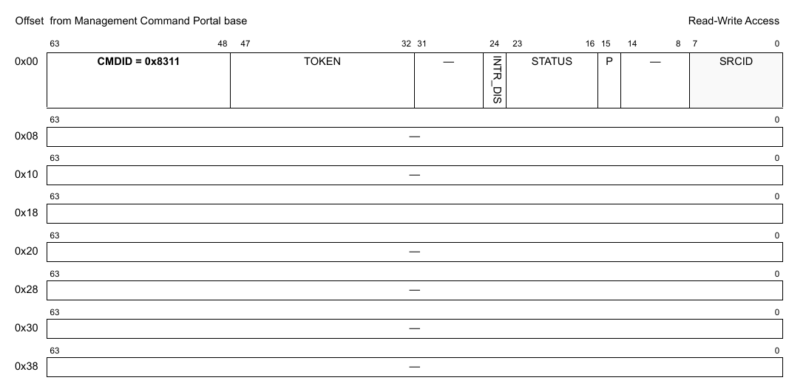
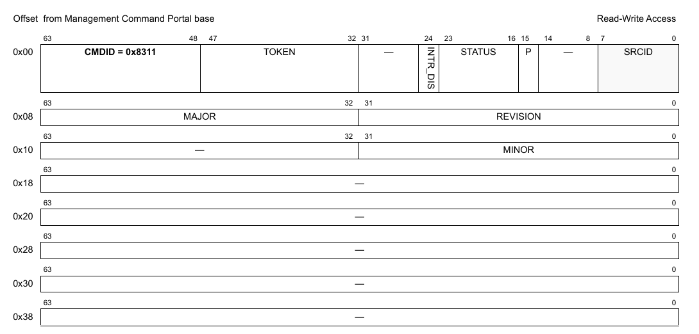
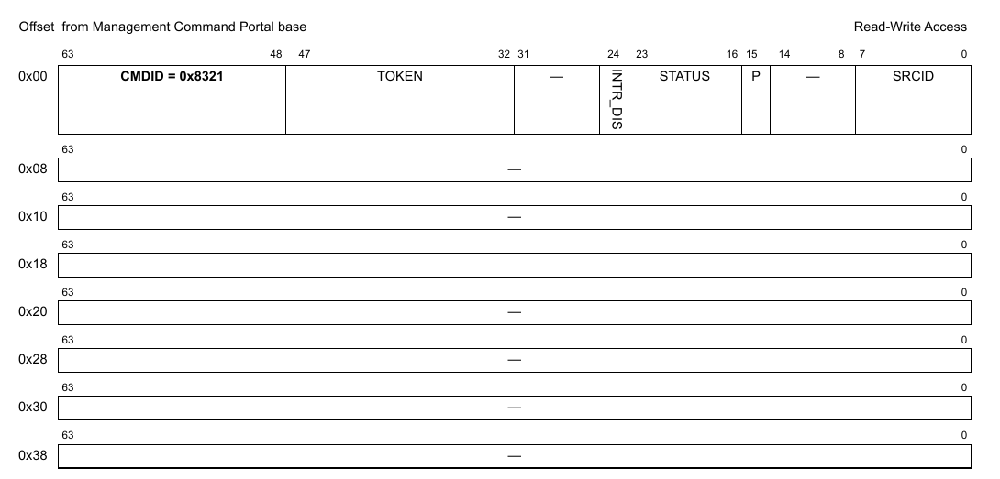
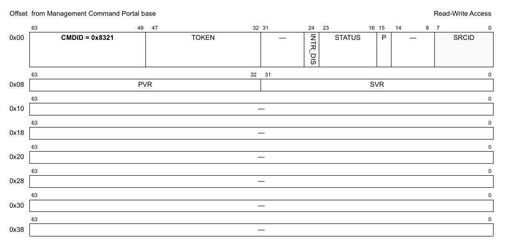

# Chương 4 Các phiên bản MC firmware

MC firmware dùng nhiều kiểu đánh phiên bản.

## 4.1 Phiên bản chung của MC firmware

Phiên bản firmware tuân theo các quy tắc sau:

- Major version number—tăng khi có thay đổi về tương thích API (cập nhật bất kỳ DPAA2 object nào hoặc bất kỳ MC API nào khác).
- Minor version number—tăng khi bổ sung API mà vẫn tương thích ngược;
- Minor version number được đặt lại về 0 khi major version number tăng.
- Revision number—tăng khi có thay đổi nội bộ và/hoặc sửa lỗi không ảnh hưởng tới định nghĩa API. Revision number được đặt lại khi major version hoặc minor version tăng.

MC cung cấp API để lấy phiên bản firmware đã biên dịch. Ngoài ra, các header file của MC API chứa số major và minor tương ứng, định nghĩa dưới dạng macro tiền xử lý, cho phép phần mềm trên GPP/AIOP đối chiếu số phiên bản đã định nghĩa với thông tin lấy được từ lời gọi MC API; việc kiểm tra này có thể phát hiện xung đột phiên bản giữa phần mềm GPP/AIOP và firmware thực sự đã nạp.

## 4.2 Phiên bản của DPAA2 object

Ngoài phiên bản chung của MC firmware, mỗi DPAA2 object có thông tin phiên bản riêng (số major và minor). Phiên bản object tăng theo các quy tắc sau:

- Major version number—tăng khi có thay đổi về tương thích API của DPAA 2.x object
- Minor version number—tăng khi bổ sung API của DPAA 2.x object mà vẫn tương thích ngược

Minor version number được đặt lại về 0 khi major version number tăng.

Mỗi MC firmware là một tập các object với nhiều phiên bản khác nhau, phiên bản của từng object lấy được bằng command GET_VERSION của object đó.

Trước khi dùng một object, nên kiểm tra phiên bản của object. Dựa vào phiên bản MC firmware và phiên bản object, người dùng có thể biết một số command hay flag có được hỗ trợ không và có xảy ra bất tương thích giữa phần mềm GPP/AIOP và MC Firmware không.

## 4.3 Các command của DPAA2 object

Mỗi object hỗ trợ một tập command riêng biệt với các chức năng khác nhau. Mỗi loại command có một CMDID riêng. Mỗi khi định dạng hay flag của command thay đổi, CMDID của command đó cũng thay đổi.

Để hỗ trợ tương thích ngược, MC Firmware có thể hiểu các command với các CMDID khác nhau.

Một phiên bản object chỉ công bố một CMDID cho mỗi command riêng biệt, nhưng để tương thích ngược, có thể có nhiều CMDID được hỗ trợ cho mỗi command (các CMDID dùng trong những bản MC trước).

## 4.4 Kiểm tra khuyến nghị cho người dùng

Kiểm tra phiên bản chung của MC firmware để xem major version có đúng như mong đợi hoặc mới hơn không.

Trước khi dùng một object, kiểm tra major version của object để xem có đúng như mong đợi hoặc là bản mới hơn hỗ trợ các command và flag cần dùng không.

Dùng CMDID mới nhất cho các command, hoặc một CMDID mà từng object hỗ trợ.

## 4.5 Tham chiếu command của firmware

Mục này trình bày chi tiết mô hình lập trình các command của firmware.

### 4.5.1 DPMNG_GET_VERSION

Định dạng command được thể hiện trong hình dưới đây.

**Cấu trúc command**

**Figure 4-1. Mô tả command DPMNG_GET_VERSION**

Bảng sau mô tả các field của command.

**Table 4-1. Mô tả các field của command DPMNG_GET_VERSION1**

| Offset | Bits | Tên | Mô tả |
|---|---|---|---|
| 0x00 | 0-63 | Header của command | Xem Table 2 để biết mô tả chung các field của command portal. CMDID phải được đặt như chỉ ra trong hình ở trên. |

1 Mọi field không được nêu là reserved và phải được xóa (đặt bằng 0)

**Cấu trúc response**

**Figure 4-2. Mô tả response của DPMNG_GET_VERSION**

Bảng sau mô tả các field của response.

**Table 4-2. Mô tả các field response của DPMNG_GET_VERSION1**

| Offset | Bits | Tên | Mô tả |
|---|---|---|---|
| 0x00 | 0-63 | Header của command | Xem Table 2 để biết mô tả chung các field của command portal. CMDID phải được đặt như chỉ ra trong hình ở trên. |
| 0x08 | 0-31 | REVISION | Internal revision number: tăng khi có thay đổi trong bản triển khai và/hoặc sửa lỗi không ảnh hưởng tới API |
|   | 32-63 | MAJOR | Major version number: tăng khi có thay đổi về tương thích API |
| 0x10 | 0-31 | MINOR | Minor version number: tăng khi bổ sung API (tương thích ngược); đặt lại khi major version tăng |

1 Mọi field không được nêu là reserved và phải được xóa (đặt bằng 0)

### 4.5.2 DPMNG_GET_SOC_VERSION

Command này có từ MC 10.1.0; nó sẽ không hoạt động trên các phiên bản cũ hơn.

Định dạng command được thể hiện trong hình dưới đây.

**Cấu trúc command**

**Figure 4-3. Mô tả command DPMNG_GET_SOC_VERSION**

Bảng sau mô tả các field của command.

**Table 4-3. Mô tả các field của command DPMNG_GET_SOC_VERSION1**

| Offset | Bits | Tên | Mô tả |
|---|---|---|---|
| 0x00 | 0-63 | Header của command | Xem Table 2 để biết mô tả chung các field của command portal. CMDID phải được đặt như chỉ ra trong hình ở trên. |

1 Mọi field không được nêu là reserved và phải được xóa (đặt bằng 0)

**Cấu trúc response**

**Figure 4-4. Mô tả response của DPMNG_GET_SOC_VERSION**

Bảng sau mô tả các field của response.

**Table 4-4. Mô tả các field response của DPMNG_GET_SOC_VERSION1**

| Offset | Bits | Tên | Mô tả |
|---|---|---|---|
| 0x00 | 0-63 | Header của command | Xem Table 2 để biết mô tả chung các field của command portal. CMDID phải được đặt như chỉ ra trong hình ở trên. |
| 0x08 | 0-31 | SVR | Nội dung thanh ghi SVR của nền tảng; xem manual riêng của nền tảng để biết thông tin chi tiết. |
|   | 32-63 | PVR | Nội dung thanh ghi PVR của nền tảng; xem manual riêng của nền tảng để biết thông tin chi tiết. |

1 Mọi field không được nêu là reserved và phải được xóa (đặt bằng 0)
