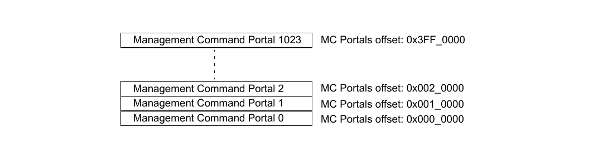
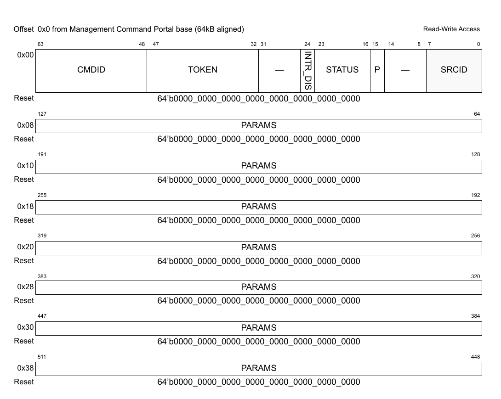
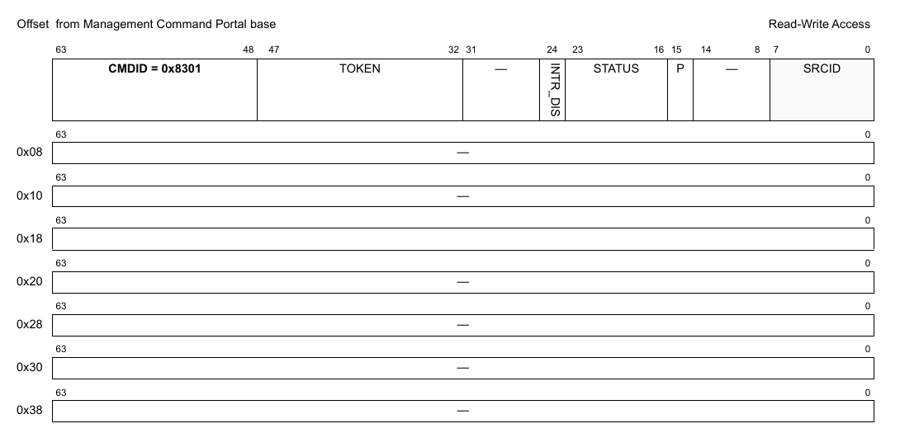
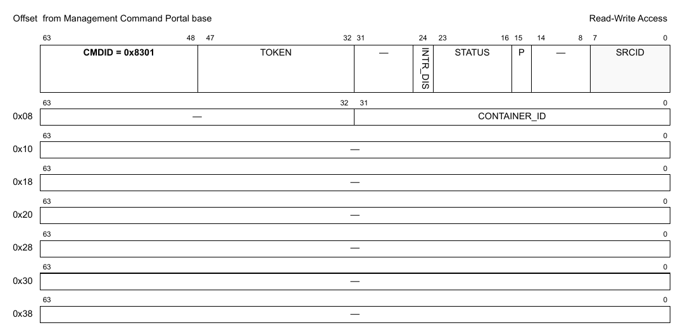

# Chương 5 Management Command Portal

Mục này mô tả cấu trúc bộ nhớ của các MC command portal và cách dùng chúng.

## 5.1 Tổng quan về command portal

Giao diện MC có 256 management portal được map liên tục trong bản đồ địa chỉ của SoC. Mỗi portal nằm trong một page bộ nhớ vật lý 64kB riêng trong bản đồ địa chỉ nội bộ của SoC, để Hypervisor có thể quản lý đúng việc cấp phát portal cho các process trên GPP và kiểm soát truy cập. Không được dùng chung MC portal giữa các software context khác nhau.

> **NOTE:**
>
> Thuộc tính quản lý bộ nhớ của GPP cho page portal cần được đặt là cache-inhibited.

Các process trên GPP (hoặc các task trên AIOP) gửi command tới portal bằng lệnh store non-cacheable, tương tự truy cập thanh ghi của thiết bị I/O thông thường. Mỗi MC portal chỉ hỗ trợ một command đang chờ tại một thời điểm, nên mọi command trên cùng portal được gửi và hoàn tất tuần tự. Các process trên GPP/AIOP cũng có thể đọc command portal. Các truy cập word không căn chỉnh vào portal, các giao dịch burst bị chia nhỏ và các truy cập ra ngoài 64 byte của portal đều không được thực hiện.

MC giữ một thuộc tính ICID cho mỗi portal, dùng để xác định isolation context khi thực thi command; một process trên GPP chỉ được gửi command cho isolation context mà nó đang chạy trong đó. Mọi địa chỉ bộ nhớ do bên gửi chỉ định, dù là đầu vào hay đầu ra, đều được IOMMU xác thực và chuyển đổi khi cấu trúc dữ liệu được truy cập với ICID gán cho command portal đó.

MC dùng một chính sách công bằng để chọn command portal được phục vụ tiếp theo; MC triển khai một cơ chế phân xử round-robin đơn giản để chọn và chuẩn bị command tiếp theo cần xử lý. Bên gửi có thể gán priority cao hoặc thấp cho command; các command priority cao đang chờ được xử lý trước mọi command priority thấp đang chờ.

## 5.2 Cách dùng command portal

MC dùng một cơ chế flow control đơn giản – command trên portal phải hoàn tất thì mới gửi được command tiếp theo vào cùng portal đó; vì vậy mỗi portal chỉ có thể có một command đang chờ tại bất kỳ thời điểm nào. Nếu người dùng gửi command mới vào portal trước khi portal được đánh dấu là sẵn sàng, MC có thể coi command mới là lỗi, hoặc đơn giản là bỏ qua nó.

Các command do processor GPP/AIOP gửi khiến MC thực hiện các dịch vụ quản lý cụ thể; các MC command hiện có được mô tả trong các mục MC object tương ứng. Bên gửi chuẩn bị command cụ thể cùng các tham số, sau đó ghi command header chứa command ID và các thuộc tính khác; field command word thực sự (word 4 byte thấp nhất ở offset 0x0 của địa chỉ portal) phải được ghi sau cùng. MC chờ việc ghi field command word, cho biết có command mới được gửi, rồi bắt đầu xử lý command đó.

> **NOTE:**
>
> Field status của portal được dùng làm cơ chế bắt tay giữa MC và bên gửi command. Bên gửi phải đặt trạng thái ready (0x01) khi ghi command header (chỉ sau khi đã ghi hết mọi tham số của command đó); MC báo command hoàn tất bằng mã thành công/lỗi trong chính field status đó. MC cũng có thể trả thông tin response của command trong bộ nhớ của portal, như được mô tả cho từng command.
>
> Mọi thao tác ghi vào bất kỳ word nào của một portal đang được phục vụ đều bị bỏ, còn đọc bất kỳ word nào của portal thì luôn được phép; bên gửi có thể poll status word tự do.

Process/task gửi command có thể dùng polling để kiểm tra command đã hoàn tất chưa và trạng thái cuối cùng; nó ghi command cần gửi vào một command portal, rồi poll status word của portal cho tới khi status cho biết command đã hoàn tất và portal đã sẵn sàng. Chỉ khi portal sẵn sàng thì process/task mới gửi command tiếp theo vào command portal đó. Các cơ chế chờ riêng của OS khác cũng được chấp nhận, miễn là không có command nào khác được ghi vào portal trước khi command trước đó hoàn tất.

## 5.3 Tạo và hủy DPAA2 object

Các thao tác trên DPAA2 object đòi hỏi phần mềm GPP/AIOP mở một phiên điều khiển (control session) cho object, bằng cách gửi một MC command CREATE; mỗi object có command CREATE riêng. Các thao tác trên DPAA2 object được thực hiện trong ngữ cảnh một Data Path Resource Container, nơi chứa mọi tài nguyên và thông tin object mà software context có thể truy cập hay sử dụng.

Khi mở một Data Path Resource Container, một authentication token handle duy nhất được trả về, dùng cho mọi thao tác object thực hiện trong ngữ cảnh container đó. Command CREATE của object phải được thực thi trên một MC portal đã được gán cho, hoặc đang được dùng bởi, một Data Path Resource Container, kèm authentication token duy nhất của container đó.

Command CREATE của object tạo một DPAA2 object mới với các thuộc tính được chỉ định trong command. Khi dùng token handle của container trong command CREATE, object được tự động gán cho container đó. Nếu token là '0', object sẽ được gán cho container đang sở hữu MC command portal thực thi command này. Command CREATE của object trả về object ID của object vừa tạo. Object ID được dùng để OPEN hoặc DESTROY object. Object ID trả về chỉ có ý nghĩa trong ngữ cảnh của resource container nơi nó được tạo và resource container đang sở hữu object.

Command OPEN dùng object ID và trả về một authentication token duy nhất, gắn với object ID cụ thể và command portal cụ thể; token này phải được dùng trong mọi command tiếp theo cho object đó, trừ DESTROY. Command CLOSE đóng phiên điều khiển của object, và không thao tác nào khác được phép trên object nếu không mở một phiên điều khiển mới.

Command DESTROY hủy object và giải phóng mọi tài nguyên của nó. Hàm này dùng authentication token của container cha đã tạo object (không phải container đang sở hữu object) và object ID.

Một command portal có thể dùng để điều khiển nhiều DPAA2 object, miễn là cả command portal lẫn object đều được gán cho cùng một software context, tức cùng một resource container, và người dùng bảo đảm các command được gửi vào portal lần lượt từng cái một. Phần mềm GPP/AIOP cần gửi các command CREATE riêng cho từng object muốn điều khiển, để một command portal có thể điều khiển nhiều object trong cùng software context.

Luồng CREATE/OPEN/CLOSE/DESTROY điển hình cho một DPNI object được trình bày dưới đây:

```
dprc_open (dprc_io, cmd_flags, container_id, &dprc_token);
dpni_create(dprc_io, dprc_token, 0, &dpni_cfg, &dpni_id);
dpni_open(dprc_io, 0, dpni_id, &dpni_token);
dpni_enable(dprc_io, cmd_flags, dpni_token);
dpni_disable(dprc_io, cmd_flags, dpni_token);
dpni_close(dprc_io, 0, dpni_token);
dpni_destroy(dprc_io, dprc_token, 0, dpni_id);
```

## 5.4 Bản đồ bộ nhớ của command portal

Phần mềm GPP và AIOP truy cập các MC command portal qua bản đồ địa chỉ nội bộ của SoC, và vùng MC portal 64MB nằm trong bản đồ địa chỉ ngoài 512MB của DPAA2, vùng này cũng chứa các portal DPAA2 khác. Mỗi MC portal được map trên biên 64kB, và MC Portal là Little-Endian. Bố cục MC Portal Space được thể hiện trong Figure 7.



**Figure 7. Bản đồ MC Portal**

Bản đồ địa chỉ của một MC Portal cũng được tóm tắt trong Table 1.

**Table 1. Bản đồ MC Portal**

| Dải offset | Kích thước<br>khối | Mô tả |
|---|---|---|
| 0x0_0000 - 0x0_003F | 64B | Management Command Portal.<br>Xem Section 5.5, “Định nghĩa management command portal” |
| 0x0_0040 - 0x0_FFFF | phần còn lại của 64kB | Reserved. |

## 5.5 Định nghĩa management command portal

Định dạng của management command portal được thể hiện trong Figure 8.



**Figure 8. Management Command Portal**

Table 2 mô tả các field của Management Command Portal.

**Table 2. Mô tả các field của Management Command Portal**

| Bits | Tên | Mô tả |
|---|---|---|
| 0-7 | SRCID | Source ID theo kiến trúc SoC của bên gửi. Đây là cùng source ID 8 bit được dùng trong toàn bộ SoC.<br>Field này là reserved. GPP processor không ghi được field này. |
| 8-14 | — | Reserved. Đặt bằng 0 để tương thích với các phiên bản sau. |
| 15 | P | Priority. Đây là lớp priority của command. Các command priority cao đang chờ được phục vụ trước các command priority thấp.<br>1’b0 – priority thấp<br>1’b1 – priority cao |
| 16-23 | STATUS | Trạng thái sẵn sàng/trạng thái của command.<br>Field này được dùng làm field bắt tay giữa MC và bên gửi command. Bên gửi phải đặt trạng thái ready (0x01) khi ghi command header (sau khi vùng PARAMS đã được khởi tạo với các tham số của command). MC báo command hoàn tất bằng các mã thành công/lỗi trong field này, như liệt kê dưới đây.<br><br>0x00 – Command kết thúc thành công (MC đặt khi command hoàn tất thành công)<br>0x01 – Command sẵn sàng để xử lý (bên gửi phải đặt)<br>0x03 – Lỗi xác thực (tổ hợp object-portal-icid không hợp lệ)<br>0x04 – Không có quyền (người dùng hiện tại không được phép thực hiện thao tác)<br>0x05 – Lỗi DMA hoặc I/O<br>0x06 – Lỗi cấu hình (tham số không hợp lệ/xung đột)<br>0x07 – Command hết thời gian chờ (thời gian thực thi dài bất thường)<br>0x08 – Không có tài nguyên DPAA2 để hoàn tất command<br>0x09 – Không có bộ nhớ để hoàn tất command<br>0x0A – Bận (tạm thời không thể hoàn tất thao tác)<br>0x0B – Thao tác không được hỗ trợ/không xác định<br>0x0C – Trạng thái không hợp lệ (có thể do thứ tự gọi sai) |
| 24 | INTR_DIS | Tắt interrupt.<br>Đặt để tắt việc sinh interrupt khi command hoàn tất.<br>Lưu ý rằng interrupt báo command hoàn tất được quản lý thông qua DPMCP object. |
| 25-31 | — | Reserved. Đặt bằng 0 để tương thích với các phiên bản sau. |
| 32-47 | TOKEN | Authentication token.<br>Với các command “OPEN” và với DPXX_GET_API_VERSION, đặt field này bằng 0. Với các command CREATE của object, nó là authentication token của container cha mà object sẽ được tạo và gán vào. Nếu token là '0', object sẽ được gán cho container đang sở hữu MC command portal thực thi command này. Với các command DESTROY của object, nó là authentication token của container cha đã tạo object. Lưu ý rằng object có thể đã được gán cho container khác, và gửi authentication token của container đó sẽ làm command thất bại.<br>MC cập nhật token sau khi command “OPEN” hoàn tất thành công. Token được sinh ra có hiệu lực cho object cụ thể và command portal cụ thể, cho tới khi một command “CLOSE” hoàn tất.<br>Người dùng phải giữ token đã sinh và đặt nó vào field TOKEN cho mọi command tiếp theo trên cùng object và cùng command portal. |
| 48-63 | CMDID | Command ID. Đây là mã command định sẵn của command được gửi (xem định nghĩa mã command trong đặc tả command). |
| 64-511 | PARAMS | Tham số command (56 byte).<br>Mỗi command định nghĩa một tập tham số riêng (xem đặc tả command trong tài liệu này). Các bit không dùng trong vùng này cần được xóa để tương thích với các phiên bản sau. Mỗi word trong bảy word 64 bit được tổ chức trong bộ nhớ theo định dạng Little-Endian. |

## 5.6 Tham chiếu command chung của MC command portal

Mục này trình bày chi tiết mô hình lập trình các command chung của MC command portal.

### 5.6.1 DPMNG_GET_CONT_ID

Lấy container id gắn với một portal cho trước.

Định dạng command được thể hiện trong hình dưới đây.

**Cấu trúc command**



**Figure 5-1. Mô tả command DPMNG_GET_CONT_ID**

Bảng sau mô tả các field của command.

**Table 5-1. Mô tả các field của command DPMNG_GET_CONT_ID<sup>1</sup>**

| Offset | Bits | Tên | Mô tả |
|---|---|---|---|
| 0x00 | 0-63 | Header của command | Xem Table 2 để biết mô tả chung các field của command portal.<br>CMDID phải được đặt như chỉ ra trong hình ở trên. |

<sup>1</sup> Mọi field không được nêu là reserved và phải được xóa (đặt bằng 0)

**Cấu trúc response**



**Figure 5-2. Mô tả response của DPMNG_GET_CONT_ID**

Bảng sau mô tả các field của response.

**Table 5-2. Mô tả các field response của DPMNG_GET_CONT_ID<sup>1</sup>**

| Offset | Bits | Tên | Mô tả |
|---|---|---|---|
| 0x00 | 0-63 | Header của command | Xem Table 2 để biết mô tả chung các field của command portal.<br>CMDID phải được đặt như chỉ ra trong hình ở trên. |
| 0x08 | 0-31 | CONTAINER_ID | Container ID được yêu cầu |

<sup>1</sup> Mọi field không được nêu là reserved và phải được xóa (đặt bằng 0)
