# Chương 6 DPRC: Data Path Resource Container

Một software context trên GPP/AIOP (ví dụ Kernel, ứng dụng user-space, máy ảo, ứng dụng AIOP) có thể gắn với một DPRC (Data Path Resource Container) object duy nhất, nơi chứa mọi thông tin tài nguyên và object mà software context đó có thể truy cập hay sử dụng.

Một software context có thể cần tạo ra các software context con cháu (ví dụ ứng dụng, máy ảo) và cấp cho chúng tài nguyên và object; để hỗ trợ việc này, software context có thể tạo các container ‘con’. Software context cha có thể gán tài nguyên và/hoặc object cho container con đó, và cũng có thể đặt chính sách quản lý tài nguyên, reset và hủy container con cháu.

Mỗi container có ba thành phần chính:

a) Danh mục các DPAA2 object được gán cho container. Object có thể được gán bởi phần mềm cha thông qua các DPRC command, hoặc qua DPL lúc khởi tạo.

b) Danh mục resource pool trống của DPAA2. Resource pool chứa các tài nguyên cơ bản đã được gán cho container nhưng chưa gắn với DPAA2 object nào.

c) Các thuộc tính chỉ định đặc tính và chính sách của container. Thuộc tính do software context tạo ra container (cha) đặt, và software context con cháu không thay đổi được.

Xem API book để có tham chiếu đầy đủ về các hàm hiện có.

## 6.1 Các tính năng của DPRC

Danh sách sau tóm tắt các tính năng và khả năng chính của DPRC:

- Hỗ trợ truy vấn container – cung cấp thông tin về:
  - Các DPAA2 object được gán cho container
  - Với mỗi object, cung cấp ID, phiên bản, các vùng map được, các IRQ được hỗ trợ và các thuộc tính khác của object
  - Các tài nguyên trống được gán cho container
  - Các container con cháu (con) của container này
  - Các chính sách và thuộc tính khác của container
- Hỗ trợ tạo và hủy các resource container con cháu
- Hỗ trợ gán tài nguyên và object cho các container con cháu
- Hỗ trợ bỏ gán tài nguyên và object khỏi các container con cháu
- Hỗ trợ đặt chính sách chung cho các container con cháu
- Hỗ trợ đặt chính sách cho từng resource pool trống của các container con cháu
- Hỗ trợ nối và ngắt kết nối các giao diện mạng và giao diện giao tiếp của DPAA2 – cho phép người dùng tạo topology ‘network-on-chip’ cần thiết
- Hỗ trợ khóa container từ một container cha, nghĩa là:
  - container bị khóa sẽ không tạo/hủy được object/container khác
  - container bị khóa sẽ không gán/bỏ gán được object
  - container bị khóa sẽ không khóa/mở khóa được các container con khác

## 6.2 Mô tả chức năng của DPRC

### 6.2.1 Tạo resource container

Trong lúc MC khởi tạo, chương trình boot cung cấp cho MC một cấu trúc DPL ban đầu, định nghĩa topology container ban đầu cùng các DPAA2 object và tài nguyên được gán cho chúng. Phần mềm có đặc quyền cũng có thể tạo động các container con cháu cho các software context mà nó giám sát; mỗi container con cháu có một DPRC object mới. Bằng cách gửi các command tương ứng tới DPRC object của chính mình, software context cha có thể điều khiển việc gán tài nguyên DPAA2, object và chính sách quản lý.

Software context tạo container con cháu cần đặt các thuộc tính container sau:

- Isolation Context ID (ICID) cho container con; hoặc MC có thể chọn ICID từ một pool ICID đã định trước trong DPL
- Chính sách tạo con (spawning policy) – xác định container con có được phép tạo container con của riêng nó không (chỉ khi container không bị khóa)
- Chính sách cấp phát (allocation policy) – xác định container con có được phép cấp phát tài nguyên từ container cha không
- Chính sách tạo object – nếu container không bị khóa, nó sẽ được phép tạo các DPAA2 object khác.
- Chính sách thay đổi topology – xác định container con có được phép thay đổi topology DPAA2 object bằng cách nối hoặc ngắt các DPAA2 network object không

### 6.2.2 Gán object

Software context cha có thể gán DPAA2 object cho các container con của nó; object được gán có thể được khai báo là ‘plugged’ hoặc ‘unplugged’ khi gán. Software context sở hữu có thể truy vấn DPRC object gắn với nó (xem mục sau về phát hiện object để biết thêm) và gắn một device driver với object vừa phát hiện. Một software context cũng có thể điều khiển trạng thái ‘plugged’ của các object của chính nó bằng cách gán lại object cho chính nó và đổi trạng thái. Việc gán chỉ được phép khi container không bị khóa.

### 6.2.3 Phát hiện object

DPRC theo khái niệm bus có thể dò (probeable bus), rất hữu ích lúc software context boot; bằng cách gửi các command thích hợp, phần mềm GPP có thể truy vấn DPRC để dò/phát hiện các DPAA2 object trong miền của nó và gắn các object này với device driver.

## 6.3 Tham chiếu command của DPRC

Mục này trình bày chi tiết mô hình lập trình các command của DPRC.

### 6.3.1 DPRC_OPEN

Mở một phiên điều khiển cho object được chỉ định.

Hàm này có thể dùng để mở phiên điều khiển cho một object đã được tạo; object có thể đã được khai báo trong DPL hoặc được tạo bằng cách gọi command DPRC_CREATE_CONTAINER trên DPRC object cha.

Hàm này trả về một authentication token duy nhất, gắn với object ID cụ thể; token này phải được dùng trong mọi command tiếp theo cho object này.

**Cấu trúc command**

Định dạng command được thể hiện trong hình dưới đây.

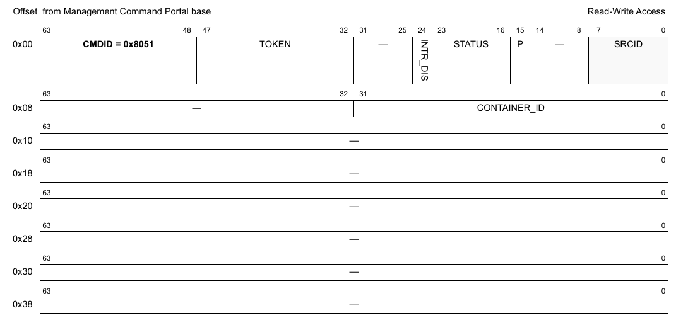

**Figure 9. Mô tả command DPRC_OPEN**

Bảng sau mô tả các field của command.

**Table 3. Mô tả các field của command DPRC_OPEN1**

| Offset | Bits | Tên | Mô tả |
|---|---|---|---|
| 0x00 | 0-63 | Header của command | Xem Table 2 để biết mô tả chung các field của command portal. CMDID phải được đặt như chỉ ra trong hình ở trên. |
| 0x08 | 0-31 | CONTAINER_ID | Container ID cần mở |

1 Mọi field không được nêu là reserved và phải được xóa (đặt bằng 0)

### 6.3.2 DPRC_CLOSE

Đóng phiên điều khiển của object.

Sau khi gọi hàm này, không thao tác nào khác được phép trên object nếu không mở một phiên điều khiển mới.

**Cấu trúc command**

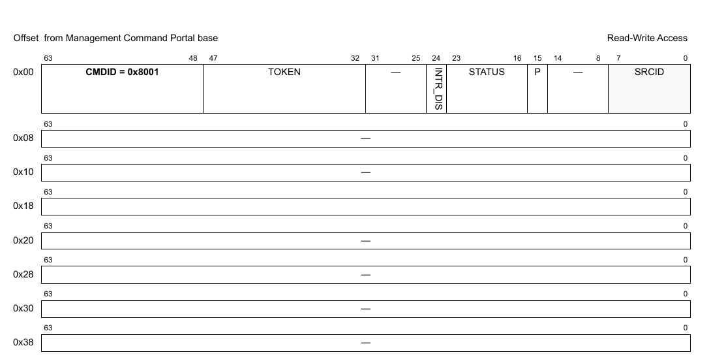

**Figure 10. Mô tả command DPRC_CLOSE**

| Offset | Bits | Tên | Mô tả |
|---|---|---|---|
| 0x00 | 0-63 | Header của command | Xem Table 2 để biết mô tả chung các field của command portal. CMDID phải được đặt như chỉ ra trong hình ở trên. |

Mọi field không được nêu là reserved và phải được xóa (đặt bằng 0)

### 6.3.3 DPRC_CREATE_CONTAINER

Command này tạo và khởi tạo một instance DPRC theo các tham số command được chỉ định. Command này không cần cho các instance DPRC được tạo bằng DPL.

Định dạng command được thể hiện trong hình dưới đây.

**Cấu trúc command**

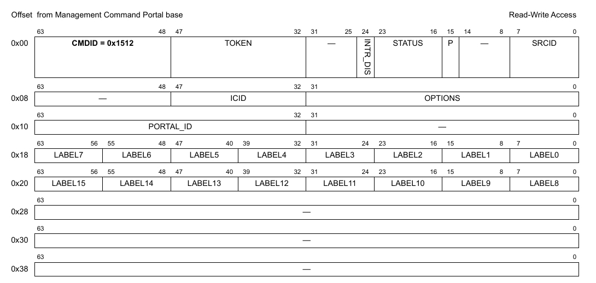

**Figure 11. Mô tả command DPRC_CREATE_CONTAINER**

Bảng sau mô tả các field của command.

**Table 4. Mô tả các field của command DPRC_CREATE_CONTAINER1**

| Offset | Bits | Tên | Mô tả |
|---|---|---|---|
| 0x00 | 0-63 | Header của command | Xem Table 2 để biết mô tả chung các field của command portal. CMDID phải được đặt như chỉ ra trong hình ở trên. |
| 0x08 | 0-32 | OPTIONS | Tổ hợp các option 'DPRC_CFG_OPT_\<X>': bit 0: DPRC_CFG_OPT_SPAWN_ALLOWED - Spawn Policy Option allowed - Cho biết container mới được phép tạo và có các container con của riêng nó bit 1: DPRC_CFG_OPT_ALLOC_ALLOWED - General Container allocation policy - Cho biết container mới được phép cấp phát tài nguyên được yêu cầu từ container cha; nếu không đặt, container chỉ được dùng tài nguyên trong các pool của chính nó; Lưu ý rằng đây là chính sách chung của container, nhưng container cha có thể ghi đè và đặt quota riêng cho từng loại tài nguyên. bit 3: DPRC_CFG_OPT_TOPOLOGY_CHANGES_ALLOWED - Topology change allowed - software context gắn với container này được phép gọi các thao tác topology, như attach/detach network object. bit 5: DPRC_CFG_OPT_AIOP - AIOP -Cho biết container thuộc về aiop. |
|   | 32-47 | ICID | ICID của container; nếu đặt là 'DPRC_GET_ICID_FROM_POOL', một giá trị ICID trống sẽ được DPRC cấp phát |
| 0x10 | 32-63 | PORTAL_ID | Portal ID; nếu đặt là 'DPRC_GET_PORTAL_ID_FROM_POOL', một portal ID trống sẽ được DPRC cấp phát |
| 0x18 | 0-63 | LABEL[0-7] | Nhãn của object |
| 0x20 | 0-63 | LABEL[8-15] |   |

1 Mọi field không được nêu là reserved và phải được xóa (đặt bằng 0)

**Cấu trúc response**

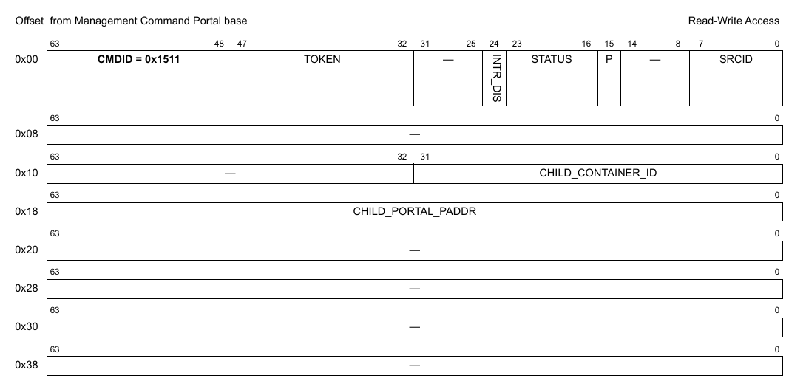

**Figure 12. Mô tả response của DPRC_CREATE_CONTAINER**

Bảng sau mô tả các field của response.

**Table 5. Mô tả các field response của DPRC_CREATE_CONTAINER1**

| Offset | Bits | Tên | Mô tả |
|---|---|---|---|
| 0x00 | 0-63 | Header của command | Xem Table 2 để biết mô tả chung các field của command portal. CMDID phải được đặt như chỉ ra trong hình ở trên. |
| 0x10 | 0-31 | CHILD_CONTAINER_ID | ID của container con |
| 0x18 | 0-63 | CHILD_PORTAL_PADDR | Địa chỉ vật lý cơ sở của portal con |

1 Mọi field không được nêu là reserved và phải được xóa (đặt bằng 0)

### 6.3.4 DPRC_DESTROY_CONTAINER

**Cấu trúc command**

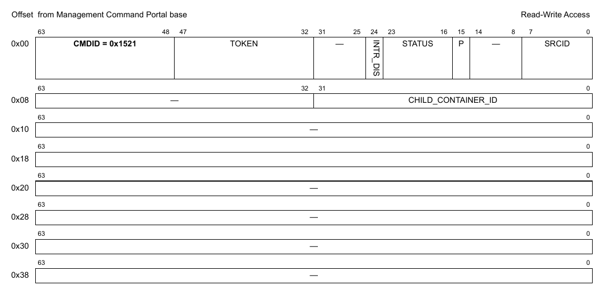

**Figure 13. Mô tả command DPRC_DESTROY_CONTAINER**

| Offset | Bits | Tên | Mô tả |
|---|---|---|---|
| 0x00 | 0-63 | Header của command | Xem Table 2 để biết mô tả chung các field của command portal. CMDID phải được đặt như chỉ ra trong hình ở trên. |
| 0x08 | 0-31 | CHILD_CONTAINER_ID | ID của container cần hủy |

Mọi field không được nêu là reserved và phải được xóa (đặt bằng 0)

### 6.3.5 DPRC_RESET_CONTAINER

Command này sẽ reset mọi object trong container này. Quá trình reset sẽ ngắt kết nối mọi DPMAC object. Sau khi command được thực thi, gọi DPRC_CONNECT để khôi phục mọi kết nối DPMAC.

**Cấu trúc command**

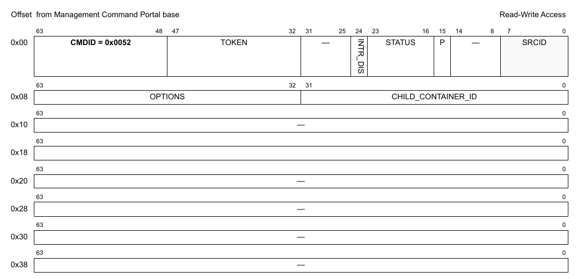

**Figure 14. Mô tả command DPRC_CLOSE *(ghi chú: đúng là DPRC_RESET_CONTAINER)***

| Offset | Bits | Tên | Mô tả |
|---|---|---|---|
| 0x00 | 0-63 | Header của command | Xem Table 2 để biết mô tả chung các field của command portal. CMDID phải được đặt như chỉ ra trong hình ở trên. |
| 0x08 | 0-31 | CHILD_CONTAINER_ID | ID của container cần reset |
|   | 32-63 | OPTIONS | Các option reset: bit 0: DPRC_RESET_OPTION_NON_RECURSIVE - Khi đặt bit này, container được reset sẽ không reset đệ quy. Nghĩa là các container con của container được reset sẽ không bị ảnh hưởng. |

Mọi field không được nêu là reserved và phải được xóa (đặt bằng 0)

### 6.3.6 DPRC_SET_LOCKED

Command này sẽ khóa CHILD_CONTAINER_ID và toàn bộ cây phân cấp thuộc về nó.

Nghĩa là các container đó sẽ không còn được gọi các command lock/unlock create/destroy assign/unassign.

**Cấu trúc command**

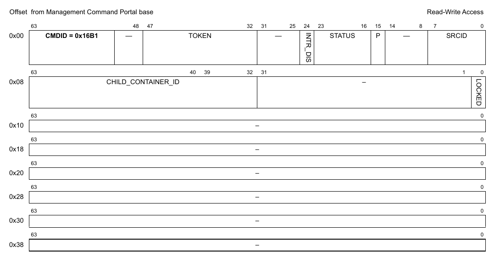

**Figure 15. Mô tả command DPRC_SET_LOCKED**

| Offset | Bits | Tên | Mô tả |
|---|---|---|---|
| 0x00 | 0-63 | Header của command | Xem Table 2 để biết mô tả chung các field của command portal. CMDID phải được đặt như chỉ ra trong hình ở trên. |
| 0x08 | 0 | LOCKED | Đặt container được chỉ định qua CHILD_CONTAINER_ID ở trạng thái khóa. |
|   | 32-63 | CHILD_CONTAINER_ID | Container ID cần khóa. |

Mọi field không được nêu là reserved và phải được xóa (đặt bằng 0)

### 6.3.7 DPRC_SET_IRQ

Đặt thông tin IRQ để DPRC kích hoạt interrupt.

**Cấu trúc command**

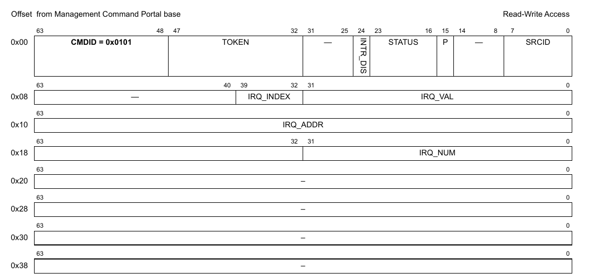

**Figure 16. Mô tả command DPRC_SET_IRQ**

| Offset | Bits | Tên | Mô tả |
|---|---|---|---|
| 0x00 | 0-63 | Header của command | Xem Table 2 để biết mô tả chung các field của command portal. CMDID phải được đặt như chỉ ra trong hình ở trên. |
| 0x08 | 0-31 | IRQ_VAL | Giá trị ghi vào địa chỉ IRQ_ADDR |
|   | 32-39 | IRQ_INDEX | Xác định interrupt index cần cấu hình |
| 0x10 | 0-63 | IRQ_ADDR | Địa chỉ phải được ghi để báo một message-based interrupt |
| 0x18 | 0-32 | IRQ_NUM | Một số do người dùng định nghĩa, gắn với IRQ này |

Mọi field không được nêu là reserved và phải được xóa (đặt bằng 0)

### 6.3.8 DPRC_GET_IRQ

Lấy thông tin IRQ từ DPRC.

**Cấu trúc command**

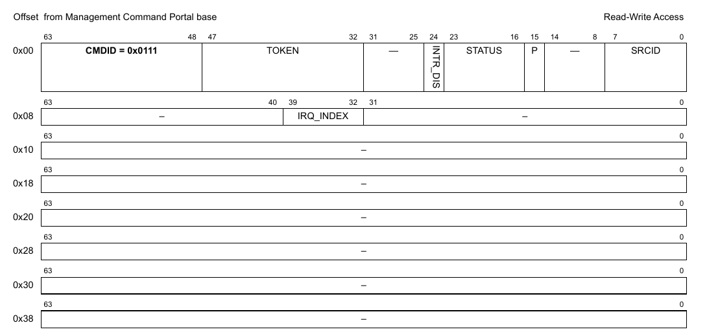

**Figure 17. Mô tả command DPRC_GET_IRQ**

| Offset | Bits | Tên | Mô tả |
|---|---|---|---|
| 0x00 | 0-63 | Header của command | Xem Table 2 để biết mô tả chung các field của command portal. CMDID phải được đặt như chỉ ra trong hình ở trên. |
| 0x08 | 32-39 | IRQ_INDEX | Xác định interrupt index cần truy vấn |

Mọi field không được nêu là reserved và phải được xóa (đặt bằng 0)

**Cấu trúc response**

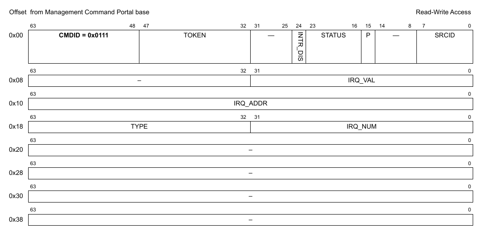

**Figure 18. Mô tả response của DPRC_GET_IRQ**

| Offset | Bits | Tên | Mô tả |
|---|---|---|---|
| 0x00 | 0-63 | Header của command | Xem Table 2 để biết mô tả chung các field của command portal. CMDID phải được đặt như chỉ ra trong hình ở trên. |
| 0x08 | 0-31 | IRQ_VAL | Giá trị được ghi vào địa chỉ IRQ_ADDR |
| 0x10 | 0-63 | IRQ_ADDR | Địa chỉ được ghi khi báo message-based interrupt |
| 0x18 | 0-32 | IRQ_NUM | Một số do người dùng định nghĩa, gắn với IRQ này |
|   | 32-63 | TYPE | Loại interrupt: 0 là message-based interrupt (cả IRQ_ADDR và IRQ_VAL đều hợp lệ) |

Mọi field không được nêu là reserved và phải được xóa (đặt bằng 0)

### 6.3.9 DPRC_SET_IRQ_ENABLE

Đặt trạng thái tổng thể của interrupt. Cho phép phần mềm GPP điều khiển khi nào interrupt được sinh ra. Mỗi interrupt có thể có tối đa 32 nguyên nhân. Điều khiển enable/disable quyết định trạng thái tổng thể của interrupt. Nếu interrupt bị disable thì không nguyên nhân nào sinh ra interrupt.

**Cấu trúc command**

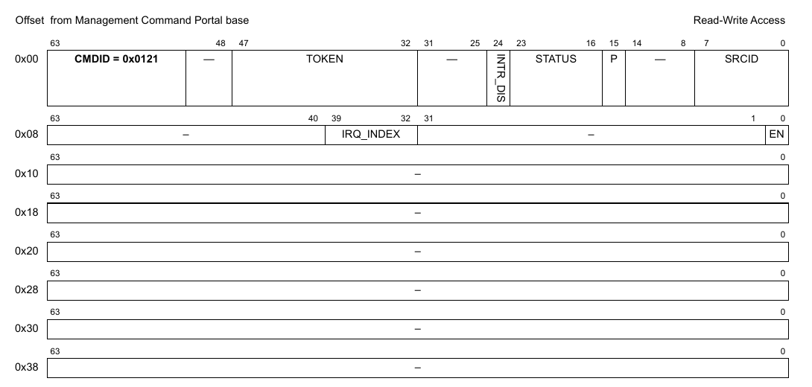

**Figure 19. Mô tả command DPRC_SET_IRQ_ENABLE**

| Offset | Bits | Tên | Mô tả |
|---|---|---|---|
| 0x00 | 0-63 | Header của command | Xem Table 2 để biết mô tả chung các field của command portal. CMDID phải được đặt như chỉ ra trong hình ở trên. |
| 0x08 | 0 | EN | Trạng thái interrupt: đặt ‘1’ để enable, ‘0’ để disable |
|   | 32-39 | IRQ_INDEX | Xác định interrupt index cần cấu hình |

Mọi field không được nêu là reserved và phải được xóa (đặt bằng 0)

### 6.3.10 DPRC_GET_IRQ_ENABLE

Lấy trạng thái tổng thể của interrupt.

**Cấu trúc command**

**Figure 20. Mô tả command DPRC_GET_IRQ_ENABLE**

| Offset | Bits | Tên | Mô tả |
|---|---|---|---|
| 0x00 | 0-63 | Header của command | Xem Table 2 để biết mô tả chung các field của command portal. CMDID phải được đặt như chỉ ra trong hình ở trên. |
| 0x08 | 32-39 | IRQ_INDEX | Xác định interrupt index cần truy vấn |

Mọi field không được nêu là reserved và phải được xóa (đặt bằng 0)

**Cấu trúc response**

**Figure 21. Mô tả response của DPRC_GET_IRQ_ENABLE**

| Offset | Bits | Tên | Mô tả |
|---|---|---|---|
| 0x00 | 0-63 | Header của command | Xem Table 2 để biết mô tả chung các field của command portal. CMDID phải được đặt như chỉ ra trong hình ở trên. |
| 0x08 | 0 | EN | Bit này được đặt nếu interrupt đang enable |

Mọi field không được nêu là reserved và phải được xóa (đặt bằng 0)

### 6.3.11 DPRC_SET_IRQ_MASK

Đặt interrupt mask. Mỗi interrupt có thể có tối đa 32 nguyên nhân, và mô hình interrupt hỗ trợ mask/unmask từng nguyên nhân độc lập.

**Cấu trúc command**

**Figure 22. Mô tả command DPRC_SET_IRQ_MASK**

| Offset | Bits | Tên | Mô tả |
|---|---|---|---|
| 0x00 | 0-63 | Header của command | Xem Table 2 để biết mô tả chung các field của command portal. CMDID phải được đặt như chỉ ra trong hình ở trên. |
| 0x08 | 0-31 | MASK | Event mask để kích hoạt interrupt; xem command GET_IRQ_STATUS để biết đặc tả các event hiện có. Với mỗi bit trong MASK: 0 = bỏ qua event 1 = event hợp lệ; báo IRQ nếu event này xảy ra |
|   | 32-39 | IRQ_INDEX | Interrupt index cần cấu hình |

Mọi field không được nêu là reserved và phải được xóa (đặt bằng 0)

### 6.3.12 DPRC_GET_IRQ_MASK

Lấy interrupt mask. Mỗi interrupt có thể có tối đa 32 nguyên nhân, và mô hình interrupt hỗ trợ mask/unmask từng nguyên nhân độc lập.

**Cấu trúc command**

**Figure 23. Mô tả command DPRC_GET_IRQ_MASK**

| Offset | Bits | Tên | Mô tả |
|---|---|---|---|
| 0x00 | 0-63 | Header của command | Xem Table 2 để biết mô tả chung các field của command portal. CMDID phải được đặt như chỉ ra trong hình ở trên. |
| 0x08 | 32-39 | IRQ_INDEX | Interrupt index cần truy vấn |

Mọi field không được nêu là reserved và phải được xóa (đặt bằng 0)

**Cấu trúc response**

**Figure 24. Mô tả response của DPRC_GET_IRQ_MASK**

| Offset | Bits | Tên | Mô tả |
|---|---|---|---|
| 0x00 | 0-63 | Header của command | Xem Table 2 để biết mô tả chung các field của command portal. CMDID phải được đặt như chỉ ra trong hình ở trên. |
| 0x08 | 0-31 | MASK | Event mask để kích hoạt interrupt; xem command GET_IRQ_STATUS để biết đặc tả các event hiện có. Với mỗi bit trong MASK: 0 = bỏ qua event 1 = event hợp lệ; báo IRQ nếu event này xảy ra |

Mọi field không được nêu là reserved và phải được xóa (đặt bằng 0)

### 6.3.13 DPRC_GET_IRQ_STATUS

Lấy trạng thái hiện tại của các event đang chờ cho interrupt index được chỉ định.

**Cấu trúc command**

**Figure 25. Mô tả command DPRC_GET_IRQ_STATUS**

| Offset | Bits | Tên | Mô tả |
|---|---|---|---|
| 0x00 | 0-63 | Header của command | Xem Table 2 để biết mô tả chung các field của command portal. CMDID phải được đặt như chỉ ra trong hình ở trên. |
| 0x08 | 0-31 | STATUS | Tùy chọn: mọi bit STATUS được đặt sẽ được xóa khỏi trạng thái đang chờ (không cần dùng command DPRC_CLEAR_IRQ_STATUS nữa). Lưu ý rằng STATUS trả về trong response là trạng thái trước khi các event bị xóa.  Các event được hỗ trợ: xem định nghĩa cấu trúc response |
|   | 32-39 | IRQ_INDEX | Interrupt index cần truy vấn |

Mọi field không được nêu là reserved và phải được xóa (đặt bằng 0)

**Cấu trúc response**

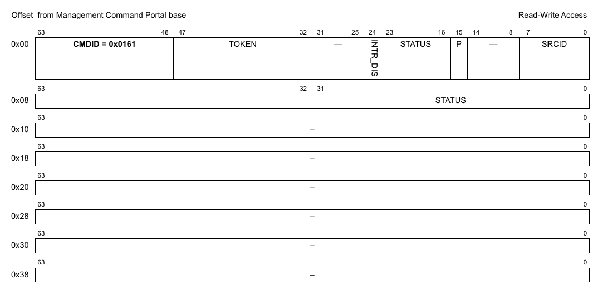

**Figure 26. Mô tả response của DPRC_GET_IRQ_STATUS**

| Offset | Bits | Tên | Mô tả |
|---|---|---|---|
| 0x00 | 0-63 | Header của command | Xem Table 2 để biết mô tả chung các field của command portal. CMDID phải được đặt như chỉ ra trong hình ở trên. |
| 0x08 | 0-31 | STATUS | Trạng thái event, mỗi event một bit: 0 = không có interrupt đang chờ 1 = có interrupt đang chờ  Các event được hỗ trợ cho IRQ 0: Bit 0: DPRC_IRQ_EVENT_OBJ_ADDED – cho biết một object đã được thêm vào container Bit 1: DPRC_IRQ_EVENT_OBJ_REMOVED – cho biết một object đã bị gỡ khỏi container Bit 2: DPRC_IRQ_EVENT_RES_ADDED – cho biết tài nguyên đã được thêm vào container Bit 3: DPRC_IRQ_EVENT_RES_REMOVED – cho biết tài nguyên đã bị gỡ khỏi container Bit 4: DPRC_IRQ_EVENT_CONTAINER_DESTROYED – cho biết một container con cháu đã bị hủy Bit 5: DPRC_IRQ_EVENT_OBJ_DESTROYED – cho biết một object của container đã bị hủy Bit 6: DPRC_IRQ_EVENT_OBJ_CREATED – cho biết một object đã được tạo trong container |

Mọi field không được nêu là reserved và phải được xóa (đặt bằng 0)

### 6.3.14 DPRC_CLEAR_IRQ_STATUS

Xóa (đánh dấu đã xử lý) các event đang chờ của interrupt index được chỉ định.

**Cấu trúc command**

**Figure 27. Mô tả command DPRC_CLEAR_IRQ_STATUS**

| Offset | Bits | Tên | Mô tả |
|---|---|---|---|
| 0x00 | 0-63 | Header của command | Xem Table 2 để biết mô tả chung các field của command portal. CMDID phải được đặt như chỉ ra trong hình ở trên. |
| 0x08 | 0-31 | STATUS | Mask để xóa các event đã xử lý; xem command GET_IRQ_STATUS để biết đặc tả các event hiện có. Với mỗi bit trong MASK: 0 = không đổi trạng thái event 1 = xóa bit trạng thái event để cho biết event đã được xử lý |
|   | 32-39 | IRQ_INDEX | Interrupt index cần cấu hình |

Mọi field không được nêu là reserved và phải được xóa (đặt bằng 0)

### 6.3.15 DPRC_GET_ATTRIBUTES

**Cấu trúc command**

**Figure 28. Mô tả command DPRC_GET_ATTRIBUTES**

| Offset | Bits | Tên | Mô tả |
|---|---|---|---|
| 0x00 | 0-63 | Header của command | Xem Table 2 để biết mô tả chung các field của command portal. CMDID phải được đặt như chỉ ra trong hình ở trên. |

Mọi field không được nêu là reserved và phải được xóa (đặt bằng 0)

**Cấu trúc response**

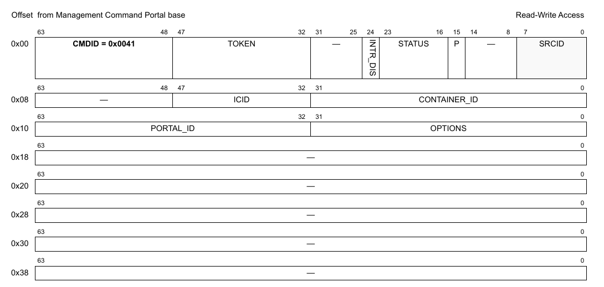

**Figure 29. Mô tả response của DPRC_GET_ATTRIBUTES**

| Offset | Bits | Tên | Mô tả |
|---|---|---|---|
| 0x00 | 0-63 | Header của command | Xem Table 2 để biết mô tả chung các field của command portal. CMDID phải được đặt như chỉ ra trong hình ở trên. |
| 0x08 | 0-31 | CONTAINER_ID | ID của container |
|   | 32-47 | ICID | ICID của container |
| 0x10 | 0-31 | OPTIONS | Các option của container, như được đặt lúc tạo container |
|   | 32-63 | PORTAL_ID | Portal ID của container |

### 6.3.16 DPRC_SET_RES_QUOTA

**Cấu trúc command**

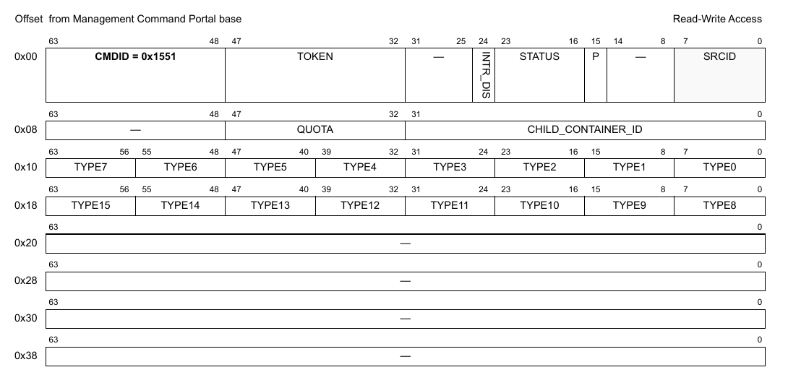

**Figure 30. Mô tả command DPRC_SET_RES_QUOTA**

| Offset | Bits | Tên | Mô tả |
|---|---|---|---|
| 0x00 | 0-63 | Header của command | Xem Table 2 để biết mô tả chung các field của command portal. CMDID phải được đặt như chỉ ra trong hình ở trên. |
| 0x08 | 0-31 | CHILD_CONTAINER_ID | ID của container con |
|   | 32-47 | QUOTA | Đặt số lượng tối đa tài nguyên thuộc loại được chọn mà container con được phép cấp phát từ container cha; khi quota đặt bằng -1, chính sách giống chính sách chung của container. |
| 0x10 | 0-63 | TYPE[0-5] | Loại tài nguyên/object |
| 0x18 | 0-63 | TYPE[8-15] |   |

Mọi field không được nêu là reserved và phải được xóa (đặt bằng 0)

### 6.3.17 DPRC_GET_RES_QUOTA

**Cấu trúc command**

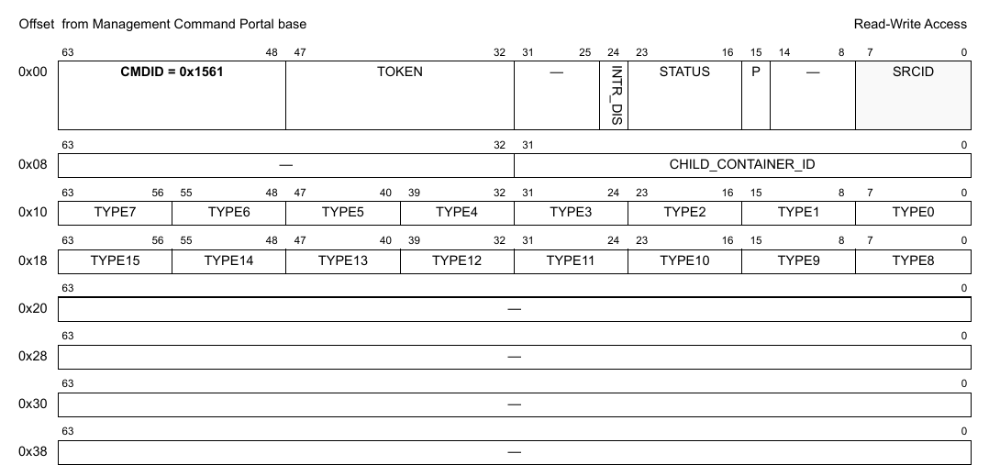

**Figure 31. Mô tả command DPRC_GET_RES_QUOTA**

| Offset | Bits | Tên | Mô tả |
|---|---|---|---|
| 0x00 | 0-63 | Header của command | Xem Table 2 để biết mô tả chung các field của command portal. CMDID phải được đặt như chỉ ra trong hình ở trên. |
| 0x08 | 0-31 | CHILD_CONTAINER_ID | ID của container con |
| 0x10 | 0-63 | TYPE[0-5] | Loại tài nguyên/object |
| 0x18 | 0-63 | TYPE[8-15] |   |

Mọi field không được nêu là reserved và phải được xóa (đặt bằng 0)

**Cấu trúc response**

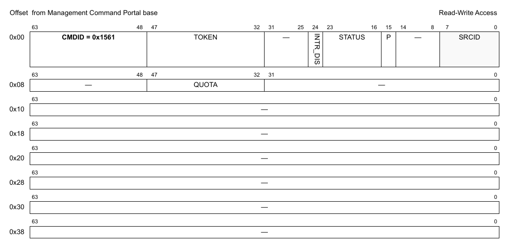

**Figure 32. Mô tả response của DPRC_GET_RES_QUOTA**

| Offset | Bits | Tên | Mô tả |
|---|---|---|---|
| 0x00 | 0-63 | Header của command | Xem Table 2 để biết mô tả chung các field của command portal. CMDID phải được đặt như chỉ ra trong hình ở trên. |
| 0x08 | 32-47 | QUOTA | Đặt số lượng tối đa tài nguyên thuộc loại được chọn mà container con được phép cấp phát từ container cha; khi quota đặt bằng -1, chính sách giống chính sách chung của container. |

Mọi field không được nêu là reserved và phải được xóa (đặt bằng 0)

### 6.3.18 DPRC_ASSIGN

**Cấu trúc command**

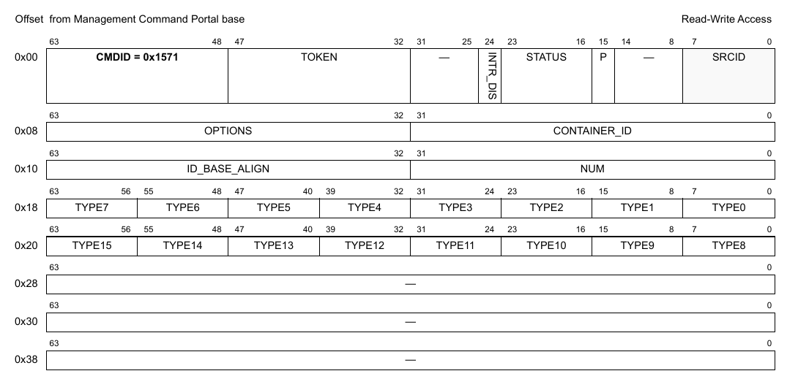

**Figure 33. Mô tả command DPRC_ASSIGN**

| Offset | Bits | Tên | Mô tả |
|---|---|---|---|
| 0x00 | 0-63 | Header của command | Xem Table 2 để biết mô tả chung các field của command portal. CMDID phải được đặt như chỉ ra trong hình ở trên. |
| 0x08 | 0-31 | CONTAINER_ID | ID của container con |
|   | 32-63 | OPTIONS | Các option của request: tổ hợp các option DPRC_RES_REQ_OPT_: bit 0: DPRC_RES_REQ_OPT_EXPLICIT - Explicit resource ID request - Các object/tài nguyên được yêu cầu là tường minh và liên tiếp (với tài nguyên). ID cơ sở được cho ở field base_align của res_req bit 1: DPRC_RES_REQ_OPT_ALIGNED - Aligned resources request - Chỉ áp dụng cho request tài nguyên (không áp dụng cho object). Cho biết ID cơ sở của tài nguyên phải liên tiếp và căn theo giá trị cho ở field base_align của dprc_res_req bit 2: DPRC_RES_REQ_OPT_PLUGGED - Plugged Flag - Chỉ áp dụng cho request gán object. Cho biết sau khi mọi object đã được gán, một interrupt sẽ được kích hoạt ở GPP liên quan. Object được gán sẽ được đánh dấu là plugged. Không thể gán các object đã plugged ra khỏi container của chúng |
| 0x10 | 0-31 | NUM | Số lượng tài nguyên |
|   | 32-63 | ID_BASE_ALIGN | Với kiểu gán tường minh (DPRC_RES_REQ_OPT_EXPLICIT được đặt trong option), field này là ID cơ sở yêu cầu cho việc cấp phát tài nguyên; Với kiểu gán căn chỉnh (DPRC_RES_REQ_OPT_ALIGNED được đặt trong option), field này cho biết mức căn chỉnh yêu cầu cho (các) resource ID - dùng 0 nếu không có yêu cầu căn chỉnh hay ID tường minh nào |
| 0x18 | 0-63 | TYPE[0-5] | Loại tài nguyên/object: biểu diễn dưới dạng chuỗi kết thúc bằng NULL. Chuỗi này có thể lấy được bằng dprc_get_pool() để lấy loại tài nguyên |
| 0x20 | 0-63 | TYPE[8-15] | và dprc_get_obj() để lấy loại object; Lưu ý: không thể gán/bỏ gán DPRC object |

Mọi field không được nêu là reserved và phải được xóa (đặt bằng 0)

### 6.3.19 DPRC_UNASSIGN

**Cấu trúc command**

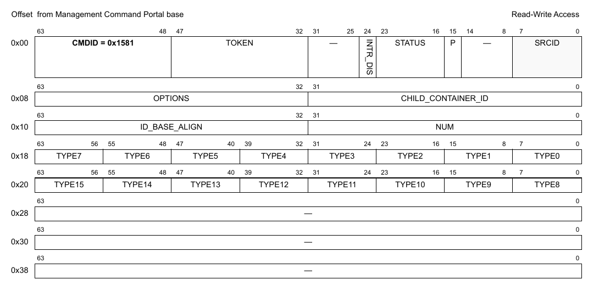

**Figure 34. Mô tả command DPRC_UNASSIGN**

| Offset | Bits | Tên | Mô tả |
|---|---|---|---|
| 0x00 | 0-63 | Header của command | Xem Table 2 để biết mô tả chung các field của command portal. CMDID phải được đặt như chỉ ra trong hình ở trên. |
| 0x08 | 0-31 | CHILD_CONTAINER_ID | ID của container con |
|   | 32-63 | OPTIONS | Các option của request: tổ hợp các option DPRC_RES_REQ_OPT_: bit 0: DPRC_RES_REQ_OPT_EXPLICIT - Explicit resource ID request - Các object/tài nguyên được yêu cầu là tường minh và liên tiếp (với tài nguyên). ID cơ sở được cho ở field base_align của res_req bit 1: DPRC_RES_REQ_OPT_ALIGNED - Aligned resources request - Chỉ áp dụng cho request tài nguyên (không áp dụng cho object). Cho biết ID cơ sở của tài nguyên phải liên tiếp và căn theo giá trị cho ở field base_align của dprc_res_req bit 2: DPRC_RES_REQ_OPT_PLUGGED - Plugged Flag - Chỉ áp dụng cho request gán object. Cho biết sau khi mọi object đã được gán, một interrupt sẽ được kích hoạt ở GPP liên quan. Object được gán sẽ được đánh dấu là plugged. Không thể gán các object đã plugged ra khỏi container của chúng |
| 0x10 | 0-31 | NUM | Số lượng tài nguyên |
|   | 32-63 | ID_BASE_ALIGN | Với kiểu gán tường minh (DPRC_RES_REQ_OPT_EXPLICIT được đặt trong option), field này là ID cơ sở yêu cầu cho việc cấp phát tài nguyên; Với kiểu gán căn chỉnh (DPRC_RES_REQ_OPT_ALIGNED được đặt trong option), field này cho biết mức căn chỉnh yêu cầu cho (các) resource ID - dùng 0 nếu không có yêu cầu căn chỉnh hay ID tường minh nào |
| 0x18 | 0-63 | TYPE[0-5] | Loại tài nguyên/object: biểu diễn dưới dạng chuỗi kết thúc bằng NULL. Chuỗi này có thể lấy được bằng dprc_get_pool() để lấy loại tài nguyên |
| 0x20 | 0-63 | TYPE[8-15] | và dprc_get_obj() để lấy loại object; Lưu ý: không thể gán/bỏ gán DPRC object |

Mọi field không được nêu là reserved và phải được xóa (đặt bằng 0)

### 6.3.20 DPRC_GET_POOL_COUNT

**Cấu trúc command**

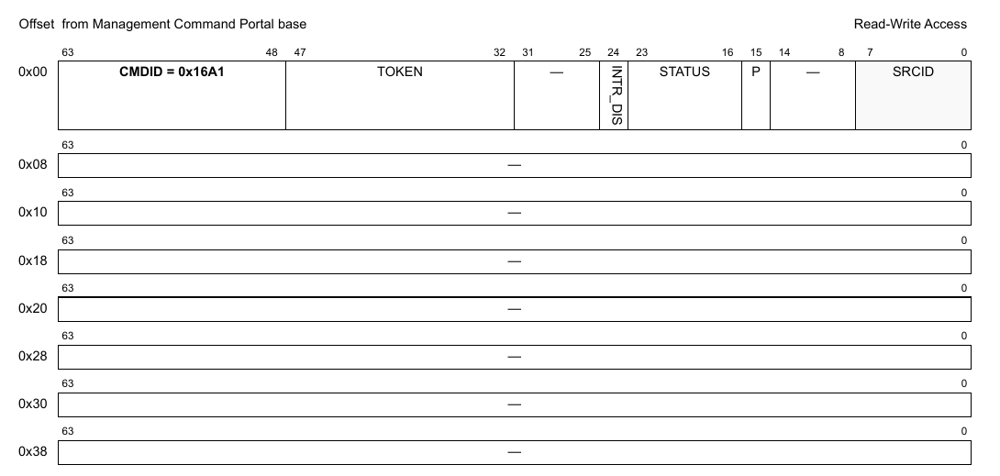

**Figure 35. Mô tả command DPRC_GET_POOL_COUNT**

| Offset | Bits | Tên | Mô tả |
|---|---|---|---|
| 0x00 | 0-63 | Header của command | Xem Table 2 để biết mô tả chung các field của command portal. CMDID phải được đặt như chỉ ra trong hình ở trên. |

Mọi field không được nêu là reserved và phải được xóa (đặt bằng 0)

**Cấu trúc response**

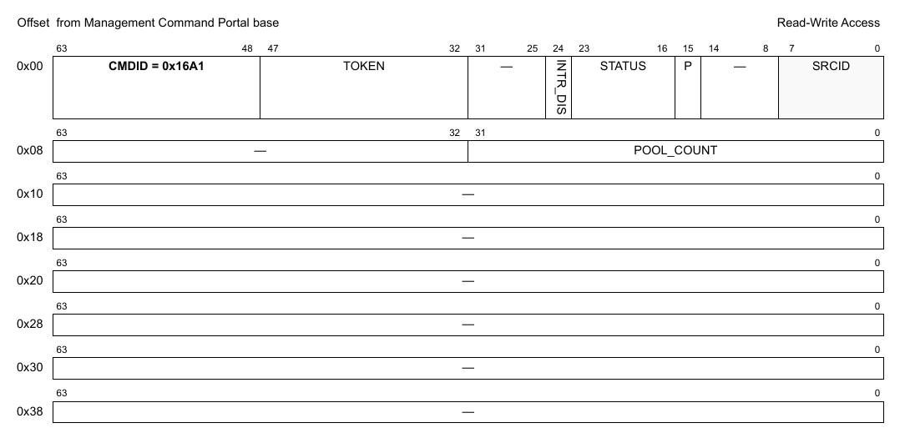

**Figure 36. Mô tả response của DPRC_GET_POOL_COUNT**

| Offset | Bits | Tên | Mô tả |
|---|---|---|---|
| 0x00 | 0-63 | Header của command | Xem Table 2 để biết mô tả chung các field của command portal. CMDID phải được đặt như chỉ ra trong hình ở trên. |
| 0x08 | 0-31 | POOL_COUNT | Số resource pool trong DPRC |

Mọi field không được nêu là reserved và phải được xóa (đặt bằng 0)

### 6.3.21 DPRC_GET_POOL

**Cấu trúc command**

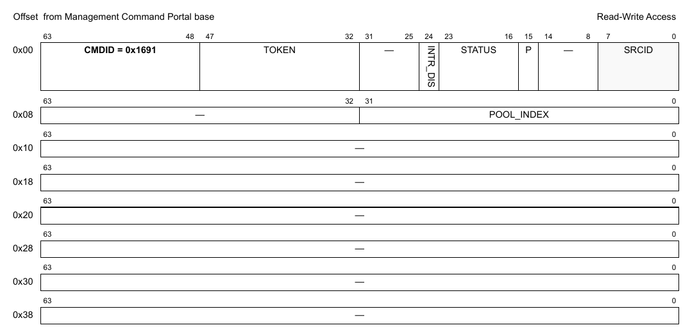

**Figure 37. Mô tả command DPRC_GET_POOL**

| Offset | Bits | Tên | Mô tả |
|---|---|---|---|
| 0x00 | 0-63 | Header của command | Xem Table 2 để biết mô tả chung các field của command portal. CMDID phải được đặt như chỉ ra trong hình ở trên. |
| 0x08 | 0-31 | POOL_INDEX | Index của pool cần truy vấn (< pool_count) |

Mọi field không được nêu là reserved và phải được xóa (đặt bằng 0)

**Cấu trúc response**

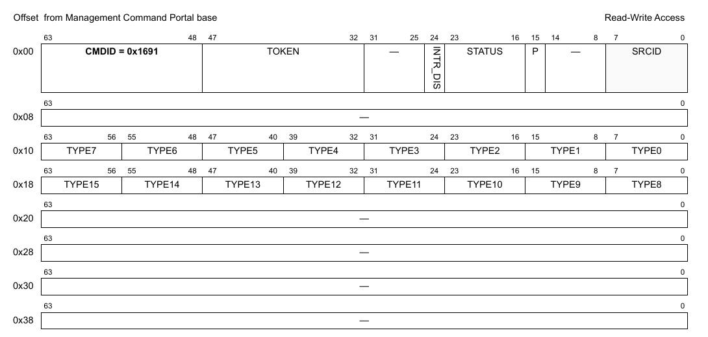

**Figure 38. Mô tả response của DPRC_GET_POOL**

| Offset | Bits | Tên | Mô tả |
|---|---|---|---|
| 0x00 | 0-63 | Header của command | Xem Table 2 để biết mô tả chung các field của command portal. CMDID phải được đặt như chỉ ra trong hình ở trên. |
| 0x10 | 0-63 | TYPE[0-7] | Loại của pool |
| 0x18 | 0-63 | TYPE[8-15] |   |

Mọi field không được nêu là reserved và phải được xóa (đặt bằng 0)

### 6.3.22 DPRC_GET_OBJ_COUNT

**Cấu trúc command**

**Figure 39. Mô tả command DPRC_GET_OBJ_COUNT**

| Offset | Bits | Tên | Mô tả |
|---|---|---|---|
| 0x00 | 0-63 | Header của command | Xem Table 2 để biết mô tả chung các field của command portal. CMDID phải được đặt như chỉ ra trong hình ở trên. |

Mọi field không được nêu là reserved và phải được xóa (đặt bằng 0)

**Cấu trúc response**

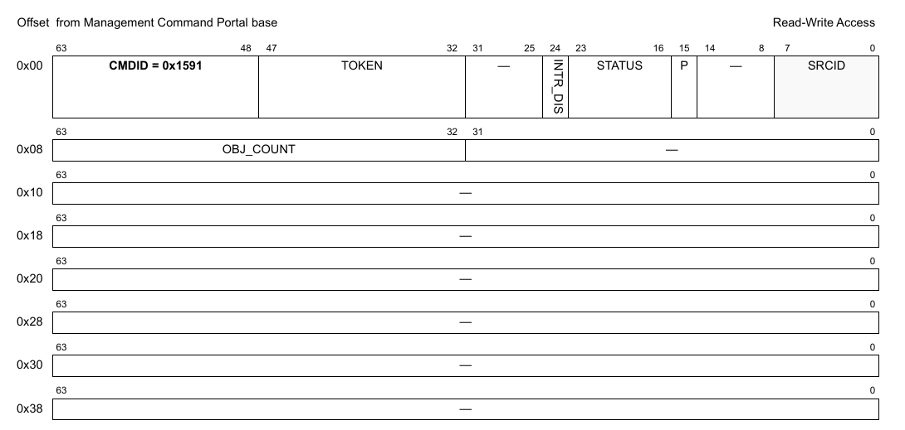

**Figure 40. Mô tả response của DPRC_GET_OBJ_COUNT**

| Offset | Bits | Tên | Mô tả |
|---|---|---|---|
| 0x00 | 0-63 | Header của command | Xem Table 2 để biết mô tả chung các field của command portal. CMDID phải được đặt như chỉ ra trong hình ở trên. |
| 0x08 | 32-63 | OBJ_COUNT | Số object được gán cho DPRC |

Mọi field không được nêu là reserved và phải được xóa (đặt bằng 0)

### 6.3.23 DPRC_GET_OBJ

**Cấu trúc command**

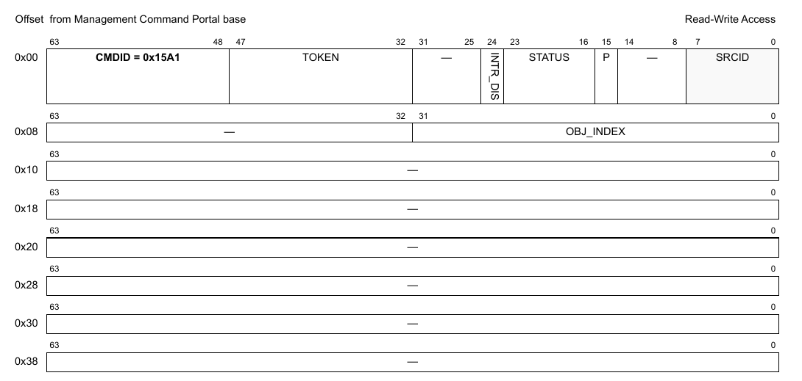

**Figure 41. Mô tả command DPRC_GET_OBJ**

| Offset | Bits | Tên | Mô tả |
|---|---|---|---|
| 0x00 | 0-63 | Header của command | Xem Table 2 để biết mô tả chung các field của command portal. CMDID phải được đặt như chỉ ra trong hình ở trên. |
| 0x08 | 0-32 | OBJ_INDEX | Index của object cần truy vấn (< obj_count) |

Mọi field không được nêu là reserved và phải được xóa (đặt bằng 0)

**Cấu trúc response**

**Figure 42. Mô tả response của DPRC_GET_OBJ**

| Offset | Bits | Tên | Mô tả |
|---|---|---|---|
| 0x00 | 0-63 | Header của command | Xem Table 2 để biết mô tả chung các field của command portal. CMDID phải được đặt như chỉ ra trong hình ở trên. |
| 0x08 | 32-63 | ID | ID của tài nguyên object logic |
| 0x10 | 0-15 | VENDOR | Định danh vendor của object |
|   | 16-23 | IRQ_COUNT | Số interrupt mà object hỗ trợ |
|   | 24-31 | REGION_COUNT | Số vùng map được mà object hỗ trợ |
|   | 32-63 | STATE | Trạng thái object: tổ hợp các trạng thái DPRC_OBJ_STATE_: bit 0: DPRC_OBJ_STATE_OPEN - Opened state - Cho biết object đang được ít nhất một chủ sở hữu mở bit 1: DPRC_OBJ_STATE_PLUGGED - Plugged state - Cho biết object đang plugged |
| 0x18 | 0-15 | VERSION_MAJOR | Major version của object |
|   | 16-31 | VERSION_MINOR | Minor version của object |
|   | 32-47 | FLAGS | Không dùng, đặt bằng 0. |
| 0x20 | 0-63 | TYPE[0-7] | Loại object: chuỗi kết thúc bằng NULL |
| 0x28 | 0-63 | TYPE[8-15] |   |
| 0x30 | 0-63 | LABEL[0-7] | Nhãn của object |
| 0x38 | 0-63 | LABEL[8-15] |   |

Mọi field không được nêu là reserved và phải được xóa (đặt bằng 0)

### 6.3.24 DPRC_GET_OBJ_DESC

**Cấu trúc command**

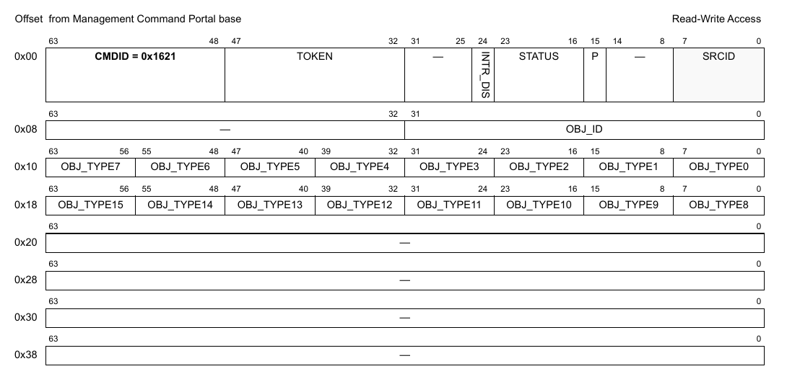

**Figure 43. Mô tả command DPRC_GET_OBJ_DESC**

| Offset | Bits | Tên | Mô tả |
|---|---|---|---|
| 0x00 | 0-63 | Header của command | Xem Table 2 để biết mô tả chung các field của command portal. CMDID phải được đặt như chỉ ra trong hình ở trên. |
| 0x08 | 0-32 | OBJ_ID | ID của object cần lấy descriptor |
| 0x10 | 0-63 | OBJ_TYPE[0-7] | Loại của object cần lấy descriptor |
| 0x18 | 0-63 | OBJ_TYPE[8-15] |   |

Mọi field không được nêu là reserved và phải được xóa (đặt bằng 0)

**Cấu trúc response**

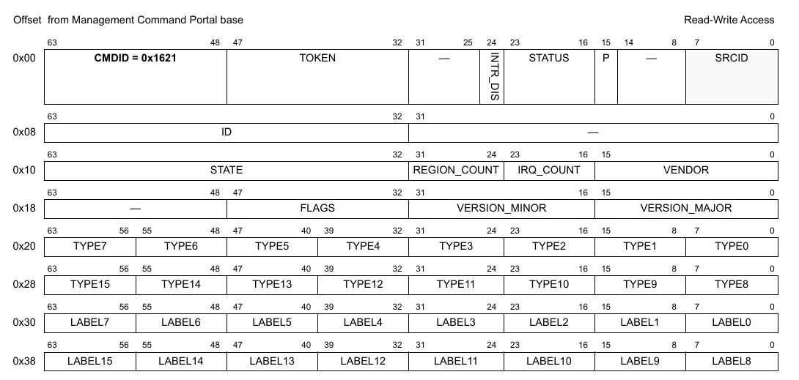

**Figure 44. Mô tả response của DPRC_GET_OBJ_DESC**

| Offset | Bits | Tên | Mô tả |
|---|---|---|---|
| 0x00 | 0-63 | Header của command | Xem Table 2 để biết mô tả chung các field của command portal. CMDID phải được đặt như chỉ ra trong hình ở trên. |
| 0x08 | 32-63 | ID | ID của tài nguyên object logic |
| 0x10 | 0-15 | VENDOR | Định danh vendor của object |
|   | 16-23 | IRQ_COUNT | Số interrupt mà object hỗ trợ |
|   | 24-31 | REGION_COUNT | Số vùng map được mà object hỗ trợ |
|   | 32-63 | STATE | Trạng thái object: tổ hợp các trạng thái DPRC_OBJ_STATE_: bit 0: DPRC_OBJ_STATE_OPEN - Opened state - Cho biết object đang được ít nhất một chủ sở hữu mở bit 1: DPRC_OBJ_STATE_PLUGGED - Plugged state - Cho biết object đang plugged |
| 0x18 | 0-15 | VERSION_MAJOR | Major version của object |
|   | 16-31 | VERSION_MINOR | Minor version của object |
|   | 32-47 | FLAGS | Không dùng, đặt bằng 0. |
| 0x20 | 0-63 | TYPE[0-7] | Loại object: chuỗi kết thúc bằng NULL |
| 0x28 | 0-63 | TYPE[8-15] |   |
| 0x30 | 0-63 | LABEL[0-7] | Nhãn của object |
| 0x38 | 0-63 | LABEL[8-15] |   |

Mọi field không được nêu là reserved và phải được xóa (đặt bằng 0)

### 6.3.25 DPRC_GET_RES_COUNT

**Cấu trúc command**

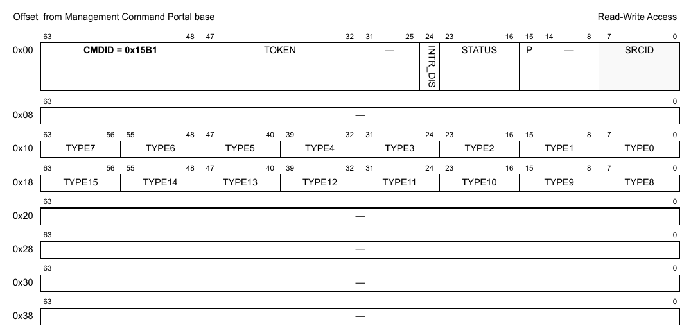

**Figure 45. Mô tả command DPRC_GET_RES_COUNT**

| Offset | Bits | Tên | Mô tả |
|---|---|---|---|
| 0x00 | 0-63 | Header của command | Xem Table 2 để biết mô tả chung các field của command portal. CMDID phải được đặt như chỉ ra trong hình ở trên. |
| 0x10 | 0-63 | TYPE[0-7] | loại pool |
| 0x18 | 0-63 | TYPE[8-15] |   |

Mọi field không được nêu là reserved và phải được xóa (đặt bằng 0)

**Cấu trúc response**

**Figure 46. Mô tả response của DPRC_GET_RES_COUNT**

| Offset | Bits | Tên | Mô tả |
|---|---|---|---|
| 0x00 | 0-63 | Header của command | Xem Table 2 để biết mô tả chung các field của command portal. CMDID phải được đặt như chỉ ra trong hình ở trên. |
| 0x08 | 0-31 | RES_COUNT | Số tài nguyên trống thuộc loại tài nguyên đã cho đang được gán cho DPRC này |

Mọi field không được nêu là reserved và phải được xóa (đặt bằng 0)

### 6.3.26 DPRC_GET_RES_IDS

**Cấu trúc command**

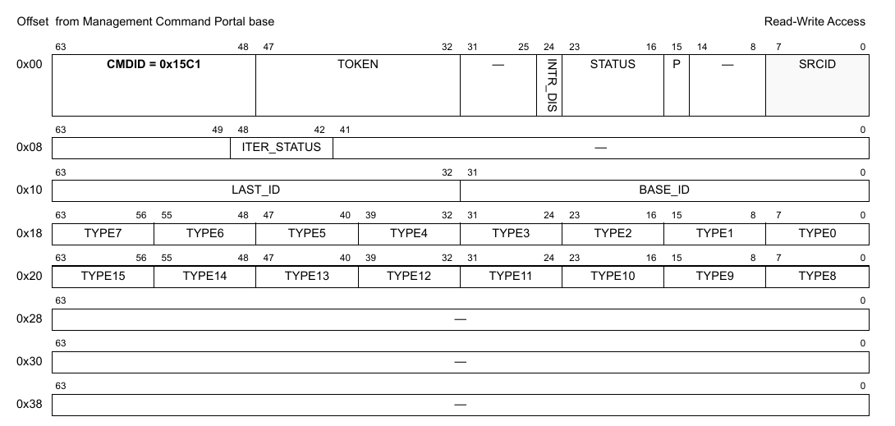

**Figure 47. Mô tả command DPRC_GET_RES_IDS**

| Offset | Bits | Tên | Mô tả |
|---|---|---|---|
| 0x00 | 0-63 | Header của command | Xem Table 2 để biết mô tả chung các field của command portal. CMDID phải được đặt như chỉ ra trong hình ở trên. |
| 0x08 | 42-48 | ITER_STATUS | Trạng thái lặp - đặt bằng DPRC_ITER_STATUS_FIRST ở lần lặp đầu; khi marker trả về là DPRC_ITER_STATUS_MORE thì cần lặp thêm, cho tới khi marker trả về là DPRC_ITER_STATUS_LAST. Các giá trị là: 0: DPRC_ITER_STATUS_FIRST 1: DPRC_ITER_STATUS_MORE 2: DPRC_ITER_STATUS_LAST |
| 0x10 | 0-31 | BASE_ID | Resource ID cơ sở của dải này |
|   | 32-63 | LAST_ID | Resource ID cuối của dải này |
| 0x18 | 0-63 | TYPE[0-7] | loại pool |
| 0x20 | 0-63 | TYPE[8-15] |   |

Mọi field không được nêu là reserved và phải được xóa (đặt bằng 0)

**Cấu trúc response**

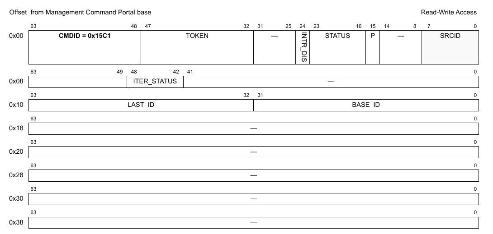

**Figure 48. Mô tả response của DPRC_GET_RES_IDS**

| Offset | Bits | Tên | Mô tả |
|---|---|---|---|
| 0x00 | 0-63 | Header của command | Xem Table 2 để biết mô tả chung các field của command portal. CMDID phải được đặt như chỉ ra trong hình ở trên. |
| 0x08 | 42-48 | ITER_STATUS | Trạng thái lặp - đặt bằng DPRC_ITER_STATUS_FIRST ở lần lặp đầu; khi marker trả về là DPRC_ITER_STATUS_MORE thì cần lặp thêm, cho tới khi marker trả về là DPRC_ITER_STATUS_LAST Các giá trị là: 0: DPRC_ITER_STATUS_FIRST 1: DPRC_ITER_STATUS_MORE 2: DPRC_ITER_STATUS_LAST |
| 0x10 | 0-31 | BASE_ID | Resource ID cơ sở của dải này |
|   | 32-63 | LAST_ID | Resource ID cuối của dải này |

Mọi field không được nêu là reserved và phải được xóa (đặt bằng 0)

### 6.3.27 DPRC_GET_OBJ_REGION

**Cấu trúc command**

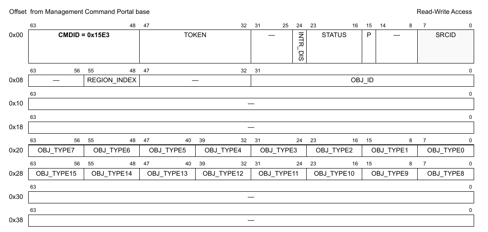

**Figure 49. Mô tả command DPRC_GET_OBJ_REGION**

| Offset | Bits | Tên | Mô tả |
|---|---|---|---|
| 0x00 | 0-63 | Header của command | Xem Table 2 để biết mô tả chung các field của command portal. CMDID phải được đặt như chỉ ra trong hình ở trên. |
| 0x08 | 0-31 | OBJ_ID | Instance object duy nhất, như được trả về trong dprc_get_obj() |
|   | 48-55 | REGION_INDEX | Vùng cụ thể cần truy vấn |
| 0x20 | 0-63 | OBJ_TYPE[0-7] | Loại object, như được trả về trong dprc_get_obj() |
| 0x28 | 0-63 | OBJ_TYPE[8-15] |   |

Mọi field không được nêu là reserved và phải được xóa (đặt bằng 0)

**Cấu trúc response**

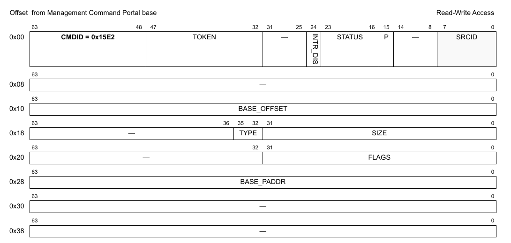

**Figure 50. Mô tả response của DPRC_GET_OBJ_REGION**

| Offset | Bits | Tên | Mô tả |
|---|---|---|---|
| 0x00 | 0-63 | Header của command | Xem Table 2 để biết mô tả chung các field của command portal. CMDID phải được đặt như chỉ ra trong hình ở trên. |
| 0x10 | 0-63 | BASE_OFFSET | Offset cơ sở của vùng |
| 0x18 | 0-31 | SIZE | Kích thước vùng (tính bằng byte) |
|   | 32–35 | TYPE | Các giá trị được hỗ trợ là: 0: DPRC_REGION_TYPE_MC_PORTAL 1: DPRC_REGION_TYPE_QBMAN_PORTAL |
| 0x20 | 0-31 | FLAGS | Các giá trị được hỗ trợ: Bit 0: DPRC_REGION_FLAG_CACHEABLE—Cho biết memory mapping của vùng này cần là cacheable. Bit 1: DPRC_REGION_SHARED - cho biết vùng cần được map ở chế độ shared (coherent) |
| 0x28 | 0-63 | BASE_PADDR | Địa chỉ vật lý cơ sở của vùng |

Mọi field không được nêu là reserved và phải được xóa (đặt bằng 0)

### 6.3.28 DPRC_SET_OBJ_LABEL

**Cấu trúc command**

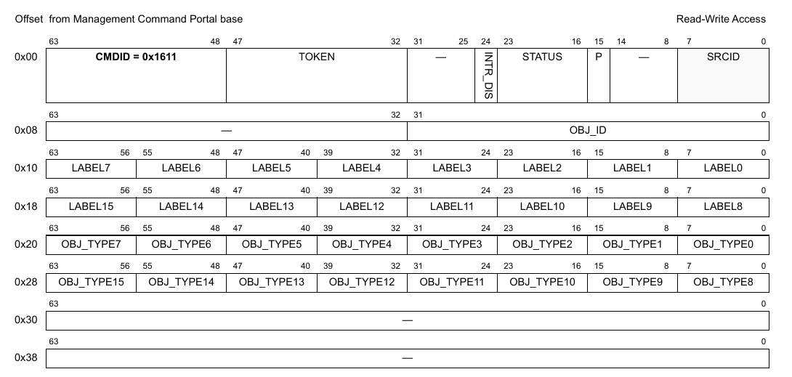

**Figure 51. Mô tả command DPRC_SET_OBJ_LABEL**

| Offset | Bits | Tên | Mô tả |
|---|---|---|---|
| 0x00 | 0-63 | Header của command | Xem Table 2 để biết mô tả chung các field của command portal. CMDID phải được đặt như chỉ ra trong hình ở trên. |
| 0x08 | 0-31 | OBJ_ID | Instance object duy nhất, như được trả về trong dprc_get_obj() |
| 0x10 | 0-63 | LABEL[0-7] | Nhãn của object |
| 0x18 | 0-63 | LABEL[8-15] |   |
| 0x20 | 0-63 | OBJ_TYPE[0-7] | Loại object, như được trả về trong dprc_get_obj() |
| 0x28 | 0-63 | OBJ_TYPE[8-15] |   |

Mọi field không được nêu là reserved và phải được xóa (đặt bằng 0)

### 6.3.29 DPRC_SET_OBJ_IRQ

**Cấu trúc command**

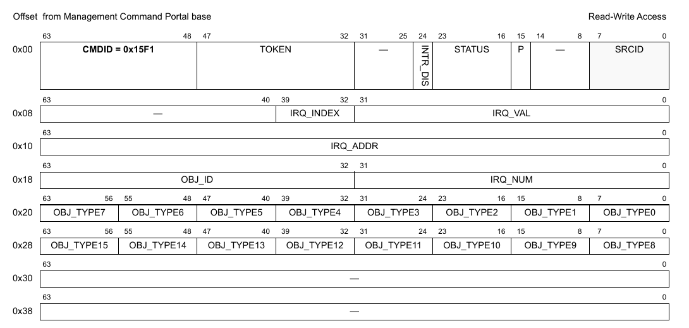

**Figure 52. Mô tả command DPRC_SET_OBJ_IRQ**

| Offset | Bits | Tên | Mô tả |
|---|---|---|---|
| 0x00 | 0-63 | Header của command | Xem Table 2 để biết mô tả chung các field của command portal. CMDID phải được đặt như chỉ ra trong hình ở trên. |
| 0x08 | 0-31 | IRQ_VAL | Giá trị ghi vào địa chỉ irq_addr |
|   | 32-39 | IRQ_INDEX | Interrupt index cần cấu hình |
| 0x10 | 0-63 | IRQ_ADDR | Địa chỉ phải được ghi để báo một message-based interrupt |
| 0x18 | 0-31 | IRQ_NUM | Một số do người dùng định nghĩa, gắn với IRQ này |
|   | 32-63 | OBJ_ID | ID của object cần đặt IRQ |
| 0x20 | 0-63 | OBJ_TYPE[0-7] | Loại của object cần đặt IRQ |
| 0x28 | 0-63 | OBJ_TYPE[8-15] |   |

Mọi field không được nêu là reserved và phải được xóa (đặt bằng 0)

### 6.3.30 DPRC_GET_OBJ_IRQ

**Cấu trúc command**

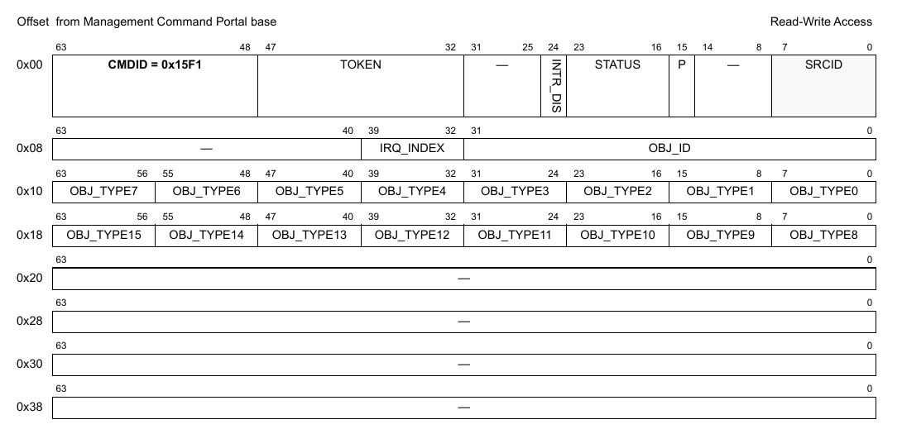

**Figure 53. Mô tả command DPRC_GET_OBJ_IRQ**

| Offset | Bits | Tên | Mô tả |
|---|---|---|---|
| 0x00 | 0-63 | Header của command | Xem Table 2 để biết mô tả chung các field của command portal. CMDID phải được đặt như chỉ ra trong hình ở trên. |
| 0x08 | 0-31 | OBJ_ID | ID của object cần lấy IRQ |
|   | 32-39 | IRQ_INDEX | Interrupt index cần cấu hình |
| 0x10 | 0-63 | OBJ_TYPE[0-7] | Loại của object cần lấy IRQ |
| 0x18 | 0-63 | OBJ_TYPE[8-15] |   |

Mọi field không được nêu là reserved và phải được xóa (đặt bằng 0)

**Cấu trúc response**

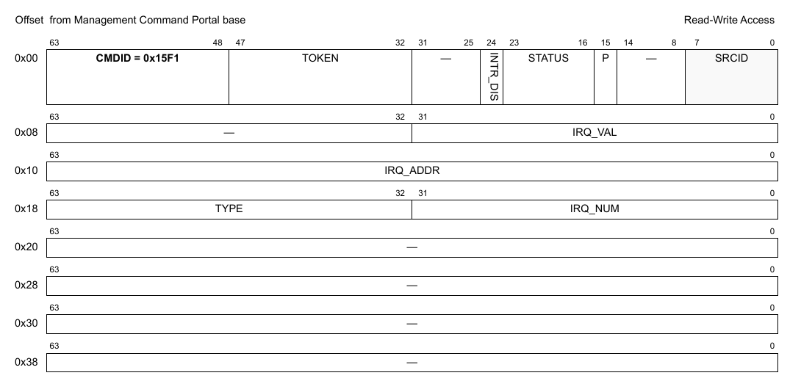

**Figure 54. Mô tả response của DPRC_GET_OBJ_IRQ**

| Offset | Bits | Tên | Mô tả |
|---|---|---|---|
| 0x00 | 0-63 | Header của command | Xem Table 2 để biết mô tả chung các field của command portal. CMDID phải được đặt như chỉ ra trong hình ở trên. |
| 0x08 | 0-31 | IRQ_VAL | Giá trị ghi vào địa chỉ irq_addr |
| 0x10 | 0-63 | IRQ_ADDR | Địa chỉ phải được ghi để báo một message-based interrupt |
| 0x18 | 0-31 | IRQ_NUM | Một số do người dùng định nghĩa, gắn với IRQ này |
|   | 32-63 | TYPE | Loại interrupt: 0 là loại message interrupt (cả irq_addr và irq_val đều hợp lệ) |

Mọi field không được nêu là reserved và phải được xóa (đặt bằng 0)

### 6.3.31 DPRC_CONNECT

**Cấu trúc command**

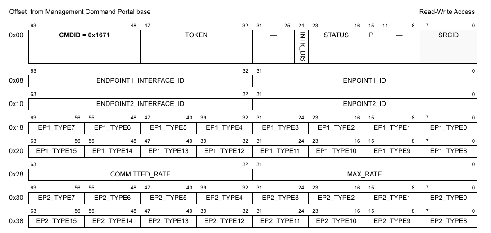

**Figure 55. Mô tả command DPRC_CONNECT**

| Offset | Bits | Tên | Mô tả |
|---|---|---|---|
| 0x00 | 0-63 | Header của command | Xem Table 2 để biết mô tả chung các field của command portal. CMDID phải được đặt như chỉ ra trong hình ở trên. |
| 0x08 | 0-31 | ENDPOINT1_ID | ID của endpoint object |
|   | 32-63 | ENDPOINT1_INTERFACE_ID | Interface ID; cần đặt cho các endpoint có nhiều interface ("dpsw", "dpdmux"); với các loại khác, luôn đặt bằng 0 |
| 0x10 | 0-31 | ENDPOINT2_ID | ID của endpoint object |
|   | 32-63 | ENDPOINT2_INTERFACE_ID | Interface ID; cần đặt cho các endpoint có nhiều interface ("dpsw", "dpdmux"); với các loại khác, luôn đặt bằng 0 |
| 0x18 | 0-63 | ENDPOINT1_TYPE[0-5] | Loại endpoint object: chuỗi kết thúc bằng NULL |
| 0x20 | 0-63 | ENDPOINT1_TYPE[8-15] |   |
| 0x18 | 0-31 | MAX_RATE | Tốc độ tối đa (Mbits/s) |
|   | 32-63 | COMMITTED_RATE | Tốc độ cam kết (Mbits/s) |
| 0x30 | 0-63 | ENDPOINT2_TYPE[0-5] | Loại endpoint object: chuỗi kết thúc bằng NULL |
| 0X38 | 0-63 | ENDPOINT2_TYPE[8-15] |   |

Mọi field không được nêu là reserved và phải được xóa (đặt bằng 0)

### 6.3.32 DPRC_DISCONNECT

**Cấu trúc command**

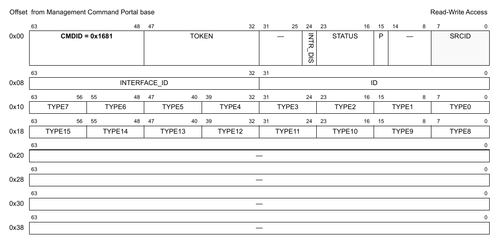

**Figure 56. Mô tả command DPRC_DISCONNECT**

| Offset | Bits | Tên | Mô tả |
|---|---|---|---|
| 0x00 | 0-63 | Header của command | Xem Table 2 để biết mô tả chung các field của command portal. CMDID phải được đặt như chỉ ra trong hình ở trên. |
| 0x08 | 0-31 | ID | ID của endpoint object |
|   | 32-63 | INTERFACE_ID | Interface ID; cần đặt cho các endpoint có nhiều interface ("dpsw", "dpdmux"); với các loại khác, luôn đặt bằng 0 |
| 0x10 | 0-63 | TYPE[0-5] | Loại endpoint object: chuỗi kết thúc bằng NULL |
| 0x18 | 0-63 | TYPE[8-15] |   |

Mọi field không được nêu là reserved và phải được xóa (đặt bằng 0)

### 6.3.33 DPRC_GET_CONNECTION

**Cấu trúc command**

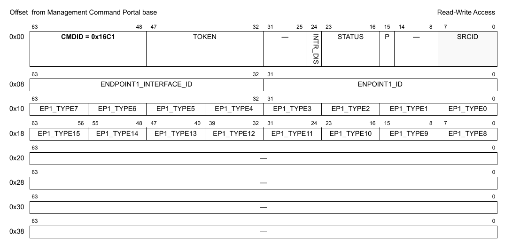

**Figure 57. Mô tả command DPRC_GET_CONNECTION**

| Offset | Bits | Tên | Mô tả |
|---|---|---|---|
| 0x00 | 0-63 | Header của command | Xem Table 2 để biết mô tả chung các field của command portal. CMDID phải được đặt như chỉ ra trong hình ở trên. |
| 0x08 | 0-31 | ENDPOINT1_ID | ID của endpoint object |
|   | 32-63 | ENDPOINT1_INTERFACE_ID | Interface ID; cần đặt cho các endpoint có nhiều interface ("dpsw", "dpdmux"); với các loại khác, luôn đặt bằng 0 |
| 0x10 | 0-63 | ENDPOINT1_TYPE[0-5] | Loại endpoint object: chuỗi kết thúc bằng NULL |
| 0x18 | 0-63 | ENDPOINT1_TYPE[8-15] |   |

Mọi field không được nêu là reserved và phải được xóa (đặt bằng 0)

**Cấu trúc response**

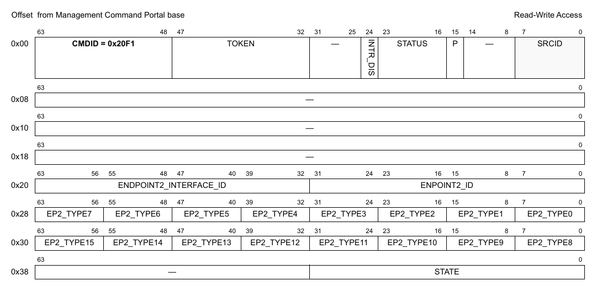

**Figure 58. Mô tả response của DPRC_GET_CONNECTION**

| Offset | Bits | Tên | Mô tả |
|---|---|---|---|
| 0x00 | 0-63 | Header của command | Xem Table 2 để biết mô tả chung các field của command portal. CMDID phải được đặt như chỉ ra trong hình ở trên. |
| 0x20 | 0-31 | ENDPOINT2_ID | ID của endpoint object |
|   | 32-63 | ENDPOINT2_INTERFACE_ID | Interface ID; cần đặt cho các endpoint có nhiều interface ("dpsw", "dpdmux"); với các loại khác, luôn đặt bằng 0 |
| 0x28 | 0-63 | ENDPOINT2_TYPE[0-5] | Loại endpoint object: chuỗi kết thúc bằng NULL |
| 0X30 | 0-63 | ENDPOINT2_TYPE[8-15] |   |
| 0x38 | 0-31 | STATE | Link state: 1 - link up, 0 - link down |

Mọi field không được nêu là reserved và phải được xóa (đặt bằng 0)

### 6.3.34 DPRC_GET_API_VERSION

**Cấu trúc command**

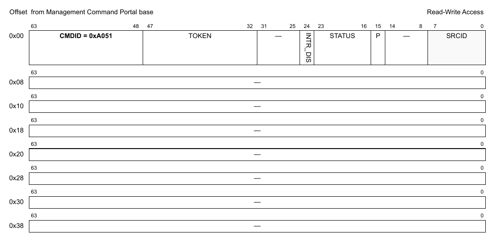

**Figure 59. Mô tả command DPRC_GET_API_VERSION**

| Offset | Bits | Tên | Mô tả |
|---|---|---|---|
| 0x00 | 0-63 | Header của command | Xem Table 2 để biết mô tả chung các field của command portal. CMDID phải được đặt như chỉ ra trong hình ở trên. |

Mọi field không được nêu là reserved và phải được xóa (đặt bằng 0)

**Cấu trúc response**

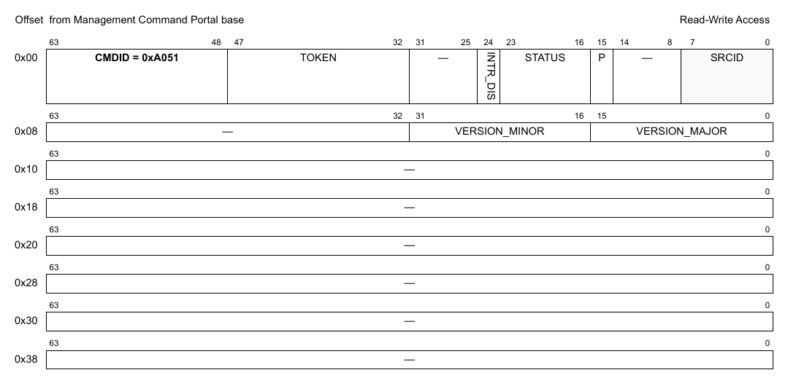

**Figure 60. Mô tả response của DPRC_GET_API_VERSION**

| Offset | Bits | Tên | Mô tả |
|---|---|---|---|
| 0x00 | 0-63 | Header của command | Xem Table 2 để biết mô tả chung các field của command portal. CMDID phải được đặt như chỉ ra trong hình ở trên. |
| 0x08 | 0-15 | VERSION_MAJOR | Major version của API |
|   | 16-31 | VERSION_MINOR | Minor version của API |

### 6.3.35 DPRC_GET_MEM

**Cấu trúc command**

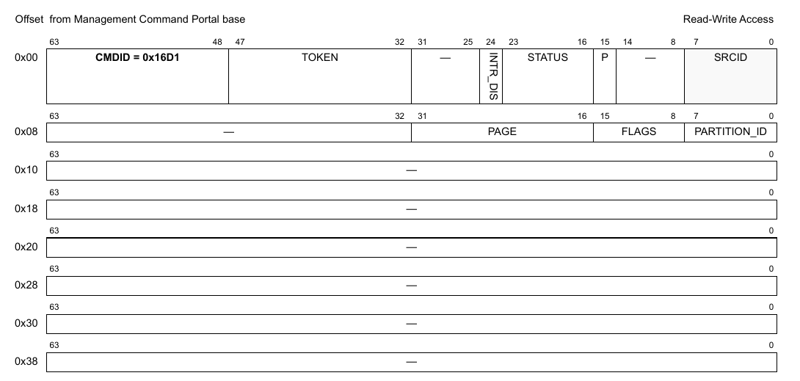

**Figure 61. Mô tả command DPRC_GET_MEM**

| Offset | Bits | Tên | Mô tả |
|---|---|---|---|
| 0x00 | 0-63 | Header của command | Xem Table 2 để biết mô tả chung các field của command portal. CMDID phải được đặt như chỉ ra trong hình ở trên. |
| 0x08 | 0-7 | PARTITION_ID | Partition ID. Hiện chỉ PEB hoạt động, nếu không MC trả về lỗi |
|   | 8-15 | FLAGS | Bit 0 - REFRESH - cho biết command sẽ phân tích lại partition hay sẽ trả về một page từ lần đọc trước |
|   | 16-31 | PAGE | Số page người dùng yêu cầu |

Mọi field không được nêu là reserved và phải được xóa (đặt bằng 0)

**Cấu trúc response**

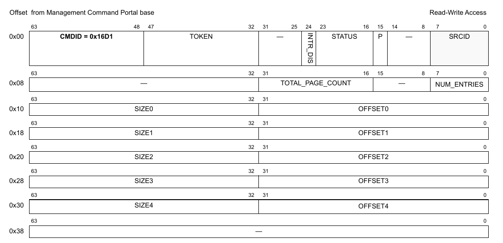

**Figure 62. Mô tả response của DPRC_GET_MEM**

| Offset | Bits | Tên | Mô tả |
|---|---|---|---|
| 0x00 | 0-63 | Header của command | Xem Table 2 để biết mô tả chung các field của command portal. CMDID phải được đặt như chỉ ra trong hình ở trên. |
| 0x08 | 0-7 | NUM_ENTRIES | Số mục hợp lệ |
|   | 16-31 | TOTAL_PAGE_COUNT | Tổng số page hợp lệ |
| 0x10- 0x30 | 0-31 | OFFSET[0-4] | Offset của block bộ nhớ tính từ đầu bộ nhớ PEB |
|   | 32-63 | SIZE[0-4] | Kích thước của một block bộ nhớ |
