# Chương 7 DPNI: Data Path Network Interface

DPNI object là một giao diện mạng có thể cấu hình để hỗ trợ nhiều tính năng, từ một giao diện Ethernet rất cơ bản cho tới một giao diện mạng đầy đủ chức năng. DPNI hỗ trợ các tính năng mà network stack chuẩn cần, từ tính năng cơ bản đến offload.

DPNI làm việc với traffic Ethernet, bắt đầu từ L2 header. Các chức năng bổ sung được cung cấp cho các giao thức mạng chuẩn (L2, L3, L4, v.v.).

Xem API book để có tham chiếu đầy đủ về các hàm hiện có.

## 7.1 Các tính năng của DPNI

Danh sách sau tóm tắt các tính năng và khả năng chính của DPNI:

- Hỗ trợ giao diện mạng Ethernet ở các tốc độ khác nhau, cả trên giao diện vật lý lẫn trên kết nối nội bộ giữa một DPNI và một L2 interface khác (một port của DPNI, DPDMUX hoặc DPSW).
- Hỗ trợ kích thước frame tối đa 10KB
- Cho phép gắn với tối đa tám Data Path Buffer Pool (DPBP object) khác nhau
- Cho phép tương tác với một hoặc nhiều Data Path I/O (DPIO) object để dequeue/enqueue frame descriptor (FD) và để acquire/release buffer.
- Hỗ trợ phân tích frame ở tốc độ đường truyền; kết quả phân tích có thể được ghi vào vùng frame annotation
- Hỗ trợ các chế độ unicast promiscuous và multicast promiscuous
- Hỗ trợ lọc frame nhận được:
  - Lọc exact-match dựa trên địa chỉ MAC đích
  - Lọc exact-match dựa trên VLAN
- Hỗ trợ QoS:
  - Phân loại packet vào tối đa tám traffic class
  - Phân loại dựa trên key do người dùng định nghĩa (key dài tối đa 56 byte)
- Hỗ trợ phân phối qua các frame queue:
  - Phân phối thống kê dựa trên key sinh từ hash
  - Phân phối tường minh dựa trên lựa chọn flow do người dùng định nghĩa (key dài tối đa 56 byte)
- Hỗ trợ các tùy chọn lập lịch khác nhau để xử lý packet nhận được:
  - Queue có thể được phần mềm lập lịch (mặc định), hoặc gắn với một DPIO object, hoặc gắn với một DPCON object
  - Hỗ trợ mở rộng cho AIOP khi dùng cùng DPCON
- Hỗ trợ traffic shaping cho các packet được truyền đi:
  - Tối đa tám transmit queue tương ứng với tám traffic class
- Hỗ trợ xác nhận truyền (transmit confirmation) cho mọi packet hoặc chỉ cho các lỗi truyền
- Hỗ trợ sinh checksum L3 và L4
- Hỗ trợ kiểm tra checksum L3 và L4
- Hỗ trợ thống kê giao diện mạng:
  - Số frame ingress
  - Số byte ingress
  - Số frame ingress bị drop do đặt ‘drop’ tường minh
  - Số frame ingress bị loại bỏ do lỗi
  - Số frame multicast ingress
  - Số byte multicast ingress
  - Số frame broadcast ingress
  - Số byte broadcast ingress
  - Số frame egress
  - Số byte egress
  - Số frame egress bị loại bỏ do lỗi
- Hỗ trợ báo link state – link mạng chỉ up khi DPNI đã được khởi tạo và enable (với giả định thực thể mạng ở đầu kia cũng đã enable).
- Hỗ trợ interrupt của giao diện mạng:
  - Các event thay đổi link
- Hỗ trợ các thao tác enable, disable và reset

## 7.2 Mô tả chức năng của DPNI

### 7.2.1 Xử lý frame ingress

Hình và các đoạn dưới đây mô tả các giai đoạn xử lý ingress của DPNI.

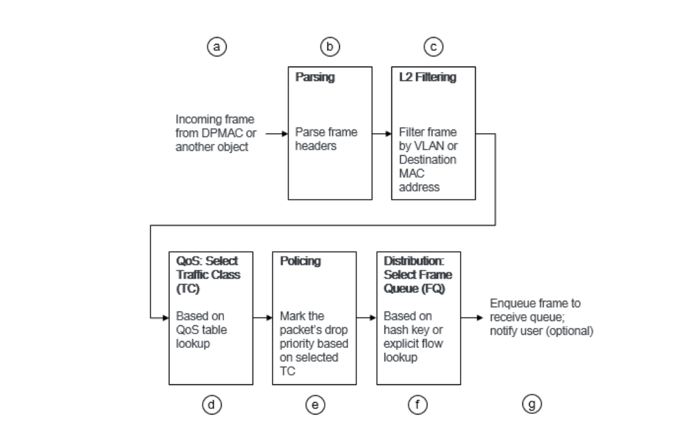

**Figure 63. Các giai đoạn xử lý frame ingress của DPNI**

a) Một frame tới DPNI từ một object khác, như DPMAC, DPSW hoặc object khác.

b) Parsing (phân tích): Frame được phân tích để tìm các header dùng để sinh lookup key.

c) Filtering (lọc): Địa chỉ MAC đích và VLAN (nếu có) được so với các bộ lọc do người dùng định nghĩa; frame không khớp bộ lọc sẽ bị drop.

> **NOTE**
>
> DPNI cho phép cấu hình chế độ promiscuous cho địa chỉ unicast và/hoặc multicast; nếu bật, các chế độ này bỏ qua MAC filter.

d) QoS: DPNI hỗ trợ tối đa tám traffic class ingress và số QMan frame queue tùy ý cho mỗi traffic class. Frame được phân loại vào một trong các traffic class dựa trên lookup key do người dùng định nghĩa; traffic class được chọn quyết định một tập queue cụ thể.

e) Policing: Frame được ‘tô màu’ dựa trên policing profile định nghĩa cho traffic class, sau đó là thuật toán WRED loại bỏ các frame priority thấp nhất nếu cần.

f) Distribution (phân phối): DPNI chọn một frame queue đích cho frame, bằng một lookup khác do người dùng định nghĩa (explicit flow steering) hoặc bằng một phép hash kiểu RSS; lookup này chọn queue đích cuối cùng trong tập queue đã chọn trước đó (của traffic class được chọn).

g) Frame được enqueue vào queue, và queue đại diện cho đích một cách gián tiếp. Tới đây, DPIO object tham gia vào quá trình. Mỗi queue được cấu hình để gửi thông báo có dữ liệu tới một DPIO cụ thể, và các thông báo này cho phần mềm driver dùng DPIO đó biết có một hoặc nhiều frame sẵn sàng để đọc từ một queue cụ thể. Phần mềm driver đáp lại bằng cách dùng một DPIO (thực ra là bất kỳ DPIO nào của nó) để đọc một loạt một hoặc nhiều frame từ queue.

Phần mềm driver trên GPP có thể điều hướng bất kỳ tập receive queue nào tới DPIO hoặc DPCON object; DPNI cấu hình queue liên quan để sinh thông báo qua DPIO hoặc DPCON được gắn, như giải thích dưới đây.

Bất kỳ receive queue nào của DPNI cũng có thể gắn với một DPIO object. DPIO object có thể hoạt động với notification được bật, khi đó các queue gắn với DPIO sinh các message FQDAN (Frame Queue Data Available Notification) tới phần mềm GPP khi có dữ liệu.

Ngoài ra, các receive queue của DPNI có thể gắn với một DPCON object. Khi DPCON object được nối với một DPIO object có bật notification, DPCON sinh các message CDAN (Channel Data Available Notification) tới phần mềm GPP khi có dữ liệu.

Phần mềm GPP có thể áp dụng bất kỳ tùy chọn lập lịch ingress nào sau đây cho giao diện mạng:

a) Poll các queue của DPNI bằng các dequeue request tường minh qua DPIO. Trong trường hợp này, driver của giao diện mạng tự lập lịch các lời gọi dequeue.

b) Dùng DPIO object để nhận thông báo FQDAN về việc có dữ liệu trong các queue của DPNI, rồi dequeue từ các queue đó. Driver có thể điều khiển việc lập lịch bằng cách đặt priority cho các queue (các message FQDAN sẽ được xếp theo priority).

c) Một phương pháp luân phiên giữa tùy chọn (a) và (b), như ở chế độ NAPI.

d) Dùng DPCON object để lập lịch có hỗ trợ phần cứng cho các receive queue khác nhau. DPCON cũng cho phép driver lập lịch traffic ingress giữa các giao diện mạng khác nhau. Phần mềm GPP có thể chọn các flow cụ thể đi qua DPCON, và nhận thông báo CDAN về việc có dữ liệu cho các flow đó. Các flow khác có thể được lập lịch theo một trong ba tùy chọn trước.

Các tùy chọn (a), (b) và (c) ở trên không cần DPCON object; chỉ cần kết hợp DPNI và DPIO là đủ.

### 7.2.2 Xử lý frame egress

Hình và các đoạn dưới đây mô tả các giai đoạn xử lý ingress của DPNI.

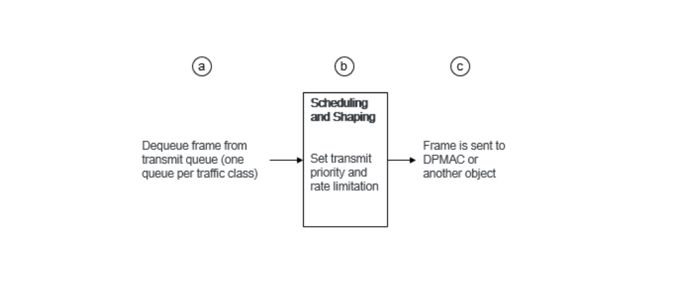

**Figure 64. Các giai đoạn xử lý frame egress của DPNI**

a) Phần mềm driver enqueue một frame vào một trong các transmit queue, bằng cách chỉ ra priority truyền mong muốn (traffic class); DPNI hỗ trợ một transmit queue logic cho mỗi traffic class

b) Lập lịch và shaping: frame được lập lịch truyền dựa trên priority tương đối của traffic class của nó so với các frame truyền khác. DPNI cũng có thể áp dụng giới hạn tốc độ do người dùng định nghĩa ở chiều egress.

c) Frame rời DPNI và được gửi qua DPMAC tới một port ngoài, hoặc tới một network object khác như DPSW.

Cấu hình egress gồm tối đa tám traffic class, mỗi class có transmit queue riêng.

Xác nhận truyền dùng một confirmation queue riêng cho mỗi DPIO – confirmation queue được dùng để xác nhận việc truyền mọi packet, hoặc tùy chọn chỉ các lỗi truyền, của các packet đã truyền qua DPIO đó. Các transmit confirmation queue được cấu hình để chuyển packet qua DPIO tương ứng. DPIO object có thể hoạt động với notification bật hoặc tắt, và DPIO có channel riêng để chuyển notification.

### 7.2.3 Quan hệ với DPIO và DPCON object

Một DPNI object chỉ hoạt động đầy đủ khi gắn với ít nhất một DPIO object. Chủ yếu, DPIO object cung cấp cấu hình cho một QBMan software portal, có tùy chọn thông báo có dữ liệu. Phần mềm GPP có thể tùy ý gắn DPIO object với thread, hoặc dùng chung giữa các core ở chế độ SMP, nhưng khi đó cần đồng bộ hóa việc truy cập QBMan software portal. Có thể gắn nhiều DPIO object với cùng một DPNI, để phân tán traffic từ DPNI này qua nhiều QBMan software portal.

Phần mềm GPP có thể quyết định bật notification của DPIO, hoặc dequeue frame theo logic polling tự lập lịch. Cũng có thể để một thực thể GPP nhận notification từ một DPIO rồi báo cho một thực thể khác dequeue packet bằng một DPIO khác.

DPCON object được dùng để gom traffic từ nhiều interface vào các sub-interface, chủ yếu cho mục đích lập lịch. Có thể nối DPCON với DPIO để nó sinh notification tới GPP.

Lưu ý rằng QBMan software portal được dùng cho cả thao tác enqueue/dequeue packet lẫn thao tác acquire/release buffer. Phần mềm GPP chịu trách nhiệm về chế độ hoạt động và cách dùng portal, tức là dùng chung hay gắn riêng, chế độ NAPI hay chế độ khác, gắn queue context, v.v.

DPIO object có thể phục vụ nhiều interface. Không chỉ nhiều DPNI object; nó cũng có thể kết hợp với các communication interface và accelerator interface. Ví dụ, cùng một DPIO có thể phục vụ cả một DPNI lẫn một DPCI, với điều kiện chúng được gán cho cùng software context (container).

### 7.2.4 Quan hệ với DPBP object

Một DPNI object chỉ hoạt động đầy đủ khi gắn với ít nhất một DPBP object. Mỗi DPNI phải gắn với ít nhất một và tối đa tám DPBP object, cho phép dùng linh hoạt các buffer pool khác nhau.

Một DPBP object có thể gắn với nhiều DPNI object trong cùng software context. Cũng có thể khởi tạo và gắn một DPBP object riêng cho mỗi DPNI; software context trên GPP/AIOP phải quyết định có cần dùng chung hay không.

### 7.2.5 QoS ingress

DPNI hỗ trợ phân loại frame nhận được vào các traffic class (tối đa 8). Việc này được làm bằng cách so frame tới với một lookup key do người dùng định nghĩa (có thể kèm mask). Kết quả lookup trong bảng QoS quyết định traffic class của frame nhận được.

Mỗi traffic class có tập thuộc tính riêng, ví dụ các tùy chọn phân phối, tùy chọn policing

Mọi chức năng liên quan đến QoS đều đòi hỏi DPNI được tạo với nhiều traffic class. (Xem thiết lập NUM_TCS trong DPNI_CREATE.)

Người dùng có thể chọn một lookup key linh hoạt cho bảng QoS. Việc này được làm bằng cách gọi command DPNI_SET_QOS_TABLE. Sau bước đó, người dùng có thể thêm và xóa các mục QoS bằng các command DPNI_ADD_QOS_ENTRY và DPNI_REMOVE_QOS_ENTRY.

Từ MC 10.3.0, hành vi mặc định của các DPNI object do AIOP dùng là gán một priority mặc định cho mỗi traffic class.

Giá trị priority của mỗi TC được tính dựa trên NUM_TCS của DPNI và 4 mức strict priority của một QBMan Channel.

Trước phiên bản này, mọi traffic class có cùng priority ở ingress của AIOP.

Với DPNI object trong ngữ cảnh AIOP, ánh xạ mặc định từ traffic class sang priority được trình bày dưới đây:

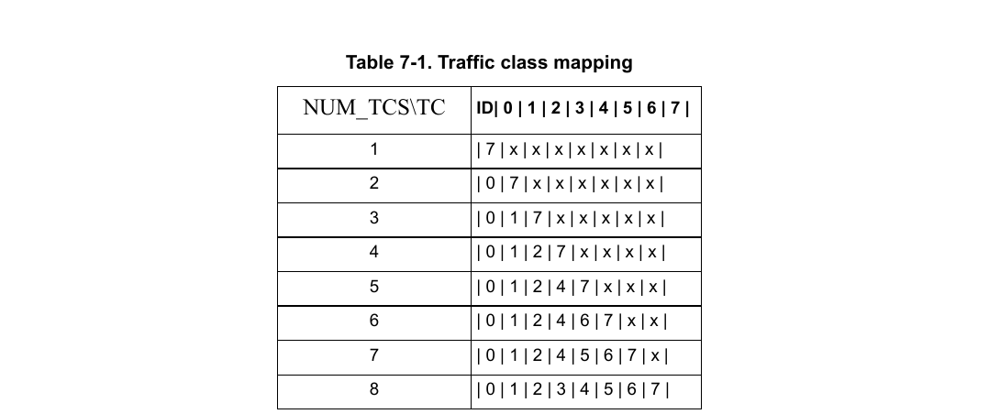

Ánh xạ tĩnh ở trên có thể được ghi đè bằng DPNI_SET_QUEUE.

### 7.2.6 Phân phối ingress

Giai đoạn phân phối ingress chọn queue đích cuối cùng trong tập queue đã chọn trước đó (của traffic class được chọn). DPNI chọn frame queue đích cho frame bằng một trong các phương pháp sau:

- Explicit flow steering – dựa trên lookup do người dùng định nghĩa, hoặc
- Phép hash kiểu RSS – hash dựa trên key do người dùng định nghĩa

Chức năng phân phối chỉ có hiệu lực nếu option DPNI_OPT_NO_FS không được chỉ định khi tạo DPNI; nếu không, mỗi traffic class có đúng (và chỉ) một flow. Xem DPNI_CREATE để biết mô tả option DPNI_OPT_NO_FS và NUM_QUEUES để cấu hình kích thước phân phối của DPNI.

Bước đầu tiên khi áp dụng bất kỳ kiểu phân phối nào là gọi command DPNI_SET_RX_TC_DIST để chọn chế độ phân phối (DIST_MODE = DPNI_DIST_MODE_FS / DPNI_DIST_MODE_HASH / DPNI_DIST_MODE_NONE). Chế độ phân phối được chọn theo từng traffic class, nên mỗi traffic class có thể có phương pháp phân phối khác nhau. Với phần mềm GPP, kích thước phân phối quyết định số receive queue trong traffic class đó.

Nếu chọn chế độ phân phối flow steering, người dùng cũng phải cung cấp định dạng lookup key cho bảng flow steering. Sau bước này, người dùng có thể bắt đầu thêm các mục flow steering tường minh để đưa từng flow tới receive queue cần thiết. Xem command DPNI_ADD_FS_ENTRY để biết thêm chi tiết. Lưu ý rằng các flow không khớp có thể bị drop hoặc được đưa tới flow ID mặc định (FLOW_ID = 0). Hành vi khi lookup flow không khớp được cấu hình qua field MISS_ACTION trong command DPNI_SET_RX_TC_DIST.

#### 7.2.6.1 Quy tắc xây dựng phân phối ingress

Các key thêm vào bảng FS là các mảng byte chứa các field được cấu hình trong chế độ phân phối. Mọi field phải theo đúng thứ tự trong định nghĩa key và phải có kích thước như định nghĩa của giao thức. Kích thước key là tổng kích thước của mọi field.

Nếu có mask (DPNI_OPT_HAS_KEY_MASKING), mask sẽ được dùng để bỏ qua một phần của key. Chỉ những bit có bit mask tương ứng bằng một mới được so sánh.

Tùy giao thức, một số field có thể có kích thước khác nhau. Một ví dụ là IP nguồn và đích trong giao thức IPV4 và IPV6. Khi tạo key cho giao thức IPV4, chỉ cần cung cấp 4 byte cho field IP. Với giao thức IPV6, phải cung cấp 16 byte cho các field IP.

Ví dụ: key gồm cổng đích udp và IP nguồn

- Với IPV4, key là: 2 byte cổng UDP, 4 byte IP nguồn (tổng kích thước key là 2+4 = 6)
- Với IPV6, key là: 2 byte cổng UDP, 16 byte IP nguồn (tổng kích thước key là 2+16 = 18)

### 7.2.7 Điều khiển luồng (flow control)

dpni triển khai các cơ chế được mô tả trong IEEE 802.3x (flow control) và IEEE 802.1Qbb (priority flow control).

Các cơ chế này có thể được kích hoạt theo hai cách:

  - Buffer pool cạn: khi một trong các buffer pool gắn với dpni rơi vào trạng thái cạn. Đây là cách kích hoạt mặc định và luôn được dùng.
  - Tắc nghẽn: khi Rx queue rơi vào trạng thái tắc nghẽn. Để bật cách kích hoạt này, người dùng phải gửi command DPNI_SET_CONGESTION_NOTIFICATION với

flag DPNI_CONG_OPT_FLOW_CONTROL được đặt trong field NOTIFICATION_MODE và QUEUE_TYPE đặt là Rx.

Flow control hoạt động giữa các cấu hình (kết nối) sau: DPNI <-> DPNI, DPNI <-> DPDMUX, DPNI <-> DPSW, DPNI <-> DPMAC, DPSW <-> DPMAC và DPDMUX <-> DPMAC.

Flow control bị ảnh hưởng bởi cấu hình tail drop. Nếu các queue bật tail drop, buffer pool sẽ không bao giờ cạn và dpni sẽ không bao giờ gửi packet flow control.

Khi bật congestion notification, cách kích hoạt bằng buffer pool cạn vẫn còn hiệu lực. Nếu ngưỡng tắc nghẽn quá lớn, buffer pool có thể cạn và kích hoạt frame flow control trong khi không queue nào ở trạng thái tắc nghẽn.

Khi một buffer pool được dùng chung giữa nhiều dpni object, flow control có thể xuất hiện đồng thời trên mọi dpni object do buffer pool cạn. Khi đó flow control có thể xuất hiện trên các kết nối ít traffic do buffer cạn vì traffic lớn trên dpni khác.

#### 7.2.7.1 Cấu hình flow control

Để bật flow control, gửi command DPNI_SET_LINK_CFG và đặt flag DPNI_LINK_OPT_PAUSE. Việc này bật các frame flow control được kích hoạt khi buffer pool cạn. Flag này có thể dùng kết hợp với DPNI_LINK_OPT_ASYM_PAUSE để sinh flow control bất đối xứng. Xem mô tả command để biết các tổ hợp khác nhau của các flag này.

Để bật flow control kích hoạt bởi tắc nghẽn, gửi command DPNI_SET_CONGESTION_NOTIFICATION cho Rx queue. Nếu dpni có nhiều traffic class, toàn bộ traffic bị dừng khi chỉ một traffic class rơi vào trạng thái tắc nghẽn.

#### 7.2.7.2 Cấu hình priority flow control

Priority flow control chỉ hoạt động nếu dpni được nối với một dpmac object.

Các object DPSW và DPDMUX không hỗ trợ Priority Flow Control và Asymmetric Flow Control.

Trước khi bật priority flow control, người dùng phải tạo một bảng qos bằng command DPNI_CMDID_SET_QOS_TBL và thêm các mục bằng DPNI_CMDID_ADD_QOS_ENT để ánh xạ traffic vào các TC.

Để bật priority flow, ngoài các flag cần để bật flow control, đặt thêm DPNI_LINK_OPT_PFC_PAUSE.

Để bật flow control kích hoạt bởi tắc nghẽn, gửi command DPNI_SET_CONGESTION_NOTIFICATION cho Rx queue. Nếu dpni được tạo với option DPNI_OPT_SHARED_CONGESTION, chỉ một queue tắc nghẽn cũng sẽ dừng toàn bộ traffic. Khi đó dpni chỉ có một congestion point và không biết được TC nào bị tắc nghẽn.

Người dùng có thể ánh xạ buffer pool vào một traffic class cụ thể bằng command DPNI_SET_POOLS. Để làm vậy, ghi vào POOL\<n>_DPBP_PRIO_MASK một bit mask gồm mọi traffic class gắn với POOL\<n>_DPBP_ID. Khi buffer pool có ID này rơi vào trạng thái cạn, chỉ traffic của các TC liên quan bị dừng.

### 7.2.8 Policer

Policer xác định màu của frame (drop priority) mà cơ chế hàng đợi dùng. Sau đó Qbman có thể dùng màu này để thực hiện WRED.

Policer hỗ trợ các chế độ sau:

  - chế độ pass-through
  - RFC-2698
  - RFC-4115

#### 7.2.8.1 Nguyên tắc đo (metering)

Bản triển khai dùng token bucket để đo traffic.

Một bucket kích thước S chứa được tối đa S token và được gọi là max burst size. Max burst size là kích thước tối đa của dữ liệu mạng trong packet tính theo đơn vị token. Một packet tới với kích thước B có thể chứa tới B token dữ liệu mạng. Kích thước bucket S cần được cấu hình lớn hơn hoặc bằng dữ liệu mạng của packet dài nhất, để một bucket đầy chứa được ít nhất một packet.

Token được thêm vào bucket với tốc độ R token mỗi giây cho tới kích thước bucket S. Vì vậy cứ mỗi 1/R giây lại có một token được thêm vào bucket, miễn là bucket chưa đầy.

Khi một packet kích thước B (B<=S) tới, nó được coi là đạt (conforming) nếu bucket còn ít nhất B token. Khi đó B token bị lấy ra khỏi bucket. Nếu bucket còn ít hơn B token, packet được coi là không đạt (non-conforming) và không token nào bị lấy ra. Khi đó packet có thể bị drop hoặc được đánh dấu (tô màu), tùy cách xử lý cần thiết cho sự kiện này.

Một thuật toán đo hai tốc độ (two-rate) dùng hai token bucket. Mỗi bucket được cấu hình để đo traffic có đặc tính khác nhau. Mỗi hệ đo được đặc trưng bởi các tham số traffic của nó: Traffic Rate R [token/giây] và Max Burst Size S [token]. Tham số S cũng xác định kích thước token bucket, sao cho mọi burst vượt quá S token đều bị coi là không đạt. Đơn vị token có thể khác nhau tùy thuật toán (có thể là bit, byte hoặc cả packet, tùy mục tiêu đo). Bản triển khai Policer hỗ trợ các chế độ đơn vị BYTE và PACKET.

Khi đơn vị token đặt là BYTE, policer sẽ dùng độ dài frame L3 để tính băng thông.

#### 7.2.8.2 RFC-2698

Thuật toán đánh dấu ba màu hai tốc độ RFC-2698 được dùng để triển khai differentiated services bằng cách ánh xạ các loại traffic khác nhau vào các profile khác nhau. Thuật toán đo một luồng packet IP và đánh dấu các packet là GREEN, YELLOW hoặc RED.

Một packet được đánh dấu RED nếu nó vượt peak information rate (PIR); được đánh dấu YELLOW nếu vượt committed information rate (CIR); còn lại được đánh dấu GREEN. Thuật toán được dùng để áp đặt yêu cầu tốc độ đỉnh lên traffic ingress.

#### 7.2.8.3 RFC-4115

RFC-4115 là một phiên bản sửa đổi của RFC-2698, với định nghĩa tham số traffic, cách đo và cách đánh dấu hơi khác.

Bản triển khai RFC-4115 dùng cùng các cấu trúc dữ liệu như RFC-2698, ngoại trừ Peak Information Rate (PIR) và Peak Burst Size (PBS) lần lượt được thay bằng Excess Information Rate (EIR) và Excess Burst Size (EBS).

#### 7.2.8.4 Pass-Through

Không đo traffic và mọi packet đều được tô bằng màu được chỉ định.

### 7.2.9 Cô lập object

IMPORTANT NOTICE:

Việc cô lập object phải được làm ở mức ứng dụng.

MC chỉ chịu trách nhiệm cô lập object ở mức partition. Để làm vậy, MC đăng ký một virtual ID cho ICID của ứng dụng. Virtual ID này chỉ dùng được trong ngữ cảnh ICID đó. Nếu ứng dụng dùng một virtual ID không hợp lệ (hoặc chưa đăng ký), thao tác sẽ thất bại và MC sẽ ghi log truy cập trái phép.

Ứng dụng của người dùng có trách nhiệm cô lập các object trong cùng ứng dụng. Khi đó, enqueue/dequeue thuộc trách nhiệm của ứng dụng/driver và các ID được dùng phải đúng: các hàm 'dpni_get_queue' và 'dpni_get_qdid' được dùng để lấy các virtual ID này.

Các API enqueue/dequeue không biết dpni ID mà chỉ dùng queue ID (fqid) hoặc queue destination id (qdid, qpri, qdbin). Nghĩa là frame sẽ được đưa thẳng vào queue mong muốn và không có bước kiểm tra xem queue này có thuộc một DPNI cụ thể hay không.

Nếu ứng dụng đưa một ID sai vào command enqueue / dequeue và ID này đã được đăng ký đúng trong MC, thao tác sẽ thành công nhưng frame có thể bị enqueue nhầm vào queue sai. Frame có thể bị gửi qua một dpni sai hoặc bị đưa thẳng vào Rx queue của dpni khác.

Đó là lý do việc cô lập các object của ứng dụng phải được làm ở mức ứng dụng.

Nói cách khác: nếu ứng dụng có một ICID và cố enqueue vào một queue đã xác thực với ICID khác, MC sẽ ghi log lỗi AVI.

Nhưng với hai object trong cùng ứng dụng, ứng dụng chịu trách nhiệm cô lập.

Nếu thấy những lỗi như vậy (frame bị enqueue nhầm vào Rx/Tx queue của một object dù chưa nhận/gửi gì), hãy kiểm tra các ID mà ứng dụng/driver dùng cho thao tác enqueue/dequeue có đúng và khớp với các ID do DPNI API trả về không: 'dpni_get_queue' và 'dpni_get_qdid'.

## 7.3 Tham chiếu command của DPNI

Mục này trình bày chi tiết mô hình lập trình các command của DPNI.

### 7.3.1 DPNI_CREATE

Tạo DPNI object, cấp phát tài nguyên cần thiết và thực hiện khởi tạo cần thiết. Object có thể được tạo bằng cách khai báo trong file DPL, hoặc bằng cách gọi command này. Command này có mọi tham số cần thiết để khởi tạo instance DPNI object. Một số tham số có giá trị mặc định.

Command CREATE của object phải được thực thi trên một MC portal đã được gán cho, hoặc đang được dùng bởi, một Data Path Resource Container, kèm authentication token duy nhất của container đó. Command dùng authentication token của container cha mà object sẽ được tạo và gán vào.

Nếu token là '0', object sẽ được gán cho container đang sở hữu MC command portal thực thi command này.

Command trả về một DPNI_ID có thể dùng để OPEN hoặc DESTROY object.Định dạng command được thể hiện trong hình dưới đây.

**Cấu trúc command**

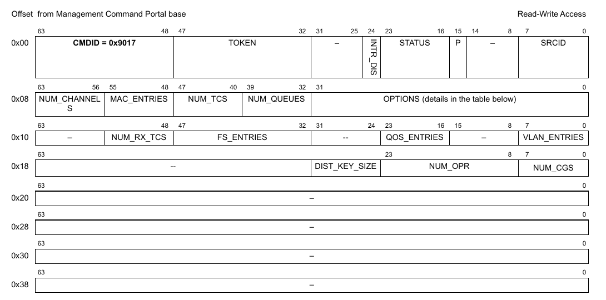

**Figure 65. Mô tả command DPNI_CREATE**

Bảng sau mô tả các field của command.

**Table 6. Mô tả các field của command DPNI_CREATE**

| Offset | Bits | Tên | Mô tả |
|---|---|---|---|
| 0x00 | 0-63 | Header của command | Xem Table 2 để biết mô tả chung các field của command portal. CMDID phải được đặt như chỉ ra trong hình ở trên. |
| 0x08 | 0–31 | OPTIONS – chọn một hoặc nhiều option dưới đây |   |
|   | 0 | DPNI_OPT_TX_FRM_RELEASE | Điều khiển việc có Tx confirmation queue hay không: 0 – Có Tx confirmation queue. Có thể chuyển hành vi Tx confirmation giữa xác nhận và giải phóng buffer bằng cách thực thi DPNI_SET_TX_CONFIRMATION_MODE. 1 – Không có Tx confirmation queue, DPNI chỉ có thể giải phóng các buffer gắn với traffic Tx về một buffer pool. Command DPNI_SET_TX_CONFIRMATION_MODE với bất kỳ mode nào khác DPNI_CONF_DISABLE sẽ trả về lỗi. |
|   | 1 | DPNI_OPT_NO_MAC_FILTER | Điều khiển việc có bảng lọc MAC hay không: 0 – Có bảng lọc MAC. Có thể tắt lọc MAC lúc runtime bằng cách thực thi DPNI_SET_MULTICAST_PROMISC và DPNI_SET_UNICAST_PROMISC. 1 – Không có lọc MAC, DPNI luôn ở chế độ promiscuous. Mọi command bật lọc MAC hoặc thao tác trên các mục trong danh sách lọc MAC đều trả về lỗi. Field MAC_ENTRIES trong DPNI_CREATE bị bỏ qua. Option này áp dụng cho cả lọc MAC unicast lẫn multicast. |
|   | 2 | DPNI_OPT_HAS_POLICING | Điều khiển việc có WRED/policing hay không: 0 – Không có WRED. Command DPNI_SET_EARLY_DROP với mode đặt là DPNI_EARLY_DROP_MODE_WRED sẽ trả về lỗi. Tail-drop và các biện pháp chống tắc nghẽn khác vẫn có, không phụ thuộc option này. 1 – Có WRED trên DPNI này. |
|   | 3 | DPNI_OPT_SHARED_CONGESTION | Điều khiển số congestion group dành cho DPNI: 0 – Congestion group được dành theo từng TC. Điều này cho phép cấu hình ngưỡng tail-drop hoặc congestion notification cho mọi queue của mỗi TC, độc lập với các TC khác. 1 – Chỉ có một congestion group cho mọi TC. Tail-drop hoặc congestion notification có thể được cấu hình cho từng DPNI, áp dụng trên mọi TC. Tham số đầu vào TC của DPNI_SET/GET_TAILDROP phải bằng 0. Option này bị bỏ qua nếu DPNI có 1 TC; hai option khi đó cho cùng hành vi. Lưu ý rằng tail-drop nói ở đây áp dụng trên nhiều queue và được điều khiển bằng DPNI_SET/GET_TAILDROP với CG_POINT đặt là DPNI_CP_GROUP. Taildrop theo từng queue, điều khiển bằng DPNI_SET/GET_TAILDROP với CG_POINT đặt là DPNI_CP_QUEUE, không phụ thuộc thiết lập này và luôn có. |
|   | 4 | DPNI_OPT_HAS_KEY_MASKING | Điều khiển việc có masking cho flow steering và phân loại QoS hay không: 0 – không có masking, lookup luôn là exact match và lookup key gắn với frame phải khớp hoàn toàn với key trong bảng lookup. Các field MASK và INDEX của DPNI_ADD_FS/QOS_ENTRY bị bỏ qua. 1 – Có masking, lookup key gắn với frame chỉ cần khớp phần key trong bảng lookup không bị mask bỏ đi. Lưu ý rằng option masking không có trên mọi SoC. Nếu đặt option này trên một SoC không hỗ trợ masking, DPNI_CREATE sẽ trả về lỗi. Ngoài ra, khi đó bảng flow steering sẽ là lookup TCAM, và số mục khả dụng có thể dễ dàng bị vượt quá. Lưu ý: Masking được hỗ trợ trên các SoC LS2080A và LS2088A cùng các biến thể của chúng, và không được hỗ trợ trên các SoC LS108xA. |
|   | 5 | DPNI_OPT_NO_FS | Điều khiển việc có bảng lookup flow steering hay không: 0 – Có bảng lookup flow steering, có thể dùng để điều hướng traffic tới một ingress queue cụ thể, lọc bỏ các flow khớp, hoặc gắn các flow khớp với một flow context cho trước (xem mô tả field FLC trong cấu trúc Frame Descriptor). 1 – Không có flow steering, các command thao tác trên bảng FS sẽ trả về lỗi. Lưu ý rằng bảng flow steering vẫn dùng được ngay cả khi NUM_QUEUES = 1, nhưng chỉ giới hạn ở việc lọc bỏ flow hoặc chọn giá trị FD[FLC] cho từng flow. |
|   | 6 | DPNI_OPT_HAS_OPR | Điều khiển việc có Order Restoration hay không: 0 – Không có Order Restoration. Command DPNI_SET_OPR sẽ trả về lỗi. 1 – Có Order Restoration trên DPNI này. Lưu ý rằng option này không có trên LS2080A |
|   | 7 | DPNI_OPT_OPR_PER_TC | 0 – Có thể đặt Order Restoration Point cho từng index trong một TC. 1 – Các Order Restoration Point được dùng chung cho mỗi TC và index bị bỏ qua trong các command OPR. |
|   | 8 | DPNI_OPT_SINGLE_SENDER | Khi đặt, mọi traffic class TX sẽ dùng một sender duy nhất. num_queues bị bỏ qua cho TX, nó chỉ được dùng cho RX. Nếu đặt flag này, tham số num_queues trong command dpni_get_attributes sẽ chứa số RX queue cho mỗi TC. |
|   | 9 | DPNI_OPT_CUSTOM_CG | Khi đặt, có thể cấu hình số congestion group tùy chỉnh trên DPINI *(ghi chú: đúng là DPNI)* này. |
|   | 10 | DPNI_OPT_CUSTOM_OPR | Khi đặt, có thể cấu hình số order point record tùy chỉnh trên DPNI này. |
|   | 11 | DPNI_OPT_SHARED_HASH_KEY | Dùng để chỉ định hash key có được dùng chung giữa mọi traffic class hay không. |
|   | 12 | DPNI_OPT_SHARED_FS | Dùng để bật một bảng Flow Steering duy nhất cho mỗi DPNI (Shared Flow Steering). |
| 0x08 | 13 | DPNI_OPT_STASHING_DIS | Điều khiển việc cache stashing dữ liệu frame, context và annotation của FQ: 0 - Stashing bật theo mặc định 1 - Stashing bị tắt |
|   | 14-31 | – | Reserved |
| 0x08 | 32-39 | NUM_QUEUES | Điều khiển số queue có trong DPNI. Có thể dùng chúng để chia tải traffic Rx qua nhiều CPU và giữ Tx flow gắn với một CPU, kể cả việc chuyển Tx confirmation. Nếu giá trị này là 0, dpni object sẽ được tạo với một queue. Giá trị tối đa được hỗ trợ bằng hai lần số core (16 cho LS2088, LS1088, LS2085 và 32 cho LX2160). Nếu đặt option DPNI_OPT_SINGLE_SENDER, tham số này chỉ được dùng cho RX. Khi đó TX bị giới hạn ở một queue. |
|   | 40-47 | NUM_TCS | Điều khiển số traffic class có trong DPNI. Mỗi traffic class có thể có thuộc tính khác nhau, như: - priority khác nhau cho Tx và Rx, - ngưỡng tắc nghẽn và congestion notification riêng, - buffer pool riêng. Giá trị 0 được hiểu là 1. Giá trị tối đa được hỗ trợ là 16. Nếu giá trị lớn hơn 8, dpni object sẽ dùng max_tcs cho Tx và giới hạn số traffic class cho Rx ở 8. |
|   | 48-55 | MAC_ENTRIES | Điều khiển số mục trong bảng lọc MAC. Các mục này dùng để lọc traffic ingress và loại bỏ frame không mong đợi dựa trên địa chỉ MAC đích. Cả traffic unicast lẫn multicast đều bị lọc, dù có thể bật chế độ promiscuous độc lập cho từng loại. Field này bị bỏ qua nếu đặt DPNI_OPT_NO_MAC_FILTER. Nếu không, giá trị 0 được hiểu là 16. Giá trị tối đa được hỗ trợ là 64. |
|   | 56-63 | NUM_CHANNELS | Số Tx channel có cho object này. Nếu đặt bằng 0 (mặc định), dpni object sẽ dùng một channel duy nhất. |
| 0x10 | 0-7 | VLAN_ENTRIES | Điều khiển số mục trong bảng lọc VLAN. Nếu bật lọc VLAN, traffic ingress có VLAN tag sẽ được lọc theo nội dung bảng này dựa trên VLAN ID. Giá trị 0 tắt lọc VLAN. Giá trị tối đa được hỗ trợ là 16. |
|   | 16-23 | QOS_ENTRIES | Điều khiển số mục trong bảng lookup QoS. Bảng này dùng để chọn TC cho traffic ingress, dựa trên các key phân loại tùy ý. Bảng này là exact match hoặc lookup TCAM, tùy giá trị DPNI_OPT_HAS_KEY_MASKING. Giá trị 0 được hiểu là 64. Giá trị tối đa được hỗ trợ là 64. |
|   | 32-47 | FS_ENTRIES | Điều khiển số mục trong bảng flow steering. Bảng này dùng để: - điều hướng traffic tới một ingress queue cụ thể, - lọc bỏ các flow khớp, hoặc - gắn các flow khớp với một flow context cho trước (xem mô tả field FLC trong cấu trúc Frame Descriptor). Bảng này là exact match hoặc lookup TCAM, tùy giá trị DPNI_OPT_HAS_KEY_MASKING. Giá trị 0 được hiểu là 64. Giá trị tối đa được hỗ trợ là 1024. |
|   | 48-55 | NUM_RX_TCS | Điều khiển số traffic class có ở phía Rx. Giá trị tối đa được hỗ trợ là 8. Nếu đặt bằng 0, DPNI sẽ dùng số được chỉ định trong NUM_TCS để khởi tạo số traffic class ở phía Rx. |
| 0x18 | 0-7 | NUM_CGS | Số congestion group. Giá trị tối đa được hỗ trợ phụ thuộc SoC đang dùng (8 X số core) (64 cho LS2088, 128 cho LX2160). Giá trị mặc định là một cho mỗi TC. |
|   | 8-23 | NUM_OPR | Số order point record tùy chỉnh mong muốn khi đặt DPNI_OPT_CUSTOM_OPR. Giá trị tối đa được hỗ trợ phụ thuộc SoC đang dùng (max_rx_tcs * num_queues - 128 cho LS2088, 256 cho LX2160). |
|   | 24-31 | DIST_KEY_SIZE | Chỉ hợp lệ khi đặt option DPNI_OPT_SHARED_HASH_KEY. Qua field này có thể đặt giá trị mong muốn cho kích thước key phân phối. Giá trị hợp lệ từ 1 đến 56. |

Mọi field không được nêu là reserved và phải được xóa (đặt bằng 0

**Cấu trúc response**

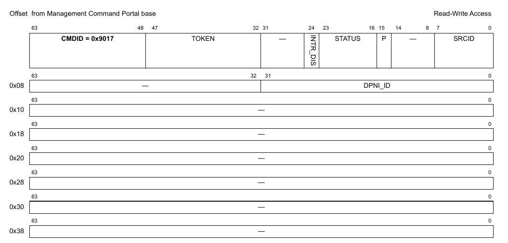

**Figure 7-2. Mô tả response của DPNI_CREATE**

Bảng sau mô tả các field của response.

**Table 7-1. Mô tả các field response của DPNI_CREATE1**

| Offset | Bits | Tên | Mô tả |
|---|---|---|---|
| 0x00 | 0-63 | Header của command | Xem Table 2 để biết mô tả chung các field của command portal. CMDID phải được đặt như chỉ ra trong hình ở trên. |
| 0x08 | 0-31 | DPNI_ID | ID duy nhất của DPNI |

1 Mọi field không được nêu là reserved.

### 7.3.2 DPNI_DESTROY

Command này hủy DPNI object và giải phóng mọi tài nguyên của nó. Nó phải được gọi trong software context đã tạo object. Bên gọi phải cung cấp object id và authentication token của container cha đã tạo object. Lưu ý rằng object có thể đã được gán cho container khác, và gửi authentication token của container đó sẽ trả về lỗi.

Mọi authentication token đang mở tới object phải được đóng trước khi gọi command destroy.

Sau khi gọi hàm này, không thao tác nào khác được phép trên object.

**Cấu trúc command**

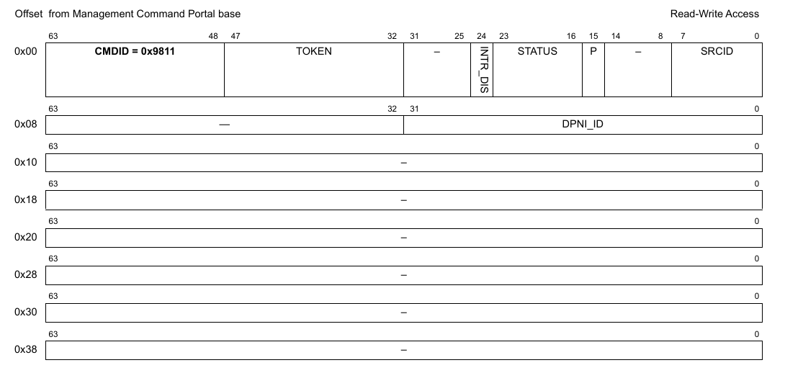

**Figure 66. Mô tả command DPNI_DESTROY**

Bảng sau mô tả các field của command.

**Table 7. Mô tả các field của command DPNI_DESTROY**

| Offset | Bits | Tên | Mô tả |
|---|---|---|---|
| 0x00 | 0–63 | Header của command | Xem Table 2 để biết mô tả chung các field của command portal. CMDID phải được đặt như chỉ ra trong hình ở trên. |
| 0x08 | 0–32 | DPNI_ID | ID của DPNI object cần hủy |

Mọi field không được nêu là reserved và phải được xóa (đặt bằng 0)

### 7.3.3 DPNI_OPEN

Mở một phiên điều khiển cho object được chỉ định.

Hàm này có thể dùng để mở phiên điều khiển cho một object đã được tạo; object có thể đã được khai báo trong DPL hoặc được tạo bằng command DPNI_CREATE.

Hàm này trả về một authentication token duy nhất, gắn với object ID cụ thể; token này phải được dùng trong mọi command tiếp theo cho object này.

**Cấu trúc command**

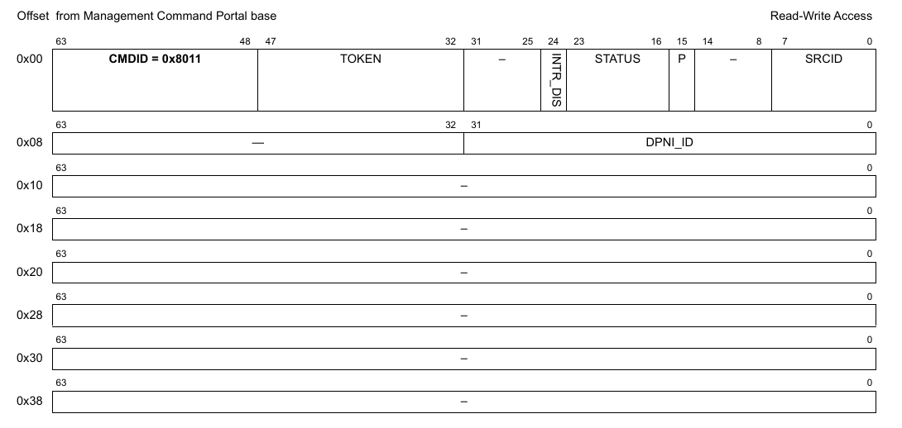

**Figure 67. Mô tả command DPNI_OPEN**

Bảng sau mô tả các field của command.

**Table 8. Mô tả các field của command DPNI_OPEN**

| Offset | Bits | Tên | Mô tả |
|---|---|---|---|
| 0x00 | 0-63 | Header của command | Xem Table 2 để biết mô tả chung các field của command portal. CMDID phải được đặt như chỉ ra trong hình ở trên. |
| 0x08 | 0-31 | DPNI_ID | ID duy nhất của DPNI |

Mọi field không được nêu là reserved và phải được xóa (đặt bằng 0)

### 7.3.4 DPNI_CLOSE

Đóng phiên điều khiển của object.

Sau khi gọi hàm này, không thao tác nào khác được phép trên object nếu không mở một phiên điều khiển mới.

**Cấu trúc command**

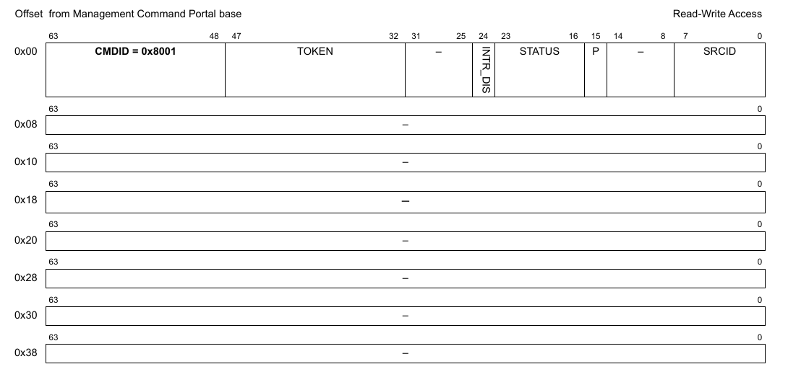

**Figure 68. Mô tả command DPNI_CLOSE**

Bảng sau mô tả các field của command.

**Table 9. Mô tả các field của command DPNI_CLOSE**

| Offset | Bits | Tên | Mô tả |
|---|---|---|---|
| 0x00 | 0-63 | Header của command | Xem Table 2 để biết mô tả chung các field của command portal. CMDID phải được đặt như chỉ ra trong hình ở trên. |

### 7.3.5 DPNI_ENABLE

Enable DPNI, cho phép gửi và nhận frame.

Không nên gửi và nhận frame trước khi thực thi command này.

**Cấu trúc command**

**Figure 69. Mô tả command DPNI_ENABLE**

| Offset | Bits | Tên | Mô tả |
|---|---|---|---|
| 0x00 | 0-63 | Header của command | Xem Table 2 để biết mô tả chung các field của command portal. CMDID phải được đặt như chỉ ra trong hình ở trên. |

Mọi field không được nêu là reserved và phải được xóa (đặt bằng 0)

### 7.3.6 DPNI_DISABLE

Disable DPNI, dừng gửi và nhận frame.

Không nên gửi và nhận frame sau khi thực thi command này.

**Cấu trúc command**

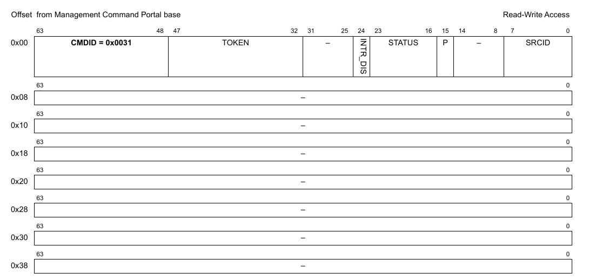

**Figure 70. Mô tả command DPNI_DISABLE**

Bảng sau mô tả các field của command.

**Table 10. Mô tả các field của command DPNI_DISABLE**

| Offset | Bits | Tên | Mô tả |
|---|---|---|---|
| 0x00 | 0-63 | Header của command | Xem Table 2 để biết mô tả chung các field của command portal. CMDID phải được đặt như chỉ ra trong hình ở trên. |

Mọi field không được nêu là reserved và phải được xóa (đặt bằng 0)

### 7.3.7 DPNI_IS_ENABLED

Kiểm tra DPNI có đang enable không.

**Cấu trúc command**

**Figure 71. Mô tả command DPNI_IS_ENABLED**

| Offset | Bits | Tên | Mô tả |
|---|---|---|---|
| 0x00 | 0-63 | Header của command | Xem Table 2 để biết mô tả chung các field của command portal. CMDID phải được đặt như chỉ ra trong hình ở trên. |

Mọi field không được nêu là reserved và phải được xóa (đặt bằng 0)

**Cấu trúc response**

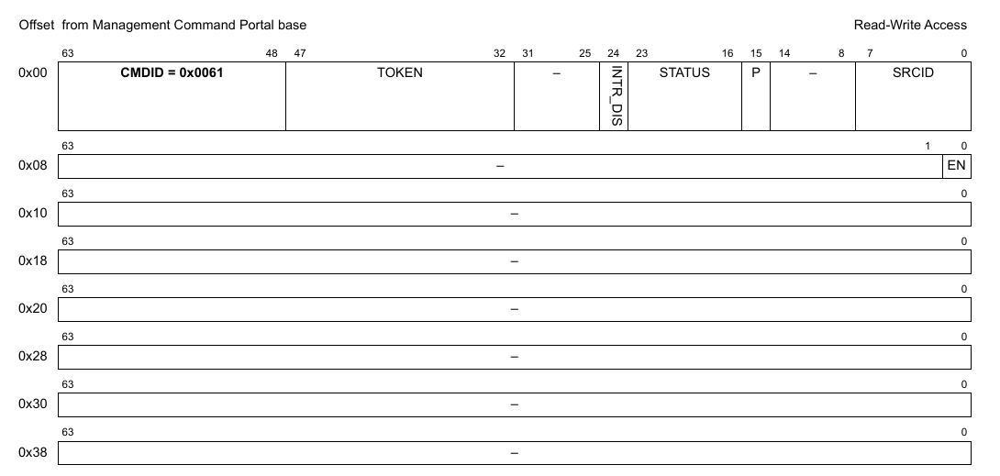

**Figure 72. Mô tả response của DPNI_IS_ENABLED**

| Offset | Bits | Tên | Mô tả |
|---|---|---|---|
| 0x00 | 0-63 | Header của command | Xem Table 2 để biết mô tả chung các field của command portal. CMDID phải được đặt như chỉ ra trong hình ở trên. |
| 0x08 | 0 | EN | Bit này được đặt nếu object đang enable |

Mọi field không được nêu đều được xóa.

### 7.3.8 DPNI_RESET

Reset DPNI, đưa object về trạng thái ban đầu.

Command này có một số giới hạn khi DPNI object được gắn với một DPCON. (Xem Section 28.1, “Reset các MC object có FQ gắn với một channel.”)

**Cấu trúc command**

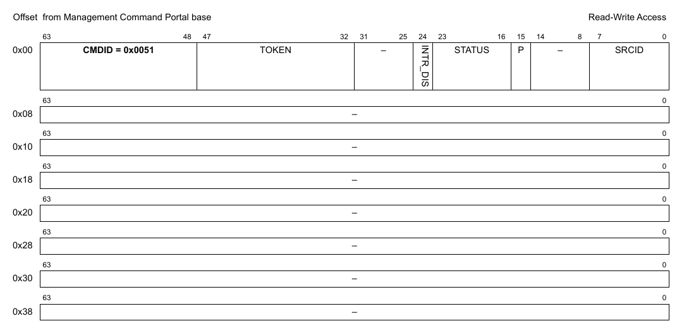

**Figure 73. Mô tả command DPNI_RESET**

| Offset | Bits | Tên | Mô tả |
|---|---|---|---|
| 0x00 | 0-63 | Header của command | Xem Table 2 để biết mô tả chung các field của command portal. CMDID phải được đặt như chỉ ra trong hình ở trên. |

Mọi field không được nêu là reserved và phải được xóa (đặt bằng 0)

### 7.3.9 DPNI_SET_IRQ_ENABLE

Đặt trạng thái tổng thể của interrupt. Cho phép phần mềm GPP điều khiển khi nào interrupt được sinh ra. Mỗi interrupt có thể có tối đa 32 nguyên nhân. Điều khiển enable/disable quyết định trạng thái tổng thể của interrupt. Nếu interrupt bị disable thì không nguyên nhân nào sinh ra interrupt.

**Cấu trúc command**

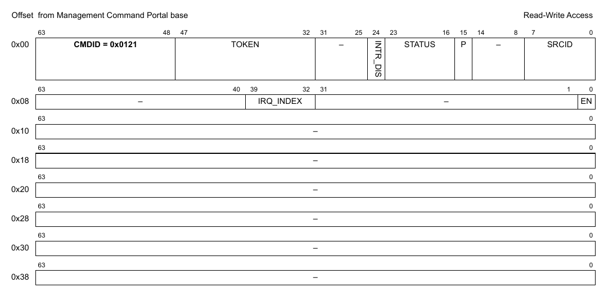

**Figure 74. Mô tả command DPNI_SET_IRQ_ENABLE**

| Offset | Bits | Tên | Mô tả |
|---|---|---|---|
| 0x00 | 0-63 | Header của command | Xem Table 2 để biết mô tả chung các field của command portal. CMDID phải được đặt như chỉ ra trong hình ở trên. |
| 0x08 | 0 | EN | Trạng thái interrupt: đặt ‘1’ để enable, ‘0’ để disable |
|   | 32-39 | IRQ_INDEX | Xác định interrupt index cần cấu hình |

Mọi field không được nêu là reserved và phải được xóa (đặt bằng 0)

### 7.3.10 DPNI_GET_IRQ_ENABLE

Lấy trạng thái tổng thể của interrupt.

**Cấu trúc command**

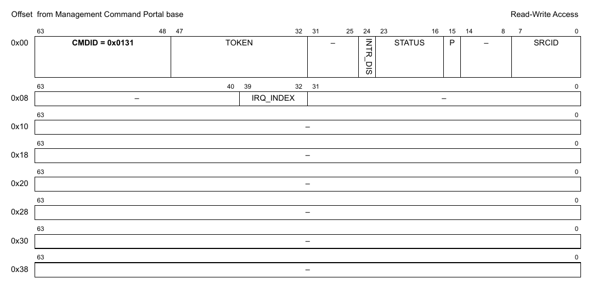

**Figure 75. Mô tả command DPNI_GET_IRQ_ENABLE**

| Offset | Bits | Tên | Mô tả |
|---|---|---|---|
| 0x00 | 0-63 | Header của command | Xem Table 2 để biết mô tả chung các field của command portal. CMDID phải được đặt như chỉ ra trong hình ở trên. |
| 0x08 | 32-39 | IRQ_INDEX | Xác định interrupt index cần truy vấn |

Mọi field không được nêu là reserved và phải được xóa (đặt bằng 0)

**Cấu trúc response**

**Figure 76. Mô tả response của DPNI_GET_IRQ_ENABLE**

| Offset | Bits | Tên | Mô tả |
|---|---|---|---|
| 0x00 | 0-63 | Header của command | Xem Table 2 để biết mô tả chung các field của command portal. CMDID phải được đặt như chỉ ra trong hình ở trên. |
| 0x08 | 0 | EN | Bit này được đặt nếu interrupt đang enable |

Mọi field không được nêu đều được xóa.

### 7.3.11 DPNI_SET_IRQ_MASK

Đặt interrupt mask. Mỗi interrupt có thể có tối đa 32 nguyên nhân, và mô hình interrupt hỗ trợ mask/unmask từng nguyên nhân độc lập.

**Cấu trúc command**

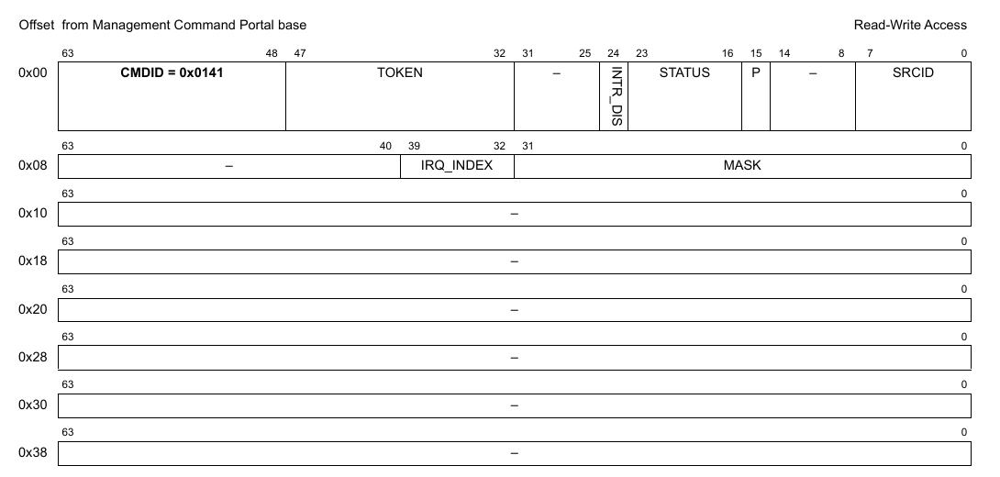

**Figure 77. Mô tả command DPNI_SET_IRQ_MASK**

| Offset | Bits | Tên | Mô tả |
|---|---|---|---|
| 0x00 | 0-63 | Header của command | Xem Table 2 để biết mô tả chung các field của command portal. CMDID phải được đặt như chỉ ra trong hình ở trên. |
| 0x08 | 0-31 | MASK | Event mask để kích hoạt interrupt; xem command GET_IRQ_STATUS để biết đặc tả các event hiện có. Với mỗi bit trong MASK: 0 = bỏ qua event 1 = event hợp lệ; báo IRQ nếu event này xảy ra |
|   | 32-39 | IRQ_INDEX | Interrupt index cần cấu hình |

Mọi field không được nêu là reserved và phải được xóa (đặt bằng 0)

### 7.3.12 DPNI_GET_IRQ_MASK

Lấy interrupt mask. Mỗi interrupt có thể có tối đa 32 nguyên nhân, và mô hình interrupt hỗ trợ mask/unmask từng nguyên nhân độc lập.

**Cấu trúc command**

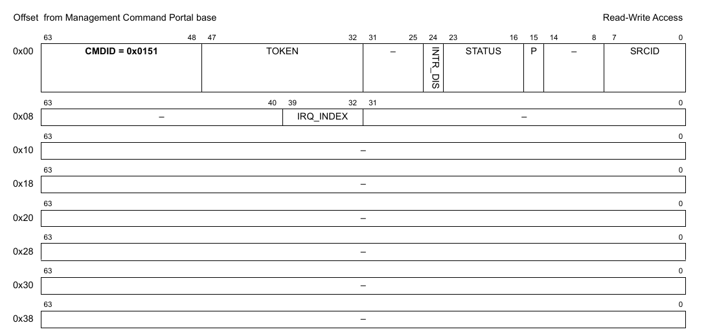

**Figure 78. Mô tả command DPNI_GET_IRQ_MASK**

| Offset | Bits | Tên | Mô tả |
|---|---|---|---|
| 0x00 | 0-63 | Header của command | Xem Table 2 để biết mô tả chung các field của command portal. CMDID phải được đặt như chỉ ra trong hình ở trên. |
| 0x08 | 32-39 | IRQ_INDEX | Interrupt index cần truy vấn |

Mọi field không được nêu là reserved và phải được xóa (đặt bằng 0)

**Cấu trúc response**

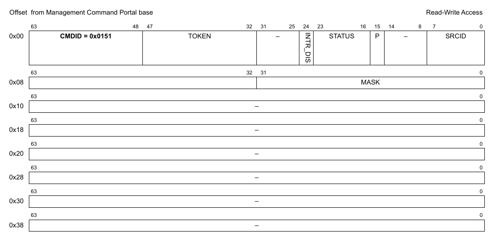

**Figure 79. Mô tả response của DPNI_GET_IRQ_MASK**

| Offset | Bits | Tên | Mô tả |
|---|---|---|---|
| 0x00 | 0-63 | Header của command | Xem Table 2 để biết mô tả chung các field của command portal. CMDID phải được đặt như chỉ ra trong hình ở trên. |
| 0x08 | 0-31 | MASK | Event mask để kích hoạt interrupt; xem command GET_IRQ_STATUS để biết đặc tả các event hiện có. Với mỗi bit trong MASK: 0 = bỏ qua event 1 = event hợp lệ; báo IRQ nếu event này xảy ra |

Mọi field không được nêu đều được xóa.

### 7.3.13 DPNI_GET_IRQ_STATUS

Lấy trạng thái hiện tại của các event đang chờ cho interrupt index được chỉ định.

**Cấu trúc command**

**Figure 80. Mô tả command DPNI_GET_IRQ_STATUS**

| Offset | Bits | Tên | Mô tả |
|---|---|---|---|
| 0x00 | 0-63 | Header của command | Xem Table 2 để biết mô tả chung các field của command portal. CMDID phải được đặt như chỉ ra trong hình ở trên. |
| 0x08 | 0-31 | STATUS | Tùy chọn: mọi bit STATUS được đặt sẽ được xóa khỏi trạng thái đang chờ (không cần dùng command DPNI_CLEAR_IRQ_STATUS nữa). Lưu ý rằng STATUS trả về trong response là trạng thái trước khi các event bị xóa.  Các event được hỗ trợ: xem định nghĩa cấu trúc response |
|   | 32-39 | IRQ_INDEX | Interrupt index cần truy vấn |

Mọi field không được nêu là reserved và phải được xóa (đặt bằng 0)

**Cấu trúc response**

**Figure 81. Mô tả response của DPNI_GET_IRQ_STATUS**

| Offset | Bits | Tên | Mô tả |
|---|---|---|---|
| 0x00 | 0-63 | Header của command | Xem Table 2 để biết mô tả chung các field của command portal. CMDID phải được đặt như chỉ ra trong hình ở trên. |
| 0x08 | 0-31 | STATUS | Mask trạng thái event, mỗi event một bit: 0 = không có interrupt đang chờ 1 = có interrupt đang chờ  Các event được hỗ trợ cho IRQ 0: Bit 0: DPNI_IRQ_EVENT_LINK_CHANGED – cho biết link state đã thay đổi Bit 1: DPNI_IRQ_EVENT_ENDPOINT_CHANGED – cho biết có event nối/ngắt kết nối giữa DPNI và endpoint của nó (DPNI, DPMAC, DPDMUX, DPSW). |

Mọi field không được nêu đều được xóa.

### 7.3.14 DPNI_CLEAR_IRQ_STATUS

Xóa (đánh dấu đã xử lý) các event đang chờ của interrupt index được chỉ định.

**Cấu trúc command**

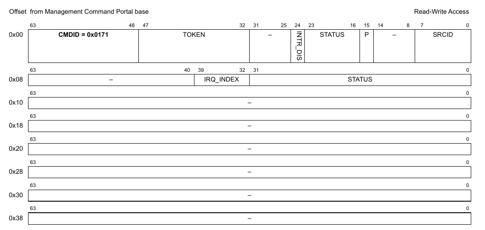

**Figure 82. Mô tả command DPNI_CLEAR_IRQ_STATUS**

| Offset | Bits | Tên | Mô tả |
|---|---|---|---|
| 0x00 | 0-63 | Header của command | Xem Table 2 để biết mô tả chung các field của command portal. CMDID phải được đặt như chỉ ra trong hình ở trên. |
| 0x08 | 0-31 | STATUS | Mask để xóa các event đã xử lý; xem command GET_IRQ_STATUS để biết đặc tả các event hiện có. Với mỗi bit trong MASK: 0 = không đổi trạng thái event 1 = xóa bit trạng thái event để cho biết event đã được xử lý |
|   | 32-39 | IRQ_INDEX | Interrupt index cần cấu hình |

Mọi field không được nêu là reserved và phải được xóa (đặt bằng 0)

### 7.3.15 DPNI_GET_ATTRIBUTES

Lấy các thuộc tính của DPNI như đã cấu hình lúc tạo object.

**Cấu trúc command**

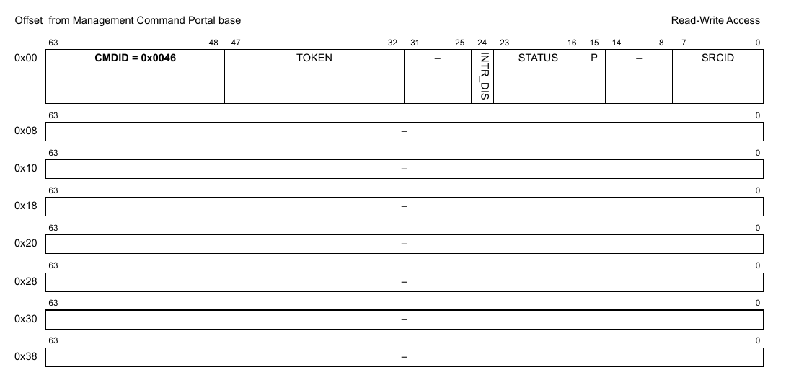

**Figure 83. Mô tả command DPNI_GET_ATTRIBUTES**

| Offset | Bits | Tên | Mô tả |
|---|---|---|---|
| 0x00 | 0-63 | Header của command | Xem Table 2 để biết mô tả chung các field của command portal. CMDID phải được đặt như chỉ ra trong hình ở trên. |

**Cấu trúc response**

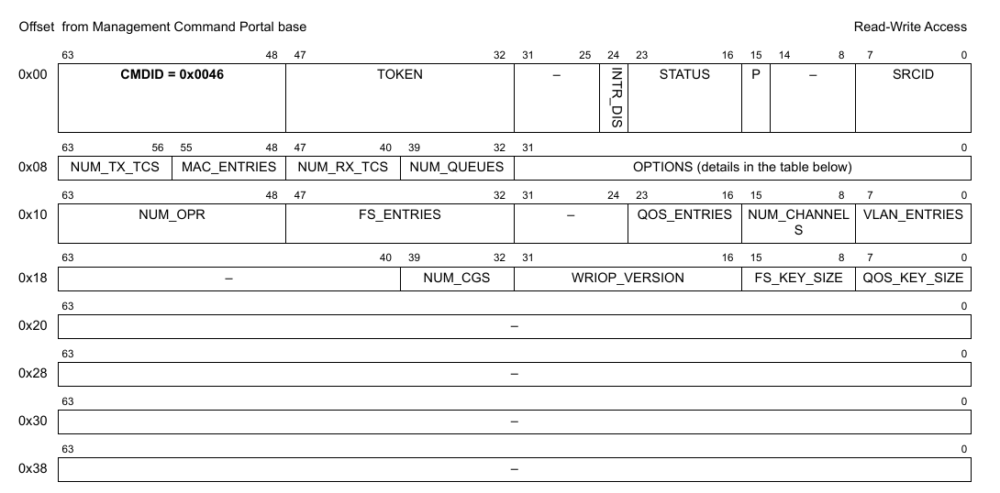

**Figure 84. Mô tả response của DPNI_GET_ATTRIBUTES**

| Offset | Bits | Tên | Mô tả |
|---|---|---|---|
| 0x00 | 0-63 | Header của command | Xem Table 2 để biết mô tả chung các field của command portal. CMDID phải được đặt như chỉ ra trong hình ở trên. |
| 0x08 | 0–31 | OPTIONS – chọn một hoặc nhiều option dưới đây |   |
|   | 0 | DPNI_OPT_TX_FRM_RELEASE | Điều khiển việc có Tx confirmation queue hay không: 0 – Có Tx confirmation queue. Có thể chuyển hành vi Tx confirmation giữa xác nhận và giải phóng buffer bằng cách thực thi DPNI_SET_TX_CONFIRMATION_MODE. 1 – Không có Tx confirmation queue, DPNI chỉ có thể giải phóng các buffer gắn với traffic Tx về một buffer pool. Command DPNI_SET_TX_CONFIRMATION_MODE với bất kỳ mode nào khác DPNI_CONF_DISABLE sẽ trả về lỗi. |
|   | 1 | DPNI_OPT_NO_MAC_FILTER | Điều khiển việc có bảng lọc MAC hay không: 0 – Có bảng lọc MAC. Có thể tắt lọc MAC lúc runtime bằng cách thực thi DPNI_SET_MULTICAST_PROMISC và DPNI_SET_UNICAST_PROMISC. 1 – Không có lọc MAC, DPNI luôn ở chế độ promiscuous. Mọi command bật lọc MAC hoặc thao tác trên các mục trong danh sách lọc MAC đều trả về lỗi. Field MAC_ENTRIES trong DPNI_CREATE bị bỏ qua. Option này áp dụng cho cả lọc MAC unicast lẫn multicast. |
|   | 2 | DPNI_OPT_HAS_POLICING | Điều khiển việc có WRED/policing hay không: 0 – Không có WRED. Command DPNI_SET_EARLY_DROP với mode đặt là DPNI_EARLY_DROP_MODE_WRED sẽ trả về lỗi. Tail-drop và các biện pháp chống tắc nghẽn khác vẫn có, không phụ thuộc option này. 1 – Có WRED trên DPNI này. |
|   | 3 | DPNI_OPT_SHARED_CONGESTION | Điều khiển số congestion group dành cho DPNI: 0 – Congestion group được dành theo từng TC. Điều này cho phép cấu hình ngưỡng tail-drop hoặc congestion notification cho mọi queue của mỗi TC, độc lập với các TC khác. 1 – Chỉ có một congestion group cho mọi TC. Tail-drop hoặc congestion notification có thể được cấu hình cho từng DPNI, áp dụng trên mọi TC. Tham số đầu vào TC của DPNI_SET/GET_TAILDROP phải bằng 0. Option này bị bỏ qua nếu DPNI có 1 TC; hai option khi đó cho cùng hành vi. Lưu ý rằng tail-drop nói ở đây áp dụng trên nhiều queue và được điều khiển bằng DPNI_SET/GET_TAILDROP với CG_POINT đặt là DPNI_CP_GROUP. Taildrop theo từng queue, điều khiển bằng DPNI_SET/GET_TAILDROP với CG_POINT đặt là DPNI_CP_QUEUE, không phụ thuộc thiết lập này và luôn có. |
|   | 4 | DPNI_OPT_HAS_KEY_MASKING | Điều khiển việc có masking cho flow steering và phân loại QoS hay không: 0 – không có masking, lookup luôn là exact match và lookup key gắn với frame phải khớp hoàn toàn với key trong bảng lookup. Các field MASK và INDEX của DPNI_ADD_FS/QOS_ENTRY bị bỏ qua. 1 – Có masking, lookup key gắn với frame chỉ cần khớp phần key trong bảng lookup không bị mask bỏ đi. Lưu ý rằng option masking không có trên mọi SoC. Nếu đặt option này trên một SoC không hỗ trợ masking, DPNI_CREATE sẽ trả về lỗi. Lưu ý: Masking được hỗ trợ trên các SoC LS2080A và LS2088A cùng các biến thể của chúng, và không được hỗ trợ trên các SoC LS108xA. |
|   | 5 | DPNI_OPT_NO_FS | Điều khiển việc có bảng lookup flow steering hay không: 0 – Có bảng lookup flow steering, có thể dùng để điều hướng traffic tới một ingress queue cụ thể, lọc bỏ các flow khớp, hoặc gắn các flow khớp với một flow context cho trước (xem mô tả field FLC trong cấu trúc Frame Descriptor). 1 – Không có flow steering, các command thao tác trên bảng FS sẽ trả về lỗi. Lưu ý rằng bảng flow steering vẫn dùng được ngay cả khi NUM_QUEUES = 1, nhưng chỉ giới hạn ở việc lọc bỏ flow hoặc chọn giá trị FD[FLC] cho từng flow. |
|   | 6 | DPNI_OPT_HAS_OPR | Điều khiển việc có Order Restoration hay không: 0 – Không có Order Restoration. Command DPNI_SET_OPR sẽ trả về lỗi. 1 – Có Order Restoration trên DPNI này. Lưu ý rằng option này không có trên LS2080A |
|   | 7 | DPNI_OPT_OPR_PER_TC | 0 – Có thể đặt Order Restoration Point cho từng index trong một TC. 1 – Các Order Restoration Point được dùng chung cho mỗi TC và index bị bỏ qua trong các command OPR. |
|   | 8 | DPNI_OPT_SINGLE_SENDER | Khi đặt, mọi traffic class TX sẽ dùng một sender duy nhất. num_queues bị bỏ qua cho TX, nó chỉ được dùng cho RX. Nếu đặt flag này, tham số num_queues trong command dpni_get_attributes sẽ chứa số RX queue cho mỗi TC. |
|   | 9 | DPNI_OPT_CUSTOM_CG | Khi đặt, có thể cấu hình số congestion group tùy chỉnh trên DPINI *(ghi chú: đúng là DPNI)* này. |
|   | 10 | DPNI_OPT_CUSTOM_OPR | Khi đặt, có thể cấu hình số order point record tùy chỉnh trên DPNI này. |
|   | 11 | DPNI_OPT_SHARED_HASH_KEY | Dùng để chỉ định hash key có được dùng chung giữa mọi traffic class hay không. |
|   | 12 | DPNI_OPT_SHARED_FS | Dùng để bật một bảng Flow Steering duy nhất cho mỗi DPNI (Shared Flow Steering). |
| 0x08 | 13 | DPNI_OPT_STASHING_DIS | Điều khiển việc cache stashing dữ liệu frame, context và annotation của FQ: 0 - Stashing bật theo mặc định 1 - Stashing bị tắt |
|   | 14-31 | – | Reserved |
| 0x08 | 32-39 | NUM_QUEUES | Số queue có trong DPNI. Xem mô tả DPNI_CREATE để biết chi tiết. Nếu đặt option DPNI_OPT_SINGLE_SENDER, tham số này chỉ có ý nghĩa cho RX. TX sẽ dùng một queue duy nhất. |
|   | 40-47 | NUM_RX_TCS | Điều khiển số traffic class Rx có trong DPNI. Mỗi traffic class có thể có thuộc tính khác nhau, như: - priority khác nhau cho Rx, - ngưỡng tắc nghẽn và congestion notification riêng, - buffer pool riêng. Giá trị 0 được hiểu là 1. Giá trị tối đa được hỗ trợ là 8. |
|   | 48-55 | MAC_ENTRIES | Điều khiển số mục trong bảng lọc MAC. Các mục này dùng để lọc traffic ingress và loại bỏ frame không mong đợi dựa trên địa chỉ MAC đích. Cả traffic unicast lẫn multicast đều bị lọc, dù có thể bật chế độ promiscuous độc lập cho từng loại. Field này bị bỏ qua nếu đặt DPNI_OPT_NO_MAC_FILTER. Nếu không, giá trị 0 được hiểu là 16. Giá trị tối đa được hỗ trợ là 64. |
|   | 56-63 | NUM_TX_TCS | Điều khiển số traffic class Tx có trong DPNI.Mỗi traffic class có thể có thuộc tính khác nhau, như: -priority khác nhau cho Tx, -ngưỡng tắc nghẽn và congestion notification riêng , -buffer pool riêng. Giá trị 0 được hiểu là 8.Giá trị tối đa được hỗ trợ là 16. |
| 0x10 | 0-7 | VLAN_ENTRIES | Điều khiển số mục trong bảng lọc VLAN. Nếu bật lọc VLAN, traffic ingress có VLAN tag sẽ được lọc theo nội dung bảng này dựa trên VLAN ID. Giá trị 0 tắt lọc VLAN. Giá trị tối đa được hỗ trợ là 16. |
|   | 8-15 | NUM_CHANNELS | Số Tx channel mà dpni object dùng. |
|   | 16-23 | QOS_ENTRIES | Điều khiển số mục trong bảng lookup QoS. Bảng này dùng để chọn TC cho traffic ingress, dựa trên các key phân loại tùy ý. Bảng này là exact match hoặc lookup TCAM, tùy giá trị DPNI_OPT_HAS_KEY_MASKING. Giá trị 0 được hiểu là 64. Giá trị tối đa được hỗ trợ là 64. |
|   | 32-47 | FS_ENTRIES | Điều khiển số mục trong bảng flow steering. Bảng này dùng để: - điều hướng traffic tới một ingress queue cụ thể, - lọc bỏ các flow khớp, hoặc - gắn các flow khớp với một flow context cho trước (xem mô tả field FLC trong cấu trúc Frame Descriptor). Bảng này là exact match hoặc lookup TCAM, tùy giá trị DPNI_OPT_HAS_KEY_MASKING. Giá trị 0 được hiểu là 64. Giá trị tối đa được hỗ trợ là 1024. |
|   | 48-63 | NUM_OPR | Số order point record tùy chỉnh mong muốn khi đặt DPNI_OPT_CUSTOM_OPR. Giá trị tối đa được hỗ trợ phụ thuộc SoC đang dùng (max_rx_tcs * num_queues - 128 cho LS2088, 256 cho LX2160). |
| 0x18 | 0-7 | QOS_KEY_SIZE | Kích thước lookup key dùng để chọn TC. Tổng kích thước các field header giao thức được chọn làm một phần của lookup key QoS không được vượt quá giá trị này. |
|   | 8-15 | FS_KEY_SIZE | Kích thước lookup key dùng cho flow steering. Tổng kích thước các field header giao thức được chọn làm một phần của lookup key QoS không được vượt quá giá trị này. |
|   | 16-31 | WRIOP_VERSION | Cho biết revision của khối phần cứng WRIOP bên dưới. 0x400 – WRIOP phiên bản 1.0.0, dùng trên LS2080 và các biến thể, 0x421 – WRIOP phiên bản 1.1.1, dùng trên LS2088 và các biến thể, 0x422 – WRIOP phiên bản 1.1.2, dùng trên LS1088 và các biến thể. |
|   | 32-39 | NUM_CGS | Số congestion group. |

Mọi field không được nêu là reserved và phải được xóa (đặt bằng 0)

### 7.3.16 DPNI_SET_POOLS

Command này gắn một hoặc nhiều DPBP object, dùng để lưu frame nhận được, vào một DPNI object. Mỗi DPNI dùng tối đa tám buffer pool. Nhiều DPNI object có thể dùng chung một DBPB *(ghi chú: đúng là DPBP)* object.

Các buffer pool được gắn được dùng để cung cấp mọi buffer cần để lưu traffic ingress của DPNI.

Bố cục buffer được mô tả trong command DPNI_SET_BUFFER_LAYOUT. (Xem Section 7.3.18, “DPNI_SET_BUFFER_LAYOUT.”) Buffer phải đủ lớn để lưu dữ liệu frame cộng với thông tin bổ sung như frame annotation.

Khi nhận một frame mới, DPNI sẽ tìm một buffer pool được gắn có kích thước nhỏ nhất mà vẫn chứa vừa dữ liệu frame, annotation, head room và tail room. Nếu tìm được buffer pool như vậy và pool không rỗng, phần cứng sẽ lấy một buffer và lưu frame. Nếu không có pool nào chứa vừa dữ liệu, phần cứng sẽ lưu frame vào nhiều buffer bằng cách tạo một danh sách scatter/gather. Ứng dụng có thể dùng nhiều buffer pool với kích thước khác nhau để giảm hao phí bộ nhớ/hiệu năng do frame nhỏ, hoặc do quá nhiều danh sách scatter/gather vì frame lớn.

Mọi buffer phải căn theo 64 byte. MC firmware không kiểm tra việc căn chỉnh của các buffer được đặt vào pool.

Với mỗi buffer pool, command phải cung cấp:

- Buffer pool id: lấy được bằng command DPBP_GET_ATTRIBUTES. Có thể truyền cùng một id cho nhiều DPNI object để dùng chung tài nguyên.
- Buffer size: kích thước của các buffer được release vào DPBP object này, ứng dụng biết giá trị này.
- Priority mask: gắn buffer pool với một traffic class cụ thể. Tính năng này cần khi đặt DPNI_LINK_OPT_PFC_PAUSE trong command DPNI_SET_LINK_CFG. Nếu không cần, có thể đặt field bằng 0 và MC sẽ gắn mọi traffic class với buffer pool này.

Nếu bật DPNI_LINK_OPT_PFC_PAUSE và buffer pool được gắn rơi vào trạng thái cạn, DPNI sẽ sinh một frame PFC dùng POOLx_DPBP_PRIO_MASK. Nghĩa là, nếu một buffer pool gắn với nhiều traffic class, frame PFC sẽ được sinh cho tất cả các class đó.

DPNI_SET_POOLS phải được thực thi trước command DPNI_ENABLE.

**Cấu trúc command**

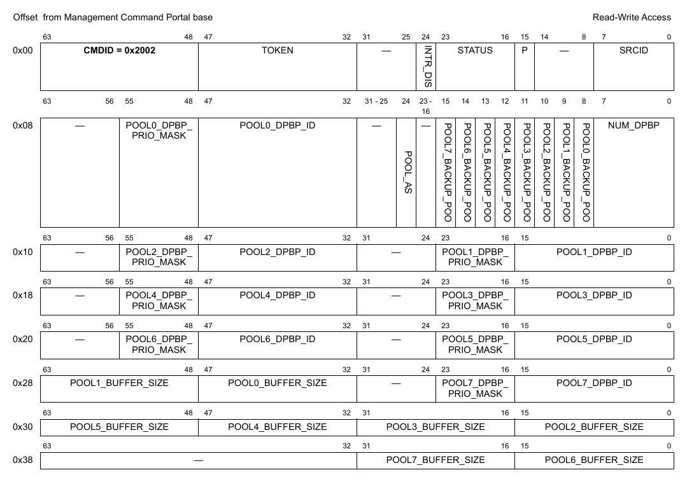

**Figure 85. Mô tả command DPNI_SET_POOLS**

| Offset | Bits | Tên | Mô tả |
|---|---|---|---|
| 0x00 | 0-63 | Header của command | Xem Table 2 để biết mô tả chung các field của command portal. CMDID phải được đặt như chỉ ra trong hình ở trên. |
| 0x08 | 0-7 | NUM_DPBP | Số buffer pool được khởi tạo bằng command này. Giá trị chấp nhận là 1–8 |
|   | 8-15 | POOLS[0-7]_BACKUP_POOL | Pool dự phòng. 0 - Định nghĩa pool này là pool thông thường. Pool này có thể được dùng để cấp phát buffer trong packet express buffer. 1 - Định nghĩa pool là backup pool. WRIOP dùng backup pool khi một hoặc nhiều pool thông thường hợp lệ bị cạn. |
|   | 24 | POOL_AS | Chọn giữa gán buffer pool theo QPRI (queuing priority) hoặc theo QDBIN (queue destination bin) 0 - QPRI 1 - QDBIN  Buffer pool theo QDBIN chỉ được hỗ trợ trên nền tảng LX2160, do các board khác dùng phiên bản WRIOP cũ hơn. |
| 0x08 - 0x28 | 0-15 / 32-47 | POOLS[0-7]_DPBP_ID | DPBP object ID |
| 0x08 - 0x28 | 16-23 / 48-55 | POOLS[0-7]_DPBP_PRIO_MASK | Mask priority Dùng để gắn một buffer pool với một traffic class cụ thể nếu chọn QPRI trong field POOL_AS, hoặc với một queue cụ thể nếu chọn QDBIN. Khi DPNI nhận một frame trên một traffic class/queue cụ thể, nó sẽ lưu frame vào các buffer từ DPBP object được gắn. Có tám bit, mỗi bit cho một traffic class: nếu bit n được đặt, buffer pool được gắn với traffic class N. Nếu buffer pool theo QPRI, các buffer được dùng chung giữa 2 queue: queue 0 với queue 8 nếu bit 0 được đặt, queue 1 với queue 9 nếu bit 1 được đặt, v.v. Nếu đặt bằng 0, MC sẽ coi giá trị là 0xFF và DPBP sẽ được gắn với mọi traffic class/queue. |
| 0x28 - 0x30 | 0-15 / 16-31/ 32-47/ 48-63 | POLS[0-7]_BUFFER_SIZE | Kích thước buffer tính bằng byte. Đây là kích thước của mọi buffer được release vào pool này. Nó phải là bội số của 64 byte |

Mọi field không được nêu là reserved và phải được xóa (đặt bằng 0)

### 7.3.17 DPNI_SET_ERRORS_BEHAVIOR

Đặt hành vi xử lý lỗi cho DPNI – quyết định hành động khi xảy ra các lỗi cụ thể. Command này có thể được lặp lại với lựa chọn lỗi khác nhau mỗi lần.

**Cấu trúc command**

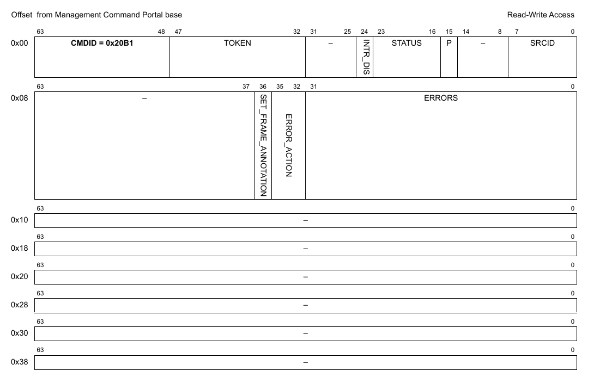

**Figure 86. Mô tả command DPNI_SET_ERRORS_BEHAVIOR**

| Offset | Bits | Tên | Mô tả |
|---|---|---|---|
| 0x00 | 0-63 | Header của command | Xem Table 2 để biết mô tả chung các field của command portal. CMDID phải được đặt như chỉ ra trong hình ở trên. |
| 0x08 | 0-31 | ERRORS | Mask lỗi cần cấu hình. Chọn bất kỳ tổ hợp nào của các lỗi được hỗ trợ dưới đây:  Bit 0: DPNI_ERROR_L4CE – lỗi checksum L4 của parser Bit 2: DPNI_ERROR_L3CE – lỗi checksum L3 của parser Bit 5: DPNI_ERROR_PHE – lỗi parsing header Bit 12: DPNI_ERROR_FPE – lỗi vật lý của frame Bit 13: DPNI_ERROR_FLE – lỗi độ dài frame Bit 17: DPNI_ERROR_EOFHE – lỗi extract ra ngoài header của frame Bit 31: DPNI_ERROR_DISC - Flag discarded. Chỉ có tác dụng khi ERROR_ACTION đặt là DPNI_ERROR_ACTION_SEND_TO_ERROR_QUEUE, nếu không sẽ trả về lỗi. Mọi frame bị loại bỏ sẽ được enqueue vào error queue. Khuyến nghị dùng cho các tình huống debug nâng cao khi người dùng muốn xem các packet bị loại bỏ. |
|   | 32-35 | ERROR_ACTION | Hành động mong muốn cho các lỗi được chọn trong mask ERRORS. Chọn một trong các giá trị được hỗ trợ dưới đây:  0 = DPNI_ERROR_ACTION_DISCARD – Frame bị loại bỏ. Nó được ưu tiên hơn option CONTINUE. 1 = DPNI_ERROR_ACTION_CONTINUE – Frame không bị loại bỏ. Nếu có nhiều lỗi, chỉ cần ít nhất một lỗi được đặt hành động DISCARD thì frame sẽ bị loại bỏ. 2 = DPNI_ERROR_ACTION_SEND_TO_ERROR_QUEUE – Frame sẽ được enqueue vào error queue. Thiết lập này được ưu tiên hơn các hành động khác. Nếu có nhiều lỗi mà ít nhất một lỗi gắn với hành động này, frame sẽ được enqueue vào error queue.  Ví dụ: Giả sử một frame có DPNI_ERROR_PHE và DPNI_ERROR_L3CE được xử lý. Case1: Hành động của DPNI_ERROR_L3CE là SEND_TO_ERROR_QUEUE và của DPNI_ERROR_PHE là DISCARD. Frame sẽ được enqueue vào error queue vì hành động SEND_TO_ERROR_QUEUE được ưu tiên hơn discard. Case2: Hành động của DPNI_ERROR_L3CE là CONTINUE và của DPNI_ERROR_PHE là DISCARD. Frame sẽ bị loại bỏ do lỗi PHE. Case3: Hành động của DPNI_ERROR_L3CE là DISCARD và của DPNI_ERROR_PHE là DISCARD. Frame sẽ bị loại bỏ. Case4: Hành động của DPNI_ERROR_L3CE là CONTINUE và của DPNI_ERROR_PHE là CONTINUE. Frame sẽ được enqueue vào queue bình thường. |
|   | 36 | SET_FRAME_ANNOTATION | Đặt '1' để đánh dấu lỗi trong frame annotation status (FAS); chỉ có ý nghĩa với các hành động không phải discard. |

Mọi field không được nêu là reserved và phải được xóa (đặt bằng 0)

### 7.3.18 DPNI_SET_BUFFER_LAYOUT

Đặt các thuộc tính bố cục buffer.

Định dạng buffer chung và phần mà mỗi field của command cấu hình được mô tả trong hình sau.

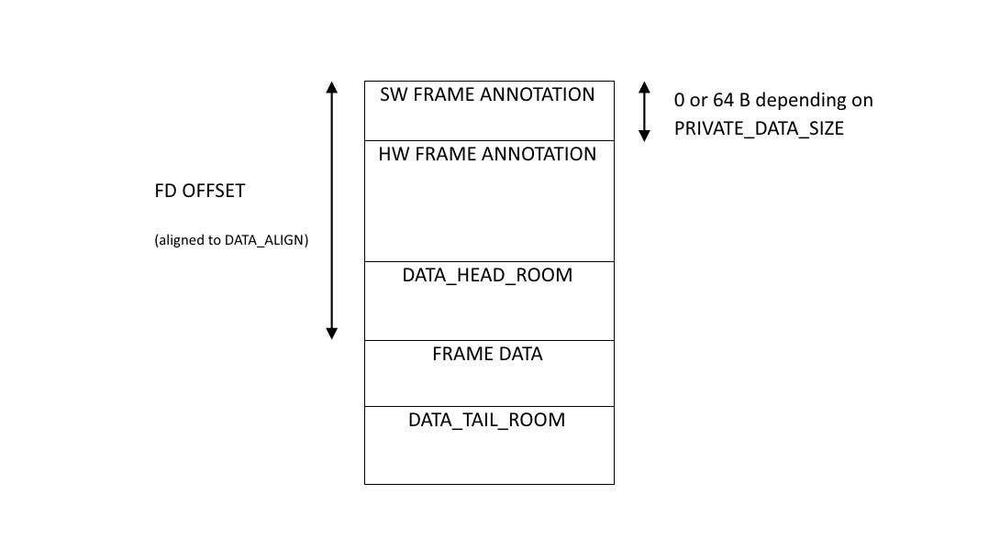

**Figure 7-3. Định dạng buffer**

**Cấu trúc command**

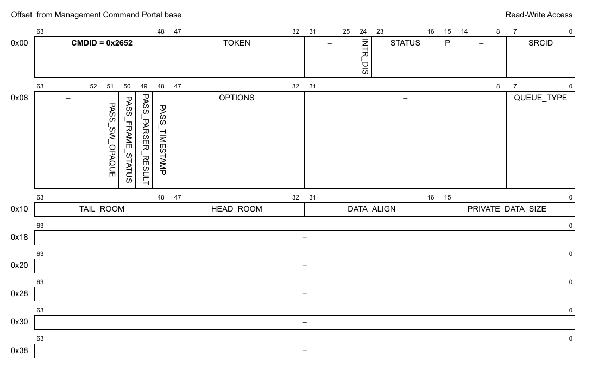

**Figure 87. Mô tả command DPNI_SET_BUFFER_LAYOUT**

| Offset | Bits | Tên | Mô tả |
|---|---|---|---|
| 0x00 | 0-63 | Header của command | Xem Table 2 để biết mô tả chung các field của command portal. CMDID phải được đặt như chỉ ra trong hình ở trên. |
| 0x08 | 0-7 | QUEUE_TYPE | Loại queue mà cấu hình này áp dụng: 0: DPNI_QUEUE_RX - Rx queue, 1: DPNI_QUEUE_TX - Tx queue, 2: DPNI_QUEUE_TX_CONFIRM - Tx confirmation queue, 3: DPNI_QUEUE_RX_ERR - Rx error queue. |
|   | 32-47 | OPTIONS | Mask các bit cho biết những thay đổi đề xuất với bố cục buffer: Bit 0: DPNI_BUF_LAYOUT_OPT_TIMESTAMP—đặt để sửa thiết lập time-stamp Bit 1: DPNI_BUF_LAYOUT_OPT_PARSER_RESULT—đặt để sửa thiết lập parser-result. Bit 2: DPNI_BUF_LAYOUT_OPT_FRAME_STATUS—đặt để sửa thiết lập frame-status. Bit 3: DPNI_BUF_LAYOUT_OPT_PRIVATE_DATA_SIZE—đặt để sửa thiết lập private-data-size. Bit 4: DPNI_BUF_LAYOUT_OPT_DATA_ALIGN—đặt để sửa thiết lập data-alignment. Bit 5: DPNI_BUF_LAYOUT_OPT_DATA_HEAD_ROOM—Chọn để sửa thiết lập data-head-room. Bit 6: DPNI_BUF_LAYOUT_OPT_DATA_TAIL_ROOM—Chọn để sửa thiết lập data-tail-room. Bit 7: DPNI_BUF_LAYOUT_OPT_SW_OPAQUE —Chọn để truyền giá trị SW opaque giữa 2 DPNI Bit8 : DPNI_BUF_LAYOUT_OPT_NO_SG — Chọn để tắt Scatter Gather ở RX. |
|   | 48 | PASS_TIMESTAMP | ‘1’ cho biết timestamp có trong bố cục buffer |
|   | 49 | PASS_PARSER_RESULT | ‘1’ cho biết kết quả parsing có trong bố cục buffer |
|   | 50 | PASS_FRAME_STATUS | ‘1’ cho biết frame status có trong bố cục buffer |
|   | 51 | PASS_SW_OPAQUE | ‘1’ cho biết SW annotation đã được kích hoạt |
| 0x10 | 0–15 | PRIVATE_DATA_SIZE | Kích thước dành cho private data (tính bằng byte). Giá trị tối đa là 64. |
|   | 16–31 | DATA_ALIGN | Căn chỉnh dữ liệu frame |
|   | 16-31 | DATA_HEAD_ROOM | Khoảng trống đầu dữ liệu (head room) |
|   | 32-47 | DATA_TAIL_ROOM | Khoảng trống cuối dữ liệu (tail room) |

Mọi field không được nêu là reserved và phải được xóa (đặt bằng 0).

### 7.3.19 DPNI_GET_BUFFER_LAYOUT

Lấy các thuộc tính bố cục buffer.

**Cấu trúc command**

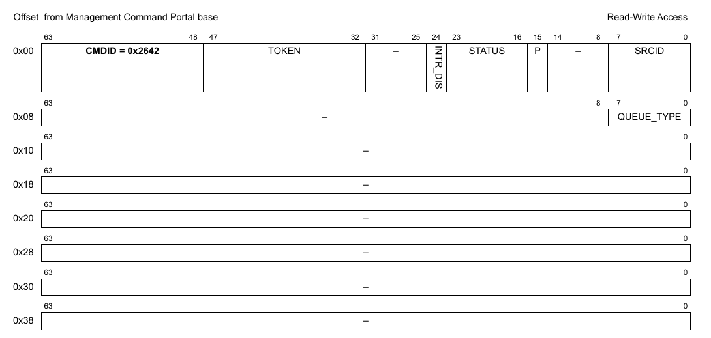

**Figure 88. Mô tả command DPNI_GET_BUFFER_LAYOUT**

| Offset | Bits | Tên | Mô tả |
|---|---|---|---|
| 0x00 | 0-63 | Header của command | Xem Table 2 để biết mô tả chung các field của command portal. CMDID phải được đặt như chỉ ra trong hình ở trên. |
| 0x08 | 0-7 | QUEUE_TYPE | Loại queue cần lấy cấu hình: 0: DPNI_QUEUE_RX - Rx queue, 1: DPNI_QUEUE_TX - Tx queue, 2: DPNI_QUEUE_TX_CONFIRM - Tx confirmation queue, 3: DPNI_QUEUE_RX_ERR - Rx error queue |

Mọi field không được nêu là reserved và phải được xóa (đặt bằng 0)

**Cấu trúc response**

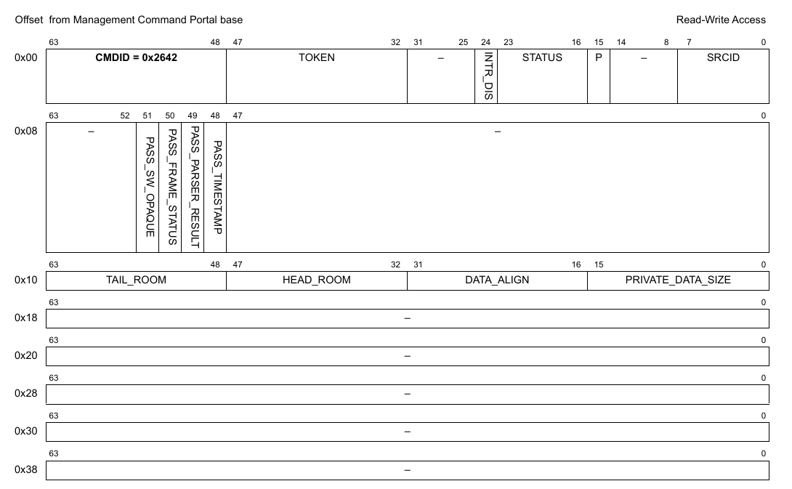

**Figure 89. Mô tả response của DPNI_GET_BUFFER_LAYOUT**

| Offset | Bits | Tên | Mô tả |
|---|---|---|---|
| 0x00 | 0-63 | Header của command | Xem Table 2 để biết mô tả chung các field của command portal. CMDID phải được đặt như chỉ ra trong hình ở trên. |
| 0x08 | 48 | PASS_TIMESTAMP | ‘1’ cho biết time-stamp có trong bố cục buffer |
|   | 49 | PASS_PARSER_RESULT | ‘1’ cho biết kết quả parsing có trong bố cục buffer |
|   | 50 | PASS_FRAME_STATUS | ‘1’ cho biết frame status có trong bố cục buffer |
|   | 51 | PASS_SW_OPAQUE | ‘1’ cho biết SW annotation đã được kích hoạt |
| 0x10 | 0-15 | PRIVATE_DATA_SIZE | Kích thước dành cho private data (tính bằng byte) |
|   | 16-31 | DATA_ALIGN | Căn chỉnh dữ liệu |
|   | 32-47 | DATA_HEAD_ROOM | Khoảng trống đầu dữ liệu (head room) |
|   | 48-63 | DATA_TAIL_ROOM | Khoảng trống cuối dữ liệu (tail room) |

Mọi field không được nêu đều được xóa.

### 7.3.20 DPNI_SET_OFFLOAD

Đặt cấu hình offload của DPNI.

**Cấu trúc command**

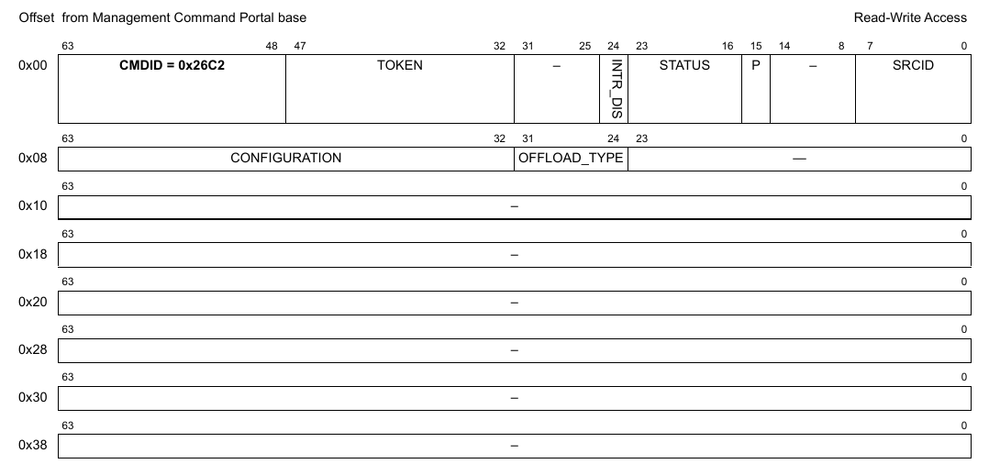

**Figure 90. Mô tả command DPNI_SET_OFFLOAD**

Bảng sau mô tả các field của command.

**Table 11. Mô tả các field của command DPNI_SET_OFFLOAD**

| Offset | Bits | Tên | Mô tả |
|---|---|---|---|
| 0x00 | 0-63 | Header của command | Xem Table 2 để biết mô tả chung các field của command portal. CMDID phải được đặt như chỉ ra trong hình ở trên. |
| 0x08 | 24-31 | OFFLOAD_TYPE | Loại offload cần cấu hình: 0x0 - DPNI_OFF_RX_L3_CSUM – kiểm tra checksum Layer 3 ở Rx; 0x1 - DPNI_OFF_RX_L4_CSUM – kiểm tra checksum Layer 4 ở Rx, 0x2 - DPNI_OFF_TX_L3_CSUM – sinh checksum Layer 3 ở Tx, 0x3 - DPNI_OFF_TX_L4_CSUM – sinh checksum Layer 4 ở Tx. 0x4 - DPNI_FLCTYPE_HASH - FD flow context (FD[FLC]) do WRIOP sinh cho AIOP/CTLU. (Thận trọng: Phải làm việc này trước khi thiết lập queue) 0x5 - DPNI_HEADER_STASHING: header của frame sẽ được WRIOP stash vào cache của core 0x6 - DPNI_PAYLOAD_STASHING: payload của frame sẽ được WRIOP stash vào cache của core |
|   | 32–63 | CONFIGURATION | Cấu hình offload được chọn. Với OFFLOAD_TYPE 0-3, các giá trị là: 0: offload được chọn bị tắt, 1: offload được chọn được bật. |

Mọi field không được nêu là reserved và phải được xóa (đặt bằng 0)

### 7.3.21 DPNI_GET_OFFLOAD

Lấy cấu hình offload của DPNI.

**Cấu trúc command**

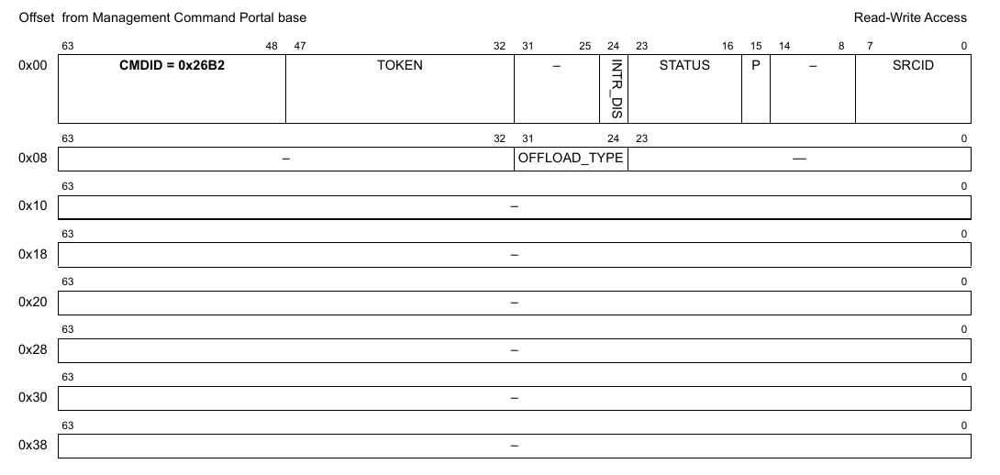

**Figure 91. Mô tả command DPNI_GET_OFFLOAD**

Bảng sau mô tả các field của command.

**Table 12. Mô tả các field của command DPNI_GET_OFFLOAD**

| Offset | Bits | Tên | Mô tả |
|---|---|---|---|
| 0x00 | 0-63 | Header của command | Xem Table 2 để biết mô tả chung các field của command portal. CMDID phải được đặt như chỉ ra trong hình ở trên. |
| 0x08 | 24-31 | OFFLOAD_TYPE | Loại offload cần cấu hình: 0x0 - DPNI_OFF_RX_L3_CSUM – kiểm tra checksum Layer 3 ở Rx; 0x1 - DPNI_OFF_RX_L4_CSUM – kiểm tra checksum Layer 4 ở Rx, 0x2 - DPNI_OFF_TX_L3_CSUM – sinh checksum Layer 3 ở Tx, 0x3 - DPNI_OFF_TX_L4_CSUM – sinh checksum Layer 4 ở Tx. 0x4 - DPNI_FLCTYPE_HASH – FD flow context (FD[FLC]) do WRIOP sinh cho AIOP/CTLU. 0x5 - DPNI_HEADER_STASHING: header của frame sẽ được WRIOP stash vào cache của core 0x6 - DPNI_PAYLOAD_STASHING: payload của frame sẽ được WRIOP stash vào cache của core |

Mọi field không được nêu là reserved và phải được xóa (đặt bằng 0)

**Cấu trúc response**

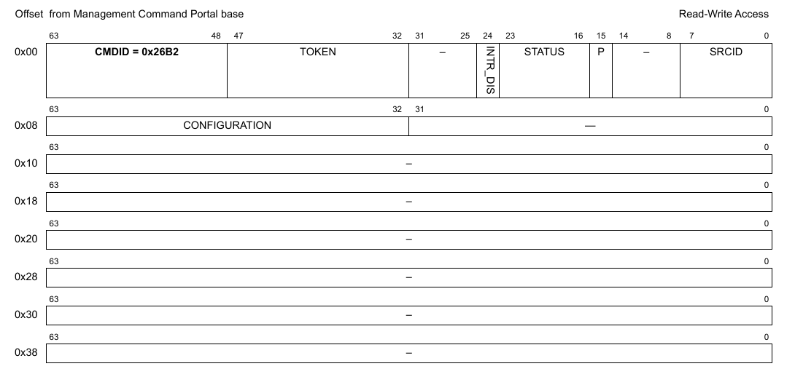

**Figure 92. Mô tả response của DPNI_GET_OFFLOAD**

**Table 13. Mô tả các field response của DPNI_GET_OFFLOAD**

| Offset | Bits | Tên | Mô tả |
|---|---|---|---|
| 0x00 | 0-63 | Header của command | Xem Table 2 để biết mô tả chung các field của command portal. CMDID phải được đặt như chỉ ra trong hình ở trên. |
| 0x08 | 32–63 | CONFIGURATION | Cấu hình của offload được chọn. Với OFFLOAD_TYPE 0-3, các giá trị là: 0: offload được chọn bị tắt 1: offload được chọn được bật |

### 7.3.22 DPNI_GET_QDID

Lấy Queuing Destination ID (QDID) cần dùng cho các thao tác enqueue frame.

Tính năng Queuing Destination (QD) được triển khai trong QMan hỗ trợ bên enqueue cho các mục đích:

- Phân phối (cân bằng tải)
- QoS (Quality of Service)

QD có thể dùng nhiều queue.

Khi một frame được enqueue vào QMan, từ một software portal, một module giao diện mạng (ví dụ WRIOP) hay một accelerator, command enqueue (hoặc command pre-enqueue, trong trường hợp WRIOP) có thể chỉ định:

- FQID mà frame sẽ được enqueue trực tiếp vào, hoặc
- Queuing Destination ID (QDID) và priority, sẽ được phần cứng phân giải thành một queue cụ thể để enqueue.

Số QD được hỗ trợ tùy theo SoC. Mỗi QD cung cấp các chức năng sau:

- Ánh xạ QoS cho thao tác enqueue tới một queue hoặc một nhóm con queue cụ thể, dùng giá trị QPRI (queuing priority) cung cấp trong command.
- Phân phối thao tác enqueue trong nhóm con được QoS chọn.

Ví dụ: Để gửi dữ liệu với một Traffic Class (TC) cụ thể, lấy QDID cho TX queue. Dùng QDID này cùng với priority của TC để tạo descriptor cho command enqueue.

**Cấu trúc command**

**Figure 93. Mô tả command DPNI_GET_QDID**

| Offset | Bits | Tên | Mô tả |
|---|---|---|---|
| 0x00 | 0-63 | Header của command | Xem Table 2 để biết mô tả chung các field của command portal. CMDID phải được đặt như chỉ ra trong hình ở trên. |
|   |   | QUEUE_TYPE | Loại queue cần lấy QDID: 1: DPNI_QUEUE_TX - Tx queue  Mọi giá trị khác là reserved |

Mọi field không được nêu là reserved và phải được xóa (đặt bằng 0)

**Cấu trúc response**

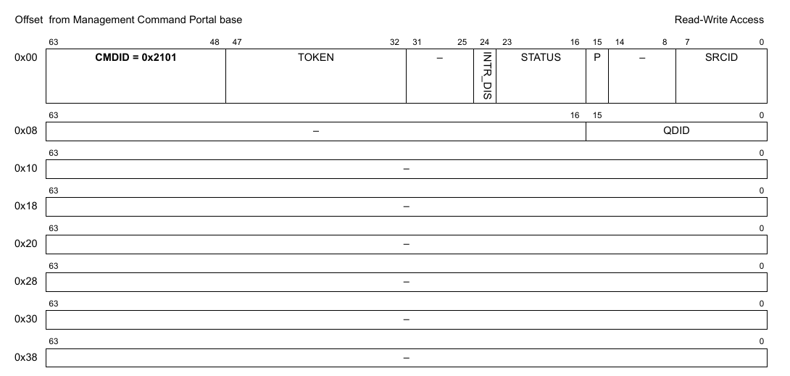

**Figure 94. Mô tả response của DPNI_GET_QDID**

| Offset | Bits | Tên | Mô tả |
|---|---|---|---|
| 0x00 | 0-63 | Header của command | Xem Table 2 để biết mô tả chung các field của command portal. CMDID phải được đặt như chỉ ra trong hình ở trên. |
| 0x08 | 0-15 | QDID | Giá trị QDID ảo cần dùng làm tham số trong mọi thao tác enqueue |

Mọi field không được nêu đều được xóa.

### 7.3.23 DPNI_GET_SP_INFO

Lấy AIOP storage profile ID gắn với DPNI – chỉ có ý nghĩa với DPNI thuộc software context của AIOP (nằm trong container của AIOP).

**Cấu trúc command**

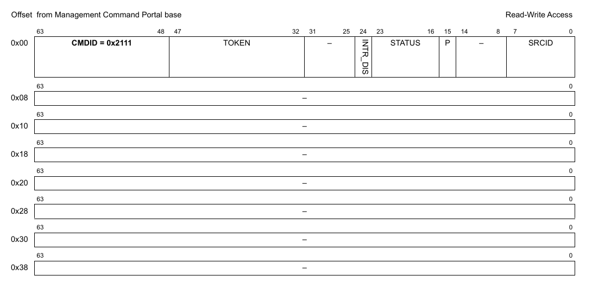

**Figure 95. Mô tả command DPNI_GET_SP_INFO**

| Offset | Bits | Tên | Mô tả |
|---|---|---|---|
| 0x00 | 0-63 | Header của command | Xem Table 2 để biết mô tả chung các field của command portal. CMDID phải được đặt như chỉ ra trong hình ở trên. |

Mọi field không được nêu là reserved và phải được xóa (đặt bằng 0)

**Cấu trúc response**

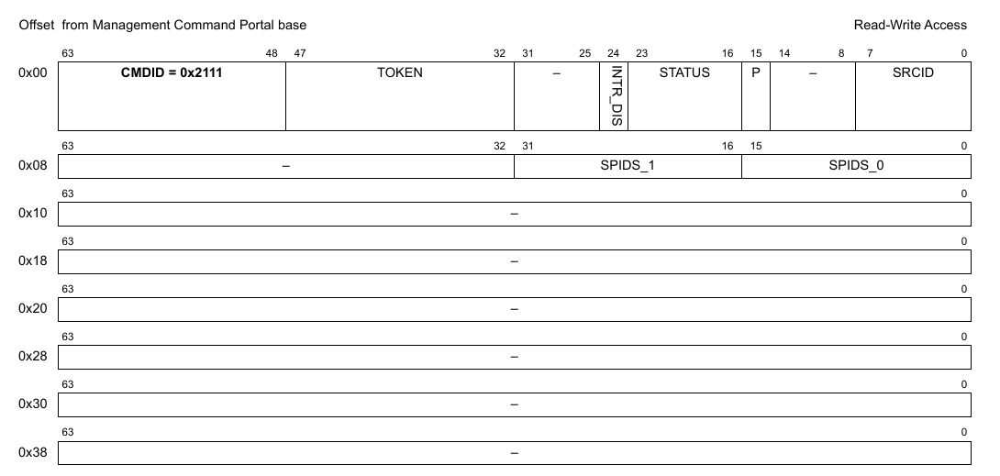

**Figure 96. Mô tả response của DPNI_GET_SP_INFO**

| Offset | Bits | Tên | Mô tả |
|---|---|---|---|
| 0x00 | 0-63 | Header của command | Xem Table 2 để biết mô tả chung các field của command portal. CMDID phải được đặt như chỉ ra trong hình ở trên. |
| 0x08 | 0-31 | SPIDS[0..1] | ID storage-profile của AIOP |

Mọi field không được nêu đều được xóa.

### 7.3.24 DPNI_GET_TX_DATA_OFFSET

Lấy data offset cho các transmit buffer (tính từ đầu buffer).

Phần mềm cần dành lượng không gian do command này chỉ ra làm headroom trong mọi frame Tx. Không gian này có thể được dùng để truyền metadata tới/từ phần cứng, hoặc để gắn metadata do phần mềm định nghĩa với frame giữa lúc Tx và lúc Tx confirmation.

**Cấu trúc command**

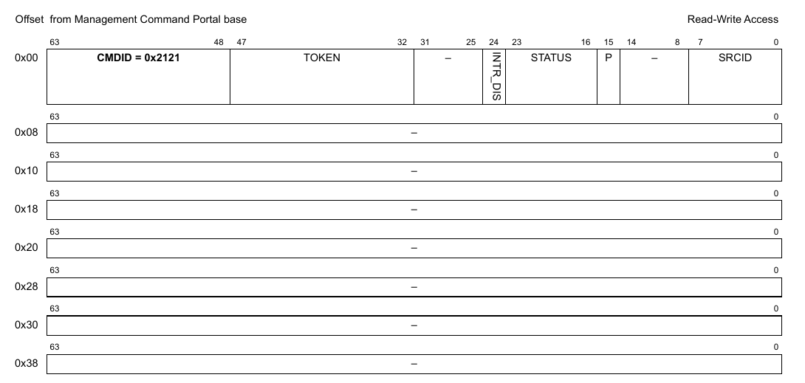

**Figure 97. Mô tả command DPNI_GET_TX_DATA_OFFSET**

| Offset | Bits | Tên | Mô tả |
|---|---|---|---|
| 0x00 | 0-63 | Header của command | Xem Table 2 để biết mô tả chung các field của command portal. CMDID phải được đặt như chỉ ra trong hình ở trên. |

Mọi field không được nêu là reserved và phải được xóa (đặt bằng 0)

**Cấu trúc response**

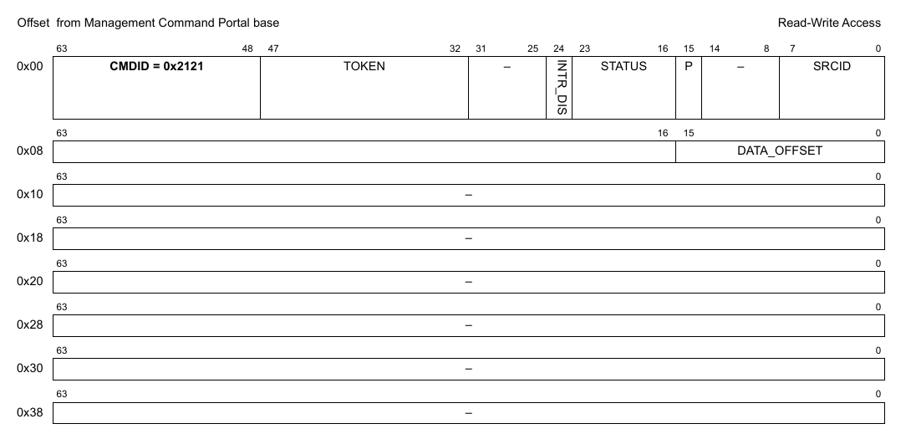

**Figure 98. Mô tả response của DPNI_GET_TX_DATA_OFFSET**

| Offset | Bits | Tên | Mô tả |
|---|---|---|---|
| 0x00 | 0-63 | Header của command | Xem Table 2 để biết mô tả chung các field của command portal. CMDID phải được đặt như chỉ ra trong hình ở trên. |
| 0x08 | 0-15 | DATA_OFFSET | Data offset phía truyền (tính từ đầu buffer) |

Mọi field không được nêu đều được xóa.

### 7.3.25 DPNI_GET_STATISTICS

Đọc thống kê của DPNI.

**Cấu trúc command**

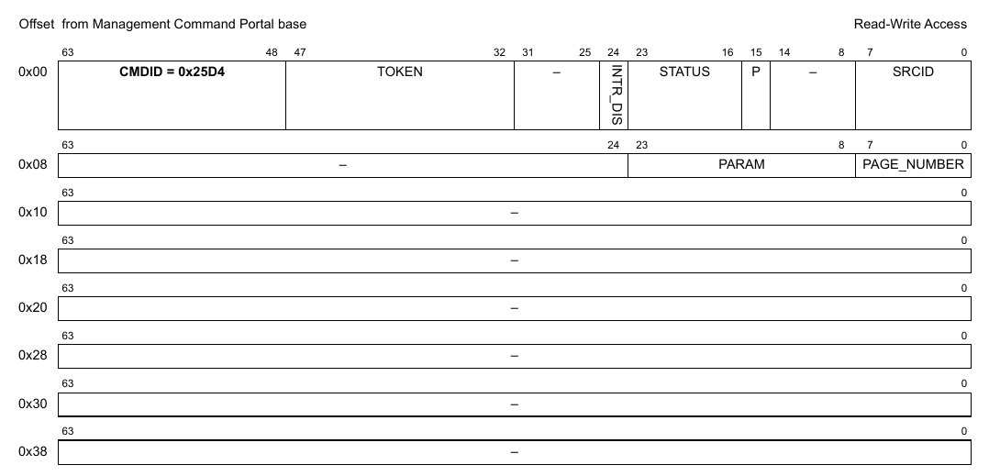

**Figure 99. Mô tả command DPNI_GET_STATISTICS**

| Offset | Bits | Tên | Mô tả |
|---|---|---|---|
| 0x00 | 0-63 | Header của command | Xem Table 2 để biết mô tả chung các field của command portal. CMDID phải được đặt như chỉ ra trong hình ở trên. |
| 0x08 | 0–7 | PAGE_NUMBER | Chọn một trong các trang counter có sẵn để lấy. Giá trị được hỗ trợ là 0-5. Xem cấu trúc response của command này để biết nội dung từng trang. |
| 0x08 | 8-23 | PARAM | Tham số tùy chỉnh cho một số trang, dùng để chọn một nguồn thống kê nhất định, ví dụ TC. - page_0: không dùng - page_1: không dùng - page_2: không dùng - page_3: high_byte - channel_id, low_byte - traffic class - page_4: high_byte - queue_index chỉ có ý nghĩa nếu dpni được tạo với option DPNI_OPT_CUSTOM_CG, low_byte - traffic class - page_5: không dùng - page_6: không dùng |

Mọi field không được nêu là reserved và phải được xóa (đặt bằng 0)

**Cấu trúc response**

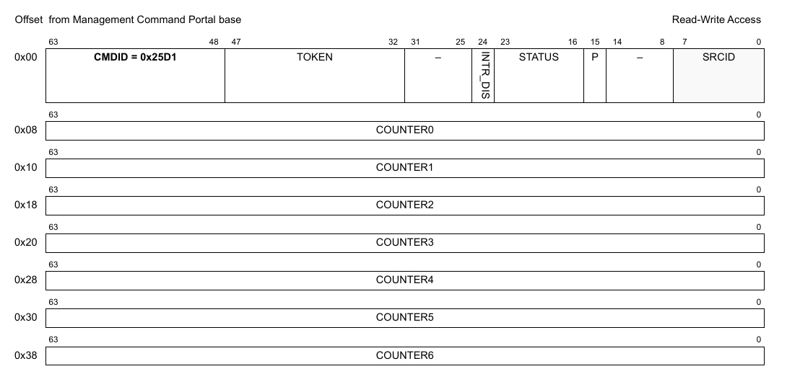

**Figure 100. Mô tả response của DPNI_GET_STATISTICS**

| Offset | Bits | Tên | Mô tả |
|---|---|---|---|
| 0x00 | 0-63 | Header của command | Xem Table 2 để biết mô tả chung các field của command portal. CMDID phải được đặt như chỉ ra trong hình ở trên. |
| 0x08 | 0–63 | COUNTER0 | Chứa, tùy theo PAGE_NUMBER được chọn: 0: INGRESS_ALL_FRAMES – đếm mọi frame ingress được chấp nhận, 1: EGRESS_ALL_FRAMES – đếm mọi frame egress đã truyền, 2: INGRESS_FILTERED_FRAMES – đếm mọi frame ingress bị loại bỏ do lọc. Việc loại bỏ có thể do lọc MAC, lọc VLAN, cấu hình ACL. 3. Tổng tích lũy số byte đã dequeue. 4. Số frame bị từ chối ở congestion point được gắn (hợp lệ nếu TC này có congestion point gắn kèm) 5. Counter packet RED của policer. Giá trị 32bit chỉ hợp lệ khi policer được bật. |
| 0X10 | 0–63 | COUNTER1 | Chứa, tùy theo PAGE_NUMBER được chọn: 0: INGRESS_ALL_BYTES – đếm số byte trong mọi frame ingress được chấp nhận, 1: EGRESS_ALL_BYTES – đếm số byte trong mọi frame đã truyền, 2: INGRESS_DISCARDED_FRAMES – đếm mọi frame bị loại bỏ do lỗi. Lỗi có thể do nguồn bên ngoài, frame bị hỏng trước khi vào hệ thống, hoặc do lỗi nội bộ. 3. Tổng tích lũy số byte đã dequeue. 4. Số byte bị từ chối ở congestion point được gắn (hợp lệ nếu TC này có congestion point gắn kèm) 5. Counter packet YELLOW của policer. Giá trị 32bit chỉ hợp lệ khi policer được bật. |
| 0X18 | 0–63 | COUNTER2 | Chứa, tùy theo PAGE_NUMBER được chọn: 0: INGRESS_MULTICAST_FRAMES – đếm các frame multicast ingress được chấp nhận, 1: EGRESS_MULTICAST_FRAMES – đếm các frame multicast egress đã truyền, 2: INGRESS_NOBUFFER_DISCARDS – đếm số lần loại bỏ ở phía ingress do buffer pool của DPNI cạn. Counter này không có trên LS2080. 3. Tổng tích lũy số byte trong mọi frame bị từ chối enqueue. 5. Counter packet GREEN của policer. Giá trị 32bit chỉ hợp lệ khi policer được bật. |
| 0X20 | 0–63 | COUNTER3 | Chứa, tùy theo PAGE_NUMBER được chọn: 0: INGRESS_MULTICAST_BYTES – đếm số byte trong các frame multicast nhận được, 1: EGRESS_MULTICAST_BYTES – đếm số byte trong các frame multicast đã truyền, 2: EGRESS_DISCARDED_FRAMES – các frame bị loại bỏ khi truyền do cấu hình DPNI và/hoặc trạng thái frame. 3. Tổng tích lũy số lần enqueue frame bị từ chối. 5. Counter packet RED được tô màu lại của policer. Giá trị 32bit chỉ hợp lệ khi policer được bật. |
| 0X28 | 0–63 | COUNTER4 | Chứa, tùy theo PAGE_NUMBER được chọn: 0: INGRESS_BROADCAST_FRAMES – đếm các frame broadcast ingress được chấp nhận, 1: EGRESS_BROADCAST_FRAMES – đếm các frame broadcast egress đã truyền, 2: EGRESS_CONFIRMED_FRAMES – đếm mọi frame đã được xác nhận sau khi truyền. 5. Counter packet YELLOW được tô màu lại của policer. Giá trị 32bit chỉ hợp lệ khi policer được bật. |
| 0x30 | 0–63 | COUNTER5 | Chứa, tùy theo PAGE_NUMBER được chọn: 0: INGRESS_BROADCAST_BYTES – đếm số byte trong các frame broadcast, 1: EGRESS_BROADCAST_BYTES – đếm số byte trong các frame broadcast, |
| 0x38 | 0–63 | COUNTER6 | Reserved |

### 7.3.26 DPNI_RESET_STATISTICS

Reset thống kê của DPNI. Command reset mọi counter của DPNI. Việc reset không bảo đảm đồng bộ giữa mọi counter của DPNI; thực thi DPNI_RESET_STATISTICS khi đang có traffic có thể khiến các counter lệch nhau. Ví dụ, INGRESS_ALL_FRAMES có thể cho số frame hơi khác với số frame tính trong INGRESS_ALL_BYTES.

**Cấu trúc command**

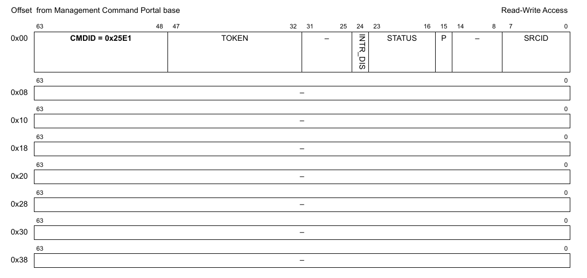

**Figure 101. Mô tả command DPNI_RESET_STATISTICS**

Bảng sau mô tả các field của command.

**Table 14. Mô tả các field của command DPNI_RESET_STATISTICS**

| Offset | Bits | Tên | Mô tả |
|---|---|---|---|
| 0x00 | 0-63 | Header của command | Xem Table 2 để biết mô tả chung các field của command portal. CMDID phải được đặt như chỉ ra trong hình ở trên. |

Mọi field không được nêu là reserved và phải được xóa (đặt bằng 0)

### 7.3.27 DPNI_SET_LINK_CFG

Đặt cấu hình link. Command này dùng được cho cả giao diện vật lý (DPNI nối với một DPMAC) lẫn link nội bộ (giữa một DPNI và một DPNI khác hoặc một port của DPDMUX, DPSW).

Các object DPSW và DPDMUX không hỗ trợ Priority Flow Control và Asymmetric Flow Control.

Với link nội bộ, MC cập nhật link state nếu cần và thông báo cho cả hai endpoint.

Với giao diện vật lý, MC có thể sinh interrupt tới phần mềm điều khiển DPMAC và yêu cầu thay đổi cấu hình link, tùy cấu hình port.

Pause frame được bật/tắt theo logic sau cho DPNI_LINK_OPT_<PAUSE/ASYM_PAUSE>:

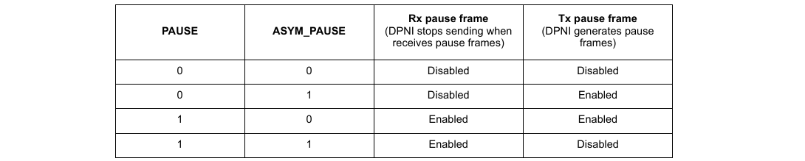

Priority Flow Control (PFC) được bật khi một trong các flag DPNI_LINK_OPT_<PAUSE/ASYM_PAUSE> được bật cùng với flag PNI_LINK_OPT_PFC_PAUSE *(ghi chú: đúng là DPNI_LINK_OPT_PFC_PAUSE)*. Trước khi kích hoạt PFC, làm các bước sau:

1. Gắn buffer pool với các traffic class bằng command DPNI_SET_POOLS

2. Thực hiện ánh xạ QoS bằng command DPNI_ADD_QOS_ENTRY

Khi buffer pool gắn với một traffic class cụ thể rơi vào trạng thái cạn, DPNI sẽ tự động sinh frame PFC. Mask trong frame PFC sẽ chứa mọi traffic class gắn với buffer pool này.

Flag DPNI_LINK_OPT_ASYM_PAUSE không dùng được cho các kết nối DPNI dùng recycle port (tức DPNI được nối với một DPNI object khác). Nếu bật flag trên kết nối như vậy, flow control sẽ không hoạt động đúng. Người dùng phải gửi command DPNI_SET_LINK_CFG với flag này được xóa.

Dùng command DPNI_GET_LINK_CFG để lấy cấu hình hiện tại.

**Cấu trúc command**

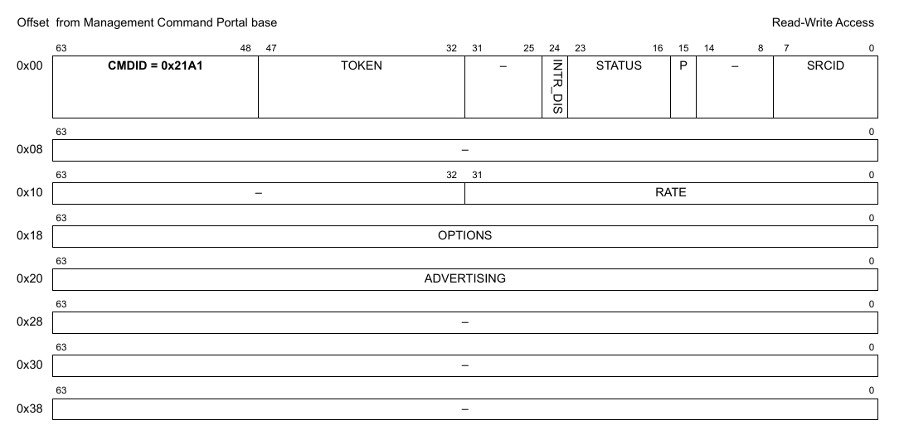

**Figure 102. Mô tả command DPNI_SET_LINK_CFG**

| Offset | Bits | Tên | Mô tả |
|---|---|---|---|
| 0x00 | 0-63 | Header của command | Xem Table 2 để biết mô tả chung các field của command portal. CMDID phải được đặt như chỉ ra trong hình ở trên. |
| 0x10 | 0-31 | RATE | Tốc độ tính bằng Mbps |
| 0x18 | 0–63 | OPTIONS | Mask các option có sẵn; dùng các giá trị ‘DPNI_LINK_OPT_\<x>’ |
|   | 1 | DPNI_LINK_OPT_AUTONEG | Bật auto-negotiation |
|   | 2 | DPNI_LINK_OPT_HALF_DUPLEX | Bật chế độ half-duplex |
|   | 3 | DPNI_LINK_OPT_PAUSE | Bật pause frame |
|   | 4 | DPNI_LINK_OPT_ASYM_PAUSE | Bật pause frame bất đối xứng |
|   | 5 | DPNI_LINK_OPT_PFC_PAUSE | Bật pause frame của Priority Flow Control. Để dùng tính năng này đúng cách, dùng command DPNI_SET_POOLS để gắn DPBP object cho các traffic class mong muốn. |
| 0x20 | 0-63 | ADVERTISING | Các tốc độ được quảng bá cho autoneg |

Mọi field không được nêu là reserved và phải được xóa (đặt bằng 0)

### 7.3.28 DPNI_GET_LINK_CFG

Trả về các khả năng đã cấu hình bằng command DPNI_CMDID_SET_LINK_CFG.

**Cấu trúc command**

**Figure 103. Mô tả command DPNI_GET_LINK_CFG**

Bảng sau mô tả các field của command.

**Table 15. Mô tả các field của command DPNI_GET_LINK_CFG**

| Offset | Bits | Tên | Mô tả |
|---|---|---|---|
| 0x00 | 0-63 | Header của command | Xem Table 2 để biết mô tả chung các field của command portal. CMDID phải được đặt như chỉ ra trong hình ở trên. |

Mọi field không được nêu là reserved và phải được xóa (đặt bằng 0)

**Cấu trúc response**

**Figure 104. Mô tả response của DPNI_GET_LINK_CFG**

| Offset | Bits | Tên | Mô tả |
|---|---|---|---|
| 0x00 | 0-63 | Header của command | Xem Table 2 để biết mô tả chung các field của command portal. CMDID phải được đặt như chỉ ra trong hình ở trên. |
| 0x10 | 0-31 | RATE | Tốc độ tính bằng Mbps |
| 0x18 | 0–63 | OPTIONS | Mask các option có sẵn; dùng các giá trị ‘DPNI_LINK_OPT_\<x>’ |
|   | 1 | DPNI_LINK_OPT_AUTONEG | Bật auto-negotiation |
|   | 2 | DPNI_LINK_OPT_HALF_DUPLEX | Bật chế độ half-duplex |
|   | 3 | DPNI_LINK_OPT_PAUSE | Bật pause frame |
|   | 4 | DPNI_LINK_OPT_ASYM_PAUSE | Bật pause frame bất đối xứng |
|   | 5 | DPNI_LINK_OPT_PFC_PAUSE | Bật pause frame của Priority Flow Control. Để dùng tính năng này đúng cách, dùng command DPNI_SET_POOLS để gắn DPBP object cho các traffic class mong muốn. |
| 0x20 | 0-63 | ADVERTISING | Các tốc độ được quảng bá cho autoneg |

### 7.3.29 DPNI_SET_SINGLE_STEP_CFG

**Cấu trúc command**

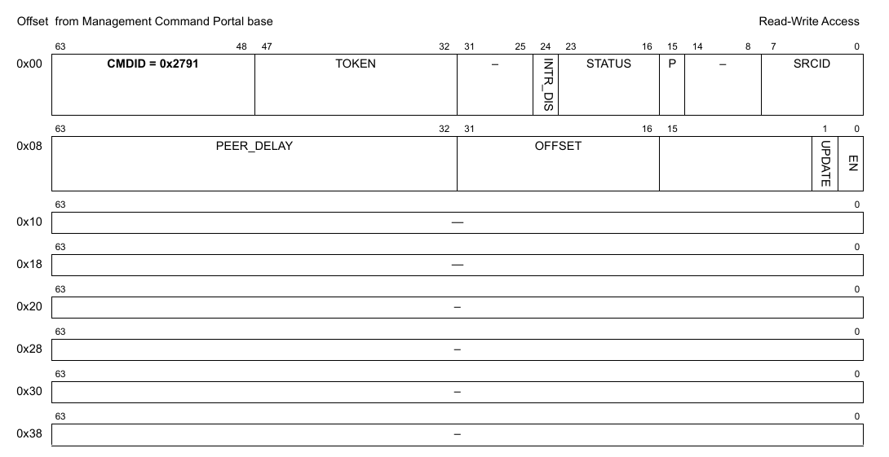

**Figure 105. Mô tả các field của command DPNI_SET_SINGLE_STEP_CFG**

| Offset | Bits | Tên | Mô tả |
|---|---|---|---|
| 0x00 | 0-63 | Header của command | Xem Table 2 để biết mô tả chung các field của command portal. CMDID phải được đặt như chỉ ra trong hình ở trên. |
| 0x08 | 0 | EN | Bật PTP single-step |
|   | 1 | UPDATE | Option để hiệu chỉnh UDP Checksum. |
|   | 16–31 | OFFSET | Offset tính từ đầu frame |
|   | 32-63 | PEER_DELAY | Độ trễ peer |

Mọi field không được nêu là reserved và phải được xóa (đặt bằng 0)

### 7.3.30 DPNI_GET_SINGLE_STEP_CGF *(ghi chú: đúng là DPNI_GET_SINGLE_STEP_CFG)*

Trả về cấu hình PTP single-step.

**Cấu trúc command**

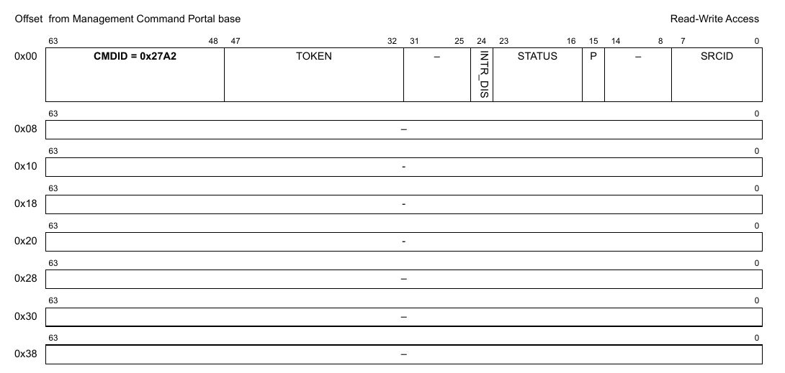

**Figure 106. Mô tả command DPNI_GET_SINGLE_STEP_CFG**

Bảng sau mô tả các field của command.

**Table 16. Mô tả các field của command DPNI_GET_SINGLE_STEP_CFG**

| Offset | Bits | Tên | Mô tả |
|---|---|---|---|
| 0x00 | 0-63 | Header của command | Xem Table 2 để biết mô tả chung các field của command portal. CMDID phải được đặt như chỉ ra trong hình ở trên. |

Mọi field không được nêu là reserved và phải được xóa (đặt bằng 0)

**Cấu trúc response**

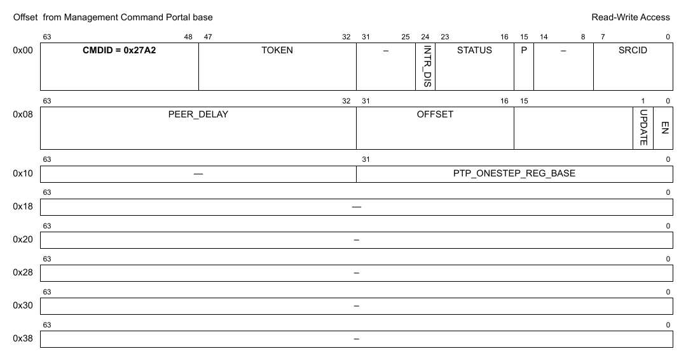

**Figure 107. Mô tả các field response của DPNI_GET_SINGLE_STEP_CFG**

| Offset | Bits | Tên | Mô tả |
|---|---|---|---|
| 0x00 | 0-63 | Header của command | Xem Table 2 để biết mô tả chung các field của command portal. CMDID phải được đặt như chỉ ra trong hình ở trên. |
| 0x08 | 0 | EN | Bật PTP single-step |
|   | 1 | UPDATE | Option để hiệu chỉnh UDP Checksum. |
|   | 16–31 | OFFSET | Offset tính từ đầu frame |
|   | 32-63 | PEER_DELAY | Độ trễ peer |
| 0x10 | 0-31 | PTP_ONESTEP_REG_BASE | Địa chỉ cơ sở của thanh ghi 1588 SINGLE_STEP. Địa chỉ này dùng để cập nhật trực tiếp nội dung thanh ghi. Người dùng phải tạo address mapping cho nó. |

Mọi field không được nêu là reserved và phải được xóa (đặt bằng 0)

### 7.3.31 DPNI_SET_PORT_CFG

Command này cấu hình các thiết lập vào mac ở endpoint. Lời gọi chỉ thành công khi DPNI object được nối với một DPMAC object. Nếu DPNI chưa được nối hoặc endpoint không phải DPMAC, command sẽ trả về lỗi. Tác dụng của command này sẽ mất khi mac bị ngắt kết nối: nếu DPNI bị ngắt rồi nối lại, cấu hình bị mất và phải gọi lại command.

**Cấu trúc command**

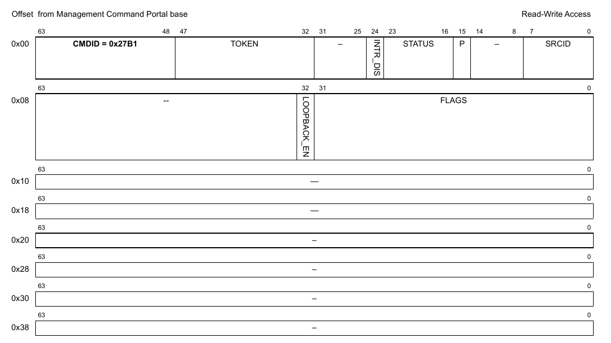

**Figure 108. Mô tả các field của command DPNI_SET_PORT_CFG**

| Offset | Bits | Tên | Mô tả |
|---|---|---|---|
| 0x00 | 0-63 | Header của command | Xem Table 2 để biết mô tả chung các field của command portal. CMDID phải được đặt như chỉ ra trong hình ở trên. |
| 0x08 | 0-31 | FLAGS | bit 0: DPNI_PORT_CFG_LOOPBACK Đặt flag này sẽ bật quyền điều khiển chế độ loopback qua LOOPBACK_EN. |
|   | 32 | LOOPBACK_EN | Đặt field này sẽ kích hoạt loopback, chỉ khi flag được đặt trong FLAGS. |

Mọi field không được nêu là reserved và phải được xóa (đặt bằng 0)

### 7.3.32 DPNI_GET_PORT_CGF *(ghi chú: đúng là DPNI_GET_PORT_CFG)*

Trả về cấu hình của port.

**Cấu trúc command**

**Figure 109. Mô tả command DPNI_GET_PORT_CFG**

Bảng sau mô tả các field của command.

**Table 17. Mô tả các field của command DPNI_GET_PORT_CFG**

| Offset | Bits | Tên | Mô tả |
|---|---|---|---|
| 0x00 | 0-63 | Header của command | Xem Table 2 để biết mô tả chung các field của command portal. CMDID phải được đặt như chỉ ra trong hình ở trên. |

Mọi field không được nêu là reserved và phải được xóa (đặt bằng 0)

**Cấu trúc response**

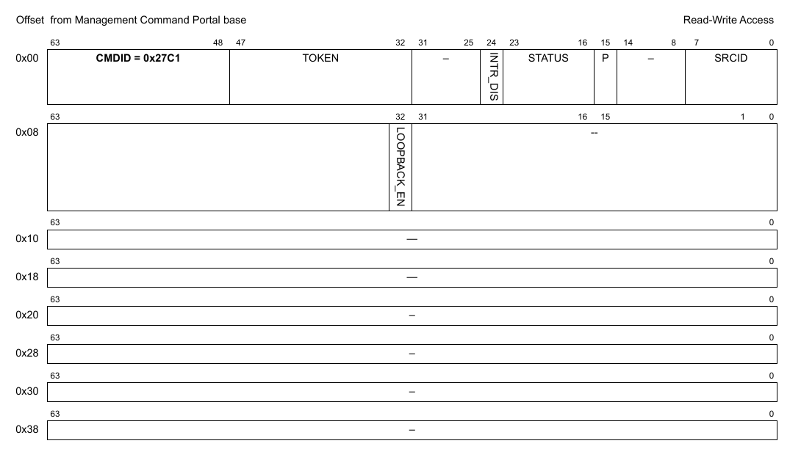

**Figure 110. Mô tả các field response của DPNI_GET_PORT_CFG**

| Offset | Bits | Tên | Mô tả |
|---|---|---|---|
| 0x00 | 0-63 | Header của command | Xem Table 2 để biết mô tả chung các field của command portal. CMDID phải được đặt như chỉ ra trong hình ở trên. |
| 0x08 | 32 | LOOPBACK_EN | Nếu giá trị trả về là 1, chế độ loopback đang bật. |

Mọi field không được nêu là reserved và phải được xóa (đặt bằng 0)

### 7.3.33 DPNI_GET_LINK_STATE

Trả về link state (up hoặc down).

**Cấu trúc command**

**Figure 111. Mô tả command DPNI_GET_LINK_STATE**

| Offset | Bits | Tên | Mô tả |
|---|---|---|---|
| 0x00 | 0–63 | Header của command | Xem Table 2 để biết mô tả chung các field của command portal. CMDID phải được đặt như chỉ ra trong hình ở trên. |

Mọi field không được nêu là reserved và phải được xóa (đặt bằng 0)

**Cấu trúc response**

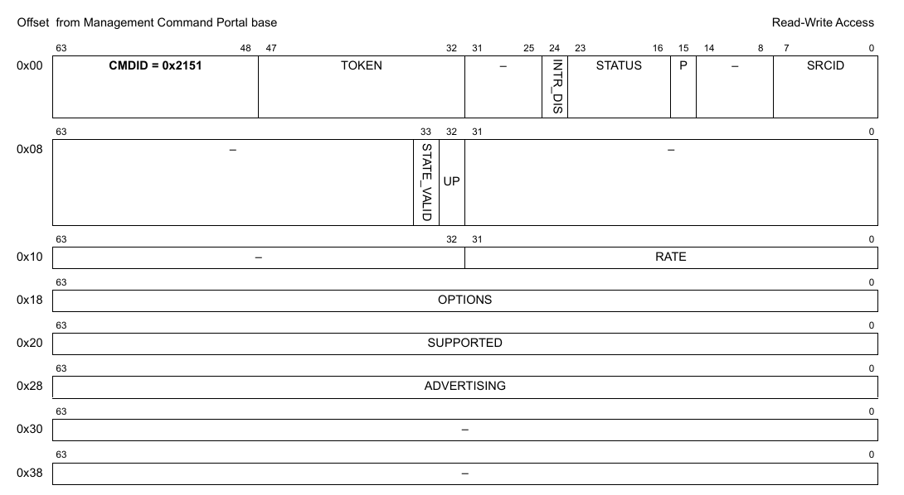

**Figure 112. Mô tả response của DPNI_GET_LINK_STATE**

| Offset | Bits | Tên | Mô tả |
|---|---|---|---|
| 0x00 | 0-63 | Header của command | Xem Table 2 để biết mô tả chung các field của command portal. CMDID phải được đặt như chỉ ra trong hình ở trên. |
| 0x08 | 32 | UP | Link state; '1' nếu link up, '0' nếu không |
|   | 33 | STATE_VALID | Bỏ qua/Cập nhật trạng thái của link |
| 0x10 | 0-31 | RATE | Tốc độ tính bằng Mbps |
| 0x18 |   | OPTIONS | Mask các option có sẵn; dùng các giá trị ‘DPNI_LINK_OPT_\<x>’ |
|   | 1 | DPNI_LINK_OPT_AUTONEG | Bật auto-negotiation |
|   | 2 | DPNI_LINK_OPT_HALF_DUPLEX | Bật chế độ half-duplex |
|   | 3 | DPNI_LINK_OPT_PAUSE | Bật pause frame |
|   | 4 | DPNI_LINK_OPT_ASYM_PAUSE | Bật pause frame bất đối xứng |
| 0x20 | 0-63 | SUPPORTED | Các tốc độ mà phy hỗ trợ |
| 0X28 | 0-63 | ADVERTISING | Các tốc độ được quảng bá cho autoneg |

Mọi field không được nêu đều được xóa.

### 7.3.34 DPNI_SET_TX_SHAPING

Đặt các shaper committed rate và excess rate phía truyền.

Các shaper dựa trên token bucket. Các tham số cấu hình được trong command này, gồm giới hạn tốc độ và max burst size, được chuyển thành các giá trị riêng của mô hình token bucket.

Có hai shaper được hỗ trợ: một cho committed rate (CR) và một cho excess rate (ER). Mỗi shaper có giới hạn tốc độ và max burst size cấu hình riêng. Burst size là lượng dữ liệu tối đa (tính bằng byte) được gửi thành một loạt frame liên tiếp sát nhau trên mạng.

Có thể cấu hình các shaper ở dạng ghép (coupled), để phần token CR tràn ra được cộng vào bucket ER.

Quá trình chuyển đổi này có một số phép xấp xỉ. Trong mô hình token bucket còn có độ phân giải bước tăng của tốc độ, phụ thuộc vào pre-scaler và tần số QBMAN. Những điều này khiến tốc độ thực tế lệch 1–2 Kbps so với tốc độ cho trong command.

**Cấu trúc command**

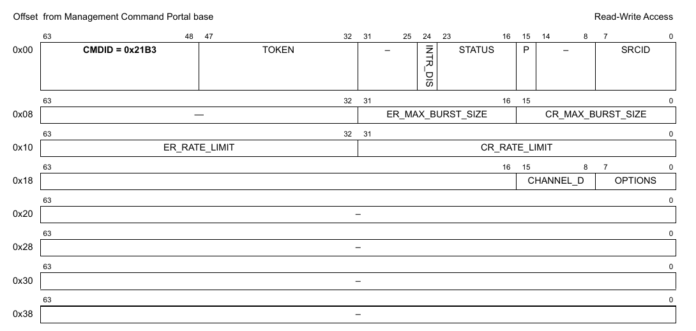

**Figure 113. Mô tả command DPNI_SET_TX_SHAPING**

| Offset | Bits | Tên | Mô tả |
|---|---|---|---|
| 0x00 | 0-63 | Header của command | Xem Table 2 để biết mô tả chung các field của command portal. CMDID phải được đặt như chỉ ra trong hình ở trên. |
| 0x08 | 0-15 | CR_MAX_BURST_SIZE | Max burst size của committed rate tính bằng byte (tới 63487 byte) |
|   | 16–31 | ER_MAX_BURST_SIZE | Max burst size của excess rate tính bằng byte (tới 63487 byte) |
| 0x10 | 0-31 | CR_RATE_LIMIT | Committed rate tính bằng Mbps |
|   | 32–63 | ER_RATE_LIMIT | Excess rate tính bằng Mbps |
| 0x18 | 0-7 | OPTIONS | Bit 0: Ghép các shaper. 0: Các shaper CR và ER độc lập 1: Các shaper CR và ER được ghép Bit 1: shaper LNI 0: cấu hình channel shaper 1: cấu hình LNI shaper. Chỉ nên dùng cho các dpni object được nối với dpmac |
|   | 8-15 | CHANNEL_ID | Index của TX channel cần shaping. |

Mọi field không được nêu là reserved và phải được xóa (đặt bằng 0)

### 7.3.35 DPNI_SET_MAX_FRAME_LENGTH

Đặt độ dài tối đa cho phép của frame nhận được.

**Cấu trúc command**

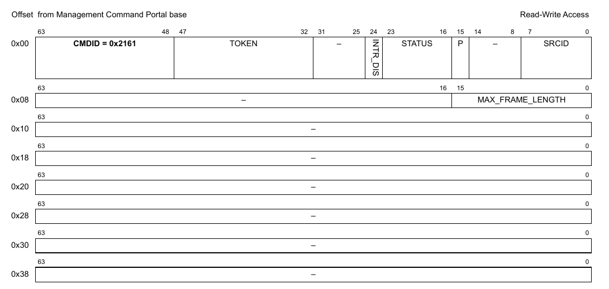

**Figure 114. Mô tả command DPNI_SET_MAX_FRAME_LENGTH**

| Offset | Bits | Tên | Mô tả |
|---|---|---|---|
| 0x00 | 0-63 | Header của command | Xem Table 2 để biết mô tả chung các field của command portal. CMDID phải được đặt như chỉ ra trong hình ở trên. |
| 0x08 | 0-15 | MAX_FRAME_LENGTH | Độ dài tối đa của frame nhận được (tính bằng byte); frame bị loại bỏ nếu dài hơn giá trị này. Độ dài frame được đặt không tính CRC vì việc kiểm tra độ dài được làm ở mức WRIOP và CRC đã bị gỡ ở giai đoạn này. |

Mọi field không được nêu là reserved và phải được xóa (đặt bằng 0)

### 7.3.36 DPNI_GET_MAX_FRAME_LENGTH

Lấy độ dài tối đa cho phép của frame nhận được.

**Cấu trúc command**

**Figure 115. Mô tả command DPNI_GET_MAX_FRAME_LENGTH**

| Offset | Bits | Tên | Mô tả |
|---|---|---|---|
| 0x00 | 0-63 | Header của command | Xem Table 2 để biết mô tả chung các field của command portal. CMDID phải được đặt như chỉ ra trong hình ở trên. |

Mọi field không được nêu là reserved và phải được xóa (đặt bằng 0)

**Cấu trúc response**

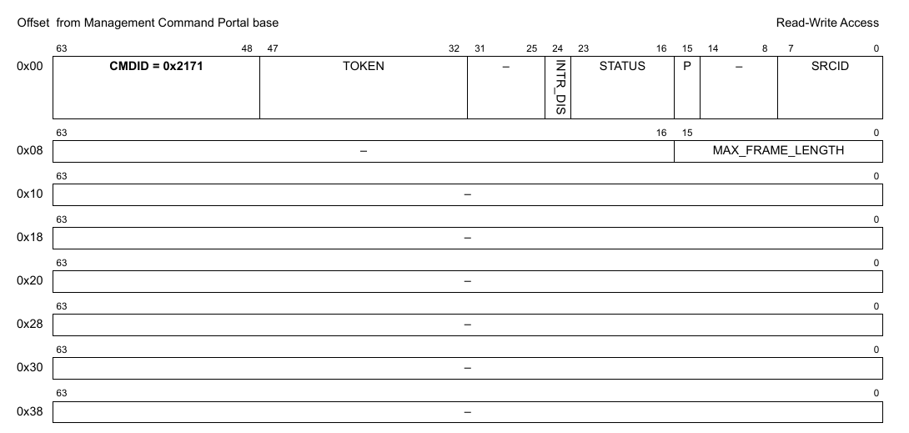

**Figure 116. Mô tả response của DPNI_GET_MAX_FRAME_LENGTH**

| Offset | Bits | Tên | Mô tả |
|---|---|---|---|
| 0x00 | 0-63 | Header của command | Xem Table 2 để biết mô tả chung các field của command portal. CMDID phải được đặt như chỉ ra trong hình ở trên. |
| 0x08 | 0-15 | MAX_FRAME_LENGTH | Độ dài tối đa của frame nhận được (tính bằng byte); frame bị loại bỏ nếu dài hơn giá trị này. |

Mọi field không được nêu đều được xóa.

### 7.3.37 DPNI_SET_MULTICAST_PROMISC

Command này dùng để bật/tắt chế độ multicast promiscuous. Ở chế độ này, interface chấp nhận mọi địa chỉ MAC multicast và không lọc multicast.

Command này không điều khiển các frame lỗi. Frame lỗi được cấu hình riêng qua command DPNI_SET_ERRORS_BEHAVIOR.

**Cấu trúc command**

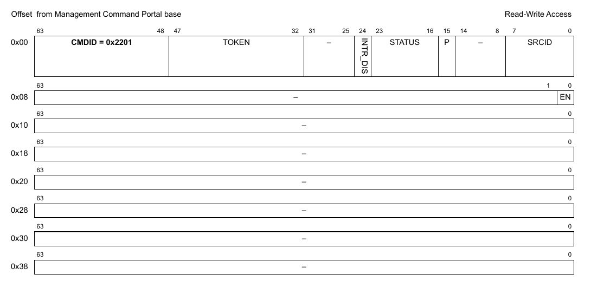

**Figure 117. Mô tả command DPNI_SET_MULTICAST_PROMISC**

| Offset | Bits | Tên | Mô tả |
|---|---|---|---|
| 0x00 | 0-63 | Header của command | Xem Table 2 để biết mô tả chung các field của command portal. CMDID phải được đặt như chỉ ra trong hình ở trên. |
| 0x08 | 0 | EN | ‘0’: tắt chế độ multicast promiscuous ‘1’: bật chế độ multicast promiscuous (mặc định) |

Mọi field không được nêu là reserved và phải được xóa (đặt bằng 0)

### 7.3.38 DPNI_GET_MULTICAST_PROMISC

Lấy trạng thái chế độ multicast promiscuous.

**Cấu trúc command**

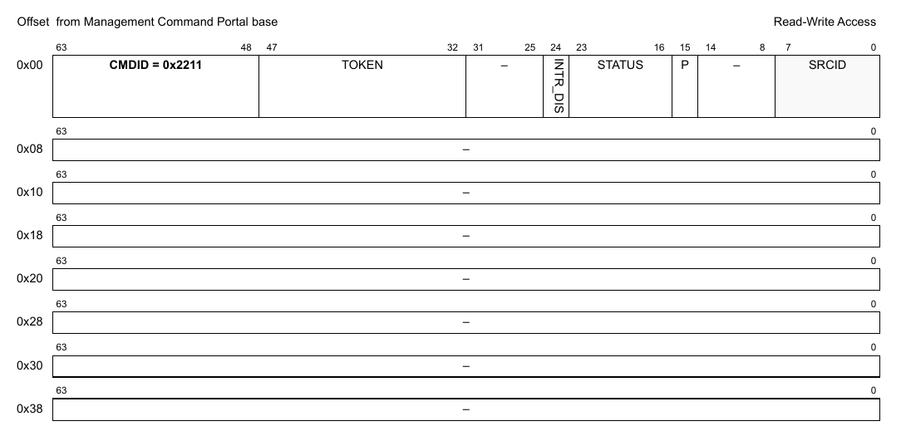

**Figure 118. Mô tả command DPNI_GET_MULTICAST_PROMISC**

| Offset | Bits | Tên | Mô tả |
|---|---|---|---|
| 0x00 | 0-63 | Header của command | Xem Table 2 để biết mô tả chung các field của command portal. CMDID phải được đặt như chỉ ra trong hình ở trên. |

Mọi field không được nêu là reserved và phải được xóa (đặt bằng 0)

**Cấu trúc response**

**Figure 119. Mô tả response của DPNI_GET_MULTICAST_PROMISC**

| Offset | Bits | Tên | Mô tả |
|---|---|---|---|
| 0x00 | 0-63 | Header của command | Xem Table 2 để biết mô tả chung các field của command portal. CMDID phải được đặt như chỉ ra trong hình ở trên. |
| 0x08 | 0 | EN | ‘0’: chế độ multicast promiscuous đang tắt ‘1’: chế độ multicast promiscuous đang bật |

Mọi field không được nêu đều được xóa.

### 7.3.39 DPNI_SET_UNICAST_PROMISC

Command này dùng để bật/tắt chế độ unicast promiscuous. Ở chế độ này, interface chấp nhận mọi địa chỉ MAC unicast và không lọc unicast.

Command này không điều khiển các frame lỗi. Frame lỗi có thể được cấu hình riêng bằng command DPNI_SET_ERRORS_BEHAVIOR.

**Cấu trúc command**

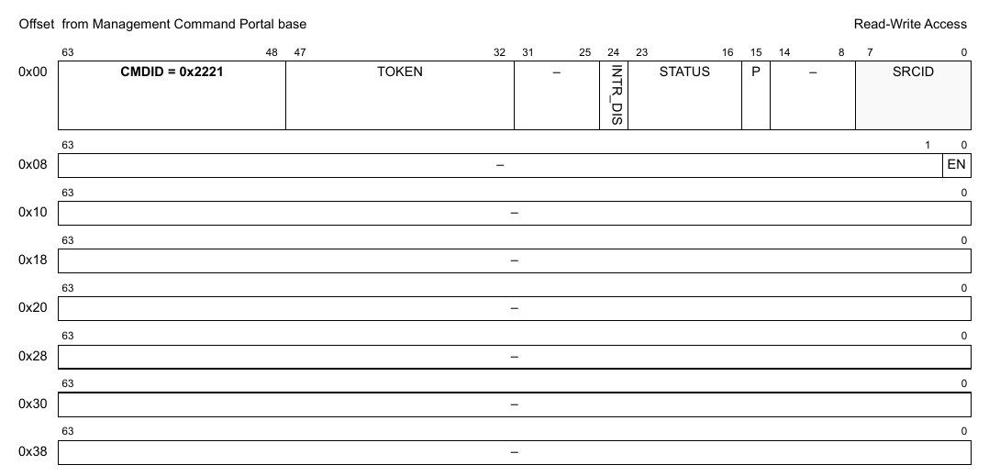

**Figure 120. Mô tả command DPNI_SET_UNICAST_PROMISC**

| Offset | Bits | Tên | Mô tả |
|---|---|---|---|
| 0x00 | 0-63 | Header của command | Xem Table 2 để biết mô tả chung các field của command portal. CMDID phải được đặt như chỉ ra trong hình ở trên. |
| 0x08 | 0 | EN | ‘0’: tắt chế độ unicast promiscuous (mặc định) ‘1’: bật chế độ unicast promiscuous |

Mọi field không được nêu là reserved và phải được xóa (đặt bằng 0)

### 7.3.40 DPNI_GET_UNICAST_PROMISC

Lấy trạng thái chế độ unicast promiscuous.

**Cấu trúc command**

**Figure 121. Mô tả command DPNI_GET_UNICAST_PROMISC**

| Offset | Bits | Tên | Mô tả |
|---|---|---|---|
| 0x00 | 0-63 | Header của command | Xem Table 2 để biết mô tả chung các field của command portal. CMDID phải được đặt như chỉ ra trong hình ở trên. |

Mọi field không được nêu là reserved và phải được xóa (đặt bằng 0)

**Cấu trúc response**

**Figure 122. Mô tả response của DPNI_GET_UNICAST_PROMISC**

| Offset | Bits | Tên | Mô tả |
|---|---|---|---|
| 0x00 | 0-63 | Header của command | Xem Table 2 để biết mô tả chung các field của command portal. CMDID phải được đặt như chỉ ra trong hình ở trên. |
| 0x08 | 0 | EN | ‘0’: chế độ multicast promiscuous đang tắt ‘1’: chế độ multicast promiscuous đang bật |

Mọi field không được nêu đều được xóa.

### 7.3.41 DPNI_SET_PRIMARY_MAC_ADDR

Đặt địa chỉ MAC chính của interface.

Địa chỉ MAC chính được đặt lúc tạo DPNI (xem command DPNI_CREATE), và có thể sửa bằng command này. Mỗi interface phải có ít nhất một địa chỉ MAC chính, vì vậy địa chỉ này có thể sửa nhưng không thể xóa. Có thể gán thêm địa chỉ MAC cho interface qua các command lọc MAC.

**Cấu trúc command**

**Figure 123. Mô tả command DPNI_SET_PRIMARY_MAC_ADDR**

| Offset | Bits | Tên | Mô tả |
|---|---|---|---|
| 0x00 | 0-63 | Header của command | Xem Table 2 để biết mô tả chung các field của command portal. CMDID phải được đặt như chỉ ra trong hình ở trên. |
| 0x08 | 16-63 | MAC_ADDR[0-5] | Địa chỉ MAC (6 byte) cần đặt làm địa chỉ chính. |

Mọi field không được nêu là reserved và phải được xóa (đặt bằng 0)

### 7.3.42 DPNI_GET_PRIMARY_MAC_ADDR

Lấy địa chỉ MAC chính.

**Cấu trúc command**

**Figure 124. Mô tả command DPNI_GET_PRIMARY_MAC_ADDR**

| Offset | Bits | Tên | Mô tả |
|---|---|---|---|
| 0x00 | 0-63 | Header của command | Xem Table 2 để biết mô tả chung các field của command portal. CMDID phải được đặt như chỉ ra trong hình ở trên. |

Mọi field không được nêu là reserved và phải được xóa (đặt bằng 0)

**Cấu trúc response**

**Figure 125. Mô tả response của DPNI_GET_PRIMARY_MAC_ADDR**

| Offset | Bits | Tên | Mô tả |
|---|---|---|---|
| 0x00 | 0-63 | Header của command | Xem Table 2 để biết mô tả chung các field của command portal. CMDID phải được đặt như chỉ ra trong hình ở trên. |
| 0x08 | 16-63 | MAC_ADDR[0-5] | Địa chỉ MAC (6 byte) đang là địa chỉ chính. |

Mọi field không được nêu đều được xóa.

### 7.3.43 DPNI_ADD_MAC_ADDR

Thêm bộ lọc địa chỉ MAC. Một lần gọi command này thành công sẽ cấu hình interface chấp nhận các frame có địa chỉ MAC đích được chỉ định.

**Cấu trúc command**

**Figure 126. Mô tả command DPNI_ADD_MAC_ADDR**

| Offset | Bits | Tên | Mô tả |
|---|---|---|---|
| 0x00 | 0-63 | Header của command | Xem Table 2 để biết mô tả chung các field của command portal. CMDID phải được đặt như chỉ ra trong hình ở trên. |
| 0x08 | 0-7 | FLAGS | 0x0: Lookup trong bảng phân loại tiếp theo. FQ_ID và TC_ID bị bỏ qua với option này. 0x1: DPNI_MAC_SET_QUEUE_ACTION - Frame sẽ được enqueue vào queue có index FQ_ID trong Traffic Class TC_ID.  Lưu ý: Nếu DPNI đang ở chế độ promiscuous thì option DPNI_MAC_SET_QUEUE_ACTION sẽ không hoạt động. |
|   | 16-63 | MAC_ADDR[0-5] | Địa chỉ MAC cần thêm |
| 0x10 | 0-7 | TC_ID | Traffic class được chọn khi frame khớp với lookup key và mask được chỉ định. Giá trị hợp lệ nằm trong khoảng (0-7), nhưng cũng bị giới hạn bởi số traffic class đã cấu hình lúc tạo DPNI. |
|   | 8-15 | FQ_ID | Frame queue ID. Chỉ dùng khi Flags đặt là DPNI_MAC_SET_QUEUE_ACTION |

Mọi field không được nêu là reserved và phải được xóa (đặt bằng 0)

### 7.3.44 DPNI_REMOVE_MAC_ADDR

Gỡ bộ lọc địa chỉ MAC. Sau một lần gọi command này thành công, interface từ chối các frame có địa chỉ MAC được chỉ định (trừ khi bật chế độ promiscuous).

**Cấu trúc command**

**Figure 127. Mô tả command DPNI_REMOVE_MAC_ADDR**

| Offset | Bits | Tên | Mô tả |
|---|---|---|---|
| 0x00 | 0-63 | Header của command | Xem Table 2 để biết mô tả chung các field của command portal. CMDID phải được đặt như chỉ ra trong hình ở trên. |
| 0x08 | 16-63 | ADDR[0-5] | Địa chỉ MAC cần gỡ |

Mọi field không được nêu là reserved và phải được xóa (đặt bằng 0)

### 7.3.45 DPNI_CLEAR_MAC_FILTERS

Xóa mọi bộ lọc MAC unicast và/hoặc multicast. Lưu ý rằng địa chỉ MAC chính không bao giờ bị xóa – nó luôn hợp lệ.

**Cấu trúc command**

**Figure 128. Mô tả command DPNI_CLEAR_MAC_FILTERS**

| Offset | Bits | Tên | Mô tả |
|---|---|---|---|
| 0x00 | 0-63 | Header của command | Xem Table 2 để biết mô tả chung các field của command portal. CMDID phải được đặt như chỉ ra trong hình ở trên. |
| 0x08 | 0 | UNICAST | Đặt '1' để xóa các địa chỉ unicast |
|   | 1 | MULTICAST | Đặt '1' để xóa các địa chỉ multicast |

Mọi field không được nêu là reserved và phải được xóa (đặt bằng 0)

### 7.3.46 DPNI_GET_PORT_MAC_ADDRESS

Trả về địa chỉ MAC gắn với port vật lý, nếu DPNI được nối với một DPMAC gắn trực tiếp với một trong các port vật lý. Nên gọi hàm này khi khởi tạo DPNI, và nếu địa chỉ MAC trả về khác 0 thì dùng nó làm địa chỉ chính của DPNI.

Nếu DPNI không được nối với một DPMAC object (tức DPNI được nối với DPNI, DPDMUX hoặc DPSW object), command sẽ trả về địa chỉ mac bằng 0. Dùng DPRC_GET_CONNECTION để biết loại object được nối ở đầu kia.

Địa chỉ MAC của port được cấu hình trong phần port của DPC.

**Cấu trúc command**

**Figure 129. Mô tả command DPNI_GET_PORT_MAC_ADDRESS**

Bảng sau mô tả các field của command.

**Table 18. Mô tả các field của command DPNI_GET_PORT_MAC_ADDRESS**

| Offset | Bits | Tên | Mô tả |
|---|---|---|---|
| 0x00 | 0-63 | Header của command | Xem Table 2 để biết mô tả chung các field của command portal. CMDID phải được đặt như chỉ ra trong hình ở trên. |

Mọi field không được nêu là reserved và phải được xóa (đặt bằng 0)

**Cấu trúc response**

**Figure 130. Mô tả response của DPNI_GET_PORT_MAC_ADDRESS**

**Table 19. Mô tả các field response của DPNI_GET_PORT_MAC_ADDRESS**

| Offset | Bits | Tên | Mô tả |
|---|---|---|---|
| 0x00 | 0-63 | Header của command | Xem Table 2 để biết mô tả chung các field của command portal. CMDID phải được đặt như chỉ ra trong hình ở trên. |
| 0x08 | 16–63 | MAC_ADDR[0-5] | Địa chỉ MAC của port vật lý. Nếu DPNI không được nối với port vật lý hoặc port chưa được cấu hình địa chỉ, các field này sẽ được reset. |

### 7.3.47 DPNI_ENABLE_VLAN_FILTER

Bật/tắt chế độ lọc VLAN.

**Cấu trúc command**

**Figure 131. Mô tả command DPNI_ENABLE_VLAN_FILTER**

| Offset | Bits | Tên | Mô tả |
|---|---|---|---|
| 0x00 | 0-63 | Header của command | Xem Table 2 để biết mô tả chung các field của command portal. CMDID phải được đặt như chỉ ra trong hình ở trên. |
| 0x08 | 0 | EN | ‘0’: tắt lọc VLAN ‘1’: bật lọc VLAN |

Mọi field không được nêu là reserved và phải được xóa (đặt bằng 0)

### 7.3.48 DPNI_ADD_VLAN_ID

Thêm bộ lọc VLAN ID. Một lần gọi command này thành công sẽ cấu hình interface chấp nhận các frame có VLAN ID được chỉ định (với giả định chúng không bị các bộ lọc MAC drop).

**Cấu trúc command**

**Figure 132. Mô tả command DPNI_ADD_VLAN_ID**

| Offset | Bits | Tên | Mô tả |
|---|---|---|---|
| 0x00 | 0-63 | Header của command | Xem Table 2 để biết mô tả chung các field của command portal. CMDID phải được đặt như chỉ ra trong hình ở trên. |
| 0x08 | 0-7 | FLAGS | 0x0: Lookup trong bảng phân loại tiếp theo. FLOW_ID và TC_ID bị bỏ qua với option này. 0x1: DPNI_VLAN_SET_QUEUE_ACTION - Frame sẽ được enqueue vào queue có index FLOW_ID trong Traffic Class TC_ID. |
|   | 8-15 | TC_ID | Traffic class được chọn khi frame khớp với lookup key và mask được chỉ định. Giá trị hợp lệ nằm trong khoảng (0-7), nhưng cũng bị giới hạn bởi số traffic class đã cấu hình lúc tạo DPNI. |
|   | 16-23 | FLOW_ID | Flow ID. Chỉ dùng khi FLAGS đặt là DPNI_VLAN_SET_QUEUE_ACTION |
|   | 32-47 | VLAN_ID | VLAN ID cần thêm |

Mọi field không được nêu là reserved và phải được xóa (đặt bằng 0)

### 7.3.49 DPNI_REMOVE_VLAN_ID

Gỡ bộ lọc VLAN. Sau một lần gọi command này thành công, interface từ chối các frame có VLAN ID được chỉ định.

**Cấu trúc command**

**Figure 133. Mô tả command DPNI_REMOVE_VLAN_ID**

| Offset | Bits | Tên | Mô tả |
|---|---|---|---|
| 0x00 | 0-63 | Header của command | Xem Table 2 để biết mô tả chung các field của command portal. CMDID phải được đặt như chỉ ra trong hình ở trên. |
| 0x08 | 32-47 | VLAN_ID | VLAN ID cần gỡ |

Mọi field không được nêu là reserved và phải được xóa (đặt bằng 0)

### 7.3.50 DPNI_CLEAR_VLAN_FILTERS

Xóa mọi bộ lọc VLAN của interface.

**Cấu trúc command**

**Figure 134. Mô tả command DPNI_CLEAR_VLAN_FILTERS**

| Offset | Bits | Tên | Mô tả |
|---|---|---|---|
| 0x00 | 0-63 | Header của command | Xem Table 2 để biết mô tả chung các field của command portal. CMDID phải được đặt như chỉ ra trong hình ở trên. |

Mọi field không được nêu là reserved và phải được xóa (đặt bằng 0)

### 7.3.51 DPNI_SET_TX_PRIORITIES

Command này đặt priority truyền cho các TC của DPNI và chế độ lập lịch cho từng TC. Có hai loại chế độ lập lịch được hỗ trợ: strict và weighted. Hai loại này có thể kết hợp. Có thể để một phần TC dùng strict priority, phần còn lại gom thành nhóm dùng lập lịch chia băng thông công bằng có trọng số. Với các TC strict priority, TC có id nhỏ hơn có priority cao hơn. Nhóm weighted có priority thấp hơn các TC strict priority.

Weighted bandwidth fair scheduling (WBFS) được dùng để lập lịch packet từ các TC trong một priority group sao cho mỗi TC nhận được phần công bằng của băng thông dành cho priority group đó. Ở đây, mọi TC có chế độ lập lịch weighted nằm trong cùng một nhóm. Băng thông (các cơ hội TX) dành cho một priority group được chia công bằng giữa các TC trong nhóm theo tỷ lệ với “giá trị weight đã cấu hình.” Ví dụ, nếu TC X có weight 500 và TC Y có weight 100, phần công bằng của TC X gấp 5 lần phần của TC Y.

**Cấu trúc command**

**Figure 135. Mô tả command DPNI_SET_TX_PRIORITIES**

| Offset | Bits | Tên | Mô tả |
|---|---|---|---|
| 0x00 | 0-63 | Command Header | Xem Table 2 để biết mô tả chung các field của command portal. CMDID phải được đặt như chỉ ra trong hình ở trên. |
| 0x08 | 0-15 | FLAGS | Không dùng |
|   | 16-23 | PRIO_GRP_A | Priority của Group A |
|   | 24-31 | PRIO_GRP_B | Priority của Group B |
|   | 32-39 | CHANNEL_ID | Index của channel cần cấu hình. |
| 0x10 | 0-3 | SCH_MODE_0 | Chế độ lập lịch đặt cho traffic class tương ứng. Có thể là: 0: DPNI_TX_SCHED_STRICT_PRIORITY - TC có index thấp hơn luôn được ưu tiên hơn TC có index cao hơn, |
|   | 4-7 | SCH_MODE_1 | 1: DPNI_TX_SCHED_WEIGHTED_A - không có quan hệ strict priority, BW được chia theo tỷ lệ cấu hình DELTA_BW. TC này sẽ được đặt vào priority group A |
|   | 8-11 | SCH_MODE_2 | 2: DPNI_TX_SCHED_WEIGHTED_B - không có quan hệ strict priority, BW được chia theo tỷ lệ cấu hình DELTA_BW. TC này sẽ được đặt vào priority group B |
|   | 12-15 | SCH_MODE_3 | Hai chế độ có thể dùng lẫn. Các TC strict priority luôn được ưu tiên hơn các TC weighted, bất kể index. Sau khi đã xử lý hết traffic Tx của mọi TC strict priority, các TC weighted được lập lịch dựa trên |
|   | 16-19 | SCH_MODE_4 | băng thông đã cấu hình của chúng. Cấu hình mặc định là strict priority cho mọi TC. |
|   | 20-23 | SCH_MODE_5 |   |
|   | 24-27 | SCH_MODE_6 |   |
|   | 28-31 | SCH_MODE_7 |   |
| 0x20 | 0-15 | DELTA_BW0 | Cấu hình băng thông cho mỗi traffic class. Field này chỉ có ý nghĩa nếu SCH_MODE tương ứng là 1 |
|   | 15-31 | DELTA_BW1 | (DPNI_TX_SCHED_WEIGHTED_A hoặc DPNI_TX_SCHED_WEIGHTED_B). Giá trị chấp nhận nằm trong khoảng 100 đến 24800. Mỗi giá trị là weight của traffic class. Băng thông của toàn nhóm được chia |
|   | 32-47 | DELTA_BW2 | giữa các traffic class trong nhóm theo tỷ lệ với weight này. |
|   | 48-63 | DELTA_BW3 |   |
| 0x28 | 0-15 | DELTA_BW4 |   |
|   | 15-31 | DELTA_BW5 |   |
|   | 31-47 | DELTA_BW6 |   |
|   | 48-63 | DELTA_BW7 |   |

Mọi field không được nêu là reserved và phải được xóa (đặt bằng 0)

### 7.3.52 DPNI_SET_RX_TC_DIST

Đặt cấu hình traffic class phía nhận.

Command này có thể dùng để cấu hình bất kỳ traffic class nào trong số traffic class tối đa đã chọn lúc tạo DPNI. Nó quyết định chế độ và kích thước phân phối cho traffic class; nó cũng chỉ định key phân phối, bằng cách chỉ định tối đa tám phép extract cấu hình được từ header và/hoặc payload của frame. Kích thước tối đa của key phân phối bị giới hạn bởi FS_KEY_SIZE do command DPNI_GET_ATTRIBUTES trả về.

Chức năng phân phối chỉ có hiệu lực nếu NUM_QUEUES của DPNI lớn hơn một; nếu không, mỗi traffic class có đúng (và chỉ) một Rx queue.

**Cấu trúc command**

**Figure 136. Mô tả command DPNI_SET_RX_TC_DIST**

| Offset | Bits | Tên | Mô tả |
|---|---|---|---|
| 0x00 | 0-63 | Header của command | Xem Table 2 để biết mô tả chung các field của command portal. CMDID phải được đặt như chỉ ra trong hình ở trên. |
| 0x08 | 0-15 | DIST_SIZE | Đặt kích thước phân phối; giá trị được hỗ trợ: 1,2,3,4,6,7,8. Lưu ý rằng các giá trị lớn có thể không được hỗ trợ do tài nguyên queue trong hệ thống có hạn, hoặc do kích thước phân phối tối đa đặt trong DPNI_CREATE. |
|   | 16-23 | TC_ID | Traffic class cần cấu hình; giá trị hợp lệ nằm trong khoảng (0-7), nhưng cũng bị giới hạn bởi số traffic class tối đa đã cấu hình lúc tạo DPNI. |
|   | 24-27 | DIST_MODE | Chế độ phân phối: 0: DPNI_DIST_MODE_NONE – không phân phối 1: DPNI_DIST_MODE_HASH – dùng phân phối theo hash; chỉ hỗ trợ cho các DPNI có NUM_QUEUES lớn hơn 1. 2: DPNI_DIST_MODE_FS – dùng explicit flow steering; không hỗ trợ cho các DPNI được tạo với option DPNI_OPT_NO_FS. |
|   | 28-31 | MISS_ACTION | Với DIST_MODE = DPNI_DIST_MODE_FS: xác định hành động dự phòng khi không khớp. 0: DPNI_FS_MISS_DROP – khi không khớp, drop frame 1: DPNI_FS_MISS_EXPLICIT_FLOWID – khi không khớp, dùng flow ID chỉ định trong DEFAULT_FLOW_ID 2: DPNI_FS_MISS_HASH – khi không khớp, phân phối theo giá trị hash |
|   | 46 | KEEP_ENTRIES | Nếu đặt bằng một, command sẽ không xóa các mục flow steering đã thêm bằng command DPNI_ADD_FS_ENTRY. Nếu đặt bằng không, mọi mục flow steering sẽ bị xóa trước khi đổi quy tắc ghép key. Chỉ dùng được khi DIST_MODE đặt là DPNI_DIST_MODE_FS. Mọi mode khác sẽ xóa hết các mục bất kể giá trị flag này. Dùng option này cẩn thận: command sẽ đổi quy tắc ghép key nhưng giữ nguyên các mục flow steering cũ. Nếu các mục cũ không tương thích với cách ghép key mới, traffic sẽ không được phân phối như mong đợi. |
|   | 47 | KEEP_HASH_KEY | Field này có thể dùng để thiết lập các quy tắc ghép key khác nhau cho hash và flow steering (FS). Để thiết lập hai key, trước tiên thực thi DPNI_SET_RX_TC_DIST với DIST_MODE đặt là DPNI_DIST_MODE_HASH và cấu hình hash key, sau đó thực thi DPNI_SET_RX_TC_DIST lần 2 với DIST_MODE đặt là DPNI_DIST_MODE_FS, cấu hình FS key và KEEP_HASH_KEY đặt bằng 1. Field này chỉ có ý nghĩa nếu DIST_MODE là DPNI_DIST_MODE_FS. Nó bị bỏ qua trong mọi trường hợp khác. |
|   | 48-63 | DEFAULT_FLOW_ID | Với DIST_MODE = DPNI_DIST_MODE_FS và MISS_ACTION = DPNI_FS_MISS_EXPLICIT_FLOWID: chỉ định queue ID mặc định khi không khớp. |
| 0x38 | 0-63 | KEY_CFG_IOVA | Địa chỉ ảo I/O của 256 byte bộ nhớ DMA-able đã xóa về 0. Buffer mở rộng này phải được lập trình như chỉ ra trong phần “Extension structure” dưới đây, để chứa cấu hình key phân phối. Bị bỏ qua nếu DIST_MODE = DPNI_DIST_MODE_NONE. |

Mọi field không được nêu là reserved và phải được xóa (đặt bằng 0)

**Cấu trúc mở rộng**

**Figure 137. Mô tả phần mở rộng của DPNI_SET_RX_TC_DIST**

| Offset | Bits | Tên | Mô tả |
|---|---|---|---|
| 0x00 | 0-7 | NUM_EXTRACTS | Số phép extract hợp lệ trong 10 phép có thể; quyết định bao nhiêu EXTRACT0..9 dưới đây là hợp lệ. Giá trị 0 là không hợp lệ. |

**Figure 137. Mô tả phần mở rộng của DPNI_SET_RX_TC_DIST**

| Offset | Bits | Tên |   | Mô tả |
|---|---|---|---|---|
| 0x08 | 0-7 | EXTRACT0 | PROT | Với EXTRACT_TYPE = DPKG_EXTRACT_FROM_HDR: chỉ định bất kỳ header nào được hỗ trợ: |
|   | 8-11 |   | EFH_TYPE | Với EXTRACT_TYPE = DPKG_EXTRACT_FROM_HDR: chỉ định kiểu extract từ header (và quyết định 3 tham số tiếp theo có hợp lệ không): 0: DPKG_FROM_HDR – SIZE và OFFSET hợp lệ; SIZE byte được extract từ OFFSET, tính từ đầu header được chỉ định (PROT). 1: DPKG_FROM_FIELD – FIELD, SIZE và OFFSET hợp lệ; SIZE byte được extract từ OFFSET, tính từ đầu FIELD được chỉ định. 2: DPKG_FULL_FIELD – chỉ FIELD hợp lệ; FIELD được chỉ định được extract toàn bộ. |
|   | 16-23 |   | SIZE | Kích thước (tính bằng byte) của phép extract |
|   | 42-31 |   | OFFSET | Offset byte của điểm bắt đầu extract |
|   | 32-63 |   | FIELD | Với EXTRACT_TYPE = DPKG_EXTRACT_FROM_HDR: lựa chọn field chuẩn cho phép extract |
| 0x10 | 0-7 |   | HDR_INDEX | Với EXTRACT_TYPE = DPKG_EXTRACT_FROM_HDR: cho biết index của header PROT với các giao thức có thể xuất hiện nhiều lần trong một frame (ví dụ: VLAN, MPLS, IP). 0x00 là header ngoài cùng (đầu tiên). 0xFF là header trong cùng (cuối cùng). |
|   | 8-15 |   | CONSTANT | Với EXTRACT_TYPE = DPKG_EXTRACT_CONSTANT: giá trị hằng cần extract (một byte) |
|   | 16-23 |   | NUM_OF_REPEATS | Với EXTRACT_TYPE = DPKG_EXTRACT_CONSTANT: số lần lặp lại việc extract giá trị hằng (các giá trị được đặt liền nhau trong key) |
|   | 24-31 |   | NUM_OF_BYTE_MASKS | Quyết định số mục hợp lệ của MASKn_MASK và MASKn_OFFSET. Có tối đa bốn byte mask để áp lên nội dung đã extract (mỗi mask có kích thước 1 byte). Lưu ý rằng byte mask hợp lệ với mọi lựa chọn EXTRACT_TYPE. |
|   | 32-35 |   | EXTRACT_TYPE | Quyết định kiểu extract:  0: DPKG_EXTRACT_FROM_HDR – extract từ header của frame; khi đó các field sau được coi là hợp lệ: PROT, EFH_TYPE, SIZE, OFFSET, FIELD, HDR_INDEX  1: DPKG_EXTRACT_FROM_DATA – extract từ dữ liệu không nằm trong header; khi đó các field sau được coi là hợp lệ: SIZE, OFFSET  2: DPKG_EXTRACT_CONSTANT – extract các giá trị hằng do người dùng chọn; khi đó các field sau được coi là hợp lệ: CONSTANT, NUM_OF_REPEATS |
| 0x18 | 0-7 |   | MASK0_MASK | Byte mask áp lên nội dung đã extract tại offset MASK0_OFFSET |
|   | 8-15 |   | MASK0_OFFSET | Offset (tính từ byte đầu tiên của nội dung đã extract) để áp MASK0_MASK |
|   | 16-23 |   | MASK1_MASK | Byte mask áp lên nội dung đã extract tại offset MASK1_OFFSET |
|   | 24-31 |   | MASK1_OFFSET | Offset (tính từ byte đầu tiên của nội dung đã extract) để áp MASK1_MASK |
|   | 32-39 |   | MASK2_MASK | Byte mask áp lên nội dung đã extract tại offset MASK2_OFFSET |
|   | 40-47 |   | MASK2_OFFSET | Offset (tính từ byte đầu tiên của nội dung đã extract) để áp MASK2_MASK |
|   | 48-55 |   | MASK3_MASK | Byte mask áp lên nội dung đã extract tại offset MASK3_OFFSET |
|   | 56-63 |   | MASK3_OFFSET | Offset (tính từ byte đầu tiên của nội dung đã extract) để áp MASK3_MASK |
| 0x20 - 0x37 |   | EXTRACT1 |   | Tương tự EXTRACT0; hợp lệ nếu NUM_EXTRACTS >= 2 |
| 0x38 - 0x4F |   | EXTRACT2 |   | Tương tự EXTRACT0; hợp lệ nếu NUM_EXTRACTS >= 3 |

**Figure 137. Mô tả phần mở rộng của DPNI_SET_RX_TC_DIST**

| Offset | Bits | Tên |   | Mô tả |
|---|---|---|---|---|
| 0x50 - 0x67 |   | EXTRACT3 |   | Tương tự EXTRACT0; hợp lệ nếu NUM_EXTRACTS >= 4 |
| 0x68 - 0x7F |   | EXTRACT4 |   | Tương tự EXTRACT0; hợp lệ nếu NUM_EXTRACTS >= 5 |
| 0x80 - 0x97 |   | EXTRACT5 |   | Tương tự EXTRACT0; hợp lệ nếu NUM_EXTRACTS >= 6 |
| 0x98 - 0xAF |   | EXTRACT6 |   | Tương tự EXTRACT0; hợp lệ nếu NUM_EXTRACTS >= 7 |
| 0xB0 - 0xC7 |   | EXTRACT7 |   | Tương tự EXTRACT0; hợp lệ nếu NUM_EXTRACTS >= 8 |
| 0xC8 - 0xDF |   | EXTRACT8 |   | Tương tự EXTRACT0; hợp lệ nếu NUM_EXTRACTS >= 9 |
| 0xE0 - 0xF7 |   | EXTRACT9 |   | Tương tự EXTRACT0; hợp lệ nếu NUM_EXTRACTS = 10 |

Mọi field không được nêu là reserved và phải được xóa (đặt bằng 0)

### 7.3.53 DPNI_SET_RX_TC_POLICING

Đặt cấu hình policing cho traffic class Rx

**Cấu trúc command**

**Figure 138. Mô tả command DPNI_SET_RX_TC_POLICING**

| Offset | Bits | Tên | Mô tả |
|---|---|---|---|
| 0x00 | 0-63 | Header của command | Xem Table 2 để biết mô tả chung các field của command portal. CMDID phải được đặt như chỉ ra trong hình ở trên. |
| 0X08 | 0-3 | MODE | Chế độ policer. Các giá trị được hỗ trợ: 0: None, policer bị tắt 1: Cho đi qua (pass-through) 2: RFC2698 3: RFC4115 |
|   | 4-7 | DEFAULT_COLOR | Với chế độ pass-through, policer tô lại mọi packet tới bằng màu này. Với chế độ color-aware không phải pass-through: policer tô lại bằng màu này mọi packet có FD[DROPP]>2. Các giá trị được hỗ trợ: 0: Green 1: Yellow 2: Red |
|   | 8-11 | UNITS | Byte hoặc Packet. Các giá trị được hỗ trợ: 0: byte 1: packet |
|   | 16-23 | TC_ID | ID traffic class |
|   | 32-63 | OPTIONS | Bất kỳ tổ hợp nào của các bit sau: 1: Có nhận biết màu (color aware) 2: Discard red: các packet màu red sẽ tự động bị loại bỏ. |
| 0x10 | 0-31 | CIR | Committed information rate (CIR) tính bằng Kbps hoặc packet/giây. Traffic dưới tốc độ này sẽ được tô màu green |
|   | 32-63 | CBS | Committed burst size (CBS) tính bằng byte hoặc packet |
| 0x18 | 0-31 | EIR | RFC-2698: peak Information rate tính bằng Kbps hoặc packet/giây. Traffic vượt tốc độ này sẽ được tô màu red RFC-4115: excess information rate tính bằng Kbps hoặc packet/giây. |
|   | 32-63 | EBS | RFC-2698: peak burst size. RFC-4115: excess burst size tính bằng byte hoặc packet. |

Mọi field không được nêu là reserved và phải được xóa (đặt bằng 0)

### 7.3.54 DPNI_GET_RX_TC_POLICING

Lấy cấu hình policing của traffic class Rx

**Cấu trúc command**

**Figure 139. Mô tả command DPNI_GET_RX_TC_POLICING**

| Offset | Bits | Tên | Mô tả |
|---|---|---|---|
| 0x00 | 0-63 | Header của command | Xem Table 2 để biết mô tả chung các field của command portal. CMDID phải được đặt như chỉ ra trong hình ở trên. |
| 0x08 | 16-23 | TC_ID | ID traffic class |

Mọi field không được nêu là reserved và phải được xóa (đặt bằng 0)

**Cấu trúc response**

**Figure 140. Mô tả response của DPNI_GET_RX_TC_POLICING**

| Offset | Bits | Tên | Mô tả |
|---|---|---|---|
| 0x00 | 0-63 | Header của command | Xem Table 2 để biết mô tả chung các field của command portal. CMDID phải được đặt như chỉ ra trong hình ở trên. |
| 0x08 | 0-3 | MODE | Chế độ policer. Các giá trị được hỗ trợ: 0: None, policer bị tắt 1: Cho đi qua (pass-through) 2: RFC2698 3: RFC4115 |
|   | 4-7 | DEFAULT_COLOR | Với chế độ pass-through, policer tô lại mọi packet tới bằng màu này. Với chế độ color-aware không phải pass-through: policer tô lại bằng màu này mọi packet có FD[DROPP]>2. Các giá trị được hỗ trợ: 0: Green 1: Yellow 2: Red |
|   | 8-11 | UNITS | Byte hoặc Packet. Các giá trị được hỗ trợ: 0: byte 1: packet |
|   | 32-63 | OPTIONS | Bất kỳ tổ hợp nào của các bit sau: 1: Có nhận biết màu (color aware) 2: Discard red |
| 0x10 | 0-31 | CIR | Committed information rate (CIR) tính bằng Kbps hoặc packet/giây |
|   | 32-63 | CBS | Committed burst size (CBS) tính bằng byte hoặc packet |
| 0x18 | 0-31 | EIR | Peak information rate (PIR, rfc2698) tính bằng Kbps hoặc packet/giây Excess information rate (EIR, rfc4115) tính bằng Kbps hoặc packet/giây |
|   | 32-63 | EBS | Peak burst size (PBS, rfc2698) tính bằng byte hoặc packet Excess burst size (EBS, rfc4115) tính bằng byte hoặc packet |

Mọi field không được nêu là reserved và phải được xóa (đặt bằng 0)

### 7.3.55 DPNI_SET_TAILDROP

Cấu hình taildrop trên một congestion group. Taildrop khiến traffic bị loại bỏ khi các queue này đạt ngưỡng đầy.

**Cấu trúc command**

**Figure 141. Mô tả command DPNI_SET_TAILDROP**

| Offset | Bits | Tên | Mô tả |
|---|---|---|---|
| 0x00 | 0-63 | Header của command | Xem Table 2 để biết mô tả chung các field của command portal. CMDID phải được đặt như chỉ ra trong hình ở trên. |
| 0X08 | 0–7 | CONGESTION_POINT | Chọn cách xác định congestion group cần đặt tail drop: 0: DPNI_CP_QUEUE – một queue (CG gắn với queue này) 1: DPNI_CP_GROUP – một TC (mọi CG gắn với traffic class này) nếu DPNI được tạo với DPNI_OPT_CUSTOM_CG 2: DPNI_CP_CONGESTION_GROUP – một congestion group (id của CG) Khi một queue hoặc TC được cấu hình lần đầu để dùng DPNI_CP_GROUP hoặc DPNI_CP_CONGESTION_GROUP, nó phải rỗng. Nếu queue đã chứa frame, Congestion Group sẽ đếm sai số frame / byte và sẽ bắt đầu từ chối traffic. Với các lần gọi sau, Congestion Group không được khởi tạo lại và các queue có thể chứa frame. |
|   | 8–15 | QUEUE_TYPE | Loại queue mà cấu hình này áp dụng: 0: DPNI_QUEUE_RX—Rx queue, 1: DPNI_QUEUE_TX—Tx queue. Lưu ý rằng với Tx queue chỉ hỗ trợ giá trị CONGESTION_POINT là 1. |
|   | 16–23 | TC | Traffic class ID. Chỉ hợp lệ nếu CONGESTION_POINT là 2. |
|   | 24–31 | INDEX/CGID | Nếu CONGESTION_POINT là 1: Chọn một queue cụ thể trong tập queue của một TC. Giá trị chấp nhận nằm trong khoảng 0 đến NUM_QUEUES – 1. Nếu CONGESTION_POINT là 3:ID của congestion group. |
|   | 32-39 | CHANNEL_ID | Index của channel cần cấu hình. Chỉ dùng khi QUEUE_TYPE đặt là DPNI_QUEUE_TX. |
| 0x10 | 0 | E | Bật taildrop: 0: Taildrop bị tắt 1: Taildrop được bật |
|   | 1-12 | OAL | Độ dài overhead accounting Đây là một giá trị 12 bit dạng bù 2 (khoảng -2048 đến +2047), biểu diễn một lượng overhead cố định cho mỗi frame, được cộng vào độ dài thực của frame khi thực hiện một số phép tính và/hoặc so sánh ngưỡng có dùng độ dài frame. |
|   | 16–23 | UNITS | Đơn vị dùng cho THRESHOLD: 0: Ngưỡng tính bằng byte 1: Ngưỡng tính bằng frame Lưu ý rằng ngưỡng theo frame không được hỗ trợ với CONGESTION_POINT = 0. Nó chỉ được hỗ trợ ở mức TC. |
|   | 32–63 | THRESHOLD | Ngưỡng taildrop, dùng UNITS được chỉ định. |

Mọi field không được nêu là reserved và phải được xóa (đặt bằng 0)

### 7.3.56 DPNI_GET_TAILDROP

Lấy cấu hình taildrop trên queue và/hoặc trên TC.

**Cấu trúc command**

**Figure 142. Mô tả command DPNI_GET_TAILDROP**

| Offset | Bits | Tên | Mô tả |
|---|---|---|---|
| 0x00 | 0-63 | Header của command | Xem Table 2 để biết mô tả chung các field của command portal. CMDID phải được đặt như chỉ ra trong hình ở trên. |
| 0X08 | 0–7 | CONGESTION_POINT | Chọn một queue hoặc mọi queue gắn với một TC. Các giá trị được hỗ trợ là: 0: DPNI_CP_QUEUE - một queue 1: DPNI_CP_GROUP - a TC 2: DPNI_CP_CONGESTION_GROUP - congestion group |
|   | 8–15 | QUEUE_TYPE | Loại queue mà cấu hình này áp dụng: 0: DPNI_QUEUE_RX—Rx queue, 1: DPNI_QUEUE_TX—Tx queue. Lưu ý rằng với Tx queue chỉ hỗ trợ giá trị CONGESTION_POINT là 1. |
|   | 16–23 | TC | ID traffic class. |
|   | 24–31 | INDEX | Chọn một queue cụ thể trong tập queue của một TC. Giá trị chấp nhận nằm trong khoảng 0 đến NUM_QUEUES – 1. Field này bị bỏ qua với CONGESTION_POINT = 1. CGID được cung cấp trong field này nếu CONGESTION_POINT = 2 và option DPNI_OPT_CUSTOM_CG được đặt trong command DPNI_CREATE. |

Mọi field không được nêu là reserved và phải được xóa (đặt bằng 0)

**Cấu trúc response**

**Figure 143. Mô tả response của DPNI_GET_TAILDROP**

| Offset | Bits | Tên | Mô tả |
|---|---|---|---|
| 0x00 | 0-63 | Header của command | Xem Table 2 để biết mô tả chung các field của command portal. CMDID phải được đặt như chỉ ra trong hình ở trên. |
| 0x10 | 0 | E | Taildrop được bật: 0: Taildrop bị tắt 1: Taildrop được bật |
|   | 1-12 | OAL | Độ dài overhead accounting Đây là một giá trị 12 bit dạng bù 2 (khoảng -2048 đến +2047), biểu diễn một lượng overhead cố định cho mỗi frame, được cộng vào độ dài thực của frame khi thực hiện một số phép tính và/hoặc so sánh ngưỡng có dùng độ dài frame. |
|   | 16–23 | UNITS | Đơn vị dùng cho THRESHOLD: 0: Ngưỡng tính bằng byte 1: Ngưỡng tính bằng frame |
|   | 32–63 | THRESHOLD | Ngưỡng taildrop, dùng UNITS được chỉ định. |

### 7.3.57 DPNI_SET_EARLY_DROP

Đặt chính sách early drop cho các traffic class Tx và Rx.

**Cấu trúc command**

**Figure 144. Mô tả command DPNI_SET_EARLY_DROP**

| Offset | Bits | Tên | Mô tả |
|---|---|---|---|
| 0x00 | 0-63 | Header của command | Xem Table 2 để biết mô tả chung các field của command portal. CMDID phải được đặt như chỉ ra trong hình ở trên. |
| 0x08 | 0-7 | QUEUE_TYPE | Loại queue mà cấu hình này áp dụng: 0: DPNI_QUEUE_RX - Rx queue, 1: DPNI_QUEUE_TX - Tx queue. |
|   | 8–15 | TC_ID | ID traffic class |
|   | 16-23 | CHANNEL_ID | Index của channel. Chỉ dùng khi QUEUE_TYPE đặt là DPNI_QUEUE_TX. |
| 0x10 | 0-63 | EARLY_DROP_IOVA | Địa chỉ ảo I/O của 64 byte; Phải là bộ nhớ căn theo cacheline và DMA-able Địa chỉ này trỏ tới một cấu trúc cấu hình mở rộng. Xem mô tả cấu trúc bên dưới. |

Mọi field không được nêu là reserved và phải được xóa (đặt bằng 0)

**Cấu trúc mở rộng**

**Figure 145. Mô tả phần mở rộng của DPNI_SET_EARLY_DROP**

| Offset | Bits | Tên | Mô tả |
|---|---|---|---|
| 0x00 | 0–1 | MODE | Chế độ drop |
|   | 2–3 | UNITS | Loại đơn vị |
| 0x08 | 0–7 | GREEN_DROP_PROBABILITY | Xác suất WRED green để một packet bị loại bỏ (1-100, gắn với max_threshold). |
| 0x10 | 0-63 | GREEN_MAX_THRESHOLD | Ngưỡng tối đa của WRED green mà packet có thể bị loại bỏ. Trên ngưỡng này mọi packet đều bị loại bỏ; phải nhỏ hơn 2^39; được xấp xỉ biểu diễn dạng (x+256)*2^(y-1) do cách triển khai phần cứng. |
| 0x18 | 0-63 | GREEN_MIN_THRESHOLD | Ngưỡng tối thiểu của WRED green từ đó packet có thể bị loại bỏ |
| 0x28 | 0-7 | YELLOW_DROP_PROBABILITY | Xác suất WRED yellow để một packet bị loại bỏ (1-100, gắn với max_threshold). |
| 0x30 | 0-63 | YELLOW_MAX_THRESHOLD | Ngưỡng tối đa của WRED yellow mà packet có thể bị loại bỏ. Trên ngưỡng này mọi packet đều bị loại bỏ; phải nhỏ hơn 2^39; được xấp xỉ biểu diễn dạng (x+256)*2^(y-1) do cách triển khai phần cứng. |
| 0x38 | 0-63 | YELLOW_MIN_THRESHOLD | Ngưỡng tối thiểu của WRED yellow từ đó packet có thể bị loại bỏ |
| 0x48 | 0-7 | RED_DROP_PROBABILITY | Xác suất WRED red để một packet bị loại bỏ (1-100, gắn với max_threshold). |
| 0x50 | 0-63 | RED_MAX_THRESHOLD | Ngưỡng tối đa của WRED red mà packet có thể bị loại bỏ. Trên ngưỡng này mọi packet đều bị loại bỏ; phải nhỏ hơn 2^39; được xấp xỉ biểu diễn dạng (x+256)*2^(y-1) do cách triển khai phần cứng. |
| 0x58 | 0-63 | RED_MIN_THRESHOLD | Ngưỡng tối thiểu của WRED red từ đó packet có thể bị loại bỏ |

Mọi field không được nêu là reserved và phải được xóa (đặt bằng 0)

### 7.3.58 DPNI_GET_EARLY_DROP

Lấy chính sách early drop cho các traffic class Tx và Rx

**Cấu trúc command**

**Figure 146. Mô tả command DPNI_GET_EARLY_DROP**

| Offset | Bits | Tên | Mô tả |
|---|---|---|---|
| 0x00 | 0-63 | Header của command | Xem Table 2 để biết mô tả chung các field của command portal. CMDID phải được đặt như chỉ ra trong hình ở trên. |
| 0x08 | 0-7 | QUEUE_TYPE | Loại queue mà cấu hình này áp dụng: 0: DPNI_QUEUE_RX - Rx queue, 1: DPNI_QUEUE_TX - Tx queue. |
|   | 8–15 | TC_ID | ID traffic class |
|   | 16-23 | CHANNEL_ID | Index của channel. Chỉ dùng khi QUEUE_TYPE đặt là DPNI_QUEUE_TX. |
| 0x10 | 0-63 | EARLY_DROP_IOVA | Địa chỉ ảo I/O của 64 byte; Phải là bộ nhớ căn theo cache-line và DMA-able Một cấu trúc cấu hình mở rộng được trả về tại địa chỉ này, xem mô tả cấu trúc mở rộng bên dưới. |

Mọi field không được nêu là reserved và phải được xóa (đặt bằng 0)

**Cấu trúc mở rộng**

**Figure 147. Mô tả phần mở rộng của DPNI_GET_EARLY_DROP**

| Offset | Bits | Tên | Mô tả |
|---|---|---|---|
| 0x00 | 0-1 | MODE | Chế độ drop |
|   | 2-3 | UNITS | Loại đơn vị |
| 0x08 | 0-7 | GREEN_DROP_PROBABILITY | Xác suất WRED green để một packet bị loại bỏ (1-100, gắn với MAX_THRESHOLD). |
| 0x10 | 0-63 | GREEN_MAX_THRESHOLD | Ngưỡng tối đa của WRED green mà packet có thể bị loại bỏ. Trên ngưỡng này mọi packet đều bị loại bỏ; phải nhỏ hơn 2^39; được xấp xỉ biểu diễn dạng (x+256)*2^(y-1) do cách triển khai phần cứng. |
| 0x18 | 0-63 | GREEN_MIN_THRESHOLD | Ngưỡng tối thiểu của WRED green từ đó packet có thể bị loại bỏ |
| 0x28 | 0-7 | YELLOW_DROP_PROBABILITY | Xác suất WRED yellow để một packet bị loại bỏ (1-100, gắn với MAX_THRESHOLD). |
| 0x30 | 0-63 | YELLOW_MAX_THRESHOLD | Ngưỡng tối đa của WRED yellow mà packet có thể bị loại bỏ. Trên ngưỡng này mọi packet đều bị loại bỏ; phải nhỏ hơn 2^39; được xấp xỉ biểu diễn dạng (x+256)*2^(y-1) do cách triển khai phần cứng. |
| 0x38 | 0-63 | YELLOW_MIN_THRESHOLD | Ngưỡng tối thiểu của WRED yellow từ đó packet có thể bị loại bỏ |
| 0x48 | 0-7 | RED_DROP_PROBABILITY | Xác suất WRED red để một packet bị loại bỏ (1-100, gắn với MAX_THRESHOLD). |
| 0x50 | 0-63 | RED_MAX_THRESHOLD | Ngưỡng tối đa của WRED red mà packet có thể bị loại bỏ. Trên ngưỡng này mọi packet đều bị loại bỏ; phải nhỏ hơn 2^39; được xấp xỉ biểu diễn dạng (x+256)*2^(y-1) do cách triển khai phần cứng. |
| 0x58 | 0-63 | RED_MIN_THRESHOLD | Ngưỡng tối thiểu của WRED red từ đó packet có thể bị loại bỏ |

Mọi field không được nêu là reserved và phải được xóa (đặt bằng 0)

### 7.3.59 DPNI_SET_QUEUE

Đặt cấu hình queue, bao gồm việc gắn queue với một DPIO hoặc DPCON object để nhận notification và traffic trên CPU.

Lưu ý rằng các Tx FQID bằng 0 chừng nào DPNI object chưa được nối.

**Cấu trúc command**

**Figure 148. Mô tả command DPNI_SET_QUEUE**

| Offset | Bits | Tên | Mô tả |
|---|---|---|---|
| 0x00 | 0-63 | Header của command | Xem Table 2 để biết mô tả chung các field của command portal. CMDID phải được đặt như chỉ ra trong hình ở trên. |
| 0x08 | 0–7 | QUEUE_TYPE | Loại queue cần đặt cấu hình: 0: DPNI_QUEUE_RX - Rx queue 1: DPNI_QUEUE_TX - Tx queue (được chấp nhận, nhưng không thể áp thay đổi cấu hình nào cho Tx queue) 2: DPNI_QUEUE_TX_CONFIRM - Tx confirmation queue 3: DPNI_QUEUE_RX_ERR – Rx error queue |
|   | 8–15 | TC | Traffic class. Bị bỏ qua với QUEUE_TYPE 2 và 3 (Tx confirmation queue và Rx error queue). |
|   | 16–23 | INDEX | Chọn một queue cụ thể trong tập queue của một TC. Giá trị chấp nhận nằm trong khoảng 0 đến NUM_QUEUES – 1. Field này bị bỏ qua với QUEUE_TYPE 3 (Rx error queue). Để truy cập Tx confirmation queue dùng chung (với Tx confirmation mode 1), field này phải đặt là 0xff |
|   | 24–31 | OPTIONS | Các bit option chọn những tùy chọn cấu hình cụ thể cần áp dụng: Bit 0: DPNI_QUEUE_OPT_USER_CTX – Dữ liệu do người dùng định nghĩa, được trả kèm thông tin dequeue cho các frame từ queue này, Bit 1: DPNI_QUEUE_OPT_DEST – Đặt cấu hình đích của queue, Bit 2: DPNI_QUEUE_OPT_FLC – Đặt cấu hình FD[FLC] cho traffic trên queue này, Bit 3: DPNI_QUEUE_OPT_HOLD_ACTIVE – Đặt chế độ hold active cho queue. Bit 6: DPNI_QUEUE_OPT_SET_CGID - Ghép congestion group ID(CGID) với queue này. Bit 7: DPNI_QUEUE_OPT_CLEAR_CGID - Xóa congestion group ID(CGID) gắn với queue này. Mọi option này hợp lệ với QUEUE_TYPE 0, 2 và 3 (mọi loại trừ Tx queue). |
| 0x10 | 0–31 | DEST_ID | ID của một DPIO hoặc DPCON object, tùy giá trị DEST_TYPE. Field này bị bỏ qua khi DEST_TYPE đặt là 0 (DPNI_DEST_NONE). |
|   | 48–55 | PRIORITY | Đặt priority trong DPCON hoặc DPIO đích cho traffic được dequeue. Giá trị được hỗ trợ từ 0 đến (số priority trong DPCON hoặc DPIO đích) - 1. Field này bị bỏ qua khi DEST_TYPE đặt là 0 (DPNI_DEST_NONE), trừ khi DPNI này nằm trong ngữ cảnh AIOP. Khi đó DPNI_SET_QUEUE có thể dùng để ghi đè priority mặc định được gán cho FQ theo TC - xem Table 7-1., “Traffic class mapping trong 7.2.5, “QoS ingress. |
|   | 56–59 | DEST_TYPE | Loại đích cho traffic được dequeue. Các giá trị được hỗ trợ: 0: DPNI_DEST_NONE – Frame không được chuyển qua DPIO hay DPCON. Không thể chọn mode này sau khi đã gắn queue với một DPIO hoặc DPCON, trừ khi reset DPNI. 1: DPNI_DEST_DPIO – frame được chuyển tới một DPIO, 2: DPNI_DEST_DPCON – frame được chuyển tới một DPCON. |
|   | 62 | SC | Stash control – nếu đặt, 6 bit thấp nhất của FLC được dùng cho stash control. Xem mô tả cấu trúc FD để biết thêm. |
|   | 63 | HA | Hold active – nếu đặt, flag này ngăn queue bị lập lịch lại giữa các DPIO khi nó đang có traffic và đang active trên một DPIO. Có thể giúp giảm sai thứ tự nếu một queue được phục vụ trên nhiều CPU, nhưng queue cũng dễ bị kẹt ở một DPIO hơn, nhất là khi tắc nghẽn. |
| 0x18 | 0–63 | FLC | Đặt giá trị FLC mặc định cho traffic được dequeue từ queue này. Xem mô tả cấu trúc FD để biết thêm. Lưu ý rằng các giá trị FLC đặt bằng DPNI_ADD_FS_ENTRY, nếu có, được ưu tiên hơn giá trị theo queue. |
| 0x20 | 0–63 | USER_CTX | Dữ liệu do người dùng định nghĩa, được trả kèm các frame được dequeue từ queue này. |
| 0x28 | 0-7 | CGID | ID congestion group |
|   | 8-15 | CHANNEL_ID | Index của channel cần cấu hình. Chỉ dùng khi QUEUE_TYPE đặt là DPNI_QUEUE_TX. |

Mọi field không được nêu là reserved và phải được xóa (đặt bằng 0)

### 7.3.60 DPNI_GET_QUEUE

Lấy cấu hình và thuộc tính của queue, bao gồm các queue ID dùng được để enqueue/dequeue traffic vào/ra queue.

**Cấu trúc command**

**Figure 149. Mô tả command DPNI_GET_QUEUE**

| Offset | Bits | Tên | Mô tả |
|---|---|---|---|
| 0x00 | 0-63 | Header của command | Xem Table 2 để biết mô tả chung các field của command portal. CMDID phải được đặt như chỉ ra trong hình ở trên. |
| 0x08 | 0–7 | QUEUE_TYPE | Loại queue cần đặt cấu hình: 0: DPNI_QUEUE_RX - Rx queue 1: DPNI_QUEUE_TX - Tx queue 2: DPNI_QUEUE_TX_CONFIRM - Tx confirmation queue 3: DPNI_QUEUE_RX_ERR – Rx error queue |
|   | 8–15 | TC | Traffic class. Bị bỏ qua với QUEUE_TYPE 2 và 3 (Tx confirmation queue và Rx error queue). |
|   | 16–23 | INDEX | Chọn một queue cụ thể trong tập queue của một TC. Giá trị chấp nhận nằm trong khoảng 0 đến NUM_QUEUES – 1. Field này bị bỏ qua với QUEUE_TYPE 3 (Rx error queue). Để truy cập Tx confirmation queue dùng chung (với Tx confirmation mode 1), field này phải đặt là 0xff |
|   | 24-31 | CHANNEL_ID | Tx channel. Giá trị hợp lệ là 0..num_channels đã cung cấp trong DPNI_CREATE. Chỉ dùng nếu QUEUE_TYPE đặt là DPNI_QUEUE_TX. |

Mọi field không được nêu là reserved và phải được xóa (đặt bằng 0)

**Cấu trúc response**

**Figure 150. Mô tả response của DPNI_GET_QUEUE**

| Offset | Bits | Tên | Mô tả |
|---|---|---|---|
| 0x00 | 0-63 | Header của command | Xem Table 2 để biết mô tả chung các field của command portal. CMDID phải được đặt như chỉ ra trong hình ở trên. |
| 0x10 | 0–31 | DEST_ID | ID của một DPIO hoặc DPCON object, tùy giá trị DEST_TYPE. Field này bị bỏ qua khi DEST_TYPE đặt là 0 (DPNI_DEST_NONE). |
|   | 48–55 | PRIORITY | Đặt priority trong DPCON hoặc DPIO đích cho traffic được dequeue. Giá trị được hỗ trợ từ 0 đến (số priority trong DPCON hoặc DPIO đích) - 1. Field này bị bỏ qua khi DEST_TYPE đặt là 0 (DPNI_DEST_NONE). |
|   | 56–59 | DEST_TYPE | Loại đích cho traffic được dequeue. Các giá trị được hỗ trợ: 0: DPNI_DEST_NONE – Frame không được chuyển qua DPIO hay DPCON. Không thể chọn mode này sau khi đã gắn queue với một DPIO hoặc DPCON, trừ khi reset DPNI. 1: DPNI_DEST_DPIO – frame được chuyển tới một DPIO, 2: DPNI_DEST_DPCON – frame được chuyển tới một DPCON. |
|   | 61 | CGID_VALID | Congestion group ID hợp lệ. |
|   | 62 | SC | Stash control – nếu đặt, 6 bit thấp nhất của FLC được dùng cho stash control. Xem mô tả cấu trúc FD để biết thêm. |
|   | 63 | HA | Hold active – nếu đặt, flag này ngăn queue bị lập lịch lại giữa các DPIO khi nó đang có traffic và đang active trên một DPIO. Có thể giúp giảm sai thứ tự nếu một queue được phục vụ trên nhiều CPU, nhưng queue cũng dễ bị kẹt ở một DPIO hơn, nhất là khi tắc nghẽn. |
| 0x18 | 0–63 | FLC | Đặt giá trị FLC mặc định cho traffic được dequeue từ queue này. Xem mô tả cấu trúc FD để biết thêm. Lưu ý rằng các giá trị FLC đặt bằng DPNI_ADD_FS_ENTRY, nếu có, được ưu tiên hơn giá trị theo queue. |
| 0x20 | 0–63 | USER_CTX | Dữ liệu do người dùng định nghĩa, được trả kèm các frame được dequeue từ queue này. |
| 0x28 | 0–31 | FQID | Frame queue ID, có thể dùng để enqueue/dequeue hoặc thực thi các command khác trên queue qua DPIO. Lưu ý rằng Tx queue là queue logic và không phải mọi management command đều dùng được với loại queue này. |
|   | 32–47 | QDBIN | Queue destination bin. Có thể dùng với thao tác enqueue của DPIO dựa trên QDID, QDBIN và QPRI. |
| 0x30 | 0-7 | CGID | Congestion group ID của congestion group. Index tính tương đối trong DPNI |

### 7.3.61 DPNI_SET_TX_CONFIRMATION_MODE

Đặt Tx confirmation mode. Với mỗi frame được truyền, DPNI có thể trả Frame Descriptor qua các Tx confirmation queue, hoặc chỉ release buffer về buffer pool mà không xác nhận việc truyền một cách tường minh.

Nếu frame được truyền có xác nhận, message xác nhận có thể chứa thêm thông tin như Tx timestamp.

Nếu được release, buffer pool (DPBP) nhận các buffer được chỉ ra trong Tx Frame Descriptor.

Nếu DPNI được tạo với option DPNI_OPT_TX_FRM_RELEASE, confirmation mode duy nhất được hỗ trợ là DISABLE.

Command này chỉ thực thi được khi DPNI đang disable. Thực thi command trên một DPNI đang enable sẽ trả về lỗi.

**Cấu trúc command**

**Figure 151. Mô tả command DPNI_SET_TX_CONFIRMATION_MODE**

| Offset | Bits | Tên | Mô tả |
|---|---|---|---|
| 0x00 | 0-63 | Header của command | Xem Table 2 để biết mô tả chung các field của command portal. CMDID phải được đặt như chỉ ra trong hình ở trên. |
| 0x08 | 0-7 | CEETM_CH_INDEX | Index của CEETM channel |
|   | 32-39 | MODE | Chế độ Tx confirmation: 0: DPNI_CONF_AFFINE – với mỗi tập Tx queue (các queue có cùng QDBIN) có một Tx confirmation queue gắn tương ứng, dùng để trả descriptor của các frame đã truyền. 1: DPNI_CONF_SINGLE – chỉ có một Tx confirmation queue cho mỗi DPNI. Field 'index' trong command dpni_get_queue sẽ bị bỏ qua nếu dùng mode này. 2: DPNI_CONF_SINGLE – chỉ có một Tx confirmation queue cho mỗi DPNI. 3: DPNI_CONF_NONE – không có message Tx confirmation, các frame buffer được release về một buffer pool. |

### 7.3.62 DPNI_GET_TX_CONFIRMATION_MODE

Lấy Tx confirmation mode.

**Cấu trúc command**

**Figure 152. Mô tả command DPNI_GET_TX_CONFIRMATION_MODE**

| Offset | Bits | Tên | Mô tả |
|---|---|---|---|
| 0x00 | 0-63 | Header của command | Xem Table 2 để biết mô tả chung các field của command portal. CMDID phải được đặt như chỉ ra trong hình ở trên. |
| 0x08 | 0-8 | CEETM_CH_IDX | Index của CEETM channel |

**Cấu trúc response**

**Figure 7-4. Mô tả response của DPNI_GET_TX_CONFIRMATION_MODE**

Bảng sau mô tả các field của response.

**Table 7-2. Mô tả các field response của DPNI_GET_TX_CONFIRMATION_MODE1**

| Offset | Bits | Tên | Mô tả |
|---|---|---|---|
| 0x00 | 0-63 | Header của command | Xem Table 2 để biết mô tả chung các field của command portal. CMDID phải được đặt như chỉ ra trong hình ở trên. |
| 0x08 | 32-39 | MODE | Xem DPNI_SET_TX_CONFIRMATION_MODE để biết mô tả field này. |

1 Mọi field không được nêu là reserved.

### 7.3.63 DPNI_SET_QOS_TABLE

Cấu hình tiêu chí và thuộc tính QoS. Kết quả lookup trong bảng QoS quyết định traffic class của frame nhận được. Người dùng có thể chọn một lookup key linh hoạt cho bảng QoS. Command này phải được gọi để chọn định dạng QoS key trước khi thêm bất kỳ mục QoS nào bằng command DPNI_ADD_QOS_ENTRY.

Hàm này và mọi hàm liên quan đến QoS đều đòi hỏi DPNI được tạo với nhiều traffic class.

**Cấu trúc command**

**Figure 153. Mô tả command DPNI_SET_QOS_TABLE**

| Offset | Bits | Tên | Mô tả |
|---|---|---|---|
| 0x00 | 0-63 | Header của command | Xem Table 2 để biết mô tả chung các field của command portal. CMDID phải được đặt như chỉ ra trong hình ở trên. |
| 0x08 | 32-39 | DEFAULT_TC | Traffic class mặc định dùng khi lookup trong bảng QoS không khớp. Chỉ hợp lệ nếu DISCARD_ON_MISS không được đặt. |
|   | 40 | DISCARD_ON_MISS | Quyết định hành động khi lookup trong bảng QoS không khớp. '0' – dùng DEFAULT_TC khi không khớp ‘1’ – loại bỏ frame khi không khớp. |
|   | 41 | KEEP_ENTRIES | Nếu đặt bằng một, các mục hiện có trong bảng sẽ không bị xóa. Option này chỉ hoạt động đúng với các dpni object được tạo với option DPNI_OPT_HAS_KEY_MASKING. Mọi mục QoS trước đó phải tương thích với quy tắc ghép key mới. Bên gọi có trách nhiệm xóa các mục không tương thích trước khi thực thi command với option này. Nếu không đặt (giá trị field bằng 0), mọi mục trong bảng qos sẽ bị xóa. |
| 0x38 | 0-63 | KEY_CFG_IOVA | Địa chỉ ảo I/O của 256 byte bộ nhớ DMA-able đã xóa về 0. Buffer mở rộng này phải được lập trình như chỉ ra trong phần “Extension structure” dưới đây, để chứa cấu hình QoS key. |

Mọi field không được nêu là reserved và phải được xóa (đặt bằng 0)

**Cấu trúc mở rộng**

**Figure 154. Mô tả phần mở rộng của DPNI_SET_QOS_TABLE**

| Offset | Bits | Tên |   | Mô tả |
|---|---|---|---|---|
| 0x00 | 0-7 | NUM_EXTRACTS |   | Số phép extract hợp lệ trong 10 phép có thể; quyết định bao nhiêu EXTRACT0..9 dưới đây là hợp lệ. Giá trị 0 là không hợp lệ. |
| Offset | Bits | Tên |   | Mô tả |
| 0x08 | 0-7 | EXTRACT0 | PROT | Với EXTRACT_TYPE = DPKG_EXTRACT_FROM_HDR: chỉ định bất kỳ header nào được hỗ trợ: |
|   | 8-11 |   | EFH_TYPE | Với EXTRACT_TYPE = DPKG_EXTRACT_FROM_HDR: chỉ định kiểu extract từ header (và quyết định 3 tham số tiếp theo có hợp lệ không): 0: DPKG_FROM_HDR – SIZE và OFFSET hợp lệ; SIZE byte được extract từ OFFSET, tính từ đầu header được chỉ định (PROT). 1: DPKG_FROM_FIELD – FIELD, SIZE và OFFSET hợp lệ; SIZE byte được extract từ OFFSET, tính từ đầu FIELD được chỉ định. 2: DPKG_FULL_FIELD – chỉ FIELD hợp lệ; FIELD được chỉ định được extract toàn bộ. |
|   | 16-23 |   | SIZE | Kích thước (tính bằng byte) của phép extract |
|   | 42-31 |   | OFFSET | Offset byte của điểm bắt đầu extract |
|   | 32-63 |   | FIELD | Với EXTRACT_TYPE = DPKG_EXTRACT_FROM_HDR: lựa chọn field chuẩn cho phép extract |
| 0x10 | 0-7 |   | HDR_INDEX | Với EXTRACT_TYPE = DPKG_EXTRACT_FROM_HDR: cho biết index của header PROT với các giao thức có thể xuất hiện nhiều lần trong một frame (ví dụ: VLAN, MPLS, IP). 0x00 là header ngoài cùng (đầu tiên). 0xFF là header trong cùng (cuối cùng). |
|   | 8-15 |   | CONSTANT | Với EXTRACT_TYPE = DPKG_EXTRACT_CONSTANT: giá trị hằng cần extract (một byte) |
|   | 16-23 |   | NUM_OF_REPEATS | Với EXTRACT_TYPE = DPKG_EXTRACT_CONSTANT: số lần lặp lại việc extract giá trị hằng (các giá trị được đặt liền nhau trong key) |
|   | 24-31 |   | NUM_OF_BYTE_MASKS | Quyết định số mục hợp lệ của MASKn_MASK và MASKn_OFFSET. Có tối đa bốn byte mask để áp lên nội dung đã extract (mỗi mask có kích thước 1 byte). Lưu ý rằng byte mask hợp lệ với mọi lựa chọn EXTRACT_TYPE. |
|   | 32-35 |   | EXTRACT_TYPE | Quyết định kiểu extract:  0: DPKG_EXTRACT_FROM_HDR – extract từ header của frame; khi đó các field sau được coi là hợp lệ: PROT, EFH_TYPE, SIZE, OFFSET, FIELD, HDR_INDEX  1: DPKG_EXTRACT_FROM_DATA – extract từ dữ liệu không nằm trong header; khi đó các field sau được coi là hợp lệ: SIZE, OFFSET  2: DPKG_EXTRACT_CONSTANT – extract các giá trị hằng do người dùng chọn; khi đó các field sau được coi là hợp lệ: CONSTANT, NUM_OF_REPEATS |
| 0x18 | 0-7 |   | MASK0_MASK | Byte mask áp lên nội dung đã extract tại offset MASK0_OFFSET |
|   | 8-15 |   | MASK0_OFFSET | Offset (tính từ byte đầu tiên của nội dung đã extract) để áp MASK0_MASK |
|   | 16-23 |   | MASK1_MASK | Byte mask áp lên nội dung đã extract tại offset MASK1_OFFSET |
|   | 24-31 |   | MASK1_OFFSET | Offset (tính từ byte đầu tiên của nội dung đã extract) để áp MASK1_MASK |
|   | 32-39 |   | MASK2_MASK | Byte mask áp lên nội dung đã extract tại offset MASK2_OFFSET |
|   | 40-47 |   | MASK2_OFFSET | Offset (tính từ byte đầu tiên của nội dung đã extract) để áp MASK2_MASK |
|   | 48-55 |   | MASK3_MASK | Byte mask áp lên nội dung đã extract tại offset MASK3_OFFSET |
|   | 56-63 |   | MASK3_OFFSET | Offset (tính từ byte đầu tiên của nội dung đã extract) để áp MASK3_MASK |
| 0x20 - 0x37 |   | EXTRACT1 |   | Tương tự EXTRACT0; hợp lệ nếu NUM_EXTRACTS >= 2 |
| 0x38 - 0x4F |   | EXTRACT2 |   | Tương tự EXTRACT0; hợp lệ nếu NUM_EXTRACTS >= 3 |
| 0x50 - 0x67 |   | EXTRACT3 |   | Tương tự EXTRACT0; hợp lệ nếu NUM_EXTRACTS >= 4 |
| Offset | Bits | Tên |   | Mô tả |
| 0x68 - 0x7F |   | EXTRACT4 |   | Tương tự EXTRACT0; hợp lệ nếu NUM_EXTRACTS >= 5 |
| 0x80 - 0x97 |   | EXTRACT5 |   | Tương tự EXTRACT0; hợp lệ nếu NUM_EXTRACTS >= 6 |
| 0x98 - 0xAF |   | EXTRACT6 |   | Tương tự EXTRACT0; hợp lệ nếu NUM_EXTRACTS >= 7 |
| 0xB0 - 0xC7 |   | EXTRACT7 |   | Tương tự EXTRACT0; hợp lệ nếu NUM_EXTRACTS >= 8 |
| 0xC8 - 0xDF |   | EXTRACT8 |   | Tương tự EXTRACT0; hợp lệ nếu NUM_EXTRACTS >= 9 |
| 0xE0 - 0xF7 |   | EXTRACT9 |   | Tương tự EXTRACT0; hợp lệ nếu NUM_EXTRACTS = 10 |

Mọi field không được nêu là reserved và phải được xóa (đặt bằng 0)

### 7.3.64 DPNI_ADD_QOS_ENTRY

Thêm một mục ánh xạ QoS để chọn traffic class cho các frame khớp với quy tắc được chỉ định.

Trước khi dùng command này, phải gọi command DPNI_SET_QOS_TABLE để định nghĩa định dạng QoS key và các thuộc tính khác.

Người dùng chịu trách nhiệm cung cấp các con trỏ (bộ nhớ DMA-able) tới key và, tùy chọn, một mask để áp lên các byte đã extract.

**Cấu trúc command**

**Figure 155. Mô tả command DPNI_ADD_QOS_ENTRY**

| Offset | Bits | Tên | Mô tả |
|---|---|---|---|
| 0x00 | 0-63 | Header của command | Xem Table 2 để biết mô tả chung các field của command portal. CMDID phải được đặt như chỉ ra trong hình ở trên. |
| 0x08 | 0-7 | FLAGS | 0x0: DPNI_QOS_OPT_SET_TC_ONLY - Frame sẽ được phân loại vào Traffic Class chỉ định trong field TC_ID. Queue sẽ được chọn dựa trên cách phân phối đã cấu hình cho Traffic Class này (xem các command: DPNI_SET_RX_TC_DIST, DPNI_SET_RX_FS_DIST, DPNI_SET_RX_HASH_DIST). FLOW_ID bị bỏ qua với option này. 0x1: DPNI_QOS_OPT_SET_FLOW_ID - Frame sẽ được enqueue vào queue có index FLOW_ID trong Traffic Class TC_ID. |
|   | 8-15 | FLOW_ID | Flow ID. Chỉ dùng khi FLAGS đặt là DPNI_QOS_OPT_SET_FLOW_ID. |
|   | 16-23 | TC_ID | Traffic class được chọn khi frame khớp với lookup key và mask được chỉ định. Giá trị hợp lệ nằm trong khoảng (0-7), nhưng cũng bị giới hạn bởi số traffic class đã cấu hình lúc tạo DPNI. |
|   | 24-31 | KEY_SIZE | Kích thước key và mask (tính bằng byte); không được vượt quá 56 byte. |
|   | 32–47 | INDEX | Vị trí trong bảng phân loại để chèn mục này. Chỉ có ý nghĩa nếu MASKING được bật cho việc phân loại trên DPNI này, bị bỏ qua với exact match. Với phân loại có dùng masking thì thứ tự quan trọng, vì nhiều quy tắc có thể cùng khớp một frame nhưng chỉ lần khớp đầu tiên quyết định hành động. Thông thường, các quy tắc chung khớp nhiều flow nên được đặt ở cuối. Ví dụ, quy tắc cho một địa chỉ IP phải đứng trước quy tắc cho subnet IP chứa nó. |
| 0x10 | 0-63 | KEY_IOVA | Địa chỉ ảo I/O của key (phải nằm trong bộ nhớ DMA-able). Nội dung key phải khớp thứ tự và định dạng extract như chỉ định trong command SET_QOS_TABLE. |
| 0x18 | 0-63 | MASK_IOVA | Địa chỉ ảo I/O của mask để áp lên các byte đã extract (phải nằm trong bộ nhớ DMA-able); định dạng mask phải khớp định dạng key. Xóa field này để cho biết không áp mask nào. |

Mọi field không được nêu là reserved và phải được xóa (đặt bằng 0)

### 7.3.65 DPNI_REMOVE_QOS_ENTRY

Gỡ một mục ánh xạ QoS đã thêm trước đó bằng command DPNI_ADD_QOS_ENTRY.

**Cấu trúc command**

**Figure 156. Mô tả command DPNI_REMOVE_QOS_ENTRY**

| Offset | Bits | Tên | Mô tả |
|---|---|---|---|
| 0x00 | 0-63 | Header của command | Xem Table 2 để biết mô tả chung các field của command portal. CMDID phải được đặt như chỉ ra trong hình ở trên. |
| 0x08 | 24-31 | KEY_SIZE | Kích thước key và mask (tính bằng byte); không được vượt quá 56 byte. |
| 0x10 | 0-63 | KEY_IOVA | Địa chỉ ảo I/O của key (phải nằm trong bộ nhớ DMA-able). Nội dung key phải khớp thứ tự và định dạng extract như chỉ định trong command SET_QOS_TABLE. |
| 0x18 | 0-63 | MASK_IOVA | Địa chỉ ảo I/O của mask để áp lên các byte đã extract (phải nằm trong bộ nhớ DMA-able); định dạng mask phải khớp định dạng key. Xóa field này để cho biết không áp mask nào. |

Mọi field không được nêu là reserved và phải được xóa (đặt bằng 0)

### 7.3.66 DPNI_CLEAR_QOS_TABLE

Xóa mọi mục ánh xạ QoS. Command này khiến mọi frame nhận được đều được phân loại vào traffic class mặc định (TC_ID = 0).

**Cấu trúc command**

**Figure 157. Mô tả command DPNI_CLEAR_QOS_TABLE**

| Offset | Bits | Tên | Mô tả |
|---|---|---|---|
| 0x00 | 0-63 | Header của command | Xem Table 2 để biết mô tả chung các field của command portal. CMDID phải được đặt như chỉ ra trong hình ở trên. |

Mọi field không được nêu là reserved và phải được xóa (đặt bằng 0)

### 7.3.67 DPNI_ADD_FS_ENTRY

Thêm một mục explicit flow steering để chọn tường minh một receive flow ID trong một traffic class. Các bảng lookup flow steering được quản lý theo từng traffic class, vì vậy người dùng trước hết phải bảo đảm loại frame quan tâm cũng được phân loại vào đúng traffic class. Xem command DPNI_ADD_QOS_ENTRY để biết thêm chi tiết.

Trước khi dùng command này, phải gọi command DPNI_SET_RX_TC_DIST để chọn chế độ phân phối flow steering (DIST_MODE = DPNI_DIST_MODE_FS) và để định nghĩa định dạng QoS key cùng các thuộc tính khác.

Người dùng chịu trách nhiệm cung cấp các con trỏ (bộ nhớ DMA-able) tới key và, tùy chọn, một mask để áp lên các byte đã extract.

**Cấu trúc command**

**Figure 158. Mô tả command DPNI_ADD_FS_ENTRY**

| Offset | Bits | Tên | Mô tả |
|---|---|---|---|
| 0x00 | 0-63 | Header của command | Xem Table 2 để biết mô tả chung các field của command portal. CMDID phải được đặt như chỉ ra trong hình ở trên. |
| 0x08 | 0–15 | OPTIONS | Một mảng bit, chọn (các) hành động áp dụng khi mục phân loại này khớp: Bit 0: DPNI_FS_OPT_DISCARD – traffic khớp bị loại bỏ, mọi field hành động khác bị bỏ qua, Bit 1: DPNI_FS_OPT_SET_FLC – đặt giá trị FLC cho traffic khớp, Bit 2: DPNI_FS_OPT_SET_STASH_CONTROL – bật các bit stash control. Chỉ có ý nghĩa nếu bit 1 (đặt FLC) cũng được đặt, nếu không thì bị bỏ qua. Không có bit nào gắn với FLOW_ID; queue đích luôn bị việc phân loại ghi đè, tức là nếu frame không bị loại bỏ. |
|   | 16–23 | TC_ID | Lựa chọn traffic class. Giá trị hợp lệ nằm trong khoảng 0 đến NUM_TCS -1. |
|   | 24–31 | KEY_SIZE | Kích thước key và mask (tính bằng byte). Bị giới hạn bởi FS_KEY_SIZE do DPNI_GET_ATTRIBUTES trả về. |
|   | 32–47 | ENTRY_INDEX | Index của mục trong bảng. Chỉ dùng nếu DPNI_OPT_HAS_KEY_MASKING được bật trên DPNI, nếu không thì bị bỏ qua. Với masking, nhiều mục có thể khớp một frame; hành động của lần khớp đầu tiên được áp dụng. |
|   | 48–63 | FLOW_ID | Index của queue mà traffic được gửi tới. Nằm trong khoảng 0..NUM_QUEUES-1. |
| 0x10 | 0–63 | KEY_IOVA | Địa chỉ ảo I/O của key (phải nằm trong bộ nhớ DMA-able). Nội dung key phải khớp thứ tự và định dạng extract như chỉ định trong command DPNI_SET_RX_TC_DIST. |
| 0x18 | 0–63 | MASK_IOVA | Địa chỉ ảo I/O của mask để áp lên các byte đã extract (phải nằm trong bộ nhớ DMA-able); định dạng mask phải khớp định dạng key. Xóa field này để cho biết không áp mask nào. |
| 0x20 | 0–63 | FLC | Giá trị flow context dùng để khởi tạo các field FD[FLC] cho mọi frame khớp. Xem mô tả field FLC trong tài liệu Frame Descriptor (FD) để biết thêm. |
| 0x28 | 0-15 | REDIR_TOKEN | Token xác định object mà frame được chuyển hướng tới khi quy tắc này khớp. Tham số này chỉ dùng khi một trong các flag DPNI_FS_OPT_REDIRECT_TO_DPNI_RX hoặc DPNI_FS_OPT_REDIRECT_TO_DPNI_TX được đặt. Token lấy được bằng lời gọi API dpni_open(). Object phải được giữ mở trong suốt quá trình để bảo đảm ứng dụng có quyền truy cập nó. Nếu object bị hủy hoặc bị đóng, các hành động sau sẽ diễn ra: - nếu DPNI_FS_OPT_DISCARD được đặt, frame sẽ bị dpni hiện tại loại bỏ. - nếu DPNI_FS_OPT_DISCARD được xóa, frame sẽ được enqueue vào queue có index cho trong tham số flow_id. |

Mọi field không được nêu là reserved và phải được xóa (đặt bằng 0)

### 7.3.68 DPNI_REMOVE_FS_ENTRY

Gỡ một mục flow steering hiện có thuộc một traffic class được chỉ định.

**Cấu trúc command**

**Figure 159. Mô tả command DPNI_REMOVE_FS_ENTRY**

| Offset | Bits | Tên | Mô tả |
|---|---|---|---|
| 0x00 | 0-63 | Header của command | Xem Table 2 để biết mô tả chung các field của command portal. CMDID phải được đặt như chỉ ra trong hình ở trên. |
| 0X08 | 16-23 | TC_ID | Lựa chọn traffic class. Giá trị hợp lệ nằm trong khoảng (0-7), nhưng cũng bị giới hạn bởi số traffic class đã cấu hình lúc tạo DPNI. |
|   | 24-31 | KEY_SIZE | Kích thước key và mask (tính bằng byte); không được vượt quá 56 byte. |
| 0x10 | 0-63 | KEY_IOVA | Địa chỉ ảo I/O của key (phải nằm trong bộ nhớ DMA-able). Nội dung key phải khớp thứ tự và định dạng extract như chỉ định trong command DPNI_SET_RX_TC_DIST. |
| 0x18 | 0-63 | MASK_IOVA | Địa chỉ ảo I/O của mask để áp lên các byte đã extract (phải nằm trong bộ nhớ DMA-able); định dạng mask phải khớp định dạng key. Xóa field này để cho biết không áp mask nào. |

Mọi field không được nêu là reserved và phải được xóa (đặt bằng 0)

### 7.3.69 DPNI_CLEAR_FS_ENTRIES

Xóa mọi mục flow steering của một traffic class được chỉ định. Command này khiến mọi frame nhận được thuộc traffic class đó đều được phân loại vào flow ID mặc định (FLOW_ID = 0).

**Cấu trúc command**

**Figure 160. Mô tả command DPNI_CLEAR_FS_ENTRIES**

| Offset | Bits | Tên | Mô tả |
|---|---|---|---|
| 0x00 | 0-63 | Header của command | Xem Table 2 để biết mô tả chung các field của command portal. CMDID phải được đặt như chỉ ra trong hình ở trên. |
| 0X08 | 16-23 | TC_ID | Lựa chọn traffic class. Giá trị hợp lệ nằm trong khoảng (0-7), nhưng cũng bị giới hạn bởi số traffic class đã cấu hình lúc tạo DPNI. |

Mọi field không được nêu là reserved và phải được xóa (đặt bằng 0)

### 7.3.70 DPNI_GET_API_VERSION

**Cấu trúc command**

**Figure 161. Mô tả command DPNI_GET_API_VERSION**

| Offset | Bits | Tên | Mô tả |
|---|---|---|---|
| 0x00 | 0-63 | Header của command | Xem Table 2 để biết mô tả chung các field của command portal. CMDID phải được đặt như chỉ ra trong hình ở trên. |

Mọi field không được nêu là reserved và phải được xóa (đặt bằng 0)

**Cấu trúc response**

**Figure 162. Mô tả response của DPNI_GET_API_VERSION**

| Offset | Bits | Tên | Mô tả |
|---|---|---|---|
| 0x00 | 0-63 | Header của command | Xem Table 2 để biết mô tả chung các field của command portal. CMDID phải được đặt như chỉ ra trong hình ở trên. |
| 0x08 | 0-15 | VERSION_MAJOR | Major version của API |
|   | 16-31 | VERSION_MINOR | Minor version của API |

### 7.3.71 DPNI_SET_OPR

Đặt cấu hình Order Point Record. Command chỉ hoạt động nếu DPNI được tạo với option DPNI_OPT_HAS_OPR. Nó cũng chỉ hoạt động trên các SoC hỗ trợ Order Restoration.

Nếu DPNI được cấu hình với option DPNI_OPT_OPR_PER_TC, mọi frame queue trong traffic class chỉ định bằng TC_ID được cấu hình để dùng Order Point Record khi DPNI được enable. Nếu option DPNI_OPT_OPR_PER_TC không được đặt, INDEX được dùng để chọn một queue cụ thể trong traffic class.

Order restoration được thực hiện cho mọi command enqueue tuân theo một order restoration point và đi kèm một sequence number. Chúng được đánh giá bằng cách so sequence number đó với sequence number dự kiến tiếp theo của order point record. Cách xử lý frame được enqueue qua một OPR được quyết định bởi việc sequence number của frame rơi vào cửa sổ nào, tài nguyên còn lại bao nhiêu, và loose ordering có được bật không. Các cửa sổ được thể hiện trong hình sau.

Cửa sổ khôi phục (Hold) (Restoration (Hold) Window):

0: 32, 1: 64, 2: 128, 3: 256,

Cửa sổ chấp nhận đến muộn (Acceptable Late Arrival Window) 4: 512, 5: 1K,

0:Null (Từ chối mọi frame đến muộn

1:32

2: Bằng Restoration Window 3: 8 K (Không từ chối frame đến muộn nào) Cửa sổ Auto Advance NESN (Bump)

0: Null (tắt Bump)

Đến muộn (Late Arrival) 1: Bằng Restoration Window

Cửa sổ từ chối (Rejection Window)

Cửa sổ từ chối đến sớm (Early Arrival Rejection Window)

Đến muộn (Late Arrivals) Đến sớm (Early Arrivals)

(NESN-8192 to NESN-1) (NESN+1 to NESN+8191)

Next

Expected

Sequence

Number Hướng tăng của

Sequence Number

Để tham khảo: ví dụ trên cho thấy các cửa sổ:

Restoration Window: 1K (mã 5) Auto Advance NESN Window: Bằng RW (mã 1)

Acceptable Late Arrival Window: Bằng RW (mã 2)

Late Arrival Rejection Window: ngầm định 7 K

Early Arrival Rejection Window: ngầm định 6 K

**Figure 7-5. Cấu hình Order Point Record**

**Cấu trúc command**

**Figure 163. Mô tả command DPNI_SET_OPR**

| Offset | Bits | Tên | Mô tả |
|---|---|---|---|
| 0x00 | 0-63 | Header của command | Xem Table 2 để biết mô tả chung các field của command portal. CMDID phải được đặt như chỉ ra trong hình ở trên. |
| 0X08 | 0-7 | OPR_ID | ID order point record. |
|   | 8-15 | TC_ID | ID traffic class |
|   | 16-23 | INDEX | Chọn một queue cụ thể trong tập queue của một TC. Giá trị chấp nhận nằm trong khoảng 0 đến NUM_QUEUES – 1. Field này bị bỏ qua với DPNI_OPT_OPR_PER_TC. |
|   | 24–31 | OPTIONS | Command có thể hoạt động theo hai cách, tùy giá trị field options: • OPR_OPT_CREATE (1): Tạo OPR với cấu hình cho trước • OPR_OPT_RETIRE (2): Retire OPR. Khi đó các option cấu hình từ offset 0x10 bị bỏ qua. OPR được làm rỗng bằng cách lần lượt từ chối mọi command enqueue đang được giữ trong ORL. |
| 0x10 | 24–31 | OLOE | Bật loose ordering cho OPR • 0: Chế độ strict ordering • 1: Chế độ loose ordering Chế độ ordering quyết định hành động với các lần enqueue có bật OR mà rơi vào cửa sổ từ chối đến sớm hoặc đến muộn, hoặc cần hoãn lại khi tài nguyên ORL cạn. Ở chế độ strict ordering chúng bị từ chối và trả về phần mềm, còn ở chế độ loose ordering chúng được enqueue ngay. |
|   | 32–39 | OEANE | Bật advance NESN khi tài nguyên order restoration list (ORL) cạn |
|   | 40–47 | OLWS | Kích thước cửa sổ chấp nhận đến muộn của OPR • 0: Tắt. Frame đến muộn luôn bị từ chối. • 1: Kích thước cửa sổ là 32 frame. • 2: Kích thước cửa sổ bằng kích thước restoration window của OPR cấu hình trong field OPRRWS. • 3: Kích thước cửa sổ là 8192 frame. Frame đến muộn luôn được chấp nhận. |
|   | 48–55 | OA | Kích thước cửa sổ auto advance NESN của OPR |
|   | 56–63 | OPRRWS | Kích thước restoration window của order point record (OPR). • 0: Kích thước cửa sổ là 32 frame. • 1: Kích thước cửa sổ là 64 frame. • 2: Kích thước cửa sổ là 128 frame. • 3: Kích thước cửa sổ là 256 frame. • 4: Kích thước cửa sổ là 512 frame. • 5: Kích thước cửa sổ là 1024 frame. • 6–7: Reserved |

Mọi field không được nêu là reserved và phải được xóa (đặt bằng 0)

### 7.3.72 DPNI_GET_OPR

Lấy cấu hình và trạng thái Order Point Record (OPR). Dùng được với các OPR đã được tạo. OPR được tạo khi DPNI được enable lần đầu sau một command DPNI_SET_OPR.

**Cấu trúc command**

**Figure 164. Mô tả command DPNI_GET_OPR**

| Offset | Bits | Tên | Mô tả |
|---|---|---|---|
| 0x00 | 0-63 | Header của command | Xem Table 2 để biết mô tả chung các field của command portal. CMDID phải được đặt như chỉ ra trong hình ở trên. |
| 0X08 | 0-7 | FLAGS | 0: Order point record ID (OPR_ID) bị bỏ qua. OPR được chọn bằng cách chọn queue cụ thể theo INDEX trong traffic class ID (TC_ID). 1: Order point record được chọn bằng field OPR_ID. |
|   | 8-15 | TC_ID | ID traffic class. |
|   | 16-23 | INDEX | Chọn một queue cụ thể trong tập queue của một TC. Giá trị chấp nhận nằm trong khoảng 0 đến NUM_QUEUES – 1. Field này bị bỏ qua với DPNI_OPT_OPR_PER_TC. |
|   | 24-31 | OPR_ID | ID order point record. |

Mọi field không được nêu là reserved và phải được xóa (đặt bằng 0)

**Cấu trúc response**

**Figure 165. Mô tả response của DPNI_SET_OPR *(ghi chú: đúng là DPNI_GET_OPR)***

| Offset | Bits | Tên | Mô tả |
|---|---|---|---|
| 0x00 | 0–63 | Header của command | Xem Table 2 để biết mô tả chung các field của command portal. CMDID phải được đặt như chỉ ra trong hình ở trên. |
| 0x10 | 0 | RIP | Đang retire. |
|   | 1 | EN | OPR đang được bật. |
|   | 24–31 | OLOE | Bật loose ordering cho OPR |
|   | 32–39 | OEANE | Bật advance NESN khi tài nguyên order restoration list (ORL) cạn |
|   | 40–47 | OLWS | Kích thước cửa sổ chấp nhận đến muộn của OPR |
|   | 48–55 | OA | Kích thước cửa sổ auto advance NESN của OPR |
|   | 56–63 | OPRRWS | Kích thước restoration window của order point record (OPR) |
| 0x18 | 0–15 | NESN | Sequence number dự kiến tiếp theo. |
|   | 32–47 | NDSN | Sequence number được cấp tiếp theo. |
| 0x20 | 0–15 | EA_TSEQ | Sequence number của frame ở cuối ORL. |
|   | 16 | NLIS_ TSEQ | Không phải frame cuối trong chuỗi cho EA_TSEQ |
|   | 32–47 | EA_HSEQ | Sequence number của frame ở đầu ORL. |
|   | 48 | NLIS_ HSEQ | Không phải frame cuối trong chuỗi cho EA_HSEQ |
| 0x28 | 0–15 | EA_HPTR | Con trỏ đầu của danh sách đến sớm |
|   | 32–47 | EA_TPTR | Con trỏ cuối của danh sách đến sớm |
| 0x30 | 0–15 | VOPRID | Order Point Record ID ảo |
|   | 32–47 | OPRID | Order Point Record ID |

### 7.3.73 DPNI_SET_CONGESTION_NOTIFICATION

Đặt congestion notification. Để biết thêm về cấu hình tắc nghẽn và notification, xem các mục QBMan trong tài liệu DPAA2.

#### 7.3.73.1 Cách biểu diễn ngưỡng tắc nghẽn

Phần cứng DPAA2 lưu ngưỡng vào/ra trên 12 bit theo định dạng sau:

- Bits 12-5 – giá trị TA lớn hơn 0
- Bits 4-0 – Tn

Giá trị ngưỡng được tính theo công thức: threshold = TA * 2^Tn.

MC firmware sẽ cố chuyển ngưỡng 32bit được cung cấp sang định dạng 12bit và sẽ xấp xỉ nếu không chuyển được giá trị trong command. Message notification sẽ xuất hiện khi đạt ngưỡng đã xấp xỉ.

**Cấu trúc command**

**Figure 166. Mô tả command DPNI_SET_CONGESTION_NOTIFICATION**

| Offset | Bits | Tên | Mô tả |
|---|---|---|---|
| 0x00 | 0–63 | Header của command | Xem Table 2 để biết mô tả chung các field của command portal. CMDID phải được đặt như chỉ ra trong hình ở trên. |
| 0x08 | 0–7 | QUEUE_TYPE | Loại queue. Hỗ trợ các loại Rx, Tx và Tx confirm. |
|   | 8–23 | CHANNEL_ID | Index của channel cần cấu hình. Chỉ dùng khi QUEUE_TYPE đặt là DPNI_QUEUE_TX. |
|   | 24-31 | CONGESTION_POINT | Điểm congestion  0: Đặt congestion theo từng queue, xác định bằng QUEUE_TYPE, TC và QUEUE_INDEX 1:Đặt congestion theo nhóm queue. Tùy các option dùng khi định nghĩa DPNI, đó có thể là theo TC (mặc định) hoặc theo interface (đặt DPNI_OPT_SHARED_CONGESTION khi tạo DPNI). QUEUE_INDEX bị bỏ qua nếu dùng loại này. 2: Đặt theo congestion group id. Chỉ hoạt động nếu DPNI được tạo với option DPNI_OPT_CUSTOM_CG |
|   | 32-39 | CGID | ID congestion group |
| 0x10 | 0–31 | DEST_ID | DPIO ID hoặc DPCON ID, tùy loại đích |
|   | 32–47 | NOTIFICATION_MODE | Mask các option có sẵn. Bit 0: DPNI_CONG_OPT_WRITE_MEM_ON_ENTER Message CSCN được ghi vào MESSAGE_IOVA khi vào trạng thái tắc nghẽn (xem 'THRESHOLD_ENTRY') Bit 1: DPNI_CONG_OPT_WRITE_MEM_ON_EXIT Message CSCN được ghi vào MESSAGE_IOVA khi ra khỏi trạng thái tắc nghẽn (xem 'THRESHOLD_EXIT') Bit 2: DDPNI_CONG_OPT_COHERENT_WRITE *(ghi chú: đúng là DPNI_CONG_OPT_COHERENT_WRITE)* Việc ghi CSCN sẽ cố cấp phát vào cache (coherent write); chỉ hợp lệ nếu chọn 'DPNI_CONG_OPT_WRITE_MEM_\<X>' Bit 3: DDPNI_CONG_OPT_NOTIFY_DEST_ON_ENTER *(ghi chú: đúng là DPNI_CONG_OPT_NOTIFY_DEST_ON_ENTER)* Nếu DEST_TYPE != DPNI_DEST_NONE, message CSCN được gửi tới WQ channel của DPIO/DPCON khi vào trạng thái tắc nghẽn (xem 'THRESHOLD_ENTRY') Bit 4: DDPNI_CONG_OPT_NOTIFY_DEST_ON_EXIT *(ghi chú: đúng là DPNI_CONG_OPT_NOTIFY_DEST_ON_EXIT)* Nếu DEST_TYPE != DPNI_DEST_NONE', message CSCN được gửi tới WQ channel của DPIO/DPCON khi ra khỏi trạng thái tắc nghẽn (xem 'THRESHOLD_EXIT') Bit 5: DDPNI_CONG_OPT_INTR_COALESCING_DISABLED *(ghi chú: đúng là DPNI_CONG_OPT_INTR_COALESCING_DISABLED)* Nếu DEST_TYPE != DPNI_DEST_NONE, khi CSCN được ghi vào DQRR của sw-portal, interrupt DQRI được kích hoạt ngay (nếu được bật) Bit 6: DPNI_CONG_OPT_FLOW_CONTROL - Notification này sẽ được dùng để sinh flow control. Khi queue vào trạng thái tắc nghẽn, các frame flow control được sinh ra để dừng traffic. Chỉ hoạt động nếu QUEUE_TYPE là Rx queue. |
|   | 48–55 | PRIORITY | Lựa chọn priority trong channel DPIO hoặc DPCON; giá trị hợp lệ là 0–1 hoặc 0–7, tùy số priority trong channel đó; không có ý nghĩa với option 'DPNI_DEST_NONE' |
|   | 56–59 | DEST_TYPE | Loại đích cho traffic được dequeue. Các giá trị được hỗ trợ: 0: DPNI_DEST_NONE—notification được chuyển qua bộ nhớ (không dùng DPIO/DPCON để chuyển). 1: DPNI_DEST_DPIO—notification được chuyển tới một DPIO, 2: DPNI_DEST_DPCON—notification được chuyển tới một DPCON. |
|   | 60–61 | UNITS | Loại đơn vị 0 – phát notification sau khi congestion group tích lũy THRESHOLD_ENTRY/EXIT byte 1 - phát notification sau khi congestion group tích lũy THRESHOLD_ENTRY/EXIT frame |
| 0x18 | 0–63 | MESSAGE_IOVA | Chỉ hợp lệ nếu các flag DPNI_CONG_OPT_WRITE_MEM_\<X> được đặt trong field ‘options’. Đây là địa chỉ nơi message tắc nghẽn được ghi vào. Mô tả message có trong bảng dưới. Ứng dụng phải cung cấp con trỏ căn theo 16byte, trỏ tới vùng chứa được 64 byte. |
| 0x20 | 0–63 | MESSAGE_CTX | Thông tin này được chép vào message tắc nghẽn. Nó dùng để truyền thông tin cần để nhận diện message và thực hiện các hành động cần thiết. |
| 0x28 | 0–31 | THRESHOLD_ENTRY | Trên ngưỡng này, ta vào trạng thái tắc nghẽn. Đặt '0' để tắt. |
|   | 32–63 | THRESHOLD_EXIT | Dưới ngưỡng này, ta ra khỏi trạng thái tắc nghẽn. |

**Table 7-3. Message notification tắc nghẽn trong bộ nhớ**

| Offset (byte) | Kích thước (byte) | Field | Mô tả |
|---|---|---|---|
| 0x00 | 1 | VERB | Bit 7 - reserved Bit 6-0 - Loại message notification "0x27 - CSCN-to-memory (Congestion State Change Notification được ghi vào bộ nhớ) "Các giá trị khác - reserved cho các loại notification khác |
| 0x01 | 1 | STAT | Không dùng cho CSCN-to-memory |
| 0x02 | 1 | STATE | Bit 7-1 - reserved Bit 0 - Trạng thái tắc nghẽn "0 congestion group không bị tắc nghẽn "1 congestion group đang ở trạng thái tắc nghẽn |
| 0x03 | 1 | Reserved | Không dùng |
| 0x04 | 3 | RID | Resource ID Bit 15-0 - Congestion Group ID Bit 23-12 - Reserved |
| 0x07 | 1 | TOK | Không dùng cho CSCN-to-memory |
| 0x08 | 8 | CTX | Giá trị context cung cấp trong field MESSAGE_CTX của command DPNI_SET_CONGESTION_NOTIFICATION |

### 7.3.74 DPNI_GET_CONGESTION_NOTIFICATION

Lấy congestion notification. Để biết thêm về cấu hình tắc nghẽn và notification, xem các mục QBMan trong tài liệu DPAA2.

**Cấu trúc command**

**Figure 167. Mô tả command DPNI_GET_CONGESTION_NOTIFICATION**

| Offset | Bits | Tên | Mô tả |
|---|---|---|---|
| 0x00 | 0–63 | Header của command | Xem Table 2 để biết mô tả chung các field của command portal. CMDID phải được đặt như chỉ ra trong hình ở trên. |
| 0x08 | 0–7 | QUEUE_TYPE | Loại queue. Hỗ trợ các loại Rx, Tx và Tx confirm. |
|   | 8–23 | CHANNEL_ID | Index của channel cần cấu hình. Chỉ dùng khi QUEUE_TYPE đặt là DPNI_QUEUE_TX. |
|   | 24-31 | CONGESTION_POINT | Điểm congestion  0: Đặt congestion theo từng queue, xác định bằng QUEUE_TYPE, TC và QUEUE_INDEX 1:Đặt congestion theo nhóm queue. Tùy các option dùng khi định nghĩa DPNI, đó có thể là theo TC (mặc định) hoặc theo interface (đặt DPNI_OPT_SHARED_CONGESTION khi tạo DPNI). QUEUE_INDEX bị bỏ qua nếu dùng loại này. 2: Đặt theo congestion group id. Chỉ hoạt động nếu DPNI được tạo với option DPNI_OPT_CUSTOM_CG |
|   | 32-39 | CGID | ID congestion group |

**Cấu trúc response**

**Figure 168. Mô tả response của DPNI_GET_CONGESTION_NOTIFICATION**

| Offset | Bits | Tên | Mô tả |
|---|---|---|---|
| 0x00 | 0–63 | Header của command | Xem Table 2 để biết mô tả chung các field của command portal. CMDID phải được đặt như chỉ ra trong hình ở trên. |
| 0x10 | 0–31 | DEST_ID | DPIO ID hoặc DPCON ID, tùy loại đích |
|   | 32–47 | NOTIFICATION_MODE | Mask các option có sẵn. Bit 0: DPNI_CONG_OPT_WRITE_MEM_ON_ENTER Message CSCN được ghi vào MESSAGE_IOVA khi vào trạng thái tắc nghẽn (xem 'THRESHOLD_ENTRY') Bit 1: DPNI_CONG_OPT_WRITE_MEM_ON_EXIT Message CSCN được ghi vào MESSAGE_IOVA khi ra khỏi trạng thái tắc nghẽn (xem 'THRESHOLD_EXIT') Bit 2: DDPNI_CONG_OPT_COHERENT_WRITE *(ghi chú: đúng là DPNI_CONG_OPT_COHERENT_WRITE)* Việc ghi CSCN sẽ cố cấp phát vào cache (coherent write); chỉ hợp lệ nếu chọn 'DPNI_CONG_OPT_WRITE_MEM_\<X>' Bit 3: DDPNI_CONG_OPT_NOTIFY_DEST_ON_ENTER *(ghi chú: đúng là DPNI_CONG_OPT_NOTIFY_DEST_ON_ENTER)* Nếu DEST_TYPE != DPNI_DEST_NONE, message CSCN được gửi tới WQ channel của DPIO/DPCON khi vào trạng thái tắc nghẽn (xem 'THRESHOLD_ENTRY') Bit 4: DDPNI_CONG_OPT_NOTIFY_DEST_ON_EXIT *(ghi chú: đúng là DPNI_CONG_OPT_NOTIFY_DEST_ON_EXIT)* Nếu DEST_TYPE != DPNI_DEST_NONE', message CSCN được gửi tới WQ channel của DPIO/DPCON khi ra khỏi trạng thái tắc nghẽn (xem 'THRESHOLD_EXIT') Bit 5: DDPNI_CONG_OPT_INTR_COALESCING_DISABLED *(ghi chú: đúng là DPNI_CONG_OPT_INTR_COALESCING_DISABLED)* Nếu DEST_TYPE != DPNI_DEST_NONE, khi CSCN được ghi vào DQRR của sw-portal, interrupt DQRI được kích hoạt ngay (nếu được bật) |
|   | 48–55 | PRIORITY | Lựa chọn priority trong channel DPIO hoặc DPCON; giá trị hợp lệ là 0–1 hoặc 0–7, tùy số priority trong channel đó; không có ý nghĩa với option 'DPNI_DEST_NONE' |
|   | 56–59 | DEST_TYPE | Loại đích cho traffic được dequeue |
|   | 60–61 | UNITS | Loại đơn vị (0—BYTES, 1—FRAMES) |
| 0x18 | 0–63 | MESSAGE_IOVA | Địa chỉ ảo I/O (phải nằm trong bộ nhớ DMA-able), phải căn theo 16B; chỉ hợp lệ nếu 'options' (NOTIFICATION_MODE) có DPNI_CONG_OPT_WRITE_MEM_\<X>' |
| 0x20 | 0–63 | MESSAGE_CTX | Context sẽ là một phần của message CSCN. |
| 0x28 | 0–31 | THRESHOLD_ENTRY | Trên ngưỡng này, ta vào trạng thái tắc nghẽn. Đặt '0' để tắt. |
|   | 32–63 | THRESHOLD_EXIT | Dưới ngưỡng này, ta ra khỏi trạng thái tắc nghẽn. |

### 7.3.75 DPNI_LOAD_SW_SEQUENCE

Command này đã lỗi thời, xem DPSPARSER object để nạp Soft Parser.

Khối Parser thực hiện việc phân tích dữ liệu header của frame nhằm phát hiện và kiểm tra cấu trúc frame. Có thể thêm các lệnh parsing để mở rộng các giao thức được hỗ trợ và/hoặc extract thêm thuộc tính hay giá trị header của frame. Các hàm parse do người dùng lập trình được triển khai qua các soft examination sequence, xây từ các lệnh examine đặt sẵn trong một RAM nội bộ riêng.

Command này nạp một soft examination sequence vào một địa chỉ chỉ định trong RAM nội bộ riêng được chọn (WRIOP ingress hoặc egress).

**Cấu trúc command**

**Figure 169. Mô tả command DPNI_LOAD_SW_SEQUENCE**

| Offset | Bits | Tên | Mô tả |
|---|---|---|---|
| 0x00 | 0–63 | Header của command | Xem Table 2 để biết mô tả chung các field của command portal. CMDID phải được đặt như chỉ ra trong hình ở trên. |
| 0x08 | 0–7 | DEST | Các đích hợp lệ là: 0: DPNI_SS_INGRESS – Parser ingress của WRIOP 1: DPNI_SS_EGRESS – Parser egress của WRIOP |
| 0x10 | 0–15 | SS_OFFSET | Offset nơi Soft Sequence phải được nạp vào. Giá trị hợp lệ từ 0x20 đến 0x7FD. |
|   | 32–47 | SS_SIZE | Kích thước Soft Sequence tính bằng byte. Phải là bội số của 4. |
| 0x18 | 0–63 | SS_IOVA | Địa chỉ ảo I/O của soft sequence cần nạp |

Mọi field không được nêu là reserved và phải được xóa (đặt bằng 0)

### 7.3.76 DPNI_ENABLE_SW_SEQUENCE

Command này đã lỗi thời, xem DPSPARSER object để nạp Soft Parser.

Một Soft Sequence được bật bằng cách gắn nó vào một hard HXS (Hard Header Examination Sequence) hiện có, hoặc làm điểm bắt đầu parsing. Các sequence này được cấu hình qua parse profile. Command này có thể thực hiện một trong hai thao tác, tùy field SET_START.

Trường hợp gắn soft sequence vào một HXS: SET_START phải đặt bằng 0 và command sẽ làm như sau: cấu hình parse profile để thực thi soft sequence bắt đầu ở SS_OFFSET sau hard HXS, và chép các tham số được cung cấp vào parse profile. Đặt SS_OFFSET bằng 0 sẽ tắt soft sequence sau HXS đã cho.

Trường hợp còn lại, khi SET_START đặt bằng 1, command sẽ bỏ qua field HXS (không bật soft sequence trong parse profile sau HXS) mà đặt SS_OFFSET làm điểm bắt đầu trong parse tree. Các tham số cũng được chép vào parse profile.

Command này hoạt động cùng với DPNI_LOAD_SW_SEQUENCE. Command load chép code của soft sequence vào RAM nội bộ riêng của parser, còn command enable sửa parse profile để nó dùng soft sequence đã nạp.

Các mã HXS được hỗ trợ được cho trong bảng sau:

**Table 7-4. Mã hóa HXS**

| Mã | HXS | Mã | HXS |
|---|---|---|---|
| 0x00 | Ethernet | 0x0c | TCP |
| 0x01 | LLC+SNAP | 0x0d | UDP |
| 0x02 | VLAN | 0x0e | IPSec |
| 0x03 | PPPoE+PPP | 0x0f | SCTP |
| 0x04 | MPLS | 0x10 | DCCP |
| 0x05 | ARP | 0x11 | Other L4 Shell |
| 0x06 | IP | 0x12 | GTP |
| 0x07 | IPv4 | 0x13 | ESP |
| 0x08 | IPv6 | 0x14 | VxLan |
| 0x09 | GRE | 0x1e | Layer5+ Shell |
| 0x0a | MinEncap | 0x1f | Final Shell |
| 0x0b | Other L3 Shell | — | — |

**Cấu trúc command**

**Figure 170. Mô tả command DPNI_ENABLE_SW_SEQUENCE**

| Offset | Bits | Tên | Mô tả |
|---|---|---|---|
| 0x00 | 0–63 | Header của command | Xem Table 2 để biết mô tả chung các field của command portal. CMDID phải được đặt như chỉ ra trong hình ở trên. |
| 0x08 | 0–7 | DEST | Các đích hợp lệ là: 0: DPNI_SS_INGRESS – Parser ingress của WRIOP 1: DPNI_SS_EGRESS – Parser egress của WRIOP |
| 0x10 | 0–15 | SS_OFFSET | Offset của soft sequence |
|   | 16–31 | HXS | Mã HXS. Các giá trị hợp lệ được mô tả trong Table 7-4 trong phần mô tả command ở trên. |
|   | 32–39 | SET_START | 0 – Soft sequence sẽ được bật như phần gắn thêm sau HXS được chỉ định. 1 – Soft sequence sẽ được đặt làm HXS bắt đầu cho parser tương ứng (ingress/egress). Field HXS bị bỏ qua và các tham số được chép vào parse profile. |
| 0x18 | 0–7 | PARAM_OFFSET | Offset tham số tính từ đầu vùng tham số trong parse profile (0-64). |
|   | 32–39 | PARAM_SIZE | Kích thước tham số tính bằng byte |
| 0x20 | 0–63 | PARAM_IOVA | Địa chỉ ảo I/O của các tham số cần nạp vào parse profile |

Mọi field không được nêu là reserved và phải được xóa (đặt bằng 0)

### 7.3.77 DPNI_SET_RX_FS_DIST

Đặt key phân phối flow steering (FS) cho Rx. Command này tạo một bảng rỗng: dùng command DPNI_ADD_FS_ENTRY để thêm mục vào bảng.

Mọi packet sẽ được so với các mục trong bảng bằng key được chỉ định. Nếu packet khớp một mục cụ thể, nó sẽ được phân phối tới một queue theo cấu hình của mục đó. Nếu packet không khớp mục nào, nó sẽ được phân phối theo hai quy tắc sau:

- Nếu phân phối hash được bật (DPNI_SET_RC_HASH_DIST *(ghi chú: đúng là DPNI_SET_RX_HASH_DIST)*), packet sẽ được phân phối theo một hàm hash dựa trên key được cung cấp.
- Nếu phân phối hash bị tắt, packet sẽ được đưa vào queue cấu hình bằng tham số FS_MISS_FLOW_ID. Nếu tham số này đặt là DPNI_FS_MISS_DROP, packet sẽ bị loại bỏ.

Nếu DPNI object được tạo với option DPNI_OPT_NO_FS, command sẽ trả về lỗi.

**Cấu trúc command**

**Figure 171. Mô tả command DPNI_SET_RX_FS_DIST**

| Offset | Bits | Tên | Mô tả |
|---|---|---|---|
| 0x00 | 0–63 | Header của command | Xem Table 2 để biết mô tả chung các field của command portal. CMDID phải được đặt như chỉ ra trong hình ở trên. |
| 0x08 | 0–15 | DIST_SIZE | Kích thước phân phối; giá trị được hỗ trợ: 1, 2, 3, 4, 6, 7, 8. Lưu ý rằng các giá trị lớn có thể không được hỗ trợ do tài nguyên queue trong hệ thống có hạn, hoặc do kích thước phân phối tối đa đặt trong DPNI_CREATE |
|   | 16 | ENABLE | Bật hoặc tắt flow steering 0 - tắt flow steering (FS) 1 - bật flow steering Nếu phân phối hash được bật (xem DPNI_SET_RX_HASH_DIST), FS sẽ được ưu tiên và chỉ dùng phân phối hash cho các packet không khớp mục FS nào. Nếu phân phối hash bị tắt, các packet sẽ được gửi tới queue chọn bằng field FS_MISS_FLOW_ID. Nếu FS đã active và ENABLED đặt bằng một, command sẽ đổi key phân phối FS và giữ nguyên các quy tắc cũ trong bảng. Option này phải dùng cẩn thận: nếu key phân phối mới không tương thích với các quy tắc cũ trong bảng, việc phân loại có thể sai. Tắt flow steering sẽ xóa mọi mục FS khỏi bảng. Dùng hai command liên tiếp với ENABLE=0 và ENABLE=1 để xóa mọi mục trong bảng FS. |
|   | 32-47 | FS_MISS_FLOW_ID | Field này chứa queue ID mặc định để enqueue các packet không khớp quy tắc nào trong bảng FS. Thông tin trong field này chỉ được dùng khi phân phối hash bị tắt. Nếu đặt là DPNI_FS_MISS_DROP và phân phối hash bị tắt, các packet sẽ bị loại bỏ. |
| 0x10 | 0–63 | KEY_CFG_IOVA | Địa chỉ ảo I/O của bộ nhớ DMA-able chứa cách ghép key phân phối. Chỉ dùng khi ENABLE đặt bằng 1. Command đầu tiên có ENABLE đặt bằng một phải cung cấp một key hợp lệ. Về sau, nếu ENABLE đặt bằng 1 và field này là NULL, bảng sẽ dùng key cung cấp trong command trước. |

### 7.3.78 DPNI_SET_RX_HASH_DIST

Đặt quy tắc phân phối hash cho Rx. Nếu flow steering được bật bằng command DPNI_SET_FS_RX_DIST *(ghi chú: đúng là DPNI_SET_RX_FS_DIST)*, hash này sẽ được dùng để phân phối các packet không khớp mục nào đã thêm vào bảng.

Nếu flow steering bị tắt (command DPNI_SET_FS_RX_DIST *(ghi chú: đúng là DPNI_SET_RX_FS_DIST)* được gọi với ENABLE bằng 0 hoặc không được gọi), các packet sẽ được phân phối theo hash key đã cấu hình.

**Cấu trúc command**

**Figure 172. Mô tả command DPNI_SET_RX_HASH_DIST**

| Offset | Bits | Tên | Mô tả |
|---|---|---|---|
| 0x00 | 0–63 | Header của command | Xem Table 2 để biết mô tả chung các field của command portal. CMDID phải được đặt như chỉ ra trong hình ở trên. |
| 0x08 | 0–15 | DIST_SIZE | Kích thước phân phối; giá trị được hỗ trợ: 1, 2, 3, 4, 6, 7, 8. Lưu ý rằng các giá trị lớn có thể không được hỗ trợ do tài nguyên queue trong hệ thống có hạn, hoặc do kích thước phân phối tối đa đặt trong DPNI_CREATE |
|   | 16 | ENABLE | Bật hoặc tắt phân phối hash 0 - tắt phân phối hash 1 - bật phân phối hash Nếu flow steering (FS) được bật (xem DPNI_SET_RX_FS_DIST), nó sẽ được ưu tiên hơn phân phối hash. Phân phối hash chỉ được dùng cho các packet không khớp mục FS nào. |
| 0x10 | 0–63 | KEY_CFG_IOVA | Địa chỉ ảo I/O của bộ nhớ DMA-able chứa cách ghép key phân phối. Chỉ dùng khi ENABLE đặt bằng 1. Command đầu tiên có ENABLE đặt bằng một phải cung cấp một key hợp lệ. Về sau, nếu ENABLE đặt bằng 1 và field này là NULL, bảng sẽ dùng key cung cấp trong command trước. |

### 7.3.79 DPNI_ADD_CUSTOM_TPID

**Cấu trúc command**

**Figure 173. Mô tả command DPNI_ADD_CUSTOM_TPID**

| Offset | Bits | Tên | Mô tả |
|---|---|---|---|
| 0x00 | 0-63 | Header của command | Xem Table 2 để biết mô tả chung các field của command portal. CMDID phải được đặt như chỉ ra trong hình ở trên. |
| 0x08 | 16-31 | TPID | Một tag protocol identifier bổ sung |

Mọi field không được nêu là reserved và phải được xóa (đặt bằng 0)

### 7.3.80 DPNI_REMOVE_CUSTOM_TPID

**Cấu trúc command**

**Figure 174. Mô tả command DPNI_REMOVE_CUSTOM_TPID**

| Offset | Bits | Tên | Mô tả |
|---|---|---|---|
| 0x00 | 0-63 | Header của command | Xem Table 2 để biết mô tả chung các field của command portal. CMDID phải được đặt như chỉ ra trong hình ở trên. |
| 0x08 | 16-31 | TPID | Một tag protocol identifier bổ sung |

Mọi field không được nêu là reserved và phải được xóa (đặt bằng 0)

### 7.3.81 DPNI_GET_CUSTOM_TPID

**Cấu trúc command**

**Figure 175. Mô tả command DPNI_GET_CUSTOM_TPID**

| Offset | Bits | Tên | Mô tả |
|---|---|---|---|
| 0x00 | 0-63 | Header của command | Xem Table 2 để biết mô tả chung các field của command portal. CMDID phải được đặt như chỉ ra trong hình ở trên. |
| 0x08 | 0-15 | TPID1 | Tag protocol identifier trong VLAN tag thứ nhất. |
|   | 16-31 | TPID2 | Tag protocol identifier trong VLAN tag thứ hai. |

Mọi field không được nêu là reserved và phải được xóa (đặt bằng 0)

### 7.3.82 DPNI_DUMP_TABLE

**Cấu trúc command**

**Figure 176. Mô tả command DPNI_DUMP_TABLE**

| Offset | Bits | Tên | Mô tả |
|---|---|---|---|
| 0x00 | 0-63 | Header của command | Xem Table 2 để biết mô tả chung các field của command portal. CMDID phải được đặt như chỉ ra trong hình ở trên. |
| 0x08 | 0-15 | TABLE_TYPE | 1 : DPNI_FS_TABLE 2 : DPNI_MAC_TABLE 3: DPNI_QOS_TABLE 4 : DPNI_VLAN_TABLE |
|   | 16-31 | TABLE_INDEX | Index của bảng cần dump. |
| 0x10 | 0-63 | SNAPSHOT_IOVA | Địa chỉ IOVA. |
| 0x18 | 0-31 | SIZE | Kích thước cần dump. |

Mọi field không được nêu là reserved và phải được xóa (đặt bằng 0)

**Cấu trúc response**

**Figure 177. Mô tả response của DPNI_DUMP_TABLE**

| Offset | Bits | Tên | Mô tả |
|---|---|---|---|
| 0x00 | 0-63 | Header của command | Xem Table 2 để biết mô tả chung các field của command portal. CMDID phải được đặt như chỉ ra trong hình ở trên. |
| 0x08 | 0-63 | NUM_ENTRIES | Số mục. |

Mọi field không được nêu là reserved và phải được xóa (đặt bằng 0)

### 7.3.83 DPNI_SET_SP_PROFILE

Thiết lập Soft Parser Profile mong muốn trên DPNI đang dùng. Soft Parser Profile được dùng để nhận diện các giao thức tùy chỉnh mà HW Parser không nhận ra. Một SP Profile có thể chứa không hoặc nhiều giao thức tùy chỉnh.

**Cấu trúc command**

**Figure 178. Mô tả command DPNI_SET_SP_PROFILE**

| Offset | Bits | Tên | Mô tả |
|---|---|---|---|
| 0x00 | 0-63 | Header của command | Xem Table 2 để biết mô tả chung các field của command portal. CMDID phải được đặt như chỉ ra trong hình ở trên. |
| 0x08 | 0-7 | SP_PROFILE[0] | Tên Soft Parser Profile (phải là tên hợp lệ của một profile đã định nghĩa). Chuỗi này dài tối đa 8 ký tự. Nếu tham số này là chuỗi rỗng |
|   | 8-15 | SP_PROFILE[1] | (toàn số 0), Default SP Profile sẽ được đặt trên dpni này. |
|   | 16-23 | SP_PROFILE[2] |   |
|   | 24-31 | SP_PROFILE[3] |   |
|   | 32-39 | SP_PROFILE[4] |   |
|   | 40-47 | SP_PROFILE[5] |   |
|   | 48-55 | SP_PROFILE[6] |   |
|   | 56-63 | SP_PROFILE[7] |   |
| 0x10 | 0-7 | TYPE | Đặt SP Profile trên parser Ingress hoặc Egress của WRIOP cho DPNI: DPNI_SET_SP_PROFILE_INGRESS - 0x1 DPNI_SET_SP_PROFILE_EGRESS - 0x2 |

Mọi field không được nêu là reserved và phải được xóa (đặt bằng 0)

### 7.3.84 DPNI_GET_QDID_EX

Mở rộng của hàm lấy Queuing Destination ID (QDID) dùng cho các thao tác enqueue. Hàm này phải được dùng khi DPNI được tạo với nhiều Tx channel, để trả về một qdid cho mỗi channel.

**Cấu trúc command**

**Figure 179. Mô tả command DPNI_GET_QDID_EX**

| Offset | Bits | Tên | Mô tả |
|---|---|---|---|
| 0x00 | 0-63 | Header của command | Xem Table 2 để biết mô tả chung các field của command portal. CMDID phải được đặt như chỉ ra trong hình ở trên. |
| 0x10 | 0-7 | QUEUE_TYPE | Loại queue cần lấy QDID: 1: DPNI_QUEUE_TX - Tx queue  Mọi giá trị khác là reserved |

Mọi field không được nêu là reserved và phải được xóa (đặt bằng 0)

**Cấu trúc response**

**Figure 180. Mô tả response của DPNI_GET_QDID_EX**

| Offset | Bits | Tên | Mô tả |
|---|---|---|---|
| 0x00 | 0-63 | Header của command | Xem Table 2 để biết mô tả chung các field của command portal. CMDID phải được đặt như chỉ ra trong hình ở trên. |
| 0x08 | 0-15 | QDID[0] | Mảng các giá trị QDID ảo cần dùng làm tham số trong mọi thao tác enqueue. |
|   | 16-31 | QDID[1] |   |
|   | 32-47 | QDID[2] |   |
|   | 48-63 | QDID[3] |   |
| 0x10 | 0-15 | QDID[4] |   |
|   | 16-31 | QDID[5] |   |
|   | 32-47 | QDID[6] |   |
|   | 48-63 | QDID[7] |   |
| 0x18 | 0-15 | QDID[8] |   |
|   | 16-31 | QDID[9] |   |
|   | 32-47 | QDID[10] |   |
|   | 48-63 | QDID[11] |   |
| 0x20 | 0-15 | QDID[12] |   |
|   | 16-31 | QDID[13] |   |
|   | 32-47 | QDID[14] |   |
|   | 48-63 | QDID[15] |   |

Mọi field không được nêu đều được xóa.

### 7.3.85 DPNI_SP_ENABLE

Bật hoặc tắt Soft Parser trên DPNI đang dùng.

**Cấu trúc command**

**Figure 181. Mô tả command DPNI_SP_ENABLE**

| Offset | Bits | Tên | Mô tả |
|---|---|---|---|
| 0x00 | 0-63 | Header của command | Xem Table 2 để biết mô tả chung các field của command portal. CMDID phải được đặt như chỉ ra trong hình ở trên. |
| 0x10 | 0-7 | TYPE | Bật/tắt SP trên parser Ingress hoặc Egress của WRIOP cho DPNI (hoặc cả hai bằng phép OR bit): 0x1 - DPNI_SET_SP_PROFILE_INGRESS 0x2 - DPNI_SET_SP_PROFILE_EGRESS |
|   | 8-15 | ENABLE | 0x0 - tắt 0x1 - bật |

Mọi field không được nêu là reserved và phải được xóa (đặt bằng 0)

### 7.3.86 DPNI_SET_QUEUE_TX_CONFIRMATION_MODE

Đặt Tx confirmation mode cho queue. Với mỗi frame được truyền, DPNI có thể trả Frame Descriptor qua các Tx confirmation queue, hoặc chỉ release buffer về buffer pool mà không xác nhận việc truyền một cách tường minh.

Nếu frame được truyền có xác nhận, message xác nhận có thể chứa thêm thông tin như Tx timestamp.

Nếu được release, buffer pool (DPBP) nhận các buffer được chỉ ra trong Tx Frame Descriptor.

Nếu DPNI được tạo với option DPNI_OPT_TX_FRM_RELEASE, confirmation mode duy nhất được hỗ trợ là DISABLE.

Command này chỉ thực thi được khi DPNI đang disable. Thực thi command trên một DPNI đang enable sẽ trả về lỗi.

**Cấu trúc command**

**Figure 182. Mô tả command DPNI_SET_QUEUE_TX_CONFIRMATION_MODE**

| Offset | Bits | Tên | Mô tả |
|---|---|---|---|
| 0x00 | 0-63 | Header của command | Xem Table 2 để biết mô tả chung các field của command portal. CMDID phải được đặt như chỉ ra trong hình ở trên. |
| 0x08 | 0-7 | CEETM_CH_IDX | Index của CEETM channel |
|   | 8-15 | INDEX | Index của TX queue |
|   | 32-39 | MODE | Chế độ Tx confirmation: 0: DPNI_CONF_AFFINE – với mỗi tập Tx queue (các queue có cùng QDBIN) có một Tx confirmation queue gắn tương ứng, dùng để trả descriptor của các frame đã truyền. 1: DPNI_CONF_SINGLE – chỉ có một Tx confirmation queue cho mỗi DPNI. Field 'index' trong command dpni_get_queue sẽ bị bỏ qua nếu dùng mode này. 2: DPNI_CONF_NONE – không có message Tx confirmation, các frame buffer được release về một buffer pool. |

Mọi field không được nêu là reserved và phải được xóa (đặt bằng 0)

### 7.3.87 DPNI_GET_QUEUE_TX_CONFIRMATION_MODE

Lấy Tx confirmation mode của queue được chỉ định.

**Cấu trúc command**

**Figure 183. Mô tả command DPNI_GET_QUEUE_TX_CONFIRMATION_MODE**

| Offset | Bits | Tên | Mô tả |
|---|---|---|---|
| 0x00 | 0-63 | Header của command | Xem Table 2 để biết mô tả chung các field của command portal. CMDID phải được đặt như chỉ ra trong hình ở trên. |
| 0x08 | 0-7 | CEETM_CH_IDX | Index của CEETM channel |
|   | 8-15 | INDEX | Index của TX queue |

**Cấu trúc response**

**Figure 184. Mô tả response của DPNI_GET_QUEUE_TX_CONFIRMATION_MODE**

| Offset | Bits | Tên | Mô tả |
|---|---|---|---|
| 0x00 | 0-63 | Header của command | Xem Table 2 để biết mô tả chung các field của command portal. CMDID phải được đặt như chỉ ra trong hình ở trên. |
| 0x08 | 0-7 | CEETM_CH_IDX | Index của CEETM channel |
|   | 8-15 | INDEX | Index của TX queue |
|   | 32-39 | MODE | Chế độ Tx confirmation: 0: DPNI_CONF_AFFINE – với mỗi tập Tx queue (các queue có cùng QDBIN) có một Tx confirmation queue gắn tương ứng, dùng để trả descriptor của các frame đã truyền. 1: DPNI_CONF_SINGLE – chỉ có một Tx confirmation queue cho mỗi DPNI. Field 'index' trong command dpni_get_queue sẽ bị bỏ qua nếu dùng mode này. 2: DPNI_CONF_NONE – không có message Tx confirmation, các frame buffer được release về một buffer pool. |

Mọi field không được nêu là reserved và phải được xóa (đặt bằng 0)
