# Chương 8 DPBP: Data Path Buffer Pool

DPBP cấu hình một buffer pool có thể gắn với các giao diện mạng và accelerator của DPAA2; chủ sở hữu DPBP chịu trách nhiệm nạp sẵn buffer vào nó. DPBP là một infrastructure object của DPAA2, dùng để cấu hình một buffer pool tương thích với phần cứng QBMan. Vai trò chính của buffer manager trong DPAA2 là giảm chi phí phần mềm cho việc quản lý các free buffer pool của nhiều DPAA2 object. Buffer manager quản lý các pool buffer lưu dữ liệu, và cho phép acquire và release các buffer này thay mặt nhiều processor core, giao diện mạng và accelerator trong một SoC đa nhân.

DPBP là một infrastructure object của DPAA2 dùng để cấu hình buffer pool, tương thích với và đại diện cho phần cứng QBMan; tuy nhiên nó không theo dõi nội dung buffer pool do phần mềm GPP quản lý. Vai trò chính của buffer manager trong DPAA2 là giảm chi phí phần mềm cho việc quản lý các free buffer pool của nhiều DPAA2 object. Buffer Manager quản lý các pool buffer lưu dữ liệu và cho phép acquire và release các buffer này thay mặt nhiều processor core, giao diện mạng và accelerator trong một SoC đa nhân.

DPBP object là bắt buộc để nhận frame từ một giao diện mạng; xem mục DPNI để biết thêm về quan hệ giữa DPNI và DPBP.

Xem API book để có tham chiếu đầy đủ về các hàm hiện có.

## 8.1 Các tính năng của DPBP

Danh sách sau tóm tắt các tính năng và khả năng chính của DPBP:

- Giữ danh sách các free buffer do phần mềm cung cấp, dùng với các DPAA2 object
- Hỗ trợ thông báo buffer pool cạn
- Không đọc hay ghi vào buffer
- Hỗ trợ các thao tác enable, disable và reset

## 8.2 Tham chiếu command của DPBP

Mục này trình bày chi tiết mô hình lập trình các command của DPBP.

### 8.2.1 DPBP_OPEN

Mở một phiên điều khiển cho object được chỉ định.

Hàm này có thể dùng để mở phiên điều khiển cho một object đã được tạo; object có thể đã được khai báo trong DPL hoặc được tạo bằng command DPBP_CREATE.

Hàm này trả về một authentication token duy nhất, gắn với object ID cụ thể; token này phải được dùng trong mọi command tiếp theo cho object này.

**Cấu trúc command**

Định dạng command được thể hiện trong hình dưới đây.

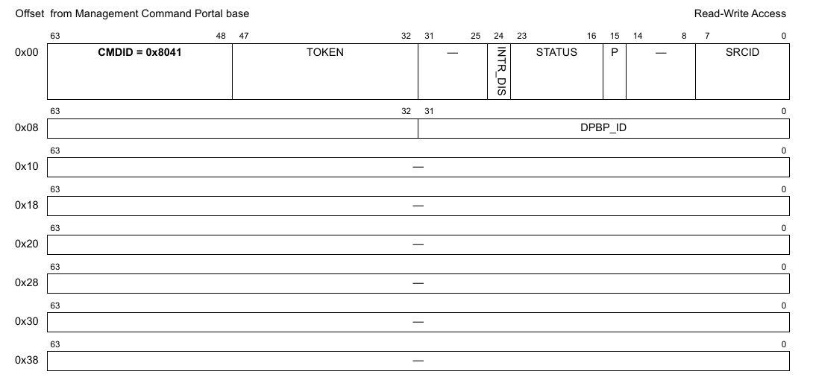

**Figure 185. Mô tả command DPBP_OPEN**

Bảng sau mô tả các field của command.

**Table 20. Mô tả các field của command DPBP_OPEN1**

| Offset | Bits | Tên | Mô tả |
|---|---|---|---|
| 0x00 | 0-63 | Header của command | Xem Table 2 để biết mô tả chung các field của command portal. CMDID phải được đặt như chỉ ra trong hình ở trên. |
| 0x08 | 0-31 | DPBP_ID | ID duy nhất của DPBP |

1 Mọi field không được nêu là reserved và phải được xóa (đặt bằng 0)

### 8.2.2 DPBP_CLOSE

Đóng phiên điều khiển của object.

Sau khi gọi hàm này, không thao tác nào khác được phép trên object nếu không mở một phiên điều khiển mới.

**Cấu trúc command**

**Figure 186. Mô tả command DPBP_CLOSE**

| Offset | Bits | Tên | Mô tả |
|---|---|---|---|
| 0x00 | 0-63 | Header của command | Xem Table 2 để biết mô tả chung các field của command portal. CMDID phải được đặt như chỉ ra trong hình ở trên. |

Mọi field không được nêu là reserved và phải được xóa (đặt bằng 0)

### 8.2.3 DPBP_CREATE

Command này tạo và khởi tạo một instance DPBP theo các tham số command được chỉ định. Command này không cần cho các instance DPBP được tạo bằng DPL.

Với command CREATE, bên gọi phải cung cấp authentication token của container cha mà object sẽ được tạo và gán vào. Nếu token là '0', object sẽ được gán cho container đang sở hữu MC command portal thực thi command này.

Command trả về một DPBP ID có thể dùng để OPEN hoặc DESTROY object.

Định dạng command được thể hiện trong hình dưới đây.

**Cấu trúc command**

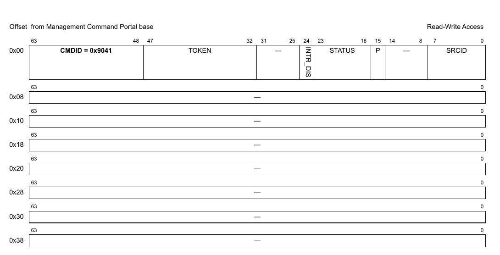

**Figure 187. Mô tả command DPBP_CREATE**

Bảng sau mô tả các field của command.

**Table 21. Mô tả các field của command DPBP_CREATE1**

| Offset | Bits | Tên | Mô tả |
|---|---|---|---|
| 0x00 | 0-63 | Header của command | Xem Table 2 để biết mô tả chung các field của command portal. CMDID phải được đặt như chỉ ra trong hình ở trên. |

1 Mọi field không được nêu là reserved và phải được xóa (đặt bằng 0)

**Cấu trúc response**

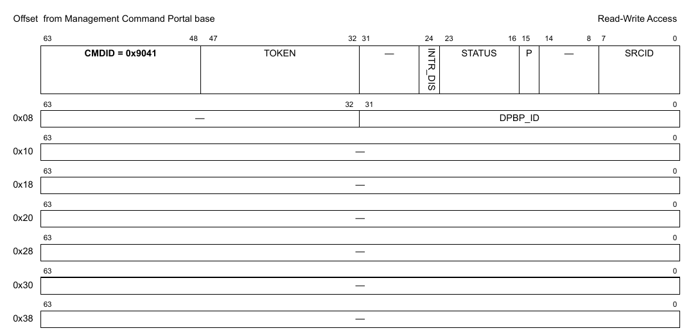

**Figure 8-1. Mô tả response của DPBP_CREATE**

Bảng sau mô tả các field của response.

**Table 8-1. Mô tả các field response của DPBP_CREATE1**

| Offset | Bits | Tên | Mô tả |
|---|---|---|---|
| 0x00 | 0-63 | Header của command | Xem Table 2 để biết mô tả chung các field của command portal. CMDID phải được đặt như chỉ ra trong hình ở trên. |
| 0x08 | 0-31 | DPBP_ID | ID duy nhất của DPBP |

1 Mọi field không được nêu là reserved.

### 8.2.4 DPBP_DESTROY

Command này hủy DPBP object và giải phóng mọi tài nguyên của nó. Nó phải được gọi trong software context đã tạo object. Bên gọi phải cung cấp object id và authentication token của container cha đã tạo object. Lưu ý rằng object có thể đã được gán cho container khác, và gửi authentication token của container đó sẽ trả về lỗi.

Mọi authentication token đang mở tới object phải được đóng trước khi gọi command destroy.

**Cấu trúc command**

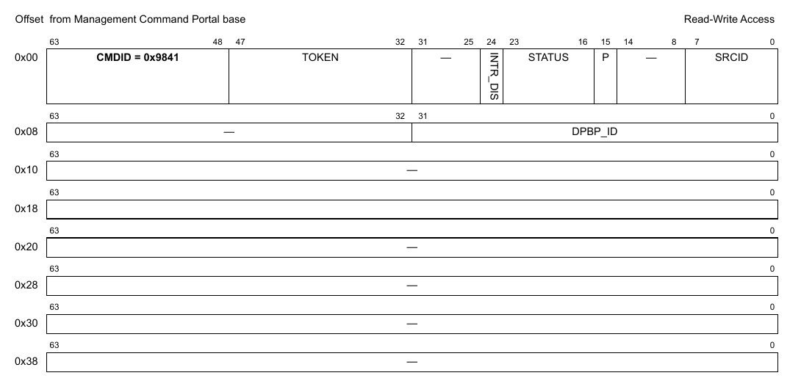

**Figure 188. Mô tả command DPBP_DESTROY**

| Offset | Bits | Tên | Mô tả |
|---|---|---|---|
| 0x00 | 0-63 | Header của command | Xem Table 2 để biết mô tả chung các field của command portal. CMDID phải được đặt như chỉ ra trong hình ở trên. |
| 0x08 | 0–32 | DPBP_ID | ID của DPBP object cần hủy |

Mọi field không được nêu là reserved và phải được xóa (đặt bằng 0)

### 8.2.5 DPBP_ENABLE

**Cấu trúc command**

**Figure 189. Mô tả command DPBP_ENABLE**

| Offset | Bits | Tên | Mô tả |
|---|---|---|---|
| 0x00 | 0-63 | Header của command | Xem Table 2 để biết mô tả chung các field của command portal. CMDID phải được đặt như chỉ ra trong hình ở trên. |

Mọi field không được nêu là reserved và phải được xóa (đặt bằng 0)

### 8.2.6 DPBP_DISABLE

**Cấu trúc command**

**Figure 190. Mô tả command DPBP_DISABLE**

| Offset | Bits | Tên | Mô tả |
|---|---|---|---|
| 0x00 | 0-63 | Header của command | Xem Table 2 để biết mô tả chung các field của command portal. CMDID phải được đặt như chỉ ra trong hình ở trên. |

Mọi field không được nêu là reserved và phải được xóa (đặt bằng 0)

### 8.2.7 DPBP_IS_ENABLED

**Cấu trúc command**

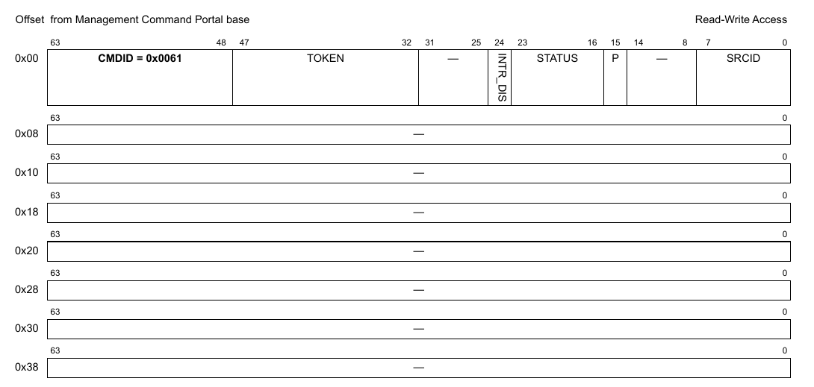

**Figure 191. Mô tả command DPBP_IS_ENABLED**

| Offset | Bits | Tên | Mô tả |
|---|---|---|---|
| 0x00 | 0-63 | Header của command | Xem Table 2 để biết mô tả chung các field của command portal. CMDID phải được đặt như chỉ ra trong hình ở trên. |

Mọi field không được nêu là reserved và phải được xóa (đặt bằng 0)

**Cấu trúc response**

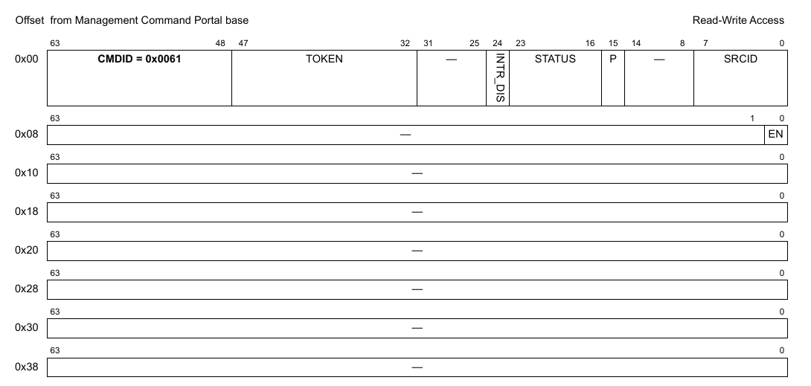

**Figure 192. Mô tả response của DPBP_IS_ENABLED**

| Offset | Bits | Tên | Mô tả |
|---|---|---|---|
| 0x00 | 0-63 | Header của command | Xem Table 2 để biết mô tả chung các field của command portal. CMDID phải được đặt như chỉ ra trong hình ở trên. |
| 0x08 | 0 | EN | Trả về '1' nếu object đang enable; '0' nếu không |

Mọi field không được nêu là reserved và phải được xóa (đặt bằng 0)

### 8.2.8 DPBP_RESET

**Cấu trúc command**

**Figure 193. Mô tả command DPBP_RESET**

| Offset | Bits | Tên | Mô tả |
|---|---|---|---|
| 0x00 | 0-63 | Header của command | Xem Table 2 để biết mô tả chung các field của command portal. CMDID phải được đặt như chỉ ra trong hình ở trên. |

Mọi field không được nêu là reserved và phải được xóa (đặt bằng 0)

### 8.2.9 DPBP_SET_IRQ_ENABLE

Đặt trạng thái tổng thể của interrupt. Cho phép phần mềm GPP điều khiển khi nào interrupt được sinh ra. Mỗi interrupt có thể có tối đa 32 nguyên nhân. Điều khiển enable/disable quyết định trạng thái tổng thể của interrupt. Nếu interrupt bị disable thì không nguyên nhân nào sinh ra interrupt.

**Cấu trúc command**

**Figure 194. Mô tả command DPBP_SET_IRQ_ENABLE**

| Offset | Bits | Tên | Mô tả |
|---|---|---|---|
| 0x00 | 0-63 | Header của command | Xem Table 2 để biết mô tả chung các field của command portal. CMDID phải được đặt như chỉ ra trong hình ở trên. |
| 0x08 | 0 | EN | Trạng thái interrupt: đặt ‘1’ để enable, ‘0’ để disable |
|   | 32-39 | IRQ_INDEX | Xác định interrupt index cần cấu hình |

Mọi field không được nêu là reserved và phải được xóa (đặt bằng 0)

### 8.2.10 DPBP_GET_IRQ_ENABLE

Lấy trạng thái tổng thể của interrupt.

**Cấu trúc command**

**Figure 195. Mô tả command DPBP_GET_IRQ_ENABLE**

| Offset | Bits | Tên | Mô tả |
|---|---|---|---|
| 0x00 | 0-63 | Header của command | Xem Table 2 để biết mô tả chung các field của command portal. CMDID phải được đặt như chỉ ra trong hình ở trên. |
| 0x08 | 32-39 | IRQ_INDEX | Xác định interrupt index cần truy vấn |

Mọi field không được nêu là reserved và phải được xóa (đặt bằng 0)

**Cấu trúc response**

**Figure 196. Mô tả response của DPBP_GET_IRQ_ENABLE**

| Offset | Bits | Tên | Mô tả |
|---|---|---|---|
| 0x00 | 0-63 | Header của command | Xem Table 2 để biết mô tả chung các field của command portal. CMDID phải được đặt như chỉ ra trong hình ở trên. |
| 0x08 | 0 | EN | Bit này được đặt nếu interrupt đang enable |

Mọi field không được nêu là reserved và phải được xóa (đặt bằng 0)

### 8.2.11 DPBP_SET_IRQ_MASK

Đặt interrupt mask. Mỗi interrupt có thể có tối đa 32 nguyên nhân, và mô hình interrupt hỗ trợ mask/unmask từng nguyên nhân độc lập.

**Cấu trúc command**

**Figure 197. Mô tả command DPBP_SET_IRQ_MASK**

| Offset | Bits | Tên | Mô tả |
|---|---|---|---|
| 0x00 | 0-63 | Header của command | Xem Table 2 để biết mô tả chung các field của command portal. CMDID phải được đặt như chỉ ra trong hình ở trên. |
| 0x08 | 0-31 | MASK | Event mask để kích hoạt interrupt; xem command GET_IRQ_STATUS để biết đặc tả các event hiện có. Với mỗi bit trong MASK: 0 = bỏ qua event 1 = event hợp lệ; báo IRQ nếu event này xảy ra |
|   | 32-39 | IRQ_INDEX | Interrupt index cần cấu hình |

Mọi field không được nêu là reserved và phải được xóa (đặt bằng 0)

### 8.2.12 DPBP_GET_IRQ_MASK

Lấy interrupt mask. Mỗi interrupt có thể có tối đa 32 nguyên nhân, và mô hình interrupt hỗ trợ mask/unmask từng nguyên nhân độc lập.

**Cấu trúc command**

**Figure 198. Mô tả command DPBP_GET_IRQ_MASK**

| Offset | Bits | Tên | Mô tả |
|---|---|---|---|
| 0x00 | 0-63 | Header của command | Xem Table 2 để biết mô tả chung các field của command portal. CMDID phải được đặt như chỉ ra trong hình ở trên. |
| 0x08 | 32-39 | IRQ_INDEX | Interrupt index cần truy vấn |

Mọi field không được nêu là reserved và phải được xóa (đặt bằng 0)

**Cấu trúc response**

**Figure 199. Mô tả response của DPBP_GET_IRQ_MASK**

| Offset | Bits | Tên | Mô tả |
|---|---|---|---|
| 0x00 | 0-63 | Header của command | Xem Table 2 để biết mô tả chung các field của command portal. CMDID phải được đặt như chỉ ra trong hình ở trên. |
| 0x08 | 0-31 | MASK | Event mask để kích hoạt interrupt; xem command GET_IRQ_STATUS để biết đặc tả các event hiện có. Với mỗi bit trong MASK: 0 = bỏ qua event 1 = event hợp lệ; báo IRQ nếu event này xảy ra |

Mọi field không được nêu là reserved và phải được xóa (đặt bằng 0)

### 8.2.13 DPBP_GET_IRQ_STATUS

Lấy trạng thái hiện tại của các event đang chờ cho interrupt index được chỉ định.

**Cấu trúc command**

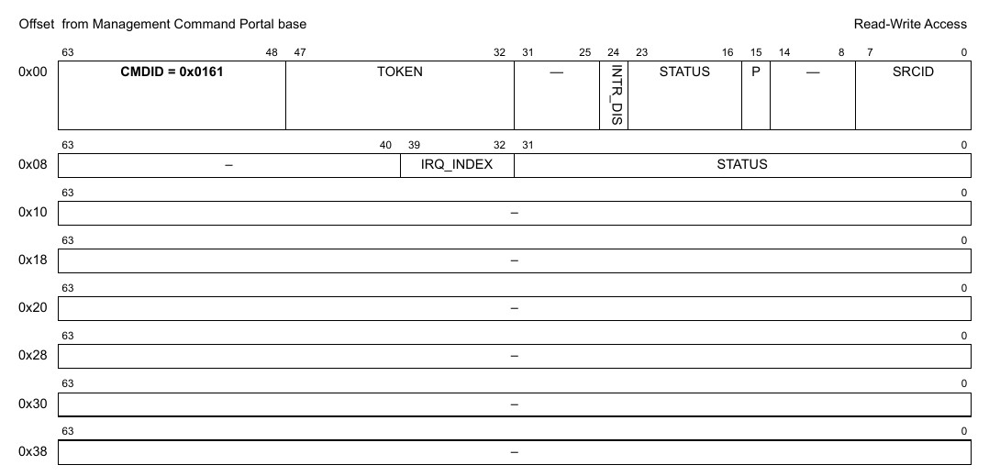

**Figure 200. Mô tả command DPBP_GET_IRQ_STATUS**

| Offset | Bits | Tên | Mô tả |
|---|---|---|---|
| 0x00 | 0-63 | Header của command | Xem Table 2 để biết mô tả chung các field của command portal. CMDID phải được đặt như chỉ ra trong hình ở trên. |
| 0x08 | 0-31 | STATUS | Tùy chọn: mọi bit STATUS được đặt sẽ được xóa khỏi trạng thái đang chờ (không cần dùng command DPBP_CLEAR_IRQ_STATUS nữa). Lưu ý rằng STATUS trả về trong response là trạng thái trước khi các event bị xóa.  Các event được hỗ trợ: xem định nghĩa cấu trúc response |
|   | 32-39 | IRQ_INDEX | Interrupt index cần truy vấn |

Mọi field không được nêu là reserved và phải được xóa (đặt bằng 0)

**Cấu trúc response**

**Figure 201. Mô tả response của DPBP_GET_IRQ_STATUS**

| Offset | Bits | Tên | Mô tả |
|---|---|---|---|
| 0x00 | 0-63 | Header của command | Xem Table 2 để biết mô tả chung các field của command portal. CMDID phải được đặt như chỉ ra trong hình ở trên. |
| 0x08 | 0-31 | STATUS | Mask trạng thái event, mỗi event một bit: 0 = không có interrupt đang chờ 1 = có interrupt đang chờ  Các event được hỗ trợ: Không có |

Mọi field không được nêu là reserved và phải được xóa (đặt bằng 0)

### 8.2.14 DPBP_CLEAR_IRQ_STATUS

Xóa (đánh dấu đã xử lý) các event đang chờ của interrupt index được chỉ định.

**Cấu trúc command**

**Figure 202. Mô tả command DPBP_CLEAR_IRQ_STATUS**

| Offset | Bits | Tên | Mô tả |
|---|---|---|---|
| 0x00 | 0-63 | Header của command | Xem Table 2 để biết mô tả chung các field của command portal. CMDID phải được đặt như chỉ ra trong hình ở trên. |
| 0x08 | 0-31 | STATUS | Mask để xóa các event đã xử lý; xem command GET_IRQ_STATUS để biết đặc tả các event hiện có. Với mỗi bit trong MASK: 0 = không đổi trạng thái event 1 = xóa bit trạng thái event để cho biết event đã được xử lý |
|   | 32-39 | IRQ_INDEX | Interrupt index cần cấu hình |

Mọi field không được nêu là reserved và phải được xóa (đặt bằng 0)

### 8.2.15 DPBP_GET_ATTRIBUTES

**Cấu trúc command**

**Figure 203. Mô tả command DPBP_GET_ATTRIBUTES**

| Offset | Bits | Tên | Mô tả |
|---|---|---|---|
| 0x00 | 0-63 | Header của command | Xem Table 2 để biết mô tả chung các field của command portal. CMDID phải được đặt như chỉ ra trong hình ở trên. |

Mọi field không được nêu là reserved và phải được xóa (đặt bằng 0)

**Cấu trúc response**

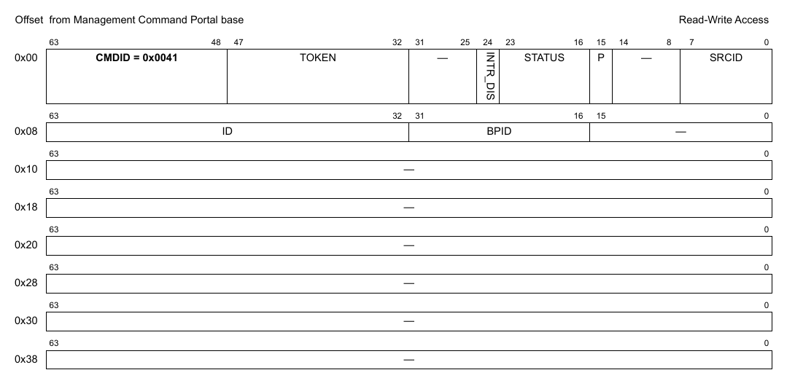

**Figure 204. Mô tả response của DPBP_GET_ATTRIBUTES**

| Offset | Bits | Tên | Mô tả |
|---|---|---|---|
| 0x00 | 0-63 | Header của command | Xem Table 2 để biết mô tả chung các field của command portal. CMDID phải được đặt như chỉ ra trong hình ở trên. |
| 0x08 | 16-31 | BPID | Hardware buffer pool ID; cần được dùng làm tham số trong các thao tác acquire/release buffer |
|   | 32-63 | ID | DPBP object ID |

Mọi field không được nêu là reserved và phải được xóa (đặt bằng 0)

### 8.2.16 DPBP_SET_NOTIFICATIONS

**Cấu trúc command**

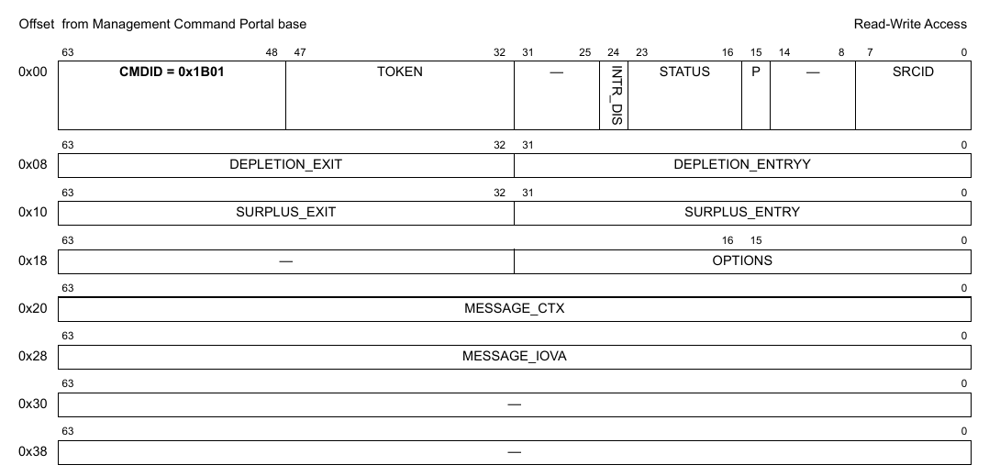

**Figure 205. Mô tả command DPBP_SET_NOTIFICATIONS**

| Offset | Bits | Tên | Mô tả |
|---|---|---|---|
| 0x00 | 0-63 | Header của command | Xem Table 2 để biết mô tả chung các field của command portal. CMDID phải được đặt như chỉ ra trong hình ở trên. |
| 0x08 | 0.31 | DEPLETION_ENTRY | dưới ngưỡng này pool ở trạng thái "cạn" (depleted); đặt '0' để tắt |
|   | 32-63 | DEPLETION_EXIT | lớn hơn hoặc bằng ngưỡng này thì pool ra khỏi trạng thái “cạn" |
| 0x10 | 0-31 | SURPLUS_ENTRY | trên ngưỡng này pool ở trạng thái "dư" (surplus); đặt '0' để tắt |
|   | 32-63 | SURPLUS_EXIT | nhỏ hơn hoặc bằng ngưỡng này thì pool ra khỏi trạng thái "dư" |
| 0x18 | 0-15 | OPTIONS | Mask các option có sẵn; dùng các giá trị 'DPBP_NOTIF_OPT_\<X>' |
| 0x20 | 0-63 | MESSAGE_CTX | Context sẽ là một phần của message BPSCN và sẽ được ghi vào 'message_iova' |
| 0x28 | 0-63 | MESSAGE_IOVA | BẮT BUỘC phải cho nếu 'depletion_entry' hoặc 'surplus_entry' khác '0' (bật); địa chỉ ảo I/O (phải nằm trong bộ nhớ DMA-able), phải căn theo 16B. |

Mọi field không được nêu là reserved và phải được xóa (đặt bằng 0)

### 8.2.17 DPBP_GET_NOTIFICATIONS

**Cấu trúc command**

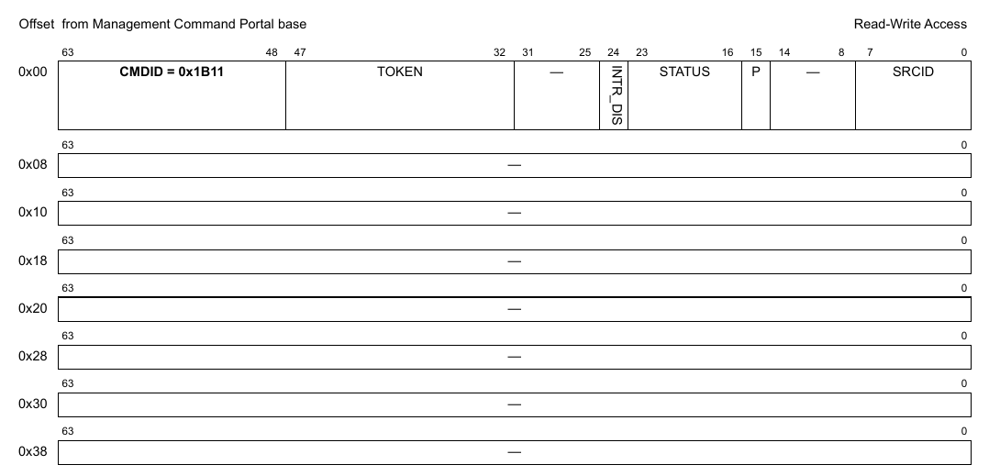

**Figure 206. Mô tả command DPBP_GET_NOTIFICATIONS**

| Offset | Bits | Tên | Mô tả |
|---|---|---|---|
| 0x00 | 0-63 | Header của command | Xem Table 2 để biết mô tả chung các field của command portal. CMDID phải được đặt như chỉ ra trong hình ở trên. |

Mọi field không được nêu là reserved và phải được xóa (đặt bằng 0)

**Cấu trúc response**

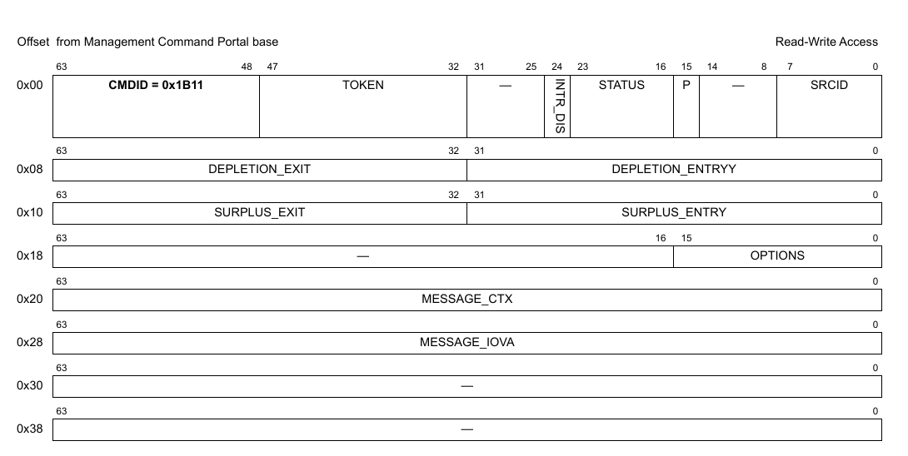

**Figure 207. Mô tả response của DPBP_GET_NOTIFICATIONS**

| Offset | Bits | Tên | Mô tả |
|---|---|---|---|
| 0x00 | 0-63 | Header của command | Xem Table 2 để biết mô tả chung các field của command portal. CMDID phải được đặt như chỉ ra trong hình ở trên. |
| 0x08 | 0.31 | DEPLETION_ENTRY | dưới ngưỡng này pool ở trạng thái "cạn"; đặt '0' để tắt |
|   | 32-63 | DEPLETION_EXIT | lớn hơn hoặc bằng ngưỡng này thì pool ra khỏi trạng thái “cạn" |
| 0x10 | 0-31 | SURPLUS_ENTRY | trên ngưỡng này pool ở trạng thái "dư" (surplus); đặt '0' để tắt |
|   | 32-63 | SURPLUS_EXIT | nhỏ hơn hoặc bằng ngưỡng này thì pool ra khỏi trạng thái "dư" |
| 0x18 | 0-15 | OPTIONS | Mask các option có sẵn; dùng các giá trị 'DPBP_NOTIF_OPT_\<X>' |
| 0x20 | 0-63 | MESSAGE_CTX | Context sẽ là một phần của message BPSCN và sẽ được ghi vào 'MESSAGE_IOVA' |
| 0x28 | 0-63 | MESSAGE_IOVA | BẮT BUỘC phải cho nếu 'DEPLETION_ENTRY' hoặc 'SURPLUS_ENTRY' khác '0' (bật); địa chỉ ảo I/O (phải nằm trong bộ nhớ DMA-able), phải căn theo 16B. |

Mọi field không được nêu là reserved và phải được xóa (đặt bằng 0)

### 8.2.18 DPBP_GET_NUM_FREE_BUFS

**Cấu trúc command**

**Figure 208. Mô tả command DPBP_GET_NUM_FREE_BUFS**

| Offset | Bits | Tên | Mô tả |
|---|---|---|---|
| 0x00 | 0-63 | Header của command | Xem Table 2 để biết mô tả chung các field của command portal. CMDID phải được đặt như chỉ ra trong hình ở trên. |

Mọi field không được nêu là reserved và phải được xóa (đặt bằng 0)

**Cấu trúc response**

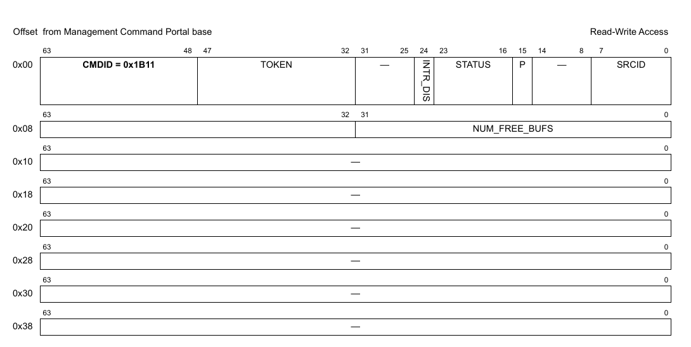

**Figure 209. Mô tả response của DPBP_GET_NOTIFICATIONS *(ghi chú: đúng là DPBP_GET_NUM_FREE_BUFS)***

| Offset | Bits | Tên | Mô tả |
|---|---|---|---|
| 0x00 | 0-63 | Header của command | Xem Table 2 để biết mô tả chung các field của command portal. CMDID phải được đặt như chỉ ra trong hình ở trên. |
| 0x08 | 0-31 | NUM_FREE_BUFS | Số free buffer trong buffer pool này (DPBP) |

Mọi field không được nêu là reserved và phải được xóa (đặt bằng 0)

### 8.2.19 DPBP_GET_API_VERSION

**Cấu trúc command**

**Figure 210. Mô tả command DPBP_GET_API_VERSION**

| Offset | Bits | Tên | Mô tả |
|---|---|---|---|
| 0x00 | 0-63 | Header của command | Xem Table 2 để biết mô tả chung các field của command portal. CMDID phải được đặt như chỉ ra trong hình ở trên. |

Mọi field không được nêu là reserved và phải được xóa (đặt bằng 0)

**Cấu trúc response**

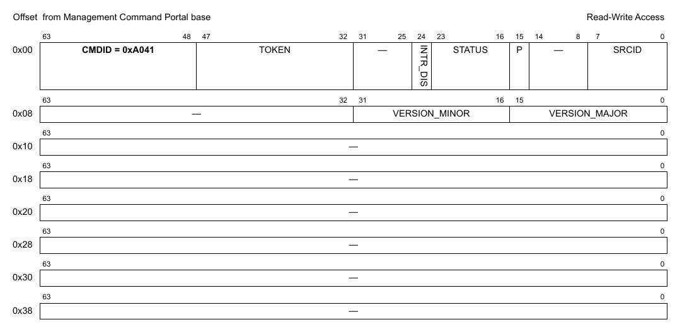

**Figure 211. Mô tả response của DPBP_GET_API_VERSION**

| Offset | Bits | Tên | Mô tả |
|---|---|---|---|
| 0x00 | 0-63 | Header của command | Xem Table 2 để biết mô tả chung các field của command portal. CMDID phải được đặt như chỉ ra trong hình ở trên. |
| 0x08 | 0-15 | VERSION_MAJOR | Major version của API |
|   | 16-31 | VERSION_MINOR | Minor version của API |

Mọi field không được nêu là reserved và phải được xóa (đặt bằng 0)

**Figure 212. Mô tả response của DPBP_GET_API_VERSION**
