# Chương 9 DPIO: Data Path I/O

DPIO object cho phép cấu hình QBMan software portal, có thêm khả năng notification tùy chọn. Software portal được phần mềm GPP dùng để giao tiếp với QBMan. Mục đích chính của DPIO object là cho phép GPP thực hiện I/O – các thao tác enqueue và dequeue, cũng như release và acquire buffer – qua QBMan. Thông thường, một DPIO object có thể được gắn với một thread của GPP core, để không cần đồng bộ đa nhân trên software portal.

DPIO object là bắt buộc để gửi frame tới và nhận frame từ một giao diện mạng; xem mục DPNI để biết thêm về quan hệ giữa DPNI và DPIO.

## 9.1 Các tính năng của DPIO

Danh sách sau tóm tắt các tính năng và khả năng chính của DPIO:

- Hỗ trợ cấu hình QBMan software portal cho các thao tác I/O của GPP
- Hỗ trợ thông báo có dữ liệu trong các frame queue gắn với DPIO object
- Hỗ trợ thông báo có dữ liệu trong các DPCON object gắn với DPIO object
- Hỗ trợ tối đa tám priority để lập lịch thông báo có dữ liệu; ví dụ, một DPIO object có nhiều priority cho phép đặt priority notification khác nhau cho các receive queue khác nhau của DPNI, với giả định chúng được gắn với cùng DPIO object
- Hỗ trợ các thao tác enable, disable và reset

## 9.2 Tham chiếu command của DPIO

Mục này trình bày chi tiết mô hình lập trình các command của DPIO.

### 9.2.1 DPIO_OPEN

Mở một phiên điều khiển cho object được chỉ định.

Hàm này có thể dùng để mở phiên điều khiển cho một object đã được tạo; object có thể đã được khai báo trong DPL hoặc được tạo bằng command DPIO_CREATE.

Hàm này trả về một authentication token duy nhất, gắn với object ID cụ thể; token này phải được dùng trong mọi command tiếp theo cho object này.

**Cấu trúc command**

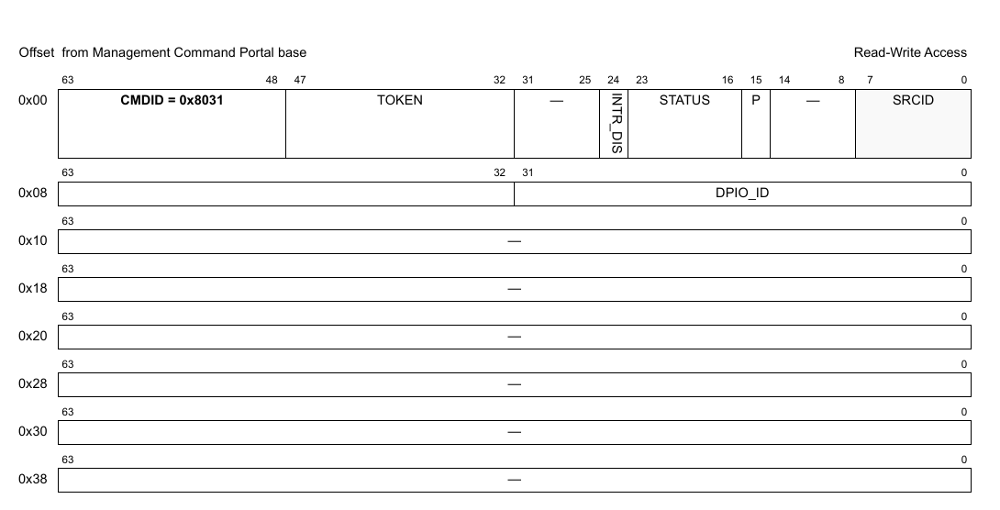

**Figure 213. Mô tả command DPIO_OPEN**

Bảng sau mô tả các field của command.

**Table 22. Mô tả các field của command DPIO_OPEN1**

| Offset | Bits | Tên | Mô tả |
|---|---|---|---|
| 0x00 | 0-63 | Header của command | Xem Table 2 để biết mô tả chung các field của command portal. CMDID phải được đặt như chỉ ra trong hình ở trên. |
| 0x08 | 0-31 | DPIO_ID | ID duy nhất của DPIO |

1 Mọi field không được nêu là reserved và phải được xóa (đặt bằng 0)

### 9.2.2 DPIO_CLOSE

Đóng phiên điều khiển của object.

Sau khi gọi hàm này, không thao tác nào khác được phép trên object nếu không mở một phiên điều khiển mới.

**Cấu trúc command**

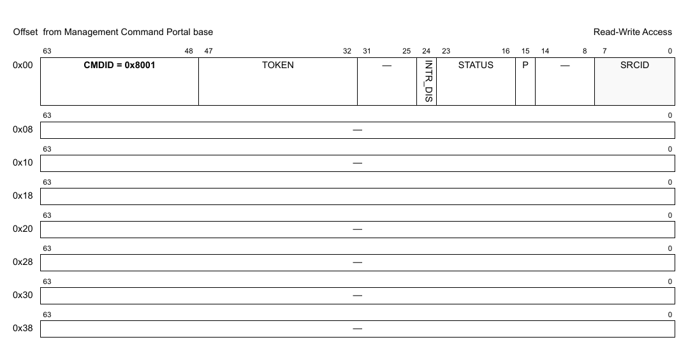

**Figure 214. Mô tả command DPIO_CLOSE**

| Offset | Bits | Tên | Mô tả |
|---|---|---|---|
| 0x00 | 0-63 | Header của command | Xem Table 2 để biết mô tả chung các field của command portal. CMDID phải được đặt như chỉ ra trong hình ở trên. |

Mọi field không được nêu là reserved và phải được xóa (đặt bằng 0)

### 9.2.3 DPIO_CREATE

Command này tạo và khởi tạo một instance DPIO theo các tham số command được chỉ định. Command này không cần cho các instance DPIO được tạo bằng DPL.

Với command CREATE, bên gọi phải cung cấp authentication token của container cha mà object sẽ được tạo và gán vào. Nếu token là '0', object sẽ được gán cho container đang sở hữu MC command portal thực thi command này.

Command trả về một DPIO ID có thể dùng để OPEN hoặc DESTROY object.

Định dạng command được thể hiện trong hình dưới đây.

**Cấu trúc command**

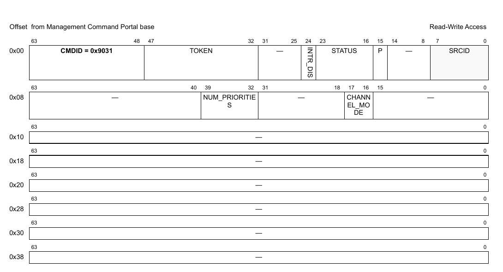

**Figure 215. Mô tả command DPIO_CREATE**

Bảng sau mô tả các field của command.

**Table 23. Mô tả các field của command DPIO_CREATE1**

| Offset | Bits | Tên | Mô tả |
|---|---|---|---|
| 0x00 | 0-63 | Header của command | Xem Table 2 để biết mô tả chung các field của command portal. CMDID phải được đặt như chỉ ra trong hình ở trên. |
| 0x08 | 16-17 | CHANNEL_MODE | Chế độ notification channel. Chọn một trong các giá trị được hỗ trợ dưới đây: 0x0 = DPIO_NO_CHANNEL - Không hỗ trợ notification channel 0x1 = DPIO_LOCAL_CHANNEL - Thông báo có dữ liệu có thể được nhận qua một channel riêng trong DPIO; người dùng cần trỏ đích của queue trong interface liên quan tới DPIO này |
|   | 32-39 | NUM_PRIORITIES | Số priority cho notification channel (1-8); chỉ có ý nghĩa nếu 'channel_mode = DPIO_LOCAL_CHANNEL'. Giá trị mặc định là 2. |

1 Mọi field không được nêu là reserved và phải được xóa (đặt bằng 0).

**Cấu trúc response**

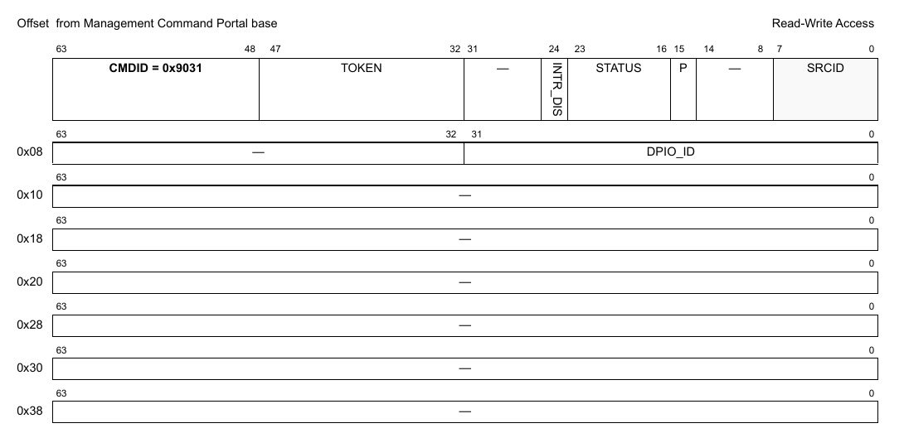

**Figure 9-1. Mô tả response của DPIO_CREATE**

Bảng sau mô tả các field của response.

**Table 9-1. Mô tả các field response của DPIO_CREATE1**

| Offset | Bits | Tên | Mô tả |
|---|---|---|---|
| 0x00 | 0-63 | Header của command | Xem Table 2 để biết mô tả chung các field của command portal. CMDID phải được đặt như chỉ ra trong hình ở trên. |
| 0x08 | 0-31 | DPIO_ID | ID duy nhất của DPIO |

1 Mọi field không được nêu là reserved.

### 9.2.4 DPIO_DESTROY

Command này hủy DPIO object và giải phóng mọi tài nguyên của nó. Nó phải được gọi trong software context đã tạo object. Bên gọi phải cung cấp object id và authentication token của container cha đã tạo object. Lưu ý rằng object có thể đã được gán cho container khác, và gửi authentication token của container đó sẽ trả về lỗi.

Mọi authentication token đang mở tới object phải được đóng trước khi gọi command destroy.

Sau khi gọi hàm này, không thao tác nào khác được phép trên object.

**Cấu trúc command**

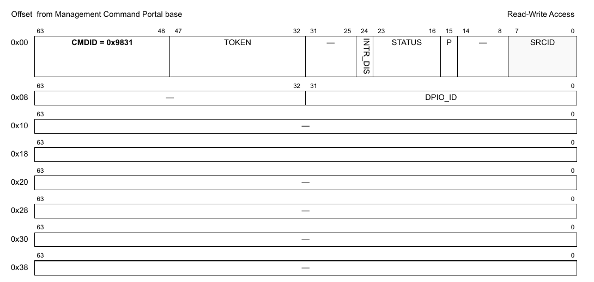

**Figure 216. Mô tả command DPIO_DESTROY**

| Offset | Bits | Tên | Mô tả |
|---|---|---|---|
| 0x00 | 0-63 | Header của command | Xem Table 2 để biết mô tả chung các field của command portal. CMDID phải được đặt như chỉ ra trong hình ở trên. |
| 0x08 | 0–32 | DPIO_ID | ID của DPIO object cần hủy |

Mọi field không được nêu là reserved và phải được xóa (đặt bằng 0)

### 9.2.5 DPIO_ENABLE

**Cấu trúc command**

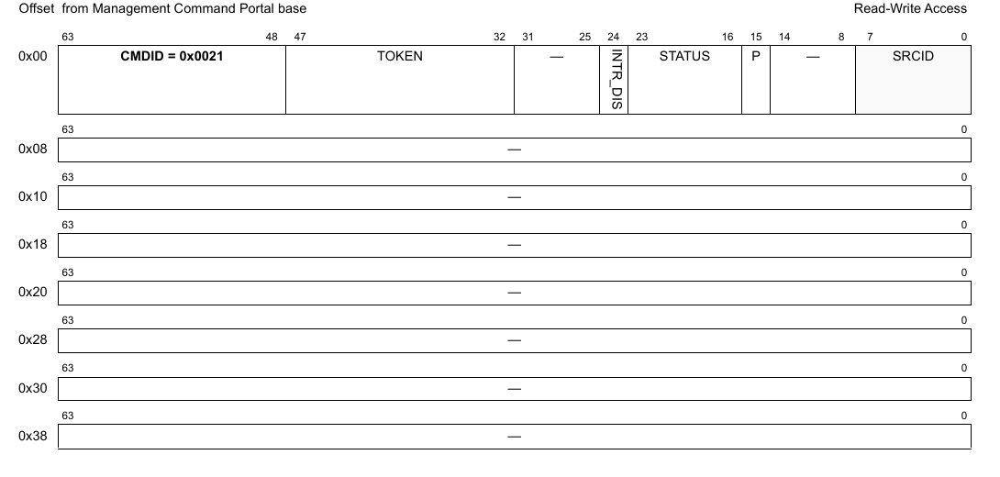

**Figure 217. Mô tả command DPIO_ENABLE**

| Offset | Bits | Tên | Mô tả |
|---|---|---|---|
| 0x00 | 0-63 | Header của command | Xem Table 2 để biết mô tả chung các field của command portal. CMDID phải được đặt như chỉ ra trong hình ở trên. |

Mọi field không được nêu là reserved và phải được xóa (đặt bằng 0)

### 9.2.6 DPIO_DISABLE

**Cấu trúc command**

**Figure 218. Mô tả command DPIO_DISABLE**

| Offset | Bits | Tên | Mô tả |
|---|---|---|---|
| 0x00 | 0-63 | Header của command | Xem Table 2 để biết mô tả chung các field của command portal. CMDID phải được đặt như chỉ ra trong hình ở trên. |

Mọi field không được nêu là reserved và phải được xóa (đặt bằng 0)

### 9.2.7 DPIO_IS_ENABLED

**Cấu trúc command**

**Figure 219. Mô tả command DPIO_IS_ENABLED**

| Offset | Bits | Tên | Mô tả |
|---|---|---|---|
| 0x00 | 0-63 | Header của command | Xem Table 2 để biết mô tả chung các field của command portal. CMDID phải được đặt như chỉ ra trong hình ở trên. |

Mọi field không được nêu là reserved và phải được xóa (đặt bằng 0)

**Cấu trúc response**

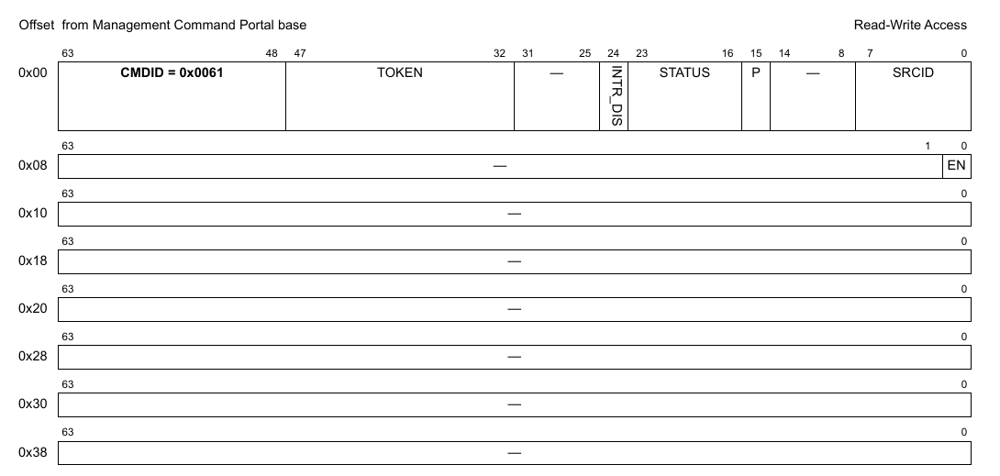

**Figure 220. Mô tả response của DPIO_IS_ENABLED**

| Offset | Bits | Tên | Mô tả |
|---|---|---|---|
| 0x00 | 0-63 | Header của command | Xem Table 2 để biết mô tả chung các field của command portal. CMDID phải được đặt như chỉ ra trong hình ở trên. |
| 0x08 | 0 | EN | Trả về '1' nếu object đang enable; '0' nếu không |

Mọi field không được nêu là reserved và phải được xóa (đặt bằng 0)

### 9.2.8 DPIO_RESET

**Cấu trúc command**

**Figure 221. Mô tả command DPIO_RESET**

| Offset | Bits | Tên | Mô tả |
|---|---|---|---|
| 0x00 | 0-63 | Header của command | Xem Table 2 để biết mô tả chung các field của command portal. CMDID phải được đặt như chỉ ra trong hình ở trên. |

Mọi field không được nêu là reserved và phải được xóa (đặt bằng 0)

### 9.2.9 DPIO_SET_IRQ_ENABLE

Đặt trạng thái tổng thể của interrupt. Cho phép phần mềm GPP điều khiển khi nào interrupt được sinh ra. Mỗi interrupt có thể có tối đa 32 nguyên nhân. Điều khiển enable/disable quyết định trạng thái tổng thể của interrupt. Nếu interrupt bị disable thì không nguyên nhân nào sinh ra interrupt.

**Cấu trúc command**

**Figure 222. Mô tả command DPIO_SET_IRQ_ENABLE**

| Offset | Bits | Tên | Mô tả |
|---|---|---|---|
| 0x00 | 0-63 | Header của command | Xem Table 2 để biết mô tả chung các field của command portal. CMDID phải được đặt như chỉ ra trong hình ở trên. |
| 0x08 | 0 | EN | Trạng thái interrupt: đặt ‘1’ để enable, ‘0’ để disable |
|   | 32-39 | IRQ_INDEX | Xác định interrupt index cần cấu hình |

Mọi field không được nêu là reserved và phải được xóa (đặt bằng 0)

### 9.2.10 DPIO_GET_IRQ_ENABLE

Lấy trạng thái tổng thể của interrupt.

**Cấu trúc command**

**Figure 223. Mô tả command DPIO_GET_IRQ_ENABLE**

| Offset | Bits | Tên | Mô tả |
|---|---|---|---|
| 0x00 | 0-63 | Header của command | Xem Table 2 để biết mô tả chung các field của command portal. CMDID phải được đặt như chỉ ra trong hình ở trên. |
| 0x08 | 32-39 | IRQ_INDEX | Xác định interrupt index cần truy vấn |

Mọi field không được nêu là reserved và phải được xóa (đặt bằng 0)

**Cấu trúc response**

**Figure 224. Mô tả response của DPIO_GET_IRQ_ENABLE**

| Offset | Bits | Tên | Mô tả |
|---|---|---|---|
| 0x00 | 0-63 | Header của command | Xem Table 2 để biết mô tả chung các field của command portal. CMDID phải được đặt như chỉ ra trong hình ở trên. |
| 0x08 | 0 | EN | Bit này được đặt nếu interrupt đang enable |

Mọi field không được nêu là reserved và phải được xóa (đặt bằng 0)

### 9.2.11 DPIO_SET_IRQ_MASK

Đặt interrupt mask. Mỗi interrupt có thể có tối đa 32 nguyên nhân, và mô hình interrupt hỗ trợ mask/unmask từng nguyên nhân độc lập.

**Cấu trúc command**

**Figure 225. Mô tả command DPIO_SET_IRQ_MASK**

| Offset | Bits | Tên | Mô tả |
|---|---|---|---|
| 0x00 | 0-63 | Header của command | Xem Table 2 để biết mô tả chung các field của command portal. CMDID phải được đặt như chỉ ra trong hình ở trên. |
| 0x08 | 0-31 | MASK | Event mask để kích hoạt interrupt; xem command GET_IRQ_STATUS để biết đặc tả các event hiện có. Với mỗi bit trong MASK: 0 = bỏ qua event 1 = event hợp lệ; báo IRQ nếu event này xảy ra |
|   | 32-39 | IRQ_INDEX | Interrupt index cần cấu hình |

Mọi field không được nêu là reserved và phải được xóa (đặt bằng 0)

### 9.2.12 DPIO_GET_IRQ_MASK

Lấy interrupt mask. Mỗi interrupt có thể có tối đa 32 nguyên nhân, và mô hình interrupt hỗ trợ mask/unmask từng nguyên nhân độc lập.

**Cấu trúc command**

**Figure 226. Mô tả command DPIO_GET_IRQ_MASK**

| Offset | Bits | Tên | Mô tả |
|---|---|---|---|
| 0x00 | 0-63 | Header của command | Xem Table 2 để biết mô tả chung các field của command portal. CMDID phải được đặt như chỉ ra trong hình ở trên. |
| 0x08 | 32-39 | IRQ_INDEX | Interrupt index cần truy vấn |

Mọi field không được nêu là reserved và phải được xóa (đặt bằng 0)

**Cấu trúc response**

**Figure 227. Mô tả response của DPIO_GET_IRQ_MASK**

| Offset | Bits | Tên | Mô tả |
|---|---|---|---|
| 0x00 | 0-63 | Header của command | Xem Table 2 để biết mô tả chung các field của command portal. CMDID phải được đặt như chỉ ra trong hình ở trên. |
| 0x08 | 0-31 | MASK | Event mask để kích hoạt interrupt; xem command GET_IRQ_STATUS để biết đặc tả các event hiện có. Với mỗi bit trong MASK: 0 = bỏ qua event 1 = event hợp lệ; báo IRQ nếu event này xảy ra |

Mọi field không được nêu là reserved và phải được xóa (đặt bằng 0)

### 9.2.13 DPIO_GET_IRQ_STATUS

Lấy trạng thái hiện tại của các event đang chờ cho interrupt index được chỉ định.

**Cấu trúc command**

**Figure 228. Mô tả command DPIO_GET_IRQ_STATUS**

| Offset | Bits | Tên | Mô tả |
|---|---|---|---|
| 0x00 | 0-63 | Header của command | Xem Table 2 để biết mô tả chung các field của command portal. CMDID phải được đặt như chỉ ra trong hình ở trên. |
| 0x08 | 0-31 | STATUS | Tùy chọn: mọi bit STATUS được đặt sẽ được xóa khỏi trạng thái đang chờ (không cần dùng command DPIO_CLEAR_IRQ_STATUS nữa). Lưu ý rằng STATUS trả về trong response là trạng thái trước khi các event bị xóa.  Các event được hỗ trợ: xem định nghĩa cấu trúc response |
|   | 32-39 | IRQ_INDEX | Interrupt index cần truy vấn |

Mọi field không được nêu là reserved và phải được xóa (đặt bằng 0)

**Cấu trúc response**

**Figure 229. Mô tả response của DPIO_GET_IRQ_STATUS**

| Offset | Bits | Tên | Mô tả |
|---|---|---|---|
| 0x00 | 0-63 | Header của command | Xem Table 2 để biết mô tả chung các field của command portal. CMDID phải được đặt như chỉ ra trong hình ở trên. |
| 0x08 | 0-31 | STATUS | Mask trạng thái event, mỗi event một bit: 0 = không có interrupt đang chờ 1 = có interrupt đang chờ  Các event được hỗ trợ: Không có |

Mọi field không được nêu là reserved và phải được xóa (đặt bằng 0)

### 9.2.14 DPIO_CLEAR_IRQ_STATUS

Xóa (đánh dấu đã xử lý) các event đang chờ của interrupt index được chỉ định.

**Cấu trúc command**

**Figure 230. Mô tả command DPIO_CLEAR_IRQ_STATUS**

| Offset | Bits | Tên | Mô tả |
|---|---|---|---|
| 0x00 | 0-63 | Header của command | Xem Table 2 để biết mô tả chung các field của command portal. CMDID phải được đặt như chỉ ra trong hình ở trên. |
| 0x08 | 0-31 | STATUS | Mask để xóa các event đã xử lý; xem command GET_IRQ_STATUS để biết đặc tả các event hiện có. Với mỗi bit trong MASK: 0 = không đổi trạng thái event 1 = xóa bit trạng thái event để cho biết event đã được xử lý |
|   | 32-39 | IRQ_INDEX | Interrupt index cần cấu hình |
| 0x10 - 0x38 |   | reserved |   |

Mọi field không được nêu là reserved và phải được xóa (đặt bằng 0)

### 9.2.15 DPIO_GET_ATTRIBUTES

**Cấu trúc command**

**Figure 231. Mô tả command DPIO_GET_ATTRIBUTES**

| Offset | Bits | Tên | Mô tả |
|---|---|---|---|
| 0x00 | 0-63 | Header của command | Xem Table 2 để biết mô tả chung các field của command portal. CMDID phải được đặt như chỉ ra trong hình ở trên. |

Mọi field không được nêu là reserved và phải được xóa (đặt bằng 0)

**Cấu trúc response**

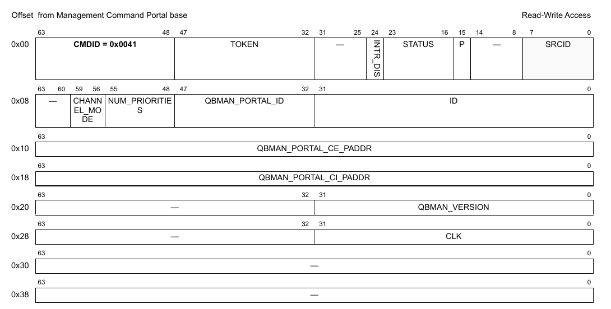

**Figure 232. Mô tả response của DPIO_GET_ATTRIBUTES**

| Offset | Bits | Tên | Mô tả |
|---|---|---|---|
| 0x00 | 0-63 | Header của command | Xem Table 2 để biết mô tả chung các field của command portal. CMDID phải được đặt như chỉ ra trong hình ở trên. |
| 0x08 | 0-31 | ID | DPIO object ID |
|   | 32-47 | QBMAN_PORTAL_ID | ID software portal |
|   | 48-55 | NUM_PRIORITIES | Số priority cho notification channel (1-8); chỉ có ý nghĩa nếu 'CHANNEL_MODE = DPIO_LOCAL_CHANNEL' |
|   | 56-59 | CHANNEL_MODE | Chế độ notification channel: 0x0 = DPIO_NO_CHANNEL - Không hỗ trợ notification channel 0x1 = DPIO_LOCAL_CHANNEL - Thông báo có dữ liệu có thể được nhận qua một channel riêng trong DPIO; người dùng cần trỏ đích của queue trong interface liên quan tới DPIO này |
| 0x10 | 0-63 | QBMAN_PORTAL_CE_PADDR | Địa chỉ vật lý của vùng cache-enabled của software portal |
| 0x18 | 0-63 | QBAMN_PORTAL_CI_PADDR | Địa chỉ vật lý của vùng cache-inhibited của software portal |
| 0x20 | 0-31 | QBMAN_VERSION | Phiên bản IP phần cứng QBMAN |
| 0x28 | 0-31 | CLK | Tần số clock của QBMAN tính bằng Hz |

Mọi field không được nêu là reserved và phải được xóa (đặt bằng 0)

### 9.2.16 DPIO_SET_STASHING_DESTINATION

**Cấu trúc command**

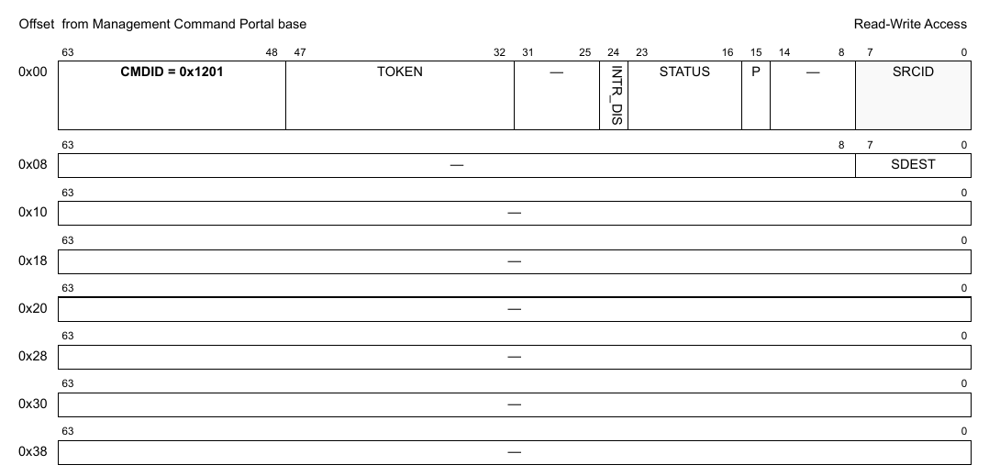

**Figure 233. Mô tả command DPIO_SET_STASHING_DESTINATION**

| Offset | Bits | Tên | Mô tả |
|---|---|---|---|
| 0x00 | 0-63 | Header của command | Xem Table 2 để biết mô tả chung các field của command portal. CMDID phải được đặt như chỉ ra trong hình ở trên. |
| 0x08 | 0-7 | SDEST | giá trị stashing destination |

Mọi field không được nêu là reserved và phải được xóa (đặt bằng 0)

### 9.2.17 DPIO_GET_STASHING_DESTINATION

**Cấu trúc command**

**Figure 234. Mô tả command DPIO_GET_STASHING_DESTINATION**

| Offset | Bits | Tên | Mô tả |
|---|---|---|---|
| 0x00 | 0-63 | Header của command | Xem Table 2 để biết mô tả chung các field của command portal. CMDID phải được đặt như chỉ ra trong hình ở trên. |

Mọi field không được nêu là reserved và phải được xóa (đặt bằng 0)

**Cấu trúc response**

**Figure 235. Mô tả response của DPIO_GET_STASHING_DESTINATION**

| Offset | Bits | Tên | Mô tả |
|---|---|---|---|
| 0x00 | 0-63 | Header của command | Xem Table 2 để biết mô tả chung các field của command portal. CMDID phải được đặt như chỉ ra trong hình ở trên. |
| 0x08 | 0-7 | SDEST | giá trị stashing destination |

Mọi field không được nêu là reserved và phải được xóa (đặt bằng 0)

### 9.2.18 DPIO_ADD_STATIC_DEQUEUE_CHANNEL

**Cấu trúc command**

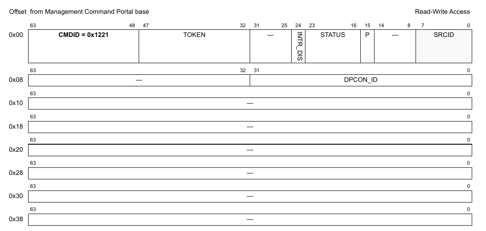

**Figure 236. Mô tả command DPIO_ADD_STATIC_DEQUEUE_CHANNEL**

| Offset | Bits | Tên | Mô tả |
|---|---|---|---|
| 0x00 | 0-63 | Header của command | Xem Table 2 để biết mô tả chung các field của command portal. CMDID phải được đặt như chỉ ra trong hình ở trên. |
| 0x08 | 0-31 | DPCON_ID | DPCON object ID |

Mọi field không được nêu là reserved và phải được xóa (đặt bằng 0)

**Cấu trúc response**

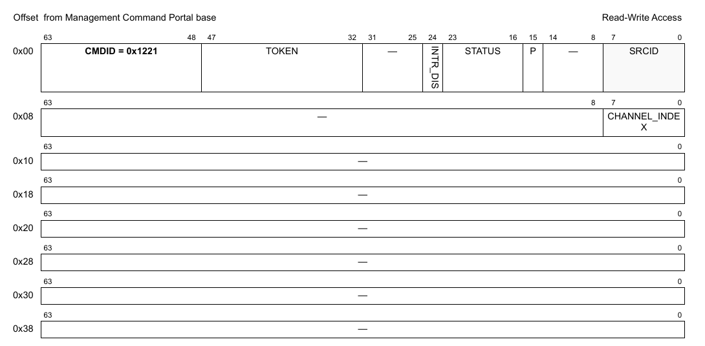

**Figure 237. Mô tả response của DPIO_ADD_STATIC_DEQUEUE_CHANNEL**

| Offset | Bits | Tên | Mô tả |
|---|---|---|---|
| 0x00 | 0-63 | Header của command | Xem Table 2 để biết mô tả chung các field của command portal. CMDID phải được đặt như chỉ ra trong hình ở trên. |
| 0x08 | 0-7 | CHANNEL_INDEX | Channel index trả về, dùng trong qbman API |

Mọi field không được nêu là reserved và phải được xóa (đặt bằng 0)

### 9.2.19 DPIO_REMOVE_STATIC_DEQUEUE_CHANNEL

**Cấu trúc command**

**Figure 238. Mô tả command DPIO_REMOVE_STATIC_DEQUEUE_CHANNEL**

| Offset | Bits | Tên | Mô tả |
|---|---|---|---|
| 0x00 | 0-63 | Header của command | Xem Table 2 để biết mô tả chung các field của command portal. CMDID phải được đặt như chỉ ra trong hình ở trên. |
| 0x08 | 0-31 | DPCON_ID | DPCON object ID |

Mọi field không được nêu là reserved và phải được xóa (đặt bằng 0)

### 9.2.20 DPIO_GET_API_VERSION

**Cấu trúc command**

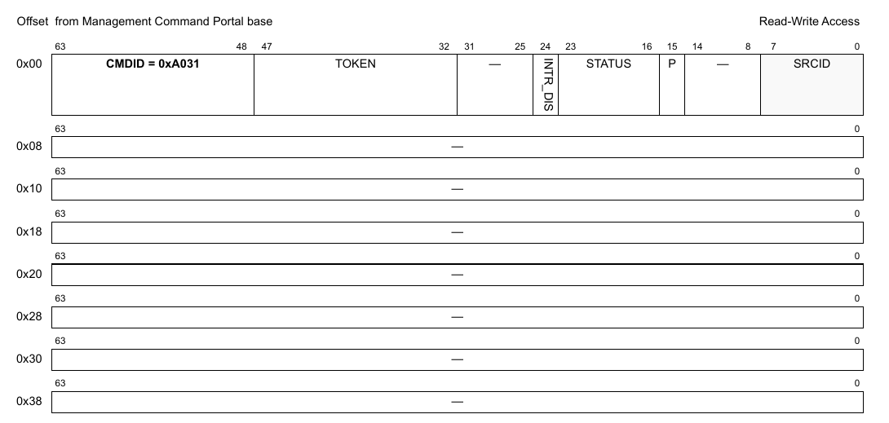

**Figure 239. Mô tả command DPIO_GET_API_VERSION**

| Offset | Bits | Tên | Mô tả |
|---|---|---|---|
| 0x00 | 0-63 | Header của command | Xem Table 2 để biết mô tả chung các field của command portal. CMDID phải được đặt như chỉ ra trong hình ở trên. |

Mọi field không được nêu là reserved và phải được xóa (đặt bằng 0)

**Cấu trúc response**

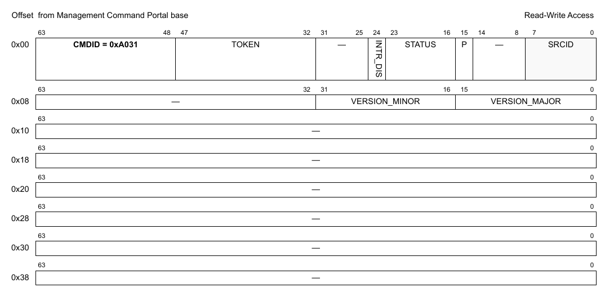

**Figure 240. Mô tả response của DPIO_GET_API_VERSION**

| Offset | Bits | Tên | Mô tả |
|---|---|---|---|
| 0x00 | 0-63 | Header của command | Xem Table 2 để biết mô tả chung các field của command portal. CMDID phải được đặt như chỉ ra trong hình ở trên. |
| 0x08 | 0-15 | VERSION_MAJOR | Major version của API |
|   | 16-31 | VERSION_MINOR | Minor version của API |

### 9.2.21 DPIO_SET_STASHING_DESTINATION_SOURCE

Trên một số SOC (ví dụ: LX2160a) có một tính năng phần cứng cho phép core tự động đặt stashing destination đúng.

Tính năng này, khi có, được bật tự động.

Cố bật tính năng này trên SOC không hỗ trợ sẽ không gây lỗi nhưng không có tác dụng. Người dùng phải đọc lại giá trị để kiểm tra command có thực sự bật tính năng này không.

**Cấu trúc command**

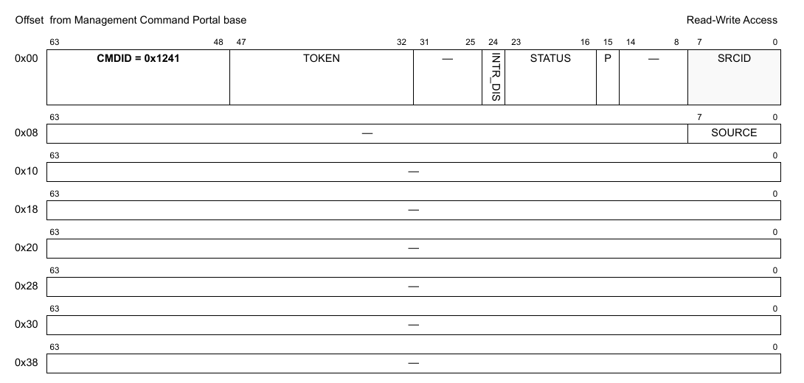

**Figure 241. Mô tả command DPIO_SET_STASHING_DESTINATION_SOURCE**

| Offset | Bits | Tên | Mô tả |
|---|---|---|---|
| 0x00 | 0-63 | Header của command | Xem Table 2 để biết mô tả chung các field của command portal. CMDID phải được đặt như chỉ ra trong hình ở trên. |
| 0x08 | 0-7 | SOURCE | Nguồn lập trình stashing destination có thể đặt là thủ công (0) hoặc tự động (1). Hiện chỉ rất ít SOC hỗ trợ nguồn stashing tự động (LX2). |

Mọi field không được nêu là reserved và phải được xóa (đặt bằng 0)

### 9.2.22 DPIO_GET_STASHING_DESTINATION_SOURCE

Đọc trạng thái hiện tại của nguồn stashing:

0: thủ công

1: tự động

**Cấu trúc command**

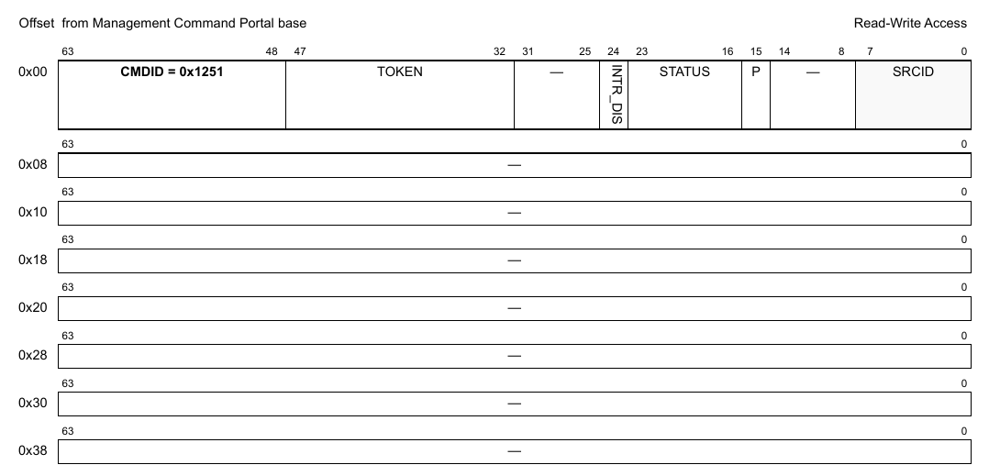

**Figure 242. Mô tả command DPIO_GET_STASHING_DESTINATION_SOURCE**

| Offset | Bits | Tên | Mô tả |
|---|---|---|---|
| 0x00 | 0-63 | Header của command | Xem Table 2 để biết mô tả chung các field của command portal. CMDID phải được đặt như chỉ ra trong hình ở trên. |

Mọi field không được nêu là reserved và phải được xóa (đặt bằng 0)

**Cấu trúc response**

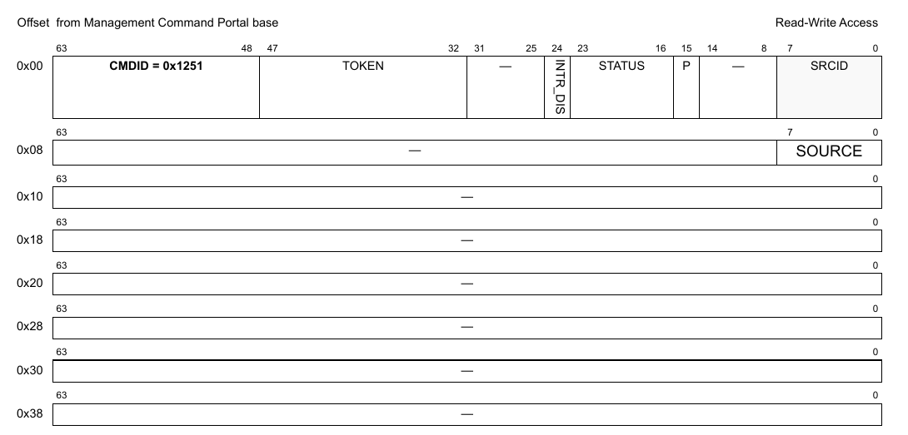

**Figure 243. Mô tả response của DPIO_GET_STASHING_DESTINATION_SOURCE**

| Offset | Bits | Tên | Mô tả |
|---|---|---|---|
| 0x00 | 0-63 | Header của command | Xem Table 2 để biết mô tả chung các field của command portal. CMDID phải được đặt như chỉ ra trong hình ở trên. |
| 0x08 | 0-7 | SOURCE | Giá trị nguồn lập trình stashing destination, thủ công (0) hoặc tự động (1). Hiện chỉ rất ít SOC hỗ trợ nguồn stashing tự động (LX2). |

### 9.2.23 DPIO_SET_STASHING_DESTINATION_BY_CORE_ID

Đặt stashing destination bằng core id của SOC.

Đây là cách thay cho việc đặt trực tiếp stashing destination, và che đi ánh xạ từ core id sang stashing destination. Ánh xạ này khác nhau tùy SOC.

Lưu ý rằng core id đầu tiên là Zero.

**Cấu trúc command**

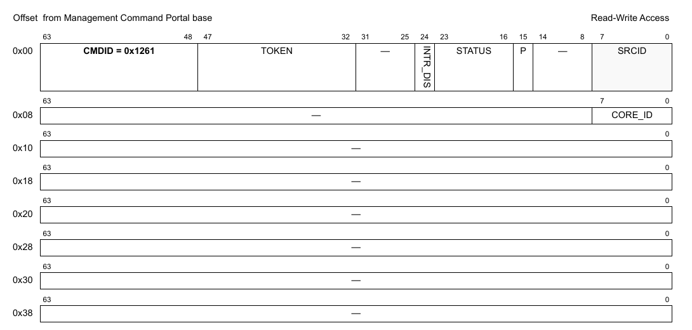

**Figure 244. Mô tả command DPIO_SET_STASHING_DESTINATION_BY_CORE_ID**

| Offset | Bits | Tên | Mô tả |
|---|---|---|---|
| 0x00 | 0-63 | Header của command | Xem Table 2 để biết mô tả chung các field của command portal. CMDID phải được đặt như chỉ ra trong hình ở trên. |
| 0x08 | 0-7 | CORE_ID | Đặt stashing destination cho core index này. Core id đầu tiên là 0. |

Mọi field không được nêu là reserved và phải được xóa (đặt bằng 0)
