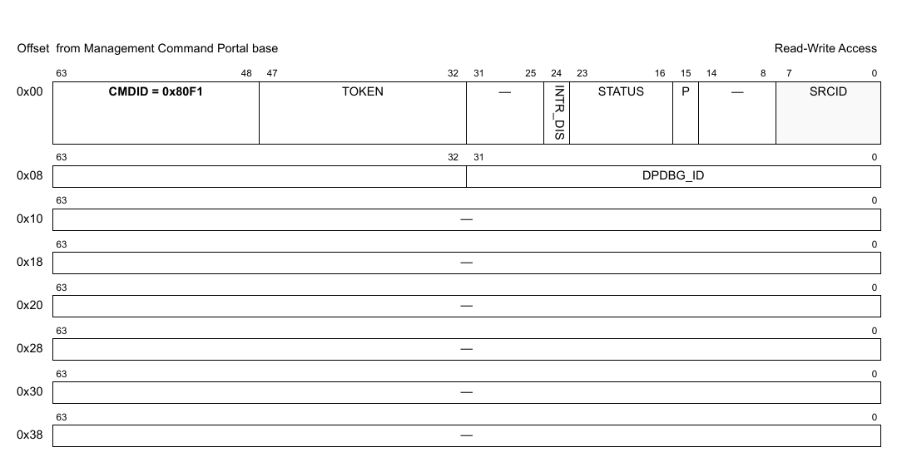
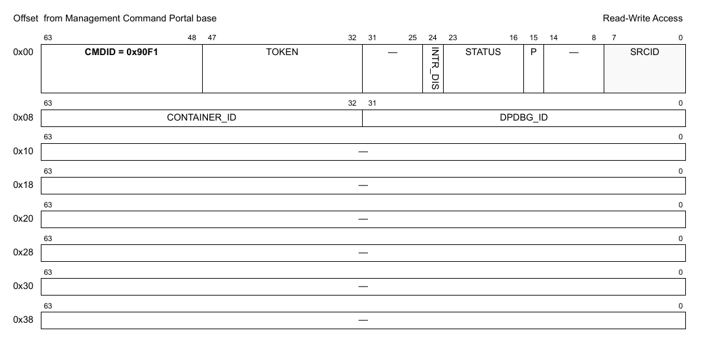
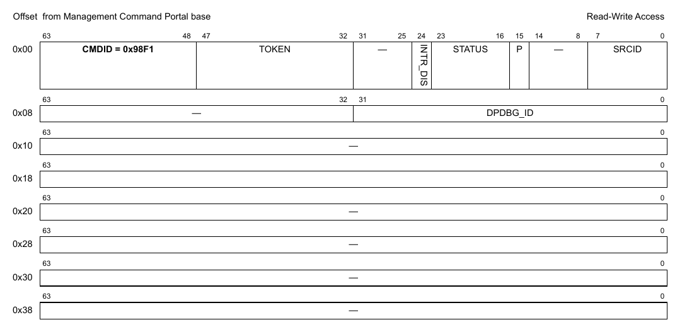
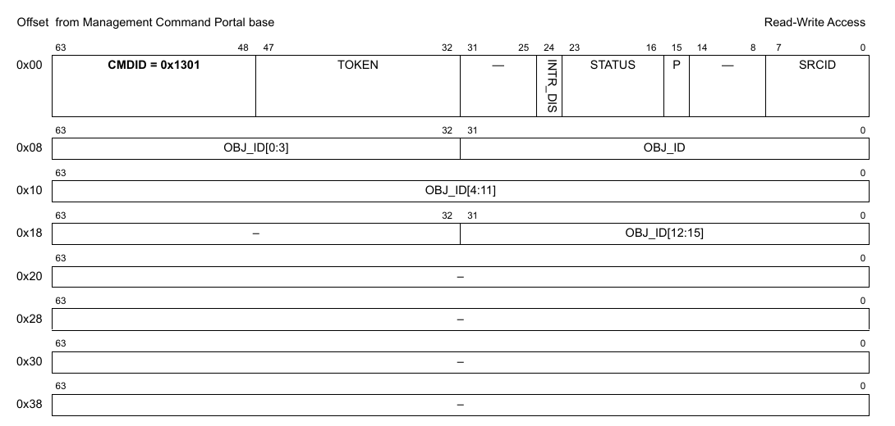
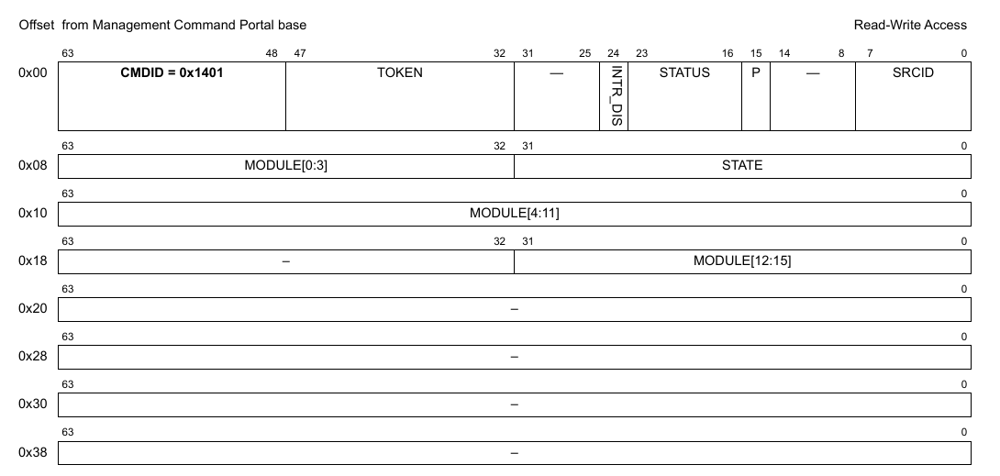
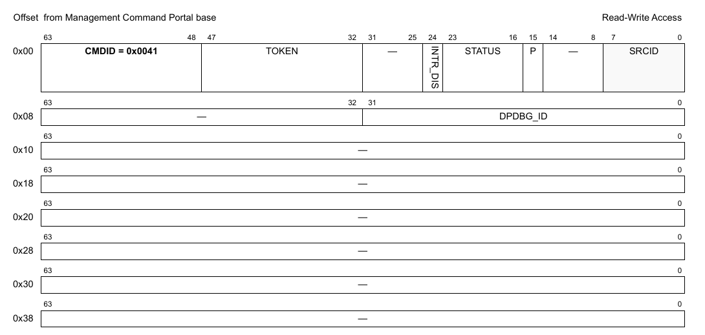
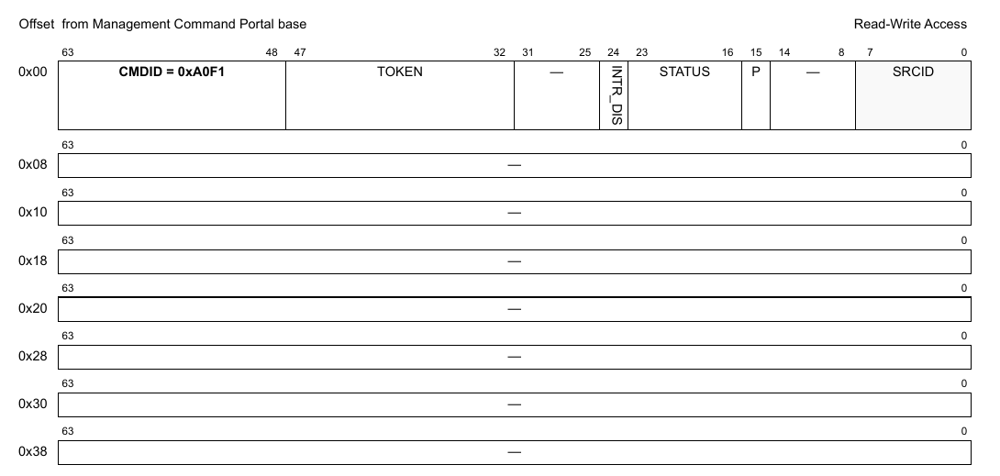
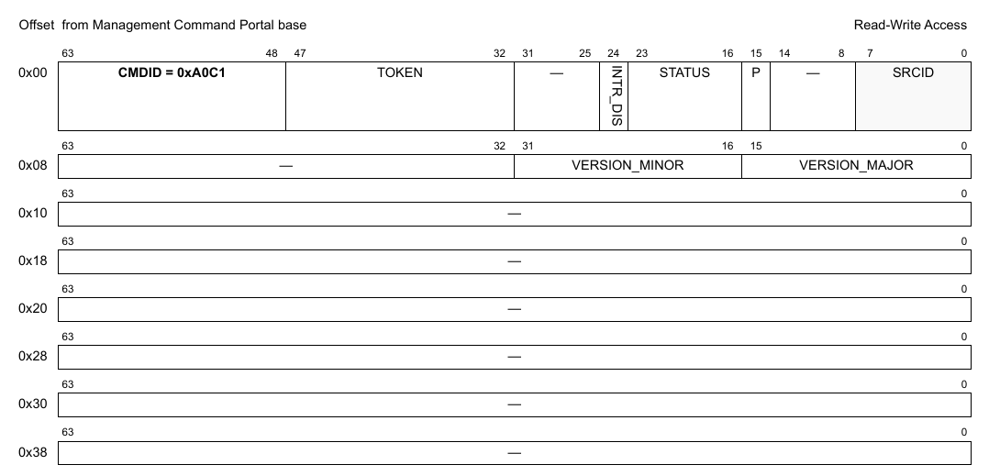

# Chương 10 DPDBG: Data Path Debugging

DPDBG object giúp chúng tôi và người dùng debug các vấn đề của MC bằng cách dump thông tin về MC object và mức dùng bộ nhớ vào bất kỳ lúc nào khi MC đang chạy. DPDBG object cũng cho phép thay đổi một số module của MC vốn chỉ đặt được lúc boot từ file DPC.

## 10.1 Các tính năng của DPDBG

Danh sách sau tóm tắt các tính năng chính của DPDBG:

- Dump thông tin về MC object và mức dùng bộ nhớ
- Bật/tắt lúc runtime các module in debug như DDR logging, in ra UART console, timestamping
- Thay đổi mức chi tiết của log và UART id lúc runtime

## 10.2 Tham chiếu command của DPDBG

Mục này trình bày chi tiết mô hình lập trình các command của DPDBG.

### 10.2.1 DPDBG_OPEN

Mở một phiên điều khiển cho object được chỉ định.

Hàm này có thể dùng để mở phiên điều khiển cho một object đã được tạo; object có thể đã được khai báo trong DPL hoặc được tạo bằng command DPDBG_CREATE.

Hàm này trả về một authentication token duy nhất, gắn với object ID cụ thể; token này phải được dùng trong mọi command tiếp theo cho object này.

**Cấu trúc command**

**Figure 245. Mô tả command DPDBG_OPEN**

Bảng sau mô tả các field của command.

**Table 24. Mô tả các field của command DPDBG_OPEN1**

| Offset | Bits | Tên | Mô tả |
|---|---|---|---|
| 0x00 | 0-63 | Header của command | Xem Table 2 để biết mô tả chung các field của command portal. CMDID phải được đặt như chỉ ra trong hình ở trên. |
| 0x08 | 0-31 | DPDBG_ID | ID duy nhất của DPDBG |

1 Mọi field không được nêu là reserved và phải được xóa (đặt bằng 0)

### 10.2.2 DPDBG_CLOSE

Đóng phiên điều khiển của object.

Sau khi gọi hàm này, không thao tác nào khác được phép trên object nếu không mở một phiên điều khiển mới.

**Cấu trúc command**

**Figure 246. Mô tả command DPDBG_CLOSE**

| Offset | Bits | Tên | Mô tả |
|---|---|---|---|
| 0x00 | 0-63 | Header của command | Xem Table 2 để biết mô tả chung các field của command portal. CMDID phải được đặt như chỉ ra trong hình ở trên. |

Mọi field không được nêu là reserved và phải được xóa (đặt bằng 0)

### 10.2.3 DPDBG_CREATE

Command này tạo và khởi tạo một instance DPDBG theo các tham số command được chỉ định. Command này không cần cho các instance DPDBG được tạo bằng DPL.

Với command CREATE, bên gọi phải cung cấp authentication token của container cha mà object sẽ được tạo và gán vào. Để tạo DPDBG object, container cha phải là root container. Nếu token là '0', object sẽ được gán cho container đang sở hữu MC command portal thực thi command này.

Chỉ tạo được một DPDBG object trong MC (singleton object).

Command sinh ra một DP ID có thể dùng để OPEN hoặc DESTROY object.

Định dạng command được thể hiện trong hình dưới đây.

**Cấu trúc command**

**Figure 247. Mô tả command DPDBG_CREATE**

Bảng sau mô tả các field của command.

**Table 25. Mô tả các field của command DPDBG_CREATE**

| Offset | Bits | Tên | Mô tả |
|---|---|---|---|
| 0x00 | 0-63 | Header của command | Xem Table 2 để biết mô tả chung các field của command portal. CMDID phải được đặt như chỉ ra trong hình ở trên. |
| 0x08 | 0-31 | DPDBG_ID | ID của DPDBG object. |
|   | 32-63 | CONTAINER_ID | Id của container mà DPDBG object sẽ được tạo trong đó. Phải là root container. |

Mọi field không được nêu là reserved và phải được xóa (đặt bằng 0)

### 10.2.4 DPDBG_DESTROY

Command này hủy DPDBG object và giải phóng mọi tài nguyên của nó. Nó phải được gọi trong software context đã tạo object. Bên gọi phải cung cấp object id và authentication token của container cha đã tạo object. Lưu ý rằng object có thể đã được gán cho container khác, và gửi authentication token của container đó sẽ trả về lỗi.

Mọi authentication token đang mở tới object phải được đóng trước khi gọi command destroy.

Sau khi gọi hàm này, không thao tác nào khác được phép trên object.

**Cấu trúc command**

**Figure 248. Mô tả command DPDBG_DESTROY**

| Offset | Bits | Tên | Mô tả |
|---|---|---|---|
| 0x00 | 0-63 | Header của command | Xem Table 2 để biết mô tả chung các field của command portal. CMDID phải được đặt như chỉ ra trong hình ở trên. |
| 0x08 | 0–31 | DPDBG_ID | ID của DPDBG object cần hủy |

Mọi field không được nêu là reserved và phải được xóa (đặt bằng 0)

### 10.2.5 DPMAC_DUMP *(ghi chú: đúng là DPDBG_DUMP)*

Dump thông tin về MC object và mức dùng bộ nhớ. Thông tin được dump in ra log của MC (UART/DDR) ở mức log lớn hơn hoặc bằng INFO (INFO/DEBUG/GLOBAL).

**Cấu trúc command**

**Figure 249. Mô tả command DPDBG_DUMP**

| Offset | Bits | Tên | Mô tả |
|---|---|---|---|
| 0x00 | 0-63 | Header của command | Xem Table 2 để biết mô tả chung các field của command portal. CMDID phải được đặt như chỉ ra trong hình ở trên. |
| 0x08 | 0-31 | OBJ_ID | Id của object cần dump. Khi dump thông tin bộ nhớ, field này phải đặt bằng 0. |
|   | 32-63 | OBJ_TYPE | Loại object/module cần dump. Khi dump thông tin bộ nhớ, field này phải đặt là “mem”, nếu không thì đặt field này bằng loại của object muốn |
| 0x10 | 0-63 |   | dump. Ví dụ: Dump thông tin về DPNI1 |
| 0x18 | 0-31 |   | OBJ_TYPE: “dpni” OBJ_ID: 1 |

Mọi field không được nêu là reserved và phải được xóa (đặt bằng 0)

### 10.2.6 DPDBG_SET

Đổi trạng thái của một số module MC lúc runtime. Có thể đổi thông tin log nào của MC được in, in thế nào và in ra đâu.

**Cấu trúc command**

**Figure 250. Mô tả command DPDBG_SET**

| Offset | Bits | Tên | Mô tả |
|---|---|---|---|
| 0x00 | 0-63 | Header của command | Xem Table 2 để biết mô tả chung các field của command portal. CMDID phải được đặt như chỉ ra trong hình ở trên. |
| 0x08 | 0-31 | STATE | Trạng thái sẽ được đặt cho MODULE được chọn. Có thể từ 0 đến 5 tùy MODULE. |
|   | 32-63 | MODULE | Module cần đặt giá trị STATE. Các module có sẵn là: console, log_mode, timestamp, uart_id, log_level. |
| 0x10 | 0-63 |   | Với module “console”, STATE có thể là 0 hoặc 1: “0” TẮT việc in ra UART console của MC, “1” BẬT nó. |
| 0x18 | 0-31 |   | Với module “log_mode”, STATE có thể là 0 hoặc 1: “0” TẮT DDR logging, “1” BẬT nó. Với module “timestamp”, STATE có thể là 0 hoặc 1: “0” TẮT timestamping cho command của MC, “1” BẬT nó. Với module “uart_id”, STATE có thể nằm trong [0, 4]: “0” nghĩa là TẮT việc in ra UART console của MC, còn [1, 4] đổi id của UART console của MC. Với module “log_level”, state có thể nằm trong [0, 5]: “0” - GLOBAL “1” - DEBUG “2” - INFO “3” - WARNING “4” - ERROR “5” - CRITICAL Option này đổi mức chi tiết khi MC ghi log thông tin. |

Mọi field không được nêu là reserved và phải được xóa (đặt bằng 0)

### 10.2.7 DPDBG_GET_ATTRIBUTES

**Cấu trúc command**

**Figure 251. Mô tả command DPDBG_GET_ATTRIBUTES**

| Offset | Bits | Tên | Mô tả |
|---|---|---|---|
| 0x00 | 0-63 | Header của command | Xem Table 2 để biết mô tả chung các field của command portal. CMDID phải được đặt như chỉ ra trong hình ở trên. |

Mọi field không được nêu là reserved và phải được xóa (đặt bằng 0)

**Cấu trúc response**

**Figure 252. Mô tả response của DPDBG_GET_ATTRIBUTES**

| Offset | Bits | Tên | Mô tả |
|---|---|---|---|
| 0x00 | 0-63 | Header của command | Xem Table 2 để biết mô tả chung các field của command portal. CMDID phải được đặt như chỉ ra trong hình ở trên. |
| 0x08 | 0-31 | DPDBG_ID | ID của DPDBG object |

Mọi field không được nêu là reserved và phải được xóa (đặt bằng 0)

### 10.2.8 DPDBG_GET_API_VERSION

**Cấu trúc command**

**Figure 253. Mô tả command DPDBG_GET_API_VERSION**

| Offset | Bits | Tên | Mô tả |
|---|---|---|---|
| 0x00 | 0-63 | Header của command | Xem Table 2 để biết mô tả chung các field của command portal. CMDID phải được đặt như chỉ ra trong hình ở trên. |

Mọi field không được nêu là reserved và phải được xóa (đặt bằng 0)

**Cấu trúc response**

**Figure 254. Mô tả response của DPDBG_GET_API_VERSION**

| Offset | Bits | Tên | Mô tả |
|---|---|---|---|
| 0x00 | 0-63 | Header của command | Xem Table 2 để biết mô tả chung các field của command portal. CMDID phải được đặt như chỉ ra trong hình ở trên. |
| 0x08 | 0-15 | VERSION_MAJOR | Major version của API |
|   | 16-31 | VERSION_MINOR | Minor version của API |
