# Chương 11 DPCON: Data Path Concentrator

DPCON object cung cấp lập lịch nâng cao cho các packet ingress, kể cả lập lịch giữa các giao diện mạng khác nhau. Nó cho phép các tùy chọn lập lịch nâng cao cho traffic ingress đến từ một hoặc nhiều giao diện mạng, và giúp phần mềm GPP xử lý packet nhận được linh hoạt hơn. Việc dùng DPCON object là tùy chọn – không cần cho các thao tác nhận cơ bản; xem mục DPNI để biết thêm về quan hệ giữa DPNI và DPCON.

Nếu được gán cho container AIOP (chứa các MC object thuộc AIOP), DPCON object chuyển sang chế độ AIOP và cung cấp giao diện để đặt priority cho traffic ingress tới AIOP.

Lý do chính để đưa vào chế độ này là cho phép phần mềm AIOP triển khai một cơ chế QoS tùy chỉnh.

Ở chế độ này, DPCON object chỉ có thể được AIOP SW dùng và không có tùy chọn notification. Lưu ý rằng QBMan có một số Direct Command Portal (DCP) (số lượng tùy nền tảng) nối với khối phần cứng AIOP. Ở chế độ AIOP, DPCON không thể được nối hay liên kết với DPNI hoặc DPCI object. Chế độ này chỉ dành riêng cho AIOP.

Nếu DPCON object được gán lại cho một ngữ cảnh không phải AIOP, DPCON chuyển về chế độ bình thường (GPP).

Vì DPCON ở chế độ AIOP dùng một loại tài nguyên khác ('dcp.aiop.ch') so với chế độ GPP bình thường ('swpch'), nó cũng ảnh hưởng tới số concentrator object tối đa - xem 24.2.1.1 để biết các loại tài nguyên. Lưu ý rằng khi gán một DPCON object cho AIOP, các tài nguyên channel được gắn và giải phóng dựa trên loại container đích và nguồn: AIOP hay không phải AIOP. Nói cách khác, DPCON object sẽ chỉ dùng một loại tài nguyên channel. Ngoài ra, trong thao tác gán, số priority được giữ nguyên

- số này không đổi trong suốt vòng đời của object. Nghĩa là khi DPCON trở về container tạo ra nó, cùng loại tài nguyên SWP Channel sẽ được cấp phát.

Với LS2088A có tối đa 63 DPCON object ở chế độ AIOP, còn với LS1088A chỉ có 15.

## 11.1 Các tính năng của DPCON

Danh sách sau tóm tắt các tính năng và khả năng chính của DPCON:

- Hỗ trợ cấu hình QBMan channel để lập lịch nâng cao cho packet ingress từ một hoặc nhiều giao diện mạng
- Hỗ trợ tối đa tám priority lập lịch; ví dụ, một DPCON object có nhiều priority cho phép đặt priority khác nhau cho receive queue của hai DPNI object khác nhau
- Hỗ trợ thông báo có dữ liệu qua một DPIO object được chọn
- Hỗ trợ các thao tác enable, disable và reset
- Hỗ trợ QBMan DCP AIOP Channel với tối đa 8 priority

## 11.2 Tham chiếu command của DPCON

Mục này trình bày chi tiết mô hình lập trình các command của DPCON.

### 11.2.1 DPCON_OPEN

Mở một phiên điều khiển cho object được chỉ định.

Hàm này có thể dùng để mở phiên điều khiển cho một object đã được tạo; object có thể đã được khai báo trong DPL hoặc được tạo bằng command DPCON_CREATE.

Hàm này trả về một authentication token duy nhất, gắn với object ID cụ thể; token này phải được dùng trong mọi command tiếp theo cho object này.

**Cấu trúc command**

Định dạng command được thể hiện trong hình dưới đây.

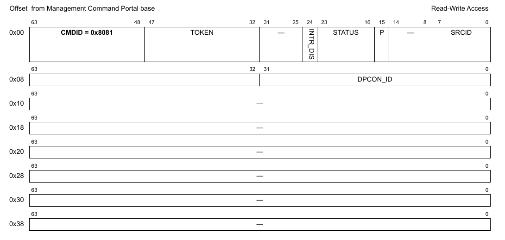

**Figure 255. Mô tả command DPCON_OPEN**

Bảng sau mô tả các field của command.

**Table 26. Mô tả các field của command DPCON_OPEN1**

| Offset | Bits | Tên | Mô tả |
|---|---|---|---|
| 0x00 | 0-63 | Header của command | Xem Table 2 để biết mô tả chung các field của command portal. CMDID phải được đặt như chỉ ra trong hình ở trên. |
| 0x08 | 0-31 | DPCON_ID | ID duy nhất của DPCON |

1 Mọi field không được nêu là reserved và phải được xóa (đặt bằng 0)

### 11.2.2 DPCON_CLOSE

Đóng phiên điều khiển của object.

Sau khi gọi hàm này, không thao tác nào khác được phép trên object nếu không mở một phiên điều khiển mới.

**Cấu trúc command**

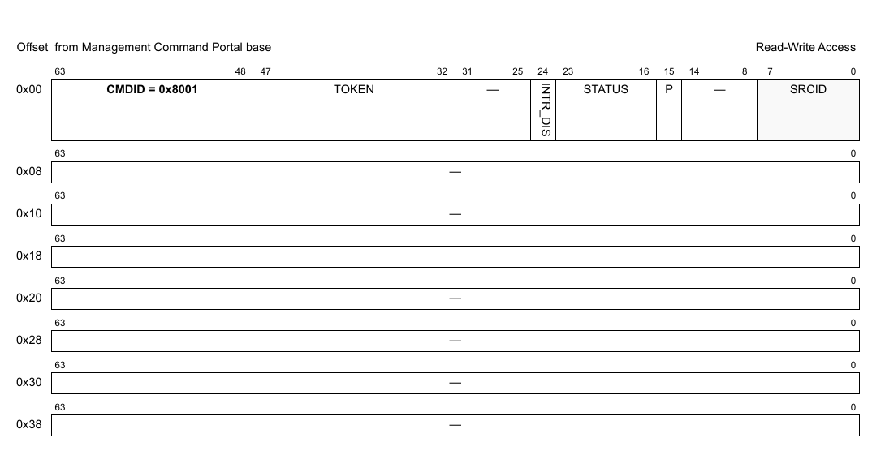

**Figure 256. Mô tả command DPCON_CLOSE**

| Offset | Bits | Tên | Mô tả |
|---|---|---|---|
| 0x00 | 0-63 | Header của command | Xem Table 2 để biết mô tả chung các field của command portal. CMDID phải được đặt như chỉ ra trong hình ở trên. |
| 0x08 - 0x38 |   | Reserved |   |

Mọi field không được nêu là reserved và phải được xóa (đặt bằng 0)

### 11.2.3 DPCON_CREATE

Command này tạo và khởi tạo một instance DPCON theo các tham số command được chỉ định. Command này không cần cho các instance DPCON được tạo bằng DPL.

Với command CREATE, bên gọi phải cung cấp authentication token của container cha mà object sẽ được tạo và gán vào. Nếu token là '0', object sẽ được gán cho container đang sở hữu MC command portal thực thi command này.

Command trả về một DPCON ID có thể dùng để OPEN hoặc DESTROY object.

Định dạng command được thể hiện trong hình dưới đây.

**Cấu trúc command**

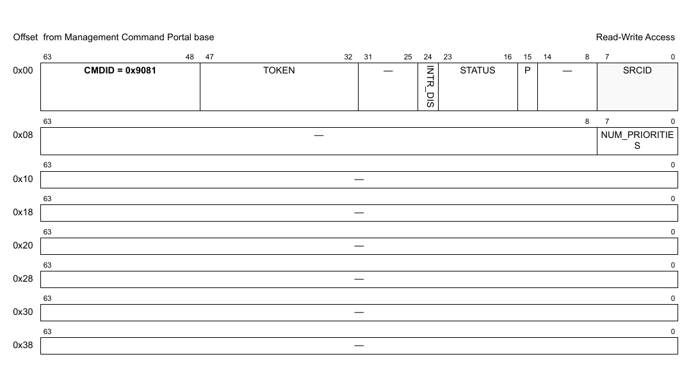

**Figure 257. Mô tả command DPCON_CREATE**

Bảng sau mô tả các field của command.

**Table 27. Mô tả các field của command DPCON_CREATE1**

| Offset | Bits | Tên | Mô tả |
|---|---|---|---|
| 0x00 | 0-63 | Header của command | Xem Table 2 để biết mô tả chung các field của command portal. CMDID phải được đặt như chỉ ra trong hình ở trên. |
| 0x08 | 0-7 | NUM_PRIORITIES | Số priority cho channel DPCON (1-8). Giá trị mặc định là 2. |

1 Mọi field không được nêu là reserved và phải được xóa (đặt bằng 0)

**Cấu trúc response**

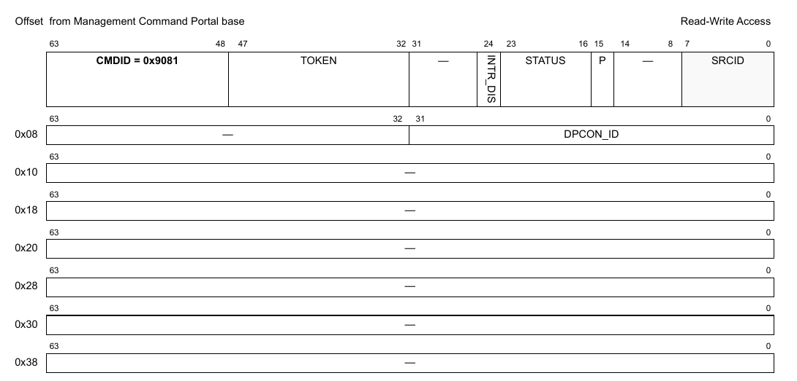

**Figure 11-1. Mô tả response của DPCON_CREATE**

Bảng sau mô tả các field của response.

**Table 11-1. Mô tả các field response của DPCON_CREATE1**

| Offset | Bits | Tên | Mô tả |
|---|---|---|---|
| 0x00 | 0-63 | Header của command | Xem Table 2 để biết mô tả chung các field của command portal. CMDID phải được đặt như chỉ ra trong hình ở trên. |
| 0x08 | 0-31 | DPCON_ID | ID duy nhất của DPCON |

1 Mọi field không được nêu là reserved.

### 11.2.4 DPCON_DESTROY

Command này hủy DPCON object và giải phóng mọi tài nguyên của nó. Nó phải được gọi trong software context đã tạo object. Bên gọi phải cung cấp object id và authentication token của container cha đã tạo object. Lưu ý rằng object có thể đã được gán cho container khác, và gửi authentication token của container đó sẽ trả về lỗi.

Mọi authentication token đang mở tới object phải được đóng trước khi gọi command destroy.

Sau khi gọi hàm này, không thao tác nào khác được phép trên object.

**Cấu trúc command**

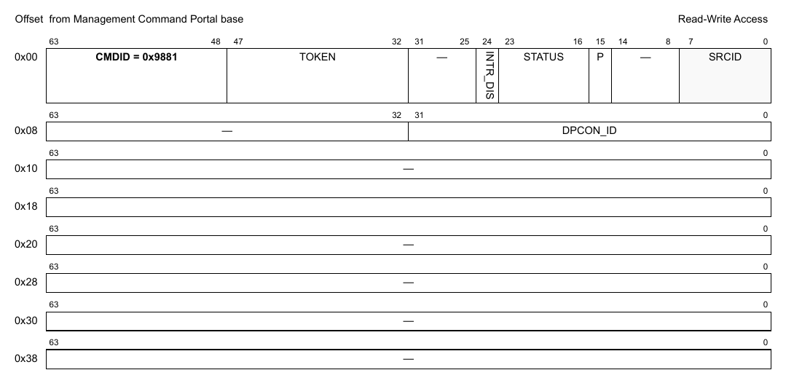

**Figure 258. Mô tả command DPCON_DESTROY**

| Offset | Bits | Tên | Mô tả |
|---|---|---|---|
| 0x00 | 0-63 | Header của command | Xem Table 2 để biết mô tả chung các field của command portal. CMDID phải được đặt như chỉ ra trong hình ở trên. |
| 0x08 | 0–32 | DPCON_ID | ID của DPCON object cần hủy |

Mọi field không được nêu là reserved và phải được xóa (đặt bằng 0)

### 11.2.5 DPCON_ENABLE

**Cấu trúc command**

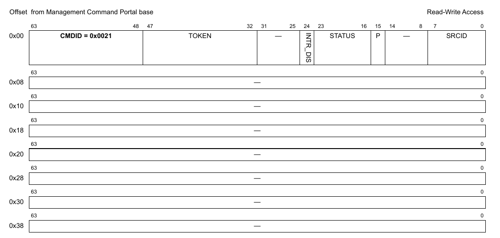

**Figure 259. Mô tả command DPCON_ENABLE**

| Offset | Bits | Tên | Mô tả |
|---|---|---|---|
| 0x00 | 0-63 | Header của command | Xem Table 2 để biết mô tả chung các field của command portal. CMDID phải được đặt như chỉ ra trong hình ở trên. |

Mọi field không được nêu là reserved và phải được xóa (đặt bằng 0)

### 11.2.6 DPCON_DISABLE

**Cấu trúc command**

**Figure 260. Mô tả command DPCON_DISABLE**

| Offset | Bits | Tên | Mô tả |
|---|---|---|---|
| 0x00 | 0-63 | Header của command | Xem Table 2 để biết mô tả chung các field của command portal. CMDID phải được đặt như chỉ ra trong hình ở trên. |

Mọi field không được nêu là reserved và phải được xóa (đặt bằng 0)

### 11.2.7 DPCON_IS_ENABLED

**Cấu trúc command**

**Figure 261. Mô tả command DPCON_IS_ENABLED**

| Offset | Bits | Tên | Mô tả |
|---|---|---|---|
| 0x00 | 0-63 | Header của command | Xem Table 2 để biết mô tả chung các field của command portal. CMDID phải được đặt như chỉ ra trong hình ở trên. |

Mọi field không được nêu là reserved và phải được xóa (đặt bằng 0)

**Cấu trúc response**

**Figure 262. Mô tả response của DPCON_IS_ENABLED**

| Offset | Bits | Tên | Mô tả |
|---|---|---|---|
| 0x00 | 0-63 | Header của command | Xem Table 2 để biết mô tả chung các field của command portal. CMDID phải được đặt như chỉ ra trong hình ở trên. |
| 0x08 | 0 | EN | Trả về '1' nếu object đang enable; '0' nếu không |

Mọi field không được nêu là reserved và phải được xóa (đặt bằng 0)

### 11.2.8 DPCON_RESET

**Cấu trúc command**

**Figure 263. Mô tả command DPCON_RESET**

| Offset | Bits | Tên | Mô tả |
|---|---|---|---|
| 0x00 | 0-63 | Header của command | Xem Table 2 để biết mô tả chung các field của command portal. CMDID phải được đặt như chỉ ra trong hình ở trên. |

Mọi field không được nêu là reserved và phải được xóa (đặt bằng 0)

### 11.2.9 DPCON_SET_IRQ_ENABLE

Đặt trạng thái tổng thể của interrupt. Cho phép phần mềm GPP điều khiển khi nào interrupt được sinh ra. Mỗi interrupt có thể có tối đa 32 nguyên nhân. Điều khiển enable/disable quyết định trạng thái tổng thể của interrupt. Nếu interrupt bị disable thì không nguyên nhân nào sinh ra interrupt.

**Cấu trúc command**

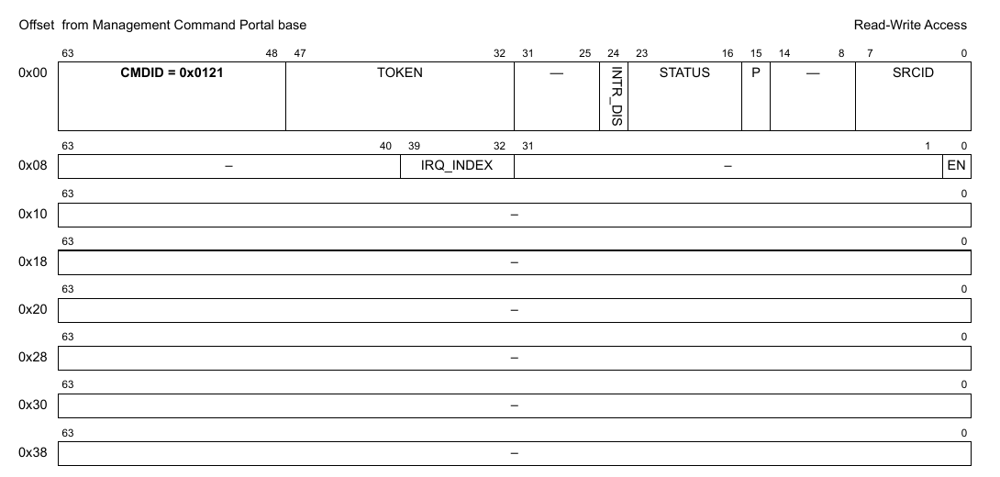

**Figure 264. Mô tả command DPCON_SET_IRQ_ENABLE**

| Offset | Bits | Tên | Mô tả |
|---|---|---|---|
| 0x00 | 0-63 | Header của command | Xem Table 2 để biết mô tả chung các field của command portal. CMDID phải được đặt như chỉ ra trong hình ở trên. |
| 0x08 | 0 | EN | Trạng thái interrupt: đặt ‘1’ để enable, ‘0’ để disable |
|   | 32-39 | IRQ_INDEX | Xác định interrupt index cần cấu hình |

Mọi field không được nêu là reserved và phải được xóa (đặt bằng 0)

### 11.2.10 DPCON_GET_IRQ_ENABLE

Lấy trạng thái tổng thể của interrupt.

**Cấu trúc command**

**Figure 265. Mô tả command DPCON_GET_IRQ_ENABLE**

| Offset | Bits | Tên | Mô tả |
|---|---|---|---|
| 0x00 | 0-63 | Header của command | Xem Table 2 để biết mô tả chung các field của command portal. CMDID phải được đặt như chỉ ra trong hình ở trên. |
| 0x08 | 32-39 | IRQ_INDEX | Xác định interrupt index cần truy vấn |

Mọi field không được nêu là reserved và phải được xóa (đặt bằng 0)

**Cấu trúc response**

**Figure 266. Mô tả response của DPCON_GET_IRQ_ENABLE**

| Offset | Bits | Tên | Mô tả |
|---|---|---|---|
| 0x00 | 0-63 | Header của command | Xem Table 2 để biết mô tả chung các field của command portal. CMDID phải được đặt như chỉ ra trong hình ở trên. |
| 0x08 | 0 | EN | Bit này được đặt nếu interrupt đang enable |

Mọi field không được nêu là reserved và phải được xóa (đặt bằng 0)

### 11.2.11 DPCON_SET_IRQ_MASK

Đặt interrupt mask. Mỗi interrupt có thể có tối đa 32 nguyên nhân, và mô hình interrupt hỗ trợ mask/unmask từng nguyên nhân độc lập.

**Cấu trúc command**

**Figure 267. Mô tả command DPCON_SET_IRQ_MASK**

| Offset | Bits | Tên | Mô tả |
|---|---|---|---|
| 0x00 | 0-63 | Header của command | Xem Table 2 để biết mô tả chung các field của command portal. CMDID phải được đặt như chỉ ra trong hình ở trên. |
| 0x08 | 0-31 | MASK | Event mask để kích hoạt interrupt; xem command GET_IRQ_STATUS để biết đặc tả các event hiện có. Với mỗi bit trong MASK: 0 = bỏ qua event 1 = event hợp lệ; báo IRQ nếu event này xảy ra |
|   | 32-39 | IRQ_INDEX | Interrupt index cần cấu hình |

Mọi field không được nêu là reserved và phải được xóa (đặt bằng 0)

### 11.2.12 DPCON_GET_IRQ_MASK

Lấy interrupt mask. Mỗi interrupt có thể có tối đa 32 nguyên nhân, và mô hình interrupt hỗ trợ mask/unmask từng nguyên nhân độc lập.

**Cấu trúc command**

**Figure 268. Mô tả command DPCON_GET_IRQ_MASK**

| Offset | Bits | Tên | Mô tả |
|---|---|---|---|
| 0x00 | 0-63 | Header của command | Xem Table 2 để biết mô tả chung các field của command portal. CMDID phải được đặt như chỉ ra trong hình ở trên. |
| 0x08 | 32-39 | IRQ_INDEX | Interrupt index cần truy vấn |

Mọi field không được nêu là reserved và phải được xóa (đặt bằng 0)

**Cấu trúc response**

**Figure 269. Mô tả response của DPCON_GET_IRQ_MASK**

| Offset | Bits | Tên | Mô tả |
|---|---|---|---|
| 0x00 | 0-63 | Header của command | Xem Table 2 để biết mô tả chung các field của command portal. CMDID phải được đặt như chỉ ra trong hình ở trên. |
| 0x08 | 0-31 | MASK | Event mask để kích hoạt interrupt; xem command GET_IRQ_STATUS để biết đặc tả các event hiện có. Với mỗi bit trong MASK: 0 = bỏ qua event 1 = event hợp lệ; báo IRQ nếu event này xảy ra |

Mọi field không được nêu là reserved và phải được xóa (đặt bằng 0)

### 11.2.13 DPCON_GET_IRQ_STATUS

Lấy trạng thái hiện tại của các event đang chờ cho interrupt index được chỉ định.

**Cấu trúc command**

**Figure 270. Mô tả command DPCON_GET_IRQ_STATUS**

| Offset | Bits | Tên | Mô tả |
|---|---|---|---|
| 0x00 | 0-63 | Header của command | Xem Table 2 để biết mô tả chung các field của command portal. CMDID phải được đặt như chỉ ra trong hình ở trên. |
| 0x08 | 0-31 | STATUS | Tùy chọn: mọi bit STATUS được đặt sẽ được xóa khỏi trạng thái đang chờ (không cần dùng command DPCON_CLEAR_IRQ_STATUS nữa). Lưu ý rằng STATUS trả về trong response là trạng thái trước khi các event bị xóa.  Các event được hỗ trợ: xem định nghĩa cấu trúc response |
|   | 32-39 | IRQ_INDEX | Interrupt index cần truy vấn |

Mọi field không được nêu là reserved và phải được xóa (đặt bằng 0)

**Cấu trúc response**

**Figure 271. Mô tả response của DPCON_GET_IRQ_STATUS**

| Offset | Bits | Tên | Mô tả |
|---|---|---|---|
| 0x00 | 0-63 | Header của command | Xem Table 2 để biết mô tả chung các field của command portal. CMDID phải được đặt như chỉ ra trong hình ở trên. |
| 0x08 | 0-31 | STATUS | Mask trạng thái event, mỗi event một bit: 0 = không có interrupt đang chờ 1 = có interrupt đang chờ  Các event được hỗ trợ: Không có |

Mọi field không được nêu là reserved và phải được xóa (đặt bằng 0)

### 11.2.14 DPCON_CLEAR_IRQ_STATUS

Xóa (đánh dấu đã xử lý) các event đang chờ của interrupt index được chỉ định.

**Cấu trúc command**

**Figure 272. Mô tả command DPCON_CLEAR_IRQ_STATUS**

| Offset | Bits | Tên | Mô tả |
|---|---|---|---|
| 0x00 | 0-63 | Header của command | Xem Table 2 để biết mô tả chung các field của command portal. CMDID phải được đặt như chỉ ra trong hình ở trên. |
| 0x08 | 0-31 | STATUS | Mask để xóa các event đã xử lý; xem command GET_IRQ_STATUS để biết đặc tả các event hiện có. Với mỗi bit trong MASK: 0 = không đổi trạng thái event 1 = xóa bit trạng thái event để cho biết event đã được xử lý |
|   | 32-39 | IRQ_INDEX | Interrupt index cần cấu hình |

Mọi field không được nêu là reserved và phải được xóa (đặt bằng 0)

### 11.2.15 DPCON_GET_ATTRIBUTES

**Cấu trúc command**

**Figure 273. Mô tả command DPCON_GET_ATTRIBUTES**

| Offset | Bits | Tên | Mô tả |
|---|---|---|---|
| 0x00 | 0-63 | Header của command | Xem Table 2 để biết mô tả chung các field của command portal. CMDID phải được đặt như chỉ ra trong hình ở trên. |

Mọi field không được nêu là reserved và phải được xóa (đặt bằng 0)

**Cấu trúc response**

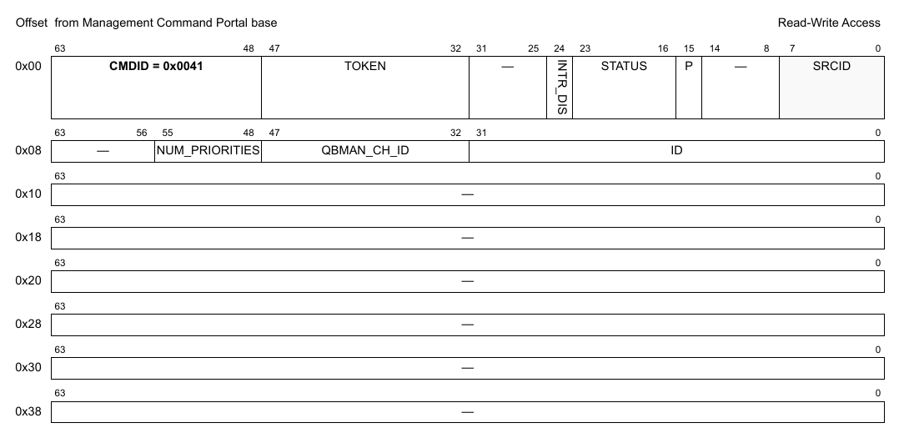

**Figure 274. Mô tả response của DPCON_GET_ATTRIBUTES**

| Offset | Bits | Tên | Mô tả |
|---|---|---|---|
| 0x00 | 0-63 | Header của command | Xem Table 2 để biết mô tả chung các field của command portal. CMDID phải được đặt như chỉ ra trong hình ở trên. |
| 0x08 | 0-31 | ID | DPCON object ID |
|   | 32-47 | QBMAN_CH_ID | Channel ID dùng cho thao tác dequeue |
|   | 48-55 | NUM_PRIORITIES | Số priority cho channel DPCON (1-8) |

Mọi field không được nêu là reserved và phải được xóa (đặt bằng 0)

### 11.2.16 DPCON_SET_NOTIFICATION

**Cấu trúc command**

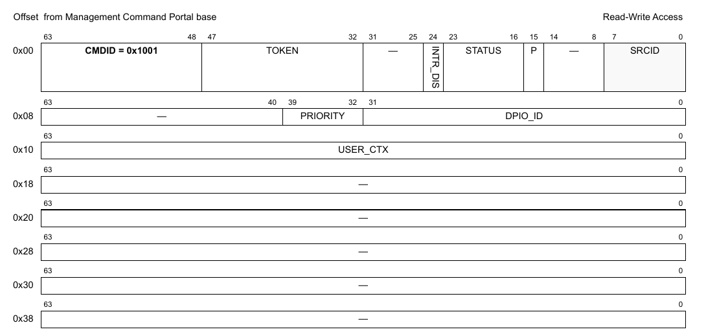

**Figure 275. Mô tả command DPCON_SET_NOTIFICATION**

| Offset | Bits | Tên | Mô tả |
|---|---|---|---|
| 0x00 | 0-63 | Header của command | Xem Table 2 để biết mô tả chung các field của command portal. CMDID phải được đặt như chỉ ra trong hình ở trên. |
| 0x08 | 0-31 | DPIO_ID | DPIO object ID; phải được cấu hình với một notification channel |
|   | 32-39 | PRIORITY | Lựa chọn priority trong channel DPIO; giá trị hợp lệ là 0-7, tùy số priority trong channel đó |
| 0x10 | 0-63 | USER_CTX | Giá trị user context được cung cấp kèm mỗi message CDAN |

Mọi field không được nêu là reserved và phải được xóa (đặt bằng 0)

### 11.2.17 DPCON_GET_API_VERSION

**Cấu trúc command**

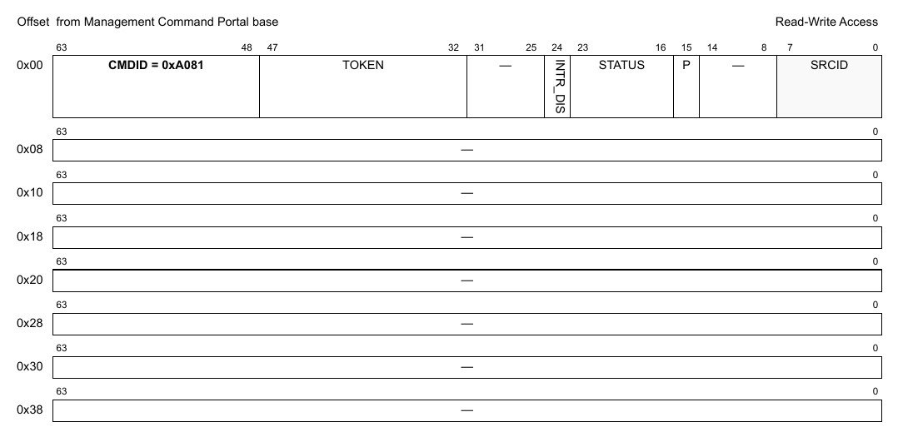

**Figure 276. Mô tả command DPCON_GET_API_VERSION**

| Offset | Bits | Tên | Mô tả |
|---|---|---|---|
| 0x00 | 0-63 | Header của command | Xem Table 2 để biết mô tả chung các field của command portal. CMDID phải được đặt như chỉ ra trong hình ở trên. |

Mọi field không được nêu là reserved và phải được xóa (đặt bằng 0)

**Cấu trúc response**

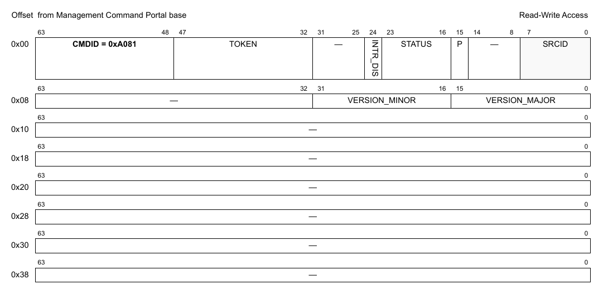

**Figure 277. Mô tả response của DPCON_GET_API_VERSION**

| Offset | Bits | Tên | Mô tả |
|---|---|---|---|
| 0x00 | 0-63 | Header của command | Xem Table 2 để biết mô tả chung các field của command portal. CMDID phải được đặt như chỉ ra trong hình ở trên. |
| 0x08 | 0-15 | VERSION_MAJOR | Major version của API |
|   | 16-31 | VERSION_MINOR | Minor version của API |
