# Chương 12 DPCI: Data Path Communication Interface

MC xuất ra một giao diện chung cho giao tiếp giữa các partition (IPC). DPCI cho phép giao tiếp dựa trên frame giữa các software context khác nhau, dùng hạ tầng QBMan của DPAA2. Giao thức giao tiếp hoàn toàn tự do, khác với DPNI là một giao diện mạng chuẩn. Các DPCI object có thể được nối theo cặp (mỗi software context một DPCI) để tạo thành một liên kết giao tiếp. Kiểu giao tiếp này có thể phục vụ các nhu cầu quản lý/điều khiển cơ bản giữa phần mềm GPP và phần mềm AIOP, hoặc giữa hai software context riêng biệt trên GPP.

DPCI object có thể liên kết với DPCON object, nhưng chỉ khi cả hai nằm trong container AIOP. Lý do là DPCON object trong container AIOP chỉ được Advanced I/O processor dùng, và cho phép triển khai QoS trên receive queue của DPCI object - điều này kéo theo DPCI object cũng phải thuộc container AIOP.

Mặc định, Rx queue bắt đầu với một priority mặc định, có thể bị ghi đè bằng command DPCI_SET_Rx_QUEUE *(ghi chú: đúng là DPCI_SET_RX_QUEUE)*. Sau DPCI_RESET, các giá trị priority của Rx queue được đặt lại về mặc định.

Xem API book để có tham chiếu đầy đủ về các hàm hiện có.

## 12.1 Các tính năng của DPCI

Danh sách sau tóm tắt các tính năng và khả năng chính của DPCI:

- Hỗ trợ tối đa hai priority lập lịch cho frame gửi đi.
- Hỗ trợ tối đa hai priority lập lịch cho frame nhận vào.
- Cho phép tương tác với một hoặc nhiều Data Path I/O (DPIO) object để dequeue/enqueue frame descriptor (FD) và để acquire/release buffer.
- Hỗ trợ các tùy chọn lập lịch khác nhau để xử lý packet nhận được:
  - Queue có thể được cấu hình ở chế độ ‘parked’ (mặc định), hoặc gắn với một DPIO object, hoặc gắn với DPCON object
- Hỗ trợ báo link state – liên kết giao tiếp chỉ active khi cả hai DPCI object đã được khởi tạo và enable.
- Hỗ trợ các thao tác enable, disable và reset
- Hỗ trợ QoS – chỉ khi cả DPCI và DPCON đều nằm trong ngữ cảnh AIOP.

## 12.2 Mô tả chức năng của DPCI

### 12.2.1 Nối các DPCI object

Kênh giao tiếp gồm hai DPCI object, mỗi object ở một software context khác nhau. Mỗi DPCI object có tối đa hai receive queue, tương ứng với số priority được yêu cầu khi tạo object. Hai object cần được nối bằng khai báo trong DPL hoặc qua thao tác DPRC CONNECT. Kết nối (link) chỉ ở trạng thái active (‘link up’) sau khi cả hai DPCI object được enable. Khi link đã up, mỗi software context có thể truy vấn thuộc tính DPCI để tìm các queue ID cần dùng cho thao tác enqueue và dequeue.

### 12.2.2 Quan hệ với DPIO và DPCON object

Mỗi receive queue trong hai receive queue của DPCI có thể gắn với một DPIO object hoặc một DPCON object. Việc này phục vụ mục đích notification và/hoặc lập lịch nâng cao cho frame nhận được.

DPIO object cung cấp cấu hình cho một QBMan software portal, có tùy chọn thông báo có dữ liệu. Phần mềm GPP có thể tùy ý gắn DPIO object với thread, hoặc dùng chung giữa các core ở chế độ SMP, nhưng khi đó cần đồng bộ hóa việc truy cập QBMan software portal. Có thể gắn nhiều DPIO object với cùng một DPCI, để phân tán traffic từ DPCI này qua nhiều QBMan software portal.

Phần mềm GPP có thể quyết định bật notification của DPIO, hoặc dequeue frame theo logic polling tự lập lịch. Cũng có thể để một thực thể GPP nhận notification từ một DPIO rồi báo cho một thực thể khác dequeue packet bằng một DPIO khác.

DPCON object được dùng để gom traffic từ nhiều interface vào các sub-interface, chủ yếu cho mục đích lập lịch. Có thể nối DPCON với DPIO để nó sinh notification tới GPP

DPCI object có thể liên kết với các DPCON object ở chế độ AIOP (DPCON dùng một DCP AIOP channel thay cho SWP Channel.

Lưu ý rằng QBMan software portal được dùng cho cả thao tác enqueue/dequeue packet lẫn thao tác acquire/release buffer. Phần mềm GPP chịu trách nhiệm về chế độ hoạt động và cách dùng portal, tức là dùng chung hay gắn riêng, gắn queue context, v.v.

DPIO object có thể phục vụ nhiều interface. Không chỉ nhiều DPCI object; nó cũng có thể mở rộng sang giao diện mạng và accelerator interface. Ví dụ, cùng một DPIO có thể phục vụ cả một DPNI lẫn một DPCI, với điều kiện chúng được gán cho cùng software context (container).

### 12.2.3 Yêu cầu về buffer

DPCI không cần gắn với DPBP object; ngoài ra, buffer cho các message giao tiếp (frame) có thể được hoặc không được quản lý bằng buffer pool. Tuy nhiên, các buffer này phải được hai software context đang giao tiếp dùng chung, vì kênh giao tiếp không chép frame.

## 12.3 Tham chiếu command của DPCI

Mục này trình bày chi tiết mô hình lập trình các command của DPCI.

### 12.3.1 DPCI_OPEN

Mở một phiên điều khiển cho object được chỉ định.

Hàm này có thể dùng để mở phiên điều khiển cho một object đã được tạo; object có thể đã được khai báo trong DPL hoặc được tạo bằng command DPCI_CREATE.

Hàm này trả về một authentication token duy nhất, gắn với object ID cụ thể; token này phải được dùng trong mọi command tiếp theo cho object này.

**Cấu trúc command**

Định dạng command được thể hiện trong hình dưới đây.

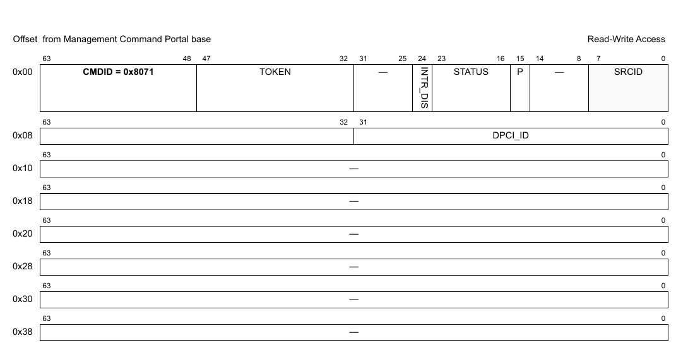

**Figure 278. Mô tả command DPCI_OPEN**

**Table 28. Mô tả các field của command DPCI_OPEN1**

| Offset | Bits | Tên | Mô tả |
|---|---|---|---|
| 0x00 | 0-63 | Header của command | Xem Table 2 để biết mô tả chung các field của command portal. CMDID phải được đặt như chỉ ra trong hình ở trên. |
| 0x08 | 0-31 | DPCI_ID | ID duy nhất của DPCI |

1 Mọi field không được nêu là reserved và phải được xóa (đặt bằng 0)

### 12.3.2 DPCI_CLOSE

Đóng phiên điều khiển của object.

Sau khi gọi hàm này, không thao tác nào khác được phép trên object nếu không mở một phiên điều khiển mới.

**Cấu trúc command**

**Figure 279. Mô tả command DPCI_CLOSE**

**Table 29. Mô tả các field của command DPCI_CLOSE1**

| Offset | Bits | Tên | Mô tả |
|---|---|---|---|
| 0x00 | 0-63 | Header của command | Xem Table 2 để biết mô tả chung các field của command portal. CMDID phải được đặt như chỉ ra trong hình ở trên. |

1 Mọi field không được nêu là reserved và phải được xóa (đặt bằng 0)

### 12.3.3 DPCI_CREATE

Command này tạo và khởi tạo một instance DPCI theo các tham số command được chỉ định. Command này không cần cho các instance DPCI được tạo bằng DPL.

Với command CREATE, bên gọi phải cung cấp authentication token của container cha mà object sẽ được tạo và gán vào. Nếu token là '0', object sẽ được gán cho container đang sở hữu MC command portal thực thi command này.

Command trả về một DPCI ID có thể dùng để OPEN hoặc DESTROY object.

**Cấu trúc command**

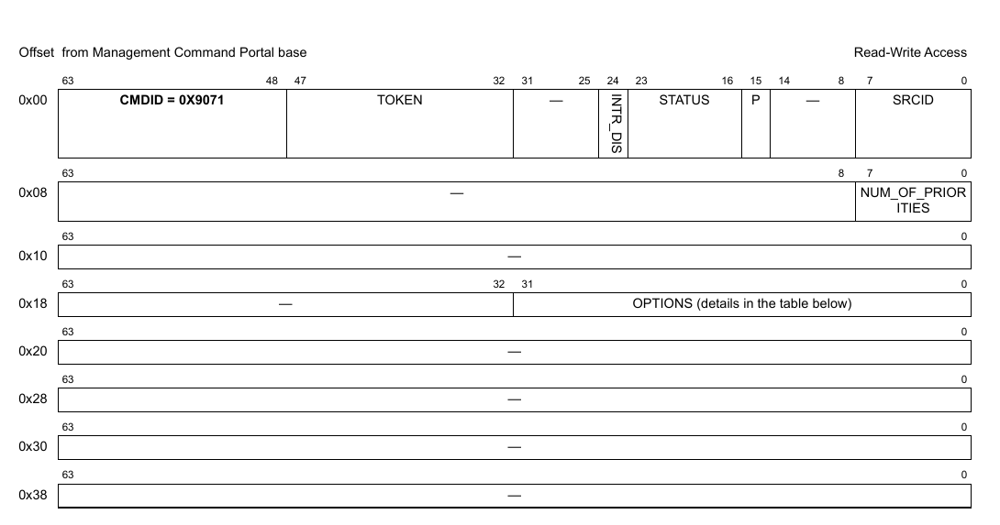

**Figure 280. Mô tả command DPCI_CREATE**

**Table 30. Mô tả các field của command DPCI_CREATE1**

| Offset | Bits | Tên | Mô tả |
|---|---|---|---|
| 0x00 | 0–63 | Header của command | Xem Table 2 để biết mô tả chung các field của command portal. CMDID phải được đặt như chỉ ra trong hình ở trên. |
| 0x08 | 0–7 | NUM_OF_PRIORITIES | Số receive priority (queue) cho DPCI; lưu ý rằng số transmit priority (queue) được quyết định bởi số receive priority của DPCI object ở đầu kia. Cần một giá trị lớn hơn 0. Số priority tối đa là 4. |
| 0x18 | 0–31 | OPTIONS – chọn một hoặc nhiều option dưới đây. Chỉ hợp lệ khi tạo bằng DPL. |   |
|   | 6 | DPCI_OPT_HAS_OPR | Điều khiển việc có Order Restoration hay không: 0 – Không có Order Restoration. Command DPCI_SET_OPR sẽ trả về lỗi. 1 – Có Order Restoration trên DPCI này. Lưu ý rằng option này không có trên LS2080A |
|   | 7 | DPCI_OPT_OPR_SHARED | 0 – Có thể đặt Order Restoration Point cho từng index hoặc priority. 1 – Các Order Restoration Point được dùng chung cho toàn bộ DPCI. |

1 Mọi field không được nêu là reserved và phải được xóa (đặt bằng 0).

**Cấu trúc response**

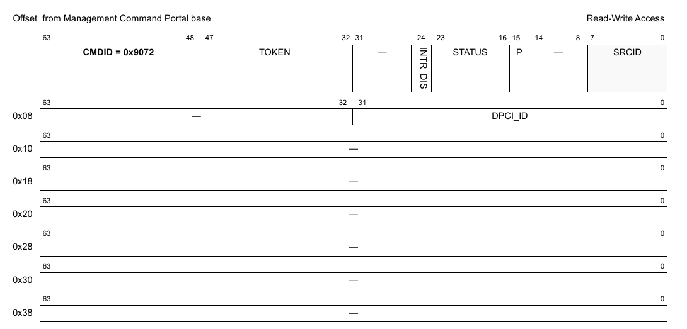

**Figure 281. Mô tả response của DPCI_CREATE**

**Table 12-1. Mô tả các field response của DPCI_CREATE1**

| Offset | Bits | Tên | Mô tả |
|---|---|---|---|
| 0x00 | 0-63 | Header của command | Xem Table 2 để biết mô tả chung các field của command portal. CMDID phải được đặt như chỉ ra trong hình ở trên. |
| 0x08 | 0-31 | DPCI_ID | ID duy nhất của DPCI |

1 Mọi field không được nêu là reserved.

### 12.3.4 DPCI_DESTROY

Command này hủy DPCI object và giải phóng mọi tài nguyên của nó. Nó phải được gọi trong software context đã tạo object. Bên gọi phải cung cấp object id và authentication token của container cha đã tạo object. Lưu ý rằng object có thể đã được gán cho container khác, và gửi authentication token của container đó sẽ trả về lỗi.

Mọi authentication token đang mở tới object phải được đóng trước khi gọi command destroy.

Sau khi gọi hàm này, không thao tác nào khác được phép trên object.

**Cấu trúc command**

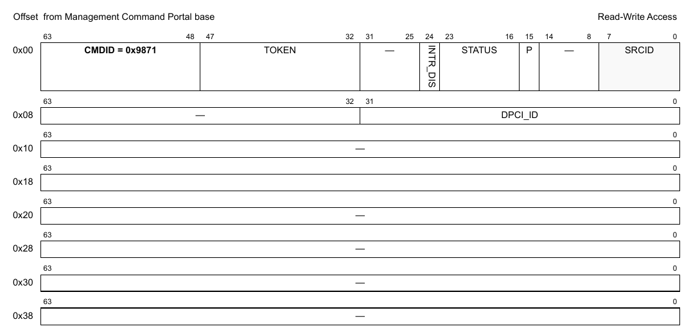

**Figure 282. Mô tả command DPCI_DESTROY**

**Table 31. Mô tả các field của command DPCI_DESTROY1**

| Offset | Bits | Tên | Mô tả |
|---|---|---|---|
| 0x00 | 0-63 | Header của command | Xem Table 2 để biết mô tả chung các field của command portal. CMDID phải được đặt như chỉ ra trong hình ở trên. |
| 0x08 | 0–32 | DPCI_ID | ID của DPCI object cần hủy |

1 Mọi field không được nêu là reserved và phải được xóa (đặt bằng 0)

### 12.3.5 DPCI_ENABLE

**Cấu trúc command**

**Figure 283. Mô tả command DPCI_ENABLE**

**Table 32. Mô tả các field của command DPCI_ENABLE1**

| Offset | Bits | Tên | Mô tả |
|---|---|---|---|
| 0x00 | 0-63 | Header của command | Xem Table 2 để biết mô tả chung các field của command portal. CMDID phải được đặt như chỉ ra trong hình ở trên. |

1 Mọi field không được nêu là reserved và phải được xóa (đặt bằng 0)

### 12.3.6 DPCI_DISABLE

**Cấu trúc command**

**Figure 284. Mô tả command DPCI_DISABLE**

**Table 33. Mô tả các field của command DPCI_DISABLE1**

| Offset | Bits | Tên | Mô tả |
|---|---|---|---|
| 0x00 | 0-63 | Header của command | Xem Table 2 để biết mô tả chung các field của command portal. CMDID phải được đặt như chỉ ra trong hình ở trên. |

1 Mọi field không được nêu là reserved và phải được xóa (đặt bằng 0)

### 12.3.7 DPCI_IS_ENABLED

**Cấu trúc command**

**Figure 285. Mô tả command DPCI_IS_ENABLED**

**Table 34. Mô tả các field của command DPCI_IS_ENABLED1**

| Offset | Bits | Tên | Mô tả |
|---|---|---|---|
| 0x00 | 0-63 | Header của command | Xem Table 2 để biết mô tả chung các field của command portal. CMDID phải được đặt như chỉ ra trong hình ở trên. |

1 Mọi field không được nêu là reserved và phải được xóa (đặt bằng 0)

**Cấu trúc response**

**Figure 286. Mô tả response của DPCI_IS_ENABLED**

**Table 35. Mô tả các field response của DPCI_IS_ENABLED1**

| Offset | Bits | Tên | Mô tả |
|---|---|---|---|
| 0x00 | 0-63 | Header của command | Xem Table 2 để biết mô tả chung các field của command portal. CMDID phải được đặt như chỉ ra trong hình ở trên. |
| 0x08 | 0 | EN | Trả về '1' nếu object đang enable; '0' nếu không |

1 Mọi field không được nêu là reserved và phải được xóa (đặt bằng 0)

### 12.3.8 DPCI_RESET

**Cấu trúc command**

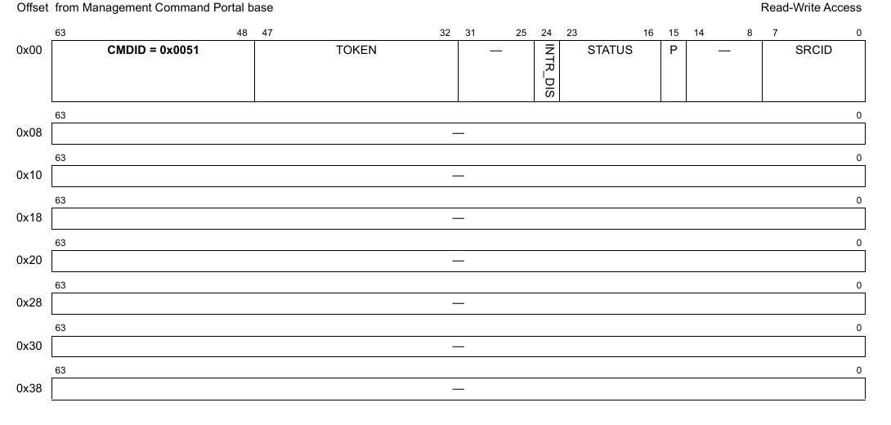

**Figure 287. Mô tả command DPCI_RESET**

**Table 36. Mô tả các field của command DPCI_RESET1**

| Offset | Bits | Tên | Mô tả |
|---|---|---|---|
| 0x00 | 0-63 | Header của command | Xem Table 2 để biết mô tả chung các field của command portal. CMDID phải được đặt như chỉ ra trong hình ở trên. |

1 Mọi field không được nêu là reserved và phải được xóa (đặt bằng 0)

### 12.3.9 DPCI_SET_IRQ_ENABLE

Đặt trạng thái tổng thể của interrupt. Cho phép phần mềm GPP điều khiển khi nào interrupt được sinh ra. Mỗi interrupt có thể có tối đa 32 nguyên nhân. Điều khiển enable/disable quyết định trạng thái tổng thể của interrupt. Nếu interrupt bị disable thì không nguyên nhân nào sinh ra interrupt.

**Cấu trúc command**

**Figure 288. Mô tả command DPCI_SET_IRQ_ENABLE**

**Table 37. Mô tả các field của command DPCI_SET_IRQ_ENABLE1**

| Offset | Bits | Tên | Mô tả |
|---|---|---|---|
| 0x00 | 0-63 | Header của command | Xem Table 2 để biết mô tả chung các field của command portal. CMDID phải được đặt như chỉ ra trong hình ở trên. |
| 0x08 | 0 | EN | Trạng thái interrupt: đặt ‘1’ để enable, ‘0’ để disable |
|   | 32-39 | IRQ_INDEX | Xác định interrupt index cần cấu hình |

1 Mọi field không được nêu là reserved và phải được xóa (đặt bằng 0)

### 12.3.10 DPCI_GET_IRQ_ENABLE

Lấy trạng thái tổng thể của interrupt.

**Cấu trúc command**

**Figure 289. Mô tả command DPCI_GET_IRQ_ENABLE**

**Table 38. Mô tả các field của command DPCI_GET_IRQ_ENABLE1**

| Offset | Bits | Tên | Mô tả |
|---|---|---|---|
| 0x00 | 0-63 | Header của command | Xem Table 2 để biết mô tả chung các field của command portal. CMDID phải được đặt như chỉ ra trong hình ở trên. |
| 0x08 | 32-39 | IRQ_INDEX | Xác định interrupt index cần truy vấn |

1 Mọi field không được nêu là reserved và phải được xóa (đặt bằng 0)

**Cấu trúc response**

**Figure 290. Mô tả response của DPCI_GET_IRQ_ENABLE**

**Table 39. Mô tả các field response của DPCI_GET_IRQ_ENABLE1**

| Offset | Bits | Tên | Mô tả |
|---|---|---|---|
| 0x00 | 0-63 | Header của command | Xem Table 2 để biết mô tả chung các field của command portal. CMDID phải được đặt như chỉ ra trong hình ở trên. |
| 0x08 | 0 | EN | Bit này được đặt nếu interrupt đang enable |

1 Mọi field không được nêu là reserved và phải được xóa (đặt bằng 0).

### 12.3.11 DPCI_SET_IRQ_MASK

Đặt interrupt mask. Mỗi interrupt có thể có tối đa 32 nguyên nhân, và mô hình interrupt hỗ trợ mask/unmask từng nguyên nhân độc lập.

**Cấu trúc command**

**Figure 291. Mô tả command DPCI_SET_IRQ_MASK**

**Table 40. Mô tả các field của command DPCI_SET_IRQ_MASK1**

| Offset | Bits | Tên | Mô tả |
|---|---|---|---|
| 0x00 | 0-63 | Header của command | Xem Table 2 để biết mô tả chung các field của command portal. CMDID phải được đặt như chỉ ra trong hình ở trên. |
| 0x08 | 0-31 | MASK | Event mask để kích hoạt interrupt; xem command GET_IRQ_STATUS để biết đặc tả các event hiện có. Với mỗi bit trong MASK: 0 = bỏ qua event 1 = event hợp lệ; báo IRQ nếu event này xảy ra |
|   | 32-39 | IRQ_INDEX | Interrupt index cần cấu hình |

1 Mọi field không được nêu là reserved và phải được xóa (đặt bằng 0).

### 12.3.12 DPCI_GET_IRQ_MASK

Lấy interrupt mask. Mỗi interrupt có thể có tối đa 32 nguyên nhân, và mô hình interrupt hỗ trợ mask/unmask từng nguyên nhân độc lập.

**Cấu trúc command**

**Figure 292. Mô tả command DPCI_GET_IRQ_MASK**

**Table 41. Mô tả các field của command DPCI_GET_IRQ_MASK1**

| Offset | Bits | Tên | Mô tả |
|---|---|---|---|
| 0x00 | 0-63 | Header của command | Xem Table 2 để biết mô tả chung các field của command portal. CMDID phải được đặt như chỉ ra trong hình ở trên. |
| 0x08 | 32-39 | IRQ_INDEX | Interrupt index cần truy vấn |

1 Mọi field không được nêu là reserved và phải được xóa (đặt bằng 0).

**Cấu trúc response**

**Figure 293. Mô tả response của DPCI_GET_IRQ_MASK**

**Table 42. Mô tả các field response của DPCI_GET_IRQ_MASK1**

| Offset | Bits | Tên | Mô tả |
|---|---|---|---|
| 0x00 | 0-63 | Header của command | Xem Table 2 để biết mô tả chung các field của command portal. CMDID phải được đặt như chỉ ra trong hình ở trên. |
| 0x08 | 0-31 | MASK | Event mask để kích hoạt interrupt; xem command GET_IRQ_STATUS để biết đặc tả các event hiện có. Với mỗi bit trong MASK: 0 = bỏ qua event 1 = event hợp lệ; báo IRQ nếu event này xảy ra |

1 Mọi field không được nêu là reserved và phải được xóa (đặt bằng 0).

### 12.3.13 DPCI_GET_IRQ_STATUS

Lấy trạng thái hiện tại của các event đang chờ cho interrupt index được chỉ định.

**Cấu trúc command**

**Figure 294. Mô tả command DPCI_GET_IRQ_STATUS**

**Table 43. Mô tả các field của command DPCI_GET_IRQ_STATUS1**

| Offset | Bits | Tên | Mô tả |
|---|---|---|---|
| 0x00 | 0-63 | Header của command | Xem Table 2 để biết mô tả chung các field của command portal. CMDID phải được đặt như chỉ ra trong hình ở trên. |
| 0x08 | 0-31 | STATUS | Tùy chọn: mọi bit STATUS được đặt sẽ được xóa khỏi trạng thái đang chờ (không cần dùng command DPCI_CLEAR_IRQ_STATUS nữa). Lưu ý rằng STATUS trả về trong response là trạng thái trước khi các event bị xóa.  Các event được hỗ trợ: xem định nghĩa cấu trúc response |
|   | 32-39 | IRQ_INDEX | Interrupt index cần truy vấn |

1 Mọi field không được nêu là reserved và phải được xóa (đặt bằng 0).

**Cấu trúc response**

**Figure 295. Mô tả response của DPCI_GET_IRQ_STATUS**

**Table 44. Mô tả các field response của DPCI_GET_IRQ_STATUS1**

| Offset | Bits | Tên | Mô tả |
|---|---|---|---|
| 0x00 | 0-63 | Header của command | Xem Table 2 để biết mô tả chung các field của command portal. CMDID phải được đặt như chỉ ra trong hình ở trên. |
| 0x08 | 0-31 | STATUS | Mask trạng thái event, mỗi event một bit: 0 = không có interrupt đang chờ 1 = có interrupt đang chờ  Các event được hỗ trợ cho IRQ 0: Bit 0: DPCI_IRQ_EVENT_LINK_CHANGED – cho biết link state đã thay đổi Bit 1: DPCI_IRQ_EVENT_CONNECTED – cho biết một peer đã được nối Bit 2: DPCI_IRQ_EVENT_DISCONNECTED – cho biết một peer đã bị ngắt kết nối |

1 Mọi field không được nêu là reserved và phải được xóa (đặt bằng 0).

### 12.3.14 DPCI_CLEAR_IRQ_STATUS

Xóa (đánh dấu đã xử lý) các event đang chờ của interrupt index được chỉ định.

**Cấu trúc command**

**Figure 296. Mô tả command DPCI_CLEAR_IRQ_STATUS**

**Table 45. Mô tả các field của command DPCI_CLEAR_IRQ_STATUS1**

| Offset | Bits | Tên | Mô tả |
|---|---|---|---|
| 0x00 | 0-63 | Header của command | Xem Table 2 để biết mô tả chung các field của command portal. CMDID phải được đặt như chỉ ra trong hình ở trên. |
| 0x08 | 0-31 | STATUS | Mask để xóa các event đã xử lý; xem command GET_IRQ_STATUS để biết đặc tả các event hiện có. Với mỗi bit trong MASK: 0 = không đổi trạng thái event 1 = xóa bit trạng thái event để cho biết event đã được xử lý |
|   | 32-39 | IRQ_INDEX | Interrupt index cần cấu hình |

1 Mọi field không được nêu là reserved và phải được xóa (đặt bằng 0).

### 12.3.15 DPCI_GET_ATTRIBUTES

**Cấu trúc command**

**Figure 297. Mô tả command DPCI_GET_ATTRIBUTES**

**Table 46. Mô tả các field của command DPCI_GET_ATTRIBUTES1**

| Offset | Bits | Tên | Mô tả |
|---|---|---|---|
| 0x00 | 0-63 | Header của command | Xem Table 2 để biết mô tả chung các field của command portal. CMDID phải được đặt như chỉ ra trong hình ở trên. |

1 Mọi field không được nêu là reserved và phải được xóa (đặt bằng 0).

**Cấu trúc response**

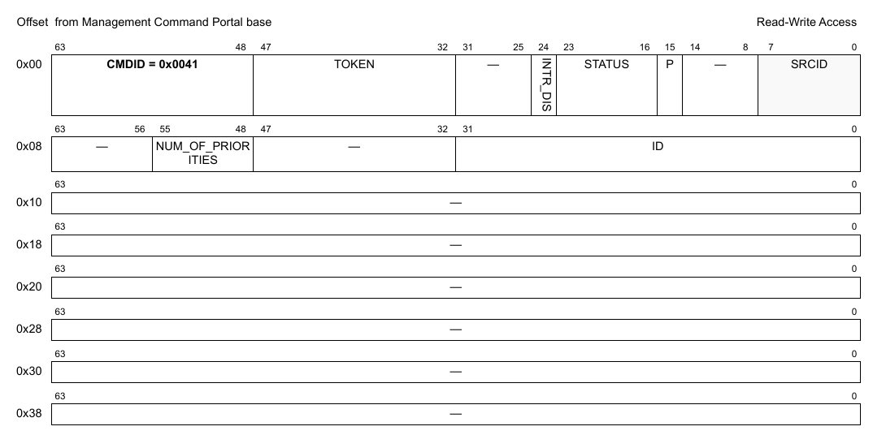

**Figure 298. Mô tả response của DPCI_GET_ATTRIBUTES**

**Table 47. Mô tả các field response của DPCI_GET_ATTRIBUTES1**

| Offset | Bits | Tên | Mô tả |
|---|---|---|---|
| 0x00 | 0-63 | Header của command | Xem Table 2 để biết mô tả chung các field của command portal. CMDID phải được đặt như chỉ ra trong hình ở trên. |
| 0x08 | 0-31 | ID | DPCI object ID |
|   | 48-55 | NUM_OF_PRIORITIES | Số receive priority |

1 Mọi field không được nêu là reserved và phải được xóa (đặt bằng 0).

### 12.3.16 DPCI_GET_PEER_ATTRIBUTES

**Cấu trúc command**

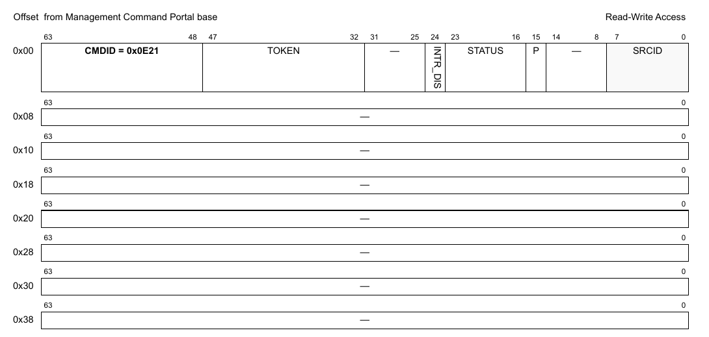

**Figure 299. Mô tả command DPCI_GET_PEER_ATTRIBUTES**

**Table 48. Mô tả các field của command DPCI_GET_PEER_ATTRIBUTES1**

| Offset | Bits | Tên | Mô tả |
|---|---|---|---|
| 0x00 | 0-63 | Header của command | Xem Table 2 để biết mô tả chung các field của command portal. CMDID phải được đặt như chỉ ra trong hình ở trên. |

1 Mọi field không được nêu là reserved và phải được xóa (đặt bằng 0).

**Cấu trúc response**

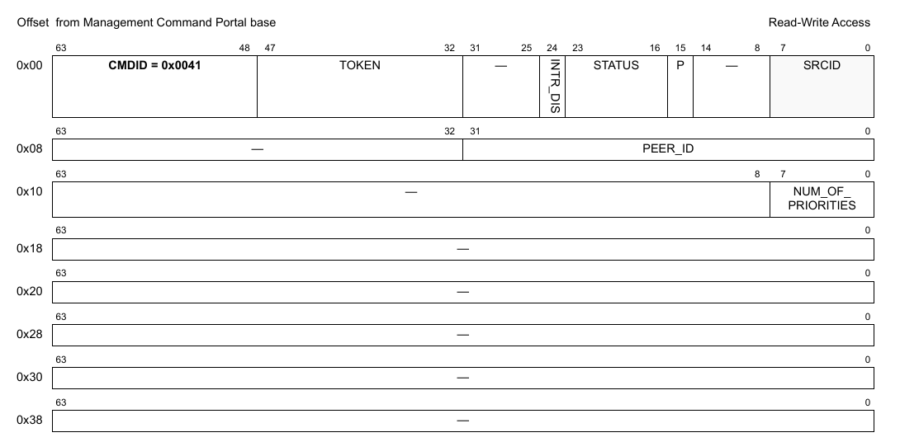

**Figure 300. Mô tả response của DPCI_GET_PEER_ATTRIBUTES**

**Table 49. Mô tả các field response của DPCI_GET_PEER_ATTRIBUTES1**

| Offset | Bits | Tên | Mô tả |
|---|---|---|---|
| 0x00 | 0-63 | Header của command | Xem Table 2 để biết mô tả chung các field của command portal. CMDID phải được đặt như chỉ ra trong hình ở trên. |
| 0x08 | 0-31 | PEER_ID | ID của DPCI ở đầu kia; nếu không có peer nào được nối thì trả về (-1) |
| 0x10 | 0-7 | NUM_OF_PRIORITIES | Số receive priority của peer; quyết định số transmit priority của DPCI object cục bộ |

1 Mọi field không được nêu là reserved và phải được xóa (đặt bằng 0).

### 12.3.17 DPCI_GET_LINK_STATE

**Cấu trúc command**

**Figure 301. Mô tả command DPCI_GET_LINK_STATE**

**Table 50. Mô tả các field của command DPCI_GET_LINK_STATE1**

| Offset | Bits | Tên | Mô tả |
|---|---|---|---|
| 0x00 | 0-63 | Header của command | Xem Table 2 để biết mô tả chung các field của command portal. CMDID phải được đặt như chỉ ra trong hình ở trên. |

1 Mọi field không được nêu là reserved và phải được xóa (đặt bằng 0).

**Cấu trúc response**

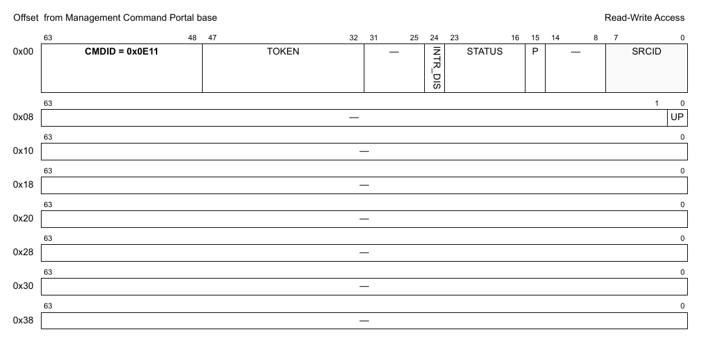

**Figure 302. Mô tả response của DPCI_GET_LINK_STATE**

**Table 51. Mô tả các field response của DPCI_GET_LINK_STATE1**

| Offset | Bits | Tên | Mô tả |
|---|---|---|---|
| 0x00 | 0-63 | Header của command | Xem Table 2 để biết mô tả chung các field của command portal. CMDID phải được đặt như chỉ ra trong hình ở trên. |
| 0x08 | 0 | UP | Link state trả về; trả '1' nếu link up, '0' nếu không |

1 Mọi field không được nêu là reserved và phải được xóa (đặt bằng 0).

### 12.3.18 DPCI_SET_RX_QUEUE

Có một giới hạn: command này sẽ thất bại nếu được gọi hai lần mà không reset object. Xem Section 28.2, “Cấu hình lại các FQ gắn với một channel.”

**Cấu trúc command**

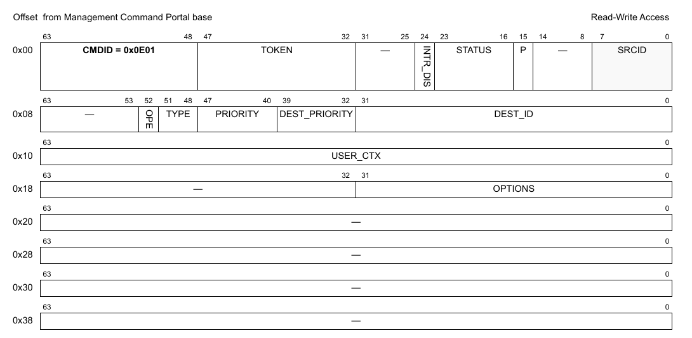

**Figure 303. Mô tả command DPCI_SET_RX_QUEUE**

**Table 52. Mô tả các field của command DPCI_SET_RX_QUEUE1**

| Offset | Bits | Tên | Mô tả |
|---|---|---|---|
| 0x00 | 0-63 | Header của command | Xem Table 2 để biết mô tả chung các field của command portal. CMDID phải được đặt như chỉ ra trong hình ở trên. |
| 0x08 | 0-31 | DEST_ID | DPIO ID hoặc DPCON ID, tùy loại đích |
|   | 32-39 | DEST_PRIORITY | Lựa chọn priority trong channel DPIO hoặc DPCON; giá trị hợp lệ là 0-1 hoặc 0-7, tùy số priority trong channel đó; không có ý nghĩa với option 'DPCI_DEST_NONE', trừ khi DPCI này nằm trong ngữ cảnh AIOP. Khi đó DCI_SET_RX_QUEUE *(ghi chú: đúng là DPCI_SET_RX_QUEUE)* có thể dùng để ghi đè priority mặc định đã gán. |
|   | 40-47 | PRIORITY | Chọn queue tương đối theo số priority đã cấu hình khi tạo DPCI; dùng DPCI_ALL_QUEUES để cấu hình mọi Rx queue như nhau. |
|   | 48-51 | DEST_TYPE | Loại đích: 0x0 = DPCI_DEST_NONE - Đích chưa gán; queue được đặt ở chế độ parked và không sinh notification FQDAN; người dùng phải dequeue từ queue bằng polling hoặc phương pháp khác do người dùng định nghĩa 0x1 = DPCI_DEST_DPIO- Queue được đặt ở chế độ schedule và sinh notification FQDAN tới DPIO được chỉ định; người dùng chỉ dequeue từ queue sau khi nhận được notification 0x2 = DPCI_DEST_DPCON - Queue được đặt ở chế độ schedule và không sinh notification FQDAN, nhưng được nối với DPCON object được chỉ định; người dùng phải dequeue từ channel DPCON |
|   | 52 | ORDER_PRESERV ATION_EN (OPE) | Cấu hình giữ thứ tự cho rx queue Chỉ hợp lệ nếu ‘options' có 'DPCI_QUEUE_OPT_ORDER_PRESERVATION' |
| 0x10 | 0-63 | USER_CTX | Giá trị user context được cung cấp trong frame descriptor của mỗi frame được dequeue; chỉ hợp lệ nếu 'options' có 'DPCI_QUEUE_OPT_USER_CTX' |
| 0x18 | 0-32 | OPTIONS | Các flag biểu diễn những thay đổi đề xuất với queue; Dùng bất kỳ tổ hợp nào của các flag 'DPCI_QUEUE_OPT_\<X>': bit 0: DPCI_QUEUE_OPT_USER_CTX - Chọn để sửa user context gắn với queue bit 1: DPCI_QUEUE_OPT_DEST - Chọn để sửa đích của queue bit 2: DPCI_QUEUE_OPT_HOLD_ACTIVE - Chọn để đặt chế độ hold active cho queue |

1 Mọi field không được nêu là reserved và phải được xóa (đặt bằng 0).

### 12.3.19 DPCI_GET_RX_QUEUE

**Cấu trúc command**

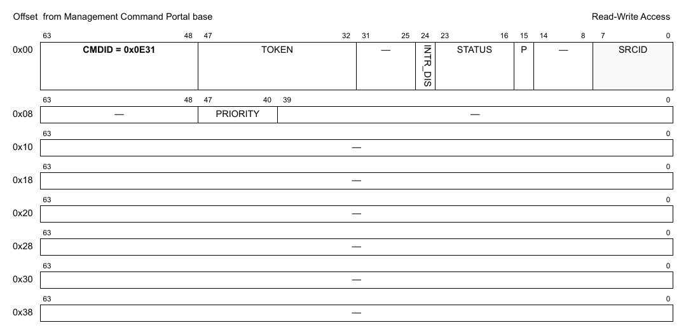

**Figure 304. Mô tả command DPCI_GET_RX_QUEUE**

**Table 53. Mô tả các field của command DPCI_GET_RX_QUEUE1**

| Offset | Bits | Tên | Mô tả |
|---|---|---|---|
| 0x00 | 0-63 | Header của command | Xem Table 2 để biết mô tả chung các field của command portal. CMDID phải được đặt như chỉ ra trong hình ở trên. |
| 0x08 | 40-47 | PRIORITY | Chọn queue tương đối theo số priority đã cấu hình khi tạo DPCI |

1 Mọi field không được nêu là reserved và phải được xóa (đặt bằng 0).

**Cấu trúc response**

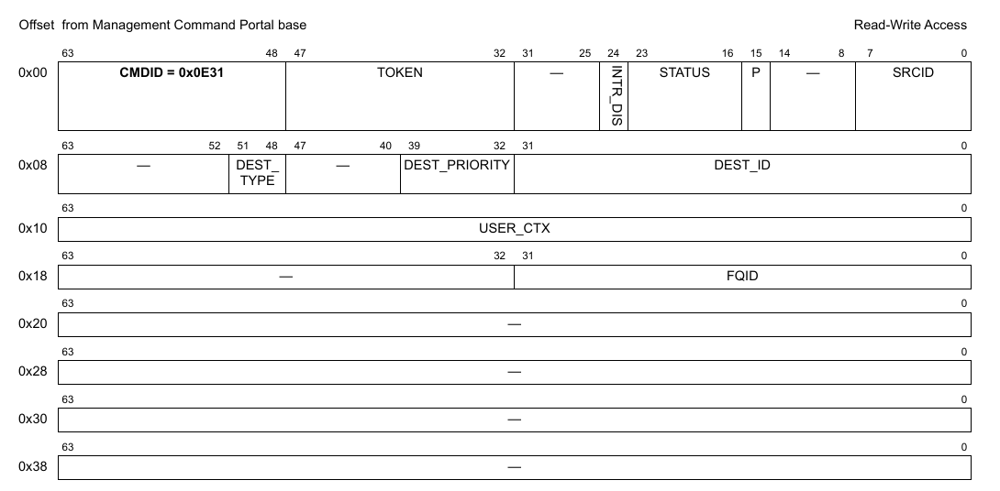

**Figure 305. Mô tả response của DPCI_GET_RX_QUEUE**

**Table 54. Mô tả các field response của DPCI_GET_RX_QUEUE1**

| Offset | Bits | Tên | Mô tả |
|---|---|---|---|
| 0x00 | 0-63 | Header của command | Xem Table 2 để biết mô tả chung các field của command portal. CMDID phải được đặt như chỉ ra trong hình ở trên. |
| 0x08 | 0-31 | DEST_ID | DPIO ID hoặc DPCON ID, tùy loại đích |
|   | 32-39 | PRIORITY | Lựa chọn priority trong channel DPIO hoặc DPCON; giá trị hợp lệ là 0-1 hoặc 0-7, tùy số priority trong channel đó; không có ý nghĩa với option 'DPCI_DEST_NONE' |
|   | 48-51 | DEST_TYPE | Loại đích |
| 0x10 | 0-63 | USER_CTX | Giá trị user context được cung cấp trong frame descriptor của mỗi frame được dequeue |
| 0x18 | 0-31 | FQID | Giá trị FQID ảo dùng cho thao tác dequeue |

1 Mọi field không được nêu là reserved và phải được xóa (đặt bằng 0).

### 12.3.20 DPCI_GET_TX_QUEUE

**Cấu trúc command**

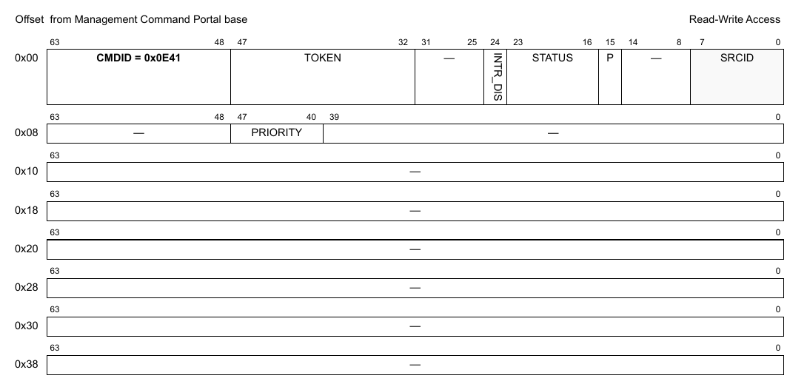

**Figure 306. Mô tả command DPCI_GET_TX_QUEUE**

**Table 55. Mô tả các field của command DPCI_GET_TX_QUEUE1**

| Offset | Bits | Tên | Mô tả |
|---|---|---|---|
| 0x00 | 0-63 | Header của command | Xem Table 2 để biết mô tả chung các field của command portal. CMDID phải được đặt như chỉ ra trong hình ở trên. |
| 0x08 | 40-47 | PRIORITY | Priority của virtual frame queue mà một SW context dùng để gửi frame tới SW context ghép cặp. Các DPCI object làm việc theo cặp. Để biết peer dùng FQID nào để nhận dữ liệu, phải cung cấp mức priority. |

1 Mọi field không được nêu là reserved và phải được xóa (đặt bằng 0).

**Cấu trúc response**

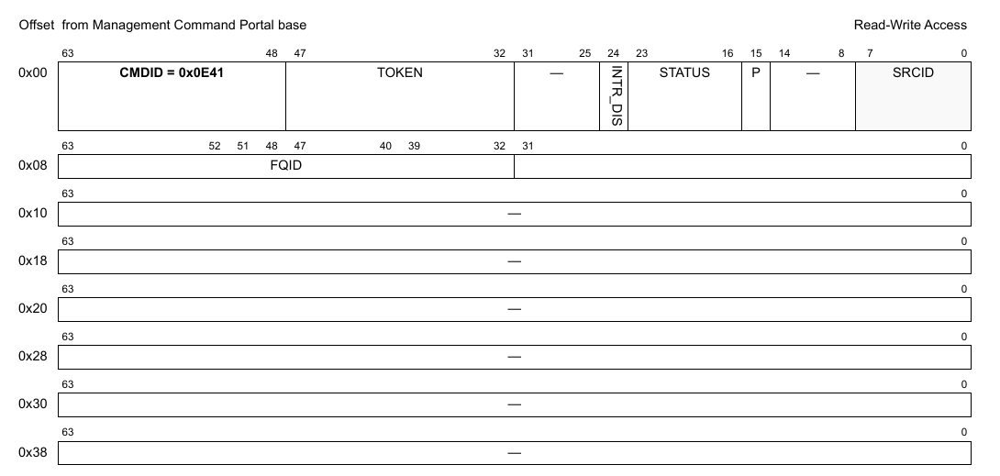

**Figure 307. Mô tả response của DPCI_GET_TX_QUEUE**

**Table 56. Mô tả các field response của DPCI_GET_TX_QUEUE1**

| Offset | Bits | Tên | Mô tả |
|---|---|---|---|
| 0x00 | 0-63 | Header của command | Xem Table 2 để biết mô tả chung các field của command portal. CMDID phải được đặt như chỉ ra trong hình ở trên. |
| 0x08 | 32-63 | FQID | FQID ảo dùng để gửi frame tới DPCI ở đầu kia; trả về 'DPCI_FQID_NOT_VALID' nếu không có peer nào được nối hoặc nếu priority được chọn vượt quá số priority của DPCI object ở đầu kia |

1 Mọi field không được nêu là reserved và phải được xóa (đặt bằng 0).

### 12.3.21 DPCI_GET_API_VERSION

**Cấu trúc command**

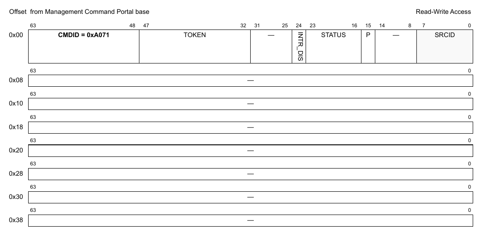

**Figure 308. Mô tả command DPCI_GET_API_VERSION**

**Table 57. Mô tả các field của command DPCI_GET_TX_QUEUE *(ghi chú: đúng là DPCI_GET_API_VERSION)*1**

| Offset | Bits | Tên | Mô tả |
|---|---|---|---|
| 0x00 | 0-63 | Header của command | Xem Table 2 để biết mô tả chung các field của command portal. CMDID phải được đặt như chỉ ra trong hình ở trên. |

1 Mọi field không được nêu là reserved và phải được xóa (đặt bằng 0).

**Cấu trúc response**

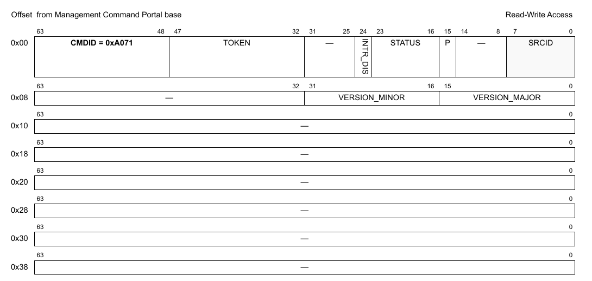

**Figure 309. Mô tả response của DPCI_GET_TX_QUEUE *(ghi chú: đúng là DPCI_GET_API_VERSION)***

**Table 58. Mô tả các field response của DPCI_GET_TX_QUEUE *(ghi chú: đúng là DPCI_GET_API_VERSION)*1**

| Offset | Bits | Tên | Mô tả |
|---|---|---|---|
| 0x00 | 0-63 | Header của command | Xem Table 2 để biết mô tả chung các field của command portal. CMDID phải được đặt như chỉ ra trong hình ở trên. |
| 0x08 | 0-15 | VERSION_MAJOR | Major version của API |
|   | 16-31 | VERSION_MINOR | Minor version của API |

1 Mọi field không được nêu là reserved và phải được xóa (đặt bằng 0).

### 12.3.22 DPCI_SET_OPR

Đặt cấu hình Order Point Record. Command chỉ hoạt động nếu DPCI được tạo với option DPCI_OPT_HAS_OPR. Nó cũng chỉ hoạt động trên các SoC hỗ trợ Order Restoration.

Nếu DPCI được cấu hình với DPCI_OPT_OPR_SHARED thì mọi frame queue của DPCI được cấu hình để dùng cùng một Order Point Record. Nếu option DPCI_OPT_OPR_SHARED không được đặt, INDEX được dùng để chọn một queue cụ thể.

**Cấu trúc command**

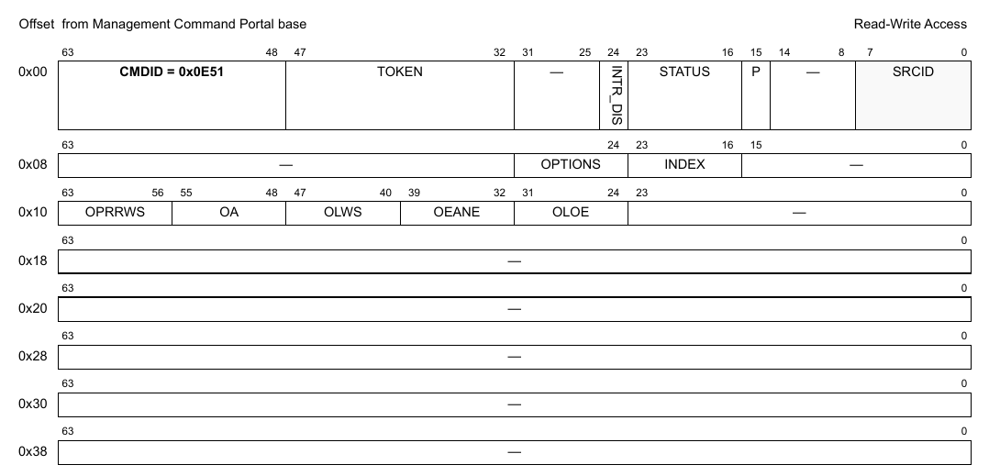

**Figure 310. Mô tả command DPCI_SET_OPR**

**Table 59. Mô tả các field của command DPCI_SET_OPR1**

| Offset | Bits | Tên | Mô tả |
|---|---|---|---|
| 0x00 | 0-63 | Header của command | Xem Table 2 để biết mô tả chung các field của command portal. CMDID phải được đặt như chỉ ra trong hình ở trên. |
| 0X08 | 16-23 | INDEX | Chọn một queue cụ thể trong các Rx queue của DPCI. Giá trị chấp nhận nằm trong khoảng 0 đến NUM_QUEUES – 1. Field này bị bỏ qua với DPCI_OPT_OPR_SHARED. |
|   | 24–31 | OPTIONS | Command có thể hoạt động theo hai cách, tùy giá trị field options: • OPR_OPT_CREATE (1): Tạo OPR với cấu hình cho trước • OPR_OPT_RETIRE (2): Retire OPR. Khi đó các option cấu hình từ offset 0x10 bị bỏ qua. |
| 0x10 | 24–31 | OLOE | Bật loose ordering cho OPR • 0: Chế độ strict ordering • 1: Chế độ loose ordering |
|   | 32–39 | OEANE | Bật advance NESN khi tài nguyên order restoration list (ORL) cạn |
|   | 40–47 | OLWS | Kích thước cửa sổ chấp nhận đến muộn của OPR • 0: Tắt. Frame đến muộn luôn bị từ chối. • 1: Kích thước cửa sổ là 32 frame. • 2: Kích thước cửa sổ bằng kích thước restoration window của OPR cấu hình trong field OPRRWS. • 3: Kích thước cửa sổ là 8192 frame. Frame đến muộn luôn được chấp nhận. |
|   | 48–55 | OA | Kích thước cửa sổ auto advance NESN của OPR |
|   | 56–63 | OPRRWS | Kích thước restoration window của order point record (OPR). • 0: Kích thước cửa sổ là 32 frame. • 1: Kích thước cửa sổ là 64 frame. • 2: Kích thước cửa sổ là 128 frame. • 3: Kích thước cửa sổ là 256 frame. • 4: Kích thước cửa sổ là 512 frame. • 5: Kích thước cửa sổ là 1024 frame. • 6–7: Reserved |

1 Mọi field không được nêu là reserved và phải được xóa (đặt bằng 0).

### 12.3.23 DPCI_GET_OPR

Lấy cấu hình và trạng thái Order Point Record (OPR). Dùng được với các OPR đã được tạo. OPR được tạo khi DPCI được enable lần đầu sau một command DPCI_SET_OPR.

**Cấu trúc command**

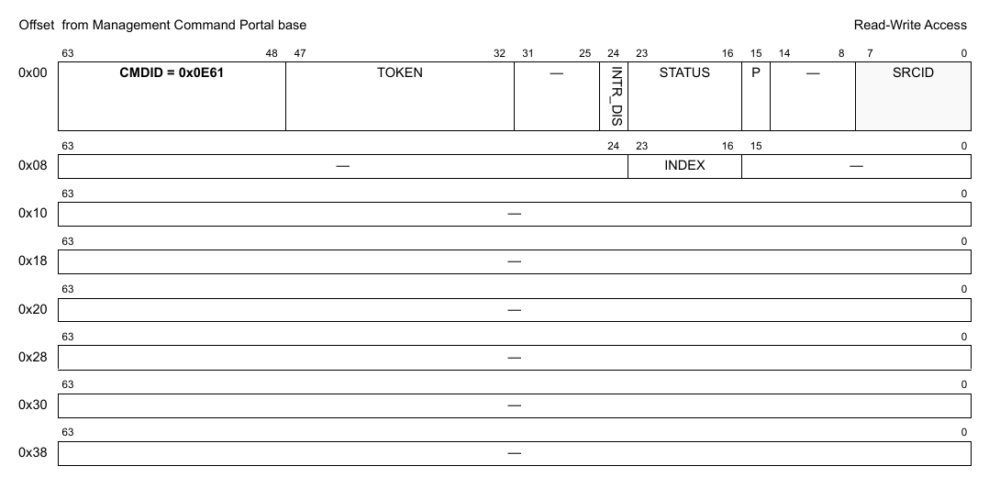

**Figure 311. Mô tả command DPCI_GET_OPR**

**Table 60. Mô tả các field của command DPCI_GET_OPR1**

| Offset | Bits | Tên | Mô tả |
|---|---|---|---|
| 0x00 | 0-63 | Header của command | Xem Table 2 để biết mô tả chung các field của command portal. CMDID phải được đặt như chỉ ra trong hình ở trên. |
| 0X08 | 16-23 | INDEX | Chọn một queue cụ thể trong các Rx queue của DPCI. Field này bị bỏ qua với DPCI_OPT_OPR_SHARED. |

1 Mọi field không được nêu là reserved và phải được xóa (đặt bằng 0).

**Cấu trúc response**

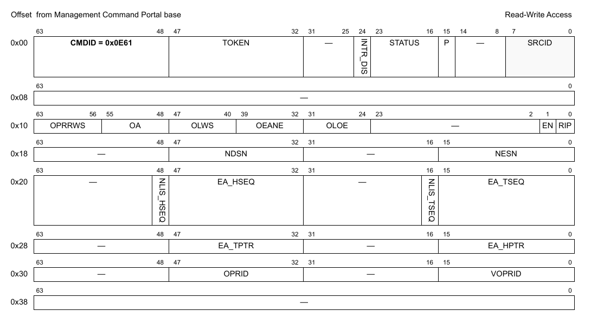

**Figure 312. Mô tả response của DPCI_GET_OPR**

**Table 61. Mô tả các field response của DPCI_GET_OPR1**

| Offset | Bits | Tên | Mô tả |
|---|---|---|---|
| 0x00 | 0–63 | Header của command | Xem Table 2 để biết mô tả chung các field của command portal. CMDID phải được đặt như chỉ ra trong hình ở trên. |
| 0x10 | 0 | RIP | Đang retire. |
|   | 1 | EN | OPR đang được bật. |
|   | 24–31 | OLOE | Bật loose ordering cho OPR |
|   | 32–39 | OEANE | Bật advance NESN khi tài nguyên order restoration list (ORL) cạn |
|   | 40–47 | OLWS | Kích thước cửa sổ chấp nhận đến muộn của OPR |
|   | 48–55 | OA | Kích thước cửa sổ auto advance NESN của OPR |
|   | 56–63 | OPRRWS | Kích thước restoration window của order point record (OPR) |
| 0x18 | 0–15 | NESN | Sequence number dự kiến tiếp theo. |
|   | 32–47 | NDSN | Sequence number được cấp tiếp theo. |
| 0x20 | 0–15 | EA_TSEQ | Sequence number của frame ở cuối ORL. |
|   | 16 | NLIS_TSEQ | Không phải frame cuối trong chuỗi cho EA_TSEQ |
|   | 32–47 | EA_HSEQ | Sequence number của frame ở đầu ORL. |
|   | 48 | NLIS_HSEQ | Không phải frame cuối trong chuỗi cho EA_HSEQ |
| 0x28 | 0–15 | EA_HPTR | Con trỏ đầu của danh sách đến sớm |
|   | 32–47 | EA_TPTR | Con trỏ cuối của danh sách đến sớm |
| 0x30 | 0–15 | VOPRID | Order Point Record ID ảo |
|   | 32–47 | OPRID | Order Point Record ID |

1 Mọi field không được nêu là reserved và phải được xóa (đặt bằng 0).
