# Chương 13 DPDMUX: Data Path Network DeMux

DPDMUX object cung cấp chức năng Ethernet virtual bridging, chủ yếu dựa trên chuẩn 802.1Qbg. Vai trò chính của DPDMUX là chuyển traffic từ một uplink interface duy nhất tới một hoặc nhiều interface nội bộ. Uplink interface có thể là interface nội bộ hoặc bên ngoài.

Việc chuyển tiếp của DPDMUX được quyết định bởi một database nội bộ, phân loại các frame nhận được và gửi chúng tới uplink interface hoặc tới các interface nội bộ. Database của DPDMUX có thể được cập nhật động lúc runtime. DPDMUX không hỗ trợ tự học từ traffic mạng, nhưng nó có học địa chỉ MAC và VLAN ID từ các DPNI object được nối. Không hỗ trợ cơ chế aging cho các mục trong database.

## 13.1 Các tính năng của DPDMUX

Danh sách sau tóm tắt các tính năng và khả năng chính của DPDMUX:

- Hỗ trợ các cấu hình 802.1Qbg như VEB và VEPA
- Chia traffic ingress từ một uplink interface tới nhiều interface nội bộ (DPNI)
- Hỗ trợ bridging VM-tới-VM (chế độ cấu hình VEB)
- Hỗ trợ các phương pháp demux sau:
  - Chia traffic theo địa chỉ MAC đích (DMAC)
  - Chia traffic theo C-VLAN
  - Chia traffic theo kết hợp DMAC và C-VLAN
- Số mục trong bảng demux có thể cấu hình
- Hỗ trợ frame Unicast, Multicast và Broadcast, kể cả các chế độ promiscuous Unicast và Multicast cho các interface nội bộ.
- Hỗ trợ các chính sách chấp nhận frame sau cho mỗi interface:
  - Chấp nhận mọi frame (hành vi mặc định)
  - Chỉ chấp nhận frame có tag
  - Chỉ chấp nhận frame không có tag (hoặc priority-tagged)
- Counter thống kê cho mỗi interface
- Báo link state cho mỗi interface (gửi interrupt tới GPP khi thay đổi)

## 13.2 Mô tả chức năng của DPDMUX

### 13.2.1 Database demux

Việc chuyển tiếp của DPDMUX được quyết định bởi một database nội bộ, phân loại các frame nhận được và gửi chúng tới uplink interface hoặc tới các interface nội bộ.

Database của DPDMUX có thể được cập nhật động qua hai cơ chế chính:

- Học từ interface – DPDMUX tự động truy vấn các DPNI object sau khi chúng được nối vào các interface nội bộ của nó, và tự động cấu hình database chuyển tiếp với các quy tắc MAC/VLAN tương ứng theo phương pháp demux được chọn. Thông tin nhận từ DPNI gồm bộ lọc MAC (Unicast và Multicast), bộ lọc VLAN và thiết lập promiscuous. Các quy tắc được cấu hình theo cơ chế này bị gỡ khi DPNI object bị ngắt khỏi interface của DPDMUX.
- Cấu hình quản lý – Người dùng DPDMUX (driver trên GPP) có thể thêm (hoặc gỡ) quy tắc chuyển tiếp trực tiếp qua các command của DPDMUX. Xem các command DPDMUX_IF_ADD/REMOVE_L2_RULE để biết thêm chi tiết. Các quy tắc được cấu hình qua command quản lý chỉ có thể bị gỡ bằng command quản lý, nên việc nối/ngắt DPNI object không ảnh hưởng tới các quy tắc này.

DPDMUX không hỗ trợ tự học từ traffic mạng. Các frame không khớp quy tắc nào sẽ bị drop hoặc được chuyển hướng tới một interface được chọn.

Không hỗ trợ aging tự động cho các mục trong database.

### 13.2.2 Hỗ trợ broadcast và multicast

Các frame broadcast và multicast Ethernet được nhân bản tới các interface liên quan. Việc nhân bản chỉ được hỗ trợ khi phương pháp demux dựa trên địa chỉ MAC (hoặc MAC và VLAN). Nếu phương pháp demux dùng cả MAC và VLAN, việc nhân bản bị giới hạn trong phạm vi VLAN ID có trong frame (frame không vượt qua ranh giới VLAN).

Lưu ý rằng nếu phương pháp demux không dùng địa chỉ MAC, frame không bao giờ được nhân bản.

### 13.2.3 Các interface promiscuous

Như đã nói, DPDMUX truy vấn thiết lập của các DPNI object được nối. Nếu một DPNI được cấu hình ở chế độ promiscuous (Unicast hoặc Multicast), nó sẽ nhận mọi frame không khớp địa chỉ MAC trong bất kỳ quy tắc hiện có nào. Các frame khớp một quy tắc hiện có không được chuyển tới các interface promiscuous. Khi phương pháp demux dùng cả MAC và VLAN, việc nhân bản frame tới các interface promiscuous bị giới hạn trong phạm vi VLAN ID có trong frame (frame không vượt qua ranh giới VLAN).

Lưu ý rằng nếu phương pháp demux không dùng địa chỉ MAC, frame không bao giờ được nhân bản.

### 13.2.4 Chính sách chấp nhận frame

Chính sách chấp nhận frame có thể được cấu hình cho từng interface của DPDMUX. Lưu ý rằng chính sách chấp nhận được áp dụng trước khi frame được so với database demux.

Các chính sách chấp nhận hợp lệ là:

- Admit all – Interface của DPDMUX chấp nhận mọi frame Ethernet hợp lệ (frame có tag, không tag và priority-tagged).
- Admit only tagged – Interface của DPDMUX chỉ chấp nhận frame Ethernet có VLAN tag.
- Admit only untagged – Interface của DPDMUX chỉ chấp nhận frame Ethernet không tag và frame Ethernet priority-tagged (VLAN ID = 0).

Với mỗi interface, người dùng có thể chọn hành động áp lên các frame không được chấp nhận – drop frame hoặc chuyển hướng nó tới control interface.

Xem command DPDMUX_IF_SET_ACCEPTED_FRAMES.

## 13.3 Tham chiếu command của DPDMUX

Mục này trình bày chi tiết mô hình lập trình các command của DPDMUX.

### 13.3.1 DPDMUX_OPEN

Mở một phiên điều khiển cho object được chỉ định.

Hàm này có thể dùng để mở phiên điều khiển cho một object đã được tạo; object có thể đã được khai báo trong DPL hoặc được tạo bằng command DPDMUX_CREATE.

Hàm này trả về một authentication token duy nhất, gắn với object ID cụ thể; token này phải được dùng trong mọi command tiếp theo cho object này.

**Cấu trúc command**

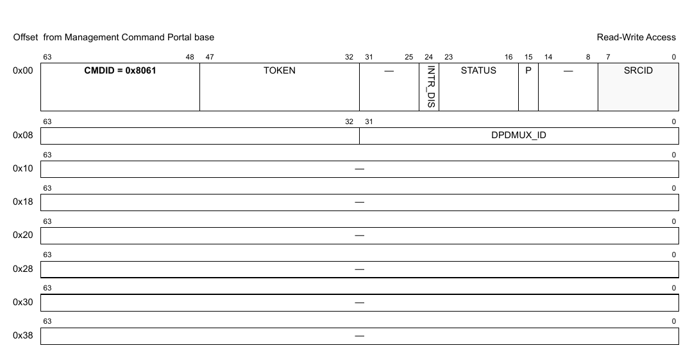

**Figure 313. Mô tả command DPDMUX_OPEN**

Bảng sau mô tả các field của command.

**Table 62. Mô tả các field của command DPDMUX_OPEN1**

| Offset | Bits | Tên | Mô tả |
|---|---|---|---|
| 0x00 | 0-63 | Header của command | Xem Table 2 để biết mô tả chung các field của command portal. CMDID phải được đặt như chỉ ra trong hình ở trên. |
| 0x08 | 0-31 | DPDMUX_ID | ID duy nhất của DPDMUX |

1 Mọi field không được nêu là reserved và phải được xóa (đặt bằng 0)

### 13.3.2 DPDMUX_CLOSE

Đóng phiên điều khiển của object.

Sau khi gọi hàm này, không thao tác nào khác được phép trên object nếu không mở một phiên điều khiển mới.

**Cấu trúc command**

**Figure 314. Mô tả command DPDMUX_CLOSE**

| Offset | Bits | Tên | Mô tả |
|---|---|---|---|
| 0x00 | 0-63 | Header của command | Xem Table 2 để biết mô tả chung các field của command portal. CMDID phải được đặt như chỉ ra trong hình ở trên. |

Mọi field không được nêu là reserved và phải được xóa (đặt bằng 0)

### 13.3.3 DPDMUX_CREATE

Command này tạo và khởi tạo một instance DPDMUX theo các tham số command được chỉ định. Command này không cần cho các instance DPDMUX được tạo bằng DPL.

Với command CREATE, bên gọi phải cung cấp authentication token của container cha mà object sẽ được tạo và gán vào. Nếu token là '0', object sẽ được gán cho container đang sở hữu MC command portal thực thi command này.

Command trả về một DPDMUX ID có thể dùng để OPEN hoặc DESTROY object.

Định dạng command được thể hiện trong hình dưới đây.

**Cấu trúc command**

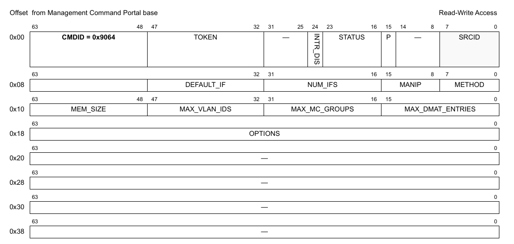

**Figure 315. Mô tả command DPDMUX_CREATE**

Bảng sau mô tả các field của command.

| Offset | Bits | Tên | Mô tả |
|---|---|---|---|
| 0x00 | 0-63 | Header của command | Xem Table 2 để biết mô tả chung các field của command portal. CMDID phải được đặt như chỉ ra trong hình ở trên. |
| 0x08 | 0-7 | METHOD | Định nghĩa phương pháp hoạt động cho bảng địa chỉ của DPDMUX. Chọn một trong các giá trị được hỗ trợ dưới đây: 0x0 = DPDMUX_METHOD_NONE: Không có DPDMUX Method 0x1 = DPDMUX_METHOD_C_VLAN_MAC: DPDMUX dựa trên C-VLAN và địa chỉ MAC 0x2 = DPDMUX_METHOD_MAC: DPDMUX dựa trên địa chỉ MAC 0x3 = DPDMUX_METHOD_C_VLAN: DPDMUX dựa trên C-VLAN (hoạt động trên VLAN ngoài) 0x4 = DPDMUX_METHOD_S_VLAN: DPDMUX dựa trên S-VLAN: Không được hỗ trợ (xem C-VLAN) 0x5 = DPDMUX_METHOD_CUSTOM: Người dùng có thể tự định nghĩa quy tắc bằng command DPDMUX_SET_CUSTOME_KEY *(ghi chú: đúng là DPDMUX_SET_CUSTOM_KEY)* định nghĩa ở mục 13.3.32. |
|   | 8-15 | MANIP | Thao tác biến đổi cần thực hiện. Chọn một trong các giá trị được hỗ trợ dưới đây: 0x0 = DPDMUX_MANIP_NONE: Không biến đổi frame 0x1 = DPDMUX_MANIP_ADD_REMOVE_S_VLAN: Thêm S-VLAN ở egress, gỡ nó ở ingress |
|   | 16-31 | NUM_IFS | Số interface (không tính uplink interface) |
| 0x08 | 32-47 | DEFAULT_IF | Interface ID cho Default Interface mong muốn. Nếu IF_ID = 0 thì sẽ không có default interface nào, kể cả khi trước đó đã thiết lập một interface. Giá trị này chỉ được áp dụng nếu DPDMUX METHOD là DPDMUX_METHOD_CUSTOM. Giá trị này sẽ được dùng sau DPDMUX_RESET. |
|   | 48-63 | MEM_SIZE | Số buffer 256byte được cấp cho buffer pool của DPDMUX. Nếu là 0, dùng giá trị mặc định (1024). |
| 0x10 | 0-15 | MAX_DMAT_ENTRIES | Số mục tối đa trong bảng địa chỉ của DPDMUX 0- là mặc định: 64 mục nhân với số interface |
|   | 16-31 | MAX_MC_GROUPS | Số multicast group trong bảng DPDMUX Khi METHOD=DPDMUX_METHOD_C_VLAN_MAC, MAX_VLAN_IDS được tính đến, vì với mỗi vlan id có một địa chỉ broadcast mới được thêm vào bảng nhân bản. Ở giới hạn, số vlan id dùng phải bằng cấu hình MAX_VLAN_IDS. 0 - là mặc định: 32 multicast group |
|   | 32-47 | MAX_VLAN_IDS | Số VLAN tối đa cho phép trong hệ thống – chỉ có ý nghĩa với METHOD=DPDMUX_METHOD_C_VLAN_MAC. 0 - là mặc định 16 VLAN. |
| 0x18 | 0-63 | OPTIONS | Các option của DPDMUX - tổ hợp các flag 'DPDMUX_OPT_\<X>'. Chọn bất kỳ tổ hợp nào của các option được hỗ trợ dưới đây: bit 1: DPDMUX_OPT_BRIDGE_EN - Bật bridging giữa các interface nội bộ; chỉ cho phép nếu METHOD là DPDMUX_METHOD_C_VLAN_MAC hoặc DPDMUX_METHOD_MAC. bit 5: DPDMUX_OPT_CLS_MASK_SUPPORT: Hỗ trợ mask khi phân loại; chỉ cho phép nếu METHOD là DPDMUX_METHOD_CUSTOM. Option không hợp lệ với LS1088. bit 6: DPDMUX_OPT_AUTO_MAX_FRAME_LEN Khi đặt flag này, độ dài frame tối đa của DPDMUX được các DPNI object nối vào tự động cập nhật. |

Mọi field không được nêu là reserved và phải được xóa (đặt bằng 0)

**Cấu trúc response**

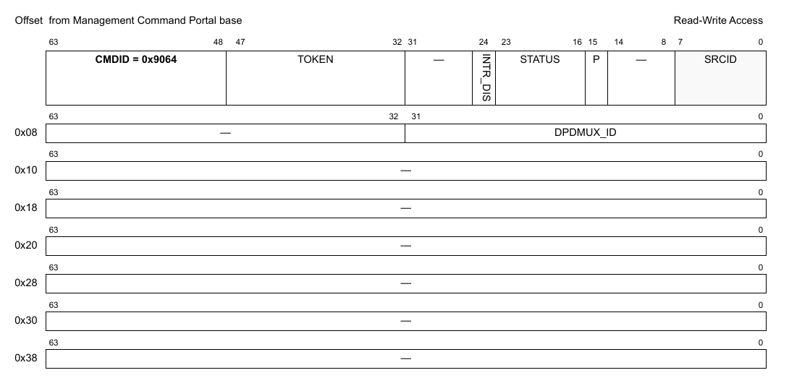

**Figure 13-1. Mô tả response của DPDMUX_CREATE**

Bảng sau mô tả các field của response.

**Table 13-1. Mô tả các field response của DPDMUX_CREATE1**

| Offset | Bits | Tên | Mô tả |
|---|---|---|---|
| 0x00 | 0-63 | Header của command | Xem Table 2 để biết mô tả chung các field của command portal. CMDID phải được đặt như chỉ ra trong hình ở trên. |
| 0x08 | 0-31 | DPDMUX_ID | ID duy nhất của DPDMUX |

1 Mọi field không được nêu là reserved.

### 13.3.4 DPDMUX_DESTROY

Command này hủy DPDMUX object và giải phóng mọi tài nguyên của nó. Nó phải được gọi trong software context đã tạo object. Bên gọi phải cung cấp object id và authentication token của container cha đã tạo object. Lưu ý rằng object có thể đã được gán cho container khác, và gửi authentication token của container đó sẽ trả về lỗi.

Mọi authentication token đang mở tới object phải được đóng trước khi gọi command destroy.

Sau khi gọi hàm này, không thao tác nào khác được phép trên object.

**Cấu trúc command**

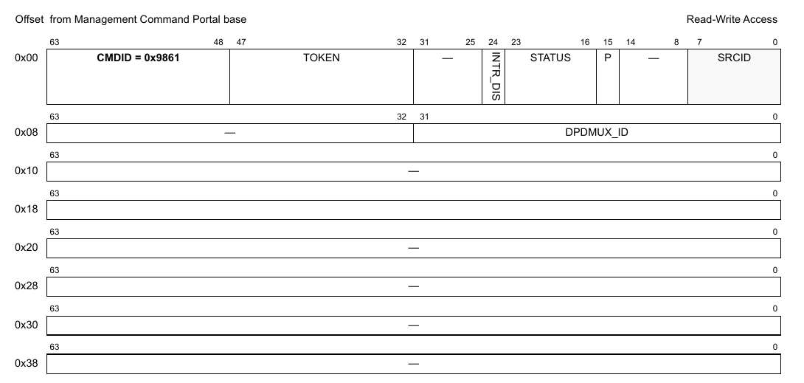

**Figure 316. Mô tả command DPDMUX_DESTROY**

| Offset | Bits | Tên | Mô tả |
|---|---|---|---|
| 0x00 | 0-63 | Header của command | Xem Table 2 để biết mô tả chung các field của command portal. CMDID phải được đặt như chỉ ra trong hình ở trên. |
| 0x08 | 0–32 | DPDMUX_ID | ID của DPDMUX object cần hủy |

Mọi field không được nêu là reserved và phải được xóa (đặt bằng 0)

### 13.3.5 DPDMUX_ENABLE

**Cấu trúc command**

**Figure 317. Mô tả command DPDMUX_ENABLE**

| Offset | Bits | Tên | Mô tả |
|---|---|---|---|
| 0x00 | 0-63 | Header của command | Xem Table 2 để biết mô tả chung các field của command portal. CMDID phải được đặt như chỉ ra trong hình ở trên. |

Mọi field không được nêu là reserved và phải được xóa (đặt bằng 0)

### 13.3.6 DPDMUX_DISABLE

**Cấu trúc command**

**Figure 318. Mô tả command DPDMUX_DISABLE**

| Offset | Bits | Tên | Mô tả |
|---|---|---|---|
| 0x00 | 0-63 | Header của command | Xem Table 2 để biết mô tả chung các field của command portal. CMDID phải được đặt như chỉ ra trong hình ở trên. |

Mọi field không được nêu là reserved và phải được xóa (đặt bằng 0)

### 13.3.7 DPDMUX_IS_ENABLED

**Cấu trúc command**

**Figure 319. Mô tả command DPDMUX_IS_ENABLED**

| Offset | Bits | Tên | Mô tả |
|---|---|---|---|
| 0x00 | 0-63 | Header của command | Xem Table 2 để biết mô tả chung các field của command portal. CMDID phải được đặt như chỉ ra trong hình ở trên. |

Mọi field không được nêu là reserved và phải được xóa (đặt bằng 0)

### 13.3.8 DPDMUX_RESET

**Cấu trúc command**

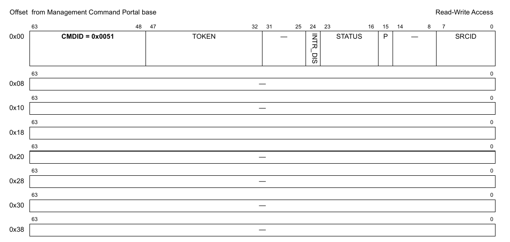

**Figure 320. Mô tả command DPDMUX_RESET**

| Offset | Bits | Tên | Mô tả |
|---|---|---|---|
| 0x00 | 0-63 | Header của command | Xem Table 2 để biết mô tả chung các field của command portal. CMDID phải được đặt như chỉ ra trong hình ở trên. |

Mọi field không được nêu là reserved và phải được xóa (đặt bằng 0)

### 13.3.9 DPDMUX_SET_IRQ_ENABLE

Đặt trạng thái tổng thể của interrupt. Cho phép phần mềm GPP điều khiển khi nào interrupt được sinh ra. Mỗi interrupt có thể có tối đa 32 nguyên nhân. Điều khiển enable/disable quyết định trạng thái tổng thể của interrupt. Nếu interrupt bị disable thì không nguyên nhân nào sinh ra interrupt.

**Cấu trúc command**

**Figure 321. Mô tả command DPDMUX_SET_IRQ_ENABLE**

| Offset | Bits | Tên | Mô tả |
|---|---|---|---|
| 0x00 | 0-63 | Header của command | Xem Table 2 để biết mô tả chung các field của command portal. CMDID phải được đặt như chỉ ra trong hình ở trên. |
| 0x08 | 0 | EN | Trạng thái interrupt: đặt ‘1’ để enable, ‘0’ để disable |
|   | 32-39 | IRQ_INDEX | Xác định interrupt index cần cấu hình |

Mọi field không được nêu là reserved và phải được xóa (đặt bằng 0)

### 13.3.10 DPDMUX_GET_IRQ_ENABLE

Lấy trạng thái tổng thể của interrupt.

**Cấu trúc command**

**Figure 322. Mô tả command DPDMUX_GET_IRQ_ENABLE**

| Offset | Bits | Tên | Mô tả |
|---|---|---|---|
| 0x00 | 0-63 | Header của command | Xem Table 2 để biết mô tả chung các field của command portal. CMDID phải được đặt như chỉ ra trong hình ở trên. |
| 0x08 | 32-39 | IRQ_INDEX | Xác định interrupt index cần truy vấn |

Mọi field không được nêu là reserved và phải được xóa (đặt bằng 0)

**Cấu trúc response**

**Figure 323. Mô tả response của DPDMUX_GET_IRQ_ENABLE**

| Offset | Bits | Tên | Mô tả |
|---|---|---|---|
| 0x00 | 0-63 | Header của command | Xem Table 2 để biết mô tả chung các field của command portal. CMDID phải được đặt như chỉ ra trong hình ở trên. |
| 0x08 | 0 | EN | Bit này được đặt nếu interrupt đang enable |

Mọi field không được nêu là reserved và phải được xóa (đặt bằng 0)

### 13.3.11 DPDMUX_SET_IRQ_MASK

Đặt interrupt mask. Mỗi interrupt có thể có tối đa 32 nguyên nhân, và mô hình interrupt hỗ trợ mask/unmask từng nguyên nhân độc lập.

**Cấu trúc command**

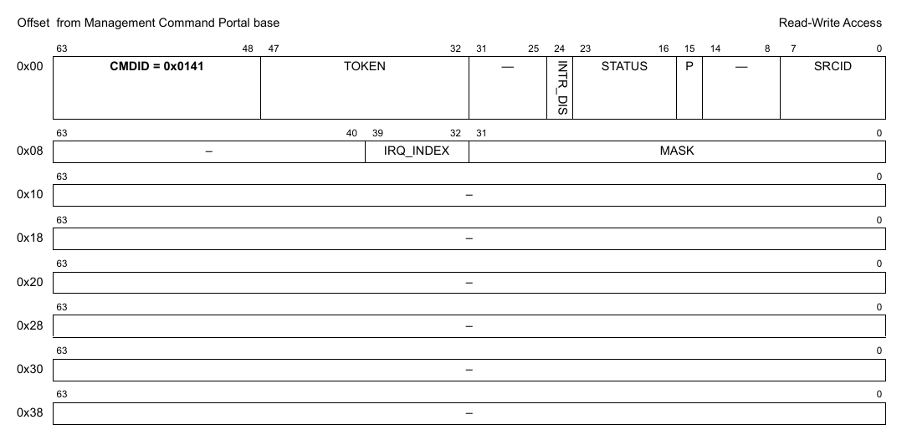

**Figure 324. Mô tả command DPDMUX_SET_IRQ_MASK**

| Offset | Bits | Tên | Mô tả |
|---|---|---|---|
| 0x00 | 0-63 | Header của command | Xem Table 2 để biết mô tả chung các field của command portal. CMDID phải được đặt như chỉ ra trong hình ở trên. |
| 0x08 | 0-31 | MASK | Event mask để kích hoạt interrupt; xem command GET_IRQ_STATUS để biết đặc tả các event hiện có. Với mỗi bit trong MASK: 0 = bỏ qua event 1 = event hợp lệ; báo IRQ nếu event này xảy ra |
|   | 32-39 | IRQ_INDEX | Interrupt index cần cấu hình |

Mọi field không được nêu là reserved và phải được xóa (đặt bằng 0)

### 13.3.12 DPDMUX_GET_IRQ_MASK

Lấy interrupt mask. Mỗi interrupt có thể có tối đa 32 nguyên nhân, và mô hình interrupt hỗ trợ mask/unmask từng nguyên nhân độc lập.

**Cấu trúc command**

**Figure 325. Mô tả command DPDMUX_GET_IRQ_MASK**

| Offset | Bits | Tên | Mô tả |
|---|---|---|---|
| 0x00 | 0-63 | Header của command | Xem Table 2 để biết mô tả chung các field của command portal. CMDID phải được đặt như chỉ ra trong hình ở trên. |
| 0x08 | 32-39 | IRQ_INDEX | Interrupt index cần truy vấn |

Mọi field không được nêu là reserved và phải được xóa (đặt bằng 0)

**Cấu trúc response**

**Figure 326. Mô tả response của DPDMUX_GET_IRQ_MASK**

| Offset | Bits | Tên | Mô tả |
|---|---|---|---|
| 0x00 | 0-63 | Header của command | Xem Table 2 để biết mô tả chung các field của command portal. CMDID phải được đặt như chỉ ra trong hình ở trên. |
| 0x08 | 0-31 | MASK | Event mask để kích hoạt interrupt; xem command GET_IRQ_STATUS để biết đặc tả các event hiện có. Với mỗi bit trong MASK: 0 = bỏ qua event 1 = event hợp lệ; báo IRQ nếu event này xảy ra |

Mọi field không được nêu là reserved và phải được xóa (đặt bằng 0)

### 13.3.13 DPDMUX_GET_IRQ_STATUS

Lấy trạng thái hiện tại của các event đang chờ cho interrupt index được chỉ định.

**Cấu trúc command**

**Figure 327. Mô tả command DPDMUX_GET_IRQ_STATUS**

| Offset | Bits | Tên | Mô tả |
|---|---|---|---|
| 0x00 | 0-63 | Header của command | Xem Table 2 để biết mô tả chung các field của command portal. CMDID phải được đặt như chỉ ra trong hình ở trên. |
| 0x08 | 0-31 | STATUS | Tùy chọn: mọi bit STATUS được đặt sẽ được xóa khỏi trạng thái đang chờ (không cần dùng command DPDMUX_CLEAR_IRQ_STATUS nữa). Lưu ý rằng STATUS trả về trong response là trạng thái trước khi các event bị xóa.  Các event được hỗ trợ: xem định nghĩa cấu trúc response |
|   | 32-39 | IRQ_INDEX | Interrupt index cần truy vấn |

Mọi field không được nêu là reserved và phải được xóa (đặt bằng 0)

**Cấu trúc response**

**Figure 328. Mô tả response của DPDMUX_GET_IRQ_STATUS**

| Offset | Bits | Tên | Mô tả |
|---|---|---|---|
| 0x00 | 0-63 | Header của command | Xem Table 2 để biết mô tả chung các field của command portal. CMDID phải được đặt như chỉ ra trong hình ở trên. |
| 0x08 | 0-31 | STATUS | Mask trạng thái event (bit 0-15), mỗi event một bit: 0 = không có interrupt đang chờ 1 = có interrupt đang chờ  Các event được hỗ trợ cho IRQ 0: Bit 0: DPDMUX_IRQ_EVENT_LINK_CHANGED – cho biết link state đã thay đổi Bit 1: DPDMUX_IRQ_EVENT_ENDPOINT_CHANGED – cho biết có event nối/ngắt kết nối giữa DPDMUX và endpoint của nó (DPNI, DPMAC). Bit 16-31 chứa interface ID của DPDMUX gắn với event. |

Mọi field không được nêu là reserved và phải được xóa (đặt bằng 0)

### 13.3.14 DPDMUX_CLEAR_IRQ_STATUS

Xóa (đánh dấu đã xử lý) các event đang chờ của interrupt index được chỉ định.

**Cấu trúc command**

**Figure 329. Mô tả command DPDMUX_CLEAR_IRQ_STATUS**

| Offset | Bits | Tên | Mô tả |
|---|---|---|---|
| 0x00 | 0-63 | Header của command | Xem Table 2 để biết mô tả chung các field của command portal. CMDID phải được đặt như chỉ ra trong hình ở trên. |
| 0x08 | 0-31 | STATUS | Mask để xóa các event đã xử lý; xem command GET_IRQ_STATUS để biết đặc tả các event hiện có. Với mỗi bit trong MASK: 0 = không đổi trạng thái event 1 = xóa bit trạng thái event để cho biết event đã được xử lý |
|   | 32-39 | IRQ_INDEX | Interrupt index cần cấu hình |

Mọi field không được nêu là reserved và phải được xóa (đặt bằng 0)

### 13.3.15 DPDMUX_GET_ATTRIBUTES

**Cấu trúc command**

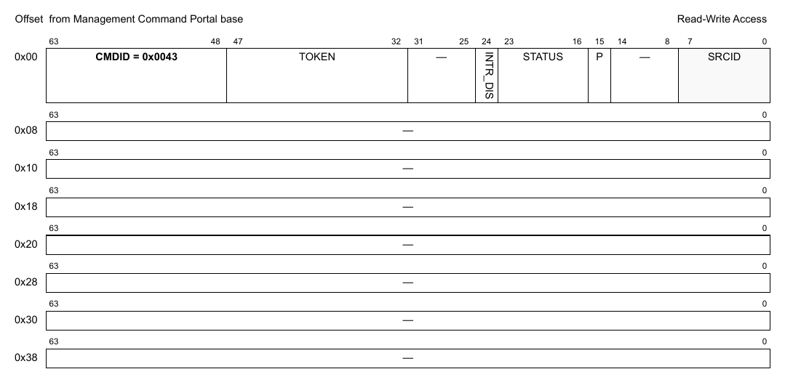

**Figure 330. Mô tả command DPDMUX_GET_ATTRIBUTES**

| Offset | Bits | Tên | Mô tả |
|---|---|---|---|
| 0x00 | 0-63 | Header của command | Xem Table 2 để biết mô tả chung các field của command portal. CMDID phải được đặt như chỉ ra trong hình ở trên. |

Mọi field không được nêu là reserved và phải được xóa (đặt bằng 0)

**Cấu trúc response**

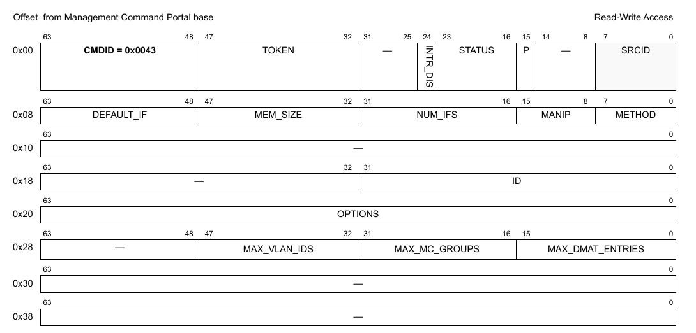

**Figure 331. Mô tả response của DPDMUX_GET_ATTRIBUTES**

| Offset | Bits | Tên | Mô tả |
|---|---|---|---|
| 0x00 | 0-63 | Header của command | Xem Table 2 để biết mô tả chung các field của command portal. CMDID phải được đặt như chỉ ra trong hình ở trên. |
| 0x08 | 0-7 | METHOD | Phương pháp của bảng địa chỉ DPDMUX. Một trong các giá trị được hỗ trợ dưới đây: 1 = DPDMUX_METHOD_C_VLAN_MAC - DPDMUX dựa trên C-VLAN và địa chỉ MAC 2 = DPDMUX_METHOD_MAC - DPDMUX dựa trên địa chỉ MAC 3 = DPDMUX_METHOD_C_VLAN - DPDMUX dựa trên C-VLAN 4 = DPDMUX_METHOD_S_VLAN - DPDMUX dựa trên S-VLAN |
|   | 8-15 | MANIP | Loại biến đổi của DPDMUX. Một trong các giá trị được hỗ trợ dưới đây: 0 = DPDMUX_MANIP_NONE - Không biến đổi frame 1 = DPDMUX_MANIP_ADD_REMOVE_S_VLAN - Thêm S-VLAN ở egress, gỡ nó ở ingress |
|   | 16-31 | NUM_IFS | Số interface (không tính uplink interface) |
|   | 32-47 | MEM_SIZE | Kích thước bộ nhớ lưu frame của DPDMUX |
|   | 48-63 | DEFAULT_IF | Trả về Interface ID của default interface đã đặt lúc tạo hoặc qua command DPDMUX_IF_SET_DEFAULT. Nếu ID=0 nghĩa là chưa đặt default interface nào. |
| 0x18 | 0-31 | ID | DPDMUX object ID |
| 0x20 | 0-63 | OPTIONS | Các option cấu hình (bitmap). Bất kỳ tổ hợp nào của các option được hỗ trợ dưới đây: bit 1: DPDMUX_OPT_BRIDGE_EN - Bật bridging giữa các interface nội bộ |
| 0x28 | 0-15 | MAX_DMAT_ENTRIES | Số mục tối đa trong bảng địa chỉ của DPDMUX. |
|   | 16-31 | MAX_MC_GROUPS | Số multicast group tối đa có thể cấu hình trên DPDMUX. Đây là giá trị đã cấu hình trong dpdmux_create(). |
|   | 32-47 | MAX_VLAN_IDS | Số VLAN tối đa cho phép trong hệ thống – chỉ có ý nghĩa với METHOD=DPDMUX_METHOD_C_VLAN_MAC. |

Mọi field không được nêu là reserved và phải được xóa (đặt bằng 0)

### 13.3.16 DPDMUX_SET_MAX_FRAME_LENGTH

Đặt độ dài frame tối đa được chấp nhận trên mọi port của DPDMUX.

**Cấu trúc command**

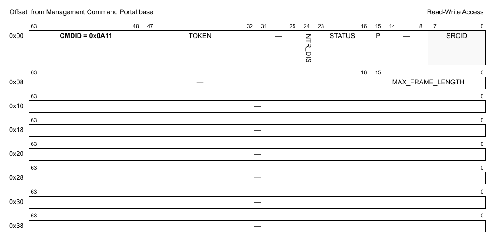

**Figure 332. Mô tả command DPDMUX_SET_MAX_FRAME_LENGTH**

| Offset | Bits | Tên | Mô tả |
|---|---|---|---|
| 0x00 | 0-63 | Header của command | Xem Table 2 để biết mô tả chung các field của command portal. CMDID phải được đặt như chỉ ra trong hình ở trên. |
| 0x08 | 0-15 | MAX_FRAME_LENGTH | Độ dài frame tối đa yêu cầu |

Mọi field không được nêu là reserved và phải được xóa (đặt bằng 0)

### 13.3.17 DPDMUX_IF_SET_ACCEPTED_FRAMES

**Cấu trúc command**

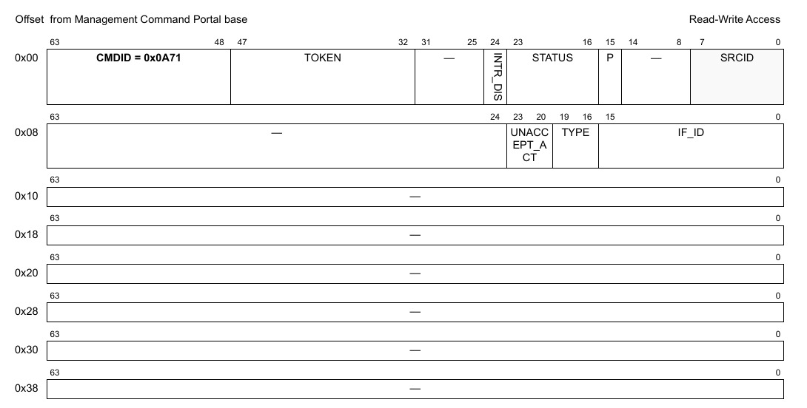

**Figure 333. Mô tả command DPDMUX_IF_SET_ACCEPTED_FRAMES**

| Offset | Bits | Tên | Mô tả |
|---|---|---|---|
| 0x00 | 0-63 | Header của command | Xem Table 2 để biết mô tả chung các field của command portal. CMDID phải được đặt như chỉ ra trong hình ở trên. |
| 0x08 | 0-15 | IF_ID | Interface ID (0 cho uplink, hoặc 1-num_ifs); |
|   | 16-19 | TYPE | Định nghĩa các frame ingress được chấp nhận. Chọn một trong các giá trị được hỗ trợ dưới đây: 0x0 = DPDMUX_ADMIT_ALL - Thiết bị chấp nhận frame có VLAN tag, không tag và priority-tagged 0x1 = DPDMUX_ADMIT_ONLY_VLAN_TAGGED - Thiết bị loại bỏ frame không tag hoặc priority-tagged nhận được trên interface này 0x2 = DPDMUX_ADMIT_ONLY_UNTAGGED - Frame không tag hoặc priority-tagged nhận được trên interface này được chấp nhận |
|   | 20-23 | UNACCEPT_ACT | Định nghĩa hành động với các frame không được chấp nhận. Chọn một trong các giá trị được hỗ trợ dưới đây: 0x0 = DPDMUX_ACTION_DROP: Drop các frame không được chấp nhận 0x1 = DPDMUX_ACTION_REDIRECT_TO_CTRL: Chuyển hướng các frame không được chấp nhận tới control interface |

Mọi field không được nêu là reserved và phải được xóa (đặt bằng 0)

### 13.3.18 DPDMUX_IF_GET_ATTRIBUTES

**Cấu trúc command**

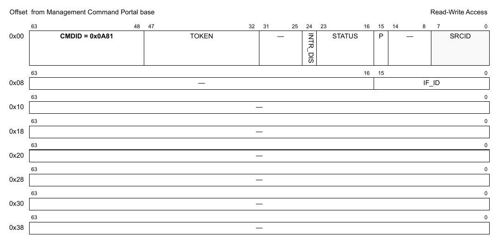

**Figure 334. Mô tả command DPDMUX_IF_GET_ATTR**

| Offset | Bits | Tên | Mô tả |
|---|---|---|---|
| 0x00 | 0-63 | Header của command | Xem Table 2 để biết mô tả chung các field của command portal. CMDID phải được đặt như chỉ ra trong hình ở trên. |
| 0x08 | 0-15 | IF_ID | Interface ID (0 cho uplink, hoặc 1-num_ifs); |

Mọi field không được nêu là reserved và phải được xóa (đặt bằng 0)

**Cấu trúc response**

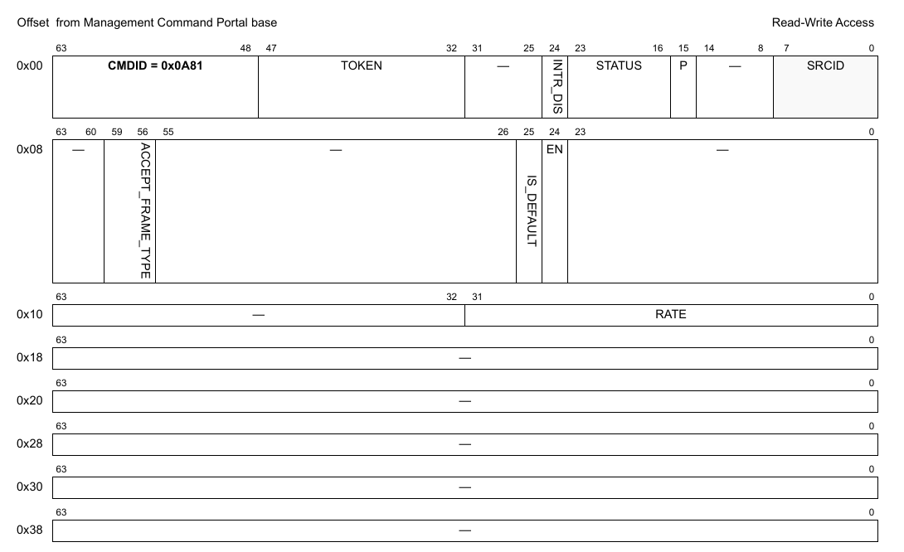

**Figure 335. Mô tả response của DPDMUX_IF_GET_ATTRIBUTES**

| Offset | Bits | Tên | Mô tả |
|---|---|---|---|
| 0x00 | 0-63 | Header của command | Xem Table 2 để biết mô tả chung các field của command portal. CMDID phải được đặt như chỉ ra trong hình ở trên. |
| 0x08 | 24 | ENABLED | Cho biết interface có đang enable không |
|   | 25 | IS__DEFAULT | Cho biết có được cấu hình làm default interface không |
|   | 56-59 | ACCEPT_FRAME_TYPE | Cho biết loại frame được chấp nhận của interface. Chọn một trong các giá trị được hỗ trợ dưới đây: 0x0 = DPDMUX_ADMIT_ALL - Thiết bị chấp nhận frame có VLAN tag, không tag và priority-tagged 0x1 = DPDMUX_ADMIT_ONLY_VLAN_TAGGED - Thiết bị loại bỏ frame không tag hoặc priority-tagged nhận được trên interface này 0x2 = DPDMUX_ADMIT_ONLY_UNTAGGED - Frame không tag hoặc priority-tagged nhận được trên interface này được chấp nhận |
| 0x10 | 0-31 | RATE | Tốc độ đã cấu hình của interface (tính bằng bit mỗi giây) |

Mọi field không được nêu là reserved và phải được xóa (đặt bằng 0)

### 13.3.19 DPDMUX_IF_ENABLE

**Cấu trúc command**

**Figure 336. Mô tả command DPDMUX_IF_ENABLE**

| Offset | Bits | Tên | Mô tả |
|---|---|---|---|
| 0x00 | 0-63 | Header của command | Xem Table 2 để biết mô tả chung các field của command portal. CMDID phải được đặt như chỉ ra trong hình ở trên. |
| 0x08 | 0-15 | IF_ID | Interface ID |

Mọi field không được nêu là reserved và phải được xóa (đặt bằng 0)

### 13.3.20 DPDMUX_IF_DISABLE

**Cấu trúc command**

**Figure 337. Mô tả command DPDMUX_IF_DISABLE**

| Offset | Bits | Tên | Mô tả |
|---|---|---|---|
| 0x00 | 0-63 | Header của command | Xem Table 2 để biết mô tả chung các field của command portal. CMDID phải được đặt như chỉ ra trong hình ở trên. |
| 0x08 | 0-15 | IF_ID | Interface ID |

Mọi field không được nêu là reserved và phải được xóa (đặt bằng 0)

### 13.3.21 DPDMUX_IF_SET_DEFAULT

Command này đặt interface nào là mặc định.

**Cấu trúc command**

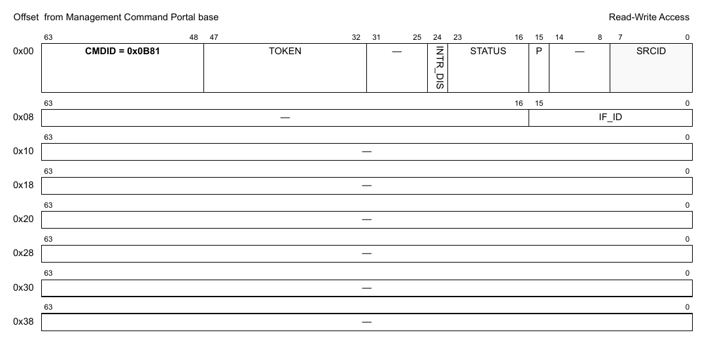

**Figure 338. Mô tả command DPDMUX_IF_SET_DEFAULT**

| Offset | Bits | Tên | Mô tả |
|---|---|---|---|
| 0x00 | 0-63 | Header của command | Xem Table 2 để biết mô tả chung các field của command portal. CMDID phải được đặt như chỉ ra trong hình ở trên. |
| 0x08 | 0-15 | IF_ID | Interface ID Nếu IF_ID = 0 thì sẽ không có default interface nào, kể cả khi trước đó đã thiết lập một interface. |

Mọi field không được nêu là reserved và phải được xóa (đặt bằng 0)

### 13.3.22 DPDMUX_IF_GET_DEFAULT

**Cấu trúc command**

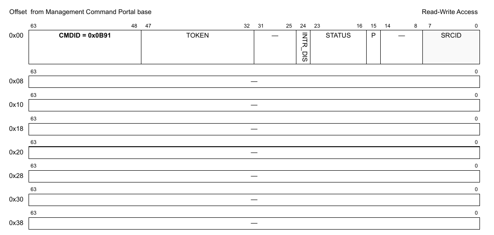

**Figure 339. Mô tả command DPDMUX_IF_GET_DEFAULT**

| Offset | Bits | Tên | Mô tả |
|---|---|---|---|
| 0x00 | 0-63 | Header của command | Xem Table 2 để biết mô tả chung các field của command portal. CMDID phải được đặt như chỉ ra trong hình ở trên. |

Mọi field không được nêu là reserved và phải được xóa (đặt bằng 0)

**Cấu trúc response**

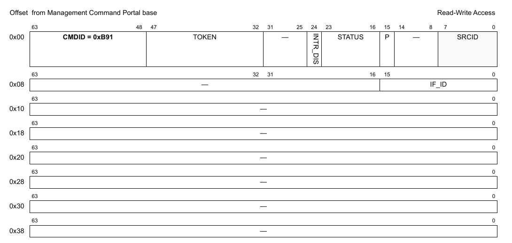

**Figure 340. Mô tả response của DPDMUX_IF_GET_DEFAULT**

| Offset | Bits | Tên | Mô tả |
|---|---|---|---|
| 0x00 | 0-63 | Header của command | Xem Table 2 để biết mô tả chung các field của command portal. CMDID phải được đặt như chỉ ra trong hình ở trên. |
| 0x08 | 0-15 | IF_ID | ID của default interface |

### 13.3.23 DPDMUX_SET_RESETABLE

Command này được dùng nếu người dùng muốn chỉ reset một số thuộc tính nhất định. Ví dụ, khi reset bằng DPDMUX_RESET, default interface bị thay bằng interface đặt trong DPDMUX_CREATE. Khi đặt flag DPDMUX_SKIP_MODIFY_DEFAULT_INTERFACE qua DPDMUX_SET_RESETABLE, default interface sẽ được giữ nguyên sau reset.

**Cấu trúc command**

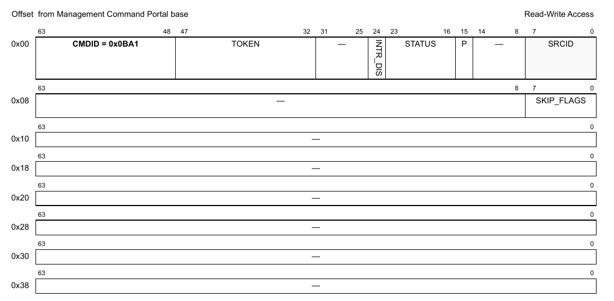

**Figure 341. Mô tả command DPDMUX_SET_RESETABLE**

| Offset | Bits | Tên | Mô tả |
|---|---|---|---|
| 0x00 | 0-63 | Header của command | Xem Table 2 để biết mô tả chung các field của command portal. CMDID phải được đặt như chỉ ra trong hình ở trên. |
| 0x08 | 0-7 | SKIP_FLAGS | Các flag dùng để chọn những thuộc tính muốn bỏ qua khi reset. Mặc định mọi flag bằng 0, DPDMUX được reset hoàn toàn. Flag: bit 0: DPDMUX_SKIP_MODIFY_DEFAULT_INTERFACE DPDMUX_RESET sẽ không sửa default interface sau reset bit 1: DPDMUX_SKIP_UNICAST_RULES DPDMUX_RESET sẽ không reset các quy tắc unicast bit 2: DPDMUX_SKIP_MULTICAST_RULES DPDMUX_RESET sẽ không reset các quy tắc multicast bit 3: DPDMUX_SKIP_RESET_DEFAULT_INTERFACE DPDMUX_RESET sẽ không reset default interface |

Mọi field không được nêu là reserved và phải được xóa (đặt bằng 0)

### 13.3.24 DPDMUX_GET_RESETABLE

**Cấu trúc command**

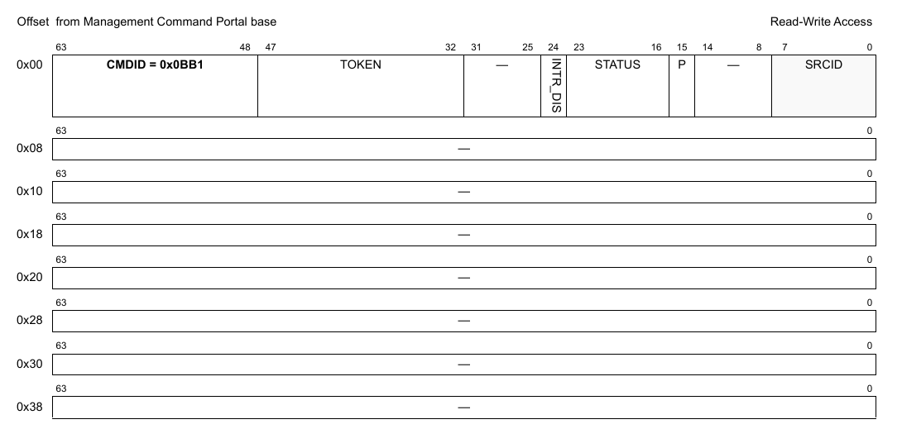

**Figure 342. Mô tả command DPDMUX_GET_RESETABLE**

| Offset | Bits | Tên | Mô tả |
|---|---|---|---|
| 0x00 | 0-63 | Header của command | Xem Table 2 để biết mô tả chung các field của command portal. CMDID phải được đặt như chỉ ra trong hình ở trên. |

Mọi field không được nêu là reserved và phải được xóa (đặt bằng 0)

**Cấu trúc response**

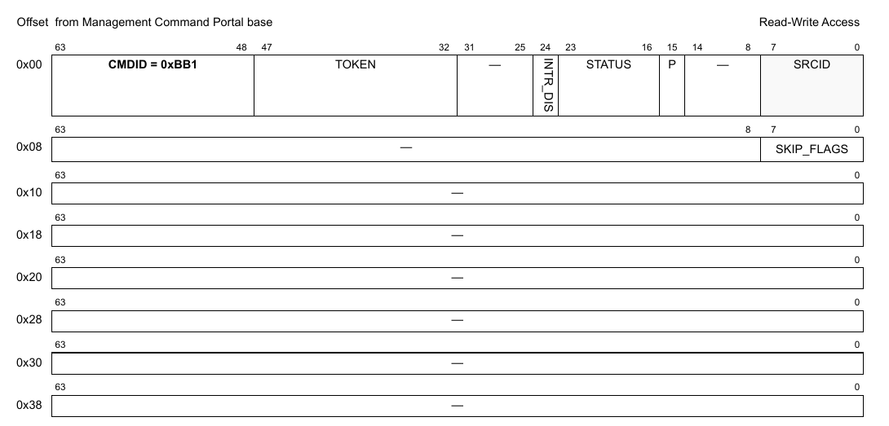

**Figure 343. Mô tả response của DPDMUX_GET_RESETABLE**

| Offset | Bits | Tên | Mô tả |
|---|---|---|---|
| 0x00 | 0-63 | Header của command | Xem Table 2 để biết mô tả chung các field của command portal. CMDID phải được đặt như chỉ ra trong hình ở trên. |
| 0x08 | 0-7 | SKIP_FLAGS | Các flag dùng để chọn những thuộc tính muốn bỏ qua khi reset. Mặc định mọi flag bằng 0, DPDMUX được reset hoàn toàn. Flag: bit 0: DPDMUX_SKIP_MODIFY_DEFAULT_INTERFACE DPDMUX_RESET sẽ không sửa default interface sau reset bit 1: DPDMUX_SKIP_UNICAST_RULES DPDMUX_RESET sẽ không reset các quy tắc unicast bit 2: DPDMUX_SKIP_MULTICAST_RULES DPDMUX_RESET sẽ không reset các quy tắc multicast bit 3: DPDMUX_SKIP_RESET_DEFAULT_INTERFACE DPDMUX_RESET sẽ không reset default interface |

### 13.3.25 DPDMUX_IF_REMOVE_L2_RULE

**Cấu trúc command**

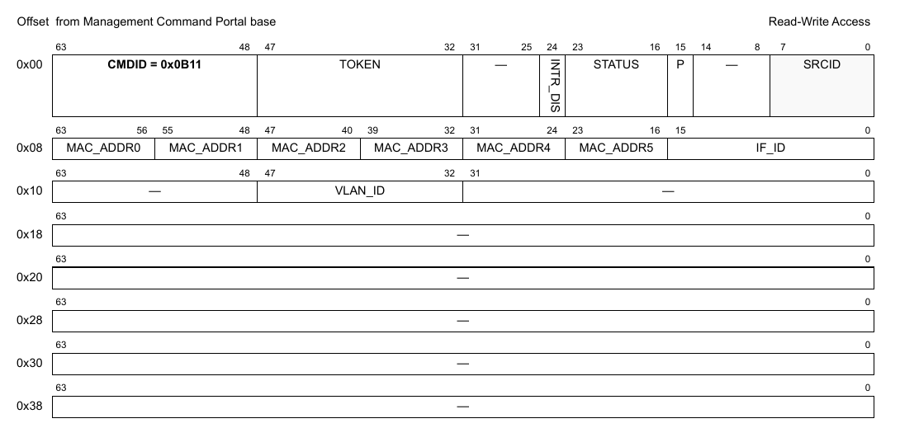

**Figure 344. Mô tả command DPDMUX_IF_REMOVE_L2_RULE**

| Offset | Bits | Tên | Mô tả |
|---|---|---|---|
| 0x00 | 0-63 | Header của command | Xem Table 2 để biết mô tả chung các field của command portal. CMDID phải được đặt như chỉ ra trong hình ở trên. |
| 0x08 | 0-15 | IF_ID | Interface ID đích |
|   | 16-63 | MAC_ADDR[0-5] | Địa chỉ MAC |
| 0x10 | 32-47 | VLAN_ID | VLAN ID |

Mọi field không được nêu là reserved và phải được xóa (đặt bằng 0)

### 13.3.26 DPDMUX_IF_ADD_L2_RULE

**Cấu trúc command**

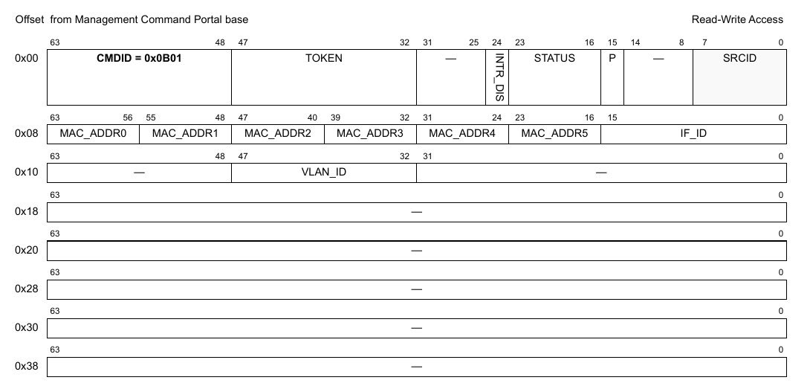

**Figure 345. Mô tả command DPDMUX_IF_ADD_L2_RULE**

| Offset | Bits | Tên | Mô tả |
|---|---|---|---|
| 0x00 | 0-63 | Header của command | Xem Table 2 để biết mô tả chung các field của command portal. CMDID phải được đặt như chỉ ra trong hình ở trên. |
| 0x08 | 0-15 | IF_ID | Interface ID đích |
|   | 16-63 | MAC_ADDR[0-5] | Địa chỉ MAC |
| 0x10 | 32-47 | VLAN_ID | VLAN ID |

Mọi field không được nêu là reserved và phải được xóa (đặt bằng 0)

### 13.3.27 DPDMUX_IF_GET_COUNTER

**Cấu trúc command**

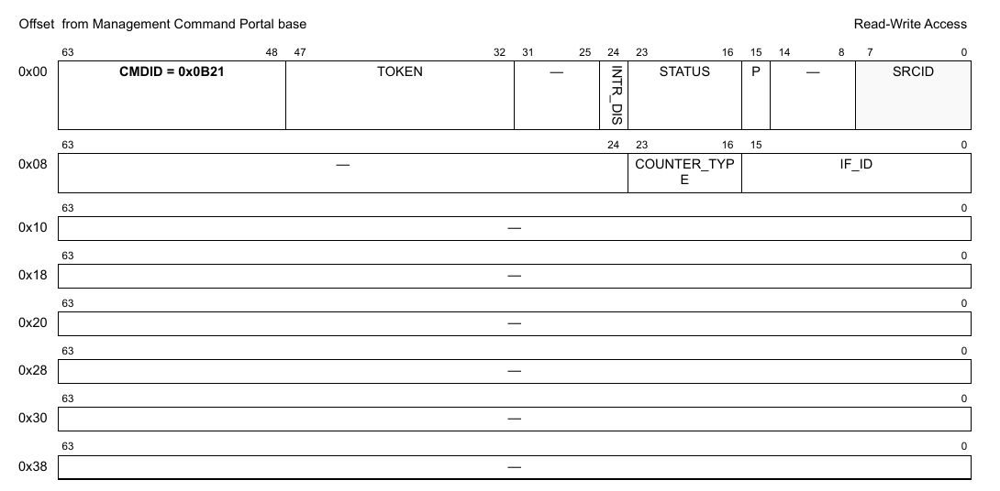

**Figure 346. Mô tả command DPDMUX_IF_GET_COUNTER**

| Offset | Bits | Tên | Mô tả |
|---|---|---|---|
| 0x00 | 0-63 | Header của command | Xem Table 2 để biết mô tả chung các field của command portal. CMDID phải được đặt như chỉ ra trong hình ở trên. |
| 0x08 | 0-15 | IF_ID | Interface ID |
|   | 16-23 | COUNTER_TYPE | Loại counter. Chọn một trong các giá trị được hỗ trợ dưới đây: 0x0 = DPDMUX_CNT_ING_FRAME- Đếm frame ingress 0x1 = DPDMUX_CNT_ING_BYTE - Đếm byte ingress 0x2 = DPDMUX_CNT_ING_FLTR_FRAME - Đếm frame ingress bị lọc 0x3 = DPDMUX_CNT_ING_FRAME_DISCARD - Đếm frame ingress bị loại bỏ 0x4 = DPDMUX_CNT_ING_MCAST_FRAME- Đếm frame multicast ingress 0x5 = DPDMUX_CNT_ING_MCAST_BYTE- Đếm byte multicast ingress 0x6 = DPDMUX_CNT_ING_BCAST_FRAME- Đếm frame broadcast ingress 0x7 = DPDMUX_CNT_ING_BCAST_BYTES - Đếm byte broadcast ingress 0x8 = DPDMUX_CNT_EGR_FRAME - Đếm frame egress 0x9 = DPDMUX_CNT_EGR_BYTE- Đếm byte egress 0xa = DPDMUX_CNT_EGR_FRAME_DISCARD - Đếm frame egress bị loại bỏ 0xb = DPDMUX_CNT_ING_NO_BUFFER_DISCARD - Đếm frame ingress bị loại bỏ vì không có buffer |

Mọi field không được nêu là reserved và phải được xóa (đặt bằng 0)

**Cấu trúc response**

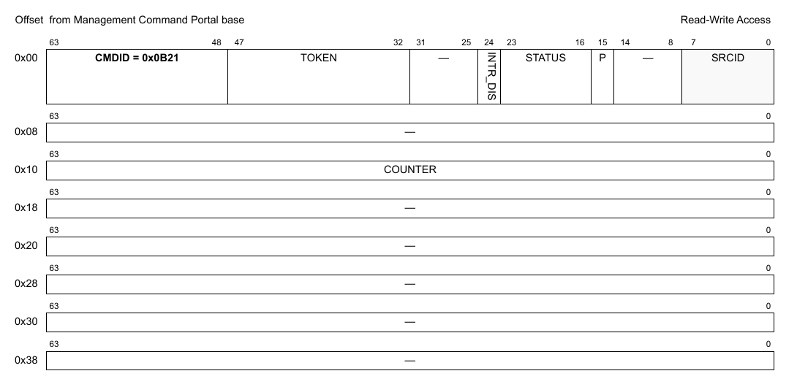

**Figure 347. Mô tả response của DPDMUX_IF_GET_COUNTER**

| Offset | Bits | Tên | Mô tả |
|---|---|---|---|
| 0x00 | 0-63 | Header của command | Xem Table 2 để biết mô tả chung các field của command portal. CMDID phải được đặt như chỉ ra trong hình ở trên. |
| 0x10 | 0-63 | COUNTER | Thông tin counter cụ thể được trả về |

Mọi field không được nêu là reserved và phải được xóa (đặt bằng 0)

### 13.3.28 DPDMUX_UL_RESET_COUNTERS

**Cấu trúc command**

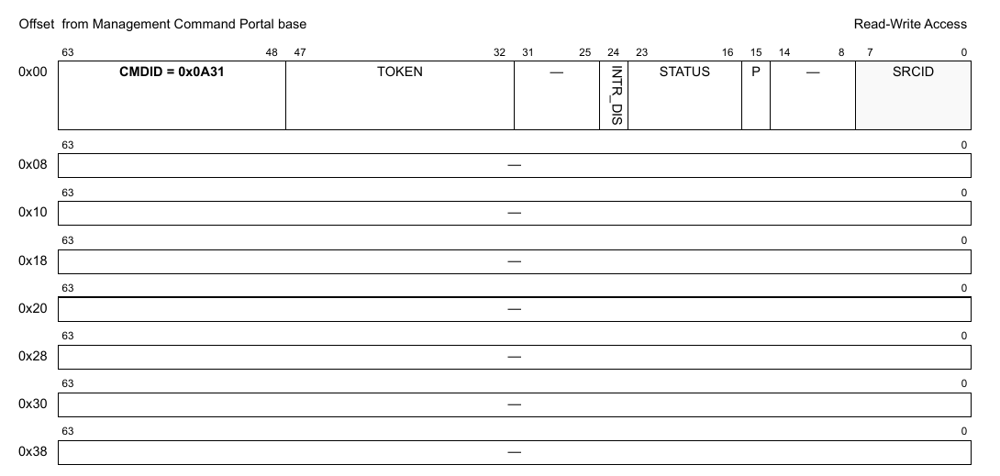

**Figure 348. Mô tả command DPDMUX_IF_RESET_COUNTERS**

| Offset | Bits | Tên | Mô tả |
|---|---|---|---|
| 0x00 | 0-63 | Header của command | Xem Table 2 để biết mô tả chung các field của command portal. CMDID phải được đặt như chỉ ra trong hình ở trên. |

Mọi field không được nêu là reserved và phải được xóa (đặt bằng 0)

### 13.3.29 DPDMUX_IF_SET_LINK_CFG

**Cấu trúc command**

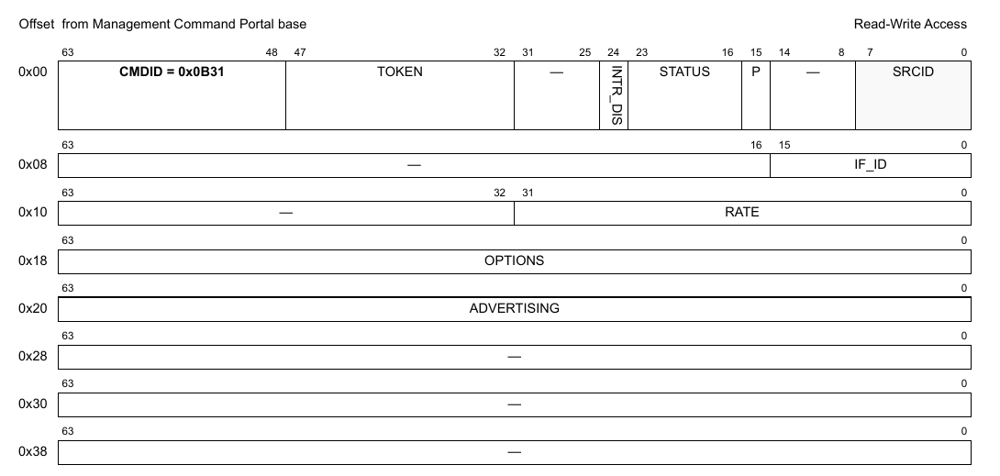

**Figure 349. Mô tả command DPDMUX_IF_SET_LINK_CFG**

| Offset | Bits | Tên | Mô tả |
|---|---|---|---|
| 0x00 | 0-63 | Header của command | Xem Table 2 để biết mô tả chung các field của command portal. CMDID phải được đặt như chỉ ra trong hình ở trên. |
| 0x08 | 0-15 | IF_ID | Interface ID |
| 0x10 | 0-63 | RATE | Tốc độ |
| 0x18 | 0-31 | OPTIONS | Mask các option có sẵn; dùng các giá trị ‘DPDMUX_LINK_OPT_\<x>’ |
| 0x20 | 0-63 | ADVERTISING | Các tốc độ được quảng bá cho autoneg |

Mọi field không được nêu là reserved và phải được xóa (đặt bằng 0)

### 13.3.30 DPDMUX_IF_GET_LINK_STATE

**Cấu trúc command**

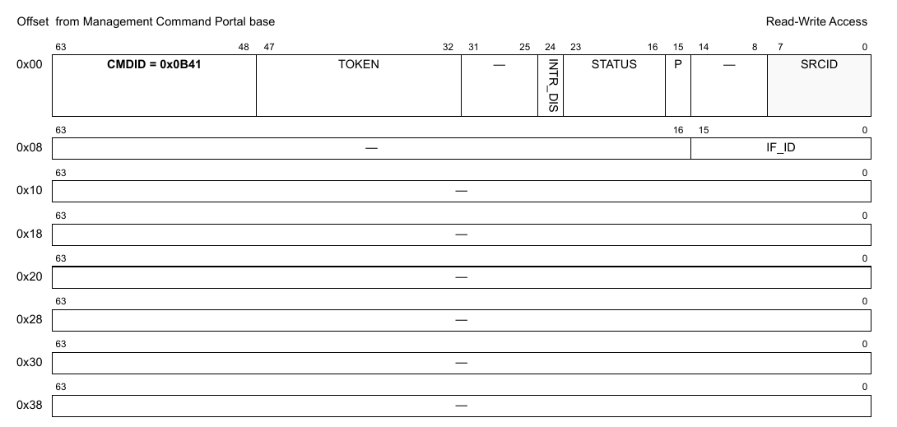

**Figure 350. Mô tả command DPDMUX_IF_GET_LINK_STATE**

| Offset | Bits | Tên | Mô tả |
|---|---|---|---|
| 0x00 | 0-63 | Header của command | Xem Table 2 để biết mô tả chung các field của command portal. CMDID phải được đặt như chỉ ra trong hình ở trên. |
| 0x08 | 0-15 | IF_ID | Interface ID |

Mọi field không được nêu là reserved và phải được xóa (đặt bằng 0)

**Cấu trúc response**

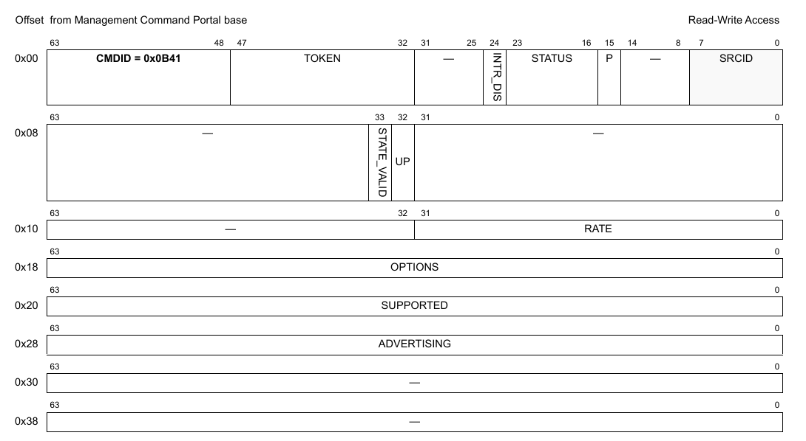

**Figure 351. Mô tả response của DPDMUX_IF_GET_LINK_STATE**

| Offset | Bits | Tên | Mô tả |
|---|---|---|---|
| 0x00 | 0-63 | Header của command | Xem Table 2 để biết mô tả chung các field của command portal. CMDID phải được đặt như chỉ ra trong hình ở trên. |
| 0x08 | 32 | UP | 0 - down, 1 - up |
|   | 33 | STATE_VALID | Bỏ qua/Cập nhật trạng thái của link |
| 0x10 | 0-31 | RATE | Tốc độ |
| 0x18 | 0-63 | OPTIONS | Mask các option có sẵn; dùng các giá trị ‘DPDMUX_LINK_OPT_\<x>’ |
| 0X20 | 0-63 | SUPPORTED | Các tốc độ mà phy hỗ trợ |
| 0X28 | 0-63 | ADVERTISING | Các tốc độ được quảng bá cho autoneg |

Mọi field không được nêu là reserved và phải được xóa (đặt bằng 0)

### 13.3.31 DPDMUX_GET_API_VERSION

**Cấu trúc command**

**Figure 352. Mô tả command DPDMUX_GET_API_VERSION**

| Offset | Bits | Tên | Mô tả |
|---|---|---|---|
| 0x00 | 0-63 | Header của command | Xem Table 2 để biết mô tả chung các field của command portal. CMDID phải được đặt như chỉ ra trong hình ở trên. |

Mọi field không được nêu là reserved và phải được xóa (đặt bằng 0)

**Cấu trúc response**

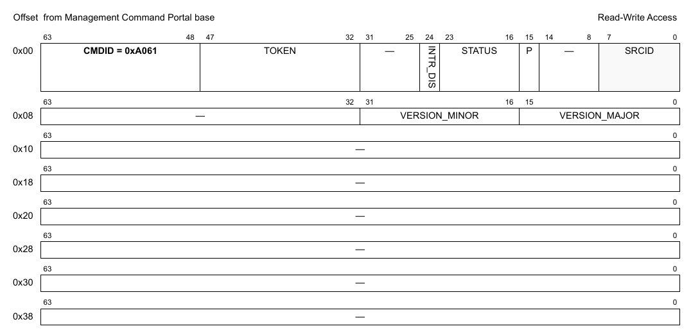

**Figure 353. Mô tả response của DPDMUX_GET_API_VERSION**

| Offset | Bits | Tên | Mô tả |
|---|---|---|---|
| 0x00 | 0-63 | Header của command | Xem Table 2 để biết mô tả chung các field của command portal. CMDID phải được đặt như chỉ ra trong hình ở trên. |
| 0x08 | 0-15 | VERSION_MAJOR | Major version của API |
|   | 16-31 | VERSION_MINOR | Minor version của API |

### 13.3.32 DPDMUX_SET_CUSTOM_KEY

API này dùng để đặt một classification key tùy chỉnh. Chỉ dùng được cho các instance DPDMUX tạo với DPDMUX_METHOD_CUSTOM. API này phải được gọi trước khi nạp dữ liệu cho bảng phân loại bằng command DPDMUX_ADD_CUSTOM_CLS_ENTRY. Mọi lời gọi DPDMUX_SET_CUSTOM_KEY đều xóa các mục phân loại hiện có có thể đã được thêm trước đó bằng command DPDMUX_ADD_CUSTOM_CLS_ENTRY.

**Cấu trúc command**

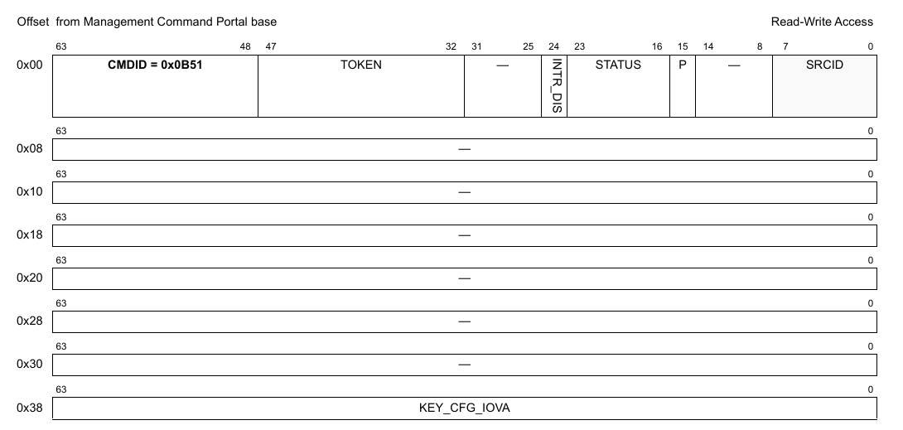

**Figure 354. Mô tả command DPDMUX_SET_CUSTOM_KEY**

| Offset | Bits | Tên | Mô tả |
|---|---|---|---|
| 0x00 | 0-63 | Header của command | Xem Table 2 để biết mô tả chung các field của command portal. CMDID phải được đặt như chỉ ra trong hình ở trên. |
| 0x38 | 0-63 | KEY_CFG_IOVA | Địa chỉ ảo I/O của một cấu trúc cấu hình được thiết lập bằng DPKG_PREPARE_KEY_CFG. Kích thước key tối đa là 24 byte. |

Mọi field không được nêu là reserved và phải được xóa (đặt bằng 0)

### 13.3.33 DPDMUX_ADD_CUSTOM_CLS_ENTRY

API này dùng để thêm một mục phân loại tùy chỉnh. Chỉ dùng được cho các instance DPDMUX tạo với DPDMUX_METHOD_CUSTOM. Trước khi gọi hàm này, phải thiết lập quy tắc ghép classification key bằng DPDMUX_SET_CUSTOM_KEY.

**Cấu trúc command**

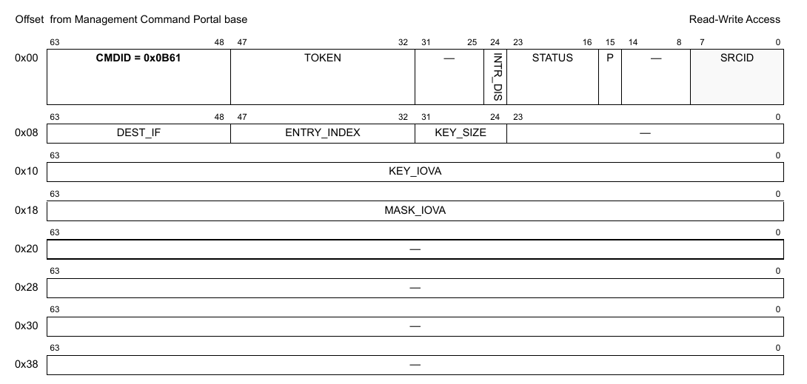

**Figure 355. Mô tả command DPDMUX_ADD_CUSTOM_CLS_ENTRY**

| Offset | Bits | Tên | Mô tả |
|---|---|---|---|
| 0x00 | 0-63 | Header của command | Xem Table 2 để biết mô tả chung các field của command portal. CMDID phải được đặt như chỉ ra trong hình ở trên. |
| 0x08 | 24-31 | KEY_SIZE | Kích thước, tính bằng byte, của giá trị lookup. Phải khớp kích thước lookup key định nghĩa bằng DPDMUX_SET_CUSTOM_KEY, nếu không mục này sẽ không bao giờ khớp. |
|   | 32-47 | ENTRY_INDEX | Field này là index của quy tắc trong bảng lookup TCAM. Index này chỉ được dùng khi DPDMUX được tạo với option DPDMUX_OPT_CLS_MASK_SUPPORT (ngầm định DPDMUX_METHOD_CUSTOM). |
|   | 48–63 | DEST_IF | Interface để chuyển frame tới. Cách đánh số port giống cách dùng khi nối interface: • 0 là uplink port • mọi port khác là downlink port. |
| 0x10 | 0-63 | KEY_IOVA | Địa chỉ ảo I/O của buffer chứa giá trị lookup. |
| 0x18 | 0-63 | MASK_IOVA | Địa chỉ ảo I/O của mask dùng cho phân loại TCAM. |

Mọi field không được nêu là reserved và phải được xóa (đặt bằng 0)

### 13.3.34 DPDMUX_REMOVE_CUSTOM_CLS_ENTRY

API này dùng để gỡ một mục phân loại tùy chỉnh. Chỉ dùng được cho các instance DPDMUX tạo với DPDMUX_METHOD_CUSTOM. API này cũng dùng để gỡ các mục phân loại đã chèn trước đó bằng DPDMUX_ADD_CUSTOM_CLS_ENTRY.

**Cấu trúc command**

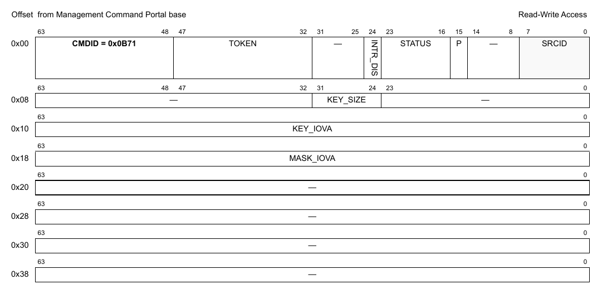

**Figure 356. Mô tả command DPDMUX_REMOVE_CUSTOM_CLS_ENTRY**

| Offset | Bits | Tên | Mô tả |
|---|---|---|---|
| 0x00 | 0-63 | Header của command | Xem Table 2 để biết mô tả chung các field của command portal. CMDID phải được đặt như chỉ ra trong hình ở trên. |
| 0x08 | 24-31 | KEY_SIZE | Kích thước, tính bằng byte, của giá trị lookup. Phải khớp kích thước lookup key định nghĩa bằng DPDMUX_SET_CUSTOM_KEY, nếu không mục này sẽ không bao giờ khớp. |
| 0x10 | 0-63 | KEY_IOVA | Địa chỉ ảo I/O của buffer chứa giá trị lookup. |
| 0x18 | 0-63 | MASK_IOVA | Địa chỉ ảo I/O của mask dùng cho phân loại TCAM. |

Mọi field không được nêu là reserved và phải được xóa (đặt bằng 0)

### 13.3.35 DPDMUX_IF_SET_TAILDROP

Dùng command này có thể cấu hình tail drop lúc runtime.

**Cấu trúc command**

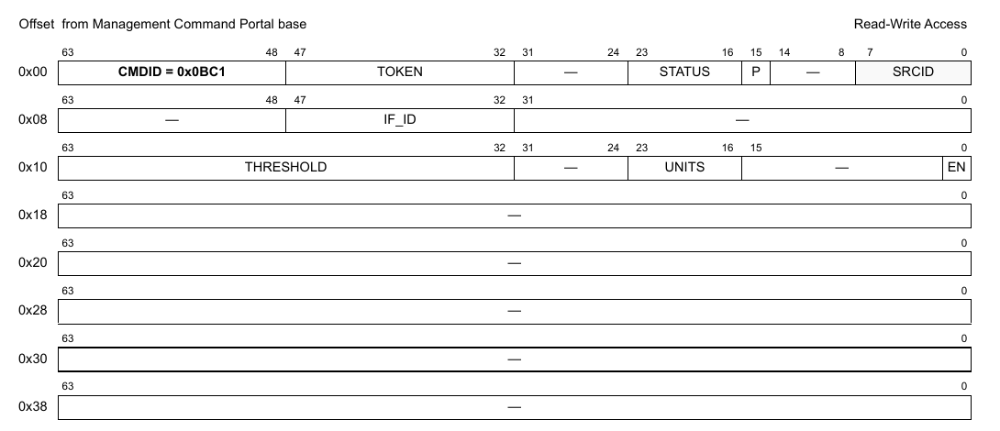

**Figure 357. Mô tả command DPDMUX_IF_SET_TAILDROP**

| Offset | Bits | Tên | Mô tả |
|---|---|---|---|
| 0x00 | 0-63 | Header của command | Xem Table 2 để biết mô tả chung các field của command portal. CMDID phải được đặt như chỉ ra trong hình ở trên. |
| 0x08 | 32-47 | IF_ID | Interface ID. |
| 0x10 | 0 | EN | Bật tail drop. |
|   | 16-23 | UNITS | Đặt đơn vị dùng cho ngưỡng: 0: Đơn vị byte 1: Đơn vị packet 2: Đơn vị buffer |
|   | 32-63 | THRESHOLD | Giá trị ngưỡng theo “UNITS” dùng cho tail drop. |

Mọi field không được nêu là reserved và phải được xóa (đặt bằng 0)

### 13.3.36 DPDMUX_IF_GET_TAILDROP

Lấy thông tin liên quan đến tail drop.

**Cấu trúc command**

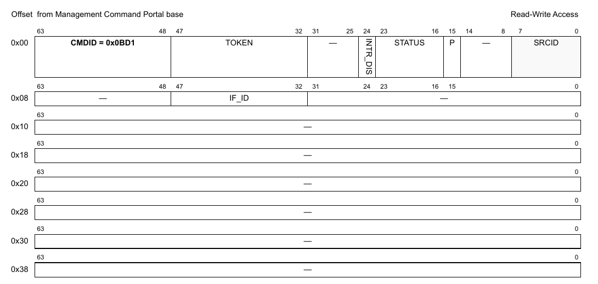

**Figure 358. Mô tả command DPDMUX_IF_GET_TAILDROP**

| Offset | Bits | Tên | Mô tả |
|---|---|---|---|
| 0x00 | 0-63 | Header của command | Xem Table 2 để biết mô tả chung các field của command portal. CMDID phải được đặt như chỉ ra trong hình ở trên. |
| 0x08 | 32-47 | IF_ID | Interface ID. |

Mọi field không được nêu là reserved và phải được xóa (đặt bằng 0)

**Cấu trúc response**

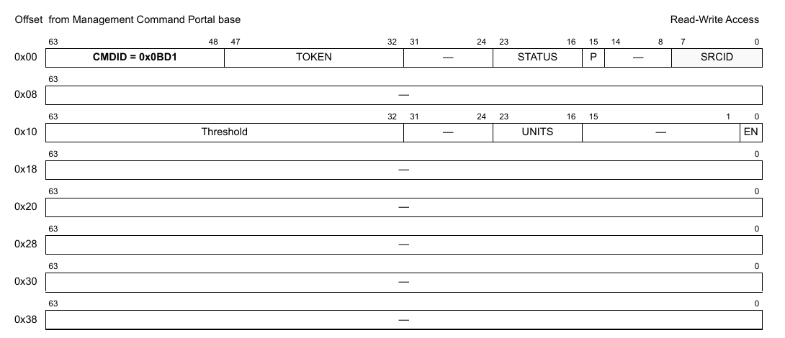

**Figure 359. Mô tả response của DPDMUX_IF_GET_TAILDROP**

| Offset | Bits | Tên | Mô tả |
|---|---|---|---|
| 0x00 | 0-63 | Header của command | Xem Table 2 để biết mô tả chung các field của command portal. CMDID phải được đặt như chỉ ra trong hình ở trên. |
| 0x10 | 0 | EN | Bật tail drop. |
|   | 16-23 | UNITS | Đặt đơn vị dùng cho ngưỡng: 0: Đơn vị byte 1: Đơn vị packet 2: Đơn vị buffer |
|   | 32-63 | THRESHOLD | Giá trị ngưỡng theo “UNITS” dùng cho tail drop. |

Mọi field không được nêu là reserved và phải được xóa (đặt bằng 0)

### 13.3.37 DPDMUX_DUMP_TABLE

Dump vào địa chỉ IOVA thông tin về mọi mục của bảng mong muốn. Trả về số mục đã dump.

**Cấu trúc command**

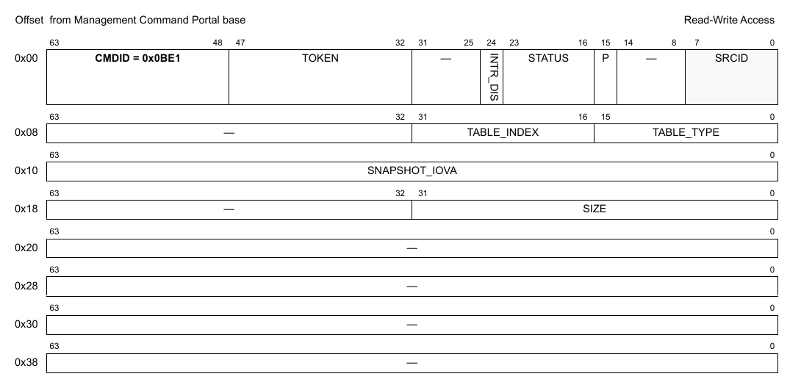

**Figure 360. Mô tả command DPDMUX_DUMP_TABLE**

| Offset | Bits | Tên | Mô tả |
|---|---|---|---|
| 0x00 | 0-63 | Header của command | Xem Table 2 để biết mô tả chung các field của command portal. CMDID phải được đặt như chỉ ra trong hình ở trên. |
| 0x08 | 0-15 | TABLE_TYPE | 1: DPDMUX_DMAT_TABLE 2: DPDMUX_MISS_TABLE 3: DPDMUX_PRUNE_TABLE |
|   | 16-31 | TABLE_INDEX | Luôn bằng 0 |
| 0x10 | 0-63 | SNAPSHOT_IOVA | Địa chỉ IOVA. |
| 0x18 | 0-31 | SIZE | Kích thước cần dump. |

Mọi field không được nêu là reserved và phải được xóa (đặt bằng 0)

**Cấu trúc response**

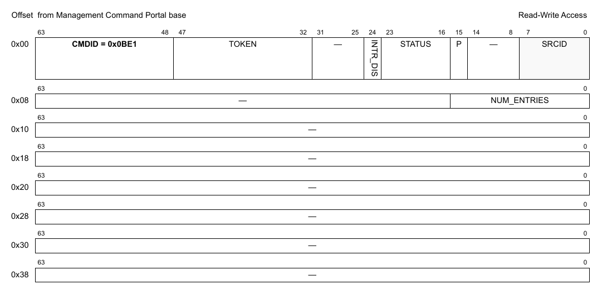

**Figure 361. Mô tả response của DPDMUX_DUMP_TABLE**

| Offset | Bits | Tên | Mô tả |
|---|---|---|---|
| 0x00 | 0-63 | Header của command | Xem Table 2 để biết mô tả chung các field của command portal. CMDID phải được đặt như chỉ ra trong hình ở trên. |
| 0x08 | 0-63 | NUM_ENTRIES | Số mục đã dump. |

Mọi field không được nêu là reserved và phải được xóa (đặt bằng 0)

### 13.3.38 DPDMUX_IF_SET_ERRORS_BEHAVIOR

Command này sẽ cấu hình interface không loại bỏ các frame có lỗi

**Cấu trúc command**

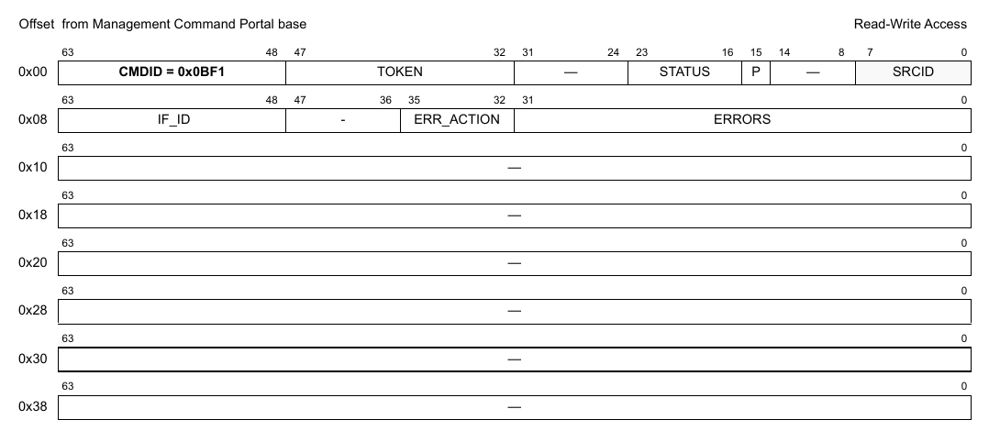

**Figure 362. Mô tả command DPDMUX_IF_SET_ERRORS_BEHAVIOR**

| Offset | Bits | Tên | Mô tả |
|---|---|---|---|
| 0x00 | 0-63 | Header của command | Xem Table 2 để biết mô tả chung các field của command portal. CMDID phải được đặt như chỉ ra trong hình ở trên. |
| 0x08 | 0-31 | ERRORS | bit 17: DPDMUX_ERROR_EOFHE extract ra ngoài header của frame bit 13: DPDMUX_ERROR_FLE lỗi độ dài frame bit 12: DPDMUX_ERROR_FPE lỗi vật lý của frame bit 5: DPDMUX_ERROR_PHE lỗi parsing header bit 2: DPDMUX__ERROR_L3CE *(ghi chú: đúng là DPDMUX_ERROR_L3CE)* lỗi checksum L3 bit 0: DPDMUX__ERROR_L4CE *(ghi chú: đúng là DPDMUX_ERROR_L4CE)* lỗi checksum L4 |
|   | 32-35 | ERR_ACTION | 0: DPDMUX_ERROR_ACTION_DISCARD 1: DPDMUX_ERROR_ACTION_CONTINUE |
|   | 48-63 | IF_ID | Interface ID Nếu DPDMUX được cấu hình hoạt động ở chế độ VEPA, interface ID phải luôn bằng 0. |

Mọi field không được nêu là reserved và phải được xóa (đặt bằng 0)

### 13.3.39 DPDMUX_GET_MAX_FRAME_LENGTH

Lấy độ dài frame tối đa của interface được chỉ định.

**Cấu trúc command**

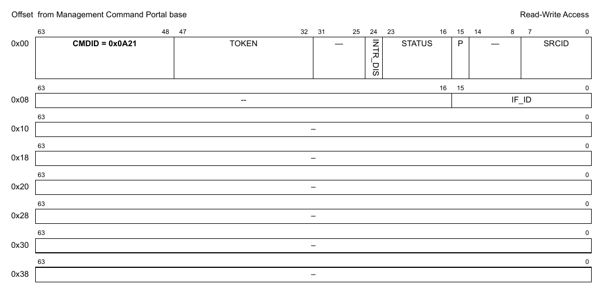

**Figure 363. Mô tả command DPDMUX_GET_MAX_FRAME_LENGTH**

| Offset | Bits | Tên | Mô tả |
|---|---|---|---|
| 0x00 | 0-63 | Header của command | Xem Table 2 để biết mô tả chung các field của command portal. CMDID phải được đặt như chỉ ra trong hình ở trên. |
| 0x08 | 0-15 | IF_ID | Interface ID |

Mọi field không được nêu là reserved và phải được xóa (đặt bằng 0)

**Cấu trúc response**

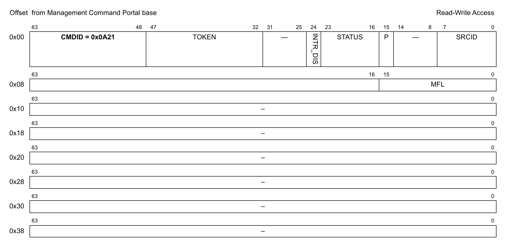

**Figure 364. Mô tả response của DPDMUX_GET_MAX_FRAME_LENGTH**

| Offset | Bits | Tên | Mô tả |
|---|---|---|---|
| 0x00 | 0-63 | Header của command | Xem Table 2 để biết mô tả chung các field của command portal. CMDID phải được đặt như chỉ ra trong hình ở trên. |
| 0x08 | 0-15 | MFL | Độ dài frame tối đa |

Mọi field không được nêu là reserved và phải được xóa (đặt bằng 0)

### 13.3.40 DPDMUX_SET_SP_PROFILE

Thiết lập Soft Parser Profile mong muốn trên DPDMUX đang dùng. Soft Parser Profile được dùng để nhận diện các giao thức tùy chỉnh mà HW Parser không nhận ra. Một SP Profile có thể chứa không hoặc nhiều giao thức tùy chỉnh.

**Cấu trúc command**

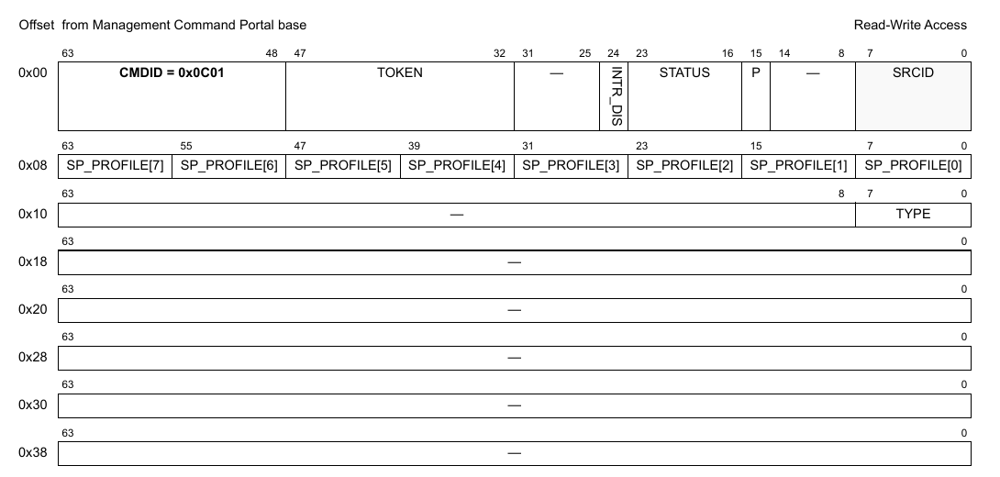

**Figure 365. Mô tả command DPDMUX_SET_SP_PROFILE**

| Offset | Bits | Tên | Mô tả |
|---|---|---|---|
| 0x00 | 0-63 | Header của command | Xem Table 2 để biết mô tả chung các field của command portal. CMDID phải được đặt như chỉ ra trong hình ở trên. |
| 0x08 | 0-7 | SP_PROFILE[0] | Tên Soft Parser Profile (phải là tên hợp lệ của một profile đã định nghĩa). Chuỗi này dài tối đa 8 ký tự. Nếu tham số này là chuỗi rỗng |
|   | 8-15 | SP_PROFILE[1] | (toàn số 0), Default SP Profile sẽ được đặt trên dpdmux này. |
|   | 16-23 | SP_PROFILE[2] |   |
|   | 24-31 | SP_PROFILE[3] |   |
|   | 32-39 | SP_PROFILE[4] |   |
|   | 40-47 | SP_PROFILE[5] |   |
|   | 48-55 | SP_PROFILE[6] |   |
|   | 56-63 | SP_PROFILE[7] |   |
| 0x10 | 0-7 | TYPE | Đặt SP Profile trên parser Ingress hoặc Egress của WRIOP cho DPDMUX: DPDMUX_SP_PROFILE_INGRESS - 0x1 DPDMUX_SP_PROFILE_EGRESS - 0x2 |

Mọi field không được nêu là reserved và phải được xóa (đặt bằng 0)

### 13.3.41 DPDMUX_SP_ENABLE

Bật hoặc tắt Soft Parser trên DPDMUX đang dùng.

**Cấu trúc command**

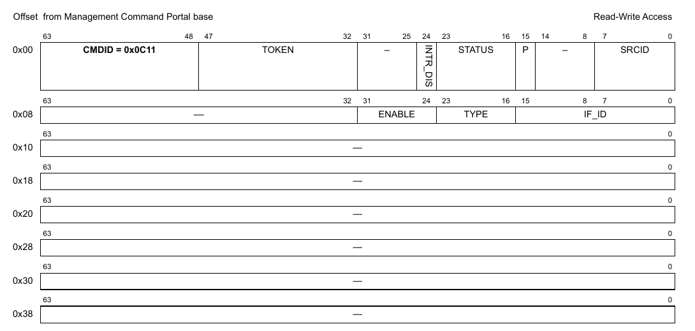

**Figure 366. Mô tả command DPDMUX_SP_ENABLE**

| Offset | Bits | Tên | Mô tả |
|---|---|---|---|
| 0x00 | 0-63 | Header của command | Xem Table 2 để biết mô tả chung các field của command portal. CMDID phải được đặt như chỉ ra trong hình ở trên. |
| 0x10 | 0-15 | IF_ID | Interface ID của DPDMUX cần bật/tắt SP |
|   | 16-23 | TYPE | Bật/tắt SP trên Ingress hoặc Egress của interface DPDMUX (hoặc cả hai bằng phép OR bit): 0x1 - DPDMUX_SP_PROFILE_INGRESS 0x2 - DPDMUX_SP_PROFILE_EGRESS |
|   | 24-31 | ENABLE | 0x0 - tắt 0x1 - bật |

Mọi field không được nêu là reserved và phải được xóa (đặt bằng 0)
