# Chương 14 DPSW: Data Path L2 Switch

DPSW object cung cấp chức năng của một switch tầng 2 thông thường. Nó nhận packet ở một port và gửi ra port khác. Nó cũng có thể gửi packet ra nhiều port cho mục đích broadcast, multicast hoặc mirroring.

## 14.1 Các tính năng của DPSW

Danh sách sau tóm tắt các tính năng và khả năng chính của DPSW:

- Hỗ trợ switching 802.1Q:
  - Chuyển tiếp dựa trên VLAN (ngoài) và địa chỉ MAC
  - Chuyển tiếp các frame L2 unicast, multicast và broadcast
- Hỗ trợ kết nối tới DPMAC và DPNI
- Hỗ trợ bảng MAC (FDB) riêng cho mỗi VLAN
- Hỗ trợ dùng chung FDB giữa nhiều VLAN
- Hỗ trợ flooding (cấu hình theo từng VLAN)
- Hỗ trợ ba chế độ học địa chỉ, chọn theo từng FDB:
  - Học tự động bằng phần cứng switch
  - Học có bảo mật (secure) bằng phần mềm GPP host
  - Học không bảo mật (non-secure) bằng phần mềm GPP host
- Hỗ trợ VLAN theo port – định nghĩa VLAN mặc định cho mỗi interface
- Hỗ trợ truyền frame không tag (cấu hình theo từng VLAN/interface)
- Hỗ trợ nhận frame không tag:
  - Nhận frame có tag và không tag
  - Chỉ nhận frame có tag
- Hỗ trợ lọc VLAN – drop frame có VLAN chưa đăng ký
- Hỗ trợ trunk interface – chấp nhận mọi VLAN (cấu hình theo từng interface)
- Hỗ trợ hai TPID tùy chỉnh cho mỗi switch
- Hỗ trợ mirroring interface, có tùy chọn chỉ mirror một VLAN cụ thể
  - Một interface đích mirroring cho mỗi VLAN
- Hỗ trợ đánh dấu STP/RSTP/MSTP (Spanning Tree Protocol do phần mềm GPP host xử lý)
  - Cần thêm các quy tắc ACL tường minh để bẫy frame STP lên CPU (Chuyển hướng tới control interface)
- Hỗ trợ các khả năng QoS:
  - Chọn traffic class dựa trên DSCP hoặc 802.1P
  - Hỗ trợ phân bổ băng thông truyền cho mỗi traffic class
  - Hỗ trợ cấu hình tốc độ truyền cho mỗi interface
  - Hỗ trợ WRED ở ingress (cấu hình theo từng traffic class)
- Hỗ trợ chuyển tiếp theo chính sách ở ingress:
  - Lookup TCAM với key ghép từ các field L2-L4
- Hỗ trợ chuyển tiếp có chọn lọc một số giao thức tới control interface, ví dụ:
  - Các packet giám sát Ethernet (IEEE 802.3 clause 57, IEEE 802.1ag, ITU-T Y.1731)
  - Các packet quản lý multicast group (IGMP/MLD)
  - Các packet Spanning Tree Protocol (BPDU)
- Hỗ trợ counter thống kê cho mỗi interface
- Hỗ trợ báo link state cho mỗi interface
- Hỗ trợ interrupt tới phần mềm GPP host:
  - Các event thay đổi link (theo từng interface)
- Hỗ trợ các thao tác enable, disable và reset switch
- Hỗ trợ các thao tác enable và disable interface
- Hỗ trợ Link Aggregation

## 14.2 Mô tả chức năng của DPSW

### 14.2.1 Tạo instance L2 switch

DPSW có thể được khai báo trong file DPL (Data Path Layout) hoặc được tạo động bằng cách gửi command DPSW_CREATE tường minh tới Management Complex. DPSW chỉ có một đầu vào bắt buộc để tạo một instance L2 switch hoạt động được, đó là số interface của switch. Các option cấu hình khác cũng có, nhưng có giá trị mặc định cho đơn giản.

Chế độ hoạt động mặc định của DPSW (trừ khi yêu cầu khác lúc tạo DPSW) là có một VLAN mặc định (VID = 1), một Forwarding Data Base duy nhất (FDB 0) và bật học tự động trong phần cứng. Nghĩa là switch hoạt động đầy đủ ngay sau khi tạo, và người dùng chỉ cần nối từng interface của nó với DPMAC object hoặc DPNI object. Các kết nối có thể được thực hiện ngay trong DPL hoặc sau đó qua DPRC object.

### 14.2.2 Cấu hình VLAN

Switch khởi động với VLAN 1 được cấu hình làm VLAN mặc định. Mọi traffic không tag nhận được trên bất kỳ port nào của switch đều được phân loại vào VLAN 1, và mọi frame được phân loại vào VLAN 1 đều được gửi ra không tag trên mọi port.

DPSW cho phép thêm (và gỡ) các VLAN khác bất cứ lúc nào. Mỗi VLAN có thể gồm bất kỳ tập con nào của các port switch.

### 14.2.3 Các chế độ học

Cấu hình mặc định của switch bật học tự động bằng phần cứng switch. Có thể đặt chế độ học bằng CPU Secure hoặc Unsecure thay cho học tự động. Chế độ học được cấu hình theo từng FDB.

Bảng dưới đây tóm tắt khác biệt giữa hai chế độ học bằng CPU. Các chế độ này đòi hỏi một interface của switch được định nghĩa làm control interface.

| Chế độ học | Đã biết SMAC | Đã biết DMAC | Hành động |
|---|---|---|---|
| Học bằng CPU Non-Secure | V | V | Chuyển tới đích DMAC |
|   | - | V | Chuyển tới đích DMAC + control interface |
|   | V | - | Chuyển tới danh sách các interface bật flooding |
|   | - | - | Chuyển tới danh sách các interface bật flooding + control interface |
| Secure<br>Học bằng CPU | V | V | Chuyển tới đích DMAC |
|   | - | V | Chuyển tới control interface |
|   | V | - | Chuyển tới danh sách các interface bật flooding |
|   | - | - | Chuyển tới control interface |

Lưu ý rằng tắt học tự động không xóa các mục đã học. Vì vậy, cần tắt học trước khi đưa bất kỳ traffic nào vào nếu muốn thiết lập một topology tĩnh.

### 14.2.4 Cấu hình FDB

Cấu hình switch mặc định không có mục tĩnh nào. Có thể thêm (và gỡ) các quy tắc tĩnh để chuyển tiếp tới các interface khác nhau dựa trên địa chỉ MAC.

Người dùng có thể chọn dùng một FDB riêng cho mỗi VLAN hoặc dùng chung FDB giữa các VLAN khác nhau.

### 14.2.5 Cấu hình LAG

Tính năng Link Aggregation được triển khai như một phần của DPSW object. Có hai kiểu cấu hình được hỗ trợ: tĩnh (qua DPL) và động (qua API).

Các mục sau tóm tắt tình trạng hỗ trợ LAG hiện tại:

- Tính năng đã được kiểm chứng trên nền tảng LS2088
- Số group tối đa được hỗ trợ là 8; số port tối đa trong một group là 8
- Chỉ các port switch nối với port vật lý (DPMAC) mới được thêm vào LAG group
- Chỉ các DPMAC dùng cùng một CEETM instance mới được thêm vào cùng một LAG group. Mặc định, MC sẽ cố cân bằng việc phân bổ DPMAC cho CEETM. Kết quả có thể thấy trong log của MC qua các message debug như: “[D] MAC.X(PP) was balanced to ceetm_id = Y and lni = Z(rate = XYZ)”. Nếu người dùng muốn đổi CEETM dùng cho port vật lý nào, có thể cấu hình bằng tham số “ceetm_instance = \<x>;” chỉ định trong vùng cấu hình theo port của DPC.
- Phần cứng tính một giá trị hash để chọn port truyền. Hash được tính trên bộ 5 thành phần gồm: MAC SRC, MAC DST, IP SRC, IP DST, L3 PROTOCOL.
- Khi định nghĩa LAG group, người dùng cần dùng interface ID của master port (port đầu tiên trong LAG group) khi gọi bất kỳ API nào của DPSW cần interface ID (ví dụ: dpsw_if_set_tci). Không nên dùng ID của các slave port (các port còn lại trong LAG group trừ port đầu tiên) khi gọi API của DPSW.

Ví dụ cấu hình bằng API:

```
struct dpsw_lag_cfg dpsw_lag_cfg = {0};
dpsw_lag_cfg.group_id = 1; /*group ID*/
dpsw_lag_cfg.num_ifs = 2; /*number of ports */
dpsw_lag_cfg.if_id[0] = 0;
dpsw_lag_cfg.if_id[1] = 1;
err = dpsw_lag_set(&dpsw->io, 0, dpsw->token, &dpsw_lag_cfg);
```

Trong ví dụ này, dpsw_lag_set tạo LAG group có ID=1 với hai interface: 0 (dpsw@1/if@0) và 1 (dpsw@1/if@1).

Cấu hình các LAG group có thể lấy bằng API dpsw_lag_get_cfg như dưới đây:

```
int group_id = 1;
err = dpsw_lag_get_cfg(&dpsw->io,0,dpsw->token,group_id,&dpsw_lag_cfg);
```

## 14.3 Tham chiếu command của DPSW

Mục này trình bày chi tiết mô hình lập trình các command của DPSW.

### 14.3.1 DPSW_OPEN

Mở một phiên điều khiển cho object được chỉ định.

Hàm này có thể dùng để mở phiên điều khiển cho một object đã được tạo; object có thể đã được khai báo trong DPL hoặc được tạo bằng command DPSW_CREATE.

Hàm này trả về một authentication token duy nhất, gắn với object ID cụ thể; token này phải được dùng trong mọi command tiếp theo cho object này.

**Cấu trúc command**

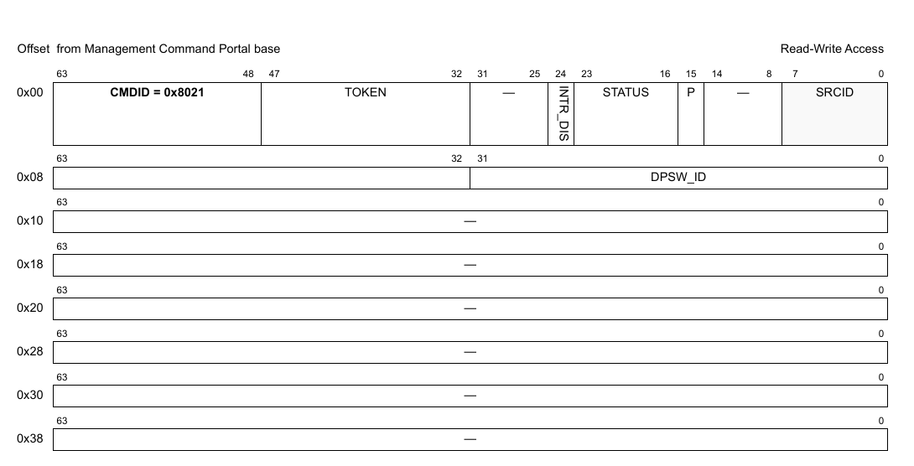

**Figure 367. Mô tả command DPSW_OPEN**

Bảng sau mô tả các field của command.

**Table 63. Mô tả các field của command DPSW_OPEN<sup>1</sup>**

| Offset | Bits | Tên | Mô tả |
|---|---|---|---|
| 0x00 | 0-63 | Header của command | Xem Table 2 để biết mô tả chung các field của command portal.<br>CMDID phải được đặt như chỉ ra trong hình ở trên. |
| 0x08 | 0-31 | DPSW_ID | ID duy nhất của DPSW |

<sup>1</sup> Mọi field không được nêu là reserved và phải được xóa (đặt bằng 0)

### 14.3.2 DPSW_CLOSE

Đóng phiên điều khiển của object.

Sau khi gọi hàm này, không thao tác nào khác được phép trên object nếu không mở một phiên điều khiển mới.

**Cấu trúc command**


**Figure 368. Mô tả command DPSW_CLOSE**

| Offset | Bits | Tên | Mô tả |
|---|---|---|---|
| 0x00 | 0-63 | Header của command | Xem Table 2 để biết mô tả chung các field của command portal.<br>CMDID phải được đặt như chỉ ra trong hình ở trên. |

Mọi field không được nêu là reserved và phải được xóa (đặt bằng 0)

### 14.3.3 DPSW_CREATE

Command này tạo và khởi tạo một instance DPSW theo các tham số command được chỉ định. Command này không cần cho các instance DPSW được tạo bằng DPL.

Với command CREATE, bên gọi phải cung cấp authentication token của container cha mà object sẽ được tạo và gán vào. Nếu token là '0', object sẽ được gán cho container đang sở hữu MC command portal thực thi command này.

Command trả về một DPSW ID có thể dùng để OPEN hoặc DESTROY object.

Định dạng command được thể hiện trong hình dưới đây.

**Cấu trúc command**

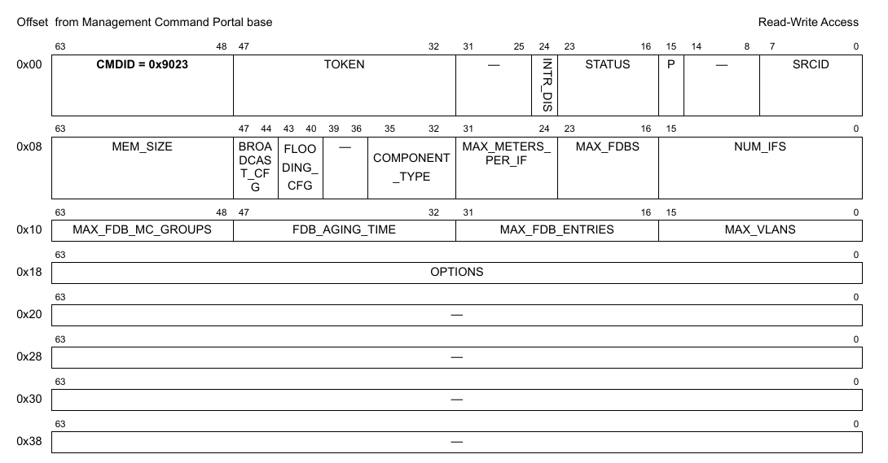

**Figure 369. Mô tả command DPSW_CREATE**

Bảng sau mô tả các field của command.

**Table 64. Mô tả các field của command DPSW_CREATE<sup>1</sup>**

| Offset | Bits | Tên | Mô tả |
|---|---|---|---|
| 0x00 | 0-63 | Header của command | Xem Table 2 để biết mô tả chung các field của command portal.<br>CMDID phải được đặt như chỉ ra trong hình ở trên. |
| 0x08 | 0-15 | NUM_IFS | Số interface ngoài và nội bộ. Giá trị tối đa được hỗ trợ là 64. |
|   | 16-23 | MAX_FDBS | Số FDB tối đa; 0 - là mặc định 8 |
|   | 24-31 | MAX_METERS_PER_IF | Số meter cho mỗi interface; 0 - là mặc định 4 |
|   | 32-35 | COMPONENT_TYPE | Loại component C_VLAN hoặc S_VLAN<br>0 – cho C_VLAN<br>1 – cho S_VLAN |
|   | 40-43 | FLOODING_CFG | 0x0 - DPSW_FLOODING _PER_VLAN *(ghi chú: đúng là DPSW_FLOODING_PER_VLAN)* (mặc định): Các flooding replicator được cấp theo từng VLAN, và các interface trong mỗi replicator có thể được cấu hình bằng dpsw_add_vlan_if_flooding() *(ghi chú: đúng là dpsw_vlan_add_if_flooding())* / dpsw_vlan_remove_if_flooding().<br>0x1 - DPSW_FLOODING_PER_FDB: Các flooding replicator được cấp theo từng FDB, và các interface trong mỗi replicator có thể được cấu hình bằng dpsw_set_egress_flood(). |
|   | 44-47 | BROADCAST_CFG | 0x0 - DPSW_BROADCAST_PER_OBJECT (mặc định): Chỉ có một broadcast replicator cho mỗi DPSW object<br>0x1 - DPSW_BROADCAST_PER_FDB: Các broadcast replicator được cấp theo từng FDB, và các interface trong mỗi replicator có thể được cấu hình bằng dpsw_set_egress_flood(). |
|   | 48-63 | MEM_SIZE | Số buffer 256byte được cấp cho buffer pool của DPSW, hoặc cho tất cả buffer pool nếu dùng option DPSW_OPT_BP_PER_IF. Nếu là 0, dùng giá trị mặc định, phụ thuộc vào số interface. |
| 0x10 | 0-15 | MAX_VLANS | Số VLAN tối đa; 0 - là mặc định 8 |
|   | 16-31 | MAX_FDB_ENTRIES | Số mục FDB của bảng FDB mặc định;<br>0 - là mặc định 64 mục. |
|   | 32-47 | FDB_AGING_TIME | Thời gian aging FDB mặc định cho bảng FDB mặc định;<br>0 - là mặc định 256 giây |
|   | 48-63 | MAX_FDB_MC_GROUPS | Số multicast group trong mỗi bảng FDB;<br>0 - là mặc định 8 |
| 0x18 | 0-63 | OPTIONS | Bật/tắt các tính năng của DPSW (bitmap). Chọn bất kỳ tổ hợp nào của các option được hỗ trợ dưới đây:<br>bit 0: DPSW_OPT_FLOODING_DIS - Tắt flooding<br>bit 2: DPSW_OPT_MULTICAST_DIS - Tắt Multicast<br>bit 4: DPSW_OPT_CTRL_IF_DIS - Tắt Interface Control<br>bit 5: DPSW_OPT_FLOODING_METERING_DIS - Tắt Flooding Metering bit 6: DPSW_OPT_METERING_EN - Bật Flooding Metering<br>bit 7: DPSW_OPT_BP_PER_IF - Nếu bật, mỗi interface sẽ dùng một buffer pool riêng để giữ một bản sao của frame nhận được.<br>bit 8: DPSW_OPT_LAG_DIS - option dùng để tắt link aggregation. |

<sup>1</sup> Mọi field không được nêu là reserved và phải được xóa (đặt bằng 0).

**Cấu trúc response**

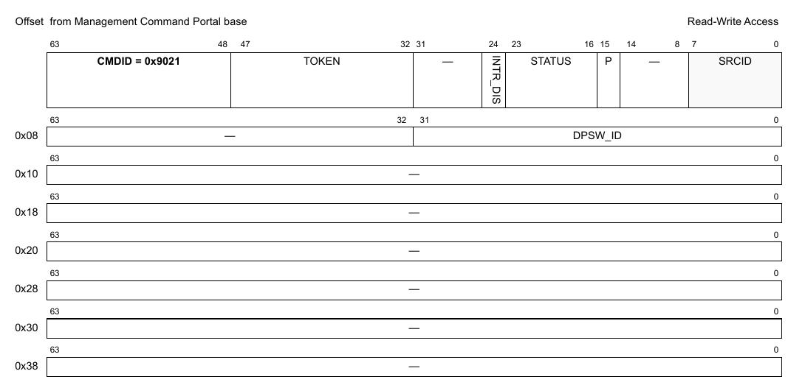

**Figure 14-1. Mô tả response của DPSW_CREATE**

Bảng sau mô tả các field của response.

**Table 14-1. Mô tả các field response của DPSW_CREATE<sup>1</sup>**

| Offset | Bits | Tên | Mô tả |
|---|---|---|---|
| 0x00 | 0-63 | Header của command | Xem Table 2 để biết mô tả chung các field của command portal.<br>CMDID phải được đặt như chỉ ra trong hình ở trên. |
| 0x08 | 0-31 | DPSW_ID | ID duy nhất của DPSW |

<sup>1</sup> Mọi field không được nêu là reserved.

### 14.3.4 DPSW_DESTROY

Command này hủy DPSW object và giải phóng mọi tài nguyên của nó. Nó phải được gọi trong software context đã tạo object. Bên gọi phải cung cấp object id và authentication token của container cha đã tạo object. Lưu ý rằng object có thể đã được gán cho container khác, và gửi authentication token của container đó sẽ trả về lỗi.

Mọi authentication token đang mở tới object phải được đóng trước khi gọi command destroy.

Sau khi gọi hàm này, không thao tác nào khác được phép trên object.

**Cấu trúc command**

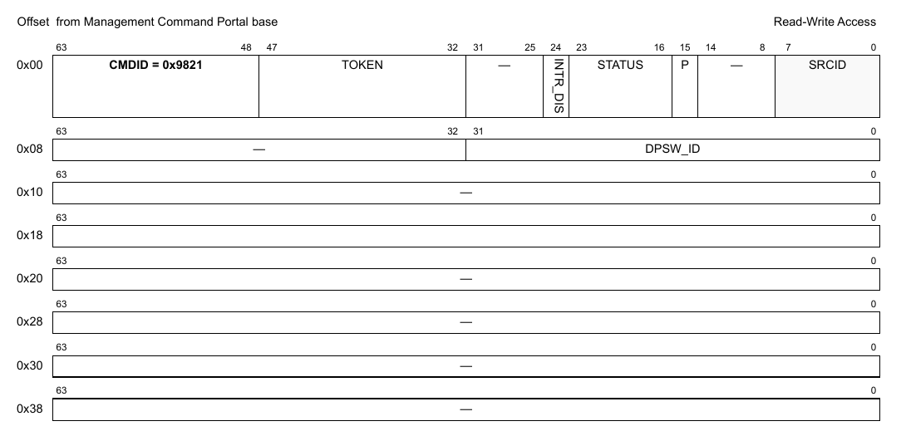

**Figure 370. Mô tả command DPSW_DESTROY**

| Offset | Bits | Tên | Mô tả |
|---|---|---|---|
| 0x00 | 0-63 | Header của command | Xem Table 2 để biết mô tả chung các field của command portal.<br>CMDID phải được đặt như chỉ ra trong hình ở trên. |
| 0x08 | 0–32 | DPSW_ID | ID của DPSW object cần hủy |

Mọi field không được nêu là reserved và phải được xóa (đặt bằng 0)

### 14.3.5 DPSW_ENABLE

**Cấu trúc command**


**Figure 371. Mô tả command DPSW_ENABLE**

| Offset | Bits | Tên | Mô tả |
|---|---|---|---|
| 0x00 | 0-63 | Header của command | Xem Table 2 để biết mô tả chung các field của command portal.<br>CMDID phải được đặt như chỉ ra trong hình ở trên. |

Mọi field không được nêu là reserved và phải được xóa (đặt bằng 0)

### 14.3.6 DPSW_DISABLE

**Cấu trúc command**


**Figure 372. Mô tả command DPSW_DISABLE**

| Offset | Bits | Tên | Mô tả |
|---|---|---|---|
| 0x00 | 0-63 | Header của command | Xem Table 2 để biết mô tả chung các field của command portal.<br>CMDID phải được đặt như chỉ ra trong hình ở trên. |

Mọi field không được nêu là reserved và phải được xóa (đặt bằng 0)

### 14.3.7 DPSW_IS_ENABLED

**Cấu trúc command**


**Figure 373. Mô tả command DPSW_IS_ENABLED**

| Offset | Bits | Tên | Mô tả |
|---|---|---|---|
| 0x00 | 0-63 | Header của command | Xem Table 2 để biết mô tả chung các field của command portal.<br>CMDID phải được đặt như chỉ ra trong hình ở trên. |

Mọi field không được nêu là reserved và phải được xóa (đặt bằng 0)

**Cấu trúc response**

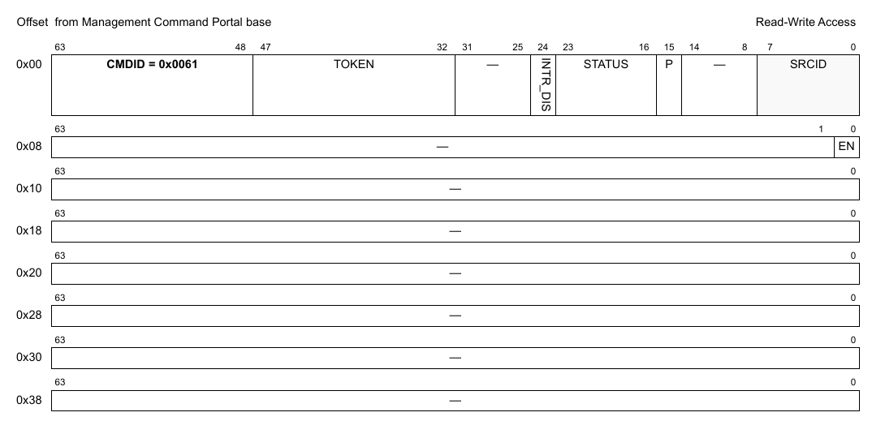

**Figure 374. Mô tả response của DPSW_IS_ENABLED**

| Offset | Bits | Tên | Mô tả |
|---|---|---|---|
| 0x00 | 0-63 | Header của command | Xem Table 2 để biết mô tả chung các field của command portal.<br>CMDID phải được đặt như chỉ ra trong hình ở trên. |
| 0x08 | 0 | EN | Trả về '1' nếu object đang enable; '0' nếu không |

Mọi field không được nêu là reserved và phải được xóa (đặt bằng 0)

### 14.3.8 DPSW_RESET

**Cấu trúc command**


**Figure 375. Mô tả command DPSW_RESET**

| Offset | Bits | Tên | Mô tả |
|---|---|---|---|
| 0x00 | 0-63 | Header của command | Xem Table 2 để biết mô tả chung các field của command portal.<br>CMDID phải được đặt như chỉ ra trong hình ở trên. |

Mọi field không được nêu là reserved và phải được xóa (đặt bằng 0)

### 14.3.9 DPSW_SET_IRQ_ENABLE

Đặt trạng thái tổng thể của interrupt. Cho phép phần mềm GPP điều khiển khi nào interrupt được sinh ra. Mỗi interrupt có thể có tối đa 32 nguyên nhân. Điều khiển enable/disable quyết định trạng thái tổng thể của interrupt. Nếu interrupt bị disable thì không nguyên nhân nào sinh ra interrupt.

**Cấu trúc command**


**Figure 376. Mô tả command DPSW_SET_IRQ_ENABLE**

| Offset | Bits | Tên | Mô tả |
|---|---|---|---|
| 0x00 | 0-63 | Header của command | Xem Table 2 để biết mô tả chung các field của command portal.<br>CMDID phải được đặt như chỉ ra trong hình ở trên. |
| 0x08 | 0 | EN | Trạng thái interrupt: đặt ‘1’ để enable, ‘0’ để disable |
|   | 32-39 | IRQ_INDEX | Xác định interrupt index cần cấu hình |

Mọi field không được nêu là reserved và phải được xóa (đặt bằng 0)

### 14.3.10 DPSW_GET_IRQ_ENABLE

Lấy trạng thái tổng thể của interrupt.

**Cấu trúc command**


**Figure 377. Mô tả command DPSW_GET_IRQ_ENABLE**

| Offset | Bits | Tên | Mô tả |
|---|---|---|---|
| 0x00 | 0-63 | Header của command | Xem Table 2 để biết mô tả chung các field của command portal.<br>CMDID phải được đặt như chỉ ra trong hình ở trên. |
| 0x08 | 32-39 | IRQ_INDEX | Xác định interrupt index cần truy vấn |

Mọi field không được nêu là reserved và phải được xóa (đặt bằng 0)

**Cấu trúc response**


**Figure 378. Mô tả response của DPSW_GET_IRQ_ENABLE**

| Offset | Bits | Tên | Mô tả |
|---|---|---|---|
| 0x00 | 0-63 | Header của command | Xem Table 2 để biết mô tả chung các field của command portal.<br>CMDID phải được đặt như chỉ ra trong hình ở trên. |
| 0x08 | 0 | EN | Bit này được đặt nếu interrupt đang enable |

Mọi field không được nêu là reserved và phải được xóa (đặt bằng 0)

### 14.3.11 DPSW_SET_IRQ_MASK

Đặt interrupt mask. Mỗi interrupt có thể có tối đa 32 nguyên nhân, và mô hình interrupt hỗ trợ mask/unmask từng nguyên nhân độc lập.

**Cấu trúc command**


**Figure 379. Mô tả command DPSW_SET_IRQ_MASK**

| Offset | Bits | Tên | Mô tả |
|---|---|---|---|
| 0x00 | 0-63 | Header của command | Xem Table 2 để biết mô tả chung các field của command portal.<br>CMDID phải được đặt như chỉ ra trong hình ở trên. |
| 0x08 | 0-31 | MASK | Event mask để kích hoạt interrupt; xem command GET_IRQ_STATUS để biết đặc tả các event hiện có. Với mỗi bit trong MASK:<br>0 = bỏ qua event<br>1 = event hợp lệ; báo IRQ nếu event này xảy ra |
|   | 32-39 | IRQ_INDEX | Interrupt index cần cấu hình |

Mọi field không được nêu là reserved và phải được xóa (đặt bằng 0)

### 14.3.12 DPSW_GET_IRQ_MASK

Lấy interrupt mask. Mỗi interrupt có thể có tối đa 32 nguyên nhân, và mô hình interrupt hỗ trợ mask/unmask từng nguyên nhân độc lập.

**Cấu trúc command**

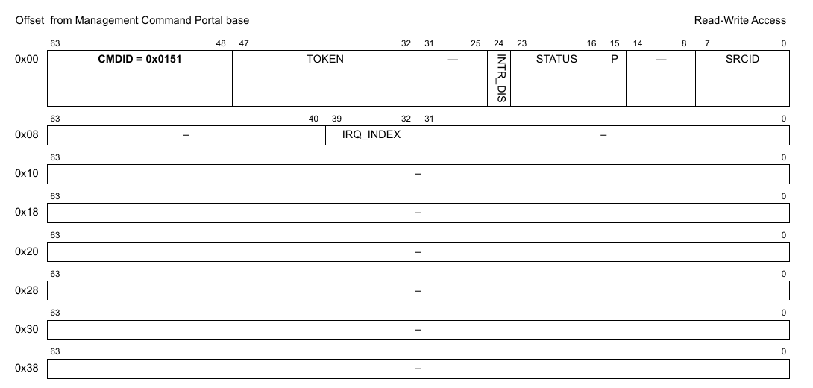

**Figure 380. Mô tả command DPSW_GET_IRQ_MASK**

| Offset | Bits | Tên | Mô tả |
|---|---|---|---|
| 0x00 | 0-63 | Header của command | Xem Table 2 để biết mô tả chung các field của command portal.<br>CMDID phải được đặt như chỉ ra trong hình ở trên. |
| 0x08 | 32-39 | IRQ_INDEX | Interrupt index cần truy vấn |

Mọi field không được nêu là reserved và phải được xóa (đặt bằng 0)

**Cấu trúc response**


**Figure 381. Mô tả response của DPSW_GET_IRQ_MASK**

| Offset | Bits | Tên | Mô tả |
|---|---|---|---|
| 0x00 | 0-63 | Header của command | Xem Table 2 để biết mô tả chung các field của command portal.<br>CMDID phải được đặt như chỉ ra trong hình ở trên. |
| 0x08 | 0-31 | MASK | Event mask để kích hoạt interrupt; xem command GET_IRQ_STATUS để biết đặc tả các event hiện có. Với mỗi bit trong MASK:<br>0 = bỏ qua event<br>1 = event hợp lệ; báo IRQ nếu event này xảy ra |

Mọi field không được nêu là reserved và phải được xóa (đặt bằng 0)

### 14.3.13 DPSW_GET_IRQ_STATUS

Lấy trạng thái hiện tại của các event đang chờ cho interrupt index được chỉ định.

**Cấu trúc command**


**Figure 382. Mô tả command DPSW_GET_IRQ_STATUS**

| Offset | Bits | Tên | Mô tả |
|---|---|---|---|
| 0x00 | 0-63 | Header của command | Xem Table 2 để biết mô tả chung các field của command portal.<br>CMDID phải được đặt như chỉ ra trong hình ở trên. |
| 0x08 | 0-31 | STATUS | Tùy chọn: mọi bit STATUS được đặt sẽ được xóa khỏi trạng thái đang chờ (không cần dùng command DPSW_CLEAR_IRQ_STATUS nữa). Lưu ý rằng STATUS trả về trong response là trạng thái trước khi các event bị xóa.<br><br>Các event được hỗ trợ: xem định nghĩa cấu trúc response |
|   | 32-39 | IRQ_INDEX | Interrupt index cần truy vấn |

Mọi field không được nêu là reserved và phải được xóa (đặt bằng 0)

**Cấu trúc response**


**Figure 383. Mô tả response của DPSW_GET_IRQ_STATUS**

| Offset | Bits | Tên | Mô tả |
|---|---|---|---|
| 0x00 | 0-63 | Header của command | Xem Table 2 để biết mô tả chung các field của command portal.<br>CMDID phải được đặt như chỉ ra trong hình ở trên. |
| 0x08 | 0-31 | STATUS | Mask trạng thái event (bit 0-15), mỗi event một bit:<br>0 = không có interrupt đang chờ<br>1 = có interrupt đang chờ<br><br>Các event được hỗ trợ cho IRQ 0:<br>Bit 0: DPSW_IRQ_EVENT_LINK_CHANGED – cho biết link state đã thay đổi<br>Bit 1: DPSW_IRQ_EVENT_ENDPOINT_CHANGED – cho biết có event nối/ngắt kết nối giữa DPSW và endpoint của nó (DPNI, DPMAC)<br>Bit 16-31 chứa interface ID của DPSW gắn với event. |

Mọi field không được nêu là reserved và phải được xóa (đặt bằng 0)

### 14.3.14 DPSW_CLEAR_IRQ_STATUS

Xóa (đánh dấu đã xử lý) các event đang chờ của interrupt index được chỉ định.

**Cấu trúc command**

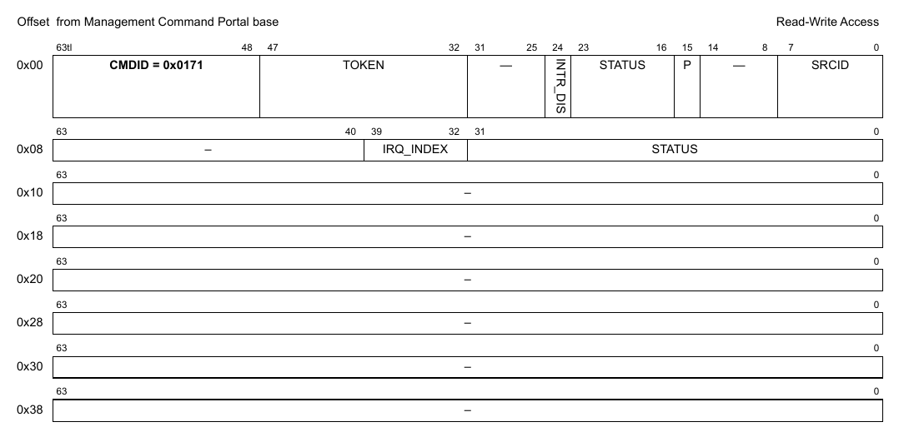

**Figure 384. Mô tả command DPSW_CLEAR_IRQ_STATUS**

| Offset | Bits | Tên | Mô tả |
|---|---|---|---|
| 0x00 | 0-63 | Header của command | Xem Table 2 để biết mô tả chung các field của command portal.<br>CMDID phải được đặt như chỉ ra trong hình ở trên. |
| 0x08 | 0-31 | STATUS | Mask để xóa các event đã xử lý; xem command GET_IRQ_STATUS để biết đặc tả các event hiện có. Với mỗi bit trong MASK:<br>0 = không đổi trạng thái event<br>1 = xóa bit trạng thái event để cho biết event đã được xử lý |
|   | 32-39 | IRQ_INDEX | Interrupt index cần cấu hình |

Mọi field không được nêu là reserved và phải được xóa (đặt bằng 0)

### 14.3.15 DPSW_GET_ATTRIBUTES

**Cấu trúc command**

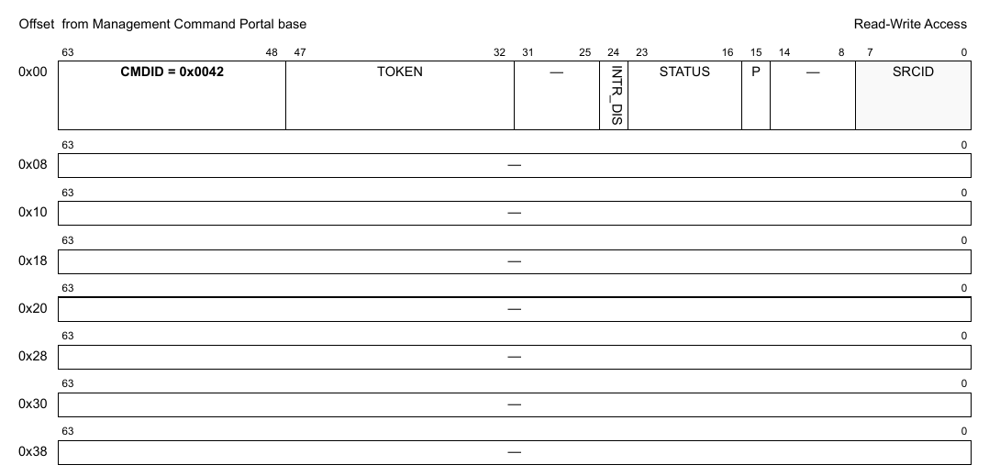

**Figure 385. Mô tả command DPSW_GET_ATTRIBUTES**

| Offset | Bits | Tên | Mô tả |
|---|---|---|---|
| 0x00 | 0-63 | Header của command | Xem Table 2 để biết mô tả chung các field của command portal.<br>CMDID phải được đặt như chỉ ra trong hình ở trên. |

Mọi field không được nêu là reserved và phải được xóa (đặt bằng 0)

**Cấu trúc response**

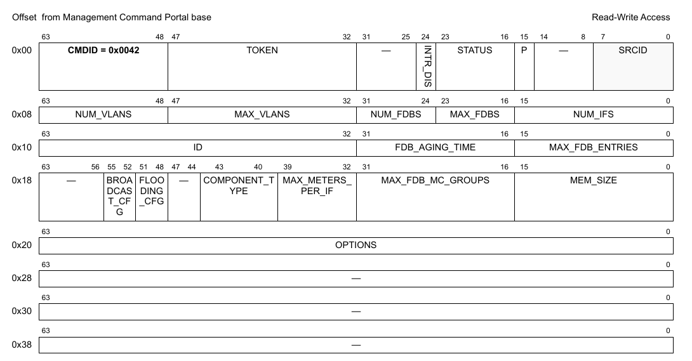

**Figure 386. Mô tả response của DPSW_GET_ATTRIBUTES**

| Offset | Bits | Tên | Mô tả |
|---|---|---|---|
| 0x00 | 0-63 | Header của command | Xem Table 2 để biết mô tả chung các field của command portal.<br>CMDID phải được đặt như chỉ ra trong hình ở trên. |
| 0x08 | 0-15 | NUM_IFS | Số interface |
|   | 16-23 | MAX_FDBS | Số FDB tối đa |
|   | 24-31 | NUM_FDBS | Số FDB hiện tại |
|   | 32-47 | MAX_VLANS | Số VLAN tối đa |
|   | 48-63 | NUM_VLANS | Số VLAN hiện tại |
| 0x10 | 0-15 | MAX_FDB_ENTRIES | Số mục FDB của bảng FDB mặc định;<br>0 - là mặc định 1024 mục. |
|   | 16-31 | FDB_AGING_TIME | Thời gian aging FDB mặc định cho bảng FDB mặc định;<br>0 - là mặc định 300 giây |
|   | 32–63 | ID | DPSW object ID |
| 0x18 | 0-15 | MEM_SIZE | Kích thước bộ nhớ lưu frame của DPSW |
|   | 16-31 | MAX_FDB_MC_GROUPS | Số multicast group trong mỗi bảng FDB;<br>0 - là mặc định 32 |
|   | 32-39 | MAX_METERS_PER_IF | Số meter cho mỗi interface |
|   | 40-43 | COMPONENT_TYPE | Loại component C_VLAN hoặc VLAN<br>0 – cho C_VLAN<br>1 – cho VLAN |
|   | 48-51 | FLOODING_CFG | 0x0 - DPSW_FLOODING _PER_VLAN *(ghi chú: đúng là DPSW_FLOODING_PER_VLAN)* (mặc định): Các flooding replicator được cấp theo từng VLAN, và các interface trong mỗi replicator có thể được cấu hình bằng dpsw_vlan_add_if_flooding() / dpsw_vlan_remove_if_flooding().<br>0x1 - DPSW_FLOODING_PER_FDB: Các flooding replicator được cấp theo từng FDB, và các interface trong mỗi replicator có thể được cấu hình bằng dpsw_set_egress_flood(). |
|   | 52-55 | BROADCAST_CFG | 0x0 - DPSW_BROADCAST_PER_OBJECT (mặc định): Chỉ có một broadcast replicator cho mỗi DPSW object.<br>0x1 - DPSW_BROADCAST_PER_FDB: Các broadcast replicator được cấp theo từng FDB, và các interface trong mỗi replicator có thể được cấu hình bằng dpsw_set_egress_flood(). |
| 0x20 | 0-63 | OPTIONS | Bật/tắt các tính năng của DPSW.<br>bit 0: DPSW_OPT_FLOODING_DIS - Tắt flooding<br>bit 2: DPSW_OPT_MULTICAST_DIS - Tắt Multicast<br>bit 4: DPSW_OPT_CTRL_IF_DIS - Tắt Interface Control<br>bit 5: DPSW_OPT_FLOODING_METERING_DIS - Tắt Flooding Metering<br>bit 6: DPSW_OPT_METERING_EN - Bật Flooding Metering<br>bit 7: DPSW_OPT_BP_PER_IF - Nếu bật, mỗi interface sẽ dùng một buffer pool riêng để giữ một bản sao của frame nhận được.<br>bit 8: DPSW_OPT_LAG_DIS - option dùng để tắt link aggregation. |
| 0x28 | 0-7 | MAX_METERS_PER_IF | Số meter cho mỗi interface |

Mọi field không được nêu là reserved và phải được xóa (đặt bằng 0)

### 14.3.16 DPSW_SET_REFLECTION_IF

**Cấu trúc command**


**Figure 387. Mô tả command DPSW_SET_REFLECTION_IF**

| Offset | Bits | Tên | Mô tả |
|---|---|---|---|
| 0x00 | 0-63 | Header của command | Xem Table 2 để biết mô tả chung các field của command portal.<br>CMDID phải được đặt như chỉ ra trong hình ở trên. |
| 0x08 | 0-15 | IF_ID | Interface ID |

Mọi field không được nêu là reserved và phải được xóa (đặt bằng 0)

### 14.3.17 DPSW_IF_SET_FLOODING

**Cấu trúc command**

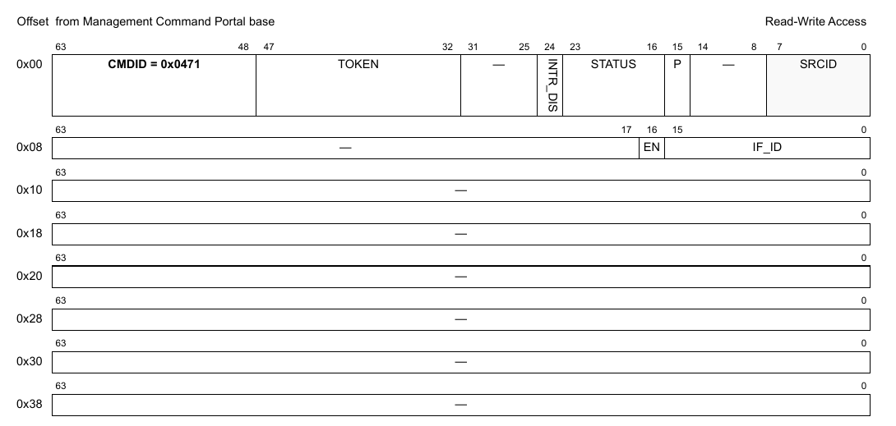

**Figure 388. Mô tả command DPSW_IF_SET_FLOODING**

| Offset | Bits | Tên | Mô tả |
|---|---|---|---|
| 0x00 | 0-63 | Header của command | Xem Table 2 để biết mô tả chung các field của command portal.<br>CMDID phải được đặt như chỉ ra trong hình ở trên. |
| 0x08 | 0-15 | IF_ID | Interface ID |
|   | 16 | EN | 1 - bật, 0 - tắt |

Mọi field không được nêu là reserved và phải được xóa (đặt bằng 0)

### 14.3.18 DPSW_IF_SET_BROADCAST

**Cấu trúc command**


**Figure 389. Mô tả command DPSW_IF_SET_BROADCAST**

| Offset | Bits | Tên | Mô tả |
|---|---|---|---|
| 0x00 | 0-63 | Header của command | Xem Table 2 để biết mô tả chung các field của command portal.<br>CMDID phải được đặt như chỉ ra trong hình ở trên. |
| 0x08 | 0-15 | IF_ID | Interface ID |
|   | 16 | EN | 1 - bật, 0 - tắt |

Mọi field không được nêu là reserved và phải được xóa (đặt bằng 0)

### 14.3.19 DPSW_IF_SET_MULTICAST

**Cấu trúc command**


**Figure 390. Mô tả command DPSW_IF_SET_MULTICAST**

| Offset | Bits | Tên | Mô tả |
|---|---|---|---|
| 0x00 | 0-63 | Header của command | Xem Table 2 để biết mô tả chung các field của command portal.<br>CMDID phải được đặt như chỉ ra trong hình ở trên. |
| 0x08 | 0-15 | IF_ID | Interface ID |
|   | 16 | EN | 1 - bật, 0 - tắt |

Mọi field không được nêu là reserved và phải được xóa (đặt bằng 0)

### 14.3.20 DPSW_IF_SET_TCI

**Cấu trúc command**

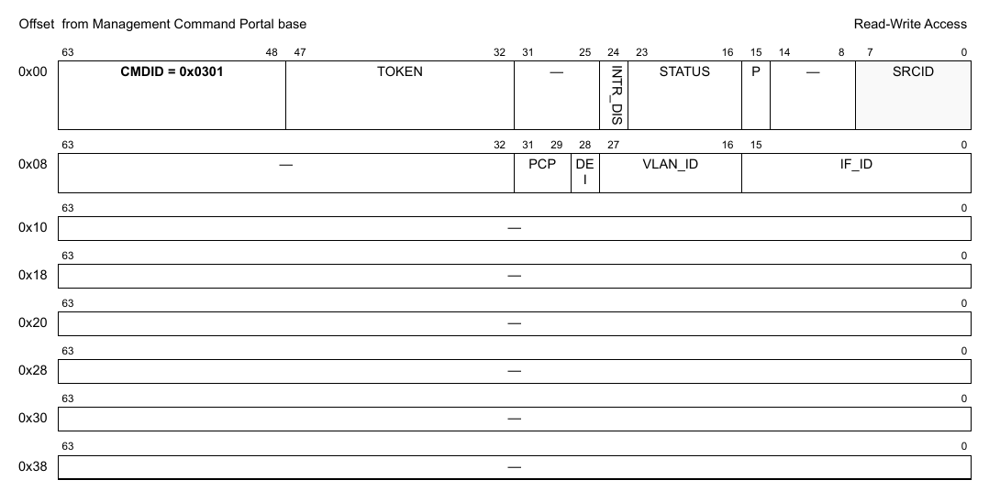

**Figure 391. Mô tả command DPSW_IF_SET_TCI**

| Offset | Bits | Tên | Mô tả |
|---|---|---|---|
| 0x00 | 0-63 | Header của command | Xem Table 2 để biết mô tả chung các field của command portal.<br>CMDID phải được đặt như chỉ ra trong hình ở trên. |
| 0x08 | 0-15 | IF_ID | Interface ID |
|   | 16-27 | VLAN_ID | VLAN Identifier (VID): một field 12 bit chỉ định VLAN<br>mà frame thuộc về. Các giá trị hex<br>0x000 và 0xFFF là reserved;<br>mọi giá trị khác đều có thể dùng làm VLAN identifier, cho phép tối đa<br>4,094 VLAN |
|   | 28 | DEI | Drop Eligible Indicator (DEI): một field 1 bit. Có thể dùng<br>riêng hoặc kết hợp với PCP để chỉ ra các frame<br>có thể bị drop khi có tắc nghẽn |
|   | 29-31 | PCP | Priority Code Point (PCP): một field 3 bit, tương ứng<br>với priority IEEE 802.1p |

Mọi field không được nêu là reserved và phải được xóa (đặt bằng 0)

### 14.3.21 DPSW_IF_GET_TCI

**Cấu trúc command**


**Figure 392. Mô tả command DPSW_IF_GET_TCI**

| Offset | Bits | Tên | Mô tả |
|---|---|---|---|
| 0x00 | 0-63 | Header của command | Xem Table 2 để biết mô tả chung các field của command portal.<br>CMDID phải được đặt như chỉ ra trong hình ở trên. |
| 0x08 | 0-15 | IF_ID | Interface ID |

Mọi field không được nêu là reserved và phải được xóa (đặt bằng 0)

**Cấu trúc response**

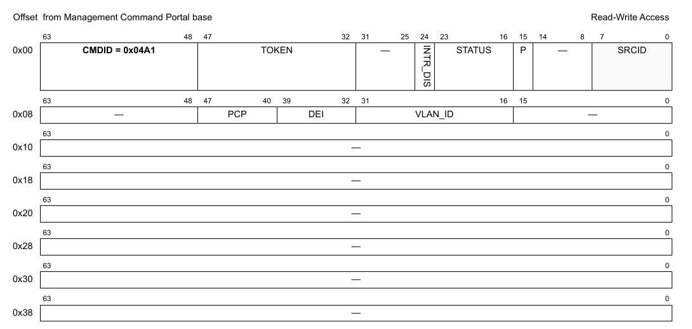

**Figure 393. Mô tả response của DPSW_IF_GET_TCI**

| Offset | Bits | Tên | Mô tả |
|---|---|---|---|
| 0x00 | 0-63 | Header của command | Xem Table 2 để biết mô tả chung các field của command portal.<br>CMDID phải được đặt như chỉ ra trong hình ở trên. |
| 0x08 | 16-31 | VLAN_ID | VLAN Identifier (VID): một field 12 bit chỉ định VLAN<br>mà frame thuộc về. Các giá trị hex<br>0x000 và 0xFFF là reserved;<br>mọi giá trị khác đều có thể dùng làm VLAN identifier, cho phép tối đa<br>4,094 VLAN |
|   | 32-39 | DEI | Drop Eligible Indicator (DEI): một field 1 bit. Có thể dùng<br>riêng hoặc kết hợp với PCP để chỉ ra các frame<br>có thể bị drop khi có tắc nghẽn |
|   | 40-47 | PCP | Priority Code Point (PCP): một field 3 bit, tương ứng<br>với priority IEEE 802.1p |

Mọi field không được nêu là reserved và phải được xóa (đặt bằng 0)

### 14.3.22 DPSW_IF_SET_STP

**Cấu trúc command**


**Figure 394. Mô tả command DPSW_IF_SET_STP**

| Offset | Bits | Tên | Mô tả |
|---|---|---|---|
| 0x00 | 0-63 | Header của command | Xem Table 2 để biết mô tả chung các field của command portal.<br>CMDID phải được đặt như chỉ ra trong hình ở trên. |
| 0x08 | 0-15 | IF_ID | Interface ID |
|   | 16-31 | VLAN_ID | Trạng thái STP của VLAN ID |
|   | 32-35 | STATE | Trạng thái STP. Chọn một trong các giá trị được hỗ trợ dưới đây:<br>0x0 = DPSW_STP_STATE_BLOCKING - Trạng thái Blocking<br>0x1 = DPSW_STP_STATE_LISTENING - Trạng thái Listening<br>0x2 = DPSW_STP_STATE_LEARNING - Trạng thái Learning<br>0x3 = DPSW_STP_STATE_FORWARDING - Trạng thái Forwarding |

Mọi field không được nêu là reserved và phải được xóa (đặt bằng 0)

### 14.3.23 DPSW_IF_SET_ACCEPTED_FRAMES

**Cấu trúc command**

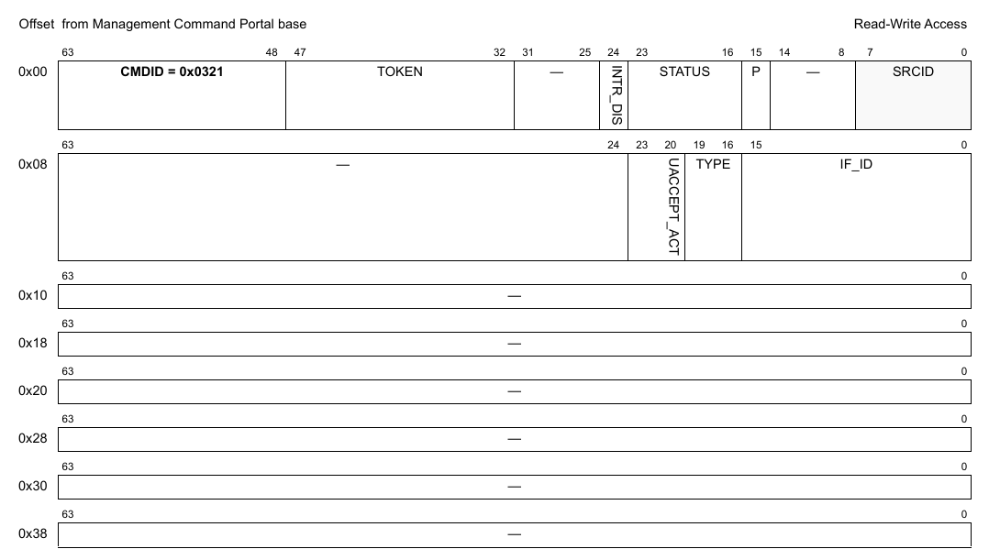

**Figure 395. Mô tả command DPSW_IF_SET_ACCEPTED_FRAMES**

| Offset | Bits | Tên | Mô tả |
|---|---|---|---|
| 0x00 | 0-63 | Header của command | Xem Table 2 để biết mô tả chung các field của command portal.<br>CMDID phải được đặt như chỉ ra trong hình ở trên. |
| 0x08 | 0-15 | IF_ID | Interface ID |
|   | 16-19 | TYPE | Định nghĩa các frame ingress được chấp nhận. Chọn một trong các giá trị được hỗ trợ dưới đây: 0x1 = DPSW_ADMIT_ALL - Thiết bị chấp nhận frame có VLAN tag, không tag và priority tagged<br>0x3 = DPSW_ADMIT_ONLY_VLAN_TAGGED - Thiết bị loại bỏ frame không tag hoặc Priority-Tagged nhận được trên interface này. |
|   | 20-23 | UNACCEPT_ACT | Khi một frame không được chấp nhận, nó có thể bị loại bỏ hoặc được chuyển hướng<br>tới control interface tùy mode này. Chọn một trong các giá trị được hỗ trợ dưới đây: 0x0 = DPSW_ACTION_DROP - Drop frame<br>0x1 = DPSW_ACTION_REDIRECT_TO_CTRL - Chuyển hướng frame tới control interface |

Mọi field không được nêu là reserved và phải được xóa (đặt bằng 0)

### 14.3.24 DPSW_SET_IF_ACCEPT_ALL_VLAN

**Cấu trúc command**

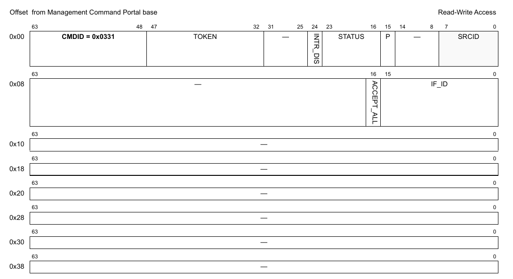

**Figure 396. Mô tả command DPSW_SET_IF_ACCEPT_ALL_VLAN**

| Offset | Bits | Tên | Mô tả |
|---|---|---|---|
| 0x00 | 0-63 | Header của command | Xem Table 2 để biết mô tả chung các field của command portal.<br>CMDID phải được đặt như chỉ ra trong hình ở trên. |
| 0x08 | 0-15 | IF_ID | Interface ID |
|   | 16 | ACCEPT_ALL | Chấp nhận hoặc drop các frame có VLAN khác |

Mọi field không được nêu là reserved và phải được xóa (đặt bằng 0)

### 14.3.25 DPSW_IF_GET_COUNTER

**Cấu trúc command**

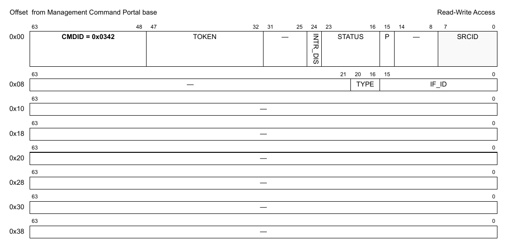

**Figure 397. Mô tả command DPSW_IF_GET_COUNTER**

| Offset | Bits | Tên | Mô tả |
|---|---|---|---|
| 0x00 | 0-63 | Header của command | Xem Table 2 để biết mô tả chung các field của command portal.<br>CMDID phải được đặt như chỉ ra trong hình ở trên. |
| 0x08 | 0-15 | IF_ID | Interface ID |
|   | 16-20 | TYPE | Loại counter. Chọn một trong các giá trị được hỗ trợ dưới đây:<br>0x0 = DPSW_CNT_ING_FRAME- Đếm frame ingress<br>0x1 = DPSW_CNT_ING_BYTE - Đếm byte ingress<br>0x2 = DPSW_CNT_ING_FLTR_FRAME - Đếm frame ingress bị lọc 0x3 = DPSW_CNT_ING_FRAME_DISCARD - Đếm frame ingress bị loại bỏ 0x4 = DPSW_CNT_ING_MCAST_FRAME- Đếm frame multicast ingress 0x5 = DPSW_CNT_ING_MCAST_BYTE- Đếm byte multicast ingress 0x6 = DPSW_CNT_ING_BCAST_FRAME- Đếm frame broadcast ingress 0x7 = DPSW_CNT_ING_BCAST_BYTES - Đếm byte broadcast ingress 0x8 = DPSW_CNT_EGR_FRAME - Đếm frame egress<br>0x9 = DPSW_CNT_EGR_BYTE- Đếm byte egress<br>0xa =DPSW_CNT_EGR_FRAME_DISCARD - Đếm frame egress bị loại bỏ 0xb =DPSW_CNT_EGR_STP_FRAME_DISCARD - Đếm frame STP egress bị loại bỏ<br>0xc =DPSW_CNT_ING_NO_BUFFER_DISCARD - Đếm frame ingress bị loại bỏ vì không có buffer |

Mọi field không được nêu là reserved và phải được xóa (đặt bằng 0)

**Cấu trúc response**

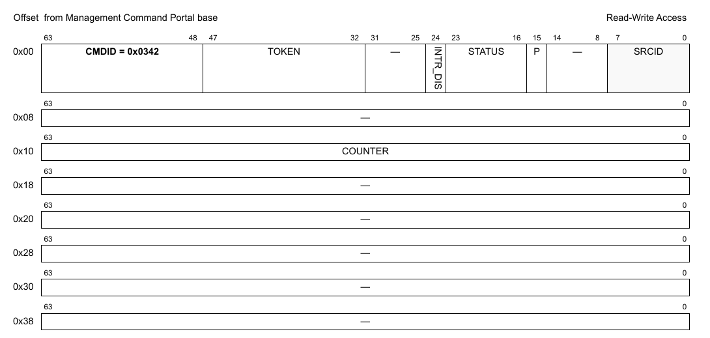

**Figure 398. Mô tả response của DPSW_IF_GET_COUNTER**

| Offset | Bits | Tên | Mô tả |
|---|---|---|---|
| 0x00 | 0-63 | Header của command | Xem Table 2 để biết mô tả chung các field của command portal.<br>CMDID phải được đặt như chỉ ra trong hình ở trên. |
| 0x10 | 0-63 | COUNTER | giá trị counter trả về |

Mọi field không được nêu là reserved và phải được xóa (đặt bằng 0)

### 14.3.26 DPSW_IF_SET_COUNTER

**Cấu trúc command**

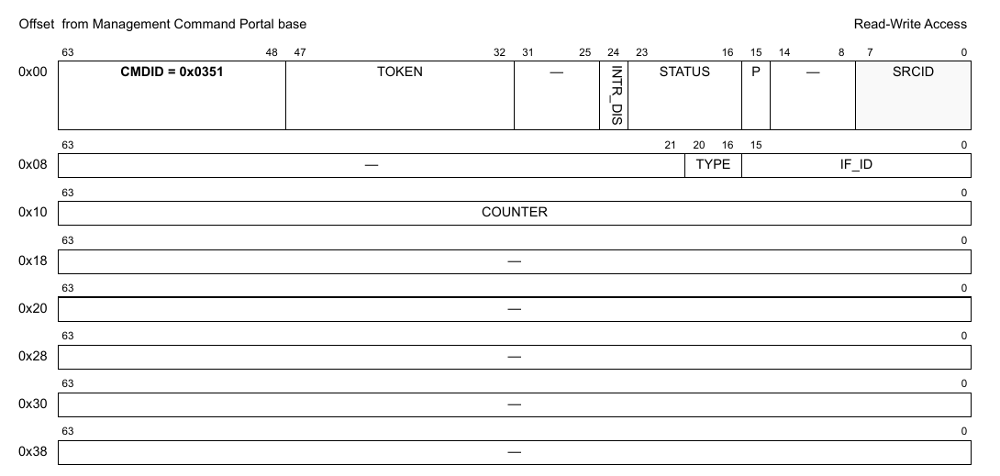

**Figure 399. Mô tả command DPSW_IF_SET_COUNTER**

| Offset | Bits | Tên | Mô tả |
|---|---|---|---|
| 0x00 | 0-63 | Header của command | Xem Table 2 để biết mô tả chung các field của command portal.<br>CMDID phải được đặt như chỉ ra trong hình ở trên. |
| 0x08 | 0-15 | IF_ID | Interface ID |
|   | 16-20 | TYPE | Loại counter. Chọn một trong các giá trị được hỗ trợ dưới đây:<br>0x0 = DPSW_CNT_ING_FRAME- Đếm frame ingress<br>0x1 = DPSW_CNT_ING_BYTE - Đếm byte ingress<br>0x2 = DPSW_CNT_ING_FLTR_FRAME - Đếm frame ingress bị lọc 0x3 = DPSW_CNT_ING_FRAME_DISCARD - Đếm frame ingress bị loại bỏ 0x4 = DPSW_CNT_ING_MCAST_FRAME- Đếm frame multicast ingress 0x5 = DPSW_CNT_ING_MCAST_BYTE- Đếm byte multicast ingress 0x6 = DPSW_CNT_ING_BCAST_FRAME- Đếm frame broadcast ingress 0x7 = DPSW_CNT_ING_BCAST_BYTES - Đếm byte broadcast ingress 0x8 = DPSW_CNT_EGR_FRAME - Đếm frame egress<br>0x9 = DPSW_CNT_EGR_BYTE- Đếm byte egress<br>0xa =DPSW_CNT_EGR_FRAME_DISCARD - Đếm frame egress bị loại bỏ 0xb =DPSW_CNT_EGR_STP_FRAME_DISCARD - Đếm frame STP egress bị loại bỏ<br>0xc =DPSW_CNT_ING_NO_BUFFER_DISCARD - Đếm frame ingress bị loại bỏ vì không có buffer |
| 0x10 | 0-63 | COUNTER | Giá trị counter mới |

Mọi field không được nêu là reserved và phải được xóa (đặt bằng 0)

### 14.3.27 DPSW_IF_SET_TX_SELECTION

**Cấu trúc command**

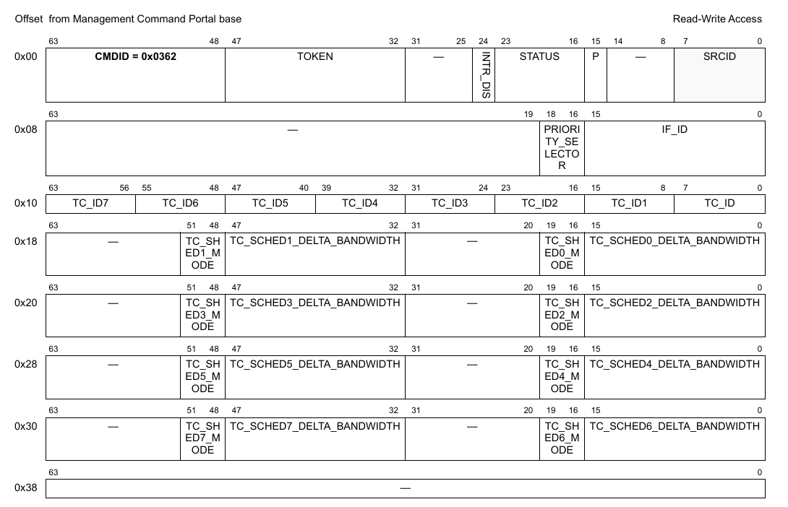

**Figure 400. Mô tả command DPSW_IF_SET_TX_SELECTION**

| Offset | Bits | Tên | Mô tả |
|---|---|---|---|
| 0x00 | 0-63 | Header của command | Xem Table 2 để biết mô tả chung các field của command portal.<br>CMDID phải được đặt như chỉ ra trong hình ở trên. |
| 0x08 | 0-15 | IF_ID | Interface ID |
|   | 16-18 | PRIORITY_SELECTOR | Nguồn để tạo lại user priority. Priority được xác định khi frame được phân tích ở ingress interface. Frame sẽ được enqueue vào egress interface với priority này. Ở egress interface, frame được xử lý theo priority do ingress interface xác định.<br>Chọn một trong các giá trị được hỗ trợ dưới đây:<br>0x0 = DPSW_UP_PCP - Priority Code Point (PCP): một field 3 bit tương ứng với priority IEEE 802.1p.<br>0x1 = DPSW_UP_DSCP - Differentiated services Code Point (DSCP): field 6 bit trong IP header<br>0x2 = DPSW_UP_NO_CHANGE - Không sửa cấu hình user priority |
| 0x10 | 0-63 | TC_ID[0-7] | Nguồn cho thuật toán lập lịch các traffic class (TC) trên đường egress. Các TC được lập lịch theo user priority, nhưng frame được enqueue vào từng TC theo field PRIORITY_SELECTOR đặt cho ingress interface. |
| 0x18- 0x30 | 0-15/ 32-47 | TC_SHED[0-7]_DELTA_BANDWIDTH *(ghi chú: đúng là TC_SCHED[0-7]_DELTA_BANDWIDTH)* | Băng thông có trọng số trong khoảng 100 đến 10000 |
|   | 16-19/ 47-51 | TC_SCHED[0-7]_MODE | Lập lịch strict hoặc theo trọng số |

Mọi field không được nêu là reserved và phải được xóa (đặt bằng 0)

### 14.3.28 DPSW_IF_ADD_REFLECTION

**Cấu trúc command**


**Figure 401. Mô tả command DPSW_IF_ADD_REFLECTION**

| Offset | Bits | Tên | Mô tả |
|---|---|---|---|
| 0x00 | 0-63 | Header của command | Xem Table 2 để biết mô tả chung các field của command portal.<br>CMDID phải được đặt như chỉ ra trong hình ở trên. |
| 0x08 | 0-15 | IF_ID | Interface ID |
|   | 16-31 | VLAN_ID | VLAN ID cần reflect;<br>chỉ hợp lệ khi loại bộ lọc là DPSW_INGRESS_VLAN |
|   | 32-33 | FILTER | Loại bộ lọc cho các frame cần reflect. Chọn một trong các giá trị được hỗ trợ dưới đây: 0x0 = DPSW_REFLECTION_FILTER_INGRESS_ALL - Reflect mọi frame 0x1 = DPSW_REFLECTION_FILTER_INGRESS_VLAN - Chỉ reflect các frame thuộc VLAN cụ thể định nghĩa bằng tham số vid |

Mọi field không được nêu là reserved và phải được xóa (đặt bằng 0)

### 14.3.29 DPSW_IF_REMOVE_REFLECTION

**Cấu trúc command**

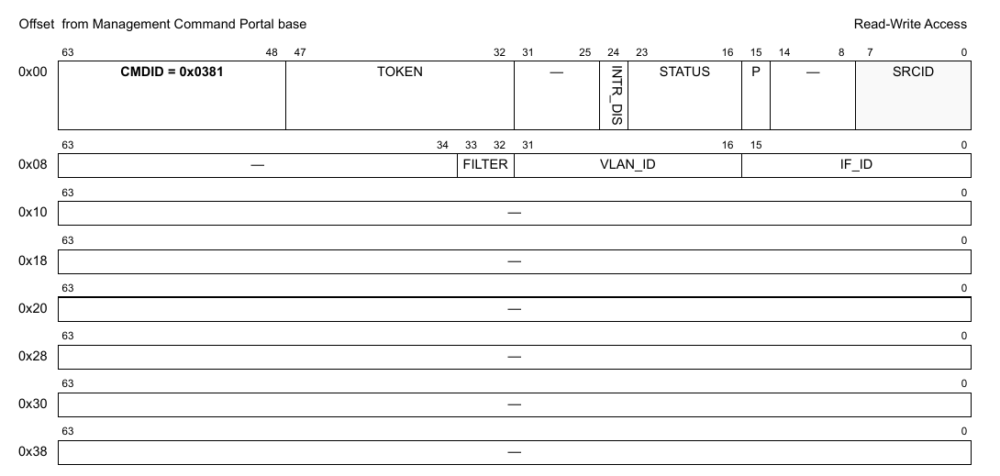

**Figure 402. Mô tả command DPSW_IF_REMOVE_REFLECTION**

| Offset | Bits | Tên | Mô tả |
|---|---|---|---|
| 0x00 | 0-63 | Header của command | Xem Table 2 để biết mô tả chung các field của command portal.<br>CMDID phải được đặt như chỉ ra trong hình ở trên. |
| 0x08 | 0-15 | IF_ID | Interface ID |
|   | 16-31 | VLAN_ID | VLAN ID cần reflect;<br>chỉ hợp lệ khi loại bộ lọc là DPSW_INGRESS_VLAN |
|   | 32-33 | FILTER | Loại bộ lọc cho các frame cần reflect. Chọn một trong các giá trị được hỗ trợ dưới đây: 0x0 = DPSW_REFLECTION_FILTER_INGRESS_ALL - Reflect mọi frame 0x1 = DPSW_REFLECTION_FILTER_INGRESS_VLAN - Chỉ reflect các frame thuộc VLAN cụ thể định nghĩa bằng tham số vid |

Mọi field không được nêu là reserved và phải được xóa (đặt bằng 0)

### 14.3.30 DPSW_IF_SET_FLOODING_METERING

**Cấu trúc command**

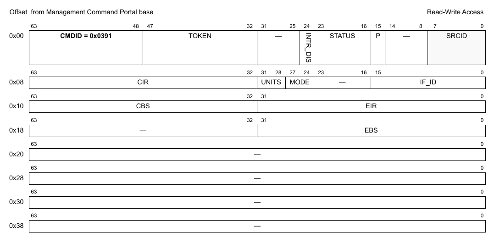

**Figure 403. Mô tả command DPSW_IF_SET_FLOODING_METERING**

| Offset | Bits | Tên | Mô tả |
|---|---|---|---|
| 0x00 | 0-63 | Header của command | Xem Table 2 để biết mô tả chung các field của command portal.<br>CMDID phải được đặt như chỉ ra trong hình ở trên. |
| 0x08 | 0-15 | IF_ID | Interface ID |
|   | 24-27 | MODE | Các chế độ metering. Chọn một trong các giá trị được hỗ trợ dưới đây:<br>0x0 = DPSW_METERING_MODE_NONE: tắt metering<br>0x1 = DPSW_METERING_MODE_RFC2698: RFC 2698<br>0x2 = DPSW_METERING_MODE_RFC4115: RFC 4115 |
|   | 28-31 | UNITS | Đơn vị đếm metering. Chọn một trong các giá trị được hỗ trợ dưới đây:<br>0x0 = DPSW_METERING_UNIT_BYTES: đếm theo đơn vị byte<br>0x1 = DPSW_METERING_UNIT_FRAMES: đếm theo đơn vị frame |
|   | 32-63 | CIR | Committed information rate (CIR) tính bằng bit/s |
| 0x10 | 0-31 | EIR | Excess information rate (EIR) tính bằng bit/s |
|   | 32-63 | CBS | Committed burst size (CBS) tính bằng byte |
| 0x18 | 0-31 | EBS | Excess burst size (EBS) tính bằng byte |

Mọi field không được nêu là reserved và phải được xóa (đặt bằng 0)

### 14.3.31 DPSW_IF_SET_METERING

**Cấu trúc command**

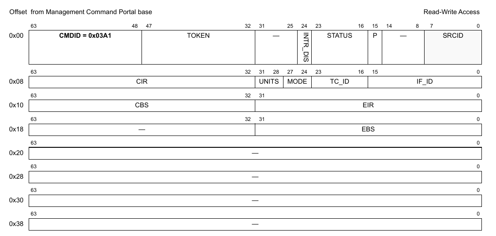

**Figure 404. Mô tả command DPSW_IF_SET_METERING**

| Offset | Bits | Tên | Mô tả |
|---|---|---|---|
| 0x00 | 0-63 | Header của command | Xem Table 2 để biết mô tả chung các field của command portal.<br>CMDID phải được đặt như chỉ ra trong hình ở trên. |
| 0x08 | 0-15 | IF_ID | Interface ID |
|   | 16-23 | TC_ID | ID traffic class |
|   | 24-27 | MODE | Các chế độ metering. Chọn một trong các giá trị được hỗ trợ dưới đây:<br>0x0 = DPSW_METERING_MODE_NONE: tắt metering<br>0x1 = DPSW_METERING_MODE_RFC2698: RFC 2698<br>0x2 = DPSW_METERING_MODE_RFC4115: RFC 4115 |
|   | 28-31 | UNITS | Đơn vị đếm metering. Chọn một trong các giá trị được hỗ trợ dưới đây:<br>0x0 = DPSW_METERING_UNIT_BYTES: đếm theo đơn vị byte<br>0x1 = DPSW_METERING_UNIT_FRAMES: đếm theo đơn vị frame |
|   | 32-63 | CIR | Committed information rate (CIR) tính bằng bit/s |
| 0x10 | 0-31 | EIR | Excess information rate (EIR) tính bằng bit/s |
|   | 32-63 | CBS | Committed burst size (CBS) tính bằng byte |
| 0x18 | 0-31 | EBS | Excess burst size (EBS) tính bằng byte |

Mọi field không được nêu là reserved và phải được xóa (đặt bằng 0)

### 14.3.32 DPSW_IF_SET_EARLY_DROP

**Cấu trúc command**

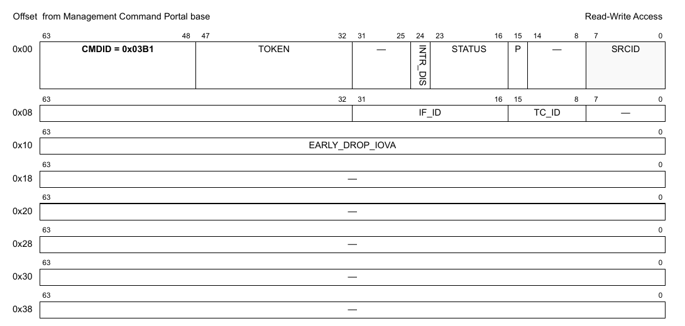

**Figure 405. Mô tả command DPSW_IF_SET_EARLY_DROP**

| Offset | Bits | Tên | Mô tả |
|---|---|---|---|
| 0x00 | 0-63 | Header của command | Xem Table 2 để biết mô tả chung các field của command portal.<br>CMDID phải được đặt như chỉ ra trong hình ở trên. |
| 0x08 | 8-15 | TC_ID | ID traffic class |
|   | 16-31 | IF_ID | Interface ID |
| 0x10 | 0-63 | EARLY_DROP_IOVA | Địa chỉ ảo I/O của 64 byte;<br>Phải là bộ nhớ căn theo cacheline và DMA-able |

Mọi field không được nêu là reserved và phải được xóa (đặt bằng 0)

**Cấu trúc mở rộng**

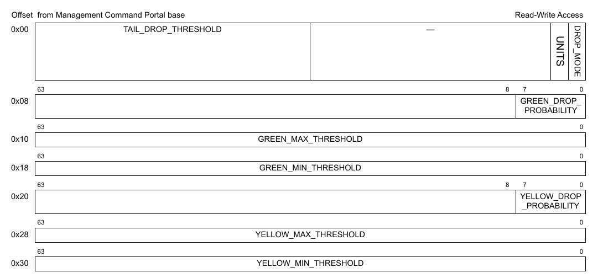

**Figure 406. Mô tả phần mở rộng của DPSW_IF_SET_EARLY_DROP**

| Offset | Bits | Tên | Mô tả |
|---|---|---|---|
| 0x00 | 0-1 | DROP_MODE | Chế độ drop |
|   | 2-3 | UNITS | Đơn vị đếm |
|   | 32-63 | TAIL_DROP_THRESHOLD | Ngưỡng tail drop |
| 0x08 | 0-7 | GREEN_DROP_PROBABILITY | xác suất WRED green để một packet bị loại bỏ (1-100, gắn với ngưỡng tối đa) |
| 0x10 | 0-63 | GREEN_MAX_THRESHOLD | ngưỡng tối đa của WRED green mà packet có thể bị loại bỏ. Trên ngưỡng này mọi packet đều bị loại bỏ; phải nhỏ hơn 2^39; được xấp xỉ biểu diễn dạng (x+256)*2^(y-1) do cách triển khai phần cứng. |
| 0x18 | 0-63 | GREEN_MIN_THRESHOLD | ngưỡng tối thiểu của WRED green từ đó packet có thể bị loại bỏ |
| 0x20 | 0-7 | YELLOW_DROP_PROBABILITY | xác suất WRED yellow để một packet bị loại bỏ (1-100, gắn với ngưỡng tối đa) |
| 0x28 | 0-63 | YELLOW_MAX_THRESHOLD | ngưỡng tối đa của WRED yellow mà packet có thể bị loại bỏ. Trên ngưỡng này mọi packet đều bị loại bỏ; phải nhỏ hơn 2^39; được xấp xỉ biểu diễn dạng (x+256)*2^(y-1) do cách triển khai phần cứng. |
| 0x30 | 0-63 | YELLOW_MIN_THRESHOLD | ngưỡng tối thiểu của WRED yellow từ đó packet có thể bị loại bỏ |

Mọi field không được nêu là reserved và phải được xóa (đặt bằng 0)

### 14.3.33 DPSW_ADD_CUSTOM_TPID

**Cấu trúc command**


**Figure 407. Mô tả command DPSW_ADD_CUSTOM_TPID**

| Offset | Bits | Tên | Mô tả |
|---|---|---|---|
| 0x00 | 0-63 | Header của command | Xem Table 2 để biết mô tả chung các field của command portal.<br>CMDID phải được đặt như chỉ ra trong hình ở trên. |
| 0x08 | 16-31 | TPID | Một tag protocol identifier bổ sung |

Mọi field không được nêu là reserved và phải được xóa (đặt bằng 0)

### 14.3.34 DPSW_REMOVE_CUSTOM_TPID

**Cấu trúc command**

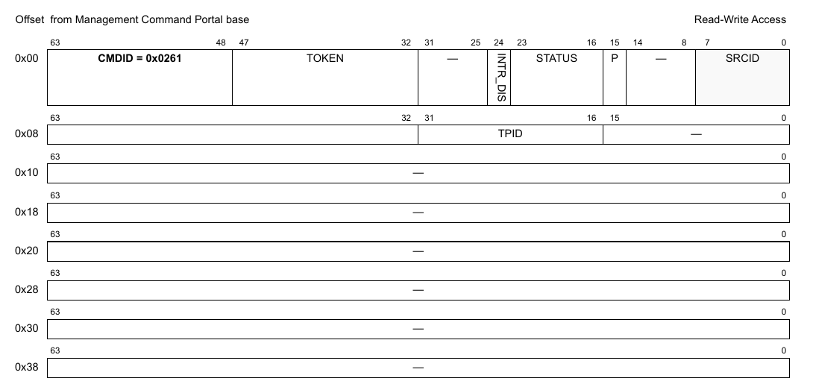

**Figure 408. Mô tả command DPSW_REMOVE_CUSTOM_TPID**

| Offset | Bits | Tên | Mô tả |
|---|---|---|---|
| 0x00 | 0-63 | Header của command | Xem Table 2 để biết mô tả chung các field của command portal.<br>CMDID phải được đặt như chỉ ra trong hình ở trên. |
| 0x08 | 16-31 | TPID | Một tag protocol identifier bổ sung |

Mọi field không được nêu là reserved và phải được xóa (đặt bằng 0)

### 14.3.35 DPSW_IF_ENABLE

**Cấu trúc command**


**Figure 409. Mô tả command DPSW_IF_ENABLE**

| Offset | Bits | Tên | Mô tả |
|---|---|---|---|
| 0x00 | 0-63 | Header của command | Xem Table 2 để biết mô tả chung các field của command portal.<br>CMDID phải được đặt như chỉ ra trong hình ở trên. |
| 0x08 | 0-15 | IF_ID | Interface ID |

Mọi field không được nêu là reserved và phải được xóa (đặt bằng 0)

### 14.3.36 DPSW_IF_DISABLE

**Cấu trúc command**


**Figure 410. Mô tả command DPSW_IF_DISABLE**

| Offset | Bits | Tên | Mô tả |
|---|---|---|---|
| 0x00 | 0-63 | Header của command | Xem Table 2 để biết mô tả chung các field của command portal.<br>CMDID phải được đặt như chỉ ra trong hình ở trên. |
| 0x08 | 0-15 | IF_ID | Interface ID |

Mọi field không được nêu là reserved và phải được xóa (đặt bằng 0)

### 14.3.37 DPSW_IF_GET_ATTRIBUTES

**Cấu trúc command**

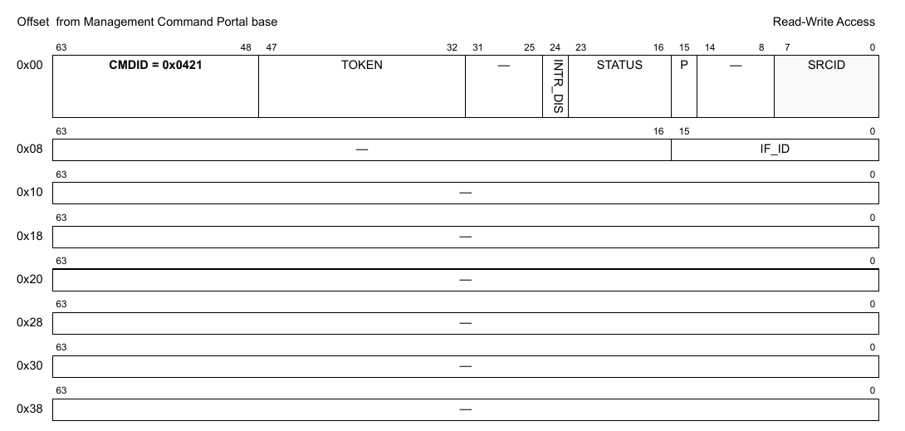

**Figure 411. Mô tả command DPSW_IF_GET_ATTRIBUTES**

| Offset | Bits | Tên | Mô tả |
|---|---|---|---|
| 0x00 | 0-63 | Header của command | Xem Table 2 để biết mô tả chung các field của command portal.<br>CMDID phải được đặt như chỉ ra trong hình ở trên. |
| 0x08 | 0-15 | IF_ID | Interface ID |

Mọi field không được nêu là reserved và phải được xóa (đặt bằng 0)

**Cấu trúc response**

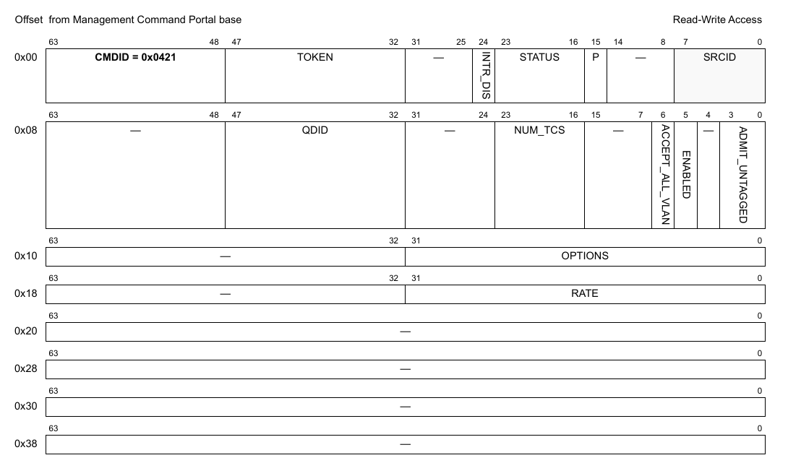

**Figure 412. Mô tả response của DPSW_IF_GET_ATTRIBUTES**

| Offset | Bits | Tên | Mô tả |
|---|---|---|---|
| 0x00 | 0-63 | Header của command | Xem Table 2 để biết mô tả chung các field của command portal.<br>CMDID phải được đặt như chỉ ra trong hình ở trên. |
| 0x08 | 0-3 | ADMIT_UNTAGGED | Khi đặt là 'DPSW_ADMIT_ONLY_VLAN_TAGGED', thiết bị loại bỏ frame không tag hoặc priority-tagged nhận được trên<br>interface này;<br>Khi đặt là 'DPSW_ADMIT_ALL', frame không tag hoặc<br>priority-tagged nhận được trên interface này được chấp nhận |
|   | 5 | ENABLED | Cho biết interface có đang enable không |
|   | 6 | ACCEPT_ALL_VLAN | Thiết bị loại bỏ/chấp nhận các frame tới<br>thuộc các VLAN không chứa interface này |
|   | 16-23 | NUM_TCS | Số traffic class |
|   | 32-47 | QDID | Giá trị QDID dùng khi truyền control frame qua interface này |
| 0x10 | 0-32 | OPTIONS | Các option cấu hình interface (bitmap) |
| 0x18 | 0-32 | RATE | Tốc độ truyền tính bằng bit mỗi giây |

Mọi field không được nêu là reserved và phải được xóa (đặt bằng 0)

### 14.3.38 DPSW_IF_SET_MAX_FRAME_LENGTH

**Cấu trúc command**

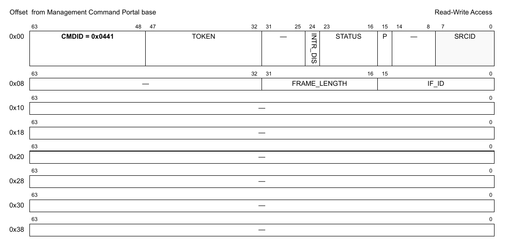

**Figure 413. Mô tả command DPSW_IF_SET_MAX_FRAME_LENGTH**

| Offset | Bits | Tên | Mô tả |
|---|---|---|---|
| 0x00 | 0-63 | Header của command | Xem Table 2 để biết mô tả chung các field của command portal.<br>CMDID phải được đặt như chỉ ra trong hình ở trên. |
| 0x08 | 0-15 | IF_ID | Interface ID |
|   | 16-31 | FRAME_LENGTH | Độ dài frame tối đa |

Mọi field không được nêu là reserved và phải được xóa (đặt bằng 0)

### 14.3.39 DPSW_IF_SET_LINK_CFG

**Cấu trúc command**

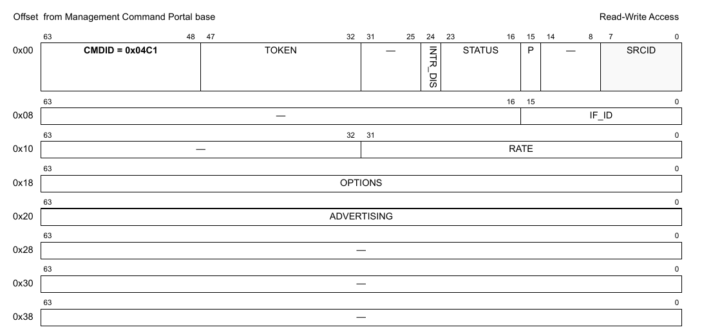

**Figure 414. Mô tả command DPSW_IF_SET_LINK_CFG**

| Offset | Bits | Tên | Mô tả |
|---|---|---|---|
| 0x00 | 0-63 | Header của command | Xem Table 2 để biết mô tả chung các field của command portal.<br>CMDID phải được đặt như chỉ ra trong hình ở trên. |
| 0x08 | 0-15 | IF_ID | Interface ID |
| 0x10 | 0-32 | RATE | Tốc độ |
| 0x18 | 0-63 | OPTIONS | Mask các option có sẵn; dùng các giá trị ‘DPSW_LINK_OPT_\<x> |
| 0X20 | 0-63 | ADVERTISING | Các tốc độ được quảng bá cho autoneg |

Mọi field không được nêu là reserved và phải được xóa (đặt bằng 0)

### 14.3.40 DPSW_IF_GET_LINK_STATE

**Cấu trúc command**


**Figure 415. Mô tả command DPSW_IF_GET_LINK_STATE**

| Offset | Bits | Tên | Mô tả |
|---|---|---|---|
| 0x00 | 0-63 | Header của command | Xem Table 2 để biết mô tả chung các field của command portal.<br>CMDID phải được đặt như chỉ ra trong hình ở trên. |
| 0x08 | 0-15 | IF_ID | Interface ID |

Mọi field không được nêu là reserved và phải được xóa (đặt bằng 0)

**Cấu trúc response**

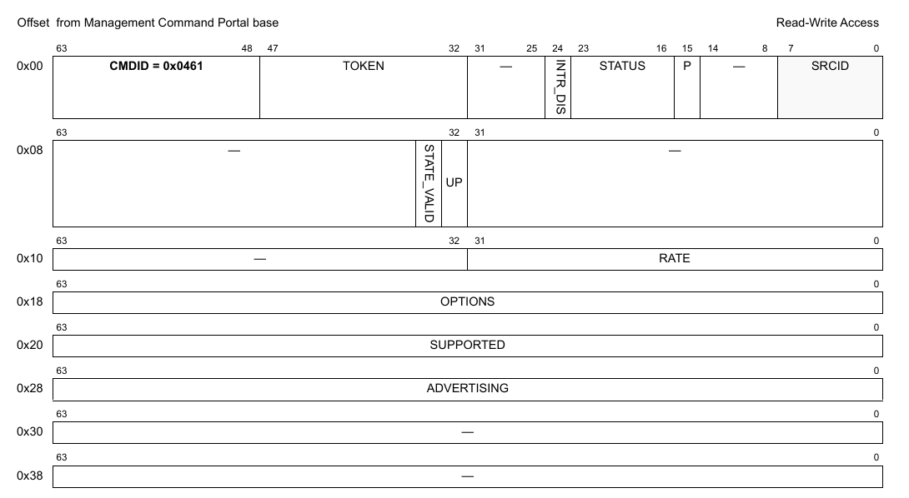

**Figure 416. Mô tả response của DPSW_IF_GET_LINK_STATE**

| Offset | Bits | Tên | Mô tả |
|---|---|---|---|
| 0x00 | 0-63 | Header của command | Xem Table 2 để biết mô tả chung các field của command portal.<br>CMDID phải được đặt như chỉ ra trong hình ở trên. |
| 0x08 | 32 | UP | 0 - down, 1- up |
|   | 33 | STATE_VALID | Bỏ qua/Cập nhật trạng thái của link |
| 0x10 | 0-32 | RATE | Tốc độ |
| 0x18 | 0-63 | OPTIONS | Mask các option có sẵn; dùng các giá trị ‘DPSW_LINK_OPT_\<x>’ |
| 0X20 | 0-63 | SUPPORTED | Các tốc độ mà phy hỗ trợ |
| 0X28 | 0-63 | ADVERTISING | Các tốc độ được quảng bá cho autoneg |

Mọi field không được nêu là reserved và phải được xóa (đặt bằng 0)

### 14.3.41 DPSW_IF_GET_MAX_FRAME_LENGTH

**Cấu trúc command**


**Figure 417. Mô tả command DPSW_IF_GET_MAX_FRAME_LENGTH**

| Offset | Bits | Tên | Mô tả |
|---|---|---|---|
| 0x00 | 0-63 | Header của command | Xem Table 2 để biết mô tả chung các field của command portal.<br>CMDID phải được đặt như chỉ ra trong hình ở trên. |
| 0x08 | 0-15 | IF_ID | Interface ID |

Mọi field không được nêu là reserved và phải được xóa (đặt bằng 0)

**Cấu trúc response**

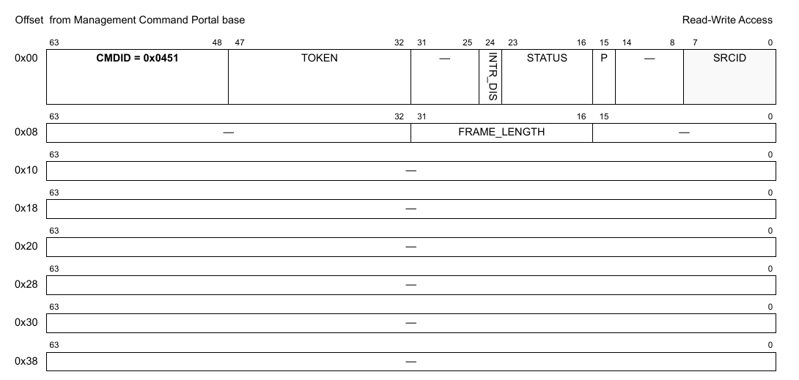

**Figure 418. Mô tả response của DPSW_IF_GET_MAX_FRAME_LENGTH**

| Offset | Bits | Tên | Mô tả |
|---|---|---|---|
| 0x00 | 0-63 | Header của command | Xem Table 2 để biết mô tả chung các field của command portal.<br>CMDID phải được đặt như chỉ ra trong hình ở trên. |
| 0x08 | 16-31 | FRAME_LENGTH | Độ dài frame tối đa |

Mọi field không được nêu là reserved và phải được xóa (đặt bằng 0)

### 14.3.42 DPSW_VLAN_ADD

**Cấu trúc command**

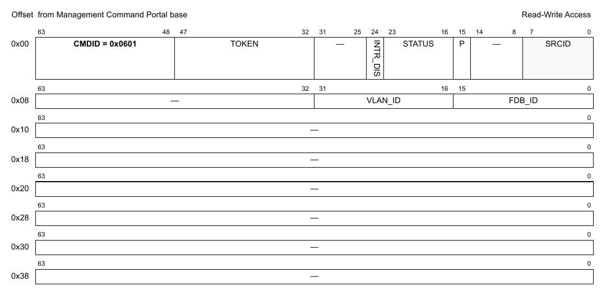

**Figure 419. Mô tả command DPSW_VLAN_ADD**

| Offset | Bits | Tên | Mô tả |
|---|---|---|---|
| 0x00 | 0-63 | Header của command | Xem Table 2 để biết mô tả chung các field của command portal.<br>CMDID phải được đặt như chỉ ra trong hình ở trên. |
| 0x08 | 0-15 | FDB_ID | Cơ sở dữ liệu chuyển tiếp (Forwarding Data base) |
|   | 16-31 | VLAN_ID | VLAN ID |

Mọi field không được nêu là reserved và phải được xóa (đặt bằng 0)

### 14.3.43 DPSW_VLAN_ADD_IF

**Cấu trúc command**

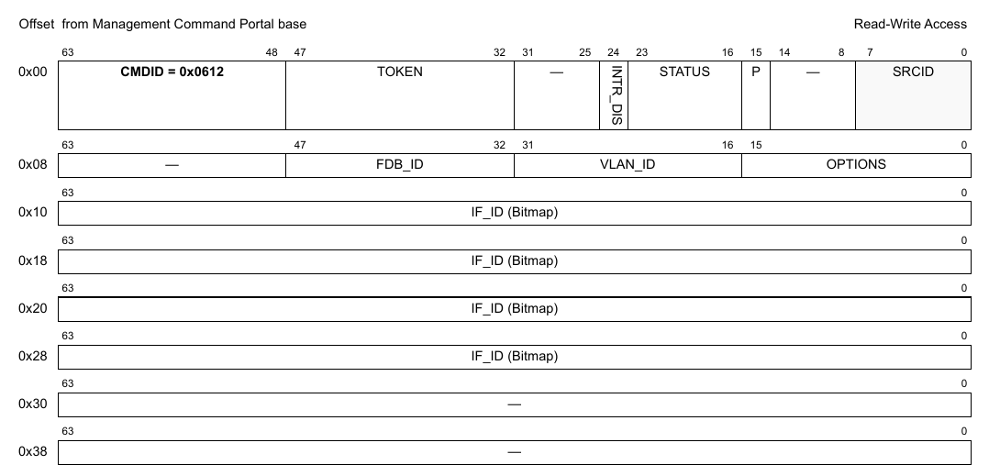

**Figure 420. Mô tả command DPSW_VLAN_ADD_IF**

| Offset | Bits | Tên | Mô tả |
|---|---|---|---|
| 0x00 | 0-63 | Header của command | Xem Table 2 để biết mô tả chung các field của command portal.<br>CMDID phải được đặt như chỉ ra trong hình ở trên. |
| 0x08 | 0-15 | OPTIONS | Dùng option này để chấp nhận một FDB id:<br>0x0001 - DPSW_VLAN_ADD_IF_OPT_FDB_ID |
|   | 16-31 | VLAN_ID | Vlan id. |
|   | 32-47 | FDB_ID | FDB id được VLAN này dùng trên interface cụ thể này. |
| 0x10- 0x2F | 0-63 | IF_ID (bitmap) | Tập các interface được gán vào danh sách egress của VLAN này. |

Mọi field không được nêu là reserved và phải được xóa (đặt bằng 0)

### 14.3.44 DPSW_VLAN_ADD_IF_UNTAGGED

**Cấu trúc command**


**Figure 421. Mô tả command DPSW_VLAN_ADD_IF_UNTAGGED**

| Offset | Bits | Tên | Mô tả |
|---|---|---|---|
| 0x00 | 0-63 | Header của command | Xem Table 2 để biết mô tả chung các field của command portal.<br>CMDID phải được đặt như chỉ ra trong hình ở trên. |
| 0x08 | 16-31 | VLAN_ID | VLAN ID |
| 0x10- 0x2F | 0-63 | IF_ID (bitmap) | Tập các interface được gán vào danh sách egress của VLAN này |

Mọi field không được nêu là reserved và phải được xóa (đặt bằng 0)

### 14.3.45 DPSW_VLAN_ADD_IF_FLOODING

**Cấu trúc command**

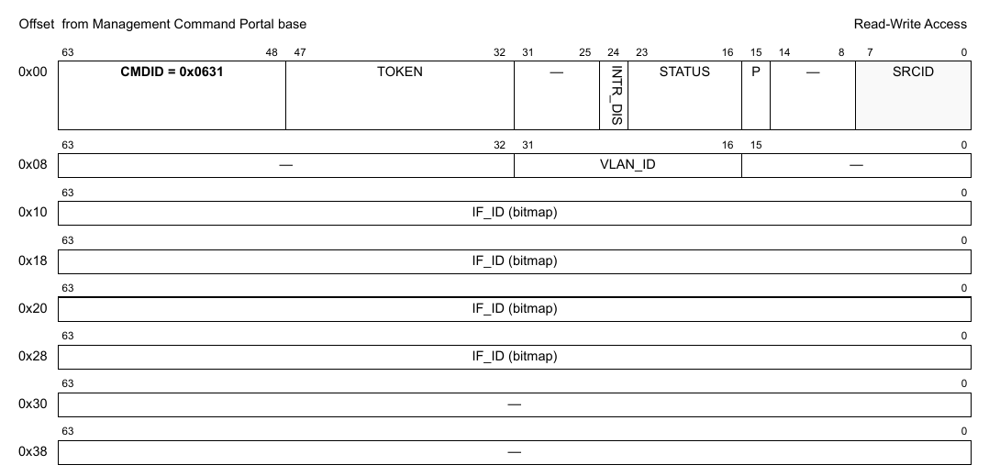

**Figure 422. Mô tả command DPSW_VLAN_ADD_IF_FLOODING**

| Offset | Bits | Tên | Mô tả |
|---|---|---|---|
| 0x00 | 0-63 | Header của command | Xem Table 2 để biết mô tả chung các field của command portal.<br>CMDID phải được đặt như chỉ ra trong hình ở trên. |
| 0x08 | 16-31 | VLAN_ID | VLAN ID |
| 0x10- 0x2F | 0-63 | IF_ID (bitmap) | Tập các interface được gán vào danh sách egress của VLAN này |

Mọi field không được nêu là reserved và phải được xóa (đặt bằng 0)

### 14.3.46 DPSW_VLAN_REMOVE_IF

**Cấu trúc command**


**Figure 423. Mô tả command DPSW_VLAN_REMOVE_IF**

| Offset | Bits | Tên | Mô tả |
|---|---|---|---|
| 0x00 | 0-63 | Header của command | Xem Table 2 để biết mô tả chung các field của command portal.<br>CMDID phải được đặt như chỉ ra trong hình ở trên. |
| 0x08 | 16-31 | VLAN_ID | VLAN ID |
| 0x10- 0x2F | 0-63 | IF_ID (bitmap) | Tập các interface được gán vào danh sách egress của VLAN này |

Mọi field không được nêu là reserved và phải được xóa (đặt bằng 0)

### 14.3.47 DPSW_VLAN_REMOVE_IF_UNTAGGED

**Cấu trúc command**


**Figure 424. Mô tả command DPSW_VLAN_REMOVE_IF_UNTAGGED**

| Offset | Bits | Tên | Mô tả |
|---|---|---|---|
| 0x00 | 0-63 | Header của command | Xem Table 2 để biết mô tả chung các field của command portal.<br>CMDID phải được đặt như chỉ ra trong hình ở trên. |
| 0x08 | 16-31 | VLAN_ID | VLAN ID |
| 0x10- 0x2F | 0-63 | IF_ID (bitmap) | Tập các interface được gán vào danh sách egress của VLAN này |

Mọi field không được nêu là reserved và phải được xóa (đặt bằng 0)

### 14.3.48 DPSW_VLAN_REMOVE_IF_FLOODING

**Cấu trúc command**

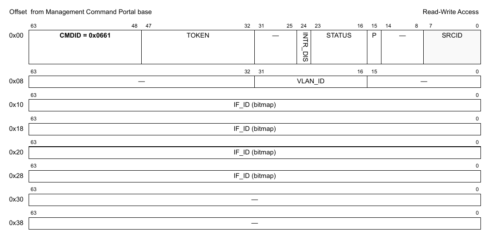

**Figure 425. Mô tả command DPSW_VLAN_REMOVE_IF_FLOODING**

| Offset | Bits | Tên | Mô tả |
|---|---|---|---|
| 0x00 | 0-63 | Header của command | Xem Table 2 để biết mô tả chung các field của command portal.<br>CMDID phải được đặt như chỉ ra trong hình ở trên. |
| 0x08 | 16-31 | VLAN_ID | VLAN ID |
| 0x10- 0x2F | 0-63 | IF_ID (bitmap) | Tập các interface được gán vào danh sách egress của VLAN này |

Mọi field không được nêu là reserved và phải được xóa (đặt bằng 0)

### 14.3.49 DPSW_VLAN_REMOVE

**Cấu trúc command**

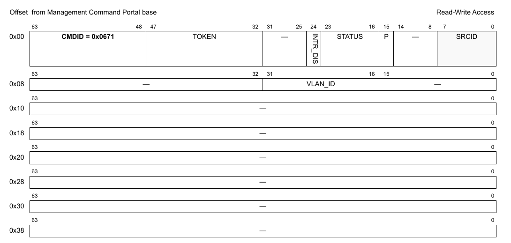

**Figure 426. Mô tả command DPSW_VLAN_REMOVE**

| Offset | Bits | Tên | Mô tả |
|---|---|---|---|
| 0x00 | 0-63 | Header của command | Xem Table 2 để biết mô tả chung các field của command portal.<br>CMDID phải được đặt như chỉ ra trong hình ở trên. |
| 0x08 | 16-31 | VLAN_ID | VLAN ID |

Mọi field không được nêu là reserved và phải được xóa (đặt bằng 0)

### 14.3.50 DPSW_VLAN_GET_ATTRIBUTES

**Cấu trúc command**

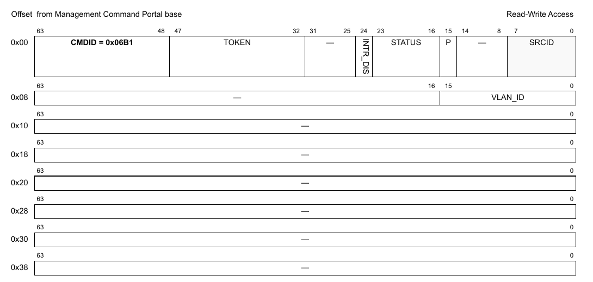

**Figure 427. Mô tả command DPSW_VLAN_GET_ATTRIBUTES**

| Offset | Bits | Tên | Mô tả |
|---|---|---|---|
| 0x00 | 0-63 | Header của command | Xem Table 2 để biết mô tả chung các field của command portal.<br>CMDID phải được đặt như chỉ ra trong hình ở trên. |
| 0x08 | 0-15 | VLAN_ID | VLAN ID |

Mọi field không được nêu là reserved và phải được xóa (đặt bằng 0)

**Cấu trúc response**

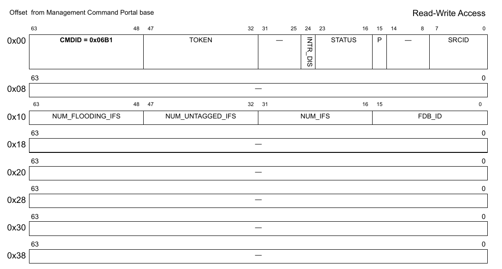

**Figure 428. Mô tả response của DPSW_VLAN_GET_ATTRIBUTES**

| Offset | Bits | Tên | Mô tả |
|---|---|---|---|
| 0x00 | 0-63 | Header của command | Xem Table 2 để biết mô tả chung các field của command portal.<br>CMDID phải được đặt như chỉ ra trong hình ở trên. |
| 0x08 |   |   |   |
| 0x10 | 0-15 | FDB_ID | FDB ID gắn kèm |
|   | 16-31 | NUM_IFS | Số interface |
|   | 32-47 | NUM_UNTAGGED_IFS | Số interface không tag |
|   | 48-63 | NUM_FLOODING_IFS | Số interface flooding |

Mọi field không được nêu là reserved và phải được xóa (đặt bằng 0)

### 14.3.51 DPSW_VLAN_GET_IF

**Cấu trúc command**

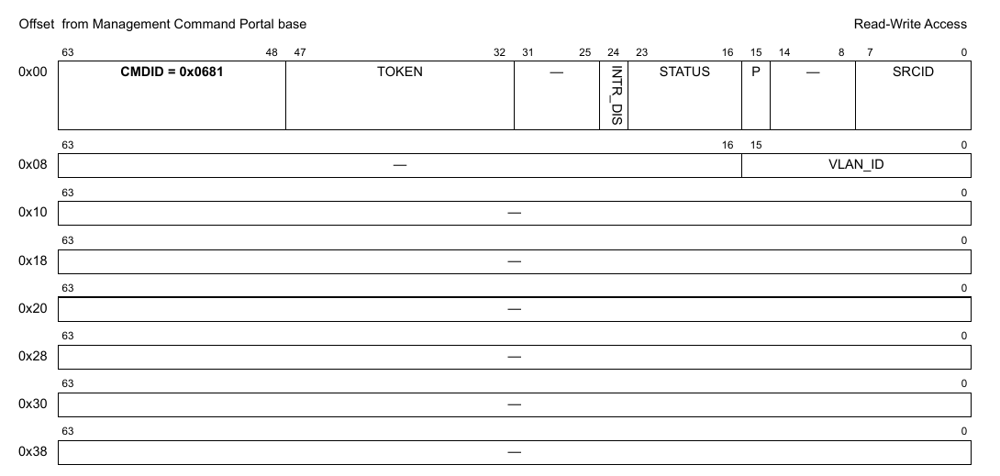

**Figure 429. Mô tả command DPSW_VLAN_GET_IF**

| Offset | Bits | Tên | Mô tả |
|---|---|---|---|
| 0x00 | 0-63 | Header của command | Xem Table 2 để biết mô tả chung các field của command portal.<br>CMDID phải được đặt như chỉ ra trong hình ở trên. |
| 0x08 | 0-15 | VLAN_ID | VLAN ID |

Mọi field không được nêu là reserved và phải được xóa (đặt bằng 0)

**Cấu trúc response**


**Figure 430. Mô tả response của DPSW_VLAN_GET_IF**

| Offset | Bits | Tên | Mô tả |
|---|---|---|---|
| 0x00 | 0-63 | Header của command | Xem Table 2 để biết mô tả chung các field của command portal.<br>CMDID phải được đặt như chỉ ra trong hình ở trên. |
| 0x08 | 16-31 | NUM_IFS | Số interface được<br>gán vào danh sách egress của VLAN này |
| 0x10- 0x2F | 0-63 | IF_ID (bitmap) | Tập các interface được gán vào danh sách egress của VLAN này |

Mọi field không được nêu là reserved và phải được xóa (đặt bằng 0)

### 14.3.52 DPSW_VLAN_GET_IF_FLOODING

**Cấu trúc command**

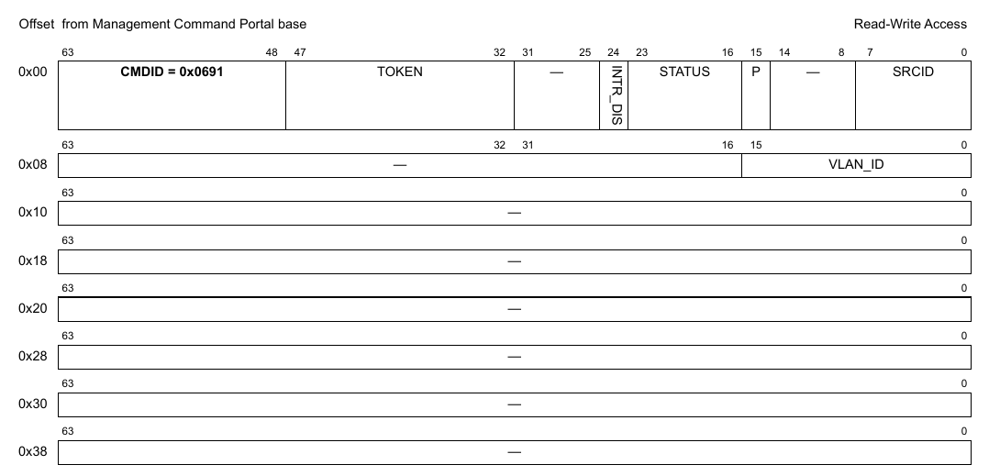

**Figure 431. Mô tả command DPSW_VLAN_GET_IF_FLOODING**

| Offset | Bits | Tên | Mô tả |
|---|---|---|---|
| 0x00 | 0-63 | Header của command | Xem Table 2 để biết mô tả chung các field của command portal.<br>CMDID phải được đặt như chỉ ra trong hình ở trên. |
| 0x08 | 0-15 | VLAN_ID | VLAN ID |

Mọi field không được nêu là reserved và phải được xóa (đặt bằng 0)

**Cấu trúc response**

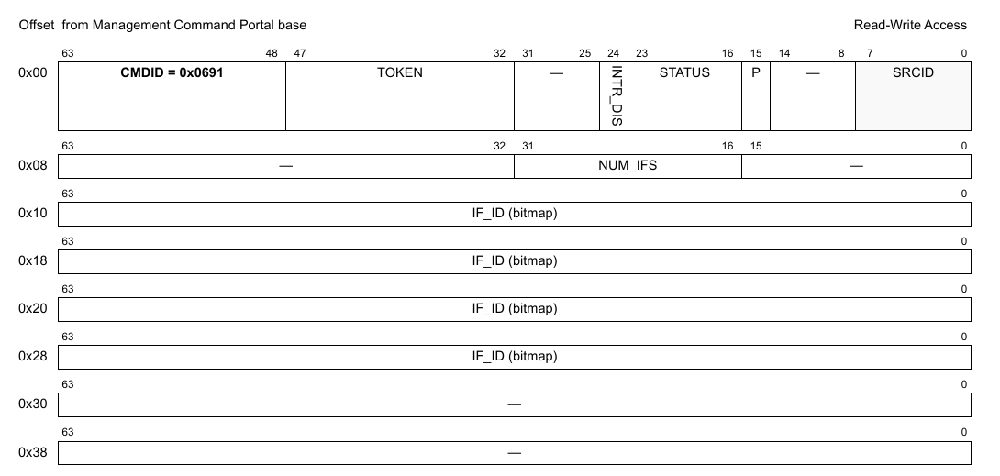

**Figure 432. Mô tả response của DPSW_VLAN_GET_IF_FLOODING**

| Offset | Bits | Tên | Mô tả |
|---|---|---|---|
| 0x00 | 0-63 | Header của command | Xem Table 2 để biết mô tả chung các field của command portal.<br>CMDID phải được đặt như chỉ ra trong hình ở trên. |
| 0x08 | 16-31 | NUM_IFS | Số interface được<br>gán vào danh sách egress của VLAN này |
| 0x10- 0x2F | 0-63 | IF_ID (bitmap) | Tập các interface được gán vào danh sách egress của VLAN này |

Mọi field không được nêu là reserved và phải được xóa (đặt bằng 0)

### 14.3.53 DPSW_VLAN_GET_IF_UNTAGGED

**Cấu trúc command**


**Figure 433. Mô tả command DPSW_VLAN_GET_IF_UNTAGGED**

| Offset | Bits | Tên | Mô tả |
|---|---|---|---|
| 0x00 | 0-63 | Header của command | Xem Table 2 để biết mô tả chung các field của command portal.<br>CMDID phải được đặt như chỉ ra trong hình ở trên. |
| 0x08 | 0-15 | VLAN_ID | VLAN ID |

Mọi field không được nêu là reserved và phải được xóa (đặt bằng 0)

**Cấu trúc response**

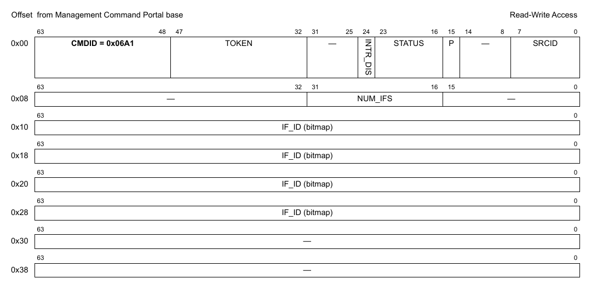

**Figure 434. Mô tả response của DPSW_VLAN_GET_IF_UNTAGGED**

| Offset | Bits | Tên | Mô tả |
|---|---|---|---|
| 0x00 | 0-63 | Header của command | Xem Table 2 để biết mô tả chung các field của command portal.<br>CMDID phải được đặt như chỉ ra trong hình ở trên. |
| 0x08 | 16-31 | NUM_IFS | Số interface được<br>gán vào danh sách egress của VLAN này |
| 0x10- 0x2F | 0-63 | IF_ID (bitmap) | Tập các interface được gán vào danh sách egress của VLAN này |

Mọi field không được nêu là reserved và phải được xóa (đặt bằng 0)

### 14.3.54 DPSW_FDB_ADD

**Cấu trúc command**

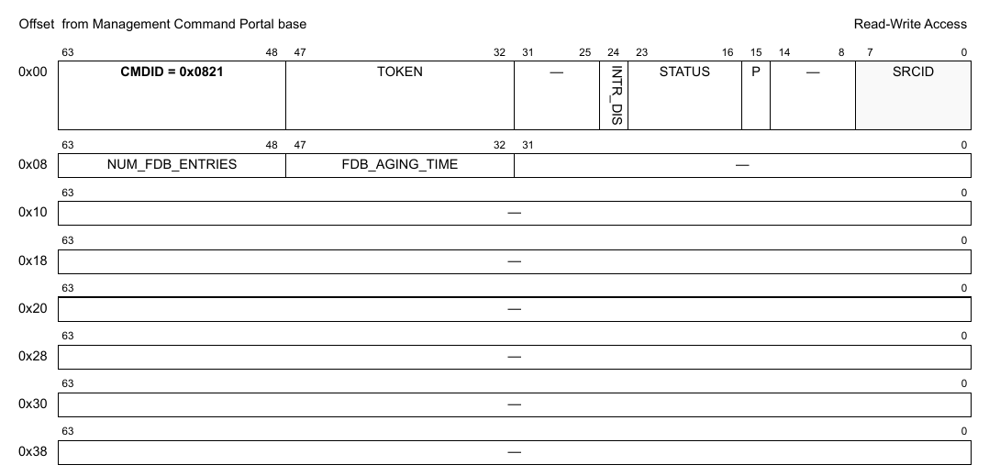

**Figure 435. Mô tả command DPSW_FDB_ADD**

| Offset | Bits | Tên | Mô tả |
|---|---|---|---|
| 0x00 | 0-63 | Header của command | Xem Table 2 để biết mô tả chung các field của command portal.<br>CMDID phải được đặt như chỉ ra trong hình ở trên. |
| 0x08 | 32-47 | FDB_AGING_TIME | Thời gian aging tính bằng giây |
|   | 48-63 | NUM_FDB_ENTRIES | Số mục FDB |

Mọi field không được nêu là reserved và phải được xóa (đặt bằng 0)

**Cấu trúc response**


**Figure 436. Mô tả response của DPSW_FDB_ADD**

| Offset | Bits | Tên | Mô tả |
|---|---|---|---|
| 0x00 | 0-63 | Header của command | Xem Table 2 để biết mô tả chung các field của command portal.<br>CMDID phải được đặt như chỉ ra trong hình ở trên. |
| 0x08 | 0-15 | FDB_ID | Forwarding Database Identifier |

Mọi field không được nêu là reserved và phải được xóa (đặt bằng 0)

### 14.3.55 DPSW_FDB_REMOVE

**Cấu trúc command**

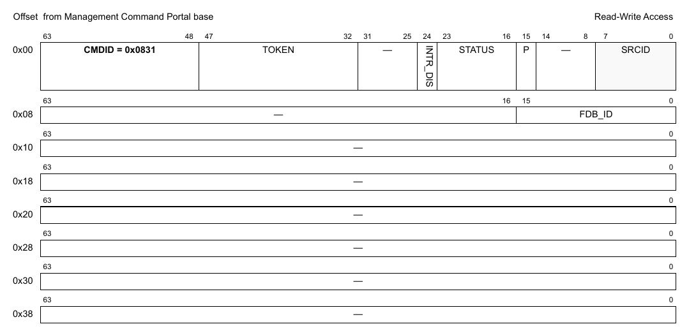

**Figure 437. Mô tả command DPSW_FDB_REMOVE**

| Offset | Bits | Tên | Mô tả |
|---|---|---|---|
| 0x00 | 0-63 | Header của command | Xem Table 2 để biết mô tả chung các field của command portal.<br>CMDID phải được đặt như chỉ ra trong hình ở trên. |
| 0x08 | 0-15 | FDB_ID | Forwarding Database Identifier |

Mọi field không được nêu là reserved và phải được xóa (đặt bằng 0)

### 14.3.56 DPSW_FDB_ADD_UNICAST

**Cấu trúc command**


**Figure 438. Mô tả command DPSW_FDB_ADD_UNICAST**

| Offset | Bits | Tên | Mô tả |
|---|---|---|---|
| 0x00 | 0-63 | Header của command | Xem Table 2 để biết mô tả chung các field của command portal.<br>CMDID phải được đặt như chỉ ra trong hình ở trên. |
| 0x08 | 0-15 | FDB_ID | Forwarding Database Identifier |
|   | 16-63 | MAC_ADDR[0-5] | Địa chỉ MAC |
| 0x10 | 0-15 | IF_EGRESS | ID interface egress |
|   | 16-19 | TYPE | Chọn mục tĩnh hoặc động. Chọn một trong các giá trị được hỗ trợ dưới đây: 0x0 = DPSW_FDB_ENTRY_STATIC - Mục tĩnh<br>0x1 = DPSW_FDB_ENTRY_DINAMIC - Mục động |

Mọi field không được nêu là reserved và phải được xóa (đặt bằng 0)

### 14.3.57 DPSW_FDB_GET_UNICAST

**Cấu trúc command**

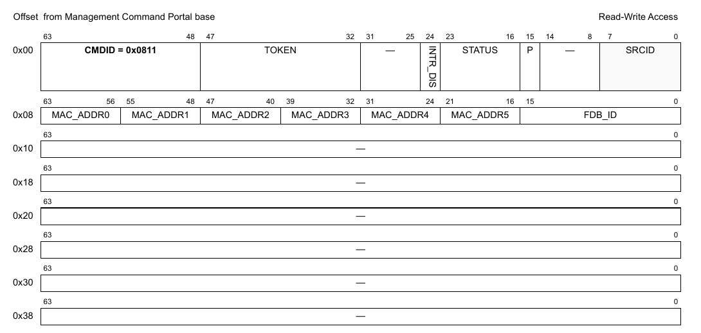

**Figure 439. Mô tả command DPSW_FDB_GET_UNICAST**

| Offset | Bits | Tên | Mô tả |
|---|---|---|---|
| 0x00 | 0-63 | Header của command | Xem Table 2 để biết mô tả chung các field của command portal.<br>CMDID phải được đặt như chỉ ra trong hình ở trên. |
| 0x08 | 0-15 | FDB_ID | Forwarding Database Identifier |
|   | 16-63 | MAC_ADDR[0-5] | Địa chỉ MAC |

Mọi field không được nêu là reserved và phải được xóa (đặt bằng 0)

**Cấu trúc response**

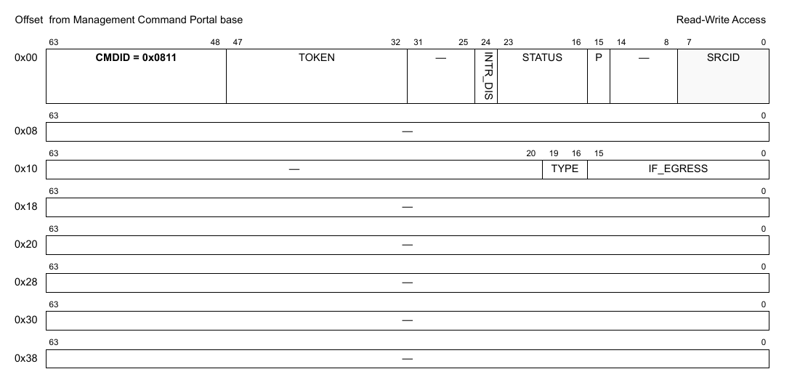

**Figure 440. Mô tả response của DPSW_FDB_GET_UNICAST**

| Offset | Bits | Tên | Mô tả |
|---|---|---|---|
| 0x00 | 0-63 | Header của command | Xem Table 2 để biết mô tả chung các field của command portal.<br>CMDID phải được đặt như chỉ ra trong hình ở trên. |
| 0x10 | 0-15 | IF_EGRESS | ID interface egress |
|   | 16-19 | TYPE | Chọn mục tĩnh hoặc động:<br>0x0 = DPSW_FDB_ENTRY_STATIC - Mục tĩnh<br>0x1 = DPSW_FDB_ENTRY_DINAMIC - Mục động |

Mọi field không được nêu là reserved và phải được xóa (đặt bằng 0)

### 14.3.58 DPSW_FDB_REMOVE_UNICAST

**Cấu trúc command**

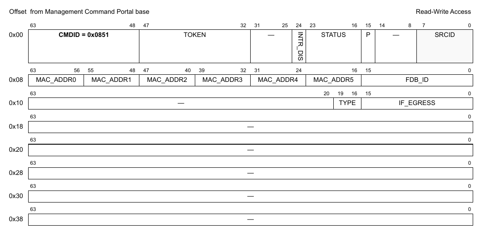

**Figure 441. Mô tả command DPSW_FDB_REMOVE_UNICAST**

| Offset | Bits | Tên | Mô tả |
|---|---|---|---|
| 0x00 | 0-63 | Header của command | Xem Table 2 để biết mô tả chung các field của command portal.<br>CMDID phải được đặt như chỉ ra trong hình ở trên. |
| 0x08 | 0-15 | FDB_ID | Forwarding Database Identifier |
|   | 16-63 | MAC_ADDR[0-5] | Địa chỉ MAC |
| 0x10 | 0-15 | IF_EGRESS | ID interface egress |
|   | 16-19 | TYPE | Chọn mục tĩnh hoặc động:<br>0x0 = DPSW_FDB_ENTRY_STATIC - Mục tĩnh<br>0x1 = DPSW_FDB_ENTRY_DINAMIC - Mục động |

Mọi field không được nêu là reserved và phải được xóa (đặt bằng 0)

### 14.3.59 DPSW_FDB_ADD_MULTICAST

**Cấu trúc command**


**Figure 442. Mô tả command DPSW_FDB_ADD_MULTICAST**

| Offset | Bits | Tên | Mô tả |
|---|---|---|---|
| 0x00 | 0-63 | Header của command | Xem Table 2 để biết mô tả chung các field của command portal.<br>CMDID phải được đặt như chỉ ra trong hình ở trên. |
| 0x08 | 0-15 | FDB_ID | Forwarding Database Identifier |
|   | 16-31 | NUM_IFS | Số interface ngoài và nội bộ |
|   | 32-35 | TYPE | Chọn mục tĩnh hoặc động:<br>0x0 = DPSW_FDB_ENTRY_STATIC - Mục tĩnh<br>0x1 = DPSW_FDB_ENTRY_DINAMIC - Mục động |
| 0x10 | 16-63 | MAC_ADDR[0-5] | Địa chỉ MAC |
| 0x18- 0x37 | 0-63 | IF_ID (bitmap) | Tập các interface được gán vào danh sách egress của VLAN này |

Mọi field không được nêu là reserved và phải được xóa (đặt bằng 0)

### 14.3.60 DPSW_FDB_GET_MULTICAST

**Cấu trúc command**

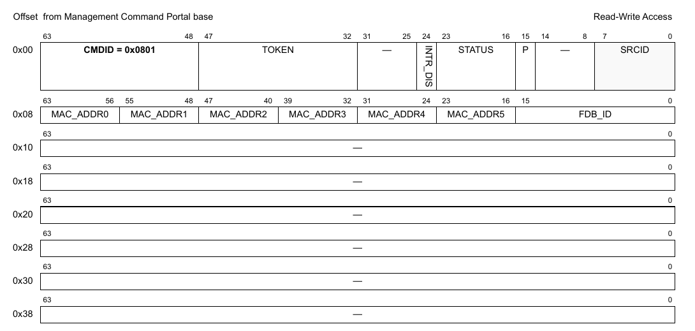

**Figure 443. Mô tả command DPSW_FDB_GET_MULTICAST**

| Offset | Bits | Tên | Mô tả |
|---|---|---|---|
| 0x00 | 0-63 | Header của command | Xem Table 2 để biết mô tả chung các field của command portal.<br>CMDID phải được đặt như chỉ ra trong hình ở trên. |
| 0x08 | 0-15 | FDB_ID | Forwarding Database Identifier |
|   | 16-63 | MAC_ADDR[0-5] | Địa chỉ MAC |

Mọi field không được nêu là reserved và phải được xóa (đặt bằng 0)

**Cấu trúc response**

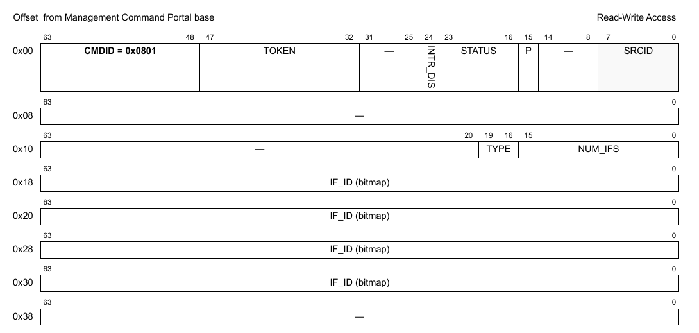

**Figure 444. Mô tả response của DPSW_FDB_GET_MULTICAST**

| Offset | Bits | Tên | Mô tả |
|---|---|---|---|
| 0x00 | 0-63 | Header của command | Xem Table 2 để biết mô tả chung các field của command portal.<br>CMDID phải được đặt như chỉ ra trong hình ở trên. |
| 0x08 | 0-63 | Reserved |   |
| 0x10 | 0-15 | NUM_IFS | Số interface ngoài và nội bộ |
|   | 16-19 | TYPE | Chọn mục tĩnh hoặc động:<br>0x0 = DPSW_FDB_ENTRY_STATIC - Mục tĩnh 0x1 = DPSW_FDB_ENTRY_DINAMIC - Mục động |
| 0x18- 0x37 | 0-63 | IF_ID (bitmap) | Tập các interface được gán vào danh sách egress của VLAN này |

Mọi field không được nêu là reserved và phải được xóa (đặt bằng 0)

### 14.3.61 DPSW_FDB_REMOVE_MULTICAST

**Cấu trúc command**

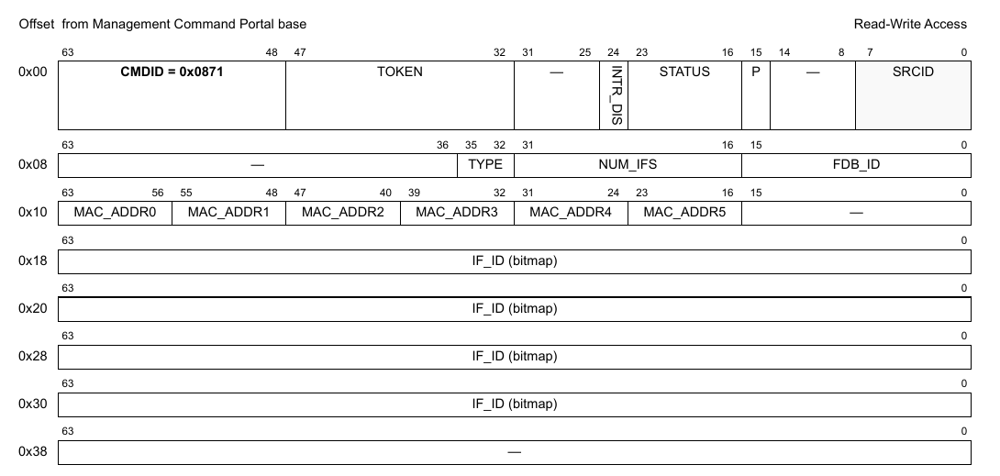

**Figure 445. Mô tả command DPSW_FDB_REMOVE_MULTICAST**

| Offset | Bits | Tên | Mô tả |
|---|---|---|---|
| 0x00 | 0-63 | Header của command | Xem Table 2 để biết mô tả chung các field của command portal.<br>CMDID phải được đặt như chỉ ra trong hình ở trên. |
| 0x08 | 0-15 | FDB_ID | Forwarding Database Identifier |
|   | 16-31 | NUM_IFS | Số interface ngoài và nội bộ |
|   | 32-35 | TYPE | Chọn mục tĩnh hoặc động:<br>0x0 = DPSW_FDB_ENTRY_STATIC - Mục tĩnh<br>0x1 = DPSW_FDB_ENTRY_DINAMIC - Mục động |
| 0x10 | 16-63 | MAC_ADDR[0-5] | Địa chỉ MAC |
| 0x18- 0x37 | 0-63 | IF_ID (bitmap) | Tập các interface được gán vào danh sách egress của VLAN này |

Mọi field không được nêu là reserved và phải được xóa (đặt bằng 0)

### 14.3.62 DPSW_FDB_SET_LEARNING_MODE

**Cấu trúc command**


**Figure 446. Mô tả command DPSW_FDB_SET_LEARNING_MODE**

| Offset | Bits | Tên | Mô tả |
|---|---|---|---|
| 0x00 | 0-63 | Header của command | Xem Table 2 để biết mô tả chung các field của command portal.<br>CMDID phải được đặt như chỉ ra trong hình ở trên. |
| 0x08 | 0-15 | FDB_ID | Forwarding Database Identifier |
|   | 16-19 | MODE | Chế độ học. Chọn một trong các giá trị được hỗ trợ dưới đây:<br>0x0 = DPSW_LEARNING_MODE_DIS - Tắt tự học<br>0x1 = DPSW_LEARNING_MODE_HW - Bật tự học bằng HW 0x2 = DPSW_LEARNING_MODE_NON_SECURE - Bật học không bảo mật bằng CPU<br>0x3 = DPSW_LEARNING_MODE_SECURE - Bật học có bảo mật bằng CPU |

Mọi field không được nêu là reserved và phải được xóa (đặt bằng 0)

### 14.3.63 DPSW_FDB_GET_ATTRIBUTES

**Cấu trúc command**


**Figure 447. Mô tả command DPSW_FDB_GET_ATTRIBUTES**

| Offset | Bits | Tên | Mô tả |
|---|---|---|---|
| 0x00 | 0-63 | Header của command | Xem Table 2 để biết mô tả chung các field của command portal.<br>CMDID phải được đặt như chỉ ra trong hình ở trên. |
| 0x08 | 0-15 | FDB_ID | Forwarding Database Identifier |

Mọi field không được nêu là reserved và phải được xóa (đặt bằng 0)

**Cấu trúc response**

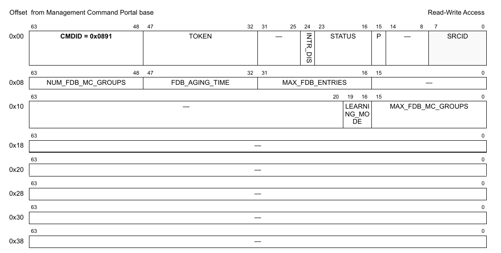

**Figure 448. Mô tả response của DPSW_FDB_GET_ATTRIBUTES**

| Offset | Bits | Tên | Mô tả |
|---|---|---|---|
| 0x00 | 0-63 | Header của command | Xem Table 2 để biết mô tả chung các field của command portal.<br>CMDID phải được đặt như chỉ ra trong hình ở trên. |
| 0x08 | 16-31 | MAX_FDB_ENTRIES | Số mục FDB |
|   | 32-47 | FDB_AGING_TIME | Thời gian aging tính bằng giây |
|   | 48-63 | NUM_FDB_MC_GROUPS | Số multicast group hiện tại |
| 0x10 | 0-15 | MAX_FDB_MC_GROUPS | Số multicast group tối đa |
|   | 16-19 | LEARNING_MODE | Chế độ học. Chọn một trong các giá trị được hỗ trợ dưới đây:<br>0x0 = DPSW_LEARNING_MODE_DIS - Tắt tự học<br>0x1 = DPSW_LEARNING_MODE_HW - Bật tự học bằng HW 0x2 = DPSW_LEARNING_MODE_NON_SECURE - Bật học không bảo mật bằng CPU<br>0x3 = DPSW_LEARNING_MODE_SECURE - Bật học có bảo mật bằng CPU |

Mọi field không được nêu là reserved và phải được xóa (đặt bằng 0)

### 14.3.64 DPSW_ACL_ADD

**Cấu trúc command**


**Figure 449. Mô tả command DPSW_ACL_ADD**

| Offset | Bits | Tên | Mô tả |
|---|---|---|---|
| 0x00 | 0-63 | Header của command | Xem Table 2 để biết mô tả chung các field của command portal.<br>CMDID phải được đặt như chỉ ra trong hình ở trên. |
| 0x08 | 16-32 | MAX_ENTIRIES *(ghi chú: đúng là MAX_ENTRIES)* | Số mục FDB |

Mọi field không được nêu là reserved và phải được xóa (đặt bằng 0)

**Cấu trúc response**


**Figure 450. Mô tả response của DPSW_ACL_ADD**

| Offset | Bits | Tên | Mô tả |
|---|---|---|---|
| 0x00 | 0-63 | Header của command | Xem Table 2 để biết mô tả chung các field của command portal.<br>CMDID phải được đặt như chỉ ra trong hình ở trên. |
| 0x08 | 0-15 | ACL_ID | ACL ID trả về, để tham chiếu về sau |

Mọi field không được nêu là reserved và phải được xóa (đặt bằng 0)

### 14.3.65 DPSW_ACL_REMOVE

**Cấu trúc command**


**Figure 451. Mô tả command DPSW_ACL_REMOVE**

| Offset | Bits | Tên | Mô tả |
|---|---|---|---|
| 0x00 | 0-63 | Header của command | Xem Table 2 để biết mô tả chung các field của command portal.<br>CMDID phải được đặt như chỉ ra trong hình ở trên. |
| 0x08 | 0-15 | ACL_ID | ACL ID |

Mọi field không được nêu là reserved và phải được xóa (đặt bằng 0)

### 14.3.66 DPSW_ACL_PREPARE_ENTRY_CFG

**Cấu trúc mở rộng**


**Figure 452. Mô tả phần mở rộng của DPSW_ACL_PREPARE_ENTRY_CFG**

| Offset | Bits | Tên | Mô tả |   |
|---|---|---|---|---|
| 0x00 | 0-47 | L2_DEST_MAC[0-5] | Địa chỉ MAC đích: BPDU, Multicast, Broadcast, Unicast, slow protocol, MVRP, STP | Các field khớp của key |
|   | 48-63 | L2_TPID | Loại giao thức Layer 2 (Ethernet), dùng để nhận diện các giao thức sau: MPLS, PTP, PFC, ARP, Jumbo frame, LLDP, IEEE802.1ae, Q-in-Q, IPv4, IPv6, PPPoE |   |
| 0x08 | 0-47 | L2_SOURCE_MAC[0-5] | Địa chỉ MAC nguồn |   |
|   | 48-63 | L2_VLAN_ID | VLAN ID layer 2 |   |
| 0x10 | 0-31 | L3_DEST_IP | IP IPv4 đích |   |
|   | 32-63 | L3_SOURCE_IP | IP IPv4 nguồn |   |
| 0x18 | 0-15 | L4_DEST_PORT | Cổng TCP/UDP đích |   |
|   | 16-31 | L4_SOURCE_PORT | Cổng TCP/UDP nguồn |   |
|   | 32-47 | L2_ETHR_TYPE | Layer 2 Ethernet Type<br>Với các mục trong bảng ACL, DPSW chỉ khớp được địa chỉ IP nguồn/đích IPv4. Đó là lý do<br>field khớp L2_ETHR_TYPE phải đặt là 0x0800 mỗi khi có yêu cầu khớp IP src/dst. Nếu không, lời gọi dpsw_acl_add_entry() sẽ trả về lỗi.<br>Giới hạn này không áp dụng cho LS2080/LS2085, do dùng phiên bản WRIOP cũ hơn. Việc thêm mục ACL có địa chỉ src/dst L3 không bị hạn chế gì. Đổi lại, mọi traffic IPv6 sẽ bị drop dù không thêm quy tắc ACL nào. |   |
|   | 48-55 | L2_PCP_DEI | Cho biết giao thức nào được đóng gói trong payload |   |
|   | 56-63 | L3_DSCP | Differentiated services code point Layer 3 |   |
| 0x20 | 0-47 | L2_DEST_MAC[0-5] | Địa chỉ MAC đích: BPDU, Multicast, Broadcast, Unicast, slow protocol, MVRP, STP | key mask : b’1 - hợp lệ, b’0 không quan tâm |
|   | 48-63 | L2_TPID | Loại giao thức Layer 2 (Ethernet), dùng để nhận diện các giao thức sau: MPLS, PTP, PFC, ARP, Jumbo frame, LLDP, IEEE802.1ae, Q-in-Q, IPv4, IPv6, PPPoE |   |
| 0x28 | 0-47 | L2_SOURCE_MAC[0-5] | Địa chỉ MAC nguồn |   |
|   | 48-63 | L2_VLAN_ID | VLAN ID layer 2 |   |
| 0x30 | 0-31 | L3_DEST_IP | IP IPv4 đích |   |
|   | 32-63 | L3_SOURCE_IP | IP IPv4 nguồn |   |
| 0x38 | 0-15 | L4_DEST_PORT | Cổng TCP/UDP đích |   |
|   | 16-31 | L4_SOURCE_PORT | Cổng TCP/UDP nguồn |   |
|   | 32-47 | L2_ETHR_TYPE | Layer 2 Ethernet Type<br>Nếu cũng có yêu cầu khớp địa chỉ L3 src/dst, mask của L2_ETHR_TYPE cần đặt là 0xFFFF để bảo đảm IPv4 là giao thức L3 duy nhất. Xem mô tả field khớp L2_ETHR_TYPE để biết chi tiết.<br>Không áp dụng cho LS2080/LS2085. |   |
|   | 48-55 | L2_PCP_DEI | Cho biết giao thức nào được đóng gói trong payload |   |
|   | 56-63 | L3_DSCP | Differentiated services code point Layer 3 |   |
| 0x40 | 0-7 | L3_PROTOCOL | Cho tầng Network ở host đích biết packet này thuộc giao thức nào. Các giao thức sau được hỗ trợ: ICMP, IGMP, IPv4 (encapsulation), TCP, IPv6 (encapsulation), GRE, PTP | Các field khớp |
|   | 8-15 | L3_PROTOCOL | Cho tầng Network ở host đích biết packet này thuộc giao thức nào. Các giao thức sau được hỗ trợ: ICMP, IGMP, IPv4 (encapsulation), TCP, IPv6 (encapsulation), GRE, PTP | Mask : b’1 - hợp lệ, b’0 không quan tâm |

Mọi field không được nêu là reserved và phải được xóa (đặt bằng 0)

### 14.3.67 DPSW_ACL_ADD_ENTRY

**Cấu trúc command**


**Figure 453. Mô tả command DPSW_ACL_ADD_ENTRY**

| Offset | Bits | Tên | Mô tả |
|---|---|---|---|
| 0x00 | 0-63 | Header của command | Xem Table 2 để biết mô tả chung các field của command portal.<br>CMDID phải được đặt như chỉ ra trong hình ở trên. |
| 0x08 | 0-15 | ACL_ID | ACL ID |
|   | 16-31 | RESULT_IF_ID | Các interface ID để chuyển hướng frame. Chỉ hợp lệ nếu chọn hành động redirect |
|   | 32-63 | PRECEDENCE | Thứ tự ưu tiên trong ACL, 0 là thấp nhất; priority này không thể đổi<br>trong suốt vòng đời của một Policy. Người dùng có trách nhiệm<br>chừa khoảng cách giữa các priority theo các quy tắc sẽ thêm sau. |
| 0x10 | 0-3 | RESULT_ACTION | Hành động cần thực hiện khi mục ACL khớp |
| 0x38 | 0-63 | KEY_IOVA | Địa chỉ ảo I/O của bộ nhớ DMA-able được điền key sau khi gọi dpsw_acl_prepare_entry_cfg() |

Mọi field không được nêu là reserved và phải được xóa (đặt bằng 0)

### 14.3.68 DPSW_ACL_REMOVE_ENTRY

**Cấu trúc command**


**Figure 454. Mô tả command DPSW_ACL_REMOVE_ENTRY**

| Offset | Bits | Tên | Mô tả |
|---|---|---|---|
| 0x00 | 0-63 | Header của command | Xem Table 2 để biết mô tả chung các field của command portal.<br>CMDID phải được đặt như chỉ ra trong hình ở trên. |
| 0x08 | 0-15 | ACL_ID | ACL ID |
|   | 16-31 | RESULT_IF_ID | Các interface ID để chuyển hướng frame. Chỉ hợp lệ nếu chọn hành động redirect |
|   | 32-63 | PRECEDENCE | Thứ tự ưu tiên trong ACL, 0 là thấp nhất; priority này không thể đổi<br>trong suốt vòng đời của một Policy. Người dùng có trách nhiệm<br>chừa khoảng cách giữa các priority theo các quy tắc sẽ thêm sau. |
| 0x10 | 0-3 | RESULT_ACTION | Hành động cần thực hiện khi mục ACL khớp |
| 0x38 | 0-63 | KEY_IOVA | Địa chỉ ảo I/O của bộ nhớ DMA-able được điền key sau khi gọi dpsw_acl_prepare_entry_cfg() |

Mọi field không được nêu là reserved và phải được xóa (đặt bằng 0)

**Cấu trúc mở rộng**


**Figure 455. Mô tả phần mở rộng của DPSW_ACL_REMOVE_ENTRY**

| Offset | Bits | Tên | Mô tả |   |
|---|---|---|---|---|
| 0x00 | 0-47 | L2_DEST_MAC[0-5] | Địa chỉ MAC đích: BPDU, Multicast, Broadcast, Unicast, slow protocol, MVRP, STP | Các field khớp của key |
|   | 48-63 | L2_TPID | Loại giao thức Layer 2 (Ethernet), dùng để nhận diện các giao thức sau: MPLS, PTP, PFC, ARP, Jumbo frame, LLDP, IEEE802.1ae, Q-in-Q, IPv4, IPv6, PPPoE |   |
| 0x08 | 0-47 | L2_SOURCE_MAC[0-5] | Địa chỉ MAC nguồn |   |
|   | 48-63 | L2_VLAN_ID | VLAN ID layer 2 |   |
| 0x10 | 0-31 | L3_DEST_IP | IP IPv4 đích |   |
|   | 32-63 | L3_SOURCE_IP | IP IPv4 nguồn |   |
| 0x18 | 0-15 | L4_DEST_PORT | Cổng TCP/UDP đích |   |
|   | 16-31 | L4_SOURCE_PORT | Cổng TCP/UDP nguồn |   |
|   | 32-47 | L2_ETHR_TYPE | Layer 2 Ethernet Type |   |
|   | 48-55 | L2_PCP_DEI | Cho biết giao thức nào được đóng gói trong payload |   |
|   | 56-63 | L3_DSCP | Differentiated services code point Layer 3 |   |
| 0x20 | 0-47 | L2_DEST_MAC[0-5] | Địa chỉ MAC đích: BPDU, Multicast, Broadcast, Unicast, slow protocol, MVRP, STP | key mask : b’1 - hợp lệ, b’0 không quan tâm |
|   | 48-63 | L2_TPID | Loại giao thức Layer 2 (Ethernet), dùng để nhận diện các giao thức sau: MPLS, PTP, PFC, ARP, Jumbo frame, LLDP, IEEE802.1ae, Q-in-Q, IPv4, IPv6, PPPoE |   |
| 0x28 | 0-47 | L2_SOURCE_MAC[0-5] | Địa chỉ MAC nguồn |   |
|   | 48-63 | L2_VLAN_ID | VLAN ID layer 2 |   |
| 0x30 | 0-31 | L3_DEST_IP | IP IPv4 đích |   |
|   | 32-63 | L3_SOURCE_IP | IP IPv4 nguồn |   |
| 0x38 | 0-15 | L4_DEST_PORT | Cổng TCP/UDP đích |   |
|   | 16-31 | L4_SOURCE_PORT | Cổng TCP/UDP nguồn |   |
|   | 32-47 | L2_ETHR_TYPE | Layer 2 Ethernet Type |   |
|   | 48-55 | L2_PCP_DEI | Cho biết giao thức nào được đóng gói trong payload |   |
|   | 56-63 | L3_DSCP | Differentiated services code point Layer 3 |   |
| 0x40 | 0-7 | L3_PROTOCOL | Cho tầng Network ở host đích biết packet này thuộc giao thức nào. Các giao thức sau được hỗ trợ: ICMP, IGMP, IPv4 (encapsulation), TCP, IPv6 (encapsulation), GRE, PTP | Các field khớp |
|   | 8-15 | L3_PROTOCOL | Cho tầng Network ở host đích biết packet này thuộc giao thức nào. Các giao thức sau được hỗ trợ: ICMP, IGMP, IPv4 (encapsulation), TCP, IPv6 (encapsulation), GRE, PTP | Mask : b’1 - hợp lệ, b’0 không quan tâm |
|   | 16-31 | IF_ID | Các interface ID để chuyển hướng frame. Chỉ hợp lệ nếu chọn hành động redirect | result - Hành động cần thiết khi mục khớp |
|   | 32-63 | PRECEDENCE | Thứ tự ưu tiên trong ACL, 0 là thấp nhất; priority này không thể đổi trong suốt vòng đời của một Policy. Người dùng có trách nhiệm chừa khoảng cách giữa các priority theo các quy tắc sẽ thêm sau. |   |
| 0x48 | 0-4 | ACTION | Hành động cần thực hiện khi mục ACL khớp | result - Hành động cần thiết khi mục khớp |

Mọi field không được nêu là reserved và phải được xóa (đặt bằng 0)

### 14.3.69 DPSW_ACL_ADD_IF

**Cấu trúc command**


**Figure 456. Mô tả command DPSW_ACL_ADD_IF**

| Offset | Bits | Tên | Mô tả |
|---|---|---|---|
| 0x00 | 0-63 | Header của command | Xem Table 2 để biết mô tả chung các field của command portal.<br>CMDID phải được đặt như chỉ ra trong hình ở trên. |
| 0x08 | 0-15 | ACL_ID | ACL ID |
|   | 16-31 | NUM_IFS | Số interface |
| 0x10- 0x2F | 0-63 | IF_ID (bitmap) | Tập các interface được gán vào danh sách egress của VLAN này |

Mọi field không được nêu là reserved và phải được xóa (đặt bằng 0)

### 14.3.70 DPSW_ACL_REMOVE_IF

**Cấu trúc command**


**Figure 457. Mô tả command DPSW_ACL_REMOVE_IF**

| Offset | Bits | Tên | Mô tả |
|---|---|---|---|
| 0x00 | 0-63 | Header của command | Xem Table 2 để biết mô tả chung các field của command portal.<br>CMDID phải được đặt như chỉ ra trong hình ở trên. |
| 0x08 | 0-15 | ACL_ID | ACL ID |
|   | 16-31 | NUM_IFS | Số interface |
| 0x10- 0x2F | 0-63 | IF_ID (bitmap) | Tập các interface được gán vào danh sách egress của VLAN này |

Mọi field không được nêu là reserved và phải được xóa (đặt bằng 0)

### 14.3.71 DPSW_ACL_GET_ATTRIBUTES

**Cấu trúc command**


**Figure 458. Mô tả command DPSW_ACL_GET_ATTRIBUTES**

| Offset | Bits | Tên | Mô tả |
|---|---|---|---|
| 0x00 | 0-63 | Header của command | Xem Table 2 để biết mô tả chung các field của command portal.<br>CMDID phải được đặt như chỉ ra trong hình ở trên. |
| 0x08 | 0-15 | ACL_ID | ACL ID |

Mọi field không được nêu là reserved và phải được xóa (đặt bằng 0)

**Cấu trúc response**


**Figure 459. Mô tả response của DPSW_ACL_GET_ATTRIBUTES**

| Offset | Bits | Tên | Mô tả |
|---|---|---|---|
| 0x00 | 0-63 | Header của command | Xem Table 2 để biết mô tả chung các field của command portal.<br>CMDID phải được đặt như chỉ ra trong hình ở trên. |
| 0x10 | 0-15 | MAX_ENTRIES | Số mục ACL tối đa |
|   | 16-31 | NUM_ENTRIES | Số mục ACL đã dùng |
|   | 32-63 | NUM_IFS | Số interface gắn với ACL |

Mọi field không được nêu là reserved và phải được xóa (đặt bằng 0)

### 14.3.72 DPSW_CTRL_IF_GET_ATTRIBUTES

**Cấu trúc command**


**Figure 460. Mô tả command DPSW_CTRL_IF_GET_ATTRIBUTES**

| Offset | Bits | Tên | Mô tả |
|---|---|---|---|
| 0x00 | 0-63 | Header của command | Xem Table 2 để biết mô tả chung các field của command portal.<br>CMDID phải được đặt như chỉ ra trong hình ở trên. |

Mọi field không được nêu là reserved và phải được xóa (đặt bằng 0)

**Cấu trúc response**


**Figure 461. Mô tả response của DPSW_CTRL_IF_GET_ATTRIBUTES**

| Offset | Bits | Tên | Mô tả |
|---|---|---|---|
| 0x00 | 0-63 | Header của command | Xem Table 2 để biết mô tả chung các field của command portal.<br>CMDID phải được đặt như chỉ ra trong hình ở trên. |
| 0x10 | 0-31 | RX_FQID | Receive FQID |
|   | 32-63 | RX_ERR_FQID | FQID lỗi nhận |
| 0x18 | 0-31 | TX_ERR_CONF_FQID | FQID lỗi truyền và confirmation |

Mọi field không được nêu là reserved và phải được xóa (đặt bằng 0)

### 14.3.73 DPSW_CTRL_IF_SET_POOLS

**Cấu trúc command**


**Figure 462. Mô tả command DPSW_CTRL_IF_SET_POOLS**

| Offset | Bits | Tên | Mô tả |
|---|---|---|---|
| 0x00 | 0-63 | Header của command | Xem Table 2 để biết mô tả chung các field của command portal.<br>CMDID phải được đặt như chỉ ra trong hình ở trên. |
| 0x08 | 0-7 | NUM_DPBP | Số DPBP |
|   | 8-15 | POOLS[0-7]_BACKUP_POOL | Pool dự phòng |
| 0x08 - 0x28 | 0-31 / 32-63 | POOLS[0-7]_DPBP_ID | DPBP object ID |
| 0x28 - 0x30 | 0-15 / 16-31/ 32-47/ 48-63 | POLS[0-7]_BUFFER_SIZE | Kích thước buffer |

Mọi field không được nêu là reserved và phải được xóa (đặt bằng 0)

### 14.3.74 DPSW_CTRL_IF_ENABLE

**Cấu trúc command**


**Figure 463. Mô tả command DPSW_CTRL_IF_ENABLE**

| Offset | Bits | Tên | Mô tả |
|---|---|---|---|
| 0x00 | 0-63 | Header của command | Xem Table 2 để biết mô tả chung các field của command portal.<br>CMDID phải được đặt như chỉ ra trong hình ở trên. |

Mọi field không được nêu là reserved và phải được xóa (đặt bằng 0)

### 14.3.75 DPSW_CTRL_IF_DISABLE

**Cấu trúc command**


**Figure 464. Mô tả command DPSW_CTRL_IF_DISABLE**

| Offset | Bits | Tên | Mô tả |
|---|---|---|---|
| 0x00 | 0-63 | Header của command | Xem Table 2 để biết mô tả chung các field của command portal.<br>CMDID phải được đặt như chỉ ra trong hình ở trên. |

Mọi field không được nêu là reserved và phải được xóa (đặt bằng 0)

### 14.3.76 DPSW_CTRL_IF_SET_QUEUE

Đặt cấu hình queue, bao gồm việc gắn queue với một DPIO object để nhận notification và traffic trên CPU.

**Cấu trúc command**


**Figure 465. Mô tả command DPSW_CTRL_IF_SET_QUEUE**

| Offset | Bits | Tên | Mô tả |
|---|---|---|---|
| 0x00 | 0-63 | Header của command | Xem Table 2 để biết mô tả chung các field của command portal.<br>CMDID phải được đặt như chỉ ra trong hình ở trên. |
| 0x08 | 0-32 | DEST_ID | ID của một DPIO object nếu DEST_TYPE đặt là 1 (DPSW_CTRL_IF_DEST_DPIO). Field này bị bỏ qua khi DEST_TYPE đặt là 0 (DPSW_CTRL_IF_DEST_NONE). |
|   | 32-40 | PRIORITY | Đặt priority trong DPIO đích cho traffic được dequeue. Giá trị được hỗ trợ từ 0 đến (số priority trong DPIO đích)-1.<br>Field này bị bỏ qua khi DEST_TYPE đặt là 0 (DPSW_CTRL_IF_DEST_NONE). |
|   | 48-52 | QUEUE_TYPE | Loại queue. Chọn một trong các giá trị được hỗ trợ:<br>0x0 = DPSW_QUEUE_RX<br>0x1 = DPSW_QUEUE_TX_ERR_CONF<br>0x2 = DPSW_QUEUE_RX_ERR |
|   | 56-63 | DEST_TYPE | Loại đích cho traffic được dequeue. Các giá trị được hỗ trợ:<br>0x0 = DPSW_CTRL_IF_DEST_NONE Đích chưa gán; queue được đặt ở chế độ parked và không sinh notification FQDAN; người dùng phải dequeue từ queue bằng polling hoặc phương pháp khác do người dùng định nghĩa 0x1 = DPSW_CTRL_IF_DEST_DPIO Queue được đặt ở chế độ schedule và sinh notification FQDAN tới DPIO được chỉ định; người dùng chỉ dequeue từ queue sau khi nhận được notification |
| 0x10 | 0-63 | USER_CTX | Giá trị user context được cung cấp trong frame descriptor của mỗi frame được dequeue; chỉ hợp lệ nếu 'options' có 'DPSW_CTRL_IF_QUEUE_OPT_USER_CTX'. |
| 0x18 | 0-32 | OPTIONS | Các flag biểu diễn những thay đổi đề xuất với queue;<br>Dùng bất kỳ tổ hợp nào của các flag 'DPSW_CTRL_IF_QUEUE_OPT_\<X>' dưới đây: bit 0: DPSW_CTRL_IF_QUEUE_OPT_USER_CTX - Chọn để sửa user context gắn với queue<br>bit 1: DPSW_CTRL_IF_QUEUE_OPT_DEST - Chọn để sửa đích của queue |

Mọi field không được nêu là reserved và phải được xóa (đặt bằng 0)

### 14.3.77 DPSW_GET_API_VERSION

**Cấu trúc command**


**Figure 466. Mô tả command DPSW_GET_API_VERSION**

| Offset | Bits | Tên | Mô tả |
|---|---|---|---|
| 0x00 | 0-63 | Header của command | Xem Table 2 để biết mô tả chung các field của command portal.<br>CMDID phải được đặt như chỉ ra trong hình ở trên. |

Mọi field không được nêu là reserved và phải được xóa (đặt bằng 0)

**Cấu trúc response**


**Figure 467. Mô tả response của DPSW_GET_API_VERSION**

| Offset | Bits | Tên | Mô tả |
|---|---|---|---|
| 0x00 | 0-63 | Header của command | Xem Table 2 để biết mô tả chung các field của command portal.<br>CMDID phải được đặt như chỉ ra trong hình ở trên. |
| 0x08 | 0-15 | VERSION_MAJOR | Major version của API |
|   | 16-31 | VERSION_MINOR | Minor version của API |

### 14.3.78 DPSW_LAG_SET

Tạo và cấu hình LAG group.

**Cấu trúc command**


**Figure 468. Mô tả command DPSW_LAG_SET**

| Offset | Bits | Tên | Mô tả |
|---|---|---|---|
| 0x00 | 0-63 | Header của command | Xem Table 2 để biết mô tả chung các field của command portal.<br>CMDID phải được đặt như chỉ ra trong hình ở trên. |
| 0x08 | 0-7 | GROUP_ID | ID LAG group. |
|   | 8-15 | NUM_IFS | Số interface trong group. Giá trị tối đa là 8. |
| 0x10 | 0-7 | IF_ID0 | IF_IDn: index của interface dpsw thứ n trong group này. Chỉ các giá trị từ 0 đến NUM_IFS được dùng. |
|   | 8-15 | IF_ID1 |   |
|   | 16-23 | IF_ID2 |   |
|   | 24-31 | IF_ID3 |   |
|   | 32-40 | IF_ID4 |   |
|   | 41-47 | IF_ID5 |   |
|   | 48-55 | IF_ID6 |   |
|   | 56-63 | IF_ID7 |   |
| 0x18 | 0-7 | PHASE | Phase hiện tại:<br>0 - DPSW_LAG_SET_PHASE_APPLY: Để xử lý cấu hình LAG. 1 - DPSW_LAG_SET_PHASE_CHECK: Để kiểm tra cấu hình LAG. |

Mọi field không được nêu là reserved và phải được xóa (đặt bằng 0)

### 14.3.79 DPSW_LAG_GET_CFG

Đọc dữ liệu cấu hình LAG.

**Cấu trúc command**


**Figure 469. Mô tả command DPSW_LAG_GET_CFG**

| Offset | Bits | Tên | Mô tả |
|---|---|---|---|
| 0x00 | 0-63 | Header của command | Xem Table 2 để biết mô tả chung các field của command portal.<br>CMDID phải được đặt như chỉ ra trong hình ở trên. |
| 0x08 | 0-7 | GROUP_ID | ID LAG group |

Mọi field không được nêu là reserved và phải được xóa (đặt bằng 0)

**Cấu trúc response**


**Figure 470. Mô tả response của DPSW_LAG_GET_CFG**

| Offset | Bits | Tên | Mô tả |
|---|---|---|---|
| 0x00 | 0-63 | Header của command | Xem Table 2 để biết mô tả chung các field của command portal.<br>CMDID phải được đặt như chỉ ra trong hình ở trên. |
| 0x08 | 0-7 | GROUP_ID | ID LAG group |
|   | 8-15 | NUM_IFS | Số interface trong group. |
| 0x10 | 0-7 | IF_ID0 | IF_IDn: index của interface dpsw thứ n trong group này. |
|   | 8-15 | IF_ID1 |   |
|   | 16-23 | IF_ID2 |   |
|   | 24-31 | IF_ID3 |   |
|   | 32-40 | IF_ID4 |   |
|   | 41-47 | IF_ID5 |   |
|   | 48-55 | IF_ID6 |   |
|   | 56-63 | IF_ID7 |   |

Mọi field không được nêu là reserved và phải được xóa (đặt bằng 0)

### 14.3.80 DPSW_IF_SET_TAILDROP

Dùng command này có thể cấu hình tail drop lúc runtime.

**Cấu trúc command**


**Figure 471. Mô tả command DPSW_IF_SET_TAILDROP**

| Offset | Bits | Tên | Mô tả |
|---|---|---|---|
| 0x00 | 0-63 | Header của command | Xem Table 2 để biết mô tả chung các field của command portal.<br>CMDID phải được đặt như chỉ ra trong hình ở trên. |
| 0x08 | 16-23 | TC_ID | ID traffic class. |
|   | 32-47 | IF_ID | Interface ID. |
| 0x10 | 0 | EN | Bật tail drop. |
|   | 16-23 | UNITS | Đặt đơn vị dùng cho ngưỡng:<br>0: Đơn vị byte<br>1: Đơn vị packet<br>2: Đơn vị buffer |
|   | 32-63 | THRESHOLD | Giá trị ngưỡng theo “UNITS” dùng cho tail drop. |

Mọi field không được nêu là reserved và phải được xóa (đặt bằng 0)

### 14.3.81 DPSW_IF_GET_TAILDROP

Lấy thông tin liên quan đến tail drop.

**Cấu trúc command**


**Figure 472. Mô tả command DPSW_IF_GET_TAILDROP**

| Offset | Bits | Tên | Mô tả |
|---|---|---|---|
| 0x00 | 0-63 | Header của command | Xem Table 2 để biết mô tả chung các field của command portal.<br>CMDID phải được đặt như chỉ ra trong hình ở trên. |
| 0x08 | 16-23 | TC_ID | ID traffic class. |
|   | 32-47 | IF_ID | Interface ID. |

Mọi field không được nêu là reserved và phải được xóa (đặt bằng 0)

**Cấu trúc response**


**Figure 473. Mô tả response của DPSW_IF_GET_TAILDROP**

| Offset | Bits | Tên | Mô tả |
|---|---|---|---|
| 0x00 | 0-63 | Header của command | Xem Table 2 để biết mô tả chung các field của command portal.<br>CMDID phải được đặt như chỉ ra trong hình ở trên. |
| 0x10 | 0 | EN | Bật tail drop. |
|   | 16-23 | UNITS | Đặt đơn vị dùng cho ngưỡng:<br>0: Đơn vị byte<br>1: Đơn vị packet<br>2: Đơn vị buffer |
|   | 32-63 | THRESHOLD | Giá trị ngưỡng theo “UNITS” dùng cho tail drop. |

Mọi field không được nêu là reserved và phải được xóa (đặt bằng 0)

### 14.3.82 DPSW_DUMP_TABLE

Dump vào địa chỉ IOVA thông tin về mọi mục của bảng mong muốn. Trả về số mục đã dump.

**Cấu trúc command**


**Figure 474. Mô tả command DPSW_DUMP_TABLE**

| Offset | Bits | Tên | Mô tả |
|---|---|---|---|
| 0x00 | 0-63 | Header của command | Xem Table 2 để biết mô tả chung các field của command portal.<br>CMDID phải được đặt như chỉ ra trong hình ở trên. |
| 0x08 | 0-15 | TABLE_TYPE | 1: DPSW_FDB_TABLE<br>2: DPSW_VLAN_ING_TABLE<br>3: DPSW_VLAN_EGR_TABLE<br>4: DPSW_ACL_TABLE<br>5: DPSW_BCAST_TABLE (tính năng Broadcast Message Isolation) |
|   | 16-31 | TABLE_INDEX | Index của bảng cần dump.<br>Với DPSW_FDB_TABLE: index của bảng FDB cần dump. Với DPSW_ACL_TABLE: index của bảng ACL cần dump. Các trường hợp khác là 0. |
| 0x10 | 0-63 | SNAPSHOT_IOVA | Địa chỉ IOVA. |
| 0x18 | 0-31 | SIZE | Kích thước cần dump. |

Mọi field không được nêu là reserved và phải được xóa (đặt bằng 0)

**Cấu trúc response**


**Figure 475. Mô tả response của DPSW_DUMP_TABLE**

| Offset | Bits | Tên | Mô tả |
|---|---|---|---|
| 0x00 | 0-63 | Header của command | Xem Table 2 để biết mô tả chung các field của command portal.<br>CMDID phải được đặt như chỉ ra trong hình ở trên. |
| 0x08 | 0-63 | NUM_ENTRIES | Số mục đã dump. |

Mọi field không được nêu là reserved và phải được xóa (đặt bằng 0)

### 14.3.83 DPSW_IF_SET_LEARNING_MODE

Cho phép người dùng bật/tắt trạng thái học như một thuộc tính của từng port. Thuộc tính này được ưu tiên hơn trạng thái học trên FDB.

**Cấu trúc command**


**Figure 476. Mô tả command DPSW_IF_SET_LEARNING_MODE**

| Offset | Bits | Tên | Mô tả |
|---|---|---|---|
| 0x00 | 0-63 | Header của command | Xem Table 2 để biết mô tả chung các field của command portal.<br>CMDID phải được đặt như chỉ ra trong hình ở trên. |
| 0x08 | 0-15 | IF_ID | Interface cần bật/tắt trạng thái học. |
|   | 16-19 | MODE | Chế độ học. Chọn một trong các giá trị được hỗ trợ dưới đây:<br>0x0 = DPSW_LEARNING_MODE_DIS - Tắt tự học<br>0x1 = DPSW_LEARNING_MODE_HW - Bật tự học bằng HW 0x2 = DPSW_LEARNING_MODE_NON_SECURE - Bật học không bảo mật bằng CPU<br>0x3 = DPSW_LEARNING_MODE_SECURE - Bật học có bảo mật bằng CPU |

Mọi field không được nêu là reserved và phải được xóa (đặt bằng 0)

### 14.3.84 DPSW_SET_EGRESS_FLOOD

Cấu hình các flooding và broadcast replicator gắn với một bảng FDB cụ thể.

**Cấu trúc command**


**Figure 477. Mô tả command DPSW_IF_SET_EGRESS_FLOOD**

| Offset | Bits | Tên | Mô tả |
|---|---|---|---|
| 0x00 | 0-63 | Header của command | Xem Table 2 để biết mô tả chung các field của command portal.<br>CMDID phải được đặt như chỉ ra trong hình ở trên. |
| 0x08 | 0-15 | FDB_ID | FDB id cụ thể mà người dùng có thể cấu hình flooding và broadcast replicator. |
|   | 16-23 | FLOOD_TYPE | Các field kiểu flood sau được hỗ trợ:<br>0x0 - DPSW_BROADCAST: Flooding các frame broadcast.<br>0x1 - DPSW_FLOODING: Flooding các frame có đích chưa biết. |
| 0x10 | 0-63 | IF_ID (bitmap) | Tập các interface được đưa vào flood replicator cụ thể. |

Mọi field không được nêu là reserved và phải được xóa (đặt bằng 0).

### 14.3.85 DPSW_IF_SET_ERRORS_BEHAVIOR

Command này sẽ cấu hình interface không loại bỏ các frame có lỗi

**Cấu trúc command**


**Figure 478. Mô tả command DPSW_IF_SET_ERRORS_BEHAVIOR**

| Offset | Bits | Tên | Mô tả |
|---|---|---|---|
| 0x00 | 0-63 | Header của command | Xem Table 2 để biết mô tả chung các field của command portal.<br>CMDID phải được đặt như chỉ ra trong hình ở trên. |
| 0x08 | 0-31 | ERRORS | bit 17: DPSW_ERROR_EOFHE<br>bit 13: DPSW_ERROR_FLE lỗi độ dài frame<br>bit 12: DPSW_ERROR_FPE lỗi vật lý của frame<br>bit 5: DPSW_ERROR_PHE lỗi parsing header<br>bit 2: DPSW_ERROR_L3CE lỗi checksum L3<br>bit 0: DPSW_ERROR_L4CE lỗi checksum L4 |
|   | 32-35 | ERR_ACTION | 0: DPSW_ERROR_ACTION_DISCARD<br>1: DPSW_ERROR_ACTION_CONTINUE |
|   | 36-37 | FRAME_ANNOTATION | Đặt '1' để đánh dấu lỗi trong frame annotation status (FAS); chỉ có ý nghĩa với hành động không phải discard |
|   | 40-55 | IF_ID | Interface ID |

Mọi field không được nêu là reserved và phải được xóa (đặt bằng 0).

### 14.3.86 DPSW_IF_SET_PRIO_SELECTOR

Cấu hình field PRIORITY_SELECTOR dùng để enqueue frame vào egress interface.

**Cấu trúc command**


**Figure 479. Mô tả command DPSW_IF_SET_PRIO_SELECTOR**

| Offset | Bits | Tên | Mô tả |
|---|---|---|---|
| 0x00 | 0-63 | Header của command | Xem Table 2 để biết mô tả chung các field của command portal.<br>CMDID phải được đặt như chỉ ra trong hình ở trên. |
| 0x08 | 0-15 | IF_ID | Interface ID |
|   | 16-18 | PRIORITY_SELECTOR | Nguồn để tạo lại user priority. Priority được xác định khi frame được phân tích ở ingress interface. Frame sẽ được enqueue vào egress interface với priority này. Ở egress interface, frame được xử lý theo priority do ingress interface xác định.<br>Chọn một trong các giá trị được hỗ trợ dưới đây:<br>0x0 = DPSW_UP_PCP - Priority Code Point (PCP): một field 3 bit tương ứng với priority IEEE 802.1p.<br>0x1 = DPSW_UP_DSCP - Differentiated services Code Point (DSCP): field 6 bit trong IP header<br>0x2 = DPSW_UP_NO_CHANGE - Không sửa cấu hình user priority |

Mọi field không được nêu là reserved và phải được xóa (đặt bằng 0).

### 14.3.87 DPSW_IF_SET_TX_SHAPING

Bật shaping trên một port của L2 switch bằng cách đặt committed rate và maximum rate.

**Cấu trúc command**


**Figure 480. Mô tả command DPSW_IF_SET_TX_SHAPING**

| Offset | Bits | Tên | Mô tả |
|---|---|---|---|
| 0x00 | 0-63 | Header của command | Xem Table 2 để biết mô tả chung các field của command portal.<br>CMDID phải được đặt như chỉ ra trong hình ở trên. |
| 0x08 | 0-15 | IF_ID | Interface ID |
| 0x10 | 0-31 | COMMITTED_RATE | Committed rate của shaper (bị giới hạn bởi tốc độ tối đa của DPMAC hoặc băng thông khả dụng tối đa mà recycle port cung cấp). |
|   | 32-63 | MAX_RATE | Maximum rate của shaper (bị giới hạn bởi tốc độ tối đa của DPMAC hoặc băng thông khả dụng tối đa mà recycle port cung cấp). |

Mọi field không được nêu là reserved và phải được xóa (đặt bằng 0).

### 14.3.88 DPSW_SET_SP_PROFILE

Thiết lập Soft Parser Profile mong muốn trên DPSW đang dùng. Soft Parser Profile được dùng để nhận diện các giao thức tùy chỉnh mà HW Parser không nhận ra. Một SP Profile có thể chứa không hoặc nhiều giao thức tùy chỉnh.

**Cấu trúc command**


**Figure 481. Mô tả command DPSW_SET_SP_PROFILE**

| Offset | Bits | Tên | Mô tả |
|---|---|---|---|
| 0x00 | 0-63 | Header của command | Xem Table 2 để biết mô tả chung các field của command portal.<br>CMDID phải được đặt như chỉ ra trong hình ở trên. |
| 0x08 | 0-7 | SP_PROFILE[0] | Tên Soft Parser Profile (phải là tên hợp lệ của một profile đã định nghĩa). Chuỗi này dài tối đa 8 ký tự. Nếu tham số này là chuỗi rỗng |
|   | 8-15 | SP_PROFILE[1] | (toàn số 0), Default SP Profile sẽ được đặt trên dpsw này. |
|   | 16-23 | SP_PROFILE[2] |   |
|   | 24-31 | SP_PROFILE[3] |   |
|   | 32-39 | SP_PROFILE[4] |   |
|   | 40-47 | SP_PROFILE[5] |   |
|   | 48-55 | SP_PROFILE[6] |   |
|   | 56-63 | SP_PROFILE[7] |   |
| 0x10 | 0-7 | TYPE | Đặt SP Profile trên parser Ingress hoặc Egress của WRIOP cho DPSW:<br>DPSW_SP_PROFILE_INGRESS - 0x1<br>DPSW_SP_PROFILE_EGRESS - 0x2 |

Mọi field không được nêu là reserved và phải được xóa (đặt bằng 0)

### 14.3.89 DPSW_SP_ENABLE

Bật hoặc tắt Soft Parser trên DPSW đang dùng.

**Cấu trúc command**


**Figure 482. Mô tả command DPSW_SP_ENABLE**

| Offset | Bits | Tên | Mô tả |
|---|---|---|---|
| 0x00 | 0-63 | Header của command | Xem Table 2 để biết mô tả chung các field của command portal.<br>CMDID phải được đặt như chỉ ra trong hình ở trên. |
| 0x10 | 0-15 | IF_ID | Interface ID của DPSW cần bật/tắt SP |
|   | 16-23 | TYPE | Bật/tắt SP trên Ingress hoặc Egress của interface DPSW (hoặc cả hai bằng phép OR bit):<br>0x1 - DPSW_SP_PROFILE_INGRESS<br>0x2 - DPSW_SP_PROFILE_EGRESS |
|   | 24-31 | ENABLE | 0x0 - tắt<br>0x1 - bật |

Mọi field không được nêu là reserved và phải được xóa (đặt bằng 0)

### 14.3.90 DPSW_IF_SET_LAG_STATE

Đổi trạng thái LAG của từng interface switch. Dùng API này, người dùng có thể đổi trạng thái tx_enabled của một interface switch nằm trong một LAG group. Nếu port không nằm trong LAG group nào, API sẽ trả về lỗi.

**Cấu trúc command**


**Figure 483. Mô tả command DPSW_SP_ENABLE *(ghi chú: đúng là DPSW_IF_SET_LAG_STATE)***

| Offset | Bits | Tên | Mô tả |
|---|---|---|---|
| 0x00 | 0-63 | Header của command | Xem Table 2 để biết mô tả chung các field của command portal.<br>CMDID phải được đặt như chỉ ra trong hình ở trên. |
| 0x10 | 0-15 | IF_ID | Interface ID của DPSW |
|   | 16-23 | TX_ENABLED | Trạng thái LAG tx_enabled yêu cầu cho interface switch.<br>Mặc định, MC firmware đặt trạng thái tx_enabled bằng 1 cho mỗi port nằm trong một LAG group. Việc một port lower của LAG có active hay không được quyết định dựa trên cả link state của nó (có link hay không) lẫn trạng thái tx_enabled (if->lag_link_up && if->lag_tx_enabled). |

Mọi field không được nêu là reserved và phải được xóa (đặt bằng 0)
