# Chương 15 DPMAC: Data Path MAC

Với mỗi MAC của DPAA2, có một MC object tên DPMAC, dùng cho MDIO và cập nhật link state.

DPMAC ảo hóa giao diện MDIO, để mỗi driver PHY thấy một giao diện riêng (không cần đồng bộ trên GPP khi dùng phần cứng MDIO dùng chung).

DPMAC object chỉ nên được kernel/host truy cập khi cấu hình PHY hoặc khi có interrupt từ PHY. Driver PHY và việc xử lý interrupt PHY thuộc trách nhiệm của GPP (tốt nhất là phần mềm BSP chỉ nằm trong kernel).

MC không xử lý interrupt PHY, vì vậy driver PHY trên GPP phải thông báo thay đổi trạng thái và điều chỉnh thiết lập link qua DPMAC API.

## 15.1 Các tính năng của DPMAC

Danh sách sau tóm tắt các tính năng và khả năng chính của DPMAC:

- Khởi tạo MAC controller theo Reset Configuration Word và các giao thức SerDes được chọn.
- Các yêu cầu cấu hình link được lấy từ các network object nối với DPMAC (ví dụ DPNI, DPSW hoặc DPDMUX).
- Đặt link state (do driver PHY) – DPMAC lan truyền link state từ PHY tới network object được nối.
- Hỗ trợ IRQ cho yêu cầu cấu hình link (tới driver PHY) và cho thay đổi link state.
- Các command đọc/ghi MDIO
- Truy vấn các counter của MAC
- Hỗ trợ nhiều loại link Ethernet:
  - Link PHY thông thường – Link được negotiate hoặc đặt thủ công qua cấu hình PHY.
  - Fixed link – MC coi link luôn bật (cấu hình PHY được coi là cố định).

## 15.2 Tham chiếu command của DPMAC

Mục này trình bày chi tiết mô hình lập trình các command của DPMAC.

### 15.2.1 DPMAC_OPEN

Mở một phiên điều khiển cho object được chỉ định.

Hàm này có thể dùng để mở phiên điều khiển cho một object đã được tạo; object có thể đã được khai báo trong DPL hoặc được tạo bằng command DPMAC_CREATE.

Hàm này trả về một authentication token duy nhất, gắn với object ID cụ thể; token này phải được dùng trong mọi command tiếp theo cho object này.

**Cấu trúc command**

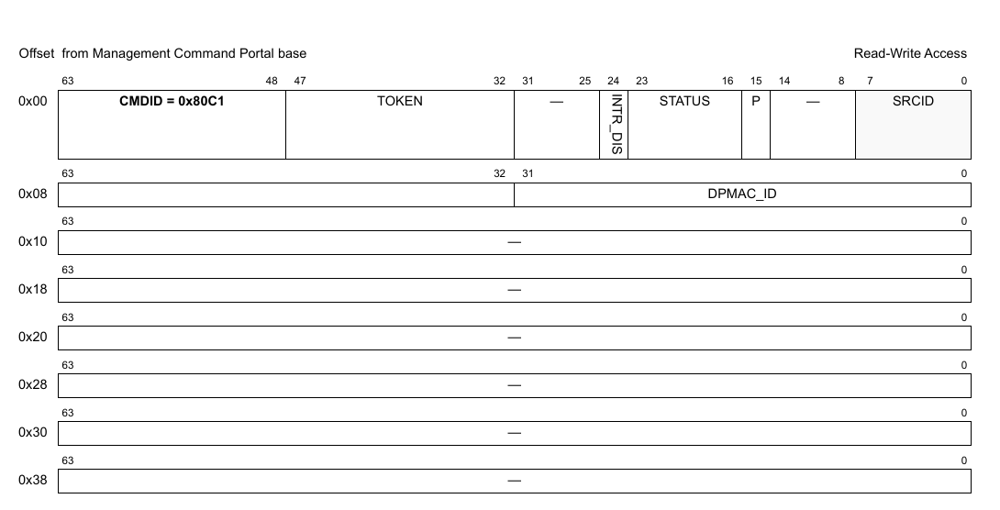

**Figure 484. Mô tả command DPMAC_OPEN**

Bảng sau mô tả các field của command.

**Table 65. Mô tả các field của command DPMAC_OPEN1**

| Offset | Bits | Tên | Mô tả |
|---|---|---|---|
| 0x00 | 0-63 | Header của command | Xem Table 2 để biết mô tả chung các field của command portal. CMDID phải được đặt như chỉ ra trong hình ở trên. |
| 0x08 | 0-31 | DPMAC_ID | ID duy nhất của DPMAC |

1 Mọi field không được nêu là reserved và phải được xóa (đặt bằng 0)

### 15.2.2 DPMAC_CLOSE

Đóng phiên điều khiển của object.

Sau khi gọi hàm này, không thao tác nào khác được phép trên object nếu không mở một phiên điều khiển mới.

**Cấu trúc command**

**Figure 485. Mô tả command DPMAC_CLOSE**

| Offset | Bits | Tên | Mô tả |
|---|---|---|---|
| 0x00 | 0-63 | Header của command | Xem Table 2 để biết mô tả chung các field của command portal. CMDID phải được đặt như chỉ ra trong hình ở trên. |

Mọi field không được nêu là reserved và phải được xóa (đặt bằng 0)

### 15.2.3 DPMAC_CREATE

Command này tạo và khởi tạo một instance DPMAC theo các tham số command được chỉ định. Command này không cần cho các instance DPMAC được tạo bằng DPL.

Với command CREATE, bên gọi phải cung cấp authentication token của container cha mà object sẽ được tạo và gán vào. Nếu token là '0', object sẽ được gán cho container đang sở hữu MC command portal thực thi command này.

Command trả về một DPMAC ID có thể dùng để OPEN hoặc DESTROY object.

Định dạng command được thể hiện trong hình dưới đây.

**Cấu trúc command**

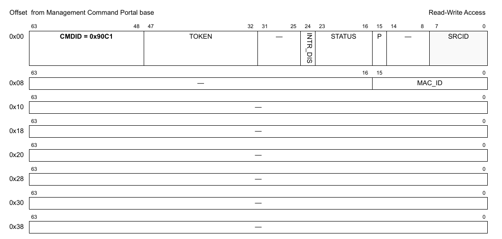

**Figure 486. Mô tả command DPMAC_CREATE**

Bảng sau mô tả các field của command.

**Table 66. Mô tả các field của command DPMAC_CREATE1**

| Offset | Bits | Tên | Mô tả |
|---|---|---|---|
| 0x00 | 0-63 | Header của command | Xem Table 2 để biết mô tả chung các field của command portal. CMDID phải được đặt như chỉ ra trong hình ở trên. |
| 0x08 | 0-15 | MAC_ID | Là Hardware MAC ID; nếu có nhiều WRIOP, các MAC ID được đánh liên tục. Ví dụ: * 2 WRIOP, mỗi WRIOP 16 MAC: * MAC ID của WRIOP thứ 1: 1-16, * MAC ID của WRIOP thứ 2: 17-32. |

1 Mọi field không được nêu là reserved và phải được xóa (đặt bằng 0)

**Cấu trúc response**

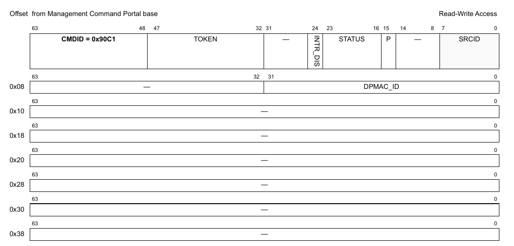

**Figure 15-1. Mô tả response của DPMAC_CREATE**

Bảng sau mô tả các field của response.

**Table 15-1. Mô tả các field response của DPMAC_CREATE1**

| Offset | Bits | Tên | Mô tả |
|---|---|---|---|
| 0x00 | 0-63 | Header của command | Xem Table 2 để biết mô tả chung các field của command portal. CMDID phải được đặt như chỉ ra trong hình ở trên. |
| 0x08 | 0-31 | DPMAC_ID | ID duy nhất của DPMAC |

1 Mọi field không được nêu là reserved.

### 15.2.4 DPMAC_DESTROY

Command này hủy DPMAC object và giải phóng mọi tài nguyên của nó. Nó phải được gọi trong software context đã tạo object. Bên gọi phải cung cấp object id và authentication token của container cha đã tạo object. Lưu ý rằng object có thể đã được gán cho container khác, và gửi authentication token của container đó sẽ trả về lỗi.

Mọi authentication token đang mở tới object phải được đóng trước khi gọi command destroy.

Sau khi gọi hàm này, không thao tác nào khác được phép trên object.

**Cấu trúc command**

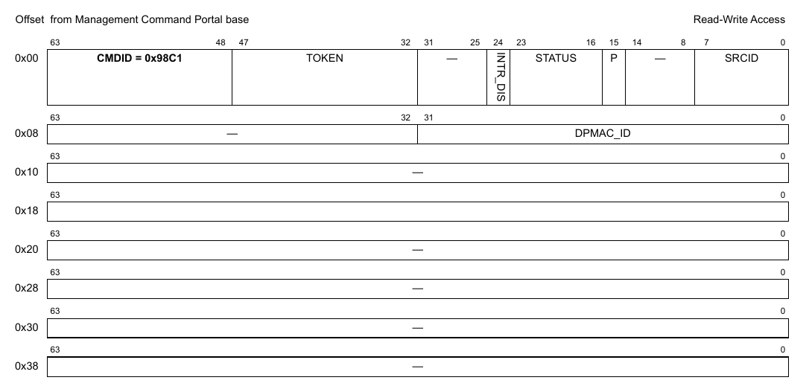

**Figure 487. Mô tả command DPMAC_DESTROY**

| Offset | Bits | Tên | Mô tả |
|---|---|---|---|
| 0x00 | 0-63 | Header của command | Xem Table 2 để biết mô tả chung các field của command portal. CMDID phải được đặt như chỉ ra trong hình ở trên. |
| 0x08 | 0–32 | DPMAC_ID | ID của DPMAC object cần hủy |

Mọi field không được nêu là reserved và phải được xóa (đặt bằng 0)

### 15.2.5 DPMAC_SET_IRQ_ENABLE

Đặt trạng thái tổng thể của interrupt. Cho phép phần mềm GPP điều khiển khi nào interrupt được sinh ra. Mỗi interrupt có thể có tối đa 32 nguyên nhân. Điều khiển enable/disable quyết định trạng thái tổng thể của interrupt. Nếu interrupt bị disable thì không nguyên nhân nào sinh ra interrupt.

**Cấu trúc command**

**Figure 488. Mô tả command DPMAC_SET_IRQ_ENABLE**

| Offset | Bits | Tên | Mô tả |
|---|---|---|---|
| 0x00 | 0-63 | Header của command | Xem Table 2 để biết mô tả chung các field của command portal. CMDID phải được đặt như chỉ ra trong hình ở trên. |
| 0x08 | 0 | EN | Trạng thái interrupt: đặt ‘1’ để enable, ‘0’ để disable |
|   | 32-39 | IRQ_INDEX | Xác định interrupt index cần cấu hình |

Mọi field không được nêu là reserved và phải được xóa (đặt bằng 0)

### 15.2.6 DPMAC_GET_IRQ_ENABLE

Lấy trạng thái tổng thể của interrupt.

**Cấu trúc command**

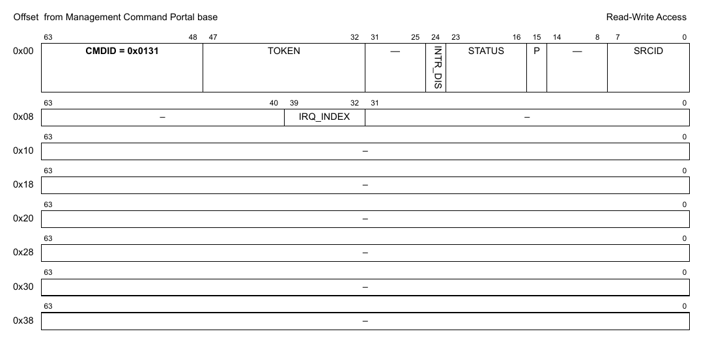

**Figure 489. Mô tả command DPMAC_GET_IRQ_ENABLE**

| Offset | Bits | Tên | Mô tả |
|---|---|---|---|
| 0x00 | 0-63 | Header của command | Xem Table 2 để biết mô tả chung các field của command portal. CMDID phải được đặt như chỉ ra trong hình ở trên. |
| 0x08 | 32-39 | IRQ_INDEX | Xác định interrupt index cần truy vấn |

Mọi field không được nêu là reserved và phải được xóa (đặt bằng 0)

**Cấu trúc response**

**Figure 490. Mô tả response của DPMAC_GET_IRQ_ENABLE**

| Offset | Bits | Tên | Mô tả |
|---|---|---|---|
| 0x00 | 0-63 | Header của command | Xem Table 2 để biết mô tả chung các field của command portal. CMDID phải được đặt như chỉ ra trong hình ở trên. |
| 0x08 | 0 | EN | Bit này được đặt nếu interrupt đang enable |

Mọi field không được nêu là reserved và phải được xóa (đặt bằng 0)

### 15.2.7 DPMAC_SET_IRQ_MASK

Đặt interrupt mask. Mỗi interrupt có thể có tối đa 32 nguyên nhân, và mô hình interrupt hỗ trợ mask/unmask từng nguyên nhân độc lập.

**Cấu trúc command**

**Figure 491. Mô tả command DPMAC_SET_IRQ_MASK**

| Offset | Bits | Tên | Mô tả |
|---|---|---|---|
| 0x00 | 0-63 | Header của command | Xem Table 2 để biết mô tả chung các field của command portal. CMDID phải được đặt như chỉ ra trong hình ở trên. |
| 0x08 | 0-31 | MASK | Event mask để kích hoạt interrupt; xem command GET_IRQ_STATUS để biết đặc tả các event hiện có. Với mỗi bit trong MASK: 0 = bỏ qua event 1 = event hợp lệ; báo IRQ nếu event này xảy ra |
|   | 32-39 | IRQ_INDEX | Interrupt index cần cấu hình |

Mọi field không được nêu là reserved và phải được xóa (đặt bằng 0)

### 15.2.8 DPMAC_GET_IRQ_MASK

Lấy interrupt mask. Mỗi interrupt có thể có tối đa 32 nguyên nhân, và mô hình interrupt hỗ trợ mask/unmask từng nguyên nhân độc lập.

**Cấu trúc command**

**Figure 492. Mô tả command DPMAC_GET_IRQ_MASK**

| Offset | Bits | Tên | Mô tả |
|---|---|---|---|
| 0x00 | 0-63 | Header của command | Xem Table 2 để biết mô tả chung các field của command portal. CMDID phải được đặt như chỉ ra trong hình ở trên. |
| 0x08 | 32-39 | IRQ_INDEX | Interrupt index cần truy vấn |

Mọi field không được nêu là reserved và phải được xóa (đặt bằng 0)

**Cấu trúc response**

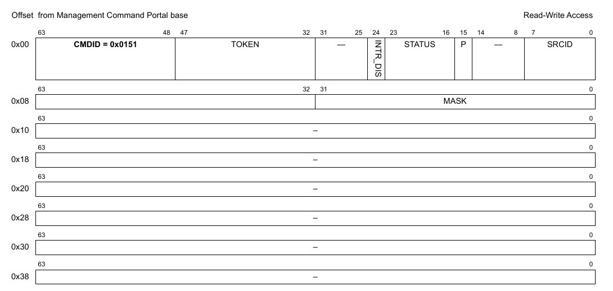

**Figure 493. Mô tả response của DPMAC_GET_IRQ_MASK**

| Offset | Bits | Tên | Mô tả |
|---|---|---|---|
| 0x00 | 0-63 | Header của command | Xem Table 2 để biết mô tả chung các field của command portal. CMDID phải được đặt như chỉ ra trong hình ở trên. |
| 0x08 | 0-31 | MASK | Event mask để kích hoạt interrupt; xem command GET_IRQ_STATUS để biết đặc tả các event hiện có. Với mỗi bit trong MASK: 0 = bỏ qua event 1 = event hợp lệ; báo IRQ nếu event này xảy ra |

Mọi field không được nêu là reserved và phải được xóa (đặt bằng 0)

### 15.2.9 DPMAC_GET_IRQ_STATUS

Lấy trạng thái hiện tại của các event đang chờ cho interrupt index được chỉ định.

**Cấu trúc command**

**Figure 494. Mô tả command DPMAC_GET_IRQ_STATUS**

| Offset | Bits | Tên | Mô tả |
|---|---|---|---|
| 0x00 | 0-63 | Header của command | Xem Table 2 để biết mô tả chung các field của command portal. CMDID phải được đặt như chỉ ra trong hình ở trên. |
| 0x08 | 0-31 | STATUS | Tùy chọn: mọi bit STATUS được đặt sẽ được xóa khỏi trạng thái đang chờ (không cần dùng command DPMAC_CLEAR_IRQ_STATUS nữa). Lưu ý rằng STATUS trả về trong response là trạng thái trước khi các event bị xóa.  Các event được hỗ trợ: xem định nghĩa cấu trúc response |
|   | 32-39 | IRQ_INDEX | Interrupt index cần truy vấn |

Mọi field không được nêu là reserved và phải được xóa (đặt bằng 0)

**Cấu trúc response**

**Figure 495. Mô tả response của DPMAC_GET_IRQ_STATUS**

| Offset | Bits | Tên | Mô tả |
|---|---|---|---|
| 0x00 | 0-63 | Header của command | Xem Table 2 để biết mô tả chung các field của command portal. CMDID phải được đặt như chỉ ra trong hình ở trên. |
| 0x08 | 0-31 | STATUS | Mask trạng thái event, mỗi event một bit: 0 = không có interrupt đang chờ 1 = có interrupt đang chờ  Các event được hỗ trợ trong IRQ 0: Bit 0: DPMAC_IRQ_EVENT_LINK_CFG_REQ – cho biết cấu hình link được yêu cầu đã thay đổi; driver PHY (nếu có) cần negotiate lại cấu hình. Bit 1: DPMAC_IRQ_EVENT_LINK_CHANGED – cho biết link state đã thay đổi Bit 2: DPMAC_IRQ_EVENT_LINK_UP_REQ – cho biết link phải được bật lên; driver PHY (nếu có) cũng cần khởi động Bit 3: DPMAC_IRQ_EVENT_LINK_DOWN_REQ – cho biết link phải được tắt đi; driver PHY (nếu có) cũng cần dừng Bit 4: DPMAC_IRQ_EVENT_ENDPOINT_CHANGED – cho biết có event nối/ngắt kết nối giữa DPMAC và endpoint của nó (DPNI, DPDMUX, DPSW) |

Mọi field không được nêu là reserved và phải được xóa (đặt bằng 0)

### 15.2.10 DPMAC_CLEAR_IRQ_STATUS

Xóa (đánh dấu đã xử lý) các event đang chờ của interrupt index được chỉ định.

**Cấu trúc command**

**Figure 496. Mô tả command DPMAC_CLEAR_IRQ_STATUS**

| Offset | Bits | Tên | Mô tả |
|---|---|---|---|
| 0x00 | 0-63 | Header của command | Xem Table 2 để biết mô tả chung các field của command portal. CMDID phải được đặt như chỉ ra trong hình ở trên. |
| 0x08 | 0-31 | STATUS | Mask để xóa các event đã xử lý; xem command GET_IRQ_STATUS để biết đặc tả các event hiện có. Với mỗi bit trong MASK: 0 = không đổi trạng thái event 1 = xóa bit trạng thái event để cho biết event đã được xử lý |
|   | 32-39 | IRQ_INDEX | Interrupt index cần cấu hình |

Mọi field không được nêu là reserved và phải được xóa (đặt bằng 0)

### 15.2.11 DPMAC_GET_ATTRIBUTES

**Cấu trúc command**

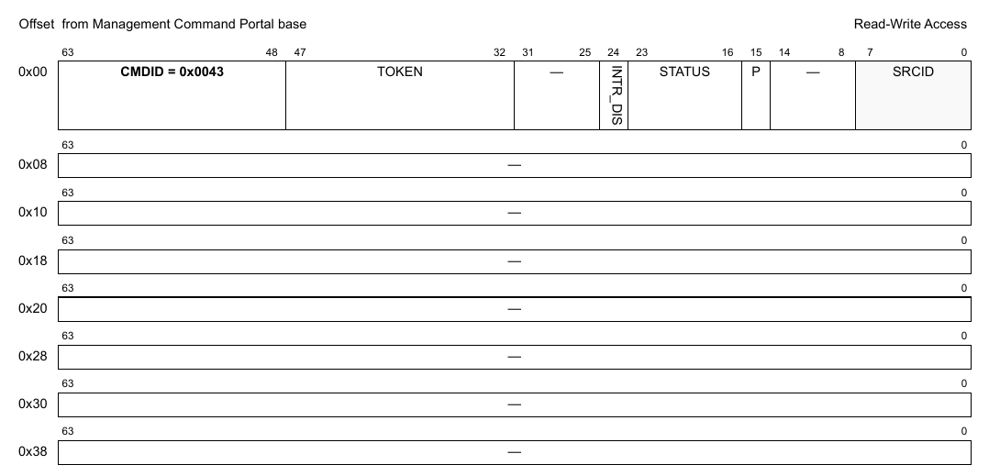

**Figure 497. Mô tả command DPMAC_GET_ATTRIBUTES**

| Offset | Bits | Tên | Mô tả |
|---|---|---|---|
| 0x00 | 0-63 | Header của command | Xem Table 2 để biết mô tả chung các field của command portal. CMDID phải được đặt như chỉ ra trong hình ở trên. |

Mọi field không được nêu là reserved và phải được xóa (đặt bằng 0)

**Cấu trúc response**

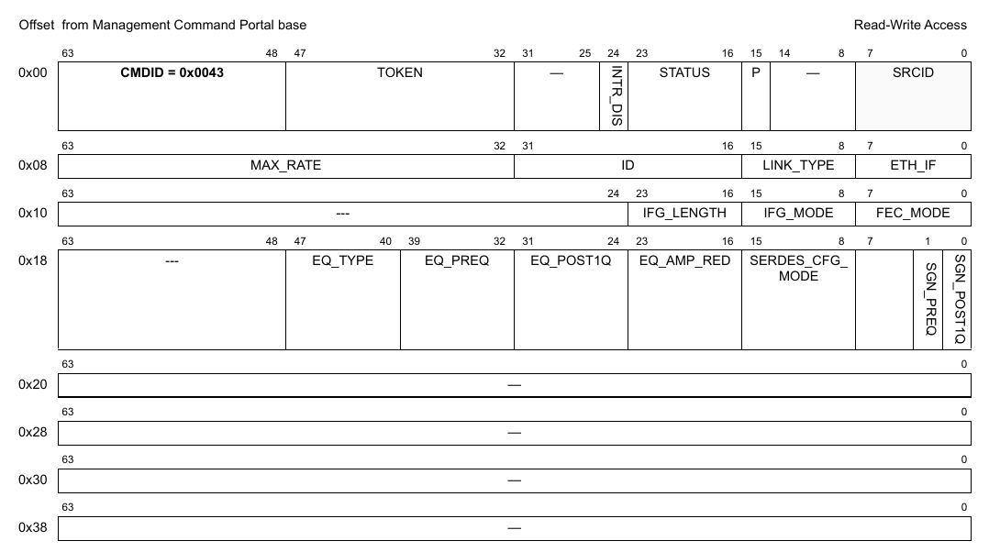

**Figure 498. Mô tả response của DPMAC_GET_ATTRIBUTES**

| Offset | Bits | Tên | Mô tả |
|---|---|---|---|
| 0x00 | 0-63 | Header của command | Xem Table 2 để biết mô tả chung các field của command portal. CMDID phải được đặt như chỉ ra trong hình ở trên. |
| 0x08 | 0-7 | ETH_IF | Interface Ethernet |
|   | 8-15 | LINK_TYPE | Loại link |
|   | 16-31 | ID | DPMAC object ID |
|   | 32-63 | MAX_RATE | Tốc độ tối đa được hỗ trợ - tính bằng Mbps |
| 0x10 | 0-7 | FEC_MODE | Chỉ cấu hình được cho các port CAUI của LX2160. 0: FEC_NONE - RS-FEC (bật theo mặc định) bị tắt 1: FEC_RS - cấu hình mode RS-FEC (Clause 91) 2: FEC_FC - cấu hình mode FC-FEC (Clause 74) (chưa được hỗ trợ). FEC mode mặc định của DPMAC là “FEC_RS”. |
|   | 8-15 | IFG_MODE | Chọn mode Inter Frame Gap: 0: IFG_MODE_FIXED - IFG_LENGTH là số octet theo bước 4 (kích thước khoảng trống) 1: IFG_MODE_STRETCHED - IFG_LENGTH là hệ số kéo giãn tùy theo băng thông. |
|   | 16-23 | IFG_LENGTH | Giá trị độ dài Inter Frame Gap. Giá trị mặc định là 12. |
| 0x18 | 0 | SGN_POST1Q | Dấu của post-cursor thứ nhất, cho biết hướng eye closure (eye diagram đóng hay mở) 0b - Dấu âm (eye đóng lại) 1b - Dấu dương (eye mở ra) |
|   | 1 | SGN_PREQ | Dấu của precursor, cho biết hướng eye closure 0b - Dấu âm (eye đóng lại) 1b - Dấu dương (eye mở ra) |
|   | 8-15 | SERDES_CFG_MODE | 0: SERDES_CFG_DEFAULT - Đây là cấu hình mặc định. 1: SERDES_CFG_SFI - Dùng được với các interface XFI và XLAUI4 từ một SerDes tương thích SFI, hiện có trên SoC LX2. Đây là mode hoạt động mặc định cho các interface XFI, còn các interface XLAUI4 mặc định chạy với biên độ đầy đủ và không de-emphasis. Mode này sẽ áp các thiết lập equalization để đưa giao diện điện vào trong đặc tả SFI. 2: SERDES_CFG_CUSTOM - Cho phép người dùng cấu hình thủ công kiểu equalization, biên độ, các thiết lập preq và post1q. Dùng được với mọi interface trừ RGMII. |
|   | 16-23 | EQ_AMP_RED | Giảm biên độ truyền tổng thể |
|   | 24-31 | EQ_POST1Q | Cường độ drive của bit chuyển mức full swing sang post-cursor thứ nhất |
|   | 32-39 | EQ_PREQ | Cường độ drive của bit chuyển mức TX full swing sang precursor. |
|   | 40-47 | EQ_TYPE | Số mức equalization TX 000b - Không equalization 001b - equalization 2-tap 010b - equalization 3-tap 011b - Reserved |

Mọi field không được nêu là reserved và phải được xóa (đặt bằng 0)

### 15.2.12 DPMAC_SET_PARAMS

Command này dùng để cấu hình Inter Frame Gap

**Cấu trúc command**

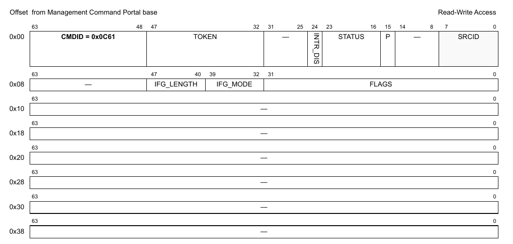

**Figure 499. Mô tả command DPMAC_SET_PARAMS**

| Offset | Bits | Tên | Mô tả |
|---|---|---|---|
| 0x00 | 0-63 | Header của command | Xem Table 2 để biết mô tả chung các field của command portal. CMDID phải được đặt như chỉ ra trong hình ở trên. |
| 0x08 | 0-31 | FLAGS | Bit: 0: SET_PARAMS_IFG - Nếu đặt, cấu hình sẽ được áp dụng. |
|   | 32-39 | IFG_MODE | Chọn mode Inter Frame Gap: 0: IFG_MODE_FIXED - IFG_LENGTH là số octet theo bước 4 (kích thước khoảng trống) 1: IFG_MODE_STRETCHED - IFG_LENGTH là hệ số kéo giãn tùy theo băng thông. |
|   | 40-47 | IFG_LENGTH | Giá trị độ dài Inter Frame Gap. Giá trị mặc định là 12. |

Mọi field không được nêu là reserved và phải được xóa (đặt bằng 0)

### 15.2.13 DPMAC_MDIO_READ

Command này dùng để đọc qua bus MDIO.

**Cấu trúc command**

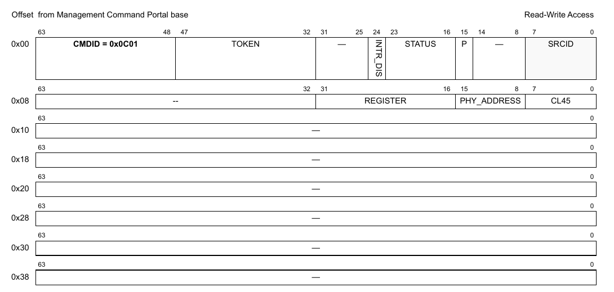

**Figure 500. Mô tả command DPMAC_MDIO_READ**

| Offset | Bits | Tên | Mô tả |
|---|---|---|---|
| 0x00 | 0-63 | Header của command | Xem Table 2 để biết mô tả chung các field của command portal. CMDID phải được đặt như chỉ ra trong hình ở trên. |
| 0x08 | 0-7 | CL45 | Dùng để chọn Clause. Đặt bằng 0 nếu muốn Clause 22 hoặc bất kỳ giá trị nào khác cho Clause 45. Clause 22 được dùng mặc định nếu field không được điền. |
|   | 8-15 | PHY_ADDRESS | Địa chỉ MDIO của PHY. |
|   | 16-31 | REGISTER | Thanh ghi cần đọc. |

Mọi field không được nêu là reserved và phải được xóa (đặt bằng 0)

**Cấu trúc response**

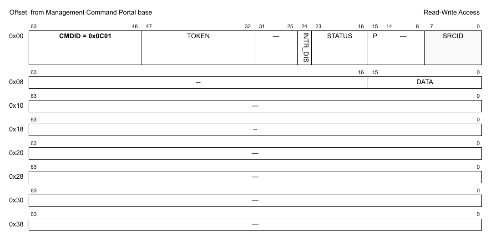

**Figure 501. Mô tả response của DPMAC_MDIO_READ**

| Offset | Bits | Tên | Mô tả |
|---|---|---|---|
| 0x00 | 0-63 | Header của command | Xem Table 2 để biết mô tả chung các field của command portal. CMDID phải được đặt như chỉ ra trong hình ở trên. |
| 0x08 | 0-15 | Dữ liệu | Dữ liệu đọc được từ thanh ghi. |

Mọi field không được nêu là reserved và phải được xóa (đặt bằng 0)

### 15.2.14 DPMAC_MDIO_WRITE

**Cấu trúc command**

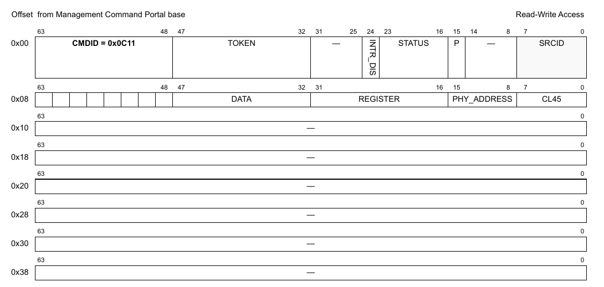

**Figure 502. Mô tả command DPMAC_MDIO_WRITE**

| Offset | Bits | Tên | Mô tả |
|---|---|---|---|
| 0x00 | 0-63 | Header của command | Xem Table 2 để biết mô tả chung các field của command portal. CMDID phải được đặt như chỉ ra trong hình ở trên. |
| 0x08 | 0-7 | CL45 | Dùng để chọn Clause. Đặt bằng 0 nếu muốn Clause 22 hoặc bất kỳ giá trị nào khác cho Clause 45. Clause 22 được dùng mặc định nếu field không được điền. |
|   | 8-15 | PHY_ADDRESS | Địa chỉ MDIO của PHY. |
|   | 16-31 | REGISTER | Thanh ghi cần ghi. |
|   | 32-47 | DATA | Dữ liệu cần ghi. |

Mọi field không được nêu là reserved và phải được xóa (đặt bằng 0)

### 15.2.15 DPMAC_GET_LINK_CFG

**Cấu trúc command**

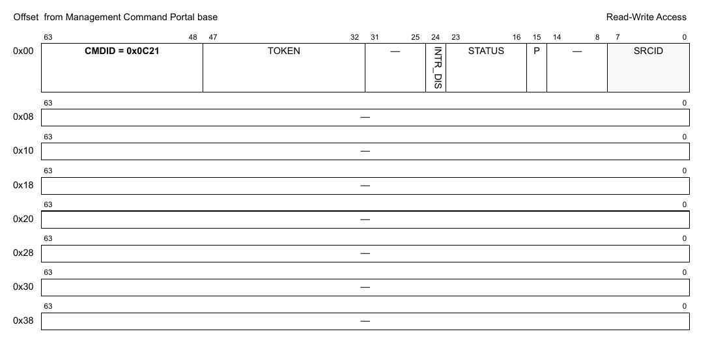

**Figure 503. Mô tả command DPMAC_GET_LINK_CFG**

| Offset | Bits | Tên | Mô tả |
|---|---|---|---|
| 0x00 | 0-63 | Header của command | Xem Table 2 để biết mô tả chung các field của command portal. CMDID phải được đặt như chỉ ra trong hình ở trên. |

Mọi field không được nêu là reserved và phải được xóa (đặt bằng 0)

**Cấu trúc response**

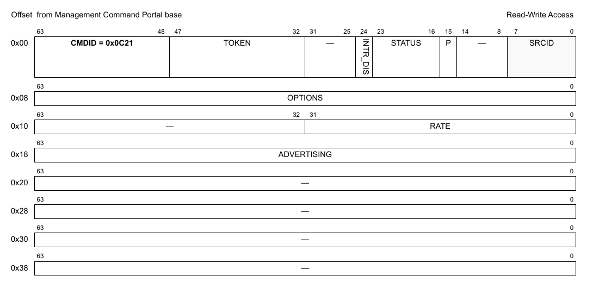

**Figure 504. Mô tả response của DPMAC_GET_LINK_CFG**

| Offset | Bits | Tên | Mô tả |
|---|---|---|---|
| 0x00 | 0-63 | Header của command | Xem Table 2 để biết mô tả chung các field của command portal. CMDID phải được đặt như chỉ ra trong hình ở trên. |
| 0x08 | 0-63 | OPTIONS | Bật/tắt các tính năng cấu hình link của DPMAC (bitmap). Xem Table 15-2 để biết giá trị các option. |
| 0x10 | 0-31 | RATE | Tốc độ của link |
| 0X18 | 0-63 | ADVERTISING | Các tốc độ được quảng bá cho autoneg |

Mọi field không được nêu là reserved và phải được xóa (đặt bằng 0)

**Table 15-2. Các option link của DPMAC**

| Giá trị option | Mô tả |
|---|---|
| 0x0000000000000001ULL | Bật auto-negotiation |
| 0x0000000000000002ULL | Bật chế độ half-duplex |
| 0x0000000000000004ULL | Bật pause frame |
| 0x0000000000000008ULL | Bật pause frame bất đối xứng |

### 15.2.16 DPMAC_SET_LINK_STATE

**Cấu trúc command**

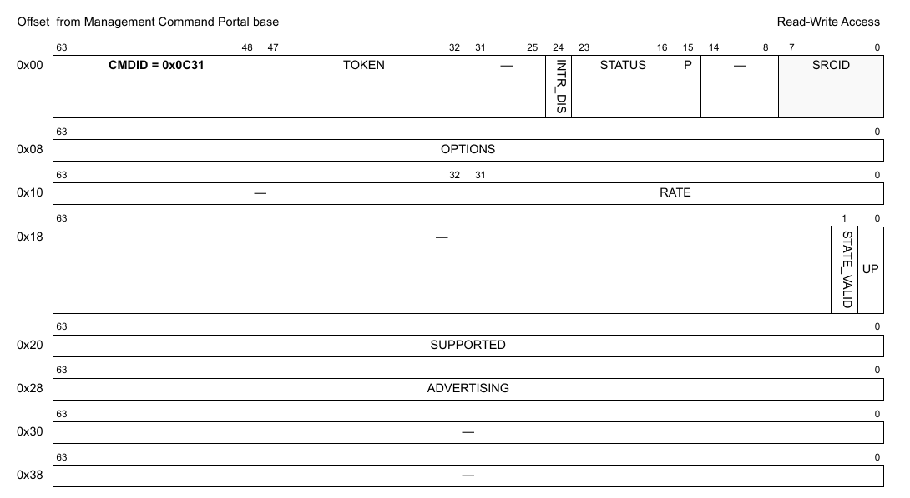

**Figure 505. Mô tả command DPMAC_SET_LINK_STATE**

| Offset | Bits | Tên | Mô tả |
|---|---|---|---|
| 0x00 | 0-63 | Header của command | Xem Table 2 để biết mô tả chung các field của command portal. CMDID phải được đặt như chỉ ra trong hình ở trên. |
| 0x08 | 0-63 | OPTIONS | Bật/tắt các tính năng cấu hình link của DPMAC (bitmap). Xem Table 15-2 để biết giá trị các option. |
| 0x10 | 0-31 | RATE | Tốc độ của link |
| 0x18 | 0 | UP | Trạng thái link |
|   | 1 | STATE_VALID | Bỏ qua/Cập nhật trạng thái của link |
| 0X20 | 0-63 | SUPPORTED | Các tốc độ mà phy hỗ trợ |
| 0X28 | 0-63 | ADVERTISING | Các tốc độ được quảng bá cho autoneg |

Mọi field không được nêu là reserved và phải được xóa (đặt bằng 0)

### 15.2.17 DPMAC_GET_COUNTER

**Cấu trúc command**

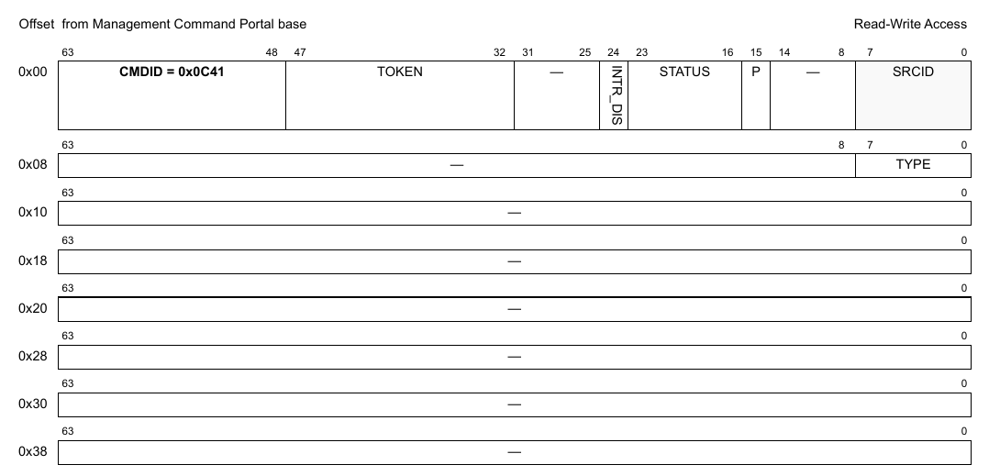

**Figure 506. Mô tả command DPMAC_GET_COUNTER**

| Offset | Bits | Tên | Mô tả |
|---|---|---|---|
| 0x00 | 0-63 | Header của command | Xem Table 2 để biết mô tả chung các field của command portal. CMDID phải được đặt như chỉ ra trong hình ở trên. |
| 0x08 | 0-7 | TYPE | Counter được yêu cầu. Xem Table 67 để biết các giá trị counter có thể có và ý nghĩa của chúng. |

Mọi field không được nêu là reserved và phải được xóa (đặt bằng 0)

**Table 67. Các giá trị counter của DPMAC**

| Giá trị counter | Mô tả |
|---|---|
| 0x0 | Đếm các frame 64 byte, tốt hoặc lỗi |
| 0x1 | Đếm các frame từ 65 đến 127 byte, tốt hoặc lỗi |
| 0x2 | Đếm các frame từ 128 đến 255 byte, tốt hoặc lỗi |
| 0x3 | Đếm các frame từ 256 đến 511 byte, tốt hoặc lỗi |
| 0x4 | Đếm các frame từ 512 đến 1023 byte, tốt hoặc lỗi |
| 0x5 | Đếm các frame từ 1024 đến 1518 byte, tốt hoặc lỗi |
| 0x6 | Đếm các frame từ 1519 byte trở lên (tới độ dài frame tối đa được chỉ định), tốt hoặc lỗi |
| 0x7 | Đếm các frame ngắn hơn 64 byte nhận được với CRC sai |
| 0x8 | Đếm các frame dài hơn độ dài frame tối đa được chỉ định, có frame check sequence lỗi |
| 0x9 | Đếm các frame bị drop do lỗi nội bộ • xảy ra khi một receive FIFO bị tràn. • gồm cả các frame bị cắt cụt do receive FIFO bị tràn |
| 0xA | Đếm các frame có lỗi alignment (tùy chọn dùng cho SFD sai) |
| 0xA | Đếm các frame đã truyền ngắn hơn 64 byte với CRC đúng |
| 0xC | Đếm các frame dài hơn độ dài frame tối đa được chỉ định, có frame check sequence đúng |
| 0xD | Đếm các pause frame hợp lệ (thường và PFC) |
| 0xE | Đếm các pause frame hợp lệ đã truyền (thường và PFC) |
| 0xF | Đếm số byte nhận được, trừ preamble, của mọi frame hợp lệ và pause frame hợp lệ |
| 0x10 | Đếm các frame multicast nhận được |
| 0x11 | Đếm các frame broadcast nhận được |
| 0x12 | Đếm mọi frame nhận được, tốt hoặc lỗi |
| 0x13 | Đếm các frame unicast nhận được |
| 0x14 | Đếm các frame nhận được có lỗi (trừ frame undersized/fragment) |
| 0x15 | Đếm số byte đã truyền, trừ preamble, của mọi frame hợp lệ và pause frame hợp lệ đã truyền |
| 0x16 | Đếm các frame multicast đã truyền |
| 0x17 | Đếm các frame broadcast đã truyền |
| 0x18 | Đếm các frame unicast đã truyền |
| 0x19 | Đếm các frame đã truyền có lỗi |
| 0x1A | Đếm các frame nhận được không có lỗi, kể cả pause frame |
| 0x1B | Đếm các frame đã truyền không có lỗi, kể cả pause frame |

**Cấu trúc response**

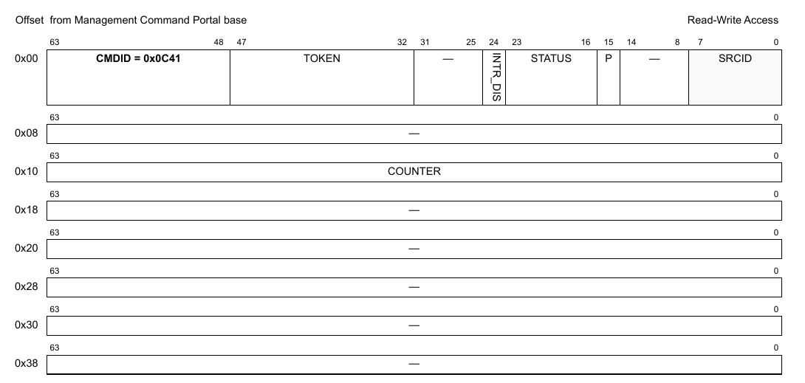

**Figure 507. Mô tả response của DPMAC_GET_COUNTER**

| Offset | Bits | Tên | Mô tả |
|---|---|---|---|
| 0x00 | 0-63 | Header của command | Xem Table 2 để biết mô tả chung các field của command portal. CMDID phải được đặt như chỉ ra trong hình ở trên. |
| 0x10 | 0-63 | COUNTER | Counter được yêu cầu |

Mọi field không được nêu là reserved và phải được xóa (đặt bằng 0)

### 15.2.18 DPMAC_GET_API_VERSION

**Cấu trúc command**

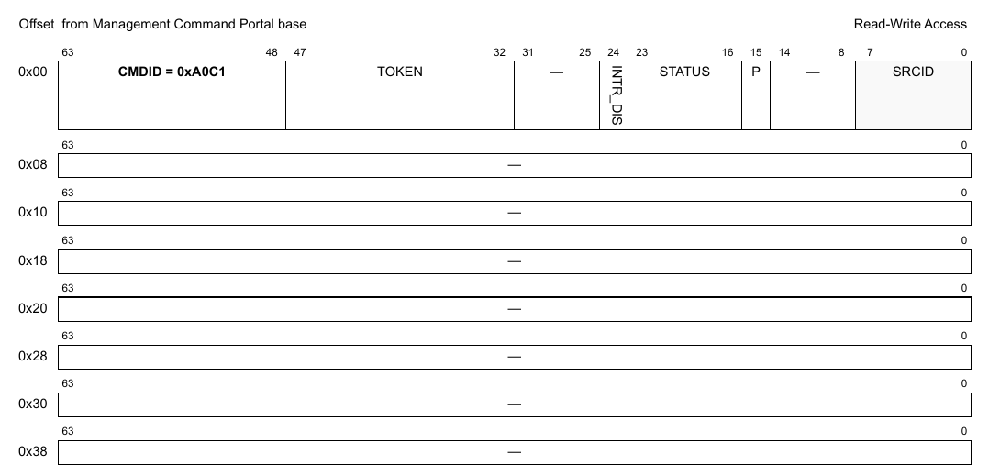

**Figure 508. Mô tả command DPMAC_GET_API_VERSION**

| Offset | Bits | Tên | Mô tả |
|---|---|---|---|
| 0x00 | 0-63 | Header của command | Xem Table 2 để biết mô tả chung các field của command portal. CMDID phải được đặt như chỉ ra trong hình ở trên. |

Mọi field không được nêu là reserved và phải được xóa (đặt bằng 0)

**Cấu trúc response**

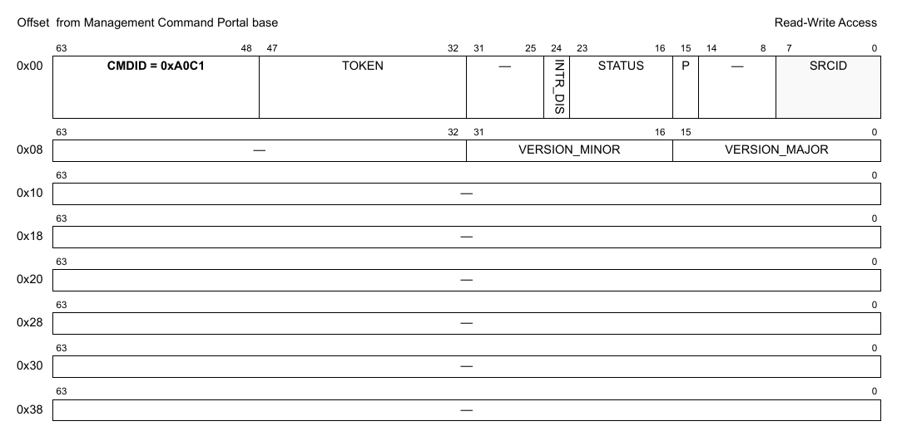

**Figure 509. Mô tả response của DPMAC_GET_API_VERSION**

| Offset | Bits | Tên | Mô tả |
|---|---|---|---|
| 0x00 | 0-63 | Header của command | Xem Table 2 để biết mô tả chung các field của command portal. CMDID phải được đặt như chỉ ra trong hình ở trên. |
| 0x08 | 0-15 | VERSION_MAJOR | Major version của API |
|   | 16-31 | VERSION_MINOR | Minor version của API |

### 15.2.19 DPMAC_RESET

Reset DPMAC. Đưa object về trạng thái ban đầu. Nếu DPMAC đang được nối với object khác, quá trình reset sẽ ngắt kết nối nó. Sau DPMAC_RESET, dùng command DPRC_CONNECT để khôi phục kết nối.

**Cấu trúc command**

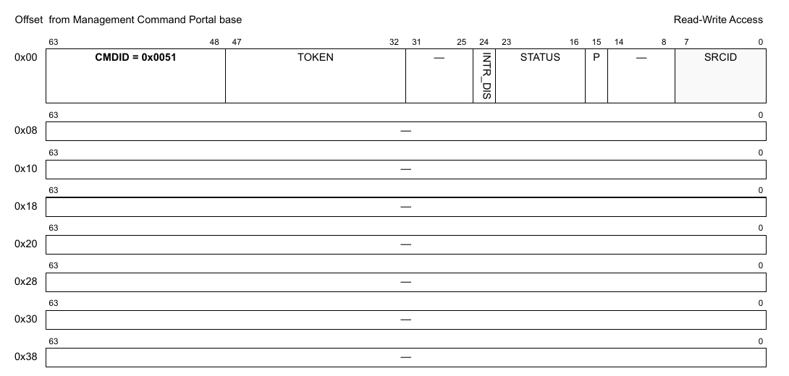

**Figure 510. Mô tả command DPMAC_RESET**

| Offset | Bits | Tên | Mô tả |
|---|---|---|---|
| 0x00 | 0-63 | Header của command | Xem Table 2 để biết mô tả chung các field của command portal. CMDID phải được đặt như chỉ ra trong hình ở trên. |

Mọi field không được nêu là reserved và phải được xóa (đặt bằng 0)

### 15.2.20 DPMAC_GET_MAC_ADDR

**Cấu trúc command**

**Figure 511. Mô tả command DPMAC_GET_MAC_ADDR**

| Offset | Bits | Tên | Mô tả |
|---|---|---|---|
| 0x00 | 0-63 | Header của command | Xem Table 2 để biết mô tả chung các field của command portal. CMDID phải được đặt như chỉ ra trong hình ở trên. |

Mọi field không được nêu là reserved và phải được xóa (đặt bằng 0)

**Cấu trúc response**

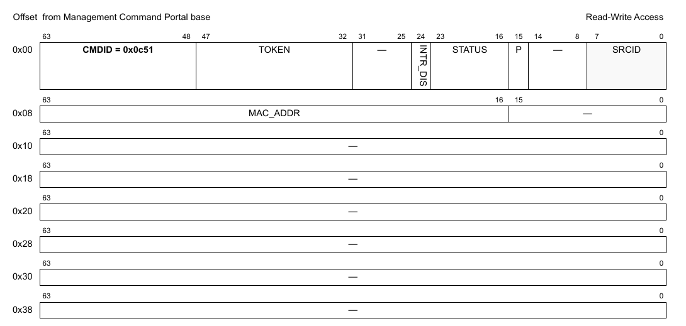

**Figure 512. Mô tả response của DPMAC_GET_MAC_ADDR**

| Offset | Bits | Tên | Mô tả |
|---|---|---|---|
| 0x00 | 0-63 | Header của command | Xem Table 2 để biết mô tả chung các field của command portal. CMDID phải được đặt như chỉ ra trong hình ở trên. |
| 0x08 | 16 - 63 | MAC_ADDR | Địa chỉ MAC của port vật lý, nếu có, nếu không thì bằng 0. |

Mọi field không được nêu là reserved và phải được xóa (đặt bằng 0)

### 15.2.21 DPMAC_SET_PROTOCOL

Command để cấu hình lại giao thức của một DPMAC object.

MC firmware sẽ cấu hình lại MAC (mEMAC, cEMAC) và port WRIOP để chạy với giao thức mới và tốc độ link mới tương ứng. Phần mềm chạy trên GPP chịu trách nhiệm cấu hình lại SerDes lane và PCS tương ứng.

Hiện chỉ hỗ trợ các chuyển đổi sau, các trường hợp khác sẽ trả về lỗi.

DPMAC_ETH_IF_SGMII -> DPMAC_ETH_IF_1000BASEX / DPMAC_ETH_IF_XFI

DPMAC_ETH_IF_1000BASEX -> DPMAC_ETH_IF_SGMII / DPMAC_ETH_IF_XFI

DPMAC_ETH_IF_XFI -> DPMAC_ETH_IF_1000BASEX / DPMAC_ETH_IF_SGMII

DPMAC_ETH_IF_XFI -> DPMAC_ETH_IF_CAUI

DPMAC_ETH_IF_CAUI -> DPMAC_ETH_IF_XFI

Như bạn thấy, các chuyển đổi giữa các giao thức chính cho 1G cáp đồng/quang và 10G quang được nhắm tới, vì đây là các giao thức dùng nhiều nhất trong module SFP/SFP+. Việc chuyển sang và chuyển từ giao thức 25G CAUI cũng được hỗ trợ.

**Cấu trúc command**

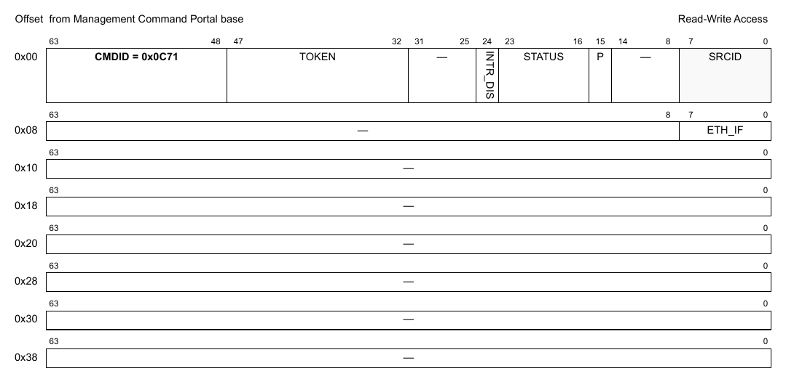

**Figure 513. Mô tả command DPMAC_SET_PROTOCOL**

| Offset | Bits | Tên | Mô tả |
|---|---|---|---|
| 0x00 | 0-63 | Header của command | Xem Table 2 để biết mô tả chung các field của command portal. CMDID phải được đặt như chỉ ra trong hình ở trên. |
| 0x08 | 0-7 | ETH_IF | Giao thức mới (ethernet interface) cần cấu hình trên DPMAC. Xem giải thích ở trên để biết thêm về các chuyển đổi được hỗ trợ. 0x00: DPMAC_ETH_IF_MII - MII interface 0x01: DPMAC_ETH_IF_RMII - RMII interface 0x02: DPMAC_ETH_IF_SMII - SMII interface 0x03: DPMAC_ETH_IF_GMII - GMII interface 0x04: DPMAC_ETH_IF_RGMII - RGMII interface 0x05: DPMAC_ETH_IF_SGMII - SGMII interface 0x06: DPMAC_ETH_IF_QSGMII - QSGMII interface 0x07: DPMAC_ETH_IF_XAUI - XAUI interface 0x08: DPMAC_ETH_IF_XFI - XFI interface 0x09: DPMAC_ETH_IF_CAUI - CAUI interface 0x0a: DPMAC_ETH_IF_1000BASEX -1000BASEX interface 0x0b: DPMAC_ETH_IF_USXGMII - USXGMII interface |

Mọi field không được nêu là reserved và phải được xóa (đặt bằng 0)
