# Chương 16 DPRTC: Data Path Real Time Clock

MC xuất ra DPRTC object để phần mềm GPP điều khiển Real Time Clock IEEE-1588 vật lý. Chỉ cần một DPRTC object để điều khiển RTC IEEE-1588, và object này được dùng để phục vụ PTP stack chạy trên GPP.

## 16.1 Các tính năng của DPRTC

Danh sách sau tóm tắt các tính năng và khả năng chính của DPRTC:

- Độ chính xác RTC IEEE-1588 tính bằng nanosecond.
- Hỗ trợ bù tần số RTC.
- Hỗ trợ sửa clock offset của RTC.
- Hỗ trợ đặt trực tiếp thời gian RTC – chủ yếu hữu ích để đặt timer về 0, vì cách được khuyến nghị để sửa RTC là qua offset và/hoặc thay đổi tần số.
- Hỗ trợ đặt thời gian báo thức – sinh một event tới GPP vào thời điểm được yêu cầu.
- Hỗ trợ 2 event pulse-per-second.
- Hỗ trợ 2 interrupt timestamp external trigger (ETS1 và ETS2).
- Hỗ trợ chế độ fiper loopback, trong đó xung được sinh ra sẽ là nguồn interrupt cho external trigger.

## 16.2 Tham chiếu command của DPRTC

Mục này trình bày chi tiết mô hình lập trình các command của DPRTC.

### 16.2.1 DPRTC_OPEN

Mở một phiên điều khiển cho object được chỉ định.

Hàm này có thể dùng để mở phiên điều khiển cho một object đã được tạo; object có thể đã được khai báo trong DPL hoặc được tạo bằng command DPRTC_CREATE.

Hàm này trả về một authentication token duy nhất, gắn với object ID cụ thể; token này phải được dùng trong mọi command tiếp theo cho object này.

**Cấu trúc command**

Định dạng command được thể hiện trong hình dưới đây.

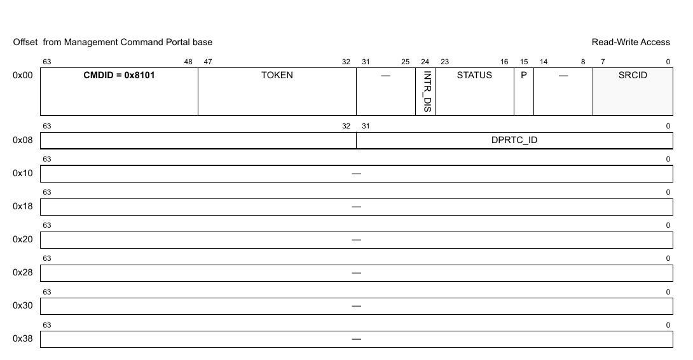

**Figure 514. Mô tả command DPRTC_OPEN**

Bảng sau mô tả các field của command.

**Table 68. Mô tả các field của command DPRTC_OPEN1**

| Offset | Bits | Tên | Mô tả |
|---|---|---|---|
| 0x00 | 0-63 | Header của command | Xem Table 2 để biết mô tả chung các field của command portal. CMDID phải được đặt như chỉ ra trong hình ở trên. |
| 0x08 | 0-31 | DPRTC_ID | ID duy nhất của DPRTC |

1 Mọi field không được nêu là reserved và phải được xóa (đặt bằng 0)

### 16.2.2 DPRTC_CLOSE

Đóng phiên điều khiển của object.

Sau khi gọi hàm này, không thao tác nào khác được phép trên object nếu không mở một phiên điều khiển mới.

**Cấu trúc command**

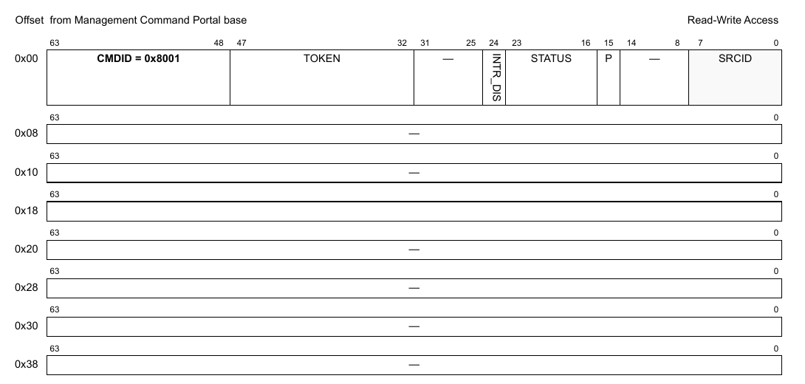

**Figure 515. Mô tả command DPRTC_CLOSE**

| Offset | Bits | Tên | Mô tả |
|---|---|---|---|
| 0x00 | 0-63 | Header của command | Xem Table 2 để biết mô tả chung các field của command portal. CMDID phải được đặt như chỉ ra trong hình ở trên. |

Mọi field không được nêu là reserved và phải được xóa (đặt bằng 0)

### 16.2.3 DPRTC_CREATE

Command này tạo và khởi tạo một instance DPRTC theo các tham số command được chỉ định. Command này không cần cho các instance DPRTC được tạo bằng DPL.

Với command CREATE, bên gọi phải cung cấp authentication token của container cha mà object sẽ được tạo và gán vào. Nếu token là '0', object sẽ được gán cho container đang sở hữu MC command portal thực thi command này.

Chỉ tạo được một DPRTC object trong MC (singleton object). Tạo nhiều lần mà không hủy object sẽ trả về lỗi.

Command trả về một DPRTC ID có thể dùng để OPEN hoặc DESTROY object.

Định dạng command được thể hiện trong hình dưới đây.

**Cấu trúc command**

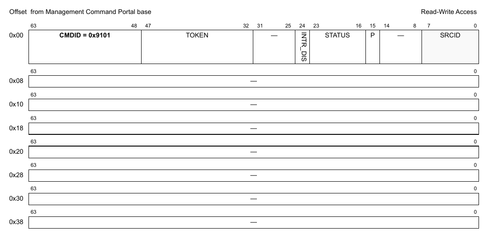

**Figure 516. Mô tả command DPRTC_CREATE**

Bảng sau mô tả các field của command.

**Table 69. Mô tả các field của command DPRTC_CREATE1**

| Offset | Bits | Tên | Mô tả |
|---|---|---|---|
| 0x00 | 0-63 | Header của command | Xem Table 2 để biết mô tả chung các field của command portal. CMDID phải được đặt như chỉ ra trong hình ở trên. |

1 Mọi field không được nêu là reserved và phải được xóa (đặt bằng 0).

**Cấu trúc response**

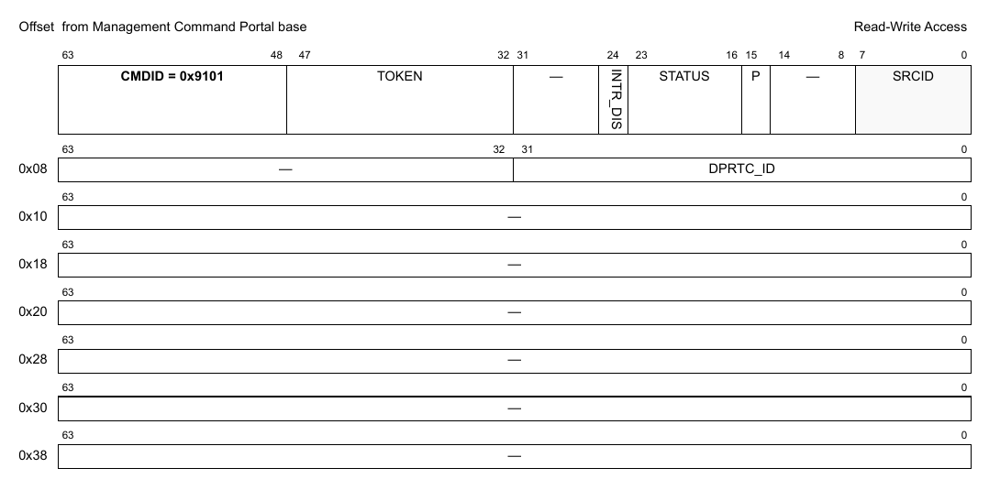

**Figure 16-1. Mô tả response của DPRTC_CREATE**

Bảng sau mô tả các field của response.

**Table 16-1. Mô tả các field response của DPRTC_CREATE1**

| Offset | Bits | Tên | Mô tả |
|---|---|---|---|
| 0x00 | 0-63 | Header của command | Xem Table 2 để biết mô tả chung các field của command portal. CMDID phải được đặt như chỉ ra trong hình ở trên. |
| 0x08 | 0-31 | DPRTC_ID | ID duy nhất của DPRTC |

1 Mọi field không được nêu là reserved.

### 16.2.4 DPRTC_DESTROY

Command này hủy DPRTC object và giải phóng mọi tài nguyên của nó. Nó phải được gọi trong software context đã tạo object. Bên gọi phải cung cấp object id và authentication token của container cha đã tạo object. Lưu ý rằng object có thể đã được gán cho container khác, và gửi authentication token của container đó sẽ trả về lỗi.

Mọi authentication token đang mở tới object phải được đóng trước khi gọi command destroy.

Sau khi gọi hàm này, không thao tác nào khác được phép trên object.

**Cấu trúc command**

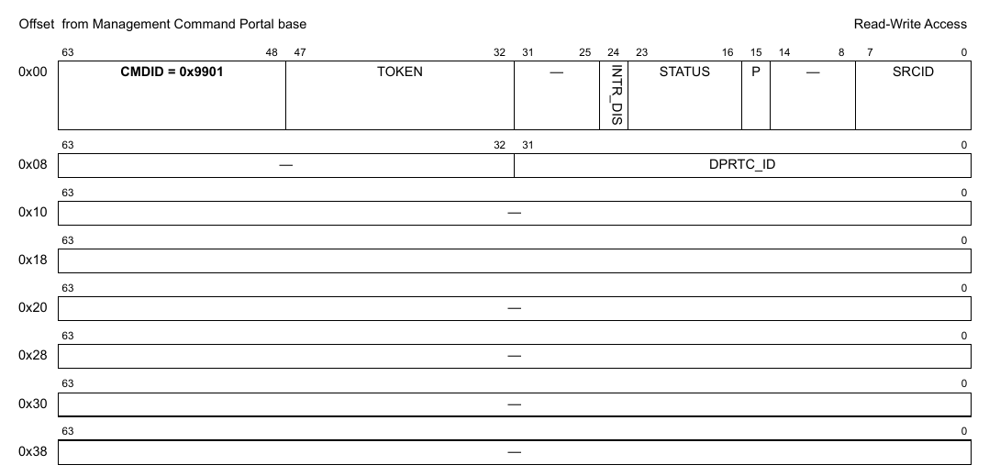

**Figure 517. Mô tả command DPRTC_DESTROY**

| Offset | Bits | Tên | Mô tả |
|---|---|---|---|
| 0x00 | 0-63 | Header của command | Xem Table 2 để biết mô tả chung các field của command portal. CMDID phải được đặt như chỉ ra trong hình ở trên. |
| 0x08 | 0–32 | DPRTC_ID | ID của DPRTC object cần hủy |

Mọi field không được nêu là reserved và phải được xóa (đặt bằng 0)

### 16.2.5 DPRTC_SET_IRQ_ENABLE

Đặt trạng thái tổng thể của interrupt. Cho phép phần mềm GPP điều khiển khi nào interrupt được sinh ra. Mỗi interrupt có thể có tối đa 32 nguyên nhân. Điều khiển enable/disable quyết định trạng thái tổng thể của interrupt. Nếu interrupt bị disable thì không nguyên nhân nào sinh ra interrupt.

**Cấu trúc command**

**Figure 518. Mô tả command DPRTC_SET_IRQ_ENABLE**

| Offset | Bits | Tên | Mô tả |
|---|---|---|---|
| 0x00 | 0-63 | Header của command | Xem Table 2 để biết mô tả chung các field của command portal. CMDID phải được đặt như chỉ ra trong hình ở trên. |
| 0x08 | 0 | EN | Trạng thái interrupt: đặt ‘1’ để enable, ‘0’ để disable |
|   | 32-39 | IRQ_INDEX | Xác định interrupt index cần cấu hình |

Mọi field không được nêu là reserved và phải được xóa (đặt bằng 0)

### 16.2.6 DPRTC_GET_IRQ_ENABLE

Lấy trạng thái tổng thể của interrupt.

**Cấu trúc command**

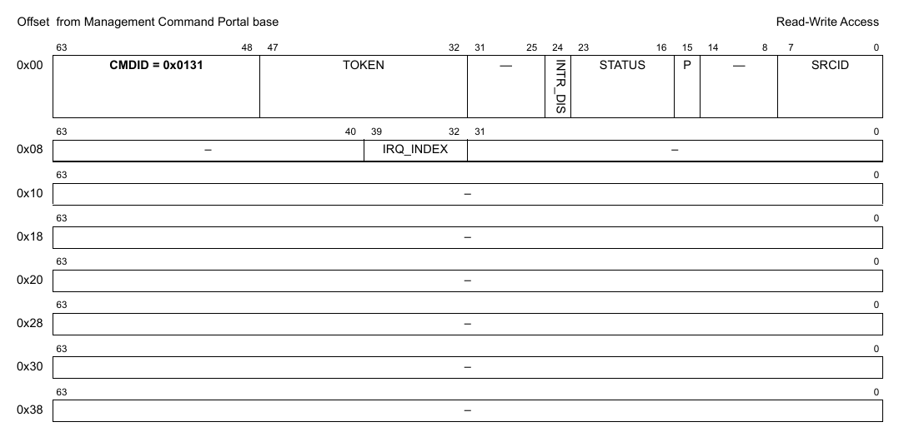

**Figure 519. Mô tả command DPRTC_GET_IRQ_ENABLE**

| Offset | Bits | Tên | Mô tả |
|---|---|---|---|
| 0x00 | 0-63 | Header của command | Xem Table 2 để biết mô tả chung các field của command portal. CMDID phải được đặt như chỉ ra trong hình ở trên. |
| 0x08 | 32-39 | IRQ_INDEX | Xác định interrupt index cần truy vấn |

Mọi field không được nêu là reserved và phải được xóa (đặt bằng 0)

**Cấu trúc response**

**Figure 520. Mô tả response của DPRTC_GET_IRQ_ENABLE**

| Offset | Bits | Tên | Mô tả |
|---|---|---|---|
| 0x00 | 0-63 | Header của command | Xem Table 2 để biết mô tả chung các field của command portal. CMDID phải được đặt như chỉ ra trong hình ở trên. |
| 0x08 | 0 | EN | Bit này được đặt nếu interrupt đang enable |

Mọi field không được nêu là reserved và phải được xóa (đặt bằng 0)

### 16.2.7 DPRTC_SET_IRQ_MASK

Đặt interrupt mask. Mỗi interrupt có thể có tối đa 32 nguyên nhân, và mô hình interrupt hỗ trợ mask/unmask từng nguyên nhân độc lập.

**Cấu trúc command**

**Figure 521. Mô tả command DPRTC_SET_IRQ_MASK**

| Offset | Bits | Tên | Mô tả |
|---|---|---|---|
| 0x00 | 0-63 | Header của command | Xem Table 2 để biết mô tả chung các field của command portal. CMDID phải được đặt như chỉ ra trong hình ở trên. |
| 0x08 | 0-31 | MASK | Event mask để kích hoạt interrupt; xem command GET_IRQ_STATUS để biết đặc tả các event hiện có. Với mỗi bit trong MASK: 0 = bỏ qua event 1 = event hợp lệ; báo IRQ nếu event này xảy ra |
|   | 32-39 | IRQ_INDEX | Interrupt index cần cấu hình |

Mọi field không được nêu là reserved và phải được xóa (đặt bằng 0)

### 16.2.8 DPRTC_GET_IRQ_MASK

Lấy interrupt mask. Mỗi interrupt có thể có tối đa 32 nguyên nhân, và mô hình interrupt hỗ trợ mask/unmask từng nguyên nhân độc lập.

**Cấu trúc command**

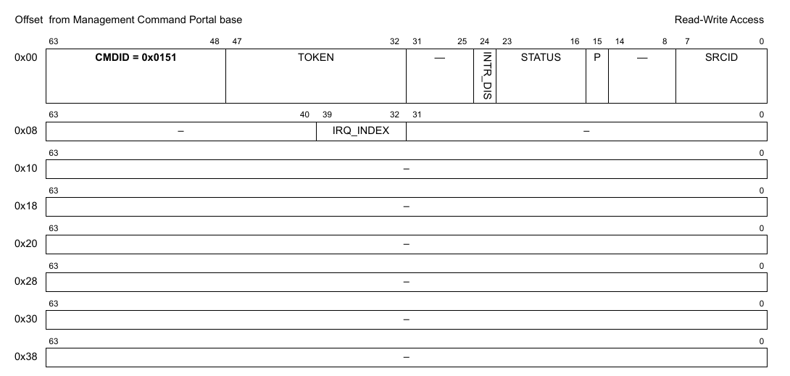

**Figure 522. Mô tả command DPRTC_GET_IRQ_MASK**

| Offset | Bits | Tên | Mô tả |
|---|---|---|---|
| 0x00 | 0-63 | Header của command | Xem Table 2 để biết mô tả chung các field của command portal. CMDID phải được đặt như chỉ ra trong hình ở trên. |
| 0x08 | 32-39 | IRQ_INDEX | Interrupt index cần truy vấn |

Mọi field không được nêu là reserved và phải được xóa (đặt bằng 0)

**Cấu trúc response**

**Figure 523. Mô tả response của DPRTC_GET_IRQ_MASK**

| Offset | Bits | Tên | Mô tả |
|---|---|---|---|
| 0x00 | 0-63 | Header của command | Xem Table 2 để biết mô tả chung các field của command portal. CMDID phải được đặt như chỉ ra trong hình ở trên. |
| 0x08 | 0-31 | MASK | Event mask để kích hoạt interrupt; xem command GET_IRQ_STATUS để biết đặc tả các event hiện có. Với mỗi bit trong MASK: 0 = bỏ qua event 1 = event hợp lệ; báo IRQ nếu event này xảy ra |

Mọi field không được nêu là reserved và phải được xóa (đặt bằng 0)

### 16.2.9 DPRTC_GET_IRQ_STATUS

Lấy trạng thái hiện tại của các event đang chờ cho interrupt index được chỉ định.

**Cấu trúc command**

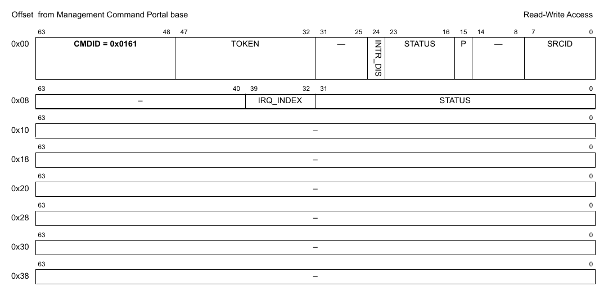

**Figure 524. Mô tả command DPRTC_GET_IRQ_STATUS**

| Offset | Bits | Tên | Mô tả |
|---|---|---|---|
| 0x00 | 0-63 | Header của command | Xem Table 2 để biết mô tả chung các field của command portal. CMDID phải được đặt như chỉ ra trong hình ở trên. |
| 0x08 | 0-31 | STATUS | Tùy chọn: mọi bit STATUS được đặt sẽ được xóa khỏi trạng thái đang chờ (không cần dùng command DPRTC_CLEAR_IRQ_STATUS nữa). Lưu ý rằng STATUS trả về trong response là trạng thái trước khi các event bị xóa.  Các event được hỗ trợ: xem định nghĩa cấu trúc response |
|   | 32-39 | IRQ_INDEX | Interrupt index cần truy vấn |

Mọi field không được nêu là reserved và phải được xóa (đặt bằng 0)

**Cấu trúc response**

**Figure 525. Mô tả response của DPRTC_GET_IRQ_STATUS**

| Offset | Bits | Tên | Mô tả |
|---|---|---|---|
| 0x00 | 0-63 | Header của command | Xem Table 2 để biết mô tả chung các field của command portal. CMDID phải được đặt như chỉ ra trong hình ở trên. |
| 0x08 | 0-31 | STATUS | Mask trạng thái event, mỗi event một bit: 0 = không có interrupt đang chờ 1 = có interrupt đang chờ  Các event được hỗ trợ cho IRQ 0: Bit 22: DPRTC_EVENT_ETS2 - cho biết một event từ external trigger timestamp 2 Bit 23: DPRTC_EVENT_ETS1 - cho biết một event từ external trigger timestamp 1 Bit 26: DPRTC_EVENT_PPS2 – cho biết một event pulse per 4 seconds Bit 27: DPRTC_EVENT_PPS – cho biết một event pulse per second Bit 30: DPRTC_EVENT_ALARM – cho biết đã tới thời gian báo thức được yêu cầu |

Mọi field không được nêu là reserved và phải được xóa (đặt bằng 0)

### 16.2.10 DPRTC_CLEAR_IRQ_STATUS

Xóa (đánh dấu đã xử lý) các event đang chờ của interrupt index được chỉ định.

**Cấu trúc command**

**Figure 526. Mô tả command DPRTC_CLEAR_IRQ_STATUS**

| Offset | Bits | Tên | Mô tả |
|---|---|---|---|
| 0x00 | 0-63 | Header của command | Xem Table 2 để biết mô tả chung các field của command portal. CMDID phải được đặt như chỉ ra trong hình ở trên. |
| 0x08 | 0-31 | STATUS | Mask để xóa các event đã xử lý; xem command GET_IRQ_STATUS để biết đặc tả các event hiện có. Với mỗi bit trong MASK: 0 = không đổi trạng thái event 1 = xóa bit trạng thái event để cho biết event đã được xử lý |
|   | 32-39 | IRQ_INDEX | Interrupt index cần cấu hình |

Mọi field không được nêu là reserved và phải được xóa (đặt bằng 0)

### 16.2.11 DPRTC_GET_ATTRIBUTES

**Cấu trúc command**

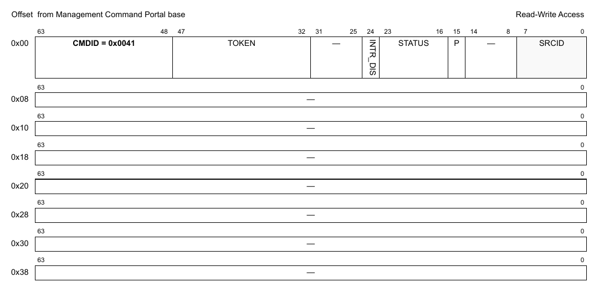

**Figure 527. Mô tả command DPRTC_GET_ATTRIBUTES**

| Offset | Bits | Tên | Mô tả |
|---|---|---|---|
| 0x00 | 0-63 | Header của command | Xem Table 2 để biết mô tả chung các field của command portal. CMDID phải được đặt như chỉ ra trong hình ở trên. |

Mọi field không được nêu là reserved và phải được xóa (đặt bằng 0)

**Cấu trúc response**

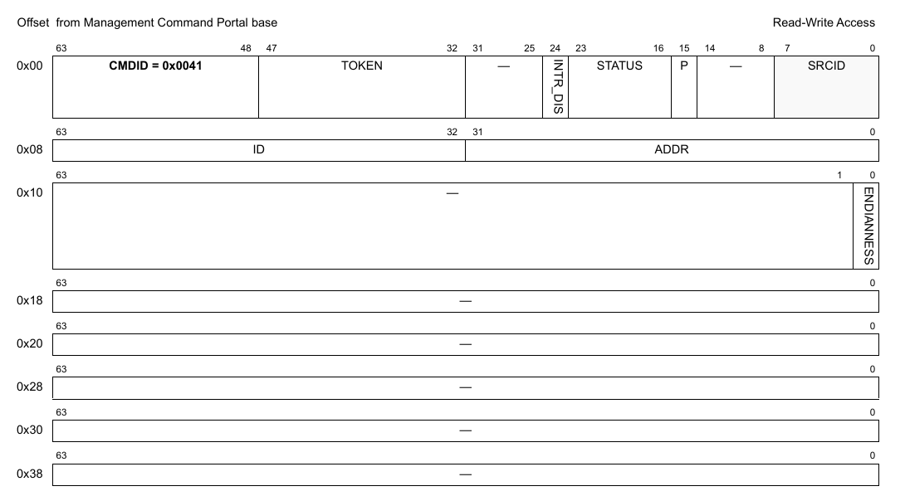

**Figure 528. Mô tả response của DPRTC_GET_ATTRIBUTES**

| Offset | Bits | Tên | Mô tả |
|---|---|---|---|
| 0x00 | 0-63 | Header của command | Xem Table 2 để biết mô tả chung các field của command portal. CMDID phải được đặt như chỉ ra trong hình ở trên. |
| 0x08 | 0-31 | ADDR | Địa chỉ cơ sở của các thanh ghi |
|   | 32-63 | ID | DPRTC object ID |
| 0x10 | 0 | ENDIANNESS | Endianness của khối 1588: 0 - big endian 1 - little endian |

Mọi field không được nêu là reserved và phải được xóa (đặt bằng 0)

### 16.2.12 DPRTC_SET_CLOCK_OFFSET

**Cấu trúc command**

**Figure 529. Mô tả command DPRTC_SET_CLOCK_OFFSET**

| Offset | Bits | Tên | Mô tả |
|---|---|---|---|
| 0x00 | 0-63 | Header của command | Xem Table 2 để biết mô tả chung các field của command portal. CMDID phải được đặt như chỉ ra trong hình ở trên. |
| 0x08 | 0-63 | OFFSET | Clock offset mới (tính bằng nanosecond) |

Mọi field không được nêu là reserved và phải được xóa (đặt bằng 0)

### 16.2.13 DPRTC_GET_CLOCK_OFFSET

**Cấu trúc command**

**Figure 530. Mô tả command DPRTC_GET_CLOCK_OFFSET**

| Offset | Bits | Tên | Mô tả |
|---|---|---|---|
| 0x00 | 0-63 | Header của command | Xem Table 2 để biết mô tả chung các field của command portal. CMDID phải được đặt như chỉ ra trong hình ở trên. |

Mọi field không được nêu là reserved và phải được xóa (đặt bằng 0)

**Cấu trúc response**

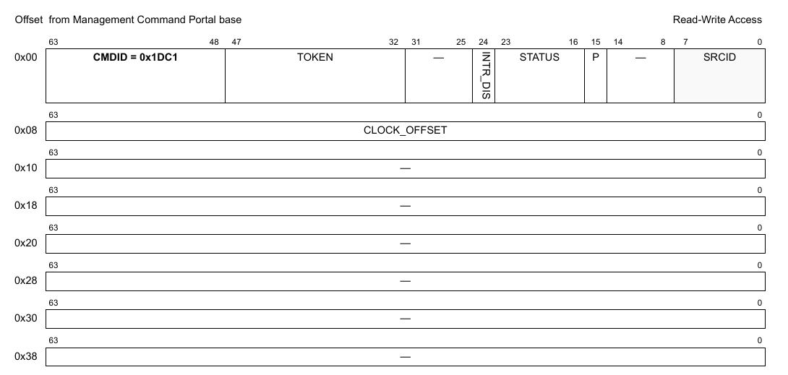

**Figure 531. Mô tả response của DPRTC_GET_CLOCK_OFFSET**

| Offset | Bits | Tên | Mô tả |
|---|---|---|---|
| 0x00 | 0-63 | Header của command | Xem Table 2 để biết mô tả chung các field của command portal. CMDID phải được đặt như chỉ ra trong hình ở trên. |
| 0x08 | 0-63 | CLOCK_OFFSET | Giá trị clock offset. |

Mọi field không được nêu là reserved và phải được xóa (đặt bằng 0)

### 16.2.14 DPRTC_SET_FREQ_COMPENSATION

**Cấu trúc command**

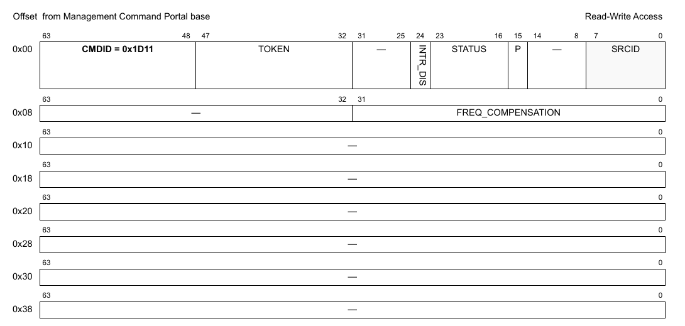

**Figure 532. Mô tả command DPRTC_SET_FREQ_COMPENSATION**

| Offset | Bits | Tên | Mô tả |
|---|---|---|---|
| 0x00 | 0-63 | Header của command | Xem Table 2 để biết mô tả chung các field của command portal. CMDID phải được đặt như chỉ ra trong hình ở trên. |
| 0x08 | 0-31 | FREQ_COMPENSATION | Giá trị bù tần số mới cần đặt. |

Mọi field không được nêu là reserved và phải được xóa (đặt bằng 0)

### 16.2.15 DPRTC_GET_FREQ_COMPENSATION

**Cấu trúc command**

**Figure 533. Mô tả command DPRTC_GET_FREQ_COMPENSATION**

| Offset | Bits | Tên | Mô tả |
|---|---|---|---|
| 0x00 | 0-63 | Header của command | Xem Table 2 để biết mô tả chung các field của command portal. CMDID phải được đặt như chỉ ra trong hình ở trên. |

Mọi field không được nêu là reserved và phải được xóa (đặt bằng 0)

**Cấu trúc response**

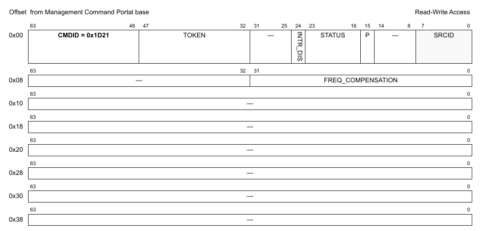

**Figure 534. Mô tả response của DPRTC_GET_FREQ_COMPENSATION**

| Offset | Bits | Tên | Mô tả |
|---|---|---|---|
| 0x00 | 0-63 | Header của command | Xem Table 2 để biết mô tả chung các field của command portal. CMDID phải được đặt như chỉ ra trong hình ở trên. |
| 0x08 | 0-31 | FREQ_COMPENSATION | Giá trị bù tần số |

Mọi field không được nêu là reserved và phải được xóa (đặt bằng 0)

### 16.2.16 DPRTC_GET_TIME

**Cấu trúc command**

**Figure 535. Mô tả command DPRTC_GET_TIME**

| Offset | Bits | Tên | Mô tả |
|---|---|---|---|
| 0x00 | 0-63 | Header của command | Xem Table 2 để biết mô tả chung các field của command portal. CMDID phải được đặt như chỉ ra trong hình ở trên. |

Mọi field không được nêu là reserved và phải được xóa (đặt bằng 0)

**Cấu trúc response**

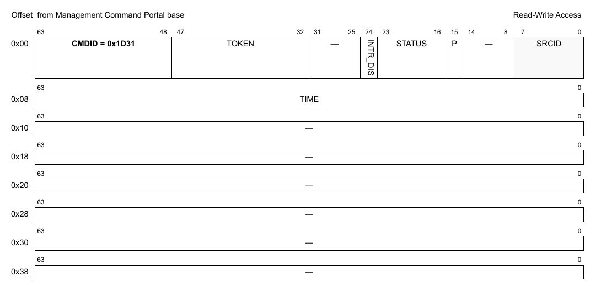

**Figure 536. Mô tả response của DPRTC_GET_TIME**

| Offset | Bits | Tên | Mô tả |
|---|---|---|---|
| 0x00 | 0-63 | Header của command | Xem Table 2 để biết mô tả chung các field của command portal. CMDID phải được đặt như chỉ ra trong hình ở trên. |
| 0x08 | 0-63 | TIME | Thời gian RTC hiện tại tính bằng nanosecond |

Mọi field không được nêu là reserved và phải được xóa (đặt bằng 0)

### 16.2.17 DPRTC_SET_TIME

**Cấu trúc command**

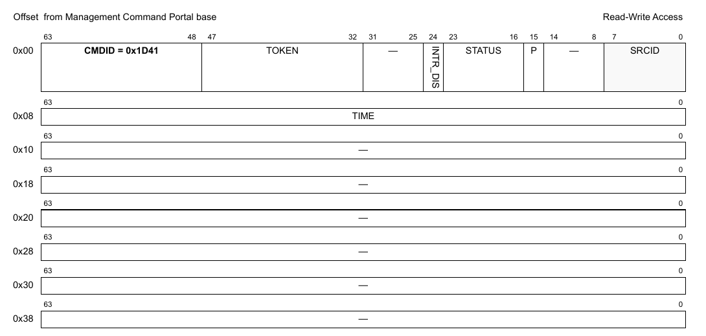

**Figure 537. Mô tả command DPRTC_SET_TIME**

| Offset | Bits | Tên | Mô tả |
|---|---|---|---|
| 0x00 | 0-63 | Header của command | Xem Table 2 để biết mô tả chung các field của command portal. CMDID phải được đặt như chỉ ra trong hình ở trên. |
| 0x08 | 0-63 | TIME | Thời gian RTC mới tính bằng nanosecond |

Mọi field không được nêu là reserved và phải được xóa (đặt bằng 0)

### 16.2.18 DPRTC_SET_ALARM

**Cấu trúc command**

**Figure 538. Mô tả command DPRTC_SET_ALARM**

| Offset | Bits | Tên | Mô tả |
|---|---|---|---|
| 0x00 | 0-63 | Header của command | Xem Table 2 để biết mô tả chung các field của command portal. CMDID phải được đặt như chỉ ra trong hình ở trên. |
| 0x08 | 0-63 | TIME | Tính bằng nanosecond, thời điểm báo thức sẽ kích hoạt - phải là bội số của chu kỳ RTC |

Mọi field không được nêu là reserved và phải được xóa (đặt bằng 0)

### 16.2.19 DPRTC_GET_EXT_TRIGGER_TIMESTAMP

**Cấu trúc command**

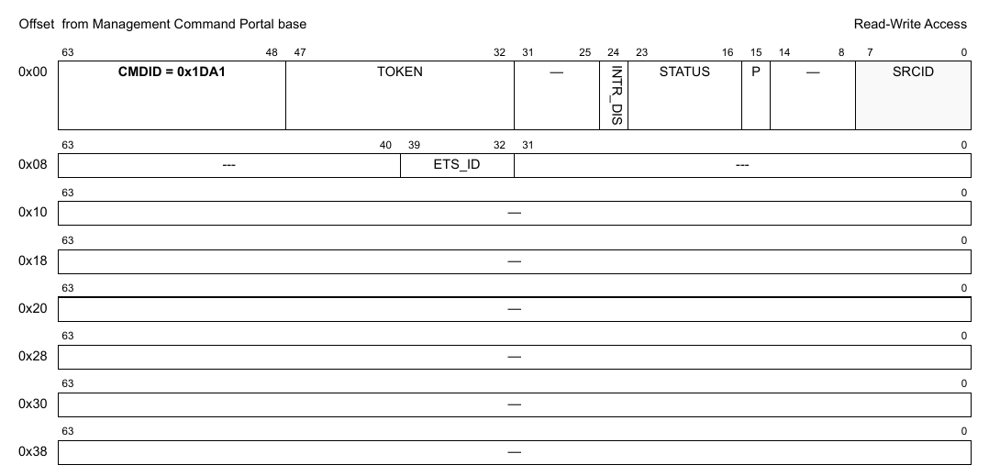

**Figure 539. Mô tả command DPRTC_GET_EXT_TRIGGER_TIMESTEMP *(ghi chú: đúng là DPRTC_GET_EXT_TRIGGER_TIMESTAMP)***

| Offset | Bits | Tên | Mô tả |
|---|---|---|---|
| 0x00 | 0-63 | Header của command | Xem Table 2 để biết mô tả chung các field của command portal. CMDID phải được đặt như chỉ ra trong hình ở trên. |
| 0x08 | 32-39 | ETS_ID | Là ID của interrupt external trigger 01b - ETS1 10b - ETS2 |

Mọi field không được nêu là reserved và phải được xóa (đặt bằng 0)

**Cấu trúc response**

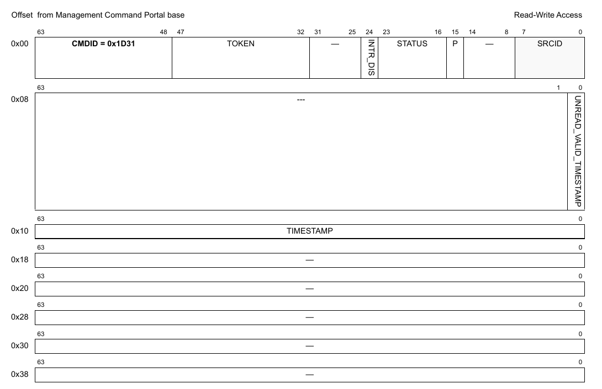

**Figure 540. Mô tả response của DPRTC_GET_EXT_TRIGGER_TIMESTEMP *(ghi chú: đúng là DPRTC_GET_EXT_TRIGGER_TIMESTAMP)***

| Offset | Bits | Tên | Mô tả |
|---|---|---|---|
| 0x00 | 0-63 | Header của command | Xem Table 2 để biết mô tả chung các field của command portal. CMDID phải được đặt như chỉ ra trong hình ở trên. |
| 0x08 | 0 | UNREAD_VALID_TIMESTAMP | Nếu đặt, nghĩa là trong FIFO còn một timestamp khác cần đọc. Nếu không đặt và TIMESTAMP có giá trị khác 0, nghĩa là giá trị này là mục cuối cùng trong FIFO. |
| 0x10 | 0-63 | TIMESTAMP | Giá trị timestamp tính bằng nanosecond. |

Mọi field không được nêu là reserved và phải được xóa (đặt bằng 0)

### 16.2.20 DPRTC_SET_FIPER_LOOPBACK

Qua command này, với cả hai interrupt external trigger (ETS1 và ETS2), nguồn interrupt có thể được chuyển giữa đầu vào external trigger bình thường và tín hiệu xung của fiper (fiper ở chế độ loopback).

**Cấu trúc command**

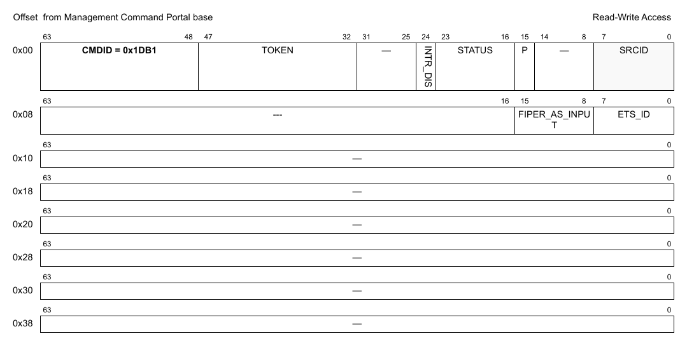

**Figure 541. Mô tả command DPRTC_SET_FIPER_LOOPBACK**

| Offset | Bits | Tên | Mô tả |
|---|---|---|---|
| 0x00 | 0-63 | Header của command | Xem Table 2 để biết mô tả chung các field của command portal. CMDID phải được đặt như chỉ ra trong hình ở trên. |
| 0x08 | 0-7 | ETS_ID | Là ID của interrupt external trigger 01b - ETS1 10b - ETS2 |
|   | 8-15 | FIPER_AS_INPUT | Nếu đặt, fiper sẽ được cấu hình ở chế độ loopback. Nó sẽ là nguồn tín hiệu interrupt cho ETS được chọn. Nếu không đặt, đầu vào ETS dựa trên đầu vào external trigger bình thường. |

Mọi field không được nêu là reserved và phải được xóa (đặt bằng 0)

### 16.2.21 DPRTC_GET_API_VERSION

**Cấu trúc command**

**Figure 542. Mô tả command DPRTC_GET_API_VERSION**

| Offset | Bits | Tên | Mô tả |
|---|---|---|---|
| 0x00 | 0-63 | Header của command | Xem Table 2 để biết mô tả chung các field của command portal. CMDID phải được đặt như chỉ ra trong hình ở trên. |

Mọi field không được nêu là reserved và phải được xóa (đặt bằng 0)

**Cấu trúc response**

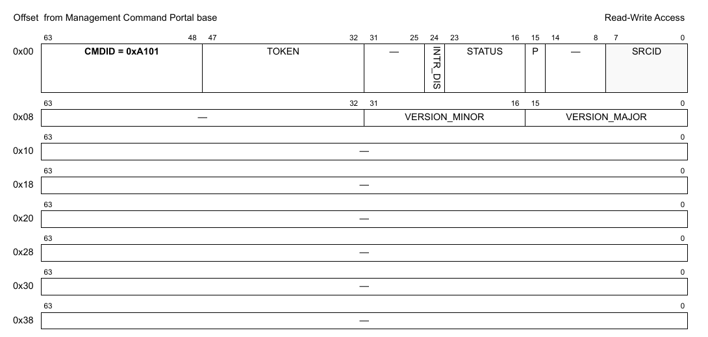

**Figure 543. Mô tả response của DPRTC_GET_API_VERSION**

| Offset | Bits | Tên | Mô tả |
|---|---|---|---|
| 0x00 | 0-63 | Header của command | Xem Table 2 để biết mô tả chung các field của command portal. CMDID phải được đặt như chỉ ra trong hình ở trên. |
| 0x08 | 0-15 | VERSION_MAJOR | Major version của API |
|   | 16-31 | VERSION_MINOR | Minor version của API |
