# Chương 17 DPSECI: Data Path SEC Interface

MC xuất ra DPSECI object làm giao diện để vận hành DPAA2 Security Engine (SEC).

DPSECI cho phép gửi request dạng frame tới SEC và nhận lại response đã xử lý, dùng hạ tầng QBMan của DPAA2. DPSECI object cung cấp tối đa tám priority để xử lý request SEC.

## 17.1 Các tính năng của DPSECI

Danh sách sau tóm tắt các tính năng và khả năng chính của DPSECI:

- Hỗ trợ tối đa tám priority lập lịch để xử lý service request
  - Mỗi transmit queue của DPSECI được ánh xạ tới một trong tám service priority, cho phép phần cứng phân ưu tiên thêm giữa các request từ các DPSECI object khác nhau.
- Hỗ trợ tối đa mười sáu receive queue cho các frame response đến
  - Mỗi response (receive) queue của DPSECI được ánh xạ tới một trong tám receive priority, cho phép phân ưu tiên thêm giữa các interface khác khi gắn các receive queue của DPSECI với DPIO hoặc DPCON object.
- Hỗ trợ các tùy chọn lập lịch khác nhau để xử lý packet nhận được:
  - Queue có thể được cấu hình ở chế độ ‘parked’ (mặc định), hoặc gắn với một DPIO object, hoặc gắn với DPCON object
- Cho phép tương tác với một hoặc nhiều DPIO object để dequeue/enqueue frame descriptor (FD) và để acquire/release buffer.
- Hỗ trợ các thao tác enable, disable và reset

## 17.2 Mô tả chức năng của DPSECI

### 17.2.1 Thiết lập DPSECI cho hoạt động SEC

DPSECI là một interface object cho phép phần mềm GPP gửi service request tới SEC engine và nhận lại response đã xử lý. Mô tả thực sự của dịch vụ SEC được yêu cầu do phần mềm GPP xây dựng dưới dạng frame descriptor. Phần mềm GPP cũng chịu trách nhiệm đọc và phân tích frame descriptor response chứa kết quả và trạng thái của request đã xử lý.

DPSECI không biết nội dung các request SEC được gửi và không kiểm tra tính đúng đắn của chúng. Nó chỉ tham gia vào việc thiết lập hạ tầng QMan để giao tiếp với SEC engine.

Phần mềm driver phải khai báo số queue (tới 16 với LX2160A) cho việc xử lý SEC. Các queue của DPSECI được ánh xạ tới một trong tám priority toàn cục của khối phần cứng SEC; điều này cho phép phân ưu tiên thêm cho service request giữa các DPSECI object khác nhau.

### 17.2.2 Quan hệ với DPIO và DPCON object

Mỗi response (receive) queue của DPSECI có thể gắn với một DPIO object hoặc một DPCON object. Việc này phục vụ mục đích notification và/hoặc lập lịch nâng cao cho các frame response nhận được.

DPIO object cung cấp cấu hình cho một QBMan software portal, có tùy chọn thông báo có dữ liệu. Phần mềm GPP có thể tùy ý gắn DPIO object với thread, hoặc dùng chung giữa các core ở chế độ SMP, nhưng khi đó cần đồng bộ hóa việc truy cập QBMan software portal. Có thể gắn nhiều DPIO object với cùng một DPSECI, để phân tán response từ DPSECI này qua nhiều QBMan software portal.

Phần mềm GPP có thể quyết định bật notification của DPIO, hoặc dequeue frame theo logic polling tự lập lịch. Cũng có thể để một thực thể GPP nhận notification từ một DPIO rồi báo cho một thực thể khác dequeue packet bằng một DPIO khác.

DPCON object được dùng để gom traffic từ nhiều interface vào các sub-interface, chủ yếu cho mục đích lập lịch. Có thể nối DPCON với DPIO để nó sinh notification tới GPP.

Lưu ý rằng QBMan software portal được dùng cho cả thao tác enqueue/dequeue packet lẫn thao tác acquire/release buffer. Phần mềm GPP chịu trách nhiệm về chế độ hoạt động và cách dùng portal, tức là dùng chung hay gắn riêng, gắn queue context, v.v.

DPIO object có thể phục vụ nhiều interface. Không chỉ nhiều DPSECI object; nó cũng có thể mở rộng sang giao diện mạng và giao diện giao tiếp. Ví dụ, cùng một DPIO có thể phục vụ cả một DPNI lẫn một DPSECI, với điều kiện chúng được gán cho cùng software context (container).

### 17.2.3 Yêu cầu về buffer

DPSECI không cần gắn trực tiếp với DPBP object; ngoài ra, buffer cho các service request SEC (frame) có thể được hoặc không được quản lý bằng buffer pool. Tuy nhiên, frame response của SEC thường được xây bằng cách cấp phát buffer từ các buffer pool của BMan; vì vậy phần mềm GPP cần chỉ định trong service request SEC buffer pool ID nào dùng để cấp phát buffer response. Buffer pool ID có thể lấy từ DPBP object (xem mô tả DPBP API).

## 17.3 Tham chiếu command của DPSECI

Mục này trình bày chi tiết mô hình lập trình các command của DPSECI.

### 17.3.1 DPSECI_OPEN

Mở một phiên điều khiển cho object được chỉ định.

Hàm này có thể dùng để mở phiên điều khiển cho một object đã được tạo; object có thể đã được khai báo trong DPL hoặc được tạo bằng command DPSECI_CREATE.

Hàm này trả về một authentication token duy nhất, gắn với object ID cụ thể; token này phải được dùng trong mọi command tiếp theo cho object này.

**Cấu trúc command**

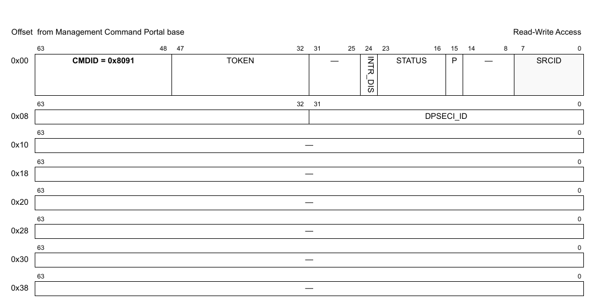

**Figure 544. Mô tả command DPSECI_OPEN**

Bảng sau mô tả các field của command.

**Table 70. Mô tả các field của command DPSECI_OPEN1**

| Offset | Bits | Tên | Mô tả |
|---|---|---|---|
| 0x00 | 0-63 | Header của command | Xem Table 2 để biết mô tả chung các field của command portal. CMDID phải được đặt như chỉ ra trong hình ở trên. |
| 0x08 | 0-31 | DPSECI_ID |   |

1 Mọi field không được nêu là reserved và phải được xóa (đặt bằng 0).

### 17.3.2 DPSECI_CLOSE

Đóng phiên điều khiển của object.

Sau khi gọi hàm này, không thao tác nào khác được phép trên object nếu không mở một phiên điều khiển mới.

**Cấu trúc command**

**Figure 545. Mô tả command DPSECI_CLOSE**

| Offset | Bits | Tên | Mô tả |
|---|---|---|---|
| 0x00 | 0-63 | Header của command | Xem Table 2 để biết mô tả chung các field của command portal. CMDID phải được đặt như chỉ ra trong hình ở trên. |

Mọi field không được nêu là reserved và phải được xóa (đặt bằng 0).

### 17.3.3 DPSECI_CREATE

Command này tạo và khởi tạo một instance DPSECI theo các tham số command được chỉ định. Command này không cần cho các instance DPSECI được tạo bằng DPL.

Với command CREATE, bên gọi phải cung cấp authentication token của container cha mà object sẽ được tạo và gán vào. Nếu token là '0', object sẽ được gán cho container đang sở hữu MC command portal thực thi command này.

Command trả về một DPSECI ID có thể dùng để OPEN hoặc DESTROY object.

Định dạng command được thể hiện trong hình dưới đây.

**Cấu trúc command**

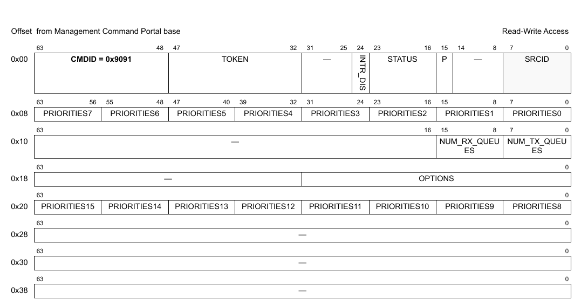

**Figure 546. Mô tả command DPSECI_CREATE**

Bảng sau mô tả các field của command.

**Table 71. Mô tả các field của command DPSECI_CREATE1**

| Offset | Bits | Tên | Mô tả |
|---|---|---|---|
| 0x00 | 0-63 | Header của command | Xem Table 2 để biết mô tả chung các field của command portal. CMDID phải được đặt như chỉ ra trong hình ở trên. |
| 0x08 | 0-63 | PRIORITIES[0-7] | Các priority cho việc xử lý của phần cứng SEC; priority hợp lệ được cấu hình bằng giá trị 1-8; mục ngay sau mục hợp lệ cuối cùng cần đặt bằng 0 |
| 0x10 | 0-7 | NUM_TX_QUEUES | Số queue hướng tới SEC |
|   | 8-15 | NUM_RX_QUEUES | Số queue trả về từ SEC |
| 0x18 | 0-31 | OPTIONS | Chọn một hoặc nhiều option dưới đây |
|   | 5 | DPSECI_OPT_HAS_CG | Điều khiển việc có congestion group hay không: 0 – không có congestion group 1 – có congestion group (một congestion group duy nhất cho mọi queue) |
|   | 6 | DPSECI_OPT_HAS_OPR | Điều khiển việc có Order Restoration hay không: 0 – Không có Order Restoration 1 – Có Order Restoration |
|   | 7 | DPSECI_OPT_OPR_SHARED | Điều khiển số Order Restoration point: 0 – Có Order Restoration cho từng queue 1 – Có Order Restoration cho từng DPSECI object (một điểm “dùng chung” duy nhất cho mọi queue) |
| 0x20 | 0-63 | PRIORITIES[8-15] | Các priority cho việc xử lý của phần cứng SEC; priority hợp lệ được cấu hình bằng giá trị 1-8; mục ngay sau mục hợp lệ cuối cùng cần đặt bằng 0 |

1 Mọi field không được nêu là reserved và phải được xóa (đặt bằng 0).

**Cấu trúc response**

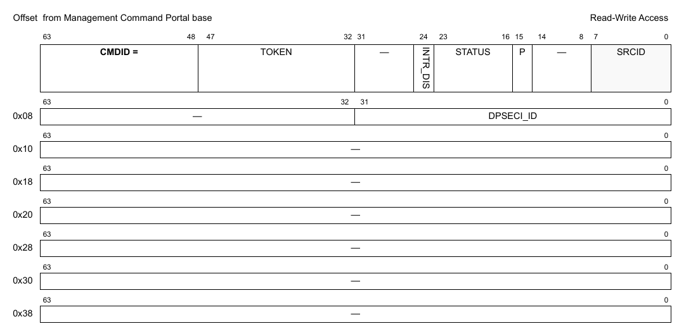

**Figure 17-1. Mô tả response của DPSECI_CREATE**

Bảng sau mô tả các field của response.

**Table 17-1. Mô tả các field response của DPSECI_CREATE1**

| Offset | Bits | Tên | Mô tả |
|---|---|---|---|
| 0x00 | 0-63 | Header của command | Xem Table 2 để biết mô tả chung các field của command portal. CMDID phải được đặt như chỉ ra trong hình ở trên. |
| 0x08 | 0-31 | DPSECI_ID | ID duy nhất của DPSECI |

1 Mọi field không được nêu là reserved.

### 17.3.4 DPSECI_DESTROY

Command này hủy DPSECI object và giải phóng mọi tài nguyên của nó. Nó phải được gọi trong software context đã tạo object. Bên gọi phải cung cấp object id và authentication token của container cha đã tạo object. Lưu ý rằng object có thể đã được gán cho container khác, và gửi authentication token của container đó sẽ trả về lỗi.

Mọi authentication token đang mở tới object phải được đóng trước khi gọi command destroy.

Sau khi gọi hàm này, không thao tác nào khác được phép trên object.

**Cấu trúc command**

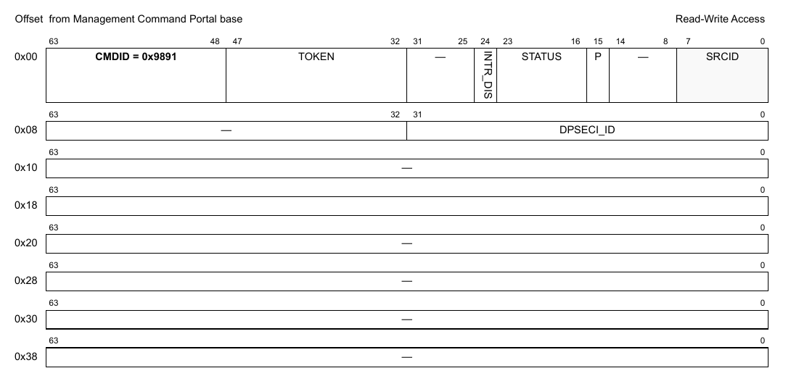

**Figure 547. Mô tả command DPSECI_DESTROY**

| Offset | Bits | Tên | Mô tả |
|---|---|---|---|
| 0x00 | 0-63 | Header của command | Xem Table 2 để biết mô tả chung các field của command portal. CMDID phải được đặt như chỉ ra trong hình ở trên. |
| 0x08 | 0–32 | DPSECI_ID | ID của DPSECI object cần hủy |

Mọi field không được nêu là reserved và phải được xóa (đặt bằng 0)

### 17.3.5 DPSECI_ENABLE

**Cấu trúc command**

**Figure 548. Mô tả command DPSECI_ENABLE**

| Offset | Bits | Tên | Mô tả |
|---|---|---|---|
| 0x00 | 0-63 | Header của command | Xem Table 2 để biết mô tả chung các field của command portal. CMDID phải được đặt như chỉ ra trong hình ở trên. |

Mọi field không được nêu là reserved và phải được xóa (đặt bằng 0)

### 17.3.6 DPSECI_DISABLE

**Cấu trúc command**

**Figure 549. Mô tả command DPSECI_DISABLE**

| Offset | Bits | Tên | Mô tả |
|---|---|---|---|
| 0x00 | 0-63 | Header của command | Xem Table 2 để biết mô tả chung các field của command portal. CMDID phải được đặt như chỉ ra trong hình ở trên. |

Mọi field không được nêu là reserved và phải được xóa (đặt bằng 0)

### 17.3.7 DPSECI_IS_ENABLED

**Cấu trúc command**

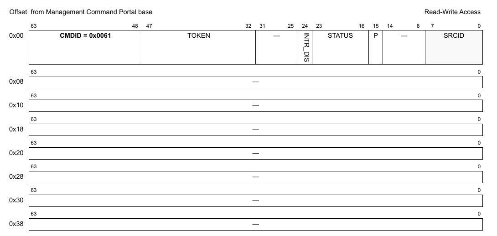

**Figure 550. Mô tả command DPSECI_IS_ENABLED**

| Offset | Bits | Tên | Mô tả |
|---|---|---|---|
| 0x00 | 0-63 | Header của command | Xem Table 2 để biết mô tả chung các field của command portal. CMDID phải được đặt như chỉ ra trong hình ở trên. |

Mọi field không được nêu là reserved và phải được xóa (đặt bằng 0)

**Cấu trúc response**

**Figure 551. Mô tả response của DPSECI_IS_ENABLED**

| Offset | Bits | Tên | Mô tả |
|---|---|---|---|
| 0x00 | 0-63 | Header của command | Xem Table 2 để biết mô tả chung các field của command portal. CMDID phải được đặt như chỉ ra trong hình ở trên. |
| 0x08 | 0 | EN | Trả về '1' nếu object đang enable; '0' nếu không |

Mọi field không được nêu là reserved và phải được xóa (đặt bằng 0)

### 17.3.8 DPSECI_RESET

**Cấu trúc command**

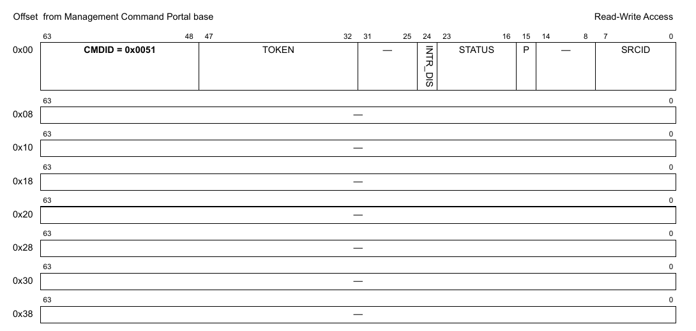

**Figure 552. Mô tả command DPSECI_RESET**

| Offset | Bits | Tên | Mô tả |
|---|---|---|---|
| 0x00 | 0-63 | Header của command | Xem Table 2 để biết mô tả chung các field của command portal. CMDID phải được đặt như chỉ ra trong hình ở trên. |

Mọi field không được nêu là reserved và phải được xóa (đặt bằng 0)

### 17.3.9 DPSECI_SET_IRQ_ENABLE

Đặt trạng thái tổng thể của interrupt. Cho phép phần mềm GPP điều khiển khi nào interrupt được sinh ra. Mỗi interrupt có thể có tối đa 32 nguyên nhân. Điều khiển enable/disable quyết định trạng thái tổng thể của interrupt. Nếu interrupt bị disable thì không nguyên nhân nào sinh ra interrupt.

**Cấu trúc command**

**Figure 553. Mô tả command DPSECI_SET_IRQ_ENABLE**

| Offset | Bits | Tên | Mô tả |
|---|---|---|---|
| 0x00 | 0-63 | Header của command | Xem Table 2 để biết mô tả chung các field của command portal. CMDID phải được đặt như chỉ ra trong hình ở trên. |
| 0x08 | 0 | EN | Trạng thái interrupt: đặt ‘1’ để enable, ‘0’ để disable |
|   | 32-39 | IRQ_INDEX | Xác định interrupt index cần cấu hình |
| 0x10 - 0x3F |   | – | Reserved |

Mọi field không được nêu là reserved và phải được xóa (đặt bằng 0)

### 17.3.10 DPSECI_GET_IRQ_ENABLE

Lấy trạng thái tổng thể của interrupt.

**Cấu trúc command**

**Figure 554. Mô tả command DPSECI_GET_IRQ_ENABLE**

| Offset | Bits | Tên | Mô tả |
|---|---|---|---|
| 0x00 | 0-63 | Header của command | Xem Table 2 để biết mô tả chung các field của command portal. CMDID phải được đặt như chỉ ra trong hình ở trên. |
| 0x08 | 32-39 | IRQ_INDEX | Xác định interrupt index cần truy vấn |

Mọi field không được nêu là reserved và phải được xóa (đặt bằng 0)

**Cấu trúc response**

**Figure 555. Mô tả response của DPSECI_GET_IRQ_ENABLE**

| Offset | Bits | Tên | Mô tả |
|---|---|---|---|
| 0x00 | 0-63 | Header của command | Xem Table 2 để biết mô tả chung các field của command portal. CMDID phải được đặt như chỉ ra trong hình ở trên. |
| 0x08 | 0 | EN | Bit này được đặt nếu interrupt đang enable |

Mọi field không được nêu là reserved và phải được xóa (đặt bằng 0)

### 17.3.11 DPSECI_SET_IRQ_MASK

Đặt interrupt mask. Mỗi interrupt có thể có tối đa 32 nguyên nhân, và mô hình interrupt hỗ trợ mask/unmask từng nguyên nhân độc lập.

**Cấu trúc command**

**Figure 556. Mô tả command DPSECI_SET_IRQ_MASK**

| Offset | Bits | Tên | Mô tả |
|---|---|---|---|
| 0x00 | 0-63 | Header của command | Xem Table 2 để biết mô tả chung các field của command portal. CMDID phải được đặt như chỉ ra trong hình ở trên. |
| 0x08 | 0-31 | MASK | Event mask để kích hoạt interrupt; xem command GET_IRQ_STATUS để biết đặc tả các event hiện có. Với mỗi bit trong MASK: 0 = bỏ qua event 1 = event hợp lệ; báo IRQ nếu event này xảy ra |
|   | 32-39 | IRQ_INDEX | Interrupt index cần cấu hình |

Mọi field không được nêu là reserved và phải được xóa (đặt bằng 0)

### 17.3.12 DPSECI_GET_IRQ_MASK

Lấy interrupt mask. Mỗi interrupt có thể có tối đa 32 nguyên nhân, và mô hình interrupt hỗ trợ mask/unmask từng nguyên nhân độc lập.

**Cấu trúc command**

**Figure 557. Mô tả command DPSECI_GET_IRQ_MASK**

| Offset | Bits | Tên | Mô tả |
|---|---|---|---|
| 0x00 | 0-63 | Header của command | Xem Table 2 để biết mô tả chung các field của command portal. CMDID phải được đặt như chỉ ra trong hình ở trên. |
| 0x08 | 32-39 | IRQ_INDEX | Interrupt index cần truy vấn |

Mọi field không được nêu là reserved và phải được xóa (đặt bằng 0)

**Cấu trúc response**

**Figure 558. Mô tả response của DPSECI_GET_IRQ_MASK**

| Offset | Bits | Tên | Mô tả |
|---|---|---|---|
| 0x00 | 0-63 | Header của command | Xem Table 2 để biết mô tả chung các field của command portal. CMDID phải được đặt như chỉ ra trong hình ở trên. |
| 0x08 | 0-31 | MASK | Event mask để kích hoạt interrupt; xem command GET_IRQ_STATUS để biết đặc tả các event hiện có. Với mỗi bit trong MASK: 0 = bỏ qua event 1 = event hợp lệ; báo IRQ nếu event này xảy ra |

Mọi field không được nêu là reserved và phải được xóa (đặt bằng 0)

### 17.3.13 DPSECI_GET_IRQ_STATUS

Lấy trạng thái hiện tại của các event đang chờ cho interrupt index được chỉ định.

**Cấu trúc command**

**Figure 559. Mô tả command DPSECI_GET_IRQ_STATUS**

| Offset | Bits | Tên | Mô tả |
|---|---|---|---|
| 0x00 | 0-63 | Header của command | Xem Table 2 để biết mô tả chung các field của command portal. CMDID phải được đặt như chỉ ra trong hình ở trên. |
| 0x08 | 0-31 | STATUS | Tùy chọn: mọi bit STATUS được đặt sẽ được xóa khỏi trạng thái đang chờ (không cần dùng command DPSECI_CLEAR_IRQ_STATUS nữa). Lưu ý rằng STATUS trả về trong response là trạng thái trước khi các event bị xóa.  Các event được hỗ trợ: xem định nghĩa cấu trúc response |
|   | 32-39 | IRQ_INDEX | Interrupt index cần truy vấn |

Mọi field không được nêu là reserved và phải được xóa (đặt bằng 0)

**Cấu trúc response**

**Figure 560. Mô tả response của DPSECI_GET_IRQ_STATUS**

| Offset | Bits | Tên | Mô tả |
|---|---|---|---|
| 0x00 | 0-63 | Header của command | Xem Table 2 để biết mô tả chung các field của command portal. CMDID phải được đặt như chỉ ra trong hình ở trên. |
| 0x08 | 0-31 | STATUS | Mask trạng thái event, mỗi event một bit: 0 = không có interrupt đang chờ 1 = có interrupt đang chờ  Các event được hỗ trợ: Không có |

Mọi field không được nêu là reserved và phải được xóa (đặt bằng 0)

### 17.3.14 DPSECI_CLEAR_IRQ_STATUS

Xóa (đánh dấu đã xử lý) các event đang chờ của interrupt index được chỉ định.

**Cấu trúc command**

**Figure 561. Mô tả command DPSECI_CLEAR_IRQ_STATUS**

| Offset | Bits | Tên | Mô tả |
|---|---|---|---|
| 0x00 | 0-63 | Header của command | Xem Table 2 để biết mô tả chung các field của command portal. CMDID phải được đặt như chỉ ra trong hình ở trên. |
| 0x08 | 0-31 | STATUS | Mask để xóa các event đã xử lý; xem command GET_IRQ_STATUS để biết đặc tả các event hiện có. Với mỗi bit trong MASK: 0 = không đổi trạng thái event 1 = xóa bit trạng thái event để cho biết event đã được xử lý |
|   | 32-39 | IRQ_INDEX | Interrupt index cần cấu hình |

Mọi field không được nêu là reserved và phải được xóa (đặt bằng 0)

### 17.3.15 DPSECI_GET_ATTRIBUTES

**Cấu trúc command**

**Figure 562. Mô tả command DPSECI_GET_ATTRIBUTES**

| Offset | Bits | Tên | Mô tả |
|---|---|---|---|
| 0x00 | 0-63 | Header của command | Xem Table 2 để biết mô tả chung các field của command portal. CMDID phải được đặt như chỉ ra trong hình ở trên. |

Mọi field không được nêu là reserved và phải được xóa (đặt bằng 0)

**Cấu trúc response**

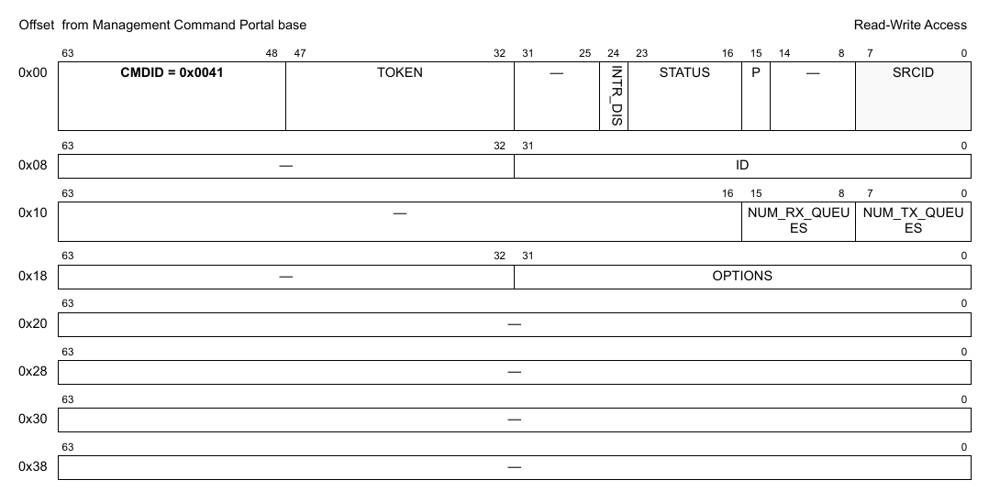

**Figure 563. Mô tả response của DPSECI_GET_ATTRIBUTES**

| Offset | Bits | Tên | Mô tả |
|---|---|---|---|
| 0x00 | 0-63 | Header của command | Xem Table 2 để biết mô tả chung các field của command portal. CMDID phải được đặt như chỉ ra trong hình ở trên. |
| 0x08 | 0-31 | ID | DPSECI object ID |
| 0x10 | 0-7 | NUM_TX_QUEUES | số queue hướng tới SEC |
|   | 8-15 | NUM_RX_QUEUES | số queue trả về từ SEC |
| 0x18 | 0-31 | OPTIONS | Các option đã dùng để tạo DPSECI object (giống các option của DPSECI_CREATE). Bất kỳ tổ hợp nào của các option sau: DPSECI_OPT_HAS_CG, DPSECI_OPT_HAS_OPR, DPSECI_OPT_OPR_SHARED. |

### 17.3.16 DPSECI_SET_OPR

Đặt cấu hình Order Point Record. Command chỉ hoạt động nếu DPSECI được tạo với option DPSECI_OPT_HAS_OPR. Nó cũng chỉ hoạt động trên các SoC hỗ trợ Order Restoration.

Nếu DPSECI được cấu hình với option DPSECI_OPT_OPR_SHARED, mọi frame queue dùng một điểm “dùng chung” duy nhất, chỉ khi DPSECI được enable (nói cách khác, Order Restoration có cho từng DPSECI object). Nếu option DPSECI_OPT_OPR_SHARED không được đặt, INDEX được dùng để chọn một queue cụ thể. Giá trị INDEX phải nhỏ hơn NUM_RX_QUEUES đã đặt qua DPSECI_CREATE.

Order restoration được thực hiện cho mọi command enqueue tuân theo một order restoration point và đi kèm một sequence number. Chúng được đánh giá bằng cách so sequence number đó với sequence number dự kiến tiếp theo của order point record. Cách xử lý frame được enqueue qua một OPR được quyết định bởi việc sequence number của frame rơi vào cửa sổ nào, tài nguyên còn lại bao nhiêu, và loose ordering có được bật không. Các cửa sổ được thể hiện trong Figure 7-5.

**Cấu trúc command**

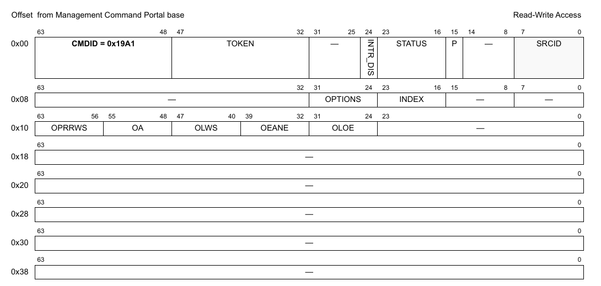

**Figure 564. Mô tả command DPSECI_SET_OPR**

| Offset | Bits | Tên | Mô tả |
|---|---|---|---|
| 0x00 | 0-63 | Header của command | Xem Table 2 để biết mô tả chung các field của command portal. CMDID phải được đặt như chỉ ra trong hình ở trên. |
| 0x08 | 16-23 | INDEX | Chọn một queue cụ thể. Giá trị chấp nhận nằm trong khoảng 0 đến NUM_RX_QUEUES – 1. Field này bị bỏ qua nếu đặt DPSECI_OPT_OPR_SHARED. |
|   | 24–31 | OPTIONS | Command có thể hoạt động theo hai cách, tùy giá trị field options: • OPR_OPT_CREATE (1): Tạo OPR với cấu hình cho trước • OPR_OPT_RETIRE (2): Retire OPR. Khi đó các option cấu hình từ offset 0x10 bị bỏ qua. OPR được làm rỗng bằng cách lần lượt từ chối mọi command enqueue đang được giữ trong ORL. |
| 0x10 | 24–31 | OLOE | Bật loose ordering cho OPR • 0: Chế độ strict ordering • 1: Chế độ loose ordering Chế độ ordering quyết định hành động với các lần enqueue có bật OR mà rơi vào cửa sổ từ chối đến sớm hoặc đến muộn, hoặc cần hoãn lại khi tài nguyên ORL cạn. Ở chế độ strict ordering chúng bị từ chối và trả về phần mềm, còn ở chế độ loose ordering chúng được enqueue ngay. |
|   | 32–39 | OEANE | Bật advance NESN khi tài nguyên order restoration list (ORL) cạn |
|   | 40–47 | OLWS | Kích thước cửa sổ chấp nhận đến muộn của OPR • 0: Tắt. Frame đến muộn luôn bị từ chối. • 1: Kích thước cửa sổ là 32 frame. • 2: Kích thước cửa sổ bằng kích thước restoration window của OPR cấu hình trong field OPRRWS. • 3: Kích thước cửa sổ là 8192 frame. Frame đến muộn luôn được chấp nhận. |
|   | 48–55 | OA | Kích thước cửa sổ auto advance NESN của OPR |
|   | 56–63 | OPRRWS | Kích thước restoration window của order point record (OPR). • 0: Kích thước cửa sổ là 32 frame. • 1: Kích thước cửa sổ là 64 frame. • 2: Kích thước cửa sổ là 128 frame. • 3: Kích thước cửa sổ là 256 frame. • 4: Kích thước cửa sổ là 512 frame. • 5: Kích thước cửa sổ là 1024 frame. • 6–7: Reserved |

### 17.3.17 DPSECI_GET_OPR

**Cấu trúc command**

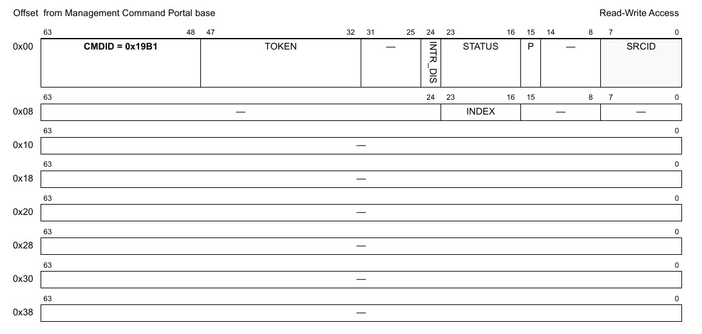

**Figure 565. Mô tả command DPSECI_GET_OPR**

| Offset | Bits | Tên | Mô tả |
|---|---|---|---|
| 0x00 | 0-63 | Header của command | Xem Table 2 để biết mô tả chung các field của command portal. CMDID phải được đặt như chỉ ra trong hình ở trên. |
| 0x08 | 16-23 | INDEX | Chọn một queue cụ thể. Giá trị chấp nhận nằm trong khoảng 0 đến NUM_RX_QUEUES – 1. Field này bị bỏ qua với DPSECI_OPT_OPR_SHARED. |

**Cấu trúc response**

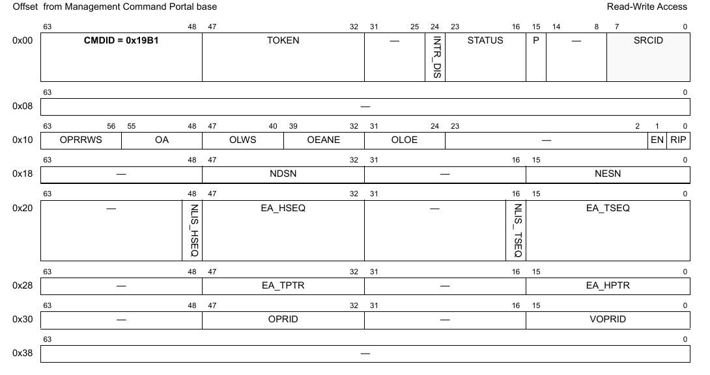

**Figure 566. Mô tả response của DPSECI_GET_OPR**

| Offset | Bits | Tên | Mô tả |
|---|---|---|---|
| 0x00 | 0–63 | Header của command | Xem Table 2 để biết mô tả chung các field của command portal. CMDID phải được đặt như chỉ ra trong hình ở trên. |
| 0x10 | 0 | RIP | Đang retire. |
|   | 1 | EN | OPR đang được bật. |
|   | 24–31 | OLOE | Bật loose ordering cho OPR |
|   | 32–39 | OEANE | Bật advance NESN khi tài nguyên order restoration list (ORL) cạn |
|   | 40–47 | OLWS | Kích thước cửa sổ chấp nhận đến muộn của OPR |
|   | 48–55 | OA | Kích thước cửa sổ auto advance NESN của OPR |
|   | 56–63 | OPRRWS | Kích thước restoration window của order point record (OPR) |
| 0x18 | 0–15 | NESN | Sequence number dự kiến tiếp theo. |
|   | 32–47 | NDSN | Sequence number được cấp tiếp theo. |
| 0x20 | 0–15 | EA_TSEQ | Sequence number của frame ở cuối ORL. |
|   | 16 | NLIS_ TSEQ | Không phải frame cuối trong chuỗi cho EA_TSEQ |
|   | 32–47 | EA_HSEQ | Sequence number của frame ở đầu ORL. |
|   | 48 | NLIS_ HSEQ | Không phải frame cuối trong chuỗi cho EA_HSEQ |
| 0x28 | 0–15 | EA_HPTR | Con trỏ đầu của danh sách đến sớm |
|   | 32–47 | EA_TPTR | Con trỏ cuối của danh sách đến sớm |
| 0x30 | 0–15 | VOPRID | Order Point Record ID ảo |
|   | 32–47 | OPRID | Order Point Record ID |

### 17.3.18 DPSECI_SET_RX_QUEUE

**Cấu trúc command**

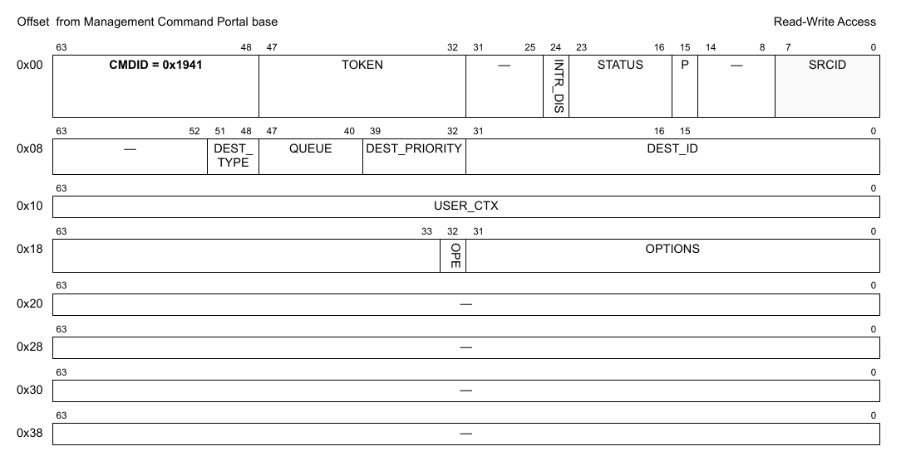

**Figure 567. Mô tả command DPSECI_SET_RX_QUEUE**

| Offset | Bits | Tên | Mô tả |
|---|---|---|---|
| 0x00 | 0-63 | Header của command | Xem Table 2 để biết mô tả chung các field của command portal. CMDID phải được đặt như chỉ ra trong hình ở trên. |
| 0x08 | 0-31 | DEST_ID | DPIO ID hoặc DPCON ID, tùy loại đích |
|   | 32-39 | DEST_PRIORITY | Lựa chọn priority trong channel DPIO hoặc DPCON; giá trị hợp lệ là 0-1 hoặc 0-7, tùy số priority trong channel đó; không có ý nghĩa với option 'DPSECI_DEST_NONE' |
|   | 40-47 | QUEUE | Chọn queue tương đối theo số priority đã cấu hình khi tạo DPSECI; dùng DPSECI_ALL_QUEUES để cấu hình mọi Rx queue như nhau. |
|   | 48-51 | DEST_TYPE | Loại đích. Chọn một trong các giá trị được hỗ trợ: 0x0 = DPSECI_DEST_NONE- Đích chưa gán; queue được đặt ở chế độ parked và không sinh notification FQDAN; người dùng phải dequeue từ queue bằng polling hoặc phương pháp khác do người dùng định nghĩa 0x1 = DPSECI_DEST_DPIO - Queue được đặt ở chế độ schedule và sinh notification FQDAN tới DPIO được chỉ định; người dùng chỉ dequeue từ queue sau khi nhận được notification 0x2 = DPSECI_DEST_DPCON - Queue được đặt ở chế độ schedule và không sinh notification FQDAN, nhưng được nối với DPCON object được chỉ định; người dùng phải dequeue từ channel DPCON |
| 0x10 | 0-63 | USER_CTX | Giá trị user context được cung cấp trong frame descriptor của mỗi frame được dequeue; chỉ hợp lệ nếu 'options' có 'DPSECI_QUEUE_OPT_USER_CTX' |
| 0x18 | 0-31 | OPTIONS | Các flag biểu diễn những thay đổi đề xuất với queue; Dùng bất kỳ tổ hợp nào của các flag 'DPSECI_QUEUE_OPT_\<X>' dưới đây: bit 0: DPSECI_QUEUE_OPT_USER_CTX - Chọn để sửa user context gắn với queue bit 1: DPSECI_QUEUE_OPT_DEST - Chọn để sửa đích của queue |
|   | 32 | ORDER_PRESERVATION_E N (OPE) | cấu hình giữ thứ tự cho rx queue chỉ hợp lệ nếu ‘options' có 'DPSECI_QUEUE_OPT_ORDER_PRESERVATION' |

Mọi field không được nêu là reserved và phải được xóa (đặt bằng 0)

### 17.3.19 DPSECI_GET_RX_QUEUE

**Cấu trúc command**

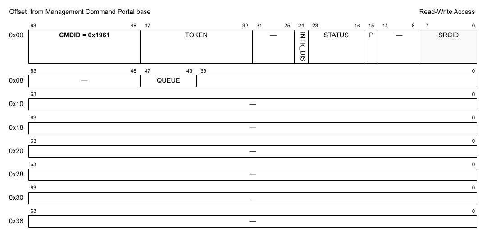

**Figure 568. Mô tả command DPSECI_GET_RX_QUEUE**

| Offset | Bits | Tên | Mô tả |
|---|---|---|---|
| 0x00 | 0-63 | Header của command | Xem Table 2 để biết mô tả chung các field của command portal. CMDID phải được đặt như chỉ ra trong hình ở trên. |
| 0x08 | 40-47 | QUEUE | Chọn queue tương đối theo số priority đã cấu hình khi tạo DPSECI |

Mọi field không được nêu là reserved và phải được xóa (đặt bằng 0)

**Cấu trúc response**

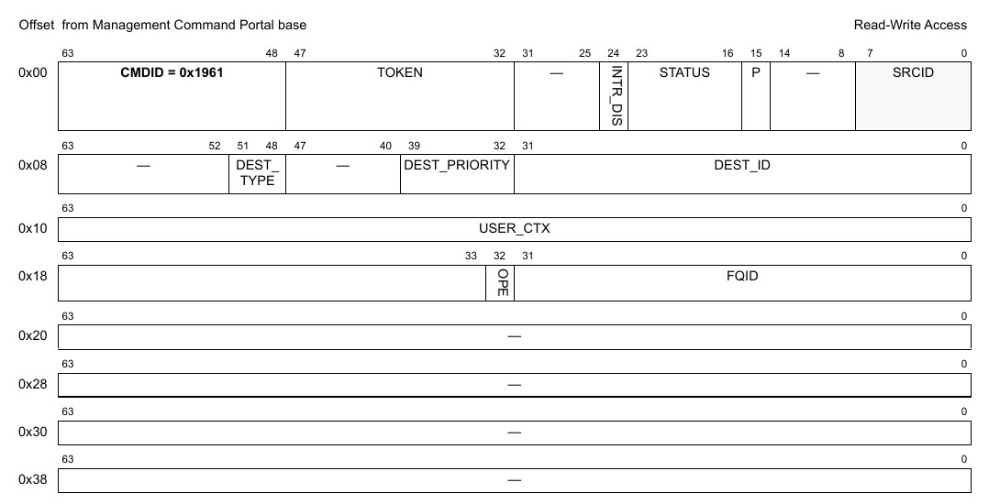

**Figure 569. Mô tả response của DPSECI_GET_RX_QUEUE**

| Offset | Bits | Tên | Mô tả |
|---|---|---|---|
| 0x00 | 0-63 | Header của command | Xem Table 2 để biết mô tả chung các field của command portal. CMDID phải được đặt như chỉ ra trong hình ở trên. |
| 0x08 | 0-31 | DEST_ID | DPIO ID hoặc DPCON ID, tùy loại đích |
|   | 32-39 | PRIORITY | Lựa chọn priority trong channel DPIO hoặc DPCON; giá trị hợp lệ là 0-1 hoặc 0-7, tùy số priority trong channel đó; không có ý nghĩa với option 'DPSECI_DEST_NONE' |
|   | 48-51 | DEST_TYPE | Loại đích. Chọn một trong các giá trị được hỗ trợ: 0x0 = DPSECI_DEST_NONE- Đích chưa gán; queue được đặt ở chế độ parked và không sinh notification FQDAN; người dùng phải dequeue từ queue bằng polling hoặc phương pháp khác do người dùng định nghĩa 0x1 = DPSECI_DEST_DPIO - Queue được đặt ở chế độ schedule và sinh notification FQDAN tới DPIO được chỉ định; người dùng chỉ dequeue từ queue sau khi nhận được notification 0x2 = DPSECI_DEST_DPCON - Queue được đặt ở chế độ schedule và không sinh notification FQDAN, nhưng được nối với DPCON object được chỉ định; người dùng phải dequeue từ channel DPCON |
| 0x10 | 0-63 | USER_CTX | Giá trị user context được cung cấp trong frame descriptor của mỗi frame được dequeue |
| 0x18 | 0-31 | FQID | Giá trị FQID ảo dùng cho thao tác dequeue |
|   | 32 | ORDER_PRESERVATION_EN (OPE) | Trạng thái cấu hình giữ thứ tự trên queue |

Mọi field không được nêu là reserved và phải được xóa (đặt bằng 0)

### 17.3.20 DPSECI_GET_TX_QUEUE

**Cấu trúc command**

**Figure 570. Mô tả command DPSECI_GET_TX_QUEUE**

| Offset | Bits | Tên | Mô tả |
|---|---|---|---|
| 0x00 | 0-63 | Header của command | Xem Table 2 để biết mô tả chung các field của command portal. CMDID phải được đặt như chỉ ra trong hình ở trên. |
| 0x08 | 40-47 | QUEUE | Chọn queue tương đối theo số priority đã cấu hình khi tạo DPSECI |

Mọi field không được nêu là reserved và phải được xóa (đặt bằng 0)

**Cấu trúc response**

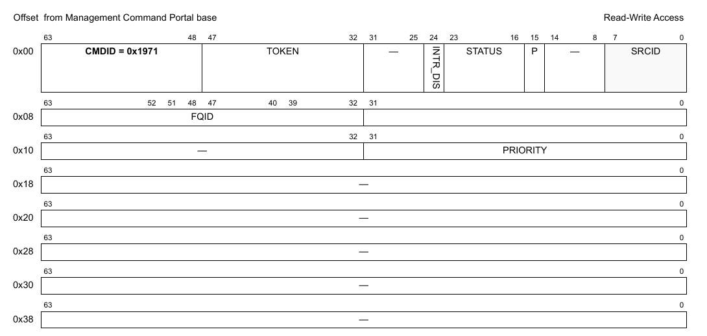

**Figure 571. Mô tả response của DPSECI_GET_TX_QUEUE**

| Offset | Bits | Tên | Mô tả |
|---|---|---|---|
| 0x00 | 0-63 | Header của command | Xem Table 2 để biết mô tả chung các field của command portal. CMDID phải được đặt như chỉ ra trong hình ở trên. |
| 0x08 | 32-63 | FQID | FQID ảo dùng để gửi frame tới phần cứng SEC |
| 0x10 | 0-31 | PRIORITY | Priority xử lý của phần cứng SEC cho queue |

Mọi field không được nêu là reserved và phải được xóa (đặt bằng 0)

### 17.3.21 DPSECI_GET_SEC_ATTR

**Cấu trúc command**

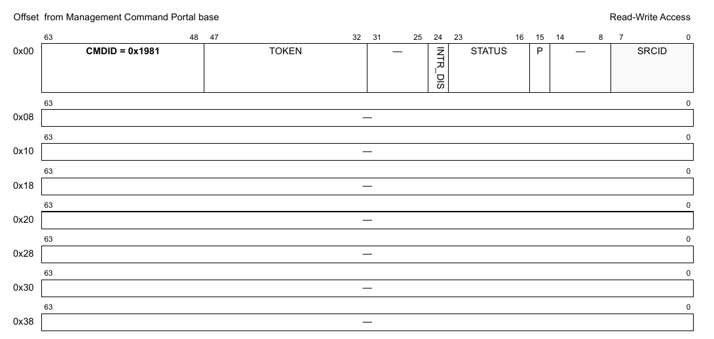

**Figure 572. Mô tả command DPSECI_GET_SEC_ATTR**

| Offset | Bits | Tên | Mô tả |
|---|---|---|---|
| 0x00 | 0-63 | Header của command | Xem Table 2 để biết mô tả chung các field của command portal. CMDID phải được đặt như chỉ ra trong hình ở trên. |

Mọi field không được nêu là reserved và phải được xóa (đặt bằng 0)

**Cấu trúc response**

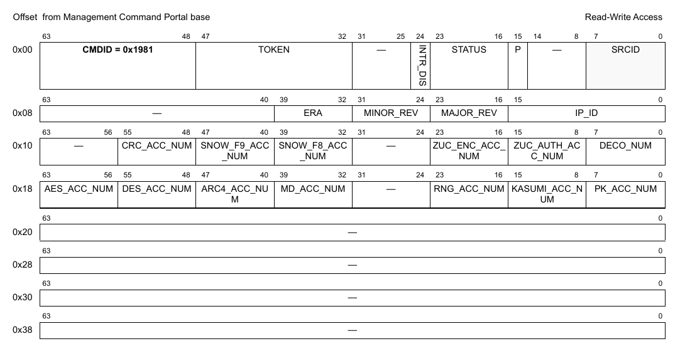

**Figure 573. Mô tả response của DPSECI_GET_SEC_ATTR**

| Offset | Bits | Tên | Mô tả |
|---|---|---|---|
| 0x00 | 0-63 | Header của command | Xem Table 2 để biết mô tả chung các field của command portal. CMDID phải được đặt như chỉ ra trong hình ở trên. |
| 0x08 | 0-15 | IP_ID | ID của SEC. |
|   | 16-23 | MAJOR_REV | Số major revision của SEC. |
|   | 24-31 | MINOR_REV | Số minor revision của SEC. |
|   | 32-39 | ERA | Era của SEC controller. |
| 0x10 | 0-7 | DECO_NUM | Số bản DECO được triển khai trong phiên bản SEC này. |
|   | 8-15 | ZUC_AUTH_ACC_NUM | Số bản ZUCA được triển khai trong phiên bản SEC này. |
|   | 16-24 | ZUC_ENC_ACC_NUM | Số bản ZUCE được triển khai trong phiên bản SEC này. |
|   | 32-39 | SNOW_F8_ACC_NUM | Số bản module SNOW-f8 được triển khai trong phiên bản SEC này. |
|   | 40-47 | SNOW_F9_ACC_NUM | Số bản module SNOW-f9 được triển khai trong phiên bản SEC này. |
|   | 48-55 | CRC_ACC_NUM | Số bản module CRC được triển khai trong phiên bản SEC này. |
| 0x18 | 0-7 | PK_ACC_NUM | Số bản module Public Key được triển khai trong phiên bản SEC này. |
|   | 8-15 | KASUMI_ACC_NUM | Số bản module Kasumi được triển khai trong phiên bản SEC này. |
|   | 16-24 | RNG_ACC_NUM | Số bản Random Number Generator được triển khai trong phiên bản SEC này. |
|   | 32-39 | MD_ACC_NUM | Số bản MDHA (module hash) được triển khai trong phiên bản SEC này. |
|   | 40-47 | ARC4_ACC_NUM | Số bản module ARC4 được triển khai trong phiên bản SEC này. |
|   | 48-55 | DES_ACC_NUM | Số bản module DES được triển khai trong phiên bản SEC này. |
|   | 56-63 | AES_ACC_NUM | Số bản module AES được triển khai trong phiên bản SEC này. |

Mọi field không được nêu là reserved và phải được xóa (đặt bằng 0)

### 17.3.22 DPSECI_GET_SEC_COUNTERS

**Cấu trúc command**

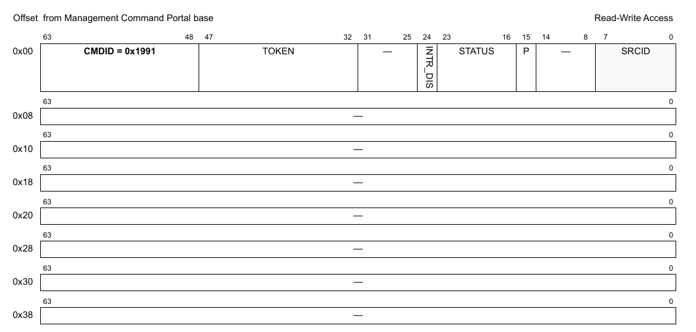

**Figure 574. Mô tả command DPSECI_GET_SEC_COUNTERS**

| Offset | Bits | Tên | Mô tả |
|---|---|---|---|
| 0x00 | 0-63 | Header của command | Xem Table 2 để biết mô tả chung các field của command portal. CMDID phải được đặt như chỉ ra trong hình ở trên. |

Mọi field không được nêu là reserved và phải được xóa (đặt bằng 0)

**Cấu trúc response**

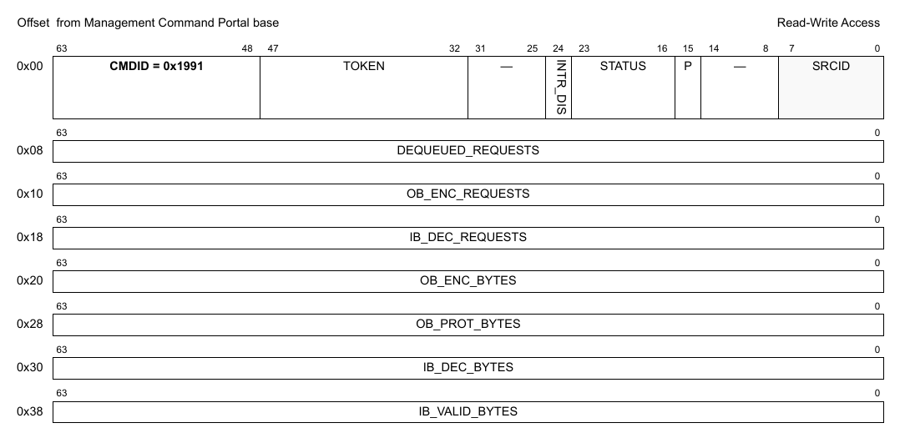

**Figure 575. Mô tả response của DPSECI_GET_SEC_COUNTERS**

| Offset | Bits | Tên | Mô tả |
|---|---|---|---|
| 0x00 | 0-63 | Header của command | Xem Table 2 để biết mô tả chung các field của command portal. CMDID phải được đặt như chỉ ra trong hình ở trên. |
| 0x08 | 0-63 | DEQUEUED_REQUESTS | Số request đã dequeue |
| 0x10 | 0-63 | OB_ENC_REQUESTS | Số request mã hóa outbound |
| 0x18 | 0-63 | IB_DEC_REQUESTS | Số request giải mã inbound |
| 0x20 | 0-63 | OB_ENC_BYTES | Số byte outbound đã mã hóa |
| 0x28 | 0-63 | OB_PROT_BYTES | Số byte outbound đã mã hóa |
| 0x30 | 0-63 | IB_DEC_BYTES | Số byte inbound đã giải mã |
| 0x38 | 0-63 | IB_VALID_BYTES | Số byte inbound đã xác thực |

Mọi field không được nêu là reserved và phải được xóa (đặt bằng 0)

### 17.3.23 DPSECI_GET_API_VERSION

**Cấu trúc command**

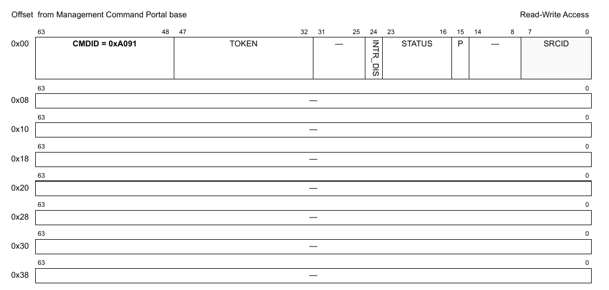

**Figure 576. Mô tả command DPSECI_GET_API_VERSION**

| Offset | Bits | Tên | Mô tả |
|---|---|---|---|
| 0x00 | 0-63 | Header của command | Xem Table 2 để biết mô tả chung các field của command portal. CMDID phải được đặt như chỉ ra trong hình ở trên. |

Mọi field không được nêu là reserved và phải được xóa (đặt bằng 0)

**Cấu trúc response**

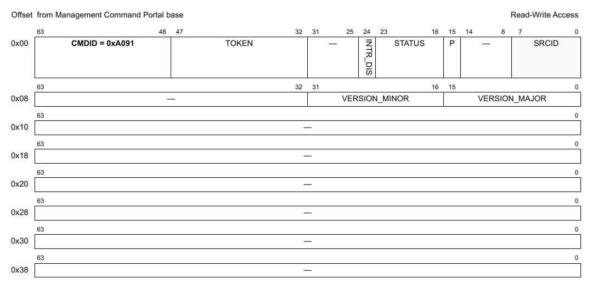

**Figure 577. Mô tả response của DPSECI_GET_API_VERSION**

| Offset | Bits | Tên | Mô tả |
|---|---|---|---|
| 0x00 | 0-63 | Header của command | Xem Table 2 để biết mô tả chung các field của command portal. CMDID phải được đặt như chỉ ra trong hình ở trên. |
| 0x08 | 0-15 | VERSION_MAJOR | Major version của API |
|   | 16-31 | VERSION_MINOR | Minor version của API |

Mọi field không được nêu là reserved và phải được xóa (đặt bằng 0)

### 17.3.24 DPSECI_GET_RX_QUEUE_STATUS

Lấy trạng thái của Rx queue được chỉ định.

**Cấu trúc command**

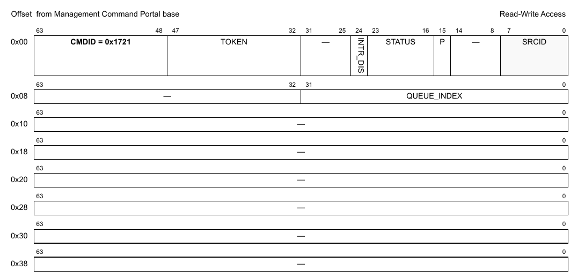

**Figure 578. Mô tả command DPSECI_GET_RX_QUEUE_STATUS**

| Offset | Bits | Tên | Mô tả |
|---|---|---|---|
| 0x00 | 0-63 | Header của command | Xem Table 2 để biết mô tả chung các field của command portal. CMDID phải được đặt như chỉ ra trong hình ở trên. |
| 0x08 | 0-31 | QUEUE_INDEX | Index của Rx queue của DPSECI |

Mọi field không được nêu là reserved và phải được xóa (đặt bằng 0)

**Cấu trúc response**

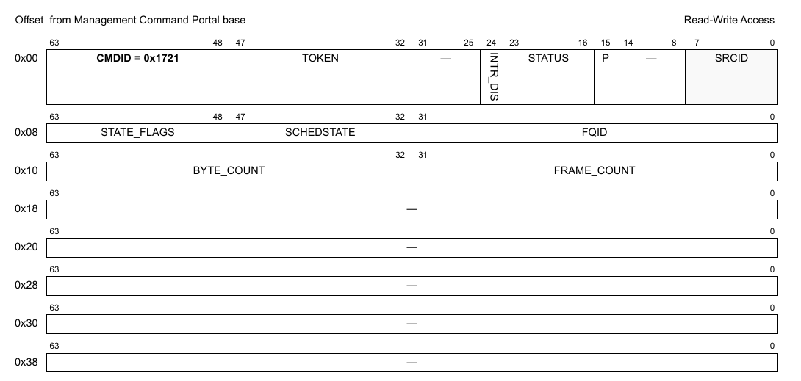

**Figure 579. Mô tả response của DPSECI_GET_RX_QUEUE_STATUS**

| Offset | Bits | Tên | Mô tả |
|---|---|---|---|
| 0x00 | 0-63 | Header của command | Xem Table 2 để biết mô tả chung các field của command portal. CMDID phải được đặt như chỉ ra trong hình ở trên. |
| 0x08 | 0-31 | FQID | Frame Queue ID của queue được truy vấn trạng thái |
|   | 32-47 | SCHEDSTATE | Trạng thái lập lịch của queue. Một trong các giá trị sau, phản ánh trạng thái lập lịch FQ của QBMan: 0: oos 1: retired 2: tentatively_scheduled 3: truly_scheduled 4: parked 5: held_active |
|   | 48-63 | STATE_FLAGS | Các flag trạng thái của queue Tổ hợp OR bit của các bit flag có thể có sau: 0x01: DPSECI_FQ_STATE_FORCE_ELIGIBLE: bit force eligible pending của FQ 0x02: DPSECI_FQ_STATE_XOFF: trạng thái XON/XOFF của FQ, 0: XON, 1: XOFF 0x04: DPSECI_FQ_STATE_RETIREMENT_PENDING: bit retirement pending của FQ 0x08: DPSECI_FQ_STATE_OVERFLOW_ERROR: bit lỗi overflow của FQ |
| 0x10 | 0-31 | FRAME_COUNT | Số frame trong Rx queue |
|   | 32-63 | BYTE_COUNT | Số byte trong Rx queue |

Mọi field không được nêu là reserved và phải được xóa (đặt bằng 0)

### 17.3.25 DPSECI_GET_TX_QUEUE_STATUS

Lấy trạng thái của Tx queue được chỉ định.

**Cấu trúc command**

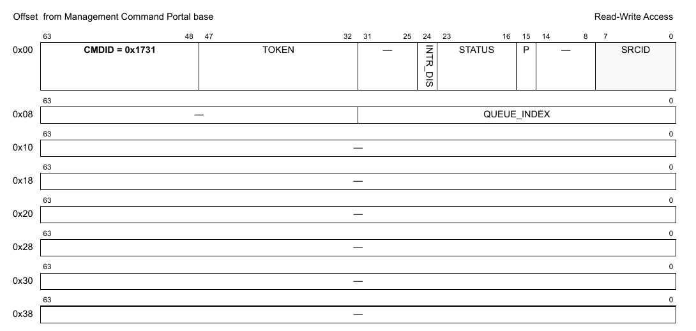

**Figure 580. Mô tả command DPSECI_GET_TX_QUEUE_STATUS**

| Offset | Bits | Tên | Mô tả |
|---|---|---|---|
| 0x00 | 0-63 | Header của command | Xem Table 2 để biết mô tả chung các field của command portal. CMDID phải được đặt như chỉ ra trong hình ở trên. |
| 0x08 | 0-31 | QUEUE_INDEX | Index của Tx queue của DPSECI |

Mọi field không được nêu là reserved và phải được xóa (đặt bằng 0)

**Cấu trúc response**

**Figure 581. Mô tả response của DPSECI_GET_TX_QUEUE_STATUS**

| Offset | Bits | Tên | Mô tả |
|---|---|---|---|
| 0x00 | 0-63 | Header của command | Xem Table 2 để biết mô tả chung các field của command portal. CMDID phải được đặt như chỉ ra trong hình ở trên. |
| 0x08 | 0-31 | FQID | Frame Queue ID của queue được truy vấn trạng thái |
|   | 32-47 | SCHEDSTATE | Trạng thái lập lịch của queue. Một trong các giá trị sau, phản ánh trạng thái lập lịch FQ của QBMan: 0: oos 1: retired 2: tentatively_scheduled 3: truly_scheduled 4: parked 5: held_active |
|   | 48-63 | STATE_FLAGS | Các flag trạng thái của queue Tổ hợp OR bit của các bit flag có thể có sau: 0x01: DPSECI_FQ_STATE_FORCE_ELIGIBLE: bit force eligible pending của FQ 0x02: DPSECI_FQ_STATE_XOFF: trạng thái XON/XOFF của FQ, 0: XON, 1: XOFF 0x04: DPSECI_FQ_STATE_RETIREMENT_PENDING: bit retirement pending của FQ 0x08: DPSECI_FQ_STATE_OVERFLOW_ERROR: bit lỗi overflow của FQ |
| 0x10 | 0-31 | FRAME_COUNT | Số frame trong Tx queue |
|   | 32-63 | BYTE_COUNT | Số byte trong Tx queue |

Mọi field không được nêu là reserved và phải được xóa (đặt bằng 0)
