# Chương 18 DPDCEI: Data Path DCE Interface

MC xuất ra DPDCEI object làm giao diện để vận hành DPAA2 Data Compression Engine (DCE).

DPDCEI cho phép gửi request dạng frame tới DCE và nhận lại response đã xử lý, dùng hạ tầng QBMan của DPAA2. DPDCEI object có thể được cấu hình cho chế độ nén hoặc chế độ giải nén (nhưng không cho cả hai).

## 18.1 Các tính năng của DPDCEI

Danh sách sau tóm tắt các tính năng và khả năng chính của DPDCEI:

- Một DPDCEI object có thể được cấu hình cho chế độ nén hoặc chế độ giải nén (nhưng không cho cả hai). Ứng dụng cần cả hai dịch vụ nên tạo hai DPDCEI object riêng, mỗi object cho một loại thao tác.
- Hỗ trợ tối đa hai priority lập lịch để xử lý service request.
- Hỗ trợ một receive queue cho các frame response đến.
  - Response (receive) queue của DPDCEI được ánh xạ tới một trong 8 receive priority, cho phép phân ưu tiên thêm giữa các interface khác khi gắn receive queue của DPDCEI với DPIO hoặc DPCON object.
- Hỗ trợ các tùy chọn lập lịch khác nhau để xử lý packet nhận được:
  - Receive queue của DPDCEI có thể được cấu hình ở chế độ ‘parked’ (mặc định), hoặc gắn với một DPIO object, hoặc gắn với DPCON object
- Cho phép tương tác với một hoặc nhiều DPIO object để dequeue/enqueue frame descriptor (FD) và để acquire/release buffer.
- Hỗ trợ các thao tác enable, disable và reset

## 18.2 Tham chiếu command của DPDCEI

Mục này trình bày chi tiết mô hình lập trình các command của DPDCEI.

### 18.2.1 DPDCEI_OPEN

Mở một phiên điều khiển cho object được chỉ định.

Hàm này có thể dùng để mở phiên điều khiển cho một object đã được tạo; object có thể đã được khai báo trong DPL hoặc được tạo bằng command DPDCEI_CREATE.

Hàm này trả về một authentication token duy nhất, gắn với object ID cụ thể; token này phải được dùng trong mọi command tiếp theo cho object này.

**Cấu trúc command**

Định dạng command được thể hiện trong hình dưới đây.

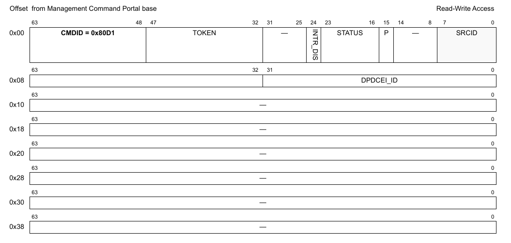

**Figure 582. Mô tả command DPDCEI_OPEN**

Bảng sau mô tả các field của command.

**Table 72. Mô tả các field của command DPDCEI_OPEN1**

| Offset | Bits | Tên | Mô tả |
|---|---|---|---|
| 0x00 | 0-63 | Header của command | Xem Table 2 để biết mô tả chung các field của command portal. CMDID phải được đặt như chỉ ra trong hình ở trên. |
| 0x08 | 0-31 | DPDCEI_ID | ID duy nhất của DPDCEI |

1 Mọi field không được nêu là reserved và phải được xóa (đặt bằng 0)

### 18.2.2 DPDCEI_CLOSE

Đóng phiên điều khiển của object.

Sau khi gọi hàm này, không thao tác nào khác được phép trên object nếu không mở một phiên điều khiển mới.

**Cấu trúc command**

**Figure 583. Mô tả command DPDCEI_CLOSE**

| Offset | Bits | Tên | Mô tả |
|---|---|---|---|
| 0x00 | 0-63 | Header của command | Xem Table 2 để biết mô tả chung các field của command portal. CMDID phải được đặt như chỉ ra trong hình ở trên. |

Mọi field không được nêu là reserved và phải được xóa (đặt bằng 0)

### 18.2.3 DPDCEI_CREATE

Command này tạo và khởi tạo một instance DPDCEI theo các tham số command được chỉ định. Command này không cần cho các instance DPDCEI được tạo bằng DPL.

Với command CREATE, bên gọi phải cung cấp authentication token của container cha mà object sẽ được tạo và gán vào. Nếu token là '0', object sẽ được gán cho container đang sở hữu MC command portal thực thi command này.

Command trả về một DPDCEI ID có thể dùng để OPEN hoặc DESTROY object.

Định dạng command được thể hiện trong hình dưới đây.

**Cấu trúc command**

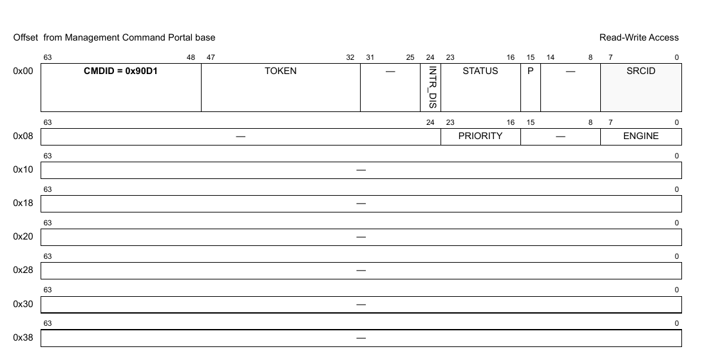

**Figure 584. Mô tả command DPDCEI_CREATE**

Bảng sau mô tả các field của command.

**Table 73. Mô tả các field của command DPDCEI_CREATE1**

| Offset | Bits | Tên | Mô tả |
|---|---|---|---|
| 0x00 | 0-63 | Header của command | Xem Table 2 để biết mô tả chung các field của command portal. CMDID phải được đặt như chỉ ra trong hình ở trên. |
| 0x08 | 0-7 | ENGINE | engine nén hoặc giải nén cần chọn |
|   | 16-23 | PRIORITY | Priority cho việc xử lý của phần cứng DCE (giá trị hợp lệ 1-8). |

1 Mọi field không được nêu là reserved và phải được xóa (đặt bằng 0).

**Cấu trúc response**

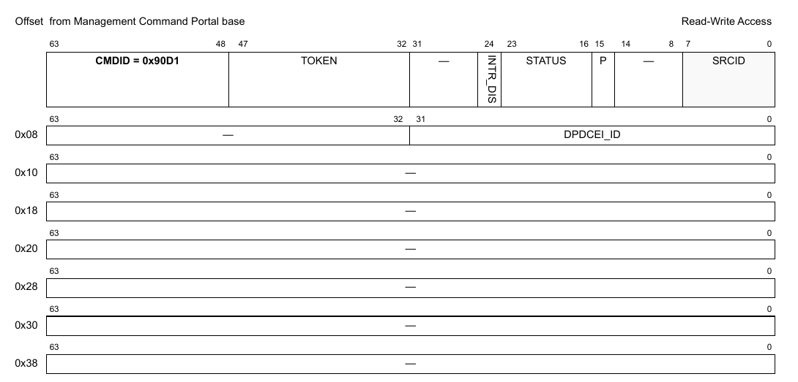

**Figure 18-1. Mô tả response của DPDCEI_CREATE**

Bảng sau mô tả các field của response.

**Table 18-1. Mô tả các field response của DPDCEI_CREATE1**

| Offset | Bits | Tên | Mô tả |
|---|---|---|---|
| 0x00 | 0-63 | Header của command | Xem Table 2 để biết mô tả chung các field của command portal. CMDID phải được đặt như chỉ ra trong hình ở trên. |
| 0x08 | 0-31 | DPDCEI_ID | ID duy nhất của DPDCEI |

1 Mọi field không được nêu là reserved.

### 18.2.4 DPDCEI_DESTROY

Command này hủy DPDCEI object và giải phóng mọi tài nguyên của nó. Nó phải được gọi trong software context đã tạo object. Bên gọi phải cung cấp object id và authentication token của container cha đã tạo object. Lưu ý rằng object có thể đã được gán cho container khác, và gửi authentication token của container đó sẽ trả về lỗi.

Mọi authentication token đang mở tới object phải được đóng trước khi gọi command destroy.

Sau khi gọi hàm này, không thao tác nào khác được phép trên object.

**Cấu trúc command**

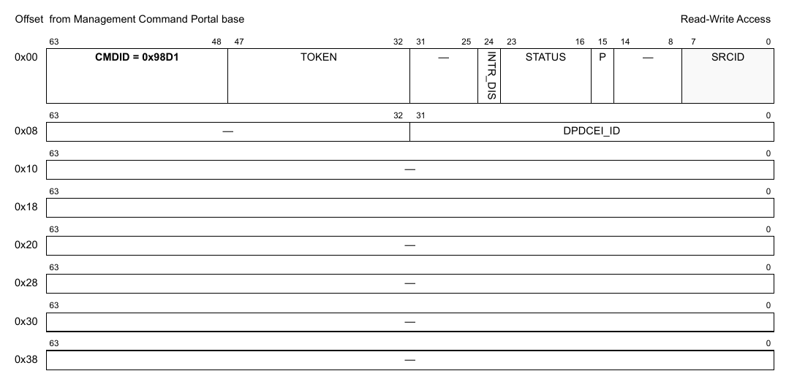

**Figure 585. Mô tả command DPDCEI_DESTROY**

| Offset | Bits | Tên | Mô tả |
|---|---|---|---|
| 0x00 | 0-63 | Header của command | Xem Table 2 để biết mô tả chung các field của command portal. CMDID phải được đặt như chỉ ra trong hình ở trên. |
| 0x08 | 0–32 | DPDCEI_ID | ID của DPDCEI object cần hủy |

Mọi field không được nêu là reserved và phải được xóa (đặt bằng 0)

### 18.2.5 DPDCEI_ENABLE

**Cấu trúc command**

**Figure 586. Mô tả command DPDCEI_ENABLE**

| Offset | Bits | Tên | Mô tả |
|---|---|---|---|
| 0x00 | 0-63 | Header của command | Xem Table 2 để biết mô tả chung các field của command portal. CMDID phải được đặt như chỉ ra trong hình ở trên. |

Mọi field không được nêu là reserved và phải được xóa (đặt bằng 0)

### 18.2.6 DPDCEI_DISABLE

**Cấu trúc command**

**Figure 587. Mô tả command DPDCEI_DISABLE**

| Offset | Bits | Tên | Mô tả |
|---|---|---|---|
| 0x00 | 0-63 | Header của command | Xem Table 2 để biết mô tả chung các field của command portal. CMDID phải được đặt như chỉ ra trong hình ở trên. |

Mọi field không được nêu là reserved và phải được xóa (đặt bằng 0)

### 18.2.7 DPDCEI_IS_ENABLED

**Cấu trúc command**

**Figure 588. Mô tả command DPDCEI_IS_ENABLED**

| Offset | Bits | Tên | Mô tả |
|---|---|---|---|
| 0x00 | 0-63 | Header của command | Xem Table 2 để biết mô tả chung các field của command portal. CMDID phải được đặt như chỉ ra trong hình ở trên. |

Mọi field không được nêu là reserved và phải được xóa (đặt bằng 0)

**Cấu trúc response**

**Figure 589. Mô tả response của DPDCEI_IS_ENABLED**

| Offset | Bits | Tên | Mô tả |
|---|---|---|---|
| 0x00 | 0-63 | Header của command | Xem Table 2 để biết mô tả chung các field của command portal. CMDID phải được đặt như chỉ ra trong hình ở trên. |
| 0x08 | 0 | EN | Trả về '1' nếu object đang enable; '0' nếu không |

Mọi field không được nêu là reserved và phải được xóa (đặt bằng 0)

### 18.2.8 DPDCEI_RESET

**Cấu trúc command**

**Figure 590. Mô tả command DPDCEI_RESET**

| Offset | Bits | Tên | Mô tả |
|---|---|---|---|
| 0x00 | 0-63 | Header của command | Xem Table 2 để biết mô tả chung các field của command portal. CMDID phải được đặt như chỉ ra trong hình ở trên. |

Mọi field không được nêu là reserved và phải được xóa (đặt bằng 0)

### 18.2.9 DPDCEI_SET_IRQ_ENABLE

Đặt trạng thái tổng thể của interrupt. Cho phép phần mềm GPP điều khiển khi nào interrupt được sinh ra. Mỗi interrupt có thể có tối đa 32 nguyên nhân. Điều khiển enable/disable quyết định trạng thái tổng thể của interrupt. Nếu interrupt bị disable thì không nguyên nhân nào sinh ra interrupt.

**Cấu trúc command**

**Figure 591. Mô tả command DPDCEI_SET_IRQ_ENABLE**

| Offset | Bits | Tên | Mô tả |
|---|---|---|---|
| 0x00 | 0-63 | Header của command | Xem Table 2 để biết mô tả chung các field của command portal. CMDID phải được đặt như chỉ ra trong hình ở trên. |
| 0x08 | 0 | EN | Trạng thái interrupt: đặt ‘1’ để enable, ‘0’ để disable |
|   | 32-39 | IRQ_INDEX | Xác định interrupt index cần cấu hình |

Mọi field không được nêu là reserved và phải được xóa (đặt bằng 0)

### 18.2.10 DPDCEI_GET_IRQ_ENABLE

Lấy trạng thái tổng thể của interrupt.

**Cấu trúc command**

**Figure 592. Mô tả command DPDCEI_GET_IRQ_ENABLE**

| Offset | Bits | Tên | Mô tả |
|---|---|---|---|
| 0x00 | 0-63 | Header của command | Xem Table 2 để biết mô tả chung các field của command portal. CMDID phải được đặt như chỉ ra trong hình ở trên. |
| 0x08 | 32-39 | IRQ_INDEX | Xác định interrupt index cần truy vấn |

Mọi field không được nêu là reserved và phải được xóa (đặt bằng 0)

**Cấu trúc response**

**Figure 593. Mô tả response của DPDCEI_GET_IRQ_ENABLE**

| Offset | Bits | Tên | Mô tả |
|---|---|---|---|
| 0x00 | 0-63 | Header của command | Xem Table 2 để biết mô tả chung các field của command portal. CMDID phải được đặt như chỉ ra trong hình ở trên. |
| 0x08 | 0 | EN | Bit này được đặt nếu interrupt đang enable |

Mọi field không được nêu là reserved và phải được xóa (đặt bằng 0)

### 18.2.11 DPDCEI_SET_IRQ_MASK

Đặt interrupt mask. Mỗi interrupt có thể có tối đa 32 nguyên nhân, và mô hình interrupt hỗ trợ mask/unmask từng nguyên nhân độc lập.

**Cấu trúc command**

**Figure 594. Mô tả command DPDCEI_SET_IRQ_MASK**

| Offset | Bits | Tên | Mô tả |
|---|---|---|---|
| 0x00 | 0-63 | Header của command | Xem Table 2 để biết mô tả chung các field của command portal. CMDID phải được đặt như chỉ ra trong hình ở trên. |
| 0x08 | 0-31 | MASK | Event mask để kích hoạt interrupt; xem command GET_IRQ_STATUS để biết đặc tả các event hiện có. Với mỗi bit trong MASK: 0 = bỏ qua event 1 = event hợp lệ; báo IRQ nếu event này xảy ra |
|   | 32-39 | IRQ_INDEX | Interrupt index cần cấu hình |

Mọi field không được nêu là reserved và phải được xóa (đặt bằng 0)

### 18.2.12 DPDCEI_GET_IRQ_MASK

Lấy interrupt mask. Mỗi interrupt có thể có tối đa 32 nguyên nhân, và mô hình interrupt hỗ trợ mask/unmask từng nguyên nhân độc lập.

**Cấu trúc command**

**Figure 595. Mô tả command DPDCEI_GET_IRQ_MASK**

| Offset | Bits | Tên | Mô tả |
|---|---|---|---|
| 0x00 | 0-63 | Header của command | Xem Table 2 để biết mô tả chung các field của command portal. CMDID phải được đặt như chỉ ra trong hình ở trên. |
| 0x08 | 32-39 | IRQ_INDEX | Interrupt index cần truy vấn |

Mọi field không được nêu là reserved và phải được xóa (đặt bằng 0)

**Cấu trúc response**

**Figure 596. Mô tả response của DPDCEI_GET_IRQ_MASK**

| Offset | Bits | Tên | Mô tả |
|---|---|---|---|
| 0x00 | 0-63 | Header của command | Xem Table 2 để biết mô tả chung các field của command portal. CMDID phải được đặt như chỉ ra trong hình ở trên. |
| 0x08 | 0-31 | MASK | Event mask để kích hoạt interrupt; xem command GET_IRQ_STATUS để biết đặc tả các event hiện có. Với mỗi bit trong MASK: 0 = bỏ qua event 1 = event hợp lệ; báo IRQ nếu event này xảy ra |

Mọi field không được nêu là reserved và phải được xóa (đặt bằng 0)

### 18.2.13 DPDCEI_GET_IRQ_STATUS

Lấy trạng thái hiện tại của các event đang chờ cho interrupt index được chỉ định.

**Cấu trúc command**

**Figure 597. Mô tả command DPDCEI_GET_IRQ_STATUS**

| Offset | Bits | Tên | Mô tả |
|---|---|---|---|
| 0x00 | 0-63 | Header của command | Xem Table 2 để biết mô tả chung các field của command portal. CMDID phải được đặt như chỉ ra trong hình ở trên. |
| 0x08 | 0-31 | STATUS | Tùy chọn: mọi bit STATUS được đặt sẽ được xóa khỏi trạng thái đang chờ (không cần dùng command DPDCEI_CLEAR_IRQ_STATUS nữa). Lưu ý rằng STATUS trả về trong response là trạng thái trước khi các event bị xóa.  Các event được hỗ trợ: xem định nghĩa cấu trúc response |
|   | 32-39 | IRQ_INDEX | Interrupt index cần truy vấn |

Mọi field không được nêu là reserved và phải được xóa (đặt bằng 0)

**Cấu trúc response**

**Figure 598. Mô tả response của DPDCEI_GET_IRQ_STATUS**

| Offset | Bits | Tên | Mô tả |
|---|---|---|---|
| 0x00 | 0-63 | Header của command | Xem Table 2 để biết mô tả chung các field của command portal. CMDID phải được đặt như chỉ ra trong hình ở trên. |
| 0x08 | 0-31 | STATUS | Mask trạng thái event, mỗi event một bit: 0 = không có interrupt đang chờ 1 = có interrupt đang chờ  Các event được hỗ trợ: Không có. |

Mọi field không được nêu là reserved và phải được xóa (đặt bằng 0)

### 18.2.14 DPDCEI_CLEAR_IRQ_STATUS

Xóa (đánh dấu đã xử lý) các event đang chờ của interrupt index được chỉ định.

**Cấu trúc command**

**Figure 599. Mô tả command DPDCEI_CLEAR_IRQ_STATUS**

| Offset | Bits | Tên | Mô tả |
|---|---|---|---|
| 0x00 | 0-63 | Header của command | Xem Table 2 để biết mô tả chung các field của command portal. CMDID phải được đặt như chỉ ra trong hình ở trên. |
| 0x08 | 0-31 | STATUS | Mask để xóa các event đã xử lý; xem command GET_IRQ_STATUS để biết đặc tả các event hiện có. Với mỗi bit trong MASK: 0 = không đổi trạng thái event 1 = xóa bit trạng thái event để cho biết event đã được xử lý |
|   | 32-39 | IRQ_INDEX | Interrupt index cần cấu hình |

Mọi field không được nêu là reserved và phải được xóa (đặt bằng 0)

### 18.2.15 DPDCEI_GET_ATTRIBUTES

**Cấu trúc command**

**Figure 600. Mô tả command DPDCEI_GET_ATTRIBUTES**

| Offset | Bits | Tên | Mô tả |
|---|---|---|---|
| 0x00 | 0-63 | Header của command | Xem Table 2 để biết mô tả chung các field của command portal. CMDID phải được đặt như chỉ ra trong hình ở trên. |

Mọi field không được nêu là reserved và phải được xóa (đặt bằng 0)

**Cấu trúc response**

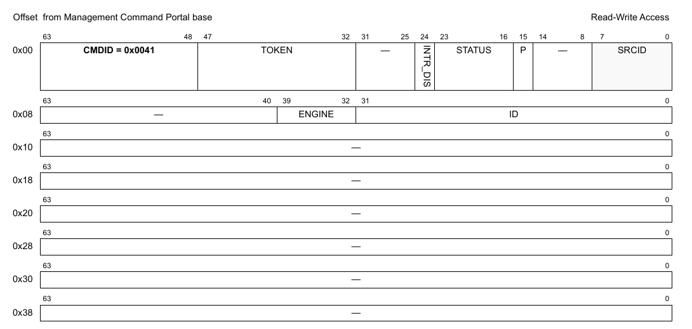

**Figure 601. Mô tả response của DPDCEI_GET_ATTRIBUTES**

| Offset | Bits | Tên | Mô tả |
|---|---|---|---|
| 0x00 | 0-63 | Header của command | Xem Table 2 để biết mô tả chung các field của command portal. CMDID phải được đặt như chỉ ra trong hình ở trên. |
| 0x08 | 0-31 | ID | DPDCEI object ID |
|   | 32-39 | ENGINE | Khối DCE engine |

Mọi field không được nêu là reserved và phải được xóa (đặt bằng 0)

### 18.2.16 DPDCEI_SET_RX_QUEUE

**Cấu trúc command**

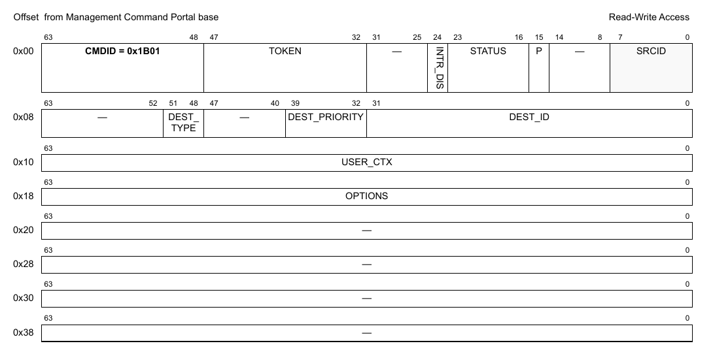

**Figure 602. Mô tả command DPDCEI_SET_RX_QUEUE**

| Offset | Bits | Tên | Mô tả |
|---|---|---|---|
| 0x00 | 0-63 | Header của command | Xem Table 2 để biết mô tả chung các field của command portal. CMDID phải được đặt như chỉ ra trong hình ở trên. |
| 0x08 | 0-31 | DEST_ID | DPIO ID hoặc DPCON ID, tùy loại đích |
|   | 32-39 | DEST_PRIORITY | Lựa chọn priority trong channel DPIO hoặc DPCON; giá trị hợp lệ là 0-1 hoặc 0-7, tùy số priority trong channel đó; không có ý nghĩa với option 'DPDCEI_DEST_NONE' |
|   | 48-51 | DEST_TYPE | Loại đích |
| 0x10 | 0-63 | USER_CTX | Giá trị user context được cung cấp trong frame descriptor của mỗi frame được dequeue; chỉ hợp lệ nếu 'options' có 'DPDCEI_QUEUE_OPT_USER_CTX' |
| 0x18 | 0-63 | OPTIONS | Các flag biểu diễn những thay đổi đề xuất với queue; Dùng bất kỳ tổ hợp nào của các flag 'DPDCEI_QUEUE_OPT_\<X>' |

Mọi field không được nêu là reserved và phải được xóa (đặt bằng 0)

### 18.2.17 DPDCEI_GET_RX_QUEUE

**Cấu trúc command**

**Figure 603. Mô tả command DPDCEI_GET_RX_QUEUE**

| Offset | Bits | Tên | Mô tả |
|---|---|---|---|
| 0x00 | 0-63 | Header của command | Xem Table 2 để biết mô tả chung các field của command portal. CMDID phải được đặt như chỉ ra trong hình ở trên. |

Mọi field không được nêu là reserved và phải được xóa (đặt bằng 0)

**Cấu trúc response**

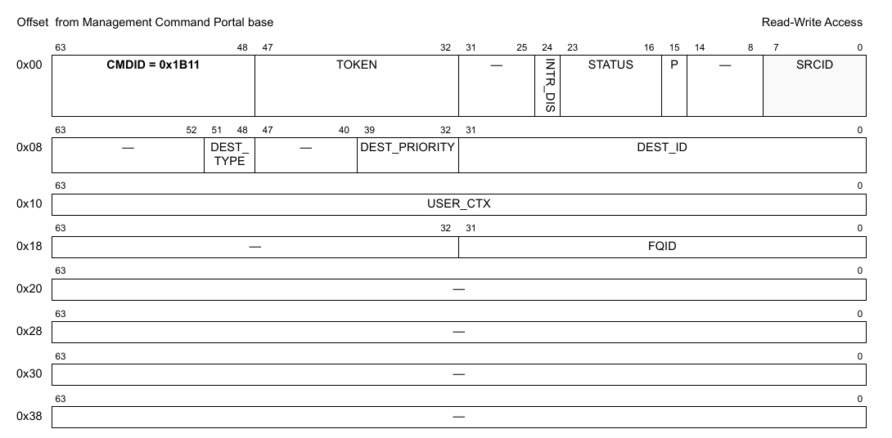

**Figure 604. Mô tả response của DPDCEI_GET_RX_QUEUE**

| Offset | Bits | Tên | Mô tả |
|---|---|---|---|
| 0x00 | 0-63 | Header của command | Xem Table 2 để biết mô tả chung các field của command portal. CMDID phải được đặt như chỉ ra trong hình ở trên. |
| 0x08 | 0-31 | DEST_ID | DPIO ID hoặc DPCON ID, tùy loại đích |
|   | 32-39 | DEST_PRIORITY | Lựa chọn priority trong channel DPIO hoặc DPCON; giá trị hợp lệ là 0-1 hoặc 0-7, tùy số priority trong channel đó; không có ý nghĩa với option 'DPDCEI_DEST_NONE' |
|   | 48-51 | DEST_TYPE | Loại đích |
| 0x10 | 0-63 | USER_CTX | Giá trị user context được cung cấp trong frame descriptor của mỗi frame được dequeue; chỉ hợp lệ nếu 'options' có 'DPDCEI_QUEUE_OPT_USER_CTX' |
| 0x18 | 0-31 | FQID | Giá trị FQID ảo dùng cho thao tác dequeue |

Mọi field không được nêu là reserved và phải được xóa (đặt bằng 0)

### 18.2.18 DPDCEI_GET_TX_QUEUE

**Cấu trúc command**

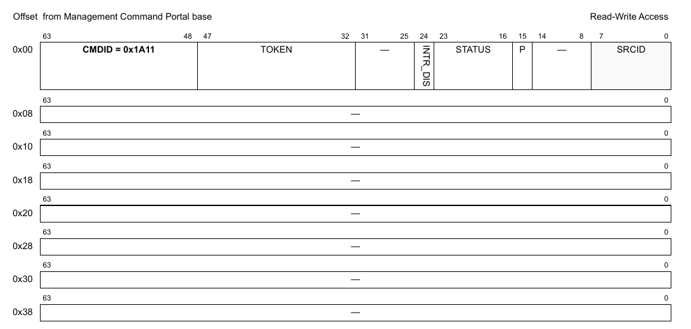

**Figure 605. Mô tả command DPDCEI_GET_TX_QUEUE**

| Offset | Bits | Tên | Mô tả |
|---|---|---|---|
| 0x00 | 0-63 | Header của command | Xem Table 2 để biết mô tả chung các field của command portal. CMDID phải được đặt như chỉ ra trong hình ở trên. |

Mọi field không được nêu là reserved và phải được xóa (đặt bằng 0)

**Cấu trúc response**

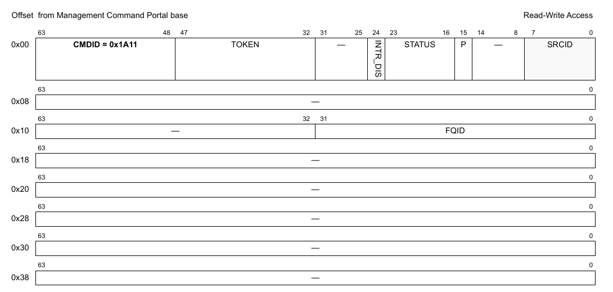

**Figure 606. Mô tả response của DPDCEI_GET_TX_QUEUE**

| Offset | Bits | Tên | Mô tả |
|---|---|---|---|
| 0x00 | 0-63 | Header của command | Xem Table 2 để biết mô tả chung các field của command portal. CMDID phải được đặt như chỉ ra trong hình ở trên. |
| 0x10 | 0-31 | FQID | FQID ảo dùng để gửi frame tới phần cứng DMA |

Mọi field không được nêu là reserved và phải được xóa (đặt bằng 0)

### 18.2.19 DPDCEI_GET_API_VERSION

**Cấu trúc command**

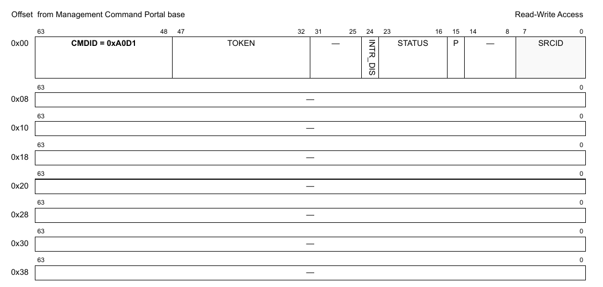

**Figure 607. Mô tả command DPDCEI_GET_API_VERSION**

| Offset | Bits | Tên | Mô tả |
|---|---|---|---|
| 0x00 | 0-63 | Header của command | Xem Table 2 để biết mô tả chung các field của command portal. CMDID phải được đặt như chỉ ra trong hình ở trên. |

Mọi field không được nêu là reserved và phải được xóa (đặt bằng 0)

**Cấu trúc response**

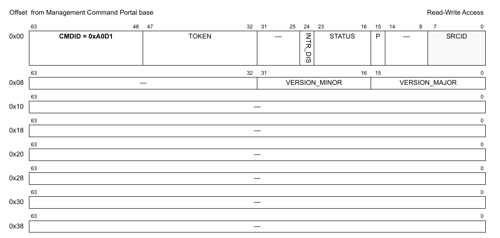

**Figure 608. Mô tả response của DPDCEI_GET_API_VERSION**

| Offset | Bits | Tên | Mô tả |
|---|---|---|---|
| 0x00 | 0-63 | Header của command | Xem Table 2 để biết mô tả chung các field của command portal. CMDID phải được đặt như chỉ ra trong hình ở trên. |
| 0x08 | 0-15 | VERSION_MAJOR | Major version của API |
|   | 16-31 | VERSION_MINOR | Minor version của API |
