# Chương 19 DPDMAI: Data Path DMA Interface

MC xuất ra DPDMAI object làm giao diện để vận hành DPAA2 QDMA Engine.

DPDMAI cho phép gửi request dạng frame tới QDMA và nhận lại response xác nhận khi giao dịch hoàn tất, dùng hạ tầng QBMan của DPAA2. DPDMAI object cung cấp tối đa hai priority để xử lý request QDMA.

## 19.1 Các tính năng của DPDMAI

Danh sách sau tóm tắt các tính năng và khả năng chính của DPDMAI:

- Hỗ trợ tối đa hai priority lập lịch để xử lý service request.
  - Mỗi transmit queue của DPDMAI được ánh xạ tới một trong hai service priority, cho phép phần cứng phân ưu tiên thêm giữa các request từ các DPDMAI object khác nhau.
- Với mỗi Tx queue có một Rx queue cho các xác nhận hoàn tất giao dịch đến.
  - Mỗi receive queue của DPDMAI được ánh xạ tới một trong hai receive priority, cho phép phân ưu tiên thêm giữa các interface khác khi gắn các receive queue của DPDMAI với DPIO hoặc DPCON object.
- Hỗ trợ các tùy chọn lập lịch khác nhau để xử lý packet nhận được:
  - Queue có thể được cấu hình ở chế độ ‘parked’ (mặc định), hoặc gắn với một DPIO object, hoặc gắn với DPCON object
- Cho phép tương tác với một hoặc nhiều DPIO object để dequeue/enqueue frame descriptor (FD) và để acquire/release buffer.
- Hỗ trợ các thao tác enable, disable và reset

## 19.2 Tham chiếu command của DPDMAI

Mục này trình bày chi tiết mô hình lập trình các command của DPDMAI.

### 19.2.1 DPDMAI_OPEN

Mở một phiên điều khiển cho object được chỉ định.

Hàm này có thể dùng để mở phiên điều khiển cho một object đã được tạo; object có thể đã được khai báo trong DPL hoặc được tạo bằng command DPDMAI_CREATE.

Hàm này trả về một authentication token duy nhất, gắn với object ID cụ thể; token này phải được dùng trong mọi command tiếp theo cho object này.

**Cấu trúc command**

Định dạng command được thể hiện trong hình dưới đây.

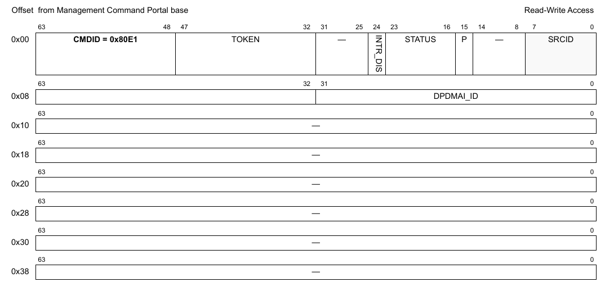

**Figure 609. Mô tả command DPDMAI_OPEN**

Bảng sau mô tả các field của command.

**Table 74. Mô tả các field của command DPDMAI_OPEN1**

| Offset | Bits | Tên | Mô tả |
|---|---|---|---|
| 0x00 | 0-63 | Header của command | Xem Table 2 để biết mô tả chung các field của command portal. CMDID phải được đặt như chỉ ra trong hình ở trên. |
| 0x08 | 0-31 | DPDMAI_ID | ID duy nhất của DPDMAI |

1 Mọi field không được nêu là reserved và phải được xóa (đặt bằng 0)

### 19.2.2 DPDMAI_CLOSE

Đóng phiên điều khiển của object.

Sau khi gọi hàm này, không thao tác nào khác được phép trên object nếu không mở một phiên điều khiển mới.

**Cấu trúc command**

**Figure 610. Mô tả command DPDMAI_CLOSE**

| Offset | Bits | Tên | Mô tả |
|---|---|---|---|
| 0x00 | 0-63 | Header của command | Xem Table 2 để biết mô tả chung các field của command portal. CMDID phải được đặt như chỉ ra trong hình ở trên. |

Mọi field không được nêu là reserved và phải được xóa (đặt bằng 0)

### 19.2.3 DPDMAI_CREATE

Command này tạo và khởi tạo một instance DPDMAI theo các tham số command được chỉ định. Command này không cần cho các instance DPDMAI được tạo bằng DPL.

Với command CREATE, bên gọi phải cung cấp authentication token của container cha mà object sẽ được tạo và gán vào. Nếu token là '0', object sẽ được gán cho container đang sở hữu MC command portal thực thi command này.

Command trả về một DPDMAI ID có thể dùng để OPEN hoặc DESTROY object.

Định dạng command được thể hiện trong hình dưới đây.

**Cấu trúc command**

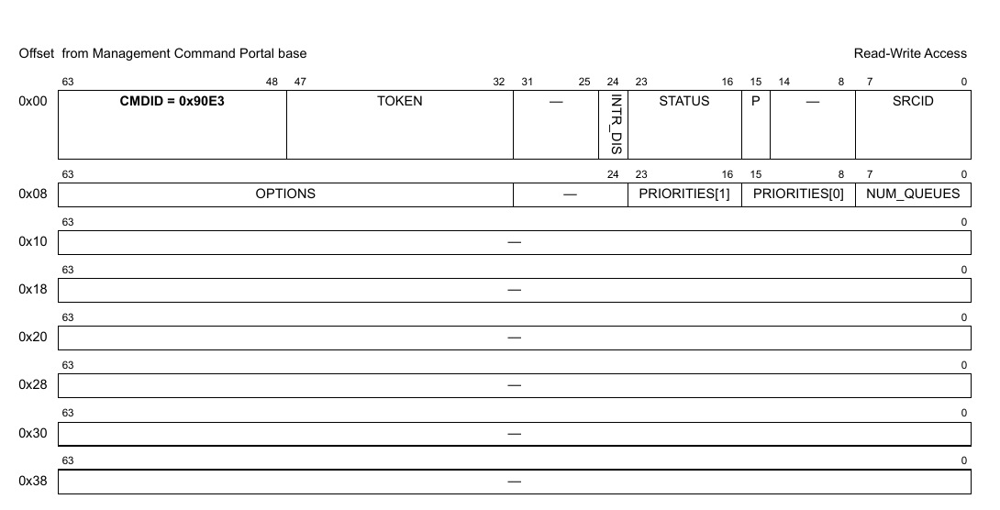

**Figure 611. Mô tả command DPDMAI_CREATE**

Bảng sau mô tả các field của command.

**Table 75. Mô tả các field của command DPDMAI_CREATE1**

| Offset | Bits | Tên | Mô tả |
|---|---|---|---|
| 0x00 | 0-63 | Header của command | Xem Table 2 để biết mô tả chung các field của command portal. CMDID phải được đặt như chỉ ra trong hình ở trên. |
| 0x08 | 0-7 | NUM_QUEUES | Số queue có cho mỗi object. Giá trị hợp lệ từ 1 đến số core trên nền tảng. |
|   | 8-23 | PRIORITIES[0..1] | Các priority cho việc xử lý của phần cứng DMA; priority hợp lệ được cấu hình bằng giá trị 1-8; mục ngay sau mục hợp lệ cuối cùng cần đặt bằng 0 |
|   | 32-63 | OPTIONS | Option: bit 0: DPDMAI_OPT_CG_PER_PRIORITY - Dùng để thêm Congestion Group cho mỗi priority. |

1 Mọi field không được nêu là reserved và phải được xóa (đặt bằng 0).

**Cấu trúc response**

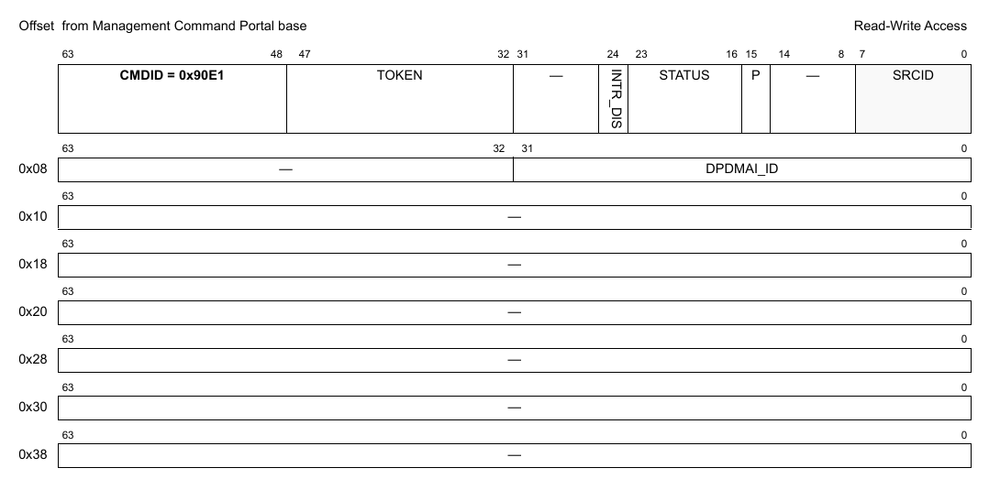

**Figure 19-1. Mô tả response của DPDMAI_CREATE**

Bảng sau mô tả các field của response.

**Table 19-1. Mô tả các field response của DPDMAI_CREATE1**

| Offset | Bits | Tên | Mô tả |
|---|---|---|---|
| 0x00 | 0-63 | Header của command | Xem Table 2 để biết mô tả chung các field của command portal. CMDID phải được đặt như chỉ ra trong hình ở trên. |
| 0x08 | 0-31 | DPDMAI_ID | ID duy nhất của DPDMAI |

1 Mọi field không được nêu là reserved.

### 19.2.4 DPDMAI_DESTROY

Command này hủy DPDMAI object và giải phóng mọi tài nguyên của nó. Nó phải được gọi trong software context đã tạo object. Bên gọi phải cung cấp object id và authentication token của container cha đã tạo object. Lưu ý rằng object có thể đã được gán cho container khác, và gửi authentication token của container đó sẽ trả về lỗi.

Mọi authentication token đang mở tới object phải được đóng trước khi gọi command destroy.

Sau khi gọi hàm này, không thao tác nào khác được phép trên object.

**Cấu trúc command**

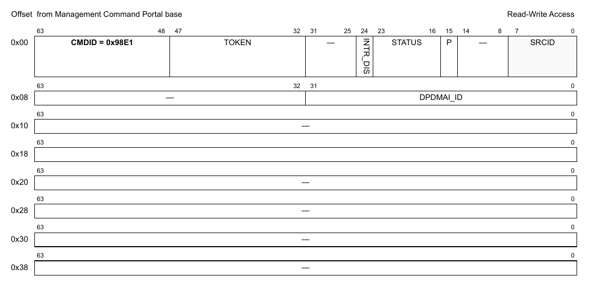

**Figure 612. Mô tả command DPDMAI_DESTROY**

| Offset | Bits | Tên | Mô tả |
|---|---|---|---|
| 0x00 | 0-63 | Header của command | Xem Table 2 để biết mô tả chung các field của command portal. CMDID phải được đặt như chỉ ra trong hình ở trên. |
| 0x08 | 0–32 | DPDMAI_ID | ID của DPDMAI object cần hủy |

Mọi field không được nêu là reserved và phải được xóa (đặt bằng 0).

### 19.2.5 DPDMAI_ENABLE

**Cấu trúc command**

**Figure 613. Mô tả command DPDMAI_ENABLE**

| Offset | Bits | Tên | Mô tả |
|---|---|---|---|
| 0x00 | 0-63 | Header của command | Xem Table 2 để biết mô tả chung các field của command portal. CMDID phải được đặt như chỉ ra trong hình ở trên. |

Mọi field không được nêu là reserved và phải được xóa (đặt bằng 0)

### 19.2.6 DPDMAI_DISABLE

**Cấu trúc command**

**Figure 614. Mô tả command DPDMAI_DISABLE**

| Offset | Bits | Tên | Mô tả |
|---|---|---|---|
| 0x00 | 0-63 | Header của command | Xem Table 2 để biết mô tả chung các field của command portal. CMDID phải được đặt như chỉ ra trong hình ở trên. |

Mọi field không được nêu là reserved và phải được xóa (đặt bằng 0)

### 19.2.7 DPDMAI_IS_ENABLED

**Cấu trúc command**

**Figure 615. Mô tả command DPDMAI_IS_ENABLED**

| Offset | Bits | Tên | Mô tả |
|---|---|---|---|
| 0x00 | 0-63 | Header của command | Xem Table 2 để biết mô tả chung các field của command portal. CMDID phải được đặt như chỉ ra trong hình ở trên. |

Mọi field không được nêu là reserved và phải được xóa (đặt bằng 0)

**Cấu trúc response**

**Figure 616. Mô tả response của DPDMAI_IS_ENABLED**

| Offset | Bits | Tên | Mô tả |
|---|---|---|---|
| 0x00 | 0-63 | Header của command | Xem Table 2 để biết mô tả chung các field của command portal. CMDID phải được đặt như chỉ ra trong hình ở trên. |
| 0x08 | 0 | EN | Trả về '1' nếu object đang enable; '0' nếu không |

Mọi field không được nêu là reserved và phải được xóa (đặt bằng 0)

### 19.2.8 DPDMAI_RESET

**Cấu trúc command**

**Figure 617. Mô tả command DPDMAI_RESET**

| Offset | Bits | Tên | Mô tả |
|---|---|---|---|
| 0x00 | 0-63 | Header của command | Xem Table 2 để biết mô tả chung các field của command portal. CMDID phải được đặt như chỉ ra trong hình ở trên. |

Mọi field không được nêu là reserved và phải được xóa (đặt bằng 0)

### 19.2.9 DPDMAI_SET_IRQ_ENABLE

Đặt trạng thái tổng thể của interrupt. Cho phép phần mềm GPP điều khiển khi nào interrupt được sinh ra. Mỗi interrupt có thể có tối đa 32 nguyên nhân. Điều khiển enable/disable quyết định trạng thái tổng thể của interrupt. Nếu interrupt bị disable thì không nguyên nhân nào sinh ra interrupt.

**Cấu trúc command**

**Figure 618. Mô tả command DPDMAI_SET_IRQ_ENABLE**

| Offset | Bits | Tên | Mô tả |
|---|---|---|---|
| 0x00 | 0-63 | Header của command | Xem Table 2 để biết mô tả chung các field của command portal. CMDID phải được đặt như chỉ ra trong hình ở trên. |
| 0x08 | 0 | EN | Trạng thái interrupt: đặt ‘1’ để enable, ‘0’ để disable |
|   | 32-39 | IRQ_INDEX | Xác định interrupt index cần cấu hình |

Mọi field không được nêu là reserved và phải được xóa (đặt bằng 0)

### 19.2.10 DPDMAI_GET_IRQ_ENABLE

Lấy trạng thái tổng thể của interrupt.

**Cấu trúc command**

**Figure 619. Mô tả command DPDMAI_GET_IRQ_ENABLE**

| Offset | Bits | Tên | Mô tả |
|---|---|---|---|
| 0x00 | 0-63 | Header của command | Xem Table 2 để biết mô tả chung các field của command portal. CMDID phải được đặt như chỉ ra trong hình ở trên. |
| 0x08 | 32-39 | IRQ_INDEX | Xác định interrupt index cần truy vấn |

Mọi field không được nêu là reserved và phải được xóa (đặt bằng 0)

**Cấu trúc response**

**Figure 620. Mô tả response của DPDMAI_GET_IRQ_ENABLE**

| Offset | Bits | Tên | Mô tả |
|---|---|---|---|
| 0x00 | 0-63 | Header của command | Xem Table 2 để biết mô tả chung các field của command portal. CMDID phải được đặt như chỉ ra trong hình ở trên. |
| 0x08 | 0 | EN | Bit này được đặt nếu interrupt đang enable |

Mọi field không được nêu là reserved và phải được xóa (đặt bằng 0)

### 19.2.11 DPDMAI_SET_IRQ_MASK

Đặt interrupt mask. Mỗi interrupt có thể có tối đa 32 nguyên nhân, và mô hình interrupt hỗ trợ mask/unmask từng nguyên nhân độc lập.

**Cấu trúc command**

**Figure 621. Mô tả command DPDMAI_SET_IRQ_MASK**

| Offset | Bits | Tên | Mô tả |
|---|---|---|---|
| 0x00 | 0-63 | Header của command | Xem Table 2 để biết mô tả chung các field của command portal. CMDID phải được đặt như chỉ ra trong hình ở trên. |
| 0x08 | 0-31 | MASK | Event mask để kích hoạt interrupt; xem command GET_IRQ_STATUS để biết đặc tả các event hiện có. Với mỗi bit trong MASK: 0 = bỏ qua event 1 = event hợp lệ; báo IRQ nếu event này xảy ra |
|   | 32-39 | IRQ_INDEX | Interrupt index cần cấu hình |

Mọi field không được nêu là reserved và phải được xóa (đặt bằng 0)

### 19.2.12 DPDMAI_GET_IRQ_MASK

Lấy interrupt mask. Mỗi interrupt có thể có tối đa 32 nguyên nhân, và mô hình interrupt hỗ trợ mask/unmask từng nguyên nhân độc lập.

**Cấu trúc command**

**Figure 622. Mô tả command DPDMAI_GET_IRQ_MASK**

| Offset | Bits | Tên | Mô tả |
|---|---|---|---|
| 0x00 | 0-63 | Header của command | Xem Table 2 để biết mô tả chung các field của command portal. CMDID phải được đặt như chỉ ra trong hình ở trên. |
| 0x08 | 32-39 | IRQ_INDEX | Interrupt index cần truy vấn |

Mọi field không được nêu là reserved và phải được xóa (đặt bằng 0)

**Cấu trúc response**

**Figure 623. Mô tả response của DPDMAI_GET_IRQ_MASK**

| Offset | Bits | Tên | Mô tả |
|---|---|---|---|
| 0x00 | 0-63 | Header của command | Xem Table 2 để biết mô tả chung các field của command portal. CMDID phải được đặt như chỉ ra trong hình ở trên. |
| 0x08 | 0-31 | MASK | Event mask để kích hoạt interrupt; xem command GET_IRQ_STATUS để biết đặc tả các event hiện có. Với mỗi bit trong MASK: 0 = bỏ qua event 1 = event hợp lệ; báo IRQ nếu event này xảy ra |

Mọi field không được nêu là reserved và phải được xóa (đặt bằng 0)

### 19.2.13 DPDMAI_GET_IRQ_STATUS

Lấy trạng thái hiện tại của các event đang chờ cho interrupt index được chỉ định.

**Cấu trúc command**

**Figure 624. Mô tả command DPDMAI_GET_IRQ_STATUS**

| Offset | Bits | Tên | Mô tả |
|---|---|---|---|
| 0x00 | 0-63 | Header của command | Xem Table 2 để biết mô tả chung các field của command portal. CMDID phải được đặt như chỉ ra trong hình ở trên. |
| 0x08 | 0-31 | STATUS | Tùy chọn: mọi bit STATUS được đặt sẽ được xóa khỏi trạng thái đang chờ (không cần dùng command DPDMAI_CLEAR_IRQ_STATUS nữa). Lưu ý rằng STATUS trả về trong response là trạng thái trước khi các event bị xóa.  Các event được hỗ trợ: xem định nghĩa cấu trúc response |
|   | 32-39 | IRQ_INDEX | Interrupt index cần truy vấn |

Mọi field không được nêu là reserved và phải được xóa (đặt bằng 0)

**Cấu trúc response**

**Figure 625. Mô tả response của DPDMAI_GET_IRQ_STATUS**

| Offset | Bits | Tên | Mô tả |
|---|---|---|---|
| 0x00 | 0-63 | Header của command | Xem Table 2 để biết mô tả chung các field của command portal. CMDID phải được đặt như chỉ ra trong hình ở trên. |
| 0x08 | 0-31 | STATUS | Mask trạng thái event, mỗi event một bit: 0 = không có interrupt đang chờ 1 = có interrupt đang chờ  Các event được hỗ trợ: Không có. |

Mọi field không được nêu là reserved và phải được xóa (đặt bằng 0)

### 19.2.14 DPDMAI_CLEAR_IRQ_STATUS

Xóa (đánh dấu đã xử lý) các event đang chờ của interrupt index được chỉ định.

**Cấu trúc command**

**Figure 626. Mô tả command DPDMAI_CLEAR_IRQ_STATUS**

| Offset | Bits | Tên | Mô tả |
|---|---|---|---|
| 0x00 | 0-63 | Header của command | Xem Table 2 để biết mô tả chung các field của command portal. CMDID phải được đặt như chỉ ra trong hình ở trên. |
| 0x08 | 0-31 | STATUS | Mask để xóa các event đã xử lý; xem command GET_IRQ_STATUS để biết đặc tả các event hiện có. Với mỗi bit trong MASK: 0 = không đổi trạng thái event 1 = xóa bit trạng thái event để cho biết event đã được xử lý |
|   | 32-39 | IRQ_INDEX | Interrupt index cần cấu hình |

Mọi field không được nêu là reserved và phải được xóa (đặt bằng 0)

### 19.2.15 DPDMAI_GET_ATTRIBUTES

**Cấu trúc command**

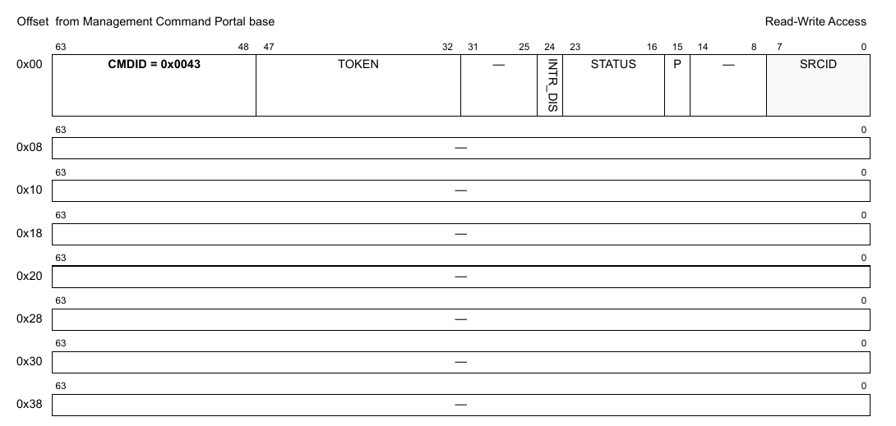

**Figure 627. Mô tả command DPDMAI_GET_ATTRIBUTES**

| Offset | Bits | Tên | Mô tả |
|---|---|---|---|
| 0x00 | 0-63 | Header của command | Xem Table 2 để biết mô tả chung các field của command portal. CMDID phải được đặt như chỉ ra trong hình ở trên. |

Mọi field không được nêu là reserved và phải được xóa (đặt bằng 0)

**Cấu trúc response**

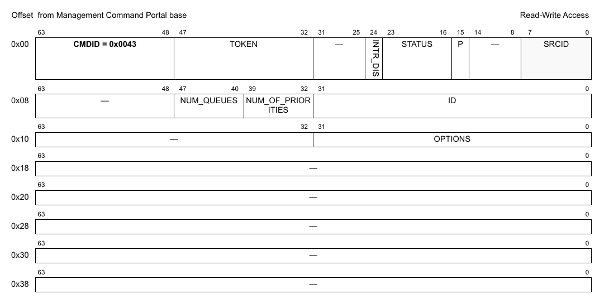

**Figure 628. Mô tả response của DPDMAI_GET_ATTRIBUTES**

| Offset | Bits | Tên | Mô tả |
|---|---|---|---|
| 0x00 | 0-63 | Header của command | Xem Table 2 để biết mô tả chung các field của command portal. CMDID phải được đặt như chỉ ra trong hình ở trên. |
| 0x08 | 0-31 | ID | DPDMAI object ID |
|   | 32-39 | NUM_OF_PRIORITIES | Số priority |
|   | 40-47 | NUM_QUEUES | Số queue |
| 0x10 | 0-31 | OPTIONS | Option: bit 0: DPDMAI_OPT_CG_PER_PRIORITY - Dùng để thêm Congestion Group cho mỗi priority. |

Mọi field không được nêu là reserved và phải được xóa (đặt bằng 0)

### 19.2.16 DPDMAI_SET_RX_QUEUE

**Cấu trúc command**

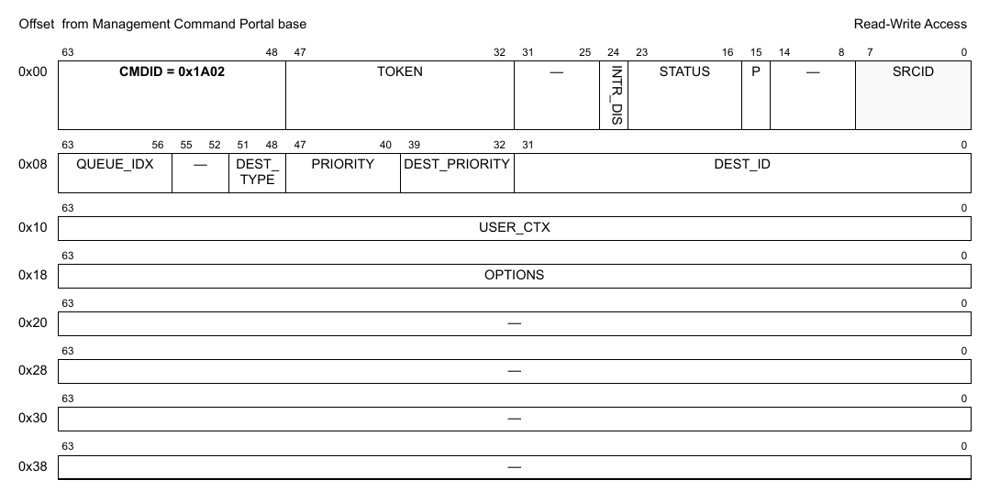

**Figure 629. Mô tả command DPDMAI_SET_RX_QUEUE**

| Offset | Bits | Tên | Mô tả |
|---|---|---|---|
| 0x00 | 0-63 | Header của command | Xem Table 2 để biết mô tả chung các field của command portal. CMDID phải được đặt như chỉ ra trong hình ở trên. |
| 0x08 | 0-31 | DEST_ID | DPIO ID hoặc DPCON ID, tùy loại đích |
|   | 32-39 | DEST_PRIORITY | Lựa chọn priority trong channel DPIO hoặc DPCON; giá trị hợp lệ là 0-1 hoặc 0-7, tùy số priority trong channel đó; không có ý nghĩa với option 'DPDMAI_DEST_NONE' |
|   | 40-47 | PRIORITY | Chọn queue tương đối theo số priority đã cấu hình khi tạo DPDMAI; dùng DPDMAI_ALL_QUEUES để cấu hình mọi Rx queue như nhau. |
|   | 48-51 | DEST_TYPE | Loại đích |
|   | 56-63 | QUEUE_IDX | Index của queue. Giá trị hợp lệ là 0...NUM_QUEUES |
| 0x10 | 0-63 | USER_CTX | Giá trị user context được cung cấp trong frame descriptor của mỗi frame được dequeue; chỉ hợp lệ nếu 'options' có 'DPDMAI_QUEUE_OPT_USER_CTX' |
| 0x18 | 0-63 | OPTIONS | Các flag biểu diễn những thay đổi đề xuất với queue; Dùng bất kỳ tổ hợp nào của các flag 'DPDMAI_QUEUE_OPT_\<X>' |

Mọi field không được nêu là reserved và phải được xóa (đặt bằng 0)

### 19.2.17 DPDMAI_GET_RX_QUEUE

**Cấu trúc command**

**Figure 630. Mô tả command DPDMAI_GET_RX_QUEUE**

| Offset | Bits | Tên | Mô tả |
|---|---|---|---|
| 0x00 | 0-63 | Header của command | Xem Table 2 để biết mô tả chung các field của command portal. CMDID phải được đặt như chỉ ra trong hình ở trên. |
| 0x08 | 40-47 | PRIORITY | Chọn queue tương đối theo số priority đã cấu hình khi tạo DPDMAI; dùng DPDMAI_ALL_QUEUES để cấu hình mọi Rx queue như nhau. |
|   | 48-55 | QUEUE_IDX | Index của queue. Giá trị hợp lệ là 0...NUM_QUEUES |

Mọi field không được nêu là reserved và phải được xóa (đặt bằng 0)

**Cấu trúc response**

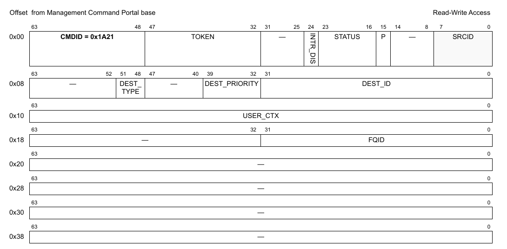

**Figure 631. Mô tả response của DPDMAI_GET_RX_QUEUE**

| Offset | Bits | Tên | Mô tả |
|---|---|---|---|
| 0x00 | 0-63 | Header của command | Xem Table 2 để biết mô tả chung các field của command portal. CMDID phải được đặt như chỉ ra trong hình ở trên. |
| 0x08 | 0-31 | DEST_ID | DPIO ID hoặc DPCON ID, tùy loại đích |
|   | 32-39 | DEST_PRIORITY | Lựa chọn priority trong channel DPIO hoặc DPCON; giá trị hợp lệ là 0-1 hoặc 0-7, tùy số priority trong channel đó; không có ý nghĩa với option 'DPDMAI_DEST_NONE' |
|   | 48-51 | DEST_TYPE | Loại đích |
| 0x10 | 0-63 | USER_CTX | Giá trị user context được cung cấp trong frame descriptor của mỗi frame được dequeue; chỉ hợp lệ nếu 'options' có 'DPDMAI_QUEUE_OPT_USER_CTX' |
| 0x18 | 0-31 | FQID | Giá trị FQID ảo dùng cho thao tác dequeue |

Mọi field không được nêu là reserved và phải được xóa (đặt bằng 0)

### 19.2.18 DPDMAI_GET_TX_QUEUE

**Cấu trúc command**

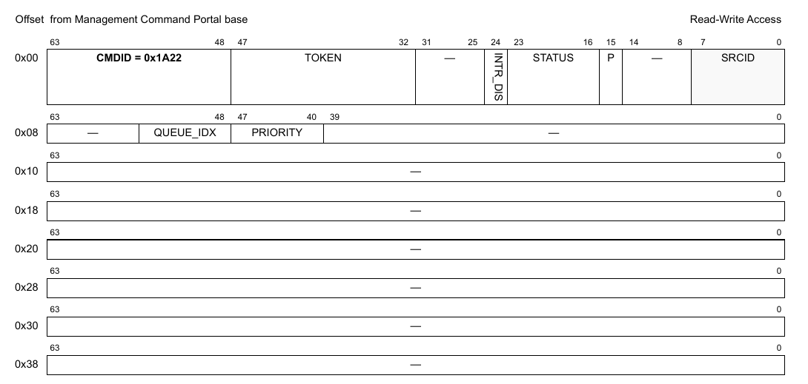

**Figure 632. Mô tả command DPDMAI_GET_TX_QUEUE**

| Offset | Bits | Tên | Mô tả |
|---|---|---|---|
| 0x00 | 0-63 | Header của command | Xem Table 2 để biết mô tả chung các field của command portal. CMDID phải được đặt như chỉ ra trong hình ở trên. |
| 0x08 | 40-47 | PRIORITY | Chọn queue tương đối theo số priority đã cấu hình khi tạo DPDMAI; |
|   | 48-56 | QUEUE_IDX | Index của queue. Giá trị hợp lệ là 0...NUM_QUEUES |

Mọi field không được nêu là reserved và phải được xóa (đặt bằng 0)

**Cấu trúc response**

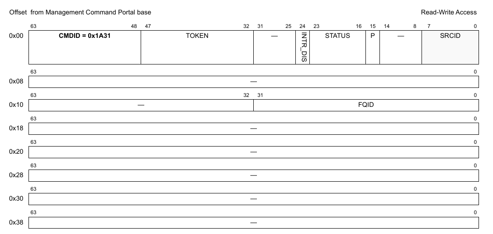

**Figure 633. Mô tả response của DPDMAI_GET_TX_QUEUE**

| Offset | Bits | Tên | Mô tả |
|---|---|---|---|
| 0x00 | 0-63 | Header của command | Xem Table 2 để biết mô tả chung các field của command portal. CMDID phải được đặt như chỉ ra trong hình ở trên. |
| 0x10 | 0-31 | FQID | FQID ảo dùng để gửi frame tới phần cứng DMA |

Mọi field không được nêu là reserved và phải được xóa (đặt bằng 0)

### 19.2.19 DPDMAI_GET_API_VERSION

**Cấu trúc command**

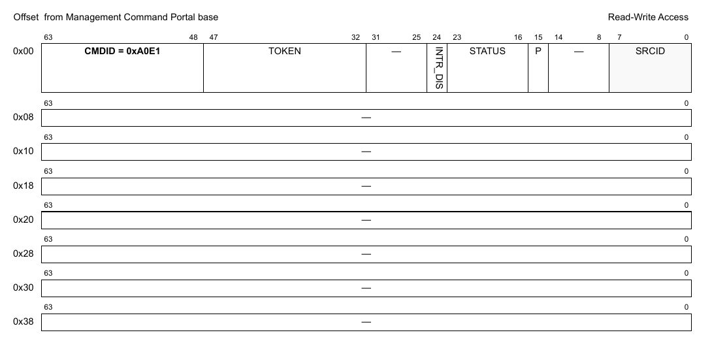

**Figure 634. Mô tả command DPDMAI_GET_API_VERSION**

| Offset | Bits | Tên | Mô tả |
|---|---|---|---|
| 0x00 | 0-63 | Header của command | Xem Table 2 để biết mô tả chung các field của command portal. CMDID phải được đặt như chỉ ra trong hình ở trên. |

Mọi field không được nêu là reserved và phải được xóa (đặt bằng 0)

**Cấu trúc response**

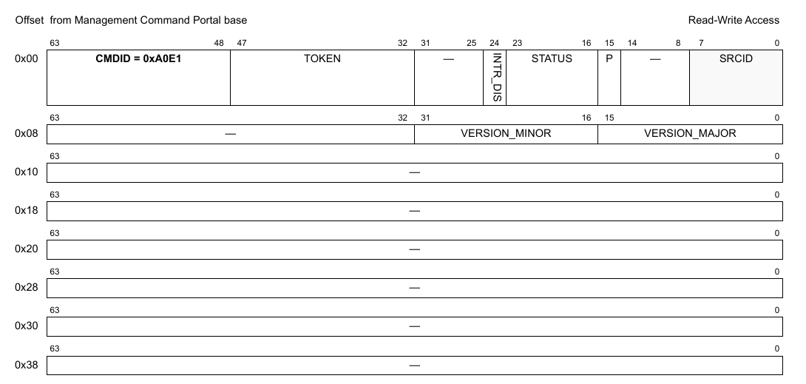

**Figure 635. Mô tả response của DPDMAI_GET_API_VERSION**

| Offset | Bits | Tên | Mô tả |
|---|---|---|---|
| 0x00 | 0-63 | Header của command | Xem Table 2 để biết mô tả chung các field của command portal. CMDID phải được đặt như chỉ ra trong hình ở trên. |
| 0x08 | 0-15 | VERSION_MAJOR | Major version của API |
|   | 16-31 | VERSION_MINOR | Minor version của API |

### 19.2.20 DPDMAI_SET_RX_CONGESTION_NOTIFICATION

**Cấu trúc command**

**Figure 636. Mô tả command DPDMAI_SET_RX_CONGESTION_NOTIFICATION**

| Offset | Bits | Tên | Mô tả |
|---|---|---|---|
| 0x00 | 0-63 | Header của command | Xem Table 2 để biết mô tả chung các field của command portal. CMDID phải được đặt như chỉ ra trong hình ở trên. |
| 0x08 | 0-7 | PRIORITY | Chọn queue tương đối theo số priority đã cấu hình khi tạo DPDMAI. |
|   | 8-15 | UNITS | Loại đơn vị dùng cho THRESHOLD_ENTRY/EXIT: - 0 : Byte - 1 : Frame |
|   | 16-31 | MODE | Chế độ Congestion Notification: bit 0: DPDMAI_CGN_MODE_WRITE_MEM_ON_ENTER bit 1: DPDMAI_CGN_MODE_WRITE_MEM_ON_EXIT bit 2: DPDMAI_CGN_MODE_COHERENT_WRITE |
| 0x10 | 0-31 | THRESHOLD_ENTRY | Giá trị ngưỡng theo UNITS dùng để kích hoạt congestion notification. |
|   | 32-63 | THRESHOLD_EXIT | Giá trị ngưỡng theo UNITS dùng để thoát khỏi congestion notification. |
| 0x18 | 0-63 | MSG_CTX | Context của message. |
| 0x20 | 0-63 | MSG_IOVA | Message IOVA.(địa chỉ ảo I/O của message) |

Mọi field không được nêu là reserved và phải được xóa (đặt bằng 0)

### 19.2.21 DPDMAI_GET_RX_CONGESTION_NOTIFICATION

**Cấu trúc command**

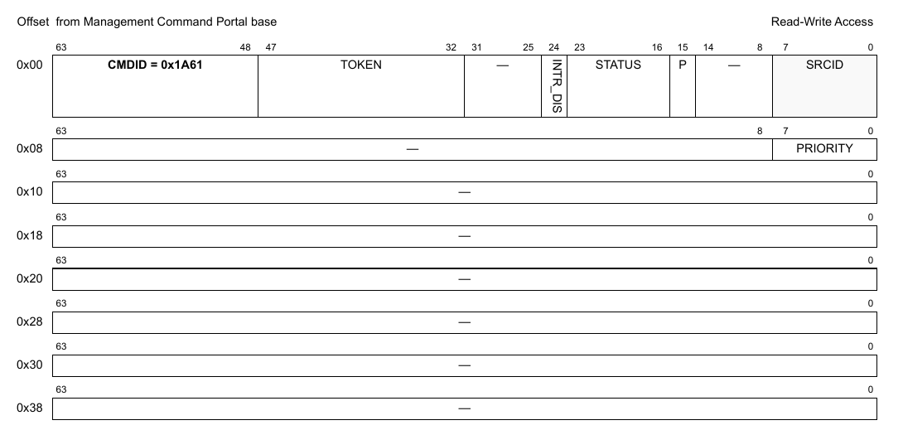

**Figure 637. Mô tả command DPDMAI_GET_RX_CONGESTION_NOTIFICATION**

| Offset | Bits | Tên | Mô tả |
|---|---|---|---|
| 0x00 | 0-63 | Header của command | Xem Table 2 để biết mô tả chung các field của command portal. CMDID phải được đặt như chỉ ra trong hình ở trên. |
| 0x08 | 0-7 | PRIORITY | Chọn queue tương đối theo số priority đã cấu hình khi tạo DPDMAI. |

Mọi field không được nêu là reserved và phải được xóa (đặt bằng 0)

**Cấu trúc response**

**Figure 638. Mô tả response của DPDMAI_GET_RX_CONGESTION_NOTIFICATION**

| Offset | Bits | Tên | Mô tả |
|---|---|---|---|
| 0x00 | 0-63 | Header của command | Xem Table 2 để biết mô tả chung các field của command portal. CMDID phải được đặt như chỉ ra trong hình ở trên. |
| 0x08 | 0-7 | PRIORITY | Chọn queue tương đối theo số priority đã cấu hình khi tạo DPDMAI. |
|   | 8-15 | UNITS | Loại đơn vị dùng cho THRESHOLD_ENTRY/EXIT: - 0 : Byte - 1 : Frame |
|   | 16-31 | MODE | Chế độ Congestion Notification: bit 0: DPDMAI_CGN_MODE_WRITE_MEM_ON_ENTER bit 1: DPDMAI_CGN_MODE_WRITE_MEM_ON_EXIT bit 2: DPDMAI_CGN_MODE_COHERENT_WRITE |
| 0x10 | 0-31 | THRESHOLD_ENTRY | Giá trị ngưỡng theo UNITS dùng để kích hoạt congestion notification. |
|   | 32-63 | THRESHOLD_EXIT | Giá trị ngưỡng theo UNITS dùng để thoát khỏi congestion notification. |
| 0x18 | 0-63 | MSG_CTX | Context của message. |
| 0x20 | 0-63 | MSG_IOVA | Message IOVA.(địa chỉ ảo I/O của message) |

Mọi field không được nêu là reserved và phải được xóa (đặt bằng 0)

### 19.2.22 DPDMAI_SET_TX_CONGESTION_NOTIFICATION

**Cấu trúc command**

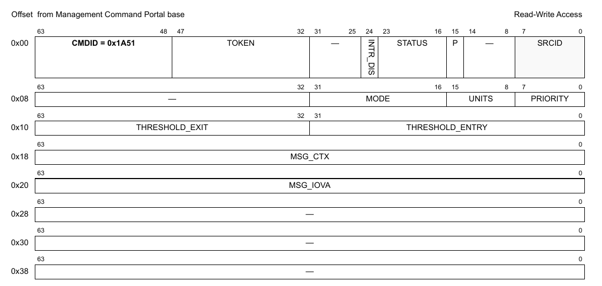

**Figure 639. Mô tả command DPDMAI_SET_TX_CONGESTION_NOTIFICATION**

| Offset | Bits | Tên | Mô tả |
|---|---|---|---|
| 0x00 | 0-63 | Header của command | Xem Table 2 để biết mô tả chung các field của command portal. CMDID phải được đặt như chỉ ra trong hình ở trên. |
| 0x08 | 0-7 | PRIORITY | Chọn queue tương đối theo số priority đã cấu hình khi tạo DPDMAI. |
|   | 8-15 | UNITS | Loại đơn vị dùng cho THRESHOLD_ENTRY/EXIT: - 0 : Byte - 1 : Frame |
|   | 16-31 | MODE | Chế độ Congestion Notification: bit 0: DPDMAI_CGN_MODE_WRITE_MEM_ON_ENTER bit 1: DPDMAI_CGN_MODE_WRITE_MEM_ON_EXIT bit 2: DPDMAI_CGN_MODE_COHERENT_WRITE |
| 0x10 | 0-31 | THRESHOLD_ENTRY | Giá trị ngưỡng theo UNITS dùng để kích hoạt congestion notification. |
|   | 32-63 | THRESHOLD_EXIT | Giá trị ngưỡng theo UNITS dùng để thoát khỏi congestion notification. |
| 0x18 | 0-63 | MSG_CTX | Context của message. |
| 0x20 | 0-63 | MSG_IOVA | Message IOVA.(địa chỉ ảo I/O của message) |

Mọi field không được nêu là reserved và phải được xóa (đặt bằng 0)

### 19.2.23 DPDMAI_GET_TX_CONGESTION_NOTIFICATION

**Cấu trúc command**

**Figure 640. Mô tả command DPDMAI_GET_TX_CONGESTION_NOTIFICATION**

| Offset | Bits | Tên | Mô tả |
|---|---|---|---|
| 0x00 | 0-63 | Header của command | Xem Table 2 để biết mô tả chung các field của command portal. CMDID phải được đặt như chỉ ra trong hình ở trên. |
| 0x08 | 0-7 | PRIORITY | Chọn queue tương đối theo số priority đã cấu hình khi tạo DPDMAI. |

Mọi field không được nêu là reserved và phải được xóa (đặt bằng 0)

**Cấu trúc response**

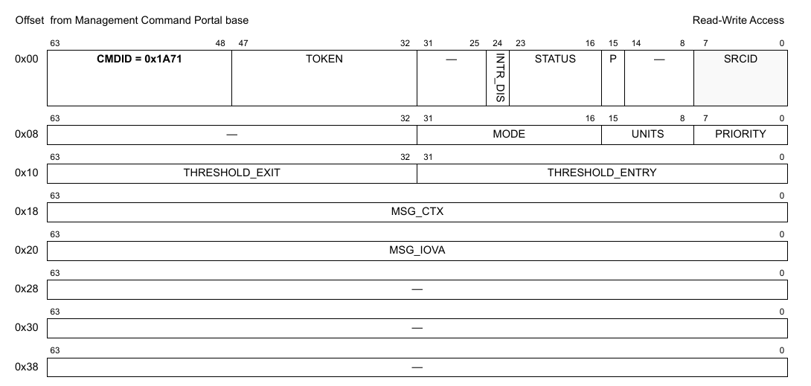

**Figure 641. Mô tả response của DPDMAI_GET_TX_CONGESTION_NOTIFICATION**

| Offset | Bits | Tên | Mô tả |
|---|---|---|---|
| 0x00 | 0-63 | Header của command | Xem Table 2 để biết mô tả chung các field của command portal. CMDID phải được đặt như chỉ ra trong hình ở trên. |
| 0x08 | 0-7 | PRIORITY | Chọn queue tương đối theo số priority đã cấu hình khi tạo DPDMAI. |
|   | 8-15 | UNITS | Loại đơn vị dùng cho THRESHOLD_ENTRY/EXIT: - 0 : Byte - 1 : Frame |
|   | 16-31 | MODE | Chế độ Congestion Notification: bit 0: DPDMAI_CGN_MODE_WRITE_MEM_ON_ENTER bit 1: DPDMAI_CGN_MODE_WRITE_MEM_ON_EXIT bit 2: DPDMAI_CGN_MODE_COHERENT_WRITE |
| 0x10 | 0-31 | THRESHOLD_ENTRY | Giá trị ngưỡng theo UNITS dùng để kích hoạt congestion notification. |
|   | 32-63 | THRESHOLD_EXIT | Giá trị ngưỡng theo UNITS dùng để thoát khỏi congestion notification. |
| 0x18 | 0-63 | MSG_CTX | Context của message. |
| 0x20 | 0-63 | MSG_IOVA | Message IOVA.(địa chỉ ảo I/O của message) |

Mọi field không được nêu là reserved và phải được xóa (đặt bằng 0)
