# Chương 20 DPAIOP: Data Path AIOP Control

DPAIOP object đại diện cho một AIOP tile và chịu trách nhiệm khởi tạo và quản lý AIOP tile. MC thực hiện khởi tạo AIOP tile và các khối phần cứng của nó. MC chịu trách nhiệm nạp một AIOP image vào bộ nhớ AIOP thích hợp và đưa các AIOP core ra khỏi trạng thái giữ để boot.

Một trong các trách nhiệm chính của MC là nạp image để các AIOP core dùng. Dưới đây là các bước cần để nạp một image. AIOP không thể chạy nếu không có một DPAIOP object nằm trong container (DPRC) của một software context trên GPP. Software context đó trên GPP sẽ chịu trách nhiệm điều khiển việc nạp và chạy AIOP, thông qua DPAIOP object.

Sau khi nạp AIOP image thành công, MC sẽ khởi động các AIOP core để bắt đầu chạy.

## 20.1 Các tính năng của DPAIOP

Danh sách sau tóm tắt các tính năng và khả năng chính của DPAIOP:

- Tạo và hủy – DPAIOP object gắn với một AIOP tile duy nhất
- Nạp AIOP software image (bao gồm chuỗi tham số cho ứng dụng AIOP)
- Chạy AIOP
- Truy vấn trạng thái AIOP
- Truy vấn phiên bản AIOP Service Layer
- Đặt (và lấy) thời gian trong ngày trong AIOP
- Reset AIOP (không hỗ trợ trên LS2085A revision 1.0)

### 20.1.1 Reset AIOP và nạp lại ứng dụng

Các use case như nạp một AIOP elf mới hoặc nạp lại ứng dụng hiện tại có thể thực hiện mà không cần reset phần cứng data path hoặc toàn bộ SoC. Command DPAIOP_RESET xử lý việc reset và chuẩn bị phần cứng AIOP để nạp ứng dụng mới. Trong command reset, firmware management complex sẽ lần lượt thực hiện các bước sau:

1. Tắt êm các nguồn sinh task: TMan và Work Scheduler

2. Chờ các QMan queue gắn với AIOP được rút cạn; firmware MC poll để chờ hoàn tất

3. Chờ các core xử lý xong các task đang thực thi; firmware MC poll để chờ hoàn tất

4. Chuyển các core sang chế độ reset

5. Yêu cầu khối quản lý nguồn của DPAA2 reset phần cứng AIOP

6. Giải phóng tài nguyên AIOP đã cấp phát: tắt các interrupt lỗi của AIOP và các tài nguyên bộ nhớ DP-DDR/System DDR/PEB đã cấp phát cho TMan và CTLU

Firmware MC sẽ chờ một khoảng thời gian định trước cho mỗi bước hoàn tất. Nếu một trong các bước thất bại, command sẽ kết thúc ngay với lỗi. Điều này đảm bảo MC không chặn vô thời hạn SW context đã gửi command reset.

Gửi lại command reset hoặc gửi command load (hoặc bất kỳ command nào) sau một lần reset không thành công sẽ thất bại, vì lỗi reset AIOP có thể báo hiệu trục trặc phần cứng, khiến ứng dụng AIOP không chạy đúng. Khi có lỗi reset, log MC (cấu hình ở mức chi tiết debug) sẽ nêu chính xác bước đã thất bại. Lúc này cách duy nhất để nạp ứng dụng AIOP mới là reset toàn SoC. Để kiểm tra command reset đã hoàn tất thành công hay chưa (hoặc có command reset đang diễn ra không), SW context phải dùng command DPAIOP_GET_STATE.

Command DPAIOP_GET_STATE cũng có thể dùng để kiểm tra ứng dụng AIOP đã được nạp (AIOP elf image đã được triển khai) và boot (các AIOP core đang chạy và ứng dụng đánh dấu bước boot đã hoàn tất) thành công hay chưa.

Command reset có thể được thực hiện nếu command DPAIOP_LOAD hoặc DPAIOP_RUN thất bại, nhưng command run không thể thực hiện nếu command nạp elf image đã thất bại.

Command DPAIOP_RESET chỉ ảnh hưởng tới khối phần cứng AIOP; tuy nhiên, để boot đúng ứng dụng mới, container của AIOP cùng các object con trong nó cũng phải được reset.

Các bước sau tóm tắt quy trình nạp lại ứng dụng AIOP và cho biết thứ tự thực hiện các command liên quan:

1. DPAIOP_RESET - Reset khối phần cứng AIOP: tắt êm phần cứng AIOP và giải phóng tài nguyên

2. DPRC_RESET - Reset container của AIOP: reset trạng thái của mọi object chứa trong nó;

3. DPAIOP_LOAD - Nạp ứng dụng AIOP: triển khai elf image và cấp phát tài nguyên

4. DPAIOP_RUN - Khởi động các AIOP core đã cấu hình và boot ứng dụng AIOP mới

## 20.2 Tham chiếu command của DPAIOP

Mục này trình bày chi tiết mô hình lập trình các command của DPAIOP.

### 20.2.1 DPAIOP_OPEN

Mở một phiên điều khiển cho object được chỉ định.

Hàm này có thể dùng để mở phiên điều khiển cho một object đã được tạo; object có thể đã được khai báo trong DPL hoặc được tạo bằng command DPAIOP_CREATE.

Hàm này trả về một authentication token duy nhất, gắn với object ID cụ thể; token này phải được dùng trong mọi command tiếp theo cho object này.

**Cấu trúc command**

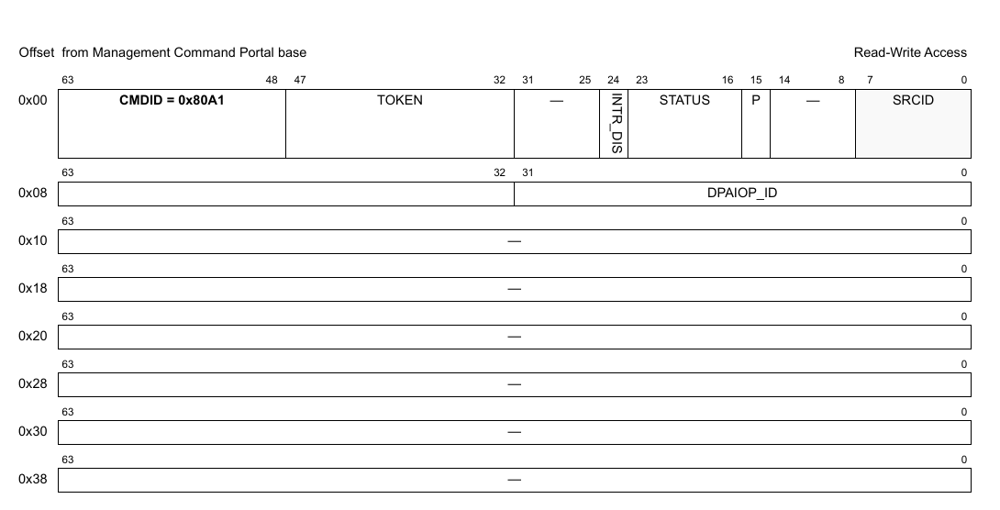

**Figure 642. Mô tả command DPAIOP_OPEN**

Bảng sau mô tả các field của command.

**Table 76. Mô tả các field của command DPAIOP_OPEN1**

| Offset | Bits | Tên | Mô tả |
|---|---|---|---|
| 0x00 | 0-63 | Header của command | Xem Table 2 để biết mô tả chung các field của command portal. CMDID phải được đặt như chỉ ra trong hình ở trên. |
| 0x08 | 0-31 | DPAIOP_ID | ID duy nhất của DPAIOP |

1 Mọi field không được nêu là reserved và phải được xóa (đặt bằng 0)

### 20.2.2 DPAIOP_CLOSE

Đóng phiên điều khiển của object.

Sau khi gọi hàm này, không thao tác nào khác được phép trên object nếu không mở một phiên điều khiển mới.

**Cấu trúc command**

**Figure 643. Mô tả command DPAIOP_CLOSE**

| Offset | Bits | Tên | Mô tả |
|---|---|---|---|
| 0x00 | 0-63 | Header của command | Xem Table 2 để biết mô tả chung các field của command portal. CMDID phải được đặt như chỉ ra trong hình ở trên. |

Mọi field không được nêu là reserved và phải được xóa (đặt bằng 0)

### 20.2.3 DPAIOP_CREATE

Command này tạo và khởi tạo một instance DPAIOP theo các tham số command được chỉ định. Command này không cần cho các instance DPAIOP được tạo bằng DPL.

Với command CREATE, bên gọi phải cung cấp authentication token của container cha mà object sẽ được tạo và gán vào. Nếu token là '0', object sẽ được gán cho container đang sở hữu MC command portal thực thi command này.

Command trả về một DPAIOP ID có thể dùng để OPEN hoặc DESTROY object.

Định dạng command được thể hiện trong hình dưới đây.

**Cấu trúc command**

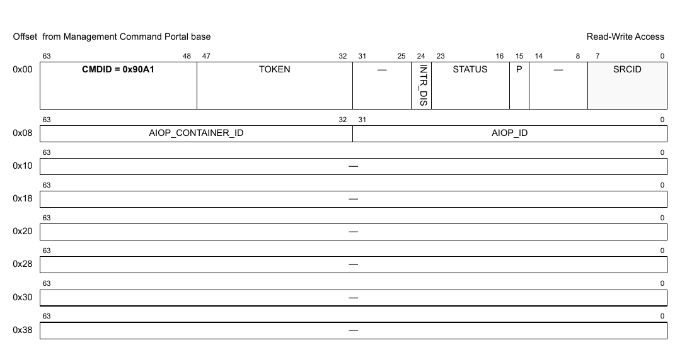

**Figure 644. Mô tả command DPAIOP_CREATE**

Bảng sau mô tả các field của command.

**Table 77. Mô tả các field của command DPAIOP_CREATE1**

| Offset | Bits | Tên | Mô tả |
|---|---|---|---|
| 0x00 | 0-63 | Header của command | Xem Table 2 để biết mô tả chung các field của command portal. CMDID phải được đặt như chỉ ra trong hình ở trên. |
| 0x08 | 0-31 | AIOP_ID | AIOP ID |
|   | 32-63 | AIOP_CONTAINER_ID | ID container của AIOP |

1 Mọi field không được nêu là reserved và phải được xóa (đặt bằng 0).

**Cấu trúc response**

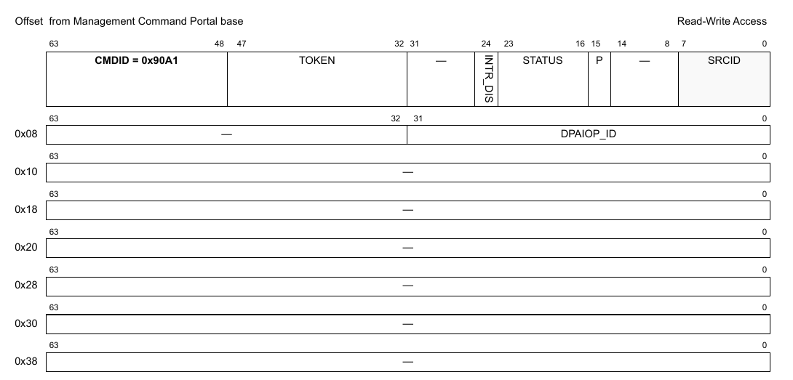

**Figure 20-1. Mô tả response của DPAIOP_CREATE**

Bảng sau mô tả các field của response.

**Table 20-1. Mô tả các field response của DPAIOP_CREATE1**

| Offset | Bits | Tên | Mô tả |
|---|---|---|---|
| 0x00 | 0-63 | Header của command | Xem Table 2 để biết mô tả chung các field của command portal. CMDID phải được đặt như chỉ ra trong hình ở trên. |
| 0x08 | 0-31 | DPAIOP_ID | ID duy nhất của DPAIOP |

1 Mọi field không được nêu là reserved.

### 20.2.4 DPAIOP_DESTROY

Command này hủy DPAIOP object và giải phóng mọi tài nguyên của nó. Nó phải được gọi trong software context đã tạo object. Bên gọi phải cung cấp object id và authentication token của container cha đã tạo object. Lưu ý rằng object có thể đã được gán cho container khác, và gửi authentication token của container đó sẽ trả về lỗi.

Mọi authentication token đang mở tới object phải được đóng trước khi gọi command destroy.

Sau khi gọi hàm này, không thao tác nào khác được phép trên object.

**Cấu trúc command**

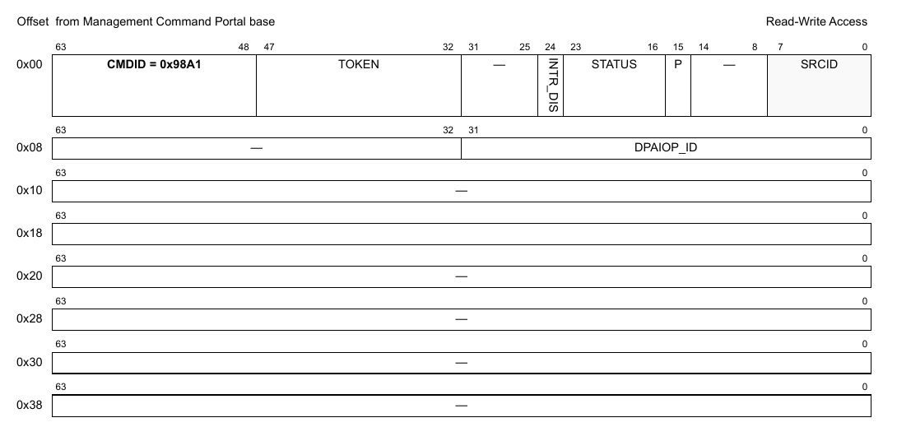

**Figure 645. Mô tả command DPAIOP_DESTROY**

| Offset | Bits | Tên | Mô tả |
|---|---|---|---|
| 0x00 | 0-63 | Header của command | Xem Table 2 để biết mô tả chung các field của command portal. CMDID phải được đặt như chỉ ra trong hình ở trên. |
| 0x08 | 0–32 | DPAIOP_ID | ID của DPAIOP object cần hủy |

Mọi field không được nêu là reserved và phải được xóa (đặt bằng 0)

### 20.2.5 DPAIOP_RESET

Command DPAIOP_RESET xử lý việc reset và chuẩn bị phần cứng AIOP để nạp ứng dụng mới. Trong command reset, firmware management complex sẽ lần lượt thực hiện các bước sau:

1. Tắt êm các nguồn sinh task: TMan và Work Scheduler

2. Chờ các QMan queue gắn với AIOP được rút cạn; firmware MC poll để chờ hoàn tất

3. Chờ các core xử lý xong các task đang thực thi; firmware MC poll để chờ hoàn tất

4. Chuyển các core sang chế độ reset

5. Yêu cầu Power Management Unit của DPAA2 reset phần cứng AIOP

6. Giải phóng tài nguyên AIOP đã cấp phát: tắt các interrupt lỗi của AIOP và các tài nguyên bộ nhớ DP-DDR/System DDR/PEB đã cấp phát cho TMan và CTLU

Đọc thêm về quy trình reset ở Section 20.1.1, “Reset AIOP và nạp lại ứng dụng.”

**Cấu trúc command**

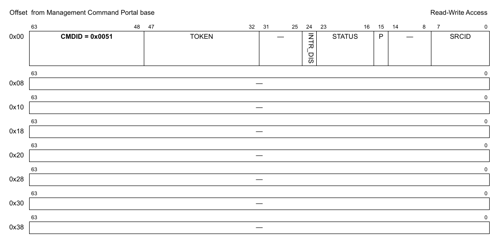

**Figure 646. Mô tả command DPAIOP_RESET**

| Offset | Bits | Tên | Mô tả |
|---|---|---|---|
| 0x00 | 0-63 | Header của command | Xem Table 2 để biết mô tả chung các field của command portal. CMDID phải được đặt như chỉ ra trong hình ở trên. |

Mọi field không được nêu là reserved và phải được xóa (đặt bằng 0)

### 20.2.6 DPAIOP_SET_IRQ_ENABLE

Đặt trạng thái tổng thể của interrupt. Cho phép phần mềm GPP điều khiển khi nào interrupt được sinh ra. Mỗi interrupt có thể có tối đa 32 nguyên nhân. Điều khiển enable/disable quyết định trạng thái tổng thể của interrupt. Nếu interrupt bị disable thì không nguyên nhân nào sinh ra interrupt.

**Cấu trúc command**

**Figure 647. Mô tả command DPAIOP_SET_IRQ_ENABLE**

| Offset | Bits | Tên | Mô tả |
|---|---|---|---|
| 0x00 | 0-63 | Header của command | Xem Table 2 để biết mô tả chung các field của command portal. CMDID phải được đặt như chỉ ra trong hình ở trên. |
| 0x08 | 0 | EN | Trạng thái interrupt: đặt ‘1’ để enable, ‘0’ để disable |
|   | 32-39 | IRQ_INDEX | Xác định interrupt index cần cấu hình |

Mọi field không được nêu là reserved và phải được xóa (đặt bằng 0)

### 20.2.7 DPAIOP_GET_IRQ_ENABLE

Lấy trạng thái tổng thể của interrupt.

**Cấu trúc command**

**Figure 648. Mô tả command DPAIOP_GET_IRQ_ENABLE**

| Offset | Bits | Tên | Mô tả |
|---|---|---|---|
| 0x00 | 0-63 | Header của command | Xem Table 2 để biết mô tả chung các field của command portal. CMDID phải được đặt như chỉ ra trong hình ở trên. |
| 0x08 | 32-39 | IRQ_INDEX | Xác định interrupt index cần truy vấn |

Mọi field không được nêu là reserved và phải được xóa (đặt bằng 0)

**Cấu trúc response**

**Figure 649. Mô tả response của DPAIOP_GET_IRQ_ENABLE**

| Offset | Bits | Tên | Mô tả |
|---|---|---|---|
| 0x00 | 0-63 | Header của command | Xem Table 2 để biết mô tả chung các field của command portal. CMDID phải được đặt như chỉ ra trong hình ở trên. |
| 0x08 | 0 | EN | Bit này được đặt nếu interrupt đang enable |

Mọi field không được nêu là reserved và phải được xóa (đặt bằng 0)

### 20.2.8 DPAIOP_SET_IRQ_MASK

Đặt interrupt mask. Mỗi interrupt có thể có tối đa 32 nguyên nhân, và mô hình interrupt hỗ trợ mask/unmask từng nguyên nhân độc lập.

**Cấu trúc command**

**Figure 650. Mô tả command DPAIOP_SET_IRQ_MASK**

| Offset | Bits | Tên | Mô tả |
|---|---|---|---|
| 0x00 | 0-63 | Header của command | Xem Table 2 để biết mô tả chung các field của command portal. CMDID phải được đặt như chỉ ra trong hình ở trên. |
| 0x08 | 0-31 | MASK | Event mask để kích hoạt interrupt; xem command GET_IRQ_STATUS để biết đặc tả các event hiện có. Với mỗi bit trong MASK: 0 = bỏ qua event 1 = event hợp lệ; báo IRQ nếu event này xảy ra |
|   | 32-39 | IRQ_INDEX | Interrupt index cần cấu hình |

Mọi field không được nêu là reserved và phải được xóa (đặt bằng 0)

### 20.2.9 DPAIOP_GET_IRQ_MASK

Lấy interrupt mask. Mỗi interrupt có thể có tối đa 32 nguyên nhân, và mô hình interrupt hỗ trợ mask/unmask từng nguyên nhân độc lập.

**Cấu trúc command**

**Figure 651. Mô tả command DPAIOP_GET_IRQ_MASK**

| Offset | Bits | Tên | Mô tả |
|---|---|---|---|
| 0x00 | 0-63 | Header của command | Xem Table 2 để biết mô tả chung các field của command portal. CMDID phải được đặt như chỉ ra trong hình ở trên. |
| 0x08 | 32-39 | IRQ_INDEX | Interrupt index cần truy vấn |

Mọi field không được nêu là reserved và phải được xóa (đặt bằng 0)

**Cấu trúc response**

**Figure 652. Mô tả response của DPAIOP_GET_IRQ_MASK**

| Offset | Bits | Tên | Mô tả |
|---|---|---|---|
| 0x00 | 0-63 | Header của command | Xem Table 2 để biết mô tả chung các field của command portal. CMDID phải được đặt như chỉ ra trong hình ở trên. |
| 0x08 | 0-31 | MASK | Event mask để kích hoạt interrupt; xem command GET_IRQ_STATUS để biết đặc tả các event hiện có. Với mỗi bit trong MASK: 0 = bỏ qua event 1 = event hợp lệ; báo IRQ nếu event này xảy ra |

Mọi field không được nêu là reserved và phải được xóa (đặt bằng 0)

### 20.2.10 DPAIOP_GET_IRQ_STATUS

Lấy trạng thái hiện tại của các event đang chờ cho interrupt index được chỉ định.

**Cấu trúc command**

**Figure 653. Mô tả command DPAIOP_GET_IRQ_STATUS**

| Offset | Bits | Tên | Mô tả |
|---|---|---|---|
| 0x00 | 0-63 | Header của command | Xem Table 2 để biết mô tả chung các field của command portal. CMDID phải được đặt như chỉ ra trong hình ở trên. |
| 0x08 | 0-31 | STATUS | Tùy chọn: mọi bit STATUS được đặt sẽ được xóa khỏi trạng thái đang chờ (không cần dùng command DPAIOP_CLEAR_IRQ_STATUS nữa). Lưu ý rằng STATUS trả về trong response là trạng thái trước khi các event bị xóa.  Các event được hỗ trợ: xem định nghĩa cấu trúc response |
|   | 32-39 | IRQ_INDEX | Interrupt index cần truy vấn |

Mọi field không được nêu là reserved và phải được xóa (đặt bằng 0)

**Cấu trúc response**

**Figure 654. Mô tả response của DPAIOP_GET_IRQ_STATUS**

| Offset | Bits | Tên | Mô tả |
|---|---|---|---|
| 0x00 | 0-63 | Header của command | Xem Table 2 để biết mô tả chung các field của command portal. CMDID phải được đặt như chỉ ra trong hình ở trên. |
| 0x08 | 0-31 | STATUS | Mask trạng thái event, mỗi event một bit: 0 = không có interrupt đang chờ 1 = có interrupt đang chờ  Các event được hỗ trợ: Không có |

Mọi field không được nêu là reserved và phải được xóa (đặt bằng 0)

### 20.2.11 DPAIOP_CLEAR_IRQ_STATUS

Xóa (đánh dấu đã xử lý) các event đang chờ của interrupt index được chỉ định.

**Cấu trúc command**

**Figure 655. Mô tả command DPAIOP_CLEAR_IRQ_STATUS**

| Offset | Bits | Tên | Mô tả |
|---|---|---|---|
| 0x00 | 0-63 | Header của command | Xem Table 2 để biết mô tả chung các field của command portal. CMDID phải được đặt như chỉ ra trong hình ở trên. |
| 0x08 | 0-31 | STATUS | Mask để xóa các event đã xử lý; xem command GET_IRQ_STATUS để biết đặc tả các event hiện có. Với mỗi bit trong MASK: 0 = không đổi trạng thái event 1 = xóa bit trạng thái event để cho biết event đã được xử lý |
|   | 32-39 | IRQ_INDEX | Interrupt index cần cấu hình |

Mọi field không được nêu là reserved và phải được xóa (đặt bằng 0)

### 20.2.12 DPAIOP_GET_ATTRIBUTES

**Cấu trúc command**

**Figure 656. Mô tả command DPAIOP_GET_ATTRIBUTES**

| Offset | Bits | Tên | Mô tả |
|---|---|---|---|
| 0x00 | 0-63 | Header của command | Xem Table 2 để biết mô tả chung các field của command portal. CMDID phải được đặt như chỉ ra trong hình ở trên. |

Mọi field không được nêu là reserved và phải được xóa (đặt bằng 0)

**Cấu trúc response**

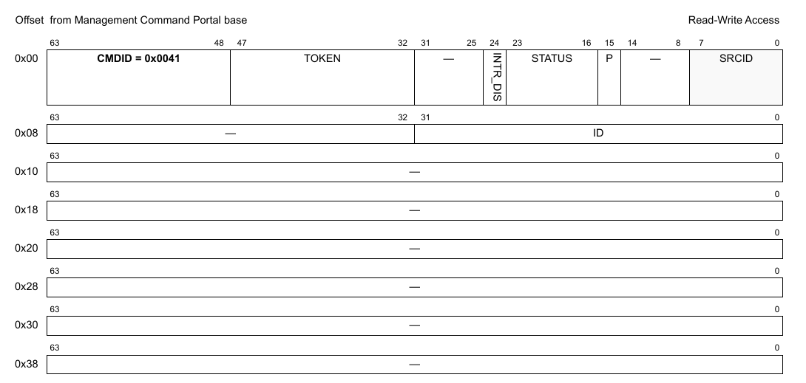

**Figure 657. Mô tả response của DPAIOP_GET_ATTRIBUTES**

| Offset | Bits | Tên | Mô tả |
|---|---|---|---|
| 0x00 | 0-63 | Header của command | Xem Table 2 để biết mô tả chung các field của command portal. CMDID phải được đặt như chỉ ra trong hình ở trên. |
| 0x08 | 0-31 | ID | AIOP ID |

Mọi field không được nêu là reserved và phải được xóa (đặt bằng 0)

### 20.2.13 DPAIOP_LOAD

Command sẽ triển khai một AIOP elf image và cấp phát các tài nguyên bộ nhớ mà ứng dụng AIOP mới yêu cầu. Nếu command thất bại, phải chạy DPAIOP_RESET trước khi thử nạp AIOP image khác. Để nạp đúng một ứng dụng AIOP mới, khối phần cứng AIOP phải ở trạng thái reset. Điều này đạt được sau khi reset toàn SoC hoặc sau command DPAIOP_RESET. Để biết thêm về quy trình nạp lại, xem Section 20.1.1, “Reset AIOP và nạp lại ứng dụng.”

**Cấu trúc command**

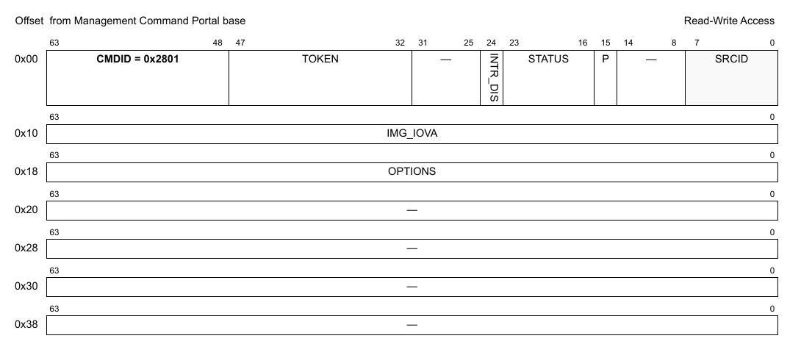

**Figure 658. Mô tả command DPAIOP_LOAD**

| Offset | Bits | Tên | Mô tả |
|---|---|---|---|
| 0x00 | 0–63 | Header của command | Xem Table 2 để biết mô tả chung các field của command portal. CMDID phải được đặt như chỉ ra trong hình ở trên. |
| 0x08 | 0–31 | IMG_SIZE | Kích thước AIOP ELF image trong bộ nhớ (tính bằng byte) |
| 0x10 | 0–63 | IMG_IOVA | Địa chỉ ảo I/O của AIOP ELF image |
| 0x18 | 0–63 | OPTIONS | Các option nạp AIOP |

Mọi field không được nêu là reserved và phải được xóa (đặt bằng 0)

### 20.2.14 DPAIOP_RUN

Khởi chạy ứng dụng AIOP. SW context có thể chọn core nào chạy và truyền tham số cho ứng dụng AIOP. Command chỉ có thể thực hiện nếu DPAIOP_LOAD đã được chạy trước đó. Nếu command thất bại, không được phép gửi lại command DPAIOP_RUN hoặc DPAIOP_LOAD. SW context phải thực hiện lại quy trình nạp ứng dụng từ đầu. Hãy xem đầy đủ quy trình nạp ứng dụng AIOP ở Section 20.1.1, “Reset AIOP và nạp lại ứng dụng.”

**Cấu trúc command**

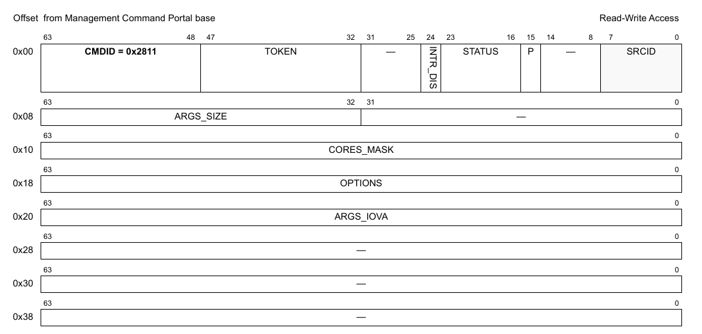

**Figure 659. Mô tả command DPAIOP_RUN**

| Offset | Bits | Tên | Mô tả |
|---|---|---|---|
| 0x00 | 0-63 | Header của command | Xem Table 2 để biết mô tả chung các field của command portal. CMDID phải được đặt như chỉ ra trong hình ở trên. |
| 0x08 | 32-63 | ARGS_SIZE | Kích thước tham số AIOP trong bộ nhớ (tính bằng byte) |
| 0x10 | 0-63 | CORES_MASK | Mask các AIOP core cần chạy (core 0 ở bit có trọng số cao nhất) |
| 0x18 | 0-63 | OPTIONS | Option thực thi (hiện chưa định nghĩa option nào) |
| 0x20 | 0-63 | ARGS_IOVA | Địa chỉ ảo I/O của tham số AIOP |

Mọi field không được nêu là reserved và phải được xóa (đặt bằng 0)

### 20.2.15 DPAIOP_GET_SL_VERSION

**Cấu trúc command**

**Figure 660. Mô tả command DPAIOP_GET_SL_VERSION**

| Offset | Bits | Tên | Mô tả |
|---|---|---|---|
| 0x00 | 0-63 | Header của command | Xem Table 2 để biết mô tả chung các field của command portal. CMDID phải được đặt như chỉ ra trong hình ở trên. |

Mọi field không được nêu là reserved và phải được xóa (đặt bằng 0)

**Cấu trúc response**

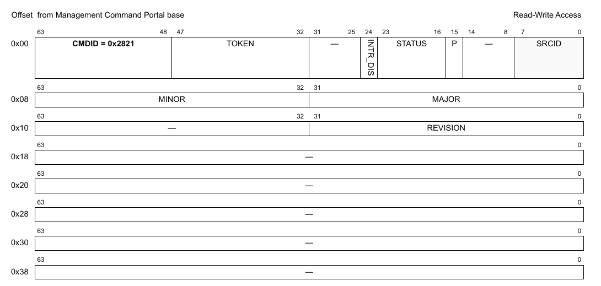

**Figure 661. Mô tả response của DPAIOP_GET_SL_VERSION**

| Offset | Bits | Tên | Mô tả |
|---|---|---|---|
| 0x00 | 0-63 | Header của command | Xem Table 2 để biết mô tả chung các field của command portal. CMDID phải được đặt như chỉ ra trong hình ở trên. |
| 0x08 | 0-31 | MAJOR | Số major version của AIOP SL |
|   | 32-63 | MINOR | Số minor version của AIOP SL |
| 0x10 | 0-31 | REVISION | Số revision của AIOP SL |

Mọi field không được nêu là reserved và phải được xóa (đặt bằng 0)

### 20.2.16 DPAIOP_GET_STATE

**Cấu trúc command**

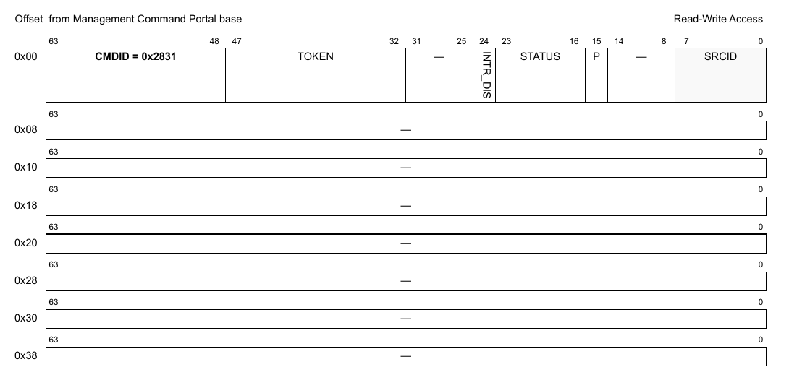

**Figure 662. Mô tả command DPAIOP_GET_STATE**

| Offset | Bits | Tên | Mô tả |
|---|---|---|---|
| 0x00 | 0-63 | Header của command | Xem Table 2 để biết mô tả chung các field của command portal. CMDID phải được đặt như chỉ ra trong hình ở trên. |

Mọi field không được nêu là reserved và phải được xóa (đặt bằng 0)

**Cấu trúc response**

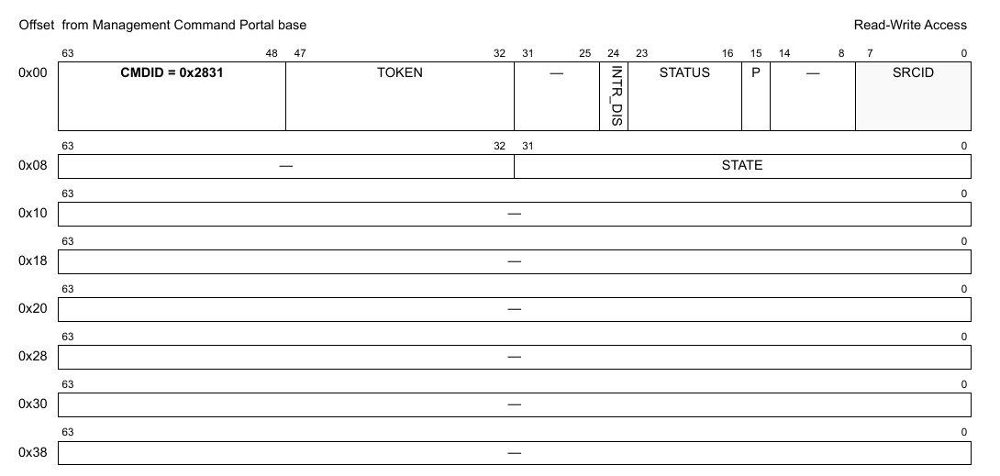

**Figure 663. Mô tả response của DPAIOP_GET_STATE**

| Offset | Bits | Tên | Mô tả |
|---|---|---|---|
| 0x00 | 0-63 | Header của command | Xem Table 2 để biết mô tả chung các field của command portal. CMDID phải được đặt như chỉ ra trong hình ở trên. |
| 0x08 | 0-31 | STATE | Trạng thái AIOP 0x00: Reset AIOP đã hoàn tất thành công. 0x01: Đang reset AIOP. 0x02: Nạp AIOP image đã hoàn tất thành công. 0x04: Đang nạp AIOP image. 0x08: Nạp AIOP image hoàn tất với lỗi. 0x10: Đang boot các AIOP core. 0x20: Quá trình boot các AIOP core hoàn tất với lỗi. 0x40: Các AIOP core hoạt động và đang chạy |

Mọi field không được nêu là reserved và phải được xóa (đặt bằng 0)

### 20.2.17 DPAIOP_SET_TIME_OF_DAY

**Cấu trúc command**

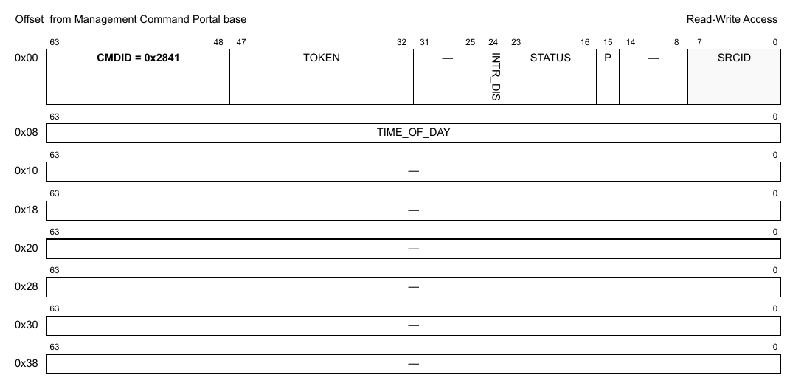

**Figure 664. Mô tả command DPAIOP_SET_TIME_OF_DAY**

| Offset | Bits | Tên | Mô tả |
|---|---|---|---|
| 0x00 | 0-63 | Header của command | Xem Table 2 để biết mô tả chung các field của command portal. CMDID phải được đặt như chỉ ra trong hình ở trên. |
| 0x08 | 0-63 | TIME_OF_DAY | Số millisecond hiện tại kể từ Epoch |

Mọi field không được nêu là reserved và phải được xóa (đặt bằng 0)

### 20.2.18 DPAIOP_GET_TIME_OF_DAY

**Cấu trúc command**

**Figure 665. Mô tả command DPAIOP_GET_TIME_OF_DAY**

| Offset | Bits | Tên | Mô tả |
|---|---|---|---|
| 0x00 | 0-63 | Header của command | Xem Table 2 để biết mô tả chung các field của command portal. CMDID phải được đặt như chỉ ra trong hình ở trên. |

Mọi field không được nêu là reserved và phải được xóa (đặt bằng 0)

**Cấu trúc response**

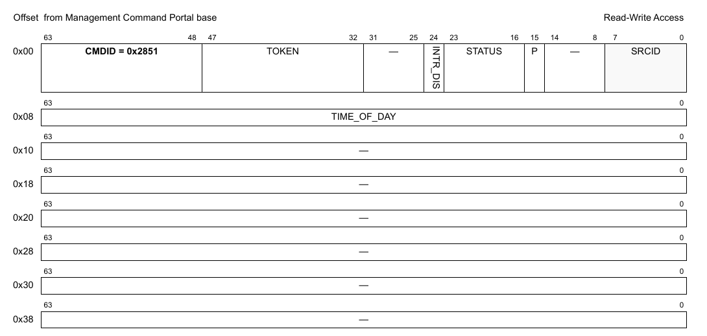

**Figure 666. Mô tả response của DPAIOP_GET_TIME_OF_DAY**

| Offset | Bits | Tên | Mô tả |
|---|---|---|---|
| 0x00 | 0-63 | Header của command | Xem Table 2 để biết mô tả chung các field của command portal. CMDID phải được đặt như chỉ ra trong hình ở trên. |
| 0x08 | 0-63 | TIME_OF_DAY | Số millisecond hiện tại kể từ Epoch |

Mọi field không được nêu là reserved và phải được xóa (đặt bằng 0)

### 20.2.19 DPAIOP_GET_API_VERSION

**Cấu trúc command**

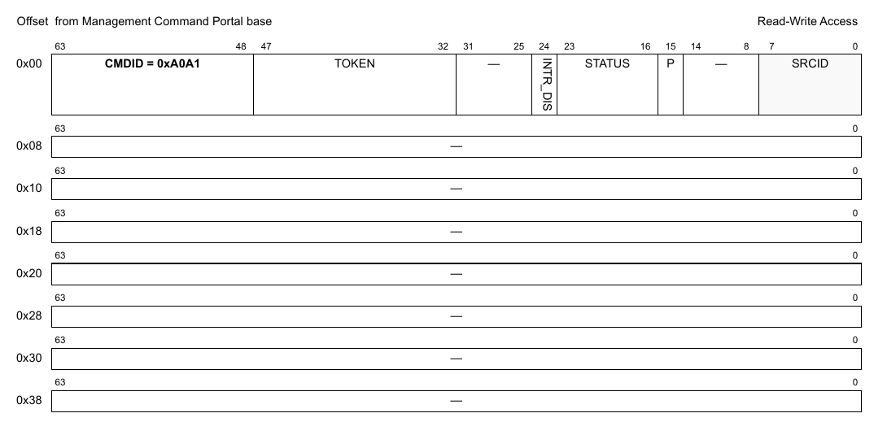

**Figure 667. Mô tả command DPAIOP_GET_API_VERSION**

| Offset | Bits | Tên | Mô tả |
|---|---|---|---|
| 0x00 | 0-63 | Header của command | Xem Table 2 để biết mô tả chung các field của command portal. CMDID phải được đặt như chỉ ra trong hình ở trên. |

Mọi field không được nêu là reserved và phải được xóa (đặt bằng 0)

**Cấu trúc response**

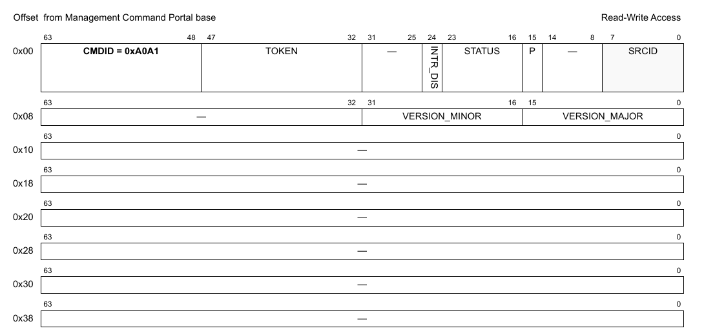

**Figure 668. Mô tả response của DPAIOP_GET_API_VERSION**

| Offset | Bits | Tên | Mô tả |
|---|---|---|---|
| 0x00 | 0-63 | Header của command | Xem Table 2 để biết mô tả chung các field của command portal. CMDID phải được đặt như chỉ ra trong hình ở trên. |
| 0x08 | 0-15 | VERSION_MAJOR | Major version của API |
|   | 16-31 | VERSION_MINOR | Minor version của API |

### 20.2.20 DPAIOP_SET_RESETABLE

Yêu cầu DPAIOP bỏ qua hoặc thực hiện command reset.

**Cấu trúc command**

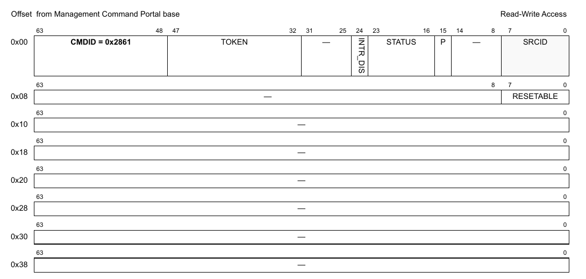

**Figure 669. Mô tả command DPAIOP_SET_RESETABLE**

| Offset | Bits | Tên | Mô tả |
|---|---|---|---|
| 0x00 | 0-63 | Header của command | Xem Table 2 để biết mô tả chung các field của command portal. CMDID phải được đặt như chỉ ra trong hình ở trên. |
| 0x08 | 0-7 | RESETABLE | Nếu đặt bằng 0, DPAIOP sẽ bỏ qua mọi command reset. Command reset sẽ không trả về lỗi. Nếu đặt bằng 1, command reset sẽ được thực hiện. |

Mọi field không được nêu là reserved và phải được xóa (đặt bằng 0)

### 20.2.21 DPAIOP_GET_RESETABLE

Kiểm tra DPAIOP object sẽ bỏ qua hay thực hiện command reset.

**Cấu trúc command**

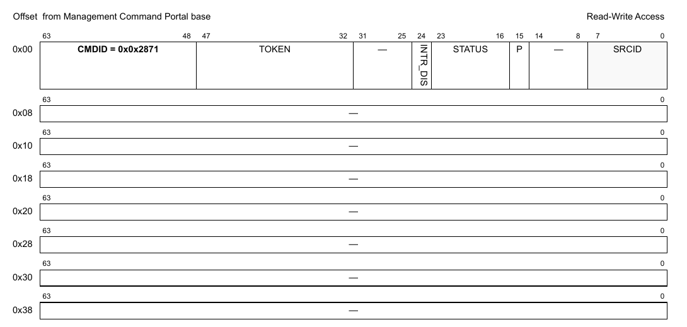

**Figure 670. Mô tả command DPAIOP_GET_RESETABLE**

| Offset | Bits | Tên | Mô tả |
|---|---|---|---|
| 0x00 | 0-63 | Header của command | Xem Table 2 để biết mô tả chung các field của command portal. CMDID phải được đặt như chỉ ra trong hình ở trên. |

Mọi field không được nêu là reserved và phải được xóa (đặt bằng 0)

**Cấu trúc response**

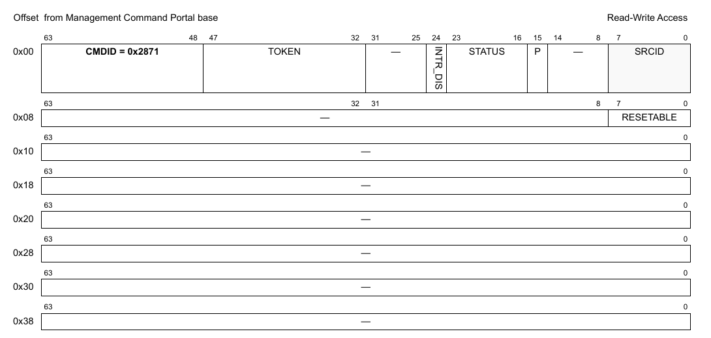

**Figure 671. Mô tả response của DPAIOP_GET_RESETABLE**

| Offset | Bits | Tên | Mô tả |
|---|---|---|---|
| 0x00 | 0-63 | Header của command | Xem Table 2 để biết mô tả chung các field của command portal. CMDID phải được đặt như chỉ ra trong hình ở trên. |
| 0x08 | 0-8 | RESETABLE | 1 - DPAIOP object thực hiện command reset 0 - DPAIOP object sẽ bỏ qua command reset |

Mọi field không được nêu là reserved và phải được xóa (đặt bằng 0)
