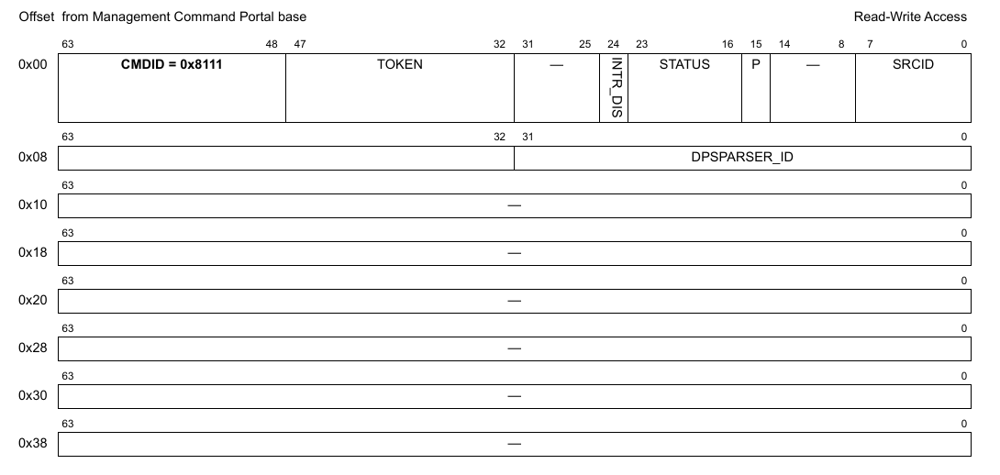
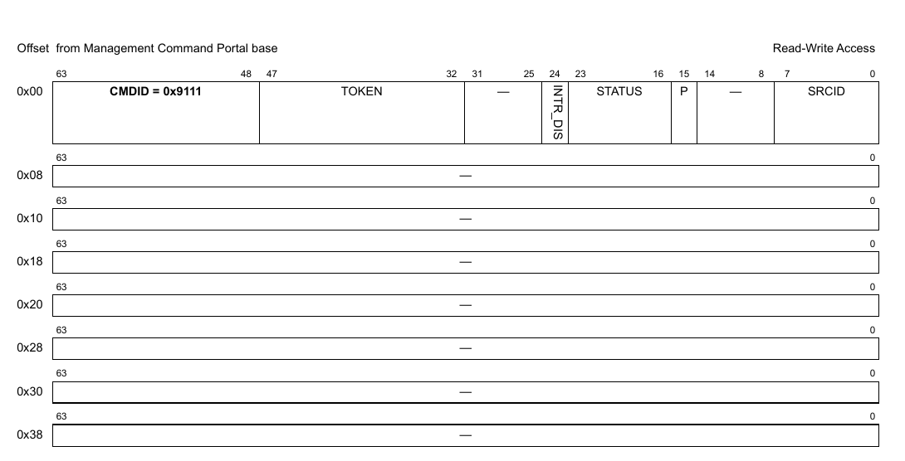
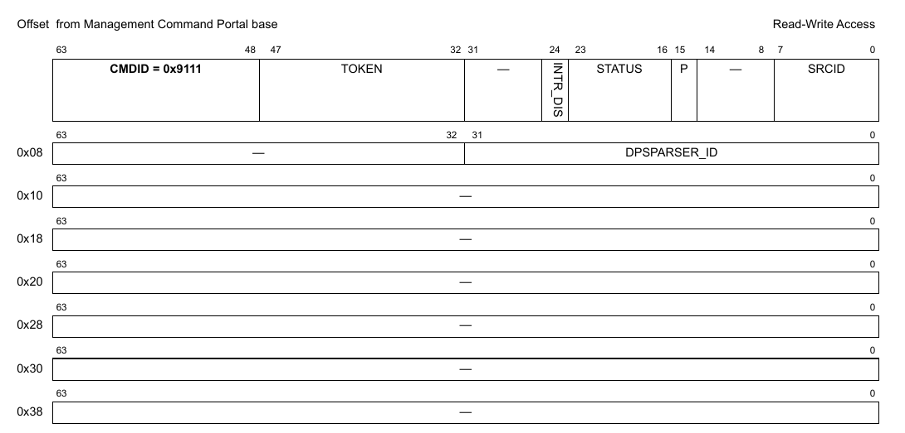
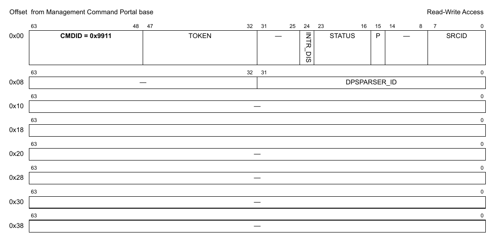
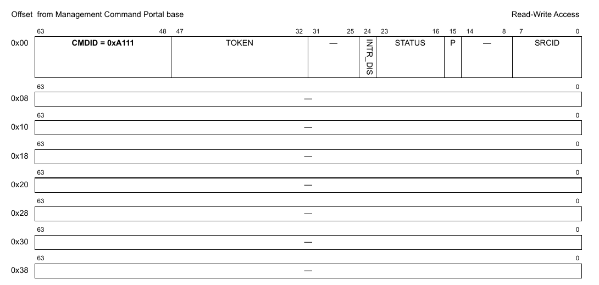
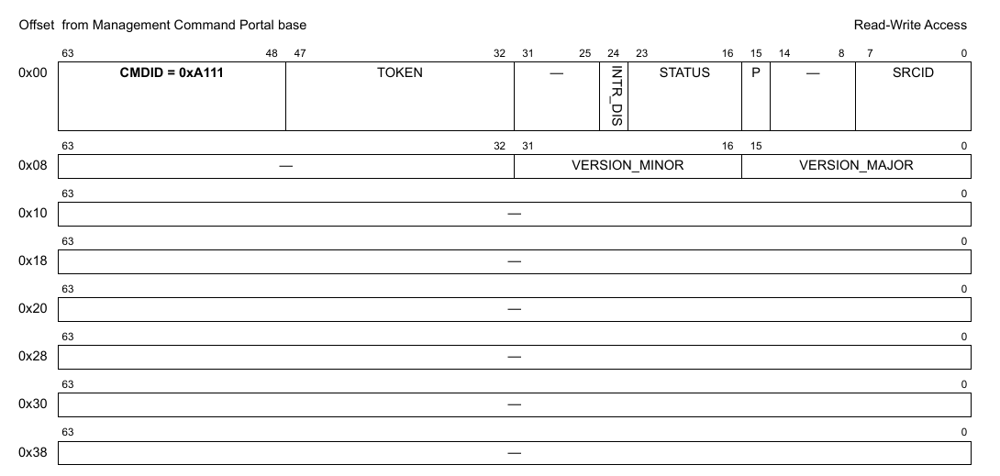
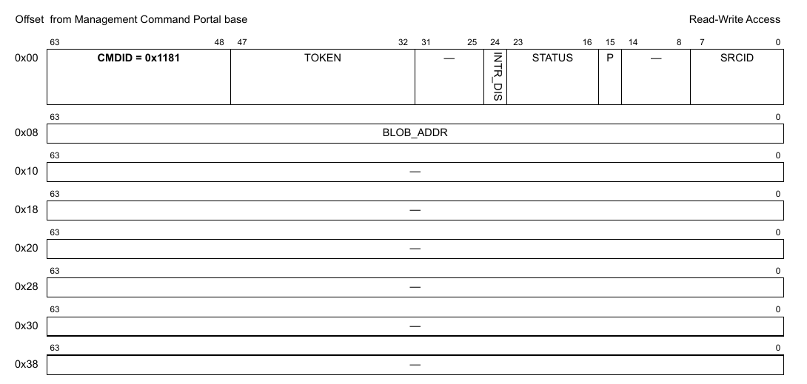
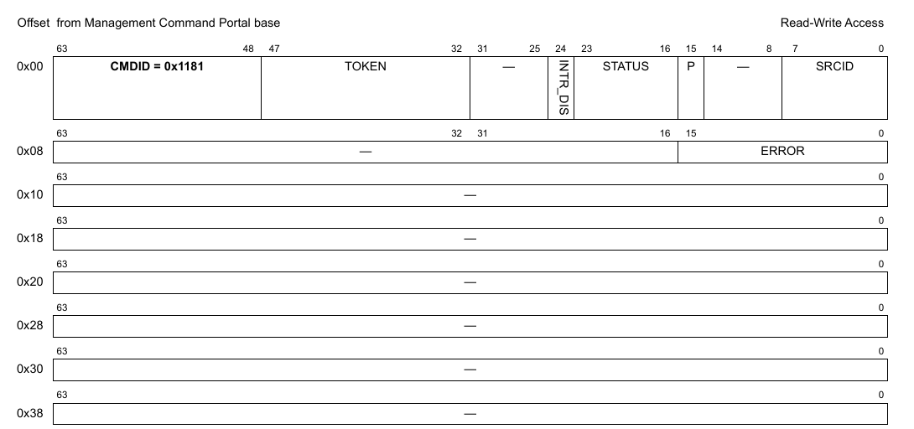

# Chương 22 DPSPARSER: Data Path Soft Parser

MC xuất ra DPSPARSER object làm giao diện để nạp các binary Soft Parser lên thiết bị DPAA2. Trong hệ thống chỉ có một DPSPARSER object.

Hỗ trợ Soft Parser kiểu cũ được triển khai theo từng DPNI object vẫn còn để tương thích ngược, nhưng được thay thế bằng DPSPARSER object. Không nên dùng chung hai cách triển khai này.

## 22.1 Các tính năng của DPSPARSER

Danh sách sau tóm tắt các tính năng và khả năng chính của DPSPARSER:

- Hỗ trợ nạp Soft Parser Blob (binary) vào phần cứng

## 22.2 Tham chiếu command của DPSPARSER

Mục này trình bày chi tiết mô hình lập trình các command của DPSPARSER.

### 22.2.1 DPSPARSER_OPEN

Mở một phiên điều khiển cho object được chỉ định.

Hàm này có thể dùng để mở phiên điều khiển cho một object đã được tạo; object có thể đã được khai báo trong DPL hoặc được tạo bằng command DPSPARSER_CREATE.

Hàm này trả về một authentication token duy nhất, gắn với object ID cụ thể; token này phải được dùng trong mọi command tiếp theo cho object này.

**Cấu trúc command**

Định dạng command được thể hiện trong hình dưới đây.

**Figure 689. Mô tả command DPSPARSER_OPEN**

Bảng sau mô tả các field của command.

**Table 80. Mô tả các field của command DPSPARSER_OPEN1**

| Offset | Bits | Tên | Mô tả |
|---|---|---|---|
| 0x00 | 0-63 | Header của command | Xem Table 2 để biết mô tả chung các field của command portal. CMDID phải được đặt như chỉ ra trong hình ở trên. |
| 0x08 | 0-31 | DPSPARSER_ID | ID duy nhất của DPSPARSER |

1 Mọi field không được nêu là reserved và phải được xóa (đặt bằng 0)

### 22.2.2 DPSPARSER_CLOSE

Đóng phiên điều khiển của object.

Sau khi gọi hàm này, không thao tác nào khác được phép trên object nếu không mở một phiên điều khiển mới.

**Cấu trúc command**

**Figure 690. Mô tả command DPSPARSER_CLOSE**

| Offset | Bits | Tên | Mô tả |
|---|---|---|---|
| 0x00 | 0-63 | Header của command | Xem Table 2 để biết mô tả chung các field của command portal. CMDID phải được đặt như chỉ ra trong hình ở trên. |

Mọi field không được nêu là reserved và phải được xóa (đặt bằng 0)

### 22.2.3 DPSPARSER_CREATE

Command này tạo và khởi tạo một instance DPSPARSER theo các tham số command được chỉ định. Command này không cần cho các instance DPSPARSER được tạo bằng DPL.

Với command CREATE, bên gọi phải cung cấp authentication token của container cha mà object sẽ được tạo và gán vào. Nếu token là '0', object sẽ được gán cho container đang sở hữu MC command portal thực thi command này.

Command trả về một DPSPARSER ID có thể dùng để OPEN hoặc DESTROY object.

Định dạng command được thể hiện trong hình dưới đây.

**Cấu trúc command**

**Figure 691. Mô tả command DPSPARSER_CREATE**

Bảng sau mô tả các field của command.

**Table 81. Mô tả các field của command DPSPARSER_CREATE1**

| Offset | Bits | Tên | Mô tả |
|---|---|---|---|
| 0x00 | 0-63 | Header của command | Xem Table 2 để biết mô tả chung các field của command portal. CMDID phải được đặt như chỉ ra trong hình ở trên. |

1 Mọi field không được nêu là reserved và phải được xóa (đặt bằng 0)

**Cấu trúc response**

**Figure 22-1. Mô tả response của DPSPARSER_CREATE**

Bảng sau mô tả các field của response.

**Table 22-1. Mô tả các field response của DPSPARSER_CREATE1**

| Offset | Bits | Tên | Mô tả |
|---|---|---|---|
| 0x00 | 0-63 | Header của command | Xem Table 2 để biết mô tả chung các field của command portal. CMDID phải được đặt như chỉ ra trong hình ở trên. |
| 0x08 | 0-31 | DPSPARSER_ID | ID duy nhất của DPSPARSER |

1 Mọi field không được nêu là reserved.

### 22.2.4 DPSPARSER_DESTROY

Command này hiện KHÔNG hủy DPSPARSER object khi được gọi.

**Cấu trúc command**

**Figure 692. Mô tả command DPSPARSER_DESTROY**

| Offset | Bits | Tên | Mô tả |
|---|---|---|---|
| 0x00 | 0-63 | Header của command | Xem Table 2 để biết mô tả chung các field của command portal. CMDID phải được đặt như chỉ ra trong hình ở trên. |
| 0x08 | 0–32 | DPSPARSER_ID | ID của DPSPARSER object cần hủy |

Mọi field không được nêu là reserved và phải được xóa (đặt bằng 0)

### 22.2.5 DPSPARSER_GET_API_VERSION

**Cấu trúc command**

**Figure 693. Mô tả command DPSPARSER_GET_API_VERSION**

| Offset | Bits | Tên | Mô tả |
|---|---|---|---|
| 0x00 | 0-63 | Header của command | Xem Table 2 để biết mô tả chung các field của command portal. CMDID phải được đặt như chỉ ra trong hình ở trên. |

Mọi field không được nêu là reserved và phải được xóa (đặt bằng 0)

**Cấu trúc response**

**Figure 694. Mô tả response của DPSPARSER_GET_API_VERSION**

| Offset | Bits | Tên | Mô tả |
|---|---|---|---|
| 0x00 | 0-63 | Header của command | Xem Table 2 để biết mô tả chung các field của command portal. CMDID phải được đặt như chỉ ra trong hình ở trên. |
| 0x08 | 0-15 | VERSION_MAJOR | Major version của API |
|   | 16-31 | VERSION_MINOR | Minor version của API |

Mọi field không được nêu là reserved và phải được xóa (đặt bằng 0)

**Figure 695. Mô tả response của DPSPARSER_GET_API_VERSION**

### 22.2.6 DPSPARSER_APPLY_SPB

Command này áp dụng một binary Soft Parser Blob (SPB) và cấu hình Soft Parser tương ứng.

**Cấu trúc command**

**Figure 696. Mô tả command DPSPARSER_APPLY_SPB**

| Offset | Bits | Tên | Mô tả |
|---|---|---|---|
| 0x00 | 0-63 | Header của command | Xem Table 2 để biết mô tả chung các field của command portal. CMDID phải được đặt như chỉ ra trong hình ở trên. |
| 0x08 | 0-63 | BLOB_ADDR | Địa chỉ Soft Parser Binary |

Mọi field không được nêu là reserved và phải được xóa (đặt bằng 0)

**Cấu trúc response**

**Figure 697. Mô tả response của DPSPARSER_APPLY_SPB**

| Offset | Bits | Tên | Mô tả |
|---|---|---|---|
| 0x00 | 0-63 | Header của command | Xem Table 2 để biết mô tả chung các field của command portal. CMDID phải được đặt như chỉ ra trong hình ở trên. |
| 0x08 | 0-15 | ERROR | Lỗi liên quan tới việc phân tích và áp dụng Soft Parser Binary. Sau đây là danh sách các giá trị lỗi:  0 OK – Không có lỗi 1 "BLOB : Magic number does not match" 2 "BLOB : Version does not match MC API version" 3 "BLOB : IP revision does not match HW revision" 4 "BLOB : Blob length is not a multiple of 4" 5 "BLOB : Invalid length detected" 6 "BLOB : Name length < 0 in 'blob-name'" 7 "BLOB : Name length not a 4 multiple in 'blob-name'" 8 "BLOB : No target HW parser selected" 9 "BLOB : SP size is negative" 10 "BLOB : Size is zero" 11 "BLOB : Number of protocols is negative" 12 "BLOB : Zero protocols" 13 "BLOB : Protocol name is null" 14 "BLOB : SP 'seq-start' is not in [0x40, 0xffc0) range" 15 "BLOB : Invalid base protocol" 16 "BLOB : Invalid parameters section" 17 "BLOB : Invalid parameter" 18 "BLOB : Invalid parameter configuration" 19 "BLOB : Not aligned value" 20 "BLOB : Invalid section TAG detected" 21 "BLOB : Section size is zero" 22 "BLOB : Section size not a 4 multiple" 23 "BLOB : Section size is too big" 24 "BLOB : No 'bytecode' section before" 25 "BLOB : No 'sp-protocols' section before" 26 "BLOB : No 'bytecode' section defined" 27 "BLOB : No 'sp-protocols' section defined" 28 "BLOB : Soft Parser BLOB parsing : Error detected" 29 "apply spb : Soft Parser BLOB is already applied" 30 "apply spb : BLOB address is not set" 31 "BLOB : SP parameter offset is not a 4 multiple" 32 "BLOB : SP parameter offset can't be less than 0x40" 33 "BLOB : Bytecode size is not a 4 multiple" 34 "BLOB : Bytecode size cannot be zero" 35 "BLOB : Bytecode can't overwrite the 0xFFE address" 36 "BLOB : No hardware parser selected as target" 37 "BLOB : Bytecode overlap detected" 38 "BLOB : No parser support" 39 "BLOB : Too many bytecode sections on WRIOP ingress" 40 "BLOB : Too many bytecode sections on WRIOP egress" 41 "BLOB : Too many bytecode sections on AIOP" 42 "BLOB : Duplicated protocol is already registered" 43 "BLOB : Maximum number of allowed protocols was exceeded" 44 "BLOB : Protocols limit exceeded" 45 "BLOB : Protocol is linked twice" 46 "BLOB : Soft parser is linked twice" 47 "BLOB : Parameter offset exceeds the maximum parameters limit" 48 "BLOB : Parameter size can't be 0 or greater than 64" 49 "BLOB : Parameter offset plus size exceeds the maximum parameters limit" 50 "BLOB : Parameters number exceeds the maximum limit" 51 "BLOB : Duplicated parameter name" 52 "BLOB : Parameters overlapped detected" 53 "apply spb : No dpsparser handle." |

Mọi field không được nêu là reserved và phải được xóa (đặt bằng 0)

**Figure 698. Mô tả response của DPSPARSER_APPLY_SPB**
