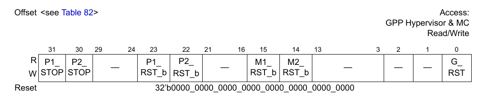
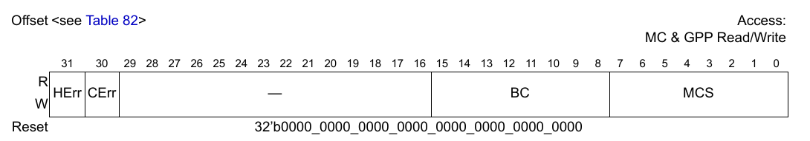
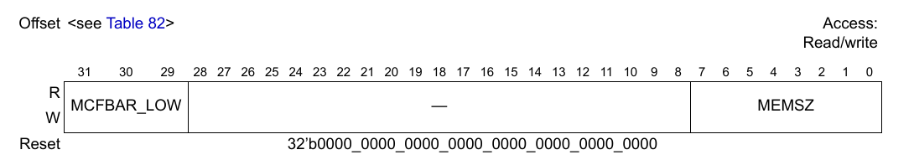
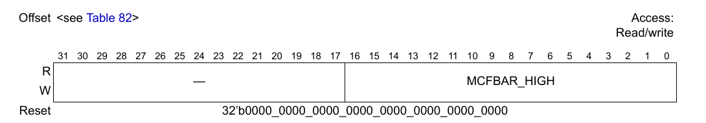
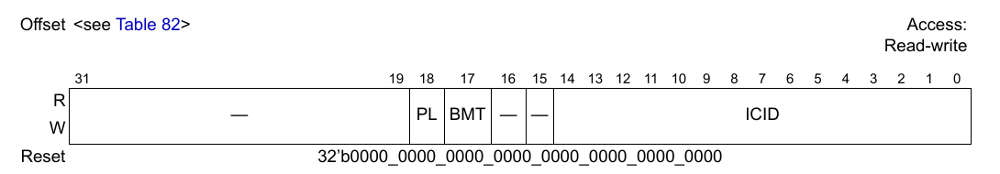
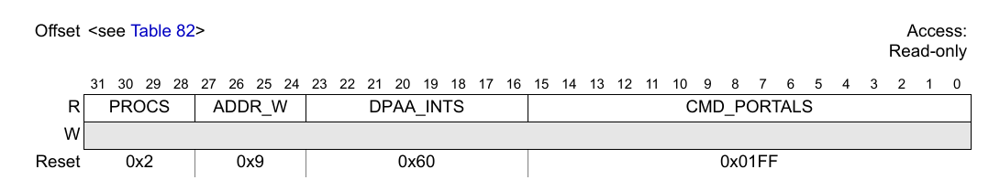
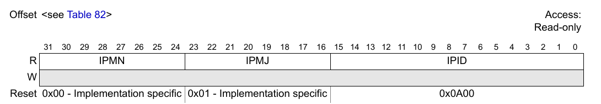
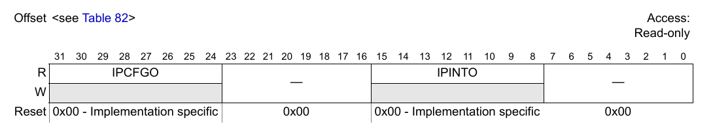

# Chương 23 Memory Map và định nghĩa thanh ghi

Không gian CCSR của MC gồm một khối 64kB được gán trong CCSR map của SoC, và được truy cập qua giao diện CCSR SkyBlue. Giả định rằng chỉ phần mềm tin cậy mới truy cập được các thanh ghi MC, và mọi thanh ghi MC đều Little-Endian; mọi truy cập tới thanh ghi MC phải căn tự nhiên theo word 4 byte. Các thanh ghi cấu hình, điều khiển và trạng thái của MC được tóm tắt trong Table 82.

**Table 82. Memory Map của MC**

| Register offset (chỉ truy cập tin cậy) | Thanh ghi | Truy cập | Reset | Section/ Trang |
|---|---|---|---|---|
| 0x0000 | GCR1—General Control Register 1 | R/W | 0x0000_0000 | 23.1/23-1 |
| 0x0004 | Reserved | — | — | — |
| 0x0008 | GSR—General Status Register | R/W | 0x0000_0000 | 23.2/23-3 |
| 0x000C - 0x001F | Reserved | — | — | — |
| 0x0020 | MCFBALR—MC Firmware Base Address Low | R/W | 0x0000_0000 | 23.3/23-5 |
| 0x0024 | MCFBAHR—MC Firmware Base Address High | R/W | 0x0000_0000 | 23.4/23-5 |
| 0x0028 | MCFAPR—MC Firmware Attributes and Partitioning Register | R/W | 0x0000_0000 | 23.5/23-6 |
| 0x002C - 0x0BEF | Reserved | — | — | — |
| 0x0BF0 | PSR—Parameter Summary Register | R | 0x0000_0000 | 23.6/23-7 |
| 0x0BF4 | Reserved | — | — | — |
| 0x0BF8 | BRR1—Block Revision Register 1 | R | 0x0000_0000 | 23.7/23-7 |
| 0x0BFC | BRR2—Block Revision Register 2 | R | 0x0000_0000 | 23.8/23-8 |
| 0x0C00 - 0xFFFF | Reserved | — | — | — |

## 23.1 General Control Register 1 (GCR1)

GCR1, thể hiện trong hình sau, chứa các điều khiển và cấu hình chung cho MC.

**Figure 699. General Control Register 1 (GCR1)**

Bảng sau mô tả các field của GCR1.

**Table 83. Mô tả field của GCR1**

| Bits | Tên | Mô tả |
|---|---|---|
| 0 | G_RST | MC Global Reset. Bit này kích hoạt các tín hiệu reset tới MC. Bit này tự xóa, nên firmware MC có thể dùng bit này để tự reset toàn bộ MC. 1’b0 - tín hiệu global_reset được thôi kích hoạt 1’b1 - tín hiệu global_reset được kích hoạt. Lưu ý rằng giá trị này sẽ tự động trở về 1’b0 sau vài chu kỳ. |
| 1-13 | — | Reserved |
| 14 | M2_RST_b | Command Portals 256-511 Reset. Bit này xóa mọi trạng thái gắn với các command portal này. Nếu nhận được một giao dịch portal trong khi bit này đang bị xóa, MC không thể đáp ứng giao dịch và hành vi của interconnect là không xác định. Khuyến nghị chương trình boot GPP đọc bit này cho tới khi nó báo không còn reset (tức 1’b1) trước khi enable hoặc thực hiện bất kỳ truy cập nào tới các MC portal. Kết quả của việc reset các command portal sau khi đã bắt đầu hoạt động mà không reset toàn bộ MC là không xác định và nên tránh. Bit này giữ nguyên giá trị; nó không tự xóa. 1’b0 - các command portal 256-511 bị reset. Truy cập portal bị tắt. 1’b1 - các command portal 256-511 hoạt động bình thường. |
| 15 | M1_RST_b | Command Portals 0-255 Reset. Bit này xóa mọi trạng thái gắn với các command portal này. Nếu nhận được một giao dịch portal trong khi bit này đang bị xóa, MC không thể đáp ứng giao dịch và hành vi của interconnect là không xác định. Khuyến nghị chương trình boot GPP đọc bit này cho tới khi nó báo không còn reset (tức 1’b1) trước khi enable hoặc thực hiện bất kỳ truy cập nào tới các MC portal. Kết quả của việc reset các command portal sau khi đã bắt đầu hoạt động mà không reset toàn bộ MC là không xác định và nên tránh. Bit này giữ nguyên giá trị; nó không tự xóa. 1’b0 - các command portal 0-255 bị reset. Truy cập portal bị tắt. 1’b1 - các command portal 0-255 hoạt động bình thường. |
| 16-21 | — | Reserved |
| 22 | P2_RST_b | Processor 2 Reset. Bit này kích hoạt tín hiệu hard_reset tới MC processor 2 và watchdog timer 2. Nó không reset các debug subsystem của processor tương ứng. Bit này giữ nguyên giá trị; nó không tự xóa. Khác với P1_RST_b, GPP không nên thay đổi bit này – firmware MC tự khởi động và dừng các MC core khi cần. 1’b0 - tín hiệu hard_reset được kích hoạt 1’b1 - tín hiệu hard_reset được thôi kích hoạt và processor được thả cho chạy |
| 23 | P1_RST_b | Processor 1 Reset. Bit này kích hoạt tín hiệu hard_reset tới MC processor 1 và watchdog timer 1. Nó không reset các debug subsystem của processor tương ứng. Bit này giữ nguyên giá trị; nó không tự xóa. Bit này cần được chương trình boot đặt để khởi động firmware MC. Chỉ được đặt bit này sau khi firmware MC đã được nạp vào bộ nhớ hệ thống và mọi thanh ghi MC khác đã được lập trình như mô tả trong mục này. 1’b0 - tín hiệu hard_reset được kích hoạt 1’b1 - tín hiệu hard_reset được thôi kích hoạt và processor được thả cho chạy |
| 24-29 | — | Reserved |
| 30 | P2_STOP | Processor 2 Stop. Bit này dừng clock của MC processor 2. Clock của processor không dừng ngay lập tức. Không mất trạng thái nào. Các command portal không bị ảnh hưởng bởi bit này. 1’b0 - processor được thả cho chạy (mặc định sau POR) 1’b1 - clock của processor bị (sẽ bị) dừng |
| 31 | P1_STOP | Processor 1 Stop. Bit này dừng clock của MC processor 1. Clock của processor không dừng ngay lập tức. Không mất trạng thái nào. Các command portal không bị ảnh hưởng bởi bit này. 1’b0 - processor được thả cho chạy (mặc định sau POR) 1’b1 - clock của processor bị (sẽ bị) dừng |

## 23.2 General Status Register (GSR)

GSR, thể hiện trong hình sau, chứa trạng thái phần cứng và firmware của MC.

**Figure 700. General Status Register (GSR)**

Bảng sau mô tả các field của GSR.

**Table 84. Mô tả field của GSR**

| Bits | Tên | Mô tả |
|---|---|---|
| 0-7 | MCS | MC Status. Sau khi MC được khởi chạy, MC ghi trạng thái boot vào các bit MCS. Chương trình boot nên poll field trạng thái MCS cho tới khi nó được đặt giá trị khác 0. Các mã sau cho biết trạng thái hoàn tất của quá trình boot MC: 0x01 - MC boot hoàn tất thành công. Quá trình boot hệ thống có thể tiếp tục bình thường. 0x03 - Lỗi chung của nền tảng MC. 0x05 - Lỗi khởi tạo device tree compiler của MC. 0x07 - Lỗi khởi tạo resource manager của MC. 0x09 - Lỗi khởi tạo link manager của MC. 0x0B - Lỗi khởi tạo command portal của MC. 0x0D - Lỗi khởi tạo QBMan controller. 0x0F - Lỗi khởi tạo WRIOP controller. 0x11 - Lỗi khởi tạo AIOP controller. 0x15 - Lỗi khởi tạo hạ tầng DPMAC object. 0x17 - Lỗi khởi tạo hạ tầng DPRC object. 0x19 - Lỗi khởi tạo DPMNG controller. 0x1B - Lỗi khởi tạo hạ tầng DPIO object. 0x1D - Lỗi khởi tạo hạ tầng DPBP object. 0x1F - Lỗi khởi tạo hạ tầng DPNI object. 0x21 - Lỗi khởi tạo hạ tầng DPSW object. 0x23 - Lỗi khởi tạo SEC engine. 0x25 - Lỗi khởi tạo hạ tầng DPCON object. 0x27 - Lỗi khởi tạo hạ tầng DPCI object. 0x29 - Lỗi khởi tạo hạ tầng DPSECI object. 0x2B - Lỗi khởi tạo chung của MC. 0x2D - Lỗi khởi tạo hạ tầng DPDMUX object. 0x2F - Lỗi khởi tạo DPC controller. 0x31 - Lỗi khởi tạo log của MC. 0x33 - Lỗi khởi tạo DCE engine. 0x35 - Lỗi khởi tạo hạ tầng DPAIOP object. 0x37 - Lỗi khởi tạo hạ tầng DPMCP object. 0x39 - Lỗi khởi tạo hạ tầng DPDMAI object. 0x3B - Lỗi khởi tạo bộ nhớ PEB của MC. 0x3D - Lỗi xử lý DPL. Người dùng cần kiểm tra tính đúng đắn của DPL. 0x3F - Lỗi quá trình layout của MC. 0x47 - Lỗi khởi tạo LCFG của MC. 0x49 - Lỗi khởi tạo hạ tầng DPDCEI object. 0x4B - Lỗi khởi tạo hạ tầng DPDBG object. 0x4D - Lỗi khởi tạo FM của MC. 0x4F - Lỗi khởi tạo hạ tầng DPRTC object. 0x51 - Phiên bản SoC không tương thích với MC. |
| 8-15 | BC | Boot Code. Chương trình boot có thể tùy ý đặt field này bằng giá trị liệt kê dưới đây. 0xDD - MC trì hoãn việc xử lý DPL Mọi giá trị khác đều bị bỏ qua. |
| 16-29 | — | Reserved, phải được xóa. |
| 30 | CErr | Catastrophic Error. Đặt bit này sẽ kích hoạt chân MC Catastrophic_Error, dùng làm đầu vào cho SoC Interrupt Controller. GPP không bao giờ được đặt bit này. |
| 31 | HErr | Hardware Error. Khi bit này được đặt, MC đã gặp một điều kiện lỗi nội bộ. GPP không bao giờ được đặt bit này. 1’b0 - MC đang chạy bình thường 1’b1 - MC không chạy hoặc đã gặp lỗi nội bộ. Đặt bit này sẽ kích hoạt MC HReset_Req. |

## 23.3 MC Firmware Base Address Low Register (MCFBALR)

Đây là phần có trọng số thấp của địa chỉ cơ sở vùng bộ nhớ riêng 512MB của MC trong SoC Internal Address Map. GPP chỉ nên lập trình MCFBALR khi MC đang dừng.

Định dạng thanh ghi MCFBALR được thể hiện trong hình sau.

**Figure 701. MC Firmware Base Address Low Register (MCFBALR)**

Bảng sau mô tả các field của MCFBALR.

**Table 85. Mô tả field của MCFBALR**

| Bits | Tên | Mô tả |
|---|---|---|
| 0-7 | MEMSZ | Kích thước bộ nhớ hệ thống được chương trình boot cấp phát cho MC (bao gồm cả các DPAA controller). Bộ nhớ cấp phát phải là bội số của 256MB, và giá trị (MEMSZ+1) cho biết số khối bộ nhớ 256MB được cấp phát. Ví dụ: 0x00 – cấp phát 256MB (không dùng option này nếu SoC có AIOP) 0x01 – cấp phát 512MB ... 0x07 – cấp phát 2GB v.v.  Các giá trị reserved: 0xFF – cấp phát 128MB |
| 8-28 | — | Reserved |
| 29-31 | MCFBAR_LOW | MC Firmware Base Address Low. Đây là phần có trọng số thấp của địa chỉ cơ sở bộ nhớ riêng của MC, tương ứng với các bit địa chỉ [31-29]. Các bit [47-32] lấy từ MCFBAHR. |

## 23.4 MC Firmware Base Address High Register (MCFBAHR)

Đây là phần có trọng số cao của địa chỉ cơ sở vùng bộ nhớ riêng 512MB của MC trong SoC Internal Address Map. GPP chỉ nên lập trình MCFBAHR khi MC đang dừng.

Định dạng thanh ghi MCFBAHR được thể hiện trong hình sau.

**Figure 702. MC Firmware Base Address High Register (MCFBAHR)**

Bảng sau mô tả các field của MCFBAHR.

**Table 86. Mô tả field của MCFBAHR**

| Bits | Tên | Mô tả |
|---|---|---|
| 0-16 | MCFBAR_HIGH | MC Firmware Base Address High. Đây là phần có trọng số cao của địa chỉ cơ sở bộ nhớ riêng của MC, tương ứng với các bit địa chỉ [48-32]. Các bit [31-29] lấy từ MCFBALR. |
| 17-31 | — | Reserved |

## 23.5 MC Firmware Attributes and Partitioning Register (MCFAPR)

MCFARP *(ghi chú: đúng là MCFAPR)* chứa isolation context identifier và các bộ định tính truy cập bộ nhớ mà MC dùng, gắn kèm làm thuộc tính giao dịch, khi truy cập bất kỳ vị trí nào trong khối bộ nhớ riêng 512MB của nó trong SoC internal address map. GPP chỉ nên lập trình MCFAPR khi MC đang dừng.

**Figure 703. MC Firmware Attributes and Partitioning Register (MCFAPR)**

Bảng sau mô tả các field của MCFAPR.

**Table 87. Mô tả field của MCFAPR**

| Bits | Tên | Mô tả |
|---|---|---|
| 0-14 | ICID | ICID. Đây là giá trị Isolation Context ID được PAMU/SMMU dùng để dịch địa chỉ nếu bit Privilege Level được đặt. |
| 15-16 | — | Reserved |
| 17 | BMT | Bypass Memory Translation. Thuộc tính này buộc bỏ qua việc dịch địa chỉ của IOMMU. |
| 18 | PL | Privilege Level. Nếu bit này được đặt, các giao dịch interrupt của MC được gắn nhãn bằng field ICID (Isolation Context ID), và được đưa qua IOMMU để dịch sang SoC internal Address Map. Nếu bit này bị xóa, mọi giao dịch hỗ trợ của MC đều bỏ qua IOMMU và giá trị ICID không được dùng. |
| 19-31 | — | Reserved |

## 23.6 Parameter Summary Register (PSR)

PSR, thể hiện trong hình sau, tóm tắt các tính năng được tham số hóa của bản triển khai MC này.

> **NOTE**
>
> Đội thiết kế có thể bỏ hoặc sửa thanh ghi này; tuy nhiên, thông tin chứa trong thanh ghi vẫn cần được cung cấp theo cách nào đó.

**Figure 704. Parameter Summary Register 1 (PSR1)**

Bảng sau mô tả các field của PSR1.

**Table 88. Mô tả field của PSR1**

| Bits | Tên | Mô tả |
|---|---|---|
| 0-15 | CMD_PORTALS | Command Portals - Tổng số command portal được triển khai trong mọi CPM của MC |
| 16-23 | DPAA_INTS | DPAA2 Interrupt Inputs - Số tín hiệu đầu vào interrupt DPAA2 chưa dùng, có sẵn để nối tới các khối IP DPAA2 khác. |
| 24-27 | ADDR_W | External Address Physical Width - Độ rộng địa chỉ của nền tảng SoC. Giá trị: 0x0 = 32 bit, 0x2 = 36 bit, 0x4 = 40 bit, 0x6 = 44 bit, 0x8 = 48 bit, 0x9 = 49 bit |
| 28-31 | PROCS | Tổng số processor (core hoặc hardware thread) được triển khai trong MC |

## 23.7 Block Revision Register 1 (BRR1)

BRR1, thể hiện trong hình sau, cung cấp thông tin revision của khối IP MC.

**Figure 705. Block Revision Register 1 (BRR1)**

Bảng sau mô tả các field của BRR1.

**Table 89. Mô tả field của BRR1**

| Bits | Tên | Mô tả |
|---|---|---|
| 0-15 | IPID | IP block ID - 0x0A00 biểu thị Management Complex |
| 16-23 | IPMJ | Major revision của khối IP. Bằng 0x01 trong bản triển khai MC đầu tiên. |
| 24-31 | IPMN | Minor revision của khối IP. Bằng 0x00 trong bản triển khai MC đầu tiên. |

## 23.8 Block Revision Register 2 (BRR2)

BRR2, thể hiện trong hình sau, cung cấp thông tin về các option tích hợp và cấu hình của khối IP. Lưu ý rằng thông tin phiên bản trong thanh ghi này là của khối phần cứng, không phải của firmware đã nạp.

**Figure 706. Block Revision Register 2 (BRR2)**

Bảng sau mô tả các field của BRR2.

**Table 90. Mô tả field của BRR2**

| Bits | Tên | Mô tả |
|---|---|---|
| 0-7 | — | Reserved |
| 8-15 | IPINTO | Các option tích hợp của khối IP - Field này được đặt bằng 0x00 trong bản triển khai MC đầu tiên. |
| 16-23 | — | Reserved |
| 24-31 | IPCFGO | Các option cấu hình của khối IP - Field này được đặt bằng 0x00 trong bản triển khai MC đầu tiên. |
