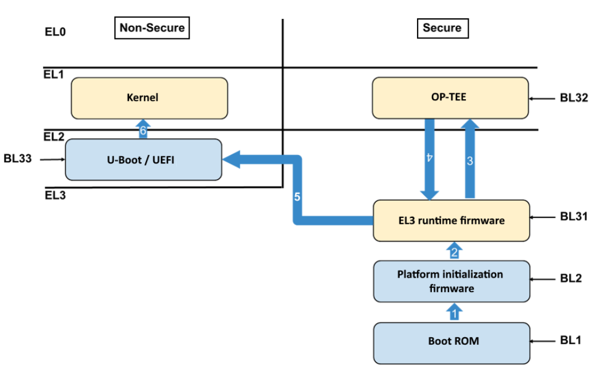
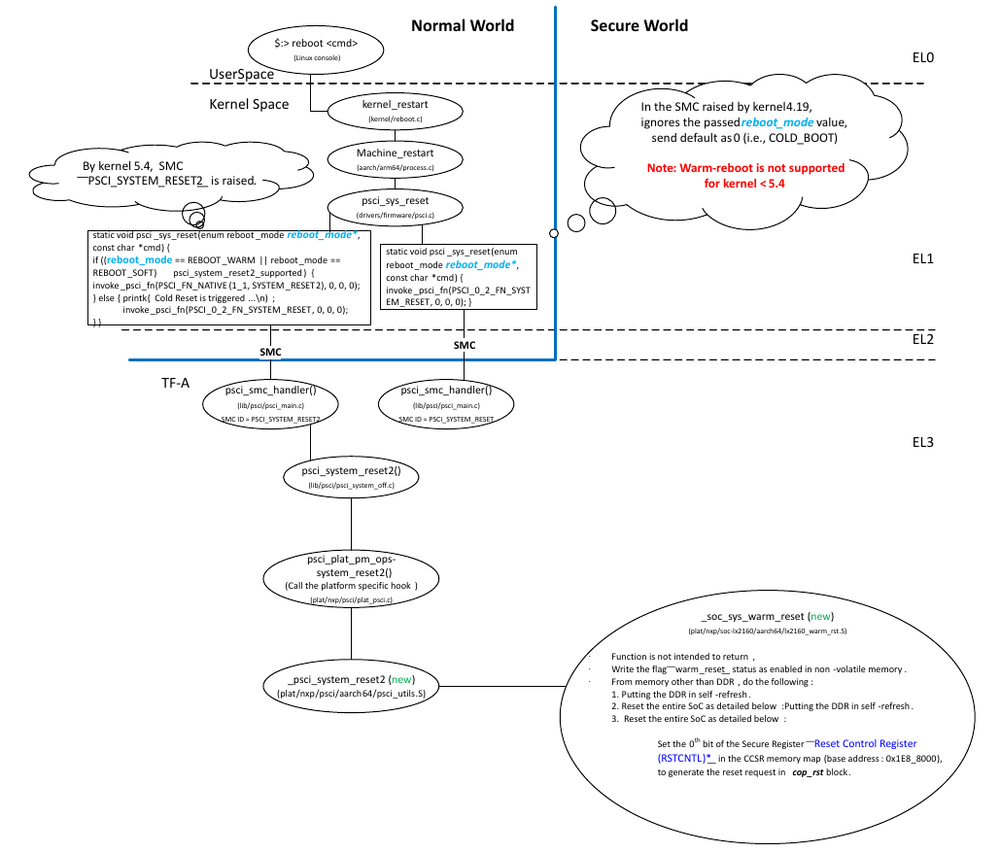
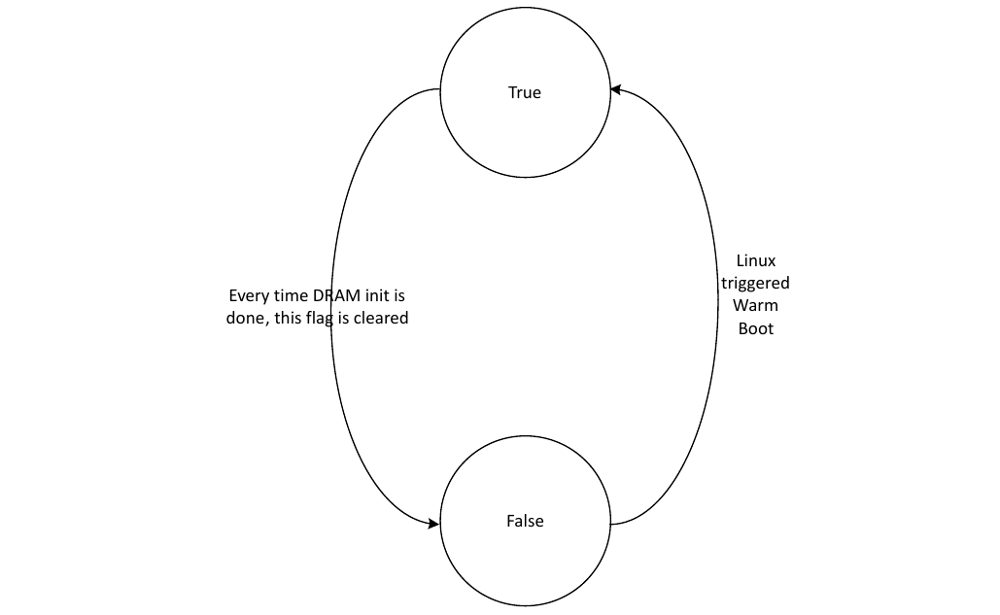
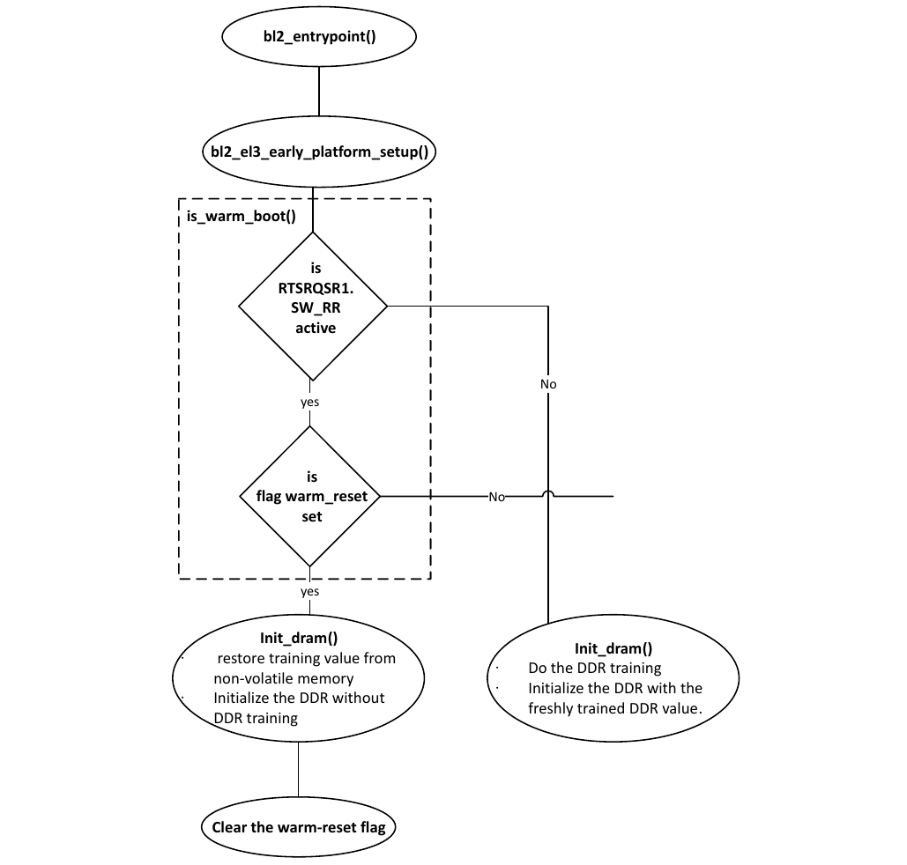
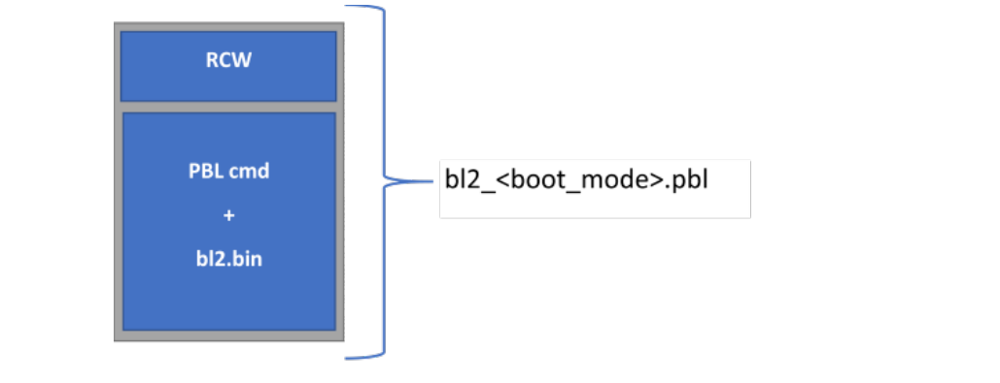
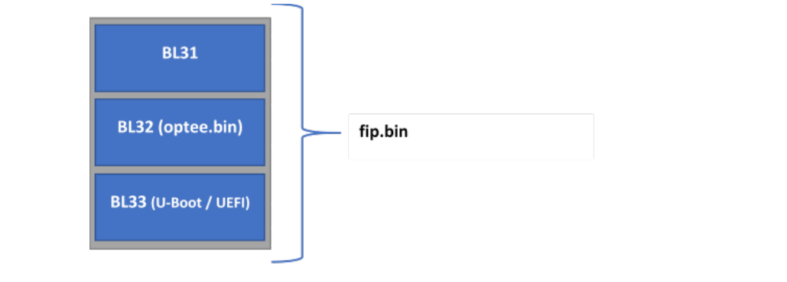

# 5 Bootloader

## 5.1 Luồng boot tổng quát

### 5.1.1 Các nguyên tắc boot SoC của NXP

Luồng boot mức cao của một SoC ARMv8-A là:

1. SoC ra khỏi reset và đọc image RCW/PBL từ một nguồn boot, như NOR flash, thẻ SD hoặc eMMC flash. Image RCW/PBL chứa các bit cấu hình điều khiển:
   - Pin muxing và giao thức được chọn cho các chân SerDes.
   - Các tham số clock và hệ số nhân PLL.
   - Thiết bị chứa phần mềm đầu tiên (không nằm trong BootROM nội) được chạy.
2. Code trong BootROM nội bắt đầu chạy và cấu hình các khía cạnh mức thấp của SoC.
3. Sau đó BootROM phải nạp phần mềm ngoài đầu tiên (các binary TF-A) để chạy từ một thiết bị boot, như NOR flash hoặc SD/eMMC.

   a. BootROM chuyển quyền điều khiển cho BL2.

   b. BL2 nạp và khởi động bootloader từ NOR flash hoặc SD/eMMC.

   **Ghi chú:** Để biết thêm chi tiết về TF-A, xem Section 5.2.

4. Thông thường, bootloader cũng phải nạp firmware ngoại vi, tức firmware cần để các ngoại vi như Ethernet controller hoạt động. Chi tiết khác nhau tùy SoC.
5. Khi bootloader khởi tạo xong, nhiệm vụ của nó là tìm image Linux kernel và image Linux device tree. Device tree là bản mô tả phần cứng của board và SoC mà Linux dùng, ví dụ để biết ngoại vi nào có thể dùng và gắn driver với chúng. Bootloader thường thực hiện một số “fixup” tức thời trên device tree để truyền thông tin cho Linux.

   **Ghi chú:** Ví dụ, nếu muốn dùng thiết bị PCIe như card INTEL e1000 trong U-Boot hoặc Linux, bạn có thể dùng lệnh "pci enum" tại U-Boot prompt.

6. Tóm lại, bootloader đọc image kernel và device tree từ bộ nhớ hoặc thiết bị lưu trữ dung lượng lớn. Vì bootloader có nhiều driver, có nhiều lựa chọn khả dĩ cho vị trí các image.
   - NOR flash (QSPI nối tiếp hoặc song song)
   - Thẻ SD/eMMC flash
   - Mọi loại thiết bị lưu trữ dung lượng lớn USB
   - Mọi loại ổ SATA
   - Ethernet, thường qua TFTP
7. Sau khi bootloader nạp kernel và device tree và thực hiện các fixup, nó đặt các kernel boot parameter và device tree vào DDR, nơi kernel có thể tìm thấy, rồi chuyển quyền điều khiển cho kernel. Một trong các kernel parameter quan trọng là “root=”. Nó cho Linux kernel biết thiết bị nào chứa bộ file user space (userland). U-Boot lưu các kernel parameter trong biến môi trường `bootargs`.
8. Vì Linux kernel hỗ trợ nhiều device driver hơn cả bootloader, các lựa chọn cho thiết bị userland còn nhiều hơn.
   - NOR flash (QSPI nối tiếp hoặc song song)
   - Thẻ SD/eMMC flash
   - Mọi loại thiết bị lưu trữ dung lượng lớn USB.
   - Mọi loại ổ SATA.
   - Ethernet, thường qua NFS.
   - RAM disk (do bootloader nạp dữ liệu vào)
   - Các thiết bị và controller lưu trữ dung lượng lớn dựa trên PCIe của bên thứ ba

     a. SATA controller

     b. SAS controller

     c. Fibre Channel Host Bus Adaptor

     d. Card NVMe

     e. Và nhiều loại khác.

Khi kernel đã chạy, nó khởi động userland, bắt đầu với `systemd`. Quá trình khởi động là một phần của bộ file Ubuntu và tuân theo các thủ tục Ubuntu thông thường.

### 5.1.2 Ghi chú về các nguyên tắc boot chung

- Secure boot không thay đổi trình tự tổng thể. Khác biệt quan trọng là trong secure boot, mỗi thành phần (bắt đầu từ BootROM) đều kiểm tra các image mà nó nạp và khởi động. Chuỗi kiểm tra image này được gọi là “chain of trust”.

Linux thường reset các ngoại vi và nạp lại firmware của chúng. Quá trình này đặc thù cho từng SoC.

## 5.2 TF-A

Trusted Firmware (TF-A) là một bản triển khai phần mềm secure world cho Armv8-A. TF-A cung cấp trusted code base tuân theo các đặc tả của Arm. Luồng boot TF-A gồm 5 giai đoạn boot riêng biệt chạy ở các exception level khác nhau, như giải thích trong bảng sau.

Các exception level liên quan đến công nghệ Arm TrustZone, một cơ chế cho phép cô lập tài nguyên phần cứng trong SoC Arm. Các kiến trúc Arm hỗ trợ hai chế độ TrustZone cho core là Secure và Non-Secure; đây là quan hệ với các Exception Level khác nhau:

- EL0, EL1, EL2: processor có thể ở chế độ Secure (ví dụ, EL1S) hoặc Non-Secure (ví dụ, EL1).
- EL3: processor chỉ được phép ở chế độ Secure.

| Giai đoạn boot | Exception level | Mô tả |
|---|---|---|
| BL1 | EL3 | Firmware Boot ROM<br>**Ghi chú:** BL1 được nhúng trong phần cứng (Boot ROM + các lệnh PBL) |
| BL2 | EL3 | Firmware khởi tạo nền tảng |
| BL31 | EL3 | Firmware runtime thường trú |
| BL32 | EL1S | \[Tùy chọn\] Hệ điều hành tin cậy. Ví dụ, OP-TEE. |
| BL33 | EL2 | Bootloader của normal world. Ví dụ, U-Boot, UEFI |

**Luồng boot TF-A**

1. **BootROM (BL1)**

   a. Khi CPU được nhả khỏi reset, phần cứng thực thi các lệnh PBL sao chép binary BL2 (`bl2.bin`) dùng để khởi tạo nền tảng vào OCRAM. Các lệnh PBI cũng đặt con trỏ BOOTLOC tới vị trí `bl2.bin` được sao chép đến.

   b. Khi các lệnh PBI thực thi thành công, Boot ROM chuyển quyền điều khiển cho image BL2 ở EL3.

2. **BL2**

   a. BL2 khởi tạo DRAM, cấu hình TZASC

   b. BL2 kiểm tra các image BL31, BL32 và BL33 và đưa chúng vào bộ nhớ DDR sau khi kiểm tra. Các image BL31, BL32 và BL33 tạo thành FIP image, `fip.bin`.

   c. Sau khi kiểm tra mọi thành phần của FIP image, BL2 chuyển quyền thực thi cho image firmware runtime EL3 có tên “BL31”,

3. **BL31**

   a. Thiết lập bảng exception vector ở EL3

   b. Cấu hình các thiết lập liên quan đến bảo mật (TZPC)

   c. Cung cấp dịch vụ cho cả bootloader và hệ điều hành, như điều khiển trạng thái nguồn của core và đưa các core bổ sung ra khỏi reset

   d. \[Tùy chọn\] Chuyển quyền thực thi cho image Trusted OS (OP-TEE), BL32, nếu có image BL32.

4. **BL32**

   a. \[Tùy chọn\] Sau khi khởi tạo, BL32 trả quyền điều khiển về BL31.

5. **BL31**

   a. Chuyển quyền thực thi cho bootloader U-Boot/UEFI, BL33 ở EL2

6. **BL33**

   a. Nạp và khởi động kernel cùng các image firmware khác (nếu có).



**Figure 1. Luồng boot TF-A - các giai đoạn**

### 5.2.1 Các tính năng của TF-A

#### 5.2.1.1 TF-A DDR Driver

**Giới thiệu**

Khởi tạo DDR được triển khai trong TF-A cho các nền tảng sau: **LS1012A, LS1028A, LS1043A, LS1046A,** LS1088A, LS2088A, LX2160A Rev2 và LX2162A

TF-A DDR driver là một phần của binary BL2 và trình tự boot mức cao như sau:

Boot ROM -> BL2 **(DDR Init)** -> BL31 -> U-boot/UEFI -> Linux Kernel

Nó thực hiện khởi tạo cả DDR controller lẫn PHY.

**Các phiên bản TF-A**

Vì có hai phiên bản TFA khác nhau được hỗ trợ, cấu trúc thư mục của DDR driver khác nhau với mỗi phiên bản TFA. Bảng sau cho thấy các phiên bản TF-A được hỗ trợ trên từng nền tảng.

| Nền tảng | Phiên bản TFA |
|---|---|
| LS1012A, LS1028A, LS1043A, LS1046A, LS1088A, LS2088A | TFA 1.5 |
| LX2160A Rev2, LX2162A | TFA 2.3 |

**Tham số DDR của board**

Với các nền tảng không phải LX2, cấu hình DDR của board có thể được chỉ định bằng các macro sau trong DDR driver.

| Macro | Đường dẫn file |
|---|---|
| DDRC_NUM_DIMM | Plat/nxp/\<SOC>/\<Board>/platform_def.h |
| NUM_OF_DDRC | Plat/nxp/\<SOC>/include/soc.h |

**Các bước thêm DDR Driver vào TFA**

**\_init_ddr**

Mỗi nền tảng cần định nghĩa một hàm \_init_ddr trong một file riêng của board, ví dụ plat/nxp/soc-ls1043/ ls1043ardb/ddr_init.c.

Hàm \_init_ddr gọi dram_init, hàm này gọi thủ tục khởi tạo của NXP DDR driver.

Hàm này cũng có thể dùng để áp dụng các DDR errata cần áp dụng sau khi cấu hình DDR.

File: ddr_init.c

```
long long _init_ddr(void)
{
        int spd_addr[] = { 0x51, 0x52, 0x53, 0x54 };
        struct ddr_info info;
        struct sysinfo sys;
        long long dram_size;
        zeromem(&sys, sizeof(sys));
        get_clocks(&sys);
        debug("platform clock %lu\n", sys.freq_platform);
        debug("DDR PLL1 %lu\n", sys.freq_ddr_pll0);
        debug("DDR PLL2 %lu\n", sys.freq_ddr_pll1);
        zeromem(&info, sizeof(info));
        /* Set two DDRC. Unused DDRC will be removed automatically. */
        info.num_ctlrs = 2;
        info.spd_addr = spd_addr;
        info.ddr[0] = (void *)NXP_DDR_ADDR;
        info.ddr[1] = (void *)NXP_DDR2_ADDR;
        info.phy[0] = (void *)NXP_DDR_PHY1_ADDR;
        info.phy[1] = (void *)NXP_DDR_PHY2_ADDR;
        info.clk = get_ddr_freq(&sys, 0);
        if (!info.clk)
                info.clk = get_ddr_freq(&sys, 1);
        info.dimm_on_ctlr = 2;
        dram_size = dram_init(&info);
        if (dram_size < 0)
                ERROR("DDR init failed.\n");
        return dram_size;
}
```

**Các ứng dụng DDR ở mức board**

DDR driver hỗ trợ các ứng dụng DDR ở mức board sau:

- **DIMM**: Driver đọc SPD để cấu hình các tham số timing của DDR
- **Mock DIMM**: Dùng timing cố định thay vì đọc SPD
- **Discrete DDR**: Driver cần thêm một cấu hình DDR tĩnh

**DIMM**

Khi thiết kế board dùng module DIMM để cấu hình bộ nhớ động.

Hàm \_init_ddr dùng các tham số DDR của board để đọc SPD được gắn và cấu hình DDR controller.

**MOCK DIMM**

Khi thiết kế board dùng DDR cố định hoặc rời, có thể dùng timing cố định hoặc tĩnh để cấu hình các tham số timing của DDR.

Định nghĩa macro “CONFIG_DDR_NODIMM” trong plat/nxp/\<SOC>/\<Board>/platform_def.h để bật hỗ trợ MOCK DIMM.

Định nghĩa hàm “ddr_get_ddr_params” và structure dim_params trong file ddr_init.c.

Ví dụ:

```
struct dimm_params ddr_raw_timing = {
        .n_ranks = 2,
        .rank_density = 4294967296u,
        .capacity = 8589934592u,
        .primary_sdram_width = 64,
        .ec_sdram_width = 8,
        .device_width = 8,
        .die_density = 0x4,
        .rdimm = 0,
        .mirrored_dimm = 1,
        .n_row_addr = 15,
        .n_col_addr = 10,
        .bank_addr_bits = 0,
        .bank_group_bits = 2,
        .edc_config = 2,
        .burst_lengths_bitmask = 0x0c,
        .tckmin_x_ps = 750,
        .tckmax_ps = 1600,
        .caslat_x = 0x00FFFC00,
        .taa_ps = 13750,
        .trcd_ps = 13750,
        .trp_ps = 13750,
        .tras_ps = 32000,
        .trc_ps = 457500,
        .twr_ps = 15000,
        .trfc1_ps = 260000,
        .trfc2_ps = 160000,
        .trfc4_ps = 110000,
        .tfaw_ps = 21000,
        .trrds_ps = 3000,
        .trrdl_ps = 4900,
        .tccdl_ps = 5000,
        .refresh_rate_ps = 7800000,
};
int ddr_get_ddr_params(struct dimm_params *pdimm,
                            struct ddr_conf *conf)
{
        static const char dimm_model[] = "Fixed DDR on board";
        conf->dimm_in_use[0] = 1;       /* Modify accordingly */
        memcpy(pdimm, &ddr_raw_timing, sizeof(struct dimm_params));
        memcpy(pdimm->mpart, dimm_model, sizeof(dimm_model) - 1);
        /* valid DIMM mask, change accordingly, together with dimm_on_ctlr. */
        return 0x5;
}
```

**Discrete DDR**

Khi thiết kế board dùng DDR cố định hoặc rời, có thể dùng timing tĩnh để cấu hình các tham số timing của DDR.

Định nghĩa macro “CONFIG_STATIC_DDR” trong plat/nxp/\<SOC>/\<BOARD>/plafform_def.h *(ghi chú: đúng là platform_def.h)* để bật timing DDR rời.

Định nghĩa hàm board_static_ddr() và structure ddr_cfg_regs trong file ddr_init.c.

Ví dụ:

```
const struct ddr_cfg_regs static_1600 = {
        .cs[0].config = 0x80040322,
        .cs[0].bnds = 0x1FF,
        .cs[1].config = 0x80000322,
        .cs[1].bnds = 0x1FF,
        .sdram_cfg[0] = 0xE5004000,
        .sdram_cfg[1] = 0x401151,
        .sdram_cfg[2] = 0x0,
        .timing_cfg[0] = 0x91550018,
        .timing_cfg[1] = 0xBAB48E44,
        .timing_cfg[2] = 0x490111,
        .timing_cfg[3] = 0x10C1000,
        .timing_cfg[4] = 0x220002,
        .timing_cfg[5] = 0x3401400,
        .timing_cfg[6] = 0x0,
        .timing_cfg[7] = 0x13300000,
        .timing_cfg[8] = 0x1224800,
        .timing_cfg[9] = 0x0,
        .dq_map[0] = 0x32C57554,
        .dq_map[1] = 0xD4BB0BD4,
        .dq_map[2] = 0x2EC2F554,
        .dq_map[3] = 0xD95D4001,
        .sdram_mode[0] = 0x3010211,
        .sdram_mode[1] = 0x0,
        .sdram_mode[9] = 0x400000,
        .sdram_mode[8] = 0x500,
        .sdram_mode[2] = 0x10211,
        .sdram_mode[3] = 0x0,
        .sdram_mode[10] = 0x400,
        .sdram_mode[11] = 0x400000,
        .sdram_mode[4] = 0x10211,
        .sdram_mode[5] = 0x0,
        .sdram_mode[12] = 0x400,
        .sdram_mode[13] = 0x400000,
        .sdram_mode[6] = 0x10211,
        .sdram_mode[7] = 0x0,
        .sdram_mode[14] = 0x400,
        .sdram_mode[15] = 0x400000,
        .interval = 0x18600618,
        .zq_cntl = 0x8A090705,
        .ddr_sr_cntr = 0x0,
        .clk_cntl = 0x2000000,
       .cdr[0] = 0x80040000,
        .cdr[1] = 0xC1,
        .wrlvl_cntl[0] = 0x86750607,
        .wrlvl_cntl[1] = 0x8090A0B,
        .wrlvl_cntl[2] = 0xD0E0F0C,
};
long long board_static_ddr(struct ddr_info *priv)
{
        memcpy(&priv->ddr_reg, &static_1600, sizeof(static_1600));
        memcpy(&priv->dimm, &static_dimm, sizeof(static_dimm));
        priv->conf.cs_on_dimm[0] = 0x3;
        ddr_board_options(priv);
        compute_ddr_phy(priv);
        return ULL(0x400000000);
}
```

Với các nền tảng LX2 cần thêm thông tin, thông tin này được PHY driver dùng để xác định các tham số DDR.

```
const struct dimm_params static_dimm = {
        .rdimm = 0,
        .primary_sdram_width = 64,
        .ec_sdram_width = 8,
        .n_ranks = 2,
        .device_width = 8,
        .mirrored_dimm = 1,
};
```

Khi các tham số này đã đúng, build lại các thành phần ATF và các thay đổi sẽ có trong các file bl2.pbl, file kết hợp RCW/PBL của board với binary bl2.

**Các tùy chọn debug DDR**

Tùy chọn debug lúc compile được dùng để ghi log mọi loại thông tin hữu ích khi debug các vấn đề DDR.

| Debug flag | Mô tả | Lệnh build |
|---|---|---|
| DDR_DEBUG | In mọi thông tin cấu hình đầu vào của DDR PHY | make PLAT=\<platform> pbl RCW=\<rcw file> fip BL33=\<u-boot.bin> DEBUG=1 DDR_DEBUG=yes |
| DDR_BIST | Bật built-in self test cho DDR | make PLAT=\<platform> pbl RCW=\<rcw file> fip BL33=\<u-boot.bin> DEBUG=1 DDR_BIST=yes |

**Kiểm thử sanity DDR**

Có thể kiểm thử sanity DDR bằng các tính năng kiểm thử sau:

- BIST
- mtest (trong U-Boot)

**Built-In Self Test**

Dùng tùy chọn debug DDR DDR_BIST=yes khi compile TFA.

Tùy chọn debug này sẽ bật BIST trong DDR và driver sẽ chạy BIST sau khi DDR controller và PHY được khởi tạo.

Log khi board boot:

**Memory tester (Mtest)**

mtest là một lệnh U-Boot dùng để kiểm thử bộ nhớ DDR.

Cấu hình U-Boot để compile lệnh mtest: thêm các #define của mtest vào file config riêng của nền tảng và compile U-Boot.

Ví dụ:

File: include/configs/lx2162aqds.h

```
#define CONFIG_CMD_MEMTEST
#define CONFIG_SYS_MEMTEST_START CONFIG_SYS_DDR_SDRAM_BASE
#define CONFIG_SYS_MEMTEST_END (CONFIG_SYS_DDR_SDRAM_BASE + 0x100)
```

**Các lệnh U-Boot:**

```
=> help mtest
mtest - simple RAM read/write test
```

**Cách dùng:**

```
mtest [start [end [pattern [iterations]]]]
```

```
=> mtest 80000000 80000100 0xaabbccdd 3
Testing 80000000 ... 80000100:
Pattern AABBCCDD Writing... Reading...Tested 3 iteration(s) with 0 errors.
```

**LX2 – TFA Driver**

Các nền tảng LX2 là LX2160ARDB rev2.0 và LX2162 dùng phiên bản TFA - TFA 2.3.

Dưới đây là các tài liệu riêng cho LX2.

**Tính năng Warm Reset (LP3)**

LX2162AQDS hỗ trợ tính năng warm reset. Để biết chi tiết, xem mục Warm reset.

**Tham số DDR của board**

File - plat/nxp/soc-lx2160//platform.def định nghĩa các macro sau:

- NUM_OF_DDRC
- DDRC_NUM_DIMM
- DDRC_NUM_CS

Bạn có thể thay đổi file này theo cấu hình board của mình.

**Firmware huấn luyện DDR PHY**

Cách cập nhật firmware huấn luyện DDR PHY

Hãy cập nhật firmware huấn luyện DDR PHY lên phiên bản mới nhất. Tên file firmware huấn luyện DDR PHY là **fip_ddr_all.bin** (DDR FIP Image)

Về các bước ghi **fip_ddr_all.bin** lên các phương tiện boot khác nhau, xem How to program TF-A binaries on specific boot mode

Để kiểm tra phiên bản firmware DDR PHY, compile TFA với tùy chọn debug DDR – DDR_PHY_DEBUG=yes. Xem DDR debug options.

Tham khảo thông báo PMU sau để biết phiên bản firmware huấn luyện DDR PHY (fip_ddr_all.bin) 2019.04.

**PMU10: \*\*\*\* Start DDR4 Training. PMU Firmware Revision 0x1001 \*\*\*\***

##### 5.2.1.1.1 Cách compile DDR FIP image (chỉ áp dụng cho LX2160ARDB Rev2 và LX2162AQDS)

Một FIP image build sẵn đã được cung cấp trong bản phát hành. Để tạo lại DDR fip image cho LX2160ARDB Rev2 và LX2162AQDS, thực hiện các bước sau:

1. $ `cd atf/tools/fiptool`
2. $ Tải các binary DDR PHY: `git clone https://github.com/nxp-qoriq/ddr-phy-binary.` `git`
3. $ `git checkout v2019.04`
4. $ `make`
5. $ `./fiptool create --ddr-immem-udimm-1d ddr-phy-binary/lx2160a/ddr4_pmu_train_imem.bin --ddr-immem-udimm-2d ddr-phy-binary/lx2160a/ddr4_2d_pmu_train_imem.` `bin --ddr-dmmem-udimm-1d ddr-phy-binary/lx2160a/ddr4_pmu_train_dmem.bin --ddr-` `dmmem-udimm-2d ddr-phy-binary/lx2160a/ddr4_2d_pmu_train_dmem.bin --ddr-immem-` `rdimm-1d ddr-phy-binary/lx2160a/ddr4_rdimm_pmu_train_imem.bin --ddr-immem-` `rdimm-2d ddr-phy-binary/lx2160a/ddr4_rdimm2d_pmu_train_imem.bin --ddr-dmmem-` `rdimm-1d ddr-phy-binary/lx2160a/ddr4_rdimm_pmu_train_dmem.bin --ddr-dmmem-` `rdimm-2d ddr-phy-binary/lx2160a/ddr4_rdimm2d_pmu_train_dmem.bin fip_ddr_all.bin` DDR fip image, `fip_ddr_all.bin`, được tạo ra tại `atf/tools/fiptool`

   Danh sách binary DDR PHY cho từng tùy chọn:

   - **--ddr-immem-udimm-1d** \<ddr4_pmu_train_imem.bin>
   - **--ddr-immem-udimm-2d <**ddr4_2d_pmu_train_imem.bin>
   - **--ddr-dmmem-udimm-1d <**ddr4_pmu_train_dmem.bin>
   - **--ddr-dmmem-udimm-2d <**ddr4_2d_pmu_train_dmem.bin>
   - **--ddr-immem-rdimm-1d <**ddr4_rdimm_pmu_train_imem.bin>
   - **--ddr-immem-rdimm-2d <**ddr4_rdimm2d_pmu_train_imem.bin>
   - **--ddr-dmmem-rdimm-1d <**ddr4_rdimm_pmu_train_dmem.bin>
   - **--ddr-dmmem-rdimm-2d <**ddr4_rdimm2d_pmu_train_dmem.bin>

Về các bước ghi `fip_ddr_all.bin` lên các phương tiện boot khác nhau, xem Section 5.2.3.3.

Về các lệnh tạo DDR FIP cho secure boot, xem Section 6.1.1.5.3.

**Table 24. Các tùy chọn debug DDR và ví dụ build**

| Debug flag | Mô tả | Lệnh build |
|---|---|---|
| DEBUG_PHY_IO | Dump mọi lần đọc/ghi register DDR PHY trong lúc khởi tạo, gồm IMEM, DMEM và CSR. Tùy chọn debug này làm tăng đáng kể thời gian boot board vì nó dump mọi lần đọc/ghi register PHY. | make PLAT=\<platform> pbl RCW=\<rcw file> fip BL33=\<u-boot.bin> **DEBUG\_** PHY_IO=yes<br>Ở đây, \<platform> có thể là LX2162AQDS hoặc LX2160ARDB_Rev2<br>Ví dụ:<br>make PLAT=LX2162AQDS pbl RCW=. ./lx2-rcw/lx2162aqds/GGGG_NNNN\_PPPP_PPPP_RR_17_2/rcw_2000\_650_2900_17_2.bin fip BL33=../lx2- uboot/u-boot.bin **DEBUG_PHY_IO=yes** |
| DDR_DEBUG | In mọi thông tin cấu hình đầu vào của DDR PHY | make PLAT=\<platform> pbl RCW=\<rcw file> fip BL33=\<u-boot.bin> **DEBUG=1** DDR_DEBUG=yes<br>Ở đây, \<platform> có thể là LX2162AQDS hoặc LX2160ARDB_Rev2<br>make PLAT=\<platform> pbl RCW=../ lx2-rcw/lx2162aqds/GGGG_NNNN\_PPPP_PPPP_RR_17_2/rcw_2000\_650_2900_17_2.bin fip BL33=../lx2- uboot/u-boot.bin **DEBUG=1 DDR\_** DEBUG=yes |
| DDR_PHY_DEBUG | In các thông báo huấn luyện PMU 1D và 2D | make PLAT=\<platform> pbl RCW=\<rcw file> fip BL33=\<u-boot.bin> **DEBUG=1** DDR_PHY_DEBUG=yes<br>Ở đây, \<platform> có thể là LX2162AQDS hoặc LX2160ARDB_Rev2<br>make PLAT=\<platform> pbl RCW=../ lx2-rcw/lx2162aqds/GGGG_NNNN\_PPPP_PPPP_RR_17_2/rcw_2000\_650_2900_17_2.bin fip BL33=../lx2- uboot/u-boot.bin **DEBUG=1 DDR\_** PHY_DEBUG=yes |
| DDR_BIST | Bật built-in self test cho DDR | make PLAT=\<platform> pbl RCW=\<rcw file> fip BL33=\<u-boot.bin> **DEBUG=1** DDR_BIST=yes<br>Ở đây, \<platform> có thể là LX2162AQDS hoặc LX2160ARDB_Rev2<br>make PLAT=\<platform> pbl RCW=../ lx2-rcw/lx2162aqds/GGGG_NNNN\_PPPP_PPPP_RR_17_2/rcw_2000\_650_2900_17_2.bin fip BL33=../lx2- uboot/u-boot.bin **DEBUG=1 DDR\_** BIST=yes |
| DEBUG_DDR_INPUT_CONFIG | In cấu hình đầu vào ở định dạng JSON | make PLAT=\<platform> pbl RCW=\<rcw file> fip BL33=\<u-boot.bin> **DEBUG\_** DDR_INPUT_CONFIG=yes<br>Ở đây, \<platform> có thể là LX2162AQDS hoặc LX2160ARDB_Rev2<br>make PLAT=\<platform> pbl RCW=../ lx2-rcw/lx2162aqds/GGGG_NNNN\_PPPP_PPPP_RR_17_2/rcw_2000\_650_2900_17_2.bin fip BL33=../lx2- uboot/u-boot.bin **DEBUG_DDR\_** INPUT_CONFIG=yes |

### 5.2.2 Các thành phần chính của TF-A

#### 5.2.2.1 Hỗ trợ boot sau warm reset

**Ghi chú:** Warm reset chỉ được hỗ trợ cho LX2162AQDS và được bật theo mặc định.

Cần hỗ trợ warm reset để:

- Giữ nội dung trên bộ nhớ DDR để phân tích nguyên nhân lần reset trước và thông tin debug.
- Giảm thời gian boot. Lý do là khi warm reset, việc huấn luyện DDR không được thực hiện và DDR được khởi tạo bằng dữ liệu huấn luyện đã lưu lần trước.

**Luồng thực thi warm reboot**



**Figure 2. Luồng thực thi warm reboot**

Theo luồng thực thi warm reboot:

- Từ Linux kernel 5.x trở đi, có một PSCI SMC riêng gọi là `PSCI_SYSTEM_RESET2` để xử lý theo từng vendor. Cùng SMC ID này được dùng để phân biệt warm boot và cold boot trong Linux.
- Trong `_soc_sys_warm_reset()`:
  - Cờ warm-reset được đặt và lưu vào vùng nhớ không bay hơi để lấy lại chế độ reboot ở chu kỳ reset tiếp theo.
  - Bộ nhớ DDR được đưa vào chế độ self-refresh.
  - Register RSTCNTL được dùng để thực hiện reset theo yêu cầu phần mềm.
- Hai loại bộ nhớ không bay hơi được hỗ trợ:
  - FlexSPI NOR flash.
  - Các register GPR của Low-power SecMon, nếu có pin cúc áo cấp nguồn dự phòng.
- Cờ trạng thái warm reset được xử lý như trong máy trạng thái sau:



**Figure 3. Máy trạng thái của cờ trạng thái warm reset**

**Luồng thực thi warm boot**

Trong warm boot, bộ nhớ DDR khôi phục dữ liệu huấn luyện đã lưu lần trước từ bộ nhớ không bay hơi và khởi tạo DDR. Trong bản triển khai hiện tại, FlexSPI NOR flash được dùng để lưu dữ liệu huấn luyện DDR.



**Figure 4. Luồng thực thi warm boot**

**Các bước bật Warm reset**

Lúc compile binary:

- TF-A
  - Kiểm tra các biến sau trong `plat/nxp/soc-lxxx/<platform_name>/platform.mk`
    - WARM_BOOT =
      - yes - hỗ trợ warm-reset
      - no - không hỗ trợ warm-reset
    - NXP_COINED_BB =
      - yes - các register GPR của Low-power SecMon có pin cúc áo dự phòng để giữ nội dung qua các lần reset.
      - no - FlexSPI NOR flash được dùng để lưu cờ trạng thái cho warm reset.
- Lúc chạy binary:
  1. Đặt biến `reboot_mode` trong `bootargs`.

     ```
     => setenv bootargs 'console=ttyS0,115200 root=/dev/mmcblk0p4 reboot=w
      earlycon=uart8250,mmio,0x21c0500 mtdparts=1550000.spi-0:1m(rcw),15m(u-
     boot),48m(kernel.itb);7e800000.flash:16m(nand_uboot),48m(nand_kernel),448m(nand_free)'
     ```

     Ở đây, `reboot_mode = 0; //Warm boot`

  2. Boot vào Linux prompt.
  3. Chạy reboot từ Linux prompt để kích hoạt warm reset.

     ```
     $ reboot
     ```

### 5.2.3 Triển khai các binary TF-A

Để chuyển sang luồng boot TF-A từ luồng boot cũ (dùng PPA), bạn cần compile các binary TF-A, `bl2_<boot_mode>.pbl` và `fip.bin`, rồi ghi các binary này lên phương tiện boot cụ thể trên board.

Bảng sau liệt kê các flash image mới trong luồng boot với TF-A.

| Tên binary TF-A | Thành phần |
|---|---|
| `bl2_<boot_mode>.pbl` | Binary BL2: binary khởi tạo `<platform>` |
|   | Binary RCW cho \<boot_mode> |
| `fip.bin` | BL31: Firmware runtime secure |
|   | BL32: Trusted OS, ví dụ, OP-TEE (tùy chọn) |
|   | BL33: image U-Boot/UEFI |

**Ghi chú:**

- <`platform`> = `ls1012ardb | ls1012afrdm | ls1012afrwy | ls1043ardb | ls1046ardb |` `ls1088ardb | ls2088ardb | lx2160ardb_rev2 | lx2162aqds`
- <`boot_mode`> = `nor, nand, sd, emmc, qspi, flexspi_nor`

**Table 25. Các chế độ boot được hỗ trợ trên từng nền tảng**

| Nền tảng | Chế độ boot |   |   |   |   |   |
|---|---|---|---|---|---|---|
|   | SD | QSPI | NOR | NAND | eMMC | FlexSPI-NOR |
| LS1012ARDB |   | Yes |   |   |   |   |
| FRDM-LS1012 A |   | Yes |   |   |   |   |
| FRWY-LS1012 A |   | Yes |   |   |   |   |
| FRWY-LS1012 A (512 MB) |   | Yes |   |   |   |   |
| LS1043ARDB | Yes |   | Yes | Yes |   |   |
| LS1046ARDB | Yes | Yes |   |   | Yes |   |
| LS1088ARDB | Yes | Yes |   |   |   |   |
| LS2088ARDB |   | Yes | Yes |   |   |   |
| LX2160ARDB Rev2 | Yes |   |   |   | Yes | Yes |

Làm theo các bước sau để compile và triển khai các binary TF-A (`bl2_<boot_mode>.pbl` và `fip.bin`) cho chế độ boot cần thiết.

1. Compile binary PBL từ file source RCW
2. Compile binary U-Boot
3. \[Tùy chọn\] Compile binary OP-TEE
4. Compile các binary TF-A (`bl2_<boot_mode>.pbl` và `fip.bin`)
5. Ghi các binary TF-A cho chế độ boot cụ thể

#### 5.2.3.1 Cách compile binary PBL từ file source RCW

Bạn cần compile binary `rcw_<boot_mode>.bin` để build binary `bl2_<boot_mode>.pbl`.

1. Clone repository `rcw` và compile binary PBL:

   ```
   $ git clone https://github.com/nxp-qoriq/rcw.git
   $ cd rcw
   $ git checkout -b <new branch name> <LSDK tag> ;For example, $ git checkout -
   b LSDK-19.03 LSDK-19.03
   $ cd <platform>
   ```

2. Nếu cần, sửa các file RCW:

   ```
   $ make
   ```

Quy trình này build binary PBL đã compile cho mọi chế độ boot có trên nền tảng đã chọn.

Ví dụ: Binary PBL đã compile cho QSPI NOR flash trên LS1088ARDB-PB, `rcw_1600_qspi.bin`, có tại `rcw/ls1088ardb/FCQQQQQQQQ_PPP_H_0x1d_0x0d/`.

Để build binary `bl2_<boot_mode>.pbl`, xem Section 5.2.3.2.1

**Ghi chú:** Xem file `rcw/<platform>/README` để biết giải thích quy ước đặt tên các thư mục chứa file source và binary RCW.

#### 5.2.3.2 Cách compile các binary TF-A

Clone repository `atf` và compile các binary TF-A, `bl2_<boot_mode>.pbl` và `fip.bin`.

1. `$ git clone https://github.com/nxp-qoriq/atf.git`
2. `$ cd atf`
3. `$ git checkout -b <new branch name> LSDK-<LSDK version>`. Ví dụ, `$ git` `checkout -b LSDK-21.08 LSDK-21.08`
4. `$ export ARCH=arm64`
5. `$ export CROSS_COMPILE=aarch64-linux-gnu-`

Làm theo các bước trong Section 5.2.3.2.1 (`bl2_<boot_mode>.pbl`) và Section 5.2.3.2.2 (`fip.bin`) để compile cả hai binary TF-A.

##### 5.2.3.2.1 Cách compile binary BL2

Để build binary BL2 có OPTEE, chạy lệnh này:

```
$ make PLAT=<platform> bl2 SPD=opteed BOOT_MODE=<boot_mode> BL32=<optee_binary>
 pbl RCW=<path_to_rcw_binary>/<rcw_binary_for_specific_boot_mode>
```

Các binary BL2 đã compile, `bl2.bin` và `bl2_<boot_mode>.pbl`, có tại `atf/` `build/<platform>/release/`. Với bất kỳ cập nhật nào trong source code BL2 hoặc binary RCW, binary `bl2_<boot_mode>.pbl` cần được compile lại.



**Figure 5. bl2.pbl**

**Ghi chú:**

Để compile binary BL2 không có OPTEE:

```
make PLAT=<platform> bl2 BOOT_MODE=<boot_mode> pbl RCW=<path_to_rcw_binary>/
<rcw_binary_for_specific_boot_mode>
```

##### 5.2.3.2.2 Cách compile binary FIP

Để build binary FIP có OPTEE và không có trusted board boot, chạy lệnh này:

```
$ make PLAT=<platform> fip BL33=<path_to_u-boot_binary>/u-boot.bin SPD=opteed
 BL32=<path_to_optee_binary>/tee.bin
```

Các binary BL31 và FIP đã compile, `bl31.bin`, `fip.bin`, có tại `atf/build/<platform>/` `release/`. Với bất kỳ cập nhật nào trong các binary BL31, BL32 hoặc BL33, binary `fip.bin` cần được compile lại.



**Figure 6. fip.bin**

**Ghi chú:**

Để compile binary FIP không có OPTEE và không có trusted board boot:

```
make PLAT=<platform> fip BL33=<path_to_u-boot_binary>/u-boot.bin
```

**Ghi chú:**

Để compile binary FIP có trusted board boot, xem read me tại `<tfa_repo>/plat/nxp/README.` `TRUSTED_BOOT`.

#### 5.2.3.3 Cách ghi các binary TF-A cho chế độ boot cụ thể

- QSPI NOR Flash
  1. Boot từ QSPI NOR flash0
  2. Ghi QSPI NOR flash1: => `sf probe 0:1`
  3. Ghi bl2_qspi.pbl:

     ```
     => tftp 0xa0000000 bl2_qspi.pbl
     => sf erase 0x0 +$filesize && sf write 0xa0000000 0x0 $filesize
     ```

  4. Ghi fip.bin:

     ```
     => tftp 0xa0000000 fip.bin
     => sf erase 0x100000 +$filesize && sf write 0xa0000000 0x100000 $filesize
     ```

  5. Ghi binary DDR FIP (chỉ hỗ trợ cho LX2162AQDS hoặc LX2160ARDB Rev2):

     ```
     => tftp 0x82000000 fip_ddr_all.bin
     => sf erase 0x800000 +$filesize; sf write 0x82000000 0x800000 $filesize
     ```

  6. Boot từ QSPI NOR flash1. Board sẽ boot với TF-A
- Thẻ SD/eMMC
  1. Boot từ QSPI NOR flash0.
  2. Ghi bl2_sd.pbl lên thẻ SD/eMMC:

     ```
     => tftp 82000000 bl2_sd.pbl
     => mmc write 82000000 8 <blk_cnt>
     ```

     Ở đây, blk_cnt là số block trên thẻ SD cần ghi theo kích thước file. Ví dụ, khi bạn nạp bl2_sd.pbl từ TFTP server, nếu số byte được truyền là 82809 (14379 hex) thì blk_cnt được tính là 82809/512 = 161 (A1 hex). Với ví dụ này, lệnh mmc write sẽ là: `=>` `mmc write 82000000 8 A1`.

  3. Ghi fip.bin lên thẻ SD/eMMC:

     ```
     => tftp 82000000 fip.bin
     => mmc write 82000000 800 <blk_cnt>
     ```

     Ở đây, blk_cnt là số block trên thẻ SD cần ghi theo kích thước file. Ví dụ, khi bạn nạp fip.bin từ TFTP server, nếu số byte được truyền là 1077157 (106fa5 hex) thì blk_cnt được tính là 1077157/512 = 2103 (837 hex). Với ví dụ này, lệnh mmc write sẽ là: `=> mmc write 82000000 800 837`.

  4. Ghi binary DDR FIP (chỉ hỗ trợ cho LX2162AQDS hoặc LX2160ARDB Rev2):

     ```
     => tftp 82000000 fip_ddr_all.bin
     => mmc write 82000000 0x04000 <blk_cnt>
     ```

     Ở đây, blk_cnt là số block trên thẻ SD cần ghi theo kích thước file.

  5. Boot từ thẻ SD. Board sẽ boot với TF-A.
- NOR Flash
  1. Boot từ bank mặc định.
  2. Ghi bl2_nor.pbl lên bank thay thế:

     ```
     => tftp 82000000 $path/bl2_nor.pbl;
     => pro off all;erase <bl2_alternate_bank_address> +$filesize;cp.b 82000000
      <bl2_alternate_bank_address> $filesize
     ```

     Với LS1043ARDB, TWR-LS1021A, `<bl2_alternate_bank_address>` là `0x64000000`. Với LS2088ARDB, `<bl2_alternate_bank_address>` là `0x584000000`.

  3. Ghi fip.bin lên bank thay thế:

     ```
     => tftp 82000000 $path/fip.bin;
     => pro off all;erase <fip_alternate_bank_address> +$filesize;cp.b 82000000
      <fip_alternate_bank_address> $filesize
     ```

     Với LS1043ARDB, TWR-LS1021A, `<fip_alternate_bank_address>` là `0x64100000`. Với LS2088ARDB, `<fip_alternate_bank_address>` là `0x584100000`.

     **Ghi chú:** Về địa chỉ bank hiện tại của NOR bank trên các board khác nhau, xem Section 4.8.

  4. Boot board từ bank thay thế. Board sẽ boot với TF-A.
- NAND Flash
  1. Ghi bl2_nand.pbl:

     ```
     => tftp 82000000 $path/bl2_nand.pbl
     => nand erase 0x0 $filesize;nand write 0x82000000 0x0 $filesize;
     ```

  2. Ghi fip.bin:

     ```
     => tftp 82000000  $path/fip.bin
     => nand erase 0x100000 $filesize;nand write 0x82000000 0x100000 $filesize;
     ```

  3. Sau đó boot từ NAND flash. Board sẽ boot với TF-A.

**Ghi chú:** Để biết chi tiết về các chế độ boot mà một board phần cứng hỗ trợ và các lệnh boot, xem Section 4.7.

## 5.3 U-Boot

### 5.3.1 Các thay đổi trong U-Boot

- Trong luồng boot TF-A, không cần khởi tạo DDR trong U-Boot. Khởi tạo DDR là một phần của TF-A. Code khởi tạo DDR có thể được thêm vào `<atf_dir>/plat/nxp/soc-<soc-name>/<soc-name>ardb/ddr_init.c`

  Ví dụ, với LX2160ARDB Rev2, code khởi tạo DDR có thể được thêm vào `<atf_dir>/plat/nxp/soc-` `lx2160/lx2160ardb/ddr_init.c`

  Có thể tìm DDR driver cho các controller khác nhau tại `<atf_dir>/plat/nxp/drivers/ddr`

- Mọi thay đổi trong việc khởi tạo interconnect có thể được thêm vào file `soc.c` tại `<atf_dir>/plat/nxp/` `soc-<soc-name>/`
- Một defconfig duy nhất được tạo cho mọi nguồn boot, `<platform>_tfa_defconfig`. Ví dụ, với LX2160ARDB Rev2, defconfig cần dùng là `lx2160ardb_tfa_defconfig`
- Defconfig TF-A được tạo với các cân nhắc sau:
  - Hỗ trợ PPA bị tắt
  - Hỗ trợ environment được bật cho mọi nguồn boot, như FlexSPI, SD boot
- Các thay đổi khác:
  - Các thay đổi lệnh boot được thực hiện để hỗ trợ autoboot Linux bằng bitbake. Điều này tương tự các thay đổi cần cho hỗ trợ bitbake. Các biến sau được định nghĩa:
    - XSPI_NOR_BOOTCOMMAND
    - SD_BOOTCOMMAND
  - Các thay đổi lệnh MC init được thực hiện để cung cấp lệnh MC init theo nguồn boot:
    - XSPI_MC_INIT_CMD
    - SD_MC_INIT_CMD

### 5.3.2 U-Boot của Layerscape LDP dùng tính năng distro boot

Giống các phiên bản NXP SDK trước, biến U-Boot `bootcmd` chứa các lệnh biểu diễn quá trình boot mặc định. Layerscape LDP khác ở chỗ nó dùng một tính năng chuẩn của U-Boot gọi là `distro boot` để việc tự động boot linh hoạt hơn. Trong distro boot, `bootcmd` chạy thêm các lệnh trong biến `distro_bootcmd`. Các lệnh này là phần cốt lõi của quá trình distro boot.

Distro boot lần lượt kiểm tra các partition trên các thiết bị lưu trữ dung lượng lớn để tìm một file script. Khi U-Boot tìm thấy một file, nó nạp và thực thi file đó để bắt đầu quá trình boot.

Các thiết bị lưu trữ dung lượng lớn được tìm kiếm được định nghĩa trong biến môi trường U-Boot `boot_targets`. Đặt biến này để quyết định thiết bị lưu trữ nào được tìm và thứ tự tìm. Ví dụ,

```
=> printenv boot_targets
boot_targets=usb0 mmc0 scsi0 dhcp
```

Lệnh trên cho thấy thứ tự tìm là thiết bị USB 0, thiết bị MMC (hoặc SD) 0, thiết bị SCSI (SATA) 0, sau đó là DHCP.

Quá trình tìm kiếm dùng một số biến U-Boot. Nó kết thúc với các biến như dưới đây, trong một ví dụ từ LS2088ARDB.

```
=> printenv scan_dev_for_scripts
scan_dev_for_scripts=for script in ${boot_scripts}; do if test -e ${devtype}
 ${devnum}:${distro_bootpart} ${prefix}${script}; then echo Found U-Boot script
 ${prefix}${script}; run boot_a_script; echo SCRIPT FAILED: continuing...; fi;
 done => printenv boot_scripts boot_scripts=ls2088ardb_boot.scr => printenv
 boot_a_script boot_a_script=load ${devtype} ${devnum}:${distro_bootpart}
 ${scriptaddr} ${prefix}${script}; env exists secureboot && load ${devtype}
 ${devnum}:${distro_bootpart} ${scripthdraddr} ${prefix}${boot_script_hdr} &&
 esbc_validate ${scripthdraddr};source ${scriptaddr}
```

Quá trình tìm một script có tên trong biến `boot_scripts`. Trong ví dụ này, script cần tìm có tên `ls2088ardb_boot.scr`. Khi tìm thấy script này, nó được nạp vào RAM bằng lệnh `load` và chạy bằng lệnh `source`. Việc này làm Linux boot.

Layerscape LDP đặt các bootscript vào một file system trên partition thứ hai của một thiết bị lưu trữ dung lượng lớn. U-Boot có thể hiển thị các file trong file system. Tiếp tục ví dụ, các lệnh U-Boot sau liệt kê các file trong partition thứ hai của thiết bị USB 0 (hãy chạy `usb start` trước):

```
=> ls usb 0:2
    174096 config-4.19.68-00020-g5256accac243
    1030533 firmware_ls1012afrwy_qspiboot.img
    45346968 firmware_ls1012ardb_qspiboot.img
    45346968 firmware_ls1028ardb_xspiboot.img
    45346968 firmware_ls1043ardb_norboot.img
    45346968 firmware_ls1046afrwy_qspiboot.img
    45346968 firmware_ls1046ardb_qspiboot.img
    45346968 firmware_ls1088ardb_pb_qspiboot.img
    45346968 firmware_ls2088ardb_norboot.img
    45346968 firmware_ls2088ardb_qspiboot.img
    45346968 firmware_lx2160ardb_rev2_xspiboot.img
<DIR>   4096 flash_images
        20846 flash_images.scr
        14243 fsl-ls1012a-2g5rdb.dtb
        15257 fsl-ls1012a-frdm.dtb
        15267 fsl-ls1012a-frwy.dtb
        15923 fsl-ls1012a-qds.dtb
        14290 fsl-ls1012a-rdb.dtb
        20767 fsl-ls1028a-qds.dtb
        19986 fsl-ls1028a-rdb-dpdk.dtb
        20121 fsl-ls1028a-rdb.dtb
        32939 fsl-ls1043a-qds.dtb
        34451 fsl-ls1043a-qds-sdk.dtb
        30627 fsl-ls1043a-rdb.dtb
        40956 fsl-ls1043a-rdb-sdk.dtb
        33614 fsl-ls1043a-rdb-usdpaa.dtb
        29843 fsl-ls1046a-frwy.dtb
        31519 fsl-ls1046a-frwy-sdk.dtb
        32754 fsl-ls1046a-frwy-usdpaa.dtb
        32709 fsl-ls1046a-qds.dtb
        34269 fsl-ls1046a-qds-sdk.dtb
        29945 fsl-ls1046a-rdb.dtb
        40270 fsl-ls1046a-rdb-sdk.dtb
        32956 fsl-ls1046a-rdb-usdpaa.dtb
        18608 fsl-ls1088a-qds.dtb
        19175 fsl-ls1088a-rdb.dtb
        23524 fsl-ls2080a-qds.dtb
        23082 fsl-ls2080a-rdb.dtb
        21961 fsl-ls2081a-rdb.dtb
        23428 fsl-ls2088a-qds.dtb
        29733 fsl-ls2088a-rdb.dtb
        27720 fsl-lx2160a-qds.dtb
        32280 fsl-lx2160a-rdb.dtb
<DIR>    4096 grub
         2176 hdr_ls1012afrwy_bs.out
         2176 hdr_ls1012ardb_bs.out
         2176 hdr_ls1028ardb_bs.out
         2176 hdr_ls1043ardb_bs.out
         2176 hdr_ls1046afrwy_bs.out
         2176 hdr_ls1046ardb_bs.out
         2176 hdr_ls1088ardb_bs.out
         2176 hdr_ls2088ardb_bs.out
         2176 hdr_lx2160ardb_bs.out
      24852992 Image
      10814630 Image.gz
        964 ls1012afrwy_boot.scr
        962 ls1012ardb_boot.scr
        1038 ls1028ardb_boot.scr
        965 ls1043ardb_boot.scr
        968 ls1046afrwy_boot.scr
        965 ls1046ardb_boot.scr
        961 ls1088ardb_boot.scr
        961 ls2088ardb_boot.scr
      28569752 lsdk_linux_arm64_LS_tiny.itb
        980 lx2160ardb_boot.scr
      17462941 rootfs_yocto_arm64_tiny.cpio.gz
<DIR>   4096 secboot_hdrs
        992 srk_hash.txt
      10814630 vmlinuz-4.19.68-00020-g5256accac243
```

Kết quả cho thấy ổ USB này chứa các script (và các image cần thiết) để boot bất kỳ board nào trong LS1043ARDB, LS1046ARDB, LS1088ARDB và LS2088ARDB. Ví dụ, bootscript của LS2088ARDB là `ls2088ardb_boot.scr`. Các file script là binary, nhưng có thể boot Linux và xem chúng. Layerscape LDP mount boot partition chứa các script tại mount point `/boot`.

```
root@ls1028ardb:~# ls /boot
Image
firmware_ls2088ardb_norboot.img
fsl-ls1028a-qds.dtb fsl-ls1046a-frwy.dtb
fsl-ls2081a-rdb.dtb hdr_ls1046afrwy_bs.out
ls1046afrwy_boot.scr Image.gz
firmware_ls2088ardb_qspiboot.img
fsl-ls1028a-rdb-dpdk.dtb
fsl-ls1046a-qds-sdk.dtb
fsl-ls2088a-qds.dtb
hdr_ls1046ardb_bs.out
ls1046ardb_boot.scr config-4.19.68-00020-g5256accac243
firmware_lx2160ardb_rev2_xspiboot.img
fsl-ls1028a-rdb.dtb
fsl-ls1046a-qds.dtb
fsl-ls2088a-rdb.dtb
hdr_ls1088ardb_bs.out
ls1088ardb_boot.scr
firmware_ls1012afrwy_qspiboot.img
flash_images
fsl-ls1043a-qds-sdk.dtb
fsl-ls1046a-rdb-sdk.dtb
fsl-lx2160a-qds.dtb
hdr_ls2088ardb_bs.out
ls2088ardb_boot.scr
firmware_ls1012ardb_qspiboot.img
flash_images.scr
fsl-ls1043a-qds.dtb
fsl-ls1046a-rdb-usdpaa.dtb
fsl-lx2160a-rdb.dtb
hdr_lx2160ardb_bs.out
lsdk_linux_arm64_LS_tiny.itb
firmware_ls1028ardb_xspiboot.img
fsl-ls1012a-2g5rdb.dtb
fsl-ls1043a-rdb-sdk.dtb
fsl-ls1046a-rdb.dtb
grub
lost+found
lx2160ardb_boot.scr
firmware_ls1043ardb_norboot.img
fsl-ls1012a-frdm.dtb
fsl-ls1043a-rdb-usdpaa.dtb
fsl-ls1088a-qds.dtb
hdr_ls1012afrwy_bs.out
ls1012afrwy_boot.scr
rootfs_yocto_arm64_tiny.cpio.gz
firmware_ls1046afrwy_qspiboot.img
fsl-ls1012a-frwy.dtb
fsl-ls1043a-rdb.dtb
fsl-ls1088a-rdb.dtb
hdr_ls1012ardb_bs.out
ls1012ardb_boot.scr
secboot_hdrs
firmware_ls1046ardb_qspiboot.img
fsl-ls1012a-qds.dtb
fsl-ls1046a-frwy-sdk.dtb
fsl-ls2080a-qds.dtb
hdr_ls1028ardb_bs.out
ls1028ardb_boot.scr srk_hash.txt
firmware_ls1088ardb_pb_qspiboot.img
fsl-ls1012a-rdb.dtb
fsl-ls1046a-frwy-usdpaa.dtb
fsl-ls2080a-rdb.dtb
hdr_ls1043ardb_bs.out
ls1043ardb_boot.scr
vmlinuz-4.19.68-00020-g5256accac243
```

Các bootscript khá phức tạp do secure boot. Bỏ qua secure boot, các bước chính trong một bootscript là:

```
part uuid $devtype $devnum:3 partuuid3
setenv bootargs console=ttyS1,115200 earlycon=uart8250,mmio,0x21c0600
 root=PARTUUID=$partuuid3 rw rootwait $othbootargs default_hugepagesz=2m
 hugepagesz=2m hugepages=256 load $devtype $devnum:2 $kernel_addr_r /Image; load
 $devtype $devnum:2 $fdt_addr_r /fsl-ls2088a-rdb.dtb; booti $kernel_addr_r -
 $fdt_addr_r
```

Quá trình tìm kiếm của distro boot đặt các biến `devtype` và `devnum`. Trong ví dụ này, chúng sẽ là "`usb`" và "`0`".

Lệnh U-Boot `part` đặt biến `partuuid3` thành partition universal unique identifier của partition 3 trên thiết bị USB 0. Giá trị này được dùng trong `bootargs` để chỉ root partition cho Linux kernel. Cách này tốt hơn dùng tên thiết bị (như `/dev/sda3`) vì nó không phụ thuộc vào thứ tự probe.

Các bước tiếp theo là nạp image kernel (`vmlinuz`) và device tree (`fsl-ls2088a-rdb.dtb`) vào RAM rồi boot Linux bằng `booti`.

Tóm lại (và bỏ qua secure boot), quá trình distro boot tìm một partition có file system chứa bootscript. Nó nạp và chạy bootscript. Bootscript thực hiện năm bước ở trên để boot Linux.

Để boot kernel của riêng bạn, thay image kernel và device tree trong `/boot` rồi reboot hệ thống. Nhưng trước đó hãy cài mọi kernel module cần thiết.

Có hai loại userland trong Layerscape LDP:

- Distro chuẩn cỡ lớn (rootfs Layerscape LDP) triển khai trên phương tiện lưu trữ SD/USB/SATA ngoài.
- Rootfs ramdisk tiny build sẵn (hiện chưa tùy biến được) triển khai trên phương tiện flash trên board cho target arm32/arm64.

Nếu U-Boot được dùng làm bootloader, sau khi Layerscape LDP được cài bằng flex-installer và board đích reboot, đầu tiên U-Boot sẽ tự động tìm bootscript `<platform>_boot.scr` trên các phương tiện lưu trữ SD/eMMC/USB/SATA. Nếu tìm thấy một `<platform>_boot.scr` hợp lệ, U-Boot sẽ boot distro ngoài (mặc định là Ubuntu) triển khai trên phương tiện lưu trữ SD/USB/SATA; nếu không, U-Boot sẽ quay về boot TinyDistro triển khai trên phương tiện flash trên board.

Trường hợp boot rootfs tiny Layerscape LDP từ phương tiện flash: `bootargs` mặc định trong environment U-Boot được dùng, và người dùng có thể trực tiếp sửa bootargs cho kernel tùy biến khi cần.

Trường hợp boot distro Layerscape LDP từ đĩa lưu trữ SD/USB/SATA ngoài: '`bootargs`' mặc định trong environment U-Boot KHÔNG được distro ngoài dùng; `bootargs` được đặt sẵn trong `<platform>_boot.scr`, người dùng có thể gián tiếp sửa othbootargs khi cần, ví dụ `setenv othbootargs` `fsl_fm_max_frm=9600` tại U-Boot prompt.

### 5.3.3 Tính năng ghi flash image của U-Boot Layerscape LDP

- Trong trường hợp người dùng cần ghi image khác (ví dụ, atf bl2, atf bl3, fip, dtb, kernel, v.v.) vào bank hiện tại hoặc bank khác để đánh giá một tính năng nào đó trên board Layerscape, ví dụ để đánh giá tính năng TDM với `rcw_1600_qetdm.bin` không mặc định trên LS1043ARDB:
  1. Đổi `rcw_1600.bin to rcw_1600_qetdm.bin` mặc định cho biến `rcw_nor` trong `ls1043ardb.manifest` trong bitbake.
  2. Clean các image ATF cũ.

     ```
     $ bitbake qoriq-atf -c cleanall
     ```

  3. Tạo lại image ATF với RCW mới chỉ định ở bước 1.

     ```
     $ bitbake qoriq-atf
     ```

  4. Sao chép image BL2 mới `<build_dir>/image/` vào thư mục `flash_images/ls1043ardb` của boot partition trên thẻ SD.
  5. Chạy các lệnh sau tại U-Boot prompt trên LS1043ARDB.

     ```
     => setenv board ls1043ardb
     => setenv bd_type mmc
     => setenv bd_part 0:2
     => setenv bank other
     => ls $bd_type $bd_part flash_images/ls1043ardb
     # to update RCW in BL2
     => setenv img bl2
     => setenv bl2_img flash_images/ls1043ardb/bl2_nor.pbl
     => load $bd_type $bd_part $load_addr flash_images.scr
     => source $load_addr
     # similarly, to update dtb
     => setenv img dtb
     => setenv dtb_img fsl-ls1043a-rdb-usdpaa.dtb
       => source $load_addr
     ```

- Để ghi mọi image vào bank hiện tại hoặc bank khác, đặt biến môi trường `img` thành all bằng cách chạy các lệnh `setenv img all` và `source $load_addr`.
- Để ghi một image, đặt biến môi trường `img` thành một trong các giá trị sau: `bl2`, `fip`, `mcfw`, `mcdpc`, `mcdpl`, `fman`, `qe`, `pfe`, `phy`, `dtb` hoặc `kernel`
- Nếu cần, bạn có thể ghi đè thiết lập mặc định của các biến `bd_part`, `flash_type`, `bl2_img`, `fip_img`, `dtb_img`, `kernel_itb`, `qe_img`, `fman_img`, `phy_img`, `mcfw_img`, `mcdpl_img`, `mcdpc_img` trước khi chạy `source $load_addr`.

### 5.3.4 Cách compile binary U-Boot

Bạn phải compile binary `u-boot.bin` để build binary `fip.bin`.

1. Clone repository `u-boot` và compile binary U-Boot cho TF-A:

   ```
   $ git clone https://github.com/nxp-qoriq/u-boot
   $ cd u-boot
   $ git checkout -b <new branch name> LSDK-<LSDK version> ;
   ```

   Ví dụ, $ git checkout -b LSDK-21.08 LSDK-21.08

   ```
   $ export ARCH=arm64
   $ export CROSS_COMPILE=aarch64-linux-gnu-
   $ make distclean
   $ make <platform>_tfa_defconfig
   ```

   **Ghi chú:** Một defconfig duy nhất được tạo cho mọi nguồn boot, `<platform>_tfa_defconfig`. Ví dụ, với LS1088ARDB, defconfig cần dùng là `ls1088ardb_tfa_defconfig`.

2. Chạy lệnh make

   ```
   $ make
   ```

   **Ghi chú:** Nếu lệnh make báo lỗi `*** Your GCC is older than 6.0 and is not` `supported`, hãy bảo đảm bạn đang dùng Ubuntu 18.04 64-bit để build binary U-Boot của Layerscape LDP.

Image U-Boot đã compile, `u-boot.bin`, có tại `u-boot/`.

### 5.3.5 Định nghĩa ánh xạ IOMMU cho các virtual function PCIe SRIOV

Có thể bật hỗ trợ chỉ định thêm ánh xạ IOMMU cho PCIe controller qua tùy chọn Kconfig `PCI_IOMMU_EXTRA_MAPPINGS`, nằm dưới các mục sau trong U-Boot menuconfig:

```
-> Device Drivers
-> PCI support (PCI [=y])
-> Layerscape PCIe support (PCIE_LAYERSCAPE [=y])
```

Biến môi trường U-Boot `pci_iommu_extra` hoặc property device tree `pci-iommu-extra` (dùng trong các kịch bản tĩnh hơn, ví dụ các PCIe endpoint (EP) nối cứng được khởi tạo muộn hơn trong quá trình thiết lập hệ thống) cho phép:

- Chỉ định số virtual function tối đa có thể tạo cho một PCIe EP hỗ trợ SRIOV, được xác định bằng bus-device-function (BDF) của nó
- Chỉ định BDF mà thiết bị sẽ xuất hiện trên PCIe bus, cho use case hot-plug

Với một PCIe bus xác định bằng địa chỉ base register của controller (như định nghĩa trong property `reg` trong device tree), biến môi trường U-Boot `pci_iommu_extra` gồm một danh sách các cặp `<bdf>,<action>` như dưới đây:

```
pci_iommu_extra = pci@<addr1>,<bdf>,<action>,<bdf>,<action>,
 pci@<addr2>,<bdf>,<action>,<bdf>,<action>,...
```

trong đó:

- `<addr>` là địa chỉ base register của PCIe controller mà các cặp `<bdf>,<action>` tiếp theo áp dụng cho
- `<bdf>` xác định BDF mà action áp dụng cho
- `<action>` có thể là:
  - `vfs=<number>`, cho biết số VF (của PCIe EP đã xác định trước đó bằng `<bdf>`) sẽ được đưa vào ánh xạ. Biến thể `noari_vfs=<number>` có sẵn để không tính các VF theo alternative routing-id interpretation (ARI).
  - `hp`, cho biết một thiết bị hot-plug sẽ được gắn vào BDF; do đó, BDF cần một ánh xạ

Property device tree `pci-iommu-extra` phải được đặt dưới đúng node PCIe controller, và khi đó chỉ cần chỉ định các cặp `<bdf>,<action>`, như dưới đây:

```
pci-iommu-extra = "<bdf>,<action>,<bdf>,<action>,...";
```

**Ghi chú:** Biến môi trường có độ ưu tiên cao hơn property device tree.

Ví dụ, với cấu hình sau trên PCIe bus 6:

```
=> pci 6
Scanning PCIe devices on bus 6
BusDevFun    VendorId    DeviceId    Device Class        Sub-Class
__________________________________________________________________
06.00.00     0x8086      0x1572      Network controller       0x00
06.00.01     0x8086      0x1572      Network controller       0x00
```

Lệnh sau sẽ tạo ánh xạ IOMMU trong biến môi trường U-Boot `pci_iommu_extra` cho ba VF của mỗi physical function (PF):

```
=> setenv pci_iommu_extra pci@0x3800000,6.0.0,vfs=3,6.0.1,vfs=3
```

Điều này có thể được chỉ định như dưới đây cho property device tree `pci-iommu-extra`:

```
pci-iommu-extra = "6.0.0,vfs=3,6.0.1,vfs=3";
```

Với một thiết bị hot-plug, có thể thêm một ánh xạ IOMMU trong biến môi trường U-Boot `pci_iommu_extra` như sau:

```
=> setenv pci_iommu_extra pci@0x3800000,2.16.0,hp
```

Điều này có thể được chỉ định như dưới đây cho property device tree `pci-iommu-extra`:

```
pci-iommu-extra = "2.16.0,hp";
```
