# 6 Bảo mật

## 6.1 Các tính năng bảo mật của Firmware/TF-A

### 6.1.1 Secure boot

#### 6.1.1.1 Giới thiệu

Quá trình secure boot bảo đảm chỉ phần mềm đáng tin cậy mới được thực thi trên thiết bị. Việc này được thực hiện bằng cách ký số từng image bằng một cặp key RSA và xác thực image trước khi thực thi trên thiết bị. Nhờ đó, quá trình secure boot giúp thiết lập một chain of trust trên thiết bị. Nó cũng ngăn code trái phép thực thi trên thiết bị; ví dụ, nếu phát hiện image bị sửa đổi trái phép hoặc kiểm tra chữ ký thất bại, image không thể được thực thi trên thiết bị.

Mục này giải thích cách các image được kiểm tra trong quá trình secure boot. Quá trình kiểm tra image được chia thành nhiều giai đoạn boot, như BL1, BL2 (ở EL3), BL31, BL32, BL33, trong đó mỗi giai đoạn thực hiện một chức năng cụ thể và kiểm tra giai đoạn tiếp theo trước khi chuyển quyền điều khiển cho giai đoạn đó. Để biết chi tiết về các giai đoạn boot, xem TF-A.

Việc kiểm tra image trong secure boot được thực hiện bằng header tương ứng của từng image.

Header có thể thuộc hai loại:

- CSF header (NXP Chain of Trust), và
- Chứng chỉ X.509 (Arm Chain of Trust).

CSF header được tạo bằng Code signing tool.

Để biết chi tiết về chứng chỉ X.509, xem https://developer.arm.com/docs/den0006/latest/trusted-board-boot-requirements-client-tbbr-client-armv8-a

Luồng secure boot dựa trên TF-A như sau:

1. Khi SoC ra khỏi reset, quyền điều khiển được chuyển cho BL1, BL1 chịu trách nhiệm kiểm tra image BL2 bằng header được thêm kèm chính image BL2. BL1 đọc giá trị con trỏ BOOTLOC để tìm header của image BL2 rồi kiểm tra image sau đó.
2. Nếu image BL2 được kiểm tra thành công, quyền điều khiển được chuyển để thực thi nó. Image BL2 tiếp tục kiểm tra các thành phần của FIP image bằng header tương ứng của chúng. FIP image gồm các image sau:
   - Chứng chỉ X.509/CSF header BL31 + image BL31
   - Chứng chỉ X.509/CSF header BL32 + image BL32 (tùy chọn)
   - Chứng chỉ X.509/CSF header BL33 + image BL33
3. BL33 (U-Boot) chịu trách nhiệm kiểm tra firmware ở mức tiếp theo để thiết lập chain of trust.

   Các hình trong mục này nói về bản triển khai CSF header trong NXP CoT. Để biết chi tiết về bản triển khai chứng chỉ X.509 trong Arm CoT, xem https://developer.arm.com/docs/den0006/latest/trusted-board-boot-requirements-client-tbbr-client-armv8-a

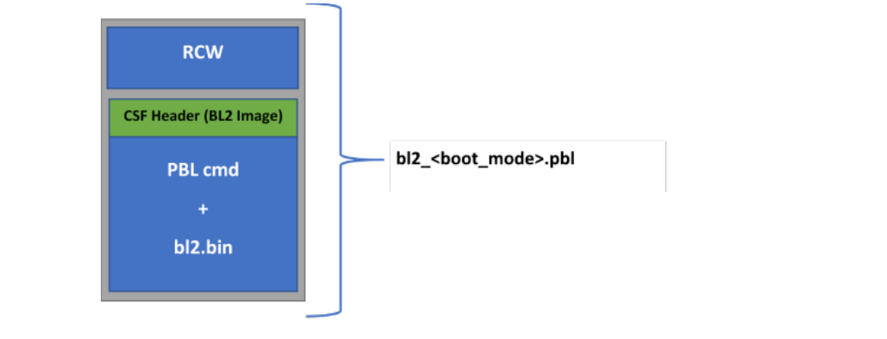

**Figure 7. Image bl2.pbl cho secure boot (NXP CoT)**

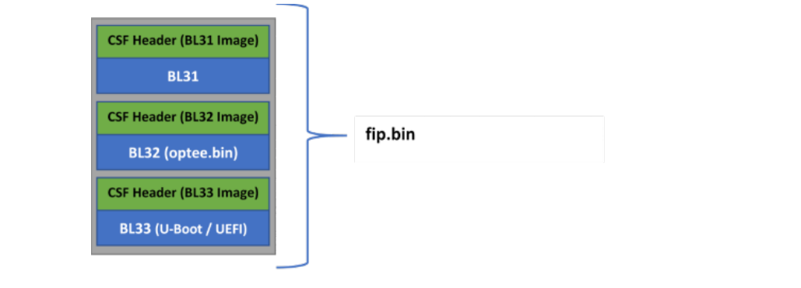

**Figure 8. Image fip.bin cho secure boot (NXP CoT)**

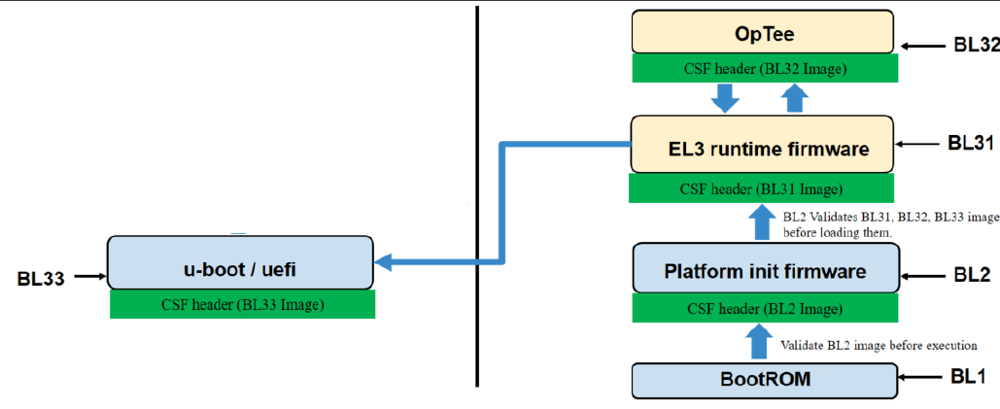

**Figure 9. Luồng boot TF-A (NXP CoT)**

#### 6.1.1.2 Quá trình secure boot

Quá trình secure boot dùng một thủ tục kiểm tra chữ ký số để xác thực image. Thủ tục này kiểm tra bằng cách giải mã hash đã được ký bằng một RSA public key gắn với phần cứng. Sau đó hash này được so với hash vừa tính lại cho chính system image đó. Nếu so khớp, image được coi là xác thực.

Hình sau giải thích quá trình ký code và kiểm tra chữ ký.

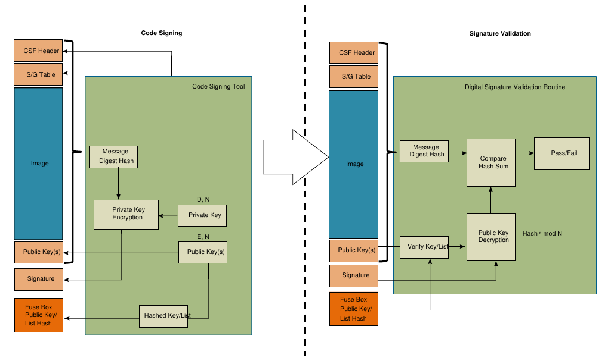

**Figure 10. Ký code và kiểm tra chữ ký trong secure boot**

Trong quá trình ký code (bên trái hình), Code Signing Tool (CST) thêm các tham số sau khi chuẩn bị boot image. Quá trình này được thực hiện ngoài chip.

**CSF header** Command Sequence File header

Header này cung cấp thông tin cần để kiểm tra image, như cờ, con trỏ tới image, offset tới key/chữ ký và độ dài của chúng, cho ISBC và ESBC.

**Ghi chú:** CSF header khác nhau cho giai đoạn ISBC và ESBC. Để biết chi tiết về CSF header cụ thể, xem Section "TA 2.x platforms - ISBC and ESBC CSF header structure definition, SRK table, SG table ", Section "TA 3.x platforms - ISBC CSF header structure definition, SRK table, SG table ", Section "TA 3.x platforms - ESBC CSF header structure definition"

**SG table** Scatter Gather table

Tùy chọn (N/A với một số giai đoạn chỉ hỗ trợ một image)

Cho phép hỗ trợ nhiều image không liền nhau.

**Ghi chú:** SG table chỉ được hỗ trợ trong ISBC. ESBC không hỗ trợ SG table.

**Danh sách public key** Bảng Super Root Key (SRK)

Một hoặc nhiều public key được thêm vào image. CSF header cho biết key nào được dùng để kiểm tra chữ ký.

**Signature** Hash SHA-256 của CSF header + SG table + Image + Public

Key, được mã hóa bằng một RSA private key tương ứng với một trong các public key trong danh sách key.

CST cũng hỗ trợ:

**Tạo cặp RSA public và private** RSA private key cần được lưu trữ an toàn.

**key**

**Hash public key hoặc danh sách public** Hash này được lưu trong register SRK hash (SRKH) trong Security **key** Fuse Processor (SFP).

Giả sử thiết bị được cấu hình để secure boot, thủ tục kiểm tra chữ ký số thực hiện các bước sau (như bên phải hình).

1. Thủ tục tìm và parse CSF header để xác định kích thước và vị trí của image, các public key và chữ ký số.
2. Nó hash public key và so với hash của public key hoặc danh sách key được lưu trong register SRKH trong SFP. Nếu so sánh hash thất bại, secure boot thất bại.
3. Nó dùng public key đã kiểm tra để giải mã chữ ký số, khôi phục hash của header + image + các public key.
4. Sau đó thủ tục tính hash trên header + image (ESBC/Trusted Firmware) + các public key và so hash đã giải mã với hash vừa tính. Nếu so sánh hash thất bại, secure boot thất bại.

#### 6.1.1.3 Chain of Trust

Chain of Trust (CoT) bảo đảm chỉ những image xác thực/hợp lệ mới được chạy trên nền tảng. Việc xác thực image trong CoT được chia thành các giai đoạn sau.

- Pre-boot và ISBC:

  Code kiểm tra được nhúng trong BootROM của SoC được gọi là Internal Secure Boot Code (ISBC). Root of Trust đã được thiết lập sẵn trong ISBC nằm trong BootROM. ISBC kiểm tra code thực thi tiếp theo. Trong code tham chiếu do NXP cung cấp, code thực thi tiếp theo là BL2.

- ESBC:

  BL2 có nhúng thủ tục kiểm tra chữ ký số (ESBC), thủ tục này kiểm tra (các) code thực thi tiếp theo trước khi chuyển quyền điều khiển cho nó.

  External Secure Boot Code (ESBC) là code tham chiếu do NXP cung cấp, dùng để kiểm tra image trong image trusted firmware và image U-Boot. Image U-Boot (Secure U-Boot hoặc Verified U-Boot) kiểm tra các image mà nó nạp. Ví dụ, Linux, DTB, MC firmware.

  Code thực thi tiếp theo lại kiểm tra image tiếp theo mà nó cần chuyển quyền điều khiển cho, nhờ đó hình thành một Chain of Trust.

Giai đoạn ESBC có cùng code tham chiếu cho mọi nền tảng. Tuy nhiên, giai đoạn pre-boot và ISBC khác nhau giữa các nền tảng. Dựa trên các khác biệt này, các nền tảng có thể được chia thành hai loại Trust Architecture (TA).

- Nền tảng TA 2.x hoặc dựa trên hardware pre-boot loader (PBL)
- Nền tảng TA 3.x hoặc dựa trên Service Processor (SP)

**Ghi chú:** TA là kiến trúc của dòng sản phẩm Layerscape để đạt được secure boot, lưu trữ an toàn và phân vùng chặt chẽ. Để dùng thông tin trong mục này, xem QorIQ Trust Architecture 2.x User Guide hoặc QorIQ Trust Architecture 3.x User Guide tùy theo SoC được dùng. Các tài liệu này chỉ được cung cấp theo thỏa thuận bảo mật (NDA). Để yêu cầu quyền truy cập các tài liệu này, liên hệ kỹ sư ứng dụng hiện trường (FAE) hoặc đại diện bán hàng NXP tại địa phương của bạn.

Bảng dưới đây giải thích các khác biệt mức cao giữa hai loại nền tảng.

|   | TA 2.x | TA 3.x |
|---|---|---|
| Nền tảng | LS1021A, LS1043A, LS1046A, LS1012A | LS1088A, LS2088A, LX2160A, LS1028 A, LX2162A |
| Giai đoạn pre-boot | Việc thực thi lệnh PBI do khối PBL dựa trên phần cứng thực hiện<br>Không xác thực các lệnh PBI | Việc thực thi lệnh PBI do code ROM chạy trên Service Processor thực hiện<br>Có xác thực các lệnh PBI |
| Giai đoạn ISBC | Thực thi trong BootROM trên core Arm GPP.<br>Xác thực code ở mức tiếp theo | Thực thi trên Service Processor<br>Xác thực các lệnh PBI và code ở mức tiếp theo |
| CSF header cho giai đoạn ISBC | Kích thước 0x40 byte<br>Hỗ trợ 4 SRK key<br>Để biết chi tiết, xem Section "TA 2.x platforms - ISBC and ESBC CSF header structure definition, SRK table, SG table " | Kích thước 0x50 byte<br>Hỗ trợ 8 SRK key<br>Hỗ trợ cờ Increment Security State (ISS)<br>Để biết chi tiết, xem Section "TA 3.x platforms - ISBC CSF header structure definition, SRK table, SG table " |
| Giai đoạn ESBC | Khác với ISBC nằm trong BootROM và không sửa được, ESBC có thể do bạn sửa. Chức năng của giai đoạn ESBC giống nhau, chỉ khác ở CSF header |   |
| CSF header cho giai đoạn ESBC | Hỗ trợ 4 SRK key<br>Để biết chi tiết, xem Section "TA 2.x platforms - ISBC and ESBC CSF header structure definition, SRK table, SG table " | Hỗ trợ 8 SRK key<br>Để biết chi tiết, xem Section "TA 3.x platforms - ESBC CSF header structure definition" |

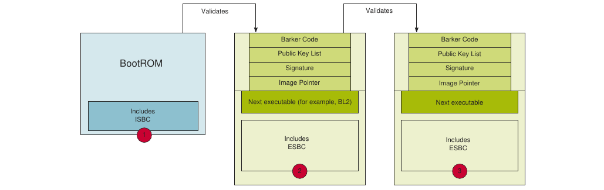

**Figure 11. Chain of Trust**

Để giữ bí mật cho các image, các image có thể được mã hóa và lưu dưới dạng blob trong bộ nhớ flash của thiết bị. Image ESBC U-Boot đã được kiểm tra có thể dùng cơ chế Cryptographic blob để tạo một chain of trust có tính bí mật.

Để biết chi tiết về cơ chế Cryptographic blob và chain of trust có tính bí mật, xem "Cryptographic blobs" trong QorIQ Trust Architecture 3.0 User Guide.

##### 6.1.1.3.1 Các nền tảng TA 2.x

###### 6.1.1.3.1.1 Giai đoạn pre-boot

Trong giai đoạn development, đặt RCW\[SB_EN\] = 1 để boot hệ thống ở chế độ secure.

Trong giai đoạn production, đặt bit ITS trong SFP để bảo đảm hệ thống hoạt động một cách an toàn và tin cậy. Sau khi fuse ITS của SFP đã bị blow thì không thể thay đổi được nữa.

**Hardware pre-boot loader**

Các lệnh khởi tạo pre-boot, còn gọi là PBI, do PBL thực thi là bắt buộc để thực hiện secure boot. PBI phải có một lệnh nạp con trỏ tới CSF header của ESBC vào register SCRATCHRW1.

Sau đó ISBC đọc register này để xác định vị trí CSF header của image tiếp theo cần kiểm tra. Nếu dùng một image thay thế, cần thêm một lệnh PBI thứ hai để nạp con trỏ tới CSF header của image thay thế vào register SCRATCHRW3.

Trong code tham chiếu đi kèm Layerscape LDP, bất kể nguồn boot nào, các lệnh PBI được thêm vào RCW để sao chép code thực thi tiếp theo (BL2) từ nguồn boot được chọn sang OCRAM. Trong trường hợp secure boot, CSF header để xác thực BL2 cũng được sao chép sang OCRAM cùng với BL2 bằng các lệnh PBI.

Các lệnh PBI cũng được thêm để ghi vị trí trong OCRAM nơi CSF header được sao chép vào register SCRATCHRW1.

###### 6.1.1.3.1.2 Giai đoạn ISBC

**Ghi chú:** Để biết chi tiết về SecMon, xem "7.2 Security Monitor (SecMon)" trong QorIQ Trust Architecture 2.x User Guide. Để biết chi tiết về SFP, xem "3.1.2.2 Security fuse processor" trong QorIQ Trust Architecture 2.x User Guide.

Khi SoC được bật nguồn, Master core (CPU0) được nhả khỏi boot hold off và bắt đầu thực thi lệnh từ một vị trí cố định trong BootROM. Theo các lệnh trong ISBC, CPU0 thực hiện các hành động sau:

1. **Kiểm tra Who am I?** - Bước đầu là bảo đảm CPU0 ra khỏi reset sau Power-on Reset (POR), bằng cách đọc register processor ID. Nếu thất bại, nó rơi vào vòng lặp spin.
2. **Kiểm tra SecMon** - CPU0 xác nhận SecMon đang ở trạng thái Check. Nếu không, trạng thái SecMon chuyển sang Fail và hệ thống rơi vào trạng thái lỗi.
3. **Đọc con trỏ ESBC** - CPU0 đọc con trỏ tới CSF header của ESBC trong register SCRATCHRW1, rồi đọc word tại địa chỉ được chỉ ra, tức word đầu tiên của header. Nếu nội dung word không khớp với giá trị preamble cố định, ISBC cho rằng nó không tìm thấy CSF header hợp lệ và không thể tiếp tục. Điều này dẫn tới lỗi, như mô tả ở #2 trên.
4. **Parse CSF header và kiểm tra public key** - Nếu CPU0 tìm thấy một CSF header hợp lệ, nó parse CSF header để tìm public key dùng để kiểm tra code. Trong header có thể có một public key hoặc một bảng 4 public key. Register SFP thực ra không lưu public key, mà lưu hash SHA-256 của public key/bảng 4 key. Cách này cho phép hỗ trợ key đến 4096b mà không cần khối fuse quá lớn. Nếu so sánh giữa SRKH lưu trong register SFP và hash tính lúc chạy trên public key/bảng thất bại, secure boot thất bại.
5. **Kiểm tra chữ ký** - Với public key đã được kiểm tra, CPU0 giải mã chữ ký số lưu tại offset chỉ định trong CSF header. Offset này tương đối so với địa chỉ bắt đầu của CSF header. Sau đó nó dùng các trường độ dài và con trỏ ESBC trong CSF header để tính hash trên code. ISBC kiểm tra rằng CSF header nằm trong dải địa chỉ được hash. Các cờ tùy chọn trong CSF header cho ISBC biết NXP Unique ID (FUID) và OEM Unique ID (OUID) (trong Secure Fuse Processor) có được đưa vào tính hash hay không. Đưa các ID này vào cho phép gắn image với một nền tảng duy nhất. Nếu hash đã giải mã và hash vừa tạo không khớp, secure boot thất bại.
6. **Kiểm tra con trỏ ESBC** - CSF header chứa địa chỉ entry point. Nếu địa chỉ nằm trong dải hợp lệ, SecMon chuyển sang trạng thái Trusted và quyền điều khiển được chuyển tới địa chỉ entry point.
7. Khi thất bại, với các nền tảng TA 2.x, cờ secondary trong CSF header được kiểm tra. Nếu cờ được đặt, ISBC đọc con trỏ CSF header của image thay thế từ register SCRATCHRW3 và lặp lại từ bước 4.

Nếu ISBC không kiểm tra được ESBC, mã lỗi được ghi vào register SCRATCHRW2. Nếu có quyền debug, bạn có thể kiểm tra register SCRATCHRW2 để lấy mã lỗi. Về danh sách và mô tả các mã lỗi, xem ISBC Validation Error Codes

**Các nền tảng TA 2.x - định nghĩa cấu trúc CSF header của ISBC và ESBC, SRK table, SG table**

CSF header cung cấp cho ISBC và ESBC phần lớn thông tin cần để kiểm tra image.

**Ghi chú:** Lưu ý rằng CSF header của LS1021A khác với các nền tảng TA 2.x khác (LS1043A/LS1046A/LS1012A).

Hình sau cho thấy các khác biệt trong các trường CSF header ở giai đoạn ISBC và ESBC, cho LS1043A/LS1046A/LS1012A.

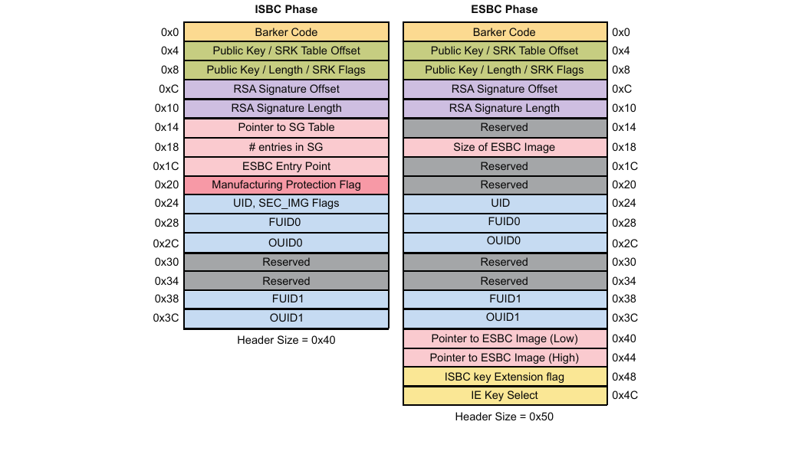

**Figure 12. CSF header cho LS1043A/LS1046A/LS1012A (giai đoạn ISBC và ESBC)**

**Định dạng CSF header (các nền tảng LS1043A/LS1046A/LS1012A)**

| Offset | Bit dữ liệu \[0:31\] |
|---|---|
| 0x00 | Barker code<br>Trường này phải chứa giá trị: 0x68392781. Code ISBC tìm Barker code này. Nếu giá trị trong trường này không khớp với Barker code, ISBC dừng thực thi và báo lỗi. |
| 0x04 | Nếu srk_table_flag không được đặt:<br>**• Public key offset**: Trường này chứa một địa chỉ là offset của public key tính từ đầu CSF header. Dùng offset này và độ dài public key, public key được đọc ra.<br>Nếu srk_table_flag được đặt:<br>**• SRK table offset**: Trường này chứa một địa chỉ là offset của SRK table tính từ đầu CSF header. Dùng offset này và số entry trong SRK table, SRK table được đọc ra. |
| 0x08 | 0x08:<br>srk_table_flag<br>Cờ này cho biết hash ghi vào SRK fuse là của một key duy nhất hay của SRK table.<br>• srk_table_flag = 1: Cho biết có SRK table<br>• srk_table_flag = 0: Cho biết không có SRK table, chỉ có một key duy nhất |
|   | 0x0b-0x09:<br>Nếu srk_table_flag không được đặt:<br>• 0x0b-0x9 - **Public key length**, trường này chứa độ dài public key tính bằng byte.<br>Nếu srk_table_flag được đặt:<br>• 0x09 – **Key number from SRK table**, key dùng để kiểm tra.<br>• 0x0b-0x0a – **Number of entries in SRK table**. Số entry tối thiểu trong bảng = 1, tối đa = 4. |
| 0x0c | RSA signature offset<br>Trường này chứa offset (tính bằng byte) của RSA signature tính từ đầu CSF header. Dùng offset này và độ dài chữ ký, RSA signature được đọc ra. RSA signature được tính trên CSF header, SG table và các image ESBC. |
| 0x10 | **RSA signature length** tính bằng byte. |
| 0x14 | **Với giai đoạn ISBC**:<br>SG table offset<br>Trường này chứa một địa chỉ là offset của SG table tính từ đầu CSF header. Dùng offset này và số entry trong SG table, SG table được đọc ra.<br>**Với giai đoạn ESBC**:<br>Reserved |
| 0x18 | **Với giai đoạn ISBC**:<br>**Number of entries in SG table** (Dựa trên cờ SG table trong CSF header, trường này được hiểu là số entry trong SG table hoặc kích thước image ESBC tính bằng byte).<br>Cờ SG table cho biết có SG table hay không.<br>**Với giai đoạn ESBC**:<br>**Size of image** cần kiểm tra. |
| 0x1c | **Với giai đoạn ISBC**:<br>**ESBC entry point**.<br>ISBC chuyển quyền điều khiển tới trường này khi kiểm tra thành công (các) image ESBC.<br>**Với giai đoạn ESBC**: Reserved |
| 0x20 | Cờ Manufacturing Protection<br>Cho biết có cần bật manufacturing protection trong ISBC hay không.<br>• mp_flag\[16:31\] - Cờ Manufacturing Protection<br>• sg_flag\[0:15\] - Cờ SG table<br>**Với giai đoạn ESBC**: Reserved |
| 0x24 | **Với giai đoạn ISBC**: UID<br>**Với giai đoạn ESBC**: UID |
| 0x25 | **Với giai đoạn ISBC**:<br>Cờ secondary image<br>Cho biết người dùng có image phụ hay không, phòng khi kiểm tra image chính thất bại.<br>**Với giai đoạn ESBC**: Reserved |
| 0x27-0x26 | Cách dùng Unique ID<br>Trường này chứa một cờ cho biết có so sánh FUID và OUID trong trường CSF header với giá trị trong các register SFP: SFP_FUIDRn, SFP_OUIDRn hay không<br>• 0x00 - Không so sánh<br>• 0x01 - So sánh cả FUID và OUID<br>• 0x02 - Chỉ so sánh FUID<br>• 0x04 - Chỉ so sánh OUID |
| 0x28 | FUID0<br>Nếu cờ được đặt, giá trị này được so với register FUID0 tương ứng. |
| 0x2c | OUID0<br>Nếu cờ được đặt, giá trị này được so với register OUID0 tương ứng. |
| 0x30 | Reserved |
| 0x34 | Reserved |
| 0x38 | FUID1<br>Nếu cờ được đặt, giá trị này được so với register FUID1 tương ứng. |
| 0x3c | OUID1<br>Nếu cờ được đặt, giá trị này được so với register OUID1 tương ứng. |
| 0x40 | **Với giai đoạn ISBC**: Không áp dụng<br>**Với giai đoạn ESBC**: 32 bit thấp của địa chỉ 64 bit của image ESBC |
| 0x44 | **Với giai đoạn ISBC**: Không áp dụng<br>**Với giai đoạn ESBC**: 32 bit cao của địa chỉ 64 bit của image ESBC |
| 0x48 | **Với giai đoạn ISBC**: Không áp dụng<br>**Với giai đoạn ESBC**:<br>Cờ ISBC key extension<br>Nếu cờ này được đặt, key dùng để kiểm tra cần được lấy từ IE key table. |
| 0x4c | **Với giai đoạn ISBC**: Không áp dụng<br>**Với giai đoạn ESBC**:<br>IE key select<br>Số thứ tự key được dùng trong IE key table nếu cờ ISBC key extension được đặt. |

Hình sau cho thấy các khác biệt trong các trường CSF header ở giai đoạn ISBC và ESBC, cho LS1021A:

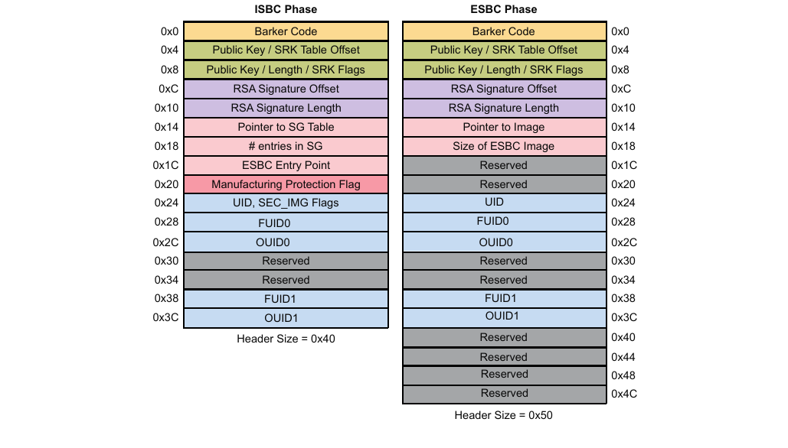

**Figure 13. CSF header cho LS1021A (giai đoạn ISBC và ESBC)**

**Table 26. Định dạng CSF header (nền tảng LS1021A)**

| Offset | Bit dữ liệu \[0:31\] |
|---|---|
| 0x00 | **Barker code**.<br>Trường này phải chứa giá trị: 0x68392781. Code ISBC tìm Barker code này. Nếu giá trị trong trường này không khớp với Barker code, ISBC dừng thực thi và báo lỗi. |
| 0x04 | Nếu srk_table_flag không được đặt:<br>**• Public key offset**: Trường này chứa một địa chỉ, là offset của public key tính từ đầu CSF header. Dùng offset này và độ dài public key, public key được đọc ra.<br>Nếu srk_table_flag được đặt:<br>**• SRK table offset**: Trường này chứa một địa chỉ, là offset của SRK table tính từ đầu CSF header. Dùng offset này và số entry trong SRK table, SRK table được đọc ra. |
| 0x08 | srk_table_flag<br>Cờ này cho biết hash ghi vào register SRKH là của một key duy nhất hay của SRK table.<br>• srk_table_flag = 1: Cho biết có SRK table<br>• srk_table_flag = 0: Cho biết không có SRK table, chỉ có một key duy nhất |
| 0x0b-0x09 | Nếu srk_table_flag không được đặt:<br>**• 0x0b-0x9** -- **Public key length**: Trường này chứa độ dài public key tính bằng byte.<br>Nếu srk_table_flag được đặt:<br>**• 0x09** – Trường này chứa **Key number from SRK table**, key dùng để kiểm tra.<br>**• 0x0b-0x0a** – Trường này chứa **Number of entries in SRK table**. Số entry tối thiểu trong bảng = 1, tối đa = 4. |
| 0x0c | **RSA Signature offset**.<br>Trường này chứa offset (tính bằng byte) của RSA signature tính từ đầu CSF header. Dùng offset này và độ dài Signature, RSA signature được đọc ra. |
| 0x10 | **RSA Signature length** tính bằng byte. |
| 0x14 | **Với giai đoạn ISBC**:<br>SG Table offset<br>Trường này chứa một địa chỉ là offset của SG table tính từ đầu CSF header. Dùng offset này và số entry trong SG table, SG table được đọc ra.<br>**Với giai đoạn ESBC**:<br>Địa chỉ của image cần kiểm tra. |
| 0x18 | **Với giai đoạn ISBC**:<br>**Number of entries in SG table** (Dựa trên cờ SG table trong CSF header, trường này được hiểu là số entry trong SG table hoặc kích thước image ESBC tính bằng byte).<br>Cờ SG table cho biết có SG table hay không.<br>Với giai đoạn ESBC<br>**Size of image** cần kiểm tra. |
| 0x1c | **Với giai đoạn ISBC**:<br>ESBC entry point<br>ISBC chuyển quyền điều khiển tới trường này khi kiểm tra thành công (các) image ESBC.<br>**Với giai đoạn ESBC**: Reserved |
| 0x20 | Cờ Manufacturing Protection<br>Cho biết có cần bật manufacturing protection trong ISBC hay không.<br>• mp_flag\[16:31\] - Cờ Manufacturing Protection<br>• sg_flag\[0:15\] - Cờ SG table<br>**Với giai đoạn ESBC**: Reserved |
| 0x24 | **Với giai đoạn ISBC**: UID<br>**Với giai đoạn ESBC**: UID |
| 0x25 | Với giai đoạn ISBC<br>Cờ Secondary Image<br>Cho biết người dùng có image phụ hay không, phòng khi kiểm tra image chính thất bại.<br>**Với giai đoạn ESBC**: Reserved |
| 0x27-0x26 | Cách dùng Unique ID<br>Trường này chứa một cờ cho biết có so sánh FUID và OUID trong trường CSF header với giá trị trong các register SFP: SFP_FUIDRn, SFP_OUIDRn hay không<br>• 0x00 - Không so sánh<br>• 0x01 - So sánh cả FUID và OUID<br>• 0x02 - Chỉ so sánh FUID<br>• 0x04 - Chỉ so sánh OUID |
| 0x28 | FUID0<br>Nếu cờ được đặt, giá trị này được so với register FUID0 tương ứng. |
| 0x2c | OUID0<br>Nếu cờ được đặt, giá trị này được so với register OUID0 tương ứng. |
| 0x30 | Reserved |
| 0x34 | Reserved |
| 0x38 | FUID1<br>Nếu cờ được đặt, giá trị này được so với register FUID1 tương ứng. |
| 0x3c | OUID1<br>Nếu cờ được đặt, giá trị này được so với register OUID1 tương ứng. |
| 0x40 | Với giai đoạn ISBC: Không áp dụng<br>Với giai đoạn ESBC: Reserved |
| 0x44 | Với giai đoạn ISBC: Không áp dụng<br>Với giai đoạn ESBC: Reserved |
| 0x48 | **Với giai đoạn ISBC**: Không áp dụng<br>**Với giai đoạn ESBC**: Reserved |
| 0x4c | **Với giai đoạn ISBC**: Không áp dụng<br>**Với giai đoạn ESBC**: Reserved |

SG table hỗ trợ 8 image và mỗi entry image có dạng {Len, target, src_addr, dst_addr}

**Table 27. Định dạng SG table**

| Offset | Bit dữ liệu \[0:31\] |
|---|---|
| 0x00 | Length. Trường này chỉ định độ dài tính bằng byte của image ESBC. |
| 0x04 | Target nơi có thể tìm thấy Image ESBC. Trường này bị bỏ qua với các nền tảng TA 2.x. |
| 0x08 | Địa chỉ nguồn của Image ESBC |
| 0x0c | Địa chỉ đích của Image ESBC<br>Nếu địa chỉ đích là 0xffffffff, image không được sao chép tới đích. Trường này bị bỏ qua với các nền tảng TA 2.x. |

SRK table cho TA 2.x lưu 4 key. Kích thước trường giá trị key của mỗi key là 0x400.

**Table 28. SRK table**

| Offset | Bit dữ liệu \[0:31\] |
|---|---|
| 0x00 | Độ dài Key 1 |
| 0x04 | Giá trị Key 1. (Các byte còn lại được đệm bằng số không) |
| 0x404 | Độ dài Key 2 |
| 0x408 | Giá trị Key 2. (Các byte còn lại được đệm bằng số không) |
| 0x808 | Độ dài Key 3 |
| 0x80c | Giá trị Key 3. (Các byte còn lại được đệm bằng số không) |
| 0xc0c | Độ dài Key 4 |
| 0xc10 | Giá trị Key 4. (Các byte còn lại được đệm bằng số không) |

**Super Root Key (SRK) và signing key**

Đây là các cặp RSA public key và private key. Private key dùng để ký các boot image, còn public key dùng để kiểm tra các image này trong giai đoạn ISBC và ESBC.

Public key được nhúng trong image, và giá trị hash tính trên SRK table phải được ghi bằng fuse vào các register SRKH của SFP.

Đây là các key gắn với phần cứng. Khi hash đã được ghi bằng fuse, cặp public-private key không thể thay đổi vì nội dung các register SFP không sửa được.

Quá trình secure boot hỗ trợ key có kích thước 1k, 2k và 4k.

Lưu ý rằng việc kiểm soát truy cập vào RSA private signature key là rất quan trọng. Nếu key bị lộ, kẻ tấn công có thể tạo các image thay thế vượt qua được secure boot.

Nếu mất key, bạn sẽ không thể cập nhật các image.

**Thu hồi key**

TA 2.x hỗ trợ thu hồi các RSA public key mà ISBC dùng để kiểm tra ESBC. Các RSA public key dùng cho mục đích này gọi là Super Root Key (SRK).

Trên các nền tảng TA 2.x, bạn có thể dùng một key duy nhất hoặc một danh sách tối đa 4 SRK.

Bạn cần định nghĩa trong CST thiết bị dùng một SRK duy nhất hay một danh sách SRK. Nếu thiết bị dùng một SRK duy nhất, một bit cờ mới trong CSF header cho biết `key`; nếu không, bit cờ cho biết `key List`.

Giả sử thiết bị dùng danh sách SRK, người dùng có thể tạo một danh sách tối đa 4 SRK cho các nền tảng từ TA 2.x trở đi và tính hash SHA-256 trên danh sách đó. Hash này được ghi vào các register SRKH trong SFP.

Là một bước trong quá trình ký code, bạn cần định nghĩa key nào trong danh sách key được dùng để kiểm tra image. Số thứ tự key này được đưa vào CSF header như một trường mới.

Trong secure boot, ISBC xác định có đang dùng danh sách key hay không. Nếu danh sách key hợp lệ, ISBC đối chiếu số thứ tự key ghi trong CSF header với các fuse thu hồi trong OEM Security Policy Register của SFP (SFP_OSPR). Nếu key đã bị thu hồi, việc kiểm tra image thất bại.

**Ghi chú:**

Để ngăn thu hồi key trái phép, SFP cung cấp một bit (Write Disable). Nếu bit được đặt, các bit thu hồi Key không thể bị ghi.

Khi hoạt động bình thường, ESBC (phần mềm Trusted giai đoạn sớm) cần đặt bit SFP Write Disable. Khi cần thu hồi một key, người dùng sẽ dùng một image ESBC không đặt bit “Write Disable”. Khi đó, SFP sẽ ở trạng thái cho phép đặt các fuse thu hồi key.

Về mặt logic, sau khi thu hồi (các) key cần thiết, người dùng sẽ nạp một image ESBC mới đã ký, có code đặt bit "Write Disable", cùng CSF header mới cho biết key nào trong các key chưa bị thu hồi sẽ được dùng.

Vì vậy, chỉ người sở hữu một RSA private key hợp lệ mới có thể bật việc thu hồi key.

Một lý do khiến người dùng thu hồi một SRK là RSA private key tương ứng bị lộ cho kẻ tấn công. Nếu kẻ tấn công có được một RSA private key hợp lệ và có thể cấp nguồn cho mạch lập trình fuse, kẻ tấn công có thể thu hồi key một cách ác ý. Để ngăn việc này bị lợi dụng để vô hiệu hóa hệ thống vĩnh viễn, có một SRK không có fuse thu hồi tương ứng.

Để biết chi tiết về thu hồi key, xem QorIQ Trust Architecture 2.x User Guide.

**Hỗ trợ image thay thế**

Nếu ISBC không tìm thấy image hợp lệ ở vị trí image chính, nó có thể tùy chọn kiểm tra một vị trí khác để tìm image thay thế.

Để được thực thi, image thay thế phải được kiểm tra bằng một public key chưa bị thu hồi như định nghĩa trong CSF header của nó. Một image thay thế hợp lệ có cùng quyền và đặc quyền như một image chính hợp lệ.

Hỗ trợ image thay thế giảm rủi ro do image chính bị hỏng hoặc bộ nhớ flash bị mòn.

Để bật tính năng này:

- Thêm lệnh PBI nạp con trỏ tới CSF header của image thay thế vào register SCRATCHRW3.

###### 6.1.1.3.1.3 Các mã lỗi kiểm tra của ISBC

Lỗi trong hệ thống có thể thuộc các loại sau:

1. Exception của core
2. Lỗi trạng thái hệ thống
3. Lỗi kiểm tra header

   a. Lỗi chung

   b. Lỗi liên quan đến Key/Signature/UID

4. Lỗi xác minh
5. Lỗi SEC/PAMU

**Table 29. Exception của core (nền tảng LS1021A)**

| Giá trị | Mã | Định nghĩa |
|---|---|---|
| 0x1 | ERROR_UNDEFINED_INSTRUCTION | Xảy ra nếu cả processor lẫn coprocessor gắn kèm đều không nhận ra lệnh đang thực thi. |
| 0x2 | ERROR_SWI | Software Interrupt là một lệnh interrupt do người dùng định nghĩa. Ví dụ, nó cho phép một chương trình chạy ở User mode yêu cầu các thao tác đặc quyền chạy ở Supervisor mode. |
| 0x3 | ERROR_PREFETCH_ABORT | Xảy ra khi processor cố thực thi một lệnh đã được prefetch từ một địa chỉ không hợp lệ. |
| 0x4 | ERROR_DATA_ABORT | Xảy ra khi một lệnh truyền dữ liệu cố load hoặc store dữ liệu tại một địa chỉ không hợp lệ. |
| 0x5 | ERROR_IRQ | Xảy ra khi chân interrupt request ngoài của processor được assert (LOW) và các IRQ interrupt được bật. |
| 0x6 | ERROR_FIQ | Xảy ra khi chân fast interrupt request ngoài của processor được assert (LOW) và các FIQ interrupt được bật. |

**Table 30. Lỗi liên quan đến Key/Signature/UID (các nền tảng TA 2.x)**

| Giá trị | Mã | Định nghĩa |
|---|---|---|
| 0x320 | ERROR_ESBC_HEADER_KEY_LEN | Độ dài public key trong header không phải một trong các giá trị được hỗ trợ. |
| 0x321 | ERROR_ESBC_HEADER_KEY_LEN\_ NOT\_TWICE_SIG_LEN | Public key không dài gấp đôi RSA signature |
| 0x322 | ERROR_ESBC_HEADER_KEY_MOD_1 | Bit có trọng số cao nhất của modulus trong header bằng không. |
| 0x323 | ERROR_ESBC_HEADER_KEY_MOD_2 | Modulus trong header là số chẵn |
| 0x324 | ERROR_ESBC_HEADER_SIG_KEY_MOD | Giá trị chữ ký lớn hơn modulus trong header |
| 0x325 | ERROR_FSL_UID | FSL_UID trong ESBC Header không khớp với FSL_UID trong SFP khi cờ FSL UID là 1 |
| 0x326 | ERROR_OEM_UID | OEM_UID trong ESBC Header không khớp với OEM_UID trong SFP khi cờ OEM UID là 1 |
| 0x327 | ERROR_INVALID_SRK_NUM_ENTRY | Trường số entry trong CSF header > 4 (Khi srk_table_flag trong header là 1) |
| 0x328 | ERROR_INVALID_KEY_NUM | Số thứ tự key dùng trong SRK table không có trong bảng. (Khi srk_table_flag trong header là 1) |
| 0x329 | ERROR_KEY_REVOKED | Key được chọn trong SRK table đã bị thu hồi (Khi srk_table_flag trong header là 1) |
| 0x32a | ERROR_INVALID_SRK_ENTRY_KEYLEN | Độ dài key ghi trong một entry của SRK table không phải một trong các giá trị được hỗ trợ (Khi srk_table\_flag trong header là 1) |
| 0x32b | ERROR_SRK_TBL_NOT_IN_3_5 | SRK table không nằm trong biên 3.5G (Khi srk_table\_flag trong header là 1) |
| 0x32b | ERROR_SRK_TBL_ON_OCRAM | SRK table nằm trên OCRAM |
| 0x32c | ERROR_KEY_NOT_IN_3_5G | Key không nằm trong biên 3.5G |
| 0x32c | ERROR_KEY_ON_OCRAM | Key nằm trên OCRAM |

**Table 31. Lỗi xác minh (các nền tảng TA 2.x)**

| Giá trị | Mã | Định nghĩa |
|---|---|---|
| 0x340 | ERROR_HASH_COMPARE_KEY | So sánh Super Root Key Hash thất bại. Hash của public key/SRK table trong header không khớp với giá trị trong SRKH fuse. |
| 0x341 | ERROR_HASH_COMPARE_EM | Kiểm tra RSA signature thất bại. Chữ ký bạn cung cấp trong header không khớp với chữ ký của image ESBC do ISBC tạo ra. Image ESBC bạn nạp có thể khác image đã dùng khi tạo chữ ký (bằng CST) |
| 0x350 | ERROR_PRIVATE_KEY_DERIVATION | Lỗi khi suy ra manufacturing private key khi cờ MP trong CSF header được đặt |

**Table 32. Mã lỗi thiết bị (các nền tảng TA 2.x)**

| Giá trị | Mã | Định nghĩa |
|---|---|---|
| Lỗi ESDHC |   |   |
| 0x500 | ERROR_ESDHC_CARD_DETECT_FAIL | Phát hiện thẻ thất bại |
| 0x501 | ERROR_ESDHC_UNUSABLE_CARD | Thẻ không phản hồi các CMD |
| 0x502 | ERROR_ESDHC_COMMUNICATION_ERROR | Thẻ không trả lời CMD và bị timeout |
| 0x503 | ERROR_ESDHC_READ_UNALIGNED | Địa chỉ phải căn theo độ dài block |
| Lỗi eSPI |   |   |
| 0x600 | ERROR_ESPI_READID | FLASH ID không hợp lệ |
| 0x601 | ERROR_ESPI_BOOT_SIGN | Chữ ký BOOT không khớp |
| 0x602 | ERROR_ESPI_READ_TIMEOUT | Đọc bị timeout |
| Lỗi CAAM |   |   |
| 0x700 | ERROR_SEC_ENQ | Lỗi khi enqueue vào SEC |
| 0x701 | ERROR_SEC_DEQ | Khối Sec trả về lỗi khi dequeue từ nó. |
| 0x702 | ERROR_SEC_DEQ_TO | Timeout khi cố dequeue từ SEC |
| 0x800 | ERROR_PAMU | Lỗi khi lập trình các bảng PAACT/SPAACT trong PAMU (Chỉ cho các nền tảng PowerPC) |

##### 6.1.1.3.2 Các nền tảng TA 3.x

###### 6.1.1.3.2.1 Giai đoạn Pre-boot và Internal Secure Boot Code (ISBC)

Trong giai đoạn development, đặt RCW\[SB_EN\] = 1 để boot hệ thống ở chế độ secure.

Trong giai đoạn production, đặt bit ITS trong SFP để bảo đảm hệ thống hoạt động một cách an toàn và tin cậy. Khi fuse ITS của SFP đã bị blow thì không thể thay đổi được nữa.

Service Processor là bus master đầu tiên chạy khi thiết bị ra khỏi reset. Nó là điểm khởi đầu của chain of trust trong secure boot.

Service Processor thực thi các lệnh PBI. ISBC nằm trong Service Processor kiểm tra các lệnh PBI trước khi thực thi. ISBC cũng kiểm tra BL2 rồi nhả core master Armv8 của SoC (CPU 0) để chạy BL2 đã được kiểm tra.

Các bước chính trong luồng ISBC được định nghĩa dưới đây.

**Các nền tảng TA 3.x - định nghĩa cấu trúc CSF header của ISBC, SRK table, SG table**

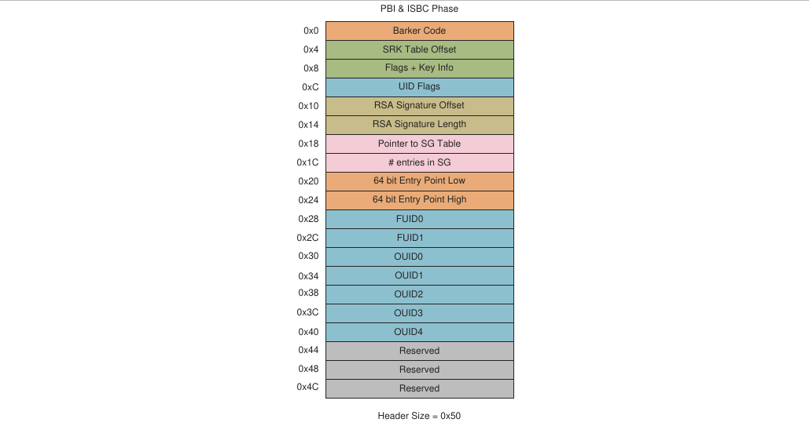

**Figure 14. Cấu trúc CSF header (ISBC TA 3.x)**

**Table 33. Cấu trúc CSF header (ISBC TA 3.x)**

| Offset |   | Mô tả |
|---|---|---|
| 0x00 |   | Barker code<br>Giá trị cố định mà ISBC dùng để xác nhận đã tìm thấy điểm bắt đầu của một CSF header. (0x12192001 dạng big endian)<br>0x00 – 0x12<br>0x01 – 0x19<br>0x02 – 0x20<br>0x03 – 0x01<br>Đây là mã hóa dạng số của LSTA (LS Series Trust Architecture) |
| 0x04 |   | SRK table offset<br>Trường này chứa một địa chỉ là offset của SRK table tính từ đầu CSF header. Dùng offset này và số entry trong SRK table, SRK table được đọc ra. |
| 0x08 | 0x08 | No. of keys<br>Trường này chỉ định số key trong SRK table |
|   | 0x09 | Key No. for verification<br>Số thứ tự key trong SRK table mà ISBC dùng để kiểm tra chữ ký image. |
|   | 0x0a | Reserved |
|   | 0x0b | **IE\[0\]:** ISBC Extension (Reserved)<br>**MP\[4\]:** Thực thi thủ tục Manufacturing Protection<br>**ISS\[5\]:** Increment Security State; cho biết ISBC có tăng SNVS SSM khi xác minh thành công hay không<br>**B01\[6\]:** Xác định đây là CSF header của một image boot 0 (PBI) hay của BL2<br>**LW\[7\]:** Leave writable; khi được đặt, ISBC không đặt SFP Write Disable |
| 0x0C | 0x0C | Reserved |
|   | 0x0D | Reserved |
|   | 0x0E | Reserved |
|   | 0x0F | **OID\[0:1\]**: Reserved<br>**OID\[2:6\]**: khi được đặt, trường OEM UID tương ứng trong SFP được đưa vào việc xác minh chữ ký số. Với mỗi bit được đặt, trường OUID tương ứng được đưa vào CSF header.<br>**FUID\[7\]**: khi được đặt, FUID 64b được đưa vào việc xác minh chữ ký số và FUID được đưa vào CSF header. |
| 0x10 |   | RSA signature offset<br>Trường này chứa một địa chỉ là offset của RSA signature tính từ đầu CSF header. Dùng offset này và độ dài chữ ký, RSA signature được đọc ra. RSA signature được tính trên CSF header, SG table và các image ESBC. |
| 0x14 |   | RSA signature length<br>Trường này chứa độ dài RSA signature tính bằng byte. |
| 0x18 |   | SG table offset<br>Trường này chứa một địa chỉ là offset của SG table tính từ đầu CSF header. Dùng offset này và số entry trong SG table, SG table được đọc ra. |
| 0x1C |   | No. of entries<br>Trường này chỉ định số entry có trong SG table. |
| 0x20 |   | Entry point (64 bit)<br>ISBC chuyển quyền điều khiển tới trường này khi kiểm tra thành công (các) image ESBC. |
| 0x28 |   | FUID0 |
| 0x2c |   | FUID1 |
| 0x30 | OUID0 |   |
| 0x34 | OUID1 |   |
| 0x38 | OUID2 |   |
| 0x3c | OUID3 |   |
| 0x40 | OUID4 |   |
| 0x44 | Reserved |   |
| 0x48 | Reserved |   |
| 0x4C | Reserved |   |

SRK table cho TA 3.x lưu 8 key. Kích thước nội dung key của mỗi key là 0x400. Bảng sau cho thấy cấu trúc SRK table cho Key 1 và Key 2.

**Table 34. Cấu trúc SRK table**

| Offset | Mô tả |
|---|---|
| 0x00 | Độ dài Key 1 |
| 0x04 | Nội dung Key 1 (Modulus, Exponent, Exponent+Modulus) |
| 0x404 | Độ dài Key 2 |
| 0x408 | Nội dung Key 2 (Modulus, Exponent, Exponent+Modulus) |

**Table 35. Cấu trúc SG table**

| Offset | Mô tả |
|---|---|
| 0x00 | Length |
| 0x04 | Reserved |
| 0x08 | SRC Address Low |
| 0x0C | SRC Address High |

**ISBC kiểm tra PBI**

**Ghi chú:** Để biết chi tiết về SecMon, xem "9.2 Security Monitor (SecMon)" trong QorIQ Trust Architecture 3.x User Guide. Để biết chi tiết về SFP, xem "3.1.2.2 Security fuse processor" trong QorIQ Trust Architecture 3.x User Guide.

1. **Kiểm tra SecMon**: Xác nhận SecMon đang ở trạng thái Check (OTPMK đã được ghi fuse). Nếu SecMon không ở trạng thái `Check`, SecMon chuyển sang trạng thái `Fail` và hệ thống rơi vào trạng thái lỗi.
2. **Kiểm tra lệnh PBI**: Xác minh lệnh PBI đầu tiên là ‘Load Boot 1 CSF Header Ptr’. Nếu không tìm thấy, báo lỗi.
3. **Kiểm tra header hợp lệ**: Kiểm tra preamble hợp lệ trong header. Nếu không có preamble hợp lệ, báo lỗi.
4. **Parse CSF và kiểm tra public key**: Nếu ISBC tìm thấy một CSF header hợp lệ, nó parse CSF header để tìm public key trong SRK table dùng để kiểm tra code. Header có thể chứa một SRK table tối đa 8 public key. Register hash trong SFP không lưu public key, mà lưu hash SHA-256 tính trên SRK table trong fuse. Nếu hash của SRK table không khớp với hash đã lưu, secure boot thất bại.
5. **Kiểm tra chữ ký**: Với public key đã được kiểm tra, ISBC giải mã hash hoặc chữ ký số lưu trong CSF header. Sau đó ISBC dùng trường độ dài PBI trong RCW để tính hash trên mọi lệnh PBI (CSF header cũng là một phần của các lệnh PBI) cùng với SRK table. Các cờ tùy chọn trong CSF header cho ISBC biết có kiểm tra FSL Unique ID (FUID) và OEM Unique ID (OUID trong SFP) hay không. Đưa các ID này vào cho phép gắn image với một nền tảng duy nhất. Nếu hash đã giải mã và hash vừa tính không khớp, secure boot thất bại.
6. **Chuyển trạng thái SecMon**: Nếu cờ Increment Security State (ISS) được đặt trong header, ISBC chuyển trạng thái SNVS từ `Check` sang `Trusted`.

**Ghi chú:**

1. Nếu ISBC không kiểm tra được PBI, hãy kiểm tra register SCRATCHRW3 bằng JTAG debugger để lấy mã lỗi. Nếu ISBC không kiểm tra được image thay thế, mã lỗi tương ứng có trong register SCRATCHRW4. Về danh sách mã lỗi, xem ISBC Validation Error Codes.

**Cấu trúc PBI**

Bảng sau cho thấy tổng quan định dạng PBI được khuyến nghị, do Layerscape LDP tạo ra.

|   | Trường | Offset | Kích thước (tính bằng word 32-bit) |
|---|---|---|---|
| RCW | Preamble (RCW) | 0x00 | 1 |
|   | Lệnh Load RCW | 0x04 | 1 |
|   | Các word RCW | 0x08 – 0x87 | 32 |
|   | RCW checksum | 0x88 | 1 |
| Các lệnh PBI | Load security header<br>CSF header | 0x8c<br>0x90 – 0xdf | 1<br>20 |
|   | Load boot 1CSF header<br>Boot 1 pointer | 0xe0<br>0xe4 | 1<br>1 |
|   | Các lệnh PBI khác | 0xe8 | N |
|   | Lệnh STOP (có/không có CRC) | 0xe8 + (4\*N) | 2 |
| SRK table | SRK table | 0x90 + offset SRK table trong CSF header | (Số key \* độ dài nội dung key) |
| RSA signature | Signature | 0x90 + offset chữ ký trong CSF header | Độ dài chữ ký |

| RCW | Preamble | Preamble luôn là phần tử đầu tiên trong một image PBI. Nó chứa một mẫu chuẩn xác định vị trí bộ nhớ đó là điểm bắt đầu của một image PBI hợp lệ. Preamble là một mẫu 4 byte được định nghĩa là “0xaa, 0x55, 0xaa, 0x55”. |
|---|---|---|
|   | Lệnh Load RCW | Word tiếp theo là lệnh load RCW. Lệnh này nạp Reset Configuration Word (RCW) 1024 bit từ interface do các chân strapping cấu hình Power-on-Reset (POR) chỉ định. Nó có hai dạng sau.<br>• Load RCW có checksum (0x10): Đọc Reset Configuration Word, tính checksum 32-bit đơn giản và cập nhật các register RCW.<br>• Load RCW không checksum (0x11): Đọc RCW và cập nhật các register RCW mà không tính checksum. Phiên bản không checksum có phần đệm bằng số không ở vị trí giá trị checksum. |
|   | Các word RCW | 1024 bit RCW gồm 32 word 32 bit. |
|   | RCW checksum | Được tính là tổng số nguyên không dấu 32-bit của RCW Preamble, lệnh Load RCW có checksum và từng word trong<br>32 word (32-bit) của RCW. Checksum 32-bit đơn giản được dùng để kiểm tra lệnh.<br>`checksum(RCW_WORD[]){`<br>`    unsigned_32 sum = 0xAA55AA55 + 0x80100000 +`<br>` Load RCW Command;`<br>`    for(i=0; i<32; i++)`<br>`        sum+=RCW_WORD[i];`<br>`    return (sum);`<br>`}`<br>**Ghi chú:** Checksum phải được công cụ CST cập nhật khi các trường như RCW\[SB_EN\], RCW\[PBI_LEN\] trong các word RCW thay đổi. |
| Các lệnh PBI | Load security header | Lệnh này nạp thông tin cần để xác thực image PBI. Security header gồm các con trỏ tới SRK key table và RSA signature, cùng các cờ và ID khác. CSF header là một phần của lệnh. Tham khảo cấu trúc CSF header trong Trust 3.x devices - ISBC CSF header structure definition, SRK table, SG table.. |
|   | Load boot 1 CSF header | Lệnh này nạp một con trỏ tới CSF header dùng để xác thực Boot 1 Secondary Program Loader. Giá trị 32-bit này được Boot 0 ISBC dùng và là bắt buộc cho secure boot. |
|   | Các lệnh PBI khác | Các lệnh PBI khác do người dùng nhập. |
|   | Lệnh STOP | Lệnh này kết thúc chuỗi PBI và có hai biến thể (có và không có CRC). Giá trị kiểm tra CRC bao gồm mọi lệnh từ lệnh đầu tiên sau RCW đến hết lệnh CRC and Stop này, bất kể có lệnh nào bị lệnh Jump bỏ qua khi thực thi hay không.<br>Lệnh Stop không có CRC kết thúc chuỗi PBI ngay lập tức. Nó không có giá trị CRC mà thay vào đó có phần đệm 32-bit bằng số không để có cùng kích thước với lệnh Stop có CRC.<br>**Ghi chú:** Công cụ CST cập nhật các lệnh PBI bằng cách thêm lệnh Load Security Header và lệnh Load Boot 1 Security Header. Vì vậy, CRC cũng phải được cập nhật. |
| SRK table |   | Bảng public key dùng trong việc kiểm tra secure boot. Nó được đặt ở một offset tính từ CSF header. Offset được chỉ định trong CSF header. |
| RSA signature |   | RSA signature được tính trên mọi lệnh PBI và SRK table. Nó được đặt ở một offset tính từ CSF header. Offset được chỉ định trong CSF header. |

**ISBC kiểm tra code thực thi tiếp theo (BL2)**

1. **Kiểm tra header hợp lệ**: Kiểm tra preamble hợp lệ trong header. Nếu không có preamble hợp lệ trong header, báo lỗi.
2. **Parse CSF và kiểm tra public key**: Nếu ISBC tìm thấy một CSF header hợp lệ, nó parse CSF header để tìm public key trong SRK table dùng để kiểm tra code. Header có thể chứa một SRK table tối đa 8 public key. Register hash trong SFP không lưu public key, mà lưu hash SHA-256 tính trên SRK table trong fuse. Nếu hash của SRK table không khớp với hash đã lưu, secure boot thất bại.
3. **Kiểm tra chữ ký**: Với public key đã được kiểm tra, ISBC giải mã chữ ký số lưu trong CSF header. Sau đó ISBC tính và kiểm tra hash trên CSF, SRK table, SG table và mọi entry mà SG table trỏ tới. Nếu hash đã giải mã và hash vừa tính không khớp, secure boot thất bại.
4. **Kiểm tra Entry Point**: CSF header chứa địa chỉ entry point. Nếu địa chỉ nằm trong dải hợp lệ, Entry point được ghi vào register Boot Location Pointer (BOOTLOCPTRL/BOOTLOCPTRH).
5. **Chuyển trạng thái SecMon**: Nếu cờ Increment Security State (ISS) được đặt trong header, ISBC chuyển trạng thái SNVS từ `Check` sang `Trusted`, hoặc từ `Trusted` (nếu đã chuyển ở giai đoạn kiểm tra PBI) sang `Secure`.

**Ghi chú:**

1. Khi ISBC kết thúc, Entry Point parse được từ header được ghi vào register BOOTLOCPTRL/BOOTLOCPTRH.
2. GPP thức dậy.
3. Service Processor chuyển sang sleep.

Nếu ISBC không kiểm tra được BL2, hãy kiểm tra register SCRATCHRW3 bằng JTAG debugger để lấy mã lỗi. Nếu ISBC không kiểm tra được image thay thế, mã lỗi tương ứng có trong register SCRATCHRW4. Về danh sách mã lỗi, xem ISBC Validation Error Codes.

###### 6.1.1.3.2.2 Các mã lỗi kiểm tra của ISBC

**Xử lý lỗi trong môi trường production (ITS = 1)**

- Mã lỗi được ghi vào register DCFG SCRATCH.
- SNVS chuyển sang trạng thái **soft fail**.
- LED được bật. Nếu bạn đã gắn một LED để báo secure boot thất bại, LED đó được nối với một GPIO. Thông tin GPIO được chỉ định qua các bit trong RCW.

  **GPIO_LED_EN** Bit: 311

  Chuỗi code SP BootROM bật LED (nếu RCW\[GPIO\_LED_EN \] = 1) bằng cách cấu hình một bit của register hướng GPIO (GPDIR) là output và ghi output tương ứng vào register dữ liệu khối GPIO (GPDAT).

  **GPIO_LED_NUM** Bit: 310-304

  Nếu GPIO_LED_EN được đặt, các bit này chỉ định số GPIO nối với LED.

  - 0x1f - 0x00 : GPIO_1
  - 0x3f - 0x20 : GPIO_2
  - 0x5f - 0x40 : GPIO_3
  - 0x7f - 0x60 : GPIO_4
- Soft reset được phát ra
- Sau đó core rơi vào vòng lặp vô hạn (nếu Reset bị tắt)<sup>1</sup>

**Xử lý lỗi trong môi trường development (ITS = 0, RCW\[SB_EN\] = 1)**

- Mã lỗi được ghi vào register DCFG SCRATCH.
- SNVS chuyển sang trạng thái **non-secure**.
- Hành động tiếp theo tùy loại lỗi:

  **Fatal Error** Core rơi vào vòng lặp vô hạn

  **Non-Fatal Error** Phần mềm ứng dụng được phép thực thi

**Mã lỗi**

Các mã lỗi do SP BootROM báo được phân loại như sau:

1 Để debug nguyên nhân gốc của lỗi và xem mã lỗi, phải tắt Reset trên SoC.

- Exception của core
- Lỗi thiết bị
- Lỗi RCW/PBI
- Lỗi kiểm tra

**Table 36. Các mã lỗi ISBC**

| Khi nào lỗi xảy ra | Mã lỗi | Giá trị | Mô tả |
|---|---|---|---|
| Exception của core |   |   |   |
| Ngẫu nhiên | ERROR_UNDEFINED_INSTRUCTION | 0x1 | Xảy ra nếu cả processor lẫn co-processor gắn kèm đều không nhận ra lệnh đang thực thi. |
| Ngẫu nhiên | ERROR_SWI | 0x2 | Software Interrupt là một lệnh interrupt do người dùng định nghĩa. Ví dụ, nó cho phép một chương trình chạy ở User mode yêu cầu các thao tác đặc quyền chạy ở Supervisor mode. |
| Ngẫu nhiên | ERROR_PREFETCH_ABORT | 0x3 | Xảy ra khi processor cố thực thi một lệnh đã được prefetch từ một địa chỉ không hợp lệ. |
| Ngẫu nhiên | ERROR_DATA_ABORT | 0x4 | Xảy ra khi một lệnh truyền dữ liệu cố load hoặc store dữ liệu tại một địa chỉ không hợp lệ. |
| Ngẫu nhiên | ERROR_IRQ | 0x5 | Xảy ra khi chân interrupt request ngoài của processor được assert (LOW) và các IRQ interrupt được bật. |
| Ngẫu nhiên | ERROR_FIQ | 0x6 | Xảy ra khi chân fast interrupt request ngoài của processor được assert (LOW) và các FIQ interrupt được bật. |
| Lỗi thiết bị – ESDHC |   |   |   |
| Ngẫu nhiên | ERROR_ESDHC_CARD_DETECT_FAIL | 0x31 | Khi phát hiện thẻ SD thất bại |
| Ngẫu nhiên | ERROR_ESDHC_UNUSABLE_CARD | 0x32 | Khi thẻ SD không phản hồi các lệnh khởi tạo |
| Ngẫu nhiên | ERROR_ESDHC_COMMUNICATION_ERROR | 0x33 | Với mọi lỗi đọc/ghi thẻ SD |
| Ngẫu nhiên | ERROR_ESDHC_BLOCK_LENGTH | 0x34 | Khi độ dài block đọc của thẻ SD lớn hơn 0x400 |
| Lỗi thiết bị – FlexSPI |   |   |   |
| Ngẫu nhiên | ERROR_FLEXSPI_NOR_INVALID_OFFSET | 0x41 | Xảy ra khi offset NOR hoặc offset + read_size lớn hơn 0xFFFFFF |
| Ngẫu nhiên | ERROR_FLEXSPI_NAND_INVALID_OFFSET | 0x42 | Xảy ra khi offset NAND hoặc offset + read_size lớn hơn 0xFFFFFF |
| Ngẫu nhiên | ERROR_FLEXSPI_INVALID_ADDR | 0x43 | Xảy ra khi địa chỉ sfar của IPCMD get status NAND không đúng |
| Ngẫu nhiên | ERROR_FLEXSPI_TIMEOUT | 0x44 | Xảy ra khi IPCMD get status NAND bị timeout |
| Ngẫu nhiên | ERROR_FLEXSPI_NAND_BBT_FULL | 0x45 | Xảy ra khi bảng bad block ĐẦY, tức đã tìm thấy 256 bad block |
| Ngẫu nhiên | ERROR_FLEXSPI_NAND_PAGE_READ_TIMEOUT | 0x46 | Xảy ra khi đọc page NAND bị timeout |
| Ngẫu nhiên | ERROR_FLEXSPI_NAND_IPCMD_DONE_TIMEOUT | 0x47 | Xảy ra khi bit done của IPCMD NAND không được đặt và bị timeout |
| Ngẫu nhiên | ERROR_FLEXSPI_NAND_IP_IDLE_TIMEOUT | 0x48 | Xảy ra khi NAND IP BUS không ở trạng thái idle |
| Phase = **RCW** |   |   |   |
| Phase RCW | ERROR_PREAMBLE | 0x50 | Không tìm thấy preamble. |
| Phase RCW | ERROR_RCW_CMD_NOT_FOUND | 0x51 | Không tìm thấy lệnh RCW |
| Phase RCW | ERROR_RCW_CHECKSUM_MISMATCH | 0x52 | Checksum trong RCW không khớp |
| Phase RCW | ERROR_RCW_SRC_INVALID | 0x58 | RCW_SRC không phải nguồn hợp lệ |
| Phase RCW | ERROR_RCW_REQ_NOT_SET | 0x59 | Bit RCW_REQ không bao giờ được Reset state machine (RSM) đặt |
| Phase RCW | ERROR_PBI_REQ_NOT_SET | 0x60 | Bit PBI_REQ không bao giờ được đặt (bởi RSM) |
| Phase = **PBI** |   |   |   |
| Phase PBI | ERROR_SEC_CAAM_INIT | 0x61 | Khởi tạo CAAM thất bại (Hiếm khi xảy ra) |
| Phase PBI | ERROR_SEC_CAAM_NOT_FOUND | 0x62 | Không tìm thấy khối CAAM trong trường hợp secure boot |
| Phase PBI | ERROR_PBI_SRC_NOT_SAME_AS_RCW_SRC | 0x64 | Các trường RCW_SRC và PBI_SRC không khớp |
| Phase PBI | ERROR_PBI_LENGTH | 0x65 | Độ dài PBI định nghĩa trong trường RCW\[PBI_LEN\] không hợp lệ |
| Phase PBI | ERROR_PBI_LAST \_CMD_NOT_STOP | 0x66 | Không tìm thấy STOP hoặc CRC&STOP ở cuối độ dài PBI chỉ định. |
| Phase PBI | ERROR_PBI\_ COMMAND_UNKNOWN | 0x67 | PBI Parser parse được một lệnh không hợp lệ |
| Phase PBI | ERROR_CAAM_SELF_TEST | 0x6a | CAAM self-test thất bại |
| Phase PBI | ERROR_PBI\_ COPY_INVALID\_ SRC_TYPE | 0x70 | Lệnh Copy, trường src không khớp với trường RCW_SRC |
| Phase PBI | ERROR_PBI\_ COPY_INVALID\_ DST_ADDR | 0x71 | Lệnh Copy, trường dest không phải 0x00 |
| Phase PBI | ERROR_PBI\_ COPY_INVALID_SRC_ADDR\_ SRC_ADDR | 0x72 | Địa chỉ SRC không hợp lệ (ROM/OCRAM dành riêng cho SP) |
| Phase PBI | ERROR_PBI_CCSR_BYTE_COUNT | 0x74 | Số byte trong CCSR Write không hợp lệ |
| Phase PBI | ERROR_PBI_CCSR_4_BYTE_ALLIGNED | 0x75 | Offset không căn 4 byte |
| Phase PBI | ERROR_PBI_CCSR_OFFSET_INVALID | 0x76 | Offset không hợp lệ, tức nhỏ hơn CCSR Base cho phép 0x0100\_0000 |
| Phase PBI | ERROR_PBI_ACSR_INVALID_ADDRESS | 0x78 | Địa chỉ nguồn trong ACSR không hợp lệ (địa chỉ không hợp lệ - địa chỉ OCRAM hoặc ROM) |
| Phase PBI | ERROR_PBI_ACSR_BYTE_COUNT | 0x79 | Số byte trong lệnh ACSR write không hợp lệ |
| Phase PBI | ERROR_PBI_ACSR_WINDOW_NOT_SET | 0x7a | Cửa sổ ATU chưa được cấu hình |
| Phase PBI | ERROR_PBI_ACSR_OFFSET_ALLIGNED | 0x7b | Offset ACSR không hợp lệ và đang cố ghi vào vùng Reserved trên OCRAM. |
| Phase PBI | ERROR_PBI_ALTCFG_WNDW_INVALID | 0x7c | Cửa sổ ATU không hợp lệ |
| Phase PBI | ERROR_PBI_JUMP_OUT_LENGTH | 0x80 | Offset chỉ định trong lệnh JUMP không nằm trong dải độ dài PBI |
| Phase PBI | ERROR_PBI_JUMP_4_BYTE_ALLIGNED | 0x81 | Offset chỉ định trong lệnh JUMP không căn 4 byte |
| Phase PBI | ERROR_PBI_JUMP_OFFSET_0 | 0x82 | Offset chỉ định trong lệnh JUMP bằng 0 |
| Phase PBI | ERROR_PBI_LOADC_4_BYTE_ALLIGNED | 0x84 | Địa chỉ chỉ định trong lệnh LOAD condition không căn 4 byte |
| Phase PBI | ERROR_PBI_JUMPC_OUT_LENGTH | 0x88 | Offset chỉ định trong lệnh JUMP không nằm trong dải độ dài PBI |
| Phase PBI | ERROR_PBI_JUMPC_4_BYTE_ALLIGNED | 0x89 | Offset chỉ định trong lệnh JUMP conditional không căn 4 byte |
| Phase PBI | ERROR_PBI_JUMPC_CONDITION_NOT_SET | 0x8a | Gặp lệnh Jump conditional trước khi condition được đặt bằng Load Condition |
| Phase PBI | ERROR_PBI_CRC_MISMATCH | 0x90 | CRC không khớp |
| Phase PBI | ERROR_PBI_POLL | 0x91 | Poll bị timeout |
| Phase PBI | ERROR_PBI_POLL_4_BYTE_ALLIGNED | 0x92 | Địa chỉ đang poll không căn 4 byte |
| Phase PBI | ERROR_PBI_BOOT1_CSF_INVALID_ADDR | 0x94 | Địa chỉ của CSF header không hợp lệ |
| Phase PBI | ERROR_PBI_BOOT1_CSF_ALLIGNED | 0x95 | Địa chỉ của CSF header không căn 4 byte |
| Phase PBI | ERROR_PBI_CCSR_MASKLEN_INVALID | 0xa0 | Khi CCSR masklen = 0; các giá trị hợp lệ là 1, 2, 3 |
| Phase PBI | ERROR_PBI_CCSR_ADDR_NOT2BYTE_ALIGN | 0xa1 | Khi địa chỉ CCSR không căn 2 byte |
| Phase PBI | ERROR_PBI_CCSR_ADDR_NOT4BYTE_ALIGN | 0xa2 | Khi địa chỉ CCSR không căn 4 byte |
| Phase PBI | ERROR_PBI_SP_CCSR_ADDR | 0xa3 | Khi địa chỉ CCSR nhỏ hơn 0x01000000 |
| Phase PBI | ERROR_PBI_CCSR_OPS_TYPE_INVALID | 0xa4 | Khi loại thao tác là 3, giá trị reserved. Các thao tác hợp lệ là SET, CLEAR và REPLACE |
| Phase PBI | ERROR_PBI_CCSR_WRITE_TYPE_INVALID | 0xb0 | Khi độ rộng ghi register được đặt là 0x0. Các giá trị hợp lệ là 2 --- > ghi register 2 byte, 3 --- > ghi register 3 byte |
| Phase PBI | ERROR_PBI_SCR_ADDR_NOT2BYTE_ALIGN | 0xb1 | Khi write type =2 và địa chỉ nguồn không căn 2 byte |
| Phase PBI | ERROR_PBI_CCSR_ADDR_2BYTE_NOT_ALIGN | 0xb2 | Khi write type=2 và địa chỉ đích CCSR không căn 2 byte |
| Phase PBI | ERROR_PBI_SCR_ADDR_NOT4BYTE_ALIGN | 0xb3 | Khi write type =3 và địa chỉ nguồn không căn 4 byte |
| Phase PBI | ERROR_PBI_CCSR_ADDR_4BYTE_NOT_ALIGN | 0xb4 | Khi write type= 3 và địa chỉ đích CCSR không căn 4 byte |
| Phase PBI | ERROR_PBI_SP_MIN_CCSR_ADDR | 0xb5 | Khi địa chỉ CCSR nhỏ hơn 0x01000000 |
| Phase PBI | ERROR_PBI_CCSR_WRITE_LEN_ZERO | 0xb6 | Khi độ dài ghi bằng không |
| Phase PBI | ERROR_PBI_CCSR_WRITE_FROM_INVALID_ADDR | 0xb7 | Khi địa chỉ nguồn nằm trong vùng reserved của OCRAM |
| Phase = **Verify** (Lỗi trạng thái hệ thống (Secure boot)) |   |   |   |
| Trước khi xác minh PBI | ERROR_STATE_NOT_CHECK | 0xf0 | State Machine của SecMon không ở trạng thái CHECK khi bắt đầu ISBC trong luồng chính. Có thể đã xảy ra vi phạm bảo mật hoặc OTPMK chưa được ghi fuse. |
| Trước khi xác minh PBI | ERROR_STATE_NOT_CHECK_TRUSTED | 0xf1 | State Machine của SecMon không ở trạng thái CHECK/Trusted khi bắt đầu ISBC trong luồng phụ. |
| Phase = **Verify** (Lỗi fatal của secure boot) |   |   |   |
| Verify PBI | ERROR_PBI_COMMANDS_NOT_FOUND | 0xf4 | Không có lệnh PBI trong RCW là lỗi đối với secure boot |
| Verify PBI | ERROR_SEC_HDR_NOT_FOUND | 0xf5 | Lỗi nếu không tìm thấy lệnh security header trong RCW. Vị trí mong đợi của lệnh Security Header<br>• Sau Preamble đối với RCW cố định<br>• Sau preamble và RCW đối với các nguồn RCW khác |
| Phase = **Verify** (Lỗi fatal của secure boot (lỗi parse header)) |   |   |   |
| Verify PBI | ERROR_HEADER_LOC | 0xf8 | Vị trí header không hợp lệ |
| Verify PBI | ERROR_HEADER_BARKER | 0xf9 | Barker code trong header không đúng |
| Verify PBI | ERROR_HEADER_INVALID | 0xfa | Cờ B01 trong header xác định đây là header SPL |
| Phase = **Verify** (Lỗi non-fatal của secure boot (lỗi liên quan đến Key/UID)) |   |   |   |
| Verify PBI | ERROR_INVALID_SRK_ENTRY_KEYLEN | 0x210 | Độ dài public key chỉ định trong một entry của<br>SRK table không phải một trong các giá trị được hỗ trợ.<br>(1k, 2k hoặc 4k) |
| Verify PBI | ERROR\_ KEY_LEN\_ NOT_TWICE_SIG_LEN | 0x211 | Public key không dài gấp đôi RSA signature |
| Verify PBI | ERROR\_ KEY_MOD_1 | 0x212 | Bit có trọng số cao nhất của modulus trong header bằng không. |
| Verify PBI | ERROR\_ KEY_MOD_2 | 0x213 | Modulus trong header là số chẵn |
| Verify PBI | ERROR\_ SIG_KEY_MOD | 0x214 | Giá trị chữ ký lớn hơn modulus trong header |
| Verify PBI | ERROR\_ INVALID_SRK_NUM_ENTRY | 0x215 | Trường số entry trong CSF header > 8 (Khi srk_table_flag trong header là 1) |
| Verify PBI | ERROR\_ INVALID_KEY_NUM | 0x216 | Số thứ tự key dùng trong SRK table không có trong bảng. (Khi srk_table\_flag trong header là 1) |
| Verify PBI | ERROR\_ KEY_REVOKED | 0x217 | Key được chọn trong SRK table đã bị thu hồi (Khi srk_table_flag trong header là 1) |
| Verify PBI | ERROR\_ FSL_UID | 0x220 | FSL_UID trong ESBC header không khớp với FSL_UID trong SFP khi cờ fsl uid là 1 |
| Verify PBI | ERROR\_ OEM_UID0 | 0x221 | OEM_UID0 trong ESBC header không khớp với OEM_UID0 trong SFP khi cờ OEM UID0 là 1. |
| Verify PBI | ERROR\_ OEM_UID1 | 0x222 | OEM_UID1 trong ESBC header không khớp với OEM_UID1 trong SFP khi cờ OEM UID1 là 1. |
| Verify PBI | ERROR\_ OEM_UID2 | 0x223 | OEM_UID1 *(ghi chú: đúng là OEM_UID2)* trong ESBC header không khớp với OEM_UID1 trong SFP khi cờ OEM UID1 là 1. |
| Verify PBI | ERROR\_ OEM_UID3 | 0x224 | OEM_UID1 *(ghi chú: đúng là OEM_UID3)* trong ESBC header không khớp với OEM_UID1 trong SFP khi cờ OEM UID1 là 1. |
| Verify PBI | ERROR\_ OEM_UID4 | 0x225 | OEM_UID1 *(ghi chú: đúng là OEM_UID4)* trong ESBC header không khớp với OEM_UID1 trong SFP khi cờ OEM UID1 là 1. |
| Phase = **Verify** (Lỗi xác minh header) Secure boot non-fatal |   |   |   |
| Verify PBI | ERROR\_ HASH_COMPARE_KEY | 0x240 | So sánh Super Root Key Hash thất bại. Hash của public key/SRK table trong header không khớp với giá trị trong SRKH fuse. |
| Verify PBI | ERROR\_ HASH_COMPARE_EM | 0x241 | Kiểm tra RSA signature thất bại. Chữ ký bạn cung cấp trong header không khớp với chữ ký của image ESBC do ISBC tạo ra. Image ESBC bạn nạp có thể khác image đã dùng khi tạo chữ ký (bằng CST) |
| Phase = **Verify** (Lỗi fatal của secure boot (lỗi parse header)) |   |   |   |
| Verify Boot1 | ERROR_HEADER_LOC | 0x100f8 | Vị trí header không hợp lệ |
| Verify Boot1 | ERROR_HEADER_BARKER | 0x100f9 | Barker code trong header không đúng. |
| Verify Boot1 | ERROR_HEADER_INVALID | 0x100fa | Cờ B01 trong header xác định đây là header SPL. |
| Phase = Verify (Lỗi fatal của secure boot (lỗi liên quan đến SG table)) |   |   |   |
| Verify Boot1 | ERROR_INVALID_SRK_ENTRY_KEYLEN | 0x10210 | Độ dài public key chỉ định trong một entry của<br>SRK table không phải một trong các giá trị được hỗ trợ.<br>(1k, 2k hoặc 4k) |
| Verify Boot1 | ERROR\_ KEY_LEN\_ NOT_TWICE_SIG_LEN | 0x10211 | Public key không dài gấp đôi RSA signature |
| Verify Boot1 | ERROR\_ KEY_MOD_1 | 0x10212 | Bit có trọng số cao nhất của modulus trong header bằng không |
| Verify Boot1 | ERROR\_ KEY_MOD_2 | 0x10213 | Modulus trong header là số chẵn |
| Verify Boot1 | ERROR\_ SIG_KEY_MOD | 0x10214 | Giá trị chữ ký lớn hơn modulus trong header |
| Verify Boot1 | ERROR\_ INVALID_SRK_NUM_ENTRY | 0x10215 | Trường số entry trong CSF header > 8 (Khi srk_table_flag trong header là 1) |
| Verify Boot1 | ERROR\_ INVALID_KEY_NUM | 0x10216 | Số thứ tự key dùng trong SRK table không có trong bảng. (Khi srk_table\_flag trong header là 1) |
| Verify Boot1 | ERROR\_ KEY_REVOKED | 0x10217 | Key được chọn trong SRK table đã bị thu hồi (Khi srk_table_flag trong header là 1) |
| Verify Boot1 | ERROR\_ FSL_UID | 0x10220 | FSL_UID trong ESBC header không khớp với FSL_UID trong SFP khi cờ fsl uid là 1 |
| Verify Boot1 | ERROR\_ OEM_UID0 | 0x10221 | OEM_UID0 trong ESBC header không khớp với OEM_UID0 trong SFP khi cờ OEM UID0 là 1. |
| Verify Boot1 | ERROR\_ OEM_UID1 | 0x10222 | OEM_UID1 trong ESBC Header không khớp với OEM_UID1 trong SFP khi cờ OEM UID1 là 1. |
| Verify Boot1 | ERROR\_ OEM_UID2 | 0x10223 | OEM_UID1 *(ghi chú: đúng là OEM_UID2)* trong ESBC Header không khớp với OEM_UID1 trong SFP khi cờ OEM UID1 là 1. |
| Verify Boot1 | ERROR\_ OEM_UID3 | 0x10224 | OEM_UID1 *(ghi chú: đúng là OEM_UID3)* trong ESBC Header không khớp với OEM_UID1 trong SFP khi cờ OEM UID1 là 1. |
| Verify Boot1 | ERROR\_ OEM_UID4 | 0x10225 | OEM_UID1 *(ghi chú: đúng là OEM_UID4)* trong ESBC Header không khớp với OEM_UID1 trong SFP khi cờ OEM UID1 là 1. |
| Phase = **Verify** (Lỗi xác minh header) Secure boot non-fatal |   |   |   |
| Verify Boot1 | ERROR\_ HASH_COMPARE_KEY | 0x10240 | So sánh Super Root Key Hash thất bại. Hash của public key/SRK table trong header không khớp với giá trị trong SRKH fuse. |
| Verify Boot1 | ERROR\_ HASH_COMPARE_EM | 0x10241 | Kiểm tra RSA signature thất bại. Chữ ký bạn cung cấp trong header không khớp với chữ ký của image ESBC do ISBC tạo ra.<br>Image ESBC bạn nạp có thể khác image đã dùng khi tạo chữ ký (bằng CST) |

##### 6.1.1.3.3 Giai đoạn External Secure Boot Code (ESBC)

Khác với ISBC nằm trong BootROM và không sửa được, ESBC có thể do bạn sửa. ESBC gồm:

- Image BL2, image này tiếp tục kiểm tra các image BL31, BL32 và BL33 (U-Boot)
- Image U-Boot, image này kiểm tra các image mà nó nạp. Ví dụ: Linux, DTB, firmware MC

ESBC có thể dùng nguyên trạng, vì nó được cung cấp trong hệ thống secure boot do NXP đưa ra như một phần của Layerscape LDP. Hoặc bạn có thể dùng ESBC làm tham khảo để sửa hệ thống secure boot của mình.

NXP đưa ra hai hệ thống secure boot:

- Kiểm tra image ESBC bằng NXP CSF header, còn gọi là NXP CoT cho image ESBC
- Kiểm tra image ESBC bằng chứng chỉ X509
  - Được bật trên nền tảng NXP qua TF-A
  - đáp ứng Trusted Board Boot Requirements (TBBR) do Arm khuyến nghị
  - còn gọi là Arm CoT cho image ESBC

  **Ghi chú:** Arm CoT chỉ được hỗ trợ cho các nền tảng LX2160ARDB và LX2162AQDS.

Để thiết lập Chain of Trust cho Secure Boot, ESBC có các lệnh U-Boot. Các lệnh U-Boot được giải thích trong Section 6.2.1.2.

###### 6.1.1.3.3.1 Binary BL2

Như đã giải thích trong luồng boot, binary BL2 do BootROM nạp sẽ nạp ba image từ một binary FIP:

- Binary BL31
- Binary BL32 (code OPTEE)
- Binary BL33 (U-Boot/UEFI)

Trong quá trình secure boot, các image cần được xác thực trước khi được nạp.

**NXP CoT cho image ESBC**

Binary BL2 chứa code ESBC, tức thủ tục kiểm tra chữ ký số, chịu trách nhiệm xác thực ba binary bằng CSF header. CSF header cho các binary được tạo bằng CST và được đặt trước mỗi binary. Các binary được ghép lại trong một image FIP.

Binary BL2 tìm CSF header của từng binary cần nạp từ FIP. Header được parse và image được xác thực. Quá trình kiểm tra chữ ký tương tự như trong luồng ISBC.

Để biết chi tiết về quá trình ký code và kiểm tra chữ ký trong secure boot, xem Section 6.1.1.2. Các nền tảng TA 3.x - định nghĩa cấu trúc CSF header của ESBC

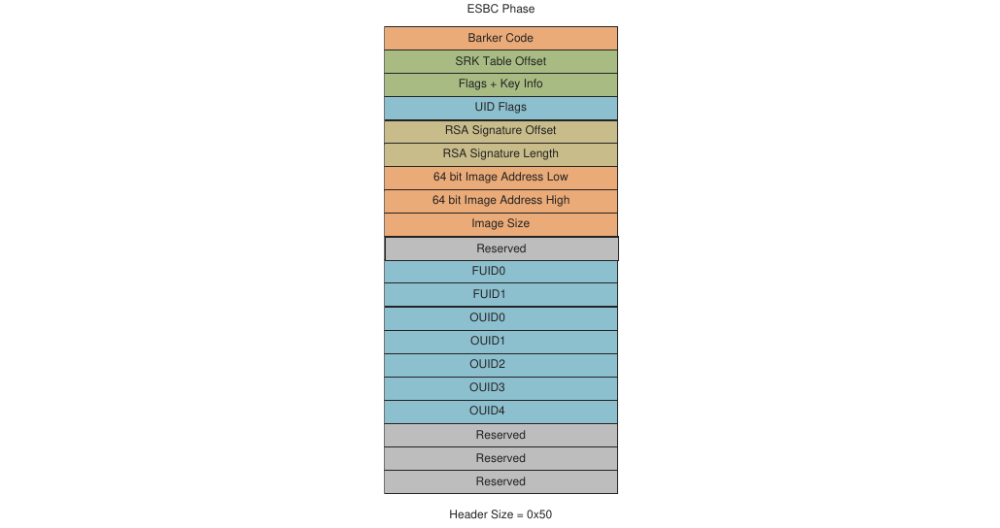

**Figure 15. Cấu trúc CSF header (ESBC TA 3.x)**

**Table 37. Cấu trúc CSF header (ESBC TA 3.x)**

| Offset |   | Mô tả |
|---|---|---|
| 0x00 |   | Barker code<br>Giá trị cố định mà ISBC dùng để xác nhận đã tìm thấy điểm bắt đầu của một CSF header. (0x12192001 dạng big endian)<br>0x00 – 0x12<br>0x01 – 0x19<br>0x02 – 0x20<br>0x03 – 0x01<br>Đây là mã hóa dạng số của LSTA (LS Series Trust Architecture) |
| 0x04 |   | SRK table offset<br>Trường này chứa một địa chỉ là offset của SRK table tính từ đầu CSF header. Dùng offset này và số entry trong SRK Table, SRK table được đọc ra. |
| 0x08 | 0x08 | No. of keys<br>Trường này chỉ định số key trong SRK table. |
|   | 0x09 | Key No. for verification<br>Số thứ tự key trong SRK table mà ISBC dùng để kiểm tra chữ ký image. |
|   | 0x0a | Reserved |
|   | 0x0b | Cờ ISBC key extension |
| 0x0C | 0x0C | Reserved |
|   | 0x0D | Reserved |
|   | 0x0E<br>0x0F | Reserved<br>**OIDx**: khi được đặt, trường OEM UID tương ứng trong SFP được đưa vào việc xác minh chữ ký số. Với mỗi bit được đặt, trường OUID tương ứng được đưa vào CSF header.<br>**FUID**: khi được đặt, FUID 64b được đưa vào việc xác minh chữ ký số và FUID được đưa vào CSF header<br>Các bit khác là reserved. |
| 0x10 |   | RSA signature offset<br>Trường này chứa một địa chỉ là offset của RSA signature tính từ đầu CSF header. Dùng offset này và độ dài chữ ký, RSA signature được đọc ra. RSA signature được tính trên CSF header, SG table và các image ESBC. |
| 0x14 |   | RSA signature length<br>Trường này chứa độ dài RSA signature tính bằng byte. |
| 0x18 |   | Địa chỉ image (64 bit) |
| 0x20 |   | Kích thước image |
| 0x24 |   | Reserved |
| 0x28 |   | FUID0 |
| 0x2c |   | FUID 1 |
| 0x30 |   | OUID0 |
| 0x34 |   | OUID1 |
| 0x38 |   | OUID2 |
| 0x3c |   | OUID3 |
| 0x40 |   | OUID4 |
| 0x44 |   | Reserved |
| 0x48 |   | Reserved |
| 0x4c |   | Reserved |

**Arm CoT cho image ESBC**

**Ghi chú:** Arm CoT chỉ được hỗ trợ cho các nền tảng LX2160ARDB và LX2162AQDS.

Quá trình Trusted Board Boot Requirements (TBBR) gồm nhiều giai đoạn và dùng nhiều image firmware. Quá trình này bảo đảm Chain of Trust được duy trì giữa các giai đoạn boot khác nhau bằng mật mã chuẩn.

Quá trình TBBR xác thực một loạt image binary đã ký bằng mật mã. Chữ ký của mỗi image được lưu trong các chứng chỉ X.509. Mỗi image được xác thực bằng một public key, key này được lưu trong một chứng chỉ đã ký và có thể truy ngược về root key lưu trên SoC trong bộ nhớ OTP hoặc BootROM.

Vì các image được ký bằng mật mã public key, quá trình TBBR có thể xác thực các image bằng public key lưu trên thiết bị. Private key dùng để tạo chữ ký không bao giờ cần lộ ra trên chính SoC.

Để biết chi tiết về cơ chế chữ ký qua chứng chỉ X.509, xem https://developer.arm.com/docs/den0006/latest/trusted-board-boot-requirements-client-tbbr-client-armv8-a

Hình sau cho thấy quan hệ giữa chứng chỉ và key như được triển khai trên LX2160A.

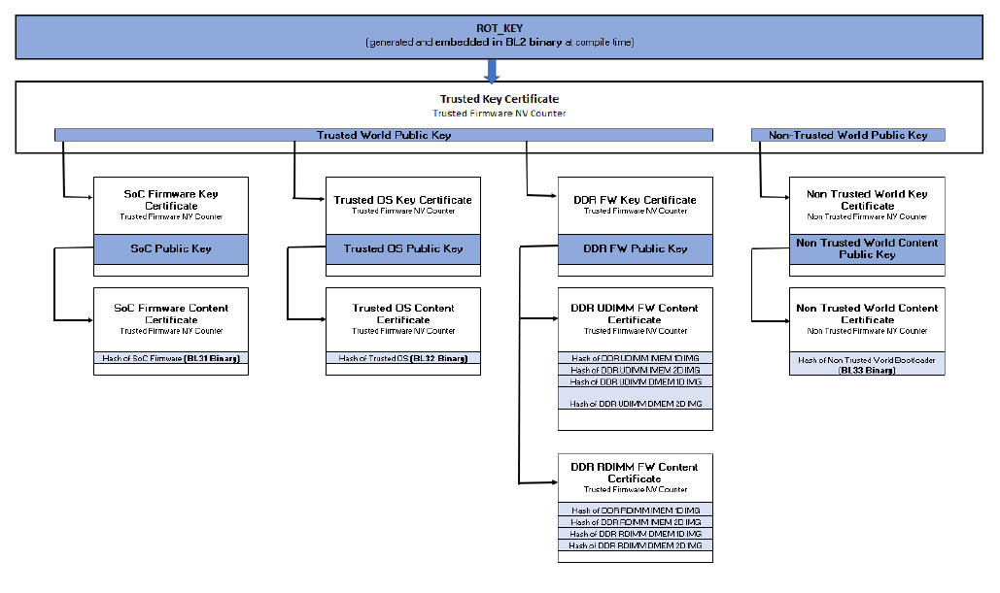

**Figure 16. Quan hệ giữa chứng chỉ và key**

Bản triển khai mẫu cung cấp cho LX2160A dùng SFP `OEMUID3` làm bộ đếm Non-Volatile (NV) của Trusted Firmware và SFP `OEMUID4` làm bộ đếm NV của Non-Trusted Firmware. Cả hai bộ đếm hỗ trợ 32 trạng thái. Để đặt bộ đếm, thiết bị cần được bật cho phép ghi fuse. Nếu có thể bật ghi fuse trong phần mềm chạy trên board của bạn, có thể thêm code riêng cho board vào các hàm sau.

```
void board_enable_povdd(void);
void board_disable_povdd(void);
```

Để biết chi tiết về cách bật POVDD bằng jumper và switch, xem Section 6.1.1.5.2.1

#### 6.1.1.4 Code Signing Tool

Để hỗ trợ ký các image và tạo CSF header, NXP cung cấp Code Signing Tool (CST). CST là một tập các ứng dụng dòng lệnh. CST được kỳ vọng sẽ ký image trong một quy trình offline.

CST gồm các công cụ sau:

- Tạo key
- Tạo header
- Tạo chữ ký

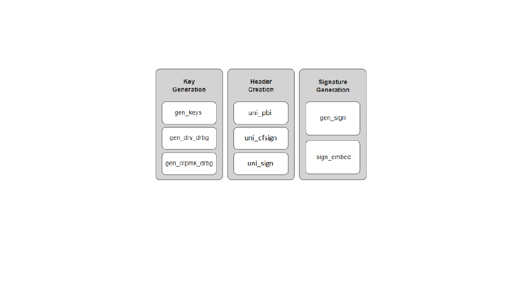

**Figure 17. Các công cụ trong package CST**

##### 6.1.1.4.1 Tạo key

###### 6.1.1.4.1.1 gen_keys

Tiện ích này tạo một cặp RSA public key và private key bằng các API của OpenSSL. Cặp key được xây dựng từ 3 phần: N, E và D.

- N – Modulus
- E – Encryption exponent
- D – Decryption exponent

**Public key** - Là tổ hợp của các thành phần E và N.

**Private key** - Là tổ hợp của các thành phần D và N.

Bạn có trách nhiệm kiểm soát chặt chẽ việc truy cập RSA private signature key. Nếu key này bị lộ, kẻ tấn công sẽ có thể tạo các image thay thế vượt qua được secure boot. Nếu mất key này, bạn sẽ không thể cập nhật image.

**Tính năng**:

- Cho phép tạo key với 3 kích thước: 1024 bit, 2048 bit và 4096 bit.
- Tạo cặp key RSA ở định dạng PEM.
- Tạo và lưu key vào file. Bạn có thể cung cấp tên file qua tùy chọn dòng lệnh.

**Cách dùng lệnh**:

```
./genkeys <Key length in bits >
```

`<Key length in bits >` có thể là 1024, 2048 hoặc 4096.

**Table 38. Các tùy chọn lệnh**

| Tùy chọn | Mô tả |
|---|---|
| -h,--help | Cách dùng lệnh |
| -k,--pubkey | File lưu public key ở định dạng PEM. Mặc định, public key được lưu trong srk.pub. |
| -p,--privkey | File lưu private key ở định dạng PEM. Mặc định, private key được lưu trong srk.priv. |

**Ví dụ**:

```
$ ./gen_keys 1024
#----------------------------------------------------#
#------- -------- -------- -------#
#------- CST (Code Signing Tool) Version 2.0 -------#
#------- -------- -------- -------#
#----------------------------------------------------#
===============================================================
This product includes software developed by the OpenSSL Project
for use in the OpenSSL Toolkit (http://www.openssl.org/)
This product includes cryptographic software written by
Eric Young (eay@cryptsoft.com)
===============================================================
Generated SRK pair stored in :
PUBLIC KEY srk.pub
PRIVATE KEY srk.pri
```

```
$ ./gen_keys 4096 -k my.pub -p my.pri
#----------------------------------------------------#
#------- -------- -------- -------#
#------- CST (Code Signing Tool) Version 2.0 -------#
#------- -------- -------- -------#
#----------------------------------------------------#
===============================================================
This product includes software developed by the OpenSSL Project
for use in the OpenSSL Toolkit (http://www.openssl.org/)
This product includes cryptographic software written by
Eric Young (eay@cryptsoft.com)
===============================================================
Generated SRK pair stored in :
PUBLIC KEY my.pub
PRIVATE KEY my.pri
```

###### 6.1.1.4.1.2 gen_otpmk_drbg

Tiện ích này chèn mã Hamming vào một chuỗi hex 256b do người dùng định nghĩa. Ngoài ra, nó có thể tạo một số ngẫu nhiên hex 256b và chèn mã Hamming vào đó, có thể dùng làm giá trị OTPMK.

**Ghi chú:**

Để tạo số ngẫu nhiên, thư viện Hash_DRBG được dùng. Hash_DRBG là một bản triển khai DRBG (Deterministic Random Bit Generator) được NIST phê duyệt, đặc tả trong SP800-90A. Nguồn entropy là Linux /dev/random.

**Tính năng:**

- Tạo số ngẫu nhiên, có thể dùng để tạo giá trị OTPMK nếu không cung cấp chuỗi do người dùng định nghĩa.
- Tính và nhúng mã Hamming vào chuỗi hex.

**Cách dùng lệnh:**

./gen_otpmk_drbg --b \<bit_order> \[--s \<string>\] \[--u\]

**Table 39. Các tùy chọn lệnh**

| Tùy chọn | Mô tả |
|---|---|
| --b \<bit_order> | (1 hoặc 2) Cách sắp thứ tự bit OTPMK trong SFP<br>• 1: BSC913x, P1010, P3, P4, P5, C29x<br>• 2: T1, T2, T4, B4, LS1021A, LS1043A, LS1046A, LS1012A, LS1088A, LS2088A, LX2160A, LS1028A, LX2162A |
| --s \<string> | Chuỗi 32 byte tùy chọn () - Tạo OTPMK dùng \<string> làm chuỗi |
| --u | Cờ tùy chọn urand - Tạo OTPMK dùng entropy từ /dev/urandom<br>Mặc định, OTPMK được tạo bằng entropy từ /dev/random |
| --h | Trợ giúp |

**Ví dụ:**

```
$ ./gen_otpmk_drbg --b 1 --s
 1111111122222222333333334444444455555555666666667777777788888888
$ ./gen_otpmk_drbg -b 1 --u
$ ./gen_otpmk_drbg -b 1
```

```
$ gen_otpmk_drbg -b 1
#----------------------------------------------------#
#------- -------- -------- -------#
#------- CST (Code Signing Tool) Version 2.0 -------#
#------- -------- -------- -------#
#----------------------------------------------------#
Input string not provided
Generating a random string
-------------------------------------------
* Hash_DRBG library invoked
* Seed being taken from /dev/urandom
-------------------------------------------
OTPMK[255:0] is:
d2f63a662f69a1faa4c2406f83eedde7647fbd3c62ac442c67fad2d4cda8b3a0
NAME | BITS | VALUE
_________|______________|____________
OTPMKR 0 | 31- 0 | cda8b3a0
OTPMKR 1 | 63- 32 | 67fad2d4
OTPMKR 2 | 95- 64 | 62ac442c
OTPMKR 3 | 127- 96 | 647fbd3c
OTPMKR 4 | 159-128 | 83eedde7
OTPMKR 5 | 191-160 | a4c2406f
OTPMKR 6 | 223-192 | 2f69a1fa
OTPMKR 7 | 255-224 | d2f63a66
```

```
$ ./gen_otpmk_drbg -b 2 --s
 1111111122222222333333334444444455555555666666667777777788888888
#----------------------------------------------------#
#------- -------- -------- -------#
#------- CST (Code Signing Tool) Version 2.0 -------#
#------- -------- -------- -------#
#----------------------------------------------------#
OTPMK[255:0] is:
 1111111122222222333333334444444455555555666666667777777788888888 NAME | BITS |
 VALUE
_________|______________|____________
OTPMKR 0 | 255-224 | 11111111
OTPMKR 1 | 223-192 | 22222222
OTPMKR 2 | 191-160 | 33333333
OTPMKR 3 | 159-128 | 44444444
OTPMKR 4 | 127- 96 | 55555555
OTPMKR 5 | 95- 64 | 66666666
OTPMKR 6 | 63- 32 | 77777777
OTPMKR 7 | 31- 0 | 88888888
```

###### 6.1.1.4.1.3 gen_drv_drbg

Tiện ích này chèn mã Hamming vào một chuỗi hex 64b do người dùng định nghĩa, hoặc tạo một số ngẫu nhiên hex 64b và chèn mã Hamming vào đó, có thể dùng làm giá trị Debug Response.

**Ghi chú:** Để tạo số ngẫu nhiên, một thư viện Hash_DRBG được dùng. Hash_DRBG là một bản triển khai DRBG (Deterministic Random Bit Generator) được NIST phê duyệt, đặc tả trong SP800-90A. Nguồn entropy là Linux /dev/random.

**Tính năng:**

- Tạo số ngẫu nhiên, có thể dùng để tạo giá trị Debug Response nếu không cung cấp chuỗi do người dùng định nghĩa.
- Tính và nhúng mã Hamming vào chuỗi hex.

**Cách dùng lệnh:**

./gen_drv_drbg \<hamming_algo> \[string\]

**Table 40. Các tùy chọn lệnh**

| Tùy chọn | Mô tả |
|---|---|
| hamming_algo | Nền tảng:<br>A1: T10xx, T20xx, T4xxx, P4080rev1, B4xxx<br>A2: LS1021A, LS1043A, LS1046A, LS1012A, LS1088A, LS2088A, LX2160A, LS1028A, LX2162A<br>B: P10xx, P20xx, P30xx, P4080rev2, P4080rev3, P50xx, BSC913x, C29x |
| string | Chuỗi 8 byte<br>Nếu không chỉ định chuỗi, tiện ích tạo một số ngẫu nhiên 8 byte và nhúng mã Hamming vào đó. |

**Ví dụ:**

```
$ ./gen_drv_drbg A2
#----------------------------------------------------#
#------- -------- -------- -------#
#------- CST (Code Signing Tool) Version 2.0 -------#
#------- -------- -------- -------#
#----------------------------------------------------#
Input string not provided
Generating a random string
-------------------------------------------
* Hash_DRBG library invoked
* Seed being taken from /dev/random
-------------------------------------------
Random Key Genearted is: f4bfc65e16284dbb
DRV[63:0] after Hamming Code is:
f4bfc65f16294daf
NAME | BITS | VALUE
_________|______________|____________
DRV 0 | 63 - 32 | f4bfc65f
DRV 1 | 31 - 0 | 16294daf
```

```
$ ./gen_drv_drbg A2 1652afe595631dec
#----------------------------------------------------#
#------- -------- -------- -------#
#------- CST (Code Signing Tool) Version 2.0 -------#
#------- -------- -------- -------#
#----------------------------------------------------#
DRV[63:0] after Hamming Code is:
1652afe495631cea
NAME | BITS | VALUE
_________|______________|____________
DRV 0 | 63 - 32 | 1652afe4
DRV 1 | 31 - 0 | 95631cea
```

##### 6.1.1.4.2 Tạo header

###### 6.1.1.4.2.1 uni_pbi

**Cách dùng lệnh:**

```
$ ./uni_pbi [options] <input_file>
```

**Table 41. Các tùy chọn lệnh**

| Tùy chọn | Mô tả |
|---|---|
| options | • --verbose: Hiển thị thông tin header sau khi tạo. Tùy chọn này không hợp lệ với các nền tảng TA 2.x<br>• --out \<file>: Tên file output<br>• --in \<file>: File RCW đầu vào<br>• --sben: Bật RCW\[SB_EN\] trong RCW<br>• --hash: In SRK (Public key) hash. Tùy chọn này không hợp lệ với các nền tảng TA 2.x<br>• --img_hash: Tạo header không có chữ ký<br>Image hash được lưu trong một file riêng. Tùy chọn này không hợp lệ với các nền tảng TA 2.x<br>• --help: Hiển thị trợ giúp của công cụ |
| input_file | Chứa mọi thông tin công cụ cần<br>Các file input mẫu có trong công cụ CST tại: `input_files/uni_pbi/`<br>`<platform>/`<br>Ví dụ, `input_files/uni_pbi/ls1/input_pbi_sd_secure` cho TA 2.x và `input_files/uni_pbi/ls2088_1088/input_pbi_sd_secure` cho TA 3.x |

\<input_file> chỉ định nền tảng, dựa vào đó lệnh uni_pbi có hai cách hoạt động riêng.

**Nếu \<input_file> chỉ định nền tảng TA 2.x, uni_pbi được dùng:**

- Để thêm con trỏ boot location và đặt giá trị RCW\[SB_EN\] và RCW\[BOOT_HO\] cho secure boot
- (tùy chọn) Để thêm lệnh PBI (các lệnh ACS write để đưa U-Boot spl và header của nó vào OCRAM từ bộ nhớ Non-XIP).
- (tùy chọn) Để nối thêm image (U-Boot, Boot script và header của chúng) vào file RCW.

**Nếu \<input_file> chỉ định nền tảng TA 2.x, uni_pbi được dùng:**

- Để tạo chữ ký và header trên các lệnh PBI.

Xem Section 6.1.1.3 để biết chi tiết về các nền tảng TA2.x và TA 3.x.

**Table 42. Mô tả các trường trong file input cho cả hai loại nền tảng (TA 2.x và TA 3.x)**

| Trường | Mô tả | Nền tảng hỗ trợ |
|---|---|---|
| PLATFORM | Nền tảng mà công cụ được dùng cho | TA 2.x và TA 3.x |
| RCW_PBI_FILENAME | Tên file image đầu vào. File RCW cần sửa | TA 2.x và TA 3.x |
| BOOT1_PTR | Địa chỉ CSF header của ISBC (Boot1) | TA 2.x và TA 3.x |
| OUTPUT_RCW_PBI_FILENAME | Để xác định nền tảng mà công cụ được dùng cho. Trường này là tùy chọn. Nếu không chỉ định, tên mặc định được dùng | TA 2.x |
| BOOT_SRC | Chỉ chỉ định trong trường hợp **boot từ SD** | TA 2.x |
| SB_EN | Trường để bật hoặc tắt secure boot. Đặt RCW\[SB_EN\] = 1 để bật secure boot | TA 2.x |
| BOOT_HO | Đặt<br>RCW\[BOOT_HO\] = 1 để đưa core vào trạng thái hold-off nhằm ghi fuse key hash trong trường hợp secure boot | TA 2.x |
| COPY_CMD | Để thêm các lệnh ACS write ghi U-Boot spl và header của nó vào OCRAM. Đây là trường tùy chọn. Nếu không có, công cụ không thêm lệnh | TA 2.x và TA 3.x |
| APPEND_IMAGES | Để nối U-Boot, Boot script và header của chúng vào RCW mới tạo. Đây là trường tùy chọn; nếu không chỉ định, không image nào được nối thêm | TA 2.x và TA 3.x |
| KEY_SELECT | Key trong SRK table được dùng để tạo chữ ký | TA 3.x |
| PRI_KEY | Tên file private key ở định dạng PEM. Số key tối đa được hỗ trợ là 8 | TA 3.x |
| PUB_KEY | Tên file public key ở định dạng PEM. Số key tối đa được hỗ trợ là 8 | TA 3.x |
| FSL_UID_x | (Các) FSL UID được đưa vào header | TA 3.x |
| OEM_UID_x | (Các) OEM UID được đưa vào header | TA 3.x |
| OUTPUT_HDR_FILENAME | Tên file output của header. Một file output được tạo với các lệnh RCW nối thêm các lệnh PBI đã ký | TA 3.x |
| IMAGE_HASH_FILENAME | Dùng với tùy chọn '--img_hash' (Tên file lưu image hash) | TA 3.x |
| RSA_SIGN_FILENAME | Tên file RSA sign được dùng cho output RSA signature | TA 3.x |
| MP_FLAG | Cờ Manufacturing Protection | TA 3.x |
| ISS_FLAG | Cờ Increment Security State | TA 3.x |
| LW_FLAG | Cờ Leave Writeable | TA 3.x |
| VERBOSE | Đặt VERBOSE là 1 nếu muốn hiển thị thông tin header. Việc này cũng có thể làm bằng tùy chọn '--verbose' | TA 3.x |
| IE_TABLE_ADDR | Địa chỉ 64-bit của IE table (dùng cho tính năng IE key extension).<br>Trường này có trong \<input_files> tại `input_`<br>`files/uni_pbi/ls2088_1088/ie_keys` | TA 3.x |

**Ghi chú:** Trong TA 3.x, các trường RCW\[SB_EN\] và RCW\[BOOT_HO\] mặc định được đặt là 1 để bật secure boot.

**File input mẫu**

Để biết chi tiết về các nền tảng TA2.x và TA3.x, xem Section 6.1.1.3

File input mẫu, `/cst/input_files/uni_pbi/ls1/input_pbi_sd_secure`, cho các nền tảng TA 2.x.

```
/*
 * Copyright 2017 NXP
 */
----------------------------------------------------------------------------
# For PBI Creation
# Name of RCW + PBI file [Mandatory]
RCW_PBI_FILENAME= u-boot-with-spl-pbl.bin
----------------------------------------------------------------------------
# Specify the output file name [Optional].
# Default Values chosen in Tool
OUTPUT_RCW_PBI_FILENAME=u-boot-with-spl-pbl-sec.bin
----------------------------------------------------------------------------
#Specify the boot_src
BOOT_SRC=SD_BOOT
# Specify the platform
PLATFORM=LS1020
# Specify the RCW Fields. (0 or 1) - [Optional]
SB_EN=1
BOOT_HO=1
BOOT1_PTR=10016000
----------------------------------------------------------------------------
# Specify the PBI commands - [Optional]
# Argument: COPY_CMD = (src_offset, dest_offset, Image name)
# Split hdr_uboot_spl.out in PBI commads
COPY_CMD={ffffffff,10016000,hdr_uboot_spl.out;}
----------------------------------------------------------------------------
# Specify the Images to be appended
# Arguments: APPEND_IMAGES=(Image name, Offset from start)
APPEND_IMAGES={u-boot-dtb.bin,0001D000;}
APPEND_IMAGES={hdr_uboot.out,0011D000;}
----------------------------------------------------------------------------
```

File input mẫu, `/cst/input_files/uni_pbi/ls2088_1088/input_pbi_sd_secure`, cho các nền tảng TA 3.x.

```
/* Copyright (c) 2015 Freescale Semiconductor, Inc.
 * Copyright 2017 NXP
 */
---------------------------------------------------
# Specify the platform. [Mandatory]
# Choose Platform -
# TRUST 3.0: LS2085
# TRUST 3.1: LS2088, LS1088
PLATFORM=LS2088
---------------------------------------------------
# Specify the Key Information.
# PUB_KEY [Mandatory] Comma Seperated List
# Usage: <srk1.pub> <srk2.pub> .....
PUB_KEY=srk.pub
# KEY_SELECT [Mandatory]
# USAGE (for TRUST 3.x): (between 1 to 8)
KEY_SELECT=1
# PRI_KEY [Mandatory] Single Key Used for Signing
# USAGE: <srk.pri>
PRI_KEY=srk.pri
---------------------------------------------------
# For PBI Signing
# Name of RCW + PBI file [Mandatory]
RCW_PBI_FILENAME=rcw.bin
# Address of ISBC (Boot1) CSF Header [Mandatory]
BOOT1_PTR=1801f000
---------------------------------------------------
# Specify OEM AND FSL ID to be populated in header. [Optional]
# e.g FSL_UID_0=11111111
FSL_UID_0=
FSL_UID_1=
OEM_UID_0=
OEM_UID_1=
OEM_UID_2=
OEM_UID_3=
OEM_UID_4=
---------------------------------------------------
# Specify the output file names [Optional].
# Default Values chosen in Tool
OUTPUT_HDR_FILENAME=rcw_sec.bin
IMAGE_HASH_FILENAME=
RSA_SIGN_FILENAME=
---------------------------------------------------
# Specify The Flags. (0 or 1) - [Optional]
MP_FLAG=0
ISS_FLAG=1
LW_FLAG=0
---------------------------------------------------
# Specify VERBOSE as 1, if you want to Display Header Information [Optional]
VERBOSE=1
---------------------------------------------------
#Block copy commands to write uboot-spl and its header to OCRAM
COPY_CMD={00080000,1801f000,hdr_uboot_spl.out}
---------------------------------------------------
# Specify the Images to be appended
# Arguments: APPEND_IMAGES=(Image name, Offset from start)
APPEND_IMAGES={hdr_uboot_spl.out,0007f000;}
APPEND_IMAGES={u-boot-spl.bin,000ff000;}
APPEND_IMAGES={u-boot-dtb.bin,00115000;}
APPEND_IMAGES={hdr_uboot.out,00215000;}
```

###### 6.1.1.4.2.2 uni_sign

Công cụ uni_sign có thể dùng cho các chức năng sau:

- Tạo CSF header kèm chữ ký cho cả giai đoạn ISBC và ESBC
- Tạo CSF header không có chữ ký nếu không cung cấp private key
- Công cụ uni_sign (với ESBC = 0 trong file input) được dùng để tạo chữ ký và header trên image Boot1 sẽ được ISBC xác minh
- Công cụ uni_sign (với ESBC = 1 trong file input) được dùng để tạo chữ ký và header trên các image sẽ được ESBC xác minh

**Cách dùng lệnh**:

```
./uni_sign [options] <input_file>
```

**Table 43. Các tùy chọn lệnh**

| Tùy chọn | Mô tả |
|---|---|
| --verbose | Hiển thị thông tin header sau khi tạo |
| --hash | In SRK (Public key) hash |
| --img_hash | Header được tạo không có chữ ký. Image hash được lưu trong một file riêng |
| --out \<file> | Tên file header |
| --in \<file> | File input để tính chữ ký. Tùy chọn này sẽ ghi đè tên file trong IMAGE_1 của input_file, nếu có |
| --app \<file> | File được nối vào header |
| --app_off \<offset> | Offset mà file sẽ được nối vào header |
| --help | Hiển thị trợ giúp về cách dùng công cụ |

Ví dụ cách dùng:

```
./uni_sign --in <inp_file>  --out <op file> --app_off <offset> --app <file>
 <input_file>
```

**Ghi chú:** Có những kịch bản mà một build script dùng công cụ cần đổi tên file input hoặc tên file header output. Các tùy chọn dòng lệnh này cung cấp cách ghi đè các giá trị đã chỉ định trong file input.

**Table 44. Mô tả các trường**

| Trường | Mô tả trường | Nền tảng hỗ trợ |
|---|---|---|
| PLATFORM | Để xác định nền tảng/SoC cần tạo CF header. | Tất cả |
| ESBC | Không đặt cờ này khi ký code trên image được ISBC xác minh trực tiếp. Với các image sau trong chain of trust, hãy đặt cờ này. | Tất cả |
| ENTRY_POINT | Trường địa chỉ entry point hoặc địa chỉ bắt đầu image trong header. | Tất cả |
| PRI_KEY | Tên file private key dùng để ký image. (File phải ở định dạng PEM) (mặc định = srk.pri do lệnh gen_keys tạo) FILE1 \[,FILE2, FILE3, FILE4\]. Hỗ trợ nhiều key chỉ cho các nền tảng TA 2.x. | Tất cả |
| PUB_KEY | Tên file public key ở định dạng PEM. (mặc định = srk.pub do gen_keys tạo) FILE1 \[,FILE2, FILE3, FILE4\]. Hỗ trợ nhiều key chỉ cho các nền tảng TA 2.x. | Tất cả |
| KEY_SELECT | Chỉ định key dùng để tạo chữ ký khi có nhiều hơn một key được đưa vào. (Mặc định=1, key đầu tiên được chọn) | Tất cả |
| IMAGE_1 - IMAGE_8 | Tạo các entry cho SG table theo định dạng { IMAGE\_NAME, SRC_ADDR, DST_ADDR } | Tất cả |
| OEM_UID_x | OEM UID được đưa vào header. | Tất cả |
| FSL_UID_x | FSL UID được đưa vào header. | Tất cả |
| HK_AREA_POINTER | Con trỏ bắt đầu House Keeping Area mà Sec cần (Chỉ cần cho các nền tảng TA 2.x khi không cung cấp tùy chọn esbc) | TA 2.x |
| HKAREA_SIZE | Kích thước House Keeping Area (Chỉ cần cho các nền tảng TA 2.x khi không cung cấp tùy chọn esbc) | TA 2.x |
| OUTPUT_HDR_FILENAME | Tên binary header tổng hợp do công cụ tạo | Tất cả |
| SG_TABLE_ADDR | Chỉ định địa chỉ SG_TABLE nơi có SG table cho 2041/3041/4080/5020/5040 khi ESBC=0. | TA 2.x |
| OUTPUT_SG_BIN | Chỉ định tên file output của SG table. | TA 2.x |
| IMAGE_TARGET | Chỉ định đích nơi image sẽ được nạp. Ví dụ, NOR_8B/NOR_16B/NAND_8B_512/NAN D_8B_2K/NAND_8B_4K/ NAND_16B_512/NAND\_16B_2K/NAND_16B_4K/SD/MMC/SPI | TA 2.x |
| SIGN_SIZE | Độ dài chữ ký | TA 2.x |
| INPUT_SIGN_FILENAME | Tên file chữ ký dùng cho output chữ ký | TA 2.x |
| HASH_FILENAME | Tên file hash dùng cho output hash | TA 2.x và TA 3.x |
| RSA_SIGN_FILENAME | Tên file RSA sign dùng cho output RSA signature. | TA 3.x |
| SEC_IMAGE | Cờ cho Secondary Image. Chỉ cần cho các nền tảng TA 2.x | TA 2.x |
| MP_FLAG | Chỉ định cờ Manufacturing Protection. Chỉ có cho LS1. | Tất cả, chỉ cần trong giai đoạn ISBC |
| VERBOSE | Chỉ định tùy chọn Verbose. Nội dung header được tạo sẽ được in ra. | Tất cả |
| IMAGE_HASH_FILENAME | dùng với tùy chọn '--img_hash' (Tên file lưu Image Hash) | TA 3.x |
| ISS_FLAG | Cờ Increment Security State | TA 3.x, chỉ cần trong giai đoạn ISBC |
| LW_FLAG | Cờ Leave Writeable | TA 3.x, chỉ cần trong giai đoạn ISBC |
| ESBC_HDRADDR | Địa chỉ 32-bit nơi header được tạo sẽ được đặt. Dùng để tính địa chỉ IE Key table | TA 3.x, chỉ<br>dùng khi sử dụng tính năng IE key extension |
| IE_KEY | Danh sách các file chứa public key (IE Key), phân cách bằng dấu phẩy | TA 3.x, chỉ<br>dùng khi sử dụng tính năng IE key extension |
| IE_REVOC | Danh sách các số cần thu hồi khỏi IE table, phân cách bằng dấu phẩy | TA 3.x, chỉ<br>dùng khi sử dụng tính năng IE key extension |
| IE_KEY_SEL | Số thứ tự key trong IE table dùng để kiểm tra image | TA 3.x, chỉ<br>dùng khi sử dụng tính năng IE key extension |

File input mẫu, `input_bootscript_secure`, có trong công cụ CST tại: `input_files/` `uni_sign/<platform>/`

Xem Section 6.1.1.3 để biết chi tiết về các nền tảng TA2.x và TA 3.x.

**File input mẫu**

File input `/proj/idcapps/usr/swatig/cst/input_files/uni_sign/ls2088_1088/input_bootscript_secure`

```
/* Copyright (c) 2015 Freescale Semiconductor, Inc.
 * Copyright 2017 NXP
 */
ESBC=1
---------------------------------------------------
# Specify the platform. [Mandatory]
# Choose Platform -
# TRUST 3.0: LS2085
# TRUST 3.1: LS2088, LS1088
PLATFORM=LS2088
---------------------------------------------------
# Specify the Key Information.
# PUB_KEY [Mandatory] Comma Seperated List
# Usage: <srk1.pub> <srk2.pub> .....
PUB_KEY=srk.pub
# KEY_SELECT [Mandatory]
# USAGE (for TRUST 3.x): (between 1 to 8)
KEY_SELECT=1
# PRI_KEY [Mandatory] Single Key Used for Signing
# USAGE: <srk.pri>
PRI_KEY=srk.pri
---------------------------------------------------
# Specify the IMAGE Information [Mandatory]
# USAGE : IMAGE_NO = {IMAGE_NAME, SRC_ADDR, DST_ADDR}
# Address can be 64 bit
IMAGE_1={bootscript,80000000,ffffffff}
---------------------------------------------------
# Specify OEM AND FSL ID to be populated in header. [Optional]
# e.g FSL_UID_0=11111111
FSL_UID_0=
FSL_UID_1=
OEM_UID_0=
OEM_UID_1=
OEM_UID_2=
OEM_UID_3=
OEM_UID_4=
---------------------------------------------------
# Specify the output file names [Optional].
# Default Values chosen in Tool
OUTPUT_HDR_FILENAME=hdr_bs.out
IMAGE_HASH_FILENAME=
RSA_SIGN_FILENAME=
---------------------------------------------------
# Specify The Flags. (0 or 1) - [Optional]
MP_FLAG=0
ISS_FLAG=1
LW_FLAG=0
---------------------------------------------------
# Specify VERBOSE as 1, if you want to Display Header Information [Optional]
VERBOSE=1
```

##### 6.1.1.4.3 Tạo chữ ký

Các công cụ trong nhóm này được cung cấp cho trường hợp người dùng không muốn chia sẻ private key với CST. Tùy chọn **--img_hash** của các công cụ trong Section 6.1.1.4.2 cho phép ký code trong một môi trường an toàn không chạy CST.

**Tùy chọn --img_hash**

- Tạo file hash ở định dạng binary chứa hash SHA-256 của các thành phần cần cho chữ ký.
- Tạo file binary header output dựa trên các trường chỉ định trong file input.
- File binary header output không chứa chữ ký.
- Cho phép linh hoạt nối chữ ký thủ công vào cuối file header output. Người dùng có thể dùng công cụ tùy biến của riêng mình để tạo chữ ký. Offset chữ ký trong header được chọn sao cho chữ ký có thể được nối vào cuối file header.
- Tùy chọn này không cần cung cấp private key. Nhưng phải cung cấp public key tương ứng trong cặp public/private key để tính đúng hash SHA-256.
- Hash SHA-256 tạo trên CF header (trong trường hợp các nền tảng TA1.x) sau đó được ký bằng thuật toán RSA (các API của OpenSSL) với private key. Hash đã mã hóa này được gọi là chữ ký số. Chữ ký này được đặt ở một offset tính từ CF header, sau đó được IBR đọc.
- Hash SHA-256 tạo trên CSF header, public Key, SG table và ESBC cũng được ký bằng thuật toán RSA với cùng private key. Chữ ký tạo ra được đặt ở một offset tính từ CSF header, sau đó lại được IBR đọc.

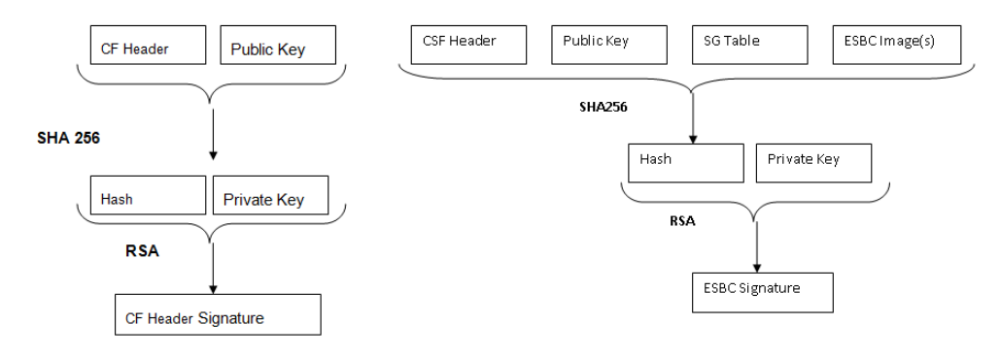

**Figure 18. Tạo chữ ký kép**

**Ví dụ cách dùng**:

```
./uni_sign --img_hash --verbose input_files/uni_sign/ls2088_1088/
input_kernel_secure
 #----------------------------------------------------#
 #------- -------- -------- -------#
 #------- CST (Code Signing Tool) Version 2.0 -------#
 #------- -------- -------- -------#
 #----------------------------------------------------#
==========================================================
This tool includes software developed by OpenSSL Project
for use in the OpenSSL Toolkit (http://www.openssl.org/)
This product includes cryptographic software written by
Eric Young (eay@cryptsoft.com)
==========================================================
Input File is input_files/uni_sign/ls2088_1088/input_kernel_secure version
 number1
-----------------------------------------------
-   Dumping the Header Fields
-----------------------------------------------
- SRK Information
-   SRK Offset : 200
-   Number of Keys : 1
-   Key Select : 1
-   Key List :
-     Key1 srk.pub(100)
- UID Information
-   UID Flags = 00
-   FSL UID = 00000000_00000000
-   OEM UID0 = 00000000
-   OEM UID1 = 00000000
-   OEM UID2 = 00000000
-   OEM UID3 = 00000000
-   OEM UID4 = 00000000
- FLAGS Information
-   MISC Flags = 00
- Image Information
- kernel.itb (Size = 00500000 SRC = 00000000_a0000000)
- RSA Signature Information
-   RSA Offset : 800
-   RSA Size : 80
-----------------------------------------------
Image Hash:
094e71bd9072bfd9bfe9166203c0239cda0890f6b68503bba7b16f82cf4124ef
************************************************
* Image Hash Stored in File: hash.out
* Header File is w/o Signature appended
************************************************
Header File Created: hdr_kernel.out
SRK (Public Key) Hash:
67b37ae9808a60f372ee1530f19e4b373e89749742c6ff8740e89457538aebe5
 SFP SRKHR0 = 67b37ae9
 SFP SRKHR1 = 808a60f3
 SFP SRKHR2 = 72ee1530
 SFP SRKHR3 = f19e4b37
 SFP SRKHR4 = 3e897497
 SFP SRKHR5 = 42c6ff87
 SFP SRKHR6 = 40e89457
 SFP SRKHR7 = 538aebe5
```

Các công cụ được cung cấp để tạo file chữ ký và nhúng chữ ký vào cuối file header.

###### 6.1.1.4.3.1 gen_sign

Tiện ích này cho phép người dùng tính chữ ký cho một hash cho trước bằng CST. Công cụ chỉ cần file hash và file private key làm đầu vào. Nó tạo ra file chữ ký làm output.

Nó dùng API RSA_sign của OpenSSL để tính chữ ký trên hash được cung cấp.

**Cách dùng lệnh**

./gen_sign \[option\] \<HASH_FILE> \<PRIV_KEY_FILE>

**Table 45. Các tùy chọn lệnh**

| Tùy chọn | Mô tả |
|---|---|
| \[option\] | --sign_file SIGN_FILE: Cung cấp tên file chữ ký cần tạo làm toán hạng. SIGN_FILE được tạo, chứa chữ ký tính trên hash cung cấp qua HASH_FILE bằng private key cung cấp qua PRIV_KEY_FILE. Với tùy chọn này, HASH_FILE và PRIV_KEY_FILE là bắt buộc, còn SIGN_FILE là tùy chọn. Giá trị mặc định của SIGN_FILE là sign.out |
| HASH_FILE | Tên file hash chứa hash cần tính chữ ký |
| PRIV_KEY_FILE | Tên file key chứa private key |

**Ví dụ cách dùng**:

Sau khi file hash đã được tạo như mô tả trong Section 6.1.1.4.3, có thể dùng công cụ như mô tả dưới đây.

```
$ ./uni_sign --img_hash --verbose input_files/uni_sign/ls2088_1088/
input_kernel_secure
.
.
.
************************************************
* Image Hash Stored in File: hash.out
* Header File is w/o Signature appended
************************************************
Header File Created: hdr_kernel.out
$ ./gen_sign hash.out srk.pri
  #----------------------------------------------------#
  #-------         --------     --------        -------#
  #------- CST (Code Signing Tool) Version 2.0  -------#
  #-------         --------     --------        -------#
  #----------------------------------------------------#
Signature Length = 80
Hash in hash.out is signed with srk.pri
Signature is stored in file : sign.out
```

###### 6.1.1.4.3.2 sign_embed

Công cụ này nhúng chữ ký vào file header được tạo bằng tùy chọn img_hash. Tùy chọn img_hash tạo header nhưng không nhúng chữ ký vào header. sign_embed mở file header và sao chép chữ ký vào cuối file.

File header tạo bằng tùy chọn img_hash có phần đệm đến offset chữ ký, để chữ ký có thể được nhúng thẳng vào cuối file.

**Cách dùng lệnh**

./sign_embed \<hdr_file> \<sign_file>

**Table 46. Các tùy chọn lệnh**

| Tùy chọn | Mô tả |
|---|---|
| hdr_file | Tên file header cần nhúng chữ ký |
| sign_file | Tên file sign chứa chữ ký cần nhúng |

**Ví dụ cách dùng**:

```
$ ./sign_embed hdr_kernel.out sign.out
  #----------------------------------------------------#
  #-------         --------     --------        -------#
  #------- CST (Code Signing Tool) Version 2.0  -------#
  #-------         --------     --------        -------#
  #----------------------------------------------------#
hdr_kernel.out is appended with file sign.out (0x80)
```

**Ghi chú:** Bạn có thể tạo header hoàn chỉnh kèm chữ ký trong một bước bằng công cụ uni_sign/uni_pbi mà không dùng tùy chọn nào.

./uni_sign \<input_file>

**Or**

Bạn có thể thực hiện ba bước riêng:

1. ./uni_sign **--img_hash** \<input_file> (Tạo file header không có chữ ký và lưu hash vào một file riêng)
2. ./gen_sign<sup>2</sup> \[option\] \<HASH_FILE> \<PRIV_KEY_FILE> (Ký image hash bằng private key)
3. ./sign_embed \<hdr_file> \<sign_file> (Nhúng chữ ký vào cuối file header)

#### 6.1.1.5 Quy trình chạy secure boot

Mục này mô tả các bước chạy secure boot trên các board dựa trên SOC dòng NXP Layerscape:

2 Bước này có thể làm bằng công cụ của riêng bạn nếu bạn không muốn chia sẻ private key với công cụ CST.

1. Chuẩn bị board cho secure boot:

   a. Enable POVDD

   b. Ghi OTPMK

   c. Ghi SRK

2. Build thủ công các image secure boot cho NXP CoT và Arm CoT bằng TF-A.
3. Ghi các image secure boot cho NXP CoT và Arm CoT
4. Các bước chạy chain of trust có tính bí mật

##### 6.1.1.5.1 Luồng thực thi secure boot

Bạn có thể thực thi luồng Secure boot trên board bằng một trong các cách sau:

- Chain of Trust
- Chain of Trust có tính bí mật

Để biết chi tiết:

- Về chain of trust của TA 2.x, xem Section 6.1.1.3.1.
- Về chain of trust của TA 3.x, xem Section 6.1.1.3.2.

###### 6.1.1.5.1.1 Luồng thực thi secure boot cho Chain of Trust

Để chạy secure boot qua Chain of Trust:

1. Thiết lập board tùy theo bạn muốn chạy secure boot ở giai đoạn Development hay giai đoạn Production.

   a. Giai đoạn Production - Đặt bit ITS trong SFP để bảo đảm hệ thống hoạt động một cách an toàn và tin cậy. Khi fuse ITS của SFP đã bị blow thì không thể thay đổi được nữa.

   **Ghi chú:** Để biết chi tiết, xem "Chapter 8 Trusted Manufacturing Process" trong QorIQ Trust Architecture 3.0 User Guide hoặc "Section 5.5 Trusted Manufacturing Process" trong QorIQ Trust Architecture 2.1 User Guide.

   b. Giai đoạn Development - Không blow fuse ITS, đặt RCW\[SB_EN\] = 1 để bật secure boot.

2. Blow các fuse cần thiết khác (OTPMK và SRKH) trong SFP. Để biết chi tiết, xem Section 6.1.1.5.2.3 và Section 6.1.1.5.2.4. Blow OTPMK là việc bắt buộc để chạy secure boot cho cả giai đoạn Production lẫn Development.

   **Ghi chú:** SRK hash trong fuse phải giống hash của cặp key được dùng để ký các image PBI và U-Boot. Để kiểm thử, SRK hash có thể được ghi vào các mirror register. Tiện ích `gen_otpmk_drbg` trong CST có thể dùng để tạo OTPMK key.

3. Ghi các image secure boot. Để biết chi tiết, xem Section 6.1.1.5.4

   a. Giai đoạn Production – Ghi các image secure boot vào địa chỉ của bank mặc định.

   b. Giai đoạn Development – Để demo, bạn có thể ghi vào địa chỉ của bank thay thế từ bank mặc định rồi chuyển sang bank thay thế.

4. Bật nguồn board.

   a. Nếu các image secure boot được ghi vào bank mặc định (giai đoạn Production/Development) - Khi bật nguồn, code ISBC nhận quyền điều khiển và kiểm tra image ESBC. Image ESBC tiếp tục kiểm tra các image Linux, rootfs và dtb đã ký. Board boot vào Linux.

   b. Nếu các image secure boot được ghi vào bank thay thế (giai đoạn Development) - Khi bật nguồn, board boot từ bank mặc định. Khi bạn chuyển sang bank thay thế, code ISBC nhận quyền điều khiển và kiểm tra image ESBC. Image ESBC tiếp tục kiểm tra các image Linux, rootfs và dtb đã ký. Board boot vào Linux.

###### 6.1.1.5.1.2 Luồng thực thi secure boot cho Chain of Trust có tính bí mật

Để chạy secure boot bằng Chain of Trust có tính bí mật, thực hiện các bước sau:

1. Thiết lập board tùy theo bạn muốn chạy secure boot ở giai đoạn Development hay giai đoạn Production.
   - Giai đoạn Production: Để bảo đảm hệ thống hoạt động một cách an toàn và tin cậy, đặt bit ITS trong SFP. Sau khi fuse ITS của SFP đã bị blow thì không thể thay đổi được nữa.

     **Ghi chú:** Để biết chi tiết, xem "Chapter 8 Trusted Manufacturing Process" trong QorIQ Trust 3.0 User Guide hoặc "Section 5.5 Trusted Manufacturing Process" trong QorIQ Trust Architecture 2.1 User Guide.

   - Giai đoạn Development: Không blow fuse ITS, đặt RCW\[SB_EN\] = 1 để bật secure boot.
2. Blow các fuse cần thiết khác (OTPMK và SRKH) trong SFP. Để biết chi tiết, xem Section 6.1.1.5.2.3 và Section 6.1.1.5.2.4. Blow OTPMK là việc bắt buộc để chạy secure boot cho cả giai đoạn Production lẫn Development.

   **Ghi chú:** SRK hash trong fuse phải giống hash của cặp key được dùng để ký các image PBI và U-Boot. Để kiểm thử, SRK hash có thể được ghi vào các mirror register. Tiện ích `gen_otpmk_drbg` trong CST có thể dùng để tạo OTPMK key.

3. Ghi các image secure boot. Để biết chi tiết, xem Section 6.1.1.5.4
   - Giai đoạn Production: Ghi các image secure boot vào địa chỉ của bank mặc định.
   - Giai đoạn Development: Để demo, bạn có thể ghi vào địa chỉ của bank thay thế từ bank mặc định rồi chuyển sang bank thay thế.
4. Bật nguồn board.

   **Ghi chú:** Để biết chi tiết về **lệnh blob enc**, xem Section 6.2.1.2.3. Để biết chi tiết về **lệnh blob dec**, xem Section 6.2.1.2.4. Để biết chi tiết về các bootscript encap và decap, xem Section 6.2.1.2.5.2

   a. Nếu các image secure boot được ghi vào bank mặc định (giai đoạn Production/Development) -

   - Khi bật nguồn, code ISBC nhận quyền điều khiển và kiểm tra image ESBC. Image ESBC tiếp tục kiểm tra các image Linux, rootfs và dtb đã ký. Board boot vào Linux.
   - Lần boot đầu: Bước encapsulation

     **Ghi chú:** Bước này được thực hiện tại cơ sở của (các) OEM.

     i. Theo mặc định, các bootscript encap và decap được cài trong boot partition.

     ii. Khi board boot lần đầu sau khi mọi image đã được tạo, bootscript encap được thực thi.

     Bootscript này:

     i. Xác thực và encapsulate các image Linux và dtb, rồi thay các image Linux và dtb chưa mã hóa bằng các image Linux và dtb vừa encapsulate.

     ii. Thay bootscript encap và header của nó bằng bootscript decap và header của nó, vốn đã có sẵn trong boot partition.

     iii. Phát lệnh reset.

   - Các lần boot sau:

     i. U-Boot sẽ thực thi script có các lệnh decap

     i. Un-blobify các image Linux và dtb trong DDR.

     ii. Chuyển quyền điều khiển cho các image này.

   b. Nếu các image secure boot được ghi vào bank thay thế (giai đoạn Development) - Khi bật nguồn, board boot từ bank mặc định. Khi bạn chuyển sang bank thay thế, luồng secure boot như nêu trên sẽ được thực thi.

##### 6.1.1.5.2 Chuẩn bị board cho Secure boot

Để chuẩn bị một board cho secure boot, bạn phải thực hiện các bước sau:

1. Enable POVDD.
2. Blow fuse bằng một trong các cách sau:
   - Lập trình các register SFP:

     a. Ghi OTPMK.

     b. Ghi SRKH trong môi trường production bằng một trong các cách sau:

     - Mục "Program SRKH mirror registers in U-Boot environment"
     - Mục "Program SRKH mirror registers in CodeWarrior environment"

**Table 47. Các register SFP**

| OTPMKR0..OTPMKR7 | SRKHR0..SRKHR7 |
|---|---|
| 0x1e80234..0x1e80250 | 0x1e80254..0x1e80270 |

- Build và triển khai image fuse provisioning lên board.

  Cách này hữu ích nếu bạn cần blow fuse trên nhiều board.

3. Disable POVDD.

   Bạn phải tháo các jumper đã đặt trong Section 6.1.1.5.2.1.

###### 6.1.1.5.2.1 Enable POVDD

Để bật POVDD cho các nền tảng Layerscape khác nhau, thực hiện các bước sau:

1. TWR-LS1021A:
   - Cắm J11 để bật SNVS ở trạng thái check
   - POVDD (J8 và J9)
2. LS1043ARDB:
   - Cắm J13 để bật PWR_PROG_SFP
3. LS1012ARDB:
   - Qua các giao dịch I2C, ghi vào register LDO1CT để đổi bit LDO1EN trong vr5100
   - `i2c mw 0x08 0x6c 0x10`
4. FRWY-LS1012A:
   - Cắm J37 để bật PROG_SFP
   - Qua các giao dịch I2C, ghi vào register LDO1CT để đổi bit LDO1EN trong vr5100
   - `i2c mw 0x08 0x6c 0x10`
5. LS1046ARDB:
   - Cắm J21 để bật PWR_PROG_SFP
6. LS2088ARDB:
   - Cắm J12 để bật PWR_PROG_SFP
7. LS1088ARDB:
   - Cắm J10 để bật PWR_PROG_SFP
8. LX2160ARDB:
   - Cắm J9 để bật PROG_SFP
9. LX2162AQDS:
   - Cắm J35 để bật PROG_SFP
   - Đặt SW9\[4\] = 1
   - LED để kiểm tra - D15

###### 6.1.1.5.2.2 Đảo byte khi đọc và ghi SRKH/OTPMK

SRKH và OTPMK phải được ghi cẩn thận, lưu ý đến endianness của khối SFP. Nếu SRKH và OTPMK được ghi bằng Core thì phải đảo SRKH và OTPMK. Tuy nhiên, nếu SRKH và OTPMK được ghi bằng DAP hoặc SFP thì không cần đảo. Xem bảng sau để biết chi tiết.

| Console | Thứ tự SRKH/OTPMK do CST tạo | Thứ tự ghi SRKH/OTPMK | Thứ tự đọc SRKH/OTPMK | Endianness |
|---|---|---|---|---|
| U-Boot | order_1 | reverse order_1 | reverse order_1 | Endianness của core |
| CCS | order_1 | order_1 | order_1 | Endianness của SFP (DAP) |

Ví dụ:

Giả sử các giá trị SRKH sau được tạo ra:

```
SRK (Public Key) Hash:
fdc2fed4317f569e1828425ce87b5cfd34beab8fdf792a702dff85e132a29687
               SFP SRKHR0 = fdc2fed4
               SFP SRKHR1 = 317f569e
               SFP SRKHR2 = 1828425c
               SFP SRKHR3 = e87b5cfd
               SFP SRKHR4 = 34beab8f
               SFP SRKHR5 = df792a70
               SFP SRKHR6 = 2dff85e1
               SFP SRKHR7 = 32a29687
```

Để ghi vĩnh viễn SRKH bằng DAP/SFP, chạy các lệnh sau tại CCS console:

```
ccs::write_mem 32 0x1e80254 4 0 0xfdc2fed4
ccs::write_mem 32 0x1e80258 4 0 0x317f569e
ccs::write_mem 32 0x1e8025c 4 0 0x1828425c
ccs::write_mem 32 0x1e80260 4 0 0xe87b5cfd
ccs::write_mem 32 0x1e80264 4 0 0x34beab8f
ccs::write_mem 32 0x1e80268 4 0 0xdf792a70
ccs::write_mem 32 0x1e8026c 4 0 0x2dff85e1
ccs::write_mem 32 0x1e80270 4 0 0x32a29687
```

Để ghi vĩnh viễn SRKH bằng core, chạy các lệnh sau tại U-Boot console:

```
mw.l 0x1e80254 0xd4fec2fd
mw.l 0x1e80258 0x9e567f31
mw.l 0x1e8025c 0x5c422818
mw.l 0x1e80260 0xfd5c7be8
mw.l 0x1e80264 0x8fabbe34
mw.l 0x1e80268 0x702a79df
mw.l 0x1e8026c 0xe185ff2d
mw.l 0x1e80270 0x8796a232
mw.l 0x1e80020 0x2
```

###### 6.1.1.5.2.3 Ghi OTPMK

Sau khi bật POVDD, làm theo các bước sau để ghi OTPMK trong U-Boot:

1. Kiểm tra register SNVS - HPSR để xem OTPMK đã được ghi fuse chưa.

   ```
   => md $SNVS_HPSR_REG
   88000900
   ```

   **Ghi chú:** LX2162AQDS không hỗ trợ đọc register qua U-Boot (bằng lệnh md). Để kiểm tra trạng thái register SNVS trên LX2162AQDS, hãy truy cập register `0x1e90014` bằng lệnh CCS.

   OTPMK_ZERO_BIT (nibble thứ hai) là 1, cho biết OTPMK chưa được ghi fuse.

   Nếu đọc ra `00000000`, hãy bảo đảm core đang chạy ở chế độ secure, rồi đọc register này bằng JTAG (chỉ ở chế độ development, qua CWTAP).

2. Ghi fuse OTPMK, nếu chưa ghi.

   a. Tạo OTPMK.

   i. `cd cst`

   ii. `./gen_otpmk_drbg -b 2`

3. Ghi fuse OTPMK.

   ```
   => mw.l $OTPMKR0 <OTMPKR_0_32Bit_val> => mw.l $OTPMKR1 <OTMPKR_1_32Bit_val>
    => mw.l $OTPMKR2 <OTMPKR_2_32Bit_val> => mw.l $OTPMKR3 <OTMPKR_3_32Bit_val>
    => mw.l $OTPMKR4 <OTMPKR_4_32Bit_val> => mw.l $OTPMKR5 <OTMPKR_5_32Bit_val>
    => mw.l $OTPMKR6 <OTMPKR_6_32Bit_val> => mw.l $OTPMKR7 <OTMPKR_7_32Bit_val>
   ```

4. Tại U-Boot prompt, kiểm tra các register SNVS cho OTPMK đã được ghi đúng.

   a. Kiểm tra OTPMK đã được ghi fuse chưa.

   ```
   => md $SNVS_HPSR_REG
   80000900
   ```

   OTPMK_ZERO_BIT (nibble thứ hai) là 0, cho biết OTPMK đã được ghi fuse.

   Nếu đọc ra `00000000`, hãy đọc register này bằng JTAG (chỉ ở chế độ development, qua CWTAP).

   b. Đọc OTPMK.

   ```
   => md $OTPMKR0 0x10
   01e80234: ffffffff ffffffff ffffffff ffffffff    ................
   01e80244: ffffffff ffffffff ffffffff ffffffff    ................
   ```

   **Ghi chú:** OTPMK không hiển thị ở dạng rõ.

###### 6.1.1.5.2.4 Ghi các mirror register SRKH

**Ghi các mirror register SRKH trong môi trường CodeWarrior**

Để thực thi thành công bất kỳ trình tự nào mô tả dưới đây trên bất kỳ nền tảng TA 3.x nào, điều quan trọng là phải cấu hình lại board đích trước để một yêu cầu reset từ SoC (HRESET_REQ) không tự động dẫn đến việc SoC bị reset do logic board như CPLD kích hoạt. Các board tham chiếu NXP cho nền tảng TA 3.x có jumper hoặc DIP switch để tắt việc tự động xử lý HRESET_REQ và có thể đưa board vào Reset Sequence Pause (RSP). Dù có đưa ra một số ví dụ, chi tiết về cách bật chế độ RSP có trong tài liệu riêng của từng board.

1. **Các nền tảng LS1021A, LS1012A, LS1043A, LS1046A (TA 2.x)**

   a. Sau khi sao chép image vào flash, chọn nguồn boot bằng cách đổi thiết lập switch, rồi boot board.

   b. Khi lệnh bitbake được chạy với tùy chọn -s, lệnh dùng RCW secure, với RCW\[BOOT_HO\] = 1 và RCW\[SB_EN\]=1, để build image.

   Sau khi boot board, core sẽ dừng ở lệnh đầu tiên. Việc này cho phép người dùng ghi SRKH vào register. Khi dùng image build sẵn, hãy dùng SRKH có trong srk_hash.txt trên GitHub. Nếu fuse SRKH đã bị blow, đặt RCW\[BOOT_HO\] = 0 trong file RCW trong bitbake; nếu không, ghi giá trị SRKH (hiển thị khi ký image) vào các mirror register SFP, rồi nhả core khỏi boot hold off bằng cách ghi vào Boot Release Register trong DCFG bằng các lệnh dưới đây:

   ```
   ccs::config_server 0 10000
   ccs::config_chain {<platform> dap sap2}
   display ccs::get_config_chain
   # Check Initial SNVS State and Value in SCRATCH Registers
   ccs::display_mem <dap position> 0x1e90014 4 0 4
   ccs::display_mem <dap position> 0x1ee0200 4 0 4
   #Write the SRK Hash Value in Mirror Registers
   ccs::write_mem <dap position> 0x1e80254 4 0 <SRKH0>
   ccs::write_mem <dap position> 0x1e80258 4 0 <SRKH1>
   ccs::write_mem <dap position> 0x1e8025c 4 0 <SRKH2>
   ccs::write_mem <dap position> 0x1e80260 4 0 <SRKH3>
   ccs::write_mem <dap position> 0x1e80264 4 0 <SRKH4>
   ccs::write_mem <dap position> 0x1e80268 4 0 <SRKH5>
   ccs::write_mem <dap position> 0x1e8026c 4 0 <SRKH6>
   ccs::write_mem <dap position> 0x1e80270 4 0 <SRKH7>
   #Get the Core Out of Boot Hold-Off
   ccs::write_mem <dap position> 0x1ee00e4 4 0 0x00000001
   ```

   **Ghi chú:**

   - \<platform> dùng trong các lệnh trên phải viết thường: ls1043a cho ls1043a, ls1046a và ls1012a.
   - Board TWR-LS1021A dùng lệnh config là ccs::config_chain {ls1020a dap {8 1} }
2. **Các nền tảng LS1088A, LS2088A (TA 3.x)**

   Trên các nền tảng này, key hash được ghi vào register bằng cách đưa core vào RSP; sau đó kết nối tới board và blow SRKH bằng CCS. Khi dùng image build sẵn, hãy dùng SRKH có trong srk_hash.txt trên GitHub.

   Nếu chạy trong môi trường production (xem ghi chú dưới đây để biết thêm), tức fuse SRKH đã bị blow, thì không cần đưa SoC vào RSP, chỉ cần đổi bank/nguồn boot rồi boot; nếu không, làm theo các bước dưới đây:

   a. **Các bước đưa SoC vào RSP (Reset Sequence Pause)**

   i. LS2088A:

   Switch của board RDB Rev1 (Rev B): SW3\[8\] – 0.

   Switch (Rev C đến Rev F): SW4\[8\] – 0.

   Để boot từ vbank4, đổi SW9\[3:5\] thành 100.

   ii. LS1088A: Lệnh U-Boot để đưa SoC vào RSP:

   ```
   sd secure boot: i2c mw 66 60 20;i2c mw 66 66 7f;i2c mw 66 10 10;i2c mw
    66 10 21
   qspi secureboot : i2c mw 66 50 20 ;i2c mw 66 66 7f;i2c mw 66 10 20;i2c
    mw 66 10 21
   ```

   b. Sau khi đưa SoC vào RSP, reset board. Sau đó, dùng các lệnh dưới đây để ghi SRKH vào các mirror register SFP.

   ```
   ccs::config_chain {<platform> sap2}
   display ccs::get_config_chain
   puts "Entry RSP: "
   ccs::write_mem 2 0x7 0x001000D0 0x4 0x0 0x800
   set ::littleendian(2) 1
   ccs::write_mem <sap position> 0x1e80254 4 0 <SRKH0>
   ccs::write_mem <sap position> 0x1e80258 4 0 <SRKH1>
   ccs::write_mem <sap position> 0x1e8025c 4 0 <SRKH2>
   ccs::write_mem <sap position> 0x1e80260 4 0 <SRKH3>
   ccs::write_mem <sap position> 0x1e80264 4 0 <SRKH4>
   ccs::write_mem <sap position> 0x1e80268 4 0 <SRKH5>
   ccs::write_mem <sap position> 0x1e8026c 4 0 <SRKH6>
   ccs::write_mem <sap position> 0x1e80270 4 0 <SRKH7>
   set ::littleendian(2) 0
   puts "Exiting RSP: "
   ccs::write_mem 2 0x7 0x001000D0 0x4 0x0 0x400
   ```

   **Ghi chú:** Nếu RSP được vào bằng một DIP switch kéo cố định tín hiệu cấu hình tương ứng trên IFC, DIP switch đó phải được đặt lại trước khi thoát RSP, nếu không IFC sẽ không dùng được!

3. **Nền tảng LX2160A (TA 3.x)**

   **Ghi chú:** Việc ra khỏi RSP chỉ được triển khai trên một số phiên bản FPGA nhất định (RDB phiên bản 1-4, 9 và mới hơn). Kiểm tra log U-Boot để xác nhận board có phiên bản FPGA đúng, hỗ trợ tính năng này. Dưới đây là các bước đưa LX2160A vào RSP và ghi SRKH vào các mirror register SFP:

   ```
   ccs::config_chain {lx2160a dap}
   jtag::lock
   #To Read the Content of TPINSVSR SEL (TPINSVSR) register
   jtag::scan_io 0 8 0x92
   jtag::scan_io 1 64 0x0 # this will give the content of the register as output
   # To write to TAP Configuration Pin Override Control Register (TCPOVCR)
    jtag::scan_io 0 8 0x93
   ##Setting the override bit (bit 0) to 1 and the RSP enable bit (bit 42) to 0.
    #Bits 1-9 signifies RCW source. So, change the below command accordingly.
   ##Note : Read the value first using command "jtag::scan_io 0 8 0x92" and then
    set # the mentioned above bits with their corresponding value, keeping other
    bit values
   # same.
   jtag::scan_io 1 64 0x00000103713F001F # in case of FlexSPI NOR for LX2160ARDB
         #Or
   jtag::scan_io 1 64 0x0000010271000011 # in case of RCW SRC as SD (ESDHC1)for
    LX2160ARDB
   jtag::unlock
   After executing the above steps, do POR , and then run the following commands
    ccs::config_chain {lx2160a sap2}
   display ccs::get_config_chain
   ccs::stop_core 1 # Coreindex of Cortex-A5 to be used.
   ccs::write_mem 1 0x1E80254 4 0 <SRKH1>
   ccs::write_mem 1 0x1E80258 4 0 <SRKH2>
   ccs::write_mem 1 0x1E8025c 4 0 <SRKH3>
   ccs::write_mem 1 0x1E80260 4 0 <SRKH4>
   ccs::write_mem 1 0x1E80264 4 0 <SRKH5>
   ccs::write_mem 1 0x1E80268 4 0 <SRKH6>
   ccs::write_mem 1 0x1E8026c 4 0 <SRKH7>
   ccs::write_mem 1 0x1E80270 4 0 <SRKH8>
   # To get the board out of RSP
   ccs::write_mem 1 0x101000D0 0x4 0x0 0x000c0000
   ccs::run_core 1
   ```

4. **Nền tảng LS1028A (TA 3.x)**

   Dưới đây là các bước đưa LS1028A vào RSP và ghi SRKH vào các mirror register SFP:

   ```
   ccs::config_chain {ls1028a dap};
   display ccs::get_config_chain;
   ccs::config_chain testcore;
   jtag::lock;
   jtag::state_move test_logic_reset;
   jtag::scan_out ir 4 3;
   jtag::scan_out dr 6 1;
   jtag::scan_io ir 8 0x93;
   jtag::scan_io dr 64 0x0;
   jtag::scan_io ir 8 0x92;
   jtag::scan_io dr 64 0x0;
   jtag::set_pin 0 0;
   after 100;
   puts [jtag::scan_io ir 8 0x93];
   puts [jtag::scan_io dr 64 0x0000010071FF001F]; // For FlexSPI boot
   jtag::set_pin 0 1;
   jtag::unlock;
   ccs::config_chain {ls1028a dap};
   display ccs::get_config_chain;
   ccs::write_mem 2 0x7 0x001000D0 4 0 0x00080000
   ccs::stop_core 1 #Coreindex of Cortex-A5 to be used.
   ccs::write_mem 1 0x1E80254 4 0 SRKH 0;
   ccs::write_mem 1 0x1E80258 4 0 SRKH 1;
   ccs::write_mem 1 0x1E8025c 4 0 SRKH 2;
   ccs::write_mem 1 0x1E80260 4 0 SRKH 3;
   ccs::write_mem 1 0x1E80264 4 0 SRKH 4;
   ccs::write_mem 1 0x1E80268 4 0 SRKH 5;
   ccs::write_mem 1 0x1E8026c 4 0 SRKH 6;
   ccs::write_mem 1 0x1E80270 4 0 SRKH 7;
   ccs::run_core 1;
   ccs::write_mem 2 0x7 0x001000D0 4 0 0x00040000;
   ```

Sau khi thực hiện mọi bước, board sẽ boot và người dùng sẽ có Linux prompt sau khi **kiểm tra thành công** mọi image.

**Ghi chú:**

- \<platform> dùng trong các lệnh trên phải viết thường: ls2085a cho ls2088 và ls1080a cho ls1088.
- Để blow SRKH trong môi trường production, làm theo quy trình tương tự như blow fuse OTPMK.
- Để biết chi tiết về luồng thực thi secure boot trong môi trường production và development, xem Section 6.1.1.5.1.

**Ghi các mirror register SRKH trong môi trường U-Boot**

Sau khi bật POVDD, làm theo các bước sau để ghi các register SRKH trong U-Boot:

1. Kiểm tra SRKH đã được ghi fuse chưa.

   ```
   => md $SRKHR0 0x10 01e80254: 00000000 00000000 00000000
    00000000 ................ 01e80264: 00000000 00000000 00000000
    00000000 ................
   ```

   Giá trị không cho biết SRKH chưa được ghi fuse.

2. Ghi fuse SRKH, nếu chưa ghi.

   ```
   => mw.l $SRKHR0 <SRKHR_0_32Bit_val>
   => mw.l $SRKHR1 <SRKHR_1_32Bit_val>
   => mw.l $SRKHR2 <SRKHR_2_32Bit_val>
   => mw.l $SRKHR3 <SRKHR_3_32Bit_val>
   => mw.l $SRKHR4 <SRKHR_4_32Bit_val>
   => mw.l $SRKHR5 <SRKHR_5_32Bit_val>
   => mw.l $SRKHR6 <SRKHR_6_32Bit_val>
   => mw.l $SRKHR7 <SRKHR_7_32Bit_val>
   ```

   **Ghi chú:** SRKH phải được ghi cẩn thận, lưu ý đến endianness của khối SFP.

3. Kiểm tra SRKH đã được ghi fuse chưa.

   Ví dụ, nếu ghi SRKH sau:

   ```
   SFP SRKHR0 = fdc2fed4 SFP SRKHR1 = 317f569e SFP SRKHR2 = 1828425c SFP SRKHR3
    = e87b5cfd SFP SRKHR4 = 34beab8f SFP SRKHR5 = df792a70 SFP SRKHR6 = 2dff85e1
    SFP SRKHR7 = 32a29687
   ```

   Thì giá trị sau có thể là kết quả khi dump SRKH.

   ```
   => md $SRKHR0 0x10 01e80254: d4fec2fd 9e567f31 5c422818 fd5c7be8 ....1.V..(B
   \.{\. 01e80264: 8fabbe34 702a79df e185ff2d 8796a232 4....y*p-...2...
   ```

   **Ghi chú:** SRKH hiển thị ở dạng rõ do endianness của khối SFP.

###### 6.1.1.5.2.5 Ghi register SFP_INGR

**CẢNH BÁO:** Đừng thực hiện các bước trong mục này cho đến khi bạn chắc chắn OTPMK và SRKH đã được ghi fuse đúng, như giải thích trong các mục trên. Sau bước tiếp theo, fuse bị đốt vĩnh viễn và không thể hoàn tác.

1. Ghi lệnh PROGFB(0x2) vào SFP_INGR\[INST\] để blow fuse.

**Table 48. Register SFP_INGR**

| Nền tảng | SFP_INGR_REG | SFP_WRITE_DATA_FRM\_<br>MIRROR_REG_TO_FUSE |
|---|---|---|
| LS1021A, LS1012A, LS1043A, LS1046A | 0x01E80020 | 0x02000000 |
| LS1088A, LS2088A, LX2160A, LS1028A, | 0x01E80020 | 0x2 |
| LX2162A |   |   |

```
=> mw $SFP_INGR_REG  $SFP_WRITE_DATA_FRM_MIRROR_REG_TO_FUSE
```

2. Reset board.
3. Kiểm tra OTPMK đã được ghi fuse chưa.

   ```
   => md $SNVS_HPSR_REG
   => 80000900
   ```

   OTPMK_ZERO_BIT (nibble thứ hai) bằng không, cho biết OTPMK đã được ghi fuse.

   Nếu đọc ra `00000000`, hãy đọc register này bằng JTAG (chỉ ở chế độ development, qua CWTAP).

4. Đọc OTPMK.

   ```
   => md $OTPMKR0 0x10
   01e80234: ffffffff ffffffff ffffffff ffffffff    ................
   01e80244: ffffffff ffffffff ffffffff ffffffff    ................
   ```

   **Ghi chú:** OTPMK không hiển thị ở dạng rõ.

5. Đọc SRK hash.

   ```
   => md $SRKHR0 0x10 01e80254: d4fec2fd 9e567f31 5c422818 fd5c7be8 ....1.V..(B
   \.{\. 01e80264: 8fabbe34 702a79df e185ff2d 8796a232 4....y*p-...2...
   ```

   **Ghi chú:** SRKH hiển thị ở dạng rõ do endianness của khối SFP.

##### 6.1.1.5.3 Build thủ công các image TF-A cho secure boot

###### 6.1.1.5.3.1 Build các image TF-A cho secure boot với NXP CoT

Để build các image TF-A cho secure boot với NXP CoT, bạn cần chỉ định các tùy chọn sau trong lệnh `make`:

- Đặt `TRUSTED_BOARD_BOOT=1` để bật trusted board boot.

  NXP CoT được bật tự động khi `TRUSTED_BOARD_BOOT=1` và `MBEDTLS_DIR path` không được chỉ định.

- Chỉ định đường dẫn repository CST là `CST_DIR` để tạo CSF header.

  Trong NXP CoT, CSF header được nhúng vào các image BL31, BL32 và BL33.

  Các file input mặc định để tạo CSF header có trong `CST_DIR`.

  Theo file input mặc định, bạn cần tạo các cặp key RSA sau và thêm chúng vào repository ATF:

  - srk.pri
  - srk.pub

  Có thể tạo các cặp key RSA bằng công cụ CST `gen_keys`. Để đổi file input, bạn có thể dùng các tùy chọn `BL33_INPUT_FILE`, `BL32_INPUT_FILE`, `BL31_INPUT_FILE`.

Luồng secure boot có thể được triển khai ở hai chế độ:

- Development: Ở chế độ development (RCW\[SB_EN\] = 1, ITS = 0), nếu so sánh ROTPK thất bại, luồng boot vẫn tiếp tục. Tuy nhiên, SNVS chuyển sang trạng thái non-secure.
- Production: Ở chế độ production (ITS =1), mọi lỗi đều dẫn đến lỗi fatal.

TRUSTED_BOARD_BOOT cũng có thể được bật trong luồng boot non-secure. Tuy nhiên, ROTPK bị bỏ qua trong luồng boot non-secure và lỗi không làm SNVS chuyển trạng thái.

Để build các binary TF-A cho secure boot, BL2 và FIP, với NXP CoT, chạy lệnh này:

**Ghi chú:** Để build binary RCW, xem Section 5.2.3.1

Để build binary OP-TEE, xem Section 6.3.1.1.3

Để build binary U-Boot secure, xem Section 6.2.1.2.6

```
make PLAT=<platform> TRUSTED_BOARD_BOOT=1 CST_DIR=$CST_DIR_PATH \
       RCW=$RCW_BIN \
       BL32=$TEE_BIN SPD=opteed\
       BL33=$UBOOT_SECURE_BIN \
       pbl \
       fip
```

Để build binary DDR FIP (chỉ hỗ trợ cho LX2162AQDS hoặc LX2160ARDB):

```
make PLAT=<platform> TRUSTED_BOARD_BOOT=1 CST_DIR=$CST_DIR_PATH fip_ddr
```

Để đặt CSF header trước các image BL31, BL32 và BL33:

```
make PLAT=<platform> all fip pbl SPD=opteed BL32=tee.bin BL33=u-boot.bin \
       RCW = <secure bot RCW>  \
       TRUSTED_BOARD_BOOT=1 CST_DIR=<cst dir path> BL33_INPUT_FILE=<ip file>
 BL32_INPUT_FILE=<ip_file> \
       BL31_INPUT_FILE = <ip file>
```

Các binary secure boot cho NXP CoT có trong thư mục `atf`:

- `build/<platform>/release/fip.bin`
- `build/<platform>/release/ddr_fip_sec.bin` (chỉ hỗ trợ cho LX2162AQDS hoặc LX2160ARDB)
- `build/<platform>/release/bl2_flexspi_nor_sec.pbl`

###### 6.1.1.5.3.2 Build các image TF-A cho secure boot với Arm CoT

**Ghi chú:** Arm CoT chỉ được hỗ trợ cho các nền tảng LX2160ARDB và LX2162AQDS.

Để build các image TF-A cho secure boot với Arm CoT, bạn cần chỉ định các tùy chọn sau trong lệnh `make`:

- Đặt `TRUSTED_BOARD_BOOT=1` để bật trusted board boot.
- Chỉ định đường dẫn thư mục mbedtld *(ghi chú: đúng là mbedtls)* trong `MBEDTLS_DIR`.
- Chỉ định đường dẫn repository CST là `CST_DIR` để tạo CSF header.

  CSF header được nhúng vào các image BL2.

- Đặt `GENERATE_COT=1` để thêm công cụ `cert_create` vào môi trường build. Công cụ `cert_create` tạo:
  - Các chứng chỉ X.509 dạng file (.crt)
  - Các file key X.509 Pem dạng file (.pem)
- Đặt `SAVE_KEYS=1` để lưu các key và chứng chỉ.

  ROTPK cho các chứng chỉ X.509 được tạo và nhúng vào bl2.bin. ROTPK được xác minh như một phần của quá trình Chain of Trust do BootROM thực thi trong secure boot.

  **Ghi chú:** `SAVE_KEYS=1` lưu các key và chứng chỉ nếu `GENERATE_COT=1`

  **Ghi chú:** Nếu tên file cho key và chứng chỉ không được cung cấp trong lệnh compile hoặc build, key và chứng chỉ được lưu với tên file mặc định trong thư mục mặc định `BUILD_PLAT`.

Để build các binary TF-A cho secure boot, BL2 và FIP, với Arm CoT, chạy lệnh này:

**Ghi chú:** Để build binary RCW, xem Section 5.2.3.1

Để build binary OP-TEE, xem Section 6.3.1.1.3

Để build binary U-Boot secure, xem Section 6.2.1.2.6

```
make PLAT=<platform> TRUSTED_BOARD_BOOT=1 GENERATE_COT=1 MBEDTLS_DIR=
$MBEDTLS_PATH CST_DIR=$CST_DIR_PATH \
       BOOT_MODE=flexspi_nor \
       RCW=$RCW_BIN \
       BL32=$TEE_BIN SPD=opteed\
       BL33=$UBOOT_SECURE_BIN \
       pbl \
       fip
```

Để build binary DDR FIP (chỉ hỗ trợ cho LX2162AQDS hoặc LX2160ARDB):

```
make PLAT=<platform> TRUSTED_BOARD_BOOT=1 GENERATE_COT=1 MBEDTLS_DIR=
$MBEDTLS_PATH fip_ddr
```

Các binary secure boot cho Arm CoT có trong thư mục `atf`:

- `build/<platform>/release/fip.bin`
- `build/<platform>/release/ddr_fip_sec.bin` (chỉ hỗ trợ cho LX2162AQDS hoặc LX2160ARDB)
- `build/<platform>/release/bl2_flexspi_nor_sec.pbl`

##### 6.1.1.5.4 Ghi các image secure boot

Phần này giải thích các bước ghi image firmware secure boot và các image TF-A secure boot vào FlexSPI NOR flash trên LX2162AQDS.

Về các bước ghi image firmware lên các phương tiện boot khác nhau trên các board khác nhau, xem mục "Program Layerscape LDP composite firmware image" trong phần "Quick Start" của board tương ứng.

Về các bước ghi các image TF-A, xem Section 5.2.3.3

###### 6.1.1.5.4.1 Ghi các image firmware secure boot

1. Ghi firmware secure:

   ```
   =>tftp 0xa0000000 firmware_lx2162aqds_xspiboot_secure.img
   =>i2c mw 66 50 20;sf probe 0:0;
   =>sf erase 0x00 +$filesize
   =>sf write 0xa0000000 0x00 $filesize
   ```

2. Chuyển sang bank thay thế:

   ```
   => qixis_reset altbank
   ```

###### 6.1.1.5.4.2 Ghi các image TF-A secure boot

1. Ghi binary PBL:

   ```
   => tftp 0x82000000 bl2_flexspi_nor_sec.pbl;
   => i2c mw 66 50 20; sf probe 0:0; sf erase 0 +$filesize; sf write 0x82000000
    0x0 $filesize;
   ```

2. Ghi binary FIP:

   ```
   => tftp 0x82000000 fip.bin;
   => i2c mw 66 50 20;sf probe 0:0; sf erase 0x100000 +$filesize; sf write
    0x82000000 0x100000 $filesize;
   ```

3. Ghi binary DDR FIP:

   ```
   => tftp 0x82000000 ddr_fip_sec.bin;
   => i2c mw 66 50 20;sf probe 0:0; sf erase 0x800000 +$filesize; sf write
    0x82000000 0x800000 $filesize;
   ```

4. Chuyển sang bank thay thế:

   ```
   => qixis_reset altbank
   ```

- Nếu board boot vào Linux prompt thì "NXP CoT" thành công. Nếu "NXP CoT" thất bại, kernel sẽ không boot lên.
- Nếu board boot vào U-Boot prompt thì "Arm CoT" thành công. Nếu "Arm CoT" thất bại, U-Boot prompt sẽ không hiện ra.

##### 6.1.1.5.5 Ghi các image verified boot cho Arm CoT

**Ghi chú:** Verified boot chỉ được hỗ trợ cho LX2162AQDS. Để biết chi tiết, xem Section 6.2.1.1

1. Ghi binary PBL:

   a. `=> tftp 0x82000000 bl2_flexspi_nor_sec.pbl;`

   b. `=> i2c mw 66 50 20; sf probe 0:0; sf erase 0 +$filesize; sf write 0x82000000` `0x0 $filesize;`

2. Ghi binary FIP:

   a. `=> tftp 0x82000000 fip_uboot_sec_verified_boot.bin;`

   b. `=> i2c mw 66 50 20;sf probe 0:0; sf erase 0x100000 +$filesize; sf write` `0x82000000 0x100000 $filesize;`

3. Ghi binary DDR FIP:

   a. `=> tftp 0x82000000 fip_ddr_sec.bin;`

   b. `=> i2c mw 66 50 20;sf probe 0:0; sf erase 0x800000 +$filesize; sf write` `0xa0000000 0x800000 $filesize;`

4. Chuyển sang bank thay thế:

   ```
   => qixis_reset altbank
   ```

5. Ghi image ITB:

   a. `=>tftp a0000000 kernel-fsl-lx2162a-qds.itb`

   b. `=>bootm 0xa0000000#lx2162aqds`

Nếu board boot vào Linux prompt thì "Arm CoT with Verified Boot" thành công. Nếu không, việc xác minh thất bại và kernel sẽ không boot lên.

##### 6.1.1.5.6 Các bước chạy chain of trust có tính bí mật

1. Tạo mọi image:

   ```
   $ bitbake ls-image-main
   ```

2. Tạo auto bootscript:

   ```
   $ bitbake distrobootscr
   ```

3. Tạo image firmware:

   ```
   $ bitbake qoriq-composite-firmware
   ```

4. Ghi image vào thẻ SD:

   ```
   $ flex-installer -b tmp/deploy/image/<board>
   bootp_xxx.tgz -r tmp/deploy/image/<board>/ls-image-main-xxx.tar.gz -f tmp/
   deploy/image/<board>/firmware_sdboot_secure.img -d /dev/
   sdx
   ```

**Lần boot đầu: Bước encapsulation**

**Ghi chú:** Bước này được thực hiện tại cơ sở của (các) OEM.

1. Theo mặc định, các bootscript encap và decap được cài trong boot partition.
2. Khi board boot lần đầu sau khi mọi image đã được tạo, bootscript Encap sẽ được thực thi. Bootscript này:

   a. Xác thực và encapsulate các image Linux và dtb, rồi thay các image Linux và dtb chưa mã hóa bằng các image Linux và dtb vừa encapsulate.

   b. Thay bootscript encap và header của nó bằng bootscript decap và header của nó, vốn đã có sẵn trong boot partition.

   c. Phát lệnh reset.

**Các lần boot sau**

1. U-Boot sẽ thực thi script có các lệnh decap.
2. Un-blobify các image Linux và dtb trong DDR.
3. Chuyển quyền điều khiển cho các image này.

**Ghi chú:** Chain of trust có tính bí mật không được hỗ trợ cho LS1012A trong bitbake.

### 6.1.2 Hướng dẫn sử dụng Fuse Provisioning

#### 6.1.2.1 Giới thiệu

TA của SoC NXP cung cấp bộ nhớ lưu trữ an toàn không bay hơi dưới dạng bộ nhớ fuse trên chip. Các thông tin sau có thể được lập trình vào bộ nhớ fuse qua Security Fuse Processor (SFP):

- One Time Programmable Master Key Register (OTPMKR)
- Super Root Key Hash Register (SRKHR)
- Debug Challenge and Response Value Register (DCVR và DRVR)
- OEM Security Policy Register (OSPR)
- OEM Unique ID/Scratch Pad Register (OUIDR)

#### 6.1.2.2 Các kịch bản lập trình fuse

**Table 49. Các kịch bản lập trình fuse**

| Giai đoạn |   | Fuse của NXP | Fuse của OEM | Phần mềm |
|---|---|---|---|---|
| Sản xuất tại NXP |   | FUID, FSV, CSFF, WP (+ trên TA 3.x, DPL) Có thể đặt RT&RDPL tối đa 4x trước khi giao linh kiện |   | Lập trình fuse thực hiện trên máy test, không dùng phần mềm |
| Sản xuất tại OEM | Giao cho nhà sản xuất hợp đồng |   |   |   |
| (Có thể chia làm hai giai đoạn nếu cần | Fuse Provisioning tối thiểu |   | SPKH, DP, CSFF, ITS, OTPMK tối thiểu và<br>OEM UID, DRV/DCV tùy chọn | Công cụ Fuse provisioning không cần qua secure boot để thực thi,<br>nhưng phải thiết lập hệ thống để lần boot tiếp theo qua được secure boot |
|   | Tại nhà sản xuất hợp đồng hoặc ngoài thực địa |   |   |   |
|   | Fuse Provisioning cuối cùng |   | OTPMK và DRV cuối cùng, WP, OEM UID, DCV tùy chọn | Công cụ Fuse Provisioning qua được secure boot |
| Ngoài thực địa, giai đoạn sau trong vòng đời |   |   |   |   |
| Cập nhật fuse trong vòng đời |   |   | Thu hồi key, Monotonic Counter Era, OEM Scratchpad, Field Return | Hiện chưa có tiện ích phần mềm; có thể làm bằng ứng dụng tùy biến. |

##### 6.1.2.2.1 Fuse Provisioning trong quá trình sản xuất tại OEM

Giai đoạn này có thể chia làm hai giai đoạn:

Giai đoạn 1 (Non-secure boot) – Fuse Provisioning tối thiểu

Một vài fuse sau (Minimal Fuse File) được lập trình để secure boot chạy được:

- SRKH
- CSFF
- OTPMK tối thiểu

Giai đoạn này không cần qua secure boot để thực thi, nhưng phải thiết lập hệ thống để lần boot tiếp theo qua được secure boot. Nếu bước này diễn ra trong môi trường tin cậy, OEM có thể chọn blow mọi fuse ngay ở giai đoạn này.

Giai đoạn 2 (Secure Boot) – Fuse Provisioning cuối cùng

Các fuse còn lại có thể được lập trình sau khi secure boot đã chạy. Bước này kết thúc bằng việc blow fuse OEM WP, khiến phần lớn các fuse không còn ghi được.

#### 6.1.2.3 Tiện ích Fuse Provisioning

Secure firmware hỗ trợ việc fuse provisioning. Theo mặc định, hỗ trợ này được bật và cần được build kèm. Các bước làm việc này bằng flex build có trong Section 6.1.2.4.2.

Thông tin về giá trị các fuse cần blow được cung cấp qua một fuse file. Fuse file là một file binary với các bit cho biết fuse nào cần blow và giá trị tương ứng.

CST cung cấp một file input để người dùng nhập các giá trị cần thiết. Công cụ tạo ra một Fuse file, file này được parse trong image BL2 để thực hiện fuse provisioning.

Secure firmware có các bước kiểm tra cần thiết để xác định giá trị đầu vào được cung cấp có đúng hay không.

Ví dụ, không thể lập trình OTPMK, SRKH khi OEM_WP đã được đặt trong fuse SFP.

##### 6.1.2.3.1 Cấu trúc fuse file

##### 6.1.2.3.2 File input mẫu cho công cụ fuse provisioning

```
---------------------------------------------------
# Specify the platform. [Mandatory]
# Choose Platform - LS1/LS1043/LS1012/LS1046
PLATFORM=LS1046
---------------------------------------------------
# GPIO Pin to be set for raising POVDD [Optional]
POVDD_GPIO=
---------------------------------------------------
# One time programmable master key flags in binary form.[Mandatory]
# 0000 -> Program default minimal OTPMK value
# 0001 -> Program random OTPMK value
# 0010 -> Program user supplied OTPMK value
# 0101 -> Program random OTPMK value with pre-programmed minimal value
# 0110 -> Program user supplied OTPMK value with pre-programmed minimal value
# 1xxx -> Don't blow OTPMK
OTPMK_FLAGS=0000
# One time programmable master key value.
# [Optional dependent on flags, Mandatory in case OTPMK_FLAGS="0010" or "0110"]
OTPMK_0=
OTPMK_1=
OTPMK_2=
OTPMK_3=
OTPMK_4=
OTPMK_5=
OTPMK_6=
OTPMK_7=
---------------------------------------------------
# Super root key hash [Optional]
SRKH_0=
SRKH_1=
SRKH_2=
SRKH_3=
SRKH_4=
SRKH_5=
SRKH_6=
SRKH_7=
---------------------------------------------------
# Specify OEM UIDs. [Optional]
# e.g OEM_UID_0=11111111
OEM_UID_0=
OEM_UID_1=
OEM_UID_2=
OEM_UID_3=
OEM_UID_4=
---------------------------------------------------
# Specify Debug challenge and response values. [Optional]
# e.g DCV_0=11111111
DCV_0=
DCV_1=
DRV_0=
DRV_1=
---------------------------------------------------
# Specify Debug Level in binary form. [Optional]
# 000 -> Wide open: Debug portals are enabled unconditionally.
# 001 -> Conditionally open via challenge response, without notification.
# 01x -> Conditionally open via challenge response, with notification.
# 1xx -> Closed. All debug portals are disabled.
DBG_LVL=
---------------------------------------------------
# System Configuration register bits in binary form [Optional]
# WP (OEM write protect)
# ITS (Intent to Secure)
# NSEC (Non secure)
# ZD (ZUC Disable)
# K0,K1,K2 (Key revocation bits)
# FR0 (Field return 0)
# FR1 (Field return 1)
WP=
ITS=
NSEC=
ZD=
K0=
K1=
K2=
FR0=
FR1=
---------------------------------------------------
# Specify the output fuse provisioning file name. (Default:fuse_scr.bin)
 [Optional]
OUTPUT_FUSE_FILENAME=fuse_scr.bin
---------------------------------------------------
```

#### 6.1.2.4 Triển khai và chạy fuse provisioning

##### 6.1.2.4.1 Enable POVDD

Để bật POVDD cho các nền tảng Layerscape khác nhau, thực hiện các bước sau:

1. TWR-LS1021A:
   - Cắm J11 để bật SNVS ở trạng thái check
   - POVDD (J8 và J9)
2. LS1043ARDB:
   - Cắm J13 để bật PWR_PROG_SFP
3. LS1012ARDB:
   - Qua các giao dịch I2C, ghi vào register LDO1CT để đổi bit LDO1EN trong vr5100
   - `i2c mw 0x08 0x6c 0x10`
4. FRWY-LS1012A:
   - Cắm J37 để bật PROG_SFP
   - Qua các giao dịch I2C, ghi vào register LDO1CT để đổi bit LDO1EN trong vr5100
   - `i2c mw 0x08 0x6c 0x10`
5. LS1046ARDB:
   - Cắm J21 để bật PWR_PROG_SFP
6. LS2088ARDB:
   - Cắm J12 để bật PWR_PROG_SFP
7. LS1088ARDB:
   - Cắm J10 để bật PWR_PROG_SFP
8. LX2160ARDB:
   - Cắm J9 để bật PROG_SFP
9. LX2162AQDS:
   - Cắm J35 để bật PROG_SFP
   - Đặt SW9\[4\] = 1
   - LED để kiểm tra - D15

##### 6.1.2.4.2 Build image firmware fuse provisioning

Dùng các lệnh bitbake sau để build image firmware fuse provisioning tổng hợp. Để biết chi tiết về cách dùng bitbake, xem Section 4.5.

Build Code Signing Tool (CST):

```
$ bitbake qoriq-cst
$ bitbake qoriq-composite-firmware
```

Image firmware tổng hợp vừa build có tại vị trí sau:

```
<build-dir>/tmp/deploy/image/<board>/firmware_<machine>_<boottype>boot.img
```

`<machine>` có thể là ls1012ardb, ls1012afrwy, ls1021atwr, ls1028ardb, ls1043ardb, ls1046ardb, ls1046afrwy, ls1088ardb_pb, ls2088ardb, lx2162aqds.

`<boottype>` có thể là nor, sd, emmc, qspi, xspi, nand.

##### 6.1.2.4.3 Triển khai và chạy image firmware fuse provisioning trên board

Ghi image firmware tổng hợp đã build theo Section 6.1.2.4.2 lên phương tiện boot cần thiết.

Ví dụ sau cho thấy các lệnh ghi `firmware_ls1046ardb_sdboot.img` lên thẻ SD cắm vào LS1046ARDB.

```
=> tftp a0000000 firmware_ls1046ardb_sdboot.img => mmc write a0000000 8 1fff8 =>
 cpld reset sd
```

Về các bước ghi firmware tổng hợp trên các board và phương tiện boot khác, xem mục Quick start guide của từng board.

##### 6.1.2.4.4 Build và triển khai thủ công image fuse provisioning

**Để build thủ công image fuse provisioning**

CST

1. Clone thư mục `cst` từ các thành phần Layerscape LDP.
2. Chạy lệnh `make`.

   ```
   $:> make
   ```

3. Sửa file input để chọn/đổi giá trị cần lập trình vào fuse cho một thiết bị.
   - Sửa file “input_files/gen_fusescr/ls104x_1012/input_fuse_file” cho LS1021A, LS1043A, LS1046A hoặc LS1012A
   - Sửa file "input_files/gen_fusescr/ls2088_1088/input_fuse_file" cho LS1088A, LS2088A, LX2160A, LX2162A, LS1028A
4. Để tạo `fuse_scr.bin`, chạy lệnh sau:

   ```
   $:> ./gen_fusescr input_files/gen_fusescr/<platform>/input_fuse_file
   platform: ls104x_1012 for LS1021A, LS1043A, LS1046A or LS1012A
   platform: ls2088_1088 for LX2160A, LX2162A, LS1088A, LS1028A, or LS2088A
   ```

ATF

1. Clone thư mục `atf` từ các thành phần Layerscape LDP.
2. Đặt đường dẫn.

   ```
   $:> export CROSS_COMPILE=<aarch64-toolchain-path->
   ```

3. Chạy lệnh `make` sau trong repository atf đã clone.

   ```
   $:> make realclean; make all fip pbl PLAT=<platform> BOOT_MODE=<boot_mode>
    RCW=$path/rcw.bin BL33=$path/uboot.bin fip_fuse FUSE_PROG=1 FUSE_PROV_FILE=
   $path/fuse_scr.bin
   ```

   **Ghi chú:**

   - \<platform> như ls1046ardb, ls1088ardb, ls2088ardb
   - \<boot_mode> như qspi, sd, nor theo chế độ boot mà từng nền tảng hỗ trợ.
   - Thay `$path` bằng vị trí của các image tương ứng sẽ dùng để build image.
4. `fip_fuse.bin` sẽ có tại vị trí `./build/release/<platform>`.

**Để ghi image fuse provisioning build thủ công lên phương tiện boot cần thiết**

Với FlexSPI/QSPI NOR flash:

```
=> tftp 82000000  $path/fip_fuse.bin;
=> i2c mw 66 50 20;sf probe 0:0; sf erase 0x880000 +$filesize; sf write
 0x82000000 0x880000 $filesize;
```

Với SD hoặc eMMC \[file_size_in_block_sizeof_512 = (Size_of_bytes_tftp / 512)\]:

```
=> tftp 82000000  $path/fip_fuse.bin;
=> mmc write 82000000 0x4400 <file_size_in_block_sizeof_512>;
```

Với IFC NOR flash:

```
To program alternate bank: => tftp 82000000 $path/fip_fuse.bin; => protect off
 64880000 +$filesize && erase 64880000 +$filesize && cp.b 82000000 64880000
 $filesize To program current bank: => tftp 82000000 $path/fip_fuse.bin; =>
 protect off 60880000 +$filesize && erase 60880000 +$filesize && cp.b 82000000
 60880000 $filesize
```

Với NAND flash:

```
=> tftp 82000000  $path/fip_fuse.bin;
=> nand erase 0x880000 $filesize;nand write 0x82000000 0x880000 $filesize;
```

Boot board từ phương tiện boot cần thiết. Về lệnh U-Boot hoặc thiết lập switch để boot board từ một phương tiện boot cụ thể, xem mục Quick start guide của board tương ứng.

##### 6.1.2.4.5 Kiểm tra fuse provisioning

1. Tại U-Boot prompt, kiểm tra register DCFG scratch 4 để tìm bất kỳ mã lỗi nào trong Section 6.1.2.5.

   Ví dụ, chạy lệnh sau cho LS1046ARDB để kiểm tra mã lỗi.

   ```
   => md 1ee020c 1
   ```

   **Ghi chú:** LX2162AQDS không hỗ trợ đọc register qua U-Boot (bằng lệnh md). Để kiểm tra trạng thái register SNVS trên LX2162AQDS, hãy truy cập register `0x1e90014` bằng lệnh CCS.

   Về địa chỉ cho các board khác, xem SoC Reference Manual của từng thiết bị.

2. Nếu lệnh `md` không cho thấy lỗi nào, fuse provisioning đã thành công.

   ```
   01ee020c: 00000000
   ```

#### 6.1.2.5 Mã lỗi

Table 1: Mã lỗi

| Mã lỗi | Giá trị | Mô tả |
|---|---|---|
| ERROR_FUSE_BARKER | 0x1 | Xảy ra nếu không tìm thấy fuse script. |
| ERROR_READFB_CMD | 0x2 | Xảy ra nếu lệnh SFP Read Fuse Box (READFB) thất bại. |
| ERROR_PROGFB_CMD | 0x3 | Xảy ra nếu lệnh SFP Program Fuse Box (PROGFB) thất bại. |
| ERROR_SRKH_ALREADY_BLOWN | 0x4 | Xảy ra nếu SRKH đã bị blow. |
| ERROR_SRKH_WRITE | 0x5 | Xảy ra nếu ghi vào các mirror register SRKH thất bại. |
| ERROR_OEMUID_ALREADY_BLOWN | 0x6 | Xảy ra nếu OEMUID đã bị blow. |
| ERROR_OEMUID_WRITE | 0x7 | Xảy ra nếu ghi vào các mirror register OEMUID thất bại. |
| ERROR_DCV_ALREADY_BLOWN | 0x8 | Xảy ra nếu DCV đã bị blow. |
| ERROR_DCV_WRITE | 0x9 | Xảy ra nếu ghi vào các mirror register DCV thất bại. |
| ERROR_DRV_ALREADY_BLOWN | 0xa | Xảy ra nếu DRV đã bị blow. |
| ERROR_DRV_HAMMING_ERROR | 0xb | Xảy ra nếu ghi vào các mirror register DRV gây lỗi hamming. |
| ERROR_OTPMK_ALREADY_BLOWN | 0xc | Xảy ra nếu OTPMK đã bị blow. |
| ERROR_OTPMK_HAMMING_ERROR | 0xd | Xảy ra nếu ghi vào các mirror register OTPMK gây lỗi hamming. |
| ERROR_OTPMK_USER_MIN | 0xe | Xảy ra nếu OTPMK do người dùng cung cấp không có các bit OTPMK tối thiểu được đặt, trong trường hợp cờ OTPMK cho biết lập trình giá trị OTPMK do người dùng cung cấp kèm giá trị tối thiểu đã lập trình trước. |
| ERROR_OSPR1_ALREADY_BLOWN | 0xf | Xảy ra nếu OSPR1 đã bị blow. |
| ERROR_OSPR1_WRITE | 0x10 | Xảy ra nếu ghi vào mirror register OSPR1 thất bại. |
| ERROR_SC_ALREADY_BLOWN | 0x11 | Xảy ra nếu SysCfg đã bị blow. |
| ERROR_SC_WRITE | 0x12 | Xảy ra nếu ghi vào mirror register SysCfg thất bại. |
| ERROR_POVDD_GPIO_FAIL | 0x13 | Xảy ra nếu số gpio được cấu hình không đúng. |
| ERROR_GPIO_SET_FAIL | 0x14 | Xảy ra nếu bit gpio không được đặt đúng |
| ERROR_GPIO_RESET_FAIL | 0x15 | Xảy ra nếu bit gpio không được reset về trạng thái ban đầu. |

## 6.2 Các tính năng bảo mật của bootloader

### 6.2.1 U-Boot

#### 6.2.1.1 Verified boot \[chỉ cho LX2162AQDS\]

Mục này giải thích:

##### 6.2.1.1.1 Giới thiệu

**Ghi chú:** Verified Boot chỉ áp dụng cho LX2162AQDS.

Verified Boot bảo đảm mọi code được thực thi đều có nguồn gốc từ một nguồn tin cậy, ví dụ OEM của thiết bị, chứ không phải từ kẻ tấn công hay nguồn bị hỏng. Nó thiết lập một chain of trust đầy đủ, bắt đầu từ một root of trust được phần cứng bảo vệ đến bootloader, boot partition và các partition đã xác minh khác, như system, vendor và tùy chọn là OEM. Trong lúc thiết bị boot, mỗi giai đoạn xác minh tính toàn vẹn và tính xác thực của giai đoạn tiếp theo trước khi chuyển quyền thực thi.

##### 6.2.1.1.2 Build các binary U-Boot, Linux và RCW

**Build binary U-Boot**

Một file defconfig riêng `lx2162aqds_tfa_verified_boot_defconfig` có trong U-Boot config cho board LX2162AQDS.

Để build các binary U-Boot:

1. Bảo đảm các flag sau được bật trong `configs/lx2162aqds_tfa_verified_boot_defconfig`.

   a. `CONFIG_FIT_SIGNATURE=y`

   b. `CONFIG_RSA=y`

2. Đặt toolchain.

   a. `$ export PATH=/opt/gcc-linaro-7.4.1-2019.02-x86_64_aarch64-linux-gnu/bin:` `$PATH`

   b. `$ export CROSS_COMPILE=aarch64-linux-gnu-`

   c. `$ export ARCH=arm64`

3. Chạy các lệnh sau để build các binary U-Boot.

   a. `$ make mrproper`

   b. `$ make lx2162aqds_tfa_verified_boot_defconfig`

   c. `$ make`

Các binary U-Boot, `u-boot.dtb` và `u-boot-nodtb.bin`, có tại `u-boot`.

**Build binary Linux**

Để build các binary Linux:

1. Đặt toolchain :

   ```
   $ export PATH=/opt/gcc-linaro-7.4.1-2019.02-x86_64_aarch64-linux-gnu/bin:
   $PATH
   $ export CROSS_COMPILE=aarch64-linux-gnu-
   $ export ARCH=arm64
   ```

2. Chạy các lệnh sau để build các binary Linux:

   ```
   $ make distclean
   $ ./scripts/kconfig/merge_config.sh
   $ arch/arm64/configs/defconfig arch/arm64/configs/lsdk.config
   $ make -j4
   ```

Binary Linux, `Image.gz`, có tại `arch/arm64/boot` và `fsl-lx2162a-qds.dtb` có tại `arch/arm64/boot/dts/freescale`.

**Build binary RCW**

Để build binary RCW, dùng các bước sau:

```
$ cd lx2162aqds/
$ make
```

Binary RCW có tại: `lx2162aqds/FFGG_XXXX_PPPP_HHHHH_PPPP_PPPP_19_5_2/rcw_2000_700_2900_19_5_2.bin`.

##### 6.2.1.1.3 Tạo fit image

Đoạn code sau cho thấy file ITS mẫu.

```
/*
 * copyright 2020 NXP
 *
 */
/dts-v1/;
/ {
        description = "arm64 kernel, ramdisk and FDT blob";
        #address-cells = <1>;
        images {
                kernel {
                        description = "ARM64 Kernel";
                        data = /incbin/("Image.gz");
                        type = "kernel";
                        arch = "arm64";
                        os = "linux";
                        compression = "gzip";
                        load = <0x81080000>;
                        entry = <0x81080000>;
                        hash {
                                algo = "sha1";
                        };
                        signature {
                                algo = "sha1,rsa2048";
                                key-name-hint = "dev";
                        };
                };
                fsl-lx2162a-qds {
                        description = "lx2162aqds-dtb";
                        data = /incbin/("fsl-lx2162a-qds.dtb");
                        type = "flat_dt";
                        arch = "arm64";
                        os = "linux";
                        compression = "none";
                        load = <0x90000000>;
                        hash {
                                algo = "sha1";
                        };
                        signature {
                                algo = "sha1,rsa2048";
                                key-name-hint = "dev";
                        };
                };
                initrd {
                        description = "initrd for arm64";
                        data = /incbin/("fsl-image-core-lx2162aqds.ext2.gz");
                        type = "ramdisk";
                        arch = "arm64";
                        os = "linux";
                        compression = "none";
                        load = <0x00000000>;
                        entry = <0x00000000>;
                        hash {
                                algo = "sha1";
                        };
                        signature {
                                algo = "sha1,rsa2048";
                                key-name-hint = "dev";
                        };
                };
        };
        configurations {
                default = "lx2162aqds";
                lx2162aqds {
                        description = "config for lx2162aqds";
                        kernel = "kernel";
                        ramdisk = "initrd";
                        fdt = "fsl-lx2162a-qds";
                        signature {
                                algo = "sha1,rsa2048";
                                key-name-hint = "dev";
                                sign-images = "kernel", "fdt","ramdisk";
                        };
                };
        };
};
```

Để tạo fit image:

1. Tạo một thư mục mới, ví dụ “Verified boot or Work”, và sao chép các binary sau vào thư mục này.
   - u-boot.dtb và u-boot-nodtb.bin (xem Section 6.2.1.1.2)
   - Image.gz và fsl-lx2162a-qds.dtb (xem Section 6.2.1.1.2
   - File rootfs, fsl-image-core-lx2162aqds.ext2.gz (file rootfs có thể được tạo bằng yocto)
   - Chuẩn bị file \<its_file_name>.its theo file ITS mẫu
2. Tạo fit image từ file ITS bằng lệnh `mkimage`.

   ```
   mkimage -f <its_file_name>.its <fit_image_to_be_generated>.fit
   ```

   Ví dụ:

   ```
   mkimage -f lx2162_qds_verified_boot.its lx2162_qds_verified_boot.fit
   ```

   Output:

   ```
   lx2162_qds_verified_boot.fit
   ```

   **Ghi chú:** Tiện ích `mkimage` có tại `u-boot/tools/mkimage`.

##### 6.2.1.1.4 Tạo key bằng OpenSSL

**Tạo public/private key bằng lệnh openssl**

```
$ openssl genpkey -algorithm RSA -out keys/dev.key -pkeyopt rsa_keygen_bits:2048
 -pkeyopt rsa_keygen_pubexp:65537
```

**Tạo chứng chỉ public key bằng lệnh openssl**

```
$ openssl req -batch -new -x509 -key keys/dev.key -out keys/dev.crt
```

**Xem public key**

```
$ openssl rsa -in keys/dev.key -pubout
```

##### 6.2.1.1.5 Ký fit image và ghép U-Boot DTB

**Ký fit Image**

Fit image tạo trong Section 6.2.1.1.3 cần được ký bằng các key tạo trong Section 6.2.1.1.4.

Lệnh:

```
mkimage -F <path_to_fit_image>.fit -k <PATH_TO_KEYS_FOLDER> -K <path_to_u-
boot_dtb_file>.dtb -c "Comment about the image" -r
```

Ví dụ:

```
mkimage -F lx2_qds_verified_boot.fit -k keys -K u-boot.dtb -c "Sign the FIT
 Image" -r
```

**Ghi chú:** Tiện ích `mkimage` có tại `u-boot/tools/mkimage`.

**Ghép U-Boot DTB**

Tạo một file ‘dtb’ chung từ `u-boot.dtb` và `u-boot-nodtb.bin`

Lệnh:

```
cat u-boot-nodtb.bin u-boot.dtb > <combined dtb.bin>
```

Ví dụ:

```
cat u-boot-nodtb.bin u-boot.dtb > u-boot-combine-dtb.bin
```

Hình sau cho thấy các binary được tạo ra.

##### 6.2.1.1.6 Tạo binary fip

Để build binary TF-A FIP:

1. Đặt toolchain

   a. `$ export PATH=/opt/gcc-linaro-7.4.1-2019.02-x86_64_aarch64-linux-gnu/bin:` `$PATH`

   b. `$ export CROSS_COMPILE=aarch64-linux-gnu-`

   c. `$ export ARCH=arm64`

2. Chạy lệnh sau để build binary FIP.

   ```
   make -j8 all fip pbl PLAT=lx2160aqds BOOT_MODE=flexspi_nor RCW=<path to rcw
    bin> BL33=<path to combined u-boot-dtb bin>
   ```

   Ví dụ:

   ```
   make -j8 all fip pbl PLAT=lx2160aqds BOOT_MODE=flexspi_nor RCW=/home/ data/
   source_code/verified_boot/lx2-rcw/lx2162aqds/FFGG_NNNN_PPPP_HHHH_RR_18_5/
   rcw_2000_650_2900_18_5.bin BL33=/home/data/source_code/verified_boot/work/u-
   boot-combine-dtb.bin
   ```

   Về đường dẫn tới RCW và BL33 (U-Boot DTB đã ghép), lần lượt xem Section 6.2.1.1.2 và Section 6.2.1.1.5.

   Binary FIP được tạo chưa được ký và có tại `build/lx2160aqds/release/fip.bin`.

##### 6.2.1.1.7 Ghi binary FIP vào FlexSPI NOR flash

**Thiết lập kết nối Ethernet**

1. Boot board từ FlexSPI NOR flash 0 và dừng autoboot để vào U-Boot prompt.

**Nạp binary FIP từ TFTP server**

Để ghi image vào bank thay thế:

1. Nạp binary FIP vào bộ nhớ DDR.

   ```
   => tftp a0000000 <path to fip.bin>
   ```

   Về các bước tạo fip.bin, xem Section 6.2.1.1.6.

2. Chuyển sang bank thay thế (FlexSPI NOR flash 1) nơi cần ghi binary FIP.

   ```
   => i2c mw 66 50 20;sf probe 0:0;
   ```

3. Ghi binary FIP vào bank thay thế.

   ```
   => sf erase 0x100000 +$filesize && sf write 0xa0000000 0x100000 $filesize
   ```

4. Boot board từ bank thay thế.

   ```
   => qixis_reset altbank
   ```

5. Nạp fit image vào bank thay thế.

   ```
   => tftp a0000000 <path to lx2162_qds_verified_boot.fit>
   ```

   Về các bước tạo image đã ký lx2162_qds_verified_boot.fit, xem Section 6.2.1.1.5

6. Boot board với fit image này bằng lệnh bootm. Trong lệnh bootm, cung cấp tên cấu hình làm vị trí file, ví dụ lx2162aqds.

   ```
   => bootm 0xa0000000$ lx2162aqds
   ```

   **Ghi chú:** Verified boot thành công nếu board boot vào Linux prompt. Nếu xác minh thất bại, kernel sẽ không boot.

#### 6.2.1.2 U-Boot

Để thiết lập Chain of Trust của secure boot, một số lệnh U-Boot đã được thêm vào code ESBC.

##### 6.2.1.2.1 Lệnh esbc_validate

```
esbc_validate <img_hdr> [<pub_key_hash>]
```

**Đối số đầu vào:**

img_hdr – Vị trí CSF header của image cần kiểm tra.

pub_key_hash – hash của public key dùng để xác minh image. Đây là tham số tùy chọn. Nếu không cung cấp, code giả định cặp key dùng để ký image giống cặp key dùng với ISBC. Vì vậy, hash của key trong header được đối chiếu với hash có trong SRK fuse để xác minh.

**Mô tả:**

Kiểm tra CSF header tại địa chỉ được truyền trong image header. Trong lúc parse header, địa chỉ image được lưu vào một biến môi trường, biến này sau đó được dùng trong lệnh source của lệnh secure boot mặc định.

Kiểm tra chữ ký trên image.

##### 6.2.1.2.2 Lệnh esbc_halt

```
esbc_halt (no arguments)
```

**Mô tả:**

Lệnh này đưa core vào vòng lặp spin.

##### 6.2.1.2.3 Lệnh blob enc

```
blob enc <src location> <dst location> <length> <key_modifier address>
```

**Đối số đầu vào:**

**src location** Địa chỉ của image cần encapsulate

**dst location** Địa chỉ nơi blob được tạo

**length** Kích thước của image cần encapsulate

**key_modifier address** Địa chỉ nơi đặt một số ngẫu nhiên dài 16 byte (key modifier)

**Mô tả:**

Lệnh này tạo một cryptographic blob của image đặt tại src location và đặt blob tại dst location.

##### 6.2.1.2.4 Lệnh blob dec

```
blob dec <src location> <dst location> <length> <key_modifier address>
```

**Đối số đầu vào:**

**src location** Địa chỉ của image blob cần decapsulate

**dst location** Địa chỉ nơi đặt image đã decapsulate

**length** Kích thước mong đợi của image sau khi decapsulate

**key_modifier address** Địa chỉ nơi đặt một số ngẫu nhiên dài 16 byte (key modifier)

**Mô tả:**

Lệnh này decapsulate blob đặt tại src location và đặt dữ liệu đã decapsulate có kích thước mong đợi tại dst location.

##### 6.2.1.2.5 Bootscript

Bootscript là một image script U-Boot chứa các lệnh U-Boot. ESBC kiểm tra bootscript này trước khi thực thi các lệnh trong đó.

1. Bootscript có thể chứa bất kỳ lệnh nào U-Boot hỗ trợ. Không có việc kiểm tra các lệnh được phép trong bootscript. Vì đây là một image đã được kiểm tra, giả định là các lệnh trong bootscript là đúng.
2. Nếu bootscript có lỗi script cơ bản, như lệnh không xác định, thiếu đối số, thì cách dùng cần thiết của lệnh đó được in ra và core bị đưa vào vòng lặp vô hạn.
3. Sau khi thực thi các lệnh trong bootscript, nếu quyền điều khiển bất ngờ quay về U-Boot, một thông báo lỗi được in trên U-Boot console và lệnh esbc_halt được gọi.
4. Image scatter gather không được hỗ trợ với lệnh validate.
5. Nếu fuse ITS đã bị blow, mọi lỗi khi xác minh image đều dẫn đến reset hệ thống. Lỗi được in trên console trước khi hệ thống reset.

**Đặt bootscript ở đâu?**

ESBC U-Boot mong đợi bootscript được nạp từ flash. Code ESBC U-Boot giả định cặp public/private key dùng để ký bootscript giống cặp dùng khi ký image U-Boot. Nếu người dùng dùng cặp key khác để ký image, hash của thành phần N và E của cặp key cần được định nghĩa trong macro:

```
CONFIG_BOOTSCRIPT_KEY_HASH
```

###### 6.2.1.2.5.1 Chain of Trust

Bootscript chứa thông tin về các image ở mức tiếp theo, ví dụ MC, Linux. ESBC kiểm tra các image này theo public key của chúng. MC được khởi động với các image MC đã kiểm tra nếu cần, và cuối cùng lệnh bootm được thực thi để chuyển quyền điều khiển cho image Linux.

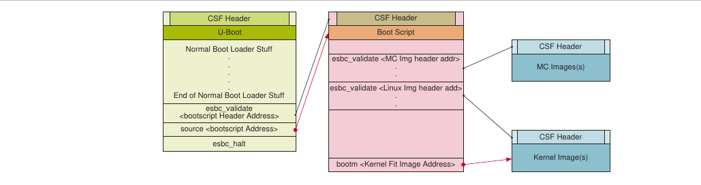

**Figure 19. Luồng secure boot (Chain of Trust từ U-Boot)**

**Bootscript mẫu**

```
# Get Images and Headers on DDR
.
.
.
# Validate the Images. (<pub_key_hash> is optional)
esbc_validate <Image1 Header Address> <pub_key_hash>
esbc_validate <Image2 Header Address> <pub_key_hash>
.
.
.
# Boot the Linux
bootm <Kernel Fit Image Address>
```

###### 6.2.1.2.5.2 Chain of Trust có tính bí mật

Để thiết lập chain of trust có tính bí mật, có thể dùng cơ chế cryptographic blob. Trong chain of trust này, image đã kiểm tra được phép dùng One Time Programmable Master Key để giải mã các bí mật của hệ thống. Có hai bootscript được dùng. Đầu tiên, bootscript encapsulation được dùng để tạo blob của các image ở mức tiếp theo (ví dụ, MC, Linux) và lưu chúng lên flash. Sau đó, hệ thống được boot sau khi thay bootscript encapsulation bằng bootscript decapsulation, bootscript này decapsulate các blob rồi khởi động MC và Linux.

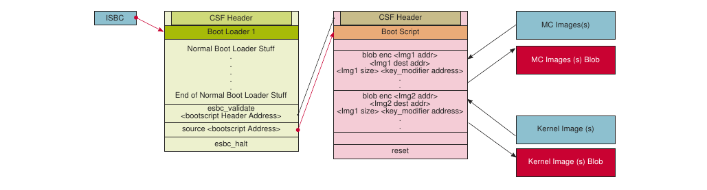

**Figure 20. Chain of Trust có tính bí mật (Encapsulation)**

**Bootscript Encapsulation mẫu**

```
# Get Images on DDR
.
.
.
# Create the Blobs
blob enc <Img1 addr> <Img1 dest addr> <Img1 size> <key_modifier address>
blob enc <Img2 addr> <Img2 dest addr> <Img2 size> <key_modifier address>
blob enc <Img3 addr> <Img3 dest addr> <Img3 size> <key_modifier address>
.
.
.
Save The Blobs created on Flash
.
.
.
# End of Encap Boot Script (This is one time only and must be replaced with
 decap Boot Script)
```

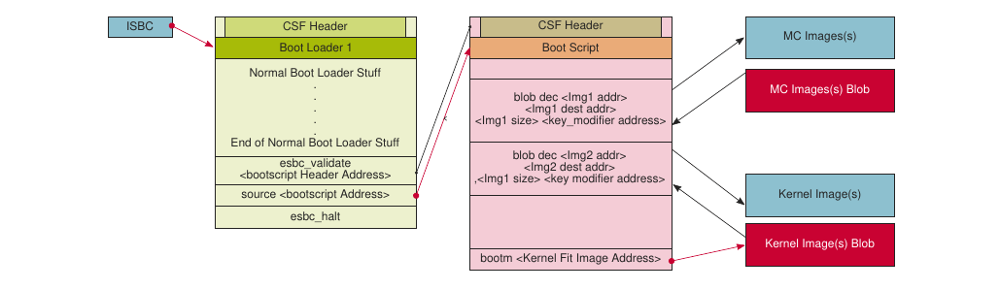

**Figure 21. Chain of Trust có tính bí mật (Decapsulation)**

**Bootscript Decapsulation mẫu**

```
# Get Images Blobs on DDR
.
.
.
# Decap the Blobs to get the actual images
blob dec <Img1 blob addr> <Img1 dest addr> <expected Img1 size> <key_modifier
 address>
blob dec <Img2 blob addr> <Img2 dest addr> <expected Img2 size> <key_modifier
 address>
blob dec <Img3 blob addr> <Img3 dest addr> <expected Img3 size> <key_modifier
 address>
.
.
.
# Boot the Linux
bootm <Kernel Fit Image Address>
```

##### 6.2.1.2.6 Cách compile binary U-Boot secure

Bạn cần compile binary `u-boot.bin` để build binary `fip.bin`.

Clone repository `u-boot` và compile binary U-Boot cho TF-A:

```
$ git clone https://github.com/nxp-qoriq/u-boot.git
$ cd u-boot
$ git checkout -b <new branch name> <tag>
```

Ví dụ, `$ git checkout -b LSDK-21.08 LSDK-21.08`.

```
$ export ARCH=arm64
$ export CROSS_COMPILE=aarch64-linux-gnu-
$ make distclean
$ make <platform>_tfa_SECURE_BOOT_defconfig
```

**Ghi chú:** Một defconfig duy nhất được tạo cho mọi nguồn boot, `<platform>_tfa_defconfig`.

Ví dụ, với LX2162AQDS, defconfig là `lx2162aqds_tfa_SECURE_BOOT_defconfig`.

```
$ make
```

**Ghi chú:** Nếu lệnh make báo lỗi "`*** Your GCC is older than 6.0 and is not` `supported`", hãy bảo đảm bạn đang dùng Ubuntu 18.04 64-bit để build binary U-Boot 21.08.

Image U-Boot secure đã compile, `u-boot.bin-tfa-secure-boot`, có tại `u-boot/`.

## 6.3 Trusted OS

### 6.3.1 Trusted Execution (OP-TEE)

#### 6.3.1.1 Giới thiệu

Trusted Execution Environment (TEE), cho các chip dựa trên Arm hỗ trợ công nghệ TrustZone.

Các nền tảng NXP được hỗ trợ Open Portable TEE (OP-TEE). OP-TEE là một dự án mã nguồn mở chứa bản triển khai đầy đủ để phát triển một Trusted Execution Environment hoàn chỉnh. Thành phần này đáp ứng đặc tả Global Platform TEE System Architecture. Nó cũng cung cấp TEE Internal core API v1.1 như định nghĩa trong chuẩn Global Platform TEE để phát triển Trusted Application.

OP-TEE gồm ba thành phần.

- OP-TEE client, là client API chạy trong user space của normal world.
- OP-TEE Linux Kernel driver, là driver xử lý giao tiếp giữa user space của normal world và secure world.
- OP-TEE Trusted OS, là Trusted OS chạy trong secure world.

OP-TEE OS gồm 2 thành phần chính: OP-TEE core và một tập thư viện được thiết kế để Trusted Application dùng. Trong khi OP-TEE core thực thi ở mức đặc quyền của Arm CPU (còn gọi là 'kernel land'), các Trusted Application thực thi ở mức không đặc quyền (còn gọi là 'userland'). Các thư viện tĩnh do OP-TEE OS cung cấp cho phép Trusted Application gọi các dịch vụ secure thực thi ở mức đặc quyền cao hơn.

##### 6.3.1.1.1 Nền tảng hỗ trợ

OP-TEE được hỗ trợ trên các board NXP sau:

- LS1046ARDB
- LS1043ARDB
- LS2088ARDB
- LS1088ARDB
- LS1012ARDB
- LX2160ARDB Rev2
- LS1028ARDB
- LX2162AQDS

##### 6.3.1.1.2 Trình tự kiểm thử

**Thực thi trình tự kiểm thử dưới đây trên máy đích:**

Trên board NXP đích:

1. Để kiểm tra kernel driver OP-TEE đã khởi tạo thành công (sau khi giao tiếp thành công với OP-TEE OS chạy trong OP-TEE), tìm dòng sau trong log boot Linux:

   ```
   optee: probing for conduit method.
   optee: revision <version> (git commit id)
   optee: initialized driver
   ```

   **Ghi chú:** Image TF-A FIP phải được compile kèm binary OP-TEE. Nếu không, lỗi sau sẽ xuất hiện:

   ```
   optee: api uid mismatch
   ```

2. Chạy binary tee-supplicant (binary tạo từ repo optee_client)

   `$>: tee-supplicant &` (nhấn enter)

3. Chạy ứng dụng `xtest` (binary tạo từ repo optee_test) như sau:

   ```
   $>: xtest -l 15 (press enter and look for the below logs to verify app runs
    successfully):
            47123 subtests of which 0 failed
            79 test cases of which 0 failed
            0 test case was skipped
            OP-TEE test application done!
   ```

##### 6.3.1.1.3 Cách compile binary OP-TEE

Đây là bước tùy chọn. Bạn có thể cần compile binary `tee.bin` để build `fip.bin` có OP-TEE. Tuy nhiên, OP-TEE là tùy chọn; bạn có thể bỏ qua quy trình compile OP-TEE nếu muốn build binary FIP không có OP-TEE.

Để clone repository `optee_os` và build binary OP-TEE, thực hiện các bước sau:

1. `$ git clone https://github.com/nxp-qoriq/optee_os`
2. `$ cd optee_os`
3. `$ git checkout -b <new branch name> LSDK-<LSDK version>`. Ví dụ, `$ git` `checkout -b lf-6.1.1-1.0.0 lf-6.1.1-1.0.0`
4. `$ export ARCH=arm`
5. `$ export CROSS_COMPILE64=aarch64-linux-gnu-`
6. `$ make CFG_ARM64_core=y PLATFORM=ls-<platform>`. Ví dụ, `$ make` `CFG_ARM64_core=y PLATFORM=ls-ls1088ardb`

Image OP-TEE đã compile `tee-raw.bin` có tại `optee_os/out/arm-plat-ls/core/`.

## 6.4 PKCS#11 và Secure Object Library

### 6.4.1 Giới thiệu

Các SoC NXP như LS1046A có thể lưu key an toàn bằng các khả năng có sẵn của SoC - virtual HSM. Với các thiết bị này, private key nhạy cảm không bao giờ rời khỏi thiết bị và các thao tác mật mã được thực hiện trên virtual HSM này.

PKCS#11 là một interface lập trình chuẩn để giao tiếp với HSM. Chuẩn này đặc tả một application programming interface (API), gọi là “Cryptoki”, cho các thiết bị chứa thông tin mật mã và thực hiện các chức năng mật mã.

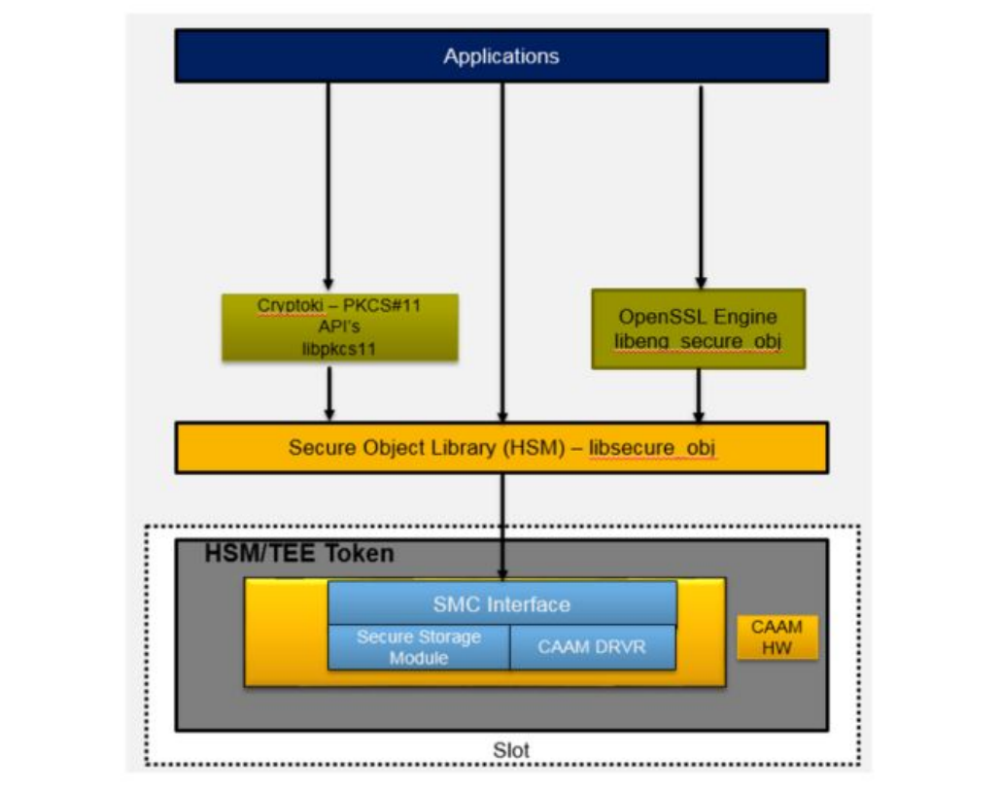

**Figure 22. Sơ đồ khối**

Các interface độc quyền dùng Secure Object Library được cung cấp để tương tác với HSM nhằm:

- Tạo cặp key bên trong HSM.
- Cài một key có sẵn vào HSM.
- Các thao tác với Manufacturing Protection key.

Private key không bao giờ hiển thị với normal world.

Các thao tác mật mã nhạy cảm dùng các key này chỉ có thể thực hiện qua chuẩn cryptographic token PKCS#11.

Một OpenSSL engine trên Secure Object Library cũng được cung cấp để giao tiếp trực tiếp với các API của OpenSSL

Bản phát hành thư viện PKCS#11 tuân theo v2.40. Nó nhắm tới LS1046ARDB và hỗ trợ

- RSA key kích thước 1K và 2K.
- ECDSA key với curve prime256v1 và secp384r1.

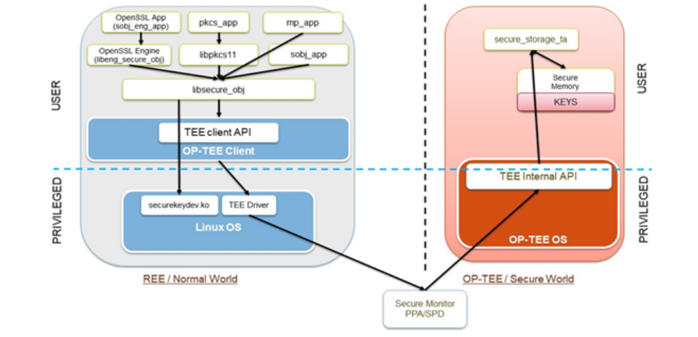

**Figure 23. Chi tiết HSM**

### 6.4.2 Các API được hỗ trợ

#### 6.4.2.1 Thư viện PKCS#11 – libpkcs11.so

Các interface PKCS#11 được cung cấp và triển khai qua một shared library tên `libpkcs11.so` (Cryptoki Library). Mọi thư viện PKCS#11 đều có một structure tĩnh `CK_FUNCTION_LIST`, và con trỏ tới nó có thể lấy bằng hàm `C_GetFunctionList()`.

Bảng sau tóm tắt danh sách các interface PKCS#11 được hỗ trợ. Giá trị trả về và hành vi của API tuân theo chuẩn PKCS#11 v2.40. Thư viện PKCS#11 mong đợi caller dùng các interface theo cách chuẩn.

| API | Mô tả |
|---|---|
| C_Initialize | Khởi tạo thư viện Cryptoki |
| C_Finalize | Dọn dẹp các tài nguyên liên quan đến cryptoki |
| C_GetFunctionList | Lấy các entry point của các hàm thư viện Cryptoki. |
| C_GetInfo | Lấy thông tin chung về Cryptoki |
| C_GetSlotInfo | Lấy thông tin về một slot cụ thể |
| C_GetTokenInfo | Lấy thông tin về một token cụ thể |
| C_GetSlotList | Lấy danh sách các slot trong hệ thống.<br>Chỉ hỗ trợ một slot cố định với token cố định. Không hỗ trợ thêm slot hoặc token động. |
| C_OpenSession<br>C_CloseSession<br>C_CloseAllSessions | Mở/Đóng một session.<br>• Mọi loại session đều được hỗ trợ với Token.<br>• Chỉ Token Object có thể được tạo/hủy, Session Object không được hỗ trợ. |
| C_Login | Đăng nhập vào một token. |
| C_Logout | Đăng xuất khỏi một token |
| C_CreateObject | Tạo một object (hỗ trợ RSA Key kích thước tối đa 2048 bit) |
| C_DestroyObject | Hủy một object |
| C_FindObjectsInit<br>C_FindObjects<br>C_FindObjectsFinal | Các thao tác tìm kiếm object.<br>Hỗ trợ object RSA public và private key kích thước tối đa 2048 bit.<br>Hỗ trợ object ECDSA public và private key kích thước 256 và 384 bit. |
| C_GetAttributeValue | Lấy giá trị của một hoặc nhiều attribute của object. |
| C_GetMechanismList | Lấy danh sách mechanism mà token hỗ trợ. |
| C_GetMechanismInfo | Lấy thông tin về một mechanism. |
| C_GenerateKeyPair | Tạo một cặp public-key/private-key (hỗ trợ RSA Key kích thước tối đa 2048 bit) |
| C_SignInit<br>C_Sign<br>C_SignUpdate<br>C_SignFinal | Khởi tạo một thao tác ký.<br>Ký dữ liệu single-part (một khối).<br>Tiếp tục một thao tác ký multiple-part.<br>Kết thúc một thao tác ký multiple-part.<br>Các mechanism được hỗ trợ:<br>• Các mechanism dựa trên RSA<br>– CKM_RSA_PKCS<br>– CKM_MD5_RSA_PKCS<br>– CKM_SHA1_RSA_PKCS<br>– CKM_SHA256_RSA_PKCS<br>– CKM_SHA384_RSA_PKCS<br>– CKM_SHA512_RSA_PKCS<br>• Các mechanism dựa trên ECDSA (chỉ single-part)<br>– CKM_ECDSA<br>– CKM_ECDSA_SHA1 |
| C_DigestInit<br>C_Digest<br>C_DigestUpdate<br>C_DigestFinal | Khởi tạo một thao tác message digest.<br>Digest dữ liệu single-part (một khối).<br>Tiếp tục một thao tác digest multiple-part.<br>Kết thúc một thao tác digest multiple-part.<br>Các mechanism được hỗ trợ:<br>• CKM_MD5<br>• CKM_SHA1<br>• CKM_SHA256<br>• CKM_SHA384<br>• CKM_SHA512 |
| C_DecryptInit<br>C_Decrypt | Khởi tạo một thao tác giải mã.<br>Giải mã dữ liệu đã mã hóa dạng single-part (một khối).<br>Các mechanism được hỗ trợ:<br>• CKM_RSA_PKCS<br>• CKM_RSA_PKCS_OAEP |

#### 6.4.2.2 Secure Object Library – libsecure_obj.so

##### 6.4.2.2.1 Secure Object Library

Sau đây là chi tiết các interface được hỗ trợ để tạo/import key bằng Secure Object library.

1. **Import key**:

   **SK_RET_CODE SK_CreateObject(SK_ATTRIBUTE \*attr, uint16_t attrCount, SK_OBJECT_HANDLE \*phObject);**

   API tạo một Object trên HSM và trả về một handle tới nó. API luôn thành công ngay cả khi đã có object với cùng attribute trong HSM; một object trùng lặp sẽ được tạo. Ứng dụng cần lưu ý không tạo object trùng lặp.

   `attr` là mảng các attribute mà object sẽ được tạo với chúng. Một số attribute có thể là bắt buộc, như `SK_ATTR_OBJECT_TYPE` và `SK_ATTR_OBJECT_INDEX` (id của object), một số khác là tùy chọn.

   Ứng dụng cần bảo đảm truyền attribute hợp lệ; thư viện không trả về lỗi nào khi nhận attribute không nhất quán hoặc không tương thích.

   **param\[in\] attr**: Mảng các attribute dùng để tạo Object.

   **param\[in\] attrCount**: Số attribute trong attr

   **param\[in, out\] phObject IN**: Con trỏ tới một handle (không được là NULL);

   **OUT**: Handle của Object đã tạo

   **Giá trị trả về**:

   **SKR_OK**: Thực thi thành công, phObject được điền handle của object đã tạo. **SKR_ERR_BAD_PARAMETERS**: Đối số hàm không hợp lệ.

   **SKR_ERR_OUT_OF_MEMORY**: Cấp phát bộ nhớ thất bại.

   **SKR_ERR_NOT_SUPPORTED**: Hàm và/hoặc tham số không được thư viện hỗ trợ. **Ghi chú:** Có thể trả về một số mã lỗi nội bộ khác ngoài các mã nêu trên. Xem `securekey_api_types.h` để biết mô tả mã lỗi.

2. **Tạo key**:

   **SK_RET_CODE SK_GenerateKeyPair(SK_MECHANISM_INFO \*pMechanism, SK_ATTRIBUTE \*attr, uint16_t attrCount, SK_OBJECT_HANDLE \*phKey);**

   API này tạo cặp key trên HSM và trả về một handle tới nó. API luôn thành công ngay cả khi đã có object với cùng attribute trong HSM; một object trùng lặp sẽ được tạo. Ứng dụng cần lưu ý không tạo object trùng lặp.

   **pMechanism** là mechanism để tạo cặp key. Ví dụ: `SKM_RSA_PKCS_KEY_PAIR_GEN`. **attr** là mảng các attribute mà object sẽ được tạo với chúng. Một số attribute có thể là bắt buộc, như `SK_ATTR_OBJECT_INDEX` (id của object), một số khác là tùy chọn. Ứng dụng cần bảo đảm truyền attribute hợp lệ; thư viện không trả về lỗi nào khi nhận attribute không nhất quán/không tương thích.

   **param\[in\] pMechanism**: Mechanism để tạo cặp key.

   **param\[in\] attr**: Mảng các attribute dùng để tạo Object.

   **param\[in\] attrCount**: Số attribute trong `attr`.

   **param\[in, out\] phKey IN**: Con trỏ tới một handle (không được là NULL);

   **OUT**: Handle của Object đã tạo.

   **Giá trị trả về:**

   **SKR_OK**: Thực thi thành công, `phObject` được điền handle của object đã tạo. **SKR_ERR_BAD_PARAMETERS**: Đối số hàm không hợp lệ

   **SKR_ERR_OUT_OF_MEMORY**: Cấp phát bộ nhớ thất bại.

   **SKR_ERR_NOT_SUPPORTED**: Hàm và/hoặc tham số không được thư viện hỗ trợ. **Ghi chú:** Có thể trả về một số mã lỗi nội bộ khác ngoài các mã nêu trên. Xem `securekey_api_types.h` để biết mô tả mã lỗi.

3. **Xóa Object**:

   **SK_RET_CODE SK_EraseObject(SK_OBJECT_HANDLE hObject);**

   Xóa một object khỏi HSM. Nó cho biết object với handle chỉ định không còn được dùng. **param\[in\] hObject**: Handle của Object cần xóa.

   **Giá trị trả về:**

   **SKR_OK**: Thực thi thành công

   **SKR_ERR_BAD_PARAMETERS**: Đối số hàm không hợp lệ.

   **Ghi chú:** Có thể trả về một số mã lỗi nội bộ khác ngoài các mã nêu trên. Xem `securekey_api_types.h` để biết mô tả mã lỗi.

   Chi tiết thêm về các API và kiểu của chúng có trong các file `<securekey_api.h>` và `<securekey_api_types.h>` trong thư mục `secure_obj`.

   **Ghi chú:**

   - Có thể tạo/sinh tối đa 50 object.
   - Secure Object Library không báo lỗi nếu nhiều object có cùng attribute được tạo. Ứng dụng có trách nhiệm kiểm soát các attribute được truyền khi tạo/sinh object.

##### 6.4.2.2.2 Các API Manufacturing Key:

Sau secure boot, hệ thống chạy thủ tục tạo key, sinh ra một cặp ECC public key và private key. Cặp này được gọi là Manufacturing Protection Key Pair.

Việc tạo key do BootROM thực hiện.

- Về tài liệu đầy đủ cách tạo key, export public key và ký bằng ECC private key, xem mục Manufacturing-protection chip-authentication process trong Security (SEC) Reference Manual của SoC.
- Để dùng tính năng này, boot board ở chế độ secure boot và cấu hình bit ITS là 1.

Các API để lấy MP public key, ký bằng MP private key và lấy MP Tag được mô tả dưới đây:

1. **Lấy MP Public key**: **enum sk_status_code sk_mp_get_pub_key(struct sk_EC_point \*pub_key);** Lấy Manufacturing Protection (MP) Public Key (ECC P256 Key).

   **param\[in,out\] pub_key**: Đây là MP Public Key được trả về. Ứng dụng cần cấp phát bộ nhớ cho `sk_EC_point`. Mỗi tọa độ x và y cần cấp phát bộ nhớ `sk_EC_point.len`. `sk_EC_point.len` có thể lấy bằng `sk_mp_get_pub_key_len()`.

   **Giá trị trả về:**

   **SK_SUCCESS** khi thành công, nếu không thì trả về giá trị lỗi.

2. **Ký bằng MP private key**

   `enum sk_status_code sk_mp_sign(unsigned char * msg, uint8_t msglen,` `struct sk_EC_sig * sig, uint8_t * digest, uint8_t digest_len)`

   Ký msg bằng MP Priv Key. Khi ký, MP Message sẽ được đặt trước message. Message được tính chữ ký = MP message + msg.

   **param\[in\] msg**: Con trỏ tới message cần ký.

   **param\[in\] msglen**: Độ dài message cần ký.

   **param\[in,out\] sig**: Đây là Signature được tính. Ứng dụng cần cấp phát bộ nhớ cho `sk_EC_sig`. Mỗi phần r và s cần được cấp phát bộ nhớ `sk_EC_sig.len`. `sk_EC_sig.len` có thể lấy bằng `sk_mp_get_sig_len()`.

   **param\[in, out\] digest**: Digest (SHA-256) của message cần ký. Digest được tính bằng cách đặt MP Message trước msg.

   **param\[in\] digest_len**: Độ dài digest. Ứng dụng cần cấp phát bộ nhớ cho `sk_EC_point`. Mỗi tọa độ x và y cần cấp phát bộ nhớ `sk_EC_point.len`. `sk_EC_point.len` có thể lấy bằng `sk_mp_get_pub_key_len()`.

   **Giá trị trả về**:

   **SK_SUCCESS** khi thành công, nếu không thì trả về giá trị lỗi.

3. **Lấy MP Tag**

   **enum sk_status_code sk_mp_get_mp_tag(uint8_t \*mp_tag_ptr,uint8_t mp_tag_len);**

   Lấy MP Message. Khi ký, MP Message tự động được đặt trước message. Để lấy MP message tag, bạn có thể gọi hàm này trong thao tác xác minh.

   **param\[in, out\] mp_tag_ptr**: Con trỏ tới message cần ký. Ứng dụng cần cấp phát bộ nhớ có độ dài do **sk_mp_get_tag_len()** trả về.

   **param\[in\] mp_tag_len**: Độ dài buffer `mp_tag_ptr`.

   **Giá trị trả về**:

   **SK_SUCCESS** khi thành công, nếu không thì trả về giá trị lỗi.

   Định nghĩa API có trong file `securekey_mp.h`. Các ứng dụng mẫu được cung cấp để minh họa cách dùng các API.

### 6.4.3 Tích hợp ứng dụng với Secure Object

Ứng dụng có thể tương tác với các Secure Object lưu trong HSM/Token bằng các API sau:

- Secure Object
- OpenSSL
  - OpenSSL Engine dựa trên Secure Object Library (`libeng_secure_obj`)

**Ghi chú:** Để biết thêm về cách dùng các API Secure Object, xem ứng dụng `sobj_app`.

#### 6.4.3.1 Dùng các API PKCS#11

Ứng dụng có thể dùng trực tiếp các API PKCS#11 để tương tác với các Secure Object lưu trong HSM/Token. Hiện tại, chúng tôi hỗ trợ các API PKCS#11 nêu trong PKCS#11 APIs.

Thư viện PKCS#11 cũng có thể dùng với bất kỳ ứng dụng PKCS#11 mã nguồn mở nào như p11tool, softhsm2-utils, v.v.

Chúng tôi đã kiểm thử thư viện này với p11tool cho các thao tác sau:

- Liệt kê token: **p11tool --list-tokens**
- Khởi tạo token: **p11tool --initialize**
- Khởi tạo User pin: **p11tool --initialize-pin**
- Khởi tạo SO pin: **p11tool --initialize-so-pin**
- Tạo RSA Key: **p11tool --generate-rsa**
- Import RSA Key: **p11tool --write --load-privkey \<rsa_key.pem>**

Để biết thêm về các lệnh p11tool, xem tại đây

Chúng tôi cũng đã tạo một ứng dụng tham chiếu pkcs11_app để cho thấy cách dùng các API PKCS#11 khi viết ứng dụng của riêng bạn.

Các lệnh chạy **pkcs11_app** được nêu tại đây

#### 6.4.3.2 Dùng các API Secure Object

Ứng dụng có thể dùng trực tiếp các API của Secure Object Library để tương tác với các Secure Object lưu trong HSM/Token. Hiện tại chúng tôi hỗ trợ các API nêu trong Secure Object APIs.

Chúng tôi cũng đã tạo một ứng dụng tham chiếu sobj_app để cho thấy cách dùng các API Secure Object.

Các lệnh chạy **sobj_app** được cung cấp tại đây.

#### 6.4.3.3 Các ứng dụng dùng API OpenSSL

Mục này đưa ra các ví dụ sử dụng với OpenSSL. Bạn nên làm quen với Open SSL trước.

Tham khảo các tài liệu phù hợp về lệnh Open SSL tại vị trí sau:

http://www.openssl.org/docs/

Open SSL hỗ trợ engine (về cơ bản là các thiết bị phần cứng) để lưu key trên thiết bị phần cứng, giúp key an toàn hơn.

Có 2 cách để các ứng dụng dùng API OpenSSL truy cập các Secure Object lưu trong HSM/Token.

- OpenSSL Engine dựa trên Secure Object Library (libeng_secure_obj).
- OpenSSL Engine dựa trên PKCS#11 (OpenSC/libp11 của bên thứ ba).

##### 6.4.3.3.1 OpenSSL Engine dựa trên Secure Object Library (libeng_secure_obj)

NXP cung cấp OpenSSL Engine dựa trên Secure Object Library để giao tiếp với HSM bên dưới. Engine này dựa trên Secure Object Library. Dùng engine này, bạn có thể thực hiện các thao tác sau:

- Mã hóa RSA bằng private key
- Giải mã RSA bằng private key
- Thao tác ký ECDSA

Mọi thao tác RSA/ECDSA khác có thể do chính OpenSSL thực hiện.

Engine này không hỗ trợ tạo RSA Key. Key được tạo bằng một ứng dụng khác là `sobj_app`, và các key này được dùng trong các ứng dụng dùng OpenSSL Engine này.

Xem mục Section 6.4.4.2.5 để có ảnh chụp màn hình ứng dụng dùng OpenSSL engine.

###### 6.4.3.3.1.1 Ví dụ sử dụng với OpenSSL

Mục này đưa ra các ví dụ sử dụng với OpenSSL:

- Để dùng engine từ dòng lệnh, sửa nội dung sau trong `openssl.cnf` (thường ở `/etc/ssl/` `openssl.cnf`).
  1. Thêm dòng sau ở đầu file, trước khi định nghĩa bất kỳ section nào:

     `openssl_conf = conf_section`

  2. Thêm section sau ở cuối file:

     ```
     [conf_section]
     engines = engine_section
     [engine_section]
     secure_obj = sobj_section
     [sobj_section]
     engine_id = eng_secure_obj
     dynamic_path = <path where lib_eng_secure_obj.so is placed>
     default_algorithms = RSA
     init = 1
     ```

  Mục này chỉ đưa ra ví dụ RSA. Có thể làm tương tự cho EC bằng cách đổi `default_algorithms` trong `openssl.cnf` như dưới đây:

  ```
  default_algorithms = RSA, EC
  ```

  **Kiểm thử hoạt động của engine**:

  Để xác minh engine hoạt động đúng, dùng ví dụ sau:

  ```
  user@Ubuntu:~#
  user@Ubuntu:~# openssl engine
  (dynamic) Dynamic engine loading support
  (eng_secure_obj) secure object OpenSSL Engine.
  user@Ubuntu:~#
  user@Ubuntu:~#
  ```

  Nếu không cập nhật file cấu hình OpenSSL, hãy chỉ định cấu hình engine một cách tường minh.

  ```
  $: openssl engine -t dynamic -pre SO_PATH:<path-to-libeng_secure_obj.so> -pre
   ID:eng_secure_obj -pre LIST_ADD:1 -pre LOAD
  ```

  ```
  user@Ubuntu:~#
  user@Ubuntu:~# openssl engine -t dynamic -pre SO_PATH:/usr/lib/aarch64-linux-
  gnu/openssl-1.0.0/
  engines/libeng_secure_obj.so -pre ID:eng_secure_obj -pre LIST_ADD:1 -pre LOAD
  (dynamic) Dynamic engine loading support
  [Success] : SO_PATH:/usr/lib/aarch64-linux-gnu/openssl-1.0.0/engines/
  libeng_secure_obj.SO
  [Success] : ID:eng_secure_obj
  [Success] : LIST_ADD:1
  [Success] : LOAD
  LOADED: (eng_secure_obj) Secure object OpenSSL Engine.
    [available]
  user@Ubuntu:~#
  ```

- Dùng OpenSSL từ dòng lệnh.

  Tạo cặp key RSA/ECDSA bằng các lệnh sau, rồi dùng chúng để ký dữ liệu bất kỳ và xác minh các chữ ký được tạo.

  ```
  $: sobj_app -G -m rsa-pair -s 2048 -l "rsa_gen_2048" -i 1 -w rsa_2048.pem ##
   Generating RSA keypair ##
  $: openssl rsa -in rsa_2048.pem -pubout -out rsa_pub_2048.pem ## Taking out
   Public Key for verifying signature ##
  $: openssl dgst -sha1 -sign rsa_2048.pem -out sig.data data ## Generating
   Signature "sig.data" of "data" ##
  $: openssl dgst -sha1 -verify rsa_pub_2048.pem -signature sig.data data ##
   Verifying the signature using Public Key ##
  ```

  Tương tự bước trên, tạo key ECDSA prime256v1 bằng các lệnh sau:

  ```
  $: sobj_app -G -m ec-pair -c prime256v1 -l "ecc_256" -i 2 -w ec256.pem
  $: openssl ec -in ec256.pem -pubout -out ec_pub_256.pem
  $: openssl dgst -sha1 -sign ec256.pem -out sig.data data
  $: openssl dgst -sha1 -verify ec_pub_256.pem -signature sig.data data
  ```

  Với curve ECDSA secp384r1, dùng các lệnh sau:

  ```
  $: sobj_app -G -m ec-pair -c secp384r1 -l "ecc_384" -i 3 -w ec384.pem
  $: openssl ec -in ec384.pem -pubout -out ec_pub_384.pem
  $: openssl dgst -sha1 -sign ec384.pem -out sig.data data
  $: openssl dgst -sha1 -verify ec_pub_384.pem -signature sig.data data
  ```

- Mục này mô tả cách dùng dòng lệnh để tạo một chứng chỉ tự ký cho "NXP Semiconductor". Key của chứng chỉ được tạo trong Secure Object HSM và không export được. Theo các ví dụ sau, hãy tạo một private key trong HSM bằng sobj_app. Việc này cũng tạo một file PEM giả `dev_key.pem` chứa thông tin để lấy key cần thiết từ HSM.

  Để tạo cặp key RSA, dùng lệnh:

  ```
  $: sobj_app -G -m rsa-pair -s 2048 -l "Test_Key" -i 1 -w dev_key.pem
  ```

  Để tạo cặp key ECDSA, dùng lệnh:

  ```
  $: sobj_app -G -m ec-pair -c prime256v1 -l "ecc_256" -i 30 -w dev_key.pem
  ```

  Để tạo chứng chỉ với key trong module Secure Object, dùng các lệnh sau:

  ```
  $ openssl req -new -key dev_key.pem -out req.pem -text -x509 -subj "/CN=NXP
   Semiconductor"
  $ openssl x509 -signkey dev_key.pem -in req.pem -out cert.pem
  ```

  Lệnh đầu tiên tạo một Certificate tự ký cho “NXP Semiconductor". Việc ký được thực hiện bằng key chỉ định trong file PEM giả.

  Lệnh thứ hai tạo một chứng chỉ tự ký cho request. Private key dùng để ký chứng chỉ chính là private key dùng để tạo request.

##### 6.4.3.3.2 OpenSSL Engine dựa trên PKCS#11 (OpenSC/libp11 của bên thứ ba)

libp11 là một thư viện triển khai một lớp mỏng trên API PKCS#11 để việc dùng các bản triển khai PKCS#11 dễ dàng hơn.

Bạn có thể lấy thư viện tại: https://github.com/OpenSC/libp11 .

Repository code này tạo ra hai thư viện:

- libp11 cung cấp interface mức cao hơn (so với thư viện PKCS#11) để truy cập các object PKCS#11. Nó được thiết kế để tích hợp với các ứng dụng dùng OpenSSL.
- Plugin pkcs11 engine cho thư viện OpenSSL cho phép truy cập các module PKCS#11 theo cách bán trong suốt.

Có thể cài pkcs11 engine cho OpenSSL trên board bằng lệnh **sudo apt-get install libengine-pkcs11-** openssl

Lệnh trên sẽ cài libpkcs11.so (pkcs11 engine) vào /usr/lib/aarch64-linux-gnu/engines-1.1/libpkcs11. so và đây sẽ là dynamic_path trong file cấu hình OpenSSL.

Để chạy PKCS#11 OpenSSL Engine với thư viện PKCS#11 của chúng tôi, thêm nội dung sau vào file cấu hình OpenSSL toàn cục (thường ở /etc/ssl/openssl.cnf). Dòng này phải đặt ở đầu file, trước khi định nghĩa bất kỳ section nào:

```
openssl_conf = openssl_init
```

Nội dung này nên được thêm vào cuối file:

```
[openssl_init]
engines=engine_section
[engine_section]
pkcs11 = pkcs11_section
[pkcs11_section]
engine_id = pkcs11
dynamic_path = <path-to-pkcs11-engine>/libpkcs11.so
MODULE_PATH = <path-to-NXP-pkcs11-library>/libpkcs11.so
init = 0
```

Giá trị dynamic_path là plug-in pkcs11 engine, giá trị MODULE_PATH là thư viện PKCS#11 của NXP. Giá trị engine_id là một định danh tùy ý để các ứng dụng OpenSSL chọn engine theo định danh đó.

###### 6.4.3.3.2.1

**Kiểm thử hoạt động của engine**

Để xác minh engine hoạt động đúng, bạn có thể dùng ví dụ sau.

```
$ openssl engine pkcs11 -t
(pkcs11) pkcs11 engine
[ available ]
```

###### 6.4.3.3.2.2

**Dùng p11tool và OpenSSL từ dòng lệnh:**

Mục này minh họa cách dùng dòng lệnh để tạo một chứng chỉ tự ký cho "NXP Semiconductor". Key của chứng chỉ sẽ được tạo trong token và không export được.

p11tool của GnuTLS và engine này với OpenSSL hoạt động kết hợp với nhau.

p11tool là công cụ thao tác với các token PKCS #11, export/import dữ liệu từ các token PKCS #11. Để dùng các token PKCS #11 với gnutls, file cấu hình /etc/gnutls/pkcs11.conf phải tồn tại và chứa các dòng dạng "load=\<pkcs-library-path>", hoặc module PKCS#11 này có thể được cung cấp trực tiếp qua –provider trong dòng lệnh làm đối số.

Có thể cài p11tool bằng lệnh **sudo apt-get install gnutls-bin**

Để xem thêm các tùy chọn cấu hình, xem: https://www.gnutls.org/manual/html_node/p11tool-Invocation.html.

Kiểm tra key đã được tạo từ **sobj_app** qua p11tool.

Các lệnh sau dùng p11tool cho việc đó.

```
$ p11tool --provider <path-to-NXP-PKCS-library>/libpkcs11.so --list-privkeys
```

```
root@ls1028ardb:~# p11tool --provider /root/libpkcs11.so --list-privkeys
Object 0:
  URL: pkcs11:model=;manufacturer=NXP;serial=1;token=TEE_BASED_TOKEN;
%01%00%00%00;object=Device_Key3;type=private
  Type: Private Key
  Label: Device Key3
  Flags: CKA_NEVER_EXTRACTABLE; CKA_SENSITIVE;
  ID: 01:00:00:00
Object 1:
  URL: pkcs11:model=;manufacturer=NXP;serial=1;token=TEE_BASED_TOKEN;
%01%00%00%00;object=Device_Key2;type=private
  Type: Private Key
  Label: Device Key2
  Flags: CKA_NEVER_EXTRACTABLE; CKA_SENSITIVE;
  ID: 01:00:00:00
Object 0:
  URL: pkcs11:model=;manufacturer=NXP;serial=1;token=TEE_BASED_TOKEN;
%01%00%00%00;object=Device_Key3;type=private
  Type: Private Key
  Label: Device Key
  Flags: CKA_NEVER_EXTRACTABLE; CKA_SENSITIVE;
  ID: 01:00:00:00
root@ls1028ardb:~#
```

Ghi lại PKCS #11 URL hiển thị ở trên và dùng nó trong các lệnh dưới đây.

Để tạo chứng chỉ có key nằm trong module PKCS #11, có thể dùng lệnh sau.

Lệnh sau tạo một Certificate tự ký cho "NXP Semiconductor". Việc ký được thực hiện bằng key chỉ định bởi URL.

```
$ openssl req -engine pkcs11 -new -key
"pkcs11:model=;manufacturer=NXP;serial=1;token=TEE_BASED_TOKEN;id=
%01%00%00%00;object=Device_Key3
;type=private" -keyform engine -out req.pem -text -x509 -subj "/CN=NXP
 Semiconductor"
```

### 6.4.4 Boot board và chạy ứng dụng

#### 6.4.4.1 Boot board

1. Chuẩn bị các image theo tài liệu Layerscape LDP và boot board với `secure-boot` và ITS đặt là 1.

   Cần ITS = 1 để BootROM tạo Manufacturing Protection Private Key.

   Để đặt bit ITS là 1, chạy lệnh sau sau khi ghi SRKH và trước khi gỡ boot hold off. Kiểm thử được thực hiện trên LS1046ARDB.

   \#To do ITS=1

   ccs::write_mem 32 0x1e80200 4 0 0x00000004

2. Sau khi khởi động board bằng các image LDP, kiểm tra xem các image sau đã được đặt đúng vị trí tương ứng chưa.

| Binary | Vị trí trong rootfs |
|---|---|
| b05bcf48-9732-4efa-a9e0-141c7c888c34.ta | /lib/optee_armtz/ |
| libsecure_obj.so | /usr/lib |
| sobj_app | /usr/bin |
| mp_app | /usr/bin |
| mp_verify | /usr/bin |
| libeng_secure_obj.so | /usr/lib/aarch64-linux-gnu/openssl-1.0.0/engines/ |
| sobj_eng_app | /usr/bin |
| securekeydev.ko | Đường dẫn này phụ thuộc vào phiên bản Linux Kernel: |
|   | Linux Kernel \<version> - /lib/modules/\<version>/extra/ |
| libpkcs11.so | /usr/lib |
| pkcs11_app | /usr/bin |
| thread_test | /usr/bin |

Về các bước compile, xem Section 6.4.6

3. Chạy lệnh `tee-supplicant &` từ Linux prompt.
4. Tùy theo phiên bản Linux kernel được dùng, chạy `insmod securekeydev.ko` từ đúng thư mục.
5. Chạy các ứng dụng như mô tả trong Running the applications.

#### 6.4.4.2 Chạy ứng dụng

Package có sẵn hai ứng dụng.

- **sobj_app** : Cung cấp interface để tạo/import các key object qua Secure Object Library
- **pkcs11_app**: Cung cấp interface để liệt kê các object trong HSM và thực hiện các thao tác mật mã.
- **mp_app**: Ứng dụng này minh họa cách lấy MP Public Key, ký một message bằng MP private key và lấy Message tag.
- **mp_verify**: Ứng dụng này dùng các API OpenSSL để xác minh chữ ký có được khi dùng ứng dụng mp_app.
- **sobj_eng_app**: Ứng dụng này dùng các API OpenSSL để cho thấy cách dùng OpenSSL Engine dựa trên Secure Object. Ứng dụng nạp private key rồi thực hiện các thao tác mật mã bằng key này.
- **thread_test**: Ứng dụng PKCS#11 để kiểm thử tính năng đa luồng của thư viện PKCS#11.

**Ghi chú:** Đây là các ứng dụng tham chiếu để minh họa cách dùng các API như mô tả trong Supported APIs.

##### 6.4.4.2.1 sobj_app

Để tạo hoặc sinh object, chạy ứng dụng `sobj_app`.

- **sobj_app**: Lệnh này hiển thị trợ giúp về `sobj_app`.
- **Import một cặp key RSA vào HSM**:

  **sobj_app -C -f \<private.pem> -k \<key-type> -o \<obj-type> -s \<key-size> -l \<obj-label> -i \<obj-ID>**

  Lệnh này giúp import một key vào HSM. Nó tạo một object trong HSM bằng cách đọc key từ `<private.pem>`, với nhãn object `<obj-label>` và ID object `<obj-ID>`. File `private.pem` này có thể được tạo bằng openssl với lệnh dưới đây:

  **openssl genrsa -out rsa_key_2048.pem 2048**

  Handle của object tạo trong HSM được in ra làm output của lệnh. Handle này có thể dùng cho các thao tác tiếp theo trên object đã tạo (ví dụ, xóa, in attribute, v.v.).

- **Import một cặp key ECDSA vào HSM**:

  **sobj_app -C -f \<private.pem> -k \<key-type> -o \<obj-type> -l \<obj-label> -i \<obj-ID>**

  Lệnh này giúp import một key vào HSM. Nó sẽ tạo một object trong HSM bằng cách đọc key từ `<private.pem>`, với nhãn object `<obj-label>` và ID object `<obj-ID>`.

  File `private.pem` này có thể được tạo bằng openssl với lệnh dưới đây:

  **openssl ecparam -genkey -name prime256v1 -noout -out ec_key_256.pem**

  Handle của object tạo trong HSM được in ra làm output của lệnh. Handle này có thể dùng cho các thao tác tiếp theo trên object đã tạo (ví dụ, xóa, in attribute, v.v.).

- **Tạo một cặp key RSA trong HSM**:

  **sobj_app -G -m \<mechanism-ID> -s \<key-size> -l \<key-label> -i \<key-ID>**

  Lệnh này tạo một object có kiểu suy ra từ mechanism-ID, kích thước \<key-size>, với nhãn \<key-label> và ID \<key-ID>

  Handle của object đã tạo được in ra làm output của lệnh. Handle này có thể dùng cho các thao tác tiếp theo trên object đã tạo (ví dụ, xóa, in attribute, v.v.)

- **Tạo cặp key ECDSA trong HSM**:

  **sobj_app -G -m \<mechanism-ID> -c \<curve> -l \<key-label> -i \<key-ID>**

  Lệnh này sẽ tạo một object có kiểu suy ra từ mechanism-ID, kích thước \<key-size>, với nhãn \<key-label> và ID \<key-ID>

  Handle của object đã tạo được in ra làm output của lệnh. Handle này có thể dùng cho các thao tác tiếp theo trên object đã tạo (ví dụ, xóa, in attribute, v.v.).

- **Hiển thị attribute của một object trong HSM**:

  **sobj_app -A -h \<obj-handle>**

  Lệnh này hiển thị một số attribute liên quan đến object đã tạo. Truyền handle object `<obj-handle>` cho lệnh. `<obj-handle>` này được in ra khi tạo hoặc import object vào HSM.

- **Liệt kê handle của các object có trong HSM**:

  **sobj_app -L \[-n \<num-of-obj> -k \<key-type> -l \<obj-label> -s \<key-size> -i \<obj-id>\]**

  Lệnh này liệt kê handle của các object đã được tạo hoặc sinh, dựa trên một số tiêu chí tìm kiếm (nếu có). Sau đó bạn có thể dùng handle này để in các attribute còn lại. Để biết thêm chi tiết, xem lệnh ở trên.

##### 6.4.4.2.2 pkcs11_app

- **pkcs11_app –**Lệnh này hiển thị các lệnh có sẵn.
- **pkcs11_app -I:**Thông tin thư viện

  **pkcs11_app -P -l:** Liệt kê mọi slot có sẵn

  **pkcs11_app -P -i -p \<slot-ID>** : Cung cấp thông tin về Slot có \<slot-ID>

  **pkcs11_app -T -i -p \<slot-ID>** : Cung cấp thông tin về Token cắm trong Slot \<slot-ID>

- **pkcs11_app -M -l -p \<slot-ID> :**Liệt kê danh sách Mechanism mà token trong Slot \<slot-ID> hỗ trợ **pkcs11_app -M -m \<mech-ID> -i -p \<slot-ID> :** Cung cấp thông tin về mechanism có \<mech-ID> cho Slot \<slot-ID>
- **pkcs11_app -F -p \<slot-ID>:**Liệt kê mọi object gắn với token có trong slot \<slot-ID>

  Chúng ta có 2 object đã tạo qua **sobj_app**, chúng sẽ được hiển thị ở đây qua thao tác find của **pkcs11_app**.

- Hiện tại có thể tìm theo 3 tiêu chí qua ứng dụng này:

  -o: Loại object (có thể là public key, private key, certificate, v.v.) (hiện chỉ hỗ trợ public và private key)

  -k: Loại key (có thể là RSA, EC, AES, v.v.) (hiện chỉ hỗ trợ RSA)

  -b: Nhãn object gắn với object khi tạo/sinh.

  **pkcs11_app -F -o \<obj-type> -k \<key-type> -b \<label> -p \<slot-ID> :** Liệt kê mọi object có loại object \<obj-type>, loại key \<key-type> và có nhãn < label> trên token có trong slot \<slot-ID>

- pkcs11_app -S -k \<key-type> -b \<key-label> -d \<Data-to-be-signed> -m \<mech-ID> -p \<slot-ID> Lệnh này sẽ ký \<Data> bằng private key loại \<key-type> có nhãn \<key-label>, dùng mechanism chỉ định bởi \<mech-ID> với các hàm do token trong slot \<slot-ID> cung cấp

  Sau khi ký thành công, chữ ký sẽ được lưu trong file “sig.data”

  **Ký RSA:**

  **Ký ECDSA:**

- pkcs11_app -V -k \<key-type> -b \<key-label> -d \<Data-previously-signed> -s \<signature-file> -m \<mech-ID> -p \<slot-ID>

  Lệnh này xác minh chữ ký \<signature-file> bằng public key loại \<key-type> có nhãn \<key-label>, dùng mechanism chỉ định bởi \<mech-ID> với các hàm do token trong slot \<slot-ID> cung cấp, bằng cách so dữ liệu khôi phục từ chữ ký với \<Data-previously-signed>. Lệnh này dùng các API OpenSSL để xác minh. Xem code ứng dụng để biết chi tiết.

  \<mech-ID> truyền vào phải khớp với \<mech-ID> đã truyền khi ký, nếu không việc xác minh thất bại, như trong hình sau.

  **Xác minh RSA:**

  **Xác minh ECDSA:**

- pkcs11_app -E -k \<key-type> -b \<key-label> -d \<Data> -m \<mech-ID> -p \<slot-ID>

  Lệnh này sẽ mã hóa \<Data> bằng public key loại \<key-type> có nhãn \<key-label>, dùng mechanism chỉ định bởi \<mech-ID> với các hàm do token trong slot \<slot-ID> cung cấp

  Sau khi mã hóa thành công, dữ liệu đã mã hóa sẽ được lưu trong file “enc.data”

- pkcs11_app -D -k \<key-type> -b \<key-label> -e enc.data -m \<mech-ID> -p \<slot-ID>

  Lệnh này sẽ giải mã dữ liệu đã mã hóa trong "enc.data" bằng private key loại \<key-type> có nhãn \<key-label>, dùng mechanism chỉ định bởi \<mech-ID> với các hàm do token trong slot \<slot-ID> cung cấp. Sau khi ký thành công, chữ ký sẽ được lưu trong file “enc.data”

##### 6.4.4.2.3 mp_app

Ứng dụng này minh họa cách dùng các API sau:

- Lấy MP public key.
- Ký một message bằng MP private key.
- Lấy Message tag.

Source code ứng dụng tại “**secure_obj/securekey_lib/app/mp_app.c**” có thể dùng làm tham khảo khi tích hợp các API này.

**mp_app** - Ứng dụng này có 3 tùy chọn.

Cách dùng:

- **mp_app -p:** Lấy MP public key và lưu vào file "pub_key"
- **mp_app -s \<MSG>:** Ký \<MSG> bằng MP private key và lưu chữ ký vào file "signature"
- **mp_app -m:** Lấy MP Message tag và lưu vào file "mtag"

##### 6.4.4.2.4 mp_verify

Ứng dụng này dùng các API OpenSSL để xác minh chữ ký có được khi dùng ứng dụng **mp_app**. Để tham khảo, dùng source code ứng dụng tại **secure_obj/securekey_lib/app/mp_verify.c**.

**mp_verify**: Ứng dụng này xác minh chữ ký do `mp_app -s` tạo ra.

**Cách dùng:**

**mp_verify -p \<pubkeyfile> -s \<signaturefile> -m \<mtagfile> -M \<MSG>**

`<MSG>` này phải giống message đã dùng trong `mp_app -s <MSG>`

##### 6.4.4.2.5 sobj_eng_app

Ứng dụng này dùng các API OpenSSL để cho thấy cách dùng OpenSSL Engine dựa trên Secure Object.

Code của ứng dụng này ở **“secure_obj/secure_obj-openssl-engine/app/sobj_eng_app.c “.**

Bên trong, ứng dụng này nạp RSA private key rồi thực hiện các thao tác mật mã bằng key này.

Các thao tác với private key được offload sang Secure Object Library qua engine này, còn các thao tác với Public Key do chính OpenSSL thực hiện.

Hình sau cho thấy các bước tạo key qua **sobj_app**. Key này sẽ được **sobj_eng_app** dùng (qua các API OpenSSL) để thực hiện các thao tác mật mã.

Bên trong, **sobj_eng_app** này offload thao tác mật mã sang Secure Object Library bằng OpenSSL Engine dựa trên Secure Object Library.

##### 6.4.4.2.6 thread_test

Ứng dụng dựa trên PKCS#11 để kiểm thử hỗ trợ đa luồng trong thư viện PKCS#11.

Ứng dụng này nhận số thread cần tạo làm đối số; nếu không có, mặc định nó tạo 10 thread.

**thread_test \<num-of-threads>**

Ứng dụng này tạo các thread và mỗi thread thực hiện thao tác ký.

Trong thao tác ký, mỗi thread thực hiện các thao tác sau:

- Mở một session R/O với token.
- Tìm một RSA private key trong token.
- Ký dữ liệu bằng RSA private key này.
- Lấy phần public của RSA private key.
- Xác minh chữ ký vừa tạo bằng OpenSSL.

Mọi thread đều cố làm việc này song song, nhưng nếu một thread làm xong việc và “Finalize” thư viện, mọi thread khác sẽ kết thúc, vì lúc đó thư viện không còn ở trạng thái đã khởi tạo.

**GHI CHÚ:** Trình tự thao tác này chỉ dùng cho mục đích kiểm thử.

### 6.4.5 Kiểm chứng

Các bước trên đã được kiểm chứng và xác minh đầy đủ trên nền tảng LS1046ARDB.

### 6.4.6 Phụ lục

#### 6.4.6.1 Phụ lục A: Các bước build thư viện PKCS#11

Thư viện PKCS dùng Secure Object Library. Về các bước compile Secure Object Library, xem mục **Appendix** **B: Steps to build the Secure Object Library**.

**Từ môi trường Yocto:**

```
bitbake -c libpkcs11
```

**Build độc lập:**

1. Clone libpkcs11 từ: https://github.com/nxp-qoriq/libpkcs11.
2. Checkout tag `lf-<release number>`

   Ví dụ, `lf-5.15.32-2.0.0`

3. Đặt đường dẫn cho cross-compile:

   ```
   $:> export CROSS_COMPILE=<aarch64-toolchain>
   ```

4. Đặt đường dẫn cho Secure Object:

   ```
   $:> export SECURE_OBJ_PATH=<path-to-secure_obj>/secure_obj/securekey_lib/out/
   export/
   ```

5. Đặt đường dẫn cho OpenSSL:

   **Ghi chú:** Để bảo đảm tương thích, chúng tôi xác minh chữ ký do thư viện PKCS tạo ra bằng OpenSSL, nên ứng dụng tham chiếu cần thư viện OpenSSL; vì vậy cần export OPENSSL_PATH.

   Chúng ta đã clone và compile OpenSSL trong “Steps to build the Secure Object Library”, vì vậy chỉ cần đưa đường dẫn thư mục đó vào OPENSSL_PATH.

   ```
   $:> export OPENSSL_PATH=<openssl-folder>
   ```

6. Chạy make:

   ```
   $:> make
   ```

   Lệnh này compile libpkcs11 và các ứng dụng tham chiếu rồi đặt chúng vào thư mục “images” trong libpkcs11. Các image sau được tạo ra:

   - **libpkcs11.so** – Thư viện PKCS#11 ở user space.
   - **pkcs11_app** – Ứng dụng kiểm thử PKCS#11.
   - **thread_test** - Ứng dụng PKCS#11 để kiểm thử tính năng đa luồng của thư viện PKCS#11

#### 6.4.6.2 Phụ lục B: Các bước build Secure Object Library

**Từ môi trường Yocto:**

```
echo 'DISTRO_FEATURES:append = " secure"' >>conf/local.conf
bitbake qoriq-atf
```

**Build độc lập:**

Thứ tự compile các repo cho Secure Object Library.

1. OP-TEE OS

   a. Clone optee_os từ: https://github.com/nxp-qoriq/optee_os

   b. Checkout tag `lf-6.1.1-1.0.0`

   c. Đặt đường dẫn cho các mục sau:

   ```
   $:> export CROSS_COMPILE64=<aarch64-toolchain>
   ```

   d. Giờ chạy make.

   ```
   $:> make CFG_ARM64_core=y PLATFORM=ls-ls1046ardb ARCH=arm
   ```

2. OP-TEE Client

   a. Clone optee_client từ link https://github.com/nxp-qoriq/optee_client

   b. Checkout tag `lf-6.1.1-1.0.0`

   c. Đặt đường dẫn cho các mục sau:

   ```
   $:> export CROSS_COMPILE=<aarch64-toolchain-path->
   ```

   d. Giờ chạy make.

   ```
   $:> make
   ```

3. OpenSSL:

   a. Clone openssl từ: https://github.com/nxp-qoriq/openssl

   b. Checkout tag `lf-6.1.1-1.0.0`.

   c. Đặt đường dẫn cho các mục sau:

   ```
   $:> export CROSS_COMPILE=<aarch64-toolchain-path->
   ```

   d. Chạy configure như sau:

   ```
   $:>. /Configure shared linux-aarch64
   ```

   e. Chạy make

   ```
   $:> make
   ```

4. Secure Object:

   a. Clone secure_obj từ: https://github.com/nxp-qoriq/secure_obj

   b. Checkout tag `lf-6.1.1-1.0.0`

   - Code Secure Object Library - securekey_lib
   - Code Trusted Application của Secure Object - secure_storage_ta
   - Kernel Module Secure Key Dev - securekeydev
   - OpenSSL Engine của Secure Object - secure_obj-openssl-engine

     Có script “compile.sh” compile mọi thành phần trên và đặt mọi binary vào “images”.

   c. Làm theo các bước compile dưới đây:

   - Export đường dẫn CROSS_COMPILE:

     ```
     $:> export CROSS_COMPILE= <aarch64-toolchain-path->
     ```

   - Export đường dẫn ARCH:

     ```
     $:> export ARCH=arm64
     ```

   - Đặt các đường dẫn từ OP-TEE OS:

     ```
     $:> export TA_DEV_KIT_DIR=<path-to-optee-os>/optee_os/out/arm-plat-ls/
     export-ta_arm64/
     ```

   - Đặt đường dẫn cho OP-TEE Client

     ```
     $:> export OPTEE_CLIENT_EXPORT=<path-to-optee-client>/optee_client/out/
     export/
     ```

   - Đặt đường dẫn cho Secure Storage:

     ```
     $:> export SECURE_STORAGE_PATH=<path-to-secure_obj>/secure_obj/
     secure_storage_ta/ta/
     ```

   - Đặt đường dẫn cho OpenSSL:

     ```
     $:> export OPENSSL_PATH=<openssl-folder-path>
     ```

   - Đặt đường dẫn cho code Linux bằng bitbake:

     ```
     $:> export KERNEL_SRC=<path-in-kernel-source-code>
     For example,
     $:> export KERNEL_SRC=~/git_repo/linux-nxp
     ```

   - Đặt đường dẫn cho thư mục build Linux bằng bitbake:

     ```
     $:> export KERNEL_BUILD=<path-in-kernel-build>
     For example,
     $:> export KERNEL_BUILD=~/build/linux-nxp/output
     ```

   - Đặt đường dẫn cài module bằng bitbake:

     ```
     $:> export INSTALL_MOD_PATH=<path-in-modules>
     For example:
     $:> export INSTALL_MOD_PATH=~/build/linux/arm64/LS/module/
     ```

   - Chạy “./compile.sh”. Nó compile TA, thư viện và kernel module.

     ```
     $:> ./compile.sh
     ```

   Nó compile mọi binary và đặt chúng vào thư mục images trong `secure_obj`. Sau khi compile, thư mục images có các file sau:

   - **b05bcf48-9732-4efa-a9e0-141c7c888c34.ta** - Trusted application cho Secure Object library.
   - **libsecure_obj.so** - Secure Object Library ở user space
   - **sobj_app** - Ứng dụng để tạo và xóa object.
   - **mp_app** - Ứng dụng để lấy MP public key, ký bằng MP private key và lấy MP tag.
   - **mp_verify** - Ứng dụng để xác minh chữ ký tạo qua mp_app.
   - **securekeydev.ko** - Kernel Module để offload tính năng MP key sang CAAM. Các binary cần được đặt ở các vị trí sau trong rootfs.
   - **libeng_secure_obj** - OpenSSL engine dựa trên Secure Object, offload các thao tác với Private key sang Secure Object Library.
   - **sobj_eng_app** - Ứng dụng này dùng các API OpenSSL để cho thấy cách dùng OpenSSL Engine dựa trên Secure Object. Ứng dụng nạp private key rồi thực hiện các thao tác mật mã bằng key này.
