# 7 Linux kernel

## 7.1 Giới thiệu

Linux kernel là kernel hệ điều hành máy tính kiểu Unix, dạng monolithic. Nó là phần trung tâm của các hệ điều hành Linux, vốn được dùng rộng rãi trên PC, server, thiết bị cầm tay và nhiều thiết bị nhúng như router, switch, wireless access point, set-top box, smart TV, DVR và thiết bị NAS. Nó quản lý các task/ứng dụng chạy trên hệ thống và quản lý phần cứng hệ thống. Một hệ thống Linux điển hình trông như sau:

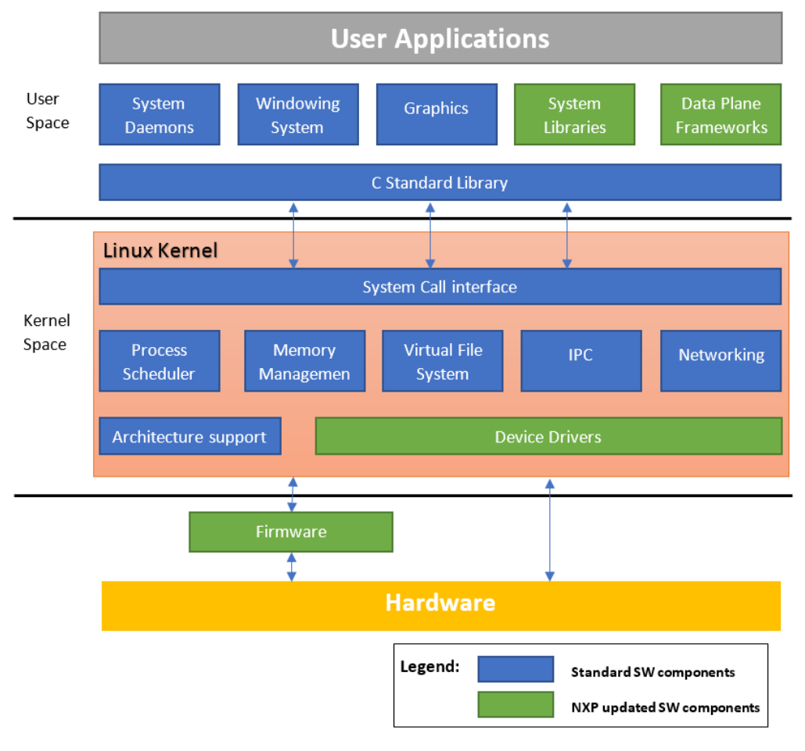

**Figure 24. Hệ thống Linux điển hình**

Linux kernel được Linus Torvalds tạo ra năm 1991 và phát hành như một dự án mã nguồn mở theo GNU General Public License (GPL) phiên bản 2. Nó nhanh chóng thu hút các developer trên khắp thế giới. Năm 2015, Linux kernel nhận đóng góp từ gần 12.000 lập trình viên của hơn 1.200 công ty. Phần mềm được phát hành chính thức trên website http://www.kernel.org qua các package có thể tải về và các Git repository. Phần giới thiệu chung về Linux kernel của kernel.org có tại https://www.kernel.org/doc/html/latest/admin-guide/README.html.

## 7.2 Các bản phát hành kernel và quan hệ với Layerscape LDP

Có nhiều bản phát hành Linux kernel đến từ các nguồn khác nhau. Dưới đây liệt kê những bản liên quan đến kernel của Layerscape LDP.

**Các bản phát hành kernel chính thức của Kernel.org**

- Mainline

  Cây mainline do Linus Torvalds duy trì. Đây là cây nơi mọi tính năng mới được đưa vào và nơi mọi hoạt động phát triển mới thú vị diễn ra. Các kernel mainline mới được phát hành mỗi 2-3 tháng.

- Long-term (LTS)

  Có một số bản phát hành kernel "Long-term maintenance" được cung cấp để backport các bản sửa lỗi cho các cây kernel cũ hơn. Chỉ các bản sửa lỗi quan trọng được áp dụng cho các kernel này và chúng không được phát hành thường xuyên, nhất là với các cây cũ hơn.

  Xem https://www.kernel.org/category/releases.html để biết các bản phát hành Long-term đang được duy trì.

**Bản phát hành kernel Linaro LSK**

Linaro là một tổ chức mở tập trung vào việc cải thiện Linux trên Arm. Họ cũng cung cấp một bản phát hành Linux kernel gọi là Linaro Stable Kernel (LSK). Nó dựa trên các bản phát hành kernel Long-term của kernel.org và có thêm các tính năng liên quan đến Arm do Linaro phát triển. Thông thường các tính năng này là tính năng kernel tổng quát cho kiến trúc Arm. Xem https://wiki.linaro.org/LSK để biết thêm về các bản phát hành LSK.

**Kernel của NXP Layerscape SDK**

Kernel SDK của NXP thường chứa các patch chưa được đưa vào upstream; về cơ bản, kernel Layerscape LDP là một Linaro LSK được tăng cường, mà Linaro LSK lại là một kernel.org LTS được tăng cường. Nhằm tận dụng đầy đủ hệ sinh thái mã nguồn mở của Arm. Các phiên bản kernel cung cấp trong NXP Layerscape LDP sẽ được chọn từ các bản phát hành Long-term của kernel.org để có các bản sửa lỗi quan trọng đã được backport. Nó cũng sẽ có các tính năng kernel Arm tổng quát do bản phát hành Linaro LSK cung cấp, có thể quan trọng với một số người dùng.

## 7.3 Lấy source code kernel của Layerscape LDP

Với Layerscape LDP, các thành phần phần mềm do NXP sở hữu hoặc cập nhật được công bố trên Github.

Bạn có thể dùng các lệnh Git để lấy source code kernel mới nhất.

- Cài lệnh Git nếu chưa có. Ví dụ, trên Ubuntu:

  ```
  $ sudo apt-get install git
  ```

- Clone source code Linux kernel bằng Git.

  ```
  $ git clone https://github.com/nxp-qoriq/linux.git
  ```

- Checkout phiên bản kernel mong muốn. Có thể phiên bản mặc định không phải phiên bản kernel bạn muốn.

  ```
  $ cd linux $ git branch
  ```

  Kiểm tra tên branch hiện tại. Nếu đó không phải phiên bản Kernel bạn muốn, dùng lệnh sau để checkout phiên bản kernel mong muốn: x.y

  ```
  $ git checkout -b lf-x.y origin/lf-x.y
  ```

## 7.4 Cấu hình và build

Việc cấu hình và build Linux kernel do subsystem Kbuild điều khiển. Bạn có thể tìm các tài liệu mô tả bên trong subsystem Kbuild trong `Documentation/kbuild/ folder` của cây source code Linux nếu bạn thêm file mới hoặc tùy chọn cấu hình mới vào kernel. Nếu không, là người dùng Linux kernel, có lẽ bạn chỉ muốn biết cách tinh chỉnh cấu hình kernel theo yêu cầu hệ thống và build image kernel mới với cấu hình đã cập nhật. Những việc này được làm qua các lệnh `make`; mục này giải thích các lệnh `make` mà có lẽ bạn cần biết khi là người dùng kernel.

### 7.4.1 Thiết lập môi trường để cross-compile

Các thiết lập sau áp dụng khi bạn cấu hình và build kernel trên một kiến trúc khác với target. Ví dụ, compile kernel Armv8 trên máy tính X86. Nếu bạn compile kernel native trên máy có cùng kiến trúc với target, hãy bỏ qua mục này.

1. Cài cross compiler của distribution bạn dùng.
2. Chỉ định kiến trúc target trong biến môi trường ARCH.
3. Chỉ định prefix (và đường dẫn) của cross compiler trong biến môi trường `CROSS_COMPILE`

   ```
   $ export CROSS_COMPILE=/path/to/dir/tool-chain-prefix-
   ```

   Hoặc chỉ prefix nếu các lệnh cross-compiler đã có trong `PATH` thực thi.

   ```
   $ export CROSS_COMPILE=tool-chain-prefix-
   ```

   Ví dụ, các lệnh cần thiết trên Ubuntu Linux sẽ như sau:

   - Arm 64-bit:

     ```
     $ sudo apt-get install gcc-aarch64-linux-gnu
     $ export CROSS_COMPILE=aarch64-linux-gnu-
     $ export ARCH=arm64
     ```

   - Arm 32-bit (Armv7 / chế độ 32-bit của Armv8):

     ```
     $ sudo apt-get install gcc-arm-linux-gnueabihf
     $ export CROSS_COMPILE=arm-linux-gnueabihf-
     $ export ARCH=arm
     ```

Với các biến môi trường shell đã export ở trên, bạn cũng có thể đưa trực tiếp chúng vào mỗi lệnh make. Ví dụ `$ ARCH=arm64 CROSS_COMPILE=aarch64-linux-gnu- make {targets}`. Export chúng sẽ đỡ công nếu bạn dùng make trong kernel thường xuyên.

### 7.4.2 Cấu hình kernel

Cấu hình kernel hiện tại của một cây source kernel được giữ trong một file ẩn tên .config ở thư mục gốc của source code kernel, sau khi bạn đổi cấu hình bằng bất kỳ biến thể nào của lệnh make config. Bạn có thể sao chép trực tiếp nó từ cây source kernel này sang cây khác cùng phiên bản kernel để nhân bản đúng cấu hình. Bạn cũng có thể sửa nó bằng một trình soạn thảo văn bản; trong đó bạn sẽ thấy danh sách các symbol `CONFIG_*` tương ứng với từng tùy chọn cấu hình kernel.

Các target sau của framework Kbuild trong Linux kernel được dùng để nạp cấu hình kernel mặc định cho Layerscape LDP:

- `defconfig/${PLATFORM}_defconfig`

  Tạo file `.config` bằng các tùy chọn config mặc định của kiến trúc hoặc nền tảng định nghĩa trong thư mục `arch/$ARCH/configs/`. File này thường gồm mọi device driver cần cho kiến trúc hoặc nền tảng đó.

- `${FRAGMENT}.config`

  Ghép một configuration fragment bật một số tính năng vào file .config.

Lệnh cụ thể để nạp cấu hình mặc định của các nền tảng khác nhau cho Layerscape LDP sẽ là:

- Với các nền tảng Layerscape Armv8 ở chế độ 64bit:

  ```
  $ make defconfig lsdk.config
  ```

- Với các nền tảng Layerscape Armv7:

  ```
  $ make multi_v7_defconfig multi_v7_lpae.config lsdk.config
  ```

- Với các nền tảng Layerscape Armv8 ở chế độ 32bit:

  ```
  $ make multi_v7_defconfig multi_v7_lpae.config multi_v8.config lsdk.config
  ```

Để tinh chỉnh thêm cấu hình theo nhu cầu hệ thống, bạn có thể dùng các lệnh make sau.

- `$ make menuconfig`

  Chọn các tùy chọn cấu hình trong menu màu, radio list và dialog dạng văn bản. Đây là cách tốt để duyệt qua mọi tùy chọn cấu hình kernel có thể chọn trong một cấu trúc phân cấp có tổ chức, dễ đọc, và bạn có thể xem mô tả của mọi tùy chọn khi nó được chọn bằng nút `<Help>`. Trong phần device driver của User’s Manual này, chúng tôi cũng nêu đường dẫn tới các tùy chọn cấu hình cần để một tính năng hoạt động trong menuconfig.

- `$ make ${FRAGMENT}.config`

  Bạn cũng có thể dùng khả năng này để nhanh chóng bật các tùy chọn cho một tính năng cụ thể trong cấu hình kernel tùy biến mà không phải chọn từng tùy chọn trong menuconfig. Trong phần device driver của User’s Manual này, chúng tôi liệt kê các symbol `CONFIG_*` mà một tính năng/driver cụ thể cần. Đặt các symbol này với “=y” hoặc “=m”, tùy bạn muốn các tính năng/driver này được build sẵn trong kernel hay build thành kernel module nạp được, vào một file `${FEATURE}.config` trong thư mục `arch/$ARCH/configs/`. Chạy lệnh `$ make ${FEATURE}.config`, nó sẽ bật tất cả các tùy chọn cấu hình kernel đã liệt kê cùng lúc.

### 7.4.3 Build kernel

Build kernel rất đơn giản.

- Để build image kernel và image device tree.

  ```
  $ make
  ```

- Để build các kernel module nạp được:

  ```
  $ make modules
  ```

Bạn có thể thêm tùy chọn `-j <NUM>` vào các lệnh make trên để chạy `NUM` thread song song, giảm thời gian build trên hệ thống nhiều core.

Sau khi build thành công:

- Các image kernel đã compile nằm trong thư mục arch/${ARCH}/boot/.
- Các device tree đã compile (file dtb) nằm trong thư mục arch/${ARCH}/boot/dts.
- Các kernel module đã compile nằm rải rác trong các thư mục driver. Bạn có thể trích chúng ra một thư mục cụ thể (ví dụ, /folder/to/install) bằng lệnh:

  ```
  $ make modules_install INSTALL_MOD_PATH=/folder/to/install
  ```

### 7.4.4 Cài kernel và module mới

Đường dẫn hoặc quy ước đặt tên image kernel và module khác nhau giữa các Linux distribution. Các hướng dẫn sau dựa trên quy ước của Layerscape LDP.

**Dùng các script bitbake**

- Checkout branch kernel sang branch phát triển tùy biến của bạn.

  **Buộc compile**:

  ```
  $ bitbake linux-qoriq -c compile -f
  $ bitbake linux-qoriq
  ```

- Tạo lại bootpartition và rootfs (với các lệnh dưới đây: `${ARCH} = arm32 | arm64`)

  ```
  $ bitbake linux-qoriq
  ```

**Cập nhật trực tiếp filesystem của target**

Cách này có thể tiện hơn nếu bạn compile kernel tại chỗ trên thiết bị target hoặc có thể dễ dàng cập nhật filesystem của thiết bị target từ xa (ví dụ, dùng scp, tftp, v.v.).

- Sao chép file Image vào thư mục `/boot` trên target bằng `cp` nếu compile tại chỗ; dùng bất kỳ cách cập nhật từ xa nào có sẵn nếu compile từ xa.
- Sao chép các file dtb vào thư mục `/boot` trên target bằng `cp` nếu compile tại chỗ; dùng bất kỳ cách cập nhật từ xa nào có sẵn để làm tương tự nếu compile từ xa.
- Cập nhật các kernel module.

  **Ghi chú:** Các kernel module cần được cập nhật khi bạn đã cập nhật image kernel

  - Nếu bạn compile kernel tại chỗ trên thiết bị target, dùng lệnh dưới đây:

    ```
    $ make modules_install
    ```

  - Nếu bạn compile kernel từ xa, làm như sau:
    - Cài các module vào một thư mục tạm (ví dụ, `/tmp/deploy/images`).

      ```
      $ make modules_install INSTALL_MOD_PATH=/tmp/deploy/images
      ```

    - Chuyển thư mục `lib/` từ vị trí tạm ở trên sang thiết bị target bằng bất kỳ cách truyền file nào và đặt nó vào đường dẫn tương ứng của filesystem.

## 7.5 Device Driver

### 7.5.1 Enhanced Direct Memory Access (eDMA)

#### 7.5.1.1 Mô tả

SoC tích hợp module Enhanced Direct Memory Access của NXP. Thiết bị slave như I2C hoặc SAI có thể dùng chức năng DMA để tăng tốc truyền dữ liệu và giảm tải nặng cho CPU.

#### 7.5.1.2 Tùy chọn cấu hình kernel

**Tree View**

Dưới đây là các tùy chọn cấu hình cần đặt/bỏ khi chạy "make menuconfig" cho kernel

| Tùy chọn Kernel Configure Tree View | Mô tả |
|---|---|
| `Device Drivers --->`<br>`    [*] DMA Engine support ---> --->` | Driver subsystem DMA engine và hỗ trợ driver eDMA |
| `         <*> Freescale eDMA engine`<br>` support` |   |

**Identifier**

Dưới đây là các identifier cấu hình được dùng trong source code kernel và các file cấu hình mặc định.

| Tùy chọn | Giá trị | Giá trị mặc định | Mô tả |
|---|---|---|---|
| CONFIG_FSL_EDMA | y/m/n | n | Driver eDMA |

#### 7.5.1.3 Device Tree Binding

**Device Tree Node**

Dưới đây là ví dụ node device tree mà tính năng này cần. Lưu ý có thể có khác biệt giữa các nền tảng.

```
edma0: edma@2c00000 {
                        #dma-cells = <2>;
                        compatible = "fsl,vf610-edma";
                        reg = <0x0 0x2c00000 0x0 0x10000>,
                                <0x0 0x2c10000 0x0 0x10000>,
                                <0x0 0x2c20000 0x0 0x10000>;
                        interrupts = <GIC_SPI 135 IRQ_TYPE_LEVEL_HIGH>,
                                        <GIC_SPI 135 IRQ_TYPE_LEVEL_HIGH>;
                        interrupt-names = "edma-tx", "edma-err";
                        dma-channels = <32>;
                        big-endian;
                        clock-names = "dmamux0", "dmamux1";
                        clocks = <&platform_clk 1>,
                                <&platform_clk 1>;
                };
```

**Device Tree Node Binding cho thiết bị slave**

Dưới đây là device tree node binding cho một thiết bị slave có dùng chức năng eDMA.

```
i2c0: i2c@2180000 {
                        #address-cells = <1>;
                        #size-cells = <0>;
                        compatible = "fsl,vf610-i2c";
                        reg = <0x0 0x2180000 0x0 0x10000>;
                        interrupts = <GIC_SPI 88 IRQ_TYPE_LEVEL_HIGH>;
                        clock-names = "i2c";
                        clocks = <&platform_clk 1>;
                        dmas = <&edma0 1 39>,
                                <&edma0 1 38>;
                        dma-names = "tx", "rx";
                        status = "disabled";
                };
```

#### 7.5.1.4 Các file source

Các file source sau liên quan đến tính năng này trong Linux kernel.

**Table 50. Các file source**

| File source | Mô tả |
|---|---|
| drivers/dma/fsl-edma.c | Driver eDMA |

#### 7.5.1.5 Kiểm chứng trong Linux

1. Dùng thiết bị slave có dùng chức năng eDMA để kiểm chứng driver eDMA; dưới đây là một lần kiểm chứng với I2C slave.

   ```
   root@ls1021aqds:~# i2cdetect 0
   WARNING! This program can confuse your I2C bus, cause data loss and worse!
   I will probe file /dev/i2c-0.
   I will probe address range 0x03-0x77.
   Continue? [Y/n]
        0  1  2  3  4  5  6  7  8  9  a  b  c  d  e  f
   00:          -- -- -- -- -- -- -- -- -- -- -- -- --
   10: -- -- -- -- -- -- -- -- -- -- -- -- -- -- -- --
   20: -- -- -- -- -- -- -- -- -- -- -- -- -- -- -- --
   30: -- -- -- -- -- -- -- -- -- -- -- -- -- -- -- --
   40: -- -- -- -- -- -- -- -- -- -- -- -- -- -- -- --
   50: -- -- -- -- -- -- -- -- -- -- -- -- -- -- -- --
   60: -- -- -- -- -- -- -- -- -- 69 -- -- -- -- -- --
   70: -- -- -- -- -- -- -- --
   root@ls1021aqds:~# i2cdump 0 0x69 i
        0  1  2  3  4  5  6  7  8  9  a  b  c  d  e  f    0123456789abcdef
   00: 05 07 ff ff 5d 55 10 55 11 05 1e 00 e8 03 b5 ff    ??..]U?U???.???.
   10: ff e8 03 95 00 00 00 00 aa fe 9a 00 00 00 00 78    .???....???....x
   20: 05 12 04 ff 00 7f 40 14 1d 60 3c 83 05 00 40 00    ???..?@??`<??.@.
   30: fe 80 c6 29 00 00 00 7a 00 ff ff ff ff ff ff ff    ???)...z........
   40: 05 07 ff ff 5d 55 10 55 11 05 1e 00 e8 03 b5 ff    ??..]U?U???.???.
   50: ff e8 03 95 00 00 00 00 aa fe 9a 00 00 00 00 78    .???....???....x
   60: 05 12 04 ff 00 7f 40 14 1d 60 3c 83 05 00 40 00    ???..?@??`<??.@.
   70: fe 80 c6 29 00 00 00 7a 00 ff ff ff ff ff ff ff    ???)...z........
   80: 07 ff ff 5d 55 10 55 11 05 1e 00 e8 03 b5 ff ff    ?..]U?U???.???..
   90: e8 03 95 00 00 00 00 aa fe 9a 00 00 00 00 78 00    ???....???....x.
   a0: 12 04 ff 00 7f 40 14 1d 60 3c 83 05 00 40 00 fe    ??..?@??`<??.@.?
   b0: 80 c6 29 00 00 00 7a 00 ff ff ff ff ff ff ff ff    ??)...z.........
   c0: 07 ff ff 5d 55 10 55 11 05 1e 00 e8 03 b5 ff ff    ?..]U?U???.???..
   d0: e8 03 95 00 00 00 00 aa fe 9a 00 00 00 00 78 00    ???....???....x.
   e0: 12 04 ff 00 7f 40 14 1d 60 3c 83 05 00 40 00 fe    ??..?@??`<??.@.?
   f0: 80 c6 29 00 00 00 7a 00 ff ff ff ff ff ff ff ff    ??)...z.........
   root@ls1021aqds:~# cat /proc/interrupts
              CPU0       CPU1
    29:          0          0       GIC  29  arch_timer
    30:       5563       5567       GIC  30  arch_timer
   112:        260          0       GIC 112  fsl-lpuart
   120:         32          0       GIC 120  2180000.i2c
   121:          0          0       GIC 121  2190000.i2c
   167:          8          0       GIC 167  eDMA
   IPI0:          0          1  CPU wakeup interrupts
   IPI1:          0          0  Timer broadcast interrupts
   IPI2:       1388       1653  Rescheduling interrupts
   IPI3:          0          0  Function call interrupts
   IPI4:          2          4  Single function call interrupts
   IPI5:          0          0  CPU stop interrupts
   Err:          0
   root@ls1021aqds:~#
   ```

### 7.5.2 CAAM Direct Memory Access (DMA)

Module CAAM DMA triển khai một driver DMA dùng bộ điều khiển CAAM DMA để cung cấp cả khả năng DMA SG lẫn MEMCPY cho platform sử dụng. Nó dựa trên giao diện CAAM JR, giao diện này phải được bật trong kernel config như một điều kiện tiên quyết cho driver CAAM DMA.

Driver dựa trên framework DMA engine và nằm trong mục DMA Engine support của menu kernel config.

**Ghi chú:** Tính năng/driver này được hỗ trợ cho LS1012A.

#### 7.5.2.1 Tùy chọn cấu hình kernel

**Tổng quan cây cấu hình**

Để bật module CAAM DMA, đặt các tùy chọn sau cho `make menuconfig`:

```
-*- Cryptographic API --->
    [*] Hardware crypto devices --->
            <*> Freescale CAAM-Multicore driver backend
            <*>     Freescale CAAM Job Ring driver backend
Device Drivers --->
            <*> DMA Engine support --->
            <*>     CAAM DMA engine support
```

**Ghi chú:** Hãy chú ý rằng driver CAAM DMA phụ thuộc vào các driver CAAM và CAAM JR, vốn cũng phải được bật.

#### 7.5.2.2 Identifier

Identifier cấu hình sau được dùng trong mã nguồn kernel và các file cấu hình mặc định.

| Tùy chọn | Giá trị | Giá trị mặc định | Mô tả |
|---|---|---|---|
| `CONFIG_CRYPTO_DEV_`<br>`FSL_CAAM_DMA` | y/m/n | n | Hỗ trợ CAAM DMA engine |

#### 7.5.2.3 Node device tree

Dưới đây là ví dụ node device tree mà tính năng này cần.

```
caam_dma {
    compatible = "fsl,sec-v5.4-dma";
};
```

#### 7.5.2.4 Các file source

Các file source sau liên quan đến tính năng này trong Linux kernel.

| File source | Mô tả |
|---|---|
| `drivers/dma/caam_dma.c` | Driver CAAM DMA |

#### 7.5.2.5 Kiểm chứng trong Linux

Khi probe thành công, driver sẽ in thông báo sau trong `dmesg`:

```
[    1.964549] caam-dma caam-dma: caam dma support with 3 job rings
```

Ngoài ra, bạn cũng có thể chạy các lệnh sau:

```
root@ls1028ardb:~# ls -l /sys/class/dma
total 0
lrwxrwxrwx 1 root root 0 Jan 28 15:58 dma0chan0 -> ../../devices/platform/
soc/2c00000.edma/dma/dma0chan0
lrwxrwxrwx 1 root root 0 Jan 28 15:58 dma0chan1 -> ../../devices/platform/
soc/2c00000.edma/dma/dma0chan1
lrwxrwxrwx 1 root root 0 Jan 28 15:58 dma0chan10 -> ../../devices/platform/
soc/2c00000.edma/dma/dma0chan10
lrwxrwxrwx 1 root root 0 Jan 28 15:58 dma0chan11 -> ../../devices/platform/
soc/2c00000.edma/dma/dma0chan11
lrwxrwxrwx 1 root root 0 Jan 28 15:58 dma0chan12 -> ../../devices/platform/
soc/2c00000.edma/dma/dma0chan12
lrwxrwxrwx 1 root root 0 Jan 28 15:58 dma0chan13 -> ../../devices/platform/
soc/2c00000.edma/dma/dma0chan13
lrwxrwxrwx 1 root root 0 Jan 28 15:58 dma0chan14 -> ../../devices/platform/
soc/2c00000.edma/dma/dma0chan14
lrwxrwxrwx 1 root root 0 Jan 28 15:58 dma0chan15 -> ../../devices/platform/
soc/2c00000.edma/dma/dma0chan15
lrwxrwxrwx 1 root root 0 Jan 28 15:58 dma0chan16 -> ../../devices/platform/
soc/2c00000.edma/dma/dma0chan16
lrwxrwxrwx 1 root root 0 Jan 28 15:58 dma0chan17 -> ../../devices/platform/
soc/2c00000.edma/dma/dma0chan17
lrwxrwxrwx 1 root root 0 Jan 28 15:58 dma0chan18 -> ../../devices/platform/
soc/2c00000.edma/dma/dma0chan18
lrwxrwxrwx 1 root root 0 Jan 28 15:58 dma0chan19 -> ../../devices/platform/
soc/2c00000.edma/dma/dma0chan19
lrwxrwxrwx 1 root root 0 Jan 28 15:58 dma0chan2 -> ../../devices/platform/
soc/2c00000.edma/dma/dma0chan2
lrwxrwxrwx 1 root root 0 Jan 28 15:58 dma0chan20 -> ../../devices/platform/
soc/2c00000.edma/dma/dma0chan20
lrwxrwxrwx 1 root root 0 Jan 28 15:58 dma0chan21 -> ../../devices/platform/
soc/2c00000.edma/dma/dma0chan21
lrwxrwxrwx 1 root root 0 Jan 28 15:58 dma0chan22 -> ../../devices/platform/
soc/2c00000.edma/dma/dma0chan22
lrwxrwxrwx 1 root root 0 Jan 28 15:58 dma0chan23 -> ../../devices/platform/
soc/2c00000.edma/dma/dma0chan23
lrwxrwxrwx 1 root root 0 Jan 28 15:58 dma0chan24 -> ../../devices/platform/
soc/2c00000.edma/dma/dma0chan24
lrwxrwxrwx 1 root root 0 Jan 28 15:58 dma0chan25 -> ../../devices/platform/
soc/2c00000.edma/dma/dma0chan25
lrwxrwxrwx 1 root root 0 Jan 28 15:58 dma0chan26 -> ../../devices/platform/
soc/2c00000.edma/dma/dma0chan26
lrwxrwxrwx 1 root root 0 Jan 28 15:58 dma0chan27 -> ../../devices/platform/
soc/2c00000.edma/dma/dma0chan27
lrwxrwxrwx 1 root root 0 Jan 28 15:58 dma0chan28 -> ../../devices/platform/
soc/2c00000.edma/dma/dma0chan28
lrwxrwxrwx 1 root root 0 Jan 28 15:58 dma0chan29 -> ../../devices/platform/
soc/2c00000.edma/dma/dma0chan29
lrwxrwxrwx 1 root root 0 Jan 28 15:58 dma0chan3 -> ../../devices/platform/
soc/2c00000.edma/dma/dma0chan3
lrwxrwxrwx 1 root root 0 Jan 28 15:58 dma0chan30 -> ../../devices/platform/
soc/2c00000.edma/dma/dma0chan30
lrwxrwxrwx 1 root root 0 Jan 28 15:58 dma0chan31 -> ../../devices/platform/
soc/2c00000.edma/dma/dma0chan31
lrwxrwxrwx 1 root root 0 Jan 28 15:58 dma0chan4 -> ../../devices/platform/
soc/2c00000.edma/dma/dma0chan4
lrwxrwxrwx 1 root root 0 Jan 28 15:58 dma0chan5 -> ../../devices/platform/
soc/2c00000.edma/dma/dma0chan5
lrwxrwxrwx 1 root root 0 Jan 28 15:58 dma0chan6 -> ../../devices/platform/
soc/2c00000.edma/dma/dma0chan6
lrwxrwxrwx 1 root root 0 Jan 28 15:58 dma0chan7 -> ../../devices/platform/
soc/2c00000.edma/dma/dma0chan7
lrwxrwxrwx 1 root root 0 Jan 28 15:58 dma0chan8 -> ../../devices/platform/
soc/2c00000.edma/dma/dma0chan8
lrwxrwxrwx 1 root root 0 Jan 28 15:58 dma0chan9 -> ../../devices/platform/
soc/2c00000.edma/dma/dma0chan9
lrwxrwxrwx 1 root root 0 Jan 28 15:58 dma1chan0 -> ../../devices/platform/
soc/1700000.crypto/caam-dma/dma/dma1chan0
lrwxrwxrwx 1 root root 0 Jan 28 15:58 dma1chan1 -> ../../devices/platform/
soc/1700000.crypto/caam-dma/dma/dma1chan1
lrwxrwxrwx 1 root root 0 Jan 28 15:58 dma1chan2 -> ../../devices/platform/
soc/1700000.crypto/caam-dma/dma/dma1chan2
```

#### 7.5.2.6 Kiểm thử thành phần

Để kiểm thử cả khả năng SG và memcpy của driver CAAM DMA, dùng module dmatest do kernel cung cấp.

**Build dmatest**

Build tiện ích dmatest thành module bằng cách chạy lệnh:

```
$ make menuconfig
```

Sau đó chọn trong kernel menuconfig để build dmatest.ko thành module:

```
Device Drivers --->
  <*> DMA Engine support --->
  <M>  DMA Test client
```

**Cấu hình dmatest**

Trước khi kiểm thử, nạp module:

```
$ insmod dmatest.ko
```

Cấu hình dmatest. Có một cấu hình chung áp dụng cho cả chức năng sg và memcpy:

```
$ echo 1 > /sys/module/dmatest/parameters/max_channels
$ echo 2000 > /sys/module/dmatest/parameters/timeout
$ echo 0 > /sys/module/dmatest/parameters/noverify
$ echo 4 > /sys/module/dmatest/parameters/threads_per_chan
$ echo 0 > /sys/module/dmatest/parameters/dmatest
$ echo 1 > /sys/module/dmatest/parameters/iterations
$ echo 2000 > /sys/module/dmatest/parameters/test_buf_size
```

Cấu hình trên tự nó đã rõ nghĩa, trừ một vài tham số:

Nếu bạn đặt tham số 'noverify' là 0, nó sẽ không kiểm tra buffer đã sao chép ở cuối mỗi vòng kiểm thử. Cách này nên dùng cho kiểm thử hiệu năng. Đặt tham số 'noverify' là 1 cho kiểm thử chức năng.

Đặt tham số 'dmatest' là 0 để kiểm thử chức năng memcpy và là 1 để kiểm thử chức năng sg.

**Thực hiện kiểm thử**

Để thực hiện kiểm thử, chỉ cần chạy lệnh:

```
$ echo 1 > /sys/module/dmatest/parameters/run
```

Tùy loại kiểm thử được thực hiện (sg/memcpy), output có thể khác nhau. Đây là một ví dụ output thu được với các tham số ở trên:

```
[   72.113769] dmatest: Started 4 threads using dma0chan0
[   72.105334] dmatest: dma0chan0-copy0: summary 1 tests, 0 failures 9009 iops
 9009 KB/s (0)
[   72.113649] dmatest: dma0chan0-copy1: summary 1 tests, 0 failures 119 iops
 119 KB/s (0)
[   72.114927] dmatest: dma0chan0-copy2: summary 1 tests, 0 failures 24390 iops
 0 KB/s (0)
[   72.115098] dmatest: dma0chan0-copy3: summary 1 tests, 0 failures 37037 iops
 0 KB/s (0)
```

### 7.5.3 Hướng dẫn sử dụng DCU Display Device Driver

#### 7.5.3.1 Mô tả

Tài liệu này mô tả cách dùng Two Dimensional Animation and Compositing Engine (2D-ACE hay DCU) và frame buffer trên board TWR-LS1021A.

#### 7.5.3.2 Nạp module

Device driver DCU hỗ trợ cả dạng built-in trong kernel lẫn module.

#### 7.5.3.3 Cấu hình U-Boot

Dùng ‘ls1021atwr_lpuart_config’ để build U-Boot.

Các tùy chọn lúc chạy.

| Biến môi trường | Mô tả | Tùy chọn con |   | Mô tả tùy chọn |
|---|---|---|---|---|
| bootargs | Đối số command-line của kernel được truyền cho | HDMI | console=ttyLP0,115200 hdmi | chọn LPUART0 làm console hệ thống |
|   | kernel | LCD | console=ttyLP0,115200 |   |

#### 7.5.3.4 Tùy chọn cấu hình kernel

**Tree View**

Dưới đây là các tùy chọn Kernel Configure Tree View cần được đặt/bỏ khi chạy "make menuconfig" cho kernel để bật các driver DCU/HDMI và ảnh Linux Penguin Logo.

```
Device Drivers --->
   < > Multimedia support ----
       Graphics support --->
         <*> Support for frame buffer devices --->
           <*> Si Image SII9022 DVI/HDMI Interface Chip
           <*> Freescale DCU framebuffer support
               …
         [ ] Exynos Video driver support ----
         [ ] Backlight & LCD device support ----
             Console display driver support --->
               <*> Framebuffer Console support
               [*] Map the console to the primary display device
               [*] Framebuffer Console Rotation
         [*] Bootup logo --->
           --- Bootup logo
           [*] Standard black and white Linux logo
           [*] Standard 16-color Linux logo
           [*] Standard 224-color Linux logo
   < > Sound card support ----
```

**Identifier**

Dưới đây là các identifier cấu hình được dùng trong source code kernel và các file cấu hình mặc định.

Cấu hình đặc biệt cần được bật ("Y") cho LS1021A. Xem bảng dưới đây với giá trị mặc định là "N"

| Tùy chọn | Giá trị | Giá trị mặc định | Mô tả |
|---|---|---|---|
| CONFIG\_ FB_FSL_SII902X | y/m/n | y | Chip giao diện DVI/HDMI Si Image SII9022 |
| CONFIG_FB_FSL_DCU | y/m/n | y | Hỗ trợ NXP DCU frame buffer |
| CONFIG_LOGO | y/m/n | y | Logo khi khởi động |
| CONFIG_LOGO_LINUX_MONO | y/m/n | y | Logo Linux đen trắng chuẩn |
| CONFIG_LOGO_LINUX_VGA16 | y/m/n | y | Logo Linux 16 màu chuẩn |
| CONFIG_LOGO_LINUX_CLUT224 | y/m/n | y | Logo Linux 224 màu chuẩn |
| CONFIG_FRAMEBUFFER_CONSOLE | y/m/n | y | Hỗ trợ Frame buffer Console |

#### 7.5.3.5 Device Tree Binding

Cấu hình đặc biệt cần được bật ("Y") cho LS1021A. Xem bảng dưới đây với giá trị mặc định là "N".

Cấu hình mặc định hiển thị qua LCD, như mô tả dưới đây.

**arch/arm/boot/dts/ls1021a.dtsi**

```
dcu0: dcu@2ce0000 {
            compatible = "fsl,vf610-dcu";
             reg = <0x0 0x2ce0000 0x0 0x10000>;
             interrupts = <GIC_SPI 172 IRQ_TYPE_LEVEL_HIGH>;
             clocks = <&platform_clk 0>;
             clock-names = "dcu";
             scfg-controller = <&scfg>;
              big-endian;
              status = "disabled";
};
```

**arch/arm/boot/dts/ls1021a-twr.dts**

```
&dcu0 {
        display = <&display>;
        status = "okay";
        display: display@0 {
                bits-per-pixel = <24>;
                display-timings {
                        native-mode = <&timing0>;
                        timing0: nl4827hc19 {
                                clock-frequency = <10870000>;
                                hactive = <480>;
                                vactive = <272>;
                                hback-porch = <2>;
                                hfront-porch = <2>;
                                vback-porch = <2>;
                                vfront-porch = <2>;
                                hsync-len = <41>;
                                vsync-len = <4>;
                                hsync-active = <1>;
                                vsync-active = <1>;
                        };
                };
        };
};
```

**Ramdisk:**

Dùng ramdisk 'fsl-image-x11-ls1021a(XXXXX)rootfs.ext2.gz.gz' từ mỗi image phát hành, hoặc bạn có thể dùng image ramdisk có nhãn 'x11'.

Nếu bạn muốn hiển thị qua HDMI, hãy đổi cấu hình sau:

```
arch/arm/boot/dts/ls1021a-twr.dtscan
diff --git
a/arch/arm/boot/dts/ls1021a-twr.dts b/arch/arm/boot/dts/ls1021a-twr.dtsindex
cc351e3..928d376 100644---
a/arch/arm/boot/dts/ls1021a-twr.dts+++
b/arch/arm/boot/dts/ls1021a-twr.dts@@ -122,7 +122,7
@@
port {
     dcu_out: endpoint {
-      remote-endpoint = <&panel_in>;
+      remote-endpoint = <&sii9022a_out>;
     };
   };
 };
@@ -204,6 +204,18 @@
     VDDIO-supply = <&reg_3p3v>;
     clocks = <&sys_mclk>;
   };
+
+  sii9022a: hdmi@39 {
+    compatible = "sil,sii9022";
+    reg = <0x39>;
+    interrupts = <GIC_SPI 167 IRQ_TYPE_EDGE_RISING>;
+
+    port@0 {
+      sii9022a_out: endpoint {
+        remote-endpoint = <&dcu_out>;
+      };
+    };
+  };
 };
 &ifc {
```

#### 7.5.3.6 Các file source

Source của driver được duy trì trong cây source Linux kernel.

| File source | Mô tả |
|---|---|
| drivers/video/fsl-dcu-fb.c | Driver NXP DCU |

#### 7.5.3.7 Kiểm thử LCD/HDMI ở mức U-Boot

1. Hiển thị với LCD:

   ```
   => setenv video-mode  "fslfb:480x272-32@60,monitor=twr_lcd"
   => save
   => setenv stdout vga
   ```

2. Hiển thị với HDMI:

   ```
   => setenv video-mode  "fslfb:640x480-32@60,monitor=hdmi"
   => save
   => setenv stdout vga
   ```

#### 7.5.3.8 Kiểm thử LCD ở mức kernel

1. Cấu hình và build lại kernel theo danh sách cấu hình ở trên, để driver DCU được build vào Kernel Image.
2. Khởi động Linux kernel; khi kernel đã được giải nén, TFT Panel sẽ hiển thị Linux Penguin Logo.
3. Sau đó, khi root filesystem đã được mount, Xwindows Desktop sẽ được hiển thị.
4. Hoặc bạn cũng có thể khởi động Xwindow bằng:

   ```
   root@ls1021atwr:~# killall matchbox-window-manager root@ls1021atwr:~# xinit /
   etc/init.d/xserver-nodm restart
   ```

5. Rút ra rồi cắm lại HDMI để kiểm thử hot plug.

#### 7.5.3.9 Kiểm thử HDMI ở mức kernel

1. 1.Cấu hình và build lại kernel theo danh sách cấu hình ở trên, để các driver HDMI và DCU được build vào Kernel Image.
2. Khởi động Linux kernel; khi kernel đã được giải nén, TFT Panel sẽ không hiển thị đúng hình ảnh nào.
3. Sau đó, khi root filesystem đã được mount, Xwindows Desktop sẽ được hiển thị trên màn hình HDMI.
4. Hoặc bạn cũng có thể khởi động Xwindow bằng:

   ```
   root@ls1021atwr:~# killall matchbox-window-manager root@ls1021atwr:~# xinit /
   etc/init.d/xserver-nodm restart
   Note: Unplug the TWR-LDC_RGB daughter board when testing the HDMI.
   ```

#### 7.5.3.10 Lỗi đã biết, giới hạn hoặc vấn đề kỹ thuật

Rút thẻ SD ra trước khi kiểm thử DCU/HDMI, nếu không hệ thống sẽ bị treo.

### 7.5.4 Enhanced Secured Digital Host Controller (eSDHC)

#### 7.5.4.1 Mô tả

Bộ điều khiển host bảo mật nâng cao (eSDHC) cung cấp giao diện giữa hệ thống host và các thẻ MMC/SD/SDIO.

Device driver eSDHC hỗ trợ dạng built-in trong kernel hoặc module.

#### 7.5.4.2 Tùy chọn cấu hình kernel

**Tree View**

| Tree View tùy chọn cấu hình kernel | Mô tả |
|---|---|
| `Device Drivers --->`<br>`<*> MMC/SD/SDIO card support --->`<br>`<*> MMC block device driver`<br>`(32) Number of minors per`<br>` block device` | Bật hỗ trợ MMC block device driver |
| `*** MMC/SD/SDIO Host Controller`<br>` Drivers ***`<br>`<*> Secure Digital Host Controller`<br>` Interface support`<br>`<*> SDHCI platform and OF driver`<br>` helper`<br>`[*] SDHCI OF support for the`<br>` Freescale eSDHC controller` | Bật hỗ trợ eSDHC driver |

#### 7.5.4.3 Các tùy chọn cấu hình lúc compile

| Tùy chọn | Giá trị | Giá trị mặc định | Mô tả |
|---|---|---|---|
| CONFIG_MMC | y/n | y | Bật MMC bus protocol |
| CONFIG_MMC_BLOCK | y/n | y | Bật hỗ trợ MMC block device driver |
| CONFIG_MMC_BLOCK_MINORS | integer | 32 | Số minor cho mỗi block device |
| CONFIG_MMC_SDHCI | y/n | y | Bật generic SDHC interface |
| CONFIG_MMC_SDHCI_PLTFM | y/n | y | Bật hỗ trợ hàm helper chung cho platform driver và OF driver của SDHCI |
| CONFIG_MMC_SDHCI_OF_ESDHC | y/n | y | Bật hỗ trợ eSDHC |

#### 7.5.4.4 Các file source

Source của driver được duy trì trong cây source Linux kernel.

| File source | Mô tả |
|---|---|
| drivers/mmc/host/sdhci.c | Hỗ trợ driver SDHCI |
| drivers/mmc/host/sdhci-pltfm.c | Driver hỗ trợ platform device SDHCI |
| drivers/mmc/host/sdhci-of-esdhc.c | Driver eSDHC |

#### 7.5.4.5 Device Tree Binding

| Property | Kiểu | Trạng thái | Mô tả |
|---|---|---|---|
| compatible | String | Required | Phải là 'fsl,esdhc' |
| reg | integer | Bắt buộc | Bản đồ register |

Ví dụ:

```
esdhc: esdhc@1560000 {
  compatible = "fsl,ls1046a-esdhc", "fsl,esdhc";
  reg = <0x0 0x1560000 0x0 0x10000>;
  interrupts = <GIC_SPI 62 IRQ_TYPE_LEVEL_HIGH>;
  clocks = <&clockgen 2 1>;
  voltage-ranges = <1800 1800 3300 3300>;
  sdhci,auto-cmd12;
  big-endian;
  bus-width = <4>;
};
```

#### 7.5.4.6 Kiểm chứng trong U-Boot

```
=> mmcinfo
Device: FSL_SDHC
Manufacturer ID: 74
OEM: 4a45
Name: SDC
Tran Speed: 50000000
Rd Block Len: 512
SD version 3.0
High Capacity: Yes
Capacity: 7.5 GiB
Bus Width: 4-bit
Erase Group Size: 512 Bytes
=> mw.l 81000000 11111111 100
=> mw.l 82000000 22222222 100
=> cmp.l 81000000 82000000 100
word at 0x0000000081000000 (0x11111111) != word at 0x0000000082000000
 (0x22222222)
Total of 0 word(s) were the same
=> mmc write 81000000 0 2
MMC write: dev # 0, block # 0, count 2 ... 2 blocks written: OK
=> mmc read 82000000 0 2
MMC read: dev # 0, block # 0, count 2 ... 2 blocks read: OK
=> cmp.l 81000000 82000000 100
Total of 256 word(s) were the same
=>
```

#### 7.5.4.7 Kiểm chứng trong Linux

**Thông tin khởi tạo**

```
...
[    3.913163] sdhci: Secure Digital Host Controller Interface driver
[    3.919339] sdhci: Copyright(c) Pierre Ossman
[    3.931467] sdhci-pltfm: SDHCI platform and OF driver helper
[    3.938900] sdhci-esdhc 1560000.esdhc: No vmmc regulator found
[    3.944728] sdhci-esdhc 1560000.esdhc: No vqmmc regulator found
[    3.978676] mmc0: SDHCI controller on 1560000.esdhc [1560000.esdhc] using
 ADMA 64-bit
[    4.197784] mmc0: new high speed SDHC card at address b368
[    4.203502] mmcblk0: mmc0:b368 SDC   7.45 GiB
...
```

**Phân vùng bằng fdisk**

```
# fdisk /dev/mmcblk0
Welcome to fdisk (util-linux 2.26.2).
Changes will remain in memory only, until you decide to write them.
Be careful before using the write command.
Device does not contain a recognized partition table.
Created a new DOS disklabel with disk identifier 0x5a5f34b3.
Command (m for help): n
Partition type
   p   primary (0 primary, 0 extended, 4 free)
   e   extended (container for logical partitions)
Select (default p):
Using default response p.
Partition number (1-4, default 1):
First sector (2048-15628287, default 2048):
Last sector, +sectors or +size{K,M,G,T,P} (2048-15628287, default 15628287):
Created a new partition 1 of type 'Linux' and of size 7.5 GiB.
Command (m for help): w
The partition table has been altered.
Calling ioctl() [  410.501876]  mmcblk0: p1
to re-read partition table.
Syncing disks.
```

**Format bằng mkfs**

```
# mkfs.ext2 /dev/mmcblk0p1
```

**Mount và đọc/ghi**

```
# mount /dev/mmcblk0p1 /mnt/
# ls /mnt/
lost+found
# cp -r /lib /mnt/
# ls /mnt/
lib  lost+found
```

#### 7.5.4.8 Kiểm chứng eMMC RPMB

RPMB là Replay Protected Memory Block, một phân vùng phần cứng của eMMC. Việc kiểm chứng dùng mmc-utils, gói cung cấp công cụ "mmc". Với công cụ "mmc", ta có thể thao tác trên phân vùng RPMB như ghi key, đọc, ghi và đọc counter.

Nếu `mmc-utils` chưa được cài, bạn có thể cài nó bằng cách chạy `sudo apt install mmc-utils` ở command line.

**Thông tin trợ giúp của công cụ mmc**

```
# mmc
...
mmc rpmb write-key <rpmb device> <key file>
  Program authentication key which is 32 bytes length and stored
  in the specified file. Also you can specify '-' instead of
  key file path to read the key from stdin.
  NOTE!  This is a one-time programmable (unreversible) change.
  Example:
    $ echo -n AAAABBBBCCCCDDDDEEEEFFFFGGGGHHHH | \
      mmc rpmb write-key /dev/mmcblk0rpmb -
mmc rpmb read-counter <rpmb device>
  Counter value for the <rpmb device> will be read to stdout.
  mmc rpmb read-block <rpmb device> <address> <blocks count> <output file> [key
 file]
  Blocks of 256 bytes will be read from <rpmb device> to output
  file or stdout if '-' is specified. If key is specified - read
  data will be verified. Instead of regular path you can specify
  '-' to read key from stdin.
  Example:
    $ echo -n AAAABBBBCCCCDDDDEEEEFFFFGGGGHHHH | \
      mmc rpmb read-block /dev/mmcblk0rpmb 0x02 2 /tmp/block -
  or read two blocks without verification
    $ mmc rpmb read-block /dev/mmcblk0rpmb 0x02 2 /tmp/block
mmc rpmb write-block <rpmb device> <address> <256 byte data file> <key file>
  Block of 256 bytes will be written from data file to
  <rpmb device>. Also you can specify '-' instead of key
  file path or data file to read the data from stdin.
  Example:
    $ (awk 'BEGIN {while (c++<256) printf "a"}' | \
      echo -n AAAABBBBCCCCDDDDEEEEFFFFGGGGHHHH) | \
      mmc rpmb write-block /dev/mmcblk0rpmb 0x02 - -
...
```

**Các thao tác RPMB**

```
# mmc rpmb read-counter /dev/mmcblk1rpmb
RPMB operation failed, retcode 0x0007
# echo -n AAAABBBBCCCCDDDDEEEEFFFFGGGGHHHH | mmc rpmb write-key /dev/mmcblk1rpmb -
# mmc rpmb read-counter /dev/mmcblk1rpmb
Counter value: 0x00000000
# echo -n AAAABBBBCCCCDDDDEEEEFFFFGGGGHHHH | mmc rpmb read-block /dev/mmcblk1rpmb 0x02 2 /tmp/block -
# cat /tmp/block
#
# awk 'BEGIN {while (c++<256) printf "a"}' > ./data
# ls -lh data
-rw-r--r-- 1 root root 256 May 7 10:59 data
# echo -n AAAABBBBCCCCDDDDEEEEFFFFGGGGHHHH | mmc rpmb write-block /dev/mmcblk1rpmb 0x02 ./data -
# echo -n AAAABBBBCCCCDDDDEEEEFFFFGGGGHHHH | mmc rpmb read-block /dev/mmcblk1rpmb 0x02 2 /tmp/block -
# cat /tmp/block
aaaaaaaaaaaaaaaaaaaaaaaaaaaaaaaaaaaaaaaaaaaaaaaaaaaaaaaaaaaaaaaaaaaaaaaaaaaaaaaaaaaaaaaaaaaaaaaaaaaaaa
aaaaaaaaaaaaaaaaaaaaaaaaaaaaaaaaaaaaaaaaaaaaaaaaaaaaaaaaaaaaaaaaaaaaaaaaaaaaaaaaaaaaaaaaaaaaaaaaaaaaaa
aaaaaaaaaaaaaaaaaaaaaaaaaaaaaaaaaaaaaaaaaaaaaaaaaaaa
# echo -n AAAABBBBCCCCDDDDEEEEFFFFGGGGHHHK | mmc rpmb read-block /dev/mmcblk1rpmb 0x02 2 /tmp/block -
RPMB MAC missmatch
# mmc rpmb read-counter /dev/mmcblk1rpmb
Counter value: 0x00000001
```

#### 7.5.4.9 Lỗi đã biết, giới hạn hoặc vấn đề kỹ thuật

1. Call trace do task bị chặn hơn 120 giây khi chạy kiểm thử hiệu năng iozone. Đây không phải lỗi; dùng lệnh dưới đây để tắt cảnh báo.

   ```
   echo 0 > /proc/sys/kernel/hung_task_timeout_secs
   ```

2. Các board Layerscape không thể cấp một chu kỳ tắt/bật nguồn cho thẻ SD, nhưng theo đặc tả SD, chỉ một chu kỳ tắt/bật nguồn mới reset được thẻ SD đang chạy ở chế độ tốc độ UHS-I. Khi thẻ đang ở chế độ tốc độ UHS-I, vấn đề phần cứng này có thể gây ra kết quả không mong muốn sau khi reset board. Cách khắc phục là tắt/bật nguồn thay vì reset khi dùng thẻ SD UHS-I.
3. Thẻ SDHC Transcend 8G class 10 có một số vấn đề tương thích. Người ta quan sát thấy nó không thể hoạt động ở chế độ high-speed 50 MHz trên các board LS2, nhưng thẻ SD của các hãng khác (Sandisk, Kingston, Sony ...) hoạt động bình thường. Giảm tần số clock SD cũng có thể giải quyết vấn đề. Cách khắc phục là dùng loại thẻ SD khác thay thế.
4. Sau khi LS1046ARDB sleep, thẻ sẽ gặp vấn đề interrupt timeout như dưới đây. Đây là vấn đề phần cứng. CMD18 (đọc nhiều block) có vấn đề interrupt timeout phần cứng.

   ```
   mmc0: Timeout waiting for hardware interrupt.
   ```

5. Linux MMC stack hiện chưa hỗ trợ SD UHS-II. Nó không xử lý tốt thẻ SD UHS-II. Nếu hỗ trợ UHS-I được bật trong dts node của eSDHC, driver có thể khiến thẻ SD UHS-II vào chế độ 1.8v. Chỉ một chu kỳ tắt/bật nguồn mới reset được thẻ, vì vậy hãy tắt/bật nguồn thay vì reset đối với thẻ SD UHS-II nếu hỗ trợ UHS-I được bật trong dts node của eSDHC.
6. Với LS1012ARDB RevD và các phiên bản sau, việc đọc I2C để lấy thiết lập DIP switch không đáng tin cậy nên U-Boot không thể tự động bật/tắt SDHC2. Nếu dùng SDHC2, cần đặt "esdhc1" trong biến môi trường hwconfig của U-Boot để bật nó thủ công.
7. Trên LX2160A, eSDHC1 dùng cho thẻ SD: khi eSDHC hoạt động ở 3.3 V, hư hại có thể tích lũy trong một level shifter bên trong với tốc độ cao hơn dự kiến. Giao diện chạy càng nhanh thì hư hại tích lũy càng nhiều. Cách khắc phục phần cứng được khuyến nghị là dùng một level shifter trên board, 1.8 V ở phía SoC và 3.3 V ở phía thẻ SD. Với các board LX2160ARDB hiện tại chưa có khắc phục phần cứng, có thể bật tùy chọn U-Boot dưới đây để bảo đảm điện áp IO 1.8 V và tắt eSDHC nếu không có thẻ.

   ```
   CONFIG_FSL_ESDHC_33V_IO_RELIABILITY_WORKAROUND
   ```

   Tùy chọn này giả định không có hotplug, và U-Boot phải đi hết đường tới Linux để dùng chế độ tốc độ UHS-I 1.8 V nếu có thẻ. Nếu không muốn dùng cách khắc phục này, người dùng có thể không chọn nó, tức là chạy eSDHC ở chế độ không an toàn.

### 7.5.5 IEEE 1588/802.1AS

#### 7.5.5.1 Mô tả

Platform QorIQ của NXP cung cấp hỗ trợ phần cứng cho việc gắn timestamp tuân thủ 1588 bằng module 1588 timer. Các thành phần phần mềm cần để chạy giao thức IEEE 1588/802.1AS tận dụng tính năng phần cứng này được liệt kê dưới đây:

1. Driver PTP Hardware Clock (PHC) của Linux
2. Driver bộ điều khiển Ethernet của Linux có hỗ trợ hardware timestamping
3. Một ứng dụng software stack cho IEEE 1588/802.1AS

#### 7.5.5.2 Tùy chọn cấu hình kernel

**Tree View**

1. eTSEC

| Tùy chọn Kernel Configure Tree View | Mô tả |
|---|---|
| `Device Drivers --->`<br>`  PTP clock support --->`<br>`     <*> Freescale QorIQ 1588 timer`<br>` as PTP clock` | Driver QorIQ PTP clock |
| `Device Drivers --->`<br>`  [*] Network device support --->`<br>`    [*] Ethernet driver support --->`<br>`      [*] Freescale devices`<br>`      <*> Gianfar Ethernet` | Driver eTSEC Ethernet |

2. DPAA SDK

| Tùy chọn Kernel Configure Tree View | Mô tả |
|---|---|
| `Device Drivers --->`<br>`  PTP clock support --->`<br>`     <*> Freescale QorIQ 1588 timer`<br>` as PTP clock` | Driver QorIQ PTP clock |
| `Device Drivers --->`<br>`  [*] Network device support --->`<br>`    [*] Ethernet driver support --->`<br>`      [*] Freescale devices`<br>`      <*> DPAA Ethernet --->`<br>`        [*] Linux compliant`<br>` timestamping` | Driver Ethernet DPAA SDK và hỗ trợ HW timestamping |

3. Driver DPAA upstream

| Tùy chọn Kernel Configure Tree View | Mô tả |
|---|---|
| Device Drivers ---><br>PTP clock support ---><br><\*> Freescale QorIQ 1588 timer as PTP clock | Driver QorIQ PTP clock |
| Device Drivers ---><br>\[\*\] Network device support ---><br>\[\*\] Ethernet driver support ---><br>\[\*\] Freescale devices<br><\*> DPAA Ethernet ---> | Driver Ethernet DPAA bản upstream |

4. DPAA2

| Tùy chọn Kernel Configure Tree View | Mô tả |
|---|---|
| `Device Drivers --->`<br>`  PTP clock support --->`<br>`     <*> Freescale QorIQ 1588 timer`<br>` as PTP clock` | Driver QorIQ PTP clock |
| `Device Drivers --->` | Driver DPAA2 Ethernet và driver PTP clock |
| `  [*] Network device support --->`<br>`     [*] Ethernet driver support`<br>` --->`<br>`        [*] Freescale devices`<br>`         <*> Freescale DPAA2`<br>` Ethernet`<br>`         <*> Freescale DPAA2 PTP`<br>` clock` |   |

5. ENETC

| Tùy chọn Kernel Configure Tree View | Mô tả |
|---|---|
| `Device Drivers --->`<br>`  PTP clock support --->`<br>`     <*> Freescale QorIQ 1588 timer`<br>` as PTP clock` | Driver QorIQ PTP clock |
| `Device Drivers --->`<br>`  [*] Network device support --->`<br>`    [*] Ethernet driver support`<br>` --->`<br>`      [*] Freescale devices`<br>`      <*> ENETC PF driver`<br>`      <*> ENETC PTP clock driver` | Driver ENETC Ethernet và driver PTP clock |

6. Switch Felix

| Tùy chọn Kernel Configure Tree View | Mô tả |
|---|---|
| `Device Drivers --->`<br>`  [*] Network device support --->`<br>`      Distributed Switch`<br>` Architecture drivers --->`<br>`        <*> Ocelot / Felix Ethernet`<br>` switch support` | Driver Felix switch |

**Các tùy chọn cấu hình lúc compile**

1. eTSEC

| Tùy chọn | Giá trị | Giá trị mặc định | Mô tả |
|---|---|---|---|
| CONFIG_GIANFAR | y/n/m | y | Driver eTSEC Ethernet |
| CONFIG_PTP_1588_CLOCK_QORIQ | y/n/m | y | Driver QorIQ PTP clock |

2. DPAA SDK

| Tùy chọn | Giá trị | Giá trị mặc định | Mô tả |
|---|---|---|---|
| CONFIG_FSL_SDK_DPAA_ETH | y/n/m | y | Driver DPAA SDK Ethernet |
| CONFIG_FSL_DPAA_TS | y/n | n | Hỗ trợ DPAA HW timestamping |
| CONFIG_PTP_1588_CLOCK_QORIQ | y/n/m | y | Driver QorIQ PTP clock |

3. Driver DPAA upstream

| Tùy chọn | Giá trị | Giá trị mặc định | Mô tả |
|---|---|---|---|
| CONFIG_FSL_DPAA_ETH | y/n/m | n | Driver Ethernet DPAA bản upstream |
| CONFIG_PTP_1588_CLOCK_QORIQ | y/n/m | y | Driver QorIQ PTP clock |

4. DPAA2

| Tùy chọn | Giá trị | Giá trị mặc định | Mô tả |
|---|---|---|---|
| CONFIG_FSL_DPAA2_ETH | y/n/m | y | Driver DPAA2 Ethernet |
| CONFIG_FSL_DPAA2_PTP_CLOCK | y/n/m | y | Driver DPAA2 PTP clock |
| CONFIG_PTP_1588_CLOCK_QORIQ | y/n/m | y | Driver QorIQ PTP clock |

5. ENETC

| Tùy chọn | Giá trị | Giá trị mặc định | Mô tả |
|---|---|---|---|
| CONFIG_FSL_ENETC | y/n/m | y | Driver ENETC Ethernet |
| CONFIG_FSL_ENETC_PTP_CLOCK | y/n/m | y | Driver ENETC PTP clock |
| CONFIG_PTP_1588_CLOCK_QORIQ | y/n/m | y | Driver QorIQ PTP clock |

6. Switch Felix

| Tùy chọn | Giá trị | Giá trị mặc định | Mô tả |
|---|---|---|---|
| CONFIG_NET_DSA_MSCC_FELIX | y/n/m | y | Driver Felix switch |

#### 7.5.5.3 Các file source

Source của driver được duy trì trong cây source Linux kernel.

1. eTSEC

| File source | Mô tả |
|---|---|
| drivers/net/ethernet/freescale/gianfar.c | Driver eTSEC Ethernet |
| drivers/ptp/ptp_qoriq.c | Driver QorIQ PTP clock |

2. DPAA SDK

| File source | Mô tả |
|---|---|
| drivers/net/ethernet/freescale/sdk_dpaa/dpaa_eth.c | Driver DPAA SDK Ethernet |
| drivers/ptp/ptp_qoriq.c | Driver QorIQ PTP clock |

3. Driver DPAA upstream

| File source | Mô tả |
|---|---|
| drivers/net/ethernet/freescale/dpaa/dpaa_eth.c | Driver Ethernet DPAA bản upstream |
| drivers/ptp/ptp_qoriq.c | Driver QorIQ PTP clock |

4. DPAA2

| File source | Mô tả |
|---|---|
| drivers/net/ethernet/freescale/dpaa2/dpaa2-eth.c | Driver DPAA2 Ethernet |
| drivers/net/ethernet/freescale/dpaa2/dpaa2-ptp.c | Driver DPAA2 PTP clock |
| drivers/ptp/ptp_qoriq.c | Driver QorIQ PTP clock |

5. ENETC

| File source | Mô tả |
|---|---|
| drivers/net/ethernet/freescale/enetc/enetc.c | Driver ENETC Ethernet |
| drivers/net/ethernet/freescale/enetc/enetc_ptp.c | Driver ENETC PTP clock |
| drivers/ptp/ptp_qoriq.c | Driver QorIQ PTP clock |

6. Switch Felix

| File source | Mô tả |
|---|---|
| drivers/net/dsa/ocelot/felix.c | Driver Felix switch |

#### 7.5.5.4 Device tree binding

1. eTSEC/DPAA SDK/DPAA2/ENETC

| Property | Kiểu | Trạng thái | Mô tả |
|---|---|---|---|
| compatible | String | Required | “fsl,etsec-ptp”, “fsl,fman-ptp-timer”, "fsl,dpaa2-ptp" hoặc "fsl,enetc-ptp" |
| reg | Integer | Bắt buộc | Bản đồ register |

2. Switch Felix

   NA.

#### 7.5.5.5 Kiểm chứng

Xem mục “QorIQ networking technologies” -> “IEEE 1588/802.1AS”.

### 7.5.6 Integrated Flash Controller (IFC)

#### 7.5.6.1 Hướng dẫn sử dụng NOR Flash với Integrated Flash Controller

##### 7.5.6.1.1 Mô tả

Integrated Flash Controller của NXP có thể dùng để kết nối nhiều loại flash, ví dụ NOR/NAND trên board, cho chức năng boot cũng như lưu trữ dữ liệu.

##### 7.5.6.1.2 Cấu hình U-Boot

**Các tùy chọn lúc compile**

Dưới đây là các tùy chọn cấu hình U-Boot chính liên quan đến tính năng này, được định nghĩa trong các file config riêng cho từng platform dưới thư mục include/configs/.

| Option Identifier | Mô tả |
|---|---|
| CONFIG_FSL_IFC | Bật hỗ trợ IFC |
| CONFIG_FLASH_CFI_DRIVER<br>CONFIG_SYS_FLASH_CFI<br>CONFIG_SYS_FLASH_EMPTY_INFO | Bật CFI driver cho các thiết bị NOR flash |

##### 7.5.6.1.3 Các file source

Các file source sau liên quan đến tính năng này trong U-Boot.

| File source | Mô tả |
|---|---|
| ./drivers/misc/fsl_ifc.c | Thiết lập các tham số chip select khác nhau từ file header của board |
| drivers/mtd/cfi_flash.c | Hỗ trợ driver CFI cho các thiết bị NOR flash |

##### 7.5.6.1.4 Tùy chọn cấu hình kernel

**Tree View**

Dưới đây là các tùy chọn cấu hình cần đặt/bỏ khi chạy "make menuconfig" cho kernel

| Tùy chọn Kernel Configure Tree View | Mô tả |
|---|---|
| `Device Drivers --->`<br>`          <*> Memory Technology Device`<br>` (MTD) support`<br>`          --->`<br>`          [*] MTD partitioning support`<br>`          [*] Command line partition`<br>`          table parsing`<br>`          <*> Flash partition map`<br>` based`<br>`          on OF description`<br>`          <*> Direct char device`<br>` access to`<br>`          MTD devices`<br>`          -*- Common interface to`<br>` block`<br>`          layer for MTD 'translation`<br>` layers'`<br>`          <*> Caching block device`<br>` access`<br>`          to MTD devices`<br>`          < > FTL (Flash Translation`<br>` Layer)`<br>`          support`<br>`          RAM/ROM/Flash chip drivers`<br>` --->`<br>`          <*> Detect flash chips by`<br>`          Common Flash Interface (CFI)`<br>` probe`<br>`          <*> Support for Intel/Sharp`<br>`          flash chips`<br>`          <*> Support for AMD/Fujitsu/`<br>`          Spansion flash chips` | Các tùy chọn này bật hỗ trợ CFI cho NOR Flash trong subsystem MTD và hỗ trợ Integrated Flash Controller trên Linux |
| `          Mapping drivers for chip`<br>` access ---`<br>`          >`<br>`          <*> Flash device in`<br>`          physical memory map based on`<br>` OF description` |   |
| `            File systems --->`<br>`            [*] Miscellaneous`<br>` filesystems --->`<br>`            <*> Journalling Flash`<br>` File System v2 (JFFS2) support` | Tùy chọn này bật hỗ trợ file system JFFS2 cho các thiết bị MTD |

**Identifier**

Dưới đây là các identifier cấu hình được dùng trong source code kernel và các file cấu hình mặc định.

Cấu hình đặc biệt cần được bật ("Y") cho LS1021. Xem bảng dưới đây với giá trị mặc định là "N"

| Tùy chọn | Giá trị | Giá trị mặc định | Mô tả |
|---|---|---|---|
| CONFIG_FSL_IFC | Y/N | Y | Hỗ trợ Integrated Flash Controller |
| CONFIG_MTD | Y/N | Y | Hỗ trợ Memory Technology Device (MTD) |
| CONFIG_MTD_PARTITIONS | Y/N | Y | Hỗ trợ MTD partitioning |
| CONFIG_MTD_CMDLINE_PARTS | Y/N | Y | Cho phép cấu hình chung các bảng phân vùng MTD qua kernel command line. |
| CONFIG_MTD_OF_PARTS | Y/N | Y | Tùy chọn này cung cấp một hàm phân tích phân vùng, suy ra partition map từ các node con của các flash node được mô tả trong Documentation/powerpc/booting-without-of.txt |
| CONFIG_MTD_CHAR | Y/N | Y | Truy cập char device trực tiếp tới các thiết bị MTD |
| CONFIG_MTD_BLOCK | Y/N | Y | Truy cập block device có cache tới các thiết bị MTD |
| CONFIG_MTD_CFI | Y/N | Y | Phát hiện chip flash bằng probe Common Flash Interface (CFI) |
| CONFIG_MTD_GEN_PROBE | Y/N | Y | NA |
| CONFIG_MTD_MAP_BANK_WIDTH_1 | Y/N | Y | Hỗ trợ độ rộng bus 8-bit |
| CONFIG_MTD_MAP_BANK_WIDTH_2 | Y/N | Y | Hỗ trợ độ rộng bus 16-bit |
| CONFIG_MTD_MAP_BANK_WIDTH_4 | Y/N | Y | Hỗ trợ độ rộng bus 32-bit |
| CONFIG_MTD_PHYSMAP_OF | Y/N | Y | Thiết bị flash trong physical memory map dựa trên mô tả OF |
| CONFIG_FTL | Y/N | N | Hỗ trợ FTL (Flash Translation Layer) |
| CONFIG_MTD_CFI_INTELEXT | Y/N | Y | Hỗ trợ chip flash Intel/Sharp |
| CONFIG_MTD_CFI_AMDSTD | Y/N | Y | Hỗ trợ chip flash AMD/Fujitsu/Spansion |

##### 7.5.6.1.5 Device Tree Binding

Documentation/devicetree/bindings/powerpc/fsl/ifc.txt

Documentation/devicetree/bindings/memory-controllers/fsl/ifc.txt

Các phân vùng flash được chỉ định bởi device tree của platform.

##### 7.5.6.1.6 Các file source

Source của driver được duy trì trong cây source Linux kernel.

| File source | Mô tả |
|---|---|
| drivers/memory/fsl_ifc.c | Driver Integrated Flash Controller để xử lý các ngắt lỗi |
| drivers/mtd/mtdpart.c | Lớp phân vùng MTD đơn giản |
| drivers/mtd/mtdblock.c | Truy cập block device MTD trực tiếp |
| drivers/mtd/mtdchar.c | Truy cập character-device tới các thiết bị MTD raw. |
| drivers/mtd/ofpart.c | Các phân vùng flash được mô tả bởi device tree OF (hoặc flattened) |
| drivers/mtd/ftl.c | Hỗ trợ FTL (Flash Translation Layer) |
| drivers/mtd/chips/cfi_probe.c | Probe Common Flash Interface |
| drivers/mtd/chips/cfi_util.c | Hỗ trợ Common Flash Interface |
| drivers/mtd/chips/cfi_cmdset_0001.c | Hỗ trợ chip flash Intel/Sharp |
| drivers/mtd/chips/cfi_cmdset_0002.c | Hỗ trợ chip flash AMD/Fujitsu/Spansion |

##### 7.5.6.1.7 Kiểm chứng trong U-Boot

**Kiểm thử chức năng Read/Write/Erase của NOR Flash**

1. Khởi động U-Boot với các tùy chọn config ở trên để bật truy cập NOR Flash. Kiểm tra điều này trong boot log, `FLASH: * MiB`

   trong đó \* là dung lượng của NOR Flash

2. Xóa NOR Flash
3. Tạo test pattern trên bộ nhớ, ví dụ DDR
4. Ghi test pattern lên NOR Flash
5. Đọc test pattern từ NOR Flash về bộ nhớ, ví dụ DDR
6. So sánh dữ liệu test pattern để kiểm chứng chức năng.

Log kiểm thử:

Log kiểm thử đã bỏ phần log U-Boot ban đầu

```
--
--
FLASH: 128 MiB
--
--
/* u-boot prompt */
=> mw.b 80000000 0xa5 10000
=> md 80000000
80000000: a5a5a5a5 a5a5a5a5 a5a5a5a5 a5a5a5a5 ................
80000010: a5a5a5a5 a5a5a5a5 a5a5a5a5 a5a5a5a5 ................
80000020: a5a5a5a5 a5a5a5a5 a5a5a5a5 a5a5a5a5 ................
80000030: a5a5a5a5 a5a5a5a5 a5a5a5a5 a5a5a5a5 ................
=> protect off all
Un-Protect Flash Bank # 1
=> erase 0x584100000 +0x10000
. done
Erased 1 sectors
=> cp.b 80000000 0x584100000 10000
Copy to Flash... 9....8....7....6....5....4....3....2....1....done
=> cmp.b 80000000 0x584100000 10000
Total of 65536 bytes were the same
=>
```

##### 7.5.6.1.8 Kiểm chứng trong Linux

Để kiểm tra chéo xem driver IFC NOR đã được cấu hình trong kernel hay chưa, xem kernel boot log với các dòng sau. Lưu ý số phân vùng mtd có thể thay đổi tùy device tree.

```
[ 2.368207] 60000000.nor: Found 1 x16 devices at 0x0 in 16-bit bank.
 Manufacturer ID 0x000001 Chip
ID 0x002801
[ 2.378219] Amd/Fujitsu Extended Query Table at 0x0040
[ 2.383374] Amd/Fujitsu Extended Query version 1.3.
[ 2.388427] number of CFI chips: 1
[ 2.391835] 8 cmdlinepart partitions found on MTD device 60000000.nor
[ 2.398277] Creating 8 MTD partitions on "60000000.nor":
[ 2.403591] 0x000000000000-0x000000100000 : "nor_bank0_rcw"
[ 2.409553] 0x000000100000-0x000001000000 : "nor_bank0_uboot"
[ 2.415653] 0x000001000000-0x000002000000 : "nor_bank0_kernel"
[ 2.421839] 0x000002000000-0x000004000000 : "nor_bank0_rootfs"
[ 2.428027] 0x000004000000-0x000004100000 : "nor_bank4_rcw"
[ 2.433948] 0x000004100000-0x000005000000 : "nor_bank4_uboot"
[ 2.440043] 0x000005000000-0x000006000000 : "nor_bank4_kernel"
[ 2.446228] 0x000006000000-0x000008000000 : "nor_bank4_rootfs"
```

**Ghi chú:** Địa chỉ NOR và số phân vùng sẽ khác nhau tùy SoC được hỗ trợ trong Layerscape LDP.

Để kiểm chứng việc truy cập thiết bị NOR flash, xem kiểm thử sau:

```
[root@ root]# cat /proc/mtd dev: size erasesize name mtd0: 00100000 00020000
 "nor_bank0_rcw" mtd1: 00f00000 00020000 "nor_bank0_uboot" mtd2: 01000000
 00020000 "nor_bank0_kernel" mtd3: 02000000 00020000 "nor_bank0_rootfs" mtd4:
 00100000 00020000 "nor_bank4_rcw" mtd5: 00f00000 00020000 "nor_bank4_uboot"
 mtd6: 01000000 00020000 "nor_bank4_kernel" mtd7: 02000000 00020000
 "nor_bank4_rootfs" mtd8: 01000000 00040000 "nand_uboot" mtd9: 01000000 00040000
 "nand_kernel" mtd10: 02000000 00040000 "nand_free" mtd11: 00600000 00001000
 "uboot" mtd12: 00a00000 00001000 "free" mtd13: 00080000 00001000 "spi0.1"
 mtd14: 00800000 00001000 "spi0.2" [root@ root]# flash_eraseall -j /dev/mtd2
Erasing 128 Kibyte @ 1400000 -- 100% complete. Cleanmarker written at 13e0000.
[root@P1010RDB root]# mount -t jffs2 /dev/mtdblock2 /mnt/
JFFS2 notice: (1202) jffs2_build_xattr_subsystem: complete building xattr
 subsystem, 0 of xdatum (0 unchecked, 0 orphan) and 0 of xref (0 dead, 0 orphan)
 found.
[root@ root]# cd /mnt/
[root@ mnt]# ls -l
[root@ mnt]# touch flash_file
[root@ root]# umount mnt
//ls must list local_file
[root@ root]# ls mnt
//mount again
[root@ root]# mount -t  jffs2 /dev/mtdblock2 /mnt/
JFFS2 notice: (1219) jffs2_build_xattr_subsystem: complete building xattr
 subsystem, 0 of xdatum (0 unchecked, 0 orphan) and 0 of xref (0 dead, 0 orphan)
 found.
//use ls ; it must show the created file
[root@ root]# ls /mnt/
flash_file
//unmount
[root@ root]# umount /mnt/
```

#### 7.5.6.2 Hướng dẫn sử dụng NAND Flash với Integrated Flash Controller

##### 7.5.6.2.1 Mô tả

Integrated Flash Controller của NXP có thể dùng để kết nối nhiều loại flash (ví dụ NOR/NAND) trên board cho chức năng boot cũng như lưu trữ dữ liệu.

##### 7.5.6.2.2 Cấu hình U-Boot

**Các tùy chọn lúc compile**

Dưới đây là các tùy chọn cấu hình U-Boot chính liên quan đến tính năng này, được định nghĩa trong các file config riêng cho từng platform dưới thư mục include/configs/.

| Option Identifier | Mô tả |
|---|---|
| CONFIG_FSL_IFC | Bật hỗ trợ IFC |
| CONFIG_NAND_FSL_IFC | Bật hỗ trợ NAND Machine trên IFC |
| CONFIG_SYS_MAX_NAND_DEVICE | Số chip NAND Flash trên platform |
| CONFIG_MTD_NAND_VERIFY_WRITE | Kiểm chứng các lần ghi NAND flash |
| CONFIG_CMD_NAND | Bật hỗ trợ nhiều lệnh cho NAND flash |
| CONFIG_SYS_NAND_BLOCK_SIZE | Kích thước block của NAND flash kết nối trên platform |

##### 7.5.6.2.3 Các file source

Các file source sau liên quan đến tính năng này trong U-Boot.

| File source | Mô tả |
|---|---|
| ./drivers/misc/fsl_ifc.c | Thiết lập các tham số chip select khác nhau từ file header của board |
| drivers/mtd/nand/fsl_ifc_nand.c | Driver IFC nand flash machine |

##### 7.5.6.2.4 Tùy chọn cấu hình kernel

**Tree View**

Dưới đây là các tùy chọn cấu hình cần đặt/bỏ khi chạy "make menuconfig" cho kernel

| Tùy chọn Kernel Configure Tree View | Mô tả |
|---|---|
| `Device Drivers --->`<br>`          <*> Memory Technology Device`<br>` (MTD)`<br>`          support --->`<br>`          [*] MTD partitioning support`<br>`          [*] Command line partition`<br>` table`<br>`          parsing=`<br>`          <*> Flash partition map`<br>` based on OF`<br>`          description`<br>`          <*> Direct char device`<br>` access to MTD`<br>`          devices`<br>`          -*- Common interface to`<br>` block layer for`<br>`          MTD 'translation layers'`<br>`          <*> Caching block device`<br>` access to MTD`<br>`          devices`<br>`          <*> NAND Device Support --->`<br>`          <*> NAND support for`<br>` Freescale IFC`<br>`          controller`<br>`          Enable UBIFS filesystem in`<br>` linux configuration`<br>`          Device Drivers --->`<br>`          <*> Memory Technology Device`<br>` (MTD)`<br>`          support --->`<br>`          UBI - Unsorted block images`<br>` --->`<br>`          <*> Enable UBI`<br>`          (4096) UBI wear-leveling`<br>` threshold`<br>`          (1) Percentage of reserved`<br>` eraseblocks for`<br>`          bad eraseblocks handling`<br>`          < > MTD devices emulation`<br>` driver (gluebi)`<br>`          *** UBI debugging options`<br>` ***`<br>`          [ ] UBI debugging`<br>`          File systems --->`<br>`          [*] Miscellaneous`<br>` filesystems --->`<br>`          <*> UBIFS file system`<br>` support`<br>`          [*] Extended attributes`<br>` support`<br>`          [ ] Advanced compression`<br>`          options` | Các tùy chọn này bật hỗ trợ NAND của Integrated Flash Controller để làm việc với subsystem MTD có trên Linux.<br>Cũng cần bật hỗ trợ UBIFS. |
| `          [ ] Enable debugging` |   |

**Identifier**

Dưới đây là các identifier cấu hình được dùng trong source code kernel và các file cấu hình mặc định.

| Tùy chọn | Giá trị | Giá trị mặc định | Mô tả |
|---|---|---|---|
| CONFIG_FSL_IFC | y/n | y | Bật hỗ trợ Integrated Flash Controller |
| CONFIG_MTD_NAND_FSL_IFC | y/n | Y | Bật hỗ trợ Integrated Flash Controller NAND Machine |
| CONFIG_MTD_PARTITIONS | y/n | Y | Hỗ trợ MTD partitioning |
| CONFIG_MTD_CMDLINE_PARTS | y/n | Y | Cho phép cấu hình chung các bảng phân vùng MTD qua kernel command line. |
| CONFIG_MTD_OF_PARTS | y/n | Y | Tùy chọn này cung cấp một hàm phân tích phân vùng, suy ra partition map từ các node con của các flash node được mô tả trong Documentation/powerpc/booting-without-of.txt |
| CONFIG_MTD_CHAR | y/n | Y | Truy cập char device trực tiếp tới các thiết bị MTD |
| CONFIG_MTD_BLOCK | y/n | Y | Truy cập block device có cache tới các thiết bị MTD |
| CONFIG_MTD_GEN_PROBE | y/n | Y | NA |
| CONFIG_MTD_PHYSMAP_OF | y/n | Y | Thiết bị flash trong physical memory map dựa trên mô tả OF |

##### 7.5.6.2.5 Device Tree Binding

`Documentation/devicetree/bindings/memory-controllers/fsl/ifc.txt`

Các phân vùng flash được chỉ định bởi device tree của platform.

##### 7.5.6.2.6 Các file source

Source của driver được duy trì trong cây source Linux kernel.

| File source | Mô tả |
|---|---|
| drivers/memory/fsl_ifc.c | Driver Integrated Flash Controller để xử lý các ngắt lỗi |
| drivers/mtd/nand/fsl_ifc_nand.c | Driver Integrated Flash Controller NAND Machine |
| include/linux/fsl_ifc.h | Các thanh ghi memory-mapped của IFC |

##### 7.5.6.2.7 Kiểm chứng trong U-Boot

**Kiểm thử chức năng Read/Write/Erase của NAND Flash**

1. Khởi động U-Boot với các tùy chọn config ở trên để bật driver NAND Flash. Kiểm tra điều này trong boot log, `NAND: * MiB`

   `Where * is NAND flash size`

2. Xóa NAND Flash
3. Tạo test pattern trên bộ nhớ, ví dụ DDR
4. Ghi test pattern lên NAND Flash
5. Đọc test pattern từ NAND Flash về bộ nhớ, ví dụ DDR
6. So sánh dữ liệu test pattern để kiểm chứng chức năng.

**Log kiểm thử:**

```
...
...
NAND: 512 MiB
...
...
/* U-boot prompt */
=> nand erase.chip
NAND erase.chip: device 0 whole chip
Bad block table found at page 65504, version 0x01 Bad block table found at page
 65472, version 0x01
Skipping bad block at 0x01ff0000
Skipping bad block at 0x01ff4000
Skipping bad block at 0x01ff8000
Skipping bad block at 0x01ffc000
OK
=> mw.b 80000000 0xa5 100000
=> md 80000000
80000000: a5a5a5a5 a5a5a5a5 a5a5a5a5 a5a5a5a5 ................
80000010: a5a5a5a5 a5a5a5a5 a5a5a5a5 a5a5a5a5 ................
80000020: a5a5a5a5 a5a5a5a5 a5a5a5a5 a5a5a5a5 ................
80000030: a5a5a5a5 a5a5a5a5 a5a5a5a5 a5a5a5a5 ................
=> nand write 80000000 0 100000
NAND write: device 0 offset 0x0, size 0x100000
1048576 bytes written: OK
=> nand read 90000000 0 100000
NAND read: device 0 offset 0x0, size 0x100000
1048576 bytes read: OK
=> cmp.b 80000000 90000000 100000
Total of 1048576 bytes were the same
```

##### 7.5.6.2.8 Kiểm chứng trong Linux

Để kiểm tra chéo xem driver IFC NAND đã được cấu hình trong kernel hay chưa, kiểm tra những điều sau. Lưu ý số phân vùng mtd có thể thay đổi tùy device tree của board

```
[root@(none) root]# cat /proc/mtd
dev: size erasesize name
mtd0: 00100000 00020000 "nor_bank0_rcw"
mtd1: 00f00000 00020000 "nor_bank0_uboot"
mtd2: 01000000 00020000 "nor_bank0_kernel"
mtd3: 02000000 00020000 "nor_bank0_rootfs"
mtd4: 01000000 00040000 "nand_uboot"
mtd5: 01000000 00040000 "nand_kernel"
mtd6: 02000000 00040000 "nand_free"
[root@(none) root]# flash_eraseall /dev/mtd4 Erasing 16 Kibyte @ f00000 -- 100%
 complete.
[root@(none) root]# ubiattach /dev/ubi_ctrl -m 4
UBI: attaching mtd4 to ubi0
UBI: physical eraseblock size: 16384 bytes (16 KiB)
UBI: logical eraseblock size: 15360 bytes
UBI: smallest flash I/O unit: 512
UBI: VID header offset: 512 (aligned 512)
UBI: data offset: 1024
UBI: empty MTD device detected
UBI: create volume table (copy #1)
UBI: create volume table (copy #2)
UBI: attached mtd4 to ubi0
UBI: MTD device name: "NAND Root File System"
UBI: MTD device size: 15 MiB
UBI: number of good PEBs: 960
UBI: number of bad PEBs: 0
UBI: max. allowed volumes: 89
UBI: wear-leveling threshold: 4096
UBI: number of internal volumes: 1
UBI: number of user volumes: 0
UBI: available PEBs: 947
UBI: total number of reserved PEBs: 13
UBI: number of PEBs reserved for bad PEB handling: 9
UBI: max/mean erase counter: 0/0
UBI: image sequence number: 0
UBI: background thread "ubi_bgt0d" started, PID 7541 UBI device number 0, total
 960 LEBs (14745600
bytes, 14.1 MiB), available 947 LEBs (14545920 bytes, 13.9 MiB), LEB size 15360
 bytes (15.0 KiB)
[root@(none) root]# ubimkvol /dev/ubi0 -N rootfs -s 14205KiB Volume ID 0, size
 947 LEBs (14545920
bytes, 13.9 MiB), LEB size 15360 bytes (15.0 KiB), dynamic, name "rootfs",
 alignment 1
[root@(none) root]# mount -t ubifs /dev/ubi0_0 /mnt/
UBIFS: default file-system created
UBIFS: mounted UBI device 0, volume 0, name "rootfs"
UBIFS: file system size: 14361600 bytes (14025 KiB, 13 MiB, 935 LEBs)
UBIFS: journal size: 721920 bytes (705 KiB, 0 MiB, 47 LEBs)
UBIFS: media format: w4/r0 (latest is w4/r0)
UBIFS: default compressor: lzo
UBIFS: reserved for root: 678333 bytes (662 KiB)
[root@(none) root]# cd /mnt/
[root@(none) mnt]# ls
[root@(none) mnt]# touch flash_file
[root@(none) mnt]# ls -l
total 0
-rw-r--r-- 1 root root 0 Jul 6 14:45 flash_file
[root@(none) mnt]# cd
[root@(none) root]# umount /mnt/
UBIFS: un-mount UBI device 0, volume 0
[root@(none) root]# mount -t ubifs /dev/ubi0_0 /mnt/
UBIFS: mounted UBI device 0, volume 0, name "rootfs"
UBIFS: file system size: 14361600 bytes (14025 KiB, 13 MiB, 935 LEBs)
UBIFS: journal size: 721920 bytes (705 KiB, 0 MiB, 47 LEBs)
UBIFS: media format: w4/r0 (latest is w4/r0)
UBIFS: default compressor: lzo
UBIFS: reserved for root: 678333 bytes (662 KiB)
[root@(none) root]# ls -l /mnt/
total 0
-rw-r--r-- 1 root root 0 Jul 6 14:45 flash_file
```

##### 7.5.6.2.9 Lỗi đã biết, giới hạn hoặc vấn đề kỹ thuật

Với các board có NAND Flash kích thước page 512 byte, JFFS2 không thể được hỗ trợ khi dùng hỗ trợ ECC phần cứng của IFC, vì không còn đủ chỗ trống trong vùng OOB.

Để dùng JFFS2, hãy dùng SOFT ECC.

### 7.5.7 Low Power Universal Asynchronous Receiver/Transmitter (LPUART)

#### 7.5.7.1 Mô tả

Low Power Universal asynchronous receiver/transmitter (LPUART) là một UART tốc độ cao và tiêu thụ ít điện năng. Xem bảng dưới đây để biết các SoC NXP có hỗ trợ LPUART.

| SoC | Số module LPUART |
|---|---|
| LS1021A | 6 |
| LS1043A | 6 |

#### 7.5.7.2 Các tùy chọn compile-time trong cấu hình U-Boot

Dưới đây là các tùy chọn cấu hình U-Boot chính liên quan đến tính năng này, được định nghĩa trong các file config riêng cho từng platform dưới thư mục include/configs/.

| Option Identifier | Mô tả |
|---|---|
| CONFIG_LPUART | Bật hỗ trợ LPUART |
| CONFIG_FSL_LPUART | Bật hỗ trợ NXP LPUART |
| CONFIG_LPUART_32B_REG | Chọn chế độ thanh ghi LPUART 32-bit |

Chọn các board config U-Boot định nghĩa sẵn:

Dùng defconfig có chứa 'lpuart', chẳng hạn: ls1021atwr_nor_lpuart_defconfig. Defconfig này sẽ hỗ trợ LPUART.

**Các tùy chọn lúc chạy**

| Biến môi trường | Mô tả biến môi trường | Tùy chọn con | Mô tả tùy chọn |
|---|---|---|---|
| bootargs | Đối số command-line của kernel được truyền cho kernel | console=ttyLP0,1152000 | Chọn LPUART0 làm console hệ thống |

#### 7.5.7.3 Tùy chọn cấu hình kernel

**Tree View**

Dưới đây là các tùy chọn cấu hình cần đặt/bỏ khi chạy "make menuconfig" cho kernel

| Tùy chọn Kernel Configure Tree View | Mô tả |
|---|---|
| `Device Drivers --->`<br>`    Character devices --->`<br>`         Serial drivers --->`<br>`                <*> Freescale lpuart`<br>` serial port support` | Driver LPUART và bật hỗ trợ console |
| `                [*] Console on`<br>` Freescale lpuart serial port` |   |

**Identifier**

Dưới đây là các identifier cấu hình được dùng trong source code kernel và các file cấu hình mặc định.

| Tùy chọn | Giá trị | Giá trị mặc định | Mô tả |
|---|---|---|---|
| CONFIG_SERIAL_FSL_LPUART | y/m/n | n | Driver LPUART |

#### 7.5.7.4 Device Tree Binding

Dưới đây là một ví dụ device tree node mà tính năng này cần. Lưu ý rằng nó có thể khác nhau giữa các platform.

```
lpuart0: serial@2950000 {
                        compatible = "fsl,vf610-lpuart";
                        reg = <0x0 0x2950000 0x0 0x1000>;
                        interrupts = <GIC_SPI 80 IRQ_TYPE_LEVEL_HIGH>;
                        clocks = <&sysclk>;
                        clock-names = "ipg";
                        fsl,lpuart32;
                        status = "okay";
```

#### 7.5.7.5 Các file source

Các file source sau liên quan đến tính năng này trong U-Boot.

| File source | Mô tả |
|---|---|
| drivers/serial/serial_lpuart.c | Driver LPUART |

Các file source sau liên quan đến tính năng này trong Linux kernel.

| File source | Mô tả |
|---|---|
| drivers/tty/serial/fsl_lpuart.c | Driver LPUART |

#### 7.5.7.6 Kiểm chứng trong U-Boot

1. Khởi động U-Boot từ bank0, rồi cập nhật rcw và U-Boot hỗ trợ LPUART vào bank4; trước tiên sao chép rcw và binary U-Boot vào thư mục TFTP.
2. Tham khảo tài liệu deploy của platform để cập nhật rcw và U-Boot.
3. Sau khi cập nhật xong mọi thứ, chạy lệnh U-Boot để chuyển sang alt bank; khi đó U-Boot mới sẽ được khởi động trên console LPUART.

   ```
   CPU:   Freescale LayerScape LS1020E, Version: 1.0, (0x87081010)
   Clock Configuration:
          CPU0(ARMV7):1000 MHz,
          Bus:300  MHz, DDR:800  MHz (1600 MT/s data rate),
   Reset Configuration Word (RCW):
          00000000: 0608000a 00000000 00000000 00000000
          00000010: 60000000 00407900 e0025a00 21046000
          00000020: 00000000 00000000 00000000 08038000
          00000030: 00000000 001b7200 00000000 00000000
   I2C:   ready
   Board: LS1021ATWR
   CPLD:  V2.0
   PCBA:  V1.0
   VBank: 0
   DRAM:  1 GiB
   Using SERDES1 Protocol: 48 (0x30)
   Flash: 0 Bytes
   MMC:   FSL_SDHC: 0
   EEPROM: NXID v16777216
   PCIe1: Root Complex no link, regs @ 0x3400000
   PCIe2: disabled
   In:    serial
   Out:   serial
   Err:   serial
   SATA link 0 timeout.
   AHCI 0001.0300 1 slots 1 ports ? Gbps 0x1 impl SATA mode
   flags: 64bit ncq pm clo only pmp fbss pio slum part ccc
   Found 0 device(s).
   SCSI:  Net:   eTSEC1 is in sgmii mode.
   eTSEC2 is in sgmii mode.
   eTSEC1, eTSEC2 [PRIME], eTSEC3
   =>
   ```

#### 7.5.7.7 Kiểm chứng trong Linux

1. Sau khi U-Boot khởi động, đặt tham số command-line truyền cho Linux kernel, bao gồm console=ttyLP0,115200 trong bootargs. Để deploy ramdisk làm rootfs, có thể đặt bootargs là: "set bootargs root=/dev/ram0 rw console=ttyLP0,115200"

   ```
   => set bootargs root=/dev/ram0 rw console=ttyLP0,115200
   => dhcp 81000000 <tftpboot dir>/zImage.ls1021a;tftp 88000000 <tftpboot dir>/
   initrd.ls1.uboot;tftp 8f000000 <tftpboot dir>/ls1021atwr.dtb;bootz 81000000
    88000000 8f000000
   [...]
   Starting kernel ...
   Uncompressing Linux... done, booting the kernel.
   Booting Linux on physical CPU 0xf00
   Linux version 3.12.0+ (xxx@rock) (gcc version 4.8.3 20131202 (prerelease)
    (crosstool-NG
   linaro-1.13.1-4.8-2013.12 - LinaroGCC 2013.11) ) #664 SMP Tue Jun 24 15:30:45
    CST 2014
   CPU: ARMv7 Processor [410fc075] revision 5 (ARMv7), cr=30c73c7d
   CPU: PIPT / VIPT nonaliasing data cache, VIPT aliasing instruction cache
   Machine: Freescale Layerscape LS1021A, model: LS1021A TWR Board
   Memory policy: ECC disabled, Data cache writealloc
   PERCPU: Embedded 7 pages/cpu @8901c000 s7936 r8192 d12544 u32768
   Built 1 zonelists in Zone order, mobility grouping on. Total pages: 520720
   Kernel command line: root=/dev/ram rw console=ttyLP0,115200
   PID hash table entries: 4096 (order: 2, 16384 bytes)
   [...]
   ls1021atwr login: root
   root@ls1021atwr:~#
   ```

2. Sau khi kernel khởi động tới console, bạn có thể gõ bất kỳ lệnh shell nào trong LPUART TERMINAL.

### 7.5.8 Bộ điều khiển giao diện PCI Express

#### 7.5.8.1 Driver PCIe trên Linux

##### 7.5.8.1.1 Nạp module

Mã hỗ trợ PCIE host bridge cho MPC85xx/Layerscape được biên dịch vào kernel. Nó không có dạng module.

##### 7.5.8.1.2 Tùy chọn Kernel Configure Tree View

| Tùy chọn Kernel Configure Tree View | Mô tả |
|---|---|
| `Device Drivers --->`<br>`        [*] PCI support --->`<br>`    [*] PCI Express Port Bus support`<br>`    -*- Message Signaled Interrupts`<br>` (MSI and MSI-X)` | Bật hỗ trợ PCIe Port Bus và MSI/MSI-X |
| `Device Drivers --->`<br>`  [*] PCI support --->`<br>`    PCI controller drivers --->`<br>`    DesignWare PCI Core Support --->`<br>`    [*] Freescale Layerscape PCIe`<br>` controller - Host mode` | Bật NXP Layerscape PCIe controller RC mode driver |
| `Device Drivers --->`<br>`  [*] Network device support --->`<br>`    [*] Ethernet driver support --->`<br>`    [*] Intel devices --->`<br>`    <*> Intel (R) PRO/1000 PCI-Express`<br>` Gigabit Ethernet support` | Hỗ trợ Intel PRO/1000 PCI-Express |
| `Device Drivers --->`<br>`  <*> Serial ATA and Parallel ATA`<br>` drivers (libata) --->`<br>`    <*> Silicon Image 3124/3132 SATA`<br>` support` | Bật hỗ trợ Serial ATA Silicon Image 3124/3132. |

##### 7.5.8.1.3 Các tùy chọn cấu hình lúc compile

| Tùy chọn | Giá trị | Giá trị mặc định | Mô tả |
|---|---|---|---|
| CONFIG_PCI | y/n | y | Bật PCI host bridge |
| CONFIG_PCIEPORTBUS | y/n | y | Bật hỗ trợ PCIe Port Bus |
| CONFIG_PCI_MSI | y/n | y | Hỗ trợ MSI/MSI-X |
| CONFIG_PCI_LAYERSCAPE | y/n | y | Bật driver chế độ RC của PCIe controller cho Layerscape |
| CONFIG_E1000E | y/m/n | y | Bật Intel Pro/1000 driver |
| CONFIG_SATA_SIL | y/m/n | y | Hỗ trợ Silicon Image SATA |

##### 7.5.8.1.4 Các file source

Source của driver được duy trì trong cây source Linux kernel.

| File source | Mô tả |
|---|---|
| arch/powerpc/sysdev/fsl_pci.c | Mã nguồn hỗ trợ PCIe host bridge cho platform MPC85XX |
| drivers/pci/controller/dwc/pci-layerscape.c | Mã nguồn hỗ trợ PCIe host bridge cho platform Layerscape |
| drivers/net/ethernet/intel/e1000e/ | Mã nguồn driver Intel Pro/1000 |
| drivers/ata/sata_sil.c | Mã nguồn Silicon Image |

##### 7.5.8.1.5 Quy trình kiểm thử card SATA

```
The user can use command fdisk, mke2fs mount to operate the ide disk.
After kernel boots up, please follow the log to operate:
[root@pX0XX /root]# fdisk -l
Disk /dev/sda: 85.8 GB, 85899345920 bytes
255 heads, 63 sectors/track, 10443 cylinders
Units = cylinders of 16065 * 512 = 8225280 bytes
Disk /dev/sda doesn't contain a valid partition table
[root@pX0XX /root]# fdisk /dev/sda
Device contains neither a valid DOS partition table, nor Sun, SGI or OSF
 disklabel
Building a new DOS disklabel. Changes will remain in memory only,
until you decide to write them. After that the previous content
won't be recoverable.
The number of cylinders for this disk is set to 10443.
There is nothing wrong with that, but this is larger than 1024,
and could in certain setups cause problems with:
1) software that runs at boot time (e.g., old versions of LILO)
2) booting and partitioning software from other OSs
(e.g., DOS FDISK, OS/2 FDISK)
Command (m for help): n
Command action
e extended
p primary partition (1-4)
p
Partition number (1-4): 1
First cylinder (1-10443, default 1): Using default value 1
Last cylinder or +size or +sizeM or +sizeK (1-10443, default 10443): 100
Command (m for help): w
The partition table has been altered!
Calling ioctl() to re-read partition table
sd 0:0:0:0: [sda] 167772160 512-byte hardware sectors (85899 MB)
sd 0:0:0:0: [sda] Write Protect is off
sd 0:0:0:0: [sda] Asking for cache data failed
sd 0:0:0:0: [sda] Assuming drive cache: write through
sda: sda1
[root@pX0XX /root]# mke2fs /dev/sda1
mke2fs 1.34 (25-Jul-2003)
Filesystem label=
OS type: Linux
Block size=4096 (log=2)
Fragment size=4096 (log=2)
100576 inodes, 200804 blocks
10040 blocks (5.00%) reserved for the super user
First data block=0
7 block groups
32768 blocks per group, 32768 fragments per group
14368 inodes per group
Superblock backups stored on blocks:
32768, 98304, 163840
Writing inode tables: done
Writing superblocks and filesystem accounting information: done
This filesystem will be automatically checked every 31 mounts or
180 days, whichever comes first. Use tune2fs -c or -i to override.
[root@pX0XX /root]# mkdir sda1_test
[root@pX0XX /root]# mount /dev/sda1 sda1_test/
[root@pX0XX /root]# cp /bin/tar sda1_test/
[root@pX0XX /root]#
```

##### 7.5.8.1.6 Quy trình kiểm thử card Ethernet

Cắm card mạng Intel Pro/1000e vào khe PCI-E chuẩn trên board. Sau khi Linux khởi động, chạy `ifconfig` `ethx <IP address> netmask <netmask>`, rồi thực hiện kiểm thử ping.

Ở đây, `x` là số hiệu interface Ethernet. Ví dụ, số hiệu interface Ethernet của card mạng Intel e1000 là eth0.

Ví dụ:

Sau khi kernel khởi động, bật board với card Ethernet PCI.

`ifconfig ethx 192.168.20.100`

Địa chỉ IP không được trùng với cổng Ethernet khác.

Tại dấu nhắc Linux, chạy lệnh `ping 192.168.20.101`

##### 7.5.8.1.7 Lỗi đã biết, giới hạn hoặc vấn đề kỹ thuật

- Card LSI-SAS không dùng được trên bộ điều khiển PCIe thứ hai khi hệ thống bật nhiều hơn một bộ điều khiển PCIe. Để khắc phục vấn đề này, hãy sửa mã như sau.

  ```
  --- a/arch/powerpc/sysdev/fsl_pci.c
  +++ b/arch/powerpc/sysdev/fsl_pci.c
  @@ -549,7 +549,7 @@ int fsl_add_bridge(struct platform_device *pdev, int
   is_primary)
                  printk(KERN_WARNING "Can't get bus-range for %pOF, assume"
                          " bus 0\n", dev);
  -       pci_add_flags(PCI_REASSIGN_ALL_BUS);
  +       pci_add_flags(PCI_ENABLE_PROC_DOMAINS);
          hose = pcibios_alloc_controller(dev);
          if (!hose)
                  return -ENOMEM;
  @@ -851,7 +851,7 @@ int __init mpc83xx_add_bridge(struct device_node *dev)
                         " bus 0\n", dev);
          }
  -       pci_add_flags(PCI_REASSIGN_ALL_BUS);
  +       pci_add_flags(PCI_ENABLE_PROC_DOMAINS);
          hose = pcibios_alloc_controller(dev);
          if (!hose)
                  return -ENOMEM;
  ```

#### 7.5.8.2 Hướng dẫn sử dụng PCIe Advanced Error Reporting

##### 7.5.8.2.1

Mục này giải thích các bước kiểm thử chức năng PCI Express Advanced Error Reporting (AER).

##### 7.5.8.2.2

Kiểm thử mã khôi phục lỗi PCIe AER trong môi trường thực tế rất khó vì khó kích hoạt lỗi phần cứng thật. Vì vậy, một công cụ phần mềm được dùng để tiêm lỗi nhằm giả lập nhiều loại lỗi PCIe khác nhau.

##### 7.5.8.2.3 Tùy chọn Kernel Configure Tree View

| Tùy chọn Kernel Configure Tree View | Mô tả |
|---|---|
| `Device Drivers --->`<br>`  [*] PCI support --->`<br>`    [*] PCI Express Port Bus support`<br>`    [*] Root Port Advanced Error`<br>` Reporting support`<br>`    <*> PCIe AER error injector`<br>` support` | Bật PCI Express AER và AER-INJECTOR trong kernel. |

##### 7.5.8.2.4 Các tùy chọn cấu hình compile-time của kernel

| Tùy chọn | Giá trị | Giá trị mặc định | Mô tả |
|---|---|---|---|
| CONFIG_PCIEAER | y/n | y | Enable AER |
| CONFIG_PCIEAER_INJECT | y/m/n | n | Bật AER INJECT |

##### 7.5.8.2.5 Các file source

Source của driver được duy trì trong cây source Linux kernel.

| File source | Mô tả |
|---|---|
| drivers/pci/pcie/aer\* | Hỗ trợ driver AER |

##### 7.5.8.2.6 Chuẩn bị công cụ kiểm thử aer-inject

1. Tải tiện ích kiểm thử aer-inject.
2. Viết một file config kiểm thử. Ví dụ:

   ```
   $ vi aer-cfg
        AER
        DOMAIN 0001
        BUS 1
        DEV 0
        FN 0
        COR_STATUS BAD_TLP
        HEADER_LOG 0 1 2 3
   ```

   **Ghi chú:** Loại lỗi có thể là \["COR_STATUS", "UNCOR_STATUS"\]

   Lỗi corrected có thể là: \["BAD_TLP", "RCVR", "BAD_DLLP", "REP_ROLL", "REP_TIMER"\] Lỗi uncorrected non-fatal có thể là: \["POISON_TLP", "COMP_TIME", "COMP_ABORT", "UNX_COMP", "ECRC", "UNSUP"\] Lỗi uncorrected fatal có thể là: \["TRAIN", "DLP", "FCP", "RX_OVER", "MALF_TLP"\]

**Các bước kiểm thử**

1. Cắm một thiết bị PCIe vào khe PCIe của board, bảo đảm thiết bị PCIe có khả năng AER, ví dụ card mạng NIC PCIe e1000e.
2. Tại dấu nhắc U-Boot, thêm "pcie_ports=native" vào command line bootargs.

   ```
   => setenv othbootargs pcie_ports=native
   ```

3. Khởi động kernel và filesystem.
4. Kiểm tra thiết bị và config AER.

   ```
   # zcat /proc/config.gz | grep -i CONFIG_PCIEAER_INJECT
   CONFIG_PCIEAER_INJECT=y
   # cat /proc/cmdline
   root=/dev/ram rw console=ttyS0,115200 pcie_ports=native
   check "pcie_ports=native" has been set.
   # ls /dev/aer_inject
   Check if the aer injector device is created.
   # lspci
   00:00.0 Class 0604: 1957:0410
   01:00.0 Class 0200: 8086:10d3
   e.g. here device "01:00.0" is the PCIe NIC e1000 network card in the test
    scenario.
   ```

5. Tải aer-inject và aer-cfg từ host về test-board.

   ```
   $ scp aer-inject aer-cfg root@test-board-ip:~
   ```

6. Bảo đảm domain-number/bus-number/device-number/function-number của thiết bị PCIe trong aer-cfg khớp với output của lspci
7. Chạy aer-inject; thông tin lỗi tương ứng được báo như sau và AER khôi phục thiết bị PCIe theo loại lỗi.

   ```
   # ./aer-inject aer-cfg
   example of error report as below:
   pcieport 0000:00:00.0: AER: Corrected error received: id=0100
   e1000e 0000:01:00.0: PCIe Bus Error: severity=Corrected, type=Data Link
    Layer, id=0100(Receiver ID)
   e1000e 0000:01:00.0: device [8086:10d3] error status/mask=00000040/00002000
   e1000e 0000:01:00.0: [6] Bad TLP
   root@lsxxxx:~#
   ```

8. Thiết bị PCIe (NIC PCIe e1000e) vẫn phải hoạt động sau khi AER khôi phục lỗi.

   ```
   # ping 192.168.1.1 -c 2 -s 64
   PING 192.168.1.1 (192.168.1.1): 64 data bytes
   72 bytes from 192.168.1.1: icmp_seq=0 ttl=64 time=0.272 ms
   72 bytes from 192.168.1.1: icmp_seq=1 ttl=64 time=0.210 ms
   --- 192.168.1.1 ping statistics ---
   2 packets transmitted, 2 packets received, 0% packet loss
   round-trip min/avg/max/stddev = 0.210/0.241/0.272/0.031 ms
   ```

   **Ghi chú:**

   Trên một số platform cũ có bộ điều khiển PCI cũ (ví dụ một số platform không phải DPAA), phần cứng không hỗ trợ loại lỗi Fatal cho AER, phần cứng chỉ hỗ trợ lỗi Non-Fatal.

   Các platform DPAA có bộ điều khiển PCIe mới có thể hỗ trợ cả lỗi Fatal lẫn lỗi Non-Fatal.

#### 7.5.8.3 Hướng dẫn sử dụng PCIe Remove và Rescan

##### 7.5.8.3.1

Mục này giải thích cách remove và rescan một thiết bị PCIe trong hệ thống Linux đang chạy.

##### 7.5.8.3.2 Cấu hình U-Boot

Dùng các cấu hình mặc định.

##### 7.5.8.3.3 Tùy chọn cấu hình kernel

Dùng các cấu hình mặc định. Bảo đảm tùy chọn cấu hình được đặt khi chạy `make menuconfig` cho kernel.

| Tùy chọn Kernel Configure Tree View | Mô tả |
|---|---|
| `Device Drivers --->`<br>`[*] Network device support --->`<br>`[*] Ethernet driver support --->`<br>`[*] Intel devices --->`<br>`<*> Intel (R) PRO/1000 PCI-Express`<br>` Gigabit Ethernet support` | Tùy chọn này bật hỗ trợ của kernel cho card mạng Intel PCIe e1000e. |

Dưới đây là các identifier cấu hình được dùng trong source code kernel và các file cấu hình mặc định.

| Tùy chọn | Giá trị | Giá trị mặc định | Mô tả |
|---|---|---|---|
| CONFIG_E1000E | y/m/n | y | Driver Intel PCIe e1000e network card |

##### 7.5.8.3.4 Device Tree Binding

Dùng file dtb mặc định.

##### 7.5.8.3.5 Kiểm chứng trong Linux

Bảo đảm bộ điều khiển PCIe mà bạn cắm card mạng PCIe e1000e vào hoạt động ở chế độ RC. Dùng kernel, dtb và ramdisk rootfs để khởi động board.

1. Giả sử thiết bị PCIe dưới `/sys/bus/pci/devices/0001\:03\:00.0` là card mạng Intel PCIe e1000e, được nhận là eth0. `/sys/bus/pci/devices/0001\:02\:00.0` là bus của card mạng. Cấu hình một ip và ping một host khác trong cùng subnet, bảo đảm card mạng hoạt động tốt.

   ```
   # ls /sys/bus/pci/devices/0001\:03\:00.0/net
   eth0
   # ifconfig eth0 10.193.20.100
   # ping -I eth0 10.193.20.31
   ```

2. Remove card mạng PCIe khỏi hệ thống.

   ```
   # echo 1 > /sys/bus/pci/devices/0001\:03\:00.0/remove
   e1000e 0001:03:00.0 eth0: removed PHC
   ```

3. Kiểm tra xem card mạng PCIe có còn tồn tại trong hệ thống không. Tất cả đều phải thất bại.

   ```
   # ifconfig eth0
   # ls /sys/bus/pci/devices/0001\:03\:00.0
   ```

4. Rescan nó từ bus.

   ```
   # echo 1 > /sys/bus/pci/devices/0001\:02\:00.0/rescan
   ```

5. Kiểm tra xem thiết bị đã được rescan và hoạt động tốt chưa.

   ```
   # ls /sys/bus/pci/devices/0001\:03\:00.0
   # ifconfig eth0 10.193.20.100
   # ping -I eth0 10.193.20.31
   ```

6. Tất cả các lệnh ở bước 5 đều phải thành công.

##### 7.5.8.3.6 Lỗi đã biết, giới hạn hoặc vấn đề kỹ thuật

Không có

#### 7.5.8.4 Driver PCIe Endpoint Mode trên Linux

Driver Layerscape Endpoint mode được phát triển dựa trên Endpoint framework để tạo driver endpoint controller, driver endpoint function, và dùng giao diện configfs để bind function driver vào controller driver.

##### 7.5.8.4.1 Tùy chọn Kernel Configure Tree View

| Tùy chọn Kernel Configure Tree View | Mô tả |
|---|---|
| `Device Drivers --->`<br>`[*] PCI support --->`<br>`PCI Endpoint --->`<br>`     [*] PCI Endpoint Support`<br>`     [*] PCI Endpoint Configfs`<br>` Support`<br>`     <*> PCI Endpoint Test driver` | Bật PCIe Endpoint framework driver. |
| `Device Drivers --->`<br>`[*] PCI support --->`<br>`PCI controller drivers --->`<br>`DesignWare PCI Core Support --->`<br>`[*] Freescale Layerscape PCIe`<br>` controller - Endpoint mode` | Bật NXP Layerscape PCIe controller EP mode driver. |
| `Device Drivers --->`<br>`Misc devices --->`<br>`<*> PCI Endpoint Test driver` | Bật test driver phía host cho PCI Endpoint. |

##### 7.5.8.4.2 Các tùy chọn cấu hình lúc compile

| Tùy chọn | Giá trị | Giá trị mặc định | Mô tả |
|---|---|---|---|
| CONFIG_PCI | y/n | y | Bật hỗ trợ local bus PCI và PCIe |
| CONFIG_PCI_ENDPOINT | y/n | y | Bật hỗ trợ PCI Endpoint |
| CONFIG_PCI_ENDPOINT_CONFIGFS | y/n | y | Bật hỗ trợ configfs cho PCI Endpoint |
| CONFIG_PCI_EPF_TEST | y/m/n | m | Bật PCI Endpoint test driver |
| CONFIG_PCI_LAYERSCAPE_EP | y/n | n | Bật driver chế độ Endpoint của PCIe controller cho Layerscape |
| CONFIG_PCI_ENDPOINT_TEST | y/m/n | m | Bật test driver phía host cho PCI Endpoint |

##### 7.5.8.4.3 Các file source

Source của driver được duy trì trong cây source Linux kernel.

| File source | Mô tả |
|---|---|
| drivers/pci/endpoint/\* | Mã nguồn PCI Endpoint framework |
| drivers/pci/endpoint/functions/pci-epf-test.c | Mã nguồn driver kiểm thử PCI Endpoint |
| drivers/pci/controller/dwc/pci-layerscape-ep.c | Mã nguồn hỗ trợ PCIe Endpoint cho platform Layerscape |
| drivers/misc/pci_endpoint_test.c | Mã nguồn driver phía host cho PCI Endpoint |

##### 7.5.8.4.4 Quy trình kiểm thử (lấy LS1088A làm ví dụ)

1. Cập nhật RCW để chỉ định bộ điều khiển PCIe hoạt động ở chế độ Endpoint.

   Ví dụ:

   Cấu hình bộ điều khiển PCIe đầu tiên làm Endpoint: thêm dòng sau vào file RCW.

   ```
   HOST_AGT_PEX1=1
   ```

2. Khởi động Linux trên board Endpoint và chạy các lệnh sau tại dấu nhắc.

   Thiết lập PF đầu tiên:

   ```
   # cd /sys/kernel/config/pci_ep/
   # mkdir functions/pci_epf_test/func1
   # echo 0x1957 > functions/pci_epf_test/func1/vendorid
   # echo 0x80c0 > functions/pci_epf_test/func1/deviceid
   # echo 2 > functions/pci_epf_test/func1/msi_interrupts
   # echo 8 > functions/pci_epf_test/func1/msix_interrupts
   # ln -s functions/pci_epf_test/func1 controllers/3400000.pcie_ep
   ```

   Nếu bộ điều khiển hỗ trợ 2 PF, chạy lệnh sau để thiết lập PF thứ hai:

   ```
   # cd /sys/kernel/config/pci_ep/
   # mkdir functions/pci_epf_test/func2
   # echo 0x1957 > functions/pci_epf_test/func2/vendorid
   # echo 0x80c0 > functions/pci_epf_test/func2/deviceid
   # echo 2 > functions/pci_epf_test/func2/msi_interrupts
   # echo 8 > functions/pci_epf_test/func2/msix_interrupts
   # ln -s functions/pci_epf_test/func2 controllers/3400000.pcie_ep
   ```

3. Khởi động Linux trên board RC và chạy các kiểm thử chức năng

   a. Lấy ứng dụng pcitest và script rồi cài vào `/usr/sbin`

   **Ghi chú:** Ứng dụng pcitest và script nằm ở `<Linux kernel>/tools/pci/`

   b. Chạy `pcitest.sh`.

   **Ghi chú:** Script này chỉ kiểm thử được PF đầu tiên. Để kiểm thử PF thứ hai, bạn cần chỉ định PF thứ hai bằng cách thêm tùy chọn ‘-D /dev/pci-endpoint-test.1’ vào mỗi lệnh pcitest trong `pcitest.sh` rồi chạy lại script.

   ```
   # ./pcitest.sh
   BAR tests
   BAR0:           OKAY
   BAR1:           NOT OKAY
   BAR2:           OKAY
   BAR3:           NOT OKAY
   BAR4:           OKAY
   BAR5:           NOT OKAY
   Interrupt tests
   SET IRQ TYPE TO LEGACY:         OKAY
   LEGACY IRQ:     NOT OKAY
   SET IRQ TYPE TO MSI:            OKAY
   MSI1:           OKAY
   MSI2:           OKAY
   SET IRQ TYPE TO MSI-X:          OKAY
   MSI-X1:         OKAY
   MSI-X2:         OKAY
   MSI-X3:         OKAY
   MSI-X4:         OKAY
   MSI-X5:         OKAY
   MSI-X6:         OKAY
   MSI-X7:         OKAY
   MSI-X8:         OKAY
   Read Tests
   SET IRQ TYPE TO MSI:            OKAY
   READ (      1 bytes):           OKAY
   READ (   1024 bytes):           OKAY
   READ (   1025 bytes):           OKAY
   READ (1024000 bytes):           OKAY
   READ (1024001 bytes):           OKAY
   Write Tests
   WRITE (      1 bytes):          OKAY
   WRITE (   1024 bytes):          OKAY
   WRITE (   1025 bytes):          OKAY
   WRITE (1024000 bytes):          OKAY
   WRITE (1024001 bytes):          OKAY
   Copy Tests
   COPY (      1 bytes):           OKAY
   COPY (   1024 bytes):           OKAY
   COPY (   1025 bytes):           OKAY
   COPY (1024000 bytes):           OKAY
   COPY (1024001 bytes):           OKAY
   ```

##### 7.5.8.4.5 Lỗi đã biết, giới hạn hoặc vấn đề kỹ thuật

Các platform hiện được hỗ trợ: LS1028A, LS1046A, LS1088A, LX2160A rev2 và LX2162A.

### 7.5.9 Quad Serial Peripheral Interface (QSPI)

#### 7.5.9.1 Cấu hình U-Boot

Bảo đảm board của bạn hỗ trợ boot qua QSPI.

Để biết các chế độ boot được board của bạn hỗ trợ và cách boot board từ một tùy chọn boot cụ thể, xem Layerscape Quick Start.

#### 7.5.9.2 Tùy chọn Kernel Configure Tree View

```
Device Drivers --->
     [*] SPI support  --->
       <*> Freescale QSPI controller
```

#### 7.5.9.3 Các tùy chọn cấu hình lúc compile

| Config | Giá trị | Giá trị mặc định | Mô tả |
|---|---|---|---|
| `CONFIG_SPI_FSL_QUADSPI` | `y/n` | `y` | Bật QSPI module |

#### 7.5.9.4 Kiểm chứng trong U-Boot

```
=> sf probe 0:0
SF: Detected s25fl512s with page size 256 Bytes, erase size 256 KiB, total 64
 MiB
=> sf erase 0x1000000 0x100000
SF: 1048576 bytes @ 0x1000000 Erased: OK
=> sf write 0x82000000 0x1000000 0x100000
device 0 offset 0x1000000, size 0x100000
SF: 1048576 bytes @ 0x1000000 Written: OK
=> sf read 0x81000000 0x1000000 0x100000
device 0 offset 0x1000000, size 0x100000
SF: 1048576 bytes @ 0x1000000 Read: OK
=> cmp.b 0x81000000 0x82000000 0x100000
Total of 1048576 byte(s) were the same
=>
```

#### 7.5.9.5 Kiểm chứng trên Linux:

```
The booting log
......
spi-nor spi0.0: Failed to parse optional parameter table: ff81
spi-nor spi0.0: s25fs512s (65536 Kbytes)
spi-nor spi0.1: Failed to parse optional parameter table: ff81
spi-nor spi0.1: s25fs512s (65536 Kbytes)
......
Erase the QSPI flash
~# mtd_debug erase /dev/mtd1 0x1000000 0x100000
Erased 1048576 bytes from address 0x01000000 in flash
Write the QSPI flash
~# dd if=/dev/urandom of=data.hex count=1 bs=1M
1+0 records in
1+0 records out
1048576 bytes (1.0 MB) copied, 0.0132132 s, 79.4 MB/s
~# mtd_debug write /dev/mtd1 0x1000000 0x100000 data.hex
Copied 1048576 bytes from data.hex to address 0x01000000 in flash
Read the QSPI flash
~# mtd_debug read /dev/mtd1 0x1000000 0x100000 dump
Copied 1048576 bytes from address 0x01000000 in flash to dump
Check Read and Write
Use compare tools
~ # diff data.hex dump
~ #
If diff command has no print log, the QSPI verification is passed.
```

### 7.5.10 Flexible Serial Peripheral Interface (FlexSPI)

#### 7.5.10.1 Cấu hình U-Boot

Bảo đảm board của bạn hỗ trợ boot qua FlexSPI.

Để biết các chế độ boot được board của bạn hỗ trợ và cách boot board từ một tùy chọn boot cụ thể, xem Layerscape Quick Start.

#### 7.5.10.2 Tùy chọn Kernel Configure Tree View

```
Device Drivers --->
     [*] SPI support  --->
       <*>   NXP Flex SPI controller
```

#### 7.5.10.3 Các tùy chọn cấu hình lúc compile

| Config | Giá trị | Giá trị mặc định | Mô tả |
|---|---|---|---|
| `CONFIG_SPI_NXP_FLEXSPI` | `y/n` | `y` | Bật FlexSPI module |

#### 7.5.10.4 Kiểm chứng trong U-Boot

```
=> sf probe 0:0
SF: Detected mt35xu512aba with page size 256 Bytes, erase size 128 KiB, total 64
 MiB
=> sf erase 0x1000000 0x100000
SF: 1048576 bytes @ 0x1000000 Erased: OK
=> sf write 0x82000000 0x1000000 0x100000
device 0 offset 0x1000000, size 0x100000
SF: 1048576 bytes @ 0x1000000 Written: OK
=> sf read 0x81000000 0x1000000 0x100000
device 0 offset 0x1000000, size 0x100000
SF: 1048576 bytes @ 0x1000000 Read: OK
=> cmp.b 0x81000000 0x82000000 0x100000
Total of 1048576 byte(s) were the same
=>
```

#### 7.5.10.5 Kiểm chứng trên Linux:

```
The booting log
......
spi-nor spi0.0: found mt35xu512aba, expected m25p80
spi-nor spi0.0: mt35xu512aba (65536 Kbytes)
spi-nor spi0.1: found mt35xu512aba, expected m25p80
spi-nor spi0.1: mt35xu512aba (65536 Kbytes)
......
Erase the FlexSPI flash
~# mtd_debug erase /dev/mtd1 0x1000000 0x100000
Erased 1048576 bytes from address 0x01000000 in flash
Write the FlexSPI flash
~# dd if=/dev/urandom of=data.hex count=1 bs=1M
1+0 records in
1+0 records out
1048576 bytes (1.0 MB) copied, 0.00926398 s, 113 MB/s
~# mtd_debug write /dev/mtd1 0x1000000 0x100000 data.hex
Copied 1048576 bytes from data.hex to address 0x01000000 in flash
Read the FlexSPI flash
~# mtd_debug read /dev/mtd1 0x1000000 0x100000 dump
Copied 1048576 bytes from address 0x01000000 in flash to dump
Check Read and Write
Use compare tools
~# diff data.hex dump
~#
If diff command has no print log, the FlexSPI verification is passed.
```

### 7.5.11 Queue Direct Memory Access Controller (qDMA)

Bộ điều khiển qDMA truyền các khối dữ liệu giữa một nguồn và một đích. Các khối dữ liệu được truyền có thể được biểu diễn trong bộ nhớ là liên tục hoặc không liên tục bằng (các) bảng scatter/gather. Ảo hóa kênh được hỗ trợ thông qua việc enqueue các DMA job vào, hoặc dequeue các DMA job từ, các work queue khác nhau.

QDMA có thể hỗ trợ platform Layerscape có DPAA1 hoặc DPAA2.

#### 7.5.11.1 QDMA cho platform có DPAA1

**Các tùy chọn Kernel Configure**

Dưới đây là các tùy chọn cấu hình cần đặt/bỏ khi chạy "make menuconfig" cho kernel

| Tùy chọn Kernel Configure Tree View | Mô tả |
|---|---|
| `Device Drivers --->`<br>`         [*] DMA Engine support --->`<br>` --->`<br>`            <*> Freescale qDMA engine`<br>` support` | Hỗ trợ qDMA engine của Freescale với command queue và chế độ legacy.<br>Ảo hóa kênh được hỗ trợ thông qua việc enqueue các DMA job vào,<br>hoặc dequeue các DMA job từ, các work queue khác nhau.<br>Module này có trên các SoC LS của Freescale. |

**Identifier**

Dưới đây là các identifier cấu hình được dùng trong source code kernel và các file cấu hình mặc định.

| Tùy chọn | Giá trị | Giá trị mặc định | Mô tả |
|---|---|---|---|
| CONFIG_FSL_QDMA | y/m/n | n | Driver qDMA |

**Device Tree Binding**

**Device Tree Node**

Dưới đây là một ví dụ device tree node mà tính năng này cần. Lưu ý rằng có thể có khác biệt giữa các platform.

```
qdma: qdma@8380000 {
        compatible = "fsl,ls1046a-qdma", "fsl,ls1021a-qdma";
        reg = <0x0 0x8380000 0x0 0x1000>, /* Controller regs */
              <0x0 0x8390000 0x0 0x10000>, /* Status regs */
              <0x0 0x83a0000 0x0 0x40000>; /* Block regs */
        interrupts = <0 153 0x4>,
                     <0 39 0x4>;
        interrupt-names = "qdma-error", "qdma-queue";
        channels = <8>;
        queues = <2>;
        status-sizes = <64>;
        queue-sizes = <64 64>;
        big-endian;
};
```

**File mã nguồn**

Các file mã nguồn sau liên quan đến tính năng này trong Linux kernel.

| File source | Mô tả |
|---|---|
| drivers/dma/fsl-qdma.c | Driver qDMA |

**Kiểm chứng trên Linux**

```
root@ls1043ardb:~# echo 1024 > /sys/module/dmatest/parameters/test_buf_size;
root@ls1043ardb:~# echo 4 > /sys/module/dmatest/parameters/threads_per_chan;
root@ls1043ardb:~# echo 2 > /sys/module/dmatest/parameters/max_channels;
root@ls1043ardb:~# echo 100 > /sys/module/dmatest/parameters/iterations;
root@ls1043ardb:~# echo 1 > /sys/module/dmatest/parameters/run
[   32.498138] dmatest: Started 4 threads using dma0chan0
[   32.503430] dmatest: Started 4 threads using dma0chan1
[   32.508939] dmatest: Started 4 threads using dma0chan2
[   32.520073] dmatest: dma0chan0-copy0: summary 100 tests, 0 failures 4904 iops
 2452 KB/s (0)
[   32.520076] dmatest: dma0chan0-copy2: summary 100 tests, 0 failures 4923 iops
 2461 KB/s (0)
[   32.520079] dmatest: dma0chan0-copy3: summary 100 tests, 0 failures 4928 iops
 2661 KB/s (0)
[   32.520176] dmatest: dma0chan0-copy1: summary 100 tests, 0 failures 4892 iops
 2446 KB/s (0)
[   32.526438] dmatest: dma0chan1-copy0: summary 100 tests, 0 failures 4666 iops
 2240 KB/s (0)
[   32.526441] dmatest: dma0chan1-copy2: summary 100 tests, 0 failures 4675 iops
 2291 KB/s (0)
[   32.526469] dmatest: dma0chan1-copy3: summary 100 tests, 0 failures 4674 iops
 2197 KB/s (0)
[   32.529610] dmatest: dma0chan2-copy1: summary 100 tests, 0 failures 5168 iops
 2791 KB/s (0)
[   32.529613] dmatest: dma0chan2-copy0: summary 100 tests, 0 failures 5164 iops
 2478 KB/s (0)
[   32.529754] dmatest: dma0chan2-copy3: summary 100 tests, 0 failures 5215 iops
 2555 KB/s (0)
[   32.529756] dmatest: dma0chan2-copy2: summary 100 tests, 0 failures 5211 iops
 2709 KB/s (0)
[   32.537881] dmatest: dma0chan1-copy1: summary 100 tests, 0 failures 3044 iops
 1461 KB/s (0) (0)
dmatest: dma0chan0-copy3: summary 1000 tests, 0 failures 4078 iops 33474 KB/s
 (0)
dmatest: dma0chan0-copy0: summary 1000 tests, 0 failures 3024 iops 24486 KB/s
 (0)
dmatest: dma0chan0-copy2: summary 1000 tests, 0 failures 2881 iops 23588 KB/s
 (0)
```

#### 7.5.11.2 QDMA cho platform có DPAA2

**Các tùy chọn Kernel Configure**

Dưới đây là các tùy chọn cấu hình cần đặt/bỏ khi chạy "make menuconfig" cho kernel

| Tùy chọn Kernel Configure Tree View | Mô tả |
|---|---|
| `Device Drivers --->`<br>`    [*] DMA Engine support ---> --->`<br>`        <*> NXP DPAA2 QDMA` | Driver QDMA cho NXP Data Path Acceleration<br>Architecture 2, dùng driver NXP MC bus. |

**Identifier**

Dưới đây là các identifier cấu hình được dùng trong source code kernel và các file cấu hình mặc định.

| Tùy chọn | Giá trị | Giá trị mặc định | Mô tả |
|---|---|---|---|
| CONFIG_FSL_DPAA2\_QDMA | y/m/n | n | Driver qDMA |

**Các file source**

Các file mã nguồn sau liên quan đến tính năng này trong Linux kernel.

| File source | Mô tả |
|---|---|
| drivers/dma/dpaa2-qdma/\* | Driver qDMA |

**Kiểm chứng trên Linux**

```
Create DPDMAI object using restool:
restool dpdmai create --priorities=2,5
restool dprc assign dprc.1 --object=dpdmai.0 --plugged=1
Configure parameters for dmatest and run it:
echo 8 > /sys/module/dmatest/parameters/test_flag
echo 100 > /sys/module/dmatest/parameters/sg_size
echo 10000 > /sys/module/dmatest/parameters/iterations
echo 1 > /sys/module/dmatest/parameters/threads_per_chan
echo 8 > /sys/module/dmatest/parameters/max_channels
echo 64 > /sys/module/dmatest/parameters/test_buf_size
echo 1 > /sys/module/dmatest/parameters/run
Example log:
root@ls2085ardb:~# echo 8 > /sys/module/dmatest/parameters/test_flag
root@ls2085ardb:~# echo 10 > /sys/module/dmatest/parameters/iterations
root@ls2085ardb:~# echo 2 > /sys/module/dmatest/parameters/threads_per_chan
root@ls2085ardb:~# echo 32384 > /sys/module/dmatest/parameters/test_buf_size
root@ls2085ardb:~# echo 4 > /sys/module/dmatest/parameters/max_channels
root@ls2085ardb:~# echo 1 > /sys/module/dmatest/parameters/run
[   68.460353] dmatest: Started 2 threads using dma0chan0
[   68.465549] dmatest: Started 2 threads using dma0chan1
[   68.465755] dmatest: dma0chan0-sg0: summary 10 tests, 0 failures 1847 iops
 422686 KB/s (0)
[   68.465963] dmatest: dma0chan0-sg1: summary 10 tests, 0 failures 1786 iops
 367095 KB/s (0)
[   68.470694] dmatest: dma0chan1-sg0: summary 10 tests, 0 failures 1938 iops
 608838 KB/s (0)
[   68.470987] dmatest: dma0chan1-sg1: summary 10 tests, 0 failures 1843 iops
 517419 KB/s (0)
[   68.503858] dmatest: Started 2 threads using dma0chan2
[   68.509042] dmatest: Started 2 threads using dma0chan3
[   68.509255] dmatest: dma0chan2-sg0: summary 10 tests, 0 failures 1849 iops
 549944 KB/s (0)
[   68.509454] dmatest: dma0chan2-sg1: summary 10 tests, 0 failures 1789 iops
 473514 KB/s (0)
[   68.514518] dmatest: dma0chan3-sg1: summary 10 tests, 0 failures 1830 iops
 414714 KB/s (0)
[   68.515016] dmatest: dma0chan3-sg0: summary 10 tests, 0 failures 1670 iops
 512859 KB/s (0)
```

### 7.5.12 Real Time Clock (RTC)

#### 7.5.12.1 Linux SDK cho các bộ xử lý QorIQ

#### 7.5.12.2 Mô tả

Cung cấp chức năng RTC.

#### 7.5.12.3 Tùy chọn Kernel Configure Tree View

| Tùy chọn Kernel Configure Tree View | Mô tả |
|---|---|
| `Device Drivers->`<br>`  Real Time Clock-->`<br>`    [*] Set system time from RTC on`<br>`startup and resume (new)`<br>`    (rtc0) RTC used to set the system`<br>`time (new)`<br>`    <[*] /sys/class/rtc/rtcN (sysfs)`<br>`    <[*] /proc/driver/rtc (procfs for`<br>`rtc0)`<br>`    <[*] /dev/rtcN (character devices)` | Bật RTC driver |

#### 7.5.12.4 Các tùy chọn cấu hình lúc compile

| Tùy chọn | Giá trị | Giá trị mặc định | Mô tả |
|---|---|---|---|
| CONFIG_RTC_LIB | y/m/n | y | Bật RTC lib |
| CONFIG_RTC_CLASS | y/m/n | y | Bật hỗ trợ generic RTC class |
| CONFIG_RTC_HCTOSYS | y/n | y | Đặt thời gian hệ thống từ RTC khi khởi động và khi resume |
| CONFIG_RTC_HCTOSYS_DEVICE |   | "rtc0" | RTC dùng để đặt thời gian hệ thống |
| CONFIG_RTC_INTF_SYSFS | y/m/n | y | Cho phép RTC dùng sysfs |
| CONFIG_RTC_INTF_PROC | y/m/n | y | Dùng RTC qua giao diện proc |
| CONFIG_RTC_INTF_DEV | y/m/n | y | Cho phép RTC dùng giao diện /dev |

#### 7.5.12.5 Các file source

Source của driver được duy trì trong cây source Linux kernel.

| File source | Mô tả |
|---|---|
| drivers/rtc/ | Driver Linux RTC |

#### 7.5.12.6 Device Tree Binding

Tên node ưu tiên: rtc

| Property | Kiểu | Trạng thái | Mô tả |
|---|---|---|---|
| compatible | string | Required | Phải là "dallas,ds3232" |

#### 7.5.12.7 Node mặc định:

```
i2c@3000 {
           #address-cells = <1>;
           #size-cells = <0>;
           compatible = "fsl-i2c";
           reg = <0x3000 0x100>;
           interrupts = <43 2>;
           interrupt-parent = <&mpic>;
           dfsrr;
           rtc@68 {
                   compatible = "dallas,ds3232";
                   reg = <0x68>;
                  };
         };
```

#### 7.5.12.8 Kiểm chứng trong Linux

Đây là log khởi động của RTC

```
...
rtc-ds3232 1-0068: rtc core: registered ds3232 as rtc0
MC object device driver dpaa2_rtc registered
rtc-ds3232 0-0068: setting system clock to 2000-01-01 00:00:51 UTC (946684851)
...
NOTE: Please refer to the related DTS file to enable the RTC driver before
 building.
For example, LS2080AQDS board, should enable the below option:
<*> Dallas/Maxim DS3232
```

Thay đổi thời gian RTC trong Linux Kernel

```
~ # ls /dev/rtc -l
lrwxrwxrwx 1 root root 4 Jan 11 17:55 /dev/rtc -> rtc0
~ # date
Sat Jan 1 00:01:38 UTC 2000
~ # hwclock
Sat Jan 1 00:01:41 2000 0.000000 seconds
~ # date 011115502011
Tue Jan 11 15:50:00 UTC 2011
~ # hwclock -w
~ # hwclock
Tue Jan 11 15:50:36 2011 0.000000 seconds
~ # date 011115502010
Mon Jan 11 15:50:00 UTC 2010
~ # hwclock -s
~ # date
Tue Jan 11 15:50:49 UTC 2011
~ #
NOTE: Before using the rtc driver, make sure the /dev/rtc node in your file
 system is
correct. Otherwise, you need to make correct node for /dev/rtc
```

### 7.5.13 Synchronous Audio Interface (SAI)

#### 7.5.13.1 Mô tả

Tài liệu này mô tả cách cấu hình và kiểm thử driver audio SAI cho TWR-LS1021A và LS1028ARDB. Module I2S tích hợp là Synchronous Audio Interface (SAI) của NXP. Codec là codec audio stereo SGTL5000.

#### 7.5.13.2 Cấu hình RCW

Xem bảng dưới đây để biết RCW cho Audio trên TWR-LS1021A.

| Board | RCW |
|---|---|
| TWR-LS1021A | Bit 364, EC1_EXT_SAI2_TX = 1; Bit 365, EC1_EXT_SAI2\_RX =1; Bit 366-367, EC1_BASE = 00 |
| LS1028ARDB | rcw_1300_audio.rcw, EC1_SAI4_5_PMUX = 2 |

#### 7.5.13.3 Tree view các tùy chọn Kernel Configure

| Tùy chọn Kernel Configure Tree View | Mô tả |
|---|---|
| `Device Drivers --->`<br>`<*> I2C support --->`<br>`    [*] Enable compatibility bits for`<br>` old user-space`<br>`    [*] I2C device interface`<br>`    [*] I2C bus multiplexing support` | Bật ALSA SOC driver, I2C driver và EDMA driver. |
| `        Multiplexer I2C Chip support`<br>` --->`<br>`        <*> NXP PCA954x and PCA984x`<br>` I2C Mux/switches`<br>`    [*] Autoselect pertinent helper`<br>` modules`<br>`    I2C Hardware Bus support --->`<br>`        <*> IMX I2C interface`<br>`<*> Voltage and Current Regulator`<br>` Support --->`<br>`    [*] Regulator debug support`<br>`    [*] Provide a dummy regulator if`<br>` regulator lookups fail`<br>`    [*] Fixed voltage regulator`<br>` support`<br>`<*> Sound card support`<br>`    <*> Advanced Linux Sound`<br>` Architecture ->`<br>`        [*] OSS PCM (digital audio)`<br>` API`<br>`        [*] OSS PCM (digital`<br>` audio) API - Include plugin system`<br>`        [*] Support old ALSA API`<br>`        [*] Verbose procfs contents`<br>`            ALSA for SoC audio support`<br>`  --->`<br>`            SoC Audio for Freescale`<br>` CPUs --->`<br>`            <*> Synchronous Audio`<br>` Interface (SAI) module support`<br>`            CODEC drivers --->`<br>`            <*> Freescale SGTL5000`<br>` CODEC`<br>`            <*> ASoC Simple sound card`<br>` support`<br>`<*> DMA Engine support --->`<br>`    <*> Freescale eDMA engine support`<br>` support` |   |

**Identifier**

Dưới đây là các identifier cấu hình được dùng trong source code kernel và các file cấu hình mặc định.

| Tùy chọn | Giá trị | Giá trị mặc định | Mô tả |
|---|---|---|---|
| CONFIG_I2C_IMX | y/m/n | y | Driver I2C cần để cấu hình SGTL5000 |
| CONFIG_SOUND | y/m/n | y | Bật hỗ trợ sound card |
| CONFIG_SND | y/m/n | y | Bật advanced Linux sound architecture supports |
| CONFIG_SND_PCM_OSS | y/m/n | y | Bật OSS digital audio |
| CONFIG_SND_PCM_OSS_PLUGINS | y/m/n | y | Hỗ trợ chuyển đổi kênh, định dạng và tốc độ |
| CONFIG_SND_SUPPORT_OLD_API | y/m/n | y | Bật hỗ trợ ALSA API cũ |
| CONFIG_SND_SOC_FSL_SAI | y/m/n | y | Bật hỗ trợ SAI module |
| CONFIG_SND_SOC_GENERIC_DMAENGINE_PCM | y/m/n | y | Bật generic dma engine cho PCM |
| CONFIG_SND_SIMPLE_CARD | y/m/n | y | Bật hỗ trợ generic simple sound card |
| CONFIG_SND_SOC_SGTL5000 | y/m/n | y | Bật hỗ trợ codec sgtl5000 |
| CONFIG_FSL_EDMA | y/m/n | y | Bật hỗ trợ EDMA engine |

#### 7.5.13.4 Các file source

Source của driver được duy trì trong cây source Linux kernel.

| File source | Mô tả |
|---|---|
| sound/soc/fsl | Mã nguồn driver ALSA SOC |

#### 7.5.13.5 Kiểm chứng trong Linux

1. Các thông báo sau sẽ được hiển thị trong quá trình khởi động kernel:

   ```
   sgtl5000 5-000a: sgtl5000 revision 0x11
   sgtl5000 5-000a: Using internal LDO instead of VDDD
   ......
   asoc-simple-card sound:  sgtl5000 <-> 2b60000.sai mapping ok
   ......
   ALSA device list:
     #0: 2b60000.sai-sgtl5000
   ```

2. Nếu các device node chưa tồn tại, tạo thư mục /dev/snd/ và tạo các device node bằng các lệnh sau trong thư mục /dev/snd/.

   ```
   mknod controlC0 c 116 0
   mknod pcmC0D0c c 116 24
   mknod pcmC0D0p c 116 16
   ```

3. Trên TWR-LS1021A, giao diện LineOut là J8 và giao diện LineIn là J13
4. Trên LS1028ARDB, đặt các switch SW5\[8\] = ON. Để cấu hình BRDCFG3\[2\] = 1, dùng CPLD mới nhất hoặc chạy lệnh này “i2c mw 0x66 0x53 0x4” tại dấu nhắc U-Boot. Giao diện lineout là J34.
5. Chạy các lệnh aplay sau để kiểm thử phát. Chạy lệnh arecord sau để kiểm thử ghi âm.

   ```
   aplay -f S16_LE -r 44100 -t wav -c 2 44k-16bit-stereo.wav
   arecord -d 10 -f S16_LE -r 44100 -t wav -c 2 44k-16bit-stereo-10s.wav
   aplay -f S16_LE -r 44100 -t wav -c 2 44k-16bit-stereo-10s.wav
   ```

6. Dùng alsamixer để chỉnh âm lượng phát qua tùy chọn “PCM” và độ khuếch đại ghi âm qua tùy chọn "Mic" . Dùng alsamixer để chọn LINE IN hoặc MIC.

### 7.5.14 Serial Advanced Technology Attachment (SATA)

#### 7.5.14.1 Mô tả

Driver hỗ trợ bộ điều khiển SATA native của NXP.

#### 7.5.14.2 Nạp module

Driver SATA hỗ trợ dạng built-in trong kernel hoặc module.

| Tùy chọn Kernel Configure Tree View | Mô tả |
|---|---|
| `Device Drivers--->`<br>` <*> Serial ATA and Parallel ATA`<br>` drivers --->`<br>`--- Serial ATA and Parallel ATA`<br>` drivers`<br>`<*> AHCI SATA support`<br>`<*> Freescale QorIQ AHCI SATA`<br>` support` | Bật hỗ trợ SATA controller trên các SoC dựa trên Arm |

#### 7.5.14.3 Các tùy chọn cấu hình lúc compile

| Tùy chọn | Giá trị | Giá trị mặc định | Mô tả |
|---|---|---|---|
| CONFIG_SATA_AHCI=y | y/m/n | y | Bật SATA controller |
| CONFIG_SATA_AHCI_QORIQ=y | y/m/n | y | Bật SATA controller |

#### 7.5.14.4 Các file source

Source của driver được duy trì trong cây source Linux kernel.

| File source | Mô tả |
|---|---|
| drivers/ata/ahci_qoriq.c | Hỗ trợ Platform AHCI SATA |

#### 7.5.14.5 Quy trình kiểm thử

```
Please follow the following steps to use USB in Simics
(1) Boot up the kernel
...
fsl-sata ffe18000.sata: Sata FSL Platform/CSB Driver init
scsi0 : sata_fsl
ata1: SATA max UDMA/133 irq 74
fsl-sata ffe19000.sata: Sata FSL Platform/CSB Driver init
scsi1 : sata_fsl
ata2: SATA max UDMA/133 irq 41
...
(2) The disk will be found by kernel.
...
ata1: Signature Update detected @ 504 msecs
ata2: No Device OR PHYRDY change,Hstatus = 0xa0000000
ata2: SATA link down (SStatus 0 SControl 300)
ata1: SATA link up 1.5 Gbps (SStatus 113 SControl 300)
ata1.00: ATA-8: WDC WD1600AAJS-22WAA0, 58.01D58, max UDMA/133
ata1.00: 312581808 sectors, multi 0: LBA48 NCQ (depth 16/32)
ata1.00: configured for UDMA/133
scsi 0:0:0:0: Direct-Access ATA WDC WD1600AAJS-2 58.0 PQ: 0 ANSI: 5
sd 0:0:0:0: [sda] 312581808 512-byte logical blocks: (160 GB/149 GiB)
sd 0:0:0:0: Attached scsi generic sg0 type 0
sd 0:0:0:0: [sda] Write Protect is off
sd 0:0:0:0: [sda] Write cache: enabled, read cache: enabled, doesn't support DPO
or FUA
sda: sda1 sda2 sda3 sda4 < sda5 sda6 >
sd 0:0:0:0: [sda] Attached SCSI disk
(3)play with the disk according to the following log.
[root@ls1046 root]# fdisk -l /dev/sda
Disk /dev/sda: 160.0 GB, 160041885696 bytes
255 heads, 63 sectors/track, 19457 cylinders
Units = cylinders of 16065 * 512 = 8225280 bytes
Device Boot Start End Blocks Id System
/dev/sda1 1 237 1903671 83 Linux
/dev/sda2 238 480 1951897+ 82 Linux swap
/dev/sda3 481 9852 75280590 83 Linux
/dev/sda4 9853 19457 77152162+ f Win95 Ext'd (LBA)
/dev/sda5 9853 14655 38580066 83 Linux
/dev/sda6 14656 19457 38572033+ 83 Linux
[root@ls1046 root]#
[root@ls1046 root]# mke2fs /dev/sda1
mke2fs 1.41.4 (27-Jan-2009)
Filesystem label=
OS type: Linux
Block size=4096 (log=2)
Fragment size=4096 (log=2)
65280 inodes, 261048 blocks
13052 blocks (5.00%) reserved for the super user
First data block=0
Maximum filesystem blocks=268435456
8 block groups
32768 blocks per group, 32768 fragments per group
8160 inodes per group
Superblock backups stored on blocks:
32768, 98304, 163840, 229376
Writing inode tables: done
Writing superblocks and filesystem accounting information: done
This filesystem will be automatically checked every 22 mounts or
180 days, whichever comes first. Use tune2fs -c or -i to override.
[root@ls1046 root]#
[root@ls1046 root]# mkdir sata
[root@ls1046 root]# mount /dev/sda1 sata
[root@ls1046 root]# ls sata/
lost+found
[root@ls1046 root]# cp /bin/busybox sata/
[root@ls1046 root]# umount sata/
[root@ls1046 root]# mount /dev/sda1 sata/
[root@ls1046 root]# ls sata/
busybox lost+found
[root@ls1046 root]# umount sata/
[root@ls1046 root]# mount /dev/sda3 /mnt
[root@ls1046 root]# df
Filesystem 1K-blocks Used Available Use% Mounted on
rootfs 852019676 794801552 13937948 99% /
/dev/root 852019676 794801552 13937948 99% /
tmpfs 1036480 52 1036428 1% /dev
shm 1036480 0 1036480 0% /dev/shm
/dev/sda3 74098076 4033092 66300956 6% /mnt
```

#### 7.5.14.6 Lỗi đã biết, giới hạn hoặc vấn đề kỹ thuật

- CD-ROM không được hỗ trợ do giới hạn của silicon

### 7.5.15 Security Engine (SEC)

**Các device driver SEC**

#### 7.5.15.1 Giới thiệu và thuật ngữ

Linux kernel có một driver Scatterlist Crypto API cho các khối phần cứng bảo mật NXP SEC v4.x, v5.x.

Nó tích hợp liền mạch với các user crypto trong kernel, chẳng hạn IPsec, theo cách mà bất kỳ bộ IPsec nào cấu hình IPsec tunnel với kernel cũng sẽ tự động dùng phần cứng để làm crypto.

SEC v5.x tương thích ngược với phần cứng SEC v4.x, nên có thể coi các tham chiếu SEC v4.x về sau bao gồm cả phần cứng SEC v5.x, trừ khi được nói rõ khác đi.

Phần cứng SEC v4.x được biết đến trong Linux kernel với tên 'caam', theo tên khối bên trong của nó: Cryptographic Accelerator and Assurance Module.

Có một số giao diện HW ("backend") có thể dùng để giao tiếp (tức là gửi request) với engine; việc có sẵn giao diện nào tùy thuộc vào SoC:

- Register Interface (RI) - có trên mọi SoC (dù việc truy cập từ kernel bị hạn chế trên các SoC DPAA2). Mục đích chính của nó là debug (ví dụ chạy từng bước qua các lệnh descriptor), dù nó cũng được dùng để khởi tạo RNG.
- Job Ring Interface (JRI) - giao diện cũ, có trên mọi SoC; trên hầu hết SoC có 4 ring

  Ghi chú: có những trường hợp số ring truy cập được / nhìn thấy được trong kernel ít hơn - ví dụ khi firmware như Trusted Firmware-A (TF-A) giữ riêng một trong các ring.

- Queue Interface (QI) - có trên các SoC triển khai DPAA v1.x (Data Path Acceleration Architecture). Các request được gửi gián tiếp qua khối HW Queue Manager (QMan), một phần của DPAA1.
- Data Path SEC Interface (DPSECI) - có trên các SoC triển khai DPAA v2.x

  Tương tự QI, các request được gửi qua khối HW Queue Manager (QMan); tuy nhiên kiến trúc khác - thay vì dùng platform bus, bus Management Complex (MC) được dùng, với firmware MC thực hiện cấu hình cần thiết để liên kết các DP object. Để biết thêm chi tiết, xem mục DPAA2 Linux Software".

NXP cung cấp device driver cho tất cả các giao diện này. Mục hiện tại tập trung vào JRI, dù một số chủ đề chung / dùng chung cũng được đề cập. Về các backend QI và DPSECI cùng các frontend tương thích, xem các chương riêng: cho DPAA1, Security Engine cho DPAA2.

Bên trên các backend này là các "frontend" - các driver nằm giữa Linux Crypto API và các driver backend. Nhiệm vụ chính của chúng là:

- đăng ký các thuật toán crypto được hỗ trợ
- xử lý các request crypto đến từ user (qua Linux Crypto API) và chuyển chúng sang định dạng đúng mà backend đang dùng hiểu được
- chuyển tiếp các phản hồi của engine CAAM từ backend đang dùng tới user

Hiển nhiên là các backend QI và DPSECI không thể cùng tồn tại (chúng có thể được biên dịch trong cùng một kernel image "multi-platform", tuy nhiên việc phát hiện lúc chạy sẽ bảo đảm chỉ backend đúng được kích hoạt). Tuy nhiên, JRI + QI và JRI + DPSECI là các tổ hợp hợp lệ, và cả hai backend sẽ được kích hoạt nếu được bật; nếu một thuật toán crypto được cả hai frontend tương ứng hỗ trợ. Ví dụ, cả caamalg và caamalg_qi đều đăng ký cbc(aes)), một user yêu cầu cbc(aes) sẽ được gắn với bản triển khai có "crypto algorithm priority" cao nhất.

Nếu user muốn dùng một bản triển khai cụ thể:

- có thể yêu cầu nó một cách tường minh bằng cách dùng "driver name" cụ thể (duy nhất) thay vì "algorithm name" chung - xem tài liệu Crypto API chính thức của Linux kernel (mục Crypto API Cipher References And Priority); hiện các priority mặc định là: 3000 cho frontend JRI và 2000 cho các frontend QI và DPSECI
- priority của thuật toán crypto có thể được thay đổi động bằng "Crypto use configuration API" (với điều kiện CONFIG_CRYPTO_USER được bật); một trong các công cụ có thể làm việc này là "Linux crypto layer configuration tool", và một ví dụ tăng priority của bản triển khai dựa trên frontend QI cho thuật toán echainiv(authenc(hmac(sha1),cbc(aes))) là:

  ```
  $ ./crconf update driver "echainiv-authenc-hmac-sha1-cbc-aes-caam-qi" type 3
   priority 5000
  ```

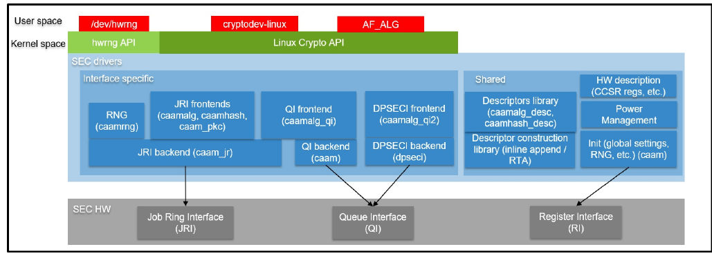

**Figure 25. Linux kernel - tổng quan các device driver SEC**

#### 7.5.15.2 Các file source

Mã nguồn các driver được duy trì trong cây mã nguồn Linux kernel, dưới drivers/crypto/caam. Dưới đây là một danh sách không đầy đủ các file, ánh xạ tới Security Engine (SEC) (một số file đã được bỏ qua vì sự tồn tại của chúng chỉ để phục vụ logic / thiết kế của driver):

| File mã nguồn | Mô tả | Tên module |
|---|---|---|
| ctrl.\[c,h\] | Khởi tạo (thiết lập toàn cục, RNG, quản lý nguồn, v.v.) | caam |
| desc.h | Mô tả HW (các thanh ghi CCSR, v.v.) | N/A |
| desc_constr.h | Inline append - thư viện xây dựng descriptor | N/A |
| caamalg_desc.\[c,h\] | Thư viện descriptor (dùng chung) (mã hóa đối xứng, AEAD) | caamalg_desc |
| caamrng.c | RNG (lúc chạy) | caamrng |
| jr.\[c,h\] | Backend JRI | caam_jr |
| qi.\[c,h\] | Backend QI | caam |
| dpseci.\[c,h\], dpseci_cmd.h | Backend DPSECI | N/A (built-in) |
| caamalg.c | Frontend JRI (mã hóa đối xứng, AEAD) | caamalg |
| caamhash.c | Frontend JRI (hashing) | caamhash |
| caampkc.c, pkc_desc.c | Frontend JRI (mật mã khóa công khai) | caam_pkc |
| caamalg_qi.c | Frontend QI (mã hóa đối xứng, AEAD) | caamalg_qi |
| caamalg_qi2.\[c,h\] | Frontend DPSECI (mã hóa đối xứng, AEAD) | dpaa2_caam |

#### 7.5.15.3 Nạp module

Các device driver CAAM có thể được biên dịch built-in hoặc thành module (ngoại trừ backend DPSECI, vốn luôn là built-in). Xem Section 7.5.15.2 để biết danh sách tên module và Section 7.5.15.4 để biết cấu hình kernel trông như thế nào cùng ánh xạ giữa các mục menu và các module và / hoặc chức năng được bật.

#### 7.5.15.4 Cấu hình kernel

Các device driver CAAM nằm trong submenu "Cryptographic API" -> "Hardware crypto devices" của cấu hình kernel. Tùy platform đích và / hoặc (các) file cấu hình được dùng, output sẽ khác nhau; dưới đây là một ví dụ lấy từ NXP Layerscape SDK cho các platform ARMv8 với các tùy chọn mặc định:

| Tùy chọn Kernel Configure Tree View | Mô tả |
|---|---|
| `Cryptographic API --->`<br>`     [*] Hardware crypto devices`<br>` --->`<br>`     <*> Freescale CAAM-Multicore`<br>` platform driver backend (SEC)`<br>`     [ ] Enable debug output in`<br>` CAAM driver`<br>`     <*> Freescale CAAM Job Ring`<br>` driver backend (SEC)`<br>`     (9) Job Ring size`<br>`     [ ] Job Ring interrupt`<br>` coalescing`<br>`     <*> Register algorithm`<br>` implementations with the Crypto API`<br>`     <*> Queue Interface as`<br>` Crypto API backend`<br>`     <*> Register hash`<br>` algorithm implementations with`<br>` Crypto API`<br>`     <*> Register public key`<br>` cryptography implementations with`<br>` Crypto API`<br>`     <*> Register caam device`<br>` for hwrng API`<br>`     <M> QorIQ DPAA2 CAAM (DPSECI)`<br>` driver` | Bật các CAAM device driver, các option:<br>• platform driver cơ bản: Freescale CAAM-Multicore platform driver backend (SEC); mọi suboption không phải DPAA2 đều phụ thuộc vào nó<br>• backend / interface:<br>– Freescale CAAM Job Ring driver backend (SEC) - JRI; option này cũng bật QI (QI phụ thuộc vào JRI)<br>– QorIQ DPAA2 CAAM (DPSECI) driver - DPSECI<br>• frontend / thuật toán mật mã:<br>– mã hóa đối xứng, AEAD, AEAD "stitched", TLS; Register algorithm implementations with the Crypto API - qua JRI (caamalg driver) hoặc Queue Interface as Crypto API backend - qua QI (caamalg_qi drive)<br>– Register hash algorithm implementations with Crypto API - hashing (chỉ qua JRI - caamhash driver)<br>– Register public key cryptography implementations with Crypto API - bất đối xứng / public key (chỉ qua JRI - caam_pkc driver)<br>– Register caam device for hwrng API - HW RNG (chỉ qua JRI - caamrng driver)<br>– QorIQ DPAA2 CAAM (DPSECI) driver - DPSECI<br>• option: debug, kích thước ring JRI, interrupt coalescing của JRI |
| `Networking support --->`<br>`  Network option --->`<br>`    <*> TCP/IP networking`<br>`    <*> IP: AH transformation`<br>`    <*> IP: ESP transformation`<br>`    <*> IP: IPsec transport mode`<br>`    <*> IP: IPsec tunnel mode` | Để hỗ trợ IPsec, cần bật tùy chọn TCP/IP networking và các tùy chọn con tương ứng. |

#### 7.5.15.5 Device Tree binding

| Property | Kiểu | Trạng thái | Mô tả |
|---|---|---|---|
| compatible | String | Required | fsl,sec-vX.Y (ưu tiên) HOẶC fsl,secX.Y |

#### 7.5.15.6 Ví dụ Device Tree crypto node

```
crypto@30000 {
        compatible = "fsl,sec-v4.0";
        fsl,sec-era = <2>;
        #address-cells = <1>;
        #size-cells = <1>;
        reg = <0x300000 0x10000>;
        ranges = <0 0x300000 0x10000>;
        interrupt-parent = <&mpic>;
        interrupts = <92 2>;
        clocks = <&clks IMX6QDL_CLK_CAAM_MEM>,
                 <&clks IMX6QDL_CLK_CAAM_ACLK>,
                 <&clks IMX6QDL_CLK_CAAM_IPG>,
                 <&clks IMX6QDL_CLK_EIM_SLOW>;
        clock-names = "mem", "aclk", "ipg", "emi_slow";
};
```

**Ghi chú:** Xem file linux/Documentation/devicetree/bindings/crypto/fsl-sec4.txt trong cây Linux kernel để biết thêm thông tin.

#### 7.5.15.7 Cách kiểm thử các driver

Để kiểm thử các driver, trong submenu cấu hình kernel `"Cryptographic API -> Cryptographic algorithm manager"`, bảo đảm các self-test lúc chạy không bị tắt, tức là mục "Disable run-time self tests" không được đặt. (CONFIG_CRYPTO_MANAGER_DISABLE_TESTS=n). Việc này sẽ chạy các test vector chuẩn với các driver sau khi chúng đăng ký các thuật toán được hỗ trợ với kernel crypto API, thường là lúc boot. Sau đó chạy kiểm thử trên hệ thống đích. Dưới đây là một đoạn trích từ boot log của platform LS1046A dựa trên ARMv8, với JRI và QI được bật:

```
[...]
platform caam_qi: Linux CAAM Queue I/F driver initialised
caam 1700000.crypto: Instantiated RNG4 SH1
caam 1700000.crypto: device ID = 0x0a11030100000000 (Era 8)
caam 1700000.crypto: job rings = 4, qi = 1, dpaa2 = no
alg: No test for authenc(hmac(sha224),ecb(cipher_null)) (authenc-hmac-sha224-
ecb-cipher_null-caam)
alg: No test for authenc(hmac(sha256),ecb(cipher_null)) (authenc-hmac-sha256-
ecb-cipher_null-caam)
alg: No test for authenc(hmac(sha384),ecb(cipher_null)) (authenc-hmac-sha384-
ecb-cipher_null-caam)
alg: No test for authenc(hmac(sha512),ecb(cipher_null)) (authenc-hmac-sha512-
ecb-cipher_null-caam)
alg: No test for authenc(hmac(md5),cbc(aes)) (authenc-hmac-md5-cbc-aes-caam)
alg: No test for echainiv(authenc(hmac(md5),cbc(aes))) (echainiv-authenc-hmac-
md5-cbc-aes-caam)
alg: No test for echainiv(authenc(hmac(sha1),cbc(aes))) (echainiv-authenc-hmac-
sha1-cbc-aes-caam)
alg: No test for authenc(hmac(sha224),cbc(aes)) (authenc-hmac-sha224-cbc-aes-
caam)
alg: No test for echainiv(authenc(hmac(sha224),cbc(aes))) (echainiv-authenc-
hmac-sha224-cbc-aes-caam)
alg: No test for echainiv(authenc(hmac(sha256),cbc(aes))) (echainiv-authenc-
hmac-sha256-cbc-aes-caam)
alg: No test for authenc(hmac(sha384),cbc(aes)) (authenc-hmac-sha384-cbc-aes-
caam)
alg: No test for echainiv(authenc(hmac(sha384),cbc(aes))) (echainiv-authenc-
hmac-sha384-cbc-aes-caam)
alg: No test for echainiv(authenc(hmac(sha512),cbc(aes))) (echainiv-authenc-
hmac-sha512-cbc-aes-caam)
alg: No test for authenc(hmac(md5),cbc(des3_ede)) (authenc-hmac-md5-cbc-
des3_ede-caam)
alg: No test for echainiv(authenc(hmac(md5),cbc(des3_ede))) (echainiv-authenc-
hmac-md5-cbc-des3_ede-caam)
alg: No test for echainiv(authenc(hmac(sha1),cbc(des3_ede))) (echainiv-authenc-
hmac-sha1-cbc-des3_ede-caam)
alg: No test for echainiv(authenc(hmac(sha224),cbc(des3_ede))) (echainiv-
authenc-hmac-sha224-cbc-des3_ede-caam)
alg: No test for echainiv(authenc(hmac(sha256),cbc(des3_ede))) (echainiv-
authenc-hmac-sha256-cbc-des3_ede-caam)
alg: No test for echainiv(authenc(hmac(sha384),cbc(des3_ede))) (echainiv-
authenc-hmac-sha384-cbc-des3_ede-caam)
alg: No test for echainiv(authenc(hmac(sha512),cbc(des3_ede))) (echainiv-
authenc-hmac-sha512-cbc-des3_ede-caam)
alg: No test for authenc(hmac(md5),cbc(des)) (authenc-hmac-md5-cbc-des-caam)
alg: No test for echainiv(authenc(hmac(md5),cbc(des))) (echainiv-authenc-hmac-
md5-cbc-des-caam)
alg: No test for echainiv(authenc(hmac(sha1),cbc(des))) (echainiv-authenc-hmac-
sha1-cbc-des-caam)
alg: No test for echainiv(authenc(hmac(sha224),cbc(des))) (echainiv-authenc-
hmac-sha224-cbc-des-caam)
alg: No test for echainiv(authenc(hmac(sha256),cbc(des))) (echainiv-authenc-
hmac-sha256-cbc-des-caam)
alg: No test for echainiv(authenc(hmac(sha384),cbc(des))) (echainiv-authenc-
hmac-sha384-cbc-des-caam)
alg: No test for echainiv(authenc(hmac(sha512),cbc(des))) (echainiv-authenc-
hmac-sha512-cbc-des-caam)
alg: No test for authenc(hmac(md5),rfc3686(ctr(aes))) (authenc-hmac-md5-rfc3686-
ctr-aes-caam)
alg: No test for seqiv(authenc(hmac(md5),rfc3686(ctr(aes)))) (seqiv-authenc-
hmac-md5-rfc3686-ctr-aes-caam)
alg: No test for authenc(hmac(sha1),rfc3686(ctr(aes))) (authenc-hmac-sha1-
rfc3686-ctr-aes-caam)
alg: No test for seqiv(authenc(hmac(sha1),rfc3686(ctr(aes)))) (seqiv-authenc-
hmac-sha1-rfc3686-ctr-aes-caam)
alg: No test for authenc(hmac(sha224),rfc3686(ctr(aes))) (authenc-hmac-sha224-
rfc3686-ctr-aes-caam)
alg: No test for seqiv(authenc(hmac(sha224),rfc3686(ctr(aes)))) (seqiv-authenc-
hmac-sha224-rfc3686-ctr-aes-caam)
alg: No test for authenc(hmac(sha256),rfc3686(ctr(aes))) (authenc-hmac-sha256-
rfc3686-ctr-aes-caam)
alg: No test for seqiv(authenc(hmac(sha256),rfc3686(ctr(aes)))) (seqiv-authenc-
hmac-sha256-rfc3686-ctr-aes-caam)
alg: No test for authenc(hmac(sha384),rfc3686(ctr(aes))) (authenc-hmac-sha384-
rfc3686-ctr-aes-caam)
alg: No test for seqiv(authenc(hmac(sha384),rfc3686(ctr(aes)))) (seqiv-authenc-
hmac-sha384-rfc3686-ctr-aes-caam)
alg: No test for authenc(hmac(sha512),rfc3686(ctr(aes))) (authenc-hmac-sha512-
rfc3686-ctr-aes-caam)
alg: No test for seqiv(authenc(hmac(sha512),rfc3686(ctr(aes)))) (seqiv-authenc-
hmac-sha512-rfc3686-ctr-aes-caam)
caam algorithms registered in /proc/crypto
alg: No test for authenc(hmac(md5),cbc(aes)) (authenc-hmac-md5-cbc-aes-caam-qi)
alg: No test for echainiv(authenc(hmac(md5),cbc(aes))) (echainiv-authenc-hmac-
md5-cbc-aes-caam-qi)
alg: No test for echainiv(authenc(hmac(sha1),cbc(aes))) (echainiv-authenc-hmac-
sha1-cbc-aes-caam-qi)
alg: No test for authenc(hmac(sha224),cbc(aes)) (authenc-hmac-sha224-cbc-aes-
caam-qi)
alg: No test for echainiv(authenc(hmac(sha224),cbc(aes))) (echainiv-authenc-
hmac-sha224-cbc-aes-caam-qi)
alg: No test for echainiv(authenc(hmac(sha256),cbc(aes))) (echainiv-authenc-
hmac-sha256-cbc-aes-caam-qi)
alg: No test for authenc(hmac(sha384),cbc(aes)) (authenc-hmac-sha384-cbc-aes-
caam-qi)
alg: No test for echainiv(authenc(hmac(sha384),cbc(aes))) (echainiv-authenc-
hmac-sha384-cbc-aes-caam-qi)
alg: No test for echainiv(authenc(hmac(sha512),cbc(aes))) (echainiv-authenc-
hmac-sha512-cbc-aes-caam-qi)
alg: No test for authenc(hmac(md5),cbc(des3_ede)) (authenc-hmac-md5-cbc-
des3_ede-caam-qi)
alg: No test for echainiv(authenc(hmac(md5),cbc(des3_ede))) (echainiv-authenc-
hmac-md5-cbc-des3_ede-caam-qi)
alg: No test for echainiv(authenc(hmac(sha1),cbc(des3_ede))) (echainiv-authenc-
hmac-sha1-cbc-des3_ede-caam-qi)
alg: No test for echainiv(authenc(hmac(sha224),cbc(des3_ede))) (echainiv-
authenc-hmac-sha224-cbc-des3_ede-caam-qi)
alg: No test for echainiv(authenc(hmac(sha256),cbc(des3_ede))) (echainiv-
authenc-hmac-sha256-cbc-des3_ede-caam-qi)
alg: No test for echainiv(authenc(hmac(sha384),cbc(des3_ede))) (echainiv-
authenc-hmac-sha384-cbc-des3_ede-caam-qi)
alg: No test for echainiv(authenc(hmac(sha512),cbc(des3_ede))) (echainiv-
authenc-hmac-sha512-cbc-des3_ede-caam-qi)
alg: No test for authenc(hmac(md5),cbc(des)) (authenc-hmac-md5-cbc-des-caam-qi)
alg: No test for echainiv(authenc(hmac(md5),cbc(des))) (echainiv-authenc-hmac-
md5-cbc-des-caam-qi)
alg: No test for echainiv(authenc(hmac(sha1),cbc(des))) (echainiv-authenc-hmac-
sha1-cbc-des-caam-qi)
alg: No test for echainiv(authenc(hmac(sha224),cbc(des))) (echainiv-authenc-
hmac-sha224-cbc-des-caam-qi)
alg: No test for echainiv(authenc(hmac(sha256),cbc(des))) (echainiv-authenc-
hmac-sha256-cbc-desi-caam-qi)
alg: No test for echainiv(authenc(hmac(sha384),cbc(des))) (echainiv-authenc-
hmac-sha384-cbc-des-caam-qi)
alg: No test for echainiv(authenc(hmac(sha512),cbc(des))) (echainiv-authenc-
hmac-sha512-cbc-des-caam-qi)
platform caam_qi: algorithms registered in /proc/crypto
caam_jr 1710000.jr: registering rng-caam
caam 1700000.crypto: caam pkc algorithms registered in /proc/crypto
[...]
```

#### 7.5.15.8 Hỗ trợ thuật toán crypto

**Các thuật toán được hỗ trợ trong scatterlist Crypto API của linux kernel**

Linux kernel có nhiều user của Scatterlist Crypto API, bao gồm bản triển khai IPsec của nó, đôi khi được gọi là NETKEY stack. Vì vậy, driver, sau khi đăng ký các thuật toán được hỗ trợ với Crypto API, được dùng để xử lý các request crypto đối xứng cho từng gói và chuyển chúng tới phần cứng SEC.

Vì phần cứng SEC xử lý request một cách bất đồng bộ, driver đăng ký các bản triển khai thuật toán bất đồng bộ với crypto API: ahash, ablkcipher và aead với CRYPTO_ALG_ASYNC được đặt trong .cra_flags.

Các tổ hợp phiên bản phần cứng và phần mềm driver khác nhau hỗ trợ các tập thuật toán khác nhau, vì vậy tìm tên driver trong /proc/crypto trên hệ thống đích mong muốn sẽ cho báo cáo đúng về những thuật toán được hỗ trợ.

**Các thuật toán Authenticated Encryption with Associated Data (AEAD)**

Các thuật toán này được dùng trong các ứng dụng mà dữ liệu cần mã hóa trùng, hoặc trùng một phần, với dữ liệu cần xác thực, như trường hợp của các giao thức IPsec và TLS. Các thuật toán này được triển khai trong driver sao cho phần cứng chỉ đi qua dữ liệu đầu vào một lần, và cả dữ liệu mã hóa lẫn dữ liệu xác thực được ghi ra đồng thời. Các thuật toán AEAD chủ yếu dùng cho IPsec ESP (tuy nhiên cũng có hỗ trợ mã hóa record layer TLS 1.0).

Các driver CAAM hiện hỗ trợ offload các thuật toán AEAD sau:

- AEAD "stitched": mọi tổ hợp của { NULL, CBC-AES, CBC-DES, CBC-3DES-EDE, RFC3686-CTR-AES } x HMAC-{MD-5, SHA-1,-224,-256,-384,-512}
- AEAD "true": GCM-AES generic, GCM-AES dùng trong IPsec: RFC4543-GCM-AES và RFC4106-GCM-AES
- Mã hóa record layer TLS 1.0 dùng cipher suite AEAD "stitched" CBC-AES-HMAC-SHA1

**Các thuật toán mã hóa**

Driver CAAM hiện hỗ trợ offload các thuật toán mã hóa sau.

**Các thuật toán xác thực**

Hỗ trợ ahash của driver CAAM bao gồm các thuật toán hash có key (hmac) và không có key.

**Các thuật toán bất đối xứng (khóa công khai)**

Hiện tại, RSA là thuật toán khóa công khai duy nhất được hỗ trợ.

**Sinh số ngẫu nhiên**

Driver frontend caamrng hỗ trợ các dịch vụ sinh số ngẫu nhiên qua giao diện hwrng built-in của kernel khi được triển khai trong phần cứng. Để bật:

1. kiểm tra rằng file thiết bị sinh số ngẫu nhiên phần cứng, ví dụ /dev/hwrng hoặc /dev/hwrandom, tồn tại. Nếu nó không tồn tại, tạo nó bằng:

   ```
   $ mknod /dev/hwrng c 10 183
   ```

2. kiểm tra /dev/hwrng không bị chặn vô thời hạn và sinh ra dữ liệu ngẫu nhiên:

   ```
   $ rngtest -C 1000 < /dev/hwrng
   ```

3. kiểm tra kernel nhận được entropy:

   ```
   $ rngtest -C 1000 < /dev/random
   ```

Nếu nó bị chặn, có thể cần chạy một daemon cung cấp entropy cho kernel, chẳng hạn rngd. Xem linux/Documentation/hw_random.txt để biết thêm thông tin.

**Table 51. Các thuật toán được hỗ trợ bởi từng giao diện / backend**

| Tên thuật toán / Backend | Job Ring Interface | Queue Interface | DPSEC Interface |
|---|---|---|---|
| rsa | Có | Không | Không |
| pkcs1pad(rsa, sha\*) | Có | Không | Không |
| tls10(hmac(sha1), cbc(aes)) | Không | Có | Có |
| authenc(hmac(md5), cbc(aes)) | Có (cả echainiv) | Có (cả echainiv) | Có (cả echainiv) |
| authenc(hmac(sha1), cbc(aes)) | Có (cả echainiv) | Có (cả echainiv) | Có (cả echainiv) |
| authenc(hmac(sha224), cbc(aes)) | Có (cả echainiv) | Có (cả echainiv) | Có (cả echainiv) |
| authenc(hmac(sha256), cbc(aes)) | Có (cả echainiv) | Có (cả echainiv) | Có (cả echainiv) |
| authenc(hmac(sha384), cbc(aes)) | Có (cả echainiv) | Có (cả echainiv) | Có (cả echainiv) |
| authenc(hmac(sha512), cbc(aes)) | Có (cả echainiv) | Có (cả echainiv) | Có (cả echainiv) |
| authenc(hmac(md5), cbc(des3_ede)) | Có (cả echainiv) | Có (cả echainiv) | Có (cả echainiv) |
| authenc(hmac(sha1), cbc(des3_ede)) | Có (cả echainiv) | Có (cả echainiv) | Có (cả echainiv) |
| authenc(hmac(sha224), cbc(des3_ede)) | Có (cả echainiv) | Có (cả echainiv) | Có (cả echainiv) |
| authenc(hmac(sha256), cbc(des3_ede)) | Có (cả echainiv) | Có (cả echainiv) | Có (cả echainiv) |
| authenc(hmac(sha384), cbc(des3_ede)) | Có (cả echainiv) | Có (cả echainiv) | Có (cả echainiv) |
| authenc(hmac(sha512), cbc(des3_ede)) | Có (cả echainiv) | Có (cả echainiv) | Có (cả echainiv) |
| authenc(hmac(md5), cbc(des)) | Có (cả echainiv) | Có (cả echainiv) | Có (cả echainiv) |
| authenc(hmac(sha1), cbc(des)) | Có (cả echainiv) | Có (cả echainiv) | Có (cả echainiv) |
| authenc(hmac(sha224), cbc(des)) | Có (cả echainiv) | Có (cả echainiv) | Có (cả echainiv) |
| authenc(hmac(sha256), cbc(des)) | Có (cả echainiv) | Có (cả echainiv) | Có (cả echainiv) |
| authenc(hmac(sha384), cbc(des)) | Có (cả echainiv) | Có (cả echainiv) | Có (cả echainiv) |
| authenc(hmac(sha512), cbc(des)) | Có (cả echainiv) | Có (cả echainiv) | Có (cả echainiv) |
| authenc(hmac(md5), rfc3686(ctr(aes))) | Có (cả seqiv) | Có (cả seqiv) | Có (cả seqiv) |
| authenc(hmac(sha1), rfc3686(ctr(aes))) | Có (cả seqiv) | Có (cả seqiv) | Có (cả seqiv) |
| authenc(hmac(sha224), rfc3686(ctr(aes))) | Có (cả seqiv) | Có (cả seqiv) | Có (cả seqiv) |
| authenc(hmac(sha256), rfc3686(ctr(aes))) | Có (cả seqiv) | Có (cả seqiv) | Có (cả seqiv) |
| authenc(hmac(sha384), rfc3686(ctr(aes))) | Có (cả seqiv) | Có (cả seqiv) | Có (cả seqiv) |
| authenc(hmac(sha512), rfc3686(ctr(aes))) | Có (cả seqiv) | Có (cả seqiv) | Có (cả seqiv) |
| authenc(hmac(md5), ecb(cipher_null)) | Có | Không | Không |
| authenc(hmac(sha1), ecb(cipher_null)) | Có | Không | Không |
| authenc(hmac(sha224), ecb(cipher_null)) | Có | Không | Không |
| authenc(hmac(sha256), ecb(cipher_null)) | Có | Không | Không |
| authenc(hmac(sha384), ecb(cipher_null)) | Có | Không | Không |
| authenc(hmac(sha512), ecb(cipher_null)) | Có | Không | Không |
| rfc7539(chacha20, poly1305) | Có (chỉ LX2160A) | Không | Có (chỉ LX2160A) |
| rfc7539esp(chacha20, poly1305) | Có (chỉ LX2160A) | Không | Có (chỉ LX2160A) |
| gcm(aes) | Có | Có | Có |
| rfc4543(gcm(aes)) | Có | Có | Có |
| rfc4106(gcm(aes)) | Có | Có | Có |
| ecb(aes) | Có | Không | Không |
| ecb(des3_ede) | Có | Không | Không |
| ecb(des) | Có | Không | Không |
| ecb(arc4) | Có | Không | Không |
| cbc(aes) | Có | Có | Có |
| cbc(des3_ede) | Có | Có | Có |
| cbc(des) | Có | Có | Có |
| ctr(aes) | Có | Có | Có |
| rfc3686(ctr(aes)) | Có | Có | Có |
| chacha20 | Không | Không | Có (chỉ LX2160A) |
| xts(aes) | Có | Có | Có |
| cmac(aes) | Có | Không | Không |
| xcbc(aes) | Có | Không | Không |
| hmac(md5) | Có | Không | Có |
| hmac(sha1) | Có | Không | Có |
| hmac(sha224) | Có | Không | Có |
| hmac(sha256) | Có | Không | Có |
| hmac(sha384) | Có | Không | Có |
| hmac(sha512) | Có | Không | Có |
| md5 | Yes | No | Yes |
| sha1 | Yes | No | Yes |
| sha224 | Yes | No | Yes |
| sha256 | Yes | No | Yes |
| sha384 | Yes | No | Yes |
| sha512 | Yes | No | Yes |

#### 7.5.15.9 Các đặc thù của driver backend CAAM Job Ring

Driver backend CAAM Job Ring (caam_jr) triển khai và sử dụng giao diện job ring (JRI) để gửi các request dịch vụ crypto API từ các driver frontend (caamalg, caamhash, caam_pkc, caamrng) tới engine CAAM.

Các driver CAAM có một vài tùy chọn, đáng chú ý nhất là kích thước job ring phần cứng và interrupt coalescing. Chúng có thể được dùng để tinh chỉnh hiệu năng cho một trường hợp sử dụng cụ thể.

Tùy chọn Freescale CAAM-Multicore platform driver backend bật platform driver cơ bản (caam). Mọi tùy chọn con (không phải DPAA2) đều phụ thuộc vào tùy chọn này.

Tùy chọn Freescale CAAM Job Ring driver backend (SEC) bật backend Job Ring (caam_jr).

Tùy chọn con Job Ring Size cho phép người dùng chọn kích thước của các job ring phần cứng; nếu các request đến entry point enqueue của driver theo từng đợt dồn dập, có thể ước lượng độ dài tối đa của các đợt, v.v. Có thể đặt độ dài đợt lớn nhất để tiết kiệm hiệu năng và mức tiêu thụ bộ nhớ.

Tùy chọn con Job Ring interrupt coalescing cho phép người dùng chọn việc dùng tính năng interrupt coalescing của phần cứng. Lưu ý rằng driver đã thực hiện IRQ coalescing bằng phần mềm, và các benchmark zero-loss thực tế đã cho kết quả tốt hơn khi tắt tùy chọn này. Nếu được chọn, hai tùy chọn bổ sung có hiệu lực:

- Ngưỡng đếm Job Ring interrupt coalescing (CRYPTO_DEV_FSL_CAAM_INTC_THLD)

  Chọn giá trị ngưỡng số descriptor hoàn tất, trong khoảng 1-256. Chọn 1 thực chất vô hiệu hóa tính năng coalescing, và bất kỳ giá trị nào bằng hoặc lớn hơn kích thước ring đã chọn sẽ buộc timeout cho mỗi interrupt.

- Ngưỡng timer Job Ring interrupt coalescing (CRYPTO_DEV_FSL_CAAM_INTC_TIME_THLD)

  Chọn giá trị ngưỡng timeout hoàn tất tính theo bội số của 64 clock giao diện SEC; nếu không có descriptor mới nào hoàn tất trong cửa sổ này (và có ít nhất một job đã hoàn tất đang chờ), thì một interrupt sẽ xảy ra. Giá trị này chọn được trong khoảng 1-65535.

Các tùy chọn đăng ký với Crypto API, hwrng API tương ứng, cho phép các driver frontend đăng ký khả năng thuật toán của chúng với các API tương ứng. Chỉ nên bỏ chọn chúng khi mục đích là thực hiện các request Crypto API bằng phần mềm (trên các GPP) thay vì offload chúng lên engine SEC.

Frontend caamhash (các thuật toán hash) có thể được tắt riêng, vì bản chất của ứng dụng có thể khiến nó ưa độ trễ crypto bằng phần mềm (core) hơn do có nhiều request kích thước nhỏ.

Frontend caam_pkc (các thuật toán khóa công khai / bất đối xứng) cũng có thể được tắt nếu cần.

Frontend caamrng (Random Number Generation) có thể được tắt trong trường hợp kernel có sẵn một nguồn entropy khác.

#### 7.5.15.10 Kiểm chứng hoạt động và tính đúng đắn của driver

Ngoài việc ghi nhận các lợi thế hiệu năng nhờ offload crypto, ta cũng có thể bảo đảm phần cứng đang làm crypto bằng cách tìm các thông báo của driver trong dmesg.

Driver phát ra các thông báo console lúc khởi tạo:

`caam algorithms registered in /proc/crypto`

`caam_jr 1710000.jr: registering rng-caam`

`caam 1700000.crypto: caam pkc algorithms registered in /proc/crypto`

Nếu các thông báo không có trong log, thì hoặc driver không được cấu hình trong kernel, hoặc không có device tree node tương thích SEC trong device tree.

#### 7.5.15.11 IRQ tăng dần trong /proc/interrupts

Trong một khoảng thời gian có các request crypto được thực hiện, phần cứng SEC sẽ phát các interrupt thông báo hoàn tất trên Job Ring tương ứng:

`$ cat /proc/interrupts | grep jr`

`CPU0 CPU1 CPU2 CPU3`

`[...]`

`78: 1007 0 0 0 GICv2 103 Level 1710000.jr`

`79: 7 0 0 0 GICv2 104 Level 1720000.jr`

`80: 0 0 0 0 GICv2 105 Level 1730000.jr`

`81: 0 0 0 0 GICv2 106 Level 1740000.jr`

Nếu số interrupt đã phát tăng lên, thì phần cứng đang được dùng để làm crypto.

Nếu các con số không tăng, trước tiên hãy kiểm tra thuật toán đang được chạy có được driver hỗ trợ không. Nếu thuật toán được hỗ trợ, có khả năng driver đang ở chế độ polling (cơ chế NAPI) và nên theo dõi các thống kê phần cứng trong debugfs (số byte inbound / outbound được mã hóa / bảo vệ - xem bên dưới).

#### 7.5.15.12 Kiểm chứng các trường 'self test' ghi 'passed' trong /proc/crypto

Một mục như mục dưới đây có nghĩa là driver đã đăng ký thành công hỗ trợ cho thuật toán với kernel crypto API:

```
name : cbc(aes) driver : cbc-aes-caam module : kernel priority : 3000 refcnt : 1
 selftest : passed internal : no type : givcipher async : yes blocksize : 16 min
 keysize : 16 max keysize : 32 ivsize : 16 geniv : <built-in>
```

Lưu ý rằng dù có thể không có test vector cho một thuật toán cụ thể mà driver hỗ trợ, kernel sẽ phát thông báo cho biết những thuật toán nào chưa được kiểm thử, và vẫn đánh dấu chúng là 'passed':

```
[...]
alg: No test for authenc(hmac(sha224),ecb(cipher_null)) (authenc-hmac-sha224-
ecb-cipher_null-caam)
alg: No test for authenc(hmac(sha256),ecb(cipher_null)) (authenc-hmac-sha256-
ecb-cipher_null-caam)
[...]
alg: No test for authenc(hmac(md5),cbc(aes)) (authenc-hmac-md5-cbc-aes-caam)
alg: No test for echainiv(authenc(hmac(md5),cbc(aes))) (echainiv-authenc-hmac-
md5-cbc-aes-caam)
alg: No test for echainiv(authenc(hmac(sha1),cbc(aes))) (echainiv-authenc-hmac-
sha1-cbc-aes-caam)
[...]
alg: No test for authenc(hmac(sha512),rfc3686(ctr(aes))) (authenc-hmac-sha512-
rfc3686-ctr-aes-caam)
alg: No test for seqiv(authenc(hmac(sha512),rfc3686(ctr(aes)))) (seqiv-authenc-
hmac-sha512-rfc3686-ctr-aes-caam)
[...]
```

#### 7.5.15.13 Xem xét các thanh ghi thống kê phần cứng trong debugfs

Khi dùng backend JRI hoặc QI, có thể kiểm tra các thanh ghi performance monitor, với điều kiện

CONFIG_DEBUG_FS được bật trong cấu hình kernel. Nếu debugfs không được tự động mount lúc boot, thì phải mount thủ công để xem các thanh ghi này. Việc này thường có thể làm bằng một lệnh shell superuser:

```
$ mount -t debugfs none /sys/kernel/debug
```

Sau khi xong, người dùng có thể đọc các thanh ghi bộ điều khiển trong /sys/kernel/debug/1700000.crypto/ctl. Cần lưu ý rằng debugfs sẽ cung cấp dạng xem số nguyên thập phân cho hầu hết các thanh ghi truy cập được, ngoại trừ các thanh ghi KEK/TDSK/TKEK; các thanh ghi đó là các mảng nhị phân dài, và nên được lọc qua một tiện ích dump nhị phân như hexdump.

Cụ thể, các thanh ghi thống kê phần cứng CAAM có sẵn là:

fault_addr, hay FAR (Fault Address Register): giữ giá trị của địa chỉ vật lý nơi xảy ra lỗi đọc hoặc ghi.

fault_detail, hay FADR (Fault Address Detail Register): giữ chi tiết về giao dịch bus nơi xảy ra lỗi.

fault_status, hay CSTA (CAAM Status Register): giữ thông tin trạng thái liên quan đến toàn bộ khối CAAM.

ib_bytes_decrypted: giữ nội dung của PC_IB_DECRYPT (Performance Counter Inbound Bytes Decrypted Register)

ib_bytes_validated: giữ nội dung của PC_IB_VALIDATED (Performance Counter Inbound Bytes Validated Register)

ib_rq_decrypted: giữ nội dung của PC_IB_DEC_REQ (Performance Counter Inbound Decrypt Requests Register)

kek: giữ nội dung của JDKEKR (Job Descriptor Key Encryption Key Register)

ob_bytes_encrypted: giữ nội dung của PC_OB_ENCRYPT (Performance Counter Outbound Bytes Encrypted Register)

ob_bytes_protected: giữ nội dung của PC_OB_PROTECT (Performance Counter Outbound Bytes Protected Register)

ob_rq_encrypted: giữ nội dung của PC_OB_ENC_REQ (Performance Counter Outbound Encrypt Requests Register)

rq_dequeued: giữ nội dung của PC_REQ_DEQ (Performance Counter Requests Dequeued Register)

tdsk: giữ nội dung của TDKEKR (Trusted Descriptor Key Encryption Key Register)

tkek: giữ nội dung của TDSKR (Trusted Descriptor Signing Key Register)

Để biết thêm thông tin, xem mục "Performance Counter, Fault and Version ID Registers" trong Security (SEC) Reference Manual (SECRM) của từng SoC (có trên website của công ty).

Ghi chú: với backend QI còn có qi_congested: counter dựa trên SW cho biết bao nhiêu lần các queue đi tới / từ CAAM tới QMan chạm ngưỡng tắc nghẽn.

#### 7.5.15.14 Cấu hình kernel để hỗ trợ các device driver CAAM

**Sử dụng driver**

Khi đã được bật, driver sẽ chuyển các request kernel crypto API tới phần cứng SEC để xử lý.

**Chạy IPsec**

IPsec stack built-in trong kernel (thường được gọi là NETKEY) sẽ tự động dùng các driver crypto để offload các thao tác crypto lên phần cứng SEC. Tài liệu về cách thiết lập IPsec tunnel có thể tìm trong các gói bộ IPsec mã nguồn mở tương ứng, ví dụ strongswan.org, openswan, setkey, v.v. Mục riêng cho DPAA2 có một script trợ giúp chung để cấu hình IPsec tunnel.

**Chạy OpenSSL**

Xem Hardware Offloading with OpenSSL để biết thêm chi tiết về cách offload các thao tác mật mã OpenSSL lên crypto engine SEC (qua cryptodev).

**Thực thi descriptor tùy biến**

Các driver SEC có các giao diện gửi descriptor công khai tương ứng với các backend sau:

- JRI: drivers/crypto/caam/jr.c:caam_jr_enqueue()
- QI: drivers/crypto/caam/qi.c:caam_qi_enqueue()
- DPSECI: drivers/crypto/caam/caamalg_qi2.c:dpaa2_caam_enqueue()

**caam_jr_enqueue()**

Tên

caam_jr_enqueue — Enqueue một job descriptor head. Trả về 0 nếu OK, -EBUSY nếu ring đầy, -EIO nếu không thể map descriptor của bên gọi.

Synopsis

```
int caam_jr_enqueue (struct device *dev, u32 *desc,
 void (*cbk) (struct device *dev, u32 *desc, u32 status, void *areq),
 void *areq);
```

Đối số

dev: chứa thiết bị job ring sẽ xử lý request này.

desc: descriptor đã khởi tạo request, giống như “desc” được truyền làm đối số cho caam_jr_enqueue.

cbk: con trỏ tới một hàm callback sẽ được gọi khi request này hoàn tất. Hàm có dạng: callback(struct device \*dev, u32 \*desc, u32 stat, void \*arg)

areq: con trỏ tùy chọn tới một đối số của user để dùng lúc callback.

**caam_qi_enqueue()**

Tên

caam_qi_enqueue — Enqueue một frame descriptor (FD) vào một frame queue của QMan. Trả về 0 nếu OK, -EIO nếu không thể map mảng S/G của bên gọi, -EBUSY nếu driver QMan không enqueue được FD vì lý do nào đó.

Synopsis

```
int caam_qi_enqueue(struct device *qidev, struct caam_drv_req *req);
```

Đối số

qidev: chứa thiết bị queue interface sẽ xử lý request này.

req: con trỏ tới cấu trúc request mà ứng dụng driver phải điền khi gửi một job tới driver, chứa một hàm callback và tham số của nó, các S/G của Queue Manager cho đầu vào và đầu ra, một cấu trúc theo từng context chứa shared descriptor của CAAM, v.v.

**dpaa2_caam_enqueue()**

Tên

dpaa2_caam_enqueue — Enqueue một frame descriptor (FD) vào một frame queue của QMan. Trả về 0 nếu OK, - EBUSY nếu driver QMan không enqueue được FD vì lý do nào đó hoặc nếu phát hiện tắc nghẽn.

Synopsis

```
int dpaa2_caam_enqueue(struct device *dev, struct caam_request *req);
```

Đối số

dev: thiết bị DPSECI.

req: con trỏ tới cấu trúc request mà ứng dụng driver phải điền khi gửi một job tới driver, chứa một hàm callback và tham số của nó, các S/G của Queue Manager cho đầu vào và đầu ra, một cấu trúc theo từng context chứa shared descriptor của CAAM, v.v.

Tham khảo mã nguồn để xem các ví dụ sử dụng.

#### 7.5.15.15 Tài liệu hỗ trợ

Phần mềm riêng cho DPAA1: Section 8.2.7

Phần mềm riêng cho DPAA2: Section 8.3.2.6

### 7.5.16 Time Division Multiplexing (TDM)

#### 7.5.16.1 Mô tả

Time Division Multiplexing (TDM) là một loại ghép kênh số hoặc tương tự trong đó hai hay nhiều tín hiệu hoặc luồng bit được truyền dường như đồng thời dưới dạng các kênh con trong một kênh truyền thông, nhưng về mặt vật lý chúng lần lượt chiếm kênh. Miền thời gian được chia thành nhiều timeslot lặp lại có độ dài cố định, mỗi timeslot cho một kênh con. Một byte mẫu hoặc khối dữ liệu của kênh con 1 được truyền trong timeslot 1, kênh con 2 trong timeslot 2, v.v. Một frame TDM gồm một timeslot cho mỗi kênh con. Sau kênh con cuối cùng, chu kỳ bắt đầu lại từ đầu với một frame mới, bắt đầu với mẫu, byte hoặc khối dữ liệu thứ hai từ kênh con 1, v.v.

TDM hay Time Division Multiplexing là một thành phần thiết yếu để chạy các ứng dụng VoIP trên các platform NXP. Chức năng của nó là nhận và gửi các mẫu thoại đã ghép kênh phân chia theo thời gian trên các đường TDM vật lý.

Tài liệu này giải thích quy trình kiểm thử TDM trên các platform FSL MPC85xx.

Quy trình kiểm thử cho thấy cách chạy một ứng dụng demo TDM nhỏ truyền thoại từ một kênh TDM sang kênh kia.

Toàn bộ software stack TDM và luồng dữ liệu được mô tả dưới đây. Ở trên cùng là một lớp framework TDM chung, về lý tưởng có thể tích hợp với bất kỳ driver TDM nào bên dưới nó.

Nói chung các platform NXP cung cấp hai loại giao diện TDM:

1. NXP TDM
2. TDM dựa trên QE

Tài liệu này nói cụ thể về NXP TDM

#### 7.5.16.2 Cấu hình U-Boot

**Các tùy chọn lúc compile**

Kiểm tra tài liệu riêng của platform để xem có cần cấu hình U-Boot cụ thể nào cho tính năng TDM không.

Cũng cần bảo đảm có yêu cầu nào về pin mux để bật TDM không.

**Các tùy chọn lúc chạy**

Tham khảo tài liệu riêng của platform để biết các biến hwconfig hoặc biến môi trường cụ thể có thể cần cho chức năng TDM.

Ngoài ra, vị trí các cổng FXS sẽ được nêu trong tài liệu riêng của platform.

#### 7.5.16.3 Tùy chọn cấu hình kernel

**Tree View**

Dưới đây là các tùy chọn cấu hình cần đặt/bỏ khi chạy "make menuconfig" cho kernel

| Tùy chọn Kernel Configure Tree View | Mô tả |
|---|---|
| `Device Drivers --->`<br>`      <*> TDM support --->`<br>`                --- TDM support`<br>`                [ ] TDM Core debugging`<br>` messages (NEW)`<br>`                <M> TDM test Module`<br>`                    TDM Device support`<br>`  --->`<br>`                          <*> Driver`<br>` for Freescale TDM controller`<br>`                    Line Control`<br>` Devices --->`<br>`                          <*> Zarlink`<br>` Slic intialization Module` | Bật TDM Framework<br>Bật TDM test dạng Module<br>Bật TDM driver<br>Bật SLIC driver |

**Identifier**

Dưới đây là các identifier cấu hình được dùng trong source code kernel và các file cấu hình mặc định.

| Tùy chọn | Giá trị | Giá trị mặc định trong BSP | Mô tả |
|---|---|---|---|
| CONFIG_TDM | y/n/m | N | Bật / tắt hỗ trợ TDM Framework |
| CONFIG_TDM_FSL | y/n/m | N | Bật / tắt TDM driver, phụ thuộc vào TDM framework và CONFIG_FSL_SOC |
| CONFIG_SLIC_ZARLINK | y/n/m | N | Bật / tắt SLIC driver, phụ thuộc vào TDM driver, TDM framework và CONFIG_FSL_ESPI |
| CONFIG_TDM_TEST | y/n/m | N | Bật / tắt TDM test module |

| Tùy chọn | Giá trị | Giá trị mặc định trong BSP | Mô tả |
|---|---|---|---|
| CONFIG_TDM | y/n/m | N | Bật / tắt hỗ trợ TDM Framework |
| CONFIG_TDM_FSL | y/n/m | N | Bật / tắt TDM driver, phụ thuộc vào TDM framework và CONFIG_FSL_SOC |
| CONFIG_SLIC_ZARLINK | y/n/m | N | Bật / tắt SLIC driver, phụ thuộc vào TDM driver, TDM framework và CONFIG_FSL_ESPI |
| CONFIG_TDM_TEST | y/n/m | N | Bật / tắt TDM test module |

#### 7.5.16.4 Device Tree Binding

Dưới đây là định nghĩa device tree node mà tính năng này cần

**Các mục dts của thiết bị TDM. (số mục bằng số bộ điều khiển TDM trên platform)**

| Property | Kiểu | Trạng thái | Mô tả |
|---|---|---|---|
| compatible = "fsl,tdm1.0"; | \<string> |   | Phải chứa "fsl,tdm1.0" |
| reg = <0x16000 0x200 0x2c000 0x2000>; | \<tdm-reg-offset tdm-reg-size dmac-reg-offset dmac-reg-size> |   | Offset và độ dài của tập thanh ghi cho NXP TDM và TDM-DMAC |
| interrupts = <16 8 62 8>; | \<tdm-err-intr tdm-err-intr-type dmac-intr dmac-intr-type> |   | Định nghĩa hai interrupt specifier, cụ thể là interrupt + số hiệu và loại interrupt cho TDM error và TDM DMAC |
| fsl-max-time-slots = <128> | \<u32> |   | Số time slot 8-bit tối đa trong một frame TDM mà phần cứng hỗ trợ. |

**Các mục dts của thiết bị SLIC (số mục bằng số SLIC trên platform)**

Lưu ý rằng mục SLIC được nêu dưới đây là cho Legerity SLIC kết nối với chip qua giao diện SPI.

| Property | Kiểu | Trạng thái | Mô tả |
|---|---|---|---|
| compatible = "zarlink,le88266"; |   |   | Phải là "zarlink,le88266" |
| reg = <1>; |   |   | Số chip select của bus SPI mà SLIC được kết nối |
| spi-max-frequency =<8000000>; |   |   | Tần số tối đa mà SLIC có thể hoạt động. |

Dưới đây là một ví dụ device tree node mà tính năng này cần. Lưu ý rằng nó có thể khác nhau giữa các platform.

```
       tdm@16000 {
               compatible = "fsl,tdm1.0";
               reg = <0x16000 0x200 0x2c000 0x2000>;
               clock-frequency = <0>;
               interrupts = <16 8 62 8>;
               phy-handle = <zarlink1>
               fsl-max-time-slots = <128>
       };
spi@7000 {
    cell-index = <0>;
    #address-cells = <1>;
    #size-cells = <0>;
    compatible = "fsl,espi";
    reg = <0x7000 0x1000>;
    interrupts = <59 0x2>;
    interrupt-parent = <&mpic>;
    mode = "cpu";
            ………….
            …………..
            …………..
               legerity@0{
                       compatible = "zarlink,le88266";
                       reg = <1>;
                       spi-max-frequency = <8000000>;
               };
               legerity@1{
                       compatible = "zarlink,le88266";
                       reg = <2>;
                       spi-max-frequency = <8000000>;
               };
};
```

#### 7.5.16.5 Các file source

Các file source sau liên quan đến tính năng này trong Linux kernel.

| File mã nguồn | Mục đích |
|---|---|
| include/linux/tdm.h | File header cho TDM framework |
| drivers/tdm/tdm-core.c | File mã nguồn cho TDM framework |
| drivers/tdm/device/tdm_fsl.h | File header của TDM driver |
| drivers/tdm/device/tdm_fsl.c | File source của TDM driver |
| drivers/tdm/line_ctrl/slic_zarlink.h | File header của SLIC driver |
| drivers/tdm/line_ctrl/slic_zarlink.c | File source của SLIC driver |
| drivers/tdm/test/tdm_test.c | File mã nguồn cho module kiểm thử TDM |

#### 7.5.16.6 Kiểm chứng trong U-Boot

N/A

#### 7.5.16.7 Kiểm chứng trong Linux

1. Gắn hai điện thoại analog vào hai cổng FXS của board. (Trong trường hợp có hai thiết bị SLIC thì sẽ có 4 cổng FXS).

   **Ghi chú:** Tham khảo tài liệu của platform để biết thông tin cụ thể về các cổng FXS.

2. Khởi động platform với kernel image và dts được cấu hình như đã giải thích ở trên.

   Tìm các thông báo được nêu dưới đây trong kernel boot log.

   Việc này sẽ bảo đảm TDM và SLIC đã được khởi tạo.

   ```
   ...
   ...
   EDAC MC: Ver: 2.1.0
   fsl_tdm: Freescale TDM Driver Adapter:Init
   adapter [fsl_tdm] registered
   SLIC: Freescale DEVELOPED ZARLINK SLIC DRIVER
   ####################################################
   # This driver was created solely by Freescale,     #
   # without the assistance, support or intellectual  #
   # property of Zarlink Semiconductor. No            #
   # maintenance or support will be provided by       #
   # Zarlink  Semiconductor regarding this driver.    #
   ####################################################
   SLIC probed!
   SLIC config success
   SLIC: product code 1 read is  4
   SLIC: product code 2 read is  b3
   SLIC: config read is  ff
   SLIC: config read is  8a
   DEV reg is 82
   DEV reg after is 2
   Mask reg before setting is 3f bf
   Mask reg after setting is f6 f6
   Read Tx Timeslot for CH1 is 0
   Read Tx Timeslot for CH2 is 2
   Read Rx Timeslot for CH1 is 0
   Read Rx Timeslot for CH2 is 2
   Operating Fun for channel 1 is 82
   Cadence Timer Reg for CH1 before is 7 ff0 0
   Cadence Timer Reg for CH1 after is 1 903 20
   Switching control for channel 1 is 20
   Operating Fun for channel 2 is a0
   Cadence Timer Reg for CH2 before is 7 ff0 0
   Cadence Timer Reg for CH2 after is 1 903 20
   Switching control for channel 2 is 20
   SLIC 1 configuration success
   TDM_TEST: Test Module for Freescale Platforms with TDM support
   TDM_TEST module installed
   ...
   ...
   ```

3. Kiểm tra /proc/device-tree/soc để tìm các node tdm và slic.
4. Chạy cat /proc/interrupts để kiểm tra các interrupt TDM. Sau đây là một log ví dụ, chi tiết có thể khác nhau trên các platform khác nhau.

   ```
   [root@ /root]# insmod tdm_test.ko
   TDM_TEST: Test Module for Freescale Platforms with TDM support
   TDM Driver(ID=1)is attached with Adapterfsl_tdm(ID = 0) drv_count=1
   TDM_TEST module installed
   [root@ /root]# cat /proc/interrupts
              CPU0
    20:          0   OpenPIC   Level     fsldma-chan
    21:          0   OpenPIC   Level     fsldma-chan
    22:          0   OpenPIC   Level     fsldma-chan
    23:          0   OpenPIC   Level     fsldma-chan
    28:          0   OpenPIC   Level     ehci_hcd:usb1
    42:         57   OpenPIC   Level     serial
    43:          0   OpenPIC   Level     i2c-mpc, i2c-mpc
    59:          0   OpenPIC   Level     fsl_espi
    62:        993   OpenPIC   Edge      dmac_done_isr
   LOC:        698   Local timer interrupts
   SPU:          0   Spurious interrupts
   CNT:          0   Performance monitoring interrupts
   MCE:          0   Machine check exceptions
   ```

5. Để kiểm thử chức năng TDM, nhấc cả hai điện thoại lên. Bất cứ điều gì nói ở điện thoại này sẽ được nghe ở điện thoại kia.

#### 7.5.16.8 Benchmarking

Giọng nói phải nghe rõ và không bị đứt quãng.

#### 7.5.16.9 Lỗi đã biết, giới hạn hoặc vấn đề kỹ thuật

1. Chức năng TDM không được hỗ trợ ở chế độ địa chỉ vật lý 36bit. Đó là do giới hạn phần cứng trên các platform FSL hiện tại.
2. TDM_TEST chỉ dùng cho mục đích demo và vì vậy chỉ chạy trong một khoảng thời gian ngắn.

### 7.5.17 Các giao diện Universal Serial Bus

Xem bảng dưới đây để biết các bộ điều khiển USB có trên các SoC:

| SoC | Số bộ điều khiển USB 3.0 | Số bộ điều khiển USB 2.0 |
|---|---|---|
| LS1012A | 1 | 1 |
| LS1021A | 1 | 1 |
| LS1028A | 2 | 0 |
| LS1043A | 3 | 0 |
| LS1046A | 3 | 0 |
| LS1088A | 2 | 0 |
| LS2088A | 2 | 0 |
| LX2160A | 2 | 0 |

Các USB node điển hình trên device tree:

- Bộ điều khiển USB 3.0

  ```
  usb0: usb3@3100000 {
                                               compatible = "snps,dwc3";
                                               reg = <0x0 0x3100000 0x0 0x10000>;
                                               interrupts = <0 80
   IRQ_TYPE_LEVEL_HIGH>;
                                               dr_mode = "host";
                                               snps,quirk-frame-length-adjustment
   = <0x20>;
                                               snps,dis_rxdet_inp3_quirk;
                                               status = "disabled";
                                               snps,incr-burst-type-adjustment =
   <1>, <4>, <8>, <16>;
                                };
  ```

- Bộ điều khiển USB 2.0

  ```
  usb1: usb2@8600000 {
                                               compatible = "fsl-usb2-dr-v2.5",
   "fsl-usb2-dr";
                                               reg = <0x0 0x8600000 0x0 0x1000>;
                                               interrupts = <0 139 0x4>;
                                               dr_mode = "host";
                                               phy_type = "ulpi";
                                };
  ```

#### 7.5.17.1 Bộ điều khiển USB 3.0 (DesignWare USB3)

##### 7.5.17.1.1 Mô tả

Driver của U-Boot và Linux kernel hỗ trợ bộ điều khiển DWC3 USB 3.0 Dual-Role-Device (DRD).

##### 7.5.17.1.2 U-Boot

**Chế độ host**

Với cấu hình mặc định của Layerscape LDP, chế độ host đã sẵn sàng để dùng; dưới đây là các file CONFIG liên quan cần chọn.

##### 7.5.17.1.3 Các tùy chọn Configure Tree View

| Các tùy chọn Configure Tree View | Mô tả |
|---|---|
| `U-Boot-->`<br>`  USB support -->`<br>`  [*] Enable driver model for USB`<br>`  [*] xHCI HCD (USB 3.0) support`<br>`  [*] Designware USB3 DRD Core`<br>` Support`<br>`  …`<br>`  [*] Support for NXP Layerscape`<br>` on-chip xHCI USB controller`<br>`  …`<br>`  [*] USB Mass Storage support` | Bật hỗ trợ USB host controller |

Device Tree (lấy arch/arm/dts/fsl-ls1012a.dtsi làm ví dụ)

```
usb1: usb3@2f00000 {
           compatible = "fsl,layerscape-dwc3";
           reg = <0x0 0x2f00000 0x0 0x10000>;
           interrupts = <0 61 0x4>;
           dr_mode = "host";
       };
```

##### 7.5.17.1.4 Các file source

Source của driver được duy trì trong cây source Linux kernel.

| File source | Mô tả |
|---|---|
| drivers/usb/host/xhci.c | Stack bộ điều khiển USB HOST xHCI |
| drivers/usb/host/xhci-fsl.c | Driver FSL USB HOST xHCI Controller, dựa trên driver dwc3 |
| drivers/usb/host/xhci-dwc3.c | Driver DWC3 controller |
| drivers/usb/host/usb-uclass.c | Driver USB host |
| common/usb.c | Driver USB chung |
| common/usb_hub.c | Driver USB hub |
| cmd/usb.c | Hỗ trợ command-line USB |

**Kiểm chứng**

- Enumeration
  - Cắm ổ USB.
  - Khởi động board RDB vào console U-Boot, gõ các lệnh dưới đây để quét các thiết bị USB

    =USB

  ```
  => usb start
  starting USB...
  USB0:   Register 200017f NbrPorts 2
  Starting the controller
  USB XHCI 1.00
  scanning bus 0 for devices... 2 USB Device(s) found
         scanning usb for storage devices... 1 Storage Device(s) found
  => usb treed
  USB device tree:
    1  Hub (5 Gb/s, 0mA)
    |  U-Boot XHCI Host Controller
    |
    +-2  Mass Storage (5 Gb/s, 224mA)
         SanDisk Extreme 4C530001060207103322
  => usb info
  1: Hub,  USB Revision 3.0
   - U-Boot XHCI Host Controller
   - Class: Hub
   - PacketSize: 512  Configurations: 1
   - Vendor: 0x0000  Product 0x0000 Version 1.0
     Configuration: 1
     - Interfaces: 1 Self Powered 0mA
       Interface: 0
       - Alternate Setting 0, Endpoints: 1
       - Class Hub
       - Endpoint 1 In Interrupt MaxPacket 8 Interval 255ms
  2: Mass Storage,  USB Revision 3.0
   - SanDisk Extreme 4C530001060207103322
   - Class: (from Interface) Mass Storage
   - PacketSize: 512  Configurations: 1
   - Vendor: 0x0781  Product 0x558b Version 1.0
     Configuration: 1
     - Interfaces: 1 Bus Powered 224mA
       Interface: 0
       - Alternate Setting 0, Endpoints: 2
       - Class Mass Storage, Transp. SCSI, Bulk only
       - Endpoint 1 In Bulk MaxPacket 1024
       - Endpoint 2 Out Bulk MaxPacket 1024
  ```

##### 7.5.17.1.5 Đọc ghi thiết bị Mass Storage

```
=> md a0000000
a0000000: feffe7fd f3bfffff dfffefff bff77bf2    .............{..
a0000010: efefffee 7b7f33ff 7dffef7c 7effff77    .....3.{|..}w..~
a0000020: fdaefccf 737fffbf 75ffffdf febfbffa    .......s...u....
a0000030: 7fccff4f f3ff7ffb fee6fcfc bffb3ff7    O............?..
a0000040: dfdebfcc 37bf7b37 ffefdfcc 3337fff3    ....7{.7......73
a0000050: ffeddeee 737333b7 fbefefdf fbf3f7f3    .....3ss........
a0000060: defcfffe f7bff7fb ffdfffce 3bbf77ff    .............w.;
a0000070: dfcffbef b3fb7fb6 e2dfeede b7b3bff7    ................
a0000080: feffbfec 73bf3fb3 dffaceff 3bb6b773    .....?.s....s..;
a0000090: fdcffece 7bbfbf7b fdeefdfc f3eff7f7    ....{..{........
a00000a0: dfecdffe fb3733b7 d9deffdf 737f37bf    .....37......7.s
a00000b0: c76effde faf3bb3f deffdeeb 2f7fb37b    ..n.?.......{../
a00000c0: fffcef5b 7bf333bf fedffefe 773f7377    [....3.{....ws?w
a00000d0: fbfdfdfd f7bb73f7 ffffeddd ff37bf3e    .....s......>.7.
a00000e0: dfd9fecc 3f77fbb3 77cfdeee b3f77f73    ......w?...ws...
a00000f0: cfecffde bfff33fb ffe6ffdf fb73337f    .....3.......3s.
=> mw a0000000 ffffaaaa 100
=> md a0000000
a0000000: ffffaaaa ffffaaaa ffffaaaa ffffaaaa    ................
a0000010: ffffaaaa ffffaaaa ffffaaaa ffffaaaa    ................
a0000020: ffffaaaa ffffaaaa ffffaaaa ffffaaaa    ................
a0000030: ffffaaaa ffffaaaa ffffaaaa ffffaaaa    ................
a0000040: ffffaaaa ffffaaaa ffffaaaa ffffaaaa    ................
a0000050: ffffaaaa ffffaaaa ffffaaaa ffffaaaa    ................
a0000060: ffffaaaa ffffaaaa ffffaaaa ffffaaaa    ................
a0000070: ffffaaaa ffffaaaa ffffaaaa ffffaaaa    ................
a0000080: ffffaaaa ffffaaaa ffffaaaa ffffaaaa    ................
a0000090: ffffaaaa ffffaaaa ffffaaaa ffffaaaa    ................
a00000a0: ffffaaaa ffffaaaa ffffaaaa ffffaaaa    ................
a00000b0: ffffaaaa ffffaaaa ffffaaaa ffffaaaa    ................
a00000c0: ffffaaaa ffffaaaa ffffaaaa ffffaaaa    ................
a00000d0: ffffaaaa ffffaaaa ffffaaaa ffffaaaa    ................
a00000e0: ffffaaaa ffffaaaa ffffaaaa ffffaaaa    ................
a00000f0: ffffaaaa ffffaaaa ffffaaaa ffffaaaa    ................
=> usb write a0000000 0 100
usb write: device 0 block # 0, count 256 ... 256 blocks written: OK
=> md b0000000
b0000000: 77fdff79 c97cefdb a7dfffb3 fffeddff    y..w..|.........
b0000010: fb9ff7f3 fdfeedef febf7db9 cffbccef    .........}......
b0000020: ff7ebf7b fd6efffa 5efbbfbb cfffffff    {.~...n....^....
b0000030: bbf7f7e7 fcfedcbd f7f3bff7 fedceded    ................
b0000040: df7b3337 cfcefcef b7affb7f ddcddfce    73{.............
b0000050: ffb3bdf3 dedfefed ff3bfef3 fefffdff    ..........;.....
b0000060: 333f9b37 efccffee f7bbffff 5fceefff    7.?3..........._
b0000070: f7bffa37 7edeeeff ffff3ff3 fffedfee    7......~.?......
b0000080: 7b37fb3a dffefecf ffff93f5 eeceffcf    :.7{............
b0000090: ff3f1ffb fffcdcfa f77bf77b ddeffeef    ..?.....{.{.....
b00000a0: 52b77bba acfffcff bfdfbf33 feffebff    .{.R....3.......
b00000b0: ffffff7f fe6eeddd 7ffbbb3b 6dffceff    ......n.;......m
b00000c0: 3bfbbd73 fd7fedef ff73f3ef fefaedde    s..;......s.....
b00000d0: 7f77ff73 4ffdcdee 7f3b7f72 ecfbedef    s.w....Or.;.....
b00000e0: f73b7f77 fffdfffd f7f5fffb eddefefc    w.;.............
b00000f0: bfb3bfa3 cfdffcce 655fbfbb eeffcefd    .........._e....
=> usb read b0000000 0 100
usb read: device 0 block # 0, count 256 ... 256 blocks read: OK
=> md b0000000
b0000000: ffffaaaa ffffaaaa ffffaaaa ffffaaaa    ................
b0000010: ffffaaaa ffffaaaa ffffaaaa ffffaaaa    ................
b0000020: ffffaaaa ffffaaaa ffffaaaa ffffaaaa    ................
b0000030: ffffaaaa ffffaaaa ffffaaaa ffffaaaa    ................
b0000040: ffffaaaa ffffaaaa ffffaaaa ffffaaaa    ................
b0000050: ffffaaaa ffffaaaa ffffaaaa ffffaaaa    ................
b0000060: ffffaaaa ffffaaaa ffffaaaa ffffaaaa    ................
b0000070: ffffaaaa ffffaaaa ffffaaaa ffffaaaa    ................
b0000080: ffffaaaa ffffaaaa ffffaaaa ffffaaaa    ................
b0000090: ffffaaaa ffffaaaa ffffaaaa ffffaaaa    ................
b00000a0: ffffaaaa ffffaaaa ffffaaaa ffffaaaa    ................
b00000b0: ffffaaaa ffffaaaa ffffaaaa ffffaaaa    ................
b00000c0: ffffaaaa ffffaaaa ffffaaaa ffffaaaa    ................
b00000d0: ffffaaaa ffffaaaa ffffaaaa ffffaaaa    ................
b00000e0: ffffaaaa ffffaaaa ffffaaaa ffffaaaa    ................
b00000f0: ffffaaaa ffffaaaa ffffaaaa ffffaaaa    ................
=>
```

##### 7.5.17.1.6 Linux Kernel

**Chế độ host**

Với cấu hình mặc định của Layerscape LDP, chế độ host đã sẵn sàng để dùng; dưới đây là các CONFIG liên quan lẽ ra đã được chọn.

**Các tùy chọn Configure Tree View**

| Các tùy chọn Configure Tree View | Mô tả |
|---|---|
| `USB support --->`<br>`[*] xHCI HCD (USB3.0) support` | Hỗ trợ USB host controller. |
|   | Hỗ trợ USB mass storage. |
| ` [*] USB Mass Storage support` |   |
| `[*] DesignWare USB3 DRD Core support`<br>`    [*] DWc3 Mode Selection`<br>`      [X] Dual Role mode` | Hỗ trợ DesignWare USB3 DRD Core. |
| `Device Drivers`<br>`--> HID support`<br>`   --> USB HID support`<br>`      [*] USB HID transport layer USB`<br>` HID support` | Hỗ trợ USB HID |

**Device Tree (lấy arch/arm/boot/dts/freescale/fsl-ls1012a.dtsi làm ví dụ)**

```
usb0: usb3@2f00000 {           compatible =
     "snps,dwc3";           reg = <0x0
     0x2f00000 0x0 0x10000>;           interrupts = <0
     60 0x4>;            dr_mode = "host";
     snps,quirk-frame-length-adjustment = <0x20>;
     snps,dis_rxdet_inp3_quirk;
     };
```

##### 7.5.17.1.7 Các file source

Source của driver được duy trì trong cây source Linux kernel.

| File source | Mô tả |
|---|---|
| drivers/usb/core/\* | Subsystem/framework USB |
| drivers/usb/host/xhci.c xhci-mem.c xhci-ring.c xhci-hub.c | Driver USB xHCI (host) |
| drivers/usb/storage/scsiglue.c protocol.c transport.c usb.c | Driver USB Mass Storage (device) |

##### 7.5.17.1.8 Kiểm chứng

**Enumeration**

- Cắm ổ USB
- Khởi động board RDB vào console Linux, gõ các lệnh dưới đây để liệt kê (các) thiết bị USB:

  ```
  root@ls1012ardb:~# lsusb
  Bus 002 Device 002: ID 0781:558b <-- Whose ‘Device’ is 002 should be a USB
   device we found
  Bus 001 Device 001: ID 1d6b:0002
  Bus 002 Device 001: ID 1d6b:0003
  ```

- Đọc ghi thiết bị Mass Storage

-
  ```
  root@ls1012ardb:~# ls /dev/sd*
  /dev/sda  /dev/sda1
  root@ls1012ardb:~# udevadm info -q all -n /dev/sda | grep -e usb
  P: /devices/platform/soc/2f00000.usb3/xhci-hcd.0.auto/usb2/2-1/2-1:1.0/host1/
  target1:0:0/1:0:0:0/block/sda
  S: disk/by-id/usb-SanDisk_Extreme_4C530001020308102474-0:0
  S: disk/by-path/platform-xhci-hcd.0.auto-usb-0:1:1.0-scsi-0:0:0:0
  E: DEVLINKS=/dev/disk/by-id/usb-SanDisk_Extreme_4C530001020308102474-0:0 /dev/
  disk/by-path/platform-xhci-hcd.0.auto-usb-0:1:1.0-scsi-0:0:0:0 /dev/disk/by-
  uuid/928B-C6D2
  E: DEVPATH=/devices/platform/soc/2f00000.usb3/xhci-hcd.0.auto/usb2/2-1/2-1:1.0/
  host1/target1:0:0/1:0:0:0/block/sda
  E: ID_BUS=usb
  E: ID_PATH=platform-xhci-hcd.0.auto-usb-0:1:1.0-scsi-0:0:0:0
  E: ID_PATH_TAG=platform-xhci-hcd_0_auto-usb-0_1_1_0-scsi-0_0_0_0
  E: ID_USB_DRIVER=usb-storage
  root@ls1012ardb:~# mkfs.ext2 /dev/sda1  # Format USB drive partition 1 with
   EXT2
  mke2fs 1.42.9 (28-Dec-2013)
  [ 1032.401738] urandom_read: 1 callbacks suppressed
  [ 1032.401745] random: mkfs.ext2: uninitialized urandom read (16 bytes read)
  [ 1032.413812] random: mkfs.ext2: uninitialized urandom read (16 bytes read)
  Filesystem label=
  OS type: Linux
  Block size=4096 (log=2)
  Fragment size=4096 (log=2)
  Stride=0 blocks, Stripe width=0 blocks
  3833856 inodes, 15318784 blocks
  765939 blocks (5.00%) reserved for the super user
  First data block=0
  Maximum filesystem blocks=4294967296
  468 block groups
  32768 blocks per group, 32768 fragments per group
  8192 inodes per group
  Superblock backups stored on blocks:
          32768, 98304, 163840, 229376, 294912, 819200, 884736, 1605632, 2654208,
          4096000, 7962624, 11239424
  Allocating group tables: done
  Writing inode tables: done
  Writing superblocks and filesystem accounting information: done
  root@ls1012ardb:~# mount /dev/sda1 /mnt  # Manually mount USB drive to file
   system
  root@ls1012ardb:~# cd /mnt
  root@ls1012ardb:/mnt# dd if=/dev/zero of=./test_400MB bs=1M count=400  # Write
   test
  400+0 records in
  400+0 records out
  419430400 bytes (419 MB) copied, 4.54194 s, 92.3 MB/s
  root@ls1012ardb:/mnt# sync  # Make sure ./test_400MB has been written to drive
  root@ls1012ardb:/mnt# md5sum test_400MB  # Read  file out, do MD5 checksum
  61eabaf2bf278703738b433ff884c91f  test_400MB
  ```

##### 7.5.17.1.9 Trường hợp sử dụng HID

- –Khởi động board RDB vào console Linux,
  - Cắm chuột/bàn phím USB, khi đó thông báo dưới đây xuất hiện:

    ```
    root@ls1012ardb:/mnt#
    [ 3415.406370] usb 1-1: new low-speed USB device number 2 using xhci-hcd
    [ 3415.582798] input: PixArt Dell MS116 USB Optical Mouse
     as /devices/platform/soc/2f00000.usb3/xhci-hcd.0.auto/
    usb1/1-1/1-1:1.0/0003:413C:301A.0001/input/input0
    [ 3415.600539] hid-generic 0003:413C:301A.0001: input: USB HID v1.11 Mouse
     [PixArt Dell MS116 USB Optical Mouse] on usb-xhci-hcd.0.auto-1/input0
    ```

  - Gõ các lệnh dưới đây để bắt đầu nhận dữ liệu, rồi di chuyển chuột hoặc nhấn phím trên bàn phím, bạn sẽ thấy một số dữ liệu không đọc được hiện ra.

    ```
    ▒f▒YRY▒▒▒▒▒f▒YRY▒f▒Y▒x▒▒▒▒▒f▒Y▒x▒f▒Y▒x▒f▒Yҗ▒f▒Yҗ▒f▒Y▒▒f▒Y▒▒f▒YQ▒▒f▒YQ▒▒f▒YQ▒▒f▒Y▒▒▒f▒Y▒▒▒f▒Y▒▒▒f▒Y▒▒f▒Y▒
    ```

- Trường hợp sử dụng Ethernet
  - Build lại Linux kernel, bảo đảm driver liên quan đến card mạng USB của bạn đã được đưa vào. Ví dụ: TP-LINK USB 3.0 to Gigabit Ethernet Network Adapter cần chọn CONFIG dưới đây trong menuconfig:

    ```
    Symbol : USB_RTLL8152 [=y]
    Type   : tristate
    Prompt : Realtek RTL8152/RTL8153 Based USB Ethernet Adapters
      Location:
      ->Device Drivers
        ->Network device support (NETDEVICES [=Y])
    (1)          -> USB Network Adapters (USB_NET_Drivers [=y])
    Defined at drivers/net/usb/Kconfig:98
    Depends on: NRYFRBOVRD [=y] && USB_NET_Drivers [=Y]
    Selects: MII [=y]
    ```

  - Khởi động board RDB vào console Linux,
  - Cắm USB network, khi đó log dưới đây xuất hiện:

    ```
    root@ls1012ardb:~# [   18.677661] usb 1-1: new
          high-speed USB device number 2 using xhci-hcd[   19.529741] usb 1-1:
     reset
          high-speed USB device number 2 using xhci-hcd[   19.706274] random:
     fast init
          done[   19.742956] r8152 1-1:1.0 eth1:
          v1.09.9
    ```

  - Cấu hình IP và kiểm thử ping

    ```
    root@ls1012ardb:~# ifconfig eth1 192.168.0.2
    [  110.365205] IPv6: ADDRCONF(NETDEV_UP): eth1: link is not ready
    root@ls1012ardb:~# [  110.394378] IPv6: ADDRCONF(NETDEV_CHANGE): eth1: link
     becomes ready
    [  110.401079] r8152 1-1:1.0 eth1: carrier on
    root@ls1012ardb:~# ping 192.168.0.1
    PING 192.168.0.1 (192.168.0.1) 56(84) bytes of data.
    64 bytes from 192.168.0.1: icmp_seq=2 ttl=63 time=10.876 ms
    64 bytes from 192.168.0.1: icmp_seq=3 ttl=63 time=10.829 ms
    64 bytes from 192.168.0.1: icmp_seq=4 ttl=63 time=10.900 ms
    64 bytes from 192.168.0.1: icmp_seq=5 ttl=63 time=10.844 ms
    64 bytes from 192.168.0.1: icmp_seq=6 ttl=63 time=10.908 ms
    ```

##### 7.5.17.1.10 Loa và microphone

- Tiện ích aplay có thể dùng để liệt kê các sound card có sẵn. Ví dụ, ở đây loa USB Jabra 410 được phát hiện là sound card thứ hai và có thể được tham chiếu bằng –D hw:1.0 HOẶC –c1:

  ```
  [root@freescale ~]$ aplay –l
  **** List of PLAYBACK Hardware Devices ****
    card 0: FSLVF610TWRBOAR [FSL-VF610-TWR-BOARD], device 0: HiFi sgtl5000-0 [ ]
    Subdevices: 1/1
    Subdevice #0: subdevice #0
    card 1: USB [Jabra SPEAK 410 USB], device 0: USB Audio [USB Audio]
   Subdevices: 1/1  Subdevice #0: subdevice #0
  ```

- File wav mẫu có thể được phát bằng lệnh dưới đây:

  ```
  [root@freescale ~]$ aplay -D hw:1,0
  LYNC_fsringing.wavPlaying WAVE 'LYNC_fsringing.wav' : Signed 16 bit Little
   Endian, Rate 48000 Hz, Stereo
  ```

- File wav mẫu có thể được ghi bằng lệnh dưới đây:

  ```
  [root@freescale ~]$ arecord -f S16_LE -t wav -Dhw:1,0 -r 16000 foobar.wav -d 5
  Recording WAVE 'foobar.wav' : Signed 16 bit Little Endian, Rate 16000 Hz, Mono
  ```

  **Ghi chú:** Nếu audio đã ghi không phát được, hãy thử dùng "-D plughw:1,0" trong lệnh trên.

- Các audio control có thể được kiểm tra bằng lệnh dưới đây; chi tiết control và tên các control có thể xem từ output của “amixer –c1” như dưới đây:

  ```
  [root@freescale ~]$ amixer –c1 controls
  numid=3,iface=MIXER,name='PCM Playback Switch'
  numid=4,iface=MIXER,name='PCM Playback Volume'
  numid=5,iface=MIXER,name='Headset Capture Switch'
  numid=6,iface=MIXER,name='Headset Capture Volume'
  numid=2,iface=PCM,name='Capture Channel Map'
  numid=1,iface=PCM,name='Playback Channel Map'
  [root@freescale ~]$ amixer –c1
  Simple mixer control 'PCM',0  Capabilities: pvolume pvolume-joined pswitch
   pswitch-joined penum
    Playback channels: Mono
    Limits: Playback 0 - 11
    Mono: Playback 4 [36%] [-20.00dB] [on]
  Simple mixer control 'Headset',0  Capabilities: cvolume cvolume-joined cswitch
   cswitch-joined penum
    Capture channels: Mono
    Limits: Capture 0 - 7
    Mono: Capture 5 [71%] [0.00dB] [on]
  ```

  Ví dụ, trong output trên có hai control tên “PCM” và “Headset” lần lượt cho loa và microphone. Cách dùng audio control mẫu: a. mute/unmute

  ```
  [root@freescale ~]$ amixer -c1 set PCM mute
  Simple mixer control 'PCM',0
  Capabilities: pvolume pvolume-joined pswitch pswitch-joined
  Playback channels: Mono
  Limits: Playback 0 - 11
  Mono: Playback 2 [18%] [-28.00dB] [off]
  [root@freescale ~]$ amixer -c1 set PCM unmute
  Simple mixer control 'PCM',0
  Capabilities: pvolume pvolume-joined pswitch pswitch-joined
  Playback channels: Mono
  Limits: Playback 0 - 11
  Mono: Playback 2 [18%] [-28.00dB] [on]
  Aplay utility can be used to list the available sound cards e.g. Here Jabra 410
   USB speaker is
  detected as a second sound card and can be addressed as –D hw:1,0 OR –c1:
  ```

  Tăng/giảm âm lượng – Các lệnh dưới đây cố gắng đặt âm lượng là 11 và 2, lần lượt thực hiện tăng và giảm âm lượng.

  ```
  root@freescale ~]$ amixer -c1 set PCM 11
  Simple mixer control 'PCM',0
  Capabilities: pvolume pvolume-joined pswitch pswitch-joined
  Playback channels: Mono
  Limits: Playback 0 - 11
  Mono: Playback 11 [100%] [8.00dB] [on]
  [root@freescale ~]$ amixer -c1 set PCM 2
  Simple mixer control 'PCM',0
  Capabilities: pvolume pvolume-joined pswitch pswitch-joined
  Playback channels: Mono
  Limits: Playback 0 - 11
  Mono: Playback 2 [18%] [-28.00dB] [on]
  ```

**Chế độ device (Gadget driver)**

Lưu ý quan trọng: Bật chế độ device đòi hỏi phải **insmod** thủ công một số file ko lúc chạy; bảo đảm dùng các file ko được build cùng với kernel image đó, nếu không bạn có thể gặp các lỗi như dưới đây:

```
root@ls1043a:/run/media/mmcblk0p1 # insmod libcomposite.ko
[ 2748.620682] libcomposite: version magic '4.14.47-50925-gd677346-dirty SMP
 preempt mod_unload aarch64' should be '4.14.47-50925-gd224085 SMP preempt
 mod_unload aarch64'
insmod: ERROR: could not insert module libcomposite.ko: Invalid module format
```

- Mass Storage gadget

  Dựa trên cấu hình mặc định của Layerscape LDP, chọn thêm các tùy chọn dưới đây trong Linux kernel menuconfig (theo lựa chọn được tô sáng)

**Các tùy chọn Configure Tree View**

| Các tùy chọn Configure Tree View | Mô tả |
|---|---|
| `USB Gadget support --->`<br>`<M> USB Gadget functions configurable`<br>` through configfs`<br>` [*] Mass storage` | Hỗ trợ USB host controller. |
| ` <M> USB Gadget precomposed`<br>` configurations` | Hỗ trợ cấu hình USB. |
| `<M> Mass Storage Gadget` | Hỗ trợ mass storage. |

Cập nhật Device Tree: đổi dữ liệu của thuộc tính **dr_mode** từ **“host”** sang **“peripheral”**, thêm thuộc tính **maximum-** **speed = “super-speed”;** như dưới đây:

```
usb0: usb3@2f00000 {
      compatible = "snps,dwc3";
      reg = <0x0 0x2f00000 0x0 0x10000>;
      interrupts = <0 60 0x4>;
      dr_mode = "peripheral";
      snps,quirk-frame-length-adjustment = <0x20>;
      snps,dis_rxdet_inp3_quirk;
      maximum-speed = “super-speed”;
      };
```

**Ghi chú:** Bảo đảm sửa đúng các USB node được ánh xạ tới cổng USB vật lý mà bạn đang kiểm chứng, và bạn chỉ được đổi một USB node.

##### 7.5.17.1.11 Các file source

| File source | Mô tả |
|---|---|
| drivers/usb/gadget/function/storage_common.c | Các định nghĩa chung cho chức năng mass storage |
| drivers/usb/gadget/function/f_mass_storage.c | Mass Storage USB Composite Function |
| drivers/gadget/legacy/mass_storage.c | Mass Storage USB Gadget |

##### 7.5.17.1.12

**Kiểm chứng** (kiểm thử với Win7 làm host)

- Build kernel, rồi sao chép các file ko dưới đây vào một thẻ SD.
  - ./drivers/usb/gadget/libcomposite.ko
  - ./drivers/usb/gadget/function/usb_f_mass_storage.ko
  - ./drivers/usb/gadget/legacy/g_mass_storage.ko
- Cắm thẻ SD đó vào khe SD của board RDB.
- Khởi động board RDB với Linux kernel đó
- Trong console Linux của board RDB, chạy các lệnh dưới đây (giả sử bạn đã sao chép các file ko đó vào thư mục gốc của thẻ SD và mount vào /run/media/mmcblk0p1/)

  ```
  root@ls1043a:/ # df
  Filesystem     1K-blocks  Used Available Use% Mounted on
  /dev/root          85352 65515     15430  81% /
  devtmpfs         1940036     4   1940032   1% /dev
  tmpfs            1961116   132   1960984   1% /run
  tmpfs            1961116   172   1960944   1% /var/volatile
  /dev/mmcblk0p1   3931136 32964   3898172   1% /run/media/mmcblk0p1
  root@ls1043a:~#cd /run/media/mmcblk0p1/   # this is where you put your ko files
  root@ls1043a:/run/media/mmcblk0p1/ # dd if=/dev/zero of=./test bs=1M count=500
  root@ls1043a:/run/media/mmcblk0p1/ # insmod libcomposite.ko
  root@ls1043a:/run/media/mmcblk0p1/ # insmod usb_f_mass_storage.ko
  root@ls1043a:/run/media/mmcblk0p1/ # insmod g_mass_storage.ko file=/run/media/
  mmcblk0p1/test
  [  780.758286] Mass Storage Function, version: 2009/09/11
  [  780.763465] LUN: removable file: (no medium)
  [  780.767791] LUN: file: /run/media/mmcblk0p1/test
  [  780.772406] Number of LUNs=1
  [  780.775355] g_mass_storage gadget: Mass Storage Gadget, version: 2009/09/11
  [  780.782322] g_mass_storage gadget: userspace failed to provide iSerialNumber
  [  780.789371] g_mass_storage gadget: g_mass_storage ready
  ```

- Nối cáp USB giữa PC và board RDB
  - Bạn có thể thấy trong Windows Device Manager là Linux File-Stor Gadget USB Drive.

    **Ghi chú:** Đôi khi bạn cần gán thủ công tên/ký tự ổ đĩa trong My Computer. Sau đó format thủ công ổ đĩa đó để giữ nó ở trạng thái sẵn sàng.

- Ethernet gadget
  - Dựa trên cấu hình mặc định của Layerscape LDP, chọn thêm các tùy chọn dưới đây trong Linux kernel menuconfig (theo lựa chọn được tô sáng)

  **Các tùy chọn Configure Tree View**

| Các tùy chọn Configure Tree View | Mô tả |
|---|---|
| `USB Gadget support --->`<br>`<M> USB Gadget functions configurable`<br>` through configfs` | Hỗ trợ USB host controller. |
| `<M> USB Gadget precomposed`<br>` configurations` | Hỗ trợ cấu hình USB. |
| `<M> Ethernet Gadget (with CDC Ethernet`<br>` support)` | Hỗ trợ Ethernet gadget. |

Cập nhật Device Tree: đổi dữ liệu của thuộc tính **dr_mode** từ **“host”** sang **“peripheral”**, thêm thuộc tính **maximum-** **speed = “super-speed”;** như dưới đây:

```
usb0: usb3@2f00000 {
      compatible = "snps,dwc3";
      reg = <0x0 0x2f00000 0x0 0x10000>;
      interrupts = <0 60 0x4>;
      dr_mode = "peripheral";
      snps,quirk-frame-length-adjustment = <0x20>;
      snps,dis_rxdet_inp3_quirk;
      maximum-speed = “super-speed”;
      };
```

**Ghi chú:** Bảo đảm sửa đúng các USB node được ánh xạ tới cổng USB vật lý mà bạn đang kiểm chứng, và bạn chỉ được đổi một USB node.

##### 7.5.17.1.13 Các file source

| File source | Mô tả |
|---|---|
| drivers/usb/gadget/function/u_ether.c | Các tiện ích link layer Ethernet-over-USB cho Gadget stack |
| drivers/usb/gadget/function/f_ecm.c | Driver link function USB CDC Ethernet (ECM) |
| drivers/usb/gadget/function/f_subset.c | Driver link function Ethernet "CDC Subset" |
| drivers/usb/gadget/function/f_rndis.c | Driver link function RNDIS |
| drivers/usb/gadget/function/rndis.c | Bộ phân tích RNDIS MSG |
| drivers/usb/gadget/legacy/ether.c | Driver Ethernet gadget, với các tùy chọn CDC và không CDC |

##### 7.5.17.1.14 Kiểm chứng

- Build Linux Kernel, rồi sao chép các file ko vào một thẻ SD.
- Cắm thẻ SD đó vào board RDB.
- Nối board RDB và cổng host của PC Windows bằng cáp USB.
- Khởi động board RDB với kernel ở trên.
- Chạy các lệnh shell dưới đây để insmod các file ko liên quan trên board RDB.

  ```
  root@ls1043a:/run/media/mmcblk0p1# insmod libcomposite.ko
  root@ls1043a:/run/media/mmcblk0p1# insmod u_ether.ko
  root@ls1043a:/run/media/mmcblk0p1# insmod usb_f_ecm.ko
  root@ls1043a:/run/media/mmcblk0p1# insmod usb_f_ecm_subset.ko
  root@ls1043a:/run/media/mmcblk0p1# insmod usb_f_rndis.ko
  root@ls1043a:/run/media/mmcblk0p1# insmod g_ether.ko
  [  138.046732] using random self ethernet address
  [  138.051188] using random host ethernet address
  [  138.055884] usb0: HOST MAC 5e:4a:86:d0:dc:b6
  [  138.060219] usb0: MAC c2:53:e1:5b:d0:d9
  [  138.064100] using random self ethernet address
  [  138.068549] using random host ethernet address
  [  138.073041] g_ether gadget: Ethernet Gadget, version: Memorial Day 2008
  [  138.079653] g_ether gadget: g_ether ready
  ```

- Cài driver Microsoft RNDIS trên Windows 7 để kiểm thử ping
  1. Nhấp chuột phải vào Computer và chọn Manage. Từ System Tools, chọn Device Manager.

     Nó hiển thị danh sách các thiết bị hiện đang kết nối với PC phát triển. Trong danh sách, bạn có thể thấy RNDIS Kitl với dấu chấm than, ngụ ý driver chưa được cài.

  2. Nhấp chuột phải vào RNDIS Kitl và chọn Update Driver Software; khi được hỏi chọn cách tìm phần mềm device driver, chọn Browse my computer for driver software.

     Cửa sổ Browse for driver software on your computer xuất hiện.

  3. Chọn Let me pick from a list of device drivers on My Computer.

     Cửa sổ Update Driver Software - RNDIS Kitl xuất hiện.

  4. Chọn loại thiết bị là Select Network adapters, vì RNDIS giả lập một kết nối mạng.
  5. Chọn Microsoft Corporation từ danh sách Manufacturer trong cửa sổ Select Network Adapter.
  6. Chọn Remote NDIS compatible device từ khung Network Adapter và nhấp Next.

     Sau vài phút cài đặt, bạn có thể thấy thông báo "Windows has successfully updated your driver software." và thiết bị RNDIS đã sẵn sàng để dùng.

     Sau khi cài đặt thành công, bạn có thể thấy RNDIS/Ethernet Gadget dưới Network adapters.

  7. Gán IP cho giao diện USB để kiểm thử ping.

     Trên console Linux của board RDB, cấu hình network interface như dưới đây:

     ```
     root@ls1043a:/run/media/mmcblk0p1 # ifconfig -a
     …… # <snip>
     usb0      Link encap:Ethernet  HWaddr c2:53:e1:5b:d0:d9
               BROADCAST MULTICAST  MTU:1500  Metric:1
               RX packets:0 errors:0 dropped:0 overruns:0 frame:0
               TX packets:0 errors:0 dropped:0 overruns:0 carrier:0
               collisions:0 txqueuelen:1000
               RX bytes:0 (0.0 B)  TX bytes:0 (0.0 B)
     root@ls1043a:/run/media/mmcblk0p1 # ifconfig usb0 192.168.5.3
     root@ls1043a:/run/media/mmcblk0p1 # ifconfig usb0
     usb0      Link encap:Ethernet  HWaddr c2:53:e1:5b:d0:d9
               inet addr:192.168.5.3  Bcast:10.255.255.255  Mask:255.0.0.0
               UP BROADCAST MULTICAST  MTU:1500  Metric:1
               RX packets:0 errors:0 dropped:0 overruns:0 frame:0
               TX packets:0 errors:0 dropped:0 overruns:0 carrier:0
               collisions:0 txqueuelen:1000
               RX bytes:0 (0.0 B)  TX bytes:0 (0.0 B)
     ```

- Cấu hình network interface trên PC host Windows 7
  1. Mở Network and Sharing Center trong Control Panel, nhấp Local Area Connection \<number> . **Ghi chú:** Số này có thể khác trong ENV của bạn.
  2. Trên cửa sổ pop-up trạng thái Local Area Connection \<number>, nhấp Properties.

     Cửa sổ Local Area Connection Properties mở ra.

  3. Nhấp đúp TCP/IPv4 Version (TCP/IPv4).

     Cửa sổ Internet Protocol Version 4 (TCP/IPv4) Properties xuất hiện.

  4. Nhập IP address, Subnet mask và nhấp OK.

     Trên console Linux của board RDB, kiểm thử ping sau bắt đầu:

     ```
     root@ls1043a:/run/media/mmcblk0p1/ # ping 192.168.5.2
     PING 192.168.5.2 (192.168.5.2) 56(84) bytes of data.
     64 bytes from 192.168.5.2: icmp_seq=1 ttl=128 time=3.17 ms
     64 bytes from 192.168.5.2: icmp_seq=2 ttl=128 time=1.93 ms
     64 bytes from 192.168.5.2: icmp_seq=3 ttl=128 time=1.04 ms
     64 bytes from 192.168.5.2: icmp_seq=4 ttl=128 time=1.22 ms
     64 bytes from 192.168.5.2: icmp_seq=5 ttl=128 time=1.81 ms
     64 bytes from 192.168.5.2: icmp_seq=6 ttl=128 time=1.54 ms
     64 bytes from 192.168.5.2: icmp_seq=7 ttl=128 time=1.84 ms
     64 bytes from 192.168.5.2: icmp_seq=8 ttl=128 time=1.49 ms
     64 bytes from 192.168.5.2: icmp_seq=9 ttl=128 time=0.633 ms
     64 bytes from 192.168.5.2: icmp_seq=10 ttl=128 time=0.915 ms
     ```

**Chế độ OTG**

USB On-The-Go (USB OTG hay OTG) là một đặc tả cho phép các thiết bị USB, như máy tính bảng hay điện thoại thông minh, đóng vai trò host. Điều này cho phép các thiết bị USB khác, như ổ USB flash, máy ảnh số, chuột hay bàn phím, gắn vào thiết bị host qua cáp OTG. Platform Layerscape cũng cho phép tự động chuyển vai trò nếu một thiết bị USB được kết nối với thiết bị host qua một đầu cắm USB micro-B thông thường lúc chạy.

**Ghi chú:**

- Với tính năng OTG, chỉ kết nối High-speed được hỗ trợ, super-speed không được hỗ trợ.
- Mục này đưa ra một ví dụ cấu hình bộ điều khiển Layerscape DWC3 đóng vai trò host hoặc device (với chế độ device, đóng vai trò Ethernet gadget). Lưu ý rằng giao thức HNP và SRP không được hỗ trợ.

Dựa trên cấu hình mặc định của Layerscape LDP, chọn các tùy chọn được tô sáng trong Linux kernel menuconfig.

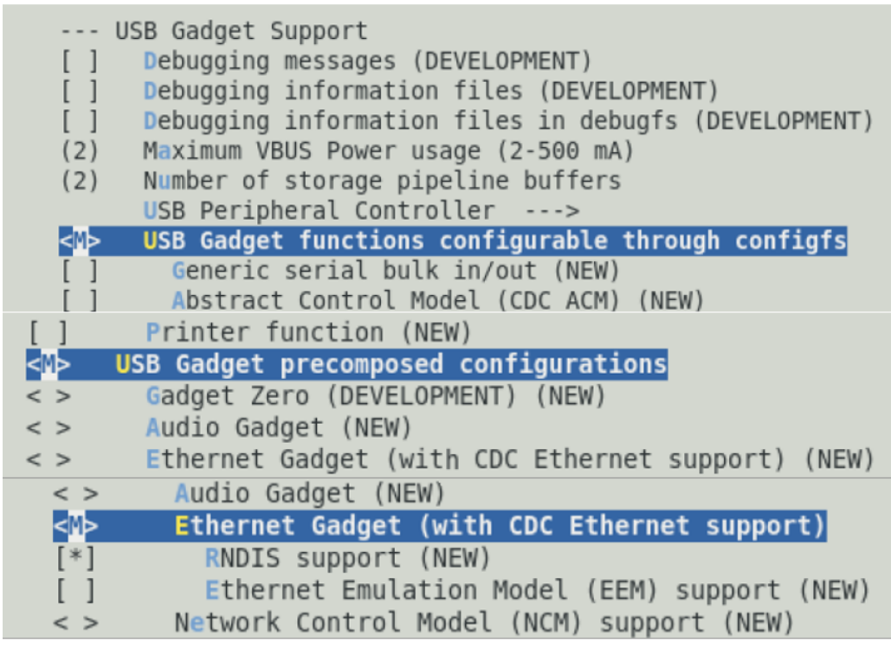

**Figure 26. Linux kernel menuconfig**

**Device Tree**

- Trong USB DWC3 node, đổi giá trị của thuộc tính `dr_mode` từ “`host`” sang “`otg`”:

  ```
  usb1: usb@3110000 {
             compatible = "fsl,ls1028a-dwc3", "snps,dwc3";
             reg = <0x0 0x3110000 0x0 0x10000>;
             interrupts = <GIC_SPI 81 IRQ_TYPE_LEVEL_HIGH>;
             dr_mode = "otg";
             snps,dis_rxdet_inp3_quirk;
             snps,quirk-frame-length-adjustment = <0x20>;
             snps,incr-burst-type-adjustment = <1>, <4>, <8>, <16>;
  };
  ```

  **Ghi chú:**

  - Bạn chỉ được đổi một USB node. Bảo đảm chỉ sửa USB node được ánh xạ tới cổng USB vật lý mà bạn muốn kiểm chứng.
  - Các cổng USB sau trên các board Layerscape tương ứng được bật cho tính năng OTG. Các board Layerscape khác có cổng Micro-AB có thể được bật cho OTG nếu cần.

| Board Layerscape | Hỗ trợ OTG? | Cổng USB hỗ trợ OTG |
|---|---|---|
| LS1028ARDB | Y | TYPE-C |
| LS1046ARDB | Y | USB3.0 MICRO-AB |
| LS2088ARDB | Y | USB3.0 MICRO-AB |

**Các file mã nguồn**

- Với chế độ host, xem phần ‘Host mode’ của phần Linux Kernel.
- Với chế độ device, xem phần ‘Ethernet gadget’.

**Kiểm chứng**

- Đóng vai trò host
  - Bảo đảm board có cổng OTG:
    - Ổ cắm USB 3.0 Micro-AB

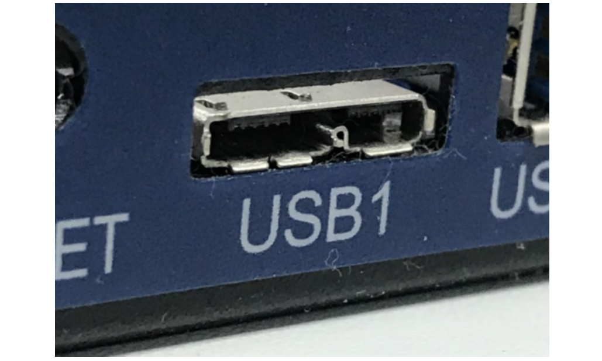

**Figure 27. Ổ cắm USB 3.0 Micro-AB**

- hoặc ổ cắm TYPE-C

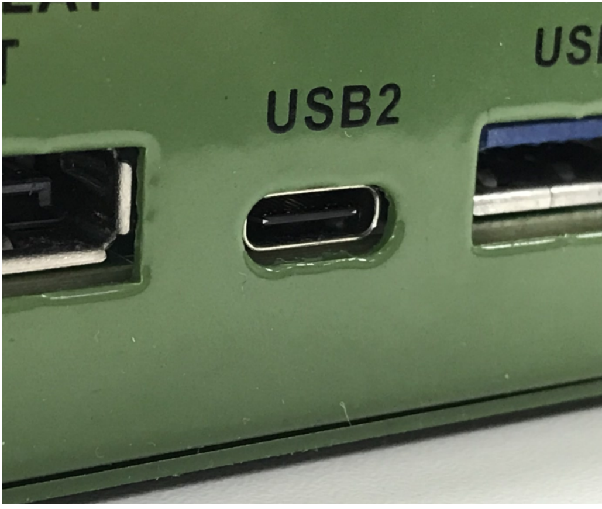

**Figure 28. Ổ cắm TYPE-C**

- Khởi động board RDB với kernel đã tùy biến.
- Cắm cáp USB 2.0/3.0 OTG hoặc cáp USB3.0 Type-C vào cổng downstream được chỉ ở trên.
  - Cáp USB 2.0 OTG

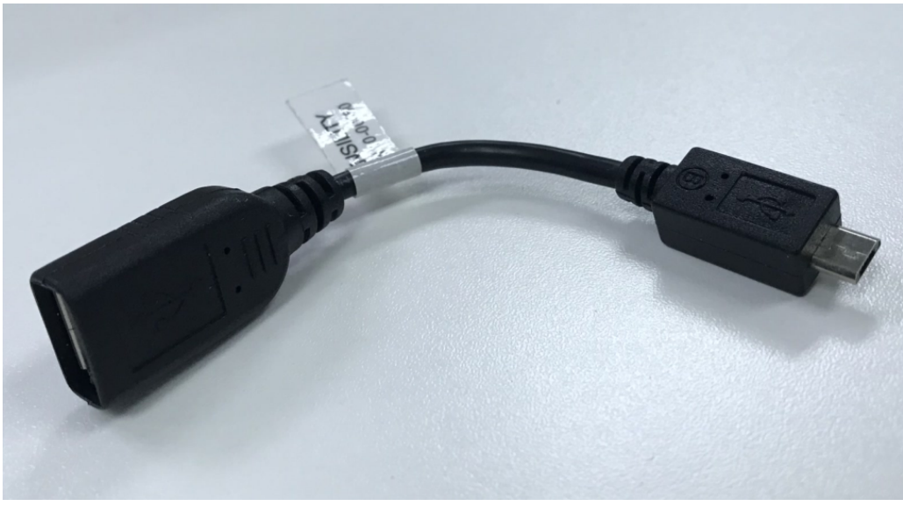

**Figure 29. Cáp USB 2.0 OTG**

- Cáp USB 3.0 OTG

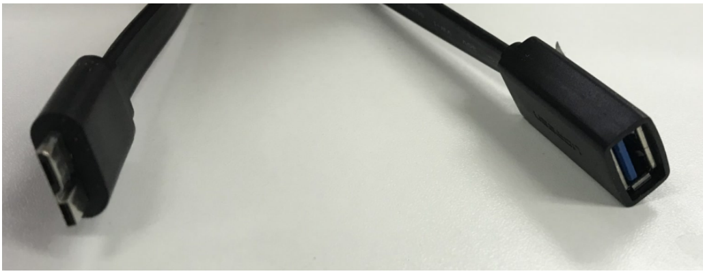

**Figure 30. Cáp USB 3.0 OTG**

- Cáp USB 3.0 Type-C

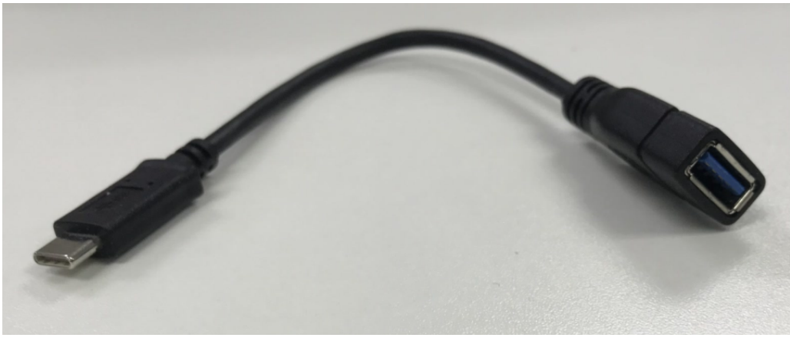

**Figure 31. Cáp USB 3.0 Type-C**

- Kiểm chứng chức năng USB host với một ổ USB Mass Storage:

  Xem các bước kiểm chứng của phần ‘Host mode’ trong Linux kernel để biết chi tiết.

- Đóng vai trò device
  - Bảo đảm board có cổng OTG, xem ‘Act as host’ để biết chi tiết.
  - Khởi động board RDB với kernel đã tùy biến.
  - Cắm một cáp USB plug vào cổng được chỉ ở trên.
    - Cáp USB 2.0 plug

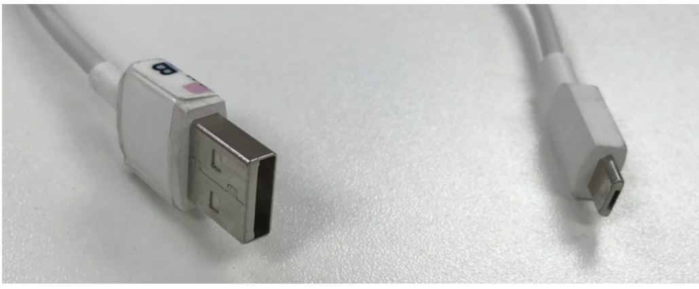

**Figure 32. Cáp USB 2.0 plug**

- Cáp USB 3.0 plug

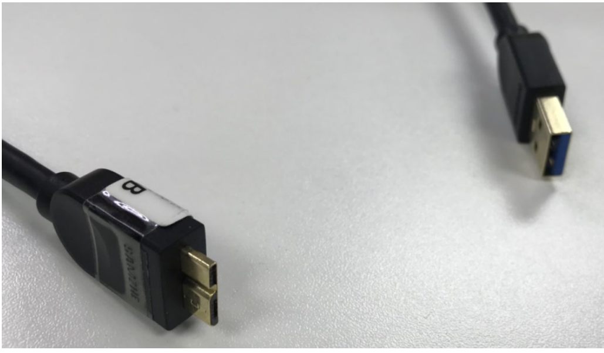

**Figure 33. Cáp USB 3.0 plug**

- Cáp USB Type-C plug

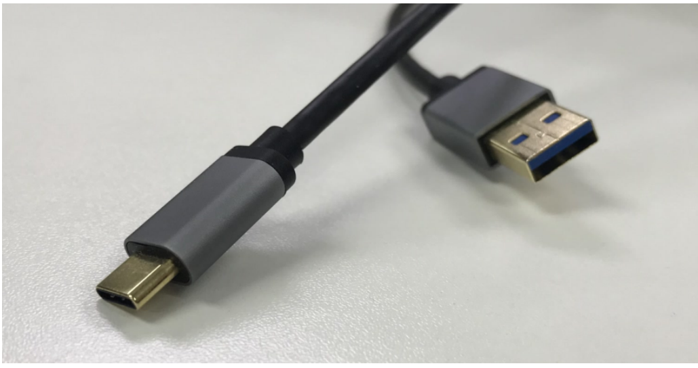

**Figure 34. Cáp USB Type-C plug**

- Kiểm chứng chế độ USB device với chức năng Ethernet gadget:

  Xem các bước kiểm chứng của phần ‘Device mode’ trong Linux kernel để biết chi tiết (tìm ‘Ethernet gadget’).

##### 7.5.17.1.15 Lỗi đã biết, giới hạn hoặc vấn đề kỹ thuật

- Linux chỉ cho phép một peripheral tại một thời điểm. Bảo đảm rằng khi một trong các bộ điều khiển DWC3 được đặt làm peripheral, thì các bộ điều khiển khác không được đặt cùng chế độ đó.
- Với chế độ USB host, một số ổ Pen drive như Kingston / Transcend / SiliconPower / Samtec có thể có vấn đề tương thích.
- Một số cổng USB micro có thể có vấn đề tương thích với cáp OTG3.0. Cáp OTG 2.0 và cổng USB chuẩn hoạt động tốt.
- Nếu bạn đang port các patch liên quan đến USB và bật chúng trên nền phần mềm của khách hàng (U-Boot + Linux), bảo đảm mọi USB node (hoặc node cha, như ‘SoC’) đã được áp thuộc tính `dma-` `coherent;` trong kernel device tree. Và bảo đảm các bản triển khai sau đã được tích hợp vào mã nguồn phần mềm của bạn:
  - U-Boot:
    - https://gitlab.denx.de/u-boot/u-boot/commit/3d23b6c5
    - https://gitlab.denx.de/u-boot/u-boot/commit/d085c9ad
    - https://gitlab.denx.de/u-boot/u-boot/commit/223c1907
  - Linux kernel:

    https://github.com/nxp-qoriq/linux

#### 7.5.17.2 Bộ điều khiển USB 2.0

(**Bộ điều khiển USB multi-port host và/hoặc dual-role của Freescale**)

##### 7.5.17.2.1 U-Boot

**Chế độ host**

Dựa trên cấu hình mặc định của Layerscape LDP, bảo đảm chọn các config dưới đây:

**Các tùy chọn Configure Tree View**

| Các tùy chọn Configure Tree View | Mô tả |
|---|---|
| `USB support --->`<br>`[*] EHCI HCD (usb 2.0) Support` | Bật hỗ trợ USB host controller |
| `[*] USB Mass Storage Support` | Bật hỗ trợ USB host controller. |

**Các file source**

Source của driver được duy trì trong cây source Linux kernel.

| File source | Mô tả |
|---|---|
| drivers/usb/host/ehci-hcd | Stack bộ điều khiển USB HOST xHCI |
| drivers/usb/host/ehci-fsl.c | Driver FSL USB HOST xHCI Controller, dựa trên driver dwc3 |
| drivers/usb/host/usb-uclass.c | Driver USB host |
| common/usb.c | Driver USB chung |
| common/usb_hub.c | Driver USB hub |
| cmd/usb.c | Hỗ trợ command-line USB |

**Kiểm chứng**

- Enumeration
  - Tham khảo các bước kiểm thử của bộ điều khiển USB 3.0.

**Mass Storage**

- Tham khảo các bước kiểm thử của bộ điều khiển USB 3.0.

##### 7.5.17.2.2 Linux Kernel

**Chế độ host**

Dựa trên config mặc định của Layerscape LDP, bảo đảm chọn các CONFIG dưới đây:

**Các tùy chọn Configure Tree View**

| Các tùy chọn Configure Tree View | Mô tả |
|---|---|
| `USB support --->`<br>`[*] Support for Host-side USB` | Hỗ trợ USB host controller. |
| ` [*] EHCI HCD (USB 2.0) support` | Hỗ trợ USB HCD. |
| `[*] USB Mass Storage support` | Hỗ trợ USB mass storage. |
| `<*> Support for Freescale PPC on-chip`<br>` EHCI USB controller`<br>`[*] EHCI support for PPC USB`<br>` controller on OF platform bus` | Hỗ trợ USB EHCI |

**Device Tree**

```
usb@22000 {
       #address-cells = <1>;
       #size-cells = <0>;
       compatible = "fsl-usb2-<controller-type>-v<controller version>",
             "fsl-usb2-<controller-type>";
       reg = <0x22000 0x1000>;
       interrupt-parent = <&mpic>;
       interrupts = <28 0x2>;
       phy_type = "ulpi";                         /* ulpi/utmi/utmi_dual */
       dr_mode = "host"                            /* host, peripheral */
};
```

**Ghi chú:** controller-type: dr(dual-role), mph(multi-port-host) controller-version: 1.6, 2.2, hoặc cũ hơn; chế độ mặc định luôn là host.

**Các file source**

Source của driver được duy trì trong cây source Linux kernel.

| File source | Mô tả |
|---|---|
| drivers/usb/core/\* | Subsystem/framework USB |
| drivers/usb/host/ehci-hcd.c | Driver USB EHCI (host) |
| drivers/usb/host/ehci-fsl.c fsl-mph-dr-of.c | Driver USB2.0 controller multi-port host và/hoặc dual-role của Freescale |
| drivers/usb/storage/scsiglue.c protocol.c transport.c usb.c | Driver USB Mass Storage (device) |

**Kiểm chứng**

- Tham khảo các bước kiểm thử của bộ điều khiển USB 3.0.

##### 7.5.17.2.3

- Chế độ device (Gadget driver)
- Ethernet gadget

  Dựa trên cấu hình mặc định của config Layerscape LDP, bảo đảm chọn các file config dưới đây:

**Các tùy chọn Configure Tree View**

| Các tùy chọn Configure Tree View | Mô tả |
|---|---|
| `<*> Freescale Highspeed USB DR`<br>` Peripheral Controller` | Hỗ trợ USB host controller của Freescale. |
| ` <M> USB Gadget functions configurable`<br>` through configfs` | Hỗ trợ cấu hình. |
| `<M> USB Gadget precomposed`<br>` configurations` | Hỗ trợ USB gadget |
| `<M> Ethernet Gadget (with CDC Ethernet`<br>` support)` | Hỗ trợ USB Ethernet |
| `[*] RNDIS support` | Hỗ trợ USB RNDIS gadget |

**Device tree**

```
usb@22000 {
        #address-cells = <1>;
        #size-cells = <0>;
        compatible = "fsl-usb2-<controller-type>-v<controller version>",
              "fsl-usb2-<controller-type>";
        reg = <0x22000 0x1000>;    /* specifies register base addr, soc
 dependent */
        interrupt-parent = <&mpic>;
        interrupts = <28 0x2>;     /* specifies usb interrupt line, soc
 dependent */
        phy_type = "ulpi";         /* phy can be ulpi(external)/utmi(internal)
 */
        dr_mode = "peripheral"     /* this entry specifies usb mode */
 };
```

**Ghi chú:**

Controller-type: dr(dual-role), mph(multi-port-host) controller-version: 1.6, 2.2, hoặc cũ hơn; chế độ mặc định luôn là host. Nó có thể được đổi sang peripheral bên trong mục dts như trên. Trong trường hợp này cần biên dịch lại dts. Chế độ DR cũng có thể được đổi sang peripheral qua command line của U-Boot. Cách này không đòi hỏi biên dịch lại DTS, và có thể hoạt động với DTS mặc định cho bộ điều khiển USB1.

```
=> setenv hwconfig 'usb1:dr_mode=peripheral,phy_type=<ulpi/utmi>
```

##### 7.5.17.2.4 Các file source

| File source | Mô tả |
|---|---|
| drivers/usb/host/fsl-mph-dr-of.c | Driver Freescale dual-role USB2.0 controller |
| drivers/usb/gadget/function/u_ether.c | Các tiện ích link layer Ethernet-over-USB cho Gadget stack |
| drivers/usb/gadget/function/f_ecm.c | Driver link function USB CDC Ethernet (ECM) |
| drivers/usb/gadget/function/f_subset.c | Driver link function Ethernet "CDC Subset" |
| drivers/usb/gadget/function/f_rndis.c | Driver link function RNDIS |
| drivers/usb/gadget/function/rndis.c | Bộ phân tích RNDIS MSG |
| drivers/usb/gadget/legacy/ether.c | Driver Ethernet gadget, với các tùy chọn CDC và không CDC |

##### 7.5.17.2.5

**Kiểm chứng**

- Tham khảo các bước kiểm thử của bộ điều khiển USB 3.0.

### 7.5.18 Graphics processing unit (GPU)

Driver GPU hỗ trợ Graphics Processing Unit (GPU) của NXP. Driver GPU có thể được dùng dưới dạng module hoặc build vào kernel image bằng cách bật config `MXC_GPU_VIV`.

1. Tải các thư viện GPU:

   ```
   $ wget https://www.nxp.com/lgfiles/NMG/MAD/YOCTO/imx-gpu-viv-6.4.11.p1.2d-
   aarch64.bin
   $ chomod a+x imx-gpu-viv-6.4.11.p1.2d-aarch64.bin
   $ ./ imx-gpu-viv-6.4.11.p1.2d-aarch64.bin
   Press Y to accept the EULA license.
   ```

Tất cả các thư viện và demo GPU đều có trong repository này.

**Ghi chú:** Nếu bạn đang dùng bản phát hành Layerscape LDP, tất cả các bước trên đã được thực hiện sẵn.

#### 7.5.18.1 Quy trình kiểm thử

Làm theo quy trình dưới đây để dùng GPU.

1. Khởi động kernel.

   Để kiểm tra kernel log, dùng lệnh:

   ```
   user@ls1028ardb:~# dmesg | tail
   ```

   Các thông báo xuất hiện như sau:

   ```
   ...
   Galcore version 6.4.3.336687
   ...
   ```

2. Tất cả các test case sẽ được cài bằng `apt-get`:

   a. Demo OpenCL

   ```
   user@ls1028ardb: apt-get install clinfo
   root@ls1028ardb: clinfo
   ```

   b. Demo OpenGLES

   ```
   user@ls1028ardb: apt-get install glmark2-es2-wayland
   root@ls1028ardb: glmark2-es2-wayland
   ```

#### 7.5.18.2 Vấn đề đã biết

Driver GPU không hỗ trợ tính năng SMMU. Khi SMMU được bật, GPU sẽ không hoạt động.

Để tắt SMMU, thêm nội dung sau vào bootargs:

```
iommu.passthrough=1 arm-smmu.disable_bypass=0
```

### 7.5.19 Bộ điều khiển LCD và display transmitter

**Mô tả**

Mục này mô tả cách cấu hình và kiểm thử các driver bộ điều khiển LCD và Display Transmitter cho LS1028ARDB. Bộ điều khiển Display Transmitter hỗ trợ đa giao thức cho các chuẩn như DisplayPort v1.3 và eDP v1.4.

Các device driver bộ điều khiển LCD và Display Transmitter có thể được build vào kernel image hoặc build thành kernel module.

**Cấu hình RCW**

Bảng sau mô tả RCW cho bộ điều khiển Display Transmitter và LCD trên LS1028ARDB.

| Board | RCW |
|---|---|
| LS1028ARDB | HWA_CGA_M3_CLK_SEL = 2 |

**Tree view các tùy chọn cấu hình kernel**

Bảng sau mô tả tree view của các tùy chọn cấu hình kernel.

| Tùy chọn | Mô tả |
|---|---|
| `Device Drivers --->`<br>`  Graphics support --->`<br>`    <M> IPUv3 core support`<br>`    <M> Direct Rendering Manager (XFree86`<br>` 4.1.0 and higher DRI support) --->`<br>`  Arm devices --->`<br>`     [M] Arm Mali Display Processor`<br>`   [M] DRM Support for Freescale i.mx`<br>`   [M] IMX8 HD Display Controller`<br>`Common Clock Framework--->`<br>`    [*] Clock driver for LS1028A Display`<br>` output` | Bật IPUv3 Core, LCD controller driver, DRM driver, Display Transmitter Controller driver và Display pixel clock driver. |

**Identifier**

Dưới đây là các identifier cấu hình được dùng trong source code kernel và các file cấu hình mặc định.

| Tùy chọn | Mô tả |
|---|---|
| CONFIG_DRM | Bật hỗ trợ DRM driver |
| CONFIG_DRM_MALI_DISPLAY | Bật LCD controller driver |
| CONFIG_DRM_IMX | Driver Display Transmitter controller, cần để bật driver DRM của i.MX |
| CONFIG_DRM_IMX_HDP | Bật Display Transmitter controller driver |
| CONFIG_MX8_HDP | Bật driver API chung của Display Transmitter controller |
| CONFIG_IPUV3_CORE | Các driver DRM i.MX cần để bật IPUV3_CORE |
| CONFIG_DRM_IMX_CDNS_MHDP | Driver Display Transmitter controller |
| CONFIG_DRM_CDNS_MHDP | Driver API chung của Display Transmitter controller |
| CONFIG_DRM_CDNS_HDMI | Driver API chung của bộ điều khiển Display Transmitter cho HDMI |
| CONFIG_DRM_CDNS_DP | Driver API chung của bộ điều khiển Display Transmitter cho DP |
| CONFIG_DRM_CDNS_AUDIO | Driver API chung của bộ điều khiển Display Transmitter cho AUDIO |
| CONFIG_CLK_LS1028A_PLLDIG | Driver Display pixel clock |

**Các file mã nguồn**

Source của driver được duy trì trong cây source Linux kernel.

| File source | Mô tả |
|---|---|
| drivers/gpu/drm/arm/malidp\_\* | Mã nguồn driver bộ điều khiển LCD |
| drivers/gpu/drm/imx/hdp | Mã nguồn driver bộ điều khiển Display Transmitter |
| drivers/mxc/hdp/ | Mã nguồn API chung của bộ điều khiển Display Transmitter |
| drivers/clk/clk-plldig.c | Mã nguồn driver pixel clock của giao diện output hiển thị |

**Device Tree Binding**

Sau đây là cấu hình device tree mặc định cho board LS1028A RDB:

```
&hdptx0 {
         fsl,no_edid;
         resolution = "3840x2160@60",
                      "1920x1080@60",
                      "1280x720@60",
                      "720x480@60";
         lane_mapping = <0x4e>;
   edp_link_rate = <0x6>
   edp_num_lanes = <0x4>;
         status = "okay";
};
```

Nếu panel hiển thị không hỗ trợ Extended Display Identification Data (EDID), cần có “fsl, no_edid” để chỉ định rằng chế độ no_edid được dùng. Trong trường hợp này, driver kernel có sẵn một danh sách độ phân giải hiển thị built-in cùng các tham số hiển thị liên quan, được định nghĩa trong cấu trúc dữ liệu “edid_cea_modes” trong driver imx-hdp.c; các tham số built-in này có thể được sửa nếu cần, hoặc có thể thêm một số độ phân giải mới vào danh sách này. Thuộc tính “resolution” trong device tree được dùng để chỉ định những độ phân giải nào trong danh sách built-in được panel hiển thị hỗ trợ.

Với chế độ edid, dữ liệu EDID được đọc từ panel hiển thị, sau đó các tham số hiển thị cùng với khả năng hiển thị có thể được thu thập từ dữ liệu EDID; driver hiển thị dùng các tham số này để khởi tạo DP và LCDC. Trong trường hợp này, bỏ thuộc tính “fsl, no_edid” và “resolution” khỏi dts.

**Cấu hình Device Tree cho eDP**

Hiện board LS1028ARDB không có cổng eDP, thông tin sau chỉ để bạn tham khảo.

Để kết nối với panel eDP, phải thêm thuộc tính “fsl, edp” vào display node của device tree, và cũng cần chỉ định link rate bằng thuộc tính “edp_link_rate”: 0x14 dùng cho độ phân giải 4k và 0xa dùng cho độ phân giải 1080p. “edp_num_lanes” dùng để chỉ định số lane mà cổng eDP sử dụng.

Sau đây là ví dụ dts cho panel hiển thị eDP 4k và 1080p:

- 4k@60

  ```
  &hdptx0 {
     fsl,edp;
           fsl,no_edid;
           resolution = "3840x2160@60",
                        "1920x1080@60",
                        "1280x720@60",
                        "720x480@60";
           lane_mapping = <0x4e>;
     edp_link_rate = <0x14>
     edp_num_lanes = <0x4>;
           status = "okay";
  };
  ```

- 1080p@60

  ```
  &hdptx0 {
      fsl,edp;
             fsl,no_edid;
             resolution = "3840x2160@60",
                              "1920x1080@60",
                          "1280x720@60",
                              "720x480@60";
              lane_mapping = <0x4e>;
       edp_link_rate = <0xa>
       edp_num_lanes = <0x2>;
              status = "okay";
  };
  ```

**Cấu hình pixel clock hiển thị**

LS1028A có một PLL cung cấp pixel clock cho cả LCDC và DP; tần số clock tham chiếu đầu vào của PLL là 27 MHz; bằng giao diện số lập trình được, nó có thể cung cấp pixel clock với tần số từ 27 MHz đến 594 MHz.

Quan hệ cấu hình clock như dưới đây; chi tiết thêm có trong LS1028A Reference Manual.

Quan hệ giữa tần số đầu vào và đầu ra được xác định bằng cách lập trình các thanh ghi PLLDIG_PLLDV, PLLDIG_PLLCAL3 và PLLDIG_PLLFD, và được tính theo phương trình sau:

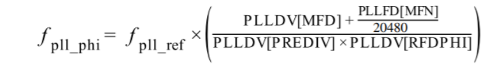

**Figure 35. Tần số PLL PHI**

Quan hệ giữa tần số VCO (f ) và tần số output của PLL được xác định bởi các

VCO

thanh ghi PLLDIG_PLLDV và PLLDIG_PLLFD, theo phương trình sau:

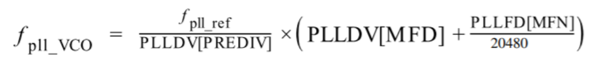

**Figure 36. Tần số PLL VCO**

Khi lập trình PLL, phần mềm người dùng không được vi phạm tần số system clock tối đa hoặc đặc tả tần số VCO tối đa/tối thiểu của PLL.

Hiện tại, bộ chia phân số được hỗ trợ trên LS1028A. Vì vậy, PLL có thể phủ gần như mọi tần số VCO từ 650 MHz đến 1300 MHz.

Trong hai công thức tính ở trên:

- Giá trị ‘fpll_phi’ tương đương với tần số pixel clock yêu cầu.
- ‘fpll_ref’ là clock tham chiếu, bằng 27 MHz.
- Giá trị PLLDV\[PREDIV\] luôn là '1'.
- Theo mặc định, giá trị MFD(PLLDV\[MFD\]) là 44, PLLFD\[MFN\] bằng không, giá trị tần số VCO(fpll_vco) là 1188 MHz.
- Nếu tần số VCO không chia hết cho tần số pixel clock yêu cầu (fpll_phi), chức năng phân số sẽ được dùng, khi đó PLLFD\[MFN\] sẽ được tính để có tần số VCO chia hết cho tần số pixel clock yêu cầu.
- Dải tần số VCO là từ 650 MHz đến 1300 MHz.

Ví dụ, nếu tần số pixel clock yêu cầu là 594 MHz, vì tần số VCO mặc định 1188 chia hết cho 594 nên PLLDV\[RFDPHI\] =2, PLLDV\[MFD\] = 44, và PLLFD\[MFN\] = 0. Nhưng nếu tần số pixel clock yêu cầu là 533.25, vì tần số VCO mặc định 1188 không chia hết cho 533.25 nên cần dùng chức năng phân số; driver phần mềm của PLL sẽ tìm tần số pixel clock output tốt nhất, và cuối cùng PLLDV\[MFD\] = 39, PLLFD\[MFN\] = 10240, PLLDV\[RFDPHI\] = 2, nên tần số VCO output sẽ là 1066.5 MHz và tần số pixel clock sẽ là 533.25 MHz.

Tần số VCO của PLL này không thể thay đổi lúc chạy, nó chỉ có thể được thay đổi lúc khởi động. Vì vậy, các tần số output bị giới hạn và có thể không khớp với tần số yêu cầu. Để khắc phục hạn chế này, người dùng có thể chỉ định giá trị tần số VCO yêu cầu trong DTS.

Các tham số sau cho các tần số pixel clock khác nhau với giá trị MFD tốt nhất (44) đã được kiểm chứng:

| Tần số Pixel Clock (MHz) | MULT(MFD) | DIV(rfdphi1) | Tần số thực tế (MHz) | Chênh lệch (MHz) |
|---|---|---|---|---|
| 27 | 44 | 44 | 27 | 0 |
| 54 | 44 | 22 | 54 | 0 |
| 74.25 | 44 | 16 | 74.25 | 0 |
| 99 | 44 | 12 | 99 | 0 |
| 148.5 | 44 | 8 | 148.5 | 0 |
| 198 | 44 | 6 | 198 | 0 |
| 297 | 44 | 4 | 297 | 0 |
| 594 | 44 | 2 | 594 | 0 |
| 40 | 40 | 27 | 40 | 0 |
| 108 | 44 | 11 | 108 | 0 |
| 135 | 40 | 8 | 135 | 0 |
| 162 | 42 | 7 | 162 | 0 |
| 396 | 44 | 3 | 396 | 0 |
| 536 | 39 | 2 | 526.5 | 9.5 |
| 533.25 | 39 | 2 | 526.5 | 6.27 |
| 74.44 | 44 | 16 | 74.25 | 0.19 |
| 27.027 | 44 | 44 | 27 | 0.027 |

Người dùng có thể chỉ định tần số VCO yêu cầu:

- Người dùng có thể thêm tần số VCO dưới dạng một DT node trong file dts để điều khiển tốc độ yêu cầu. Để biết thêm thông tin, tham khảo DT bindings (fsl, plldig.yaml).

  Ví dụ, thêm tần số VCO dưới dạng một DT node cho độ phân giải 4k.

  ```
  &dpclk {
                           vco-frequency = <1066500000>;
                           status = "okay";
  };
  ```

  hoặc thêm tần số VCO dưới dạng một DT node cho độ phân giải 480p.

  ```
  &dpclk {
                           vco-frequency = <1189188000>;
                           status = "okay";
  };
  ```

**Kiểm chứng trên Linux**

Theo mặc định, các driver DisplayPort trong Layerscape LDP hỗ trợ bốn độ phân giải: 480p (720x480p60), 720p (1280x720p60), 1080p (1920x1080p60) và 4k (3840x2160p60).

Làm theo quy trình này để hỗ trợ độ phân giải 480p, 720p, 1080p hoặc 4k với DisplayPort.

1. Build firmware DP bằng bitbake. Chạy lệnh sau:

   ```
   bitbake dp-firmware-cadence
   ```

   Khi đó firmware DP “ls1028a-dp-fw.bin” cùng với file EULA có thể được tìm thấy trong thư mục `build/` `firmware/dp_firmware_cadence/dp/`.

2. Nạp firmware DP trong U-Boot

   Binary firmware HDP được nạp trong U-Boot. Tại dấu nhắc U-Boot, sao chép binary firmware từ bất kỳ phương tiện lưu trữ nào (NOR flash hoặc SD/eMMC) vào bộ nhớ DDR. Dùng lệnh sau để nạp binary:

   ```
   => hdp load <address > <offset>
   ```

   trong đó:

   - address - địa chỉ nơi binary firmware bắt đầu trong bộ nhớ DDR
   - offset - offset IRAM trong binary firmware (mặc định 8192)

   Ví dụ: `=>hdp load 0x98000000 0x2000`

   Nếu các flash image được build bằng bitbake, firmware DP được ghi vào flash hoặc thẻ SD. Để biết vị trí của firmware DP, xem LS1028A Memory Layout. Dùng các lệnh sau để nạp firmware DP ở U-Boot:

   a. Lấy firmware DP khi boot từ XSPI flash:

   ```
   => run xspi_hdploadcmd
   Trying load HDP firmware from FlexSPI...
   SF: Detected mt35xu02g with page size 256 Bytes, erase size 128 KiB, total
    256 MiB
   device 0 offset 0x940000, size 0x30000
   SF: 196608 bytes @ 0x940000 Read: OK
   Loading hdp firmware from 0x00000000a0000000 offset 0x0000000000002000
   Loading hdp firmware Complete
   ```

   b. Lấy firmware DP khi boot từ SD

   ```
   => run sd_hdploadcmd
   Trying load HDP firmware from SD..
   Device: FSL_SDHC
   Manufacturer ID: 3
   OEM: 5054
   Name: SL16G
   Bus Speed: 50000000
   Mode : SD High Speed (50MHz)
   Rd Block Len: 512
   SD version 3.0
   High Capacity: Yes
   Capacity: 14.5 GiB
   Bus Width: 4-bit
   Erase Group Size: 512 Bytes
   MMC read: dev # 0, block # 18944, count 512 ... 512 blocks read: OK
   Loading hdp firmware from 0x00000000a0000000 offset 0x0000000000002000
   Loading hdp firmware Complete
   ```

   c. Lấy firmware DP khi boot từ EMMC

   ```
   => run emmc_hdploadcmd
   Trying load HDP firmware from EMMC..
   switch to partitions #0, OK
   mmc1(part 0) is current device
   Device: FSL_SDHC
   Manufacturer ID: 13
   OEM: 14e
   Name: Q2J55
   Bus Speed: 52000000
   Mode : MMC High Speed (52MHz)
   Rd Block Len: 512
   MMC version 5.0
   High Capacity: Yes
   Capacity: 7.1 GiB
   Bus Width: 4-bit
   Erase Group Size: 512 KiB
   HC WP Group Size: 8 MiB
   User Capacity: 7.1 GiB WRREL
   Boot Capacity: 2 MiB ENH
   RPMB Capacity: 4 MiB ENH
   MMC read: dev # 1, block # 18944, count 512 ... 512 blocks read: OK
   Loading hdp firmware from 0x00000000a0000000 offset 0x0000000000002000
   Loading hdp firmware Complete
   ```

3. Đặt bootargs để chỉ định độ phân giải hiển thị và kích thước bộ nhớ CMA
   - Để hỗ trợ độ phân giải 480p, thêm đối số sau vào bootargs (kích thước CMA tối thiểu là 64M byte):

     ```
     video=720x480-32@60 cma=256M
     ```

   - Để hỗ trợ độ phân giải 720p, thêm đối số sau vào bootargs:

     ```
     video=1280x720-32@60 cma=256M
     ```

   - Để hỗ trợ độ phân giải 1080p, thêm đối số sau vào bootargs:

     ```
     video=1920x1080-32@60 cma=256M
     ```

   - Để hỗ trợ độ phân giải 4k, thêm các đối số sau vào bootargs:

     ```
     video=3840x2160-32@60 cma=256M
     ```

4. Nạp các module liên quan đến hiển thị dưới đây khi hệ thống khởi động xong

   ```
   # insmod drm_panel_orientation_quirks.ko
   # insmod drm.ko
   # insmod drm_kms_helper.ko
   # insmod imx_hdp_common.ko
   # insmod mali-dp.ko
   # insmod imx-hdptx.ko
   ```

   Sau khi thực hiện các bước trên, bạn có thể thấy thông báo “Please wait: booting” trên DP.

Tham khảo các boot log sau:

```
[   42.501819] [drm] found Arm Mali-DP500 version r1p2
[   42.506943] [drm] Resolution 3840x2160@60 is enabled
[   42.511945] [drm] Resolution 1920x1080@60 is enabled
[   42.516930] [drm] Resolution 1280x720@60 is enabled
[   42.521832] [drm] Resolution 720x480@60 is enabled
[   42.526645] i.mx8-hdp f1f0000.display: lane_mapping 0x4e
[   42.531979] i.mx8-hdp f1f0000.display: edp_link_rate 0x06
[   42.537398] i.mx8-hdp f1f0000.display: dp_num_lanes 0x04
[   42.542796] [drm] Started firmware!
[   42.546301] [drm] CDN_API_CheckAlive returned ret = 0
[   42.551373] [drm] Firmware version: 23029, Lib version: 20691
[   42.557162] [drm] CDN_API_MainControl_blocking (ret = 0 resp = 1)
[   42.563314] [drm] CDN_API_General_Test_Echo_Ext_blocking (ret = 0 echo_resp =
 echo test)
[   42.571444] [drm] CDN_API_General_Write_Register_blockin ... setting
 LANES_CONFIG
[   42.579017] [drm] pixel engine reset
[   42.582615] [drm] CDN_*_Write_Register_blocking ... setting LANES_CONFIG 4e
[   42.591387] [drm] AFE_init
[   42.594117] [drm] deasserted reset
[   42.597616] Wait for A2 ACK
[   42.622094] [drm] AFE_power exit
[   42.625342] [drm] CDN_API_DPTX_SetVideo_blocking (ret = 0)
[   42.631035] mali-dp f080000.display: bound f1f0000.display (ops
 imx_hdp_imx_ops [imx_hdptx])
[   42.639685] [drm] Supports vblank timestamp caching Rev 2 (21.10.2013).
[   42.646334] [drm] No driver support for vblank timestamp query.
[   42.652655] [drm] Initialized mali-dp 1.0.0 20160106 for f080000.display on
 minor 0
[   42.660407] i.mx8-hdp f1f0000.display: No EDID function, use default video
 mode
[   42.672016] [drm] pixel engine reset
[   42.672030] [drm] CDN_*_Write_Register_blocking ... setting LANES_CONFIG 4e
[   42.673818] [drm] AFE_init
[   42.673838] [drm] deasserted reset
[   42.673928] Wait for A2 ACK
[   42.695986] [drm] AFE_power exit
[   42.695994] [drm] CDN_API_DPTX_SetVideo_blocking (ret = 0)
[   42.696014] [drm] CDN_API_DPTX_SetHostCap_blocking (ret = 0)
[   42.698821] [drm] INFO: Full link training started
[   42.701245] [drm] INFO: Clock recovery phase finished
[   42.702064] [drm] INFO: Channel equalization phase finished
[   42.702066] [drm] (last part meaning training finished)
[   42.702097] [drm] INFO: Get Read Link Status (ret = 0) resp: rate: 20,
[   42.702099] [drm] lanes: 4, vswing 0..3: 2 2 2, preemp 0..3: 1 1 1
[   42.702284] [drm] CDN_API_DPTX_Set_VIC_blocking (ret = 0)
[   42.702290] [drm] CDN_API_DPTX_SetVideo_blocking (ret = 0)
[   42.703462] Console: switching to colour frame buffer device 240x67
[   42.812209] mali-dp f080000.display: fb0: mali-dpdrmfb frame buffer device
[   42.832364] [drm] HDMI/DP Cable Plug In
```

### 7.5.20 FlexTimer (FTM)

**Mô tả**

Module này có thể cung cấp các chức năng như PWM, nguồn clock, nguồn wake-up. Hiện tại, chỉ nguồn wake-up và PWM được hỗ trợ trên các platform Layerscape.

**Các tùy chọn Kernel Configure Tree View**

- Dùng FlexTimer làm nguồn wake-up

  ```
  -> Device Drivers
      -> Real Time Clock
          -> <*> Freescale FlexTimer alarm timer
  ```

- Dùng FlexTimer làm PWM

  ```
  -> Device Drivers
    -> Pulse-Width Modulation (PWM) Support
        -> <M> Freescale FlexTimer Module (FTM) PWM support
  ```

**Các tùy chọn cấu hình lúc compile**

| Config | Giá trị | Giá trị mặc định | Mô tả |
|---|---|---|---|
| `CONFIG_RTC_DRV_FSL_FTM_ALARM` | y/m/n | y | Dùng FlexTimer làm nguồn wake-up |
| `CONFIG_PWM_FSL_FTM` | y/m/n | m | Dùng FlexTimer làm PWM |

**Các file source**

Source của driver được duy trì trong cây source Linux kernel.

| File source | Mô tả |
|---|---|
| `drivers/rtc/rtc-fsl-ftm-alarm.c` | Driver Linux FlexTimer alarm timer |
| `drivers/pwm/pwm-fsl-ftm.c` | Driver Linux FlexTimer PWM |

**Device Tree Binding**

|   | Thuộc tính | Kiểu | Trạng thái | Mô tả |
|---|---|---|---|---|
| Dùng FlexTimer làm nguồn wake-up | compatible | String | Required | Phải là `fsl,<soc>-`<br>`ftm-alarm` |
|   | reg | Integer | Required | Phải chứa vị trí và độ dài các thanh ghi Flex Timer |
|   | interrupts | Integer | Required | Phải chứa interrupt của Flex Timer |
|   | fsl, rcpm-wakeup | Integer | Required | Phải chỉ định giá trị thanh ghi của rcpm |
|   | big-endian | String | Optional | Là little-endian nếu thuộc tính không được chỉ định. |
| Dùng FlexTimer làm PWM | compatible | String | Required | Phải là `fsl,`<br>`vf610-ftm-pwm` |
|   | #pwm-cells | Integer | Required | Phải là 3. Xem pwm. yaml trong thư mục này để biết mô tả định dạng các cell. |
|   | reg | Integer | Required | Phải chứa vị trí và độ dài các thanh ghi Flex Timer |
|   | clock-names | Integer | Required | Phải bao gồm các mục nguồn clock module sau:<br>• `ftm_sys` - clock module, cũng có thể dùng làm clock counter<br>• `ftm_ext` - clock counter ngoài<br>• `ftm_fix` - clock counter cố định<br>• `ftm_cnt_clk_en` - bật/tắt clock counter ngoài và cố định |
|   | clocks | Integer | Required | Phải chứa một phandle và clock specifier cho mỗi mục trong clock-names. Xem `clock/`<br>`clock-bindings.` `txt` để biết chi tiết các giá trị thuộc tính. |
|   | big-endian | Boolean | Optional | Là little-endian nếu thuộc tính không được chỉ định. |

Ví dụ (dùng FlexTimer làm nguồn wake-up):

```
aliases
  {
    rtc1 = &ftm_alarm0;
  };
rcpm: rcpm@1ee208c
  {
    compatible = "fsl,ls1046a-rcpm", "fsl,qoriq-rcpm-2.1+";
    reg = <0x0 0x1ee208c 0x0 0x4>;
    #fsl,rcpm-wakeup-cells = <1>;
  };
ftm_alarm0: timer@29d0000
  {
    compatible = "fsl,ls1046a-ftm-alarm";
    reg = <0x0 0x29d0000 0x0 0x10000>;
    fsl,rcpm-wakeup = <&rcpm 0x20000>;
    interrupts = <GIC_SPI 86 IRQ_TYPE_LEVEL_HIGH>;
    big-endian;
  };
```

Ví dụ (dùng FlexTimer làm PWM trên LS1028ARDB):

```
arch/arm64/boot/dts/freescale/fsl-ls1028a.dtsi
rtc_clk: rtc-clk
  {
    compatible = "fixed-clock";
    #clock-cells = <0>;
    clock-frequency = <32000>;
    clock-output-names = "rtc_clk";
  };
pwm0: pwm@2800000
  {
    compatible = "fsl,vf610-ftm-pwm";
    #pwm-cells = <3>;
    reg = <0x0 0x2800000 0x0 0x10000>;
    clock-names = "ftm_sys", "ftm_ext",
    "ftm_fix", "ftm_cnt_clk_en";
    clocks = <&clockgen 4 1>, <&clockgen 4 1>, <&fixed_clk>, <&clockgen 4 1>;
    status = "disabled";
  };
arch/arm64/boot/dts/freescale/fsl-ls1028a-rdb.dts
&pwm0
   {
    status = "okay";
   };
```

**Kiểm chứng trên Linux (dùng FlexTimer làm nguồn wake-up):**

```
root@ls1046a:~# cat /sys/power/mem_sleep (check whether system support deep
 sleep mode)
s2idle [deep]
root@ls1046a:~# echo deep > /sys/power/mem_sleep (set deep sleep mode when
 suspend to memery,it’s optional)
root@ls1046a:~# echo 0 > /sys/class/rtc/rtc1/wakealarm;echo +10>/sys/class/rtc/
rtc1/wakealarm && echo mem > /sys/power/state (wake up system in deep sleep mode
 afer 10 seconds)
[   32.844947] PM: suspend entry (deep)
[   32.849256] Filesystems sync: 0.000 seconds
[   32.853822] Freezing user space processes ... (elapsed 0.001 seconds) done.
[   32.861900] OOM killer disabled.
[   32.865128] Freezing remaining freezable tasks ... (elapsed 0.001 seconds)
 done.
[   32.873596] printk: Suspending console(s) (use no_console_suspend to debug)
[   32.898188] Disabling non-boot CPUs ...
[   32.898389] IRQ 51: no longer affine to CPU1
[   32.898392] IRQ 55: no longer affine to CPU1
[   32.898395] IRQ 59: no longer affine to CPU1
[   32.898418] CPU1: shutdown
[   32.916673] psci: Retrying again to check for CPU kill
[   32.916676] psci: CPU1 killed.
[   32.917127] IRQ 52: no longer affine to CPU2
[   32.917130] IRQ 56: no longer affine to CPU2
[   32.917133] IRQ 60: no longer affine to CPU2
[   32.917149] CPU2: shutdown
[   32.936666] psci: Retrying again to check for CPU kill
[   32.936669] psci: CPU2 killed.
[   32.937101] IRQ 53: no longer affine to CPU3
[   32.937104] IRQ 57: no longer affine to CPU3
[   32.937107] IRQ 61: no longer affine to CPU3
[   32.937130] CPU3: shutdown
[   32.956665] psci: Retrying again to check for CPU kill
[   32.956668] psci: CPU3 killed.
[   32.957001] Enabling non-boot CPUs ...
[   32.957255] Detected PIPT I-cache on CPU1
[   32.957290] CPU1: Booted secondary processor 0x0000000001 [0x410fd082]
[   32.957546] CPU1 is up
[   32.957693] Detected PIPT I-cache on CPU2
[   32.957712] CPU2: Booted secondary processor 0x0000000002 [0x410fd082]
[   32.957896] CPU2 is up
[   32.958044] Detected PIPT I-cache on CPU3
[   32.958063] CPU3: Booted secondary processor 0x0000000003 [0x410fd082]
[   32.958265] CPU3 is up
[   34.282897] ata1: SATA link down (SStatus 0 SControl 300)
[   34.284480] OOM killer enabled.
[   34.347864] Restarting tasks ...
[   34.347959] usb 1-1: USB disconnect, device number 2
[   34.348301] done.
[   34.358237] PM: suspend exit
```

**Kiểm chứng trên Linux (dùng FlexTimer làm PWM)**:

```
Enabling the pwm (FTM1_CH1, channel start from 0)
# echo 1 > /sys/class/pwm/pwmchip0/export
Configuring the pwm period, duty cycle, and polarity
# echo 1000000000 > /sys/class/pwm/pwmchip0/pwm1/period  (1000000000 nanoseconds
 as period, 1 s)
# echo 500000000 > /sys/class/pwm/pwmchip0/pwm1/duty_cycle (50% duty cycle, 0.5
 s)
# echo 'normal' > /sys/class/pwm/pwmchip0/pwm1/polarity (whether the 'on' time
 of the signal is active high or active low. Set the polarity to active high.)
Enable pwm
# echo 1 > /sys/class/pwm/pwmchip0/pwm0/enable
Disable pwm
# echo 0 > /sys/class/pwm/pwmchip0/pwm0/enable
```

**Ghi chú:**

- Cần được dùng làm RTC1, nếu không hệ thống sẽ nhận sai thời gian, vì module FlexTimer không phải là RTC.
- Driver alarm timer FlexTimer phụ thuộc vào driver RCPM.
- Không module FlexTimer nào có thể được dùng làm PWM và nguồn wake-up cùng một lúc.

### 7.5.21 Inter-Integrated Circuit (I2C)

**Mô tả**

Mục này cung cấp chi tiết về chức năng I2C.

**Các tùy chọn kernel configure tree view**

| Các tùy chọn kernel configure tree view |
|---|
| `-> Device Drivers`<br>`  -> I2C support`<br>`    -> I2C support (I2C [=y])`<br>`      -> I2C Hardware Bus support`<br>`        <*> IMX I2C interface` |

**Các tùy chọn cấu hình lúc compile**

| Tùy chọn | Giá trị | Giá trị mặc định | Mô tả |
|---|---|---|---|
| CONFIG_I2C_IMX | y/m/n | y | Bật I2C module |

**Các file mã nguồn**

Source của driver được duy trì trong cây source Linux kernel.

| File source | Mô tả |
|---|---|
| drivers/i2c/busses/i2c-imx.c | Driver Linux I2C |

**Device tree binding**

Để biết thêm thông tin về Device tree binding, xem `documentation/devicetree/bindings/i2c/i2c-` `imx.txt`.

| Property | Kiểu | Trạng thái | Mô tả |
|---|---|---|---|
| compatible | string | Required | Phải là 'fsl,vf610-i2c' |
| reg | integer | Required | Phải chứa vị trí và độ dài các thanh ghi I2C/HS-I2C |
| interrupts | integer | Required | Phải chứa interrupt của I2C/HS-I2C |
| clocks | integer | Required | Phải chứa clock specifier của I2C/HS-I2 C |

```
Example:
i2c1: i2c@2190000 {
            compatible = "fsl,vf610-i2c";
            #address-cells = <1>;
            #size-cells = <0>;
            reg = <0x0 0x2190000 0x0 0x10000>;
            interrupts = <GIC_SPI 57 IRQ_TYPE_LEVEL_HIGH>;
            clocks = <&clockgen 4 1>;
            status = "disabled";
};
&i2c1 {
        status = "okay";
};
```

**Kiểm chứng trong U-Boot**

```
U-Boot log:
=> help i2c
i2c - I2C sub-system
Usage:
i2c bus [muxtype:muxaddr:muxchannel] - show I2C bus info
i2c crc32 chip address[.0, .1, .2] count - compute CRC32 checksum
i2c dev [dev] - show or set current I2C bus
i2c loop chip address[.0, .1, .2] [# of objects] - looping read of device
i2c md chip address[.0, .1, .2] [# of objects] - read from I2C device
i2c mm chip address[.0, .1, .2] - write to I2C device (auto-incrementing)
i2c mw chip address[.0, .1, .2] value [count] - write to I2C device (fill)
i2c nm chip address[.0, .1, .2] - write to I2C device (constant address)
i2c probe [address] - test for and show device(s) on the I2C bus
i2c read chip address[.0, .1, .2] length memaddress - read to memory
i2c write memaddress chip address[.0, .1, .2] length [-s] - write memory
to I2C; the -s option selects bulk write in a single transaction
i2c flags chip [flags] - set or get chip flags
i2c olen chip [offset_length] - set or get chip offset length
i2c reset - re-init the I2C Controller
i2c speed [speed] - show or set I2C bus speed
=> i2c bus
Bus 0: i2c@2000000 (active 0)
77: i2c-mux@77, offset len 1, flags 0
66: generic_66, offset len 1, flags 0
57: generic_57, offset len 1, flags 0
Bus 1: i2c@2000000->i2c-mux@77->i2c@3
51: rtc@51, offset len 1, flags 0
Bus 2: i2c@2010000
Bus 3: i2c@2020000
Bus 4: i2c@2030000
Bus 5: i2c@2040000
Bus 6: i2c@2050000
Bus 7: i2c@2060000
Bus 8: i2c@2070000
=> i2c dev 0
Setting bus to 0
=> i2c probe
Valid chip addresses: 00 50 52 53 57 66 67 77 7C
=> i2c speed
Current bus speed=100000
=> i2c dev 1
Setting bus to 1
=> i2c probe
Valid chip addresses: 00 4C 51 66 67 77 7C
=> i2c md 0x51 0
0000: 07 fb 17 21 14 05 04 09 19 80 80 80 80 80 00 03 ...!............
```

**Kiểm chứng trên Linux**

```
root@ls1028a:~# i2c
i2cdetect  i2cdump    i2cget     i2cset
root@ls1028a:~# i2cdetect -l
i2c-3   i2c             i2c-0-mux (chan_id 2)                   I2C adapter
i2c-1   i2c             i2c-0-mux (chan_id 0)                   I2C adapter
i2c-8   i2c             i2c-0-mux (chan_id 7)                   I2C adapter
i2c-6   i2c             i2c-0-mux (chan_id 5)                   I2C adapter
i2c-4   i2c             i2c-0-mux (chan_id 3)                   I2C adapter
i2c-2   i2c             i2c-0-mux (chan_id 1)                   I2C adapter
i2c-0   i2c             2000000.i2c                             I2C adapter
i2c-7   i2c             i2c-0-mux (chan_id 6)                   I2C adapter
i2c-5   i2c             i2c-0-mux (chan_id 4)                   I2C adapter
root@ls1028a:~# i2cdetect -y 1
     0  1  2  3  4  5  6  7  8  9  a  b  c  d  e  f
00:          -- -- -- -- -- -- -- -- -- -- -- -- --
10: -- -- -- -- -- -- -- -- -- -- -- -- -- -- -- --
20: -- -- -- -- -- -- -- -- -- -- -- -- -- -- -- --
30: -- -- -- -- -- -- -- -- -- -- -- -- -- -- -- --
40: -- -- -- -- -- -- -- -- -- -- -- -- -- -- -- --
50: 50 -- 52 53 -- -- -- 57 -- -- -- -- -- -- -- --
60: -- -- -- -- -- -- 66 67 -- -- -- -- -- -- -- --
70: -- -- -- -- -- -- -- UU
root@ls1028a:~# i2cdump -y 1 0x66
No size specified (using byte-data access)
     0  1  2  3  4  5  6  7  8  9  a  b  c  d  e  f    0123456789abcdef
00: 47 01 06 c9 36 00 00 00 00 00 00 2f ff 00 00 00    G???6....../....
10: 10 00 00 00 00 00 00 00 00 00 00 00 00 01 00 7f    ?............?.?
20: 00 00 00 00 cb ff ff ff 00 00 00 00 00 00 00 00    ....?...........
30: 02 00 00 00 00 00 00 00 00 00 00 00 00 00 00 00    ?...............
40: 30 00 33 00 00 00 00 00 00 00 00 00 00 00 00 00    0.3.............
50: 00 02 00 04 08 e0 e0 00 00 00 00 00 00 00 00 00    .?.????.........
60: ff 7f ff ff ff ff ff 00 00 00 00 ff 00 00 00 00    .?..............
70: 00 00 00 00 00 00 00 00 00 00 00 00 00 00 00 00    ................
80: 1c 00 00 00 00 00 00 00 00 00 00 00 00 00 00 00    ?...............
90: f7 ff ff 00 00 00 00 00 00 00 00 00 00 00 00 00    ?...............
a0: 00 00 00 00 00 00 00 00 00 00 00 00 00 00 00 00    ................
b0: 00 00 00 00 00 00 00 00 00 00 00 00 00 00 00 00    ................
c0: 00 00 00 00 00 00 00 00 00 00 00 00 00 00 00 00    ................
d0: 00 00 00 00 00 00 00 00 00 03 00 00 00 00 00 00    .........?......
e0: 00 00 00 00 00 00 00 00 00 00 00 00 00 00 00 00    ................
f0: 00 00 00 00 00 00 00 00 00 00 00 00 00 00 00 00    ................
root@ls1028a:~# i2cget -y 1  0x66 0x50
0x00
root@ls1028a:~# i2cset -y 1 0x66 0x50 0x4
root@ls1028a:~# i2cget -y 1  0x66 0x50
0x04
```

### 7.5.22 Watchdog

Module Watchdog được dùng để reset hệ thống khi xảy ra lỗi phần mềm. Nó cũng cung cấp một cách khôi phục sau khi phần mềm bị crash.

#### 7.5.22.1 U-Boot

Với cấu hình mặc định của Layerscape LDP, watchdog đã sẵn sàng để dùng. Dưới đây là các file CONFIG liên quan cần chọn.

**Các tùy chọn Configure Tree View**

| Các tùy chọn U-Boot configure tree view | Mô tả |
|---|---|
| Device Drivers ---><br>\[\*\] Watchdog Timer Support ---><br>\[\*\] Enable driver model for watchdog timer drivers (WDT \[=y\])<br>\[\*\] SBSA watchdog timer support | SBSA Watchdog Timer<br>(chạy trên LX2160A) |
| Device Drivers ---><br>\[\*\] Watchdog Timer Support ---><br>\[\*\] Enable driver model for watchdog timer drivers (WDT \[=y\])<br>\[\*\] SP805 watchdog timer support | SP805 Watchdog Timer<br>(chạy trên LS1028A) |

**Device tree**

```
SBSA:
       watchdog@23a0000 {
               compatible = "arm,sbsa-gwdt";
               reg = <0x0 0x23a0000 0 0x1000>,
                     <0x0 0x2390000 0 0x1000>;
               timeout-sec = <30>;
       };
SP805:
       cluster1_core0_watchdog: wdt@c000000 {
               compatible = "arm,sp805-wdt";
               reg = <0x0 0xc000000 0x0 0x1000>;
       };
```

**Các file source**

| File source | Mô tả |
|---|---|
| drivers/watchdog/sbsa_gwdt.c | SBSA Generic Watchdog Timer |
| drivers/watchdog/sp805_wdt.c | SP805 Watchdog Timer |

**Kiểm chứng**

- Dùng lệnh wdt để kiểm thử trong U-Boot
  - Chạy lệnh “wdt list” để liệt kê các thiết bị watchdog
  - Chạy lệnh “wdt dev \[\<name>\]” để đặt thiết bị watchdog hiện tại
  - Chạy lệnh “wdt expire” để làm watchdog timer hết hạn ngay lập tức

    ```
    => wdt list
    watchdog@23a0000 (sbsa_gwdt)
    => wdt dev watchdog@23a0000
    => wdt expire
    ```

#### 7.5.22.2 Tùy chọn cấu hình kernel

| Tùy chọn Kernel Configure Tree View | Mô tả |
|---|---|
| `Device Drivers --->`<br>` [*] Watchdog Timer Support --->`<br>`     <*> IMX2+ Watchdog` | IMX2 Watchdog Timer<br>(chạy trên LS1021A, LS1012A, LS1043A và LS1046A) |
| `Device Drivers --->`<br>` [*] Watchdog Timer Support --->`<br>`     <*> Arm SP805 Watchdog` | SP805 Watchdog Timer<br>(chạy trên LS1088A, LS208xA và LS1028A) |
| `Device Drivers --->`<br>` [*] Watchdog Timer Support --->`<br>`     <*> ARM SBSA Generic Watchdog` | SBSA Generic Watchdog Timer<br>(chạy trên LX2160A) |

#### 7.5.22.3 Các tùy chọn cấu hình compile-time

| Tùy chọn | Giá trị | Giá trị mặc định | Mô tả |
|---|---|---|---|
| CONFIG_IMX2_WDT | y/m/n | y | IMX2 Watchdog Timer |
| CONFIG_ARM_SP805_WATCHDOG | y/m/n | y | SP805 Watchdog Timer |
| CONFIG_ARM_SBSA_WATCHDOG | y/m/n | y | SBSA Generic Watchdog Timer |

#### 7.5.22.4 Device tree

- IMX2 Watchdog Timer:

  ```
  wdog0: wdog@2ad0000 {
      compatible = "fsl,ls1043a-wdt", "fsl,imx21-wdt";
      reg = <0x0 0x2ad0000 0x0 0x10000>;
      interrupts = <0 83 0x4>;
      clocks = <&clockgen 4 0>;
      clock-names = "wdog";
      big-endian;
  };
  ```

- SP805 Watchdog Timer:

  ```
  cluster1_core0_watchdog: wdt@c000000 {
      compatible = "arm,sp805", "arm,primecell";
      reg = <0x0 0xc000000 0x0 0x1000>;
      clocks = <&clockgen 4 15>, <&clockgen 4 15>;
      clock-names = "apb_pclk", "wdog_clk";
  };
  ```

- SBSA Generic Watchdog Timer:

  ```
  watchdog@23a0000 {
    compatible = "arm,sbsa-gwdt";
    reg = <0x0 0x23a0000 0 0x1000>,
    <0x0 0x2390000 0 0x1000>;
    interrupts = <GIC_SPI 59 IRQ_TYPE_LEVEL_HIGH>;
    timeout-sec = <30>;
      };
  ```

#### 7.5.22.5 Các file source

Source của driver được duy trì trong cây source Linux kernel.

| File source | Mô tả |
|---|---|
| drivers/watchdog/imx2_wdt.c | IMX2 Watchdog Timer |
| drivers/watchdog/sp805_wdt.c | SP805 Watchdog Timer |
| drivers/watchdog/sbsa_gwdt.c | SBSA Generic Watchdog Timer |

#### 7.5.22.6 Kiểm chứng trong Linux

- Khởi động Linux với Ubuntu; người dùng có thể cài watchdog bằng lệnh`sudo apt update; sudo apt` `install watchdog` nếu nó chưa được cài.
- Trong /etc/watchdog.conf:
  - Cấu hình thiết bị watchdog sẽ dùng. Tham khảo điểm thứ ba trong phần **Ghi chú** dưới đây để xác định đúng thiết bị. Ví dụ: `watchdog-device = /dev/watchdog0`
  - gán timeout cho `watchdog-timeout` tính bằng giây. Giá trị mặc định là 60 s nếu `watchdog-timeout` không được định nghĩa trong Ubuntu.

    Ví dụ: `watchdog-timeout = 30`

- Sau đó kill daemon watchdog và hệ thống sẽ reset sau khi hết timeout.

  ```
  root@ls1028ardb:~# pkill -9 watchdog
  root@ls1028ardb:~# pkill -9 wd_keepalive
  ```

**Ghi chú:**

- Với **SBSA watchdog**, interrupt đầu tiên không được bật theo mặc định. Đặt `sbsa-gwdt.action` là 1 trong bootargs của U-Boot có thể bật nó.
- **SBSA watchdog** trên LX2160A **sẽ không reset** kernel mà làm kernel bị **panic**.
- Có thể có nhiều hơn một thiết bị watchdog, vì vậy cần kiểm tra file thiết bị nào (/dev/watchdogx, x có thể là 0, 1, 2 ...) có thể dùng. PCF2127/9, vốn thực ra là thiết bị RTC, có thể được đăng ký làm watchdog do tính năng mới của Linux. Dùng các lệnh sau để kiểm tra quan hệ giữa thiết bị phần cứng watchdog và file thiết bị.
  - Dùng lệnh: `cat /sys/class/watchdog/watchdog0/device/uevent` Ví dụ:

    ```
    root@rdb:/# cat /sys/class/watchdog/watchdog0/device/uevent
    DRIVER=rtc-pcf2127-i2c
    OF_NAME=rtc
    OF_FULLNAME=/soc/i2c@2040000/rtc@51
    OF_COMPATIBLE_0=nxp,pcf2129
    OF_COMPATIBLE_N=1
    MODALIAS=of:NrtcT(null)Cnxp,pcf2129
    root@rdb:/# cat /sys/class/watchdog/watchdog1/device/uevent
    DRIVER=sbsa-gwdt
    OF_NAME=watchdog
    OF_FULLNAME=/soc/watchdog@23a0000
    OF_COMPATIBLE_0=arm,sbsa-gwdt
    OF_COMPATIBLE_N=1
    MODALIAS=of:NwatchdogT(null)Carm,sbsa-gwdt
    ```

  - hoặc dùng lệnh: `ls -l sys/class/watchdog/watchdog0/device/driver` Ví dụ:

    ```
    root@rdb:/# ls -l sys/class/watchdog/watchdog0/device/driver
    lrwxrwxrwx 1 root root 0 Feb 28 18:05 sys/class/watchdog/watchdog0/device/
    driver -> ../../../../../../bus/i2c/drivers/rtc-pcf2127-i2c
    root@rdb:/# ls -l sys/class/watchdog/watchdog1/device/driver
    lrwxrwxrwx 1 root root 0 Feb 28 18:05 sys/class/watchdog/watchdog1/device/
    driver -> ../../../../bus/platform/drivers/sbsa-gwdt
    ```

### 7.5.23 GPIO

U-Boot và Linux kernel hỗ trợ các bộ điều khiển GPIO MPC8XXX.

**U-Boot**

- Các tùy chọn Kernel Configure Tree View

| Tùy chọn Kernel Configure Tree View | Mô tả |
|---|---|
| `Device Drivers --> GPIO Support --`<br>`> [*] Enable Driver Model for GPIO`<br>` drivers [*] Freescale MPC8XXX GPIO`<br>` driver Command line interface ->`<br>` Device access commands -> [*] gpio` | • Bật DM_GPIO<br>• Chọn driver GPIO MPC8XXX<br>• Bật tùy chọn CMD_GPIO để kiểm thử GPIO ở U-Boot |

- Các file mã nguồn

| File source | Mô tả |
|---|---|
| drivers/gpio/mpc8xxx_gpio.c | Driver GPIO MPC8XXX |

- Device Tree (arch/arm/dts/fsl-lx2160a.dtsi)

  ```
  gpio3: gpio@2330000 {
                        compatible = "fsl,qoriq-gpio";
                        reg = <0x0 0x2330000 0x0 0x10000>;
                        interrupts = <0 37 4>;
                        gpio-controller;
                        little-endian;
                        #gpio-cells = <2>;
                        interrupt-controller;
                        #interrupt-cells = <2>;
                    };
  ```

**Linux kernel**

- Các tùy chọn Kernel Configure Tree View

| Tùy chọn Kernel Configure Tree View | Mô tả |
|---|---|
| `Device Drivers -->`<br>`   -*- GPIO Support -->`<br>`       [*] /sys/class/gpio/... (sysfs`<br>` interface)`<br>`       Memory mapped GPIO drivers -->`<br>`          [*] MPC512x/MPC8xxx/QorIQ`<br>` GPIO support` | • Thêm giao diện sysfs cho GPIO<br>• Chọn driver GPIO MPC8XXX |

- Các file mã nguồn

  Source của driver được duy trì trong cây source Linux kernel.

| File source | Mô tả |
|---|---|
| drivers/gpio/gpio-mpc8xxx.c | Driver GPIO MPC8XXX |

- Device Tree

  **Ghi chú:** Xem `Documentation/devicetree/bindings/gpio/gpio-mpc8xxx.txt` và `Documentation/devicetree/bindings/gpio/gpio.txt` để biết thêm chi tiết.

  ```
  arch/arm64/boot/dts/freescale/fsl-lx2160a.dtsi
                   gpio0: gpio@2300000 {
                            compatible = "fsl,qoriq-gpio";
                            reg = <0x0 0x2300000 0x0 0x10000>;
                            interrupts = <GIC_SPI 36 IRQ_TYPE_LEVEL_HIGH>;
                            gpio-controller;
                            little-endian;
                            #gpio-cells = <2>;
                            interrupt-controller;
                            #interrupt-cells = <2>;
                };
  ```

Kiểm chứng trên LX2160AQDS (cả U-Boot và Linux kernel)

- Cập nhật RCW để bật GPIO4
  - LX2160ARM

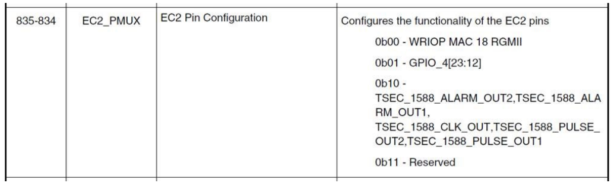

**Figure 37. EC2_PMUX**

- Với LX2162AQDS: Cập nhật file nguồn RCW (ví dụ `lx2160aqds/FFGG_XXXX_PPPP_HHHHH_PPPP` `_PPPP_19_5_2/rcw_2000_700_2900_19_5_2.rcw`)

  Vì file RCW của LX2160AQDS là soft link tới file RCW của LX2160ARDB, như sau:

  ```
  lx2160aqds/FFGG_XXXX_PPPP_HHHHH_PPPP_PPPP_19_5_2/rcw_2000_700_2900_19_5_2.rcw
   -> ../../lx2160ardb/XGGFF_PP_HHHH_19_5_2/rcw_2000_700_2900_19_5_2.rcw
  ```

  ```
  diff --git a/lx2160ardb/XGGFF_PP_HHHH_19_5_2/rcw_2000_700_2900_19_5_2.rcw b/
  lx2160ardb/XGGFF_PP_HHHH_19_5_2/rcw_2000_700_2900_19_5_2.rcw
  index 1ecf757..45a605a 100644
  --- a/lx2160ardb/XGGFF_PP_HHHH_19_5_2/rcw_2000_700_2900_19_5_2.rcw
  +++ b/lx2160ardb/XGGFF_PP_HHHH_19_5_2/rcw_2000_700_2900_19_5_2.rcw
  @@ -40,6 +40,7 @@ SRDS_PLL_REF_CLK_SEL_S1=2
   SRDS_DIV_PEX_S1=1
   SRDS_DIV_PEX_S2=3
   SRDS_DIV_PEX_S3=1
  +EC2_PMUX=1
   /* Errata to write on scratch reg for validation */
   #include <../lx2160asi/scratchrw1.rcw>
  ```

- Với LX2160ARDB: Cập nhật file nguồn RCW (`lx2160ardb/XGGFF_PP_HHHH_RR_19_5_2/rcw_2000_700_2900_19_5_2_sd.rcw`)

  ```
  diff --git a/lx2160ardb/XGGFF_PP_HHHH_RR_19_5_2/
  rcw_2000_700_2900_19_5_2_sd.rcw b/lx2160ardb/XGGFF_PP_HHHH_RR_19_5_2/
  rcw_2000_700_2900_19_5_2_sd.rcw
  index b51072c..1aadf55 100644
  --- a/lx2160ardb/XGGFF_PP_HHHH_RR_19_5_2/rcw_2000_700_2900_19_5_2_sd.rcw
  +++ b/lx2160ardb/XGGFF_PP_HHHH_RR_19_5_2/rcw_2000_700_2900_19_5_2_sd.rcw
  @@ -20,6 +20,7 @@ CGA_PLL1_RAT=20
   CGA_PLL2_RAT=20
   CGB_PLL1_RAT=20
   CGB_PLL2_RAT=7
  +EC2_PMUX=1
   C5_PLL_SEL=0
   C6_PLL_SEL=0
   C7_PLL_SEL=0
  ```

- Ghi image RCW đã build lại vào LX2160ARDB, rồi khởi động vào console U-Boot, chạy lệnh dưới đây để đặt bit 7 của BRDCFG4 thành 1’b1

  ```
  => i2c mw 66 54 80
  ```

  - PCB và Schematic của LX2160ARDB:

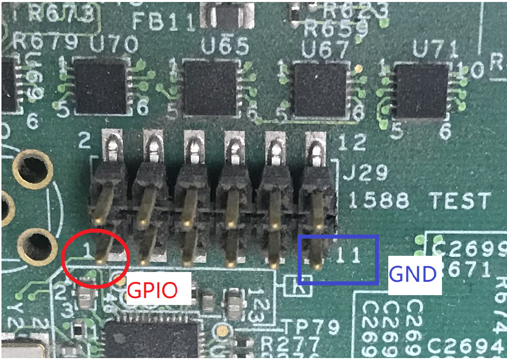

**Figure 38. Chân GPIO trên LX2160ARDB**

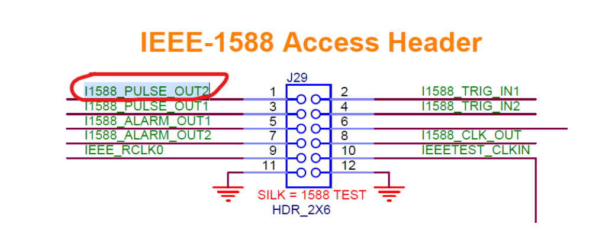

**Figure 39. Sơ đồ schematic header truy cập IEEE-1588 trên LX2160ARDB**

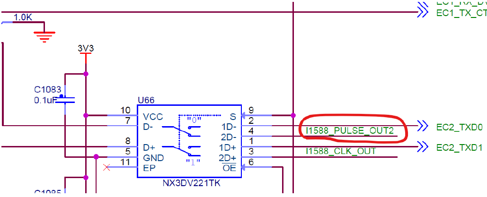

**Figure 40. Sơ đồ schematic NX3DV221TK**

- LX2160ARDBRM: Tín hiệu select của chip U66 NX3DV221TK được nối tới CFG_MUX_EC2 của CPLD


**Figure 41. Tín hiệu cấu hình CFG_MUX_EC2**

- Ghi image RCW đã build lại vào LX2160AQDS, rồi khởi động vào console U-Boot, chạy lệnh dưới đây để đặt bit 2 của BRDCFG5 thành 1’b1

  ```
  => i2c mw 66 55 64
  ```

  - PCB và Schematic của LX2160AQDS:

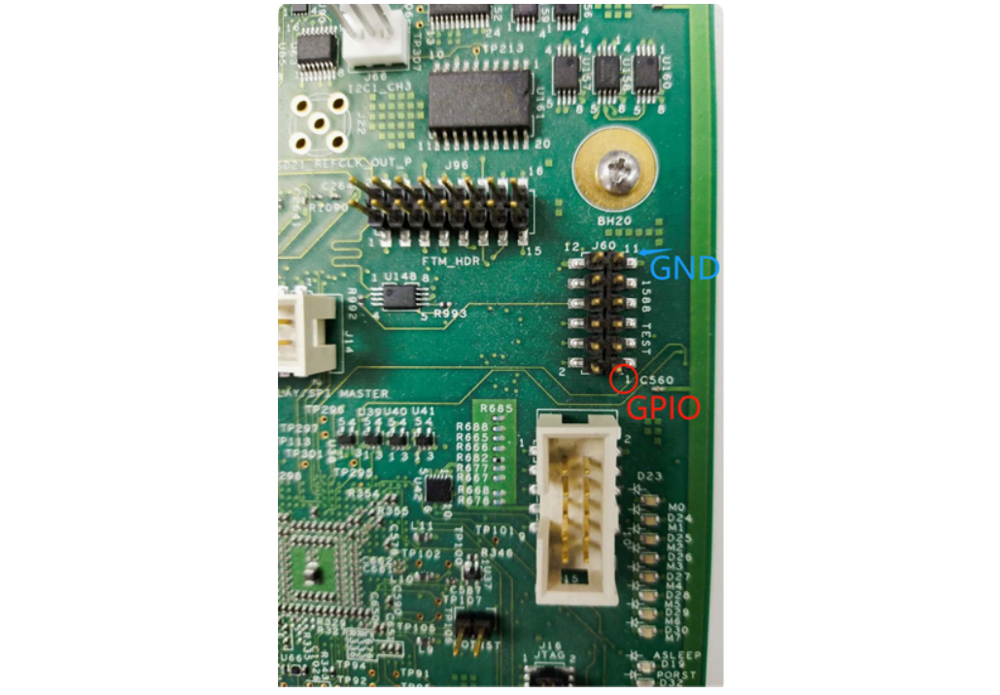

**Figure 42. Chân GPIO trên LX2160AQDS**


**Figure 43. Sơ đồ schematic header truy cập IEEE-1588 trên LX2160AQDS**


**Figure 44. Sơ đồ schematic NX3DV221TK**

- LX2160AQDSRM: Tín hiệu select của chip U136 NX3DV221TK được nối tới CFG_MUX_EC2_S của CPLD


**Figure 45. Tín hiệu cấu hình CFG_MUX_EC2_S**

- Khởi động vào console U-Boot.
  - Đặt BRDCFG5\[2\] thành 1’b1 và lấy trạng thái.

    ```
    => i2c mw 66 55 64
    => gpio
    gpio - query and control gpio pins
    Usage:
    gpio <input|set|clear|toggle> <pin>
        - input/set/clear/toggle the specified pin
    gpio status [-a] [<bank> | <pin>]  - show [all/claimed] GPIOs
    => gpio status -a
    Bank MPC@2320000_:
    MPC@2320000_0: input: 0 [ ]
    MPC@2320000_1: input: 0 [ ]
    …
    ```

  - Kiểm chứng ghi.

    ```
    => gpio set mpc@2330000_15
    gpio: pin mpc@2330000_15 (gpio 47) value is 1
    => gpio status  mpc@2330000_15
    Bank MPC@2330000_:
    MPC@2330000_15: output: 1 [ ]
    // Measure LX2160AQDS board J60 pin 1 voltage is 1.8V
    // Measure LX2160ARDB board J29 pin 1 voltage is 1.8V
    => gpio clear   mpc@2330000_15
    gpio: pin mpc@2330000_15 (gpio 47) value is 0
    => gpio status  mpc@2330000_15
    Bank MPC@2330000_:
    MPC@2330000_15: output: 0 [ ]
    // Measure LX2160AQDS board J60 pin 1 voltage is 0V
    // Measure LX2160ARDB board J29 pin 1 voltage is 0V
    => gpio toggle   mpc@2330000_15
    gpio: pin mpc@2330000_15 (gpio 47) value is 1
    => gpio status  mpc@2330000_15
    Bank MPC@2330000_:
    MPC@2330000_15: output: 1 [ ]
    // Measure LX2160AQDS board J60 pin 1 voltage is 1.8V
    // Measure LX2160ARDB board J29 pin 1 voltage is 1.8V
    => gpio toggle   mpc@2330000_15
    gpio: pin mpc@2330000_15 (gpio 47) value is 0
    => gpio status  mpc@2330000_15
    Bank MPC@2330000_:
    MPC@2330000_15: output: 0 [ ]
    // Measure LX2160AQDS board J60 pin 1 voltage is 0V
    // Measure LX2160ARDB board J29 pin 1 voltage is 0V
    ```

  - Kiểm chứng đọc.

    ```
    // Short LX2160AQDS board J60 pin 1 and pin 11 (GND)
    // Short LX2160ARDB board J29 pin 1 and pin 11 (GND)
    => gpio input mpc@2330000_15
    gpio: pin mpc@2330000_15 (gpio 47) value is 0
    // Short LX2160AQDS board J60 pin 1 with a +5V pin
    // Short LX2160ARDB board J29 pin 1 with a +5V pin
    => gpio input mpc@2330000_15
    gpio: pin mpc@2330000_15 (gpio 47) value is 1
    ```

- Khởi động vào console Linux kernel.
  - Kiểm tra bộ điều khiển GPIO

    ```
    # cat /sys/kernel/debug/gpio
    gpiochip3: GPIOs 384-415, parent: platform/2330000.gpio,2330000.gpio:
     (represent GPIO4)
    gpiochip2: GPIOs 416-447, parent: platform/2320000.gpio, 2320000.gpio:
     (represent GPIO3)
    gpiochip1: GPIOs 448-479, parent: platform/2310000.gpio, 2310000.gpio:
     (represent GPIO2)
    gpiochip0: GPIOs 480-511, parent: platform/2300000.gpio, 2300000.gpio:
     (represent GPIO1)
    ```

  - Export chân GPIO.

    ```
    # echo 399 > /sys/class/gpio/export (399 = 384 + 15, GPIO1_15)
    ```

  - Kiểm chứng ghi.

    ```
    # echo out > /sys/class/gpio/gpio399/direction
    # echo 1 > /sys/class/gpio/gpio399/value
    // Measure LX2160AQDS board J60 pin 1 voltage is 1.8V
    // Measure LX2160ARDB board J29 pin 1 voltage is 1.8V
    # echo 0 > /sys/class/gpio/gpio399/value
    // Measure LX2160AQDS board J60 pin 1 voltage is 0V
    // Measure LX2160ARDB board J29 pin 1 voltage is 0V
    ```

  - Kiểm chứng đọc.

    ```
    # echo in > /sys/class/gpio/gpio399/direction
    // Short LX2160AQDS board J60 pin 1 and pin 11 (GND)
    // Short LX2160ARDB board J29 pin 1 and pin 11 (GND)
    # cat /sys/class/gpio/gpio399/value
    0
    // Short LX2160AQDS board J60 pin 1 with a +5V pin
    // Short LX2160ARDB board J29 pin 1 with a +5V pin
    # cat /sys/class/gpio/gpio399/value
    1
    ```

  - Kiểm chứng interrupt.

    ```
    # echo in > /sys/class/gpio/gpio399/direction
    # echo falling > /sys/class/gpio/gpio399/edge
    // On LX2160AQDS, short J60 pin 1 and VCC, wait a second, then short
     LX2160AQDS board J60 pin 1 and pin 11 (GND)
    // On LX2160ARDB, short J29 pin 1 and VCC, wait a second, then short J29 pin
     1 and pin 11 (GND)
    # cat /proc/interrupts |grep gpio
    21: 0 0 0 0 0 0 0 0 0 0 0 0 0 0 0 0 GICv3  68 Level     gpio-cascade, gpio-
    cascade
    22: 552 0 0 0 0 0 0 0 0 0 0 0 0 0 0 0 GICv3  69 Level     gpio-cascade, gpio-
    cascade
    117: 552 0 0 0 0 0 0 0 0 0 0 0 0 0 0 0  mpc8xxx-gpio  15 Edge      gpiolib
    ```

Tóm lại:

1. Tìm một chân phù hợp (chân có thể dùng làm GPIO).
2. Sửa và build RCW để chuyển chức năng của chân sang chức năng GPIO.
3. Cập nhật RCW để ghi vào thẻ SD.
4. Kiểm thử nó ở U-Boot/Linux.

### 7.5.24 Hướng dẫn sử dụng QUICC Engine HDLC/TDM

#### 7.5.24.1 Linux SDK cho các bộ xử lý QorIQ

#### 7.5.24.2 Mô tả

HDLC, viết tắt của High-level Data Link Control, là một trong những giao thức phổ biến nhất của Layer 2 (Data Link Layer) trong mô hình OSI bảy lớp. HDLC dùng quá trình chèn/xóa bit không (thường được gọi là bit stuffing) để bảo đảm mẫu bit của cờ phân cách không xuất hiện trong các trường giữa các cờ. Frame HDLC là đồng bộ và vì vậy dựa vào lớp vật lý để có phương pháp tạo clock và đồng bộ bộ phát/bộ thu.

Driver HDLC/TDM được triển khai bởi UCC và TSA (HDLC là giao thức lớp trên của TDM). Nó cho phép UCC1/3 hoạt động theo giao thức hdlc, kết nối với card X-TDM-DS26522 để hỗ trợ chức năng T1/E1. Nó có thể hoạt động ở chế độ bình thường hoặc loopback cho cả bộ điều khiển tdm và phy. Cắm card X-TDM-DS26522 vào khe TDM Riser, nó có thể truyền dữ liệu và nhận dữ liệu.

#### 7.5.24.3 Cấu hình U-Boot

**Các tùy chọn lúc compile**

Dưới đây là các tùy chọn cấu hình U-Boot chính liên quan đến tính năng này, được định nghĩa trong các file config riêng cho từng platform dưới thư mục include/configs/.

| Option Identifier | Mô tả |
|---|---|
| CONFIG_U_QE | Bật hỗ trợ QE |
| CONFIG_SYS_QE_FW_ADDR | Địa chỉ firmware QE |

Chọn các chế độ U-Boot định nghĩa sẵn:

make ls1043ardb_deconfig

trước khi thực sự build

**Các tùy chọn lúc chạy**

| Biến môi trường | Mô tả biến môi trường | Tùy chọn con | Mô tả tùy chọn |
|---|---|---|---|
| hwconfig | Cấu hình phần cứng cho U-Boot | qe-hdlc | Gán chân cho HDLC;<br>QUICC Engine TDM được bật trong DTB |
| bootargs | Đối số command-line của kernel được truyền cho kernel |   |   |

#### 7.5.24.4 Tùy chọn cấu hình kernel

**Tree View**

LS1043ARDB và card X-TDM-DS26522:

| Tùy chọn Kernel Configure Tree View | Mô tả |
|---|---|
|   | Bật driver QE TDM và driver card X-TDM-DS26522. |
| `Device Drivers --->`<br>`    SOC (System On Chip) specific`<br>` Drivers --->`<br>`        [*] Freescale QUICC Engine`<br>` (QE) Support`<br>`    [*] Network device support --->`<br>`        [*] Wan interfaces support`<br>` --->`<br>`            <*> Generic HDLC layer`<br>`            <*> Raw HDLC support`<br>`            <*> Freescale QUICC`<br>` Engine HDLC support`<br>`            <*> SLIC MAXIM DS26522`<br>` CARD SUPPORT` |   |

**Identifier**

Dưới đây là các identifier cấu hình được dùng trong source code kernel và các file cấu hình mặc định.

| Tùy chọn | Giá trị | Giá trị mặc định | Mô tả |
|---|---|---|---|
| CONFIG_QUICC_ENGINE | y/n | n | QUICC Engine được bật |
| CONFIG_FSL_UCC_TDM | y/n | n | Thư viện QUICC Engine TDM |
| CONFIG_SLIC_MAXIM | y/m/n | n | Bật hỗ trợ x-tdm-ds26522 card |
| FSL_UCC_HDLC | y/m/n | n | Driver QUICC Engine |

#### 7.5.24.5 Device Tree Binding

Dưới đây là định nghĩa device tree node mà tính năng này cần

| Property | Kiểu | Trạng thái | Mô tả |
|---|---|---|---|
| qe | qe | enable | Node QUICC Engine |
| ucc | hdlc | enable | Node QE UCC HDLC. |
| si | si | si | Node QE TSA |

Dưới đây là một ví dụ device tree node mà tính năng này cần. Lưu ý rằng nó có thể khác nhau giữa các platform.

LS1040ARDB và card X-TDM-DS26522:

```
ucc_hdlc: ucc@2000 {
               compatible = "fsl,ucc-hdlc";
               rx-clock-name = "clk8";
               tx-clock-name = "clk9";
               fsl,rx-sync-clock = "rsync_pin";
               fsl,tx-sync-clock = "tsync_pin";
               fsl,tx-timeslot-mask = <0xfffffffe>;
               fsl,rx-timeslot-mask = <0xfffffffe>;
               fsl,tdm-framer-type = "e1";
               fsl,tdm-id = <0>;
               fsl,siram-entry-id = <0>;
               fsl,tdm-interface;
       };
       slic@3 {
               compatible = "maxim,ds26522";
               reg = <3>;
               spi-max-frequency = <2000000>;
               fsl,spi-cs-sck-delay = <100>;
               fsl,spi-sck-cs-delay = <50>;
       };
```

#### 7.5.24.6 Các file source

Các file mã nguồn sau liên quan đến tính năng này trong Linux.

T1040RDB và card X-TDM-DS26522:

| File source | Mô tả |
|---|---|
| drivers/soc/fsl/qe/qe_tdm.c | Thư viện QE UCC TDM |
| include/soc/fsl/qe/qe_tdm.h | File header thư viện QE UCC TDM. |
| drivers/net/tdm/slic_ds26522.c | Driver card X-TDM-DS26522. |
| drivers/net/wan/fsl_ucc_hdlc.\* | Driver QE HDLC |
| arch/arm64/boot/dts/freescale/fsl-ls1043a.dtsi | Định nghĩa các device tree node cho QE của LS1043ARDB |
| arch/arm64/boot/dts/freescale/fsl-ls1043a-rdb.dts | Định nghĩa các device tree node cho ds26522 của LS1043ARDB |

#### 7.5.24.7 Ứng dụng user space

Các ứng dụng sau sẽ được dùng trong kiểm thử chức năng hoặc hiệu năng. Tham khảo tài liệu SDK UM để biết quy trình build chi tiết.

| Tên lệnh | Mô tả | Tên gói |
|---|---|---|
| sethdlc | Công cụ lấy/đặt thông tin cổng của driver Linux HDLC packet radio modem | sethdlc |

#### 7.5.24.8 Kiểm chứng trong U-Boot

N/A

#### 7.5.24.9 Kiểm chứng trong Linux

1. Sau khi U-Boot khởi động, đặt tham số "qe-hdlc" trong hwconfig.
2. Sau khi khởi động kernel, kernel boot log cho hdlc:

   ```
   hdlc: HDLC support module revision 1.22
   ```

3. Kiểm thử QE HDLC T1/E1

   a. Cắm card X-TDM-DS26522 vào khe của board T1040RDB.

   b. Để kiểm thử các cổng tdm ngoài, cắm cáp loopback tdm t1/e1 vào cổng liên quan.

   Sau đây là ánh xạ cổng HDLC với card X-TDM-DS26522:

   ```
   HDLC Port                 X-TDM-DS26522 Port
   Port A                         CH1;
   Port B                         CH2;
   ```

   c. Kiểm thử HDLC dùng E1.

   Dùng dts mặc định để kiểm thử chức năng E1. Module kiểm thử có thể nhận ucc_num làm tham số. Số này phải là 1/3, ứng với cổng tdm.

   ```
   ls1043ardb login: root
   root@ls1043ardb:~# ./sethdlc hdlc0 hdlc;
   root@ls1043ardb:~# ifconfig hdlc0 192.168.0.1 up
   [   41.072590] hdlc0: Carrier detected
   root@ls1043ardb:~# route add -net 192.168.0.0 netmask 255.255.255.0 gw
    192.168.0.1 hdlc0;
   root@ls1043ardb:~# ping 192.168.0.2;
   PING 192.168.0.2[   52.208784] Tx data skb->len:86  (192.168.0.2) 56(84)
    bytes of d[   52.213119]
   [   52.213119] Transmitted data:
   ata.
   [   52.220324] ff
   [   52.222491] 44
   [   52.224154] 45
   [   52.225810] 00
   [   52.227472] 00
   [   52.229125] 54
   [   52.230778] c3
   [   52.232440] 89
   [   52.234094] 40
   [   52.235755] 00
   [   52.237408] 40
   [   52.239069] 01
   [   52.240722] f5
   [   52.242375] cb
   [   52.244038] c0
   [   52.245691] a8
   [   52.247844] irq ucce:20000
   [   52.250543] TxBD: 1c00
   [   52.252900] Received data length:88[   52.256206] while entry times:0
   [   52.259338]
   [   52.259338] Received data:
   [   52.263512] ff
   [   52.265165] 44
   [   52.266818] 45
   [   52.268474] 00
   [   52.270127] 00
   [   52.271782] 54
   [   52.273435] c3
   [   52.275091] 89
   [   52.276744] 40
   [   52.278397] 00
   [   52.280052] 40
   [   52.281705] 01
   [   52.283361] f5
   [   52.285014] cb
   [   52.286667] c0
   [   52.288322] a8
   [   52.289980] skb->protocol:8
   [   52.292784] irq ucce:80000
   [   53.262909] Tx data skb->len:86 [   53.265951]
   ```

## 7.6 Hướng dẫn sử dụng kdump/kexec

Chủ đề này giải thích tính năng “kexec/kdump” trên các platform NXP Layerscape ARMv8.

**Ghi chú:** Để biết thêm thông tin về tính năng kdump của Linux kernel, xem các tài liệu sau tại kernel.org:

- Documentation/kdump/kdump.txt
- Documentation/kdump/gdbmacros.txt

**Các tính năng và cấu hình được hỗ trợ**

Tính năng kexec:

- Kernel thứ nhất phải có khả năng khởi động một kernel khác bằng các lệnh `kexec-l` và `kexec -e`.

Tính năng kdump:

- Kernel thứ nhất phải hỗ trợ nạp và khởi động crash dump kernel trong trường hợp kernel panic.
- vmcore của kernel thứ nhất phải có sẵn trong `/proc/vmcore` của dump capture kernel.
- Phải có cơ chế sao chép vmcore sang bộ lưu trữ thứ cấp, như phân vùng thẻ SD hoặc phân vùng ổ USB.
- vmcore phải diễn giải được bằng gdb trên host x86.
- vmcore phải diễn giải được bằng tiện ích crash trên host x86.

Chỉ chế độ LE của kernel được hỗ trợ.

**Ghi chú:**

- Kernel thứ nhất phải được khởi động với `nokaslr` trong bootargs của kernel.
- Mọi kiểm thử đều được thực hiện với U-Boot làm bootloader ở chế độ nonEFI.
- Rootfs khuyến nghị cho kernel thứ hai/crashdump:
  - Khuyến nghị dùng rootfs trên phân vùng thẻ SD, giống kernel chính.
  - Dùng ramdisk có thể dẫn tới một số ràng buộc về kích thước. Kích thước crash kernel giữ ở 512M là ổn. Và rootfs cho kernel thứ hai nên là rootfs tối thiểu. Root filesystem lớn hơn có thể gây vấn đề bộ nhớ.
- Từ góc nhìn của dump-capture kernel, nên có cấu hình gần như giống nhau ở cả hai kernel, trừ khi có giới hạn đã biết nào đó. Lưu ý rằng với các platform DPAA1, hỗ trợ DPAA1 Ethernet, QBMan và FMan phải được loại khỏi config của dump-capture kernel, nếu không kernel thứ hai sẽ bị crash.
- Dump capture kernel có thể được khởi động bằng device tree của system kernel, nên không cần cung cấp tường minh dtb image cho dump capture kernel.
- kexec-utils không xử lý các fix-up của device tree. Vì vậy nếu người dùng cần cung cấp một device tree khác để khởi động kernel thứ cấp, người dùng cần sao chép dtb của kernel chính từ /sys/firmware/fdt, tạo dts, sửa khi cần và biên dịch lại để có dtb. Trong trường hợp này, dtb mới có thể được cung cấp bằng tùy chọn --dtb.

**Trạng thái kiểm thử**

**Table 52. Chi tiết phần mềm**

| Phiên bản kernel | Giống trong Layerscape LDP |
|---|---|
| Phiên bản U-Boot | Giống trong Layerscape LDP |
| kexec-tools | kexec-tools 2.0.17.git, kexec-tools-2.0.20 |
| Gdb | Giống trong Layerscape LDP |
| Crash | crash 7.1.9, crash 7.2.7 |

**Phương pháp kiểm thử**

Các tùy chọn cấu hình compile-time của Linux:

- Các tùy chọn cấu hình System Kernel
  1. Bật "kexec system call" trong "Processor type and features."

     ```
     CONFIG_KEXEC=y
     ```

  2. Bật "sysfs file system support" trong "Filesystem" -> "Pseudo filesystems." Tùy chọn này thường được bật theo mặc định.

     ```
     CONFIG_SYSFS=y
     ```

     Lưu ý rằng "sysfs file system support" có thể không xuất hiện trong menu "Pseudo filesystems" nếu "Configure standard kernel features (for small systems)" không được bật trong "General Setup." Trong trường hợp này, kiểm tra chính file .config để bảo đảm sysfs được bật, như sau:

     ```
     grep 'CONFIG_SYSFS' .config
     ```

  3. Bật "Compile the kernel with debug info" trong "Kernel hacking."

     ```
     CONFIG_DEBUG_INFO=Y
     ```

     Việc này khiến kernel được build với debug symbol. Các công cụ phân tích dump cần một vmlinux có debug symbol để đọc và phân tích file dump.

- Cấu hình hệ thống cho dump-capture kernel:
  1. Bật hỗ trợ "kernel crash dumps" trong "Processor type and features":

     ```
     CONFIG_CRASH_DUMP=y
     ```

  2. Bật "/proc/vmcore support" trong "Filesystems" -> "Pseudo filesystems".

     ```
     CONFIG_KCORE
     CONFIG_PROC_VMCORE=y
     CONFIG_PROC_VMCORE is set by default when CONFIG_CRASH_DUMP is selected.)
     ```

     Trong trường hợp LS1043, kernel thứ hai phải được build với driver DPAA bị loại ra.

**Quy trình kiểm thử: (log ví dụ/sẽ được cập nhật theo báo cáo kiểm thử mới nhất)**

1. Khởi động “system kernel/kernel thứ nhất”
2. Đặt bootargs của system kernel để dành riêng bộ nhớ cho “dump-capture/kernel thứ hai”

   ```
   => print dl_debug
   dl_debug=setenv bootargs  “root=/dev/mmcblk0p3 rw rootdelay=10
    console=ttyS0,115200 earlycon=uart8250,0x21c0500 ramdisk_size=0x10000000
    crashkernel=512M nokaslr loglevel=8;tftpboot 81000000 ls1043-debug.itb;bootm
    81000000”
   ```

3. Khởi động kernel thứ hai bằng kexec (-l/-e)

   ```
   root@ls1043ardb:~# cp /run/media/sda1/kexec /usr/sbin/
   root@ls1043ardb:~# chmod +x /usr/sbin/kexec
   root@ls1043ardb:~# ./kexec -l ./Image --append=" console=ttyS0,115200 root=/
   dev/mmcblk0p3 earlycon=uart8250,0x21c0500,115200 "
   root@ls1043ardb:~#./kexec -e
   ```

   **Ghi chú:** Khuyến nghị bật early con cho kernel thứ hai để debug hiệu quả các crash/lỗi sớm

4. “Dump-capture” kernel được nạp do kernel panic (ở đây chỉ một core được bật trong dump capture kernel, xem đối số maxcpus của dump-capture kernel)

   ```
   root@ls1043ardb:~# cp /run/media/sda1/kexec /usr/sbin/
   root@ls1043ardb:~# chmod +x /usr/sbin/kexec
   root@ls1043ardb:~# kexec -p Image-remove-dpaa  --append="root=/dev/mmcblk0p3
    rw rootdelay=10 console=ttyS0,115200 earlycon=uart8250,0x21c0500,115200
    maxcpus=1 reset_devices"
   ```

   **Ghi chú:** Khuyến nghị bật early con cho kernel thứ hai để debug hiệu quả các crash/lỗi sớm.

   ```
   Trigger a crash.
   root@ls1043ardb:~# echo c > /proc/sysrq-trigger
   [  210.085271] sysrq: SysRq : Trigger a crash
   [  210.089379] Unable to handle kernel NULL pointer dereference at virtual
    address 00000000
   [  210.097469] pgd = ffff80000190e000
   [  210.100862] [00000000] *pgd=00000000d2bc9003, *pud=0000000081c08003,
    *pmd=0000000000000000
   [  210.109139] Internal error: Oops: 96000046 [#1] PREEMPT SMP
   [  210.114700] Modules linked in:
   [  210.117748] CPU: 2 PID: 1809 Comm: sh Not tainted 4.4.39-00515-gf368a91-
   dirty #12
   [  210.125218] Hardware name: LS1043A RDB Board (DT)
   [  210.129910] task: ffff800054f48680 ti: ffff8000019a8000 task.ti:
    ffff8000019a8000
   [  210.137386] PC is at sysrq_handle_crash+0x14/0x1c
   [  210.142080] LR is at __handle_sysrq+0x124/0x194
   [  210.146599] pc : [<ffff8000003bca48>] lr : [<ffff8000003bd418>] pstate:
    60000145
   [  210.153981] sp : ffff8000019abd40
   Snip
    [  210.446905] [<ffff8000001a6610>] vfs_write+0x90/0x194
   [  210.451946] [<ffff8000001a7104>] SyS_write+0x44/0xa0
   [  210.456900] [<ffff800000085e30>] el0_svc_naked+0x24/0x28
   [  210.462201] Code: 52800020 b903dc20 d5033e9f d2800001 (39000020)
   [  210.468328] Starting crashdump kernel...
   [  210.476756] Bye!
   [    0.000000] Booting Linux on physical CPU 0x0000000003 [0x410fd034]
   [    0.000000] Linux version 5.4.3-03944-ge0081bf-dirty
    (nxf56392@lsv03080.swis.in-blr01.nxp.com) (gcc version 7.3.0 (GCC)) #5 SMP
    PREEMPT Mon Dec 30 11:17:45 IST 2019
   [    0.000000] Machine model: LS1043A RDB Board
   [    0.000000] earlycon: uart8250 at MMIO 0x00000000021c0500 (options '')
   [    0.000000] printk: bootconsole [uart8250] enabled
   root@ls1043ardb:~# ls /proc/vmcore -al
   -r-------- 1 root root 1620045824 Sep 28 12:42 /proc/vmcore
   root@ls1043ardb:~# cp /proc/vmcore /run/media/sda1/kdump_vmcore
   root@ls1043ardb:~# umount /run/media/sda1
   root@ls1043ardb:~#
   ```

   Khởi động lại kernel thứ nhất và vmcore có thể được chuyển sang máy host (X86) để xem xét bằng crash và gdb.

5. Diễn giải crash log bằng tiện ích crash.

   ```
   nxa19049@lsv03080:~/data/ups/crash$ ./crash  ../../vmlinux ../../vmcore.9jan
   crash 7.2.7++
   Copyright (C) 2002-2019  Red Hat, Inc.
   Copyright (C) 2004, 2005, 2006, 2010  IBM Corporation
   Copyright (C) 1999-2006  Hewlett-Packard Co
   Copyright (C) 2005, 2006, 2011, 2012  Fujitsu Limited
   Copyright (C) 2006, 2007  VA Linux Systems Japan K.K.
   Copyright (C) 2005, 2011  NEC Corporation
   Copyright (C) 1999, 2002, 2007  Silicon Graphics, Inc.
   Copyright (C) 1999, 2000, 2001, 2002  Mission Critical Linux, Inc.
   This program is free software, covered by the GNU General Public License,
   and you are welcome to change it and/or distribute copies of it under
   certain conditions.  Enter "help copying" to see the conditions.
   This program has absolutely no warranty.  Enter "help warranty" for details.
   GNU gdb (GDB) 7.6
   Copyright (C) 2013 Free Software Foundation, Inc.
   License GPLv3+: GNU GPL version 3 or later <http://gnu.org/licenses/gpl.html>
   This is free software: you are free to change and redistribute it.
   There is NO WARRANTY, to the extent permitted by law.  Type "show copying"
   and "show warranty" for details.
   This GDB was configured as "--host=x86_64-unknown-linux-gnu --target=aarch64-
   elf-linux"...
         KERNEL: ../../vmlinux                     unum=0crash: test msg 2
    p=7b5bf050 cpunum=1crash: test msg 2 p=7b5d7050 cpunum=2crash: test msg 2
    p=7b5ef050 cpunum=3
       DUMPFILE: ../../vmcore.9jan
           CPUS: 4
           DATE: Sun Jan 28 21:30:08 2018
         UPTIME: 00:02:30
   LOAD AVERAGE: 2.08, 1.24, 0.49
          TASKS: 188
       NODENAME: localhost
        RELEASE: 5.4.3-03991-g6bf2ce3-dirty
        VERSION: #10 SMP PREEMPT Thu Jan 9 14:31:21 IST 2020
        MACHINE: aarch64  (unknown Mhz)
         MEMORY: 1.9 GB
          PANIC: "Kernel panic - not syncing: sysrq triggered crash"
            PID: 1138
        COMMAND: "bash"
           TASK: ffff000030417000  [THREAD_INFO: ffff000030417000]
            CPU: 3
          STATE: TASK_RUNNING (PANIC)
   crash> help
   *              extend         log            rd             task
   alias          files          mach           repeat         timer
   ascii          foreach        mod            runq           tree
   bpf            fuser          mount          search         union
   bt             gdb            net            set            vm
   btop           help           p              sig            vtop
   dev            ipcs           ps             struct         waitq
   dis            irq            pte            swap           whatis
   eval           kmem           ptob           sym            wr
   exit           list           ptov           sys            q
   crash version: 7.2.7++   gdb version: 7.6
   For help on any command above, enter "help <command>".
   For help on input options, enter "help input".
   For help on output options, enter "help output".
   crash> dev
   CHRDEV    NAME                 CDEV        OPERATIONS
    510      rpmb                (none)
      1      mem            ffff00004148bf00  memory_fops
    511      vfio                (none)
      2      pty            ffff0000410fcf00  tty_fops
      3      ttyp           ffff00004112e080  tty_fops
      4      /dev/vc/0      ffff800011f5a878  console_fops
      4      tty            ffff00004156aa80  tty_fops
      4      ttyS           ffff000041138d00  tty_fops
      5      /dev/tty       ffff800011f59388  tty_fops
      5      /dev/console   ffff800011f593f0  console_fops
      5      /dev/ptmx      ffff800011f59568  ptmx_fops
      7      vcs            ffff000041443a80  vcs_fops
     10      misc           ffff000041d72280  misc_fops
     13      input               (none)
     29      fb             ffff0000414a3580  fb_fops
     81      video4linux         (none)
     89      i2c            ffff000040c5b320  i2cdev_fops
     90      mtd            ffff0000417b0780  mtd_fops
    116      alsa           ffff000041d72f80  snd_fops
    128      ptm            ffff000041138300  tty_fops
    136      pts            ffff000041138480  tty_fops
    153      spi            ffff0000417bda00  spidev_fops
    207      ttymxc              (none)
    212      DVB            ffff800011f6b198  dvb_device_fops
    216      rfcomm              (none)
    226      drm            ffff000041147d80  drm_stub_fops
    234      uio            ffff000041f00980  uio_fops
    235      nvme                (none)
    236      ttyLF               (none)
    237      ttyLP               (none)
    238      ttyTHS              (none)
    239      ttyHS               (none)
    240      ttyMSM              (none)
    241      ttyMSM              (none)
    242      ttyAML              (none)
    243      bsg            ffff800011f4ad20  bsg_fops
    244      watchdog       ffff000040c4d608  watchdog_fops
    245      tee                 (none)
    246      iio                 (none)
    247      ptp            ffff000041eca050  posix_clock_file_operations
    248      pps                 (none)
    249      cec                 (none)
    250      media               (none)
    251      rtc            ffff000040c43318  rtc_dev_fops
    252      tpm                 (none)
    253      ttyMV               (none)
    254      gpiochip       ffff000041f9e2e8  gpio_fileops
   BLKDEV    NAME                GENDISK      OPERATIONS
    259      blkext              (none)
      7      loop           ffff0000412b4000  lo_fops
      8      sd                  (none)
     31      mtdblock       ffff0000412b7800  mtd_block_ops
     65      sd                  (none)
     66      sd                  (none)
     67      sd                  (none)
     68      sd                  (none)
     69      sd                  (none)
     70      sd                  (none)
     71      sd                  (none)
    128      sd                  (none)
    129      sd                  (none)
    130      sd                  (none)
    131      sd                  (none)
    132      sd                  (none)
    133      sd                  (none)
    134      sd                  (none)
    135      sd                  (none)
    179      mmc            ffff000041522000  mmc_bdops
    254      virtblk             (none)
   crash> help
   *              extend         log            rd             task
   alias          files          mach           repeat         timer
   ascii          foreach        mod            runq           tree
   bpf            fuser          mount          search         union
   bt             gdb            net            set            vm
   btop           help           p              sig            vtop
   dev            ipcs           ps             struct         waitq
   dis            irq            pte            swap           whatis
   eval           kmem           ptob           sym            wr
   exit           list           ptov           sys            q
   crash version: 7.2.7++   gdb version: 7.6
   For help on any command above, enter "help <command>".
   For help on input options, enter "help input".
   For help on output options, enter "help output".
   crash> list
   list: starting address required
   Usage:
     list [[-o] offset][-e end][-[s|S] struct[.member[,member] [-l offset]] -[x|
   d]]
          [-r|-B] [-h|-H] start
   Enter "help list" for details.
   crash> mach
          MACHINE TYPE: aarch64
           MEMORY SIZE: 1.9 GB
                  CPUS: 4
                    HZ: 250
             PAGE SIZE: 4096
   KERNEL VIRTUAL BASE: ffff000000000000
   KERNEL MODULES BASE: ffff800008000000
   KERNEL VMALLOC BASE: ffff800010000000
   KERNEL VMEMMAP BASE: fffffe0000000000
     KERNEL STACK SIZE: 16384
        IRQ STACK SIZE: 16384
            IRQ STACKS:
                 CPU 0: ffff800010000000
                 CPU 1: ffff800010008000
                 CPU 2: ffff800010010000
                 CPU 3: ffff800010018000
   crash> ps
      PID    PPID  CPU       TASK        ST  %MEM     VSZ    RSS  COMM
   >     0      0   0  ffff800011cc1380  RU   0.0       0      0  [swapper/0]
   >     0      0   1  ffff000041cb1c00  RU   0.0       0      0  [swapper/1]
   >     0      0   2  ffff000041cb2a00  RU   0.0       0      0  [swapper/2]
         0      0   3  ffff000041cb3800  RU   0.0       0      0  [swapper/3]
   <snip>
   crash>
   crash> sig
   PID: 1138   TASK: ffff000030417000  CPU: 3   COMMAND: "bash"
   SIGNAL_STRUCT: ffff00003042a200  NR_THREADS: 1
    SIG    SIGACTION        HANDLER       MASK       FLAGS
    [1] ffff0000304239e0 aaaad53e3f60 0000000043807efb 0
    [2] ffff000030423a00 aaaad53e3c50 0000000000000000 0
    [3] ffff000030423a20    SIG_IGN 0000000000000000 0
    [4] ffff000030423a40 aaaad53e3f60 0000000043807efb 0
    [5] ffff000030423a60 aaaad53e3f60 0000000043807efb 0
    [6] ffff000030423a80 aaaad53e3f60 0000000043807efb 0
    [7] ffff000030423aa0 aaaad53e3f60 0000000043807efb 0
    [8] ffff000030423ac0 aaaad53e3f60 0000000043807efb 0
    [9] ffff000030423ae0    SIG_DFL 0000000000000000 0
   [10] ffff000030423b00 aaaad53e3f60 0000000043807efb 0
   [11] ffff000030423b20 aaaad53e3f60 0000000043807efb 0
   [12] ffff000030423b40 aaaad53e3f60 0000000043807efb 0
   [13] ffff000030423b60 aaaad53e3f60 0000000043807efb 0
   [14] ffff000030423b80 aaaad53e3f60 0000000043807efb 0
   [15] ffff000030423ba0 aaaad53e36f0 0000000000000000 10000000 (SA_RESTART)
   [16] ffff000030423bc0    SIG_DFL 0000000000000000 0
   [17] ffff000030423be0 aaaad53cafa0 0000000000000000 10000000 (SA_RESTART)
   [18] ffff000030423c00    SIG_DFL 0000000000000000 0
   [19] ffff000030423c20    SIG_DFL 0000000000000000 0
   [20] ffff000030423c40    SIG_IGN 0000000000000000 0
   [21] ffff000030423c60    SIG_IGN 0000000000000000 0
   [22] ffff000030423c80    SIG_IGN 0000000000000000 0
   [23] ffff000030423ca0    SIG_DFL 0000000000000000 0
   [24] ffff000030423cc0 aaaad53e3f60 0000000043807efb 0
   [25] ffff000030423ce0 aaaad53e3f60 0000000043807efb 0
   [26] ffff000030423d00 aaaad53e3f60 0000000043807efb 0
   [27] ffff000030423d20    SIG_DFL 0000000000000000 0
   [28] ffff000030423d40 aaaad53e36e0 0000000000000000 0
   [29] ffff000030423d60    SIG_DFL 0000000000000000 0
   [30] ffff000030423d80    SIG_DFL 0000000000000000 0
   [31] ffff000030423da0 aaaad53e3f60 0000000043807efb 0
   [32] ffff000030423dc0    SIG_DFL 0000000000000000 0
   [33] ffff000030423de0    SIG_DFL 0000000000000000 0
   [34] ffff000030423e00    SIG_DFL 0000000000000000 0
   [35] ffff000030423e20    SIG_DFL 0000000000000000 0
   [36] ffff000030423e40    SIG_DFL 0000000000000000 0
   [37] ffff000030423e60    SIG_DFL 0000000000000000 0
   [38] ffff000030423e80    SIG_DFL 0000000000000000 0
   [39] ffff000030423ea0    SIG_DFL 0000000000000000 0
   [40] ffff000030423ec0    SIG_DFL 0000000000000000 0
   [41] ffff000030423ee0    SIG_DFL 0000000000000000 0
   [42] ffff000030423f00    SIG_DFL 0000000000000000 0
   [43] ffff000030423f20    SIG_DFL 0000000000000000 0
   [44] ffff000030423f40    SIG_DFL 0000000000000000 0
   [45] ffff000030423f60    SIG_DFL 0000000000000000 0
   [46] ffff000030423f80    SIG_DFL 0000000000000000 0
   [47] ffff000030423fa0    SIG_DFL 0000000000000000 0
   [48] ffff000030423fc0    SIG_DFL 0000000000000000 0
   [49] ffff000030423fe0    SIG_DFL 0000000000000000 0
   [50] ffff000030424000    SIG_DFL 0000000000000000 0
   [51] ffff000030424020    SIG_DFL 0000000000000000 0
   [52] ffff000030424040    SIG_DFL 0000000000000000 0
   [53] ffff000030424060    SIG_DFL 0000000000000000 0
   [54] ffff000030424080    SIG_DFL 0000000000000000 0
   [55] ffff0000304240a0    SIG_DFL 0000000000000000 0
   [56] ffff0000304240c0    SIG_DFL 0000000000000000 0
   [57] ffff0000304240e0    SIG_DFL 0000000000000000 0
   [58] ffff000030424100    SIG_DFL 0000000000000000 0
   [59] ffff000030424120    SIG_DFL 0000000000000000 0
   [60] ffff000030424140    SIG_DFL 0000000000000000 0
   [61] ffff000030424160    SIG_DFL 0000000000000000 0
   [62] ffff000030424180    SIG_DFL 0000000000000000 0
   [63] ffff0000304241a0    SIG_DFL 0000000000000000 0
   [64] ffff0000304241c0    SIG_DFL 0000000000000000 0
   SIGPENDING: no
      BLOCKED: 0000000000000000
   PRIVATE_PENDING
       SIGNAL: 0000000000000000
     SIGQUEUE: (empty)
   SHARED_PENDING
       SIGNAL: 0000000000000000
     SIGQUEUE: (empty)
   crash>
   crash>
   crash>
   crash>
   crash> exit
   nxa19049@lsv03080:~/data/ups/crash$
   ```

6. Diễn giải crash log bằng gdb.

   ```
   nxa19049@lsv03080:~/data/ups$ aarch64-fsl-linux-gdb ../vmlinux ../vmcore.9jan
   GNU gdb (GDB) 8.3.1
   Copyright (C) 2019 Free Software Foundation, Inc.
   License GPLv3+: GNU GPL version 3 or later <http://gnu.org/licenses/gpl.html>
   This is free software: you are free to change and redistribute it.
   There is NO WARRANTY, to the extent permitted by law.
   Type "show copying" and "show warranty" for details.
   This GDB was configured as "--host=x86_64-fslsdk-linux --target=aarch64-fsl-
   linux".
   Type "show configuration" for configuration details.
   For bug reporting instructions, please see:
   <http://www.gnu.org/software/gdb/bugs/>.
   Find the GDB manual and other documentation resources online at:
   <http://www.gnu.org/software/gdb/documentation/>.
   For help, type "help".
   Type "apropos word" to search for commands related to "word"...
   Reading symbols from ../vmlinux...
   [New process 1]
   [New process 1]
   [New process 1]
   [New LWP 1138]
   #0 0xffff800010b2f274 in arch_local_irq_enable ()
   at ./arch/arm64/include/asm/irqflags.h:36
   36 asm volatile(ALTERNATIVE(
   [Current thread is 3 (process 1)]
   (gdb) bt
   #0 0xffff800010b2f274 in arch_local_irq_enable ()
   at ./arch/arm64/include/asm/irqflags.h:36
   #1 cpuidle_enter_state (dev=0xffff00007b5b1c00, drv=0xffff000040c8f400,
   index=<optimized out>) at drivers/cpuidle/cpuidle.c:247
   #2 0xffff800010b2f5a4 in cpuidle_enter (drv=0xffff000040c8f400,
   dev=0xffff00007b5b1c00, index=2069568512) at drivers/cpuidle/cpuidle.c:344
   #3 0xffff800010114c50 in call_cpuidle (drv=<optimized out>,
   dev=<optimized out>, next_state=<optimized out>) at kernel/sched/idle.c:117
   Backtrace stopped: previous frame identical to this frame (corrupt stack?)
   (gdb) list
   31 u32 pmr = read_sysreg_s(SYS_ICC_PMR_EL1);
   32
   33 WARN_ON_ONCE(pmr != GIC_PRIO_IRQON && pmr != GIC_PRIO_IRQOFF);
   34 }
   35
   36 asm volatile(ALTERNATIVE(
   37 "msr daifclr, #2 // arch_local_irq_enable\n"
   38 "nop",
   39 __msr_s(SYS_ICC_PMR_EL1, "%0")
   40 "dsb sy",
   (gdb)
   ```

   **Bug đã biết, giới hạn hoặc vấn đề kỹ thuật**

   - Trong kernel thứ hai, các giao diện như qDMA, DPAA2 Ethernet và PCIe không hoạt động do giới hạn MSI. Xem danh sách vấn đề đã biết.
   - Hỗ trợ kexec cho DPAA1 Ethernet bị hạn chế. DPAA1 Ethernet chỉ hoạt động dưới kexec với biến thể driver kernel upstream.

     Ngoài ra, DPAA1 Ethernet hoạt động trong kernel thứ hai nếu cùng một kernel image được nạp ở cùng địa chỉ. Nói cách khác, DPAA1 Ethernet không được hỗ trợ dưới kdump. Trong quá trình kexec, khi kernel thứ hai khởi động, driver phải khởi tạo lại các vùng bộ nhớ riêng của QBMan bên trong các dải bộ nhớ của kernel thứ hai.

     Do giới hạn phần cứng, các dải bộ nhớ QBMan không thể được cập nhật nếu không hard reset SoC, việc mà flow kexec không kích hoạt.

     QBMan, và DPAA1 Ethernet nói chung, chỉ có thể được dùng trong kernel thứ hai nếu các vùng bộ nhớ vẫn giữ nguyên sau kexec.
