# 8 Các công nghệ mạng QorIQ

## 8.1 Tóm tắt các công nghệ mạng

NXP cung cấp một số kiến trúc mạng phần cứng khác nhau. Mỗi SoC tích hợp một trong số đó. Các kiến trúc phần cứng là:

| Kiến trúc mạng HW | Các khối |
|---|---|
| DPAA1 | QMan, BMan và FMan |
| DPAA2 | QBMan và WRIOP |
| DPAA2 và DPAA1 có quan hệ họ hàng ở chỗ cả hai đều dùng các queue chung dựa trên phần cứng. Ngoài ra, mỗi kiến trúc hỗ trợ thêm các bộ tăng tốc, như SEC, thông qua các queue này. |   |
| PFE | Khối PFE package engine |
| veTSEC | Khối bộ điều khiển Ethernet truyền thống veTSEC |
| ENETC | Bộ điều khiển Ethernet hỗ trợ TSN, được tích hợp dưới dạng một PCIe root complex |
| TSN Switch | L2 Switch hỗ trợ TSN (tức là Felix), được tích hợp dưới dạng PCIe root complex |

Bảng sau cho biết các SoC được Layerscape LDP hỗ trợ dùng kiến trúc phần cứng mạng nào.

| Kiến trúc mạng HW | Các SoC |
|---|---|
| DPAA1 | LS1023A, LS1043A, LS1026A, LS1046A |
| DPAA2 | LS1044A, LS1048A, LS1084A, LS1088A, LS2044A, LS2048 A, LS2084A, LS2088A,<br>LX2160A |
| PFE | LS1012A |
| veTSEC | LS1021A |
| ENETC | LS1028A |
| TSN switch | LS1028A |

## 8.2 Phần mềm riêng cho DPAA1

### 8.2.1 Tổng quan kiến trúc phần mềm DPAA1

#### 8.2.1.1 Giới thiệu

Xử lý đa lõi, hay xử lý nhiều luồng thực thi, đưa ra những cân nhắc riêng cho kiến trúc của các hệ thống mạng, bao gồm cân bằng tải/tận dụng bộ xử lý, duy trì thứ tự flow, và tận dụng cache hiệu quả. Dưới đây là phần điểm lại các tính năng, chức năng và đặc tính chính mà phần cứng QorIQ DPAA1 (Data Path Acceleration Architecture thế hệ thứ nhất) mang lại, đồng thời minh họa cách tốt nhất để thiết kế kiến trúc phần mềm nhằm tận dụng phần cứng DPAA1.

**Ghi chú:** Trong hầu hết tài liệu phần cứng và các tài liệu khác trước đây, DPAA thế hệ thứ nhất được gọi là DPAA. Để tránh nhầm lẫn với DPAA2 (thế hệ thứ hai), trong bộ tài liệu này chúng tôi sẽ gọi thế hệ thứ nhất là DPAA1.

Bằng cách tìm hiểu cách DPAA1 được cấu hình và tận dụng trong một ứng dụng cụ thể, người dùng có thể xác định nên dùng những thành phần và tính năng nào. Điều này giúp hợp lý hóa giai đoạn phát triển phần mềm của việc triển khai, bằng cách cho phép lập trình viên tập trung hiểu biết kỹ thuật vào các thành phần và tính năng được triển khai trong hệ thống đang phát triển, qua đó giảm tổng công sức học DPAA1 cần có để triển khai ứng dụng.

Đối tượng độc giả mục tiêu của chúng tôi đã quen với nội dung trong **QorIQ Data Path Acceleration Architecture (DPAA1)** **Reference Manual**.

##### 8.2.1.1.1 Lợi ích của DPAA1

Mục đích chính của DPAA1 là cung cấp khả năng thông minh bên trong phần IO của System-on-Chip (SOC) để định tuyến và quản lý công việc xử lý gắn với các traffic flow, nhằm đơn giản hóa các vấn đề về thứ tự và cân bằng tải gắn với xử lý đa lõi. Phần cứng DPAA1 kiểm tra traffic ingress và trích ra các flow do người dùng định nghĩa từ traffic của cổng. Sau đó nó lái các flow cụ thể (hoặc traffic liên quan) tới một core cụ thể hoặc một tập core.

Thiết kế kiến trúc một ứng dụng mạng với bộ xử lý đa lõi đặt ra những thách thức, như cân bằng khối lượng công việc và duy trì thứ tự flow, vốn không có trong thiết kế đơn lõi. Không có hỗ trợ phần cứng, phần mềm phải triển khai các kỹ thuật kém hiệu quả và cồng kềnh, làm giảm lợi ích hiệu năng của nhiều core. Để giải quyết các thách thức về cân bằng khối lượng công việc và thứ tự flow, DPAA1 xác định và tách các flow ingress rồi quản lý affinity flow-to-core tạm thời, vĩnh viễn hoặc bán vĩnh viễn. DPAA1 cũng cung cấp một cơ chế ưu tiên công việc, bảo đảm các flow ingress quan trọng được xử lý đúng mức và giải phóng phần mềm khỏi việc phải triển khai cơ chế xếp hàng ở egress. Vì phần cứng xác định core nào sẽ xử lý gói nào, hiệu năng được tăng nhờ làm ấm/stash cache trực tiếp cũng như nhờ thiên về affinity core-to-flow, bảo đảm các cấu trúc dữ liệu riêng của flow có thể ở lại trong cache của core.

Bằng cách hiểu DPAA1 được tận dụng thế nào trong một thiết kế cụ thể, kiến trúc sư hệ thống có thể ánh xạ ứng dụng để đạt mục tiêu hiệu năng và dùng các tính năng DPAA1 để tận dụng bất kỳ phần mềm ứng dụng cũ nào có thể tồn tại. Khi bản đồ ứng dụng này đã được xác định, kiến trúc sư có thể tập trung vào các chi tiết cụ thể hơn của việc triển khai.

##### 8.2.1.1.2 Các cân nhắc kiến trúc chung

Khi nhu cầu về khả năng xử lý tăng lên, cách thực tế duy nhất để tăng hiệu năng trên một chip silicon là tăng số core xử lý đa dụng (CPU). Tuy nhiên, nhiều thiết kế cũ chạy trên một bộ xử lý duy nhất; đưa nhiều bộ xử lý vào hệ thống tạo ra những cân nhắc đặc biệt, nhất là với một ứng dụng mạng.

##### 8.2.1.1.3 Thiết kế đa lõi

Xử lý đa lõi, hay xử lý nhiều luồng thực thi, đưa ra những cân nhắc riêng. Hầu hết các ứng dụng mạng được chia giữa các tác vụ data plane và control plane. Nói chung, các tác vụ control plane quản lý hệ thống bên trong mạng thiết bị rộng lớn. Dù control plane có thể xử lý các gói điều khiển giữa các hệ thống, tiến trình control plane không tham gia vào việc xử lý phần lớn traffic dữ liệu. Tác vụ này được để lại cho tác vụ hoặc chương trình xử lý data plane.

Luồng chung của chương trình data plane là nhận traffic dữ liệu (nói chung là các gói hoặc frame), xử lý hoặc biến đổi dữ liệu theo cách nào đó rồi gửi các gói tới chặng kế tiếp hoặc thiết bị kế tiếp trong mạng. Trong nhiều trường hợp, việc xử lý traffic phụ thuộc vào loại traffic. Ngoài ra, traffic thường tồn tại dưới dạng một flow, một luồng traffic trong đó các gói có liên quan với nhau. Một ví dụ đơn giản có thể là một kết nối giữa hai client mà ở mức gói được xác định bởi địa chỉ IP nguồn và đích. Thông thường, nhiều flow được đan xen trên một cổng giao diện duy nhất; số flow trên mỗi cổng phụ thuộc vào băng thông giao diện cũng như băng thông và loại của các flow liên quan.

##### 8.2.1.1.4 Offload phần mềm parse/classification

DPAA1 cung cấp khả năng thông minh bên trong phân hệ IO của SoC để chia traffic vào các queue do người dùng định nghĩa. Một lợi thế là khả năng thông minh dùng để chia traffic có thể được tận dụng ở mức hệ thống.

Ngoài việc sắp xếp và tách traffic, DPAA1 có thể nối thêm thông tin xử lý hữu ích vào luồng; giảm bớt việc phần mềm phải thực hiện các chức năng này (xem hình sau).

Lưu ý rằng DPAA1 không nhằm thay thế việc xử lý gói đáng kể hay thực hiện các tác vụ phân loại phức tạp. Tuy nhiên, một số ứng dụng có thể được lợi từ sự hợp lý hóa nhờ chức năng parse/classify/distribute bên trong DPAA1. Khả năng nhận diện và tách traffic theo flow là nền tảng cho cách DPAA1 giải quyết các vấn đề khác của ứng dụng đa lõi.

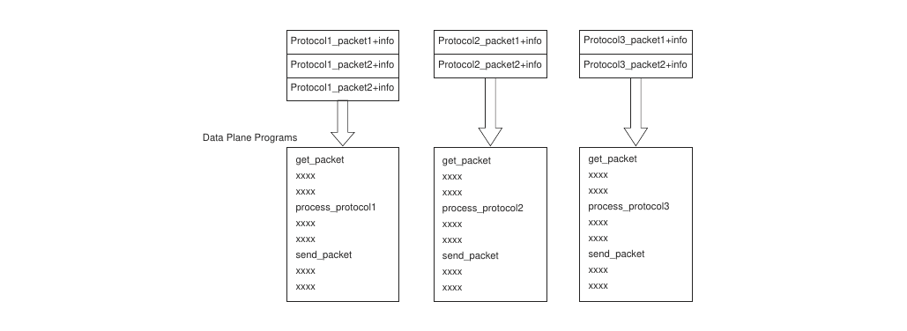

**Figure 46. Protocol flow được sắp xếp bằng phần cứng**

##### 8.2.1.1.5 Các cân nhắc về thứ tự flow

Trong hầu hết ứng dụng mạng, các traffic flow riêng lẻ đi qua hệ thống đòi hỏi các gói egress giữ nguyên thứ tự như khi chúng được nhận. Trong hệ thống một core xử lý, yêu cầu này dễ triển khai. Chừng nào phần mềm data plane tuân theo mô hình run-to-completion trên cơ sở từng gói, thứ tự egress sẽ khớp với thứ tự gói ingress. Tuy nhiên, nếu nhiều bộ xử lý được triển khai theo mô hình Symmetrical Multicore Processing (SMP) thực sự trong hệ thống, flow gói egress có thể bị sai thứ tự so với flow ingress. Điều này có thể xảy ra khi nhiều core đồng thời xử lý các gói từ cùng một flow.

Ngay cả khi luồng mã giống hệt nhau, các yếu tố như cache hit/miss, DRAM page hit/miss, interrupt, các tác vụ control plane và OS có thể gây ra một số biến động trong đường xử lý, cho phép các gói egress “vượt” nhau trong cùng một flow, như trong hình dưới đây.

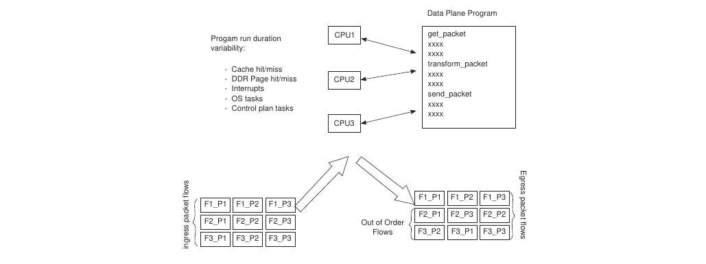

**Figure 47. Sắp xếp lại flow trên đa lõi**

Với một số ứng dụng, việc sắp xếp lại thứ tự các flow từ ingress tới egress là chấp nhận được. Tuy nhiên, hầu hết ứng dụng đòi hỏi thứ tự được duy trì. Khi không có phần cứng hỗ trợ việc sắp thứ tự này, phần mềm phải duy trì thứ tự flow. Thông thường, việc này đòi hỏi thêm mã để xác định số thứ tự của gói đang được xử lý, cũng như một tham chiếu tới cấu trúc dữ liệu duy trì thông tin thứ tự cho từng flow trong hệ thống. Vì nhiều bộ xử lý cần truy cập và cập nhật thông tin trạng thái này, việc truy cập cấu trúc này phải được kiểm soát cẩn thận, thường bằng một cơ chế lock có thể tốn kém về chu kỳ chương trình và luồng xử lý (xem hình dưới đây). Một trong các mục tiêu của kiến trúc DPAA1 là cung cấp cho người thiết kế hệ thống phần cứng hỗ trợ các vấn đề về thứ tự gói.

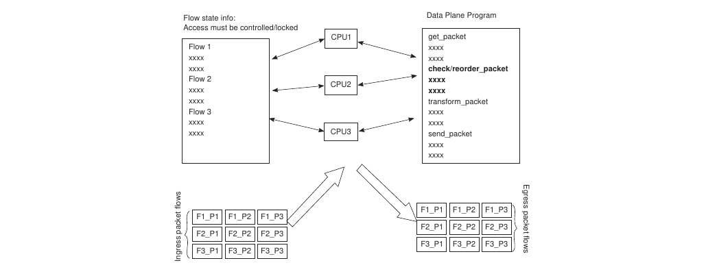

**Figure 48. Triển khai thứ tự bằng phần mềm**

##### 8.2.1.1.6 Quản lý affinity flow-to-core

Xử lý đa lõi, hay xử lý nhiều luồng thực thi, đưa ra những cân nhắc riêng cho kiến trúc của các hệ thống mạng, bao gồm cân bằng tải/tận dụng bộ xử lý, duy trì thứ tự flow, và tận dụng cache hiệu quả. Dưới đây là phần điểm lại các tính năng, chức năng và đặc tính chính mà phần cứng QorIQ DPAA1 (Data Path Acceleration Architecture) mang lại, đồng thời minh họa cách tốt nhất để thiết kế kiến trúc phần mềm nhằm tận dụng phần cứng DPAA1.

Trong một hệ thống mạng đa lõi, nếu cấu hình phần cứng luôn cho phép một core cụ thể xử lý một flow cụ thể thì việc gắn flow với core được mô tả là cung cấp flow affinity. Nếu một flow cụ thể luôn được xử lý bởi một core xử lý cụ thể, thì với flow đó hệ thống hoạt động như một hệ thống đơn lõi. Trong trường hợp này, thứ tự flow được giữ nguyên vì chỉ có một luồng hoạt động xử lý flow; với mô hình run-to-completion, không có cơ hội để các gói egress bị sắp xếp lại so với các gói ingress.

Một lợi thế khác của việc một flow cụ thể được gắn affinity với một core là cache cục bộ của core đó (L1 và có thể L2, tùy loại core cụ thể) ít bị miss hơn khi xử lý các gói, vì data cache của core sẽ không nạp thông tin trạng thái flow cho các flow không gắn affinity với nó. Ngoài ra, vì nhiều thực thể xử lý không cần truy cập cùng thông tin trạng thái flow riêng lẻ, hệ thống không cần lock việc truy cập dữ liệu trạng thái flow riêng lẻ. DPAA1 cung cấp một số tùy chọn để định nghĩa và quản lý affinity flow-to-core.

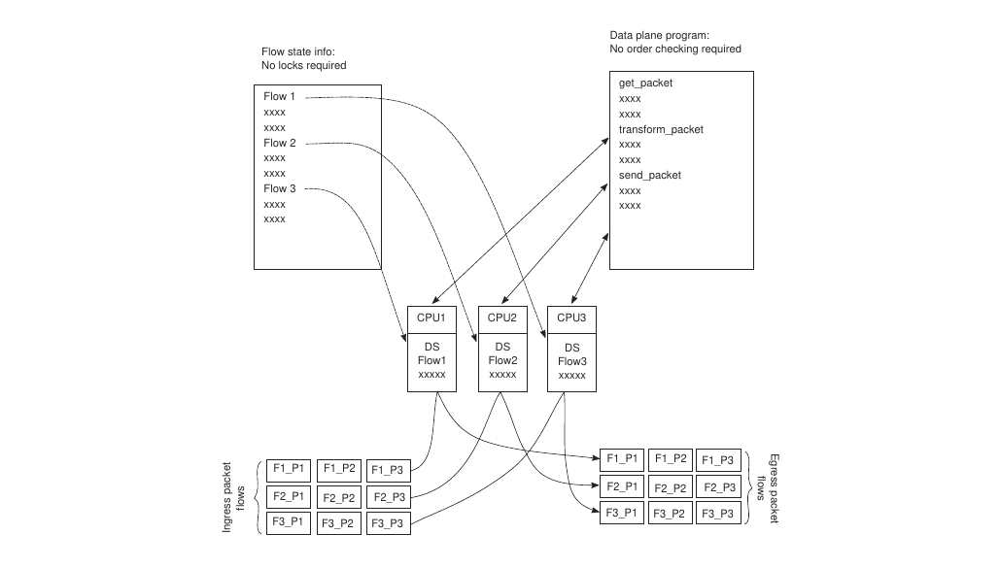

**Figure 49. Quản lý affinity flow-to-core**

Nhiều ứng dụng mạng đòi hỏi các thuật toán chuyên sâu, lặp đi lặp lại được thực hiện trên những phần lớn của (các) luồng dữ liệu. Dù phần mềm trong các core xử lý có thể thực hiện các thuật toán này, các offload engine phần cứng chuyên biệt thường xử lý các thuật toán cụ thể tốt hơn. Các bộ tăng tốc mật mã và so khớp mẫu là ví dụ cho điều này trong họ QorIQ. Các bộ tăng tốc này hoạt động như những thành phần phần cứng độc lập được cấp các khối hoặc luồng dữ liệu, thực hiện xử lý cần thiết, rồi cung cấp output trong một khối dữ liệu riêng (hoặc có thể bị ghi đè) bên trong hệ thống. Mức tăng hiệu năng là đáng kể với các tác vụ có thể được thực hiện bởi các bộ tăng tốc phần cứng này so với một bản triển khai phần mềm.

Trong các SoC có DPAA1, các offload engine này tồn tại ngang hàng với các core và các thành phần IO, và chúng dùng cùng cơ chế xếp hàng để lấy và truyền dữ liệu. Chi tiết về xử lý cụ thể do các offload engine này thực hiện nằm ngoài phạm vi tài liệu này; tuy nhiên, điều quan trọng là xác định những engine nào sẽ được tận dụng trong ứng dụng cụ thể. Khi đó DPAA1 có thể được định nghĩa đúng để triển khai cấu hình hoặc định nghĩa hiệu quả nhất cho các thành phần DPAA1.

#### 8.2.1.2 Các mục tiêu của DPAA1

Một tổng quan ngắn về các thành phần DPAA1 nhằm đặt các hoạt động ánh xạ ứng dụng vào bối cảnh. Để biết thêm chi tiết về kiến trúc DPAA1, xem **QorIQ Data Path Acceleration Architecture (DPAA1) Reference** Manual

Các mục tiêu chính của DPAA1 như sau:

- Cung cấp khả năng thông minh bên trong phần IO của SoC.
- Định tuyến và quản lý công việc xử lý gắn với các traffic flow.
- Đơn giản hóa các vấn đề về thứ tự và cân bằng tải gắn với xử lý đa lõi.

DPAA1 đạt các mục tiêu này bằng cách kiểm tra và tách traffic ingress vào các Frame Queue (FQ). Nói chung, ý định là định nghĩa một flow hoặc một tập flow là traffic trong một FQ cụ thể. Các FQ được gắn với một core cụ thể hoặc một tập core qua một channel. Bên trong định nghĩa channel, các FQ có thể được ưu tiên so với nhau bằng cơ chế Work Queue (WQ). Flow egress tương tự flow ingress. Các bộ xử lý đặt traffic lên một FQ cụ thể, FQ này được gắn với một cổng vật lý cụ thể qua một channel. Cùng cơ chế ưu tiên dùng WQ có ở egress, cho phép traffic ưu tiên cao hơn vượt qua traffic ưu tiên thấp hơn ở egress mà không cần phần mềm can thiệp.

#### 8.2.1.3 Tổng quan FMan

FMan kiểm tra traffic, chia nó vào các FQ ở ingress, và gửi traffic từ các FQ tới giao diện ở egress.

Với traffic ingress, FMan được cấu hình để xác định cách chia traffic theo yêu cầu của chức năng PCD (Parse, Classify, Distribute). Điều này cho phép người dùng quyết định traffic cần được định nghĩa như thế nào, theo flow hay theo lớp traffic. PCD có thể được cấu hình để định tuyến toàn bộ traffic trên một cổng tới một queue duy nhất, hoặc ở mức phức tạp hơn trong đó một số lượng lớn queue được định nghĩa và quản lý. PCD có thể nhận diện traffic dựa trên nội dung cụ thể của các gói đến (thường trong header) hoặc tốc độ nhận gói (policing).

Chức năng parse được dùng để nhận diện những trường nào trong frame dữ liệu quyết định cách chia traffic. Các trường được dùng có thể được định nghĩa bởi các chuẩn công nghiệp, hoặc người dùng có thể dùng tính năng soft parse lập trình được để đáp ứng (các) định nghĩa trường độc quyền (thường là header). Kết quả của chức năng parse có thể được dùng trực tiếp để xác định frame queue; hoặc nội dung của các trường được chức năng parse chọn có thể được dùng làm key để chọn frame queue. Chức năng parse dùng một mask được lập trình để cho phép dùng các trường được chọn.

Key kết quả từ chức năng parse có thể được dùng để gán traffic vào một queue cụ thể dựa trên định nghĩa so khớp chính xác cụ thể của các trường trong header. Hoặc, một dải queue có thể được định nghĩa bằng cách dùng trực tiếp key kết quả (nếu key có ít bit) hoặc bằng cách hash key để dùng nhiều bit trong định danh flow và tạo ra một số lượng queue quản lý được.

FMan cũng cung cấp một chức năng policer, dựa trên tốc độ, cho phép người dùng đánh dấu hoặc loại bỏ một frame cụ thể vượt quá ngưỡng traffic. Việc policing dựa trên thuật toán đánh dấu hai tốc độ, ba màu (RFC2698). Tốc độ duy trì và tốc độ đỉnh cũng như kích thước burst đều do người dùng cấu hình.

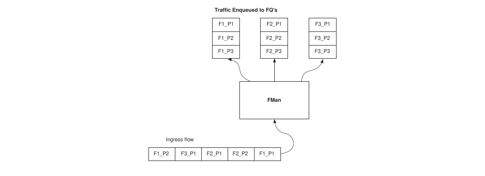

**Figure 50. Flow FMan ở ingress**

Hình trên cho thấy FMan chia traffic ingress trên một cổng ngoài vào một số queue. Tuy nhiên, FMan hoạt động theo cách tương tự ở egress: nó nhận traffic từ các FQ rồi truyền traffic trên cổng ngoài được chỉ định. Hoặc, FMan có thể được dùng để xử lý các flow bên trong qua cơ chế offline port: traffic được dequeue (từ một thành phần nào đó khác trong hệ thống), được xử lý, rồi được enqueue vào một frame queue để xử lý tiếp bên trong hệ thống.

Với traffic ingress, FMan tạo ra một khối dữ liệu internal context (IC), mà nó dùng khi thực hiện chức năng PCD. Tùy chọn, một phần hoặc toàn bộ thông tin này có thể được thêm vào các frame khi chúng được chuyển đi để xử lý tiếp. Với xử lý egress hoặc offline, dữ liệu IC có thể được truyền kèm mỗi frame cần xử lý. Dữ liệu này chủ yếu là kết quả của các hành động PCD và bao gồm kết quả của parser, có thể hữu ích cho phần mềm ứng dụng.


**Figure 51. Flow FMan ở egress**

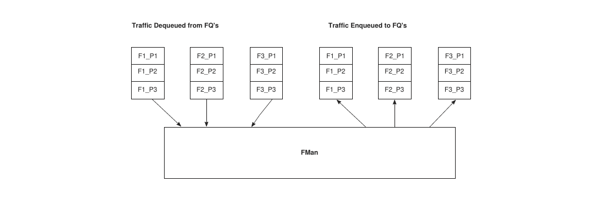

**Figure 52. Flow FMan offline**

#### 8.2.1.4 Tổng quan QMan

QMan liên kết các FQ với producer và consumer (của traffic dữ liệu) bên trong SoC. Các producer/consumer là FMan, các khối tăng tốc, hoặc các core CPU.

Mọi producer/consumer đều có một channel, mỗi channel được gọi là một dedicated channel. Ngoài ra, có một số pool channel cho phép nhiều core (không phải FMan hay bộ tăng tốc) phục vụ cùng một channel. Lưu ý rằng có các channel cho mỗi cổng FMan ngoài, số lượng tùy SoC, cũng như cho các offline port bên trong.

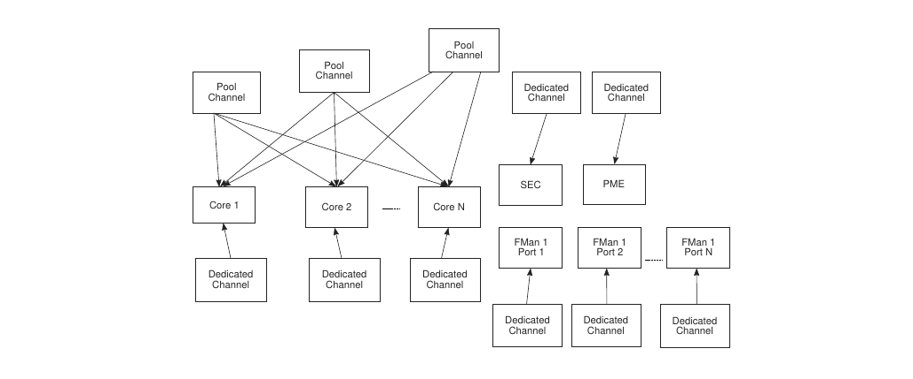

**Figure 53. Các loại channel của DPAA1**

Mỗi channel cung cấp tám mức ưu tiên, mỗi mức có work queue (WQ) riêng. Hai WQ mức cao nhất là ưu tiên tuyệt đối: traffic từ WQ0 phải được rút hết trước khi bất kỳ traffic nào khác chạy; sau đó traffic từ WQ1 rồi đến traffic từ sáu WQ còn lại được phép đi qua. Sáu WQ cuối được gom thành hai nhóm ba, có thể cấu hình theo kiểu weighted round robin. Hầu hết ứng dụng không cần dùng hết mọi mức ưu tiên. Khi nhiều FQ được gán cho cùng một WQ, QMan triển khai một cơ chế dựa trên credit để xác định FQ nào được lập lịch (cung cấp frame để xử lý) và nó được dequeue bao nhiêu frame (thực ra credit được định nghĩa bằng số byte trong các frame) trước khi QMan chuyển lịch sang FQ kế tiếp trên WQ. Nếu một WQ ưu tiên cao hơn trở nên active (tức là một trong các FQ trong WQ ưu tiên cao hơn nhận một frame và không còn rỗng) thì việc dequeue từ FQ ưu tiên thấp hơn bị tạm dừng cho đến khi các frame ưu tiên cao hơn được dequeue. Sau khi FQ ưu tiên cao hơn được phục vụ, khi FQ ưu tiên thấp hơn bắt đầu được phục vụ lại, nó làm vậy với credit còn lại trước khi bị FQ ưu tiên cao hơn chiếm quyền.

Khi các thành phần DPAA1 của SoC được khởi tạo, các FQ được gắn với các WQ, cho phép traffic được lái tới core mong muốn (dedicated connect channel), tập core (pool channel), FMan, hoặc bộ tăng tốc, theo một mức ưu tiên đã định nghĩa.

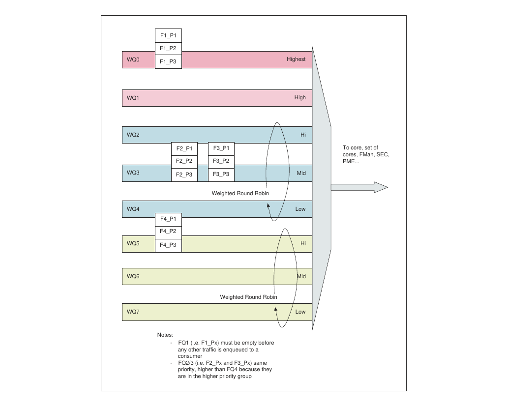

**Figure 54. Ưu tiên công việc**

##### 8.2.1.4.1 QMan: Các portal

Mỗi producer/consumer DPAA1 không phải core (FMan, SEC và PME) có một portal duy nhất. Đây là một cấu trúc dữ liệu bên trong SoC truyền dữ liệu trực tiếp tới/từ direct connect channel của consumer.

Các software portal được gắn với các core xử lý và về thực chất là các cấu trúc dữ liệu mà các core dùng để chuyển (enqueue) gói tới hoặc nhận (dequeue) gói từ các channel gắn với portal (core) đó. Mỗi SoC có ít nhất số software portal bằng số core. Software portal là giao diện mà qua đó DPAA1 cung cấp khối lượng công việc xử lý dữ liệu cho một luồng thực thi duy nhất.

Cấu trúc portal gồm các thành phần sau:

- Dequeue Response Ring (DQRR) xác định gói kế tiếp cần được xử lý.
- Enqueue Command Ring (EQCR) gửi các gói từ core tới các thành phần khác.
- Message Ring (MR) thông báo cho core về hành động (ví dụ dequeue đã thử bị từ chối, v.v.).
- Các thanh ghi điều khiển management command và response.

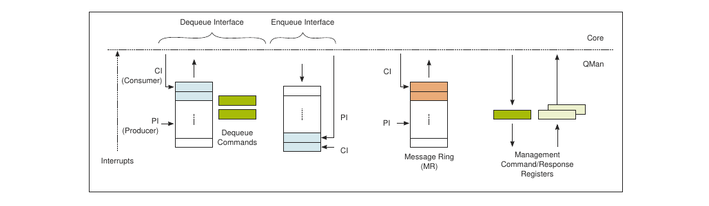

**Figure 55. Portal của core xử lý**

Ở ingress, DQRR hoạt động như một buffer nhỏ chứa các gói đến cho một core cụ thể. Khi một đoạn phần mềm thực hiện thao tác kiểu lấy gói, nó lấy gói từ một con trỏ được cung cấp dưới dạng một mục trong DQRR của core cụ thể đang chạy phần mềm đó. Lưu ý rằng DQRR hợp nhất mọi channel tiềm năng có thể đang cấp frame cho một core cụ thể. Mỗi DQRR có tới 16 mục. Mỗi mục DQRR chứa:

- một con trỏ tới gói cần xử lý,
- một định danh của frame queue mà gói xuất phát từ đó,
- một số thứ tự (khi được cấu hình),
- và dữ liệu bổ sung do FMan xác định (khi được cấu hình).

Khi được cấu hình ở push mode, QMan cố gắng lấp đầy DQRR từ mọi channel đến tiềm năng. Khi được cấu hình ở pull mode, QMan chỉ thêm một mục DQRR khi được core yêu cầu bảo làm vậy. Pull mode có thể hữu ích trong các trường hợp traffic flow phải được kiểm soát rất chặt; tuy nhiên, push mode thường được coi là chế độ ưu tiên cho hầu hết ứng dụng.

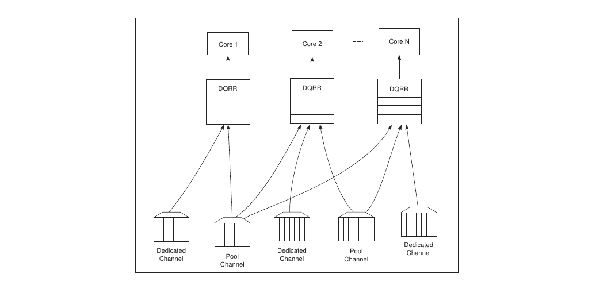

**Figure 56. Các tùy chọn từ ingress channel tới portal**

Các DQRR gắn chặt với một core xử lý. DPAA1 triển khai một tính năng cho phép cơ chế DQRR cấp phát trước, hay stash, cache L1 và/hoặc L2 với dữ liệu liên quan đến gói sẽ được core đó xử lý. Mục đích là có sẵn dữ liệu cần cho việc xử lý gói trong cache trước khi bộ xử lý chạy routine “get packet”, qua đó giảm tổng thời gian dành cho việc xử lý một gói cụ thể.

Sau đây là các dữ liệu có thể được làm ấm vào cache:

- Mục DQRR
- Gói hoặc một phần của gói với gói một buffer
- Danh sách scatter gather với gói nhiều buffer
- Dữ liệu bổ sung do FMan thêm vào
- FQ context (A và B)

FQ context là một vùng do người dùng định nghĩa trong bộ nhớ, chứa dữ liệu gắn với FQ (theo từng flow) cần được xử lý. Mục đích là đặt vào vùng dữ liệu này thông tin trạng thái cần khi xử lý một gói của flow này. FQ context là một phần của định nghĩa FQ, được thực hiện khi FQ được khởi tạo.

Tính năng làm ấm cache được bật bằng cách cấu hình khả năng này và một số định nghĩa của các FQ và QMan lúc khởi tạo hệ thống. Điều này có thể mang lại mức tăng hiệu năng đáng kể và đòi hỏi rất ít hoặc không cần thay đổi luồng xử lý. Khi định nghĩa kiến trúc hệ thống, rất khuyến nghị người dùng bật tính năng này và cân nhắc cách tối đa hóa tác dụng của nó.

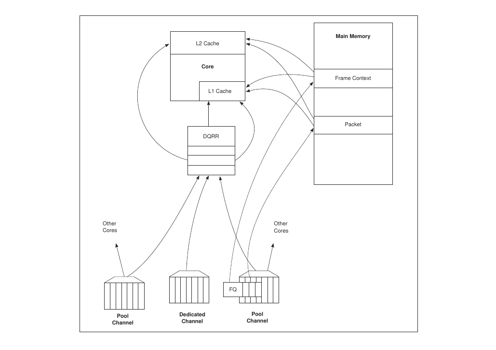

**Figure 57. Các tùy chọn làm ấm cache**

Ngoài việc lấy thông tin gói từ DQRR, phần mềm còn quản lý DQRR bằng cách cho biết nó sẽ tiêu thụ mục DQRR nào tiếp theo. Đây là cách QMan xác định khi nào DQRR (portal) sẵn sàng xử lý thêm frame. Có hai tùy chọn cơ bản. Ở tùy chọn thứ nhất, phần mềm có thể cập nhật con trỏ ring sau khi một hoặc vài mục đã được tiêu thụ. Bằng cách chờ để báo việc tiêu thụ nhiều frame, tác động hiệu năng của thao tác ghi làm việc này được giảm tối thiểu. Tùy chọn thứ hai là dùng chế độ discrete consumption acknowledgment (DCA). Chế độ này cho phép việc báo tiêu thụ được gắn trực tiếp với một thao tác enqueue frame từ portal (tức là sau khi frame đã được xử lý và đang trên đường tới egress queue). Việc theo dõi CI (Consumer Index) của DQRR Ring Pointer này giúp triển khai thứ tự frame bằng cách bảo đảm QMan không dequeue một frame từ cùng FQ (hay flow) tới một core khác cho đến khi việc xử lý hoàn tất.

#### 8.2.1.5 Lập lịch QMan

QMan liên kết các FQ với producer và consumer (của traffic dữ liệu) bên trong SoC.

##### 8.2.1.5.1 QMan: Các tùy chọn lập lịch queue

Đường giao tiếp chính giữa QMan và các core xử lý là cấu trúc bộ nhớ portal. QMan dùng giao diện này để lập lịch các frame cần xử lý trên cơ sở từng core. Với một dedicated channel, quá trình rất đơn giản: QMan đặt một mục vào DQRR của portal (bộ xử lý) của dedicated channel và dequeue frame từ một FQ tới portal. Để làm điều này, QMan xác định, dựa trên cơ chế ưu tiên (đã mô tả trước đó) của channel, frame nào nên được xử lý tiếp theo rồi thêm một mục vào DQRR của portal gắn với channel.

Khi được cấu hình ở push mode, một khi portal yêu cầu QMan cung cấp frame để xử lý, QMan cung cấp frame cho đến khi bị dừng. Khi DQRR đầy và có thêm frame dành cho portal, QMan chờ một slot trống xuất hiện trong DQRR rồi thêm các mục mới (frame cần xử lý) khi có slot trống.

Khi được cấu hình ở pull mode, QMan chỉ thêm mục vào DQRR theo yêu cầu trực tiếp của portal (yêu cầu của phần mềm). Lệnh gửi tới QMan quyết định push mode hay pull mode được triển khai, và bảo QMan cung cấp mỗi lần hoặc một frame, hoặc từ một đến ba frame (tối đa ba nếu có ngần ấy frame cần dequeue). Đây là sự đánh đổi giữa độ mịn nhỏ hơn (chỉ một frame) và việc gộp truy cập bộ nhớ (nếu chọn tùy chọn tối đa ba frame).

Khi hệ thống được cấu hình để dùng pool channel, một portal có thể nhận frame từ nhiều hơn một channel và một channel có thể cung cấp frame (công việc) cho nhiều hơn một portal (core). QMan dequeue frame bằng cùng cơ chế mô tả ở trên (cập nhật DQRR), và QMan cũng cung cấp một số tùy chọn lập lịch cụ thể để xét đến trường hợp pool channel, trong đó nhiều core có thể xử lý cùng một channel.

##### 8.2.1.5.2 QMan: Lập lịch mặc định

Lập lịch mặc định là để một FQ gửi frame tới cùng một core chừng nào FQ đó còn active. Một FQ active cho đến khi nó dùng hết credit được cấp hoặc trở nên rỗng. Sau khi một FQ dùng hết credit, nó lại được lập lịch lần nữa, cho đến khi rỗng. Trong cơ hội lập lịch của nó, FQ active và mọi frame được dequeue trong cơ hội đó đều tới cùng một core. Sau khi credit được tiêu thụ, QMan kích hoạt lại FQ đó nhưng có thể gán việc xử lý flow cho một core khác. Điều này tạo ra một affinity dính trong suốt khoảng thời gian của cơ hội lập lịch. Cơ hội lập lịch được quản lý bằng lượng credit gán cho FQ.

**Ghi chú:** Credit lớn hơn gán cho một FQ tạo ra affinity với core dính hơn, nhưng điều này làm độ mịn của công việc xử lý lớn hơn và có thể ảnh hưởng đến cân bằng tải.

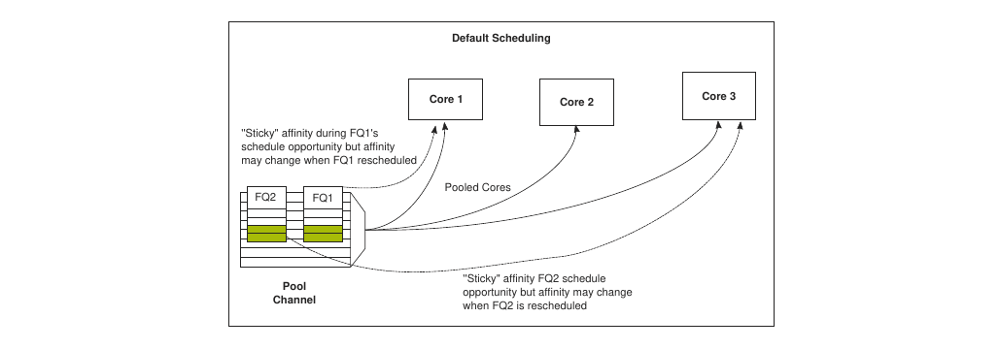

**Figure 58. Lập lịch mặc định**

##### 8.2.1.5.3 QMan: Lập lịch Hold Active

Với tùy chọn hold active, khi QMan gán một FQ cho một core cụ thể, FQ đó được gắn affinity với core đó cho đến khi rỗng. Ngay cả sau khi credit của FQ đã tiêu thụ hết, rồi nó được lập lịch lại ở cơ hội lập lịch kế tiếp, các frame vẫn tới cùng core đó để xử lý. Điều này thực chất làm affinity flow-to-core dính hơn trường hợp mặc định, bảo đảm cùng một flow được xử lý bởi cùng một core chừng nào còn frame xếp hàng chờ xử lý. Vì affinity flow-to-core không được cố định cứng như trường hợp dedicated channel, phần mềm có thể vẫn cần xét đến các vấn đề thứ tự tiềm ẩn. Tuy nhiên, nhờ thiên về flow-to-core, dữ liệu trạng thái flow có nhiều khả năng ở lại trong cache L1 hoặc L2 hơn, làm tăng tỉ lệ hit và qua đó cải thiện hiệu năng xử lý. Do cách triển khai cụ thể của QMan, tại một thời điểm chỉ bốn FQ có thể ở trạng thái held active.

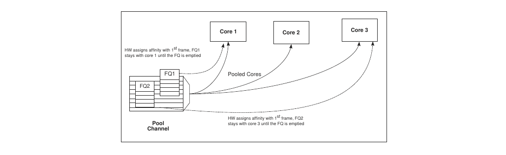

**Figure 59. Lập lịch Hold Active**

##### 8.2.1.5.4 QMan: Lập lịch avoid blocking

Lập lịch avoid blocking: QMan cũng có thể được lập lịch ở chế độ avoid blocking, vốn loại trừ lẫn nhau với hold active. Ở chế độ này, QMan lập lịch các frame của một FQ tới bất kỳ core nào sẵn sàng trong pool channel. Ví dụ, nếu credit cho phép dequeue ba frame, frame đầu tiên có thể tới core 1. Nhưng khi lần dequeue đó làm đầy DQRR của core 1, QMan tìm mục DQRR trống kế tiếp ở bất kỳ core nào trong pool. Với chế độ avoid blocking, không có sự thiên về affinity flow với core. Chế độ này hữu ích nếu một flow cụ thể hoặc không có yêu cầu thứ tự cụ thể nào, hoặc việc xử lý dự kiến cho một flow duy nhất được kỳ vọng sẽ tiêu tốn hơn khả năng xử lý của một core.

Hoặc, phần mềm có thể bỏ qua việc lập lịch của QMan và trực tiếp điều khiển việc dequeue các frame descriptor từ FQ. Chế độ này được triển khai bằng cách đặt FQ vào trạng thái parked. Điều này cho phép phần mềm xác định chính xác flow nào sẽ được xử lý (bởi core đang chạy phần mềm). Tuy nhiên, nó đòi hỏi phần mềm quản lý việc lập lịch, điều có thể thêm overhead và ảnh hưởng hiệu năng.

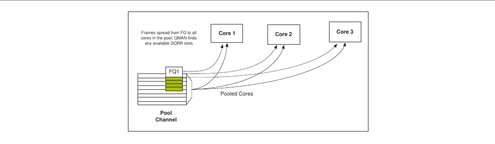

**Figure 60. Lập lịch avoid blocking**

##### 8.2.1.5.5 QMan: Định nghĩa/Khôi phục thứ tự

QMan cung cấp một cơ chế để bắt buộc thứ tự một cách nghiêm ngặt. Mỗi FQ có thể được định nghĩa để tham gia vào quá trình của một order definition point và/hoặc một order restoration point. Ở ingress, một order definition point cung cấp một số thứ tự 14-bit gán cho mỗi frame (tăng theo từng frame) trong một FQ theo thứ tự chúng được nhận trên giao diện. Số thứ tự được đặt trong mục DQRR của frame khi nó được dequeue tới một portal. Điều này cho phép phần mềm xác định hiệu quả nó đang xử lý gói nào trong chuỗi mà không cần truy cập một cấu trúc dữ liệu dùng chung (giữa các core). Ở egress, một order restoration point trì hoãn việc đặt một frame vào FQ cho đến khi gặp số thứ tự kế tiếp được mong đợi. Từ góc nhìn của phần mềm, một khi đã xác định thứ tự tương đối của một gói, nó có thể enqueue gói và tiếp tục xử lý khác theo kiểu fire-and-forget.

**Ghi chú:** Các order definition point và order restoration point không phụ thuộc vào nhau; có thể có cái này mà không có cái kia tùy yêu cầu ứng dụng. Để dùng hiệu quả các cơ chế này, phần mềm xử lý gói phải biết về việc gắn tag số thứ tự.

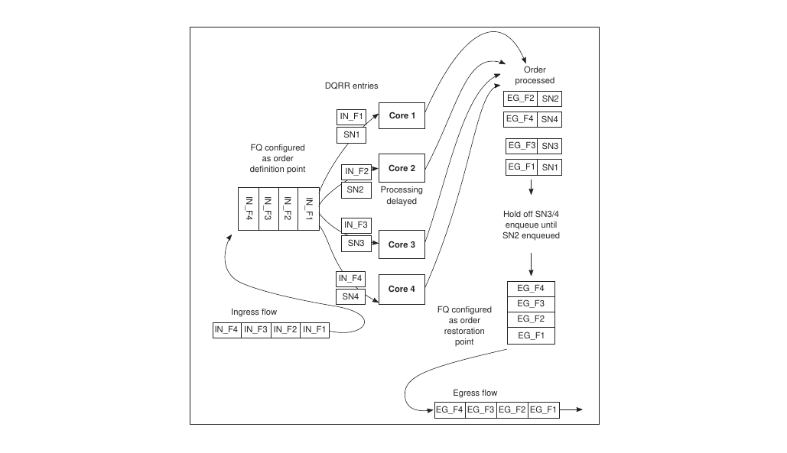

**Figure 61. Định nghĩa/Khôi phục thứ tự**

Khi các bộ xử lý enqueue gói cho egress, có thể chúng bỏ qua một số thứ tự do bản chất của giao thức đang được xử lý. Để xử lý tình huống này, mỗi FQ tham gia vào dịch vụ khôi phục thứ tự duy trì Next Expected Sequence Number (NESN) riêng. Khi chênh lệch giữa số thứ tự kế tiếp được mong đợi và số thứ tự nhận được gần nhất vượt quá ngưỡng ORP cấu hình được, QMan bỏ qua (các) frame bị thiếu và tự động tăng NESN để đưa độ lệch về trong ngưỡng. Điều này khiến mọi enqueue bị trì hoãn hiện đang được giữ trong danh sách liên kết ORP được gỡ chặn và lập tức enqueue chúng tới FQ đích. Nếu frame “bị bỏ qua” đến sau đó, ORP có thể được cấu hình để từ chối hoặc enqueue ngay frame đến muộn.

#### 8.2.1.6 BMan

Khối BMan quản lý các buffer dữ liệu trong bộ nhớ. Các core xử lý, FMan, SEC và PME đều có thể lấy buffer trực tiếp từ BMan mà không cần phần mềm can thiệp thêm. Các thành phần này cũng chịu trách nhiệm trả buffer về pool khi buffer không còn được dùng.

Thông thường, FMan trực tiếp lấy buffer từ BMan ở ingress. Khi traffic kết thúc trong hệ thống, core thường là bên giải phóng buffer. Khi traffic được nhận, xử lý rồi truyền đi, cùng một buffer có thể được dùng suốt quá trình. Trong trường hợp này, FMan có thể được cấu hình để tự động giải phóng buffer khi việc truyền hoàn tất.

BMan cũng hỗ trợ frame một buffer hoặc nhiều buffer. Frame một buffer nói chung đòi hỏi kích thước buffer được định nghĩa (hoặc cấp phát) đủ để chứa frame dữ liệu lớn nhất và giảm tối thiểu overhead hệ thống. Frame nhiều buffer có khả năng cho phép tận dụng bộ nhớ tốt hơn, nhưng thực thể được truyền giữa các producer/consumer là một bảng scatter-gather (bảng này trỏ tới các buffer trong frame) thay vì con trỏ tới toàn bộ frame, điều này thêm một yêu cầu xử lý cho thành phần xử lý.

Phần mềm định nghĩa các pool buffer khi hệ thống được khởi tạo. Bản thân khối BMan quản lý các con trỏ tới các buffer do phần mềm cung cấp và có thể được cấu hình để ngắt phần mềm khi đạt tới điều kiện số buffer rỗi bị cạn (để phần mềm có thể cung cấp thêm buffer khi cần).

#### 8.2.1.7 Xử lý thứ tự

DPAA1 giúp giải quyết các vấn đề thứ tự gói có thể xảy ra khi chạy một ứng dụng trong môi trường nhiều bộ xử lý. Và có một số cách tận dụng DPAA1 để xử lý thứ tự flow trong hệ thống. Kỹ thuật giữ thứ tự ánh xạ flow sao cho một flow cụ thể luôn chạy trên một core xử lý cụ thể.

Với trường hợp DPAA1 xử lý thứ tự flow, flow riêng lẻ sẽ không có nhiều luồng thực thi và hệ thống sẽ chạy gần giống một hệ thống đơn lõi. Tùy chọn này nói chung ít tác động hơn tới phần mềm đơn lõi cũ nhưng có thể không tận dụng hiệu quả mọi core xử lý trong hệ thống vì nó đòi hỏi dùng một dedicated channel tới các bộ xử lý. FMan PCD có thể được cấu hình để hoặc so khớp trực tiếp một flow với một core, hoặc dùng hashing để trải traffic, mang lại affinity flow-to-core vĩnh viễn.

Nếu ứng dụng phải dùng pool channel để cân bằng tải xử lý, thì phần mềm phải tham gia nhiều hơn vào việc sắp thứ tự. Phần mềm có thể dùng chức năng order restoration point trong QMan, đòi hỏi phần mềm quản lý số thứ tự cho các frame được enqueue ở egress. Hoặc, phần mềm có thể được triển khai để duy trì thứ tự bằng cách thiên về độ dính của flow affinity với lập lịch mặc định hoặc hold active; tranh chấp lock và cache miss có thể được thiên lệch để tăng hiệu năng.

Nếu không có yêu cầu thứ tự, thì có thể đạt cân bằng tải bằng cách gắn traffic không cần thứ tự với một pool core.

**Ghi chú:** Tất cả các kỹ thuật này có thể được triển khai đồng thời trên cùng một SoC; chừng nào định nghĩa flow đủ chính xác để tách các loại traffic, thì chỉ còn là việc định nghĩa đúng các FQ và gắn chúng với các channel phù hợp trong hệ thống.

##### 8.2.1.7.1 Dùng định nghĩa flow exact match để giữ thứ tự

Kỹ thuật đơn giản nhất để giữ thứ tự là định tuyến traffic ingress của một flow riêng lẻ tới một core cụ thể. Với flow cụ thể đang xét, hệ thống trông như một mô hình lập trình đơn lõi cũ và vì vậy tác động tối thiểu tới cấu trúc phần mềm. Trong trường hợp này, định nghĩa flow quyết định affinity với core của một flow.

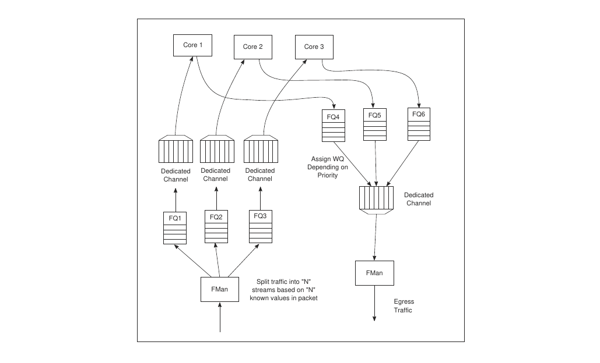

**Figure 62. Ánh xạ flow-to-core trực tiếp (thứ tự được giữ)**

Kỹ thuật này hoàn toàn tất định: DPAA1 ép các flow cụ thể tới một bộ xử lý cụ thể, nên có thể dễ xác định hiệu năng hơn, giả sử các flow ingress được hiểu đầy đủ và định nghĩa rõ ràng. Lưu ý rằng một core xử lý cụ thể có thể bị quá tải traffic trong khi core khác ngồi không, khi tốc độ traffic của các flow ngày càng ngẫu nhiên.

Để triển khai kiểu cơ chế này, FMan phải được cấu hình để so khớp chính xác các trường trong luồng traffic. Cách tiếp cận này chỉ có thể dùng cho một số lượng giới hạn tổng số flow trước khi tài nguyên bên trong của FMan bị dùng hết.

Nói chung, kiểu cách tiếp cận cố định cứng này nên được dành cho traffic out-of-band quan trọng hoặc cho các hệ thống có ít flow có thể hưởng lợi từ bản chất tất định cao của việc xử lý.

##### 8.2.1.7.2 Dùng hashing để phân phối flow qua các core

FMan có thể được cấu hình để trích dữ liệu từ một hoặc nhiều trường trong frame dữ liệu, tạo một key từ đó, rồi hash key kết quả thành một số nhỏ hơn. Đây là một kỹ thuật hữu ích để xử lý số lượng flow lớn hơn trong khi vẫn bảo đảm một flow cụ thể luôn được gắn với một core cụ thể. Một ví dụ là định nghĩa một flow là địa chỉ IPv4 nguồn + IPv4 đích. Cả hai trường cộng lại là 64 bit, nên có 2<sup>64</sup> tổ hợp khả dĩ cho flow theo định nghĩa đó. Sau đó FMan dùng một thuật toán hash để nén con số này thành một số bit quản lý được. Lưu ý rằng vì thuật toán hash nhất quán, các gói từ một flow cụ thể luôn tới cùng một FQ. Bằng kỹ thuật này, các flow có thể được trải theo cách giả ngẫu nhiên, nhất quán (theo từng flow) tới một số lượng FQ nhỏ hơn. Ví dụ, hash 64 bit xuống 2 bit sẽ trải các flow ra bốn queue. Sau đó các queue này có thể được gán cho bốn core riêng biệt bằng dedicated channel; thực chất, với bất kỳ flow cụ thể nào điều này trông như một bản triển khai đơn lõi.

Kỹ thuật trải này hoạt động tốt nhất với số lượng lớn flow khả dĩ để thuật toán hash có thể trải đều traffic giữa các FQ. Trong ví dụ dưới đây, khi hệ thống chỉ dự kiến có tám flow tại một thời điểm, có khả năng cao là hash sẽ không gán đúng hai flow cho mỗi FQ để phân phối đều các flow giữa bốn core được minh họa. Tuy nhiên, khi số flow cần xử lý lên tới hàng trăm, khả năng cao là hash sẽ trải đều các flow để xử lý.

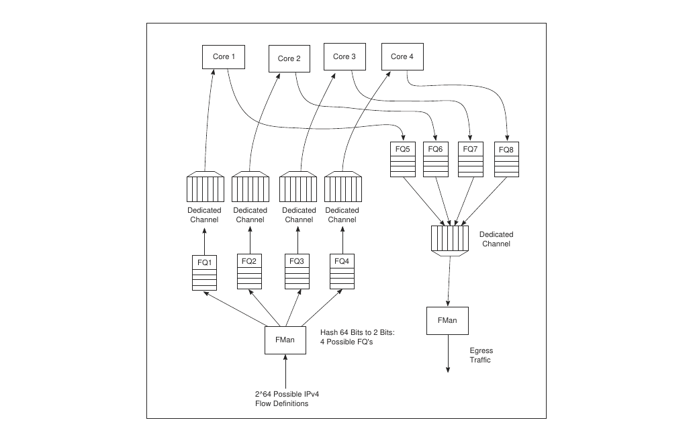

**Figure 63. Phân phối flow đơn giản qua hash (thứ tự được giữ)**

Để tối ưu việc làm ấm cache, có thể tăng tổng số hash bucket trong khi vẫn giữ affinity flow-to-core. Khi số giá trị hash lớn hơn số flow dự kiến tại một thời điểm, có khả năng (dù không bảo đảm) mỗi FQ sẽ chứa một flow duy nhất. Với hầu hết ứng dụng, cái giá của va chạm hash là có hai hay nhiều flow trong một FQ. Trong trường hợp nhiều flow trong một FQ, lợi ích của việc làm ấm cache và affinity tạm thời với core bị giảm, trừ khi thứ tự flow được duy trì theo từng flow.

Lưu ý rằng có 24 bit được thiết kế cho FQ ID, nên trong hệ thống có thể có tới 16 triệu FQ. Dù tổng số này có thể không thực tế, nó cho phép người dùng định nghĩa nhiều FQ hơn số flow dự kiến để giảm khả năng va chạm hash; nó cũng cho phép linh hoạt trong việc gán FQID theo cách nào đó có ý nghĩa. Cũng có thể hash một số trường trong frame dữ liệu và nối thêm các kết quả parse khác, có thể cho phép một bản triển khai flow-to-FQ một-một được định nghĩa mà không có va chạm hash.

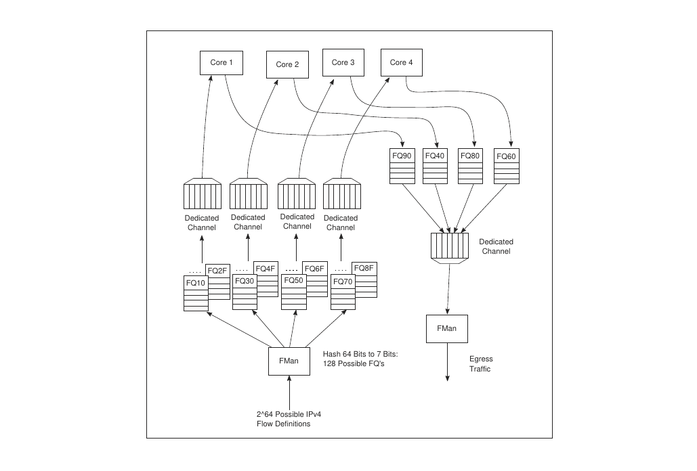

**Figure 64. Dùng hash để gán một flow cho mỗi FQ (thứ tự được giữ và cache stashing hiệu quả)**

#### 8.2.1.8 Pool Channel

Người dùng có thể dùng cách tiếp cận pool channel, trong đó nhiều core có thể gom lại để phục vụ một tập flow cụ thể. Cách tiếp cận thay thế này có khả năng cân bằng xử lý tốt hơn, nhưng làm tăng khả năng các gói bị xử lý sai thứ tự, khiến gói egress vượt gói ingress.

Cho đến giờ, các kỹ thuật bàn trong white paper này đều liên quan đến việc gán các flow cụ thể cho cùng một core để bảo đảm cùng một core luôn xử lý cùng một flow hoặc tập flow, qua đó giữ thứ tự flow. Tuy nhiên, tùy bản chất của các flow đang được xử lý (tức là kích thước frame thay đổi, khó trải hiệu quả do bản chất nội dung flow, v.v.), cách này có thể không cân bằng hiệu quả tải xử lý giữa các core. Hoặc, người dùng có thể dùng cách tiếp cận pool channel, trong đó nhiều core có thể gom lại để phục vụ một tập flow cụ thể. Cách tiếp cận thay thế này có khả năng cân bằng xử lý tốt hơn, nhưng làm tăng khả năng các gói bị xử lý sai thứ tự, khiến gói egress vượt gói ingress. Khi ứng dụng không đòi hỏi các flow được xử lý theo thứ tự, cách tiếp cận pool channel cho phép phương pháp dễ nhất để cân bằng tải xử lý. Khi dùng pool channel và cần thứ tự, phần mềm phải duy trì thứ tự. Phần mềm có thể dùng cơ chế giữ thứ tự bằng phần cứng để triển khai thứ tự mà không cần truy cập có lock tới thông tin trạng thái dùng chung. Khi hệ thống dùng lock phần mềm để xử lý thứ tự, thì lập lịch mặc định và lập lịch hold active có xu hướng giảm tối thiểu tranh chấp lock.

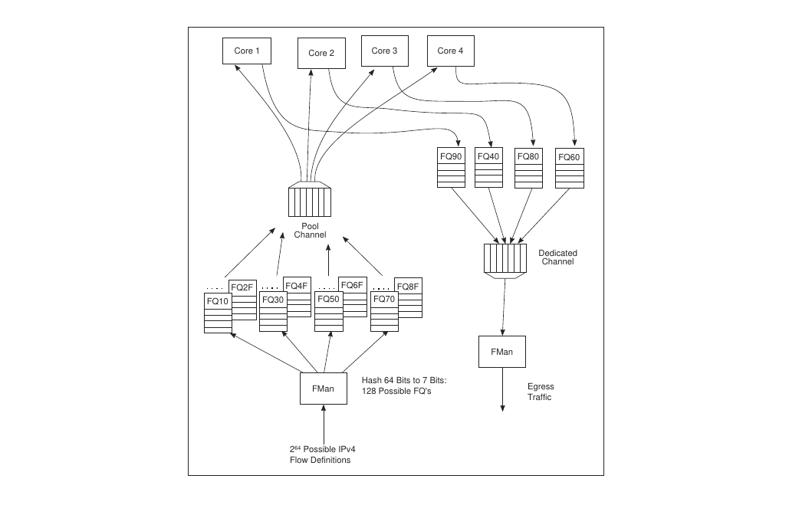

**Figure 65. Dùng pool channel để cân bằng xử lý**

##### 8.2.1.8.1 Giữ thứ tự bằng lập lịch hold active và chế độ DCA

Như trong các ví dụ ở trên, thứ tự được giữ chừng nào hai hay nhiều core không bao giờ xử lý frame từ cùng một flow cùng một lúc. Điều này cũng có thể đạt được bằng cách dùng lập lịch hold active cùng với chế độ discrete consumption acknowledgment (DCA) gắn với DQRR. Dù flow affinity có thể thay đổi với một FQ dùng lập lịch hold active khi FQ bị rút rỗng, nếu công việc mới (từ các frame nhận được sau khi FQ rỗng) được giữ lại cho đến khi mọi công việc trước đó hoàn tất, thì flow sẽ không bị nhiều core xử lý đồng thời, qua đó giữ được thứ tự.

Khi FQ bị rút rỗng, QMan đặt FQ vào trạng thái hold suspended, nghĩa là không có công việc nào nữa của FQ đó được enqueue tới bất kỳ core nào cho đến khi mọi công việc đã enqueue trước đó hoàn tất. Vì chế độ DCA thực chất giữ lại thông báo tiêu thụ (từ core tới QMan) cho đến khi frame kết quả đã xử lý được enqueue cho egress, điều này ngụ ý việc xử lý đã hoàn toàn xong với mọi frame đang trên đường tới core. Sau khi mọi frame đang trên đường đã được xử lý, QMan lập lịch lại FQ tới core thích hợp.

**Ghi chú:** Sau khi FQ rỗng và khi ở chế độ hold active, affinity ít có khả năng thay đổi. Đó là vì tín hiệu “hoàn tất” từ core đang xử lý flow giải phóng một số slot DQRR mà QMan có thể dùng khi nó bắt đầu lại việc enqueue công việc cho flow. Khả năng affinity flow-to-core thay đổi khi FQ rỗng chỉ được bàn như một khả năng trường hợp xấu nhất xét về việc giữ thứ tự.

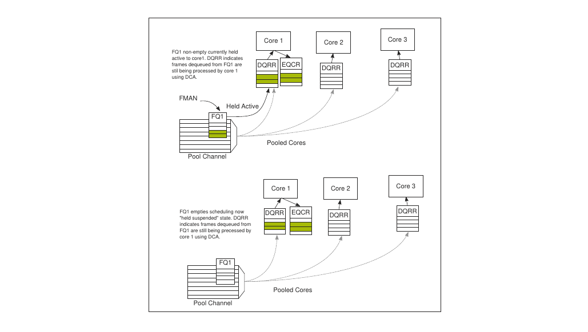

**Figure 66. Từ hold active sang chế độ held suspended**

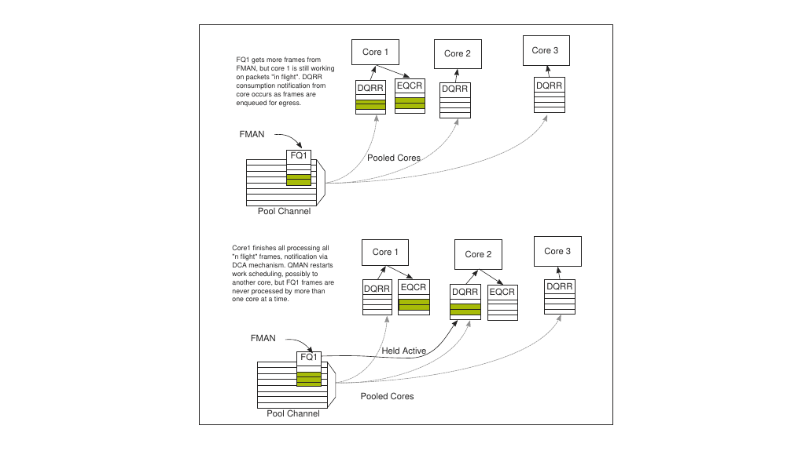

**Figure 67. Từ held suspended sang chế độ hold active**

##### 8.2.1.8.2 Quản lý tắc nghẽn

Từ góc nhìn toàn hệ thống, có nhiều điều kiện tràn tiềm ẩn cần cân nhắc. Số frame tối đa active trong hệ thống (số frame đang trên đường) được xác định bởi lượng bộ nhớ cấp cho các Packed Frame Queue Descriptor (PQFD). Mỗi PQFD có 64 byte và có thể định danh tới ba frame, nên tổng số frame có thể được các PQFD định danh bằng lượng bộ nhớ cấp cho vùng PQFD chia cho 64 byte (mỗi mục) nhân với ba (frame mỗi mục).

Một pool buffer có thể bị cạn trong BMan. Điều này phụ thuộc vào số buffer phần mềm đã gán cho BMan. BMan có thể phát một interrupt để yêu cầu thêm buffer khi một pool cụ thể ở trạng thái cạn; phần mềm có thể quản lý trạng thái tắc nghẽn của các pool buffer theo cách này.

Ngoài các cơ chế hệ thống ở mức cao này, quản lý tắc nghẽn cũng có thể được xác định riêng cho các FQ. Một số FQ có thể được nhóm lại để tạo thành một congestion group (tới 256 congestion group mỗi hệ thống với hầu hết SoC DPAA1). Các FQ này không cần ở cùng một channel. Hệ thống có thể được cấu hình để báo tắc nghẽn bằng cách xét tổng số byte trong các FQ của congestion group hoặc tổng số frame trong congestion group. Tùy chọn đếm frame hữu ích khi cố gắng quản lý số buffer trong một pool buffer khi chúng được dùng bởi một core cụ thể hoặc một nhóm core. Đếm byte hữu ích để quản lý lượng bộ nhớ hệ thống được dùng bởi một core cụ thể hoặc một nhóm core.

Khi tổng số frame/byte trong các frame của congestion group vượt ngưỡng đã đặt, các lần enqueue tiếp theo tới bất kỳ FQ nào trong nhóm đều bị từ chối; nói chung, frame bị loại bỏ. Với cơ chế congestion group, quyết định từ chối được xác định bởi một thuật toán weighted random early discard (WRED) được lập trình khi định nghĩa congestion group.

Ngoài ra, một FQ cụ thể có thể được đặt một độ sâu tối đa cho phép (tính bằng byte); sau khi đạt ngưỡng, các lần thử enqueue sẽ bị từ chối. Đây là một ngưỡng tối đa: không có thuật toán WRED cho cơ chế này. Lưu ý rằng khi ngưỡng FQ không được đặt, một FQ cụ thể có thể đầy dần cho đến khi một cơ chế nào đó khác (vì nó thuộc một congestion group, hoặc vùng PQFD của hệ thống cạn, hoặc BMAN cạn) ngăn FQ nhận thêm frame. Thông thường, các FQ trong một congestion group được kỳ vọng có ngưỡng tối đa đặt cho từng FQ trong nhóm để bảo đảm một queue không bị kẹt và chiếm dụng congestion group một cách không công bằng. Lưu ý rằng khi một FQ không được đặt độ sâu queue và/hoặc không thuộc congestion group nào, FQ đó không có độ sâu tối đa. Một queue duy nhất có thể chứa mọi frame trong hệ thống, cho đến khi vùng PQFD hoặc pool buffer cạn kiệt.

#### 8.2.1.9 Ánh xạ ứng dụng

Bước đầu tiên trong ánh xạ ứng dụng là xác định cần bao nhiêu khả năng xử lý cho các tác vụ có thể được phân chia riêng.

##### 8.2.1.9.1 Gán core xử lý

Xét một ứng dụng mạng điển hình có một tập chức năng control plane và data plane riêng biệt. Gán hai core thực hiện các tác vụ control plane và sáu core thực hiện các tác vụ data plane có thể là một cách phân chia hợp lý trên thiết bị tám core. Khi ban đầu xác định SoC cần cho ứng dụng, cùng với số core và tần số cần thiết, người thiết kế đưa ra một số giả định hiệu năng dựa trên các thiết kế trước đó và/hoặc dữ liệu benchmark áp dụng được.

##### 8.2.1.9.2 Định nghĩa flow

Tiếp theo, định nghĩa những flow nào có trong hệ thống. Các cân nhắc chính cho định nghĩa flow gồm:

- Tổng số flow dự kiến tại một thời điểm trong hệ thống
- Affinity flow-to-core mong muốn, đích của flow ingress
- Cân bằng tải bộ xử lý
- Kích thước frame (có thể cố định hoặc thay đổi)
- Yêu cầu giữ thứ tự
- Độ ưu tiên traffic tương ứng với các flow
- Yêu cầu băng thông dự kiến của các flow hoặc lớp flow cụ thể
- Cách xử lý tắc nghẽn mong muốn

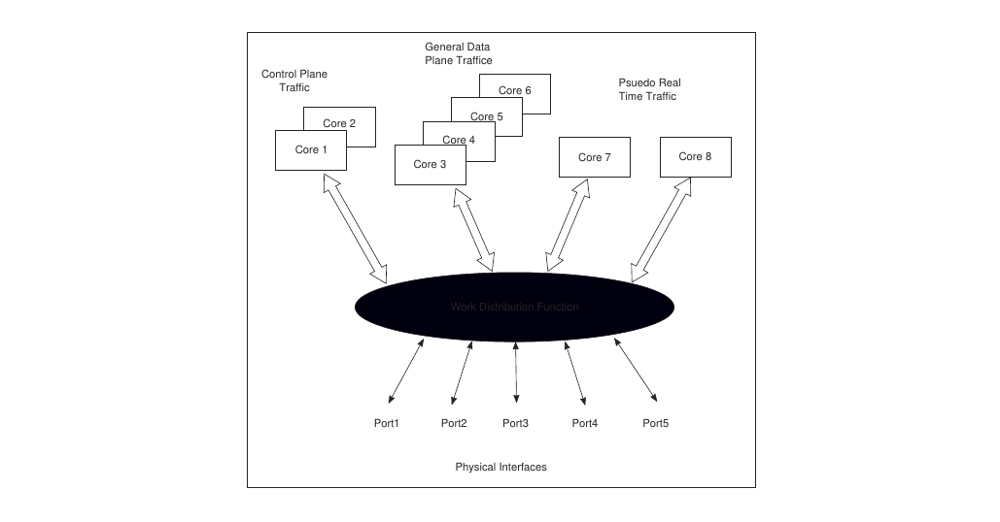

**Figure 68. Ứng dụng ví dụ với ba lớp**

Trong hình trên, hai core được dành riêng để xử lý traffic control plane, bốn core được gán để xử lý traffic dữ liệu chung, và traffic đặc biệt nhạy thời gian được chia giữa hai core khác. Trong trường hợp này, giả sử các đặc điểm traffic như trong bảng sau. Với định nghĩa ở mức hệ thống này, người thiết kế có thể xác định những flow nào có trong hệ thống và cách định nghĩa các FQ cần thiết.

**Table 53. Các đặc điểm traffic**

| Đặc điểm | Định nghĩa |
|---|---|
| Traffic control plane | • Kết thúc trong hệ thống và bất kỳ gói cụ thể nào được gửi đều không phụ thuộc vào các gói trước hoặc sau (không có yêu cầu thứ tự).<br>• Có thể xuất hiện trên các cổng 1, 2 hoặc 3.<br>• Traffic control plane ingress trên cổng ba có độ ưu tiên cao hơn các cổng khác.<br>• Mọi gói ICMP trên các cổng 1, 2 hoặc 3 đều được coi là traffic control plane.<br>• Traffic control plane chiếm một phần nhỏ băng thông tổng của cổng. |
| Traffic data plane chung | • Có thể xuất hiện trên các cổng 1, 2 hoặc 3 và được kỳ vọng chiếm phần lớn traffic trên các cổng này.<br>• Chức năng được thực hiện trên các flow và các gói egress phải khớp thứ tự các gói ingress.<br>• Một flow được nhận diện bởi địa chỉ IP nguồn.<br>• Hệ thống có thể có tới 50 flow cùng lúc.<br>• Mọi flow có cùng độ ưu tiên và độ ưu tiên thấp hơn mọi traffic control plane.<br>• Dự kiến phần mềm không theo kịp traffic này và hệ thống nên loại bỏ gói sau khi có một lượng gói nhất định trong hệ thống. |
| Traffic giả thời gian thực | • Chức năng đòi hỏi mức tất định cao.<br>• Traffic này chỉ xuất hiện trên cổng 4 và cổng 5 và được nhận diện bởi một trường độc quyền trong header; mọi traffic trên các cổng này không có giá trị đúng trong trường này đều bị loại bỏ.<br>• Mọi traffic ingress hợp lệ trên cổng 4 phải được xử lý bởi core 7, traffic ingress trên cổng 5 được xử lý bởi core 8.<br>• Chỉ có hai flow, một từ cổng 4 tới cổng 5 và một từ cổng 5 tới cổng 4; thứ tự egress phải khớp thứ tự ingress.<br>• Traffic trên các flow này có độ ưu tiên cao nhất. |

##### 8.2.1.9.3 Xác định các frame queue (FQ) ingress và egress

Với nhiều ứng dụng, vì flow ingress có nhiều hệ quả hơn cho việc xử lý, nên dễ xét các flow ingress trước. Trong ví dụ trên, định nghĩa FQ cho traffic control plane và traffic giả thời gian thực khá đơn giản. Với control plane ingress, một FQ cho traffic ưu tiên thấp hơn trên các cổng 1 và 2 và một FQ cho traffic ưu tiên cao hơn là đủ. Lưu ý rằng hai cổng có thể dùng chung một queue ở ingress khi không quan trọng traffic hướng tới core nào. Với traffic giả thời gian thực ingress, có một FQ trên cổng 4 và một FQ trên cổng 5.

Traffic ingress data plane chung phức tạp hơn. Có nhiều tùy chọn duy trì được thứ tự cần thiết cho traffic này. Dù traffic này chắc chắn sẽ được lợi từ một số tính năng điều khiển của QMan (làm ấm cache, v.v.), tốt nhất là có một FQ cho mỗi flow. Theo ví dụ, flow được nhận diện bởi IP nguồn (32 bit), gồm quá nhiều bit để dùng trực tiếp làm FQID. Có thể dùng thuật toán hash để giảm 32 bit xuống một số nhỏ hơn; trong trường hợp này, 6 bit sẽ tạo ra 64 queue, nhiều hơn số flow tối đa dự kiến tại một thời điểm. Tuy nhiên, con số này không lớn hơn đáng kể so với số flow tối đa dự kiến, nên có thể định nghĩa thêm FQ để giảm va chạm hash. Lưu ý rằng trong trường hợp này, va chạm hash nghĩa là hai flow được gán cho cùng một FQ. Vì các FQ ingress được lấp trực tiếp từ cổng, thứ tự gói vẫn được duy trì khi có va chạm (hai flow vào một FQ). Tuy nhiên, có hai flow trong cùng một FQ có xu hướng làm giảm tác dụng của việc làm ấm cache. Có thể có những khả năng khác để tinh chỉnh định nghĩa flow nhằm bảo đảm ánh xạ một-một giữa flow và FQ (ví dụ nối thêm các trường khác trong frame), nhưng trong ví dụ này, giả sử một hash 8-bit (256 FQ) giảm khả năng có hai flow trong FQ xuống mức chấp nhận được.

Xét trường hợp ở ingress có traffic không khớp với bất kỳ định nghĩa flow dự định nào. Thiết kế có thể xử lý chúng bằng cách đặt các gói không nhận diện được vào một FQ rác riêng hoặc đơn giản là để FMan loại bỏ các gói.

Với traffic điều khiển egress, vì traffic có thể đi ra trên ba cổng khác nhau, cần ba FQ. Với traffic giả thời gian thực egress, cũng có một queue cho mỗi cổng.

Với traffic data plane egress, có nhiều tùy chọn. Khi các flow được ghim vào một core cụ thể, có thể chỉ cần một queue cho mỗi cổng. Trong trường hợp này, các core thực chất sẽ duy trì thứ tự. Tuy nhiên, trong ví dụ này, giả sử hệ thống dùng cơ chế order definition/order restoration đã mô tả trước đó. Trong trường hợp này, hệ thống cần định nghĩa một FQ cho mỗi flow egress. Lưu ý rằng vì phần mềm quản lý việc này, không cần bất kỳ thuật toán hash nào để trải traffic; các core enqueue vào FQ gắn với flow. Khi hệ thống không có quá 50 flow cùng lúc, và số flow egress trên mỗi cổng chưa biết, hệ thống có thể định nghĩa 50 FQ cho mỗi cổng khi DPAA1 được khởi tạo.

##### 8.2.1.9.4 Định nghĩa cấu hình PCD cho các FQ ingress

Bước này liên quan đến việc định nghĩa cách FMan chia traffic đến của cổng vào các FQ. Nói chung, việc này được thực hiện bằng chức năng PCD (Parse, Classify, Distribute) và dẫn đến traffic cụ thể được gán cho một FQID cụ thể. Các trường trong gói đến có thể được dùng để nhận diện và chia traffic theo yêu cầu. Với trường hợp tối ưu key này, người dùng phải xác định đúng trường. Ví dụ như sau:

- Với traffic điều khiển ingress, định danh giao thức ICMP là selector hay key. Nếu traffic đến từ cổng 1 hoặc 2, thì traffic đó tới một FQID. Nếu nó đến từ cổng 3, traffic tới một FQID khác vì nó cần được tách ra và có độ ưu tiên cao hơn hai cổng kia.
- Với traffic data plane ingress, trường IP nguồn được dùng để xác định FQID. Khi đó PCD được cấu hình để hash IP nguồn xuống 8 bit, tạo ra 256 FQ khả dĩ. Lưu ý rằng điều này như nhau bất kể gói đến từ cổng 1, 2 hay 3.
- Với traffic giả thời gian thực ingress, PCD được cấu hình để kiểm tra định danh độc quyền. Nếu khớp, traffic tới một FQID dựa trên cổng ingress. Nếu không khớp, gói đến bị loại bỏ. Ngoài ra, soft parser cần được cấu hình/lập trình để xác định vị trí định danh độc quyền.

**Ghi chú:** Bản thân số FQID có thể là bất kỳ giá trị nào (trong 24 bit dùng để định nghĩa FQ). Để giữ ý nghĩa, hãy dùng một cách đánh số giúp nhận diện loại traffic. Trong ví dụ, định nghĩa các FQID ingress sau:

- Điều khiển ưu tiên cao: FQID `0x100`
- Điều khiển ưu tiên thấp: FQID `0x200`
- Data plane chung: FQID `0x1000 – 0x10FF`
- Traffic giả thời gian thực: FQID `0x2000` (cổng 4), FQID `0x2100` (cổng 5)

Chi tiết về cấu hình PCD được mô tả trong **DPAA1 Reference Manual** và trong Software Developer Kit (SDK) được dùng để phát triển phần mềm.

#### 8.2.1.10 FQ/WQ/Channel

Với mỗi lớp traffic trong hệ thống, các FQ phải được định nghĩa cùng với cả channel và WQ mà chúng được gắn vào. Việc gắn channel tạo affinity với một core xử lý cụ thể, còn WQ quyết định độ ưu tiên.

Xét theo từng lớp traffic như sau:

- Traffic điều khiển tới một pool hai core, với độ ưu tiên dành cho traffic trên cổng 3.
- Traffic data plane chung tới một pool 4 core.
- Traffic giả thời gian thực tới hai core riêng biệt dưới dạng dedicated channel.

Khi FQ được định nghĩa, ngoài việc gắn channel, các tham số khác có thể được cấu hình. Trong ví dụ ứng dụng, các FQ từ 1000 tới 10FF đều được gán cho cùng một congestion group. Việc này được làm khi FQ được khởi tạo. Ngoài ra, với các FQ này nên giới hạn độ dài của từng FQ. Việc này cũng được cấu hình khi FQ được khởi tạo.

Vì ứng dụng ví dụ sẽ dùng chế độ order definition/order restoration, thiết lập này cần được cấu hình cho mỗi FQ trong traffic data plane chung (FQID 0x1000-0x10FF). Lưu ý rằng traffic control plane không đòi hỏi thứ tự, và thứ tự được giữ trong traffic giả thời gian thực vì các flow traffic ingress được ánh xạ tới các core cụ thể.

Các cân nhắc về cấu hình QMan gồm quản lý tắc nghẽn và lập lịch pool channel. Một congestion group phải được định nghĩa như một phần của việc khởi tạo QMan. (Lưu ý rằng khởi tạo FQ là nơi FQ được gắn với một congestion group.) Đây là nơi tổng số frame và chính sách loại bỏ của congestion group được định nghĩa. Ngoài ra, hãy cân nhắc lập lịch QMan cho các pool channel. Trong trường hợp này, mặc định gắn tạm một FQ với một core cho đến khi FQ rỗng có lẽ sẽ hoạt động tốt nhất. Điều này có xu hướng giữ cache luôn cập nhật, đặc biệt với traffic data plane chung trên các core 3-6.

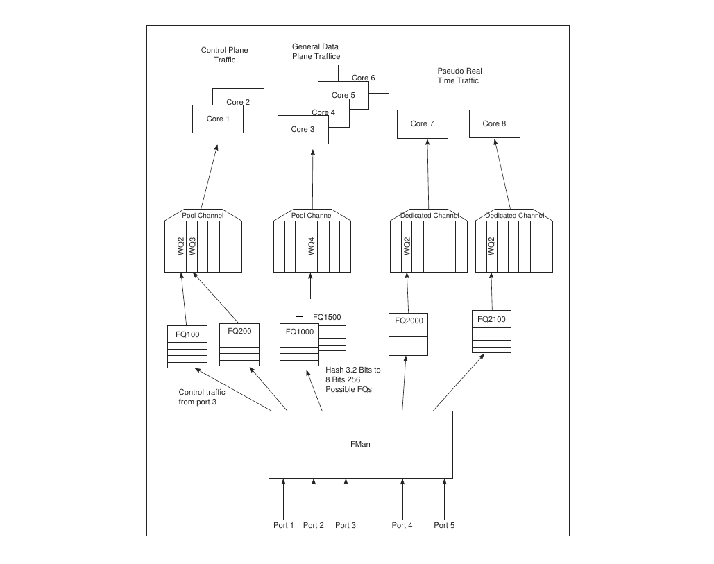

**Figure 69. Bản đồ ứng dụng ingress**

##### 8.2.1.10.1 Định nghĩa cấu hình FQ/WQ/channel egress

Với egress, các gói vẫn chảy qua hệ thống dùng DPAA1, nhưng các cân nhắc có phần khác. Lưu ý rằng mỗi cổng ngoài có dedicated channel riêng; vì vậy, để gửi traffic ra một cổng cụ thể, các core enqueue một frame vào một FQ gắn với dedicated channel của cổng đó. Tùy mức ưu tiên cần thiết, FQ được gắn với một work queue cụ thể.

Trong ví dụ, cấu hình egress như sau:

- Với traffic control plane, cần có các queue riêng cho mỗi cổng mà traffic này có thể dùng. Các FQ này phải được gán cho một WQ có độ ưu tiên cao hơn WQ dùng cho traffic data plane. Ví dụ được minh họa gồm ưu tiên tuyệt đối (so với traffic data plane) cho các cổng 1 và 2, với khả năng dùng WRED cùng traffic data plane trên cổng 3.
- Vì ví dụ giả định cơ chế order restoration trong các FQ sẽ được dùng, phải có một FQ egress cho mỗi flow. Giả định ban đầu của hệ thống là tới 50 flow loại này; tuy nhiên, cách chia theo cổng chưa biết, nên các FQ có thể được gán sao cho có ít nhất 50 FQ cho mỗi cổng. Lưu ý rằng FQ có thể được thêm khi phát hiện flow hoặc có thể được định nghĩa lúc khởi tạo hệ thống.
- Với traffic giả thời gian thực, theo các giả định ban đầu, core 7 gửi traffic ra cổng 4 và core 8 gửi traffic ra cổng 5. Vì các flow là theo từng core, thứ tự được giữ nhờ ánh xạ này. Chúng được gán cho WQ2, cho phép định nghĩa traffic ưu tiên cao hơn nữa (tới WQ1) hoặc traffic ưu tiên thấp hơn để định nghĩa sau này trên các cổng này.

Như đã nói trước đó, các FQID có thể là bất cứ gì người dùng muốn và nên được chọn để giúp theo dõi loại traffic mà các FQ được gắn với. Trong ví dụ này:

- Traffic điều khiển cho các cổng 1, 2, 3 lần lượt là FQID 300, 400, 500.
- Traffic data plane cho các cổng 1, 2, 3 lần lượt là FQID 3000-303F, 4000-403F và 5000-503F; điều này cung cấp 64 FQ cho mỗi cổng ở egress.
- Traffic giả thời gian thực dùng FQID 6000 cho cổng 4 và 7000 cho cổng 5.

Vì ứng dụng này dùng tính năng order restoration, một order restoration point phải được định nghĩa cho mỗi flow traffic data plane. Ngoài ra, có thể nên có quản lý tắc nghẽn trên các FQ. Hãy xét rằng traffic data plane có thể đến trên nhiều cổng nhưng có khả năng được gộp lại để đi ra một cổng duy nhất. Trong trường hợp này, lượng traffic được thử enqueue tới một cổng có thể nhiều hơn mức tốc độ giao diện của cổng cho phép, điều có thể gây tắc nghẽn. Để quản lý khả năng này, có thể định nghĩa ba congestion group, mỗi nhóm chứa mọi FQ trên mỗi cổng trong ba cổng có thể có traffic điều khiển cộng data plane. Như đã bàn trước đó, có thể nên đặt độ dài của từng FQ để quản lý thêm khả năng tắc nghẽn này.

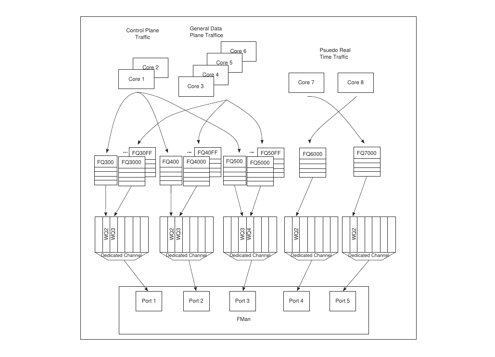

**Figure 70. Bản đồ ứng dụng egress**

##### 8.2.1.10.2 Hết tài liệu

### 8.2.2 Linux Ethernet

#### 8.2.2.1 Giới thiệu

Tổng quan về driver mạng DPAA 1.x Ethernet, trong bối cảnh chung hơn của các device driver Linux.

Các khái niệm chính của kiến trúc driver DPAA 1.x Ethernet được trình bày trong các mục sau mà không đi quá sâu vào chi tiết như cấu trúc mã. Các trang này không phải hướng dẫn Linux Device Drivers, mà là Quick start guide cung cấp bối cảnh cho người dùng.

Các mục sau mô tả driver Linux Ethernet chạy trên các bộ xử lý Data Path Acceleration Architecture (DPAA 1.x). Driver được phát hành kèm Layerscape SDK chuẩn. Trọng tâm là lý thuyết và hoạt động đằng sau việc dùng Ethernet. Nó bàn một cách hạn chế về BMan, QMan và FMan, mô tả lớp phần mềm cho phép tất cả các khối này phối hợp với nhau. Việc bật, cấu hình và debug driver DPAA 1.x Ethernet cũng được mô tả.

**Mục đích**

Driver DPAA 1.x Ethernet nhằm cấu hình phần cứng data path cho việc giao tiếp qua giao thức Ethernet. Việc này bao gồm hỗ trợ:

- Cấp phát các pool buffer và buffer
- Cấp phát các frame queue
- Gán các frame queue và pool buffer cho các cổng FMan được chỉ định
- Truyền gói giữa các frame queue và Linux stack
- Điều khiển các tính năng Link Management

**Tổng quan**

Các tính năng Ethernet được bật trên phần cứng DPAA 1.x bằng cách kết nối BMan, QMan và FMan với nhau. Các tương tác chính là giữa Linux Kernel và QMan. Các Ethernet frame được trao đổi giữa driver Ethernet và các Frame Queue phần cứng qua các QMan Portal.

Thông thường, các Frame Queue được nối với một cổng FMan ingress hoặc egress. Mỗi cổng FMan có ít nhất hai queue được gán: một default queue và một error queue. Việc gán này có thể được chỉ định trong device tree, hoặc được driver tạo động lúc khởi tạo.

Các Ethernet frame thường được lưu trong các buffer lấy từ một BMan Buffer Pool. Driver thiết lập pool này, và hoặc gieo buffer vào nó, hoặc map các buffer được đưa vào pool. Tùy trường hợp sử dụng, các buffer có thể được Kernel cấp phát và giải phóng trong lúc mạng hoạt động, hoặc có thể được cấp phát một lần và tái sử dụng bằng cách trả về pool khi phần cứng DPAA 1.x không dùng.

**Các loại driver DPAA 1.x Ethernet**

Độ phức tạp của DPAA 1.x cho phép nhiều trường hợp sử dụng khả dĩ. Dù tốc độ là yếu tố then chốt cho hiệu năng trong hầu hết trường hợp, ở những trường hợp khác người ta ưu tiên khả năng tùy biến hoặc sự hỗ trợ của cộng đồng. Xây dựng một driver Ethernet duy nhất đáp ứng mọi yêu cầu đã tỏ ra khó khăn nếu không chấp nhận thỏa hiệp. Thay vào đó, chúng tôi đã phát triển hai biến thể driver Ethernet để tiếp cận cả kịch bản hướng hiệu năng lẫn kịch bản hướng cộng đồng:

- Private DPAA 1.x Ethernet Driver giống driver Ethernet Linux thông thường. Nó được cải tiến mạnh về hiệu năng và dùng mọi tính năng mà DPAA 1.x cung cấp;
- Upstream DPAA 1.x Ethernet Driver được tích hợp và duy trì trong cây Linux kernel chính thức. Dù non trẻ hơn, nó được lợi từ sự dễ dùng gọn gàng và sự hỗ trợ của cộng đồng.

Cả hai driver đều nằm trong cây Linux kernel của Layerscape LDP và có thể được build độc lập. Hai driver không thể được bật hoặc dùng cùng lúc. Private Ethernet driver được bật theo mặc định trong Layerscape LDP. Tham khảo mục Upstream Ethernet driver để biết chi tiết cách bật driver đó thay thế.

#### 8.2.2.2 Thế giới nhìn từ DPAA1-Ethernet

Mục này trình bày các khái niệm chính đằng sau thiết kế driver DPAA1-Ethernet.

Là một driver Linux, một trong các mục tiêu chính của driver DPAA1-Ethernet là tích hợp đúng đắn với hệ sinh thái Linux kernel. Là một device driver phần cứng, driver DPAA1-Ethernet tích hợp chức năng của một số khối IP DPAA1, trong phạm vi các trường hợp sử dụng đã định nghĩa/được hỗ trợ.

##### 8.2.2.2.1 Các API của Linux kernel

Các driver DPAA1-Ethernet giao tiếp với Linux kernel qua các API networking stack của kernel. Đây là một yêu cầu bắt buộc, do việc tích hợp với Linux kernel đòi hỏi.

Một kiểu tương tác khác với mã kernel là lúc boot, qua Open-Firmware API. API đó được dùng để phân tích platform device tree của Arm và khám phá các module phần cứng cần được cấu hình. Cụ thể, driver DPAA1-Ethernet dùng platform device tree để khám phá:

- Những net device nào cần probe và loại phần cứng nào nằm bên dưới các device đó;
- Những tài nguyên DPAA1 nào liên quan; FQID, BPID, CGRID, FMan port ID.

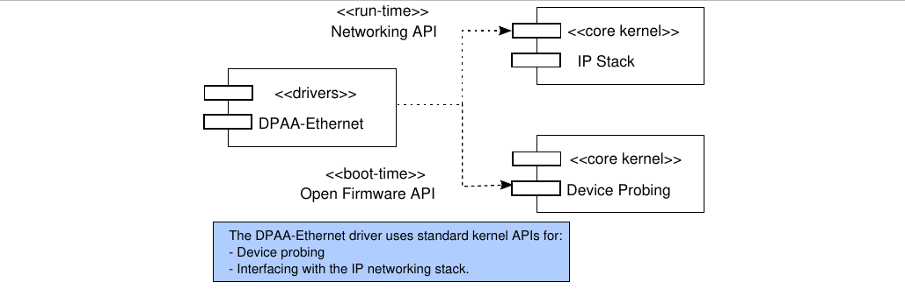

**Figure 71. Platform device tree**

Nói chung, chúng tôi ưu tiên cấu hình driver động và trong suốt với phần còn lại của hệ thống. Trong số các lợi ích của việc cấp phát tài nguyên động, có thể kể:

- Tính khả chuyển của các driver qua nhiều platform QorIQ
- Hỗ trợ liền mạch các thay đổi platform (ví dụ qua việc boot với các RCW khác nhau)
- Hỗ trợ liền mạch nhiều partition dưới sự điều khiển của một hypervisor
- Cùng tồn tại với các driver DPAA1 khác (ví dụ driver SEC) trong Layerscape SDK

##### 8.2.2.2.2 Các khối xây dựng của driver

Mục này trình bày các cấu trúc và thực thể dữ liệu chính mà driver DPAA1-Ethernet làm việc với.

Các khối xây dựng của driver là các thành phần liên quan của các thực thể chính mà nó tương tác, đó là:

- IP stack của kernel
- Các khối phần cứng DPAA1 và driver của chúng

###### 8.2.2.2.2.1 Net Device

Một net device (`struct net_device` khi biểu diễn bằng C) là cấu trúc nền tảng của mọi device driver mạng Linux.

Một net device mô tả một thiết bị (vật lý hoặc ảo) có khả năng gửi và nhận gói qua một mạng (ảo hoặc vật lý). Mọi traffic đến và đi đều được tính và xử lý thay mặt cho net device mà nó đến hoặc đi qua.

Mỗi loại net device được hỗ trợ có driver kernel riêng. Nếu có nhiều device như vậy trong hệ thống, sẽ có ngần ấy instance device driver.

Người dùng Linux có thể truy cập một net device qua các công cụ chuẩn, như ‘ifconfig’ hay ‘ethtool’.

Không phải mọi net device đều có phần cứng thật bên dưới; ví dụ các endpoint tunnel được biểu diễn bằng net device nhưng không được phần cứng trực tiếp hỗ trợ. Điều tương tự đúng với các driver như “bonding” hay “dummy”.

Tuy nhiên, cần nhấn mạnh rằng **mọi** giao diện Linux đều được biểu diễn bằng một net device. Đây là một khía cạnh thiết kế nền tảng của mọi driver mạng Linux, kể cả DPAA1-Ethernet. Có thể mô tả Linux IP stack là một cấu trúc **lấy netdev làm trung tâm**. Gần như mọi API mạng của kernel đều nhận một `struct net_device` làm tham số. Cấu trúc `net_device` là handle mà qua đó driver và network stack giao tiếp.

Sơ đồ sau minh họa những gì vừa được mô tả:

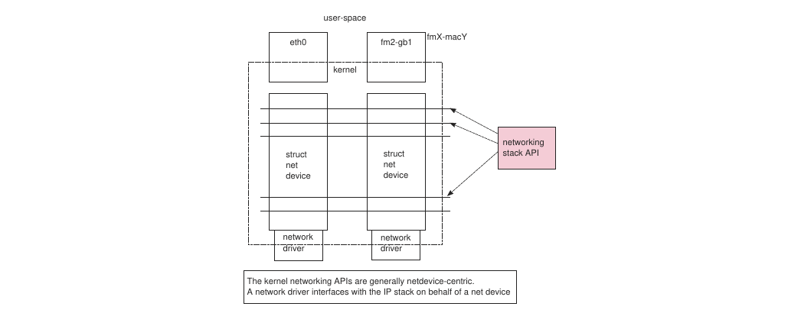

**Figure 72. Mọi giao diện Linux đều được biểu diễn bằng một Net Device**

###### 8.2.2.2.2.2 Frame Queue

Frame Queue là một trong các khái niệm nền tảng của DPAA1. Trong trường hợp DPAA1-Ethernet, nó là giao diện chính giữa driver mạng và các khối phần cứng.

Các frame ingress mà driver DPAA1-Ethernet nhận được trên một trong các Frame Queue nó đang phục vụ được gửi lên IP stack thay mặt cho cấu trúc net device mà driver được gắn với. Ngược lại, các frame đi ra từ IP stack vào driver được enqueue vào một trong các Frame Queue egress.

###### 8.2.2.2.2.3 Buffer Pool

Cấu hình buffer pool là một phần nền tảng khác của thiết kế driver DPAA1-Ethernet.

Khác với việc sử dụng Frame Queue – vốn linh hoạt hơn – việc sử dụng Buffer Pool bị chi phối bởi một số giả định thiết kế:

- Nguồn và quyền sở hữu của các buffer frame ingress được driver DPAA1-Ethernet mặc định. Chẳng hạn, driver gieo buffer vào các Buffer Pool tại các checkpoint định sẵn trên đường Rx. Cũng có các counter sử dụng buffer do driver duy trì, chúng ảnh hưởng tới logic cấp phát buffer.
- Bố cục của các frame đến cũng được driver mặc định. Bố cục buffer thực tế nằm ngoài phạm vi tài liệu này và người dùng driver không nên dựa vào nó.

#### 8.2.2.3 Khởi tạo tài nguyên DPAA1

Phần này trình bày lý do đằng sau “cái gì”, “tại sao” và “như thế nào” của việc khởi tạo tài nguyên DPAA1 do driver DPAA1- Ethernet thực hiện. Mô tả này không đi vào đầy đủ chi tiết cấu hình driver.

##### 8.2.2.3.1 Tài nguyên nào, tại sao và được khởi tạo như thế nào

Sau đây là các tài nguyên DPAA1 được khởi tạo bởi các cấu hình khác nhau của driver DPAA1-Ethernet.

- FQ và FQID (nơi áp dụng config tĩnh)
- BP và BPID (nơi áp dụng config tĩnh)
- Buffer (không hẳn là tài nguyên “DPAA1”, mà là tài nguyên “hệ thống”)
- CGR (CGRID luôn là động)
- Các online port của FMan (Lưu ý rằng các offline port được cấu hình bởi một driver khác chứ không phải DPAA1-Ethernet)

Frame Queue và Buffer Pool đã được bàn kỹ ở các mục trước. CGR ít được quan tâm hơn xét từ góc độ khởi tạo.

Các online port của FMan ban đầu được probe bởi FMan Driver (FMD) và sau đó trong quá trình boot, chúng được các instance driver DPAA1-Ethernet cấu hình theo đặc tả trong `.dts`.

##### 8.2.2.3.2 Private Ethernet driver: Các frame queue Hashing/PCD

Trong số các frame queue được driver DPAA1-Ethernet khởi tạo, có một tập định sẵn gồm 128 Rx FQ gắn affinity với core, được driver tự động khởi tạo. Chúng có ở đó vì hầu hết các thiết lập tăng cường hiệu năng phải dùng một cấu hình PCD; vì mục đích đó, Layerscape SDK chuẩn cung cấp một cấu hình “hashing PCDs” mà người dùng có thể áp dụng qua công cụ FMC. Vì FMC không hỗ trợ chỉ định FQID động trong các file cấu hình .xml của nó, các Frame Queue “hashing PCD” cũng có FQID tĩnh, viết cứng.

Hơn nữa, ngoài các Rx FQ gắn affinity với core, còn có một tập 128 Rx FQ gắn affinity với core khác, có độ ưu tiên cao hơn tập trước. Trong suốt tài liệu này chúng được gọi là "Rx PCD High Priority Frame Queues". Tương tự, các queue trong tập này cũng gắn affinity với core và có FQID tĩnh, viết cứng.

Để biết chi tiết về các Frame Queue “hashing PCD” và Rx PCD High Priority Frame Queues, tham khảo Section 8.2.2.5.3.8.

#### 8.2.2.4 Vòng đời (đơn giản hóa) của một gói

Các mục sau trình bày vòng đời của một gói trong driver DPAA1-Ethernet.

##### 8.2.2.4.1 Private net device: Tx

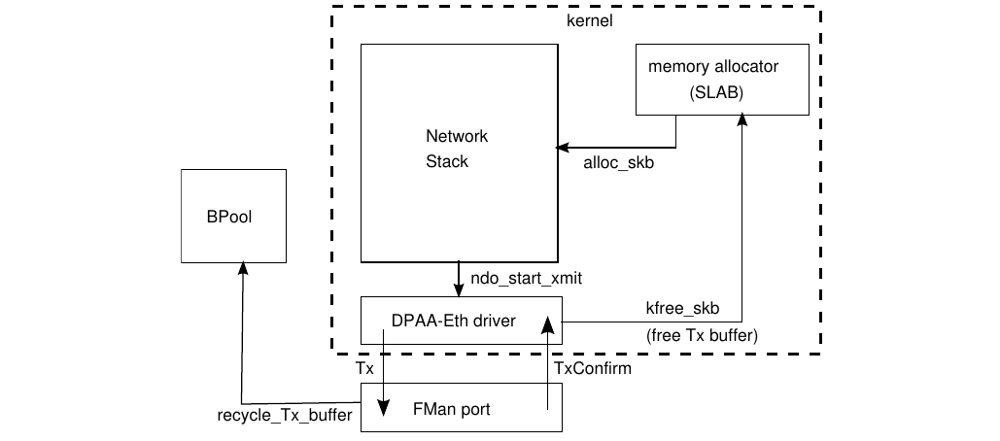

**Figure 73. Các buffer trên đường egress**

Các mũi tên trong sơ đồ trên biểu thị hướng của luồng buffer/gói.

Một gói trên đường egress được network stack cấp phát bằng bộ cấp phát bộ nhớ chuẩn của kernel. Driver DPAA1-Ethernet enqueue gói tới cổng FMan kèm chỉ báo tái sử dụng buffer nếu có thể. Nếu không thể tái sử dụng, chính driver DPAA1-Ethernet giải phóng bộ nhớ buffer về bộ cấp phát của kernel, khi việc phát Tx được FMan xác nhận.

##### 8.2.2.4.2 Private net device: Rx

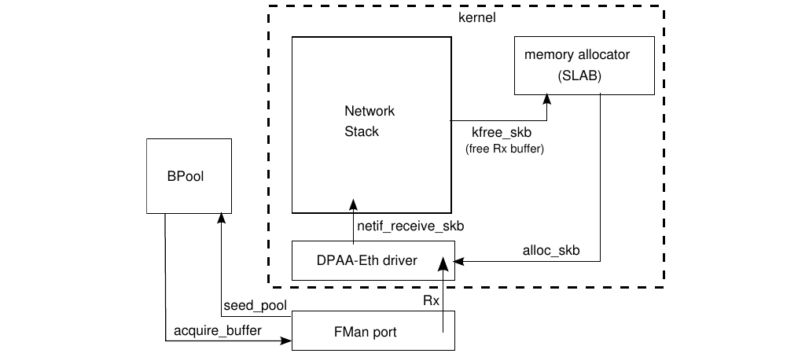

**Figure 74. Các buffer trên đường ingress**

Các buffer trên đường ingress được FMan lấy trực tiếp từ một Buffer Pool đã được driver DPAA1- Ethernet gieo buffer. Bố cục buffer quan trọng đối với driver, vốn đảm nhận quyền sở hữu BP. Các mũi tên trong sơ đồ trên biểu thị hướng của luồng buffer/gói.

#### 8.2.2.5 Private Ethernet Driver

Private DPAA 1.x Ethernet driver quản lý các network interface hoàn toàn thuộc sở hữu của partition Linux chạy chúng. Vì vậy, có thể tận dụng các tiện ích của DPAA 1.x để tăng hiệu năng trong cả kịch bản termination lẫn forwarding.

Private DPAA 1.x Ethernet driver từ đây sẽ được gọi là Private driver.

##### 8.2.2.5.1 Network driver

Các đặc điểm chính của private driver là:

- Private driver là driver multiqueue - nó dùng 1 TX queue cho mỗi CPU
- Mọi private interface dùng chung một BPID - thường được cấp phát động
- Các FQID cho các loại queue thông dụng - RX, TX, RX Error, TX Error, TX Confirm - được cấp phát động
- Các frame queue Hashing/PCD được viết cứng trong device tree. Private driver nhập cấu hình frame queue PCD từ device tree lúc khởi động
- Các tài nguyên trên được cấp phát và chỉ private driver nhìn thấy

Mọi traffic mạng diễn ra giữa Linux kernel và cổng FMan vật lý riêng của partition đó.

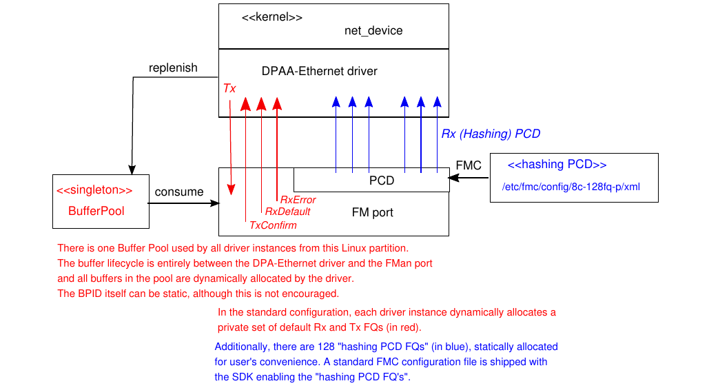

**Figure 75. Traffic mạng giữa Linux kernel và cổng FMan vật lý**

##### 8.2.2.5.2 Cấu hình

Mục này trình bày các tùy chọn cấu hình cho Private DPAA1 Ethernet driver.

###### 8.2.2.5.2.1 Cấu hình device tree

Chuỗi compatible dùng để định nghĩa một private interface trong device tree là "fsl,dpa-ethernet". Cấu trúc mặc định của device tree node chỉ định một private interface nên tương tự đoạn trích device tree node của LS1043ARDB dưới đây:

```
ethernet@0 {
  compatible = "fsl,dpa-ethernet";
  fsl,fman-mac = <&enet0>;
};
```

“fsl,fman-mac” là tham chiếu tới thiết bị MAC được nối với interface này. Thuộc tính này được dùng để xác định những cổng RX và TX nào được nối với interface này.

**Buffer pool**

Hiện chỉ một buffer pool được định nghĩa và được mọi private interface dùng. ID của buffer pool được cấp phát động và do buffer manager cung cấp. Số lượng và kích thước buffer trong pool được private driver quyết định bên trong, vì vậy không chấp nhận cấu hình nào từ device tree.

**Frame queue**

Các frame queue được private driver cấp phát với ID được cấp phát động và do queue manager cung cấp. Các frame queue cũng có thể được định nghĩa tĩnh bằng hai thuộc tính device tree bổ sung.

```
ethernet@0 {
        compatible = "fsl,dpa-ethernet";
        fsl,fman-mac = <&enet0>;
        fsl,qman-frame-queues-rx = <0x100 1 0x101 1 0x180 128>;
        fsl,qman-frame-queues-tx = <0x200 1 0x201 1 0x300 8>;
};
```

Trong ví dụ trên, giá trị 0x100 được gán cho ID frame queue RX error và 0x101 cho ID frame queue RX default. Ngoài ra, 128 frame queue PCD trong khoảng 0x180-0x1ff được định nghĩa và gán cho các portal gắn affinity với core theo kiểu round-robin.

Có đúng một queue RX error và một queue RX default, vì vậy giá trị frame count là "1". Tùy chọn, có thể chỉ định giá trị "0" cho base để bảo driver cấp phát động các ID frame queue.

Trong ví dụ trên, giá trị 0x200 được gán cho ID queue TX error và 0x201 cho ID queue TX confirmation. Mục thứ ba chỉ định các queue dùng để truyền.

Nếu qman-frame-queues-rx và qman-frame-queues-tx không có trong device tree, số TX queue được cấp phát động bằng số core có trong partition.

###### 8.2.2.5.2.2 Các tùy chọn Kconfig

Private driver có một số tham số có thể tinh chỉnh lúc biên dịch từ menuconfig. Chúng nằm ở:

```
Device Drivers
  +- Network device support
    +- Ethernet driver support
      +- Freescale devices
        +- DPAA Ethernet [CONFIG_FSL_SDK_DPAA_ETH]
```

**FSL_DPAA_ETH_JUMBO_FRAME - "Optimize for jumbo frames"**

Tối ưu thông lượng của driver DPAA1 Ethernet cho traffic termination frame lớn (ví dụ 4K trở lên).

Dùng tùy chọn này kết hợp với frame nhỏ làm tăng đáng kể lượng bộ nhớ driver chiếm và thậm chí có thể làm cạn bộ nhớ hệ thống. Ngoài ra, truesize của skb bị thay đổi và các thông báo cảnh báo về điều này từ stack bị bỏ qua.

**FSL_DPAA_1588 - "IEEE 1588-compliant timestamping"**

Bật mã hỗ trợ IEEE1588.

**Ghi chú:** Kernel driver chung **Freescale QorIQ 1588 timer as PTP clock** là phương pháp được khuyến nghị để cấu hình 1588 timer. Driver này được bật theo mặc định bởi kernel config PTP_1588_CLOCK_QORIQ. Các driver FSL_DPAA_1588 và FSL_SDK_FMAN_RTC_API có mặt để duy trì tương thích ngược.

**FSL_DPAA_TS - "Linux compliant timestamping"**

Bật hỗ trợ timestamping tuân thủ API Linux.

**FSL_DPAA_CEETM - "DPAA1 CEETM QoS"**

Bật hỗ trợ offload QoS qua khối phần cứng CEETM.

**FSL_DPAA_CEETM_CCS_THRESHOLD_1G - "CEETM egress congestion threshold on 1G ports"**

Kích thước tính bằng byte của ngưỡng CEETM egress Class Congestion State trên các cổng 1G. Ngưỡng cần được cấu hình có tính đến các yếu tố sau:

- Ngưỡng quá lớn sẽ đệm frame trong thời gian dài trong các TX queue khi cấu hình shaping rate nhỏ. Điều này sẽ gây cạn buffer pool hoặc lỗi hết bộ nhớ. Đến lượt nó, điều này sẽ gây mất frame ở RX.
- Ngưỡng quá nhỏ sẽ gây mất frame không cần thiết do vào trạng thái tắc nghẽn quá thường xuyên.

**FSL_DPAA_CEETM_CCS_THRESHOLD_10G - "CEETM egress congestion threshold on 10G ports"**

Kích thước tính bằng byte của ngưỡng CEETM egress Class Congestion State trên các cổng 10G.

**FSL_DPAA_ETH_USE_NDO_SELECT_QUEUE - "Use driver's Tx queue selection mechanism"**

Driver DPAA1-Ethernet định nghĩa một callback ndo_select_queue() để chọn tối ưu FQ egress. Callback này sẽ ghi đè hỗ trợ XPS cho netdevice này. Nếu bạn muốn tự kiểm soát việc chọn và ánh xạ FQ-to-CPU egress, hoặc không muốn dùng callback ndo_select_queue() của driver, thì bỏ chọn tùy chọn này và dùng hỗ trợ XPS chuẩn thay thế.

**FSL_DPAA_ETH_MAX_BUF_COUNT - "Maximum number of buffers in private bpool"**

Mặc định là 128. Số buffer tối đa được cấp phát theo mặc định trong buffer pool của private port DPAA1-Ethernet. Thông thường không cần sửa giá trị này, vì có lẽ nó đã được tinh chỉnh cho hiệu năng. Giá trị này không được thấp hơn DPAA_ETH_REFILL_THRESHOLD.

**FSL_DPAA_ETH_REFILL_THRESHOLD - "Private bpool refill threshold"**

Mặc định là 128. Số buffer tối đa được cấp phát theo mặc định trong buffer pool của private port DPAA1-Ethernet. Thông thường không cần sửa giá trị này, vì có lẽ nó đã được tinh chỉnh cho hiệu năng. Giá trị này không được thấp hơn DPAA_ETH_REFILL_THRESHOLD.

**FSL_DPAA_CS_THRESHOLD_1G - "Egress congestion threshold on 1G ports"**

Kích thước tính bằng byte của ngưỡng thông báo egress Congestion State trên các cổng 1G. Trong khoảng từ 0x1000 đến 0x10000000. Mặc định là 0x06000000. Tùy chọn này có thể giúp khi:

- Thiết bị bị tắc nghẽn trong thời gian kéo dài (có nguy cơ làm netdev watchdog kích hoạt - xem thêm module param tx_timeout)
- Ngăn các core Tx lặp chặt (như thể ngưỡng tắc nghẽn quá thấp để có hiệu quả)

Điều này cũng có thể kéo theo một số rủi ro:

- Ảnh hưởng hiệu năng của các giao thức như TCP, vốn vẫn hoạt động tốt dưới cơ chế thông báo tắc nghẽn
- Hết bộ nhớ nếu ngưỡng CS được đặt quá cao

**FSL_DPAA_CS_THRESHOLD_10G - "Egress congestion threshold on 10G ports"**

Kích thước tính bằng byte của ngưỡng thông báo egress Congestion State trên các cổng 10G. Trong khoảng từ 0x1000 đến 0x20000000. Mặc định là 0x10000000.

**FSL_DPAA_INGRESS_CS_THRESHOLD - "Ingress congestion threshold on FMan ports"**

Kích thước tính bằng byte của ngưỡng tail-drop ingress trên các cổng FMan. Mặc định là 0x10000000. Traffic dồn lên vượt giá trị này sẽ bị QMan từ chối và bị FMan loại bỏ.

**FSL_DPAA_ETH_DEBUG - "DPAA1 Ethernet debug support"**

Tùy chọn này biên dịch mã debug cho driver DPAA1 Ethernet.

###### 8.2.2.5.2.3 Bootargs

Các tham số bootarg sau được định nghĩa cho driver Frame Manager. Tuy nhiên, chúng cũng ảnh hưởng tới hành vi của Private driver:

- fsl_fm_max_frm
- fsl_fm_rx_extra_headroom

**fsl_fm_max_frm**

Frame Manager loại bỏ cả frame Rx lẫn Tx lớn hơn một giá trị Layer2 MAXFRM cụ thể. Driver DPAA1 Ethernet sẽ không cho phép đặt MTU của một interface quá cao đến mức tạo ra Ethernet frame lớn hơn MAXFRM. Giá trị lớn nhất có thể dùng làm MTU cho bất kỳ interface nào là (MAXFRM - 22) byte, trong đó 22 là kích thước của header Eth+VLAN (18 byte) cộng FCS Layer2 (4 byte).

Hiện tại, giá trị MAXFRM được đặt lúc boot và không thể thay đổi nếu không khởi động lại hệ thống.

MAXFRM mặc định là 1522, cho phép MTU tới 1500. Nếu muốn MTU lớn hơn, phải khởi động lại và cấu hình lại hệ thống như mô tả tiếp theo. MAXFRM tối đa là 9600.

MAXFRM có thể được đặt theo hai cách sau.

- Dưới dạng tùy chọn Kconfig (CONFIG_FSL_FM_MAX_FRAME_SIZE):

  ```
  Device Drivers
  +-> Network device support
    +-> Ethernet driver support
      +-> Freescale devices
         +-> Frame Manager support
            +-> Freescale Frame Manager (datapath) support
              +-> Maximum L2 frame size
  ```

- Dưới dạng bootarg: Trong môi trường U-Boot, thêm "fsl_fm_max_frm=\<your_MAXFRM>" trực tiếp vào biến "bootargs".

Lưu ý rằng mọi giá trị đặt trực tiếp trong bootargs của kernel đều ghi đè giá trị mặc định của Kconfig. Nếu không được đặt tường minh trong bootargs, giá trị Kconfig được dùng.

Triệu chứng khi MAXFRM bị cấu hình sai

MAXFRM ảnh hưởng trực tiếp tới việc phân chia MURAM bên trong FMan giữa các cổng Ethernet có sẵn, vì nó quyết định giá trị của một tham số bên trong FMan gọi là FIFO Size. Tùy giá trị MAXFRM và số cổng được probe, một số cổng có thể không được probe vì không đủ MURAM cho tất cả. Trong những trường hợp như vậy, bạn thấy một thông báo lỗi trong boot console.

**fsl_fm_rx_extra_headroom**

Cấu hình tùy chọn này để báo Frame Manager dành riêng thêm một chút chỗ ở đầu buffer dữ liệu trên đường nhận, trước khi các trường Internal Context được sao chép. Phần này là thêm vào vùng dữ liệu riêng đã được dành cho driver dùng nội bộ. Tùy chọn này không ảnh hưởng theo bất kỳ cách nào tới bố cục của các buffer được truyền đi. Giá trị mặc định (64 byte) cho hiệu năng tốt nhất trong trường hợp các frame được forward đang được đóng gói (ví dụ IPSec).

RX extra headroom có thể được đặt theo hai cách sau.

- Dưới dạng tùy chọn Kconfig (CONFIG_FSL_FM_RX_EXTRA_HEADROOM):

  ```
  Device Drivers
  +-> Network device support
    +-> Ethernet driver support
      +-> Freescale devices
        +-> Frame Manager support
          +-> Freescale Frame Manager (datapath) support
            +-> Add extra headroom at beginning of data buffers
  ```

- Dưới dạng bootarg: trong môi trường U-Boot, thêm "fsl_fm_rx_extra_headroom=< your_rx_extra_headroom>" trực tiếp vào biến "bootargs".

###### 8.2.2.5.2.4 Các tùy chọn ethtool

Private driver triển khai các thao tác ethtool sau.

```
-a --show-pause
  Queries the specified Ethernet device for pause parameter information.
-A --pause
  Changes the pause parameters of the specified private devices.
  rx on|off
    Specifies whether RX pause should be enabled.
  tx on|off
    Specifies whether TX pause should be enabled.
-k --show-features
  Lists the offloadable DPAA driver features. Specifies which features can be
 changed.
-K --features
  Changes a driver feature.
  feature on|off
    Specifies weather a certain feature should be enabled.
-s --change
  msglvl N
  msglvl type on|off ...
    Sets the driver message type flags by name or number. type names the type of
 message to enable or disable; N  specifies  the new flags numerically.
-S --statistics
  Shows driver statistics and counters: interrupt counter, packet counters,
 error counters, congestion state, and more.
--show-eee
  Shows the Energy-Efficient Ethernet configurations.
--set-eee
  Configures the EEE behavior.
```

##### 8.2.2.5.3 Tính năng

Mục này trình bày các tính năng của private DPAA1 Ethernet driver.

###### 8.2.2.5.3.1 Quản lý tắc nghẽn

QMan cung cấp ba phương pháp quản lý tắc nghẽn sau.

- WRED
- Congestion State Tail Drop (CSTD)
- FQ Tail Drop (FQTD)

Private driver triển khai CSTD cả ở TX lẫn RX. Khi số byte nằm trong một congestion group TX FQ đạt ngưỡng tắc nghẽn (high watermark), QMan từ chối mọi frame đến tiếp theo, cho đến khi tổng mọi frame chứa trong các congestion group giảm xuống dưới low watermark, bằng 7/8 high watermark. High watermark có thể được cấu hình từ menuconfig. Để biết thêm chi tiết, xem Section 8.2.2.5.2.2.

###### 8.2.2.5.3.2 Hỗ trợ Scatter/Gather

Trên đường Rx, mục S/G đầu tiên được dùng để xây phần tuyến tính của skb và các mục khác được dùng làm fragment.

Private driver có thể truy cập các skbuf egress được cấp phát trong high memory (ví dụ được map trực tiếp từ user-space, như trường hợp của system call sendfile()). Điều này loại bỏ nhu cầu kernel phải sao chép các skbuf như vậy vào các buffer low memory mới cấp phát, cho phép zero-copy trên đường egress.

###### 8.2.2.5.3.3 Hỗ trợ jumbo frame

Traffic termination với frame lớn hoạt động tốt hơn nếu chỉ dùng skb tuyến tính (và frame một buffer). Driver có tùy chọn cấp phát buffer Rx đủ lớn để chứa toàn bộ frame (tối đa 9.6K).

Tùy chọn này cần được dùng thận trọng, vì lượng bộ nhớ chiếm có thể là vấn đề thực sự khi dùng frame nhỏ.

Tùy chọn có thể được bật từ tùy chọn menuconfig:

```
Device Drivers
          +-> Network device support
            +-> Ethernet driver support
              +-> Freescale devices
                +-> DPAA Ethernet [CONFIG_FSL_SDK_DPAA_ETH]
                  +-> Optimize for jumbo frames
```

Ngoài việc bật tính năng này từ menuconfig, người dùng phải đặt kích thước frame tối đa L2 là 9600, nếu không cấu hình không hợp lệ. Có thể làm điều này bằng cách đặt fsl_fm_max_frm=9600 trong bootargs, hoặc cấu hình CONFIG_FSL_FM_MAX_FRAME_SIZE từ menuconfig. Để biết thêm chi tiết về bootargs, xem Section 8.2.2.5.2.3.

###### 8.2.2.5.3.4 Hỗ trợ GRO/GSO

Generic Receive Offload (GRO) gắn với hỗ trợ NAPI và hoạt động bằng cách giữ một danh sách GRO flow cho mỗi instance NAPI. Các flow này khi đó có thể "gộp" các gói đến, cho đến khi một điều kiện kết thúc nào đó được đáp ứng hoặc chu kỳ NAPI hiện tại kết thúc, lúc đó các flow được đẩy lên protocol stack. Các flow gộp nhiều gói dùng chung các protocol header và hợp nhất payload (mà không memcopy nó). Điều này làm giảm tải CPU và/hoặc tăng thông lượng mạng. Các gói không khớp với flow nào đã lưu (trong chu kỳ NAPI hiện tại) được gửi lên stack qua đường thông thường, không qua GRO.

GRO thường được hỗ trợ trong phần cứng dưới dạng một tập "GRO assist", thay vì hợp nhất gói đầy đủ. Các tính năng sau được tính là GRO assist:

- Kiểm chứng checksum phần cứng ở RX
- Receive Traffic Distribution (RTD)
- Nhiều queue RX/TX
- Receive Traffic Hashing
- Prefetch header
- Tách header
- Affinity với core
- Affinity interrupt

Ghi chú: Ngoại trừ tách header, các platform DPAA1 có mọi hardware assist khác. Đáng chú ý nhất, chúng đạt được một cách ngầm định qua các cơ chế đi kèm PCD.

Generic Segmentation Offload (GSO) cũng là một tính năng đã được khẳng định trong Linux kernel. Thông thường, một TCP segment được tạo ở Layer 4 của Linux stack, dựa trên thiết lập kết nối MSS (Maximum Segment Size) hiện tại. Tuy nhiên người ta quan sát thấy rằng trì hoãn việc phân đoạn là cách tiếp cận tốt hơn xét về tải CPU, vì ít header phải xử lý hơn. Linux đã áp dụng một cách tối ưu gọi là GSO, theo đó các segment L4 chỉ được tạo ngay trước khi chúng được chuyển cho driver L2.

Hỗ trợ GRO và GSO có sẵn theo mặc định trong Private driver và có thể bật tắt độc lập lúc chạy, qua ethtool -k.

Ghi chú: Các phiên bản ethtool cũ hơn không hỗ trợ điều này. Ethtool phiên bản 3.0 có hỗ trợ - và có thể cả một số phiên bản trước đó.

Các tối ưu chung giúp tăng hiệu năng của driver trong trường hợp chung cũng áp dụng cho driver có bật GRO/GSO. Vì vậy hỗ trợ PCD được khuyến nghị về mặt này. Chúng tôi nhận thấy các tối ưu này cho kết quả tốt nhất với traffic 10 Gbit/s, và ở mức thấp hơn (nếu có) với traffic 1 Gbit/s. Đặc biệt, các bài kiểm thử TCP có thể được lợi từ GRO nhờ giảm tải CPU và tăng thông lượng mạng. Các cải thiện càng thấy rõ với MTU mạng nhỏ hơn - với MTU=1500 trở xuống, lợi ích cao hơn, trong khi từ MTU=4k trở lên chúng không còn quan sát được.

Một tối ưu làm tăng hiệu năng GSO là đường egress zero-copy. Nó có được nhờ system call sendfile(), có thể được dùng thay cho syscall send() thông thường, và một số ứng dụng benchmark biết đến nó. Ví dụ Netperf có hỗ trợ sendfile trong các bài kiểm thử TCP_SENDFILE.

GRO và GSO không phải là thuốc chữa bách bệnh, kiểu tối ưu một nút bấm sửa được mọi thứ. Dù trong hầu hết hoàn cảnh chúng phải trong suốt (đây là lý do GRO được bật theo mặc định trong Linux kernel), có những kịch bản và cấu hình mà thực tế chúng có thể cho hiệu năng kém hơn. Traffic trên các cổng 1 Gbit/s ít được lợi từ GRO/GSO. Ngoài ra, nếu Private Driver phát hiện PCD không được thiết lập, GRO tự động bị bỏ qua.

###### 8.2.2.5.3.5 Transmit packet steering

Private driver cung cấp cho Linux networking stack một interface TX-multiqueue. Điều này giúp stack kiểm soát các transmission queue tốt hơn và giảm nhu cầu lock. Người dùng cũng có thể điều khiển việc ánh xạ các FQ egress tới các CPU qua một tính năng Linux chuẩn gọi là Transmit Packet Steering (XPS), được ghi tài liệu ở đây: http://lwn.net/Articles/412062/

**Ghi chú:** Các transmission queue của kernel là những thực thể khác với các Frame Queue của Private driver.

Tuy nhiên, Private driver ghép hai thế giới này bằng cách ánh xạ các FQ DPAA1 lên các cấu trúc queue của chính kernel. Vì mục đích đó, Private driver cung cấp một callback chuẩn (net-device operation, hay NDO) gọi là ndo_select_queue(), mà stack có thể truy vấn để tìm ra ánh xạ queue cụ thể nó cần để truyền một frame. Sự tồn tại của NDO đó (vốn là tùy chọn) ghi đè việc chọn queue của kernel qua XPS. Đây là lý do Private driver cung cấp một lựa chọn lúc biên dịch để tắt callback ndo_select_queue(), để stack tự chọn transmission queue.

Để dùng callback ndo_select_queue() built-in của Private driver, chọn tùy chọn Kconfig **FSL_DPAA_ETH_USE_NDO_SELECT_QUEUE**.

Để tắt cơ chế chọn queue của Private driver và dùng XPS thay thế, bỏ chọn tùy chọn Kconfig này. Sau đó, người dùng có thể cấu hình ánh xạ txq-to-cpu của riêng mình, như mô tả trong bài LWN ở trên.

###### 8.2.2.5.3.6 Checksum phần cứng TX và RX

**Giới thiệu**

Khối FMan hỗ trợ tính checksum L3 và/hoặc L4 cho một số giao thức chuẩn.

Điều này có thể được dùng trên đường TX để tính checksum của frame đi ra, và trên đường RX để kiểm chứng checksum L3/L4 của frame đến và đưa ra quyết định phân loại hoặc phân phối.

**Hỗ trợ TX Checksum**

Ở TX, việc tính checksum được Private driver bật trên cơ sở từng frame. Hỗ trợ TX checksum cho các giao thức chuẩn như sau:

**Table 54. Hỗ trợ TX checksum**

| Header | IPv4 | IPv6 | Khác |
|---|---|---|---|
| IP header | có | không có sẵn | không |
| TCP header | có | có | không |
| UDP header | có | có | không |

**Ghi chú:** Khả năng checksum IP Header cũng có trong khối SEC (xem IPSEC).

**Ghi chú:** Ethernet CRC được tính trên cơ sở từng frame trong quá trình truyền frame.

**Ghi chú:** Điều kiện tiên quyết chính để TX checksum được bật trong phần cứng là không được có IP tunneling (tức là không GRE, không MinEnc, không IPIP). Các điều kiện khác liên quan đến tính hợp lệ và toàn vẹn của frame.

**Hỗ trợ RX Checksum**

Tính năng này bị tắt theo mặc định. Để bật tính RX checksum cho các giao thức được hỗ trợ, phải áp một PCD scheme lên cổng RX tương ứng. Trong bản phát hành hiện tại, cả L3 và L4 đều được bật nếu một PCD được áp dụng.

Nếu được bật, việc kiểm chứng checksum L3 và L4 được thực hiện cho TCP, UDP và IPv4.

**Ghi chú:** Việc điều khiển tính năng này qua ethtool chưa được hỗ trợ.

###### 8.2.2.5.3.7 Priority Flow Control

Driver DPAA1 Ethernet cung cấp hỗ trợ thử nghiệm cho các chuẩn IEEE 802.1Qbb (Priority Flow Control) và 802.1p.

Các chuẩn này nhằm triển khai Ethernet không mất gói, trong đó các lớp traffic ưu tiên cao nhất được hưởng băng thông tối đa và độ trễ tối thiểu. Có thể dùng tới 8 class of service, nhưng tối thiểu chỉ cần 3.

Các thuật ngữ “Class of Service (CoS)” và “priority” sẽ được dùng thay thế cho nhau trong mục này.

**Bật hỗ trợ PFC**

Để bật hỗ trợ PFC, bật các tùy chọn sau từ menuconfig

```
Device Drivers
+ Network device support
  + Ethernet driver support
    + Freescale devices
      + Frame Manager support
        + Freescale Frame Manager (datapath) support
          + FMan PFC support (EXPERIMENTAL)
            + (3)     Number of PFC Classes of Service
            + (65535) The pause quanta for PFC CoS 0
            + (65535) The pause quanta for PFC CoS 1
            + (65535) The pause quanta for PFC CoS 2
```

Số Class of Service có thể nằm trong khoảng từ 1 đến 4. Nó xác định số Work Queue được dùng và số priority được đặt khi phát một PFC frame. 3 là giá trị mặc định. Thay đổi giá trị này cũng thay đổi số WQ và số priority.

Pause time có thể được chỉnh riêng cho từng CoS.

Việc bật và tắt CoS cùng pause time của chúng không thực hiện được lúc chạy. Trong bản phát hành này chỉ có thể làm lúc biên dịch.

**Chọn Class of Service**

Khi hỗ trợ PFC được bật, traffic egress chạy trên một DPAA1 Private interface được phân phối lên 3 Work Queue đầu tiên của một cổng TX, cụ thể là WQ0, WQ1 và WQ2.

Chúng hoạt động theo ưu tiên tuyệt đối. WQ0 có độ ưu tiên cao nhất và WQ2 thấp nhất. FMan không thể dequeue frame từ WQ1 trừ khi WQ0 rỗng, và từ WQ2 trừ khi WQ1 và WQ0 rỗng.

Work queue mà một frame sẽ được enqueue vào được xác định từ socket buffer priority. skb_prio chỉ là một tag nội bộ mà kernel gắn cho các frame trên đường egress và bên nhận không nhìn thấy.

skb_prio mặc định là 0, nghĩa là mọi frame sẽ được phân phối tới WQ0. skb_prio có thể được sửa bằng nhiều phương pháp, bao gồm traffic control.

Để sửa priority của một socket buffer bằng tc, cần bật các tùy chọn sau từ menuconfig.

```
Networking support
+ Networking options
  + QoS and/or fair queueing
    + Multi Band Priority Queueing (PRIO)
    + Elementary classification (BASIC)
    + Universal 32bit comparisons w/ hashing (U32)
    + Extended Matches
      + U32 key
    + Actions
      + SKB Editing
```

Các lệnh sau gán skb_prio bằng 1 cho traffic hướng tới cổng TCP và UDP 5000 và ngầm định hướng nó vào WQ1.

```
tc qdisc del dev fm1-mac9.0 root
tc qdisc add dev fm1-mac9.0 root handle 1: prio
tc filter add dev fm1-mac9.0 parent 1: protocol ip u32 match ip dport 5000
 action skbedit priority 1
```

**Gắn tag VLAN**

Để được bên nhận phân loại theo 802.1p, traffic egress phải được gắn tag VLAN, với Class of Service nằm trong trường PCP. Priority PCP cũng được xác định từ skb_prio.

```
# create a subinterface of fm1-mac9, with VLAN ID 0
vconfig add fm1-mac9 0
# all frames tagged with skb_prio 1, will have PCP priority of 1.
vconfig set_egress_map fm1-mac9.0 1 1
```

Nếu không chỉ định ánh xạ nào, trường PCP sẽ được đặt là 0 theo mặc định.

Sự phụ thuộc giữa skb_prio, work queue và priority VLAN PCP:

**Nhận PFC frame**

Khác với các PAUSE frame 802.3x thông thường, PFC frame có thể tạm dừng có chọn lọc một priority/CoS nhất định.

WQ0 đáp ứng các PFC frame có đặt priority 0. Ví dụ: Khi một PFC frame đến chứa priority 0 và có pause time 100 cho priority 0, WQ0, tức là mọi traffic từ CoS 0, bị bỏ qua khi dequeue trong 100 bit time, và việc dequeue được thực hiện từ WQ1 và WQ2.

**Tạo PFC frame**

Mọi DPAA1 Private interface dùng chung một buffer pool, chứa các buffer mà frame được lưu vào khi nhận.

Khi Buffer Pool đạt ngưỡng refill/depletion, các PFC frame được gửi lại cho bên gửi để tạm dừng việc truyền frame và qua đó tránh mất frame.

FMan gửi các PFC frame tạm dừng mọi Class of Traffic đã định nghĩa. Khác biệt duy nhất giữa các class là pause time.

Pause time có thể được cấu hình từ menuconfig. Pause time bằng 0 sẽ tắt Class of Service đó.

Khi buffer pool chung cạn, các PFC frame được phát ra trông như thế này.

**Bật và tắt PFC bằng ethtool**

Hiển thị các thiết lập PFC đang dùng cho một interface:

```
ethtool -a intf_name
```

**Bật/tắt việc phát PFC frame**

PFC frame có thể được bật/tắt trên RX/Tx bằng ethtool -A, như trong các ví dụ sau:

```
ethtool -A intf_name rx on
ethtool -A intf_name tx off
ethtool -A intf_name rx off tx off
```

**Autonegotiation**

Khi autonegotiation được bật và người dùng bật/tắt PFC frame trên RX/Tx, chúng sẽ không tự động được bật/tắt. Thay vào đó, khả năng PFC đối xứng/bất đối xứng của phía cục bộ và phía peer sẽ được xem xét. Nếu peer không khớp khả năng cục bộ, các lệnh sau có thể không có tác dụng:

```
ethtool -A intf_name rx on
ethtool -A intf_name rx off
ethtool -A intf_name tx on
ethtool -A intf_name tx ff
```

Khi autonegotiation bị tắt, các thiết lập ethtool ghi đè kết quả thương lượng link.

Autonegotiation PFC frame cũng có thể được bật/tắt bằng ethtool -A:

```
ethtool -A intf_name autoneg on
ethtool -A intf_name autoneg off
```

###### 8.2.2.5.3.8 Các queue gắn affinity với core

Driver tự động tạo 128 queue gắn affinity với core, dùng làm RX PCD frame queue. Các frame queue này có thể được dùng trong các file cấu hình PCD để xử lý một số loại frame nhất định trên các CPU cụ thể. Để thuận tiện cho việc tạo file PCD, thư mục /etc/fmc/config/ trong rootfs chứa các file cấu hình và policy mặc định cho từng platform.

Driver tính các ID frame queue dựa trên địa chỉ các thanh ghi MAC ứng với cổng bằng công thức sau:

((MAC register address) & 0x1fffff) >> 6

Sau đây là các giá trị cho các platform QorIQ DPAA1 khác nhau:

**Table 55. Các queue gắn affinity với core của các thiết bị FMan**

| Interface | FQID base | LS1043A | LS1046A |
|---|---|---|---|
| fm1-mac1 | 0x3800 | Y |   |
| fm1-mac2 | 0x3880 | Y |   |
| fm1-mac3 | 0x3900 | Y | Y |
| fm1-mac4 | 0x3980 | Y | Y |
| fm1-mac5 | 0x3a00 | Y | Y |
| fm1-mac6 | 0x3a80 | Y | Y |
| fm1-mac9 | 0x3c00 | Y | Y |
| fm1-mac10 | 0x3c80 |   | Y |

Các queue này được gán cho các core theo kiểu round-robin. Chẳng hạn, nếu có 8 core, 0x3800 sẽ được core 0 phục vụ, 0x3801 bởi core 1, 0x3808 bởi core 0, v.v. Hiện tại, nếu chỉ định thêm RX PCD queue trong device tree, các queue này **cũng** sẽ được gán theo kiểu round-robin này.

**Các queue gắn affinity với core ưu tiên cao**

Bắt đầu từ SDK 2.0, một tập RX PCD frame queue mới đã được thêm vào, nhằm hỗ trợ triển khai các kịch bản quản lý traffic phức tạp. Tập frame queue này có độ ưu tiên cao hơn các RX PCD frame queue thông thường, và vì vậy traffic đến trên các frame queue này được ưu tiên hơn traffic đến trên các RX PCD frame queue mặc định. Một kịch bản mà điều này hữu ích là kịch bản kiểm thử IPsec back-to-back, trong đó traffic đã mã hóa (RX) nên có độ ưu tiên cao hơn traffic văn bản thường.

Driver tính các ID frame queue ưu tiên cao dựa trên địa chỉ các thanh ghi MAC ứng với cổng bằng công thức sau:

65536 + ((MAC register address) & 0x1fffff) >> 6

Sau đây là các giá trị cho các platform QorIQ DPAA1 khác nhau:

**Table 56. Các queue gắn affinity với core ưu tiên cao của các thiết bị FMan**

| Interface | FQID base | LS1043A | LS1046A |
|---|---|---|---|
| fm1-mac1 | 0x13800 | Y |   |
| fm1-mac2 | 0x13880 | Y |   |
| fm1-mac3 | 0x13900 | Y | Y |
| fm1-mac4 | 0x13980 | Y | Y |
| fm1-mac5 | 0x13a00 | Y | Y |
| fm1-mac6 | 0x13a80 | Y | Y |
| fm1-mac9 | 0x13c00 | Y | Y |
| fm1-mac10 | 0x13c80 |   | Y |

##### 8.2.2.5.4 Quality of Service

Các platform DPAA1 có thể offload các chức năng QoS như policing, shaping, scheduling và prioritization lên các khối phần cứng chuyên dụng.

Traffic policing được thực hiện ở ingress qua FMan. Một thuật toán two rate three color marker có thể được cấu hình qua công cụ Frame Manager Configuration (FMC).

Traffic scheduling, shaping và prioritization được thực hiện trên đường egress trong QMan. Nhiều thuật toán, như dual rate shaping và strict prioritization, được triển khai và có thể được cấu hình qua các queuing discipline.

###### 8.2.2.5.4.1 Policing

Khối con Policer của FMan triển khai thuật toán traffic policing two rate, three color marker (trTCM). Thuật toán có hai biến thể cấu hình được: RFC2698 và RFC4115.

Công cụ FMC, được mô tả chi tiết trong Frame Manager Configuration Tool User's Guide, được dùng để bật Policer và thiết lập các tham số của nó.

Để biết thêm thông tin về FMan Policer và cách cấu hình nó, xem Section 8.2.6.9.4.

###### 8.2.2.5.4.2 Scheduling và Shaping

**Mô tả**

Một số platform DPAA1 cụ thể cung cấp khả năng scheduling, shaping và prioritization qua CEETM (Customer Edge Egress Traffic Management). Khối phần cứng CEETM là một thành viên của QMan. Mục đích của nó là tăng hiệu năng của các platform DPAA1 bằng cách chuyển logic QoS egress từ phần mềm sang phần cứng.

Mục này mô tả ngắn gọn khối CEETM và các khả năng của nó. Ngoài ra, nó trình bày cách cấu hình khối này qua công cụ traffic control (tc) của Linux bằng một queuing discipline tùy biến.

**Kiến trúc CEETM**

CEETM là một khối con của QMan và là một phương án thay thế cho chế độ lập lịch frame queue - work queue - channel thông thường. Để biết thêm thông tin về workflow này, hoặc về DCP và subportal, tham khảo mục **QMan** **Overview**.

Xem hình dưới đây về một khối CEETM, khối này có cho mỗi FMan và được dùng bởi các subportal FMan liên kết với các Ethernet interface.

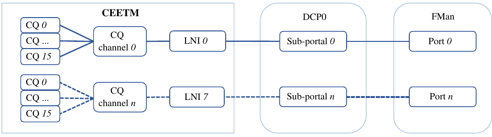

**Figure 76. Khối CEETM**

CEETM dùng 8 Logical Network Interface (LNI) có thể được ánh xạ tới các subportal DCP của FMan. Tùy platform được dùng, có 8 hoặc 32 class queue channel (hay CQ channel) có thể được ánh xạ tới các LNI. Nhiều CQ channel có thể được ánh xạ tới cùng một LNI.

Mỗi CQ channel chứa 16 class queue. 8 CQ là độc lập, còn 8 CQ còn lại có thể được nhóm thành 1 class group hoặc 2 class group mỗi nhóm 4 queue. Nhóm thứ nhất gọi là group A và nhóm thứ hai gọi là group B.

**Tính năng**

CEETM triển khai các thuật toán sau:

- Lập lịch Strict Priority
- Weighted Bandwidth Fair Scheduling (WBFS)
- dual-rate shaping với committed rate và excess rate (CR/ER)
- lập lịch Fair Queueing có shaping và không shaping (shFQ, uFQ)

Các thuật toán này được dùng cùng nhau theo những tổ hợp cụ thể dựa trên kiến trúc của CEETM đã mô tả ở trên và được minh họa dưới đây:

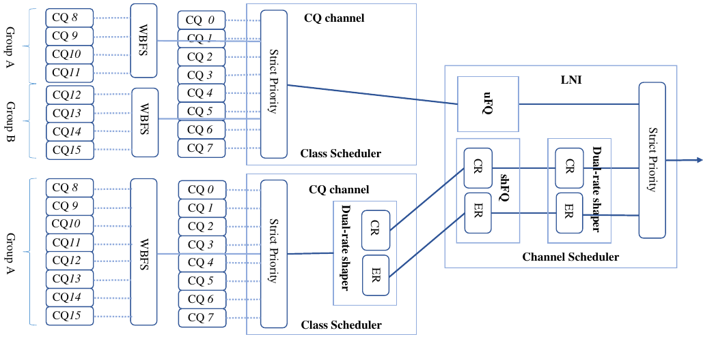

**Figure 77. Kiến trúc CEETM**

Mọi CQ nối với một CQ channel đều đi qua một bộ lập lịch Strict Priority. ID của CQ càng thấp thì độ ưu tiên của CQ càng cao (ví dụ CQ#3 có độ ưu tiên cao hơn CQ#4, vì vậy chừng nào còn frame xếp hàng ở CQ#3 thì CQ#4 sẽ không được dequeue).

Độ ưu tiên của các CQ group cấu hình được. Mọi frame đến từ các CQ đã nhóm đều đi qua thuật toán WBFS. Mỗi CQ thuộc một group được gán một weight. Weight là một giá trị từ 1 đến 248, biểu thị phần băng thông của một CQ so với các CQ khác trong group. Ví dụ, một CQ có weight 20 sẽ có phần băng thông gấp đôi một CQ có weight 10. Chi tiết thêm về cách thuật toán WBFS hoạt động có trong QorIQ DPAA Reference Manual của platform.

Các CQ channel có thể có shaping hoặc không shaping. Với các CQ dẫn tới một channel có shaping, mọi frame sẽ đi qua một bộ dual-rate shaper trước khi vào LNI. Các CQ độc lập, cũng như các class group, có thể được cấu hình để dẫn frame của chúng qua CR shaper, ER shaper, hoặc cả hai.

Mỗi LNI gom frame từ các CQ channel liên kết với nó. Mọi frame không shaping từ các CQ channel không shaping được ánh xạ tới LNI đều đi qua thuật toán uFQ. Các frame CR/ER từ các CQ channel có shaping đi qua thuật toán shFQ và qua một bộ dual-rate shaper khác. Cuối cùng, mọi frame đi qua module Strict Priority của LNI, module này lập lịch frame không shaping (với độ ưu tiên cao), các frame CR (với độ ưu tiên trung bình) và các frame ER (với độ ưu tiên thấp).

Thuật toán shFQ lập lịch cho một channel truyền nếu shaper của channel đủ điều kiện thời gian (shaper có số token dương trong bucket). Khi một channel dùng hết token, nó được thêm vào một hàng đợi chờ, nơi nó phải đợi mọi channel đủ điều kiện thời gian khác đứng trước nó truyền xong.

Thuật toán uFQ tương tự shFQ. Trong thuật toán uFQ, mọi channel đều đủ điều kiện thời gian. Sau khi truyền xong toàn bộ dữ liệu sẵn có, chúng được thêm vào cuối hàng đợi chờ đủ điều kiện thời gian, nơi bucket của chúng được nạp lại ngay lập tức. Giới hạn token bucket của các channel không shaping cấu hình được.

Để biết thêm thông tin về khả năng của CEETM và mô tả chi tiết các thuật toán đã nêu, hãy xem QorIQ DPAA Reference Manual của platform bạn dùng.

**Tích hợp với các queuing discipline**

Khối CEETM có thể được cấu hình qua queuing discipline ceetm. So sánh giữa khối phần cứng và thuật ngữ của traffic control được minh họa trong hình dưới đây.

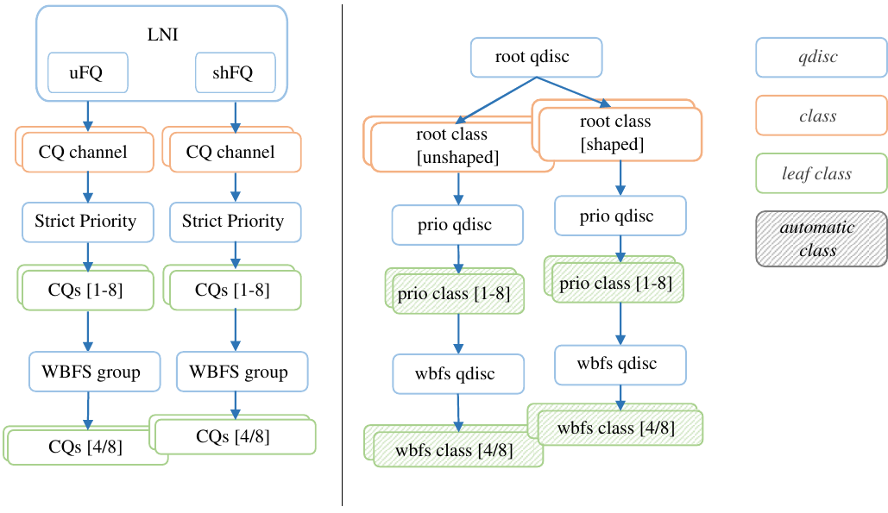

**Figure 78. So sánh giữa thuật ngữ CEETM và tc**

Một LNI có thể được ánh xạ tới một cổng FMan bằng cách thêm một root ceetm qdisc vào một network interface. CR và ER của LNI shaper được cấu hình bằng cách đặt rate, và tùy chọn ceil và overhead, trên qdisc.

Một CQ channel có thể được liên kết với một LNI bằng cách tạo một ceetm root class ánh xạ tới root qdisc. Với một channel không shaping, cần cấu hình giới hạn token bucket (tbl) của uFQ. Với một channel có shaping, rate, và tùy chọn ceil, đặt CR và ER.

Ghi chú: Các CQ channel có shaping chỉ có thể được liên kết với LNI nếu shaper của LNI được bật.

Các CQ độc lập của một channel được cấu hình khi một prio qdisc được liên kết với một root class. Từ 1 đến 8 prio class được tạo ra, mỗi class tương ứng với một CQ liên kết với bộ lập lịch Strict Priority của channel. Tham số qcount cho biết số class con. Nếu channel có shaping, mọi class được tạo ra theo mặc định tham gia cả CR shaping lẫn ER shaping. Để tắt một trong hai, có thể thay đổi các tham số cr và er của prio class tương ứng với CQ.

**Ghi chú:** Các CQ liên kết với một CQ channel có shaping không thể tắt cả CR shaping lẫn ER shaping.

Để cấu hình các CQ group, một wbfs qdisc được liên kết với một trong các prio class. Hoặc 4 hoặc 8 wbfs class được tạo ra, tùy số CQ trong group được chỉ ra bởi tham số qcount. Group được đặt ngay sau class cha của nó trong danh sách Strict Priority của channel (ví dụ, nếu wbfs qdisc được liên kết với prio class #2, danh sách ưu tiên trở thành: class #1, class #2, group, class #3, class #4, v.v.). Weight của CQ được cấu hình qua tham số qweight và có thể được thay đổi riêng cho từng CQ. Với các group liên kết với CQ channel có shaping, CR shaping và ER shaping được bật bằng các tham số cr và er.

**Ghi chú:** Các group liên kết với một CQ channel có shaping không thể tắt cả CR shaping lẫn ER shaping.

Để biết thêm chi tiết về các tham số và cấu hình của ceetm qdisc, xem mục "Usage".

**Hướng dẫn sử dụng**

**Các platform được hỗ trợ**

Khối CEETM có mặt và cấu hình được qua ceetm qdisc trên các platform LS1043A/LS1046A.

**Bắt đầu**

1. Bật hỗ trợ QoS mạng trong kernel cùng với mọi classifier hoặc tính năng khác có thể cần, cũng như ceetm qdisc.

   ```
   ->  Networking support (NET [=y])
       -> Networking options
           -> QoS and/or fair queueing (NET_SCHED [=y])
               -> Universal 32bit comparisons w/ hashing (u32) (NET_CLS_U32
    [=y])
   -> Device Drivers
       -> Network device support (NETDEVICES [=y])
           -> Ethernet driver support (ETHERNET [=y])
               -> Freescale devices (NET_VENDOR_FREESCALE [=y])
                   -> DPAA Ethernet (FSL_SDK_DPAA_ETH [=y])
                       -> DPAA CEETM QoS (FSL_DPAA_CEETM [=y])
   ```

2. Sửa các ngưỡng Class Congestion State nếu cần. Các giá trị mặc định được chọn có tính đến các yếu tố sau:
   - Ngưỡng quá lớn sẽ đệm frame trong thời gian dài trong các TX queue khi cấu hình shaping rate nhỏ. Điều này sẽ gây cạn buffer pool hoặc lỗi hết bộ nhớ. Đến lượt nó, điều này sẽ gây mất frame ở RX.
   - Ngưỡng quá nhỏ sẽ gây mất frame không cần thiết do vào trạng thái tắc nghẽn quá thường xuyên.

     ```
     -> Device Drivers
         -> Network device support (NETDEVICES [=y])
             -> Ethernet driver support (ETHERNET [=y])
                 -> Freescale devices (NET_VENDOR_FREESCALE [=y])
                     -> DPAA Ethernet (FSL_SDK_DPAA_ETH [=y])
                         -> CEETM egress congestion threshold on 1G ports
                            (FSL_DPAA_CEETM_CCS_THRESHOLD_1G [=0x000a0000])
                         -> CEETM egress congestion threshold on 10G ports
                            (FSL_DPAA_CEETM_CCS_THRESHOLD_10G [=0x00640000])
     ```

3. Build ứng dụng ceetm bằng bitbake:

   ```
   bitbake ceetm
   ```

**Giới hạn**

- CEETM chỉ được hỗ trợ trên các DPAA1 Private Ethernet interface.
- CEETM không được hỗ trợ trên nền các Linux bonding interface.

**Cách dùng**

Bạn có thể xem thông báo trợ giúp của ceetm qdisc bằng cách chạy lệnh sau:

```
~# tc qdisc add ceetm help
Usage:
... qdisc add ... ceetm type root [rate R [ceil C] [overhead O]]
... class add ... ceetm type root (tbl T | rate R [ceil C])
... qdisc add ... ceetm type prio qcount Q
... qdisc add ... ceetm type wbfs qcount Q qweight W1 ... Wn [cr CR] [er ER]
Update configurations:
... qdisc change ... ceetm type root [rate R [ceil C] [overhead O]]
... class change ... ceetm type root (tbl T | rate R [ceil C])
... class change ... ceetm type prio [cr CR] [er ER]
... qdisc change ... ceetm type wbfs [cr CR] [er ER]
... class change ... ceetm type wbfs qweight W
Qdisc types:
root - configure a LNI linked to a FMan port
prio - configure a channel's Priority Scheduler with up to eight classes
wbfs - configure a Weighted Bandwidth Fair Scheduler with four or eight classes
Class types:
root - configure a shaped or unshaped channel
prio - configure an independent class queue
Options:
R - the CR of the LNI's or channel's dual-rate shaper (required for shaping
 scenarios)
C - the ER of the LNI's or channel's dual-rate shaper (optional for shaping
 scenarios, defaults to 0)
O - per-packet size overhead used in rate computations (required for shaping
 scenarios, recommended value is 24 i.e. 12 bytes IFG + 8 bytes Preamble + 4
 bytes FCS)
T - the token bucket limit of an unshaped channel used as fair queuing weight
 (required for unshaped channels)
CR/ER - boolean marking if the class group or prio class queue contributes to
 CR/ER shaping (1) or not (0) (optional, at least one needs to be enabled for
 shaping scenarios, both default to 1 for prio class queues)
Q - the number of class queues connected to the channel (from 1 to 8) or in a
 class group (either 4 or 8)
W - the weights of each class in the class group measured in a log scale with
 values from 1 to 248 (when adding a wbfs qdisc, either four or eight, depending
 on the size of the class group; when updating a wbfs class, only one)
```

Cần thêm filter trên mỗi lớp qdisc để cho phép gói tới được các leaf class. Tương tự, cần gỡ mọi filter khỏi mỗi lớp qdisc khi không còn dùng.

**Ví dụ**

**Giới hạn tốc độ hai stream**

**Thiết lập**

Trong ví dụ sau, một platform có hỗ trợ CEETM (LS1043ARDB - Client) được nối với một board khác (LS1046ARDB - Server) qua một link 1G. Thiết lập được mô tả được minh họa trong hình sau.


**Figure 79. Thiết lập ví dụ rate**

Các iperf client chạy trên Client trong khi các iperf server chạy trên Server. Server lắng nghe trên 2 cổng TCP (21 và 80).

```
root@ls1046ardb:~# iperf -s -p 21 &
root@ls1046ardb:~# iperf -s -p 80 &
```

PCD được áp dụng trên cả hai platform từ trước.

```
root@ls1046ardb:~# fmc -c /etc/fmc/config/private/ls1046ardb/
RR_FFSSPPPH_1133_5559/config.xml -p /etc/fmc/config/private/ls1046ardb/
RR_FFSSPPPH_1133_5559/policy_ipv4.xml -a
root@ls1043ardb:~# fmc -c /etc/fmc/config/private/ls1043ardb/RR_FQPP_1455/
config.xml -p /etc/fmc/config/private/ls1043ardb/RR_FQPP_1455/policy_ipv4.xml -a
```

Để giữ ví dụ này tối giản, các ARP frame không được lọc và phân loại. Vì vậy, các địa chỉ MAC cũng cần được trao đổi và lưu từ trước.

```
root@ls1043ardb:~# arp -s <server IP address> <server HW address>
root@ls1046ardb:~# arp -s <client IP address> <client HW address>
```

Sau khi thêm các qdisc, Client chạy các iperf client.

```
root@ls1043ardb:~# iperf -c <server IP address> -p 21 &
root@ls1043ardb:~# iperf -c <server IP address> -p 80 &
```

**Thực thi**

Cây phân cấp qdisc và class tương ứng của ví dụ này được minh họa trong hình sau.


**Figure 80. Cây phân cấp class của ví dụ rate**

Thêm một ceetm qdisc vào interface và cấu hình dual-rate shaper của LNI với CR bằng 1 Gbit/s.

```
root@ls1043ardb:~#  tc qdisc add dev fm1-mac3 root handle 1: ceetm type root
 rate 1000mbit overhead 24
```

Thêm một channel có shaping vào LNI và cấu hình dual-rate shaper của nó với CR bằng 150 Mbit/s.

```
root@ls1043ardb:~#  tc class add dev fm1-mac3 parent 1: classid 1:1 ceetm type
 root rate 150mbit
```

Thêm một channel có shaping khác vào LNI và cấu hình dual-rate shaper của nó với CR bằng 850 Mbit/s.

```
root@ls1043ardb:~#  tc class add dev fm1-mac3 parent 1: classid 1:2 ceetm type
 root rate 850mbit
```

Cấu hình một trong các priority class của channel thứ nhất (theo mặc định được đánh dấu là đủ điều kiện cả CR lẫn ER).

```
root@ls1043ardb:~#  tc qdisc add dev fm1-mac3 parent 1:1 handle 2: ceetm type
 prio qcount 1
```

Cấu hình một trong các priority class của channel thứ hai (theo mặc định được đánh dấu là đủ điều kiện cả CR lẫn ER).

```
root@ls1043ardb:~#  tc qdisc add dev fm1-mac3 parent 1:2 handle 3: ceetm type
 prio qcount 1
```

Thêm các filter sẽ phân loại mọi gói có cổng đích bằng 80 và dẫn chúng qua priority class của channel thứ nhất.

```
root@ls1043ardb:~#  tc filter add dev fm1-mac3 parent 1: prio 1 protocol ip u32
 match ip dport 80 0xffff flowid 1:1
root@ls1043ardb:~#  tc filter add dev fm1-mac3 parent 2: prio 1 protocol ip u32
 match ip dport 80 0xffff flowid 2:1
```

Thêm các filter sẽ phân loại mọi gói có cổng đích bằng 21 và dẫn chúng qua priority class của channel thứ hai.

```
root@ls1043ardb:~#  tc filter add dev fm1-mac3 parent 1: prio 1 protocol ip u32
 match ip dport 21 0xffff flowid 1:2
root@ls1043ardb:~#  tc filter add dev fm1-mac3 parent 3: prio 1 protocol ip u32
 match ip dport 21 0xffff flowid 3:1
```

**Ưu tiên hóa hai stream**

**Thiết lập**

Dùng cùng thiết lập như ví dụ giới hạn tốc độ.

**Thực thi**

Cây phân cấp qdisc và class tương ứng của ví dụ này được minh họa dưới đây:


**Figure 81. Cây phân cấp class của ví dụ ưu tiên hóa**

Thêm một ceetm qdisc vào interface và cấu hình dual-rate shaper của LNI với CR bằng 1 Gbit/s.

```
root@ls1043ardb:~#  tc qdisc add dev fm1-mac3 root handle 1: ceetm type root
 rate 1000mbit overhead 24
```

Thêm một channel có shaping vào LNI và cấu hình dual-rate shaper của nó với CR bằng 1 Gbit/s.

```
root@ls1043ardb:~#  tc class add dev fm1-mac3 parent 1: classid 1:1 ceetm type
 root rate 1000mbit
```

Cấu hình hai priority class của channel (theo mặc định được đánh dấu là đủ điều kiện cả CR lẫn ER).

```
root@ls1043ardb:~#  tc qdisc add dev fm1-mac3 parent 1:1 handle 2: ceetm type
 prio qcount 2
```

Thêm các filter sẽ phân loại mọi gói có cổng đích bằng 80 và dẫn chúng qua priority class cao nhất của channel.

```
root@ls1043ardb:~#  tc filter add dev fm1-mac3 parent 1: prio 1 protocol ip u32
 match ip dport 80 0xffff flowid 1:1
root@ls1043ardb:~#  tc filter add dev fm1-mac3 parent 2: prio 1 protocol ip u32
 match ip dport 80 0xffff flowid 2:1
```

Thêm các filter sẽ phân loại mọi gói có cổng đích bằng 21 và dẫn chúng qua priority class thứ hai (thấp nhất) của channel.

```
root@ls1043ardb:~#  tc filter add dev fm1-mac3 parent 1: prio 1 protocol ip u32
 match ip dport 8000 0xffff flowid 1:1
root@ls1043ardb:~#  tc filter add dev fm1-mac3 parent 2: prio 1 protocol ip u32
 match ip dport 8000 0xffff flowid 2:2
```

**Gán weight cho hai stream**

**Thiết lập**

Dùng cùng thiết lập như ví dụ giới hạn tốc độ.

**Thực thi**

Cây phân cấp qdisc và class tương ứng của ví dụ này được minh họa dưới đây:


**Figure 82. Cây phân cấp class của ví dụ WBFS**

Thêm một ceetm qdisc vào interface và cấu hình dual-rate shaper của LNI với CR bằng 1 Gbit/s.

```
root@ls1043ardb:~#  tc qdisc add dev fm1-mac3 root handle 1: ceetm type root
 rate 1000mbit overhead 24
```

Thêm một channel có shaping vào LNI và cấu hình dual-rate shaper của nó với CR bằng 1 Gbit/s.

```
root@ls1043ardb:~#  tc class add dev fm1-mac3 parent 1: classid 1:1 ceetm type
 root rate 1000mbit
```

Cấu hình một trong các priority class của channel (theo mặc định được đánh dấu là đủ điều kiện cả CR lẫn ER).

```
root@ls1043ardb:~#  tc qdisc add dev fm1-mac3 parent 1:1 handle 2: ceetm type
 prio qcount 1
```

Cấu hình một class group gồm bốn class, đặt nó sau class 2:1 trong danh sách ưu tiên, và gán weight khác nhau cho mỗi class (10, 50, 120 và 200).

```
root@ls1043ardb:~#  tc qdisc add dev fm1-mac3 parent 2:1 handle 3: ceetm type
 wbfs qcount 4 qweight 200 120 50 10 cr 1 er 1
```

Thêm các filter phân loại mọi gói có cổng đích bằng 21 và dẫn chúng qua class có weight cao nhất của group.

```
root@ls1043ardb:~#  tc filter add dev fm1-mac3 parent 1: prio 1 protocol ip u32
 match ip dport 21 0xffff flowid 1:1
root@ls1043ardb:~#  tc filter add dev fm1-mac3 parent 2: prio 1 protocol ip u32
 match ip dport 21 0xffff flowid 2:1
root@ls1043ardb:~#  tc filter add dev fm1-mac3 parent 3: prio 1 protocol ip u32
 match ip dport 21 0xffff flowid 3:1
```

Thêm các filter phân loại mọi gói có cổng đích bằng 80 và dẫn chúng qua các class khác của group.

```
root@ls1043ardb:~#  tc filter add dev fm1-mac3 parent 1: prio 1 protocol ip u32
 match ip dport 80 0xffff flowid 1:1
root@ls1043ardb:~#  tc filter add dev fm1-mac3 parent 2: prio 1 protocol ip u32
 match ip dport 80 0xffff flowid 2:1
root@ls1043ardb:~#  tc filter add dev fm1-mac3 parent 3: prio 1 protocol ip u32
 match ip dport 80 0xffff flowid 3:3
```

**Unshaped Fair Queuing hai stream**

**Thiết lập**

Trong ví dụ sau, một platform có hỗ trợ CEETM (LS1043ARDB - Main) được nối với hai board khác: một LS1043ARDB (Client) qua link 10G và một LS1046ARDB (Server) qua link 1G. Thiết lập được mô tả được minh họa dưới đây:


**Figure 83. Thiết lập ví dụ Unshaped Fair Queuing**

Các iperf client chạy trên Client trong khi các iperf server chạy trên Server. Server lắng nghe trên hai cổng TCP (80 và 81).

```
root@ls1046ardb:~# iperf -s -p 80 &
root@ls1046ardb:~# iperf -s -p 81 &
```

PCD được áp dụng trên mọi platform từ trước.

```
root@ls1043ardb:~# fmc -c /etc/fmc/config/private/ls1043ardb/RR_FQPP_1455/
config.xml -p /etc/fmc/config/private/ls1043ardb/RR_FQPP_1455/policy_ipv4.xml -a
root@ls1046ardb:~# fmc -c /etc/fmc/config/private/ls1046ardb/
RR_FFSSPPPH_1133_5559/config.xml -p /etc/fmc/config/private/ls1046ardb/
RR_FFSSPPPH_1133_5559/policy_ipv4.xml -a
```

Để giữ ví dụ này tối giản, các ARP frame không được lọc và phân loại. Vì vậy, các địa chỉ MAC cũng cần được trao đổi và lưu từ trước.

```
# Server:
root@ls1046ardb:~# arp -s <main IP address> <main HW address>
# Main:
root@ls1043ardb:~# arp -s <client IP address> <client HW address>
root@ls1043ardb:~# arp -s <server IP address> <server HW address>
# Client:
root@ls1043ardb:~# arp -s <main IP address> <main HW address>
```

IP forwarding được bật trên board Main. Các route cũng được thêm trên các board Server và Client.

```
# Main:
root@ls1043ardb:~# echo 1 > /proc/sys/net/ipv4/ip_forward
# Client:
root@ls1043ardb:~# route add -net <server network address> <server network mask>
 gw <main IP address>
# Server:
root@ls1046ardb:~# route add -net <client network address> <client network mask>
 gw <main IP address>
```

Sau khi thêm các qdisc, Client chạy các iperf client.

```
root@ls1043ardb:~# iperf -c <server IP address> -p 80 &
root@ls1043ardb:~# iperf -c <server IP address> -p 81 &
```

**Thực thi**

Cây phân cấp qdisc và class tương ứng của ví dụ này được minh họa dưới đây.


**Figure 84. Cây phân cấp class của ví dụ Unshaped Fair Queuing**

Thêm một ceetm qdisc vào interface và không cấu hình dual-rate shaper của LNI.

```
root@ls1043ardb:~# tc qdisc add dev fm1-mac3 root handle 1: ceetm type root
```

Thêm một channel không shaping vào LNI và cấu hình token bucket limit của CR là 1000 byte.

```
root@ls1043ardb:~# tc class add dev fm1-mac3 parent 1: classid 1:1 ceetm type
 root tbl 1000
```

Thêm một channel không shaping khác vào LNI và cấu hình token bucket limit của CR là 500 byte.

```
root@ls1043ardb:~# tc class add dev fm1-mac3 parent 1: classid 1:2 ceetm type
 root tbl 500
```

Cấu hình một trong các priority class của channel thứ nhất.

```
root@ls1043ardb:~# tc qdisc add dev fm1-mac3 parent 1:1 handle 2: ceetm type
 prio qcount 1
```

Cấu hình một trong các priority class của channel thứ hai.

```
root@ls1043ardb:~# tc qdisc add dev fm1-mac3 parent 1:2 handle 3: ceetm type
 prio qcount 1
```

Thêm các filter sẽ phân loại mọi gói có cổng đích bằng 80 và dẫn chúng qua priority class của channel thứ nhất.

```
root@ls1043ardb:~#  tc filter add dev fm1-mac3 parent 1: prio 1 protocol ip u32
 match ip dport 80 0xffff flowid 1:1
root@ls1043ardb:~#  tc filter add dev fm1-mac3 parent 2: prio 1 protocol ip u32
 match ip dport 80 0xffff flowid 2:1
```

Thêm các filter sẽ phân loại mọi gói có cổng đích bằng 81 và dẫn chúng qua priority class của channel thứ hai.

```
root@ls1043ardb:~#  tc filter add dev fm1-mac3 parent 1: prio 1 protocol ip u32
 match ip dport 81 0xffff flowid 1:2
root@ls1043ardb:~#  tc filter add dev fm1-mac3 parent 3: prio 1 protocol ip u32
 match ip dport 81 0xffff flowid 3:1
```

##### 8.2.2.5.5 Debug

Mục này mô tả các khả năng debug của driver DPAA1 Ethernet.

###### 8.2.2.5.5.1 Hỗ trợ Ethtool

Nhiều counter và thống kê được export qua ethtool, như số interrupt trên mỗi core, số frame trên mỗi core, số buffer có sẵn, phát hiện tắc nghẽn, v.v.

Sau đây là một ví dụ output của ethtool:

```
root@ls1043ardb:~# ethtool -S fm1-mac1
NIC statistics:
     interrupts [CPU 0]: 1
     interrupts [CPU 1]: 1
     interrupts [CPU 2]: 2
     interrupts [CPU 3]: 2
     interrupts [TOTAL]: 6
     rx packets [CPU 0]: 0
     rx packets [CPU 1]: 0
     rx packets [CPU 2]: 0
     rx packets [CPU 3]: 0
     rx packets [TOTAL]: 0
     tx packets [CPU 0]: 0
     tx packets [CPU 1]: 0
     tx packets [CPU 2]: 6
     tx packets [CPU 3]: 0
     tx packets [TOTAL]: 6
     tx recycled [CPU 0]: 0
     tx recycled [CPU 1]: 0
     tx recycled [CPU 2]: 0
     tx recycled [CPU 3]: 0
     tx recycled [TOTAL]: 0
     tx confirm [CPU 0]: 1
     tx confirm [CPU 1]: 1
     tx confirm [CPU 2]: 2
     tx confirm [CPU 3]: 2
     tx confirm [TOTAL]: 6
     tx S/G [CPU 0]: 0
     tx S/G [CPU 1]: 0
     tx S/G [CPU 2]: 0
     tx S/G [CPU 3]: 0
     tx S/G [TOTAL]: 0
     rx S/G [CPU 0]: 0
     rx S/G [CPU 1]: 0
     rx S/G [CPU 2]: 0
     rx S/G [CPU 3]: 0
     rx S/G [TOTAL]: 0
     tx error [CPU 0]: 0
     tx error [CPU 1]: 0
     tx error [CPU 2]: 0
     tx error [CPU 3]: 0
     tx error [TOTAL]: 0
     rx error [CPU 0]: 0
     rx error [CPU 1]: 0
     rx error [CPU 2]: 0
     rx error [CPU 3]: 0
     rx error [TOTAL]: 0
     bp count [CPU 0]: 128
     bp count [CPU 1]: 128
     bp count [CPU 2]: 128
     bp count [CPU 3]: 128
     bp count [TOTAL]: 512
     rx dma error: 0
     rx frame physical error: 0
     rx frame size error: 0
     rx header error: 0
     rx csum error: 0
     qman cg_tdrop: 0
     qman wred: 0
     qman error cond: 0
     qman early window: 0
     qman late window: 0
     qman fq tdrop: 0
     qman fq retired: 0
     qman orp disabled: 0
     congestion time (ms): 0
     entered congestion: 0
     congested (0/1): 0
```

###### 8.2.2.5.5.2 Đọc/Ghi các thanh ghi FMan

Hầu hết các thanh ghi cấu hình FMan được map vào không gian bộ nhớ hệ thống. Có thể debug và kiểm thử hiệu quả bằng cách thực hiện các thao tác đọc/ghi trên các thanh ghi qua các công cụ chuyên dụng. Ví dụ, số pause frame nhận được trên một thiết bị MAC cụ thể có thể được tính bằng cách cộng địa chỉ tương đối base của mọi thành phần:

```
0x1a00000 (FMan) +
  0xe8000 (MAC 5) +
    0x014 (Maximum frame length register) =
--------------------------------------
0x1ae8014
```

In nội dung bộ nhớ tại địa chỉ 0x1ae8014 sẽ hiển thị độ dài frame tối đa được cấu hình cho thiết bị MAC thứ năm của FMan trên platform LS1046A.

Toàn bộ memory map cho mọi thanh ghi được map của các thành phần phần cứng DPAA1 có trong Reference Manual của từng platform.

###### 8.2.2.5.5.3 Hỗ trợ Sysfs

Để bật Sysfs trong Linux kernel, phải đặt tùy chọn **CONFIG_SYSFS** trong Kconfig. Driver DPAA1 Ethernet export một loạt thông tin trong Sysfs như các ID buffer pool, các ID frame queue mà interface dùng, cùng các thanh ghi và thống kê MAC, như trong các ví dụ sau:

```
root@ls1046ardb:~# cat /sys/devices/platform/fsl,dpaa/fsl,dpaa:ethernet@2/net/
fm1-mac3/bpids
32
root@ls1046ardb:~# cat /sys/devices/platform/fsl,dpaa/fsl,dpaa:ethernet@2/net/
fm1-mac3/fqids
Rx error: 259
Rx default: 260
Rx PCD: 14592 - 14719
Rx PCD High Priority: 80128 - 80255
Tx confirmation (mq): 261 - 324
Tx error: 325
Tx default confirmation: 326
Tx: 327 - 390
root@ls1046ardb:~# cat /sys/devices/platform/fsl,dpaa/fsl,dpaa:ethernet@2/net/
fm1-mac3/mac_regs
-------
FM MAC - MEMAC - 2 (0xFFFF8000801D6000)
----------------------------------------
0xFFFF8000801D6008: 0x00020840          command_config
0xFFFF8000801D600C: 0x38ca0568          mac_addr0.mac_addr_l
0xFFFF8000801D6010: 0x0000de30          mac_addr0.mac_addr_u
[...]
root@ls1046ardb:~# cat /sys/devices/platform/fsl,dpaa/fsl,dpaa:ethernet@2/net/
fm1-mac3/mac_rx_stats
-------
FM MAC - MEMAC - 2 Rx stats (0xFFFF8000801D6000)
----------------------------------------
0xFFFF8000801D6100: 0x00000000          reoct_l
0xFFFF8000801D6104: 0x00000000          reoct_u
[...]
root@ls1046ardb:~# cat /sys/devices/platform/fsl,dpaa/fsl,dpaa:ethernet@2/net/
fm1-mac3/mac_tx_stats
-------
FM MAC - MEMAC - 2 Tx stats (0xFFFF8000801D6000)
----------------------------------------
0xFFFF8000801D6200: 0x00000000          teoct_l
0xFFFF8000801D6204: 0x00000000          teoct_u
[...]
```

##### 8.2.2.5.6 Câu hỏi thường gặp

1. Làm thế nào để gửi một frame lên network stack?

   Network stack xử lý frame chỉ tồn tại trong ngữ cảnh của một net device. Vì vậy, “gửi một frame vào stack” là một cách nói không chính xác: trước tiên frame phải được gắn với một net device, rồi instance tương ứng của driver Ethernet sẽ chuyển frame lên stack, thay mặt cho net device đó. Để làm được vậy, frame phải đến qua thiết bị vật lý nằm bên dưới driver.

2. Tôi có thể cấp phát một buffer và tiêm nó như một frame vào các ingress queue của một private interface không?

   Đây có lẽ là một sai lầm. Driver DPAA1-Ethernet đưa ra những giả định cứng về quyền sở hữu, việc cấp phát và bố cục buffer. Ngoài ra, driver mong đợi FMan Parse Result được đặt trong phần mở đầu của frame, tại một offset phụ thuộc vào bản triển khai. Tóm lại, dù một đoạn mã được viết cẩn thận có thể hoạt động, nó sẽ tạo ra một thiết kế rất dễ vỡ, và cũng khó bảo trì.

3. Nhưng tôi có thể lấy một buffer trực tiếp từ Buffer Pool của một private interface, và tiêm nó như vậy vào các RX FQ của private interface không?

   Đó không phải là trường hợp sử dụng dự định cho các private interface.

4. Một frame ingress phải có định dạng nào, từ góc nhìn của driver DPAA1-Ethernet và Linux kernel stack?

   Driver DPAA1-Ethernet được kỳ vọng thực hiện một bước kiểm chứng ban đầu với frame ingress, nhưng không xem trực tiếp các trường Layer-2. Mã mạng của kernel hiện tại có kiểm tra địa chỉ MAC của frame và trường giao thức (Ethertype). Không nên đưa ra giả định về những chi tiết như vậy của việc xử lý frame, vì bản triển khai kernel stack không bị ràng buộc bởi bất kỳ hợp đồng nào.

5. Các FQ được gán cho channel nào?

   Theo mặc định, mỗi interface dùng một pool channel trên tất cả Software Portal và cả các dedicated channel của mỗi CPU. Lưu ý rằng bất kỳ channel nào trong số này cũng có thể được dùng chung với các thiết bị DPAA1 Ethernet khác, và thậm chí với các driver DPAA1 khác như SEC. Các FQ default và error được gán cho pool channel. Các Tx queue được gán cho channel (direct connect) liên kết với cổng Tx gắn với interface. Mọi queue được định nghĩa tĩnh khác sẽ được gán theo kiểu round-robin cho các portal gắn affinity với core.

6. Các FQ được gán cho work queue nào?
   - Các FQ Tx Confirmation tới WQ1
   - Các FQ RX Error và Tx Error tới WQ2
   - Các FQ RX Default, Tx và PCD tới WQ3
7. Làm thế nào để dùng các queue gắn affinity với core?

   Cách dùng dự kiến của các queue gắn affinity với core là dùng một trong các file policy FMC mặc định:

   ```
   /etc/fmc/config/private/common/policy_ipv4.xml
   /etc/fmc/config/private/common/policy_ipv6.xml
   ```

   Các file cấu hình FMC mặc định được cung cấp cho mỗi board tham chiếu:

   ```
   /etc/fmc/config/private/<name of reference board>/<RCW directory>/<name of
    configuration file>
   ```

   Đây là hai ví dụ cho thấy các lệnh FMC dùng file cấu hình và file policy mặc định:

   ```
   (1) fmc -c /etc/fmc/config/private/ls1043ardb/RR_FQPP_1455/config.xml -p /
   etc/fmc/config/private/ls1043ardb/RR_FQPP_1455/policy_ipv4.xml -a
   ```

   Lưu ý rằng `/etc/fmc/config/private/ls1043ardb/RR_FQPP_1455/policy_ipv4.xml` là soft link tới `/etc/fmc/config/private/common/policy_ipv4.xml.`

   ```
   (2) fmc -c /etc/fmc/config/private/ls1043ardb/RR_FQPP_1455/config.xml -p /
   etc/fmc/config/private/ls1043ardb/RR_FQPP_1455/policy_ipv6.xml -a
   ```

   Lưu ý rằng `/etc/fmc/config/private/ls1043ardb/RR_FQPP_1455/policy_ipv6.xml` là soft link tới `/etc/fmc/config/private/common/policy_ipv6.xml`.

   Nếu bạn tạo một file cấu hình thay vì dùng một trong các file cấu hình mặc định, hãy bảo đảm dùng các policy thích hợp có trong các file policy mặc định:

   ```
   /etc/fmc/config/private/common/policy_ipv4.xml
   /etc/fmc/config/private/common/policy_ipv6.xml
   ```

##### 8.2.2.5.7 Vấn đề đã biết

- MTU hiện mặc định tối đa là 1522. Nếu bạn muốn MTU cao hơn, cần truyền fsl_fm_max_frm=N trong bootargs của kernel, trong đó "N" là MTU tối đa mong muốn + 22.

#### 8.2.2.6 Upstream Ethernet Driver

Biến thể DPAA 1.x Upstream Ethernet driver đã được duy trì tích cực trong cộng đồng Linux kernel từ v4.10. Hầu hết tính năng và bản sửa đã được back port sang các phiên bản kernel của bản phát hành Layerscape LDP hiện tại này.

Tổng quan về driver, cùng các tính năng và tùy chọn cấu hình chính, được viết trong cây mã nguồn Linux kernel ở phần tài liệu tại Documentation/networking/device_drivers/ethernet/freescale/dpaa. rst.

##### 8.2.2.6.1 Cấu hình

Các biến thể Upstream và Private Ethernet driver độc lập với nhau và được build riêng. Biến thể Private driver được Layerscape LDP bật theo mặc định. Nếu bạn muốn build biến thể Upstream driver thay thế, hãy bật các tùy chọn build sau:

```
CONFIG_FSL_DPAA=y
CONFIG_FSL_FMAN=y
CONFIG_FSL_DPAA_ETH=y
CONFIG_FSL_XGMAC_MDIO=y
```

##### 8.2.2.6.2 Device Tree

Upstream và Private Ethernet driver dùng các file Device Tree Source khác nhau. Layerscape LDP bật các device tree gắn với Private driver theo mặc định. Các file này kết thúc bằng cờ -sdk. Các device tree được biến thể Upstream driver dùng không có cờ ở cuối. Ví dụ:

```
fsl-ls1043a-rdb.dts - used by the Upstream Ethernet driver
fsl-ls1043a-rdb-sdk.dts - used by the Private Ethernet driver
```

Sau khi build kernel với Upstream Ethernet driver được bật, hãy biên dịch cả Device Tree Blob đúng cho platform của bạn. Ví dụ:

```
make freescale/fsl-ls1043a-rdb-sdk.dtb - build the DTB for the Private Ethernet
 driver
make freescale/fsl-ls1043a-rdb.dtb - build the DTB for the Upstream Ethernet
 driver
```

#### 8.2.2.7 Các cân nhắc về hiệu năng

Hiệu năng của cả các driver mạng DPAA 1.x lẫn toàn hệ thống có thể bị ảnh hưởng bởi các yếu tố sau. Có thể tinh chỉnh chúng để đáp ứng trường hợp sử dụng mong muốn và tăng hiệu năng khi cần.

- RX hashing

  Việc phân phối traffic theo hash giữa các core bảo đảm cân bằng tải khi có nhiều flow đi vào hệ thống. Cơ chế phân phối cũng duy trì thứ tự giữa các frame trong một flow, qua đó tối đa hóa thông lượng trong các kịch bản TCP.

  Tính năng này được bật theo mặc định lúc boot.

  Trong Private DPAA 1.x Ethernet Driver, RX hashing được cấu hình qua công cụ fmc (Frame Manager Configuration). Chi tiết thêm cũng có trong mục Core Affined Queues.

  Trong Upstream DPAA 1.x Ethernet Driver, RX hashing được cấu hình qua ethtool. Chi tiết thêm có trong cây mã nguồn Linux kernel tại Documentation/networking/device_drivers/ethernet/freescale/dpaa. rst.

Để biết thêm các hướng dẫn tối ưu hiệu năng chung, xem Section 8.9.

### 8.2.3 Queue Manager (QMan) và Buffer Manager (BMan)

#### 8.2.3.1 Giới thiệu các driver QMan/BMan

##### 8.2.3.1.1 Mô tả

Tài liệu này mô tả các driver Linux và USDPAA cho các khối phần cứng QMan và BMan nằm bên dưới data path QorIQ. QMan và BMan có các driver độc lập nhưng bản triển khai và giao diện của chúng rất tương đồng do các giao diện lập trình CCSR và Corenet tương tự nhau của mỗi khối. Vì vậy, ở đây chúng tôi sẽ mô tả "driver", trong khi thực ra mô tả áp dụng như nhau và độc lập cho cả driver QMan và BMan.

Driver nhắm tới các môi trường Linux và USDPAA. Phần lớn mã được dùng chung giữa các môi trường. Khác biệt về môi trường được xử lý bằng cách đưa một lớp tương thích vào mã USDPAA. Mã này định nghĩa lại chức năng riêng của Linux để dùng trong các môi trường khác (ví dụ `irqs` và `spinlocks`).

Driver có hai phần, "config" và "portal", tương ứng với hai giao diện lập trình bổ sung cho nhau mà chính thiết bị cung cấp - chúng được mô tả dưới đây. Ngoài ra, mỗi driver có một module tự kiểm thử dùng giao diện portal để thực hiện một số kiểm thử cơ bản, với điều kiện một hoặc nhiều portal được cung cấp cho OS qua device-tree của nó.

##### 8.2.3.1.2 CCSR, hay "global config"

CCSR map và các thanh ghi liên quan cho phép thiết bị được cấu hình và điều khiển theo cách toàn cục/không phân chia. Việc này bao gồm những khái niệm cơ bản như cấu hình (các) vùng bộ nhớ riêng của thiết bị, cấu hình các giao diện phần cứng mà QMan/BMan cung cấp cho các khối phần cứng phụ thuộc (CAAM, PME, FMan), quản lý các interrupt lỗi toàn cục của thiết bị, v.v. Chỉ một hệ điều hành "điều khiển" nên map vào không gian thanh ghi CCSR này trong trường hợp một hypervisor đang quản lý nhiều guest. Các hệ điều hành khác như các instance Linux thứ cấp hoặc các ứng dụng USDPAA không có quyền truy cập các thanh ghi CCSR.

##### 8.2.3.1.3 Chức năng

Cấu hình

Thiết bị QMan được cấu hình qua các device-tree node và qua một số tùy chọn compile-time được điều khiển qua hệ thống Kconfig của Linux. Xem mục “QMan and BMan Kernel Configure Options” để biết thêm thông tin.

API

Với Linux kernel, giao diện C của các driver QMan và BMan cung cấp quyền truy cập chức năng dựa trên portal cho mã lớp trên tùy ý, ẩn đi mọi chi tiết mux/demux/lock cần cho việc dùng chung bởi nhiều lớp driver (networking, pattern matching, encryption, IPC, v.v.). Driver tạo liên kết 1-1 giữa cpu và portal để cải thiện tính cục bộ của cache và giảm yêu cầu lock. QMan API cho phép người dùng làm việc với Frame Queue và callback, độc lập với những người dùng khác và chi tiết portal liên quan. BMan API cho phép người dùng làm việc với Buffer Pool theo cách tương tự.

Với USDPAA, driver gắn portal với các thread (theo nghĩa pthreads), nên các nhận xét ở trên về “dùng chung bởi nhiều lớp driver” chỉ áp dụng với mã được thực thi trong thread sở hữu một portal. Để được lợi từ tính cục bộ của cache, và đặc biệt từ portal stashing, các thread có bật USDPAA nói chung được kỳ vọng được cấu hình để chạy trên cùng core mà portal được gán. Thật vậy, USDPAA API mà thread gọi để khởi tạo một portal nhận core làm tham số hàm. Xem USDPAA User Guide để biết thêm thông tin (cũng như “Section 8.2.3.2”).

Bộ cấp phát DPAA1

Bộ cấp phát DPAA1 là một bộ cấp phát dải thuần phần mềm, nhưng nó phải được gieo tường minh bằng một dải giá trị viết cứng và không được dùng chung giữa các hệ điều hành. Bộ cấp phát DPAA1 được dùng để cấp phát mọi tài nguyên QMan và BMan, tức là bman-bpid, qman-fqid, qman-pool, qman-cgrid, ceetm-sp, ceetm-lni, ceetm-lfqid, ceetm-ccgrid.

Giao diện Sysfs

QMan và BMan có giao diện sysfs. Tham khảo Queue Manager, Buffer Manager API reference Manual để biết chi tiết.

Giao diện Debugfs

Cả QMan và BMan đều có giao diện debugfs để hỗ trợ debug thiết bị. Mã có thể được build dưới dạng module nạp được hoặc tĩnh.

##### 8.2.3.1.4 Nạp module

Các driver được liên kết tĩnh vào kernel. Các self-test của driver và giao diện debugfs có thể được build dưới dạng module nạp động.

##### 8.2.3.1.5 Các tùy chọn Kernel Configure của QMan và BMan

| Các tùy chọn Kernel Configure chung | Mô tả |
|---|---|
| CONFIG_STAGING | Cần để có các driver “staging” như QMan/BMan. |
| CONFIG_FSL_DPA | Cần để build driver QMan và/hoặc BMan. |
| CONFIG_FSL_DPA_CHECKING | Biên dịch thêm các kiểm tra tính hợp lệ, đổi lại hiệu năng giảm nhẹ. Khuyến nghị cho debug, nhưng không cho benchmark. |
| CONFIG_FSL_DPA_CAN_WAIT | Biên dịch hỗ trợ cho các giao diện và chức năng cho phép bên gọi tùy chọn được đưa vào trạng thái “ngủ” để chờ các tài nguyên tạm thời bị chặn trở nên sẵn sàng thay vì trả về lỗi. Ví dụ, enqueue khi một enqueue ring đầy. Tùy chọn này được bật vô điều kiện trên linux. |
| CONFIG_FSL_DPA_CAN_WAIT_SYNC | Tương tự “\_CAN_WAIT”, nhưng hỗ trợ thêm các cờ API để chờ các thao tác bất đồng bộ hoàn tất. Ví dụ, sau khi bắt đầu một volatile dequeue, chờ mọi dequeue hoàn tất. Tùy chọn này được bật vô điều kiện trên linux. |
| CONFIG_FSL_DPA_PIRQ_FAST | Nếu được đặt, khiến các portal khởi tạo với các nguồn interrupt fast-path được bật. (Nếu không, phải gọi các API polling để thực hiện xử lý fast-path.) Tùy chọn này được bật vô điều kiện trên linux. |
| CONFIG_FSL_DPA_PIRQ_SLOW | Nếu được đặt, khiến các portal khởi tạo với các nguồn interrupt slow-path được bật. (Nếu không, phải gọi các API polling để thực hiện xử lý slow-path.) Tùy chọn này được bật vô điều kiện trên linux. |
| CONFIG_FSL_DPA_PORTAL_SHARE | Biên dịch hỗ trợ chia sẻ portal của một CPU với mọi CPU online không có portal riêng. Hữu ích khi gán hầu hết portal cho các ứng dụng USDPAA và chỉ để lại tối thiểu cho nhu cầu của kernel, trong trường hợp đó các sự kiện Tx trên mọi CPU có thể được driver mạng xử lý. Tùy chọn này được bật theo mặc định, vì overhead hiệu năng cực nhỏ của việc kiểm tra tùy chọn này không đáng kể trong môi trường kernel. |
| Các tùy chọn Kernel Configure của QMan | Mô tả |
| CONFIG_FSL_QMAN | Cần để build QMan driver |
| CONFIG_FSL_QMAN_CONFIG | Xử lý các node config/CCSR trong device-tree và khởi tạo các thiết bị tương ứng |
| CONFIG_FSL_QMAN_TEST | Build một kernel module tự kiểm thử (tĩnh hoặc động), module này, nếu có các node portal QMan trong device-tree, sẽ chạy thử một trong các portal và panic() kernel nếu phát hiện lỗi. |
| CONFIG_FSL_QMAN_TEST_STASH_POTATO | Tùy chọn này đòi hỏi có nhiều portal cpu-affine chưa dùng, và thực hiện một bài kiểm thử kiểu "hot potato" enqueue/dequeue một frame qua một loạt FQ được lập lịch tới các portal (và cpu) khác nhau. Mục đích là kiểm thử stashing. "Potato" sẽ ghé thăm mỗi "spoon" (cặp portal/cpu) trong quá trình kiểm thử. Mỗi frame "potato" có một cache line dữ liệu được mỗi cpu/portal read-modify-write trước khi chuyển nó cho cái kế tiếp. |
| CONFIG_FSL_QMAN_TEST_HIGH | Tùy chọn này đòi hỏi có các portal cpu-affine, và thực hiện kiểm thử API mức cao với chúng ((các) portal nào affine với (các) cpu mà bài kiểm thử chạy trên đó). |
| CONFIG_FSL_QMAN_TEST_ERRATA | Tùy chọn này đòi hỏi có các portal cpu-affine, và kiểm thử rằng việc xử lý các errata phần cứng đã biết là đúng. |
| CONFIG_FSL_QMAN_DEBUGFS | Tùy chọn này bật các file trong filesystem debugfs. |

| Các tùy chọn Kernel Configure của BMan | Mô tả |
|---|---|
| CONFIG_FSL_BMAN | Cần để build BMan driver |
| CONFIG_FSL_BMAN_CONFIG | Xử lý các node config/CCSR trong device-tree và khởi tạo các thiết bị tương ứng |
| CONFIG_FSL_BMAN_TEST | Build một kernel module tự kiểm thử (tĩnh hoặc động), module này, nếu có các node portal BMan trong device-tree, sẽ chạy thử một trong các portal và panic() kernel nếu phát hiện lỗi. |
| CONFIG_FSL_BMAN_TEST_HIGH | Thực hiện kiểm thử API mức cao. |
| CONFIG_FSL_BMAN_TEST_THRESH | Kiểm thử đa luồng việc xử lý cạn pool của BMan. |
| CONFIG_FSL_BMAN_DEBUGFS | Tùy chọn này bật các file trong filesystem debugfs. |

##### 8.2.3.1.6 Các device-tree node

Các device tree node được dùng để mô tả tài nguyên QMan/BMan cho driver, một số trong đó riêng cho phần mềm control-plane (tức là phụ thuộc vào quyền truy cập CCSR) và một số liên quan đến việc dùng portal cho phần mềm control plane và data plane.

**CCSR, hay "global config"**

Các node "fsl,qman" và "fsl,bman" (tức là các kiểu thuộc tính "compatible" này) cho biết sự có mặt và vị trí của không gian "Configuration, Control, and Status Register" (CCSR) 4 Kb, để một instance driver control-plane duy nhất dùng để khởi tạo và quản lý thiết bị. Device-tree thường nhóm mọi CCSR map như vậy thành các node con dưới một node cha đại diện cho toàn bộ CCSR map của SoC, thường được đặt tên "soc" hoặc "ccsr". Ví dụ;

```
soc {
      #address-cells = <1>;
      #size-cells = <1>;
      device_type = "soc";
      compatible = "simple-bus";
      ddr1: memory-controller@8000{
          [...]
      };
      i2c@118000 {
          [...]
      };
      mpic: pic@40000 {
          [...]
      };
      qman: qman@318000 {
          compatible = "fsl,qman";
          reg = <0x318000 0x1000>;
          interrupts = <16 2 1 3>;
          /* Commented out, use default allocation */
          /* fsl,qman-fqd = <0x0 0x20000000 0x0 0x01000000>; */
          /* fsl,qman-pfdr = <0x0 0x21000000 0x0 0x01000000>; */
      };
      bman: bman@31a000 {
           compatible = "fsl,bman";
           reg = <0x31a000 0x1000>;
           interrupts = <16 2 1 3>;
           /* Same as fsl,qman-*, use default allocation */
           /* fsl,bman-fbpr = <0x0 0x22000000 0x0 0x01000000>; */
      };
      [...]
 };
```

**Bộ nhớ liên tục**

Các thuộc tính `fsl,qman-fqd`, `fsl,qman-pfdr` và `fsl,bman-fbpr` có thể được dùng để chỉ định những vùng con liên tục nào của bộ nhớ sẽ được dùng cho các nhu cầu bộ nhớ khác nhau của QMan/BMan. Các thuộc tính dùng giá trị 64-bit, nên 4 cell biểu diễn bộ 2 address/size cần dùng. Trong ví dụ trên, nếu bỏ comment, các tài nguyên QMan/BMan sẽ được cấp phát trong dải `0x2000000-0x221fffff`, với 16 MB cho mỗi bộ nhớ QMan FQD, PFDR và bộ nhớ BMan FBPR. Nếu các thuộc tính này không được chỉ định (hoặc bị comment) trong device tree, thì các giá trị mặc định viết cứng trong driver QMan và BMan được dùng thay thế. Linux kernel sẽ dành riêng các dải bộ nhớ này từ sớm lúc khởi động. Lưu ý rằng trong kịch bản có hypervisor, các dải bộ nhớ này là tương đối so với không gian bộ nhớ partition của guest OS control-plane.

**Cấp phát dải FQID của QMan**

Node "fsl,fqid-range" (tức là các kiểu thuộc tính "compatible" này) cho biết một dải FQID để driver QMan dùng khi cấp phát FQID. Dải trong node được chỉ định bằng một thuộc tính cùng tên, hai cell của nó là giá trị FQID bắt đầu và số lượng. Có thể cung cấp nhiều node để gieo cho bộ cấp phát một tập FQID không liên tục.

Ví dụ, để chỉ định bộ cấp phát dùng các FQID từ 256 đến 512, tính cả hai đầu;

```
qman-fqids@0 {
    compatible = "fsl,fqid-range";
    fsl,fqid-range = <256 256>;
};
```

**Cấp phát dải BPID của BMan**

Node "fsl,bpool-range" (tức là các kiểu thuộc tính "compatible" này) cho biết một dải BPID để driver BMan dùng khi cấp phát BPID. Dải trong node được chỉ định bằng một thuộc tính cùng tên, hai cell của nó là giá trị BPID bắt đầu và số lượng. Có thể cung cấp nhiều node để gieo cho bộ cấp phát một tập BPID không liên tục.

Ví dụ, để chỉ định bộ cấp phát dùng các BPID từ 32 đến 64, tính cả hai đầu;

```
bman-bpids@0 {
    compatible = "fsl,bpid-range";
    fsl,bpid-range = <32 32>;
};
```

##### 8.2.3.1.7 Các tùy chọn cấu hình lúc compile

Các "Kernel Configure Options" ở trên mô tả các tùy chọn cấu hình compile-time cho kernel. Các mục device tree cũng là "compile-time", và đã được mô tả ở trên.

##### 8.2.3.1.8 Các file source

Như đã đề cập trước đó, các driver QMan/BMan hỗ trợ các môi trường Linux và USDPAA. Nhiều file có cùng nội dung giữa các môi trường khác nhau, dù các file nằm ở các đường dẫn khác nhau để phù hợp với các hệ thống build khác nhau của mỗi môi trường.

Với các driver DPAA1 QBMan, mọi file nằm trong thư mục `drivers/soc/fsl/qbman`

**USDPAA**

| File mã nguồn | Mô tả |
|---|---|
| include/usdpaa/fsl_qman.h | Các API của driver QMan |
| include/usdpaa/fsl_bman.h | Các API của driver BMan |
| include/usdpaa/fsl_usd.h | Các API riêng cho USDPAA của QMan/BMan (ví dụ gắn portal với thread, hỗ trợ xử lý interrupt dựa trên UIO, v.v.) |
| include/usdpaa/compat.h | Các shim tương thích của driver QMan/BMan |
| include/usdpaa/compat_list.h | Các shim tương thích của driver QMan/BMan, hỗ trợ linked-list. |
| src/qbman/qman\_\*.\* | Driver QMan |
| src/qbman/bman\_\*.\* | Driver BMan |
| src/qbman/dpa_sys.h | Các định nghĩa riêng cho USDPAA dùng chung bởi các driver QMan/BMan. |
| src/qbman/dpa_alloc.c | Hỗ trợ USDPAA cho dpa allocator. |
| src/qbman/06-usdpaa-uio.rules | Các udev rule để tạo các mục /dev có tên phù hợp khi kernel đăng ký portal dưới dạng thiết bị UIO. |

##### 8.2.3.1.9 Quy trình build

Quy trình là một bản build SDK chuẩn, mặc định bao gồm Linux kernel và các driver USDPAA.

##### 8.2.3.1.10 Quy trình kiểm thử

Các driver QMan/BMan được dùng bởi mọi phần mềm Linux kernel giao tiếp với chức năng data path như CAAM, PME và/hoặc FMan. (Ngoại lệ là việc tăng tốc mật mã của kernel hiện bỏ qua các giao diện QMan/BMan bằng cách dùng giao diện “job queue” riêng của thiết bị.) Việc dùng các chức năng dựa trên data path như vậy cung cấp độ phủ kiểm thử cho các tính năng hướng người dùng của driver QMan/BMan trong môi trường Linux. Điều này bổ sung cho các unit test QMan/BMan được chạy trong quá trình phát triển nhưng không thuộc bản phát hành. Với USDPAA, mọi ứng dụng và bài kiểm thử đều dùng giao diện QMan và BMan một cách căn bản, nên tất cả đều ngụ ý một mức độ phủ kiểm thử.

Ngoài ra, với Linux, các self-test QMan và BMan nhắm trực tiếp vào QMan và BMan mà không liên quan đến các khối data path khác. Nếu chúng được build tĩnh vào kernel và device-tree cung cấp một hoặc nhiều portal QMan và/hoặc BMan, thì các self-test sẽ chạy trong lúc kernel boot và ghi output ra boot console. Output của cả bài kiểm thử QMan và BMan giống các đoạn trích sau;

Phát hiện các device-tree node CCSR và portal;

```
[...] Qman ver:0a01,01,02 [...] Bman ver:0a02,01,00 [...] BMan err interrupt
 handler present BMan portal initialised, cpu 0 BMan portal initialised, cpu
 1 BMan portal initialised, cpu 2 BMan portal initialised, cpu 3 BMan portal
 initialised, cpu 4 BMan portal initialised, cpu 5 BMan portal initialised,
 cpu 6 BMan portal initialised, cpu 7 BMan portals initialised BMan: BPID
 allocator includes range 32:32 QMan err interrupt handler present QMan portal
 initialised, cpu 0 QMan portal initialised, cpu 1 QMan portal initialised, cpu
 2 QMan portal initialised, cpu 3 QMan portal initialised, cpu 4 QMan portal
 initialised, cpu 5 QMan portal initialised, cpu 6 QMan portal initialised, cpu
 7 QMan portals initialised QMan: FQID allocator includes range 256:256 QMan:
 FQID allocator includes range 32768:32768 QMan: CGRID allocator includes range
 0:256 QMan: pool channel allocator includes range 33:15 [...]
```

Chạy các self-test QMan và BMan;

```
[...]
BMAN: --- starting high-level test ---
BMAN: --- finished high-level test ---
[...]
qman_test_high starting
VDQCR (till-empty);
VDQCR (4 of 10);
VDQCR (6 of 10);
scheduled dequeue (till-empty)
Retirement message received
qman_test_high finished
[...]
```

Chạy bài kiểm thử threshold của BMan;

```
[...]
bman_test_thresh: start
bman_test_thresh: buffers are in
thread 0: starting
thread 1: starting
thread 2: starting
thread 3: starting
thread 4: starting
thread 5: starting
thread 6: starting
thread 7: starting
thread 0: draining...
cb_depletion: bpid=62, depleted=2, cpu=0
cb_depletion: bpid=62, depleted=2, cpu=1
cb_depletion: bpid=62, depleted=2, cpu=2
cb_depletion: bpid=62, depleted=2, cpu=3
cb_depletion: bpid=62, depleted=2, cpu=4
cb_depletion: bpid=62, depleted=2, cpu=5
cb_depletion: bpid=62, depleted=2, cpu=6
cb_depletion: bpid=62, depleted=2, cpu=7
thread 0: draining done.
thread 0: exiting
thread 1: exiting
thread 2: exiting
thread 3: exiting
thread 4: exiting
thread 5: exiting
thread 6: exiting
thread 7: exiting
bman_test_thresh: done
[...]
```

Chạy bài kiểm thử hot potato của QMan;

```
[...]
qman_test_hotpotato starting
Creating 2 handlers per cpu...
Number of cpus: 8, total of 16 handlers
Sending first frame
Received final (8th) frame
qman_test_hotpotato finished
[...]
```

Nếu các self-test phát hiện lỗi nào, chúng sẽ `panic()` kernel ngay lập tức, nên nếu kernel chạy qua được các self-test QMan/BMan thì các bài kiểm thử đã đạt.

#### 8.2.3.2 Tham chiếu QMan BMan API

##### 8.2.3.2.1 Giới thiệu Queue Manager và Buffer Manager

Mỗi thiết bị Queue Manager (QMan) và Buffer Manager (BMan) cung cấp hai giao diện cho phần mềm điều khiển. Một giao diện là Configuration and Control Status Register map (CCSR), cung cấp cấu hình toàn cục của thiết bị, các thanh ghi liên quan đến lỗi thiết bị toàn cục, hiệu năng, thống kê, debug, v.v. Giao diện kia là CoreNet interface, cung cấp một memory map với nhiều "portal" nằm trong các vùng con tách biệt được để dùng thiết bị độc lập/song song lúc chạy.

Phần mềm được mô tả trong tài liệu này nhắm tới các hệ thống đích Linux kernel và Linux user-space (USDPAA). Tuy nhiên, chỉ Linux hỗ trợ hoạt động như bộ điều khiển cho các thiết bị, nên mọi giao diện liên quan đến truy cập CCSR chỉ có trên Linux. Ngoài ra, hãy nhớ các cân nhắc riêng của platform khi làm việc với các giao diện được mô tả ở đây. Xem Section 8.2.3.2.8 để biết thêm chi tiết.

##### 8.2.3.2.2 Buffer Manager

###### 8.2.3.2.2.1 Tổng quan Buffer Manager (BMan)

**Chức năng**

Khối SoC QorIQ Buffer Manager (BMan) quản lý các pool buffer để phần mềm và phần cứng dùng trong kiến trúc “data path”.

Cụ thể;

1. cung cấp cách dùng tài nguyên buffer hiệu quả vì output sẽ chỉ chiếm đúng số buffer cần thiết (trong khi việc cấp phát trước mỗi lần phải tính cho trường hợp xấu nhất nếu muốn tránh bị cắt cụt và mất thông tin),
2. phần mềm không cần cấp phát tài nguyên cho mọi thao tác xếp hàng cũng như không phải xử lý những phức tạp của việc tái sử dụng các buffer output chưa dùng, v.v.,
3. lượng tài nguyên buffer cho nhiều flow khác nhau (và thậm chí các guest operating system khác nhau) có thể được "gom pool".

Đối với "buffer", BMan thực ra hoạt động như một bộ cấp phát cho bất kỳ token 48-bit nào người dùng muốn - BMan hoàn toàn không diễn giải các token này, chỉ có các khối phần mềm và phần cứng dùng BMan mới có thể coi chúng là địa chỉ bộ nhớ. Trong nhiều trường hợp, các giao diện acquire và release của BMan có lẽ hiệu quả hơn các bộ cấp phát do phần mềm quản lý, nhờ các giao diện dựa trên corenet của BMan ở gần mỗi CPU cùng với việc cache và prefetch dữ liệu pool ngay trên chip. Các ví dụ khả dĩ gồm; một page-allocator hướng BMan cho việc quản lý bộ nhớ của hệ điều hành, một bộ cấp phát "frame queue" để quản lý các frame queue descriptor (FQD) QMan chưa dùng, v.v. Đặc biệt, ví dụ frame queue cung cấp một cơ chế đơn giản để chia sẻ một dải frame-queue ID giữa các partition/hệ điều hành khác nhau trong môi trường ảo hóa mà không cần giao tiếp giữa các partition bằng phần mềm.

**Giao diện**

Khối BMan có một không gian thanh ghi CCSR và một đường interrupt gắn với khối để cấu hình và quản lý toàn cục, cụ thể là;

- dải bộ nhớ hệ thống riêng (phần mềm không thấy) mà BMan cần,
- các ngưỡng interrupt cạn pool cho phần mềm và phần cứng đối với mỗi pool,
- việc xử lý lỗi thiết bị dùng đường interrupt toàn cục và không gian thanh ghi CCSR chứa các thanh ghi bắt lỗi và trạng thái lỗi.

Khối BMan cũng cung cấp một không gian bộ nhớ Corenet cho tương tác độ trễ thấp từ nhiều core của SoC, và vùng corenet này được chia thành một bố cục các "portal" để cho phép truy cập độc lập chức năng BMan trong môi trường phân vùng (và/hoặc ảo hóa). Mỗi portal gồm một dải con 16KB có bật cache và một dải con 4 KB cấm cache của vùng Corenet, cùng một đường interrupt riêng cho mỗi portal. Có nhiều lý do khả dĩ để dùng các portal riêng biệt;

- để phân chia giữa các guest operating system riêng biệt,
- để dành riêng một portal cho mỗi CPU nhằm giảm lock và cải thiện cache-affinity,
- để cung cấp các cấu hình portal riêng biệt,
- để cho một số ứng dụng có portal riêng thay vì buộc dùng một lớp mux/demux để chia sẻ một portal giữa các ứng dụng,
- \[v.v.\]

Mỗi portal cung cấp các chức năng BMan sau;

- một "release command ring" (RCR), cơ chế pipeline cho các lệnh từ phần mềm tới phần cứng nhằm trả buffer về các buffer pool do BMan quản lý,
- một giao diện "management command" (MC), giao diện lệnh/phản hồi độ trễ thấp để lấy buffer từ buffer pool, và truy vấn trạng thái của mọi buffer pool,
- một đường interrupt và các thanh ghi status, disable, enable và inhibit liên quan.

Các giao diện portal này sẽ được mô tả chi tiết hơn trong các mục tương ứng.

###### 8.2.3.2.2.2 Giao diện cấu hình BMan

Giao diện cấu hình BMan là sự đóng gói không gian thanh ghi CCSR của BMan và đường interrupt toàn cục/lỗi. Trong khi các portal BMan cung cấp các kênh độc lập để truy cập chức năng BMan, giao diện cấu hình đại diện cho chính thiết bị BMan. Giao diện cấu hình BMan hiện chỉ giới hạn ở device-tree node đại diện cho nó, với một ngoại lệ: có một API để đặt ngưỡng cạn cho từng buffer pool. API này chỉ có trong Linux control-plane - tức là một kernel được biên dịch với hỗ trợ điều khiển BMan và có device-tree node CCSR của BMan. Trong kịch bản có hypervisor, điều này ngụ ý chỉ Linux guest OS control-plane mới có thể đặt ngưỡng cạn của buffer pool.

**Device-Tree Node của BMan**

Device tree node của BMan đại diện cho thiết bị BMan và không gian cấu hình CCSR của nó. Khi một Linux kernel được biên dịch với hỗ trợ điều khiển BMan, nó phản ứng với device tree node này bằng cách cấu hình và quản lý thiết bị BMan. Device-tree node nằm bên trong node CCSR ("soc") và có dạng sau.

```
soc@fe000000 {
        [...]
        bman: bman@31a000 {
                compatible = "fsl,bman";
                reg = <0x31a000 0x1000>;
                fsl,liodn = <0x20>;
        };
        [...]
  };
```

'compatible' và 'reg' là các thuộc tính ePAPR chuẩn.

**Free Buffer Proxy Record**

Như đã nói trước đó, các buffer pool của BMan không nhất thiết chỉ dùng để quản lý buffer bộ nhớ, mà thực tế có thể quản lý các pool giá trị token 48-bit tùy ý, dù các token đó đại diện cho cái gì. Điều này khả thi vì BMan không bao giờ dùng các giá trị token đó làm vị trí bộ nhớ - mọi việc quản lý buffer pool được duy trì trong bộ nhớ riêng của khối BMan. Cụ thể, BMan dùng một ít bộ nhớ bên trong cùng với một dải bộ nhớ hệ thống liên tục riêng làm nơi lưu trữ dự phòng. Các đơn vị bên trong của bộ nhớ lưu trữ dự phòng gọi là "free buffer proxy record" (FBPR), mỗi đơn vị chiếm một cache line bộ nhớ 64 byte, và có thể chứa 8 token.

Bản triển khai driver hiện tại cho phép tài nguyên bộ nhớ này được chỉ định qua thuộc tính device-tree 'fsl,bman-fbpr', hoặc dùng một vùng bộ nhớ liên tục cấp phát mặc định từ sớm trong lúc kernel boot. Thuộc tính 'fsl,bman-fbpr' chỉ định một bộ 2 gồm address và size, chỉ ra dải địa chỉ vật lý gán cho BMan. Ví dụ đã cho cấu hình 16 MB cho bộ nhớ FBPR **(262,144 mục FBPR hay 2,097,152 buffer** **token)**. Các phần tử này được biểu diễn dưới dạng giá trị 64-bit, nên mỗi phần tử chiếm hai cell:

```
fsl,fbpr = <0x0 0x20000000 0x0 0x01000000>;
```

Nếu dùng hypervisor, dải địa chỉ này là "guest physical". Nếu dải bộ nhớ đã cho nằm trong dải mà Linux control-plane OS dùng, nó sẽ cố gắng dành riêng dải đó để OS không dùng.

**Ghi chú:** Với mọi tài nguyên bộ nhớ riêng của BMan và QMan, alignment của vùng bộ nhớ phải khớp với kích thước của nó.

**Logical I/O Device Number (BMan)**

Các thao tác đọc và ghi vào bộ nhớ FBPR của BMan chịu sự xử lý của cấu hình IO-MMU PAMU của SoC. Cụ thể, BMan có một thiết lập thanh ghi LIODN (Logical I/O Device Number) sẽ được PAMU dùng để cấp quyền và có thể dịch các truy cập bộ nhớ. Bootloader (U-Boot) sẽ lập trình thanh ghi LIODN của BMan và thêm giá trị này làm thuộc tính "fsl,liodn" trước khi chuyển nó cho phần mềm được boot.

```
         fsl,liodn = <0x20>;
```

Thuộc tính này chỉ được hypervisor dùng, để bảo đảm mọi phép dịch giữa bộ nhớ guest physical và real physical cho Linux guest OS cũng được áp dụng tương tự cho các giao dịch của BMan. Nếu Linux được boot native (không có hypervisor), thì PAMU hoặc được để ở chế độ bypass hoặc được cấu hình không có phép dịch. Dù trường hợp nào, LIODN cũng ít có ý nghĩa thực tế đối với việc cấu hình hay sử dụng phần mềm driver BMan.

**Buffer Pool Node**

Device tree node buffer pool của BMan đại diện cho một trong các buffer pool của thiết bị BMan và cấu hình liên quan. Khi một Linux kernel được biên dịch với hỗ trợ điều khiển BMan, nó sẽ phản ứng với device tree node này bằng cách cấu hình và quản lý buffer pool BMan; cụ thể, pool sẽ được driver đánh dấu là đã dành riêng để không dùng cho việc gán động. Các device-tree node thường nằm bên trong một node cha của các portal BMan ("bman-portals") và có dạng sau.

```
        bman-portals@f4000000 {
                 [...]
                 buffer-pool@0 {
                         compatible = "fsl,bpool";
                        fsl,bpid = <0x0>;
                       fsl,bpool-cfg = <0x0 0x100 0x0 0x1 0x0 0x100>;
                         fsl,bpool-thresholds = <0x8 0x20 0x0 0x0>;
                 };
                 [...]
  };
```

**Buffer Pool ID**

Thiết bị BMan hỗ trợ các buffer pool do phần cứng quản lý. Đặc tả và dải ID hợp lệ khác nhau giữa các SoC. Tham khảo SoC Reference Manual tương ứng để biết thêm thông tin. Ví dụ trên cấu hình buffer pool 0, được driver QMan dùng làm bộ cấp phát giữa các partition cho các Frame Queue ID QMan chưa dùng;

```
fsl,bpid = <0x0>;
```

Các buffer pool node trong device-tree cho biết các buffer pool ID tương ứng đã được dành riêng, tức là chúng không được dùng cho việc cấp phát tùy ý các pool chưa dùng.

**Gieo dữ liệu cho Buffer Pool**

Cũng có thể để driver BMan Linux control plane gieo cho buffer pool một cấp số cộng tùy ý các giá trị, bằng thuộc tính "fsl,bpool-cfg". Thuộc tính này là một bộ 3 giá trị 64-bit (mỗi giá trị chiếm 2 cell) định nghĩa cấp số cộng; số lượng, bước tăng và giá trị gốc.

```
fsl,bpool-cfg = <0x0 0x100 0x0 0x1 0x0 0x100>;
```

Trong ví dụ này, bộ cấp phát FQ của QMan triển khai bằng buffer pool ID 0 của BMan được gieo 256 FQID trong dải \[256...511\].

**Ngưỡng cạn**

Mỗi buffer pool trong 64 buffer pool có các thanh ghi CCSR liên quan đến việc xử lý cạn. Một pool được coi là "cạn" khi số buffer trong pool đó vượt qua ngưỡng "depletion-entry" từ trên xuống, và trạng thái này kết thúc khi số buffer sau đó vượt qua ngưỡng "depletion-exit" từ dưới lên (ngưỡng depletion-exit nên cao hơn ngưỡng depletion-entry).

Mỗi pool duy trì hai trạng thái cạn độc lập - một cho phần mềm dùng và một cho các khối phần cứng. Các khối phần cứng (như CAAM, FMan, PME) dùng trạng thái cạn phần cứng chủ yếu để triển khai push back (ví dụ bằng cách tạm dừng xử lý input, phát "pause frame", v.v.). Có một ngưỡng depletion-entry và -exit cho mỗi buffer pool liên quan đến trạng thái cạn phần cứng này. Trạng thái cạn phần mềm phục vụ hai mục đích khả dĩ - một là cho phép phần mềm cũng triển khai push back. Cách dùng khác của ngưỡng cạn phần mềm là cho phép phần mềm quản lý việc "bổ sung" cho buffer pool. Chính phần mềm gieo các khối bộ nhớ vào buffer pool lúc đầu, và nếu muốn, nó cũng có thể dùng cơ chế này để cung cấp có chọn lọc thêm các khối lúc chạy khi pool cạn.

```
fsl,bpool-thresholds = <0x8 0x20 0x0 0x0>;
```

Ở đây, ngưỡng cạn phần mềm đã được đặt cho buffer pool dùng cho bộ cấp phát FQ, nhưng ngưỡng cạn phần cứng bị tắt (pool chỉ cho phần mềm dùng). Pool sẽ vào trạng thái cạn khi giảm xuống dưới 8 "buffer" (trong trường hợp này là FQID), và thoát khỏi trạng thái cạn khi tăng lên trên 32.

**Device-Tree Node của BMan Portal**

Giao diện portal Corenet của BMan trong QorIQ P4080 cung cấp tới 10 giao diện memory-mapped riêng biệt để phần mềm dùng nhằm tương tác hiệu quả với chức năng BMan. Cụ thể, mỗi portal cung cấp các giao diện con sau; RCR (Release Command Ring), MC (Management Command) và ISR (Interrupt Status Register). Với đặc tả của các SoC không phải P4080, tham khảo QorIQ SoC Reference Manual tương ứng.

Driver BMan xác định các portal corenet có sẵn từ device tree. Các portal node nằm ở phạm vi địa chỉ vật lý (khác với device-tree node của chính thiết bị BMan, vốn nằm bên trong node địa chỉ vật lý “soc” đại diện cho CCSR). Các node này cho biết dải địa chỉ vật lý của các vùng con có bật cache và cấm cache của portal (theo thứ tự đó), và trông đại loại như sau;

```
bman-portal@0 {
        compatible = "fsl,bman-portal";
        reg = <0xe4000000 0x4000 0xe4100000 0x1000>;
        interrupts = <0x69 2>;
        interrupt-parent = <&mpic>;
        cell-index = <0x0>;
        cpu-handle = <&cpu3>;
};
```

Thuộc tính đáng chú ý nhất là "cpu-handle", được dùng để biểu thị affinity/liên kết giữa BMan portal đã cho và CPU được đại diện bởi device-tree node được tham chiếu.

**Khởi tạo portal (BMan)**

Driver được thông báo về các portal BMan có sẵn cho nó qua device-tree được truyền cho hệ thống từ quá trình boot. Với những portal không được dành riêng cho USDPAA qua thuộc tính “fsl,usdpaa-portal”, nó sẽ tự động tạo các mục TLB để map các vùng con corenet của portal BMan thành cpu-addressable và cấm cache hoặc bật cache tùy trường hợp.

Driver BMan sẽ tự động gắn các portal BMan đã khởi tạo với CPU mà chúng được cấu hình, chỉ theo cơ sở một portal mỗi CPU (nếu nhiều portal được cấu hình cho cùng một CPU, chỉ một portal được dùng). Mục đích là cung cấp một portal chuẩn mà phần mềm có thể dùng cho bất kỳ CPU nào nó đang chạy, với ưu điểm của giao diện cpu-affine là cải thiện tính cục bộ của cache và giảm lock. Điều này đòi hỏi mỗi CPU có ít nhất một portal device-tree node dành riêng cho nó qua thuộc tính “cpu-handle”.

**Chia sẻ portal**

Nếu có những CPU không có portal affine nào gắn với chúng (ví dụ nếu hầu hết portal đã được dành riêng cho USDPAA), thì driver sẽ chọn portal có chỉ số cao nhất để cấu hình cho việc “chia sẻ” với các CPU không có portal affine, mà trong tài liệu này còn gọi là “slave CPU”. Ở chế độ hoạt động này, một cơ chế lock thô hơn được dùng cho portal để đồng bộ đúng việc dùng bởi nhiều hơn một CPU.

Một điểm then chốt cần hiểu về chia sẻ portal là các sự kiện portal do phần cứng khởi phát sẽ tiếp tục chỉ được xử lý bởi CPU mà portal affine với, chúng không được chia sẻ. Một hệ quả là các slave CPU không thể dùng các API \*\_irqsource\_\*() để thay đổi trạng thái interrupt-vs-polling của portal, cũng không thể gọi các API \*\_poll\_\*() để phục vụ portal theo kiểu run-to-completion. Việc chia sẻ portal chỉ nhằm cho phép các chức năng portal do phần mềm khởi phát có sẵn cho slave CPU, như tạo và thao tác các object, thực hiện lệnh, v.v.

##### 8.2.3.2.3 Các API portal CoreNet của BMan

Các mục sau mô tả các giao diện do driver BMan cung cấp để thao tác portal.

như được định nghĩa trong Mục "BMan Portal Device-Tree Node".

###### 8.2.3.2.3.1 Giao diện portal mức cao của BMan

**Tổng quan (BMan)**

Giao diện portal mức cao cung cấp việc quản lý và đóng gói một giao diện phần cứng portal. Các thao tác thực hiện trên portal được điều phối bên trong, che giấu ngữ nghĩa I/O khỏi người dùng, và cho phép nhiều người dùng/context dùng chung portal mà không cần phối hợp với nhau. Giao diện này cũng cung cấp một biểu diễn object cho buffer pool, với các hỗ trợ tùy chọn cho trường hợp người dùng muốn theo dõi các sự kiện vào và thoát trạng thái cạn.

Giao diện này cung cấp lock và phân xử các thao tác portal từ nhiều context phần mềm và/hoặc thread (tức là portal được chia sẻ). Trong trường hợp một tài nguyên đang bận, giao diện cũng cho bên gọi tùy chọn block/sleep cho đến khi tài nguyên sẵn sàng. Trong mọi trường hợp có tùy chọn sleep, bên gọi cũng có thể chỉ định sleep có bị ngắt được hay không.

**Quản lý portal (BMan)**

API quản lý portal cung cấp bman_affine_cpus(), hàm trả về một mask cho biết những CPU nào có portal tự động khởi tạo gắn với chúng. Xem Mục "BMan Portal Device-Tree Node". Mọi hàm BMan API khác phải được thực thi trên các CPU nằm trong mask này, và mọi tương tác với phần cứng mà chúng cần sẽ được thực hiện trên các portal tương ứng.

```
/**
 * bman_affine_cpus - return a mask of cpus that have portal access
 */
const cpumask_t *bman_affine_cpus(void);
```

**Sửa đổi các nhiệm vụ portal do interrupt điều khiển (BMan)**

Các portal có nhiều nhiệm vụ phục vụ phải thực hiện để phản ứng với các sự kiện phần cứng. API quản lý portal cho phép ứng dụng điều khiển những nhiệm vụ/sự kiện nào được kích hoạt bởi việc xử lý interrupt và những nhiệm vụ nào được thực hiện theo `request via bman_poll()` tường minh của ứng dụng. Nếu chia sẻ portal đang có hiệu lực, tham khảo Mục "Portal sharing". Các API này sẽ không thành công khi được gọi từ một slave CPU.

```
#define BM_PIRQ_RCRI    0x00000002      /* RCR Ring (below threshold) */
#define BM_PIRQ_BSCN    0x00000001      /* Buffer depletion State Change */
/**
 * bman_irqsource_get - return the portal work that is interrupt-driven
 *
 * Returns a bitmask of BM_PIRQ_**I processing sources that are currently
 * enabled for interrupt handling on the current cpu's affine portal. These
 * sources will trigger the portal interrupt and the interrupt handler (or a
 * tasklet/bottom-half it defers to) will perform the corresponding processing
 * work. The bman_poll_***() functions will only process sources that are not in
 * this bitmask. If the current CPU is sharing a portal hosted on another CPU,
 * this always returns zero.
 */
u32 bman_irqsource_get(void);
/**
 * bman_irqsource_add - add processing sources to be interrupt-driven
 * @bits: bitmask of BM_PIRQ_**I processing sources
 * Adds processing sources that should be interrupt-driven, (rather than
* processed via bman_poll_***() functions). Returns zero for success, or
* -EINVAL if the current CPU is sharing a portal hosted on another CPU.
*/
int bman_irqsource_add(u32 bits);
/**
* bman_irqsource_remove - remove processing sources from being interrupt-driven
* @bits: bitmask of BM_PIRQ_**I processing sources
*
* Removes processing sources from being interrupt-driven, so that they will
* instead be processed via bman_poll_***() functions. Returns zero for success,
* or -EINVAL if the current CPU is sharing a portal hosted on another CPU. */
int bman_irqsource_remove(u32 bits);
```

**Xử lý các nhiệm vụ portal không do interrupt điều khiển (BMan)**

Nếu chia sẻ portal đang có hiệu lực, tham khảo Mục "Portal sharing". Các API này sẽ không thành công khi được gọi từ một slave CPU.

```
/**
 * bman_poll_slow - process anything that isn't interrupt-driven.
 *
 * This function does any portal processing that isn't interrupt-driven. NB,
 * unlike the legacy wrapper bman_poll(), this function will deterministically
 * check for the presence of portal processing work and do it, which implies
 * some latency even if there's nothing to do. The bman_poll() wrapper on the
 * other hand (like the qman_poll() wrapper) attenuates this by checking for
 * (and doing) portal processing infrequently. Ie. such that qman_poll() and
 * bmna_poll() can be called from core-processing loops. Use bman_poll_slow()
 * when you yourself are deciding when to incur the overhead of processing. If
* the current CPU is sharing a portal hosted on another CPU, this function will
* return -EINVAL, otherwise returns zero for success.
*/
int bman_poll_slow(void);
/**
 * bman_poll - process anything that isn't interrupt-driven.
 *
 * Dispatcher logic on a cpu can use this to trigger any maintenance of the
 * affine portal. This function does whatever processing is not triggered by
 * interrupts. This is a legacy wrapper that can be used in core-processing
 * loops but mitigates the performance overhead of portal processing by
 * adaptively bypassing true portal processing most of the time. (Processing is
 * done once every 10 calls if the previous processing revealed that work needed
 * to be done, or once very 1000 calls if the previous processing revealed no
 * work needed doing.) If you wish to control this yourself, call
 * bman_poll_slow() instead, which always checks for portal processing work.
 */
void bman_poll(void);
```

**Hỗ trợ khôi phục (BMan)**

Lưu ý rằng các hàm sau đòi hỏi portal BMan đã được khởi tạo ở "recovery mode", điều không thể làm với bản phát hành hiện tại. Vì vậy, các hàm này chỉ để dùng trong tương lai (và chỉ được ghi tài liệu ở đây vì chúng được khai báo trong header của API).

```
/**
 * bman_recovery_cleanup_bpid  - in recovery mode, cleanup a buffer pool
 */
int bman_recovery_cleanup_bpid(u32 bpid);
/**
 * bman_recovery_exit - leave recovery mode
 */
int bman_recovery_exit(void);
```

**Xác định release ring có rỗng không**

```
/**
 * bman_rcr_is_empty - Determine if portal's RCR is empty
 *
 * For use in situations where a cpu-affine caller needs to determine when all
 * releases for the local portal have been processed by BMan but can't use the
 * BMAN_RELEASE_FLAG_WAIT_SYNC flag to do this from the final bman_release().
 * The function forces tracking of RCR consumption (which normally doesn't
 * happen until release processing needs to find space to put new release
 * commands), and returns zero if the ring still has unprocessed entries,
 * non-zero if it is empty.
 */
int bman_rcr_is_empty(void);
```

**Quản lý pool**

Để làm việc với các buffer pool BMan, phải tạo một pool object. Như giải thích trong Mục "Depletion State", pool có thể được tạo với cờ BMAN_POOL_FLAG_DEPLETION và các callback depletion-entry/exit tương ứng nếu chủ sở hữu muốn được thông báo về thay đổi trạng thái cạn của pool. Việc tạo pool object cũng có thể sửa ngưỡng depletion entry và exit của pool bằng cờ BMAN_POOL_FLAG_THRESH, miễn là cờ BMAN_POOL_FLAG_DYNAMIC_BPID được chỉ định (cờ này sẽ cấp phát một BPID chưa dành riêng) và khi chạy trong control-plane (nơi các BPID đã dành riêng được theo dõi). Ngưỡng cạn cho các BPID đã dành riêng có thể được đặt trong device-tree bên trong các node dành riêng chúng, nên API không hỗ trợ đặt chúng. Pool object cũng có thể duy trì một kho buffer nội bộ để tối ưu việc release và acquire buffer bằng cách chỉ định cờ BMAN_POOL_FLAG_STOCKPILE - việc release tới và acquire từ phần cứng thực sự chỉ xảy ra khi kho cần được flush hoặc bổ sung, bảo đảm các tương tác với phần cứng xảy ra ít hơn và luôn được tối ưu để release/acquire số buffer tối đa một lần. Nếu một pool object đang được giải phóng và nó đã được cấu hình để dùng stockpiling, phải thực hiện một thao tác flush trên pool object. Việc này sẽ bảo đảm mọi buffer trong kho được flush tới phần cứng. Sau đó pool object có thể được giải phóng. Tùy chọn stockpiling được khuyến nghị bất cứ khi nào có thể. Một lưu ý về triển khai là đôi khi ứng dụng sẽ muốn tạo nhiều pool object cho cùng một BPID để có một object cho mỗi CPU (vì lý do hiệu năng) - điều này nghĩa là mỗi pool object sẽ có kho riêng. Hệ quả là để rút cạn một buffer pool sẽ cần rút cạn độc lập mọi pool object của BPID đó (trong khi nếu không bật stockpiling, chỉ cần rút cạn một pool object).

```
struct bman_pool;
/* This callback type is used when handling pool depletion entry/exit. The
 * 'cb_ctx' value is the opaque value associated with the pool object in
 * bman_new_pool(). 'depleted' is non-zero on depletion-entry, and zero on
 * depletion-exit. */
typedef void (*bman_cb_depletion)(struct bman_portal *bm,
                        struct bman_pool *pool, void *cb_ctx, int depleted);
/* Flags to bman_new_pool() */
#define BMAN_POOL_FLAG_NO_RELEASE    0x00000001 /* can't release to pool */
#define BMAN_POOL_FLAG_ONLY_RELEASE  0x00000002 /* can only release to pool */
#define BMAN_POOL_FLAG_DEPLETION     0x00000004 /* track depletion entry/exit */
#define BMAN_POOL_FLAG_DYNAMIC_BPID  0x00000008 /* (de)allocate bpid */
#define BMAN_POOL_FLAG_THRESH        0x00000010 /* set depletion thresholds */
#define BMAN_POOL_FLAG_STOCKPILE     0x00000020 /* stockpile to reduce hw ops */
/* This struct specifies parameters for a bman_pool object. */
struct bman_pool_params {
        /* index of the buffer pool to encapsulate (0-63), ignored if
         * BMAN_POOL_FLAG_DYNAMIC_BPID is set. */
        u32 bpid;
        /* bit-mask of BMAN_POOL_FLAG_*** options */
        u32 flags;
        /* depletion-entry/exit callback, if BMAN_POOL_FLAG_DEPLETION is set */
        bman_cb_depletion cb;
        /* opaque user value passed as a parameter to 'cb' */
        void *cb_ctx;
        /* depletion-entry/exit thresholds, if BMAN_POOL_FLAG_THRESH is set. NB:
         * this is only allowed if BMAN_POOL_FLAG_DYNAMIC_BPID is used *and*
         * when run in the control plane (which controls BMan CCSR). This array
         * matches the definition of bm_pool_set(). */
        u32 thresholds[4];
};
/**
 * bman_new_pool - Allocates a Buffer Pool object
 * @params: parameters specifying the buffer pool behavior
 *
 * Creates a pool object for the given @params. A portal and the depletion
 * callback field of @params are only used if the BMAN_POOL_FLAG_DEPLETION flag
 * is set. NB, the fields from @params are copied into the new pool object, so
 * the structure provided by the caller can be released or reused after the
 * function returns.
 */
struct bman_pool *bman_new_pool(const struct bman_pool_params *params);
/**
 * bman_free_pool - Deallocates a Buffer Pool object
 * @pool: the pool object to release
 */
void bman_free_pool(struct bman_pool *pool);
/**
 * bman_flush_stockpile - Flush stockpile buffer(s) to the buffer pool
 * @pool: the buffer pool object the stockpile belongs
 * @flags: bit-mask of BMAN_RELEASE_FLAG_*** options
 *
 * Adds stockpile buffers to RCR entries until the stockpile is empty.
 * The return value will be a negative error code if a h/w error occured.
 * If BMAN_RELEASE_FLAG_NOW flag is passed and RCR ring is full,
 * -EAGAIN will be returned.
 */
int bman_flush_stockpile(struct bman_pool *pool, u32 flags);
/**
 * bman_get_params - Returns a pool object's parameters.
 * @pool: the pool object
 *
 * The returned pointer refers to state within the pool object so must not be
 * modified and can no longer be read once the pool object is destroyed.
 */
const struct bman_pool_params *bman_get_params(const struct bman_pool *pool);
/**
 * bman_query_free_buffers - Query how many free buffers are in buffer pool
 * @pool: the buffer pool object to query
 *
 * Return the number of the free buffers
 */
u32 bman_query_free_buffers(struct bman_pool *pool);
/**
 * bman_update_pool_thresholds - Change the buffer pool's depletion thresholds
 * @pool: the buffer pool object to which the thresholds will be set
 * @thresholds: the new thresholds
 */
int bman_update_pool_thresholds(struct bman_pool *pool, const u32 *thresholds);
```

**Release và acquire buffer**

Các hàm API sau cho phép ứng dụng release buffer về một pool và acquire buffer từ một pool. Lưu ý rằng các cờ "WAIT" khác nhau của bman_release() chỉ có trên linux.

```
/* Flags to bman_release() */
#define BMAN_RELEASE_FLAG_WAIT       0x00000001 /* wait if RCR is full */
#define BMAN_RELEASE_FLAG_WAIT_INT   0x00000002 /* if we wait, interruptible? */
#define BMAN_RELEASE_FLAG_WAIT_SYNC  0x00000004 /* if wait, until consumed? */
/**
 * bman_release - Release buffer(s) to the buffer pool
 * @pool: the buffer pool object to release to
 * @bufs: an array of buffers to release
 * @num: the number of buffers in @bufs (1-8)
 * @flags: bit-mask of BMAN_RELEASE_FLAG_*** options
 *
 * Releases the specified buffers to the buffer pool. If stockpiling is
 * enabled, this may not require a release command to be issued via the RCR
 * ring, otherwise it certainly will. If the RCR ring is full, the function
 * will return -EBUSY unless BMAN_RELEASE_FLAG_WAIT is selected, in which case
 * it will sleep waiting for space to become available in RCR. If
 * BMAN_RELEASE_FLAG_WAIT_SYNC is also specified then it will sleep until
 * hardware has processed the command from the RCR (otherwise the same
 * information can be obtained by polling bman_rcr_is_empty() until it returns
 * TRUE). If the BMAN_RELEASE_FLAG_WAIT_INT is set), then any sleeps will be
 * interruptible. If it is interrupted before producing the release command, it
 * returns -EINTR. Otherwise, it will return zero to indicate the release was
 * successfully issued. (In the case of interruptible sleeps and WAIT_SYNC,
 * check signal_pending() upon return to determine whether the wait was
 * interrupted.)
 */
int bman_release(struct bman_pool *pool, const struct bm_buffer *bufs,
                                u8 num, u32 flags);
/**
 * bman_acquire - Acquire buffer(s) from a buffer pool
 * @pool: the buffer pool object to acquire from
 * @bufs: array for storing the acquired buffers
 * @num: the number of buffers desired (@bufs is at least this big)
 *
 * Acquires buffers from the buffer pool. If stockpiling is enabled, this may
 * not require an acquire command to be issed via the MC interface, otherwise
 * it certainly will. The return value will be the number of buffers obtained
 * from the pool, or a negative error code if a h/w error or pool starvation
 * was encountered.
 */
int bman_acquire(struct bman_pool *pool, struct bm_buffer *bufs, u8 num,
                        u32 flags);
```

**Trạng thái cạn**

Các portal có thể theo dõi thay đổi trạng thái cạn của bất kỳ buffer pool nào trong 64 buffer pool được BMan hỗ trợ. Như mô tả trong Mục "Pool Management", một pool object có thể gọi các callback để thông báo các sự kiện depletion-entry và depletion-exit nếu được tạo với cờ BMAN_POOL_FLAG_DEPLETION.

Ngược lại, phần mềm có thể phát một lệnh quản lý portal để lấy ảnh chụp trạng thái cạn và trạng thái sẵn có của cả 64 pool BMan cùng lúc, đó là việc mà giao diện sau làm. Ở đây "sẵn có" ngụ ý pool không hoàn toàn rỗng. Còn trạng thái cạn thì tương đối so với các ngưỡng depletion-entry và exit của pool. Trạng thái của cả 64 buffer pool được biểu diễn bằng các kiểu cấu trúc, macro truy cập và API bman_query_pools() sau;

```
struct bm_pool_state {
          [...]
};
/**
 * bman_query_pools - Query all buffer pool states
 * @state: storage for the queried availability and depletion states
 */
int bman_query_pools(struct bm_pool_state *state);
/* Determine the "availability state" of BPID 'p' from a query result 'r' */
#define BM_MCR_QUERY_AVAILABILITY(r,p) [...]
/* Determine the "depletion state" of BPID 'p' from a query result 'r' */
#define BM_MCR_QUERY_DEPLETION(r,p) [...]
```

##### 8.2.3.2.4 Queue Manager

###### 8.2.3.2.4.1 Tổng quan QMan

**Chức năng của Queue Manager**

Khối SoC QorIQ Queue Manager (QMan) quản lý việc di chuyển dữ liệu (“frame”) theo các flow một chiều (“frame queue”) giữa các endpoint phần mềm và phần cứng khác nhau (“portal”). Điều này cho phép các instance phần mềm giao tiếp với các instance phần mềm khác và/hoặc các khối phần cứng data path (CAAM, PME, FMan) bằng một cơ chế xếp hàng do phần cứng quản lý. QMan cung cấp nhiều tính năng về cách quản lý việc di chuyển dữ liệu này, bao gồm điều khiển tắc nghẽn/flow kiểu tail-drop hoặc weighted-red, thông báo cạn của congestion group, khôi phục thứ tự và giữ thứ tự.

Giải thích đầy đủ mọi khái niệm liên quan đến QMan thiết yếu cho việc dùng hiệu quả chức năng data path nằm ngoài phạm vi tài liệu này. Nhưng khác với phần tham chiếu BMan, ở đây chúng tôi sẽ đề cập ít nhất một số yếu tố cơ bản nền tảng cho giao diện phần mềm, vì QMan phức tạp hơn BMan và một số định nghĩa đơn giản có thể hữu ích làm điểm khởi đầu. Để biết thêm thông tin về những gì QMan làm và cách nó hoạt động, tham khảo QorIQ SoC Reference Manual tương ứng.

**Frame Descriptor**

Các frame được biểu diễn bằng "frame descriptor" (hay "FD"), là các cấu trúc 16 byte gồm các trường để mô tả;

- dữ liệu liên tục hoặc scatter-gather,
- một giá trị token 32-bit cho mỗi frame descriptor (gọi là "cmd/status" vì cách dùng thông dụng của nó trong xử lý dữ liệu tới/từ các khối phần cứng),
- các bit trace-debugging,
- một partition ID, dùng để ảo hóa việc truy cập bộ nhớ tới dữ liệu frame của các khối phần cứng data path (CAAM, PME, FMan),
- một BMan buffer pool ID, dùng để nhận diện các frame có buffer lấy từ (hoặc sẽ được trả về) một BMan buffer pool.

Một chế độ thứ ba ("lồng nhau") của biểu diễn scatter-gather cho phép một frame-descriptor tham chiếu tới nhiều hơn một frame - đây gọi là compound frame, và là một cơ chế tạo ra sự ràng buộc không tách rời của nhiều hơn một data descriptor; ví dụ, nó được dùng khi gửi một input descriptor tới PME hoặc CAAM và cung cấp kèm một output descriptor.

Các frame descriptor dưới sự kiểm soát của QMan nằm trong các tài nguyên riêng của QMan, gồm cache chuyên dụng trên chip cũng như bộ nhớ hệ thống được gán cho QMan lúc khởi tạo. Khi các frame được QMan enqueue vào (và dequeue khỏi) frame queue thay mặt cho các software portal hoặc khối phần cứng, các trường của frame descriptor được sao chép vào (và ra khỏi) các tài nguyên riêng này của QMan.

Giống như BMan không quan tâm các token 48-bit nó quản lý có phải địa chỉ buffer thật hay không, điều tương tự phần lớn cũng đúng với QMan đối với các frame descriptor nó quản lý. QMan bỏ qua các địa chỉ bộ nhớ có trong frame descriptor, trừ khi nó được dequeue qua một portal được cấu hình data stashing và được dequeue từ một frame queue được cấu hình stashing dữ liệu frame (hoặc annotation). Tuy nhiên QMan luôn chú ý tới trường length của frame descriptor. Nói chung, trường duy nhất có thể dùng an toàn làm giá trị "pass-through" mà không gây hệ quả gì với QMan là trường cmd/status 32-bit.

**Frame Queue Descriptor (QMan)**

Frame queue là các hàng đợi frame một chiều, trong đó frame được enqueue vào đuôi frame queue và dequeue từ đầu. Một frame queue được biểu diễn trong QMan bằng một "frame queue descriptor" (hay "FQD"), và các FQD nằm trong một tài nguyên bộ nhớ hệ thống riêng được cấu hình cho QMan lúc khởi tạo. Một frame queue được tham chiếu bằng một "frame queue identifier" (hay "FQID"), theo nghĩa đen là chỉ số của FQD đó trong tài nguyên bộ nhớ của QMan. Vì vậy, các FQID tạo thành một không gian tên toàn cục, ngay cả trong một môi trường vốn được ảo hóa, nên hai thực thể phần mềm không thể đồng thời dùng cùng một FQID cho các mục đích khác nhau.

**Work Queue**

Work queue (hay "WQ") là các hàng đợi một chiều của các frame queue "đã được lập lịch". Chúng ta sẽ sớm thấy ý nghĩa của frame queue "đã được lập lịch" ở đây, nhưng đủ để nói rằng QMan hỗ trợ một tập cố định các work queue, mà QMan nối các frame queue vào khi chúng đến lượt được phục vụ. Tóm lại, nhiều FD có thể được liên kết với một FQ duy nhất, và nhiều FQ có thể được liên kết với một WQ duy nhất.

**Channel**

Một channel là một liên kết cố định, do phần cứng định nghĩa, của 8 work queue, còn được coi là "priority work queue". Cách nhóm này tiện lợi ở chỗ QMan cung cấp hỗ trợ ưu tiên tinh vi cho việc dequeue từ toàn bộ channel thay vì từ các work queue cụ thể. Cụ thể, 8 work queue trong một channel được chia thành 3 tầng theo logic "class scheduler" của QMan - work queue 0 và 1 tạo thành tầng ưu tiên cao và được xử lý theo ngữ nghĩa ưu tiên tuyệt đối, work queue 2, 3 và 4 tạo thành tầng ưu tiên trung bình và được xử lý theo ngữ nghĩa weighted interleaved round-robin, còn work queue 5, 6 và 7 tạo thành tầng ưu tiên thấp và cũng được xử lý theo ngữ nghĩa weighted interleaved round-robin. Ngoài tầng trên cùng, trọng số bên trong và giữa hai tầng còn lại lập trình được.

**Portal**

Một QMan portal về bản chất tương tự một BMan portal. Có các hardware portal (còn gọi là "direct connect portal", hay "DCP") cho phép các khối phần cứng khác dùng QMan, và có các software portal cho phép các đơn vị phần mềm tách biệt về logic dùng QMan. Một software portal gồm hai vùng con của vùng corenet của QMan, chính xác theo cùng cách như với BMan.

**Dedicated Portal Channel**

Mỗi software portal có dedicated channel riêng (gồm 8 work queue), mà chỉ nó được dequeue. Để nói gọn, đôi khi người ta nói một frame queue được "lập lịch tới một portal", trong khi ý thực sự là frame queue được lập lịch tới một work queue trong dedicated channel của portal đó. Các hardware portal cũng có dedicated channel riêng, dù đôi khi nhiều hơn một (các khối FMan có nhiều dedicated channel).

**Pool Channel**

Cũng có 15 "pool channel" mà bất kỳ software portal nào cũng có thể dequeue - chúng thường được dùng cho cân bằng tải hoặc trải tải.

**Các giao diện con của portal**

Mỗi portal cung cấp các thanh ghi cấm cache và bật cache mà phần mềm có thể đọc và/hoặc ghi để đạt nhiều mục đích khác nhau. Với một số ngoại lệ cần thiết, giao diện phần mềm che giấu hầu hết các chi tiết này. Tuy nhiên một điểm khái niệm quan trọng về portal là về cơ bản chúng có bốn giao diện con tách rời;

- EQCR (Enqueue Command Ring), đây là một ring 8 cache line chứa các lệnh từ phần mềm tới QMan. Các lệnh này thực hiện việc enqueue frame descriptor vào frame queue.
- DQRR (Dequeue Response Ring), đây là một ring 16 cache line chứa các kết quả xử lý dequeue từ QMan tới phần mềm. Các mục này thường chứa một frame descriptor (trừ khi hành động dequeue không tạo ra frame descriptor hợp lệ nào) cùng thông tin trạng thái về hành động dequeue, frame queue đang được dequeue, và ngữ cảnh khác để phần mềm dùng. Ring này đặc biệt ở chỗ QMan có thể được cấu hình để stash các mục ring mới vào cache của bộ xử lý, thay vì dựa vào phần mềm (pre)fetch tường minh các mục ring vào cache.
- MR (Message Ring), đây là một ring 8 cache line chứa các thông điệp từ QMan tới phần mềm, đáng chú ý nhất là các thông điệp từ chối enqueue và các sự kiện xử lý retirement bất đồng bộ. Khác với DQRR, ring này không hỗ trợ stashing.
- Các management command, gồm một Command Register (CR) và hai vị trí Response Register (RR0 và RR1), dùng để phát nhiều lệnh khác tới QMan. EQCR và DQRR (và ở mức độ thấp hơn là MR) nhằm cung cấp việc giao tiếp với QMan đại diện cho fast-path của logic xử lý dữ liệu, còn giao diện management command là nơi "mọi thứ khác diễn ra".

**Dequeue frame queue**

Enqueue một frame vào một frame queue là một cơ chế rõ ràng; một lệnh enqueue trong EQCR chỉ định một frame descriptor và một frame queue ID, và ý định là rõ ràng. Dequeue tinh tế hơn, và chia thành hai loại chung tùy thứ mà ta dequeue - đó là dequeue "scheduled" hoặc "unscheduled".

**Unscheduled Dequeue**

Có thể dequeue từ một frame queue cụ thể, nhưng frame queue đó nhất thiết phải "idle" - hay theo thuật ngữ QMan là "unscheduled". Cố dequeue trực tiếp từ một frame queue đang ở trạng thái "scheduled" là một hành động không hợp lệ. Cụ thể, unscheduled dequeue đòi hỏi frame queue ở trạng thái "Parked" hoặc "Retired" (được mô tả trong Mục "Frame Queue States").

**Scheduled Dequeue**

Ngược lại, nếu một frame queue là "scheduled" thì theo định nghĩa, việc quản lý frame queue (cho đến khi có thông báo khác) nằm dưới quyền kiểm soát của QMan và có thể thay đổi trạng thái vào bất kỳ lúc nào theo các sự kiện bên trong QMan hoặc qua các hành động trên các software portal hoặc hardware portal khác. Vì vậy một "scheduled dequeue" không nhắm vào một FQ cụ thể, mà vào một WQ cụ thể hoặc một tập channel. QMan xử lý các lệnh scheduled dequeue trong một portal bằng cách chọn trong số các WQ không rỗng, dequeue một FQ từ WQ đã chọn, rồi dequeue một FD từ FQ đó.

Các QMan portal triển khai hai chế độ lệnh dequeue, "push" và "pull";

**Pull Mode**

Chế độ "pull" là chế độ ít thông thường hơn trong hai chế độ, vì nó được điều khiển bởi việc phần mềm ghi một lệnh dequeue vào một thanh ghi cấm cache duy nhất, thanh ghi này đáp lại bằng cách thực hiện một lần lệnh đó và công bố kết quả vào DQRR. Lệnh "pull" này (PDQCR - Pull Dequeue Command Register) có thể tạo ra từ 1 đến 3 mục DQRR, và phần mềm phải bảo đảm không ghi lệnh mới vào PDQCR cho đến khi biết ít nhất một trong các mục DQRR này đã được công bố (nếu không, việc ghi lệnh mới có thể đè lên lệnh trước trước khi QMan chuẩn bị thực thi nó). Thanh ghi lệnh PDQCR có thể thực hiện cả scheduled dequeue lẫn unscheduled dequeue.

**Push Mode**

Chế độ "push" là chế độ cho phần mềm một giao diện quen thuộc "kiểu DMA", tức là phần cứng thực hiện công việc và tự lấp đầy một kiểu "RX ring". Trong trường hợp giao diện con DQRR của QMan portal, push mode này được điều khiển bởi hai thanh ghi lệnh dequeue, một cho scheduled dequeue (SDQCR - Static Dequeue Command Register), và một cho unscheduled dequeue (VDQCR - Volatile Dequeue Command Register). Lý do của thuật ngữ static/volatile (thay vì scheduled/unscheduled), cũng như việc có hai thanh ghi lệnh thay vì một, liên quan đến cách QMan lập lịch thực thi các lệnh dequeue.

Khác với chế độ "pull", QMan không được thúc bằng một lần ghi vào thanh ghi lệnh mỗi khi cần thực hiện một lệnh dequeue, nó phải tự thực thi lệnh khi thích hợp. Vì vậy rõ ràng scheduled dequeue chỉ có thể được thực hiện khi work queue hoặc các channel được nhắm tới có các frame queue Truly Scheduled sẵn để dequeue. Lưu ý rằng đây không phải vấn đề với chế độ "pull", vì một lệnh scheduled dequeue có thể được phát khi không có frame queue nào sẵn và QMan sẽ đơn giản công bố một mục DQRR không chứa frame descriptor để đánh dấu lệnh đã hoàn tất - với chế độ "push", ngữ nghĩa này không thể hoạt động. Khi ở chế độ "push", QMan portal có một lệnh scheduled dequeue (có thể là NULL) để dequeue từ một tập channel có sẵn. QMan chỉ thực thi lệnh này khi có công việc scheduled dequeue khớp sẵn trên một trong các channel - tức là lệnh scheduled dequeue (cho channel) là static. Nếu phần mềm ghi SDQCR với một lệnh dequeue từ một WQ cụ thể, lệnh chỉ được thực thi một lần (giống lệnh pull), sau đó nó quay về lệnh static dequeue cho channel.

Với unscheduled dequeue, một frame queue Parked hoặc Retired duy nhất được xác định để dequeue, và vì QMan không thay đổi trạng thái của các frame queue như vậy để phản ứng với hoạt động enqueue hay dequeue (tức là không có "lập lịch"), không có cơ chế nào để QMan "biết" khi nào frame queue này trở nên không rỗng tại một thời điểm nào đó trong tương lai. Vì vậy giống chế độ "pull", unscheduled dequeue phải được thực hiện khi phần mềm yêu cầu tường minh, và vì thế chúng cũng phải (a) hết hạn sau khi một số frame descriptor cấu hình được đã được dequeue khỏi frame queue hoặc khi nó rỗng, và (b) ngay cả khi frame queue đã rỗng, một mục DQRR không có frame descriptor nên được dùng để thông báo cho phần mềm rằng lệnh unscheduled dequeue đã hết hạn. Tức là lệnh unscheduled "có hiệu lực" khi được ghi và trở nên không hoạt động khi hoàn tất - nó là volatile. Tuy nhiên khác với chế độ "pull", lệnh volatile có thể thực hiện nhiều hơn một hành động dequeue, và thậm chí có thể block hoặc flow-control khi đang hoạt động; tuy vậy nó luôn chạy đến khi hoàn tất rồi dừng.

Vì chế độ "push" hỗ trợ hai lệnh dequeue (thực tế một trong số đó, SDQCR, tự nó bao gồm hai lệnh - nó có một lệnh channel-dequeue lâu dài, và một lệnh workqueue-dequeue một lần tùy chọn có thể được phát mà không đè lên lệnh kia), cần chỉ ra rằng nó có thể phục vụ cả hai cùng lúc. Thanh ghi lệnh VDQCR chứa một tùy chọn ưu tiên mà QMan dùng để quyết định nên ưu tiên công việc SDQCR hay VDQCR trong tình huống cả hai cùng hoạt động.

**Stashing vào cache của bộ xử lý**

Khi dequeue frame queue và công bố các mục trong DQRR, QMan cung cấp các tính năng stashing liên quan đến việc đặt trước dữ liệu vào cache của bộ xử lý. Lợi ích chính của stashing do phần cứng khởi phát là dữ liệu sẽ đã có sẵn trong cache khi bộ xử lý cần, tránh phải prefetch tường minh trước hoặc làm bộ xử lý dừng chờ để nạp theo yêu cầu. Như chúng ta sẽ thấy, có một lợi ích khác trong trường hợp cụ thể của DQRR stashing.

Mỗi portal hỗ trợ hai loại stashing, với các mục PAMU riêng biệt được cấu hình.

**DLIODN**

Thiết lập DLIODN cấu hình việc PAMU cấp quyền và/hoặc dịch các giao dịch stash các mục DQRR ring khi chúng được QMan tạo ra. Việc stashing các mục DQRR không chỉ là một tinh chỉnh hiệu năng, nó thay đổi cách phần mềm driver vận hành portal. Thay vì phải invalidate và prefetch các cache line DQRR để thấy (hoặc poll tìm) các mục DQRR mới, phần mềm có thể chỉ cần đọc lại bản đã cache cho đến khi nó "thay đổi một cách kỳ diệu". Khi đó giao dịch stashing là traffic ngầm định duy nhất qua bus corenet (giảm băng thông) và nó được phần cứng khởi phát ngay tại thời điểm đầu tiên mà một prefetch do phần mềm khởi phát có thể đã thấy được điều gì mới (độ trễ tối thiểu khả dĩ).

Lưu ý rằng nếu driver không bật DQRR stashing, thì bắt buộc phải thao tác trực tiếp với cache của bộ xử lý, nên chế độ hoạt động lúc chạy của nó phải khớp với cấu hình thiết bị. Cũng lưu ý rằng nếu dùng DQRR stashing, phần mềm không thể tin vào nguồn interrupt DQRI cũng như đọc các thanh ghi chỉ số PI để xác định một mục DQRR mới đã có, vì chúng có thể chạy đua với giao dịch stash. Mặt khác, phần mềm có thể dùng nguồn interrupt để tránh poll việc tạo DQRR một cách không cần thiết, nhưng nó không bảo đảm lần đọc đầu tiên sẽ thấy mục DQRR mới.

**Ghi chú:** P1023 hỗ trợ DQRR stashing nhưng vì nó không có Corenet và PAMU, DLIODN không áp dụng cho P1023.

FLIODN

QMan cũng có thể stash thông tin theo từng frame descriptor, cụ thể;

1. Dữ liệu frame, được frame descriptor trỏ tới
2. Annotation của frame, là mọi thứ nằm trước dữ liệu do offset khác không
3. Frame queue context (của frame queue mà frame descriptor được dequeue từ đó).

Trong mọi trường hợp, thiết lập FLIODN được PAMU dùng để cấp quyền/dịch các giao dịch stashing này.

**Các trạng thái của Frame Queue**

Các frame queue được QMan quản lý qua các chuyển trạng thái, và một số trạng thái này đáng quan tâm với phần mềm. Từ góc nhìn của phần mềm, có thể đơn giản hóa các trạng thái frame queue bằng cách nhóm chúng như sau;

- **Out of service:** frame queue không được dùng và phải được khởi tạo. Không cho phép enqueue cũng như dequeue.
- **Parked:** frame queue đã được khởi tạo và ở trạng thái idle. Cho phép enqueue, cũng như unscheduled dequeue, cả hai đều không thay đổi trạng thái của frame queue. Scheduled dequeue sẽ không dẫn đến việc dequeue từ các frame queue parked, vì một frame queue parked không bao giờ được liên kết với work queue.
- **Scheduled:** frame queue đã được lập lịch, ngụ ý phần cứng sẽ sửa trạng thái của nó khi có các sự kiện liên quan xảy ra. Cho phép enqueue, nhưng không cho phép unscheduled dequeue. Đây không phải một trạng thái thực, mà thực ra là một tập trạng thái mà frame queue di chuyển qua lại - vì phần cứng thực hiện các bước chuyển này bên trong, nên coi chúng như một trạng thái là hữu ích, bởi các thay đổi giữa chúng bất đồng bộ với phần mềm. Các trạng thái thực là;
  - **Tentatively Scheduled:** frame queue (chưa) được liên kết với work queue, vì vậy frame queue phải rỗng và chưa có lệnh retirement hoặc force-eligible nào được phát đối với frame queue.
  - **Truly Scheduled:** frame queue được liên kết với một work queue, hoặc vì nó đã trở nên không rỗng hoặc vì đã có một lệnh force-eligible.
  - **Active:** frame queue đã được một portal chọn để scheduled dequeue và vì vậy được gỡ khỏi work queue.
  - **Held Active:** frame queue vẫn được portal giữ sau khi scheduled dequeue đã được thực hiện; nó vẫn có thể được dequeue tiếp, tùy cấu hình lập lịch, độ ưu tiên, v.v.
  - **Held Suspended:** frame queue vẫn được portal giữ sau khi scheduled dequeue đã được thực hiện nhưng một frame queue khác đã được chọn "active" và vì vậy sẽ không có thêm việc dequeue nào trên frame queue này.
- **Retired:** frame queue đang được "đóng". Một frame queue có thể được đặt vào trạng thái retired như một cách để (a) đưa nó trở lại dưới quyền kiểm soát của phần mềm (không phải dưới quyền kiểm soát của QMan hay của một khối phần cứng khác), ví dụ để đóng các frame queue "Tx", và (b) chặn các lần enqueue tiếp theo vào frame queue để nó có thể được rút cạn theo cách tất định. Vì vậy không cho phép enqueue ở trạng thái này. Cho phép unscheduled dequeue, và đây là cách duy nhất để dequeue frame từ một frame queue ở trạng thái này.

Xem QorIQ SoC Reference Manual tương ứng để biết thông tin chi tiết hơn.

**Hold active**

Các giao diện con của QMan portal nói chung hoạt động tách rời hoặc bất đồng bộ. Ví dụ: Việc xử lý các lệnh enqueue do phần mềm tạo trong EQCR bất đồng bộ với việc xử lý các lệnh dequeue vào DQRR, và cả hai đều bất đồng bộ với việc tạo thông điệp vào MR và việc xử lý các management command.

Tuy nhiên có một cơ chế ghép cụ thể giữa EQCR và DQRR để giải quyết một lớp yêu cầu nhất định cho xử lý data path. Trước hết hãy xét rằng nhiều portal có thể dequeue độc lập từ cùng một nguồn dữ liệu, ví dụ vì mục đích cân bằng tải, hoặc có thể là xử lý công việc ưu tiên thấp lúc rảnh. Điều này có thể xảy ra vì nhiều portal phát lệnh unscheduled dequeue từ cùng một frame queue Parked (hoặc Retired), hoặc vì chúng phát lệnh scheduled dequeue nhắm vào cùng các pool channel (hoặc cùng một work queue cụ thể trong một pool channel). Vì vậy ở đây chúng tôi mô tả các cơ chế "hold active" giúp duy trì một mức đồng bộ nhất định của việc xử lý dequeue phần cứng (và tùy chọn cả việc hậu xử lý phần mềm) trên nhiều portal/CPU.

Trường hợp unscheduled dequeue không được các cơ chế mô tả ở đây bao phủ - QMan sẽ xử lý đúng nhiều unscheduled dequeue từ cùng một frame queue, nhưng các cơ chế "hold active" không có tác dụng trong trường hợp này. Tuy nhiên với scheduled dequeue, có hai mức chức năng "hold active" mà phần mềm có thể dùng để đồng bộ nhiều portal dequeue từ cùng một nguồn.

**Tính nguyên tử của dequeue**

Như mô tả trong mục trước ("Frame queue states"), các trạng thái Active, Held Active và Held Suspended dành cho các frame queue đã được một portal chọn để scheduled dequeue. Các trạng thái này ngụ ý frame queue đã được tách khỏi work queue mà trước đó nó được "lập lịch" vào, nhưng chưa được chuyển sang trạng thái Parked cũng như chưa được lập lịch lại sang trạng thái Tentatively Scheduled hoặc Truly Scheduled sau khi hoàn tất dequeue.

Thông thường, một frame queue được QMan lập lịch lại ngay khi dequeue xong, thậm chí có thể trước khi các mục DQRR kết quả hiện ra với phần mềm. Tuy nhiên, nếu frame queue đã được cấu hình hành vi "Held active", thì điều này sẽ không xảy ra - frame queue sẽ ở lại trạng thái Held Active hoặc Held Suspended khi QMan đã dequeue xong từ nó. QMan sẽ chỉ lập lịch lại hoặc park frame queue khi phần mềm tiêu thụ hết mọi mục DQRR ứng với frame queue đó - hành vi mặc định là lập lịch lại, nhưng trạng thái "held" này của frame queue cho phần mềm một cơ hội để yêu cầu hành động cuối cùng với frame queue là park nó thay vào đó.

Một hệ quả của cơ chế này là nếu thấy một mục DQRR ứng với một frame queue được cấu hình hành vi "held active", phần mềm ngầm biết rằng không thể có mục DQRR (chưa tiêu thụ) nào khác trên bất kỳ portal nào khác cho cùng frame queue đó. (Chứng minh: nếu có, frame queue hiện sẽ đang được "giữ" ở portal đó chứ không phải ở portal này.) Với một hệ thống SMP trong đó mỗi core có portal riêng, điều này loại bỏ nhu cầu (spin)lock ngữ cảnh phần mềm liên quan đến một frame queue khi xử lý các frame đến - "lock" được ngầm lấy khi thấy mục DQRR, và được ngầm nhả khi các mục DQRR được tiêu thụ. Đây là ý nghĩa của "tính nguyên tử của dequeue".

**Park các FQ đã scheduled**

Như đã nói ở trên trong Mục "Dequeue Atomicity", nếu một FQ hiện đang "held active" trong portal, phần mềm có thể yêu cầu nó được chuyển sang trạng thái Parked khi mục DQRR cuối cùng của nó được tiêu thụ, thay vì được lập lịch lại như hành vi thông thường. Điều này không nhất thiết chỉ giới hạn ở các FQ được cấu hình hành vi "hold active", mà cũng có thể áp dụng cho các FQ thông thường bằng cách phát lệnh Force Eligible lên chúng.

**Giữ thứ tự và Discrete Consumption Acknowledgment**

Ngoài tính năng tính nguyên tử của dequeue, có thể nhận từ QMan một đặc tính mạnh hơn để hỗ trợ các tình huống data path "trải" dữ liệu đến qua nhiều portal. Cụ thể, nếu các frame đến sẽ được forward qua các lần enqueue tiếp theo, thì tính nguyên tử của dequeue không ngăn được các frame được forward bị sai thứ tự. Tức là nhiều CPU (dùng nhiều portal) có thể đang dùng tính nguyên tử của dequeue để ghi lệnh enqueue vào EQCR ring của chúng trước khi tiêu thụ các mục DQRR, và qua đó bảo đảm các mục EQCR được công bố theo cùng thứ tự với các frame đến. Nhưng vì có nhiều portal, điều này không bảo đảm QMan nhất thiết sẽ xử lý các mục EQCR đó theo cùng thứ tự. Thật vậy, nếu EQCR ring của các portal có mức lấp đầy khác nhau đáng kể, thì có khả năng hợp lý là hai lệnh enqueue được công bố liên tiếp nhanh qua các portal khác nhau có thể được QMan xử lý theo thứ tự ngược lại.

Thay vào đó, phần mềm có thể chọn chỉ tiêu thụ các mục DQRR khi không có việc forward nào được thực hiện trên các frame tương ứng (ví dụ khi bỏ một gói), và với các frame khác, nó có thể mã hóa các lệnh enqueue EQCR để thực hiện một "Discrete Consumption Acknowledgment" (hay "DCA") ngầm định - kết quả là QMan sẽ thay mặt phần mềm tiêu thụ mục DQRR tương ứng khi đã xử lý xong lệnh enqueue. Điều này cung cấp ngữ nghĩa giữ thứ tự xuyên portal từ đầu đến cuối (từ dequeue tới enqueue) bằng các hỗ trợ phần cứng.

Lưu ý, QMan có một chức năng khác gọi là Order Restoration hoàn toàn không liên quan đến những điều trên - Order Restoration là cơ chế khôi phục các frame về thứ tự dự định sau khi chúng đã được phép bị sai thứ tự, dùng số thứ tự và các "reassembly window" bên trong QMan, xem Mục "Order Restoration". Các cơ chế "hold active" ở trên là để ngăn các frame bị sai thứ tự ngay từ đầu.

**Từ chối enqueue**

Các lần enqueue có thể bị từ chối, ngay lập tức hoặc sau một khoảng trễ nào đó do order restoration, và bản thân các cơ chế enqueue không cung cấp cách có ý nghĩa nào để truyền sự kiện từ chối tới software portal. Vì lý do này, Enqueue Rejection Notification (ERN) là các thông điệp nhận được trên một message ring, mang các frame không enqueue thành công cùng lý do bị từ chối.

**Order Restoration**

Các frame queue descriptor có thể phục vụ một hoặc cả hai mục đích bổ sung cho nhau. Một tập nhỏ các trường trong FQD được dùng để triển khai một "Order Restoration Point", cho phép một FQD hoạt động như một reassembly window cho các lần enqueue sai thứ tự. FQD cũng chứa một trường số thứ tự tạo ra các số thứ tự tăng dần cho mọi frame được dequeue từ FQ. Số thứ tự của hoạt động dequeue này cũng được gọi là "Order Definition Point". Ý tưởng là các frame được dequeue từ một FQ cho trước (ODP) có thể bị sai thứ tự trong quá trình xử lý trước khi được enqueue vào một FQ egress, nên hàm enqueue cho phép không chỉ chỉ định FQD đích, mà cả một ORP mà lệnh enqueue phải đi qua trước - ORP này có thể giữ lại lần enqueue dự định cho đến khi các phần tử còn thiếu khác trong chuỗi được enqueue. Tức là một lệnh enqueue có bật ORP đòi hỏi 2 tham số FQID, không nhất thiết giống nhau - thật vậy, trong nhiều ví dụ mạng, RX FQ đóng vai trò cả ODP lẫn ORP khi enqueue tới Tx FQ. Để thấy vì sao lựa chọn ORP FQ này hợp lý, hãy xét rằng nhiều RX flow có thể cần được khôi phục thứ tự độc lập, ngay cả khi tất cả cuối cùng đều được enqueue tới cùng một Tx FQ đích. Cũng có thể enqueue dùng số thứ tự do phần mềm tạo, tức là không có hoạt động dequeue FQ nào đóng vai trò ODP. Một ODP là bất kỳ nguồn số thứ tự nào bắt đầu từ không và quay vòng về không tại 0x3fff (2<sup>14</sup>-1).

Các hàm enqueue có bật ORP cung cấp nhiều tính năng, như điền các số thứ tự còn thiếu (ví dụ khi bỏ frame), tăng "Next Expected Sequence Number" bất chấp các frame còn thiếu (có thể xuất hiện hoặc không xuất hiện sau đó), v.v. Các tính năng này là các tùy chọn trong giao diện enqueue, ví dụ xem Mục "Enqueue Command (without ORP)", cụ thể là API qman_enqueue_orp().

Cũng có nhiều tùy chọn có thể đặt trong các FQD có bật ORP, và việc này được thực hiện qua cùng các hàm cho phép thao tác FQD cho bất kỳ mục đích nào khác. Ví dụ, xem Mục "Frame queue management", cụ thể là API qman_init_fq(). Cần thận trọng khi dùng một FQD vừa làm FQ vừa làm ORP - cụ thể, một FQD không thể bị retire và đưa ra khỏi phục vụ khi thành phần ORP của descriptor vẫn đang được dùng, và ngược lại.

###### 8.2.3.2.4.2 Giao diện cấu hình QMan

Giao diện cấu hình QMan là sự đóng gói không gian thanh ghi CCSR của QMan và nguồn interrupt toàn cục/lỗi. Trong khi các QMan portal cung cấp các kênh độc lập để truy cập chức năng QMan, giao diện cấu hình đại diện cho chính thiết bị QMan. Giao diện cấu hình QMan hiện chỉ giới hạn ở device-tree node đại diện cho nó.

**Device-tree node của QMan**

Device tree node của QMan đại diện cho thiết bị QMan và không gian cấu hình CCSR của nó (khác với các corenet portal của nó). Khi một Linux kernel được build với hỗ trợ điều khiển QMan, nó sẽ phản ứng với device tree node này bằng cách cấu hình và quản lý thiết bị QMan. Device-tree node nằm bên trong node CCSR ("soc") và có dạng sau.

```
soc@fe000000 {
        [...]
        qman: qman@318000 {
                compatible = "fsl,qman";
                reg = <0x318000 0x1000>;
                fsl,qman-fqd = <0x0 0x22000000 0x0 0x00200000>;
                fsl,qman-pfdr = <0x0 0x21000000 0x0 0x01000000>;
                fsl,liodn = <0x1f>;
        };
        [...]
  };
```

'compatible' và 'reg' là các thuộc tính ePAPR chuẩn.

**Frame Queue Descriptor**

Thuộc tính này cấu hình bộ nhớ QMan dùng để lưu các frame queue descriptor. Mỗi FQD chiếm một cache line bộ nhớ 64 byte, nên vì ví dụ trên cấu hình 2 MB cho bộ nhớ FQD, dải FQID hợp lệ là \[1...32767\];

```
fsl,qman-fqd = <0x0 0x22000000 0x0 0x00200000>;
```

Cách xử lý và yêu cầu alignment của thuộc tính này giống như trong Mục "Free Buffer Proxy Records".

**Packed Frame Descriptor Record**

Thuộc tính này cấu hình bộ nhớ QMan dùng để lưu các Packed Frame Descriptor Record. Mỗi PFDR chiếm một cache line bộ nhớ 64 byte, và có thể chứa 3 Frame Descriptor. QMan duy trì một cache trên chip để giữ các frame mới được enqueue (và/hoặc sắp được dequeue), và trong các hệ thống phản hồi nhanh luôn ở trong khả năng vận hành của chúng (tức là không có đột biến) thì thường có thể hoàn toàn không cần lưu frame vào bộ nhớ hệ thống. Tuy nhiên, để xử lý đột biến hoặc đệm, có thể dùng mật độ lưu trữ 3 frame đã enqueue mỗi cache line để ước lượng lượng bộ nhớ phù hợp cấp cho QMan dùng làm PFDR. Trong trường hợp xử lý ERN (ví dụ nếu điều khiển tắc nghẽn tồn tại ở nơi khác ngoài một network interface ingress), thì nên dùng mật độ lưu trữ 1 ERN mỗi cache line. Ví dụ trên cấu hình 16 MB cho bộ nhớ PFDR (786,432 frame đã enqueue, hoặc 262,144 ERN);

```
fsl,qman-pfdr = <0x0 0x21000000 0x0 0x01000000>;
```

Cách xử lý và yêu cầu alignment của thuộc tính này giống như trong Mục "Free Buffer Proxy Records".

**Logical I/O Device Number (QMan)**

Thuộc tính này giống như mô tả trong Mục "Logical I/O Device Number (BMan)", nhưng để QMan dùng khi truy cập bộ nhớ FQD và PFDR (thay vì bộ nhớ FBPR của BMan).

**Device-tree node pool channel của QMan**

Mỗi software portal QMan có dedicated channel work queue riêng. QMan cũng cung cấp các "pool channel" mà mọi software portal có thể tùy chọn dequeue - điều này được mô tả trong Mục "Portals". Device-tree nên khai báo các pool channel bằng các device-tree node như sau;

```
qman-pool@1 {
        compatible = "fsl,qman-pool-channel";
            cell-index = <0x1>;
            fsl,qman-channel-id = <0x21>;
};
```

**Channel ID**

Khi các FQ được khởi tạo để lập lịch, work queue đích được xác định bởi channel id (một định danh do phần cứng gán) và bởi một trong 8 mức ưu tiên trong channel đó. Channel id là các hằng số phần cứng, được thể hiện qua thuộc tính device-tree này;

```
fsl,qman-channel-id = <0x21>;
```

**Device-tree node portal của QMan**

Giao diện portal Corenet của QMan trong P4080 cung cấp tới 10 giao diện memory-mapped riêng biệt để phần mềm dùng nhằm tương tác hiệu quả với chức năng QMan. Chúng được mô tả trong Mục "Portals" và Mục "Portal Subinterfaces". Tham khảo các SoC reference manual tương ứng cho đặc tả của các SoC không phải P4080.

Driver QMan xác định các portal corenet có sẵn từ device tree. Các portal node nằm ở phạm vi địa chỉ vật lý (khác với device-tree node của chính thiết bị BMan, vốn nằm bên trong node địa chỉ vật lý "soc" đại diện cho CCSR). Các node này cho biết dải địa chỉ vật lý của các vùng con có bật cache và cấm cache của portal (theo thứ tự đó), và trông đại loại như sau;

```
qman-portal@c000 {
        compatible = "fsl,qman-portal";
        reg = <0xf420c000 0x4000 0xf4303000 0x1000>;
        interrupts = <0x6e 2>;
        interrupt-parent = <&mpic>;
        cell-index = <0x3>;
        fsl,qman-channel-id = <0x3>;
        fsl,liodn = <0x7 0x8>;
};
```

Như với các portal node của BMan, thuộc tính "cpu-handle" được dùng để biểu thị affinity/liên kết giữa QMan portal đã cho và CPU được đại diện bởi device-tree node được tham chiếu. Tuy nhiên khác với BMan, thuộc tính "cpu-handle" cũng được cấu hình PAMU dùng để xác định cache L1 hoặc L2 của CPU nào sẽ nhận các giao dịch stashing phát ra từ portal này. Thuộc tính "fsl,qman-channel-id" đã được ghi tài liệu trong Mục "Channel ID", các thuộc tính portal riêng của QMan khác được mô tả dưới đây.

**Truy cập của portal tới pool channel**

Trên phần cứng P4080, P3041, P5020, mọi software portal đều có thể dequeue từ bất kỳ/mọi pool channel. Tuy vậy, các portal device-tree node cho phép kiến trúc sư chỉ định điều này và tùy chọn giới hạn dải pool channel mà một portal cho trước được dequeue. Điều này có thể đặc biệt hữu ích khi phân vùng nhiều guest operating system, về cơ bản nó cho phép kiến trúc sư phân chia việc dùng pool channel giống như phân chia việc dùng portal. Trong ví dụ trên, portal chỉ được dequeue từ 2 pool channel;

```
fsl,qman-pool-channels = <&qpool1 &qpool2>;
```

**Stashing Logical I/O Device Number**

Thuộc tính này, khi được dùng trong các portal node QMan, khai báo hai giá trị LIODN để QMan dùng khi thực hiện dequeue stashing vào cache của bộ xử lý. Chúng được ghi tài liệu trong Mục "Stashing to Processor Cache". Thuộc tính này được U-Boot tự động điền, và nếu dùng hypervisor thì nó cũng sẽ điền thuộc tính này cho device-tree của guest. Các driver PAMU (linux-native hoặc bên trong hypervisor) sẽ cấu hình thiết lập cho các LIODN này theo CPU mà stashing nên được hướng tới, theo thuộc tính cpu-handle;

```
fsl,liodn = <0x7 0x8>;
cpu-handle = <&cpu3>;
```

**Khởi tạo portal (QMan)**

Driver được thông báo về các QMan portal có sẵn cho nó qua device-tree được truyền cho hệ thống từ quá trình boot. Với những portal không được dành riêng cho USDPAA qua thuộc tính “fsl,usdpaa-portal”, nó sẽ tự động tạo các mục TLB để map các vùng con corenet của QMan portal thành cpu-addressable và cấm cache hoặc bật cache tùy trường hợp.

Như với driver BMan, driver QMan sẽ tự động gắn các QMan portal đã khởi tạo với CPU mà chúng được cấu hình, chỉ theo cơ sở một portal mỗi CPU (nếu nhiều portal được cấu hình cho cùng một CPU, chỉ một portal được dùng). Xem Mục "Portal sharing" để có giải thích hành vi này trong tài liệu BMan; hành vi của QMan giống hệt.

**Auto-initialization**

Tương tự driver BMan, theo mặc định, driver QMan tự động khởi tạo các QMan portal khi chúng được phân tích từ device-tree. Xem Mục "Portal sharing" để có giải thích hành vi này trong tài liệu BMan. Hành vi của QMan giống hệt.

##### 8.2.3.2.5 Các API portal của QMan

Các mục sau mô tả các giao diện do driver QMan cung cấp để thao tác portal. Chúng được định nghĩa trong Mục "QMan portal device-tree node", và được mô tả trong Mục "Portals" và Mục "Portal Subinterfaces".

Lưu ý, khác với tài liệu BMan, chúng tôi sẽ không đưa nhiều cấu trúc dữ liệu liên quan đến QMan vào tài liệu này vì chúng phức tạp hơn đáng kể. Giả định rằng người đọc sẽ tham khảo các file header tương ứng để biết chi tiết dữ liệu cấu trúc chưa được mô tả đủ ở đây.

###### 8.2.3.2.5.1 Giao diện portal mức cao của QMan

**Tổng quan (QMan)**

Giao diện portal mức cao cung cấp việc quản lý và đóng gói một giao diện phần cứng portal. Các thao tác thực hiện trên "portal" được điều phối bên trong, che giấu ngữ nghĩa I/O khỏi người dùng, và cho phép nhiều người dùng/context dùng chung portal mà không cần phối hợp với nhau. Giao diện này cũng cung cấp một biểu diễn object cho các congestion group record (CGR), với các hỗ trợ tùy chọn cho trường hợp người dùng muốn theo dõi các sự kiện vào và thoát tắc nghẽn, ví dụ để áp back-pressure lên các frame queue bị ảnh hưởng, v.v. Cũng có một biểu diễn object cho frame queue, điều phối bên trong các thao tác FQ, demux các frame và thông điệp đã dequeue đến tới callback của chủ sở hữu tương ứng, và diễn giải các chỉ báo do phần cứng cung cấp về thay đổi trạng thái FQ.

Giao diện này cung cấp lock và phân xử các thao tác portal từ nhiều context phần mềm và/hoặc thread (tức là portal được chia sẻ). Trong trường hợp một tài nguyên đang bận, giao diện cũng cho bên gọi tùy chọn block/sleep cho đến khi tài nguyên sẵn sàng (và trong trường hợp các lệnh volatile dequeue, bên gọi cũng có thể tùy chọn sleep cho đến khi lệnh volatile dequeue kết thúc). Trong mọi trường hợp có tùy chọn sleep, bên gọi cũng có thể chỉ định sleep có bị ngắt được hay không.

**Ghi chú:** Hỗ trợ block/sleep chỉ có trên Linux, không có trên các hệ thống run-to-completion như USDPAA.

Logic demux bên trong giao diện portal đảm nhận quyền sở hữu trường "contextB" của các frame queue descriptor (FQD), nên người dùng giao diện này không thể sửa trường này. Tuy nhiên, bên gọi cung cấp cache line bộ nhớ dùng bên trong driver cho mỗi FQ object khi gọi qman_create_fq(), nên họ có thể mở rộng cấu trúc này sang các cache line liền kề với dữ liệu riêng của mình và dùng chúng thay cho contextB cho mục đích riêng. Tức là khi các callback được gọi do có frame được dequeue, enqueue bị từ chối, hoặc thông báo retirement, các callback đó sẽ tìm thấy dữ liệu tùy biến theo từng FQ của chúng nằm liền kề con trỏ FQ object được truyền vào. Hơn nữa, nếu context-stashing được bật cho portal và FQD được cấu hình để stash 1 hoặc nhiều cache line context, hàm demux của driver QMan sẽ được tăng tốc ngầm vì FQ object sẽ được prefetch vào cache của bộ xử lý. Mọi dữ liệu liền kề nằm trong cấu hình stashing của FQ cũng có thể dẫn đến việc tăng tốc các callback dequeue của chủ sở hữu, tức là nhờ giảm hoặc loại bỏ cache miss trong xử lý fast-path.

**Xử lý frame và thông điệp**

Khi các mục ring DQRR hoặc MR được phần cứng tạo ra cho phần mềm, các callback do người dùng API cung cấp được gọi để cho phép các mục đó được xử lý trước khi driver tiêu thụ chúng. Các callback này được cung cấp trong kiểu cấu trúc 'qman_fq_cb'.

```
struct qman_fq_cb {
          qman_cb_dqrr dqrr; /* for dequeued frames */
          qman_cb_mr ern;          /* for software ERNs */
          qman_cb_mr dc_ern; /* for diverted hardware ERNs */
          qman_cb_mr fqr;           /* retirement messages */
};
typedef enum qman_cb_dqrr_result (*qman_cb_dqrr)(struct qman_portal *qm,
                               struct qman_fq *fq, const struct qm_dqrr_entry
 *dqrr);
typedef void (*qman_cb_mr)(struct qman_portal *qm, struct qman_fq *fq,
                               const struct qm_mr_entry *msg);
enum qman_cb_dqrr_result {
          /* DQRR entry can be consumed */
          qman_cb_dqrr_consume,
          /* Like _consume, but requests parking - FQ must be held-active */
          qman_cb_dqrr_park,
          /* Does not consume, for DCA mode only. This allows out-of-order
           * consumes by explicit calls to qman_dca() and/or the use of implicit
           * DCA via EQCR entries. */
          qman_cb_dqrr_defer
};
```

**Quản lý portal (QMan)**

API quản lý portal cung cấp qman_affine_cpus(), hàm trả về một mask cho biết những CPU nào có portal tự động khởi tạo gắn với chúng. Xem Mục "QMan portal device-tree node". Mọi hàm QMan API khác phải được thực thi trên các CPU nằm trong mask này, và mọi tương tác với phần cứng mà chúng cần sẽ được thực hiện trên các portal tương ứng.

```
/**
 * qman_affine_cpus - return a mask of cpus that have portal access
 */
const cpumask_t *qman_affine_cpus(void);
```

**Sửa đổi các nhiệm vụ portal do interrupt điều khiển (QMan)**

Các portal có nhiều nhiệm vụ phục vụ phải thực hiện để phản ứng với các sự kiện phần cứng. API quản lý portal cho phép ứng dụng điều khiển những nhiệm vụ/sự kiện nào được kích hoạt bởi việc xử lý interrupt và những nhiệm vụ nào được thực hiện theo yêu cầu tường minh của ứng dụng qua qman_poll() (hay cụ thể hơn, qua qman_poll_dqrr() và qman_poll_slow()). Nếu chia sẻ portal đang có hiệu lực (xem Mục "Portal sharing"), các API này sẽ không thành công khi được gọi từ một slave CPU.

```
#define QM_PIRQ_CSCI    0x00100000      /* Congestion State Change */
#define QM_PIRQ_EQCI    0x00080000      /* Enqueue Command Committed */
#define QM_PIRQ_EQRI    0x00040000      /* EQCR Ring (below threshold) */
#define QM_PIRQ_DQRI    0x00020000      /* DQRR Ring (non-empty) */
#define QM_PIRQ_MRI     0x00010000      /* MR Ring (non-empty) */
#define QM_PIRQ_SLOW    (QM_PIRQ_CSCI | QM_PIRQ_EQCI | QM_PIRQ_EQRI | \
                        QM_PIRQ_MRI)
/**
 * qman_irqsource_get - return the portal work that is interrupt-driven
 *
 * Returns a bitmask of QM_PIRQ_**I processing sources that are currently
 * enabled for interrupt handling on the current cpu's affine portal. These
 * sources will trigger the portal interrupt and the interrupt handler (or a
 * tasklet/bottom-half it defers to) will perform the corresponding processing
 * work. The qman_poll_***() functions will only process sources that are not in
 * this bitmask. If the current CPU is sharing a portal hosted on another CPU,
 * this always returns zero.
 */
u32 qman_irqsource_get(void);
/**
 * qman_irqsource_add - add processing sources to be interrupt-driven
 * @bits: bitmask of QM_PIRQ_**I processing sources
 *
 * Adds processing sources that should be interrupt-driven (rather than
* processed via qman_poll_***() functions). Returns zero for success, or
* -EINVAL if the current CPU is sharing a portal hosted on another CPU.
*/
int qman_irqsource_add(u32 bits);
/**
* qman_irqsource_remove - remove processing sources from being interrupt-driven
* @bits: bitmask of QM_PIRQ_**I processing sources
*
* Removes processing sources from being interrupt-driven, so that they will
* instead be processed via qman_poll_***() functions. Returns zero for success,
* or -EINVAL if the current CPU is sharing a portal hosted on another CPU.
*/
int qman_irqsource_remove(u32 bits);
```

**Xử lý các nhiệm vụ portal không do interrupt điều khiển (QMan)**

Nếu chia sẻ portal đang có hiệu lực (xem Mục "Portal sharing"), các API này sẽ không thành công khi được gọi từ một slave CPU.

```
/**
* qman_poll_dqrr - process DQRR (fast-path) entries
* @limit: the maximum number of DQRR entries to process
*
* Use of this function requires that DQRR processing not be interrupt-driven.
* Ie. the value returned by qman_irqsource_get() should not include
* QM_PIRQ_DQRI. If the current CPU is sharing a portal hosted on another CPU,
* this function will return -EINVAL, otherwise the return value is >=0 and
* represents the number of DQRR entries processed.
*/
int qman_poll_dqrr(unsigned int limit);
/**
QMan Portal APIs
QMan, BMan API RM, Rev. 0.13
6-34 NXP Confidential Proprietary NXP Semiconductors
Preliminary—Subject to Change Without Notice
* qman_poll_slow - process anything (except DQRR) that isn’t interrupt-driven.
*
* This function does any portal processing that isn’t interrupt-driven. If the
* current CPU is sharing a portal hosted on another CPU, this function will
* return -EINVAL, otherwise returns zero for success.
*/
void qman_poll_slow(void);
/**
 * qman_poll - legacy wrapper for qman_poll_dqrr() and qman_poll_slow()
 *
 * Dispatcher logic on a cpu can use this to trigger any maintenance of the
 * affine portal. There are two classes of portal processing in question;
 * fast-path (which involves demuxing dequeue ring (DQRR) entries and tracking
 * enqueue ring (EQCR) consumption), and slow-path (which involves EQCR
 * thresholds, congestion state changes, etc). This function does whatever
 * processing is not triggered by interrupts.
 *
 * Note, if DQRR and some slow-path processing are poll-driven (rather than
 * interrupt-driven) then this function uses a heuristic to determine how often
 * to run slow-path processing - as slow-path processing introduces at least a
 * minimum latency each time it is run, whereas fast-path (DQRR) processing is
 * close to zero-cost if there is no work to be done. Applications can tune this
 * behavior themselves by using qman_poll_dqrr() and qman_poll_slow() directly
 * rather than going via this wrapper.
 */
void qman_poll(void);
```

**Hỗ trợ khôi phục (QMan)**

Lưu ý rằng các hàm sau đòi hỏi QMan portal đã được khởi tạo ở "recovery mode", điều không thể làm với bản phát hành hiện tại. Vì vậy, các hàm này chỉ để dùng trong tương lai (và chỉ được ghi tài liệu ở đây vì chúng được khai báo trong header của API).

```
/**
 * qman_recovery_cleanup_fq - in recovery mode, cleanup a FQ of unknown state
 */
int qman_recovery_cleanup_fq(u32 fqid);
/**
 * qman_recovery_exit - leave recovery mode
 */
int qman_recovery_exit(void);
```

**Dừng và khởi động lại việc dequeue tới portal**

```
/**
 * qman_stop_dequeues - Stop h/w dequeuing to the s/w portal
 *
 * Disables DQRR processing of the portal. This is reference-counted, so
 * qman_start_dequeues() must be called as many times as qman_stop_dequeues() to
 * truly re-enable dequeuing.
 */
void qman_stop_dequeues(void);
/**
 * qman_start_dequeues - (Re)start h/w dequeuing to the s/w portal
 *
 * Enables DQRR processing of the portal. This is reference-counted, so
 * qman_start_dequeues() must be called as many times as qman_stop_dequeues() to
 * truly re-enable dequeuing.
 */
void qman_start_dequeues(void);
```

**Thao tác lệnh static dequeue của portal**

```
/**
 * qman_static_dequeue_add - Add pool channels to the portal SDQCR
 * @pools: bit-mask of pool channels, using QM_SDQCR_CHANNELS_POOL(n)
 *
 * Adds a set of pool channels to the portal's static dequeue command register
 * (SDQCR). The requested pools are limited to those the portal has dequeue
 * access to.
 */
void qman_static_dequeue_add(u32 pools);
/**
 * qman_static_dequeue_del - Remove pool channels from the portal SDQCR
 * @pools: bit-mask of pool channels, using QM_SDQCR_CHANNELS_POOL(n)
 *
 * Removes a set of pool channels from the portal's static dequeue command
 * register (SDQCR). The requested pools are limited to those the portal has
 * dequeue access to.
 */
void qman_static_dequeue_del(u32 pools);
/**
 * qman_static_dequeue_get - return the portal's current SDQCR
 *
 * Returns the portal's current static dequeue command register (SDQCR). The
 * entire register is returned, so if only the currently-enabled pool channels
 * are desired, mask the return value with QM_SDQCR_CHANNELS_POOL_MASK.
 */
u32 qman_static_dequeue_get(void);
```

**Xác định enqueue ring có rỗng không**

```
/**
 * qman_eqcr_is_empty - Determine if portal's EQCR is empty
 *
 * For use in situations where a cpu-affine caller needs to determine when all
 * enqueues for the local portal have been processed by QMan but can't use the
 * QMAN_ENQUEUE_FLAG_WAIT_SYNC flag to do this from the final qman_enqueue().
 * The function forces tracking of EQCR consumption (which normally doesn't
 * happen until enqueue processing needs to find space to put new enqueue
 * commands), and returns zero if the ring still has unprocessed entries,
 * non-zero if it is empty.
 */
int qman_eqcr_is_empty(void);
```

**Quản lý frame queue**

Các frame queue object được lưu trong bộ nhớ do bên gọi cung cấp, điều làm API cho biểu diễn object này thoạt nhìn hơi đặc biệt. Các yếu tố thúc đẩy là quản lý bộ nhớ và stashing frame queue context. Một yếu tố khác là frame queue object là những object duy nhất trong các giao diện mức cao của QMan (hoặc BMan) mà về cơ bản có số lượng tùy ý, nên để bên gọi cung cấp vùng lưu trữ giúp driver không phải biết cơ chế cấp phát tốt nhất cho mọi ứng dụng.

API qman_create_fq() tạo một frame queue object mới, dùng vùng lưu trữ do bên gọi cung cấp, trong đó bên gọi đã cấu hình sẵn các hàm callback dùng để xử lý dữ liệu do phần cứng tạo ra - cụ thể là các mục DQRR và các mục MR, loại sau được chia theo loại thông điệp (từ chối enqueue của phần mềm, từ chối enqueue của phần cứng, hoặc thay đổi trạng thái frame queue).

```
#define QMAN_FQ_FLAG_NO_ENQUEUE      0x00000001 /* can't enqueue */
#define QMAN_FQ_FLAG_NO_MODIFY       0x00000002 /* can only enqueue */
#define QMAN_FQ_FLAG_TO_DCPORTAL     0x00000004 /* consumed by CAAM/PME/FMan */
#define QMAN_FQ_FLAG_LOCKED          0x00000008 /* multi-core locking */
#define QMAN_FQ_FLAG_AS_I            0x00000010 /* query h/w state */
#define QMAN_FQ_FLAG_DYNAMIC_FQID    0x00000020 /* (de)allocate fqid */
struct qman_fq {
        /* Caller of qman_create_fq() provides these demux callbacks */
        struct qman_fq_cb {
                qman_cb_dqrr dqrr;      /* for dequeued frames */
                qman_cb_mr ern;         /* for s/w ERNs */
                qman_cb_mr dc_ern;      /* for diverted h/w ERNs */
                qman_cb_mr fqs;         /* frame-queue state changes*/
        } cb;
          /* Internal to the driver, don't touch. */
          [...]
};
/**
 * qman_create_fq - Allocates a FQ
 * @fqid: the index of the FQD to encapsulate, must be "Out of Service"
 * @flags: bit-mask of QMAN_FQ_FLAG_*** options
 * @fq: memory for storing the 'fq', with callbacks filled in
 *
 * Creates a frame queue object for the given @fqid, unless the
 * QMAN_FQ_FLAG_DYNAMIC_FQID flag is set in @flags, in which case a FQID is
 * dynamically allocated (or the function fails if none are available). Once
 * created, the caller should not touch the memory at 'fq' except as extended to
 * adjacent memory for user-defined fields (see the definition of "struct
 * qman_fq" for more info). NO_MODIFY is only intended for enqueuing to
 * pre-existing frame-queues that aren't to be otherwise interfered with, it
 * prevents all other modifications to the frame queue. The TO_DCPORTAL flag
 * causes the driver to honour any contextB modifications requested in the
 * qm_init_fq() API, as this indicates the frame queue will be consumed by a
 * direct-connect portal (PME, CAAM, or FMan). When frame queues are consumed by
 * software portals, the contextB field is controlled by the driver and can't be
 * modified by the caller. If the AS_SI flag is specified, management commands
 * will be used on portal @p to query state for frame queue @fqid and construct
 * a frame queue object based on that, rather than assuming/requiring that it be
 * Out of Service.
 */
int qman_create_fq(u32 fqid, u32 flags, struct qman_fq *fq);
#define QMAN_FQ_DESTROY_PARKED       0x00000001 /* FQ can be parked or OOS */
/**
 * qman_destroy_fq - Deallocates a FQ
 * @fq: the frame queue object to release
 * @flags: bit-mask of QMAN_FQ_DESTROY_*** options
 *
 * The memory for this frame queue object ('fq' provided in qman_create_fq()) is
 * not deallocated but the caller regains ownership, to do with as desired. The
 * FQ must be in the 'out-of-service' state unless the QMAN_FQ_DESTROY_PARKED
 * flag is specified, in which case it may also be in the 'parked' state.
 */
void qman_destroy_fq(struct qman_fq *fq, u32 flags);
```

**Truy vấn một FQ object**

Các hàm sau không tương tác với phần cứng, chúng chỉ trả về trạng thái mà driver QMan theo dõi bên trong FQ object.

```
/** * qman_fq_fqid - Queries the frame queue ID of a FQ object * @fq: the
 frame queue object to query */ u32 qman_fq_fqid(struct qman_fq *fq); enum
 qman_fq_state { qman_fq_state_oos, qman_fq_state_parked, qman_fq_state_sched,
 qman_fq_state_retired }; #define QMAN_FQ_STATE_CHANGING 0x80000000 /* 'state'
 is changing */ #define QMAN_FQ_STATE_NE 0x40000000 /* retired FQ isn't empty
 */ #define QMAN_FQ_STATE_ORL 0x20000000 /* retired FQ has ORL */ #define
 QMAN_FQ_STATE_BLOCKOOS 0xe0000000 /* if any are set, no OOS */ #define
 QMAN_FQ_STATE_CGR_EN 0x10000000 /* CGR enabled */ /** * qman_fq_state - Queries
 the state of a FQ object * @fq: the frame queue object to query * @state:
 pointer to state enum to return the FQ scheduling state * @flags: pointer
 to state flags to receive QMAN_FQ_STATE_*** bitmask * * Queries the state
 of the FQ object, without performing any h/w commands. * This captures the
 state, as seen by the driver, at the time the function * executes. */ void
 qman_fq_state(struct qman_fq *fq, enum qman_fq_state *state, u32 *flags);
```

**Khởi tạo một FQ**

API qman_init_fq() đòi hỏi bên gọi điền chi tiết của lệnh Initialize FQ mà họ muốn, và dùng kiểu cấu trúc 'struct qm_mcc_initfq' cho mục đích này. Cấu trúc này khá phức tạp, tham khảo file header của API và các ví dụ SDK để biết thêm thông tin.

```
#define QMAN_INITFQ_FLAG_SCHED       0x00000001 /* schedule rather than park */
#define QMAN_INITFQ_FLAG_NULL        0x00000002 /* zero 'contextB', no demux */
#define QMAN_INITFQ_FLAG_LOCAL       0x00000004 /* set dest portal */
/**
 * qman_init_fq - Initialises FQ fields, leaves the FQ "parked" or "scheduled"
 * @fq: the frame queue object to modify, must be 'parked' or new.
 * @flags: bit-mask of QMAN_INITFQ_FLAG_*** options
 * @opts: the FQ-modification settings, as defined in the low-level API
 *
 * @opts: the FQ-modification settings
*
* Select QMAN_INITFQ_FLAG_SCHED in @flags to cause the frame queue to be
* scheduled rather than parked. Select QMAN_INITFQ_FLAG_NULL in @flags to
* configure a frame queue that will not demux to a ’struct qman_fq’ object when
* dequeued frames or messages arrive at a software portal, but which will
* instead trigger the portal’s ’null_cb’ callbacks (see qman_create_portal()).
* NB, @opts can be NULL.
 *
 * Note that some fields and options within @opts may be ignored or overwritten
 * by the driver;
 * 1. the 'count' and 'fqid' fields are always ignored (this operation only
 * affects one frame queue: @fq).
 * 2. the QM_INITFQ_WE_CONTEXTB option of the 'we_mask' field and the associated
 * 'fqd' structure's 'context_b' field are sometimes overwritten;
 *   - if @flags contains QMAN_INITFQ_FLAG_NULL, then context_b is initialized
 *     to zero by the driver,
 *   - if @fq was not created with QMAN_FQ_FLAG_TO_DCPORTAL, then context_b is
 *     initialized to a value used by the driver for demux.
 *   - if context_b is initialized for demux, so is context_a in case stashing
 *     is requested (see item 4).
 * (So caller control of context_b is only possible for TO_DCPORTAL frame queue
 * objects.)
 * 3. if @flags contains QMAN_INITFQ_FLAG_LOCAL, the 'fqd' structure's
 * 'dest::channel' field will be overwritten to match the portal used to issue
 * the command. If the WE_DESTWQ write-enable bit had already been set by the
 * caller, the channel workqueue will be left as-is, otherwise the write-enable
 * bit is set and the workqueue is set to a default of 4. If the "LOCAL" flag
 * isn't set, the destination channel/workqueue fields and the write-enable bit
 * are left as-is.
 * 4. if the driver overwrites context_a/b for demux, then if
 * QM_INITFQ_WE_CONTEXTA is set, the driver will only overwrite
 * context_a.address fields and will leave the stashing fields provided by the
 * user alone, otherwise it will zero out the context_a.stashing fields.
 */
int qman_init_fq(struct qman_fq *fq, u32 flags, struct qm_mcc_initfq *opts);
```

**Lập lịch một FQ**

```
/** * qman_schedule_fq - Schedules a FQ * @fq: the frame queue object to
 schedule, must be 'parked' * * Schedules the frame queue, which must be Parked,
 which takes it to * Tentatively-Scheduled or Truly-Scheduled depending on its
 fill-level. */ int qman_schedule_fq(struct qman_fq *fq);
```

**Retire một FQ**

```
/** * qman_retire_fq - Retires a FQ * @fq: the frame queue object to retire *
 @flags: FQ flags (as per qman_fq_state) if retirement completes immediately * *
 Retires the frame queue. This returns zero if it succeeds immediately, +1 if *
 the retirement was started asynchronously, otherwise it returns negative for *
 failure. When this function returns zero, @flags is set to indicate whether *
 the retired FQ is empty and/or whether it has any ORL fragments (to show up *
 as ERNs). Otherwise the corresponding flags will be known when a subsequent *
 FQRN message shows up on the portal's message ring. * * NB, if the retirement
 is asynchronous (the FQ was in the Truly Scheduled or * Active state), the
 completion will be via the message ring as a FQRN - but * the corresponding
 callback may occur before this function returns!! Ie. the * caller should be
 prepared to accept the callback as the function is called, * not only once it
 has returned. */ int qman_retire_fq(struct qman_fq *fq, u32 *flags);
```

**Đưa một FQ ra khỏi phục vụ**

```
/** * qman_oos_fq - Puts a FQ "out of service" * @fq: the frame queue object to
 be put out-of-service, must be 'retired' * * The frame queue must be retired
 and empty, and if any order restoration list * was released as ERNs at the time
 of retirement, they must all be consumed. */ int qman_oos_fq(struct qman_fq
 *fq);
```

**Truy vấn một FQD từ QMan**

Các hàm sau thực hiện các lệnh truy vấn qua software portal của QMan để lấy thông tin về FQD ứng với FQ object đã cho. Các cấu trúc dữ liệu dùng cho truy vấn khá phức tạp, tham khảo file header của API và các ví dụ SDK để biết thêm thông tin.

```
/**
 * qman_query_fq - Queries FQD fields (via h/w query command)
 * @fq: the frame queue object to be queried
 * @fqd: storage for the queried FQD fields
 */
int qman_query_fq(struct qman_fq *fq, struct qm_fqd *fqd);
/**
 * qman_query_fq_np - Queries non-programmable FQD fields
 * @fq: the frame queue object to be queried
 * @np: storage for the queried FQD fields
 */
int qman_query_fq_np(struct qman_fq *fq, struct qm_mcr_queryfq_np *np);
```

**Dequeue unscheduled (volatile) một FQ**

```
#define QMAN_VOLATILE_FLAG_WAIT      0x00000001 /* wait if VDQCR is in use */
#define QMAN_VOLATILE_FLAG_WAIT_INT  0x00000002 /* if wait, interruptible? */
#define QMAN_VOLATILE_FLAG_FINISH    0x00000004 /* wait till VDQCR completes */
/**
 * qman_volatile_dequeue - Issue a volatile dequeue command
 * @fq: the frame queue object to dequeue from (or NULL)
 * @flags: a bit-mask of QMAN_VOLATILE_FLAG_*** options
 * @vdqcr: bit mask of QM_VDQCR_*** options, as per qm_dqrr_vdqcr_set()
 *
 * Attempts to lock access to the portal's VDQCR volatile dequeue functionality.
 * The function will block and sleep if QMAN_VOLATILE_FLAG_WAIT is specified and
 * the VDQCR is already in use, otherwise returns non-zero for failure. If
 * QMAN_VOLATILE_FLAG_FINISH is specified, the function will only return once
 * the VDQCR command has finished executing (ie. once the callback for the last
 * DQRR entry resulting from the VDQCR command has been called). If @fq is
 * non-NULL, the corresponding FQID will be substituted in to the VDQCR command,
 * otherwise it is assumed that @vdqcr already contains the FQID to dequeue
 * from.
 */
int qman_volatile_dequeue(struct qman_fq *fq, u32 flags, u32 vdqcr)
```

**Đặt trạng thái flow control của FQ**

```
/**
 * qman_fq_flow_control - Set the XON/XOFF state of a FQ
 * @fq: the frame queue object to be set to XON/XOFF state, must not be 'oos',
 * or 'retired' or 'parked' state
 * @xon: boolean to set fq in XON or XOFF state
 *
 * The frame should be in Tentatively Scheduled state or Truly Schedule sate,
 * otherwise the IFSI interrupt will be asserted.
 */
int qman_fq_flow_control(struct qman_fq *fq, int xon);
```

**Lệnh Enqueue (không có ORP)**

```
#define QMAN_ENQUEUE_FLAG_WAIT       0x00010000 /* wait if EQCR is full */
#define QMAN_ENQUEUE_FLAG_WAIT_INT   0x00020000 /* if wait, interruptible? */
#define QMAN_ENQUEUE_FLAG_WAIT_SYNC  0x00000004 /* if wait, until consumed? */
#define QMAN_ENQUEUE_FLAG_WATCH_CGR  0x00080000 /* watch congestion state */
#define QMAN_ENQUEUE_FLAG_DCA        0x00008000 /* perform enqueue-DCA */
#define QMAN_ENQUEUE_FLAG_DCA_PARK   0x00004000 /* If DCA, requests park */
#define QMAN_ENQUEUE_FLAG_DCA_PTR(p)            /* If DCA, p is DQRR entry */ \
                (((u32)(p) << 2) & 0x00000f00)
#define QMAN_ENQUEUE_FLAG_C_GREEN    0x00000000 /* choose one C_*** flag */
#define QMAN_ENQUEUE_FLAG_C_YELLOW   0x00000008
#define QMAN_ENQUEUE_FLAG_C_RED      0x00000010
#define QMAN_ENQUEUE_FLAG_C_OVERRIDE 0x00000018
/**
 * qman_enqueue - Enqueue a frame to a frame queue
 * @fq: the frame queue object to enqueue to
 * @fd: a descriptor of the frame to be enqueued
 * @flags: bit-mask of QMAN_ENQUEUE_FLAG_*** options
 *
 * Fills an entry in the EQCR of portal @qm to enqueue the frame described by
 * @fd. The descriptor details are copied from @fd to the EQCR entry, the 'pid'
 * field is ignored. The return value is non-zero on error, such as ring full
 * (and FLAG_WAIT not specified), congestion avoidance (FLAG_WATCH_CGR
 * specified), etc. If the ring is full and FLAG_WAIT is specified, this
 * function will block. If FLAG_INTERRUPT is set, the EQCI bit of the portal
 * interrupt will assert when QMan consumes the EQCR entry (subject to "status
 * disable", "enable", and "inhibit" registers). If FLAG_DCA is set, QMan will
 * perform an implied "discrete consumption acknowledgement" on the dequeue
 * ring's (DQRR) entry, at the ring index specified by the FLAG_DCA_IDX(x)
 * macro. (As an alternative to issuing explicit DCA actions on DQRR entries,
 * this implicit DCA can delay the release of a "held active" frame queue
 * corresponding to a DQRR entry until QMan consumes the EQCR entry - providing
 * order-preservation semantics in packet-forwarding scenarios.) If FLAG_DCA is
 * set, then FLAG_DCA_PARK can also be set to imply that the DQRR consumption
 * acknowledgement should "park request" the "held active" frame queue. Ie.
 * when the portal eventually releases that frame queue, it will be left in the
 * Parked state rather than Tentatively Scheduled or Truly Scheduled. If the
 * portal is watching congestion groups, the QMAN_ENQUEUE_FLAG_WATCH_CGR flag
 * is requested, and the FQ is a member of a congestion group, then this
 * function returns -EAGAIN if the congestion group is currently congested.
 * Note, this does not eliminate ERNs, as the async interface means we can be
 * sending enqueue commands to an un-congested FQ that becomes congested before
 * the enqueue commands are processed, but it does minimise needless thrashing
 * of an already busy hardware resource by throttling many of the to-be-dropped
 * enqueues "at the source".
 */
int qman_enqueue(struct qman_fq *fq, const struct qm_fd *fd, u32 flags);
```

**Lệnh Enqueue có ORP**

```
/* Same flags as qman_enqueue(), with the following additions;
 * - this flag indicates "Not Last In Sequence", ie. all but the final fragment
 *   of a frame. */
#define QMAN_ENQUEUE_FLAG_NLIS       0x01000000
/* - this flag performs no enqueue but fills in an ORP sequence number that
 *   would otherwise block it (eg. if a frame has been dropped). */
#define QMAN_ENQUEUE_FLAG_HOLE       0x02000000
/* - this flag performs no enqueue but advances NESN to the given sequence
 *   number. */
#define QMAN_ENQUEUE_FLAG_NESN       0x04000000
/*
 * qman_enqueue_orp - Enqueue a frame to a frame queue using an ORP
 * @fq: the frame queue object to enqueue to
 * @fd: a descriptor of the frame to be enqueued
 * @flags: bit-mask of QMAN_ENQUEUE_FLAG_*** options
 * @orp: the frame queue object used as an order restoration point.
 * @orp_seqnum: the sequence number of this frame in the order restoration path
 *
 * Similar to qman_enqueue(), but with the addition of an Order Restoration
 * Point (@orp) and corresponding sequence number (@orp_seqnum) for this
 * enqueue operation to employ order restoration. Each frame queue object acts
 * as an Order Definition Point by providing each frame dequeued from it
 * with an incrementing sequence number, this value is generally ignored unless
 * that sequence of dequeued frames will need order restoration later. Each
 * frame queue object also encapsulates an Order Restoration Point (ORP), which
 * is a re-assembly context for re-ordering frames relative to their sequence
 * numbers as they are enqueued. The ORP does not have to be within the frame
 * queue that receives the enqueued frame, in fact it is usually the frame
 * queue from which the frames were originally dequeued. For the purposes of
 * order restoration, multiple frames (or "fragments") can be enqueued for a
 * single sequence number by setting the QMAN_ENQUEUE_FLAG_NLIS flag for all
 * enqueues except the final fragment of a given sequence number.  Ordering
 * between sequence numbers is guaranteed, even if fragments of different
 * sequence numbers are interlaced with one another. Fragments of the same
 * sequence number will retain the order in which they are enqueued. If no
 * enqueue is to performed, QMAN_ENQUEUE_FLAG_HOLE indicates that the given
 * sequence number is to be "skipped" by the ORP logic (eg. if a frame has been
 * dropped from a sequence), or QMAN_ENQUEUE_FLAG_NESN indicates that the given
 * sequence number should become the ORP's "Next Expected Sequence Number".
 *
 * Side note: a frame queue object can be used purely as an ORP, without
 * carrying any frames at all. Care should be taken not to deallocate a frame
 * queue object that is being actively used as an ORP, as a future allocation
 * of the frame queue object may start using the internal ORP before the
 * previous use has finished.
 */
int qman_enqueue_orp(struct qman_fq *fq, const struct qm_fd *fd, u32 flags,
                               struct qman_fq *orp, u16 orp_seqnum);
```

**Chế độ DCA**

Như mô tả trong Mục "Order Preservation and Discrete Consumption Acknowledgment", các FQ được khởi tạo với hành vi "hold active" có thể có hành vi giữ thứ tự nếu các mục DQRR của chúng được tiêu thụ hoặc bằng DCA ngầm trong lệnh enqueue khi forward, hoặc bằng DCA tường minh nếu frame sẽ không được forward. DCA ngầm qua enqueue được mô tả trong Mục "Enqueue Command (without ORP)", mục này mô tả API để thực hiện DCA tường minh trên một mục DQRR. Như với DCA ngầm qua enqueue, các lệnh DCA tường minh cũng cho phép bên gọi chỉ định rằng FQ được Park thay vì được lập lịch lại khi mọi mục DQRR của nó đã được tiêu thụ.

```
/**
 * qman_dca - Perform a Discrete Consumption Acknowledgement
 * @dq: the DQRR entry to be consumed
 * @park_request: indicates whether the held-active @fq should be parked
 *
 * Only allowed in DCA-mode portals, for DQRR entries whose handler callback had
 * previously returned 'qman_cb_dqrr_defer'. NB, as with the other APIs, this
 * does not take a 'portal' argument but implies the core affine portal from the
 * cpu that is currently executing the function. For reasons of locking, this
 * function must be called from the same CPU as that which processed the DQRR
 * entry in the first place.
 */
void qman_dca(struct qm_dqrr_entry *dq, int park_request);
```

**Congestion Management Record**

QMan hỗ trợ một số lượng cố định<sup>3</sup> tài nguyên built-in gọi là Congestion Group Record (CGR), có thể được

dùng làm vật chứa cho các frame queue liên quan cần cùng được hưởng lợi từ quản lý tắc nghẽn. Các thuật toán chính xác dùng cho quản lý tắc nghẽn với các record này nằm ngoài phạm vi tài liệu, xem mục Queue Manager của QorIQ SoC Reference Manual tương ứng để biết chi tiết.

Cấu trúc kernel CGR cho phép truy cập chức năng phần cứng CGR. Mỗi object tham chiếu tới một record phần cứng bên dưới qua trường cgrid. Nhiều CGR object có thể tham chiếu cùng một cgrid, nhưng phải cẩn thận khi object này nằm trên các core khác nhau vì không có cơ chế bảo vệ giữa các core.

Chức năng init frame queue cho phép bên gọi gắn một CGR với frame queue liên quan. Giao diện cho phép quản lý và sửa đổi các CGR bên dưới và thông báo cho người dùng khi trạng thái tắc nghẽn thay đổi. Giao diện hiện tại không cung cấp cơ chế quản lý CGR id. Phần mềm ứng dụng được kỳ vọng tự phân xử việc dùng CGR id.

```
/* Flags to qman_modify_cgr() */
#define QMAN_CGR_FLAG_USE_INIT       0x00000001
/**
 * This is a qman cgr callback function which gets invoked when the
typedef void (*qman_cb_cgr)(struct qman_portal *qm,
           struct qman_cgr *cgr, int congested);
struct qman_cgr {
          /* Set these prior to qman_create_cgr() */
          u32 cgrid; /* 0..255 */
          qman_cb_cgr cb;
          enum qm_channel chan; /* portal channel this object is created on */
          struct list_head node;
};
/* When Weighted Random Early Discard (WRED) is used then the following
 * structure is used to configure the WRED parameters. Refer to the QMan
```

3 256 với P4080/P5020/P3041

```
 * Block Guide for a detailed description of the various parameters.
 */
struct qm_cgr_wr_parm {
          union {
                    u32 word;
                    struct {
                               u32 MA:8;
                               u32 Mn:5;
                               u32 SA:7; /* must be between 64-127 */
                               u32 Sn:6;
                               u32 Pn:6;
                    } __packed;
          };
} __packed;
/* This struct represents the 13-bit "CS_THRES" CGR field. In the corresponding
 * management commands, this is padded to a 16-bit structure field, so that's
 * how we represent it here. The congestion state threshold is calculated from
 * these fields as follows;
 *   CS threshold = TA * (2 ^ Tn)
 */
struct qm_cgr_cs_thres {
          u16 __reserved:3;
          u16 TA:8;
          u16 Tn:5;
} __packed;
/* This identical structure of CGR fields is present in the "Init/Modify CGR"
 * commands and the "Query CGR" result. It's suctioned out here into its own
 * struct. */
struct __qm_mc_cgr {
          struct qm_cgr_wr_parm wr_parm_g;
          struct qm_cgr_wr_parm wr_parm_y;
          struct qm_cgr_wr_parm wr_parm_r;
          u8 wr_en_g; /* boolean, use QM_CGR_EN */
          u8 wr_en_y;  /* boolean, use QM_CGR_EN */
          u8 wr_en_r;  /* boolean, use QM_CGR_EN */
          u8 cscn_en;   /* boolean, use QM_CGR_EN */
          union {
                  struct {
                           u16 cscn_targ_upd_ctrl; /* use QM_CSCN_TARG_UDP_ */
                           u16 cscn_targ_dcp_low;  /* CSCN_TARG_DCP low-16bits
 */
                  };
                  u32 cscn_targ;  /* use QM_CGR_TARG_* */
          };
          u8 cstd_en;   /* boolean, use QM_CGR_EN */
          u8 cs;                  /* boolean, only used in query response */
          struct qm_cgr_cs_thres cs_thres;
          u8 mode;   /* QMAN_CRG_MODE_FRAME not supported in rev1.0 */
} __packed
struct qm_mcc_initcgr {
          u8 __reserved1;
          u16 we_mask; /* Write Enable Mask */
          struct __qm_mc_cgr cgr; /* CGR fields */
          u8 __reserved2[2];
          u8 cgid;
          u8 __reserved4[32];
} __packed;
/**
 * qman_create_cgr - Register a congestion group object
 * @cgr: the 'cgr' object, with fields filled in
 * @flags: QMAN_CGR_FLAG_* values
 * @opts: optional state of CGR settings
 *
 * Registers this object to receiving congestion entry/exit callbacks on the
 * portal affine to the cpu portal on which this API is executed. If opts is
 * NULL then only the callback (cgr->cb) function is registered. If @flags
 * contains QMAN_CGR_FLAG_USE_INIT, then an init hw command (which will reset
 * any unspecified parameters) will be used rather than a modify hw hardware
 * (which only modifies the specified parameters).
 */
int qman_create_cgr(struct qman_cgr *cgr, u32 flags, struct qm_mcc_initcgr
 *opts);
/**
 * qman_create_cgr_to_dcp - Register a congestion group object to DCP portal
 * @cgr: the 'cgr' object, with fields filled in
 * @flags: QMAN_CGR_FLAG_* values
 * @dcp_portal: the DCP portal to which the cgr object is registered
 * @opts: optional state of CGR settings
 *
 */
int qman_create_cgr_to_dcp(struct qman_cgr *cgr, u32 flags, u16 dcp_portal,
                               struct qm_mcc_initcgr *opts);
/**
 * qman_delete_cgr - Deregisters a congestion group object
 * @cgr: the 'cgr' object to deregister
 *
 * "Unplugs" this CGR object from the portal affine to the cpu on which this API
 * is executed. This must be excuted on the same affine portal on which it was
 * created.
 */
int qman_delete_cgr(struct qman_cgr *cgr);
/**
 * qman_modify_cgr - Modify CGR fields
 * @cgr: the 'cgr' object to modify
 * @flags: QMAN_CGR_FLAG_* values
 * @opts: the CGR-modification settings
 *
 * The @opts parameter can be NULL. Note that some fields and options within
* @opts may be ignored or overwritten by the driver, in particular the ’cgrid’
* field is ignored (this operation only affects the given CGR object). If
* @flags contains QMAN_CGR_FLAG_USE_INIT, then an init hw command (which will
* reset any unspecified parameters) will be used rather than a modify hw
* hardware (which only modifies the specified parameters).
 */
int qman_modify_cgr(struct qman_cgr *cgr, u32 flags, struct qm_mcc_initcgr
 *opts);
/**
 * qman_query_cgr - Queries CGR fields
 * @cgr: the 'cgr' object to query
 * @result: storage for the queried congestion group record
 */
int qman_query_cgr(struct qman_cgr *cgr, struct qm_mcr_querycgr *result);
```

**Messaging không cần cấu hình**

Như mô tả trong Mục "Overview (QMan)", logic demux của driver QMan portal dùng trường contextB của FQD, như được công bố trong các mục DQRR và MR, để xác định FQ object tương ứng, và từ đó xác định callback DQRR hoặc MR cần gọi. Tuy nhiên, các "default callback" cũng có thể được gắn với một portal, chúng sẽ được dùng nếu dequeue từ một FQ "NULL", trong đó NULL chỉ một FQD có mục contextB được khởi tạo là NULL (điều này xảy ra khi dùng cờ QMAN_INITFQ_FLAG_NULL cho API qman_init_fq(), được mô tả trong Mục "Initialize an FQ").

Mục đích của cơ chế này là cho phép người dùng một portal enqueue frame lên bất kỳ frame queue nào được cấu hình theo cách này và lập lịch nó tới một portal khác. Với các kịch bản ảo hóa hoặc AMP, việc cấu hình mọi guest operating system thống nhất trước về các tham số lúc chạy là một bài toán kiến trúc khó. Việc dùng NULL frame queue cho phép một guest OS control plane dùng bất kỳ frame queue nào, được cấu hình với trường "contextB" bằng NULL (xem cờ QMAN_INITFQ_FLAG_NULL trong mục "Frame queue management" dưới đây), để gửi mọi cấu hình như vậy tới một guest khác bằng cách lập lịch NULL frame queue đó tới một trong các portal của guest đích. Guest đích sẽ có các callback "NULL" của portal được gọi thay vì callback của bất kỳ frame queue object nào, và như vậy điều này cung cấp thứ có thể coi là một giao diện "không cần cấu hình" - không cần thống nhất trước thông tin cấu hình sẽ đến trên frame queue nào, chỉ cần cấu hình sẽ đến qua portal dưới dạng một thông điệp trên một NULL frame queue.

**Ghi chú:** Trừ khi payload của các FD được truyền qua một FQ zero-config vừa hoàn toàn trong trường cmd/status 32-bit, có lẽ sẽ cần buffer, và cơ chế không cần cấu hình mô tả ở đây không đề cập việc hai đầu gửi và nhận thống nhất dùng tài nguyên bộ nhớ và cách quản lý nào.

```
/**
 * qman_get_null_cb - get callbacks currently used for "null" frame queues
 *
 * Copies the callbacks used for the affine portal of the current cpu.
 */
void qman_get_null_cb(struct qman_fq_cb *null_cb);
/**
 * qman_set_null_cb - set callbacks to use for "null" frame queues
 *
 * Sets the callbacks to use for the affine portal of the current cpu, whenever
 * a DQRR or MR entry refers to a "null" FQ object. (Eg. zero-conf messaging.)
 */
void qman_set_null_cb(const struct qman_fq_cb *null_cb);
```

**Cấp phát FQ**

**Bộ cấp phát FQ ad hoc**

Như mô tả trong Mục "Seeding Buffer Pools">, BMan buffer pool ID 0 hiện được dành riêng để dùng làm bộ cấp phát FQ ad hoc. Như thấy trong Mục "Frame queue management", tính năng này có thể được dùng ngầm khi tạo một FQ object bằng cách truyền cờ QMAN_FQ_FLAG_DYNAMIC_FQID cho qman_init_fq(). Ưu điểm của cơ chế này là nó hoạt động trên mọi cpu/portal, độc lập với bất kỳ hypervisor hay cách phân vùng hệ thống nào khác. Nhược điểm của cơ chế này là nó không cho phép cấp phát nguyên tử cũng như liên tục nhiều hơn một FQ một lần, và đặc biệt hầu hết các cách dùng FMan hiệu năng cao đòi hỏi các dải FQID liên tục đồng thời đáp ứng một số yêu cầu alignment (tức là dải FQID bắt đầu tại một giá trị FQID đã align).

**Bộ cấp phát dải FQ**

Các API sau cho phép phần mềm cấp phát và giải phóng các dải FQID tùy ý, nhưng cần lưu ý rằng phiên bản hiện tại của phần mềm data path NXP triển khai việc này mà không có tương tác phần cứng nào. Vì vậy, nhiều hệ thống (guest) chạy trên cùng một chip sẽ mỗi hệ thống có bộ cấp phát riêng và không biết về việc cấp phát/giải phóng của nhau. Trạng thái mặc định của bộ cấp phát dải là rỗng, và nó có thể được gieo bằng cách gọi qman_release_fqid_range() lúc khởi tạo với một dải FQID phù hợp cần quản lý. Ý định là để phần mềm control-plane khởi tạo dải này và thực hiện mọi việc cấp phát và giải phóng thay mặt cho bất kỳ phần mềm nào chạy trên các instance hệ thống khác.

```
/**
 * qman_alloc_fqid_range - Allocate a contiguous range of FQIDs
 * @result: is set by the API to the base FQID of the allocated range
 * @count: the number of FQIDs required
 * @align: required alignment of the allocated range
 * @partial: non-zero if the API can return fewer than @count FQIDs
 * Returns the number of frame queues allocated, or a negative error code. If
 * @partial is non zero, the allocation request may return a smaller range of
 * FQs than requested (though alignment will be as requested). If @partial is
 * zero, the return value will either be 'count' or negative.
 */
int qman_alloc_fqid_range(u32 *result, u32 count, u32 align, int partial);
/**
 * qman_release_fqid_range - Release the specified range of frame queue IDs
 * @fqid: the base FQID of the range to deallocate
 * @count: the number of FQIDs in the range
 *
 * This function can also be used to seed the allocator with ranges of FQIDs
 * that it can subsequently use. Returns zero for success.
 */
void qman_release_fqid_range(u32 fqid, unsigned int count);
```

**Các thay đổi bộ cấp phát FQ trong tương lai**

Lưu ý rằng một phiên bản tương lai của phần mềm data path NXP sẽ tự động gieo cho bộ cấp phát dải mọi FQID có sẵn cho QMan, nó sẽ triển khai lại các API này trên một lớp IPC sao cho mọi instance hệ thống dùng chung một instance bộ cấp phát, và bộ cấp phát FQ dựa trên BMan sẽ bị loại bỏ, các API tương ứng được triển khai lại để dùng bộ cấp phát dải này.

**Hàm trợ giúp**

Trong trường hợp phần mềm chạy trên các CPU khác nhau giao tiếp bằng các frame queue QMan, có thể nảy sinh một vấn đề khởi tạo liên quan đến đồng bộ. Nếu một bên gọi là producer và bên kia là consumer, thì câu hỏi trở thành khi nào producer có thể an toàn enqueue vào FQ đó. Thông thường các consumer phần mềm đảm nhận việc khởi tạo và lập lịch FQ, vì chúng phải cung cấp chi tiết khởi tạo và lập lịch để việc xử lý dequeue hoạt động đúng. Nhưng ở phía producer, mọi lần thử enqueue vào FQ trước khi FQ được khởi tạo đều sẽ bị từ chối (không cho phép enqueue vào các FQ OutOfService). Hàm inline sau có thể được dùng trực tiếp hoặc làm ví dụ về cách xác định khi nào một FQ đã thay đổi trạng thái.

**Ghi chú:** Producer có thể an toàn enqueue khi FQ đã được consumer khởi tạo nhưng chưa được lập lịch.

```
/** * qman_poll_fq_for_init - Check if an FQ has been initialized from
 OOS * @fqid: the FQID that will be initialized by other s/w * * In many
 situations, a FQID is provided for communication between s/w * entities,
 and whilst the consumer is responsible for initialising and * scheduling
 the FQ, the producer(s) generally create a wrapper FQ object using * and
 only call qman_enqueue() (no FQ initialisation, scheduling, etc). Ie; *
 qman_create_fq(..., QMAN_FQ_FLAG_NO_MODIFY, ...); * However, data can not
 be encannotto the FQ until it is initialized out of * the OOS state - this
 function polls for that condition. It is particularly * useful for users of IPC
 functions - each endpoint's Rx FQ is the other * endpoint's Tx FQ, so each side
 can initialise and schedule their Rx FQ object * and then use this API on the
 (NO_MODIFY) Tx FQ object in order to * synchronise. The function returns zero
 for success, +1 if the FQ is still in * the OOS state, or negative if there
 was an error. */ static inline int qman_poll_fq_for_init(struct qman_fq *fq)
 { struct qm_mcr_queryfq_np np; int err; err = qman_query_fq_np(fq, &np); if
 (err) return err; if ((np.state & QM_MCR_NP_STATE_MASK) == QM_MCR_NP_STATE_OOS)
 return 1; return 0; }
```

##### 8.2.3.2.6 Các giao diện Sysfs và debugfs của QMan/BMan

Mục sau mô tả các giao diện QMan và BMan có sẵn qua sysfs và debugfs.

**Ghi chú:** Kiểm tra device-tree của từng SoC để xác định các giao diện có sẵn. Để biết thêm thông tin, xem Reference Manual của SoC, và/hoặc xem xét filesystem sysfs lúc chạy.

###### 8.2.3.2.6.1 QMan sysfs

**/sys/devices/platform/soc/1880000.qman/**

Mô tả:

Thư mục này chứa ảnh chụp trạng thái bên trong của thiết bị QMan.

**/sys/devices/platform/soc/1880000.qman/error_capture**

Mô tả:

Thư mục này chứa ảnh chụp các thuộc tính QMan liên quan đến lỗi.

**/sys/devices/platform/soc/1880000.qman/error_capture/sbec\_<0..6>**

Mô tả:

Cung cấp số lỗi ECC một bit đã xảy ra khi đọc từ một trong các bộ nhớ bên trong QMan. Dải <0..6> biểu thị một vùng bộ nhớ bên trong QMan được định nghĩa như sau:

0: Bộ nhớ FQD cache

1: Bộ nhớ tag của FQD cache

2: Bộ nhớ SFDR

3: Bộ nhớ WQ context

4: Bộ nhớ Congestion Group Record

5: Bộ nhớ Internal Order Restoration List

6: Bộ nhớ ring của Software Portal

File này là read-reset.

**/sys/devices/platform/soc/1880000.qman/sfdr_in_use**

Mô tả:

Báo số SFDR hiện đang được dùng. Giá trị tối thiểu là 1.

File này là read-only.

**/sys/devices/platform/soc/1880000.qman/pfdr_fpc**

Mô tả:

Tổng Packed Frame Descriptor Record Free Pool Count trong bộ nhớ ngoài.

File này là read-only

**/sys/devices/platform/soc/1880000.qman/pfdr_cfg**

Mô tả:

Dùng để đọc cấu hình của chính sách cấp phát động cho PFDR. Giá trị được dùng để tính đến các PFDR có thể cần để hoàn tất mọi thao tác đang thực thi trong các sequencer.

File này là read-only.

**/sys/devices/platform/soc/1880000.qman/idle_stat**

Mô tả:

File này có thể được dùng để xác định khi nào QMan vừa idle vừa rỗng. Các giá trị khả dĩ là:

0: Mọi work queue trong QMan KHÔNG rỗng và QMan KHÔNG idle.

1: Mọi work queue trong QMan KHÔNG rỗng và QMan idle.

2: Mọi work queue trong QMan rỗng

3: Mọi work queue trong QMan rỗng và QMan idle.

File này là read-only.

**/sys/devices/platform/soc/1880000.qman/err_isr**

Mô tả:

QMan có một đường interrupt chuyên dụng để báo các điều kiện lỗi cho phần mềm. File này xác định nguồn của interrupt lỗi bên trong QMan. Giá trị được hiển thị ở dạng thập lục phân. Tham khảo QorIQ SOC Reference Manual tương ứng để có mô tả thanh ghi QMAN_ERR_ISR.

File này là read-only.

**/sys/devices/platform/soc/1880000.qman/dcp<0..3>\_dlm_avg**

Mô tả:

Các file này chứa một EWMA (exponentially weighted moving average) của các mẫu độ trễ dequeue cho các lệnh dequeue nhận được trên sub portal. Dải <0..3> chỉ từng direct-connect portal. Định dạng hiển thị như sau: \<avg_integer>.\<avg_fraction>

File này có thể được gieo một giá trị nguyên. Số nguyên đầu vào được xử lý như sau: \<avg_fraction> = 8 bit thấp nhất / 256 , \<avg_integer> = 12 bit tiếp theo

ex: echo 0x201 > dcp0_dlm_avg

cat dcp0_dlm_avg

0.00390625

File này là read-write

**/sys/devices/platform/soc/1880000.qman/ci_rlm_avg**

Mô tả:

File này chứa một EWMA (exponentially weighted moving average) của các mẫu độ trễ đọc cho các lần đọc trên CoreNet do QMan khởi phát. Định dạng hiển thị như sau: \<avg_integer>.\<avg_fraction>r

File này có thể được gieo một giá trị nguyên. Số nguyên đầu vào được xử lý như sau: \<avg_fraction> = 8 bit thấp nhất / 256 , \<avg_integer> = 12 bit tiếp theo

ex: echo 0x201 > ci_rlm_avg

cat ci_rlm_avg

0.00390625

File này là read-write

###### 8.2.3.2.6.2 BMan sysfs

**/sys/devices/platform/soc/1890000.bman.bman**

Mô tả:

Thư mục này chứa ảnh chụp trạng thái bên trong của thiết bị BMan.

**/sys/devices/platform/soc/1890000.bman/error_capture**

Mô tả:

Thư mục này chứa ảnh chụp các thuộc tính BMan liên quan đến lỗi.

**/sys/devices/platform/soc/1890000.bman/error_capture/sbec\_<0..1>**

Mô tả:

Cung cấp số lỗi ECC một bit đã xảy ra khi đọc từ một trong các bộ nhớ bên trong BMan. Dải <0..1> biểu thị một vùng bộ nhớ bên trong BMAN được định nghĩa như sau:

0: Bộ nhớ stockpile 0

1: Bộ nhớ ring của Software Portal

File này là read-reset.

**/sys/devices/platform/soc/1890000.bman/pool_count**

Mô tả:

Thư mục này chứa ảnh chụp số buffer rỗi có sẵn trong bất kỳ buffer pool nào.

**/sys/devices/platform/soc/1890000.bman/fbpr_fpc**

Mô tả:

File này trả về ảnh chụp kích thước free pool của Free Buffer Proxy Record. Tổng Free Buffer Proxy Record Free Pool Count trong bộ nhớ ngoài.

File này là read-only

**/sys/devices/platform/soc/1890000.bman/err_isr**

Mô tả:

BMan có một đường interrupt chuyên dụng để báo các điều kiện lỗi cho phần mềm. File này xác định nguồn của interrupt lỗi bên trong BMan. Giá trị được hiển thị ở dạng thập lục phân. Tham khảo QorIQ SOC Reference Manual tương ứng để có mô tả thanh ghi BMAN_ERR_ISR.

File này là read-only.

###### 8.2.3.2.6.3 QMan debugfs

**/sys/kernel/debug/qman**

Mô tả:

Thư mục này chứa nhiều thuộc tính debug thiết bị QMan.

**/sys/kernel/debug/qman/query_cgr**

Mô tả:

Truy vấn toàn bộ nội dung của một Congestion Group Record. File nhận đầu vào là Congestion Group Record ID. Output của file trả về các trường CGR khác nhau.

Ví dụ, nếu muốn truy vấn cgr_id 10, ta làm như sau:

\# echo 10 > query_cgr

\# cat query_cgr

Query CGR id 0xa

wr_parm_g MA: 0, Mn: 0, SA: 0, Sn: 0, Pn: 0

wr_parm_y MA: 0, Mn: 0, SA: 0, Sn: 0, Pn: 0

wr_parm_r MA: 0, Mn: 0, SA: 0, Sn: 0, Pn: 0

wr_en_g: 0, wr_en_y: 0, we_en_r: 0

cscn_en: 0

cscn_targ: 0

cstd_en: 0

cs: 0

cs_thresh_TA: 0, cs_thresh_Tn: 0

i_bcnt: 0

a_bcnt: 0

**/sys/kernel/debug/qman/query_congestion**

Mô tả:

Truy vấn trạng thái của cả 256 Congestion Group trong QMan. Đây là file read-only. Output của file trả về trạng thái của mọi congestion group record. Trạng thái của một congestion group là "in congestion" hoặc "not in congestion". Vì CGR thường không bị tắc nghẽn, chỉ các CGR đang tắc nghẽn được trả về. Nếu không có CGR nào tắc nghẽn, điều này được thông báo.

Ví dụ, nếu muốn thực hiện truy vấn, ta làm như sau:

\# cat query_congestion

Query Congestion Result

All congestion groups not congested.

**/sys/kernel/debug/qman/query_fq_fields**

Mô tả:

Truy vấn các trường lập trình được của frame queue. File này nhận đầu vào là frame queue id cần truy vấn ở lần đọc tiếp theo. Output của file này trả về mọi trường lập trình được của frame queue. Frame queue id mặc định là 1.

Tham khảo QorIQ SOC Reference Manual tương ứng để có giải thích chi tiết về các giá trị trả về.

Ví dụ, nếu xác định ứng dụng của ta đang dùng frame queue 482, ta có thể dùng file này như sau:

\# echo 482 > query_fq_fields

\# cat query_fq_fields

Query FQ Programmable Fields Result fqid 0x1e2

orprws: 0

oa: 0

olws: 0

cgid: 0

fq_ctrl:

Aggressively cache FQ

Don't block active

Context-A stashing

Tail-Drop Enable

dest_channel: 33

dest_wq: 7

ics_cred: 0

td_mant: 128

td_exp: 7

ctx_b: 0x19e

ctx_a: 0x78b59e18

ctx_a_stash_exclusive:

FQ Ctx Stash

Frame Annotation Stash

ctx_a_stash_annotation_cl: 1

ctx_a_stash_data_cl: 2

ctx_a_stash_context_cl: 2

**/sys/kernel/debug/qman/query_fq_np_fields**

Mô tả:

Truy vấn các trường không lập trình được của frame queue. File này nhận đầu vào là frame queue id cần truy vấn ở lần đọc tiếp theo. Output của file này trả về mọi trường không lập trình được của frame queue. Frame queue id mặc định là 1.

Tham khảo QorIQ SOC Reference Manual tương ứng để có giải thích chi tiết về các giá trị trả về.

Ví dụ, nếu xác định ứng dụng của ta đang dùng frame queue 482, ta có thể dùng file này như sau:

\# echo 482 > query_fq_np_fields

\# cat query_fq_np_fields

Query FQ Non-Programmable Fields Result fqid 0x1e2

force eligible pending: no

retirement pending: no

state: Out of Service

fq_link: 0x0

orp_nesn: 0

orp_ea_hseq: 0

orp_ea_tseq: 0

orp_ea_hptr: 0x0

orp_ea_tptr: 0x0

pfdr_hptr: 0x0

pfdr_tptr: 0x0

is: ics_surp contains a surplus

ics_surp: 0

byte_cnt: 0

frm_cnt: 0

ra1_sfdr: 0x0

ra2_sfdr: 0x0

od1_sfdr: 0x0

od2_sfdr: 0x0

od3_sfdr: 0x0

**/sys/kernel/debug/qman/query_cq_fields**

Mô tả:

Truy vấn mọi trường trong một CQD cụ thể. File này nhận đầu vào là DCP id cộng class queue id cần truy vấn ở lần đọc tiếp theo. Output của file này trả về mọi trường của class queue. Class queue id mặc định là 1 của DCP 0

Tham khảo QorIQ SOC Reference Manual tương ứng để có giải thích chi tiết về các giá trị trả về.

Ví dụ, nếu xác định ứng dụng của ta đang dùng class queue 4 của DCP 1, ta có thể dùng file này như sau:

\# echo 0x01000004 > query_cq_fields

(8 bit tận cùng bên trái dùng để chỉ định DCP id, và 24 bit còn lại dùng để chỉ định class queue id)

\# cat query_fq_fields

Query CQ Fields Result cqid 0x4 on DCP 1

ccgid: 4

state: 0

pfdr_hptr: 0

pfdr_tptr: 0

od1_xsfdr: 0

od2_xsfdr: 0

od3_xsfdr: 0

od4_xsfdr: 0

od5_xsfdr: 0

od6_xsfdr: 0

ra1_xsfdr: 0

ra2_xsfdr: 0

frame_count: 0

**/sys/kernel/debug/qman/query_ceetm_ccgr**

Mô tả:

Truy vấn các trường cấu hình và trạng thái trong một CEETM Congestion Group Record liên quan đến quản lý tắc nghẽn (CM). File này nhận đầu vào là DCP id (8 bit tận cùng bên trái) và CEETM Congestion Group Record ID (24 bit tận cùng bên phải). Output của file trả về các trường CCGR khác nhau.

Ví dụ, nếu muốn truy vấn ccgr_id 7 của DCP 0, ta làm như sau:

\# echo 0x00000007 > query_ceetm_ccgr

\# cat query_ceetm_ccgr

Query CCGID 7

Query CCGR id 7 in DCP 0

wr_parm_g MA: 0, Mn: 0, SA: 0, Sn: 0, Pn: 0

wr_parm_y MA: 0, Mn: 0, SA: 0, Sn: 0, Pn: 0

wr_parm_r MA: 0, Mn: 0, SA: 0, Sn: 0, Pn: 0

wr_en_g: 0,

wr_en_y: 0,

we_en_r: 0

cscn_en: 0

cscn_targ_dcp:

cscn_targ_swp:

td_en: 0

cs_thresh_in_TA: 0,

cs_thresh_in_Tn: 0

cs_thresh_out_TA: 0,

cs_thresh_out_Tn: 0

td_thresh_TA: 0,

td_thresh_Tn: 0

mode: byte count

i_cnt: 0

a_cnt: 0

**/sys/kernel/debug/qman/query_wq_lengths**

Mô tả:

Truy vấn độ dài của các Work Queue trong một channel cụ thể. File này nhận đầu vào là một channel id được chỉ định. Output của file này trả về độ dài của các work queue trên channel đã chỉ định.

Ví dụ, nếu muốn truy vấn channel 1, ta làm như sau:

\# echo 1 > query_wq_lengths

\# cat query_wq_lengths

Query Result For Channel: 0x1

wq0_len : 0

wq1_len : 0

wq2_len : 0

wq3_len : 0

wq4_len : 0

wq5_len : 0

wq6_len : 0

wq7_len : 0

**/sys/kernel/debug/qman/fqd/avoid_blocking\_\[enable | disable\]**

Mô tả:

Truy vấn bit Avoid_Blocking trong mọi frame queue descriptor. Đây là file read-only. Output của file này trả về mọi frame queue id, trong một danh sách phân cách bằng dấu phẩy, có bit mask Avoid_Blocking được bật hoặc tắt. Ví dụ, nếu muốn tìm mọi frame queue có Avoid_Blocking được bật, ta làm như sau:

```
      # cat avoid_blocking_enable
      List of fq ids with: Avoid Blocking :enabled
      0x0001d2,0x0001d3,0x0001d4,0x0001d5,0x0001de,0x0001df,0x0001e0,0x0001e1,
      0x0001ea,0x0001eb,0x0001ec,0x0001ed,0x0001f6,0x0001f7,0x0001f8,0x0001f9,
      ...
      Total FQD with: Avoid Blocking : enabled = 528
      Total FQD with: Avoid Blocking : disabled = 32239
```

**/sys/kernel/debug/qman/fqd/prefer_in_cache\_\[enable | disable\]**

Mô tả:

Truy vấn bit Prefer_in_Cache trong mọi frame queue descriptor. Đây là file read-only. Output của file này trả về mọi frame queue id, trong một danh sách phân cách bằng dấu phẩy, có bit mask Prefer_in_Cache được bật hoặc tắt.

Ví dụ, nếu muốn tìm mọi frame queue có Prefer_in_Cache được bật, ta làm như sau:

```
      # cat prefer_in_cache_enable
      List of fq ids with: Prefer in cache :enabled
      0x0001ca,0x0001cb,0x0001cc,0x0001cd,0x0001ce,0x0001cf,0x0001d0,0x0001d1,
      0x0001d2,0x0001d3,0x0001d4,0x0001d5,0x0001d6,0x0001d7,0x0001d8,0x0001d9,
      ...
      Total FQD with: Prefer in cache : enabled = 560
      Total FQD with: Prefer in cache : disabled = 32207
```

**/sys/kernel/debug/qman/fqd/cge\_\[enable | disable\]**

Mô tả:

Truy vấn bit Congestion_Group_Enable trong mọi frame queue descriptor. Đây là file read-only. Output của file này trả về mọi frame queue id, trong một danh sách phân cách bằng dấu phẩy, có bit mask Congestion_Group_Enable được bật hoặc tắt.

Ví dụ, nếu muốn tìm mọi frame queue có Congestion_Group_Enable bị tắt, ta làm như sau:

```
      # cat cge_disable
      List of fq ids with: Congestion Group Enable :disabled
      0x000001,0x000002,0x000003,0x000004,0x000005,0x000006,0x000007,0x000008,
      0x000009,0x00000a,0x00000b,0x00000c,0x00000d,0x00000e,0x00000f,0x000010,
      ...
      Total FQD with: Congestion Group Enable : enabled = 0
      Total FQD with: Congestion Group Enable : disabled = 32767
```

**/sys/kernel/debug/qman/fqd/cpc\_\[enable | disable\]**

Mô tả:

Truy vấn bit CPC_Stash_Enable trong mọi frame queue descriptor. Đây là file read-only. Output của file này trả về mọi frame queue id, trong một danh sách phân cách bằng dấu phẩy, có bit mask CPC_Stash_Enable được bật hoặc tắt.

Ví dụ, nếu muốn tìm mọi frame queue có CPC Stash bị tắt, ta làm như sau:

```
# cat cpc_disable
List of fq ids with: CPC Stash Enable :disabled
0x000001,0x000002,0x000003,0x000004,0x000005,0x000006,0x000007,0x000008,
0x000009,0x00000a,0x00000b,0x00000c,0x00000d,0x00000e,0x00000f,0x000010,
...
Total FQD with: CPC Stash Enable : enabled = 0
Total FQD with: CPC Stash Enable : disabled = 32767
```

**/sys/kernel/debug/qman/fqd/cred**

Mô tả:

Truy vấn bit Intra-Class Scheduling trong mọi frame queue descriptor. Đây là file read-only. Output của file này trả về mọi frame queue id, trong một danh sách phân cách bằng dấu phẩy, có giá trị Intra-Class Scheduling Credit lớn hơn 0.

```
# cat cred
List of fq ids with Intra-Class Scheduling Credit > 0
Total FQD with ics_cred > 0 = 0
```

**/sys/kernel/debug/qman/fqd/ctx_a_stashing\_\[enable | disable\]**

Mô tả:

Truy vấn bit Context_A trong mọi frame queue descriptor. Đây là file read-only. Output của file này trả về mọi frame queue id, trong một danh sách phân cách bằng dấu phẩy, có bit mask Context_A được bật hoặc tắt.

Ví dụ, nếu muốn tìm mọi frame queue có Context_A được bật, ta làm như sau:

```
# cat ctx_a_stashing_enable
List of fq ids with: Context-A stashing :enabled
0x0001d2,0x0001d3,0x0001d4,0x0001d5,0x0001de,0x0001df,0x0001e0,0x0001e1,
0x0001ea,0x0001eb,0x0001ec,0x0001ed,0x0001f6,0x0001f7,0x0001f8,0x0001f9,
...
Total FQD with: Context-A stashing : enabled = 528
Total FQD with: Context-A stashing : disabled = 32239
```

**/sys/kernel/debug/qman/fqd/hold_active\_\[enable | disable\]**

Mô tả:

Truy vấn bit Hold_Active trong mọi frame queue descriptor. Đây là file read-only. Output của file này trả về mọi frame queue id, trong một danh sách phân cách bằng dấu phẩy, có bit mask Hold_Active được bật hoặc tắt.

Ví dụ, nếu muốn tìm mọi frame queue có Hold_Active được bật, ta làm như sau:

```
# cat hold_active_enable
List of fq ids with: Hold active in portal :enabled
Total FQD with: Hold active in portal : enabled = 0
Total FQD with: Hold active in portal : disabled = 32767
```

**/sys/kernel/debug/qman/fqd/orp\_\[enable | disable\]**

Mô tả:

Truy vấn bit ORP trong mọi frame queue descriptor. Đây là file read-only. Output của file này trả về mọi frame queue id, trong một danh sách phân cách bằng dấu phẩy, có bit mask ORP được bật hoặc tắt.

Ví dụ, nếu muốn tìm mọi frame queue có ORP được bật, ta làm như sau:

```
# cat orp_enable
List of fq ids with: ORP Enable :enabled
Total FQD with: ORP Enable : enabled = 0
Total FQD with: ORP Enable : disabled = 32767
```

**/sys/kernel/debug/qman/fqd/sfdr\_\[enable | disable\]**

Mô tả:

Truy vấn bit Force_SFDR_Allocate trong mọi frame queue descriptor. Đây là file read-only. Output của file này trả về mọi frame queue id, trong một danh sách phân cách bằng dấu phẩy, có bit mask Force_SFDR_Allocate được bật hoặc tắt.

Ví dụ, nếu muốn tìm mọi frame queue có Force_SFDR_Allocate được bật, ta làm như sau:

```
# cat sfdr_enable
List of fq ids with: High-priority SFDRs :enabled(1)
Total FQD with: High-priority SFDRs : enabled = 0
Total FQD with: High-priority SFDRs : disabled = 32767
```

**sys/kernel/debug/qman/fqd/state\_\[active | oos | parked | retired | tentatively_sched | truly_sched\]**

Mô tả:

Truy vấn Frame Queue State trong mọi frame queue descriptor. Đây là file read-only. Output của file này trả về mọi frame queue id, trong một danh sách phân cách bằng dấu phẩy, đang ở trạng thái được chỉ định: active, oos, parked, retired, tentatively scheduled hoặc truly scheduled.

Ví dụ, lệnh sau trả về mọi frame queue ở trạng thái Tentatively Scheduled:

```
# cat state_tentatively_sched
List of fq ids in state: Tentatively Scheduled
0x0001ca,0x0001cb,0x0001cc,0x0001cd,0x0001ce,0x0001cf,0x0001d0,0x0001d1,
0x0001d2,0x0001d3,0x0001d4,0x0001d5,0x0001d6,0x0001d7,0x0001d8,0x0001d9,
...
Out of Service count = 32201
Retired count = 0
Tentatively Scheduled count = 566
Truly Scheduled count = 0
Parked count = 0
Active, Active Held or Held Suspended count = 0
```

**/sys/kernel/debug/qman/fqd/tde\_\[enable | disable\]**

Mô tả:

Truy vấn bit Tail_Drop_Enable trong mọi frame queue descriptor. Đây là file read-only. Output của file này trả về mọi frame queue id, trong một danh sách phân cách bằng dấu phẩy, có bit mask Tail_Drop_Enable được bật hoặc tắt.

Ví dụ, lệnh sau trả về mọi frame queue có bit Tail_Drop_Enable được bật:

```
# cat tde_enable
List of fq ids with: Tail-Drop Enable :enabled(1)
0x0001ca,0x0001cb,0x0001cc,0x0001cd,0x0001ce,0x0001cf,0x0001d0,0x0001d1,
0x0001d2,0x0001d3,0x0001d4,0x0001d5,0x0001d6,0x0001d7,0x0001d8,0x0001d9,
...
Total FQD with: Tail-Drop Enable : enabled = 560
Total FQD with: Tail-Drop Enable : disabled = 32207
```

**/sys/kernel/debug/qman/fqd/wq**

Mô tả:

Truy vấn Destination Work Queue trong mọi frame queue descriptor. File này nhận đầu vào là work queue id kết hợp với channel id (destination work queue). Output của file này trả về mọi frame queue có số destination work queue như được chỉ định trong đầu vào.

Ví dụ, lệnh sau trả về mọi frame queue có số destination work queue bằng 0x10f:

```
# echo 0x10f > wq
# cat wq
List of fq ids with destination work queue id = 0x10f
0x0001d2,0x0001d3,0x0001d4,0x0001d5,0x0001de,0x0001df,0x0001e0,0x0001e1,
0x0001ea,0x0001eb,0x0001ec,0x0001ed,0x0001f6,0x0001f7,0x0001f8,0x0001f9,
0x0001fa,0x0001fb,0x0001fd,0x0001fe
Summary of all FQD destination work queue values
Channel: 0x0 WQ: 0x0 WQ_ID: 0x0, count = 32199
Channel: 0x0 WQ: 0x0 WQ_ID: 0x4, count = 1
Channel: 0x0 WQ: 0x3 WQ_ID: 0x7, count = 64
Channel: 0x1 WQ: 0x3 WQ_ID: 0xf, count = 64
Channel: 0x2 WQ: 0x3 WQ_ID: 0x17, count = 64
Channel: 0x3 WQ: 0x3 WQ_ID: 0x1f, count = 64
Channel: 0x4 WQ: 0x3 WQ_ID: 0x27, count = 64
Channel: 0x5 WQ: 0x3 WQ_ID: 0x2f, count = 64
Channel: 0x6 WQ: 0x3 WQ_ID: 0x37, count = 64
Channel: 0x7 WQ: 0x3 WQ_ID: 0x3f, count = 64
Channel: 0x21 WQ: 0x3 WQ_ID: 0x10f, count = 20
Channel: 0x42 WQ: 0x3 WQ_ID: 0x217, count = 8
Channel: 0x45 WQ: 0x0 WQ_ID: 0x228, count = 1
Channel: 0x60 WQ: 0x3 WQ_ID: 0x307, count = 8
Channel: 0x61 WQ: 0x3 WQ_ID: 0x30f, count = 8
Sysfs and Debugfs QMan/BMan interfaces
QMan, BMan API RM, Rev. 0.13
NXP Semiconductors NXP Confidential Proprietary 8-67
Preliminary—Subject to Change Without Notice
Channel: 0x62 WQ: 0x3 WQ_ID: 0x317, count = 8
Channel: 0x65 WQ: 0x0 WQ_ID: 0x328, count = 1
Channel: 0xa0 WQ: 0x0 WQ_ID: 0x504, count = 1
```

**/sys/kernel/debug/qman/fqd/summary**

Mô tả:

Cung cấp bản tóm tắt mọi trường trong mọi frame queue descriptor. Đây là file read-only.

```
# cat summary
Out of Service count = 32201
Retired count = 0
Tentatively Scheduled count = 566
Truly Scheduled count = 0
Parked count = 0
Active, Active Held or Held Suspended count = 0
-----------------------------------------
Prefer in cache count = 560
Hold active in portal count = 0
Avoid Blocking count = 528
High-priority SFDRs count = 0
CPC Stash Enable count = 0
Context-A stashing count = 528
ORP Enable count = 0
Tail-Drop Enable count = 560
```

**/sys/kernel/debug/qman/ccsrmempeek**

Mô tả:

Cung cấp quyền truy cập memory map ccsr của Queue Manager. File này nhận đầu vào là một offset tính từ địa chỉ base CCSR của QMan. Output của file này trả về giá trị 32-bit của địa chỉ bộ nhớ như được chỉ định trong đầu vào.

Ví dụ, để truy vấn thanh ghi QM IP Block Revision 1 (nằm ở offset 0xbf8 tính từ địa chỉ base CCSR của QMan), ta làm như sau:

```
# echo 0xbf8 > ccsrmempeek
# cat cccsrmempeek
QMan register offset = 0xbf8
value = 0x0a010101
```

**/sys/kernel/debug/qman/query_ceetm_xsfdr_in_use**

Mô tả:

Truy vấn số XSFDR hiện đang được logic CEETM của DCP portal dùng. File này nhận đầu vào là DCP id. Output của file trả về số XSFDR đang dùng. Lưu ý tính năng này chỉ có trên silicon T4/B4 rev2.

Ví dụ, nếu muốn truy vấn số XSFDR đang dùng của DCP 0, ta làm như sau:

\# echo 0 > query_ceetm_xsfdr_in_use

\# cat query_ceetm_xsfdr_in_use

DCP0: CEETM_XSFDR_IN_USE number is 0

###### 8.2.3.2.6.4 BMan debugfs

**/sys/kernel/debug/bman**

Mô tả:

Thư mục này chứa nhiều thuộc tính debug thiết bị BMan.

**/sys/kernel/debug/bman/query_bp_state**

Mô tả:

File này yêu cầu một ảnh chụp trạng thái sẵn có và trạng thái cạn của mỗi buffer pool của BMan. Đây là file read-only.

Ví dụ, nếu muốn thực hiện một truy vấn, ta có thể dùng file này như sau:

```
# cat query_bp_state
```

bp_id free_buffers_avail bp_depleted

0 yes no

1 no no

2 no no

3 no no

4 no no

5 no no

6 no no

7 no no

8 no no

9 no no

10 no no

11 no no

12 no no

13 no no

14 no no

15 no no

16 no no

17 no no

18 no no

19 no no

20 no no

21 no no

22 no no

23 no no

24 no no

25 no no

26 no no

27 no no

28 no no

29 no no

30 no no

31 no no

32 no no

33 no no

34 no no

35 no no

36 no no

37 no no

38 no no

39 no no

40 no no

41 no no

42 no no

43 no no

44 no no

45 no no

46 no no

47 no no

48 no no

49 no no

50 no no

51 no no

52 no no

53 no no

54 no no

55 no no

56 no no

57 no no

58 no no

59 no no

60 no no

61 no no

62 no no

63 yes no

##### 8.2.3.2.7 Xử lý và báo cáo lỗi

Mục này mô tả việc xử lý và báo cáo lỗi của QMan và BMan.

###### 8.2.3.2.7.1 Xử lý và báo cáo

Các routine dịch vụ interrupt lỗi của QMan và BMan ghi log mọi lần xảy ra interrupt lỗi. Một số interrupt lỗi có thể được kích hoạt nhiều lần. Để tránh một làn sóng log lỗi khi các interrupt này được phát, chúng chỉ được ghi log ở lần xảy ra đầu tiên, lúc đó chúng bị tắt. Các log được tạo qua kernel api pr_warning(). Ở cuối interrupt service routine, thanh ghi ISR được xóa. Các log này có trên console, dmesg và file log liên quan.

Các điều kiện lỗi QMan sau được ghi log một lần duy nhất:

QM_EIRQ_PLWI and QM_EIRQ_PEBI.

Các điều kiện lỗi BMan sau được ghi log một lần duy nhất:

BM_EIRQ_FLWI (low water mark).

##### 8.2.3.2.8 Các đặc thù của hệ điều hành

Mục này ghi lại các vấn đề và khác biệt riêng của từng OS, vì phần còn lại của tài liệu về cơ bản mô tả các giao diện theo cách tổng quát.

###### 8.2.3.2.8.1 Bảo trì portal

Theo mặc định, Linux kernel khởi tạo các portal QMan và BMan để thực hiện mọi xử lý qua việc xử lý interrupt. Vì vậy không có thread thường trực hay yêu cầu polling nào để dùng portal trong Linux kernel.

Trong khi với USDPAA (Linux user space), mặc định là mọi xử lý được điều khiển bằng polling, và hỗ trợ dùng interrupt bị tắt. Các ứng dụng phải gọi qman_poll() và bman_poll() trong các vòng lặp run-to-completion của mình để bảo đảm việc xử lý portal diễn ra đều đặn.

Như mô tả trong Mục "Processing non-interrupt-driven portal duties (BMan)" (cho BMan) và Mục "Processing non-interrupt-driven portal duties (QMan)" (cho QMan), cũng có thể điều khiển động lúc chạy những nhiệm vụ portal nào do interrupt điều khiển và những nhiệm vụ nào do polling điều khiển, nên các mặc định nói trên cho Linux là mặc định lúc khởi động. Tuy nhiên, USDPAA cần được build với "CONFIG_FSL_DPA_IRQ_SAFETY" được định nghĩa để cho phép bất kỳ nhiệm vụ nào do interrupt điều khiển, trong khi nó bị tắt theo mặc định (trong inc/public/conf.h) vì mang lại cải thiện hiệu năng rất nhỏ.

###### 8.2.3.2.8.2 Ngữ cảnh callback

Trong Linux kernel, mọi nhiệm vụ portal do interrupt điều khiển được xử lý trong interrupt context, còn mọi nhiệm vụ portal khác được gọi từ bên trong các hàm qman_poll() và bman_poll(), do ứng dụng gọi.

Trong USDPAA, ngay cả các nhiệm vụ portal do interrupt điều khiển cũng được xử lý trong ngữ cảnh ứng dụng. Interrupt được xử lý bên trong kernel và bị tắt cục bộ, và sự có mặt của các sự kiện interrupt như vậy được thông báo cho ứng dụng qua file-descriptor USDPAA đại diện cho các thiết bị portal. Vì vậy các nhiệm vụ portal do interrupt điều khiển được xử lý khi ứng dụng gọi các hàm qman_thread_irq() và bman_thread_irq(), và các nhiệm vụ portal khác được xử lý khi ứng dụng gọi qman_poll() và bman_poll().

###### 8.2.3.2.8.3 Ngữ nghĩa blocking

Nhiều hàm API mức cao của QMan và BMan cung cấp các cờ "WAIT", để cho phép API block như một phần hoạt động của nó.

Trong Linux kernel, hành vi "WAIT" được triển khai bằng cách cho phép thread gọi sleep cho đến khi một điều kiện cho trước được thỏa. Hạn chế khi đó của việc dùng cờ "WAIT" là bên gọi không được ở trong atomic context - tức là không thực thi bên trong interrupt handler, tasklet, bottom-half, v.v., cũng không giữ spinlock nào. Một hệ quả là không được dùng các cờ "WAIT" bên trong một callback.

Trên các hệ thống run-to-completion như USDPAA, hành vi "WAIT" không được hỗ trợ và không có sẵn.

### 8.2.4 Cấu hình Frame Queue DPAA1

#### 8.2.4.1 Giới thiệu

Mô tả các cấu hình của Frame Queue (FQ) của Queue Manager (QMan) gắn với các network interface của Frame Manager (FMan) cho QorIQ Data Path Acceleration Architecture (DPAA1). Quan hệ giữa FMan và các channel cùng work queue của QMan được minh họa bằng ví dụ.

Các ví dụ cấu hình cơ bản cho FQ của QMan được cung cấp mang lại hiệu năng DPAA1 đơn giản và tin cậy. Các ví dụ đơn giản này sau đó có thể được tinh chỉnh cho các trường hợp sử dụng đặc biệt. Để có thêm thông tin và hiểu biết về các tính năng mức hệ thống nâng cao, tham khảo DPAA Reference Manual.

DPAA1 cung cấp các I/O riêng cho mạng, các chức năng tăng tốc/offload, và hạ tầng cơ bản để cho phép truyền dữ liệu hiệu quả, không cần lock hay semaphore, bên trong SoC QorIQ đa lõi giữa:

1. Các giao diện mạng và I/O mà qua đó dữ liệu đến và đi
2. Các khối tăng tốc được phần mềm dùng để hỗ trợ xử lý dữ liệu đó.

Các queue do phần cứng quản lý, nằm trong và được QMan quản lý, cung cấp các thành phần hạ tầng cơ bản để cho phép giao tiếp data path hiệu quả. Dữ liệu nằm trong các đơn vị công việc được phân định là frame/gói giữa các core, các bộ tăng tốc phần cứng và các network interface. Các queue do phần cứng quản lý này, gọi là Frame Queue (FQ), là các FIFO chứa các frame liên quan. Các frame này gồm các buffer chứa một phần tử dữ liệu, thường là một gói. Frame có thể là một buffer hoặc nhiều buffer (dùng danh sách scatter/gather).

Việc gán FQ cho các consumer, tức là core, bộ tăng tốc phần cứng, network interface, là lập trình được (không viết cứng). Cụ thể, các FQ được gán cho các work queue, các work queue đến lượt được nhóm thành các channel. Channel, đại diện cho một nhóm FQ mà một consumer có thể dequeue, có hai loại:

- Pool channel: một channel có thể được chia sẻ giữa các consumer, tạo thuận lợi cho cân bằng/trải tải. (Chỉ áp dụng cho core. Không áp dụng cho bộ tăng tốc phần cứng hay network interface)
- Dedicated channel: một channel dành riêng cho một consumer duy nhất.

Mỗi pool channel hoặc dedicated channel có tám (8) work queue. Có hai work queue ưu tiên cao có ưu tiên tuyệt đối so với sáu (6) work queue còn lại, vốn được nhóm thành các tầng ưu tiên trung bình và thấp. Mỗi tầng gồm ba work queue được phục vụ bằng một thuật toán dựa trên weighted round robin. Có thể gán nhiều hơn một FQ cho cùng một work queue, vì các channel triển khai một cấu trúc xếp hàng phân cấp 2 mức. Tức là các FQ được enqueue/dequeue vào/từ các work queue. Bên trong một work queue, một thuật toán modified deficit round được dùng để xác định số byte dữ liệu có thể được tiêu thụ từ một FQ ở đầu work queue. FQ, nếu không rỗng, được enqueue trở lại vào đuôi cùng work queue khi đã dùng hết hạn mức tiêu thụ của nó.

**Ghi chú:**

- Thông tin cấu hình trong tài liệu này áp dụng cho họ SoC QorIQ xây dựng trên công nghệ DPAA1
- Thông tin cấu hình trong tài liệu này giả định tần số platform ở mức bin cao nhất.

#### 8.2.4.2 Cấu hình Frame Queue của network interface FMan

Cấu hình các Frame Queue (FQ) của QMan gắn với các network interface của FMan cho QorIQ DPAA1.

Mỗi network interface có một hướng ingress và một hướng egress. Hướng ingress được định nghĩa là hướng từ network interface tới các core. Hướng egress được định nghĩa là hướng từ các core tới các network interface.

Các FQ gắn với network interface FMan có thể là FQ ingress hoặc FQ egress. FQ ingress là các FQ dùng theo hướng ingress để lưu các gói nhận được từ network interface để các core xử lý. FQ egress là các FQ dùng theo hướng egress để lưu các gói sẽ được FMan truyền ra khỏi các network interface của nó.

#### 8.2.4.3 Cấu hình FQ ingress của network interface FMan

Các phụ thuộc cho việc cấu hình Frame Queue (FQ) ingress phụ thuộc vào cơ chế QMan được dùng để cân bằng/trải tải các gói nhận được qua nhiều core trong QorIQ DPAA1.

Có hai cơ chế:

1. Cân bằng tải động
   - Trải tải các gói (từ FQ ingress) tới các core dựa trên mức sẵn sàng thực tế của core.
   - Đạt được bằng cách dùng pool channel của QMan (tức là một channel có thể được nhiều core dùng chung).
   - Việc duy trì thứ tự gói (ví dụ khi các gói đang được forward) đạt được qua hai cơ chế sau:

     a. Giữ thứ tự; bảo đảm các gói liên quan (ví dụ một chuỗi gói di chuyển giữa hai endpoint) được xử lý theo thứ tự (và thường từng gói một).

     b. Khôi phục thứ tự; cho phép các gói được xử lý sai thứ tự rồi khôi phục thứ tự của chúng sau đó trước khi truyền ra các network interface.

   - Cải thiện cân bằng khối lượng công việc giữa các core so với cách tiếp cận phân phối tĩnh, nhưng sẽ không duy trì affinity với core vì một FQ có thể được nhiều core xử lý.
2. Phân phối tĩnh
   - Liên kết tĩnh giữa FQ và core; các FQ luôn được xử lý bởi cùng một core.
   - Đạt được bằng cách dùng dedicated channel của QMan (tức là một channel cung cấp FQ cho một core cụ thể).
   - Tĩnh chứ không động, không phản ứng với tải của core, gán công việc cho các core theo cách tĩnh hoặc cố định.
   - Không đòi hỏi cơ chế giữ/khôi phục thứ tự đặc biệt nào vì thứ tự gói được giữ ngầm định.

Với tất cả các cơ chế này, QMan đòi hỏi các gói liên quan, vốn phải được xử lý và/hoặc truyền theo thứ tự, được đặt trên cùng một FQ. Điều này không có nghĩa là chỉ các gói liên quan được đặt trên một FQ cho trước; nhiều tập gói liên quan (“flow”) có thể được đặt trên một FQ duy nhất. FMan chịu trách nhiệm thực hiện chức năng đặt gói/chọn FQ này qua các khả năng phân phối của nó. Chẳng hạn, FMan có thể được cấu hình để áp một hàm hash lên một tập trường header của gói và dùng giá trị hash để chọn FQ. Tập trường header của gói này có thể là, ví dụ, một bộ 5 gồm:

- địa chỉ IP nguồn
- địa chỉ IP đích
- giao thức
- cổng nguồn
- cổng đích

Lưu ý rằng việc xử lý của FMan có thể sai thứ tự, nhưng nó có cơ chế bên trong để bảo đảm các gói được enqueue theo thứ tự nhận.

Các cơ chế này có thể được cấu hình và dùng đồng thời trên một thiết bị SoC.

#### 8.2.4.4 Hướng dẫn cấu hình chung cho FQ ingress

Phần này trình bày các hướng dẫn và ví dụ cấu hình Frame Queue (FQ) ingress trong QorIQ DPAA1.

Các hướng dẫn sau áp dụng bất kể (các) cơ chế cân bằng tải nào được cấu hình:

- Số FQ ingress tối đa cho mọi ingress interface trên thiết bị (bao gồm mọi FQ riêng được dùng làm order restoration point (ORP)): 1024
- Số FQ ingress tối đa trên mỗi work queue (FIFO các FQ):
- –64 nếu tổng băng thông của (các) network interface được cấu hình trên thiết bị cao hơn 10 Gbit/s.
  - 128 nếu tổng băng thông của (các) network interface được cấu hình trên thiết bị là 10 Gbit/s hoặc thấp hơn.
- Tổng băng thông của (các) network interface được cấu hình trên thiết bị nhận gói vào các FQ gắn với cùng một work queue không nên vượt quá 10 Gbit/s. Nói cách khác, tốc độ đến tối đa khuyến nghị vào một work queue duy nhất là 10 Gbit/s. Nếu (các) network interface được cấu hình trên thiết bị cao hơn 10 Gbit/s, thì nên dùng nhiều work queue.
- Vì cơ chế dành riêng Single Frame Descriptor Record (SFDR) được khuyến nghị cho các FQ egress (cấu hình FQ egress của network interface FMan) và mọi FQ khác được gán cho work queue ưu tiên cao cũng sẽ dùng các SFDR dành riêng này, cần cân nhắc cẩn thận số FQ ingress cần gán cho các work queue ưu tiên cao vì SFDR là tài nguyên khan hiếm của QMan (tổng cộng có 2K SFDR). Cần để lại đủ SFDR cho các FQ không dùng SFDR dành riêng (ví dụ các FQ ingress được gán cho work queue ưu tiên trung bình hoặc thấp).

Ví dụ, nếu cấp phát 1024 FQ ingress và tổng băng thông của (các) network interface được cấu hình trên thiết bị cao hơn 10 Gbit/s, thì theo các hướng dẫn trên cần tối thiểu 16 work queue. Giả sử cả 1024 FQ được lập lịch cùng độ ưu tiên dùng cơ chế cân bằng tải động, cần dùng tối thiểu 6 pool channel (dựa trên thực tế là có thể dùng tới 3 work queue trong một tầng ưu tiên trung bình hoặc thấp).

Hướng dẫn “tối đa 1024 FQ ingress cho mọi ingress interface” xuất phát từ kích thước của bộ nhớ bên trong QMan dùng để cache các Frame Queue Descriptor (FQD). Bộ nhớ bên trong này có kích thước 2K mục. Để đạt hiệu năng cao, tất định và tin cậy dưới khối lượng gói trường hợp xấu nhất (các gói 64 byte liên tiếp được enqueue vào các FQ theo kiểu luân phiên), mọi FQD ingress phải ở lại trong cache bên trong của QMan. FQD cache miss làm tăng thời gian cần để enqueue gói vì FQD có thể cần được đọc từ bộ nhớ ngoài. Đến lượt nó, điều này có thể dẫn tới việc các gói nhận được bị MAC loại bỏ do điều kiện tràn FIFO của MAC, kết quả của back-pressure mà FMan áp lên MAC, vì có rất ít bộ đệm giữa MAC và điểm mà các gói đến được enqueue vào các FQ ingress.

Dù một thiết bị được cấu hình với số FQ ingress nhiều hơn kích thước cache FQD bên trong QMan vẫn có thể hoạt động ở hiệu năng cao mà không loại bỏ gói nếu traffic đến thể hiện một mức độ cục bộ theo thời gian, nói chung vẫn khuyến nghị thiết kế thiết bị sao cho đường ingress hoạt động ở line rate dưới khối lượng gói trường hợp xấu nhất để tránh mất gói không cần thiết và dùng hiệu quả QMan để ưu tiên và áp QoS phù hợp nếu có tắc nghẽn ở một thành phần downstream (ví dụ các core). Vì mọi FQ định nghĩa trên thiết bị dùng chung cache FQD 2K bên trong QMan, số FQ ingress và egress tối đa khuyến nghị còn bị ràng buộc hơn nữa để còn đủ chỗ cho việc cache các FQD gán cho các bộ tăng tốc.

Về quản lý tắc nghẽn, cơ chế mặc định để quản lý độ dài FQ ingress là qua quản lý buffer. Dữ liệu vào FQ bị giới hạn bởi số buffer sẵn có trong buffer pool dùng để cung cấp buffer cho các FQ. Dù rất hiệu quả và đơn giản, khi một buffer pool được nhiều FQ dùng chung, không có sự bảo vệ nào giữa các FQ dùng chung buffer pool và kết quả là một FQ có thể chiếm hết mọi buffer.

Có thể cấu hình các cơ chế quản lý queue (ví dụ tail drop/WRED) để cải thiện điều khiển tắc nghẽn, tuy nhiên phải có phần mềm phù hợp để xử lý các lần enqueue bị từ chối do queue tắc nghẽn.

#### 8.2.4.5 Cân bằng tải động có giữ thứ tự - hướng dẫn cấu hình FQ ingress

Cân bằng tải động có giữ thứ tự cung cấp một kỹ thuật phân phối khối lượng công việc rất hiệu quả để đạt mức tận dụng tối ưu mọi core, vì nó phân phối gói tới các core dựa trên mức sẵn sàng thực tế của core.

Giữ thứ tự cho phép các FQ được gán lại động từ core này sang core khác trong khi vẫn giữ thứ tự gói theo từng FQ. Nó không bao giờ cho phép các gói từ cùng một FQ được xử lý trên nhiều core cùng lúc; một FQ cụ thể chỉ được một core xử lý tại bất kỳ thời điểm nào. Khi FQ được core nhả ra, nó có thể được bất kỳ core nào xử lý. Để giữ nhiều core hoạt động, phải có nhiều FQ phân phối gói tới các core, mỗi FQ chứa một tập gói (có thể) liên quan.

Trong các kịch bản forward gói, nên dùng Discrete Consumption Acknowledgment (DCA) nhúng trong các lệnh enqueue để forward gói, vì điều này bảo đảm QMan sẽ thay mặt phần mềm nhả FQ ingress khi đã xử lý xong lệnh enqueue. Điều này cung cấp ngữ nghĩa giữ thứ tự từ đầu đến cuối (từ dequeue tới enqueue). Để hỗ trợ điều trên, các software portal sẽ phát thông báo DCA tới QMan phải được cấu hình với chế độ DCA được bật.

Sau đây là các hướng dẫn cấu hình cụ thể cho FQ ingress dùng cho cân bằng tải động có giữ thứ tự:.

- FQ phải được gắn với một pool channel (tức là một channel có thể được nhiều core dùng chung).
- Trong một pool channel, số FQ tối thiểu trên mỗi portal (core) đang hoạt động: 4.
- Thiết lập các thuộc tính của Frame Queue Descriptor (FQD):
  - Prefer in cache.
  - Đặt hold active.
  - Không đặt avoid blocking.
  - Credit intra-class scheduling (ICS) đặt là 0 trừ khi cần một cơ chế lập lịch nâng cao hơn.
  - Không đặt force SFDR allocate trừ khi FQ cần tối ưu hiệu năng.
  - Bật FQD CPC stashing.
  - Stashing Frame Data, Annotation và FQ Context đã dequeue: tùy ứng dụng.
  - Tắt Order Restoration Point (ORP).

#### 8.2.4.6 Cân bằng tải động có khôi phục thứ tự - hướng dẫn cấu hình FQ ingress

Cân bằng tải động có khôi phục thứ tự điều phối các gói từ cùng một Frame Queue (FQ) tới các core xử lý khác nhau mà không cố duy trì thứ tự. QMan cung cấp khôi phục thứ tự với các cấu hình cụ thể được trình bày.

Thứ tự gói trong FQ ban đầu (ví dụ FQ ingress) được khôi phục khi các core xử lý xong và trả các gói về QMan để gửi tới đích kế tiếp (ví dụ FQ egress để truyền).

Cân bằng tải động có khôi phục thứ tự có ưu điểm là có thể xử lý song song traffic liên quan; cho phép xử lý mà không bỏ gói một flow vượt quá tốc độ xử lý của một core. Tuy nhiên khôi phục thứ tự dùng nhiều tài nguyên hơn các cơ chế phân phối khác. Việc dùng nó cũng phải được cân đối với nhu cầu của ứng dụng về truy cập nguyên tử dữ liệu dùng chung.

Khôi phục thứ tự đạt được qua hai thành phần QMan sau:

- Order Definition Point (ODP)
  - Một điểm mà các gói đi qua, nơi thứ tự hay trình tự tương đối giữa chúng được xác định.
  - Để tiện lợi, mỗi FQ có một ODP cho các gói được dequeue từ FQ đó.
- Order Restoration Point (ORP)
  - Một điểm mà các gói đi qua, nơi thứ tự hay trình tự của chúng được khôi phục về như đã xác định tại ODP liên quan.
  - Nếu một gói sai trình tự, nó được giữ lại cho đến khi đúng trình tự.
  - Cấu trúc dữ liệu ORP được duy trì trong một FQ; khuyến nghị cấp phát một FQ chuyên dụng/riêng biệt chỉ cho mục đích này.

Sau đây là các hướng dẫn cấu hình cụ thể cho FQ ingress dùng cho cân bằng tải động có khôi phục thứ tự:

- FQ phải được gắn với một pool channel (tức là một channel có thể được nhiều core dùng chung).
- Với mỗi FQ ingress hỗ trợ khôi phục thứ tự, nên cấp phát một FQ riêng làm ORP.
- Thiết lập các thuộc tính của FQ descriptor ingress.
  - Prefer in cache
  - Không đặt hold active.
  - Đặt avoid blocking.
  - Credit intra-class scheduling (ICS) đặt là 0 trừ khi cần một cơ chế lập lịch nâng cao hơn.
  - Không đặt force SFDR allocate trừ khi FQ cần tối ưu hiệu năng.
  - Bật FQD CPC stashing.
  - Stashing Frame Data, Annotation và FQ Context đã dequeue: tùy ứng dụng.
  - Tắt ORP.

Sau đây là các hướng dẫn cấu hình cụ thể cho các ORP FQ:

- Các FQ dùng cho ORP không cần gắn với pool channel hay dedicated channel.
- Thiết lập các thuộc tính của ORP FQ descriptor:
  - Prefer in cache.
  - Không đặt hold active.
  - Không đặt avoid blocking.
  - Credit intra-class scheduling đặt là 0.
  - Không đặt force SFDR allocate.
  - Bật FQD CPC stashing.
  - Bật ORP.
  - Kích thước cửa sổ khôi phục ORP khuyến nghị: 128.

#### 8.2.4.7 Phân phối tĩnh - hướng dẫn cấu hình FQ ingress

Với cách tiếp cận phân phối tĩnh, một FQ luôn được xử lý bởi cùng một core xử lý. Phần này trình bày các hướng dẫn cụ thể về affinity với core xử lý.

Dù không hiệu quả bằng cách tiếp cận động xét về mặt tận dụng tài nguyên, phân phối tĩnh duy trì affinity với core, nghĩa là ánh xạ từ flow tới core được giữ nguyên.

Việc phân phối gói (chọn FQ) có thể dựa trên hash key, bảo đảm các gói từ cùng một traffic flow sẽ luôn tới cùng các core. Chức năng chọn FQ do FMan thực hiện.

Sau đây là các hướng dẫn cấu hình cụ thể cho FQ ingress dùng cho phân phối tĩnh:

- FQ phải được gắn với một dedicated channel (tức là một channel cung cấp FQ cho một core cụ thể); nhiều FQ có thể được gắn với một dedicated channel duy nhất.
- Trong một dedicated channel, số FQ tối thiểu: 1.
- Thiết lập các thuộc tính của FQ descriptor:
  - Prefer in cache.
  - Không đặt hold active.
  - Không đặt avoid blocking.
  - Credit intra-class scheduling (ICS) đặt là 0 trừ khi cần một cơ chế lập lịch nâng cao hơn.
  - Không đặt force SFDR allocate trừ khi FQ cần tối ưu hiệu năng.
  - Bật FQD CPC stashing.
  - Stashing Frame Data, Annotation và FQ Context đã dequeue: tùy ứng dụng.
  - Tắt ORP.

#### 8.2.4.8 Cấu hình FQ egress của network interface FMan

Các hướng dẫn cấu hình Frame Queue (FQ) egress cho QorIQ DPAA1

Cấu hình FQ:

- Số FQ egress tối đa cho mọi network interface: 128.
- Số FQ egress tối thiểu trên mỗi network interface: 1.
- Số FQ egress tối đa trên mỗi work queue: 8.
- Thiết lập các thuộc tính của FQ descriptor egress:
  - Prefer in cache.
  - Không đặt hold active.
  - Không đặt avoid blocking.
  - Đặt force SFDR allocate để bảo đảm các queue egress dùng các SFDR dành riêng; trường ngưỡng dành riêng SFDR của thanh ghi cấu hình SFDR của QMan cũng phải được đặt tương ứng (5 SFDR cho mỗi FQ egress + 3 SFDR thêm theo yêu cầu của QMan).
  - Intra-class scheduling đặt là không (0) trừ khi cần một cơ chế lập lịch nâng cao hơn.
  - Bật FQD CPC stashing.
  - Tắt ORP.

.

#### 8.2.4.9 Cấu hình Frame Queue cho bộ tăng tốc

Phần này trình bày các cấu hình cho Frame Queue (FQ) dùng để giao tiếp với các bộ tăng tốc cho QorIQ DPAA1.

Hướng dẫn FQ cho bộ tăng tốc:

- Vì cơ chế dành riêng Single Frame Descriptor Record (SFDR) được khuyến nghị cho các FQ egress (cấu hình FQ egress của network interface FMan) và mọi FQ khác được gán cho work queue ưu tiên cao cũng dùng các SFDR dành riêng này, cần cân nhắc cẩn thận số FQ bộ tăng tốc cần gán cho các work queue ưu tiên cao vì SFDR là tài nguyên khan hiếm của QMan (tổng cộng có 2K SFDR). Cần để lại đủ SFDR cho các FQ không dùng SFDR dành riêng (ví dụ các FQ bộ tăng tốc được gán cho work queue ưu tiên trung bình hoặc thấp).
- Thiết lập các thuộc tính của FQ descriptor cho bộ tăng tốc:
  - Không đặt prefer in cache.
  - Không đặt hold active.
  - Không đặt avoid blocking.
  - Bật FQD CPC stashing.
  - Credit intra-class scheduling (ICS) đặt là 0 trừ khi cần một cơ chế lập lịch nâng cao hơn.
  - Không đặt force SFDR allocate trừ khi FQ cần tối ưu hiệu năng.
  - Stashing Frame Data, Annotation và FQ Context đã dequeue: tùy ứng dụng.
  - Tắt ORP.

Nói chung các bộ tăng tốc được dùng theo kiểu request/response và trong trường hợp cần một cặp FQ cho mỗi session/flow để giao tiếp với bộ tăng tốc, có thể cần cấp phát một số lượng FQ rất lớn (cỡ hàng nghìn). Vào những lúc nhiều FQ cấp cho một bộ tăng tốc đang hoạt động, tình huống này có thể khiến một lượng cache đáng kể bị chiếm để lưu các FQ descriptor tương ứng. Đến lượt nó, điều này có thể ảnh hưởng tiêu cực tới hiệu năng tổng thể của hệ thống.

Để bảo đảm tận dụng tài nguyên tối ưu (ví dụ cache của QorIQ), tối đa hóa thông lượng và tránh quá tải, khuyến nghị điều tiết số request/response đang chờ tới một bộ tăng tốc. Thông thường, với một bộ tăng tốc cho trước, điều tiết số request/response đang chờ trên tất cả FQ của nó ở mức vài trăm là đủ để duy trì thông lượng cao mà không làm quá tải hệ thống. Có thể điều tiết số request/response đang chờ tới một bộ tăng tốc bằng nhiều phương pháp.

Một phương pháp là theo dõi bằng phần mềm tổng số request/response đang chờ tới một bộ tăng tốc, và khi con số này vượt một ngưỡng, phần mềm sẽ ngừng gửi request tới bộ tăng tốc đó.

Một phương pháp khác là dùng khả năng quản lý tắc nghẽn của QMan. Cụ thể, mọi FQ cấp cho một bộ tăng tốc có thể được gom vào một congestion group. Mỗi congestion group có thể được cấu hình để theo dõi số Frame trong mọi FQ của congestion group. Khi con số này vượt một ngưỡng đã cấu hình, congestion group vào trạng thái tắc nghẽn. Khi một congestion group vào trạng thái tắc nghẽn, QMan có thể được cấu hình để từ chối các lần enqueue tới bất kỳ FQ nào trong congestion group và/hoặc gửi thông báo cho biết congestion group đã vào trạng thái tắc nghẽn. Nếu một Frame (hay request) sẽ không được enqueue, nó được trả về đích đã cấu hình qua một enqueue rejection notification. Thông báo thay đổi trạng thái tắc nghẽn được tạo ra khi congestion group vào hoặc thoát trạng thái tắc nghẽn. Trên các software portal, thông báo thay đổi trạng thái tắc nghẽn được gửi qua một interrupt.

#### 8.2.4.10 Tóm tắt hướng dẫn cấu hình Frame Queue DPAA1

Tóm tắt các cấu hình cho giao tiếp Frame Queue (FQ) với các bộ tăng tốc cho QorIQ DPAA1

Bản tóm tắt này gồm bốn bảng:

- Các thiết lập cấu hình toàn cục
- Hướng dẫn FQ ingress của network interface
- Hướng dẫn FQ egress của network interface
- Hướng dẫn FQ cho bộ tăng tốc

**Table 57. Tóm tắt các thiết lập cấu hình toàn cục**

| Tham số hoặc chủ đề | Hướng dẫn |
|---|---|
| FQD stashing | Khuyến nghị QMan stash FQD một cách tường minh:<br>• QMan; phải đặt cả bit CPC stash enable toàn cục trong thanh ghi FQD_AR của QMan lẫn bit CPC stash enable trong FQD.<br>• PAMU; các bảng PAACT mà PAMU dùng cũng được cấu hình phù hợp. |
| PFDR stashing | Khuyến nghị QMan stash PFDR một cách tường minh:<br>• QMan; phải đặt bit CPC stash enable toàn cục trong thanh ghi PFDR_AR của QMan.<br>• PAMU; các bảng PAACT mà PAMU dùng cũng phải được cấu hình phù hợp. |
| Ngưỡng dành riêng SFDR | Đặt ngưỡng dành riêng SFDR trong thanh ghi cấu hình SFDR của QMan là:<br>• Tổng số FQ dùng SFDR dành riêng nhân 5 (5 SFDR mỗi FQ) cộng 3 SFDR thêm theo yêu cầu của QMan.<br>Khuyến nghị mọi FQ egress dùng SFDR dành riêng. |

**Table 58. Tóm tắt hướng dẫn FQ ingress của network interface**

| Tham số hoặc chủ đề | Hướng dẫn |
|---|---|
| Số FQ ingress tối đa cho mọi ingress interface trên thiết bị (bao gồm mọi FQ riêng được dùng làm order restoration point (ORP)) | 1024 FQ |
| Số FQ ingress tối đa trên mỗi work queue. | • 64 FQ mỗi work queue nếu tổng băng thông của (các) network interface được cấu hình trên thiết bị cao hơn 10 Gbit/s.<br>• 128 FQ mỗi work queue nếu tổng băng thông của (các) network interface được cấu hình trên thiết bị là 10 Gbit/s hoặc thấp hơn. |
| Tổng băng thông tối đa của (các) network interface được cấu hình trên thiết bị nhận gói vào các FQ gắn với cùng một work queue | 10 Gbit/s |
| Trong một pool channel, số FQ tối thiểu trên mỗi portal (core) đang hoạt động. | 4 FQ |
| Trong một dedicated channel, số FQ tối thiểu: | 1 FQ |
| Gán cho work queue ưu tiên cao. | Nên được giới hạn đủ để còn đủ SFDR cho các FQ không dùng SFDR dành riêng (ví dụ các FQ ingress được gán cho work queue ưu tiên trung bình hoặc thấp). |
| Order restoration point (ORP). | Nên cấp phát một FQ riêng và dành riêng làm ORP cho mỗi FQ ingress hỗ trợ khôi phục thứ tự. |
| Các thiết lập liên quan đến cân bằng tải và hiệu năng của FQ descriptor ingress. | • Prefer_in_Cache: 1<br>• CPC Stash Enable: 1<br>• ORP_Enable: 0<br>• Avoid_Blocking:<br>– 0 nếu phân phối tĩnh hoặc cân bằng tải động có giữ thứ tự.<br>– 1 nếu cân bằng tải động có khôi phục thứ tự.<br>• Hold_Active<br>– 0 nếu phân phối tĩnh hoặc cân bằng tải động có khôi phục thứ tự.<br>– 1 nếu cân bằng tải động có giữ thứ tự.<br>• Force_SFDR_Allocate: 0 trừ khi FQ cần tối ưu hiệu năng.<br>• Intra-Class Scheduling Credit: 0 trừ khi cần một cơ chế lập lịch nâng cao hơn. |
| Các thiết lập liên quan đến khôi phục thứ tự và hiệu năng của ORP FQ descriptor. | • Prefer_in_Cache: 1<br>• CPC Stash Enable: 1<br>• ORP_Enable: 1<br>• Avoid_Blocking: 0<br>• Hold_Active: 0<br>• Force_SFDR_Allocate: 0<br>• ORP Restoration Window Size: 2 (tương ứng kích thước cửa sổ 128 frame).<br>• Class Scheduling Credit: 0 |

**Table 59. Tóm tắt hướng dẫn FQ egress của network interface**

| Tham số hoặc chủ đề | Hướng dẫn |
|---|---|
| Số FQ egress tối đa cho mọi network interface. | 128 FQ |
| Số FQ egress tối thiểu trên mỗi network interface. | 1 FQ |
| Số FQ egress tối đa trên mỗi work queue. | 8 FQ |
| Các thiết lập liên quan đến hiệu năng của FQ descriptor egress. | • Prefer_in_Cache: 1<br>• CPC Stash Enable: 1<br>• ORP_Enable: 0<br>• Avoid_Blocking: 0<br>• Hold_Active: 0<br>• Force_SFDR_Allocate: 1<br>• Class Scheduling Credit: 0 trừ khi cần một cơ chế lập lịch nâng cao hơn. |

**Table 60. Tóm tắt hướng dẫn FQ cho bộ tăng tốc**

| Tham số hoặc chủ đề | Hướng dẫn |
|---|---|
| Gán cho work queue ưu tiên cao. | Nên được giới hạn đủ để còn đủ SFDR cho các FQ không dùng SFDR dành riêng (ví dụ các FQ bộ tăng tốc được gán cho work queue ưu tiên trung bình hoặc thấp). |
| Các thiết lập liên quan đến hiệu năng của FQ descriptor egress. | • Prefer_in_Cache: 0<br>• CPC Stash Enable: 1<br>• ORP_Enable: 0<br>• Avoid_Blocking: 0<br>• Hold_Active: 0<br>• Force_SFDR_Allocate: 0 trừ khi FQ cần tối ưu hiệu năng.<br>• Class Scheduling Credit: 0 trừ khi cần một cơ chế lập lịch nâng cao hơn. |

### 8.2.5 Frame Manager

#### 8.2.5.1 Nội dung

##### 8.2.5.1.1 Giới thiệu

Phần này mô tả bản triển khai Linux của driver cho Frame Manager, hay FMD.

Linux FMD triển khai một tập character device Linux chuẩn dựa vào các driver FMan bên dưới, độc lập với OS, để thực hiện việc giao tiếp thực sự với phần cứng. Hình dưới đây mô tả điều này rõ nhất:

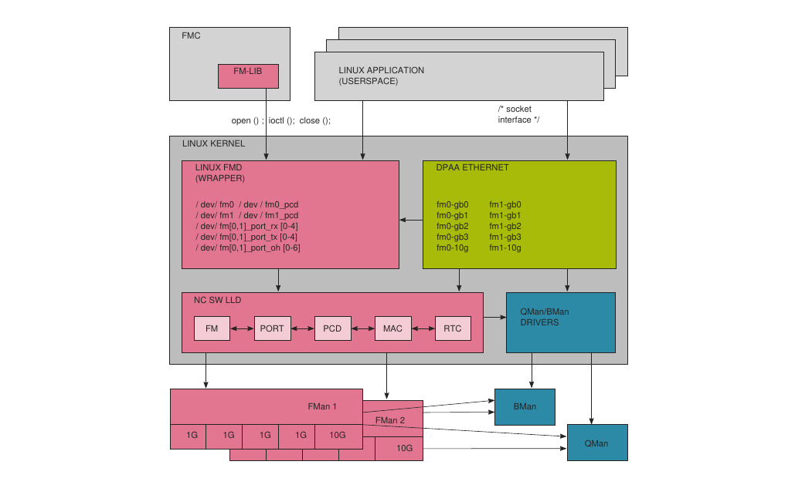

**Figure 85. Góc nhìn lấy FMan làm trung tâm về quan hệ giữa các khối phần mềm và phần cứng DPAA trong môi trường Linux.**

Các tính năng của Linux FMan Driver như sau:

- Thực hiện khởi tạo Frame Manager dựa trên cấu hình platform (device tree), và dựa trên việc probe phần cứng thực tế;
- Hỗ trợ các ứng dụng Linux user space muốn tạo cấu hình PCD cho FMan;
- Gắn/gỡ PCD vào/khỏi các cổng FMan;
- Báo cáo trạng thái FMan và cổng:
  - Các thanh ghi FMan
  - Thống kê FMan
  - Các counter của cổng FMan và MAC

Linux FMan driver không xử lý traffic mạng thực sự. Traffic mạng trong Linux được xử lý độc quyền bởi các network device của Linux. Traffic mạng đi qua FMan chỉ có thể được xử lý bởi driver Linux DPAA Ethernet. Dù DPAA Ethernet và Linux FMan Driver có liên kết chặt và phụ thuộc lẫn nhau với FMD mức thấp bên dưới và với nhau, các tập tính năng của chúng không chồng lấn. Driver DPAA1 Ethernet được mô tả trong Section 8.2.2.

##### 8.2.5.1.2 Các thiết bị Linux FMD

Giao diện Linux tới FMD gồm một số character device Linux:

- /dev/fm\[0,1\], mỗi thiết bị tương ứng với một Frame Manager thực tế;
- /dev/fm\[0,1\]-pcd là các thiết bị PCD, mỗi thiết bị tương ứng với một Frame Manager;
- /dev/fm\[0,1\]-port-rx\[0-4\], và /dev/fm\[0,1\]-port-tx\[0-4\] tương ứng với các cổng vật lý của mỗi FMan: mỗi thiết bị rx/tx trong một cặp tương ứng với phía nhận và phía truyền của một cổng vật lý;
- /dev/fm\[0,1\]-port-oh\[0-6\] tương ứng với các cổng Offline Parsing.

Các thiết bị này được tạo và khởi tạo lúc boot, dựa trên việc probe phần cứng vật lý, cũng như việc phân tích device tree. Vì vậy mỗi cổng vật lý có thể bị tắt từ device tree, nhưng cũng có thể từ Reset Configuration Word (RCW). Xem Reference Manual của SoC để biết thêm chi tiết.

**Ghi chú:** Giả định cho phần còn lại của mục này là device tree và RCW không thay đổi.

Tùy SoC và cấu hình `RCW/.dts`, chỉ một số thiết bị nhất định có sẵn . Ánh xạ của các thiết bị tới các cổng vật lý được cho trong bảng sau:

**Table 61. Ánh xạ các thiết bị Linux tới port ID mức thấp.**

| Thiết bị Linux | ID mức thấp | Định danh |
|---|---|---|
| /dev/fm0-port-rx0/dev/fm0-port-tx0 | 0 | 1GbE thứ 1 của FMan thứ 1, nhận, truyền |
| /dev/fm0-port-rx1/dev/fm0-port-tx1 | 1 | GbE thứ 2 của FMan thứ 1, nhận, truyền |
| /dev/fm0-port-rx2/dev/fm0-port-tx2 | 2 | GbE thứ 3 của FMan thứ 1, nhận, truyền |
| /dev/fm0-port-rx3/dev/fm0-port-tx3 | 3 | GbE thứ 4 của FMan thứ 1, nhận, truyền |
| /dev/fm0-port-rx4/dev/fm0-port-tx4 | 4 | GbE thứ 5 của FMan thứ 1, nhận, truyền |
| /dev/fm0-port-rx5/dev/fm0-port-tx5 | 5 | GbE thứ 6 của FMan thứ 1, nhận, truyền |
| /dev/fm0-port-rx6/dev/fm0-port-tx6 | 6 | 10 Gbit thứ 1 của FMan thứ 1, nhận, truyền |
| /dev/fm0-port-rx7/dev/fm0-port-tx7 | 7 | 10 Gbit thứ 2 của FMan thứ 1, nhận, truyền |
| N/A | 0 | Host Command của FMan thứ 1 |
| /dev/fm0-port-oh0 | 1 | Offline Parsing thứ 1 của FMan thứ 1 |
| /dev/fm0-port-oh1 | 2 | Offline Parsing thứ 2 của FMan thứ 1 |
| /dev/fm0-port-oh2 | 3 | Offline Parsing thứ 3 của FMan thứ 1 |
| /dev/fm0-port-oh3 | 4 | Offline Parsing thứ 4 của FMan thứ 1 |
| /dev/fm0-port-oh4 | 5 | Offline Parsing thứ 5 của FMan thứ 1 |
| /dev/fm0-port-oh5 | 6 | Offline Parsing thứ 6 của FMan thứ 1 |
| /dev/fm0-port-oh6 | 7 | Offline Parsing thứ 7 của FMan thứ 1 |
| /dev/fm1-port-rx0/dev/fm1-port-tx0 | 0 | 1GbE thứ 1 của FMan thứ 2, nhận, truyền |
| /dev/fm1-port-rx1/dev/fm1-port-tx1 | 1 | 1GbE thứ 2 của FMan thứ 2, nhận, truyền |
| /dev/fm1-port-rx2/dev/fm1-port-tx2 | 2 | 1GbE thứ 3 của FMan thứ 2, nhận, truyền |
| /dev/fm1-port-rx3/dev/fm1-port-tx3 | 3 | 1GbE thứ 4 của FMan thứ 2, nhận, truyền |
| /dev/fm1-port-rx4/dev/fm1-port-tx4 | 4 | 1GbE thứ 5 của FMan thứ 2, nhận, truyền |
| /dev/fm1-port-rx5/dev/fm1-port-tx5 | 5 | 10Gb của FMan thứ 2, nhận, truyền |
| /dev/fm1-port-rx6/dev/fm1-port-tx6 | 6 | 10Gb thứ 1 của FMan thứ 2, nhận, truyền |
| /dev/fm1-port-rx7/dev/fm1-port-tx7 | 7 | 10Gb thứ 2 của FMan thứ 2, nhận, truyền |
| N/A | 0 | Host Command của FMan thứ 2 |
| /dev/fm1-port-oh0 | 1 | Cổng Offline Parsing thứ 1 của FMan thứ 2 |
| /dev/fm1-port-oh1 | 2 | Cổng Offline Parsing thứ 2 của FMan thứ 2 |
| /dev/fm1-port-oh2 | 3 | Cổng Offline Parsing thứ 3 của FMan thứ 2 |
| /dev/fm1-port-oh3 | 4 | Cổng Offline Parsing thứ 4 của FMan thứ 2 |
| /dev/fm1-port-oh4 | 5 | Cổng Offline Parsing thứ 5 của FMan thứ 2 |
| /dev/fm1-port-oh5 | 6 | Cổng Offline Parsing thứ 6 của FMan thứ 2 |
| /dev/fm1-port-oh6 | 7 | Cổng Offline Parsing thứ 7 của FMan thứ 2 |

Low-Level ID là các ID được các Low-Level Driver (nền tảng của Linux FMan Driver) dùng để phân biệt các cổng vật lý. Từ bảng trên thấy rõ rằng chỉ port ID không cho phép nhận diện duy nhất một cổng. Nó phải được kết hợp với các thông tin sau để trỏ đúng tới cổng mong muốn:

- FMan ID: 0 hoặc 1 lần lượt cho FMan1 hoặc FMan2;
- Loại cổng: 1G, 10G hoặc O/H (Offline Parsing/Host Command).

Dù tất cả điều này thoạt đầu có vẻ khó hiểu, LLD API cung cấp các enum/macro tiện lợi để xử lý những khía cạnh này. Hơn nữa, FMD driver API cố gắng hết sức che giấu những chi tiết này khỏi lập trình viên Linux user space, cụ thể là bằng cách dùng các mục /dev chuyên dụng cho mỗi cổng, v.v. Tuy nhiên, không phải mọi API mà user space thấy được đều không dính đến các port ID như vậy, nên đó là lý do chúng tôi đề cập chúng ở đây.

FMD LLD không dùng các port ID riêng cho RX và Tx; việc phân biệt Receive và Transmit được thực hiện bằng cách gọi các hàm riêng cho RX/Tx, hoặc bằng cách chỉ định hướng "RX" hoặc "TX" làm một đối số riêng.

Các cổng Host Command không hiển thị với ứng dụng Linux. Tuy nhiên, ít nhất cần biết rằng chúng tồn tại, vì LLD cấp cổng O/H vật lý đầu tiên của mỗi FMan cho mục đích này ("O/H" là viết tắt của "Offline Parsing/Host Command"). Có 8 cổng O/H như vậy trên mỗi FMan có thể dùng cho các mục đích này; cổng đầu tiên trong số đó đã được LLD dành riêng cho Host Command, còn 7 cổng còn lại có sẵn cho Offline Parsing. Host Command chỉ là một trong các phương tiện mà qua đó LLD điều khiển phần cứng FMan.

**Ghi chú:** Lưu ý rằng tùy platform, RCW và cấu hình .dts, không phải mọi tổ hợp thiết bị và cổng khả dĩ đều có thể có, và chắc chắn một số sẽ không có trong bất kỳ cấu hình hiện có nào. Để biết chi tiết về các cấu hình cổng và thiết bị khả dĩ cho một platform cụ thể, tham khảo các Reference Manual của platform đó, cũng như các chương liên quan trong tài liệu SDK cho platform đó.

Bên cạnh các character device này, và nằm ngoài phạm vi bài viết này, là các network device Linux, được đặt tên theo cách `fm[1,2]-mac[1-10]` (ví dụ `fm1-mac1`, `fm2-mac3`), cung cấp phương tiện để Linux xử lý traffic mạng thực sự, tức là "traffic termination". Các network device này là các instance của Linux DPAA Ethernet Driver, được thiết kế kiến trúc thành một thực thể riêng với Linux FMan Driver, nhưng cả hai đều dùng tại một thời điểm nào đó cùng Low-Level Driver FMD API. Tuy nhiên, các tập tính năng của DPAA Ethernet và Linux FMan driver tách rời nhau, đó là lý do chính cho việc chúng cùng tồn tại.

**Ghi chú:** Không có yêu cầu nào rằng đây là các network device duy nhất trong hệ thống. Bạn có thể thấy các thiết bị quen thuộc `eth0`, `eth1`, v.v. bên cạnh ví dụ `fm1-mac1`, chỉ có điều các network device khác này sẽ tương ứng với NIC của các hãng khác có thể được lắp trong hệ thống và sẽ được phục vụ bởi các driver Ethernet riêng của hãng, không phải DPAA.

Có một vài hằng số được #define trong các header cần include khi làm việc với Linux FMD (cả ở kernel space lẫn user space) có thể hữu ích khi phải làm việc với thiết bị và port ID:

- `FM_MAX_NUM_OF_1G_RX_PORTS`
- `FM_MAX_NUM_OF_10G_RX_PORTS`
- `FM_MAX_NUM_OF_1G_TX_PORTS`
- `FM_MAX_NUM_OF_10G_RX_PORTS`
- `FM_MAX_NUM_OF_RX_PORTS`
- `FM_MAX_NUM_OF_TX_PORTS`
- `FM_MAX_NUM_OF_OH_PORTS`
- `IOC_FM_MAX_NUM_OF_VALID_PORTS`

các hằng số này cùng với `INTG_MAX_NUM_OF_FM` có thể cho lập trình viên các công cụ thiết yếu để xoay xở trong một cấu hình cụ thể (tuy nhiên danh sách này không đầy đủ: hãy tham khảo các file API Reference/header liên quan trước khi định #define hằng số của riêng bạn).

Ngoài ra, lệnh

`$ ls /dev/fm*`

shell Linux có thể hiển thị tiện lợi mọi thiết bị FMD hiện có trong hệ thống đích.

##### 8.2.5.1.3 Mô hình lập trình Linux FMD

Với các thiết bị Linux đã trình bày ở trên, một ứng dụng Linux muốn dùng các tính năng FMan có thể dùng giao diện syscall character device chung của Linux:

- open()/close() - đây là API thiết yếu khi làm việc với các thiết bị Linux.
- read()/write() - dù mọi thiết bị Linux bắt buộc phải triển khai các thao tác read() và write(), không có ngữ nghĩa read/write nào gắn với các thiết bị FMD.
- Các lời gọi ioctl() được dùng rộng rãi như phương tiện duy nhất để giao tiếp với phần cứng. ioctl API làm không nhiều hơn việc ủy thác syscall ioctl() cho LLD API bên dưới (để biết ánh xạ thực tế của các IOCTL tới các LLD API thực tế, tham khảo các bảng có trong các mục sau).

Chúng tôi nhắc lại ở đây một lần nữa rằng mô hình lập trình về cơ bản là mô hình của FMD LLD. Lớp bọc Linux chỉ điều chỉnh LLD cho phù hợp với yêu cầu giao diện của Linux. Phần này của tài liệu SDK chỉ tập trung vào các đặc thù của Linux. Để biết chi tiết về từng lời gọi API, tham khảo Frame Manager Driver API Reference Manual .

Như trường hợp của bất kỳ thiết bị Linux nào, trình tự hành động chung khi dùng các thiết bị FMD như sau:

1. Linux boot: mọi thiết bị /dev/fm\* được tạo, tài nguyên FMan được khởi tạo theo platform/RCW/.dts;
2. Người dùng khởi chạy ứng dụng biết dùng FMD;
3. Ứng dụng của người dùng thực hiện open() trên (các) thiết bị /dev/fm\* được chọn;
4. Ứng dụng của người dùng thực hiện (các) lời gọi ioctl() trên `fd` được trả về bởi lời gọi open() thành công trước đó;
5. Khi ứng dụng của người dùng quyết định đã làm việc xong với thiết bị /dev/fm\* được chọn, nó phải gọi close() trên `fd` của mình, giống như với bất kỳ thiết bị Linux nào khác.

Không phải mọi hàm LLD đều có tương ứng trong các IOCTL của FMD. Chỉ những hàm có ý nghĩa xét từ góc độ kiến trúc mới được chọn. Các hàm LLD giống/khác cũng được lớp bọc Linux gọi không hạn chế, khi cần để thực hiện các hành động cần thiết của nó, và không chỉ để đáp ứng các lời gọi `ioctl()`.

Các đối số của các lời gọi ioctl() có thể khá phức tạp, và có thể có các yêu cầu phức tạp, như được mô tả trong **LLD API Reference** (Frame Manager Driver API Documentation).

Các API khởi tạo mức thấp bắt buộc sau: FM_Config(), FM_PCD_Config(), FM_PORT_Config(), và sau đó FM_Init(), FM_PCD_Init(), FM_PORT_Init() được gọi từ bên trong mã khởi tạo Linux FMD lúc boot. Vì vậy chúng không truy cập được từ ứng dụng user space. Mọi cấu hình tài nguyên phần cứng FMan sẽ được thực hiện bằng các phương tiện riêng của Linux: device tree, cấu hình build kernel, v.v. Mã trong driver DPAA Ethernet cũng khởi tạo các MAC đã cấu hình bằng FM_MAC_Config(), rồi FM_MAC_Init(), như Frame Manager Driver API Reference Manual yêu cầu, và như mô tả trong The DPAA Ethernet Driver's User Manual.

Sự tương ứng giữa các thiết bị FMD Linux và các network device DPAA ETH là trực quan: có một cặp thiết bị /dev/fmX-port-(rxY|txY) cho mỗi thiết bị `fmX-gbY` hoặc `fmX-10g` trong hệ thống. Tuy nhiên, do cấu hình, có thể lúc boot không phải mọi cổng FMan đều được driver DPAA Ethernet probe, vì vậy không phải mọi /dev/fmX-port-(rxY|txY) đều có netdev tương ứng. Đó là vì các thiết bị cổng FMan và các thiết bị DPAA Ethernet được cấu hình trong các phần khác nhau của device tree. Việc bind giữa các thiết bị này cũng được thực hiện trong device tree.

Dù các cổng Offline Parsing được FMan Driver hỗ trợ đầy đủ, hiện không thể tiêm traffic từ user space vào các cổng này, vì không có netdev nào được tạo cho chúng, do Linux FMD không xử lý traffic. Thực sự có một cách để các driver kernel space dùng chúng, nhưng điều đó nằm ngoài phạm vi ở đây.

Không nên kỳ vọng một thiết bị cổng FMan mà chưa có netdev DPAA Ethernet tương ứng được cấu hình sẽ hoạt động đầy đủ. Đó là vì chức năng của cổng còn phụ thuộc vào các tài nguyên DPAA bổ sung (tức là frame queue, buffer pool) được khởi tạo độc quyền bởi driver DPAA Ethernet. Vì vậy, dù các thiết bị /dev/fmX-port-\* có thể tồn tại cho những cổng như vậy, việc cố truy cập chúng có thể dẫn tới lỗi.

FM_PORT_Enable() và FM_PORT_Disable() được gọi cho các cổng cụ thể trong lúc ifconfig up/down network device tương ứng (riêng cho DPAA Ethernet). Chúng cũng có dưới dạng IOCTL cho các thiết bị /dev/fmX-port\*, nhưng trong khi ở DPAA Ethernet chúng được gọi cho cả hai cổng của cặp RX/TX, các thiết bị /dev/fmX-port- (rxY|txY) cho phép bật/tắt có chọn lọc chỉ một trong hai phía RX/TX, tùy ý muốn.

ioctl() API tuân theo các quy tắc của Linux cho mọi thiết bị FMD. Tuy nhiên, các lỗi xuất phát từ bên trong LLD sẽ luôn được báo cho người dùng là `-EFAULT`. Mọi lỗi như vậy nên được coi là không khôi phục được và nên được theo ngay sau bằng một close() trên thiết bị mà chúng được báo. Một thông báo mô tả rõ hơn chỉ được in trên console khởi động, xác định hàm LLD và dòng trong file mã nguồn nơi lỗi xảy ra. Có thể xem tài liệu cho `enum e_ErrorType` trong **LLD API** **Reference** (Frame Manager Driver API Documentation) để biết chi tiết về mọi mã lỗi LLD khả dĩ và ý nghĩa chung của chúng.

Các mục sau sẽ trình bày mô tả ngắn gọn về từng loại thiết bị Linux, cũng như ánh xạ các IOCTL của chúng tới FMD LLD API.

##### 8.2.5.1.4 Tham chiếu Frame Manager Linux Driver API

Tài liệu này mô tả giao diện (IOCTL) tới Frame Manager Linux Driver như được thấy bởi các ứng dụng Linux user space cần dùng bất kỳ tính năng nào của Frame Manager. Nó mô tả cấu trúc, khái niệm, chức năng và API mức cao.

###### 8.2.5.1.4.1 Thiết bị Linux FMan

Thiết bị này tương ứng với một Frame Manager riêng lẻ, và cần để thực hiện các hành động trên toàn FMan. Thiết bị FMan chỉ đóng vai trò cổng vào cho các IOCTL được liệt kê trong bảng dưới đây:

**Table 62. Các IOCTL cho thiết bị FMan**

| IOCTL | Ánh xạ LLD | Tóm tắt |
|---|---|---|
| `FM_IOC_SET_PORTS_BANDWIDTH` | FM_SetPortsBandwidth() | Đặt băng thông của các cổng theo phần trăm tổng băng thông. |
| `FM_IOC_GET_REVISION` | FM_GetRevision() | API lấy revision của FMan. |
| `FM_IOC_GET_COUNTER` | FM_GetCounter() | API đọc các counter phần cứng của FMan (cũng có qua sysfs). |
| `FM_IOC_SET_COUNTER` | FM_ModifyCounter() | API sửa/reset các counter của FMan. |
| `FM_IOC_FORCE_INTR` | FM_ForceIntr() | Ép một interrupt (hoặc exception) của FMan. Nguy hiểm! Chỉ dùng để debug! |
| `FM_IOC_GET_API_VERSION` | FM_GetApiVersion() | Đọc phiên bản FMD IOCTL API. |
| `FM_IOC_VSP_CONFIG` | FM_VSP_Config() | Tạo descriptor cho module FM VSP. |
| `FM_IOC_VSP_INIT` | FM_VSP_Init() | Khởi tạo module FM VSP |
| `FM_IOC_VSP_FREE` | FM_VSP_Free() | Giải phóng mọi tài nguyên đã được gán cho module FM VSP. |
| `FM_IOC_VSP_CONFIG_POOL_`<br>`DEPLETION` | FM_VSP_ConfigPoolDepletion() | Gọi routine này sẽ bật việc tạo pause frame tùy theo trạng thái cạn của các pool BM. Nó cũng định nghĩa các điều kiện để kích hoạt chức năng này. Theo mặc định, chức năng này bị tắt. |
| `FM_IOC_VSP_CONFIG_BUFFER_`<br>`PREFIX_CONTENT` | FM_VSP_ConfigBufferPrefixContent() | Định nghĩa cấu trúc, kích thước và nội dung của buffer ứng dụng. |
| `FM_IOC_VSP_CONFIG_NO_SG` | FM_VSP_ConfigNoScatherGather() | Trả về con trỏ tới parse result trong buffer dữ liệu. Ở các cổng Rx, điều này có ý nghĩa sau khi nhận, nếu parse result được cấu hình là một phần của dữ liệu được truyền cho ứng dụng. Với các cổng không phải Rx, nó có thể được dùng để lấy con trỏ của vùng trong buffer nơi parse result nên được khởi tạo - nếu được cấu hình như vậy. Xem FM_VSP_ConfigBuffer PrefixContent để biết cấu hình prefix của buffer dữ liệu. |
| `FM_IOC_CTRL_MON_START` | FM_CtrlMonStart() | Bắt đầu giám sát mức sử dụng của mọi bộ điều khiển FM có sẵn. |
| `FM_IOC_CTRL_MON_STOP` | FM_CtrlMonStop() | Dừng giám sát mức sử dụng của mọi bộ điều khiển FM có sẵn. |
| `FM_IOC_CTRL_MON_GET_COUNTERS` | FM_CtrlMonGetCounters() | Lấy các tham số mức sử dụng bộ điều khiển FM. |

Mọi LLD API được ánh xạ qua IOCTL đều là những gì LLD gọi là "callable at runtime", tức là gọi được sau khi hàm Init() của LLD cho thực thể tương ứng đã được gọi. Đó là vì khi ứng dụng của người dùng gọi tới ioctl(), mọi hàm Init() đều đã được mã khởi tạo của Linux FMD gọi lúc boot.

###### 8.2.5.1.4.2 Thiết bị Linux PCD

Có đúng một thiết bị PCD, hay /dev/fmX-pcd, cho mỗi Frame Manager. Lý do là PCD là cấu trúc trên toàn FMan, và được áp dụng đồng thời cho traffic được nhận trên có thể nhiều hơn một cổng.

"PCD" là một thuật ngữ chung chỉ một cấu hình Parse-Classify-Distribute cho một nhóm cổng, như được mô tả chi tiết trong **QorIQ Data Path Acceleration Architecture (DPAA) Reference Manual**. Nói ngắn gọn, việc một PCD làm là định tuyến traffic đến từ một tập cổng RX vào một số frame queue do Queue Manager quản lý. Các frame queue như vậy có thể được gắn với một network device DPAA Ethernet, khi đó traffic được các CPU nhận (hay "terminate"), hoặc chúng có thể được nối với một cổng TX, khi đó traffic được forward ra cổng đó. Ngoài ra, các frame queue có thể được nhóm tiếp thành các work queue và được police, v.v. (đọc tài liệu QMan). Tuy nhiên, có một điều không được hỗ trợ trong môi trường Linux, đó là: truy cập trực tiếp frame queue từ user space (lưu ý rằng đây không phải hạn chế của Linux FMD, mà là hạn chế do thiết kế trong driver Linux cho QMan). Ý là không được hỗ trợ theo nghĩa cổ điển của "môi trường Linux".

Vẫn còn nhiều điều có thể đạt được với Linux FMD, và thiết bị Linux PCD có ở đó để giúp. Vai trò của nó là quản lý các PCD cho FMan tương ứng. Các ioctl cho thiết bị này được ánh xạ tới các LLD API FM_PCD\_\*() có tên tương tự:

**Table 63. Danh sách IOCTL cho thiết bị PCD**

| IOCTL | Ánh xạ LLD | Tóm tắt |
|---|---|---|
| `FM_PCD_IOC_ENABLE` | FM_PCD_Enable() | Nên được gọi sau khi PCD được khởi tạo để bật mọi PCD engine theo cấu hình hiện có của chúng. |
| `FM_PCD_IOC_DISABLE` | FM_PCD_Disable() | Tắt một PCD hiện có. |
| `FM_PCD_IOC_PRS_LOAD_SW[_`<br>`COMPAT]` | FM_PCD_PrsLoadSw() | Routine này chỉ có thể được gọi khi mọi cổng trong hệ thống đang chủ động dùng cơ chế classification plan. Trong những trường hợp như vậy nó được khuyến nghị để tiết kiệm tài nguyên. Driver tự động dành 8 classification plan cho các cổng KHÔNG dùng cơ chế classification plan; để tránh điều này (nhằm tiết kiệm các mục đó) có thể gọi routine này. |
| `FM_PCD_IOC_KG_SET_DFLT_VALUE` | FM_PCD_KgSetDfltValue() | Đặt một giá trị mặc định toàn cục để key generator dùng khi parser không nhận ra một trường/header cần thiết (mặc định là 0). |
| `FM_PCD_IOC_KG_SET_ADDITIONAL_`<br>`DATA_AFTER_PARSING` | FM_PCD_KgSetAdditionalDataAfterParsing() | Gọi routine này cho phép keygen truy cập dữ liệu<br>vượt quá điểm kết thúc của parser. |
| `FM_PCD_IOC_SET_EXCEPTION` | FM_PCD_SetException() | Bật/tắt các interrupt của PCD. |
| `FM_PCD_IOC_GET_COUNTER` | N/A | Chưa được triển khai, không dùng! |
| `FM_PCD_IOC_SET_COUNTER` | N/A | Chỗ giữ chỗ, không dùng! |
| `FM_PCD_IOC_FORCE_INTR` | FM_PCD_ForceIntr() | Ép một interrupt (exception) PCD thuộc loại được chỉ định. Nguy hiểm! Chỉ dùng để debug! |
| `FM_PCD_IOC_NET_ENV_`<br>`CHARACTERISTICS_SET[_COMPAT]` | FM_PCD_NetEnvCharacteristicsSet() | Thiết lập một tập tối thiểu các giao thức mạng ("Network Environment Characteristics") mà PCD này có thể khám phá (tham khảo Reference Manual để biết chi tiết). |
| `FM_PCD_IOC_NET_ENV_`<br>`CHARACTERISTICS_DELETE[_`<br>`COMPAT]` | FM_PCD_NetEnvCharacteristicsDelete() | Xóa một tập<br>"Network Environment Characteristics". |
| `FM_PCD_IOC_KG_SCHEME_SET[_`<br>`COMPAT]` | FM_PCD_KgSchemeSet() | Khởi tạo hoặc sửa và bật một scheme cho KeyGen. Routine này nên được gọi để thêm hoặc sửa một scheme. Khi một scheme cần sửa, API đòi hỏi nó phải được viết lại. Trong trường hợp đó `modify` nên là TRUE. Nếu routine được gọi cho một scheme hợp lệ và `modify` là FALSE, nó sẽ trả về lỗi. |
| `FM_PCD_IOC_KG_SCHEME_DELETE[_`<br>`COMPAT]` | FM_PCD_KgSchemeDelete() | Xóa một scheme đã khởi tạo. |
| `FM_PCD_IOC_CC_ROOT_BUILD[_`<br>`COMPAT]` | FM_PCD_CcRootBuild() | Routine này phải được gọi để định nghĩa một cây coarse classification hoàn chỉnh. Đây là cách định nghĩa coarse classification cho một flow nhất định - các scheme KeyGen chỉ có thể trỏ tới các cây được định nghĩa theo cách này. |
| `FM_PCD_IOC_CC_ROOT_DELETE[_`<br>`COMPAT]` | FM_PCD_CcRootDelete() | Xóa một cây coarse classification hiện có. |
| `FM_PCD_IOC_MATCH_TABLE_SET[_`<br>`COMPAT]` | FM_PCD_MatchTableSet() | Routine này nên được gọi cho mỗi node CC (coarse classification). Toàn bộ cây CC nên<br>được xây từ dưới lên để mỗi node trỏ tới các node đã được định nghĩa. `p_node_id` trả về Id của node để các node khác dùng. |
| `FM_PCD_IOC_MATCH_TABLE_`<br>`DELETE[_COMPAT]` | FM_PCD_MatchTableDelete() | Xóa một node đã xây. |
| `FM_PCD_IOC_CC_ROOT_MODIFY_`<br>`NEXT_ENGINE[_COMPAT]` | FM_PCD_CcRootModifyNextEngine() | Sửa các Next Engine Parameter trong mục của cây (chỉ được phép sau FM_PCD_CcBuildTree()). |
| `FM_PCD_IOC_MATCH_TABLE_`<br>`MODIFY_NEXT_ENGINE[_COMPAT]` | FM_PCD_MatchTableModifyNextEngine() | Sửa các Next Engine Parameter trong mục key liên quan của node (chỉ có thể sau một lời gọi FM_PCD_MatchTable Set()). |
| `FM_PCD_IOC_MATCH_TABLE_`<br>`MODIFY_MISS_NEXT_ENGINE[_`<br>`COMPAT]` | FM_PCD_MatchTableModifyMissNextEngine() | Sửa các Next Engine Parameter của trường hợp Miss key của node (chỉ được phép sau một lời gọi FM_PCD_MatchTable Set() trước đó). |
| `FM_PCD_IOC_MATCH_TABLE_`<br>`REMOVE_KEY[_COMPAT]` | FM_PCD_MatchTableRemoveKey() | Gỡ key (bao gồm các next engine parameter của nó) được xác định bởi chỉ số của node liên quan (chỉ được phép sau một lời gọi FM_PCD\_MatchTableSet() trước đó) |
| `FM_PCD_IOC_MATCH_TABLE_ADD_`<br>`KEY[_COMPAT]` | FM_PCD_MatchTableAddKey() | Thêm key (bao gồm các next engine parameter của key này) vào chỉ số được xác định bởi `key_index` (chỉ được phép sau một lời gọi FM_PCD\_MatchTableSet() trước đó) |
| `FM_PCD_IOC_MATCH_TABLE_`<br>`MODIFY_KEY_AND_NEXT_ENGINE[_`<br>`COMPAT]` | FM_PCD_MatchTableModifyKeyAndNextEngine() | Sửa key và các Next Engine Parameter của key này tại chỉ số được xác định bởi `key_index` (chỉ được phép sau một lời gọi FM\_PCD_MatchTableSet() trước đó). |
| `FM_PCD_IOC_MATCH_TABLE_`<br>`MODIFY_KEY[_COMPAT]` | FM_PCD_MatchTableModifyKey() | Sửa key tại chỉ số được xác định bởi `key_` `index` (chỉ được phép sau một lời gọi FM_PCD\_MatchTableSet() trước đó). |
| `FM_PCD_IOC_HASH_TABLE_SET[_`<br>`COMPAT]` | FM_PCD_HashTableSet() | Khởi tạo một cấu trúc hash table. |
| `FM_PCD_IOC_HASH_TABLE_`<br>`DELETE[_COMPAT]` | FM_PCD_HashTableDelete() | Xóa hash table đã cho và giải phóng mọi tài nguyên đã cấp phát của nó. |
| `FM_PCD_IOC_HASH_TABLE_ADD_`<br>`KEY[_COMPAT]` | FM_PCD_HashTableAddKey() | Thêm key đã cho (bao gồm các next engine parameter của key này) vào hash table. Key được thêm làm key cuối cùng của bucket mà nó được ánh xạ tới. |
| `FM_PCD_IOC_HASH_TABLE_REMOVE_`<br>`KEY[_COMPAT]` | FM_PCD_HashTableRemoveKey() | Gỡ key được yêu cầu (bao gồm các next engine parameter của nó) khỏi hash table. |
| `FM_PCD_IOC_PLCR_PROFILE_SET[_`<br>`COMPAT]` | FM_PCD_PlcrProfileSet() | Đặt một mục profile trong bảng profile của policer, ghi đè mọi giá trị hiện có. |
| `FM_PCD_IOC_PLCR_PROFILE_`<br>`DELETE[_COMPAT]` | FM_PCD_PlcrProfileDelete() | Xóa một mục profile trong bảng profile của policer. Nó đặt mục đó thành không hợp lệ. |
| `FM_PCD_IOC_MANIP_NODE_SET[_`<br>`COMPAT]` | FM_PCD_ManipNodeSet() | Routine này nên được gọi để định nghĩa một manipulation node. Một manipulation node phải được định nghĩa trước node CC đứng trước nó. |
| `FM_PCD_IOC_MANIP_NODE_`<br>`REPLACE[_COMPAT]` | FM_PCD_ManipNodeReplace() | Thay đổi manipulation node hiện có cho phù hợp với yêu cầu mới. |
| `FM_PCD_IOC_MANIP_NODE_`<br>`DELETE[_COMPAT]` | FM_PCD_ManipNodeDelete() | Xóa một manipulation node hiện có. |
| `FM_PCD_IOC_SET_ADVANCED_`<br>`OFFLOAD_SUPPORT` | FM_PCD_SetAdvancedOffloadSupport() | Routine này phải được gọi để hỗ trợ các tính năng sau: IP-fragmentation, IP-reassembly, IPsec, header manipulation, frame replicator. |
| `FM_PCD_IOC_FRM_REPLIC_GROUP_`<br>`SET[_COMPAT]` | FM_PCD_FrmReplicSetGroup() | Khởi tạo một nhóm Frame Replicator. |
| `FM_PCD_IOC_FRM_REPLIC_GROUP_`<br>`DELETE[_COMPAT]` | FM_PCD_FrmReplicDeleteGroup() | Xóa một nhóm Frame Replicator. |
| `FM_PCD_IOC_FRM_REPLIC_MEMBER_`<br>`ADD[_COMPAT]` | FM_PCD_FrmReplicAddMember() | Thêm member vào chỉ số được xác định bởi memberIndex. |
| `FM_PCD_IOC_FRM_REPLIC_MEMBER_`<br>`REMOVE[_COMPAT]` | FM_PCD_FrmReplicRemoveMember() | Gỡ member được xác định bởi chỉ số khỏi nhóm liên quan. |
| `FM_PCD_IOC_STATISTICS_SET_`<br>`NODE[_COMPAT]` | FM_PCD_StatisticsSetNode() | Chưa được triển khai trong bản phát hành này. Không dùng! |
| `FM_PCD_IOC_KG_SCHEME_GET_CNTR` | FM_PCD_KgSchemeGetCounter() | Đọc packet counter của scheme. |

**Ghi chú:** Các biến thể `_COMPAT` của một số IOCTL trong bảng trên cần để hỗ trợ ứng dụng user space 32-bit trên Linux kernel 64-bit. Chi tiết của các ánh xạ `COMPAT` được Linux ghi tài liệu.

Mô hình lập trình để định nghĩa và quản lý PCD cho một nhóm cổng giống như mô tả trong **FMD LLD User's Guide** .

Dưới đây là mô tả từng bước một ví dụ ánh xạ lời gọi ioctl() tới một lời gọi LLD API.

Ví dụ được chọn cho phần hướng dẫn này là `FM_PCD_IOC_MATCH_TABLE_SET`. Đây là nhắc lại prototype của ioctl():

```
extern int ioctl (int __fd, unsigned long int __request, ...) __THROW;
```

và dưới đây là cách nó hiện ra ở kernel space:

```
struct file_operations {
 [...]
 long (*unlocked_ioctl) (struct file *, unsigned int, unsigned long);
 [...]
};
```

Hàm ioctl() thực ra là một con trỏ tới một hàm do driver cung cấp có chữ ký đã chỉ định. Phần keo nối giữa hai bên là mã kernel.

Ngữ nghĩa gắn với đối số thứ hai và thứ ba của hàm hoàn toàn là việc của driver, nhưng thường đối số `unsigned int` được dùng để phân biệt giữa các lệnh ioctl khác nhau (thực ra nó nên tuân theo một số quy tắc hành xử tốt của Linux, mà chúng tôi sẽ không trình bày chi tiết ở đây). Trong trường hợp của chúng ta, nó nên là `FM_PCD_IOC_MATCH_TABLE_SET`.

Linux không gắn ngữ nghĩa định sẵn nào cho đối số thứ ba, đối số `unsigned long`. Trong một số trường hợp nó không được dùng, hoặc ngữ nghĩa của nó là của một số nguyên không dấu, nhưng trong hầu hết trường hợp nó được coi là một con trỏ (32-bit, trên hầu hết platform) tới một cấu trúc do driver định nghĩa trong user space. Driver định nghĩa định dạng, còn user space cấp phát và điền dữ liệu trước khi gọi ioctl() trên `fd` của thiết bị đã mở. Ví dụ của chúng ta cũng là trường hợp này.

Định dạng của đối số thứ ba của ioctl `FM_PCD_IOC_MATCH_TABLE_SET` là (đúng như nó xuất hiện trong file header nơi nó được định nghĩa):

```
/**************************************************************************//**
 @Description   A structure for defining the CC node params
*//***************************************************************************/
typedef struct ioc_fm_pcd_cc_node_params_t {
    ioc_fm_pcd_extract_entry_t extract_cc_params;
                                               /**< params which defines
 extraction
                                               parameters */
    ioc_keys_params_t          keys_params;    /**< params which defines Keys
                                               parameters of the extraction
 defined
                                               in extract_cc_params */
    void                       *id;            /**< output parameter;
                                               Returns the CC node Id to be used
 */
} ioc_fm_pcd_cc_node_params_t;
```

Chúng tôi sẽ trình bày chi tiết các kiểu `ioc_*` của hai member đầu tiên sau. Member thứ ba của cấu trúc này trông như một con trỏ tới một cấu trúc dữ liệu nào đó được trả về user space. Thực ra không phải vậy. Con trỏ thực tế này nên được xử lý như một handle mờ tới một đối tượng trừu tượng nào đó, trong trường hợp của chúng ta là "CC Node" được lời gọi ioctl() này tạo ra cho chúng ta nếu thành công. Handle này sau đó có thể được truyền cho ví dụ IOCTL `FM_PCD_IOC_MATCH_TABLE_DELETE` để xóa. Nó tương ứng với một `t_Handle` thực tế, như LLD định nghĩa.

**Ghi chú:** Không dọn dẹp các tài nguyên FMan mà LLD cấp phát theo cách này có thể gây rò rỉ tài nguyên phần cứng nghiêm trọng, mà cả Linux FMD lẫn LLD đều không có phương tiện để phát hiện và tự động dọn dẹp!

Hàm LLD mà IOCTL này ánh xạ tới có prototype sau:

```
t_Handle FM_PCD_MatchTableSet(t_Handle, t_FmPcdCcNodeParams *);
```

Đối số thứ nhất tương ứng với tài nguyên LLD mà thiết bị Linux PCD ánh xạ tới. Hầu hết tài nguyên LLD được quản lý bên trong driver Linux FMD và không lộ ra cho người dùng, nhưng có những ngoại lệ và hàm FM_PCD_MatchTableSet() ở đây là ví dụ tốt nhất, vì nó trả về một `t_Handle` tới một tài nguyên LLD như vậy. `t_Handle` được trả về này sau đó được truyền sang user space trong member mờ `id` của đối số thứ ba của ioctl().

Đối số thứ hai là một con trỏ tới một cấu trúc kiểu `t_FmPcdCcNodeParams`. Nó ánh xạ tới kiểu `ioc_fm_pcd_cc_node_params_t` mà đối số thứ ba của ioctl() trỏ tới.

**Ghi chú:** Truyền cho `ioctl()` một con trỏ tới thứ gì đó thuộc kiểu khác kiểu yêu cầu sẽ khiến ứng dụng của người dùng bị segfault, hoặc tốt nhất là lỗi, nhưng cũng có thể gây ra hành vi FMan không xác định từ thời điểm đó trở đi, với các lỗi có thể chỉ được báo về sau ở downstream trong trường hợp xấu nhất. Linux/FMD có thể làm rất ít để ngăn trường hợp xấu nhất này xảy ra, nên hy vọng có thể bắt được các lỗi mã như vậy từ sớm trong chu kỳ phát triển.

Bảng sau so sánh song song hai cấu trúc:

**Table 64. So sánh song song các kiểu IOCTL và LLD**

| Các kiểu IOCTL | Các kiểu LLD |
|---|---|
| `typedef struct ioc_fm_pcd_cc_node_params_t {`<br>`    ioc_fm_pcd_extract_entry_t extract_cc_params;`<br>`    ioc_keys_params_t keys_params;`<br>`    void *id;`<br>`} ioc_fm_pcd_cc_node_params_t;` | `typedef struct t_FmPcdCcNodeParams {`<br>`    t_FmPcdExtractEntry extractCcParams;`<br>`    t_KeysParams keysParams;`<br>`} t_FmPcdCcNodeParams;` |
| `typedef struct ioc_fm_pcd_extract_entry_t {`<br>`    ioc_fm_pcd_extract_type type;`<br>`    union {`<br>`        struct {`<br>`            ioc_net_header_type hdr;`<br>`            bool ignore_protocol_validation;`<br>`            ioc_fm_pcd_hdr_index hdr_index;`<br>`            ioc_fm_pcd_extract_by_hdr_type type;`<br>`            union {`<br>`               ioc_fm_pcd_from_hdr_t from_hdr;`<br>`               ioc_fm_pcd_from_field_t from_field;`<br>`               ioc_fm_pcd_fields_u full_field;`<br>`            } extract_by_hdr_type;`<br>`        } extract_by_hdr;`<br>`        struct{`<br>`            ioc_fm_pcd_extract_from src;`<br>`            ioc_fm_pcd_action action;`<br>`            uint16_t ic_indx_mask;`<br>`            uint8_t offset;`<br>`            uint8_t size;`<br>`        } extract_non_hdr;`<br>`    } extract_params;` | `typedef struct t_FmPcdExtractEntry {`<br>`    e_FmPcdExtractType type;`<br>`    union {`<br>`        struct {`<br>`            e_NetHeaderType hdr;`<br>`            bool ignoreProtocolValidation;`<br>`            e_FmPcdHdrIndex hdrIndex;`<br>`            e_FmPcdExtractByHdrType type;`<br>`            union {`<br>`                t_FmPcdFromHdr fromHdr;`<br>`                t_FmPcdFromField fromField;`<br>`                t_FmPcdFields fullField;`<br>`            } extractByHdrType;`<br>`        } extractByHdr;`<br>`        struct {`<br>`            e_FmPcdExtractFrom src;`<br>`            e_FmPcdAction action;`<br>`            uint16_t icIndxMask;`<br>`            uint8_t offset;`<br>`            uint8_t size;`<br>`        } extractNonHdr;`<br>`    };` |
| `} ioc_fm_pcd_extract_entry_t;` | `} t_FmPcdExtractEntry;` |
| `typedef struct ioc_keys_params_t {`<br>`    uint16_t max_num_of_keys;`<br>`    bool mask_support;`<br>`    ioc_fm_pcd_cc_stats_mode statistics_mode;`<br>`    uint16_t num_of_keys;`<br>`    uint8_t key_size;`<br>`    ioc_fm_pcd_cc_key_params_t`<br>`              key_params[IOC_FM_PCD_MAX_NUM_OF_KEYS];`<br>`    ioc_fm_pcd_cc_next_engine_params_t`<br>`                      cc_next_engine_params_for_miss;`<br>`} ioc_keys_params_t;` | `typedef struct t_KeysParams {`<br>`    uint16_t maxNumOfKeys;`<br>`    bool maskSupport;`<br>`    ioc_fm_pcd_cc_stats_mode statisticsMode;`<br>`    uint16_t numOfKeys;`<br>`    uint8_t keySize;`<br>`    t_FmPcdCcKeyParams`<br>`                   keyParams[FM_PCD_MAX_NUM_OF_KEYS];`<br>`    t_FmPcdCcNextEngineParams`<br>`                            ccNextEngineParamsForMiss;`<br>`} t_KeysParams;` |

Dù các member của cấu trúc có tên tương tự ở cả hai phía, hầu hết không giống hệt. Đó là vì khi Linux FMD được thiết kế, phong cách đã được ưu tiên hơn nhu cầu port các ứng dụng LLD hiện có sang môi trường Linux. Ngoại trừ con trỏ `*id` thỉnh thoảng có, có ánh xạ 1:1 giữa các member của struct ở hai phía, và điều đó nhất quán trong toàn FMD.

Các cấu trúc thành phần của các kiểu đối số của hai API nêu ở trên chỉ để minh họa. Ngữ nghĩa của chúng được ghi tài liệu trong Frame Manager Driver API Documentation .

**Ghi chú:** Việc có hai định nghĩa riêng cho hai cấu trúc dữ liệu vốn giống hệt nhau có thể trông như một quyết định thiết kế không may. Tuy nhiên, vì một lần memcpy từ user space sang kernel space là không tránh khỏi, quyết định thiết kế này không ảnh hưởng tới hiệu năng. Hơn nữa, user space chỉ thấy một biến thể (tức là biến thể `ioc_*`), vì vậy ảnh hưởng tới người dùng còn nhỏ hơn. Ảnh hưởng lớn hơn là ở việc bảo trì mã và tài liệu.

###### 8.2.5.1.4.3 Các thiết bị Linux Port

Có một cặp character device Linux RX/TX cho mỗi cổng vật lý của mỗi Frame Manager. Các thiết bị này được tạo ra độc lập với các network device DPAA1 Ethernet và chúng phản ánh đúng phần cứng Frame Manager có trên platform đã cho. Các thiết bị Linux port được đặt tên như sau:

- /dev/fmX-port-rxY cho phía nhận, trong đó X=\[0,1\] biểu thị số hiệu FMan, và Y=\[0-7\] biểu thị port ID vật lý (0 tương ứng với cổng 1 Gbit đầu tiên, và 6 với cổng 10 Gbit đầu tiên), và
- /dev/fmX-port-txY tương ứng cho phía truyền.

Mỗi FMan cũng có một số cổng Offline Parsing. Chúng được đặt tên là /dev/fmX-port-ohY, trong đó Y=\[0-6\].

Các thiết bị port được tạo dựa trên thông tin cấu hình lấy từ phần device tree Linux liên quan.

Chẳng hạn, LS1043A có một FMan với 6 x cổng 1 Gbit và một cổng 10 Gbit, trong khi LS1046A có một FMan với 6 x cổng 1 Gbit và 2 x cổng 10 Gbit. Bảng sau so sánh song song các thiết bị port tương ứng:

**Table 65. So sánh song song các thiết bị port của LS1043 và LS1046**

| LS1043A | LS1046A |
|---|---|
| Cho phía nhận:<br>`/dev/fm0-port-rx0 /dev/fm0-port-rx1 /`<br>`dev/fm0-port-rx2 /dev/fm0-port-rx4 /`<br>`dev/fm0-port-rx5 /dev/fm0-port-rx6` | Cho phía nhận:<br>`/dev/fm0-port-rx0 /dev/fm0-port-rx1 /`<br>`dev/fm0-port-rx2 /dev/fm0-port-rx3 /`<br>`dev/fm0-port-rx4 /dev/fm0-port-rx5 /`<br>`dev/fm0-port-rx6 /dev/fm0-port-rx7` |
| Cho phía truyền:<br>`/dev/fm0-port-tx0 /dev/fm0-port-tx1 /`<br>`dev/fm0-port-tx2 /dev/fm0-port-tx3 /`<br>`dev/fm0-port-tx4 /dev/fm0-port-tx5 /`<br>`dev/fm0-port-tx6` | Cho phía truyền:<br>`/dev/fm0-port-tx0 /dev/fm0-port-tx1 /`<br>`dev/fm0-port-tx2 /dev/fm0-port-tx3 /`<br>`dev/fm0-port-tx4 /dev/fm0-port-tx5 /`<br>`dev/fm0-port-tx6 /dev/fm0-port-tx7` |
| Cho Offline Parsing:<br>`/dev/fm0-port-oh0 /dev/fm0-port-oh1 /`<br>`dev/fm0-port-oh2 /dev/fm0-port-oh3 /`<br>`dev/fm0-port-oh4 /dev/fm0-port-oh5` | Cho Offline Parsing:<br>`/dev/fm0-port-oh0 /dev/fm0-port-oh1 /`<br>`dev/fm0-port-oh2 /dev/fm0-port-oh3 /`<br>`dev/fm0-port-oh4 /dev/fm0-port-oh5` |

Bảng dưới đây tóm tắt các IOCTL có sẵn cho thiết bị port.

**Table 66. Các IOCTL của thiết bị Port**

| IOCTL | Ánh xạ LLD | Tóm tắt |
|---|---|---|
| `FM_PORT_IOC_DISABLE` | FM_PORT_Disable() | Tắt cổng: mọi thiết lập của cổng được giữ nguyên, nhưng mọi traffic dừng lại. |
| `FM_PORT_IOC_ENABLE` | FM_PORT_Enable() | Bật port: khiến port bắt đầu xử lý traffic. |
| `FM_PORT_IOC_SET_RATE_LIMIT` | FM_PORT_SetRateLimit() | (Chỉ TX & O/H) Kích hoạt Rate Limiting Algorithm cho cổng. |
| `FM_PORT_IOC_DELETE_RATE_LIMIT` | FM_PORT_DeleteRateLimit() | (Chỉ TX & O/H) Hủy kích hoạt mọi Rate Limiting. |
| `FM_PORT_IOC_SET_ERRORS_ROUTE` | FM_PORT_SetErrorsRoute() | (Chỉ RX & O/H) Bảo FMD enqueue các frame có lỗi cụ thể vào các queue thông thường của cổng, thay vì vào error queue (tức là mặc định). |
| `FM_PORT_IOC_ALLOC_PCD_FQIDS` | N/A | Để kiểm thử/debug. Không dùng! |
| `FM_PORT_IOC_FREE_PCD_FQIDS` | N/A | Để kiểm thử/debug. Không dùng! |
| `FM_PORT_IOC_SET_PCD[_COMPAT]` | FM_PORT_SetPCD() | (Chỉ RX & O/H) Định nghĩa một cấu hình PCD cho cổng. |
| `FM_PORT_IOC_DELETE_PCD` | FM_PORT_DeletePCD() | (Chỉ RX & O/H) Xóa cấu hình PCD của cổng. |
| `FM_PORT_IOC_DETACH_PCD` | FM_PORT_DetachPCD() | (Chỉ RX & O/H) Tắt cấu hình PCD cho cổng (chỉ được phép sau khi FM_PORT_SetPCD() đã được gọi cho cổng). |
| `FM_PORT_IOC_ATTACH_PCD` | FM_PORT_AttachPCD() | (Chỉ RX & O/H) bật lại cấu hình PCD cho cổng (chỉ hợp lệ sau một lời gọi FM_PORT_Detach PCD()). |
| `FM_PORT_IOC_PCD_PLCR_ALLOC_`<br>`PROFILES` | FM_PORT_PcdPlcrAllocProfiles() | (Chỉ RX & O/H) Cấp phát các policer profile riêng cho cổng (chỉ được phép trước một lời gọi FM_PORT_Set PCD()). |
| `FM_PORT_IOC_PCD_PLCR_FREE_`<br>`PROFILES` | FM_PORT_PcdPlcrFreeProfiles() | (Chỉ RX & O/H) Giải phóng mọi policer profile riêng đã cấp phát cho cổng (chỉ gọi được trước FM_PORT_Set PCD()). |
| `FM_PORT_IOC_PCD_KG_MODIFY_`<br>`INITIAL_SCHEME[_COMPAT]` | FM_PORT_PcdKgModifyInitial Scheme() | (Chỉ RX & O/H) Sửa scheme tạo key sau khi parse frame (chỉ gọi được sau FM_PORT\_SetPCD()). |
| `FM_PORT_IOC_PCD_PLCR_MODIFY_`<br>`INITIAL_PROFILE[_COMPAT]` | FM_PORT_PcdPlcrModifyInitialProfile() | (Chỉ RX & O/H) Thay đổi policer profile ban đầu cho cổng (chỉ gọi được sau FM_PORT_SetPCD()). |
| `FM_PORT_IOC_PCD_CC_MODIFY_`<br>`TREE[_COMPAT]` | FM_PORT_PcdCcModifyTree() | (Chỉ RX & O/H) Thay thế cây coarse classification nếu cổng có dùng (chỉ gọi được sau FM_PORT\_DetachPCD() và trước FM_PORT\_AttachPCD()). |
| `FM_PORT_IOC_PCD_KG_BIND_`<br>`SCHEMES[_COMPAT]` | FM_PORT_PcdKgBindSchemes() | (Chỉ RX & O/H) Thêm các scheme KeyGen để cổng được bind vào (chỉ gọi được sau FM_PORT_Set PCD()). |
| `FM_PORT_IOC_PCD_KG_UNBIND_`<br>`SCHEMES[_COMPAT]` | FM_PORT_PcdKgUnbindSchemes() | (Chỉ RX & O/H) Ngăn cổng dùng các scheme KG đã chỉ định (chỉ gọi được sau FM_PORT_Set PCD()) |
| `FM_PORT_IOC_PCD_PRS_MODIFY_`<br>`START_OFFSET` | FM_PORT_PcdPrsModifyStartOffset() | (Chỉ RX & O/H) Thay đổi offset trong frame mà tại đó việc parse bắt đầu (chỉ gọi được sau FM_PORT_DetachPCD() và trước FM_PORT_AttachPCD()). |
| `FM_PORT_IOC_ADD_CONGESTION_`<br>`GRPS` | FM_PORT_AddCongestionGrps() | (Chỉ RX & O/H) Nên được gọi để bật việc truyền pause frame trong trường hợp tắc nghẽn ở một hoặc nhiều congestion group liên quan đến cổng này. Mỗi lời gọi routine này có thể thêm một hoặc nhiều congestion group được coi là liên quan đến cổng này. |
| `FM_PORT_IOC_REMOVE_`<br>`CONGESTION_GRPS` | FM_PORT_RemoveCongestionGrps() | (Chỉ RX & O/H) Nên được gọi khi các congestion group đã được định nghĩa cho cổng này và không còn liên quan nữa, hoặc không cần truyền pause frame thay mặt chúng. Mỗi lời gọi routine này có thể gỡ một hoặc nhiều congestion group được coi là liên quan đến cổng này. |
| `FM_PORT_IOC_ADD_RX_HASH_MAC_`<br>`ADDR` | FM_MAC_AddHashMacAddr() | Thêm một địa chỉ vào hash table. Việc này chỉ dùng cho mục đích lọc. |
| `FM_PORT_IOC_REMOVE_RX_HASH_`<br>`MAC_ADDR` | FM_MAC_RemoveHashMacAddr() | Xóa một địa chỉ khỏi hash table. Việc này chỉ dùng cho mục đích lọc. |
| `FM_PORT_IOC_SET_TX_PAUSE_`<br>`FRAMES` | FM_MAC_SetTxPauseFrames() | Bật/tắt việc truyền Pause-Frame. Routine này thay đổi<br>cấu hình mặc định: pause-time - \[0xf000\], threshold-time - \[0\] |
| `FM_PORT_IOC_GET_MAC_`<br>`STATISTICS` | FM_MAC_GetStatistics() | Lấy mọi counter thống kê MAC. |
| `FM_PORT_IOC_CONFIG_BUFFER_`<br>`PREFIX_CONTENT` | FM_PORT_ConfigBufferPrefixContent() | Định nghĩa cấu trúc, kích thước và nội dung của buffer ứng dụng. |
| `FM_PORT_IOC_VSP_ALLOC[_`<br>`COMPAT]` | FM_PORT_VSPAlloc() | Routine này cấp phát VSP theo từng cổng và buộc cổng làm việc ở chế độ VSP. Lưu ý rằng theo mặc định cổng được khởi tạo chỉ với physical-storage-profile. |

**Ghi chú:** Các biến thể `COMPAT` của một số IOCTL trong bảng trên cần để hỗ trợ ứng dụng user space 32-bit trên Linux kernel 64-bit. Chi tiết của các ánh xạ `COMPAT` được Linux ghi tài liệu.

Mô hình lập trình để quản lý các cổng của FMan giống như mô tả trong Frame Manager Driver API Reference. Tuy nhiên có vài điểm đáng chú ý:

Dù mọi IOCTL ở trên đều được Linux FMD triển khai, do sự bất đối xứng giữa RX và TX, không phải tất cả đều có sẵn cho mọi loại cổng. Ví dụ, `FM_PORT_IOC_SET_PCD` sẽ tạo lỗi nếu được gọi trên một thiết bị cổng TX. Tương tự, `FM_PORT_IOC_SET_RATE_LIMIT` sẽ thất bại với một cổng RX. Đó là vì việc kiểm tra loại cổng được thực hiện muộn, bên trong LLD, chứ không phải trong Linux FMD (tức là các lời gọi ioctl() cho mọi thiết bị port đều ủy thác cho cùng một hàm bên trong Linux kernel)!

Các cổng Offline Parsing có được ưu điểm của cả hai phía. Đó là vì về mặt khái niệm, một cổng O/H không khác gì một cổng FMan "thông thường" có phía TX được nối vòng bên trong về phía RX của nó.

#### 8.2.5.2 Hướng dẫn sử dụng Frame Manager Driver

##### 8.2.5.2.1 Giới thiệu

Frame Manager là một bộ tăng tốc phần cứng chịu trách nhiệm tiền xử lý và di chuyển gói vào và ra khỏi data path. Nó hỗ trợ parse gói in-line/off-line và phân loại ban đầu để cho phép policing và phân phối gói dựa trên flow/QoS tới các CPU để xử lý tiếp các gói.

Frame Manager gồm một số thành phần xử lý gói (còn gọi là engine) và hỗ trợ một pipeline linh hoạt. Thông thường, flow Rx chính (đơn giản hóa) theo các bước sau: các gói được nhận từ một trong các Ethernet MAC, được lưu tạm trong bộ nhớ bên trong FMan, rồi được chuyển tới bộ nhớ SoC qua FMan DMA. Header của gói (kích thước tối đa 256 byte) được lưu và cấu trúc cơ sở dữ liệu chung của các module được cấp phát. Sau đó gói được parse bởi parser hoặc bởi bộ điều khiển FMan. Theo kết quả parse, một key có thể được KeyGen trích ra, một frame-queue-id đích có thể được đặt, gói có thể được bộ điều khiển FMan phân loại. Ở giai đoạn đó, một số offload có thể được thực hiện như reassembly, fragmentation, header-manipulation và frame-replication. Ở cuối giai đoạn phân loại và thao tác, gói có thể được policer tô màu. Ở cuối quá trình này, các gói được chuyển tới bộ nhớ SoC qua FMan DMA rồi được enqueue vào một frame queue hoặc bị loại bỏ. Thứ tự xử lý phụ thuộc vào flow Parse-Classify-Distribute (PCD), dựa trên cấu hình của người dùng. Mỗi bước phụ thuộc vào kết quả trạng thái trước đó. Cấu trúc này cho phép sự linh hoạt, hỗ trợ hiệu quả nhiều flow.

Ở Tx, các frame được truyền qua MAC mong muốn với tùy chọn tạo checksum.

##### 8.2.5.2.2 Các tính năng của Frame Manager

Driver FMan nhắm tới hỗ trợ phần lớn các tính năng phần cứng. Nó cũng bao gồm các tính năng phần mềm riêng được thiết kế để tạo thuận lợi thông qua trừu tượng hóa.

Sau đây là các tính năng của driver FMan:

- API khởi tạo và cấu hình đơn giản cho các khối FMan sau: DMA, FPM, IRAM, QMI, BMI và RTC.
- Khởi tạo và cấu hình đơn giản cho các khối FMan PCD sau: Parser, Keygen, Custom-Classifier (CC), Manipulation (ví dụ Header-manipulation, IP-reassembly, IP-fragmentation, v.v.) và Policer.
- Quản lý bộ nhớ FMan (MURAM).
- Nạp mã cho bộ điều khiển FMan.
- Nạp Software-Parser.
- Hỗ trợ mọi loại cổng FMan - Rx, Tx, Offline-Parsing và Host-Command (chỉ dùng nội bộ trong driver)
- MAC API chung cho dTSEC, 10G-MAC và mEMAC.
- Cung cấp API để truy cập giao diện quản lý MII.
- Các cổng FMan Rx và Tx có thể chạy ở một trong các chế độ sau:
  - Independent-Mode
  - Chế độ BMI-to-BMI đơn giản (thông thường)
  - Chế độ PCD nâng cao (dùng các khối FMan PCD như parser, Keygen, CC và Policer).
- Các cổng FMan Offline có thể chạy ở một trong các chế độ sau:
  - Chế độ BMI-to-BMI đơn giản (thông thường)
  - Chế độ PCD nâng cao (dùng các khối FMan PCD như parser, Keygen, CC và Policer)
- Khởi tạo cổng Host-Command nội bộ (tùy chọn), dựa trên tham số của người dùng.
- Xử lý IRQ của FMan - sự kiện và exception.
- Hỗ trợ cả hai chế độ hoạt động SMP và AMP.

##### 8.2.5.2.3 Các thành phần của Frame Manager Driver

Driver FMan chứa các module mức thấp sau, như trong hình này.

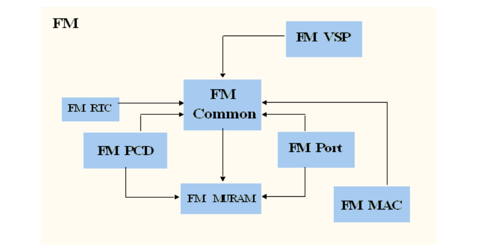

**Figure 86. Các module của FMan Driver (từ góc nhìn partition)**

Các module như sau:

- Frame Manager (chung) - Module FMan là một module singleton trong partition của nó. Nó chịu trách nhiệm về các module phần cứng chung: FPM, DMA, QMI chung, BMI chung, khởi tạo bộ điều khiển FMan, và các routine điều khiển lúc chạy. Module này luôn phải được khởi tạo khi làm việc với bất kỳ module FMan nào. Module sẽ chủ yếu được các module FMan khác dùng nội bộ, ngoại trừ việc người dùng khởi tạo nó. Module này có một instance cho mỗi partition. Tuy nhiên, chỉ driver trên master-partition mới có quyền truy cập các thanh ghi phần cứng.
- Frame Manager Parser-Classifier-Distributor (FMan-PCD) - Module FMan PCD là một module singleton trong partition của nó. Nó chịu trách nhiệm về mọi phần chung của PCD, như các khối hardware parser, software parser, Keygen, policer và custom-classifier. Nó chịu trách nhiệm xây dựng các đồ thị PCD. Module này có một instance cho mỗi partition. Tuy nhiên, chỉ driver trên master-partition mới có quyền truy cập các thanh ghi phần cứng.
- Frame Manager Memory (FMan-MURAM) - Module này chịu trách nhiệm về phân vùng bộ nhớ cụ thể của FMan Memory. Mỗi partition có thể có phân vùng FMan Memory riêng do driver FMan Memory quản lý. Ví dụ, một instance FMan Memory sẽ được tạo cho mỗi partition có các cổng FMan riêng.

  Module này có một instance cho mỗi partition.

- Frame Manager Real-Time-Clock (FMan-RTC) - Module này chịu trách nhiệm về module FMan RTC. Module này là một "singleton" và chỉ nên được tạo một lần cho master-partition.
- Frame Manager Port (FMan-Port) - Module này chịu trách nhiệm về mọi không gian thanh ghi liên quan đến cổng FMan, như mọi thanh ghi liên quan đến một cổng trong QMI hoặc BMI.

  Module này có thể được chạy độc lập bởi mỗi core hoặc partition.

- Frame Manager MAC (FMan-MAC) - Module này chịu trách nhiệm về các bộ điều khiển mEMAC, dTSEC và 10G MAC.

  Module này có thể được chạy độc lập bởi mỗi core hoặc partition.

- Frame Manager Virtual-Storage-Profile (FMan-VSP) - Module này chịu trách nhiệm cấp phát và quản lý các virtual storage profile có thể được dùng cho mục đích ảo hóa. VSP được mô tả thêm trong Section 8.2.5.2.10.

  Module này có thể được chạy độc lập bởi mỗi core hoặc partition.

##### 8.2.5.2.4 Các module driver trong hệ thống

Driver FMan được thiết kế để hỗ trợ môi trường một hoặc nhiều partition. Ngoài ra, driver FMan được thiết kế để hỗ trợ môi trường đa lõi chạy ở chế độ SMP.

Hình sau cho thấy một môi trường một partition điển hình (có thể SMP hoặc không) và các khối xây dựng driver FMan của nó.

**Ghi chú:** Trong môi trường này:

- Mọi module driver FMan đều có sẵn và nên được người dùng khởi tạo (trừ khi không cần cho hoạt động của người dùng; ví dụ nếu không cần PCD thì có thể không gọi).
- Các module driver FMan có đầy đủ chức năng của phần cứng.
- Mỗi module có quyền truy cập đầy đủ tới các thanh ghi phần cứng của nó (tức là mỗi module sẽ truy cập trực tiếp các thanh ghi của mình).

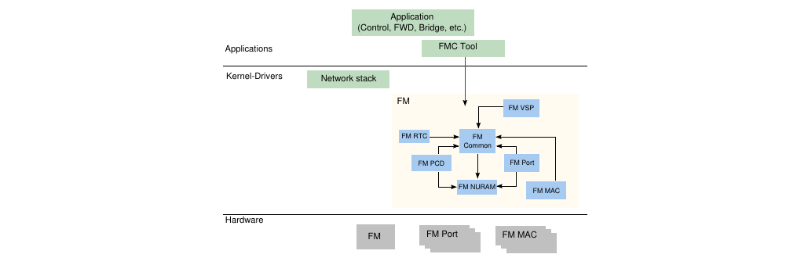

**Figure 87. Các khối xây dựng FM một partition**

###### 8.2.5.2.4.1 Cách tiếp cận đa lõi

Driver hỗ trợ phương thức hoạt động Symmetric Multi-Processing (SMP).

**SMP**

Theo quy tắc, các routine của driver không an toàn với SMP. Người dùng có trách nhiệm lock mọi routine có thể gặp rủi ro trong môi trường của mình; ví dụ, nếu `FM_PORT_Enable`/`FM_PORT_Disable` có thể được nhiều core dùng, người dùng có trách nhiệm bảo vệ lời gọi routine bằng một spinlock.

Một ngoại lệ của quy tắc này là tập routine PCD. Do độ phức tạp của module này, và để hỗ trợ SMP cũng như duy trì tính nhất quán, các routine PCD được bảo vệ bằng hai cơ chế, spinlock và cờ.

Mỗi tài nguyên PCD (tức là module phần mềm như scheme, CC Node, NetEnv, v.v.) có thể có một hoặc nhiều spinlock được dùng để bảo vệ các đoạn mã ngắn nơi các tài nguyên cụ thể như thanh ghi phần cứng hoặc cấu trúc phần mềm được truy cập. Trong một số trường hợp, một spinlock ở mức cao hơn được dùng (tức là CC lock toàn bộ PCD).

Cơ chế thứ hai được định nghĩa toàn cục. Module PCD toàn cục cung cấp một cơ chế PcdLock, là một danh sách các lock object chứa một cờ và một spinlock bảo vệ cờ đó. Khi khởi tạo mỗi tài nguyên PCD (tức là module phần mềm như scheme, CC Node, NetEnv, v.v.), một PcdLock được cấp phát cho module này. Các critical section không thể bảo vệ bằng spinlock (vì lý do độ dài đoạn mã, Host Command và các thao tác kéo dài khác) được bảo vệ bằng các cờ này. Lưu ý rằng đây là một cơ chế try-lock và routine gọi trả về với lỗi `E_BUSY` khi thất bại. Các try-lock được dùng bởi mọi routine sửa đổi tài nguyên PCD, trong trường hợp đó ứng dụng được kỳ vọng gọi lại routine cho đến khi nó không còn bận.

Ngoài ra, các đoạn phức tạp giữa các module PCD và FM Port có thể được bảo vệ bằng cách try-lock mọi module PcdLock đã khởi tạo trong PCD toàn cục, qua đó cung cấp một môi trường PCD an toàn nơi ảnh hưởng và kết nối giữa các module có thể có hiệu lực.

Bên trên các routine PCD, mọi routine liên quan đến PCD của FM Port cũng được bảo vệ bằng try-lock của Port, nghĩa là không có hai core nào có thể truy cập cùng một cổng để chạy một routine PCD. Như trong các routine PCD, các routine này có thể trả về `E_BUSY` khi thất bại và khi đó nên được gọi lại.

Cơ chế bảo vệ SMP của driver giả định những điều sau:

- Chỉ một core có thể khởi tạo và xóa một module phần mềm PCD cụ thể (tức là scheme x không thể được hai core khởi tạo).
- Một core không nên cố xóa một module phần mềm PCD khi có nguy cơ một core khác đang thao tác trên module cụ thể đó.

##### 8.2.5.2.5 Trình tự gọi FMan Driver

Việc khởi tạo driver FMan được ứng dụng thực hiện theo trình tự sau:

1. Cấu hình và khởi tạo MURAM
2. Cấu hình và khởi tạo FMan (chung)
3. \[Tùy chọn\] Cấu hình và khởi tạo FMan RTC
4. Với mỗi MAC người dùng cần:

   a. Cấu hình và khởi tạo MAC

   b. Khởi tạo PHY

5. Với mỗi FMan Port người dùng cần:

   a. Cấu hình và khởi tạo FMan Port

   b. \[tùy chọn\] Nếu FMan Port cần được ảo hóa, cần cấp phát một tập VSP và một trong số chúng nên được đặt làm mặc định.

   c. \[tùy chọn\] Nếu các VSP đã được cấp phát ở bước trước, VSP mặc định cần được cấu hình và khởi tạo

   d. ở giai đoạn đó, người dùng nên cấu hình và khởi tạo mọi thứ cần cho hoạt động của một cổng bên ngoài FMan; ví dụ buffer-pool, frame-queue, v.v.

   e. Bật Port

   f. Bật MAC

   g. Gọi routine MAC API 'AdjustLink' với các tham số link liên quan

   **Ghi chú:** Đến đây, FMan đã hoạt động. Các cổng hoạt động ở chế độ độc lập hay chế độ BMI-to-BMI. Từ điểm đó, mọi bước sau đều là tùy chọn.

6. Cấu hình và khởi tạo FMan PCD
7. Nếu một cổng vật lý đang được "ảo hóa" thành nhiều thực thể phần mềm (dùng một cách phân loại nào đó để phân phối traffic), người dùng nên cấu hình và khởi tạo các buffer-pool và frame-queue liên quan.
8. Nếu VSP được bật, ở giai đoạn đó, người dùng nên cấu hình và khởi tạo profile liên quan.
9. Khởi tạo đồ thị FMan PCD:

   a. Gọi các routine lúc chạy bị hạn chế (chỉ có thể được gọi khi PCD bị tắt)

   b. Gọi routine bật PCD

   c. Khởi tạo mọi object của đồ thị PCD (tức là KG-scheme, Match-Table, v.v.)

10. Khởi tạo liên quan đến PCD của cổng FMan; gọi các routine điều khiển lúc chạy để đặt các tham số liên quan đến PCD **Ghi chú:** Trong trường hợp PCD được "set" cho một cổng FMan OP, nó nên được tắt trước (tức là trước khi gọi routine 'FM_PORT_SetPCD').
11. Các routine lúc chạy của FMan
12. Trình tự Free của FMan - theo thứ tự ngược với khởi tạo

##### 8.2.5.2.6 Global FMan Driver

Global FMan driver nói về các tính năng FMan chung - tức là chức năng không được định nghĩa theo từng cổng và không thuộc về bất kỳ module cụ thể nào như PCD, RTC, MURAM, MAC, v.v.

###### 8.2.5.2.6.1 Tổng quan phần cứng FMan

Các thành phần xử lý sau của Frame Manager được coi là các thành phần FMan chung và được điều khiển bởi driver FMan chung:

- Frame Processor Manager (FPM) lập lịch các frame để các thành phần khác nhau xử lý nhằm tạo ra pipeline phù hợp.
- BMI nhằm truyền dữ liệu giữa mạng và bộ nhớ bên trong FMan, tạo frame descriptor (FD), khởi tạo internal context (IC), quản lý các buffer bên trong, cấp phát/giải phóng các buffer ngoài với sự trợ giúp của BMan và kích hoạt DMA để truyền dữ liệu giữa RAM bên trong và RAM ngoài
- DMA chịu trách nhiệm truyền dữ liệu frame từ và tới bộ nhớ ngoài
- Queue manager interface (QMI) chịu trách nhiệm truyền các phân công công việc dựa trên gói giữa queue manager (QMan) và frame manager (FMan). Nó cung cấp một giao diện tới QMan để enqueue và dequeue các frame mới vào/từ hệ thống đa lõi.

**Trừu tượng hóa phần mềm của Global FMan Driver**

Driver FMan toàn cục bao phủ mọi chức năng FMan chung về mặt logic, tức là chức năng không liên quan đến cổng. Các module phần cứng khác nhau bên trong FMan (tức là BMI, DMA, v.v.) được đóng gói bên trong module FMan. Các thuật ngữ "BMI", "DMA" được dùng để nhận diện tài nguyên như exception, counter và một số tham số cấu hình, nhưng về mặt logic, module duy nhất được dùng cho các thao tác chức năng là FMan.

###### 8.2.5.2.6.2 Cách dùng Global FMan Driver?

Các mục sau cung cấp thông tin thực tế về cách dùng các driver phần mềm.

**Phạm vi của Global FMan Driver**

Module này đại diện cho các phần chung của FMan. Nó bao gồm:

- Cấu hình và bật các cấu trúc phần cứng FMan
- Cấp phát và quản lý tài nguyên
- Xử lý interrupt
- Hỗ trợ thống kê
- Hỗ trợ ECC cho các RAM của FMan
- Cân bằng tải giữa các cổng

**Trình tự của Global FMan Driver**

- Routine config FMan
- \[Tùy chọn\] Các routine cấu hình nâng cao FMan
- Routine Init FMan
- Các routine lúc chạy của FMan
- Routine free FMan

**Mô tả chức năng của Global FMan Driver**

Các mục sau mô tả các chức năng chính của driver và cách dùng chúng.

**Cấu hình và khởi tạo FMan**

Khi khởi tạo driver FMan, phần mềm cấu hình mọi thanh ghi FMan và bộ nhớ liên quan. Nó cung cấp giá trị mặc định ở những nơi không có giá trị nào khác được chỉ định, nó cấp phát MURAM, nó nạp mã cho bộ điều khiển FMan. Nó định nghĩa các IRQ và đặt các IRQ handle. Nó bật các cơ chế phần cứng và khởi tạo các cấu trúc dữ liệu phần mềm cho việc quản lý bằng phần mềm.

Khi khởi tạo xong, FMan đã sẵn sàng để dùng và bất kỳ module con nào của FMan (FMan-Port, MAC, v.v.) đều có thể được khởi tạo.

**Quản lý và tinh chỉnh tài nguyên**

FMan cung cấp các tài nguyên được các module con của nó dùng. Nói chung, driver chọn cách cấp phát tài nguyên mặc định, nhưng khi khởi tạo module FMan toàn cục, người dùng có thể chỉ định cách cấp phát khác cho một số hoặc mọi tài nguyên.

Các tài nguyên liên quan đến phần bàn luận này là các tài nguyên chỉ BMI dùng. Các tài nguyên này nên được phân phối tiếp giữa các cổng khác nhau, nhưng việc cấp phát ban đầu là cho BMI, đối lập với một số cách dùng nội bộ của bộ điều khiển FMan. Các tài nguyên chính và quan trọng nhất của FMan là TNUM (tức là các "task" của FMan), DMA, FIFO và "pipeline-depth".

Tổng tài nguyên có sẵn có thể khác nhau tùy SoC. Các giá trị mặc định khuyến nghị được thiết kế để phù hợp với hầu hết ứng dụng, nhưng vì việc cấp phát tài nguyên phụ thuộc vào cấu hình hệ thống, nó có thể khác nhau giữa các ứng dụng. Tức là giá trị mặc định được driver đặt sẽ đủ trong các trường hợp sử dụng mà người dùng tận dụng phần lớn băng thông FMan và ứng dụng của người dùng chủ yếu dùng FMan. Trong các trường hợp khác, như nếu người dùng dùng một số thiết lập PCD nâng cao và/hoặc làm SoC quá tải (ví dụ PCI được dùng ồ ạt), các tài nguyên có thể cần được người dùng xử lý và tinh chỉnh đặc biệt vì giá trị mặc định có thể không đủ.

Phần lớn MURAM được dùng làm vị trí tạm cho các giao dịch dữ liệu. Kích thước của phần này được gọi là "FIFO size". Phần còn lại của MURAM có thể được dùng cho các mục đích khác như Custom Classifier và kích thước của nó bị ảnh hưởng bởi việc dùng các tính năng này, tức là nếu không dùng Custom Classifier, "FIFO size" có thể được tăng lên. Người dùng có thể gọi `FM_ConfigTotalFifoSize` để sửa giá trị mặc định của MURAM. Tuy nhiên, cần nhớ rằng khi FIFO size được tăng lên - không gian Custom Classifier bị giảm.

**Cân bằng tải**

FMan cung cấp một cơ chế để tối ưu việc phân xử bên trong giữa các cổng khác nhau trên các tài nguyên dùng chung của phần cứng.

Driver hỗ trợ tính năng này bằng cách cung cấp một API để chia băng thông giữa các cổng khác nhau (`FM_SetPortsBandwidth`). API được cho theo phần trăm - tức là với mỗi cổng, người dùng nên chỉ định phần trăm của nó so với các cổng khác. API này là tùy chọn và có thể được sửa lúc chạy. Nếu không dùng, hoặc nếu mọi cổng nhận cùng băng thông (dù là {50,50} hay (25,25,25,25}), thì không cổng nào được ưu tiên hơn các cổng khác. Nếu các cổng nhận giá trị khác nhau, ví dụ dùng 3 cổng và nhận {25,50,25}, thì cổng thứ nhất và thứ ba sẽ có cùng quyền truy cập tài nguyên dùng chung nhưng cổng thứ hai sẽ được gấp đôi. Tức là giá trị số gán cho mỗi cổng không quan trọng, chỉ quan hệ giữa các cổng mới quan trọng.

**Thống kê**

FMan API cung cấp quyền truy cập mọi thống kê do phần cứng FMan thu thập. Routine API `FM_GetCounter` có thể được gọi bất kỳ lúc nào sau khi khởi tạo để lấy bất kỳ counter nào của FMan.

##### 8.2.5.2.7 Driver FMan Parse-Classify-Distribute

Module driver Parse-Classify-Distribute (PCD) nói về các phần của driver xử lý các PCD engine và dịch vụ khác nhau như Parser, Keygen, Custom Classifier, Policer, Header Manipulation, Reassembly, Fragmentation và Frame Replication. Nó xử lý cả các tính năng cấu hình và lúc chạy chung lẫn các tài nguyên PCD cụ thể như Keygen Scheme, đồ thị Custom Classifier, v.v.

###### 8.2.5.2.7.1 Tổng quan phần cứng FMan PCD

- Parser - Parser thực hiện parse và kiểm chứng protocol header cho nhiều định dạng frame với các giao thức và kiểu đóng gói khác nhau. Một hàm parser viết cứng được dùng cho các giao thức đã biết và ổn định. Khả năng của hardware parser có thể được mở rộng bằng các hàm software parser để hỗ trợ các giao thức mà hardware parser không hỗ trợ, bao gồm các giao thức độc quyền và shim header. Parser parse frame theo cấu hình theo từng cổng. Nó đọc header của frame từ FMan Memory và ghi kết quả parse của frame vào Internal Context của frame. Lineup Confirmation Vector là một phần của kết quả parser. Nó biểu diễn danh sách mọi giao thức mà hardware parser nhận ra, và có thể được mở rộng để chứa thông tin do software parser thêm vào.
- Keygen - Keygen nằm trên đường nhận của FMan, và cho phép triển khai hiệu năng cao việc tiền phân loại. Nó giữ một số lượng key generation scheme tùy SoC trong bộ nhớ bên trong. Mỗi scheme có thể tạo ra frame queue ID (FQID), Storage-Profile ID (SPID) và policer profile (PP) khác nhau. Một chức năng chính của module Keygen là tách dữ liệu mạng thành các flow khác nhau, mỗi flow cần xử lý khác nhau. Một chức năng khác của Keygen là Classification Plan. Đây là một cơ chế được cung cấp để mask các bit LCV theo định nghĩa theo từng cổng. Classification Plan được triển khai dưới dạng một bảng có số mục tùy SoC, được chia logic hoặc dùng chung giữa các FMan Port.
- Custom Classifier - Module Custom Classifier của Frame Manager (FMan) thực hiện tra cứu bằng một key cụ thể từ frame nhận được hoặc từ internal frame context theo kết quả của Parser. FMan Custom Classifier về mặt logic diễn ra sau khi xử lý Keygen hoàn tất và có thể hoạt động cả trong flow nhận của MAC lẫn flow offline parsing. Việc tra cứu tạo ra một action descriptor chứa thông tin cần thiết để tiếp tục xử lý frame ở module kế tiếp hoặc bảng tra cứu kế tiếp.
- Policer - Policer hỗ trợ triển khai differentiated service ở tốc độ đường truyền trên các đường nhận hoặc offline parsing của Frame Manager (FMan). Nó giữ một số lượng traffic profile tùy SoC trong bộ nhớ bên trong, mỗi profile triển khai chế độ RFC-2698 hoặc RFC-4115 hoặc Pass-Through. Mỗi chế độ có thể làm việc ở chế độ color-blind hoặc color aware, và cho qua hoặc loại bỏ gói theo màu kết quả của chúng.

**Trừu tượng hóa phần mềm FMan PCD**

Driver FMan PCD nhằm cung cấp một giao diện logic mức cao, trừu tượng, hướng mạng. Nó được thiết kế để tạo một lớp keo nối giữa các PCD engine khác nhau và "người dùng" PCD - cổng FMan, và để định nghĩa một giao diện tới các tính năng này để ứng dụng dùng. Trong quá trình này, các module mới không phải phần cứng có thể được tạo ra - như "Network Environment", trong khi các module phần cứng hiện có - như "Classification Plan" - có thể bị che khỏi người dùng. Các mục sau cố gắng mô tả các quyết định thiết kế driver trong việc trừu tượng hóa phần cứng của các engine và khoảng cách giữa mô hình lập trình phần cứng và API của driver.

**Flow FMan PCD**

FMan mở các khả năng lập lịch FPM cho ứng dụng, cho phép sự linh hoạt đáng kể trong việc định nghĩa packet flow. Tại nhiều điểm trong flow, người dùng FMan phải cấu hình engine kế tiếp để xử lý gói và thao tác kế tiếp nó sẽ thực hiện. Driver giảm thiểu sự linh hoạt này bằng cách giả định một flow cơ bản cho mỗi cổng. Driver có thể mở rộng flow này để bao gồm mọi khả năng FMan PCD, nhưng theo một cách hạn chế sẽ được mô tả dưới đây.

Flow cơ bản phản ánh cách dùng dự kiến của FMan PCD. Khi một cổng được khởi tạo, thiết lập mặc định là các gói nhận được được chuyển tới Rx frame queue mặc định của cổng, như người dùng cấu hình. Khi PCD được liên kết với cổng, người dùng chọn một trong các tùy chọn hỗ trợ PCD được cung cấp, tùy chọn này chọn những PCD engine nào (parser, Keygen, FMan-Controller và Policer) được áp dụng cho các frame. Tùy chọn hỗ trợ PCD được chọn thêm (các) engine được chọn vào flow theo cách tổ chức PCD sau.

- Khi dùng parser, nó luôn là PCD engine đầu tiên làm việc trên các frame nhận được.
- Nếu parser không được kích hoạt, Keygen và FMan-Controller không thể được kích hoạt.
- Lần dùng đầu tiên của Keygen theo sau parser, nhưng nó có thể được dùng lại sau FMan-Controller hoặc policer.
- Nếu dùng FMan-Controller, nó sẽ theo sau Keygen. Nó không thể được kích hoạt nếu không dùng Keygen.
- Policer có thể được kích hoạt riêng hoặc theo sau bất kỳ engine nào.

Trong mọi trường hợp, frame quay về buffer manager interface (BMI) để enqueue. Ứng dụng không thể thay đổi flow chính lúc chạy.

Hình sau cho thấy các flow mặc định của cổng (xét theo việc khởi tạo các thanh ghi next invoked action (NIA)):


**Figure 88. Flow Rx mặc định**

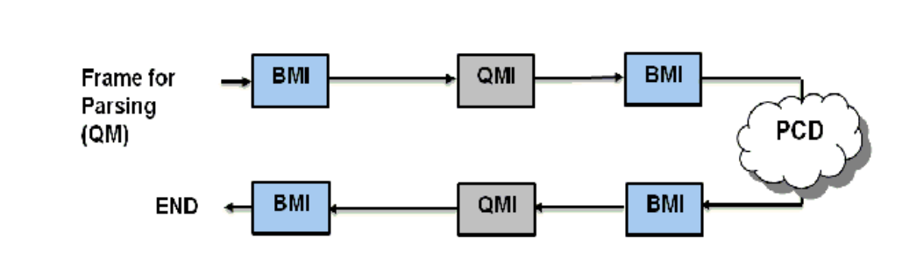

**Figure 89. Flow Offline Parsing mặc định**

**Ghi chú:** Ở chế độ independent, cả Tx và Rx BMI NIA đều là FMan Controller. Các NIA khác không áp dụng.

Sau khi khởi tạo cơ bản, flow Rx mặc định, như trong Figure 88, là flow được cấu hình. Một PCD flow ban đầu được định nghĩa ở mức FMan Port, dù nó bị ảnh hưởng bởi cả cấu hình cổng lẫn cấu hình tài nguyên PCD. Hình sau cho thấy các PCD flow được driver hỗ trợ.

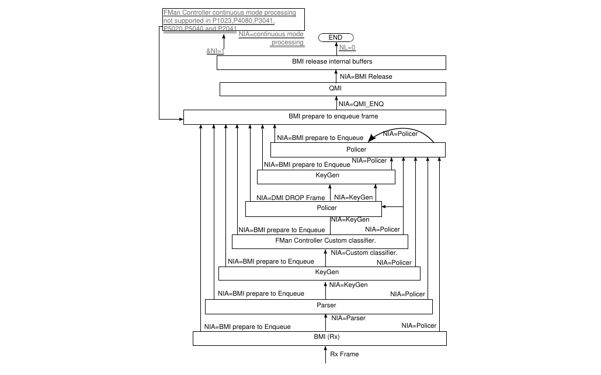

**Figure 90. Các flow có sẵn**

**Module FMan PCD toàn cục**

Driver FMan PCD xử lý việc khởi tạo cấu hình và thiết lập lúc chạy các tài nguyên PCD. Việc dùng thực tế các tài nguyên này thực ra chỉ được kích hoạt khi một FMan-Port được bật và được bind với các tài nguyên PCD đã khởi tạo. Mục này giải thích việc khởi tạo và tổ chức các tài nguyên đó.

Driver PCD được xây dựng từ một module FMan-PCD toàn cục phải được khởi tạo trước, và một tập tài nguyên PCD tùy chọn có thể được khởi tạo lúc chạy. Module FMan-PCD chịu trách nhiệm bật các engine khác nhau, nạp SW parser nếu cần, đăng ký các interrupt PCD và các cấu hình chung khác.

**Tài nguyên FMan-PCD toàn cục**

Các tài nguyên của driver PCD KHÔNG giống hệt các tài nguyên phần cứng PCD và cung cấp một lớp trừu tượng cho các tài nguyên phần cứng. PCD được nhìn như một đồ thị các tài nguyên PCD, trong đó các cổng FMan RX và OP có thể được bind với các tập con của đồ thị PCD. Tham khảo Mục "Port-PCD Binding".

Sau đây là các tài nguyên PCD của driver:

- Network Environment Characteristics
- Software Parser
- Keygen Scheme
- Custom Classifier Root
- Custom Classifier Match-Table
- Custom Classifier Hash-Table
- Custom Classifier Manipulation
- Policer Profile

**Network Environment (NetEnv) Characteristics** là một tài nguyên thuần SW. Nó được dùng để tạo nhiều tài nguyên PCD HW. Về logic, nó đại diện cho NetEnv của một cổng hoặc một số cổng và cung cấp phần keo nối giữa parser, Keygen, Custom Classifier và cổng. Nó bảo đảm tất cả chúng "nói cùng một ngôn ngữ". Về vật lý, nó định nghĩa LCV cho mọi giao thức tham gia đối với mỗi FMan Port.

**Keygen Scheme** và **Policer Profile** gắn chặt với mô hình lập trình phần cứng của chúng

Quá trình **Custom Classifier** được biểu diễn bằng một đồ thị phần mềm. Mỗi node trong đồ thị đại diện cho một hành động logic. Driver định nghĩa các loại node Custom Classifier khác nhau. Một loại node là Exact-Match, là biểu diễn phần mềm của một Action-Descriptor (AD) thực hiện tra cứu theo key đã định nghĩa. Một loại node khác là Indexed-Lookup, cũng là biểu diễn phần mềm của một Action-Descriptor thuộc loại đó. Một mức trừu tượng cao hơn được thực hiện trên các node Hash-Table, nơi driver quản lý một hash table. Mỗi node cũng có thể chứa một handle tới một hành động Manipulation - là trừu tượng phần mềm cho một hoặc nhiều AD dùng để thao tác frame bằng cách chèn và/hoặc gỡ dữ liệu. Nói chung, bất kỳ node phần mềm Custom Classifier nào cũng có thể được dịch thành một hoặc nhiều action descriptor HW.

Driver định nghĩa khái niệm đồ thị Custom Classifier. Đồ thị CC là toàn bộ tập các thao tác tra cứu và thao tác frame do Custom Classifier thực hiện. Người dùng chỉ xây đồ thị sau khi định nghĩa các CC Node. Việc hoàn tất đồ thị được thực hiện bằng cách xây các root node và định nghĩa cách nhóm chúng. Điều này nói về mảng 16 mục đóng vai trò điểm vào của CC. Nói chung, việc đánh chỉ số vào mảng này được thực hiện bằng 4 bit trong LCV. Driver này hỗ trợ chia mảng này thành 2-16 nhóm không liên quan để tăng tính linh hoạt của việc lập trình và cho phép dùng thêm bit LCV.

**Cách liên kết các tài nguyên PCD**

NetEnv là liên kết giữa cổng và mọi tài nguyên PCD mà nó đang dùng.

- Parser - Driver cấu hình LCV (lineup confirmation vector) trong cấu hình parser cho mỗi FMan Port theo NetEnv cụ thể mà nó được bind. Khi dùng SW parser, một shim header riêng nên được thêm làm một unit NetEnv, và có thể được dùng sau đó như một unit thông thường.
- Keygen-Classification plan: Driver che tài nguyên này khỏi người dùng và cấu hình các mục classification plan để hỗ trợ và mở rộng khả năng của HW parser theo định nghĩa NetEnv Characteristics của người dùng
- Keygen-Scheme: Người dùng mô tả scheme theo các unit NetEnv, và match vector được driver cấu hình.
- Custom Classifier: Người dùng mô tả điểm vào của một CC root theo các unit NetEnv. Driver chuyển bên trong thông tin này cho Keygen, Keygen dùng nó để chọn điểm vào trong CC root khi chuyển một frame từ Keygen sang Custom Classifier.

Sau khi định nghĩa các tài nguyên PCD, người dùng có thể bind bất kỳ FM Port nào với các tài nguyên đã khởi tạo. Một cổng phải được bind với một NetEnv duy nhất, và có thể được bind với một Custom Classifier root và các KeyGen scheme.

Tập hình dưới đây minh họa một ví dụ duy nhất về việc dùng các tài nguyên của driver và tương tác của chúng với các cấu trúc phần cứng.

Bảng sau minh họa một NetEnv gồm 7 unit. Ví dụ, unit 0 là một unit đơn giản nhận diện Ethernet frame, còn unit 2 nhận diện các IP frame của cả hai phiên bản.

| Unit 0 | Unit 1 | Unit 2 | Unit 3 | Unit 4 | Unit 5 | Unit 6 |
|---|---|---|---|---|---|---|
| Ethernet | Ethernet \[Broadcast\] | IPv4 | IPv4 | UDP | MPLS \[stacked\] | IPv4 \[Multicast\] |
|   |   | IPv6 |   | TCP |   |   |

Khi một cổng được bind với một NetEnv, driver dịch các unit của nó thành Line-up Confirmation Vector (LCV) phần cứng của parser. Bảng dưới đây cho thấy LCV được cấu hình cho một cổng có NetEnv ở trên.

|   | LCV\[0\] | LCV\[1\] | LCV\[2\] | LCV\[3\] | LCV\[4\] | LCV\[5\] | LCV\[6\] | LCV\[7-31\] |
|---|---|---|---|---|---|---|---|---|
| Ethernet | 1 | 1 | 0 | 0 | 0 | 0 | 0 | 0...0 |
| IPv4 | 0 | 0 | 1 | 1 | 0 | 0 | 1 | 0...0 |
| IPv6 | 0 | 0 | 1 | 0 | 0 | 0 | 0 | 0...0 |
| UDP | 0 | 0 | 0 | 0 | 1 | 0 | 0 | 0...0 |
| TCP | 0 | 0 | 0 | 0 | 1 | 0 | 0 | 0...0 |
| MPLS | 0 | 0 | 0 | 0 | 0 | 1 | 0 | 0...0 |

Dựa trên NetEnv, driver cũng định nghĩa một tập mục Classification Plan để mỗi cổng dùng NetEnv đó sử dụng.

|   | Bit\[0\] | Bit\[1\] | Bit\[2\] | Bit\[3\] | Bit\[4\] | Bit\[5\] | Bit\[6\] | Bits\[7-31\] | Ghi chú |
|---|---|---|---|---|---|---|---|---|---|
| 0 | 1 | 0 | 1 | 1 | 1 | 0 | 0 | 1...1 | Không có classification plan |
| 1 | 1 | 1 | 1 | 1 | 1 | 0 | 0 | 1...1 | Ethernet Broadcast |
| 2 | 1 | 0 | 1 | 1 | 1 | 1 | 0 | 1...1 | MPLS Stacked |
| 3 | 1 | 1 | 1 | 1 | 1 | 1 | 0 | 1...1 | 1+2 |
| 4 | 1 | 0 | 1 | 1 | 1 | 0 | 1 | 1...1 | IPv4 MC |
| 5 | 1 | 1 | 1 | 1 | 1 | 0 | 1 | 1...1 | 1+4 |
| 6 | 1 | 0 | 1 | 1 | 1 | 1 | 1 | 1...1 | 2+4 |
| 7 | 1 | 1 | 1 | 1 | 1 | 1 | 1 | 1...1 | 1+2+4 |

Khi một frame được nhận, LCV của nó được mask bằng một trong các vector trong Classification Plan. FMan chọn mục dựa trên output của parser và các tham số của cổng.

Để hỗ trợ thao tác này, driver khởi tạo trường HXS plan offset cho mỗi header liên quan trong các tham số parser của cổng. Bảng dưới đây là bản dịch của driver từ Network environment ở trên thành các tham số classification plan của cổng. Khi một frame đang được parse, classification plan offset của mỗi header tìm thấy được cộng dồn để tạo ra offset của classification plan kết quả. Ví dụ, một frame giả định là frame Ethernet BC/Stacked MPLS/IPv4 unicast sẽ có LCV=0xF6000000 và classification plan id là 2^(1-1)+ 2^(2-1) = 3, nên classification plan vector của nó là 0xFDFFFFFF, và QLCV = 0xF4000000.

| Ethernet Broadcast | 1 | 2^(1-1)=1 |
|---|---|---|
| MPLS Stacked | 2 | 2^(2-1)=2 |
| IPv6 | 0 | 0 |
| UDP | - | - |
| TCP | - | - |
| IPv4 Multicast | 3 | 2^(3-1)=4 |

Nhờ driver tự động khởi tạo LCV và classification plan chỉ dựa trên NetEnv, người dùng giờ có thể khởi tạo các Keygen scheme bằng cách chỉ truyền id của unit NetEnv làm tiêu chí so khớp. Như trong các trường hợp khác, driver sẽ dịch các id unit thành match vector của scheme như có thể thấy trong hình dưới đây.


**Figure 91. Ví dụ Keygen scheme**

Cuối cùng, driver cũng sẽ đảm nhận việc khởi tạo các thanh ghi cấu hình Keygen-to-Custom Classifier. Khi khởi tạo một Custom Classifier root, người dùng có thể tạo các nhóm dựa trên các unit NetEnv (đối lập với một nhóm đơn giản gồm một mục duy nhất; để biết thêm thông tin, tham khảo Mục " Custom Classifier Root ").

Khi khởi tạo một scheme, người dùng chỉ nên truyền handle tới Custom Classifier root. Driver sẽ dịch các tham số phụ thuộc LCV của nhóm thành thanh ghi mà scheme cần.

Ví dụ, Group 0 là một nhóm đơn giản không phụ thuộc NetEnv. Group 1 dựa trên một unit duy nhất - nên một frame có thể được forward tới 1 trong 2 root node, và group 2 dựa trên 3 unit - nên một frame có thể được forward tới 1 trong 8 root node.

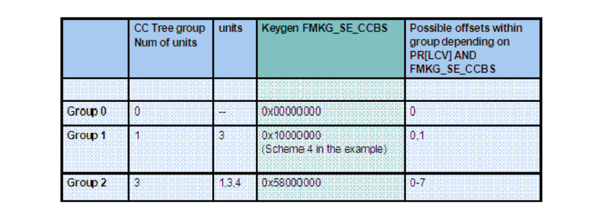

**Figure 92. Cấu hình Keygen scheme cho CC next engine**

Policer Profile là tài nguyên duy nhất không dựa vào Parser Result hay NetEnv. Vì vậy nó được quản lý độc lập với các tài nguyên PCD khác.

**FMan Header Manipulation**

Bộ điều khiển FMan định nghĩa một tập lệnh header manipulation, và hỗ trợ liệt kê nối tiếp các lệnh này. Driver FMan cho phép liệt kê hạn chế trong một Manipulation node duy nhất, giới hạn ở một lần dùng mỗi lệnh và theo một thứ tự đã định nghĩa (ví dụ remove + insert có thể được định nghĩa trong một node, nhưng insert + remove hay remove + remove thì không). Hoặc, việc liệt kê và sắp thứ tự đầy đủ được hỗ trợ bằng cách nối chuỗi nhiều hơn một Manipulation node. Trong trường hợp đó, driver sẽ hợp nhất các HMCT để tối ưu hiệu năng và việc dùng MURAM, trừ khi cần parse giữa các lệnh khác nhau.

Danh sách sau ánh xạ mỗi lệnh của bộ điều khiển FMan tới các tham số driver trong cấu trúc Header Manipulation:

1. Generic removal - Đặt 'rmv' và dùng cấu trúc tham số tương ứng. Chọn enum generic và các tham số.
2. Generic insertion - Đặt 'insrt' và dùng cấu trúc tham số tương ứng. Chọn enum generic và các tham số.
3. Generic replace - Đặt 'insrt' và dùng cấu trúc tham số tương ứng. Chọn enum generic và các tham số và đặt 'replace'.
4. Protocol specific removal - Đặt 'rmv' và dùng cấu trúc tham số tương ứng. Chọn enum byHdr và các tham số.
5. Protocol specific insert - Đặt 'insrt' và dùng cấu trúc tham số tương ứng. Chọn enum byHdr và các tham số.
6. Vlan priority update - Đặt 'fieldUpdate' và dùng cấu trúc tham số tương ứng. Chọn enum vlan và các tham số.
7. IPv4 update - Đặt 'fieldUpdate' và dùng cấu trúc tham số tương ứng. Chọn enum IPv4 và các tham số.
8. IPv6 update - Đặt 'fieldUpdate' và dùng cấu trúc tham số tương ứng. Chọn enum IPv6 và các tham số.
9. TCP/UDP update - Đặt 'fieldUpdate' và dùng cấu trúc tham số tương ứng. Chọn enum TCP/UDP và các tham số.
10. TCP/UDP checksum calculation - Đặt 'fieldUpdate' và dùng cấu trúc tham số tương ứng. Chọn enum TCP/UDP và các tham số.
11. IP replace - Đặt 'custom' và dùng cấu trúc tham số tương ứng. Chọn enum TCP/UDP và các tham số.

**Node Custom Classifier Hash-Table**

Driver cung cấp một cơ chế Hash-Table mức cao được triển khai trên các cấu trúc Custom Classifier của bộ điều khiển FMan. Driver triển khai Hash-Table bằng một node Match-Table loại Indexed-Hash, trong đó mỗi mục trỏ tới một hash bucket được triển khai bằng một node Match-Table loại Exact-Match (để biết thêm thông tin về các node này, tham khảo Mục " Custom Classifier Root "). Driver dùng key và kết quả hash của Keygen làm key để tra cứu. Một phần được chọn của kết quả hash được dùng để chọn mục trong bảng Indexed-Hash (tức là bucket), và các giá trị khả dĩ đầy đủ của key được dùng làm các key Match-Table trong bucket được chọn.

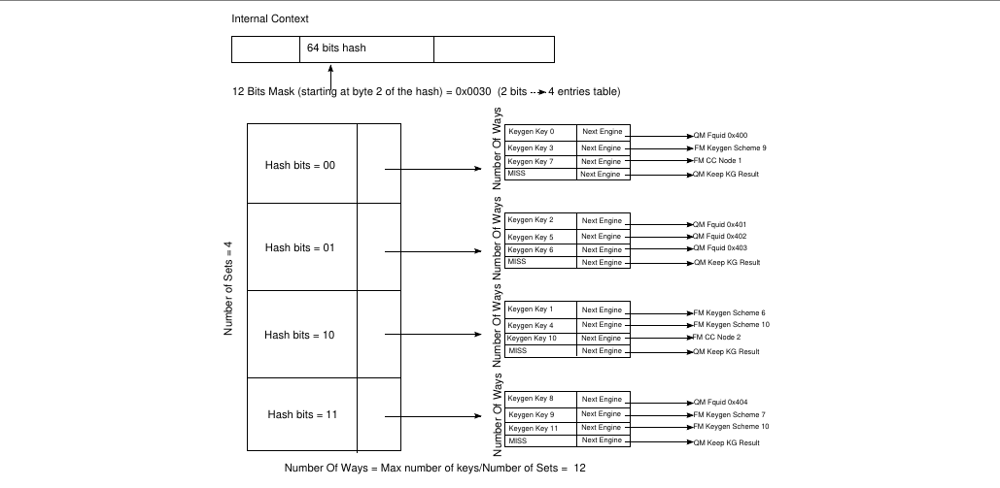

**Figure 93. Ví dụ node Hash_Table**

###### 8.2.5.2.7.2 Cách dùng FMan PCD Driver?

Các mục sau cung cấp thông tin thực tế về cách dùng các driver phần mềm.

**Phạm vi của FMan PCD Driver**

- Cấu hình và khởi tạo FMan Parser, Keygen, Custom Classifier và Policer
- PCD Enable/Disable
- Cấp phát và quản lý tài nguyên
- Xử lý interrupt
- Hỗ trợ thống kê
- Hỗ trợ các thao tác FMan PCD

**Trình tự của FMan PCD Driver**

- Routine FMan PCD Config
- \[Tùy chọn\] Các routine cấu hình nâng cao FMan PCD
- Routine FMan PCD Init
- Các routine trước khi enable chỉ chạy một lần cụ thể (ví dụ nạp SW parser)
- Routine FMan PCD Enable
- Các routine lúc chạy của FMan PCD
- Các routine lúc chạy cho các tài nguyên cụ thể của FMan PCD (để định nghĩa, sửa và xóa Keygen scheme, node Custom Classifier, v.v.)
- Routine FMan PCD Free

**Mô tả chức năng của FMan PCD Driver**

Các mục sau mô tả các chức năng chính của driver và cách dùng chúng.

**Khởi tạo PCD toàn cục**

Việc khởi tạo PCD được chia thành hai phần. Trong phần đầu của việc khởi tạo, `FM_PCD_Config`, các routine config nâng cao, và `FM_PCD_Init` được gọi để cấu hình và đặt mọi khả năng PCD cơ bản, bao gồm định nghĩa trước những engine nào được hỗ trợ và có thể được dùng sau này. Giai đoạn này được thực hiện trong kernel, và PCD chưa được bật. Trong phần thứ hai của việc khởi tạo, PCD được bật bằng một routine lúc chạy (`FM_PCD_Enable`).

Cách chia này tạo ra một khoảng trống trong đó có thể thêm một số chức năng. Quan trọng nhất là việc nạp mã SW parser. Lưu ý rằng chức năng này chỉ được phép khi PCD bị tắt (tức là giữa init và enable) hoặc, với một số hạn chế, lúc chạy sau khi disable.

Khi việc khởi tạo cơ bản PCD hoàn tất (`FM_PCD_Init` và `FM_PCD_Enable` đã được gọi và trả về), các khả năng PCD của frame manager được driver phản ánh dưới dạng một tập routine API lúc chạy được thiết kế để định nghĩa môi trường PCD cho một partition cụ thể. Các tài nguyên PCD được định nghĩa theo từng partition và có thể được mọi cổng trong một partition cụ thể dùng. Các tài nguyên PCD khác nhau được khởi tạo trước và chỉ sau đó mới có thể được các cổng FMan dùng.

Thứ tự khởi tạo tài nguyên PCD là nghiêm ngặt và dựa vào việc đồ thị PCD được khởi tạo từ dưới lên, nghĩa là không tài nguyên nào được khởi tạo trước khi engine kế tiếp của nó được khởi tạo. Tuy nhiên, việc dùng các profile tương đối theo cổng là một ngoại lệ của quy tắc này. Next engine của một scheme có thể là một profile tương đối theo cổng. Trong trường hợp đó, scheme được khởi tạo nhưng chưa được bind với một cổng, tức là policer profile thực tế chưa được chỉ định. Vì vậy, tính hợp lệ của nó không thể được kiểm chứng. Người dùng có trách nhiệm bảo đảm rằng khi một cổng dùng scheme đó được kích hoạt (để dùng PCD), policer profile tương đối của nó phải được kiểm chứng hợp lệ.

Đồ thị PCD dựa trên partition, tức là có thể được các cổng trên cùng partition dùng chung. Tham khảo Mục "Port-PCD Binding" để biết thêm chi tiết về việc bind port-PCD.

**Tài nguyên PCD**

Các mục con sau mô tả chi tiết từng tài nguyên PCD của driver. Trong môi trường một partition, hầu hết tài nguyên đều có sẵn và không cần cấp phát tường minh. Các port policer profile là ngoại lệ. Chúng phải được người dùng cấp phát, bằng FMan Port API. Trong môi trường nhiều partition, một số tài nguyên, cụ thể là các tài nguyên bị giới hạn bởi phần cứng, phải được một partition cấp phát trước và chỉ sau đó mới được các cổng của partition dùng. Các mục sau chỉ rõ yêu cầu cho từng tài nguyên PCD:

**Network Environment Characteristics**

Network Environment (NetEnv) là một thực thể phần mềm liệt kê các giao thức mạng mà FM-PCD dùng để phân loại và phân phối. Tổng số NetEnv được định nghĩa phụ thuộc vào cấu hình hệ thống. Một NetEnv có thể được định nghĩa theo từng cổng hoặc dùng chung giữa một số hoặc mọi cổng. Việc định nghĩa một NetEnv phải được thực hiện cẩn thận có xét đến việc dùng module FM-PCD. Thực tế NetEnv là chìa khóa cho việc parse, phân phối và phân loại frame.

NetEnv là một danh sách các distinction unit. Mỗi distinction unit gồm ít nhất một hoặc nhiều header. Một header có thể là một header trong danh sách header được hỗ trợ hoặc một trong các header được hỗ trợ cộng một option (để biết thêm chi tiết về danh sách và các option có sẵn, tham khảo Section 8.2.5.2.13).

Hardware parser triển khai việc nhận diện header. Nếu dùng software parser, một distinction unit cũng có thể là một trong các shim header. Driver giữ lại một số unit (có thể được định nghĩa lại trong `fm_pcd_ext.h`) để dùng riêng. Khi đó người dùng có thể dùng unit ID này để Keygen hoặc CC nhận diện header riêng.

Hình sau cho thấy một ví dụ về NetEnv. Nó có bốn unit, hai trong số đó gồm một header duy nhất. Một trong các header có một option. Hai unit cuối gồm hai header có thể thay thế nhau. Ví dụ này sẽ được dùng xuyên suốt các mục sau

.


**Figure 94. Ví dụ Network Environment**

Danh sách distinction unit nên phản ánh những gì người dùng muốn làm với các cơ chế PCD để parse-classify-distribute các frame đến. Chỉ định một distinction unit nghĩa là người dùng muốn dùng đặc tả đó để hoặc kích hoạt parser trên các header được chỉ định, hoặc phân biệt giữa các frame bằng Keygen hay Custom Classifier. Dùng các header có thể thay thế nhau để định nghĩa một unit nghĩa là người dùng không quan tâm header nào trong số các header có thể thay thế nhau có mặt trong frame, mà muốn việc phân biệt dựa trên sự có mặt của bất kỳ header nào trong số đó. Ví dụ, nếu cần việc chọn scheme dựa trên việc có header L3 là IPv4 HOẶC IPv6, nhưng không quan trọng header nào trong hai header đó có mặt, thì nên định nghĩa một unit với 2 header có thể thay thế nhau: IPv4, IPv6.

Routine khởi tạo trả về một NetEnv handle để dùng sau này nhằm chỉ định Network Environment đó.

Tùy ngữ cảnh, có những giới hạn khi dùng NetEnv. Một cổng dùng chức năng PCD được bind với một NetEnv. Một số, hoặc thậm chí tất cả, cổng có thể dùng chung một NetEnv, nhưng cũng có thể có một NetEnv cho mỗi cổng. Khi khởi tạo một scheme, một Custom Classifier root, hoặc khi bind một cổng với PCD, một trong các tham số bắt buộc là handle của một NetEnv đã khởi tạo. Driver dùng các định nghĩa của NetEnv đó để khởi tạo scheme hoặc Custom Classifier root đó. Khi một cổng được bind với một Keygen scheme hoặc một Custom Classifier root, nó phải được bind với cùng NetEnv.

Để định nghĩa flow, các module PCD khác nhau chỉ có thể dựa vào các distinction unit được định nghĩa bởi environment của chúng. Ví dụ khi khởi tạo một scheme, một module PCD không thể chọn IPv4 làm tiêu chí khớp để nhận diện flow trừ khi IPv4 đã được định nghĩa trong environment liên quan. Thực tế, để hướng dẫn người dùng qua việc cấu hình PCD, việc đặc tả từng module theo flow không được thực hiện bằng tên giao thức, mà bằng chỉ số environment.

Xét về triển khai phần cứng, danh sách distinction unit đặt các Lineup Confirmation Vector (LCV) và sau đó được dùng cho match vector và việc đánh chỉ số CC. Các LCV của shim header theo quy ước được gán từ LSB trở lên, nên shim header đầu tiên là 0x0000_0001. Để biết thêm chi tiết về triển khai, tham khảo Mục "Global FMan-PCD Resources".

**Thay đổi lúc chạy**: Một Network Environment không thể được thay đổi lúc chạy. Có thể đặt NetEnv mới, và có thể xóa các NetEnv không dùng bất kỳ lúc nào.

**API có sẵn:**

- `FM_PCD_NetEnvCharacteristicsSet`
- `FM_PCD_NetEnvCharacteristicsDelete`

**Software Parser**

PCD cho phép mở rộng hardware parser bằng cách nạp mã software parser để thao tác thêm. Khi cần điều này, người dùng truyền image của mã software parser và một bảng label cho driver. Bảng này biểu diễn các entry-point trong mã software parser. Nếu cần nhiều hơn một đoạn mã cho một giao thức cụ thể (ví dụ để các cổng khác nhau dùng), một chỉ số được thêm vào bảng label. Sau đó, khi cấu hình một cổng dùng một hoặc nhiều phần gắn software parsing, mỗi protocol header có thể được bind với một trong các label đã khai báo trước đó. Việc này được thực hiện bằng cách đặt chỉ báo bật software parser cho một hoặc nhiều protocol header, và chỉ ra chỉ số software parser (tương đối so với protocol header đó). Mã software parser sẽ chạy cho cổng đó sau khi hardware parser nhận ra header đó. Nói cách khác, protocol header được chỉ định thực chất là trigger để kích hoạt software parser. Thông thường software parser parse một header riêng đã được định nghĩa trước đó làm một unit NetEnv rồi đánh dấu sự có mặt của nó để phân loại và phân phối.

Routine nạp software parser chỉ được gọi khi PCD bị tắt và không cổng nào trong hệ thống đang dùng parser. Lúc khởi tạo, điều này nghĩa là routine, nếu cần, phải được gọi sau `FM_PCD_Init` và trước `FM_PCD_Enable`.

**Thay đổi lúc chạy:** Software parser không thể được thay đổi lúc chạy.

**API có sẵn:**

- `FM_PCD_PrsLoadSw`

**Keygen Scheme**

Thực thể scheme dựa vào thực thể phần cứng. Có 32 Keygen scheme trong một frame manager. Khi một PCD được định nghĩa trong môi trường một partition, nó sở hữu cả 32 scheme. Khi một PCD được định nghĩa trong môi trường nhiều partition, người dùng phải chỉ định cần bao nhiêu scheme cho partition này. Khi các scheme đã được cấp cho một partition cụ thể, chúng chỉ có thể được các cổng trên partition đó dùng.

Trong một partition, thứ tự các scheme là quan trọng. Khi khởi tạo một scheme, người dùng phải chỉ định những điều sau:

- Chỉ số tương đối, tương đối so với các scheme của partition.
- Handle của network environment.
- Tiêu chí so khớp, hay những frame nào nên được scheme xử lý.
- Hành động Keygen (như hash, FQID mask và manipulation).
- Các FQID phân phối.

Tiêu chí so khớp (nếu dùng) dựa trên các unit NetEnv characteristics. Các scheme sẽ được dùng trực tiếp nên được cấu hình như vậy, bằng cách chỉ định một scheme ID thay vì dùng tiêu chí so khớp hay chỉ định distinction unit. Khi khởi tạo, driver trả về một handle tới scheme đã khởi tạo. Handle này có thể được dùng sau để chỉ định scheme.

Các Keygen scheme phụ thuộc vào kết quả parser. Chúng có thể được dùng ngay sau parser theo chế độ trực tiếp hoặc bằng tiêu chí so khớp. Scheme cũng có thể được dùng sau Custom Classifier hoặc policer. Flow này thường được dùng để tái phân phối flow control. Trong trường hợp này, để tránh vòng lặp vô hạn, scheme chỉ được đi tới theo cách trực tiếp chứ không bằng tiêu chí so khớp.

Hành động keygen gồm việc xây dựng key và định nghĩa việc phân phối. Key được xây dựng bằng một tập hành động trích xuất, được sắp xếp trong driver thành một mảng các extraction. Việc trích xuất có thể được thực hiện từ dữ liệu, từ Parse Result, từ giá trị mặc định, nhưng phổ biến nhất - từ header. Khi trích xuất từ header, nó có thể được mô tả chung bằng kích thước và offset, hoặc có thể là trích xuất toàn bộ trường. Để có danh sách đầy đủ các header và trường được hỗ trợ, xem Section 8.2.5.2.13.

Khi một scheme được khởi tạo, người dùng phải chỉ định next engine mà frame nên được chuyển tới sau khi được xử lý. Next engine được chỉ định phải đã được khởi tạo và hợp lệ tại thời điểm này. Frame có thể được chuyển tới Custom Classifier hoặc policer, hoặc có thể được enqueue trực tiếp vào một FQID.

Khi các scheme đã được định nghĩa, các cổng có thể được bind với chúng. Một cổng có thể được bind với bao nhiêu scheme tùy cần, miễn là chúng thuộc cùng partition và cùng NetEnv.

Hình sau cho thấy một ví dụ thiết lập scheme và kết nối với NetEnv, như trong Mục " Network Environment Characteristics".

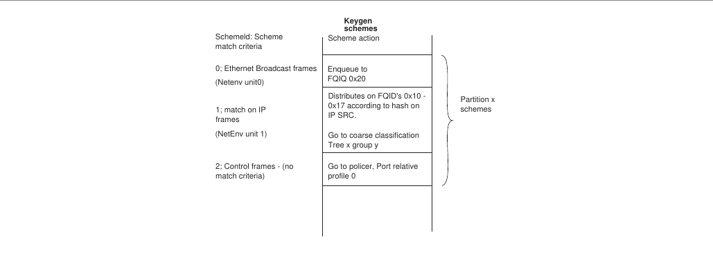

**Figure 95. Ví dụ scheme**

**Thay đổi lúc chạy**: Các scheme hợp lệ có thể được sửa lúc chạy bằng cách gọi routine khởi tạo scheme cho một scheme hiện có với các khác biệt sau:

1. Truyền scheme handle như được trả về bởi routine khởi tạo ban đầu (thay vì ID tương đối của scheme).
2. Đặt 'modify' là 'TRUE'.

Có thể đặt scheme mới và xóa các scheme không dùng bất kỳ lúc nào.

**API có sẵn**:

- `FM_PCD_KgSchemeSet`
- `FM_PCD_KgSchemeDelete`

**Custom Classifier Root**

Một Custom Classifier root (hay thực ra là toàn bộ đồ thị CC) có thể được định nghĩa theo từng FMan Port hoặc được các cổng trên cùng partition dùng chung. Nó là một tập thao tác tra cứu được định nghĩa để phân loại, định tuyến và thực hiện thao tác trên một flow frame. Đồ thị CC được xây từ dưới lên bằng cách nối các CC Node. Khi một node (không phải leaf trong đồ thị) được đặt, nó trỏ tới các node khác. Các node khác này phải đã được khởi tạo.

Một CC root được định nghĩa bởi một tập mục tạo thành root của đồ thị, và các Custom Classifier Node thuộc các loại khác nhau.

Khi mọi node trong đồ thị đã sẵn sàng và được nối với nhau, root được xây bằng cách gọi routine `FM_PCD_CcRootBuild`. Thực tế root của đồ thị là một mảng tới 16 root entry node. Điểm vào cho một frame là một trong các mục CC root, tùy engine đứng trước CC, tức là Keygen.

Theo kết quả parser (được xác định bởi thiết lập NetEnv) và cấu hình Keygen, một frame được hướng tới một trong các mục trong mảng CC root.

Khi xây CC root, người dùng phải chỉ định NetEnv id của nó. Tới bốn distinction unit có thể quyết định việc chọn một node (trong 16 node), theo phương pháp chọn bit đơn giản. Bảng sau cho thấy việc chọn node CC Root (0 = parser không nhận ra, 1 = parser nhận ra).

**Table 67. Chọn node CC Root**

| Unit0 | Unit1 | Unit2 | Unit3 | Node được chọn |
|---|---|---|---|---|
| 0 | 0 | 0 | 0 | 0 |
| 0 | 0 | 0 | 1 | 1 |
| 0 | 0 | 1 | 0 | 2 |
| 0 | 0 | 1 | 1 | 3 |
| 0 | 1 | 0 | 0 | 4 |
| 0 | 1 | 0 | 1 | 5 |
| 0 | 1 | 1 | 0 | 6 |
| 0 | 1 | 1 | 1 | 7 |
| 1 | 0 | 0 | 0 | 8 |
| 1 | 0 | 0 | 1 | 9 |
| 1 | 0 | 1 | 0 | 10 |
| 1 | 0 | 1 | 1 | 11 |
| 1 | 1 | 0 | 0 | 12 |
| 1 | 1 | 0 | 1 | 13 |
| 1 | 1 | 1 | 0 | 14 |

Để cho phép hơn 4 unit tham gia vào việc chọn, 16 mục có thể được chia thành các nhóm. Bảng trên minh họa cách tổ chức một nhóm 16 node, nhưng có thể có các cách tổ chức khác:

2 nhóm 8 -> mỗi nhóm được chọn bởi 3 unit (để chọn node 0-7 tương đối so với base của nhóm này)

4 nhóm 4 -> mỗi nhóm được chọn bởi 2 unit (để chọn node 0-3 tương đối so với base của nhóm này)

8 nhóm 2 -> mỗi nhóm được chọn bởi 1 unit (để chọn node 0-1 tương đối so với base của nhóm này)

16 nhóm 1 -> không phụ thuộc unit (nhóm một node luôn được chọn)

2-8 nhóm có kích thước khác nhau (8-1)

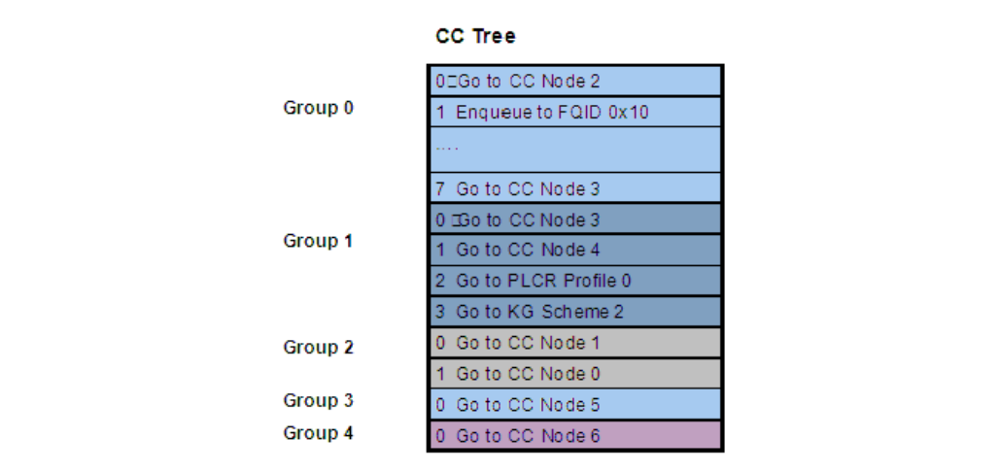

**Figure 96. CC Root - ví dụ 5 nhóm**

Khi xây CC Root, người dùng phải chỉ định số lượng và kích thước các nhóm. Sau đó, với mỗi nhóm, một mảng tham số theo từng root-node được truyền vào. Mảng được sắp xếp theo bảng trên.

Một cách đơn giản để dùng CC là định nghĩa tới 16 nhóm khác nhau, mỗi nhóm một root-node. Theo cách này, mọi traffic từ một Keygen scheme cụ thể đều tới cùng một nhóm, là một node duy nhất, và không unit NetEnv nào được chọn. Nhóm 3 và 4 trong hình trên là ví dụ về nhóm một root.

Hình sau cho thấy việc dùng kết hợp các unit NetEnv trong Keygen và Custom Classifier, dựa trên các ví dụ NetEnv và Keygen scheme trước đó.

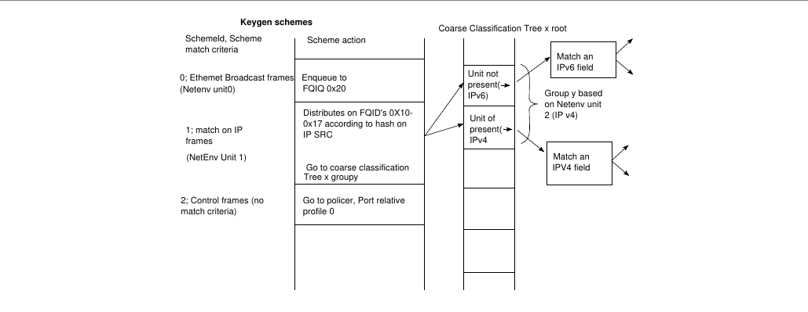

**Figure 97. Ví dụ Keygen -> Custom Classifier**

Khi một CC root hoặc node được khởi tạo, driver trả về một handle lần lượt tới root hoặc node đó. Handle này có thể được dùng sau để chỉ định root hoặc node. Ví dụ, để xây một root, các node được chỉ định bằng cách truyền handle của chúng, và một root handle phải được truyền khi định nghĩa một cổng dùng Custom Classifier. Một cổng chỉ có thể được bind với một root, thuộc cùng partition và NetEnv với cổng.

**Thay đổi lúc chạy**: Các node Custom Classifier có thể được sửa bằng một trong các routine được liệt kê trong "Available API" dưới đây.

Custom Classifier Root không thể được thay đổi lúc chạy. Có thể định nghĩa node và root mới và xóa các node, root không dùng bất kỳ lúc nào.

**API có sẵn**:

- `FM_PCD_MatchTableSet`
- `FM_PCD_MatchTableDelete`
- `FM_PCD_HashTableSet`
- `FM_PCD_HashTableDelete`
- `FM_PCD_CcRootBuild`
- `FM_PCD_CcRootDelete`

**API lúc chạy cụ thể:**

- `FM_PCD_CcRootModifyNextEngine`
- `FM_PCD_MatchTableModifyNextEngine`
- `FM_PCD_MatchTableModifyMissNextEngine`
- `FM_PCD_MatchTableRemoveKey`
- `FM_PCD_MatchTableAddKey`
- `FM_PCD_MatchTableModifyKey`
- `FM_PCD_MatchTableModifyKeyAndNextEngine`
- `FM_PCD_MatchTableFindNModifyNextEngine`
- `FM_PCD_MatchTableFindNRemoveKey`
- `FM_PCD_MatchTableFindNModifyKeyAndNextEngine`
- `FM_PCD_MatchTableFindNModifyKey`
- `FM_PCD_HashTableAddKey`
- `FM_PCD_HashTableRemoveKey`
- `FM_PCD_HashTableModifyNextEngine`
- `FM_PCD_HashTableModifyMissNextEngine`

**Node Match-Table**

Driver định nghĩa hai loại node Match-Table - node Exact-Match và node Indexed-Lookup. Trên cả hai loại node, một bảng mục được định nghĩa, trong đó mỗi mục dẫn tới một next-engine được chọn với một action được chọn. Next-engine có thể là một CC Node khác, một Keygen scheme, một Policer profile hoặc một action enqueue tới một queue QM. Trong trường hợp cuối, queue có thể là một Fqid (frame queue id) đã được định nghĩa trước - thường là bởi Keygen, hoặc một Fqid mới được chỉ định tường minh, ghi đè mọi lựa chọn Fqid trước đó.

Khác biệt giữa hai loại node là ở cách chọn một mục trong bảng của node.

Trên một node exact-match, người dùng định nghĩa việc trích dữ liệu lấy từ frame hoặc Internal-Context. Bảng mục biểu diễn các giá trị (key) khả dĩ khác nhau cho phép trích này, sao cho với mỗi key một next-action được chọn. Một mục 'MISS' bổ sung cũng được chỉ định.

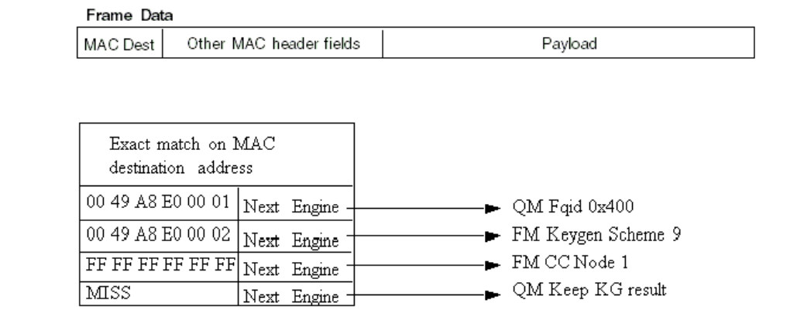

**Figure 98. Ví dụ node Exact-Match**

Trên một node Indexed-lookup, có thể định nghĩa tới 2^12 mục. Người dùng chọn 12 bit trong Internal Context làm chỉ số tới một mục trong bảng. 12 bit có thể được mask để chọn ít bit hơn và bảng nhỏ hơn.

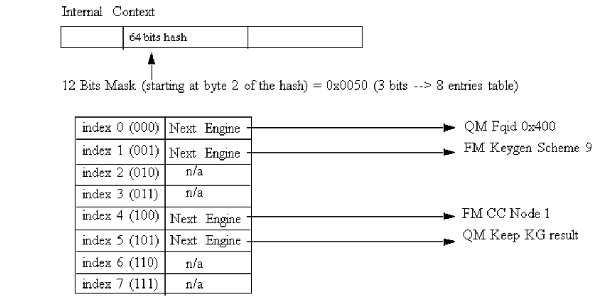

**Figure 99. Ví dụ node Indexed-Lookup**

Có hai phương pháp cấp phát CC node: động và tĩnh. Chế độ tĩnh được tạo ra để ngăn việc alloc/free bộ nhớ FMan (MURAM) lúc chạy, điều có thể gây phân mảnh; ở chế độ này, driver tự động cấp phát bộ nhớ theo số key tối đa, như nhận từ người dùng. Driver tính kích thước bộ nhớ tối đa có thể dùng cho CC node này, có xét đến việc có cần key mask không và chế độ thống kê của node.

Ở chế độ động, số key tối đa không được cung cấp (bằng không). Lúc khởi tạo, mọi cấu trúc cần thiết được cấp phát theo số key hiện tại. Trong lúc sửa đổi lúc chạy, các cấu trúc này được cấp phát lại theo số key đã cập nhật.

**Node Hash-Table**

Node Hash-Table là một Hash table do driver quản lý. Nó được định nghĩa là một next engine và có thể theo sau các CC node khác. Module Hash-Table dùng các cấu trúc CC mức thấp hơn của driver và cung cấp một API lớp trừu tượng gồm các routine AddKey/RemoveKey. Bằng cách dùng module này, người dùng có thể dễ dàng dùng một hash table dựa trên việc trích key và tính hash của Keygen. Khi khởi tạo node này, người dùng nên định nghĩa các tham số về key cơ bản dùng để hash và cấu trúc cùng kích thước của hash table (set/way).

**Manipulation**

Về khía cạnh cấu trúc, các Manipulation node không phải là node của đồ thị theo nghĩa chúng không ảnh hưởng tới flow của frame, và thực tế chúng không phải là điểm nối của đồ thị. Các Manipulation node được định nghĩa là phần mở rộng của các CC node hiện có thuộc mọi loại. Bất kỳ key nào trên bất kỳ CC node nào cũng có thể có một đặc tả manipulation bên trên định nghĩa next engine. Điều này được thực hiện bằng tham số CC node `h_Manip`, là một handle tới một Manipulation node đã được khởi tạo trước đó (theo nguyên tắc từ dưới lên). Bản thân Manipulation node không có định nghĩa next engine và flow của frame được xác định bởi CC node cuối cùng.

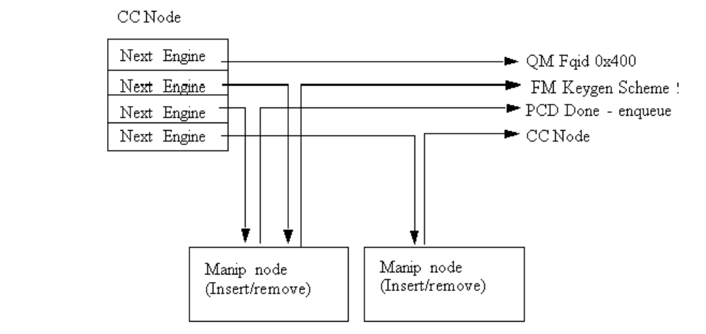

**Figure 100. CC Node có Manipulation**

**API có sẵn**:

- `FM_PCD_ManipNodeSet`
- `FM_PCD_ManipNodeDelete`

**API lúc chạy cụ thể:**

- `FM_PCD_ManipNodeReplace` (chỉ có cho Header-manipulation)
- `FM_PCD_ManipGetStatistics`

**Ghi chú:**

- Với mọi loại manipulation dưới đây, người dùng phải gọi 'FM_PCD_SetAdvancedOffloadSupport' trước khi gọi '`FM_PCD_Enable`'.
- Với mỗi RX/OP-Port sẽ làm việc với FM-PCD ở trên, người dùng nên có ít nhất 16 tnum (số task). Để đặt tnum, người dùng nên gọi '`FM_PORT_ConfigNumOfTasks`'.
- Cũng cần đặt các giao dịch DMA theo từng cổng bằng cách gọi '`FM_ConfigDmaAidOverride`' với 'FALSE' và gọi '`FM_ConfigDmaAidMode`' với '`e_FM_DMA_AID_OUT_PORT_ID`'

**Header Manipulation**

Header manipulation được triển khai bởi khối bộ điều khiển FMan, và được thiết kế để thay đổi header của frame đến theo yêu cầu của flow termination hoặc interworking. Việc sửa header có thể được cấu hình theo từng flow hoặc cho một nhóm flow do người dùng xác định.

Firmware định nghĩa một số cấu trúc header manipulation chứa tham số để định nghĩa action header manipulation. Nó định nghĩa một table descriptor cơ bản (Header Manipulation Table Descriptor HMTD) và một bảng lệnh (HMCT), cho phép thực hiện một chuỗi manipulation. Bảng lệnh có thể nằm trong bộ nhớ bên trong hoặc bộ nhớ ngoài. Manipulation có thể được thực hiện ở bất kỳ giai đoạn nào của quá trình Custom Classifier. Vì manipulation thay đổi frame, quá trình cho phép parse bổ sung frame đã xử lý khi quá trình manipulation kết thúc.

Cơ chế Header Manipulation (HM) được driver coi là phần mở rộng của các Custom Classifier Node khác. Nó có thể diễn ra ở đầu, giữa hoặc cuối một đồ thị CC, nhưng không thể ảnh hưởng tới flow, tức là việc chọn next action.

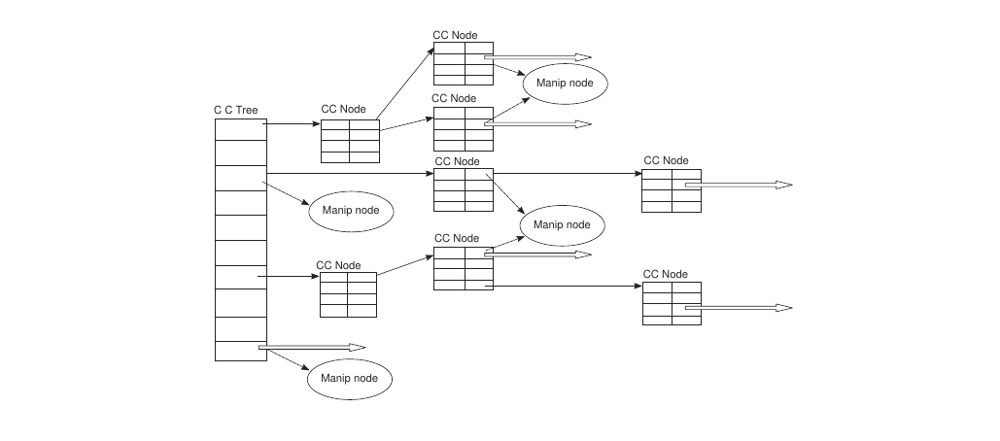

**Figure 101. Header Manipulation từ góc nhìn CC**

Action HM được biểu diễn bằng Manip node của driver, là một module con của driver (tức là được người dùng khởi tạo, routine khởi tạo của nó trả về một HM handle).

Một Header Manipulation node là một đơn vị độc lập không có thông tin bên ngoài nào về các module khác trong đồ thị PCD, người dùng của nó, vị trí của nó trong flow, hay next engine sẽ theo sau nó.

Một CC key hoặc một CC root node có thể dẫn tới một Header Manipulation node. CC key/root node sẽ định nghĩa next engine nên theo sau manipulation. Next engine có thể là Keygen, Policer, một CC node khác, hoặc kết thúc PCD (enqueue).

Để dùng HM, trước tiên người dùng nên tạo một Manip node, rồi dùng handle của nó khi định nghĩa CC Node trỏ tới action manipulation này.

Một action Header Manipulation có thể được định nghĩa là một trong các manipulation sau:

- Remove
- Insert
- Fields Update
- Custom

Cho phép nhiều hơn một manipulation chỉ khi chúng được thực hiện theo thứ tự ở trên và mỗi loại chỉ một manipulation.

Các thứ tự khác hoặc một danh sách manipulation cùng loại có thể đạt được bằng cách nối chuỗi một số manipulation node qua handle `h_NextManip` của cấu trúc tham số Manipulation.

Các HM node có thể được dùng chung, sao cho cùng một HM handle có thể được truyền cho nhiều hơn một CC key.

Theo mặc định, mỗi frame quay lại parser để được parse lại sau manipulation. Tuy nhiên hành vi này có thể bị tắt và có thể ảnh hưởng tới hiệu năng như sẽ được giải thích trong ghi chú hạn chế dưới đây. Nó được điều khiển bởi các tham số của Header Manipulation node.

Tùy chọn parse áp dụng cho bất cứ thứ gì người dùng khởi tạo làm một Manip node - tức là nếu node chứa một số lệnh, việc parse có thể được thực hiện sau mọi lệnh chứ không giữa chúng. Tuy nhiên, nếu tập lệnh được khởi tạo thành một số node được nối chuỗi với nhau, parser có thể được chạy sau mỗi node.

Driver nhằm tối ưu hiệu năng và việc tận dụng MURAM. Nó làm vậy bằng cách tạo bên trong một bảng lệnh duy nhất cho các node được nối chuỗi. Lưu ý rằng tối ưu này KHÔNG khả thi nếu cần parse giữa các manipulation, và trong trường hợp này các manip node được xếp tầng.

Lưu ý rằng khi các manipulation được nối chuỗi, một số hạn chế được áp dụng:

1. Việc dùng chung các node được nối chuỗi chỉ khả thi ở đầu của manipulation chứ không ở các node bên trong, tức là toàn bộ manipulation được dùng chung chứ không phải từng phần của nó.
2. Khi cần parse giữa các manip node, tối ưu mô tả ở trên KHÔNG khả thi và trong trường hợp này các manip node được xếp tầng.
3. Khi cần parse giữa các manip node, next engine của CC node cuối cùng KHÔNG được là một CC node khác; tức là các node được nối chuỗi có parse ở giữa chỉ có thể tồn tại ở cuối (chứ không ở giữa) đồ thị CC.

**IP Reassembly**

FM hỗ trợ IP reassembly cho cả IPv4 và IPv6. FMan tích lũy các IP fragment cho đến khi nhận đủ để tái tạo hoàn chỉnh datagram ban đầu. IP Reassembly hỗ trợ tối đa 16 fragment mỗi frame. Mỗi fragment phải nằm trong một buffer duy nhất (không nằm trong frame Scatter/Gather).

Driver IP Reassembly dùng tài nguyên FMan Controller và FMan PCD để cung cấp một giải pháp IP Reassembly đầy đủ.

Giao diện của driver không giống hệt các tài nguyên phần cứng và cung cấp một lớp trừu tượng cho các tài nguyên phần cứng. Mọi cấu trúc dữ liệu phần cứng IP Reassembly dùng cho manipulation IP reassembly được biểu diễn bởi Custom Classifier Manipulation node phần mềm. Bên trên CC Manipulation, driver định nghĩa bên trong các tài nguyên khác cần cho toàn bộ flow.

**Flow IP Reassembly**

Các fragment đến trên một FMan Port Rx (hoặc offline parsing) được cấu hình hỗ trợ IP Reassembly được phần mở rộng software parser nhận diện và đánh dấu. Các frame này được lái tới các scheme trực tiếp của Keygen và được bắt bởi các scheme chuyên dụng chuyển chúng tới Custom Classifier. Object CC Root được cấu hình sao cho các IP fragment sẽ tới một root entry node chuyên dụng chứa một CC manipulation node. Tại điểm này, IP Reassembly được thực hiện. Khi một frame đầy đủ được gom xong, nó được bộ điều khiển FMan chuyển trở lại parser dưới dạng một frame đã reassemble hoàn chỉnh. Sau đó nó được chuyển tới Keygen và có thể được phân phối và phân loại như mọi frame khác.

**Người dùng nên làm gì?**

Trình tự sau mô tả các bước người dùng phải thực hiện để flow ở trên hoạt động.

- Khởi tạo DPAA chung (BM, BM Portal, BM Pool, QM, QM Portal, FMan và FMan PCD)
- Khởi tạo FMan Port Rx/Offline mà reassembly sẽ chạy trên đó
- Định nghĩa PCD như sau:
  - Đặt một Network Environment với một trong các tùy chọn sau:
    - Unit `HEADER_TYPE_IPV4` với option `IPV4_FRAG_1` cho manipulation reassembly IPv4.
    - Unit `HEADER_TYPE_IPV6` với option `IPV6_FRAG_1` cho manipulation reassembly IPv6.

    Lưu ý rằng nếu người dùng cần các unit IPv4 hoặc IPv6 cho mục đích khác, các unit fragmentation không thể được dùng chung và phải định nghĩa các unit chuyên dụng.

  - Cấp phát một hoặc hai scheme đầu tiên - một nếu chỉ dùng IPv4, 2 nếu dùng cả IPv6. Người dùng không nên cấu hình các scheme đó, chỉ giữ chúng lại không cho mục đích khác dùng. Driver sẽ dùng scheme thứ nhất cho IPv4, và nếu cần, sẽ dùng scheme thứ hai cho IPv6.
  - Tạo manipulation reassembly bằng routine `FM_PCD_ManipNodeSet`. Truyền id tương đối của các scheme đã cấp phát ở trên (nên tạo một module manipulation duy nhất cho cả frame phân mảnh IPv4 và IPv6, truyền mọi tham số liên quan).
  - Nếu dùng CC, người dùng có trách nhiệm để lại hai mục không dùng khi xây các CC root node (tức là tổng số mục giữa mọi nhóm không được vượt quá 14).
  - Đặt ít nhất một scheme để bắt các frame thông thường/đã reassemble.
- Khi bind FMan Port Rx/Offline với các thuộc tính PCD (tức là gọi `FM_PCD_SetPCD`), truyền một handle tới Reassembly Manipulation node đã tạo.

Lưu ý rằng để thực hiện phân phối hoặc phân loại trên các frame IPv4/IPv6 (không liên quan đến reassembly các fragment IPv4/IPv6), các unit IPv4/IPv6 độc lập không có option phải được định nghĩa tường minh.

**Driver làm gì?**

Để cung cấp hỗ trợ cần thiết cho IP Reassembly, driver thực hiện một số hành động bên trong được kích hoạt bởi cấu hình của người dùng. Thông tin sau mô tả các hành động driver thực hiện bên trong và không có ý nghĩa chức năng với người dùng:

- Khi cần reassembly, driver bật bên trong việc parser nhận diện IPv4/IPv6 và shim2 - là phần mở rộng IP Reassembly. Việc này được kích hoạt khi người dùng định nghĩa các unit NetEnv với option: `IPV4_FRAG_1/IPV6_FRAG_1`.
- Driver nạp software parser nhận diện các IP fragment và bật hoạt động của nó cho FMan Port cần thiết.
- Driver định nghĩa một hoặc hai (một cho mỗi phiên bản IP) Keygen scheme nhận diện các IP fragment và được lập trình để tạo một IP Reassembly key. Khi một frame được nhận diện là IP fragment (bởi Parser), nó được lái tới các Keygen scheme này. Người dùng nên cấp phát một hoặc hai (cho IPv4 và/hoặc IPv6) scheme đầu tiên và truyền id tương đối của chúng cho driver. Driver sẽ khởi tạo bên trong các reassembly scheme liên quan khi cần.
- Mỗi scheme ở trên được driver lập trình để trỏ tới một nhóm trong Custom Classifier Root. Nếu người dùng chưa tạo CC Root, driver tạo bên trong một CC Root mới. Trong cả hai trường hợp, driver tạo (các) nhóm cần thiết trong CC Root. Nó luôn dùng hai nhóm cuối. Người dùng có trách nhiệm để có ít nhất hai mục trống (một cho một phiên bản IP, hai cho cả hai).
- Driver gắn chuỗi Manipulation (do người dùng tạo) vào root entry node thích hợp trong CC Root, gây ra việc reassembly các IP fragment.

**Ghi chú:** Mã software parser cần để hỗ trợ reassembly không thể cùng tồn tại với mã software parser của người dùng. Nếu người dùng cung cấp mã software parser IPv4 hoặc IPv6, nó phải bao gồm mã xử lý reassembly IPv4/IPv6 theo đặc tả bộ điều khiển FMan.

Gợi ý cách dùng IPR trong một hệ thống

PCD có IPR nên nhận diện frame tới L3; tức là frame có phải IP hay không.

Trong trường hợp không phải IP frame, nó nên đi qua PCD mong muốn. Các IP frame nên đi qua quá trình reassembly rồi được hướng tới OP-Port để được phân loại theo L3 trở lên của chúng.

**IP Fragmentation**

FMan hỗ trợ IP fragmentation cho cả IPv4 và IPv6. Cơ chế fragmentation được triển khai bởi PCD, cụ thể là bởi Custom Classifier. IP fragmentation có thể được thực hiện bằng một FMan Port Offline Parsing với một cấu hình PCD cụ thể sẽ được mô tả trong mục này.

Driver phần mềm cung cấp API để khởi tạo cơ chế IP fragmentation. Giao diện của driver không giống hệt các tài nguyên phần cứng và cung cấp một lớp trừu tượng cho các tài nguyên phần cứng. Cả hai bảng AD (action descriptor) dùng cho manipulation IP fragmentation được biểu diễn bởi các node Custom Classifier phần mềm dùng CC Manipulation. Manipulation IP Fragmentation được dùng để phân mảnh frame IPv4 và IPv6 theo một MTU cụ thể. Manipulation này chỉ có thể được dùng trên các cổng Offline Parsing và như một phần định nghĩa PCD của cổng. Các CC Node nên có đặc tả manipulation IP fragmentation để kích hoạt manipulation này. Điều này nghĩa là để tạo và khởi tạo phần cứng IP fragmentation, người dùng nên tạo một Custom Classifier Node có Manipulation (tham khảo Mục " Custom Classifier Root "). Mọi tham số liên quan như MTU được định nghĩa trong lúc tạo module này.

Sau đây là trình tự nên tuân theo:

- Khởi tạo DPAA chung (BM, BM Portal, BM Pool, QM, QM Portal, FMan và FMan PCD)
- Khởi tạo FMan Port loại Offline Parsing
- Định nghĩa PCD fragmentation như sau:
  - Khởi tạo một Network Environment rỗng (không có unit nào)
  - Tạo manipulation fragmentation bằng routine `FM_PCD_ManipNodeSet`.
  - Tạo CC Node bằng cách gọi `FM_PCD_MatchTableSet`/`FM_PCD_HashTableSet` và gắn manipulation fragmentation đã tạo trước đó vào key mong muốn.
  - Xây một CC Root với 1 nhóm trỏ tới CC Node đã định nghĩa trước đó .
- Bind FMan Port Offline Parsing với các thuộc tính PCD bằng cách gọi `FM_PORT_SetPCD`

Các tham số manipulation

- MTU của manipulation fragmentation.
- Scratch Buffer Pool ID là một buffer pool mà quá trình fragmentation cần để bảo đảm thao tác release đúng các frame và fragment. Mọi IP Fragmentation Table Descriptor nên dùng cùng một Scratch Buffer Pool ID. Pool này không được dùng bởi bất kỳ quá trình hay engine nào khác trong hệ thống.
- Don't Fragment Action - bằng cách đặt tham số này, người dùng có thể xác định hành động cần thực hiện trong trường hợp IP packet lớn hơn MTU đã định nghĩa và bit 'Don't Fragment' (DF) của frame được đặt.

**Ghi chú:** Mã software parser cần để hỗ trợ fragmentation không thể cùng tồn tại với mã software parser của người dùng. Nếu người dùng cung cấp mã software parser IPv6, nó phải bao gồm mã xử lý fragmentation IPv6 theo đặc tả bộ điều khiển FMan.

Hạn chế:

1. Không hỗ trợ Tx confirmation.
2. Chỉ dùng buffer Bman cho các frame sẽ được phân mảnh.
3. IP-Fragmentation sẽ không hoạt động trên OP-Port có bật VSP.
4. không hỗ trợ phân mảnh các IP-fragment
5. Các gói IPv4 có trường header option được phân mảnh bằng cách sao chép mọi trường option sang mỗi fragment, bất kể giá trị của copy bit.
6. Số fragment tối đa mỗi frame là 16.

Gợi ý cách dùng IPF trong một hệ thống:

Trong trường hợp một trong các hạn chế #1-#2 3 ở trên là quan trọng, thì khuyến nghị không dùng IPF trên các OP-Port nhận frame từ GPP mà thực hiện việc đó trên chính GPP. Chúng tôi cũng khuyến nghị đặt IPF trên một OP-Port ngay trước TX-Port.

**IPSec Manipulation**

IPSec Manipulation là một instance cụ thể của special offload manipulation. Nó được thiết kế để xử lý traffic IPSec nhằm hỗ trợ các hành động sau:

- Hỗ trợ kích thước outer header thay đổi

  Người dùng nên khởi tạo một Manipulation node loại này, truyền các tham số liên quan

- Hỗ trợ cả hai phiên bản IP ipv4/ipv6 trong SA

  Người dùng nên khởi tạo một Manipulation node loại này, truyền các tham số liên quan.

- Sao chép ECN/DSCP từ IP header inner/outer sang outer/inner.

  Để dùng chức năng này, người dùng phải làm theo các bước sau:

  - Định nghĩa một Manipulation node loại này, truyền các tham số liên quan
  - Với cổng Rx/OP liên quan, định nghĩa một buffer prefix bao gồm ít nhất kết quả hash của Keygen.
  - Dùng các tham số SEC để hỗ trợ thao tác này

**Frame Replicator**

Frame Replicator (FR) được thiết kế để nhân bản các gói đến và định tuyến chúng tới các đích riêng biệt. Nó được định nghĩa là một next engine và có thể theo sau các CC node khác, tức là key Match-table, key Hash-Table hoặc một mục CC-Root.

Một Frame Replicator được tạo thành từ một nhóm member, trong đó mỗi member định nghĩa một bản sao của frame đến và một đường đi để tiếp tục.

Next engine sau FR bị giới hạn ở một trong các engine sau:

- Enqueue (PCD Termination)
- Policer
- Keygen (Direct scheme dẫn tới Policer hoặc PCD Termination)

Khi khởi tạo một FR node, người dùng phải định nghĩa số member tối đa mà node này có thể chứa. Số member thực tế có thể được sửa lúc chạy bằng cách thêm và gỡ member của nhóm FR.

Việc sửa đổi lúc chạy để thêm/gỡ member vào/khỏi nhóm có thể được thực hiện tại bất kỳ thời điểm nào trong hệ thống và ở bất kỳ vị trí nào của nhóm member (đầu, giữa hoặc cuối). Lưu ý rằng sửa đổi lúc chạy đòi hỏi dùng Host Command.

Thứ tự các member trong nhóm có ý nghĩa vì việc nhân bản được triển khai tuần tự.

Manipulation có thể được áp dụng cho:

1. Toàn bộ nhóm. Manipulation node nên được đặt trước nhóm nhân bản. Điều đó nghĩa là FR là next-engine của Manip node. Manip node là next-engine của một key trong Match-table hoặc Hash-table.
2. Member cuối cùng của một nhóm FR. Điều đó nghĩa là manip node là next-engine của member cuối cùng của nhóm FR.

**Ghi chú:** Không hỗ trợ Manip node sau các member "không phải cuối".

Driver hỗ trợ dùng chung FR node, nghĩa là nhóm FR có thể được nhiều hơn một nguồn dùng chung.

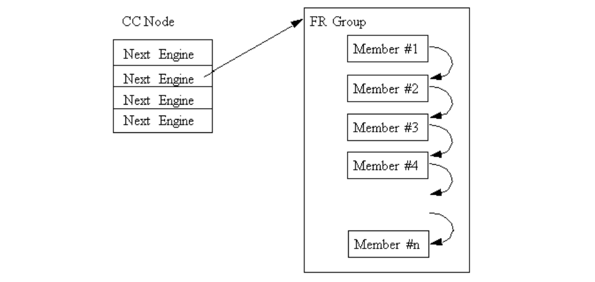

**Figure 102. Frame Replicator theo sau một CC Node**

**API có sẵn**:

- `FM_PCD_FrmReplicSetGroup`
- `FM_PCD_FrmReplicDeleteGroup`

**API lúc chạy cụ thể:**

- `FM_PCD_FrmReplicAddMember`
- `FM_PCD_FrmReplicRemoveMember`

**Ghi chú:**

- Với mọi loại manipulation dưới đây, người dùng phải gọi `'FM_PCD_SetAdvancedOffloadSupport'` trước khi gọi `'FM_PCD_Enable'`.
- Với mỗi RX/OP-Port sẽ làm việc với FM-PCD ở trên, người dùng nên có ít nhất 16 tnum (số task). Để đặt tnum, người dùng nên gọi '`FM_PORT_ConfigNumOfTasks`'.
- Cũng cần đặt các giao dịch DMA theo từng cổng bằng cách gọi '`FM_ConfigDmaAidOverride`' với 'FALSE' và gọi '`FM_ConfigDmaAidMode`' với '`e_FM_DMA_AID_OUT_PORT_ID`'

**Policer Profile**

Thực thể policer profile dựa vào thực thể phần cứng. Nó định nghĩa các quy tắc policing cho một flow nhất định. Có 256 profile khác nhau trong một frame manager, có thể được tổ chức thành các cửa sổ theo từng cổng. Một số profile có thể được dùng chung giữa các cổng trên cùng PCD. Theo mặc định, số profile dùng chung do driver đặt, nhưng người dùng cũng có thể cấu hình nó thành giá trị khác. Các profile dùng chung thường được dùng để gộp.

Khi một PCD được định nghĩa trong môi trường một partition, nó sở hữu cả 256 profile. Khi một PCD được định nghĩa trong môi trường nhiều partition, nó sở hữu các profile dùng chung của nó cùng mọi profile sẽ được cấp theo từng cổng cho các cổng trên partition này. Người dùng phải cấp phát tường minh các profile theo từng cổng cho mỗi cổng (nếu cần), sau khi PCD được khởi tạo và trước khi khởi tạo profile. Lưu ý rằng profile theo từng cổng là tài nguyên PCD duy nhất được cấp phát và khởi tạo tường minh cho một cổng cụ thể.

Sau khi các profile được ánh xạ, người dùng có thể khởi tạo từng profile bằng cách nêu những điều sau:

- Loại
  - Dùng chung
  - Per-port
- Offset tương đối so với cổng hoặc với nhóm profile dùng chung
- Đặc tính

Khi đã khởi tạo, một handle được gán cho profile để dùng sau.

Policer có thể được dùng sau Parser, Keygen hoặc Custom Classifier, hoặc dùng riêng - không kích hoạt bất kỳ PCD engine nào khác. Nó không phụ thuộc vào bất kỳ output nào trước đó như kết quả parser. Policer có thể được dùng nhiều hơn một lần trong một frame flow. Next action sau một police profile là hoặc chuyển frame tới một direct Keygen scheme để phân phối mới (thường cho các frame điều khiển đến từ Custom Classifier), hoặc chuyển frame tới một profile khác (luôn là profile dùng chung, thường là bộ gộp), hoặc enqueue frame vào một FQID.

Khi các engine khác chọn một policer profile làm next engine, handle của nó phải được truyền vào. Ngoại lệ là khi một profile theo từng cổng được chỉ định làm next engine của một scheme hoặc của một CC key "overrideParams". Trong những trường hợp này thay vào đó cần một chỉ số tương đối theo cổng. Lý do là Policer Profile cần thiết có thể chưa được khởi tạo ở giai đoạn này và vì vậy chưa có handle. Hành vi bất thường này là do CC Root và KG scheme có thể được các cổng dùng chung, và tại thời điểm khởi tạo scheme/root, chúng chưa được bind với các cổng cụ thể. Trong ngữ cảnh này, profile được chọn thực tế có thể chưa được khởi tạo và vì vậy driver không thể kiểm chứng. Do đó người dùng có trách nhiệm bảo đảm nó được đặt trước khi bind port- PCD.

**Thay đổi lúc chạy:** Các profile hợp lệ có thể được sửa lúc chạy bằng cách gọi routine khởi tạo profile cho một profile hiện có, truyền profile handle như được trả về bởi routine khởi tạo ban đầu, và chỉ định modify (thay vì id tương đối của profile). Có thể đặt profile mới và xóa các profile không dùng bất kỳ lúc nào.

**API có sẵn:**

- `FM_PCD_PlcrProfileSet`
- `FM_PCD_DeleteProfilePlcr`

**Tổ chức PCD**

Bằng cách khởi tạo các tài nguyên PCD, người dùng tạo ra một đồ thị có hướng trong đó parser là nguồn của đồ thị và các FQID là các điểm cuối. Hình sau cho thấy một ví dụ tổng quát của một đồ thị PCD cơ bản.

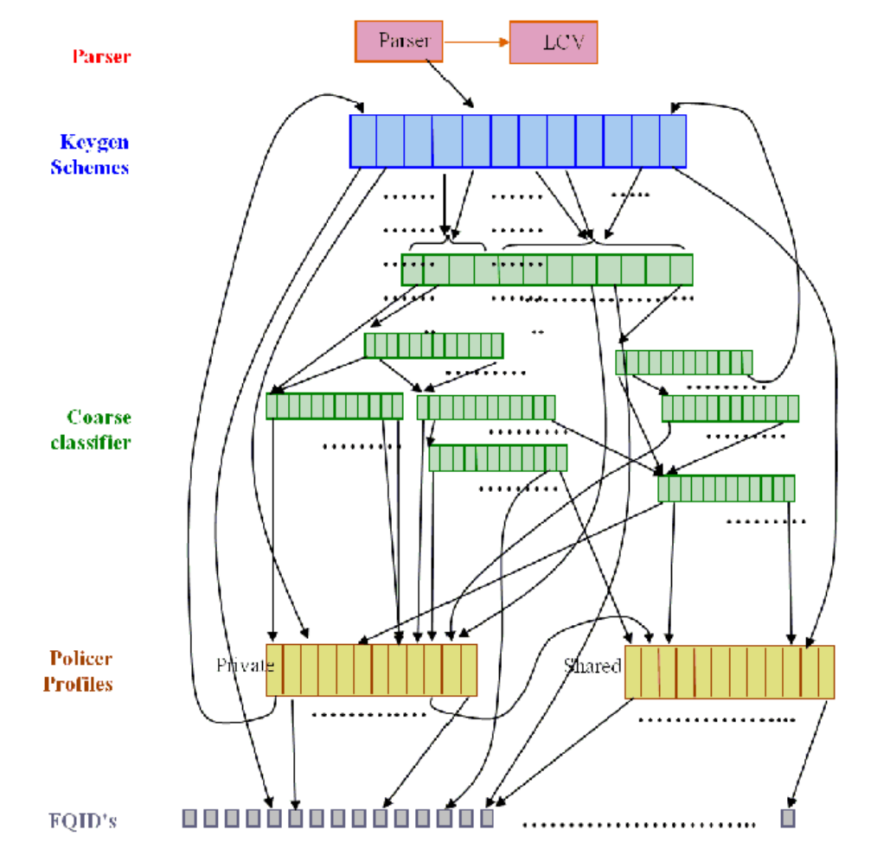

**Figure 103. Tổ chức PCD**

**Trình tự định nghĩa PCD**

Khi một đồ thị PCD được định nghĩa, các tài nguyên của nó phải được khởi tạo từ dưới lên khi có phụ thuộc giữa chúng. Hình sau cho thấy thứ tự khởi tạo (bắt đầu từ đầu hình) theo một trình tự cụ thể.

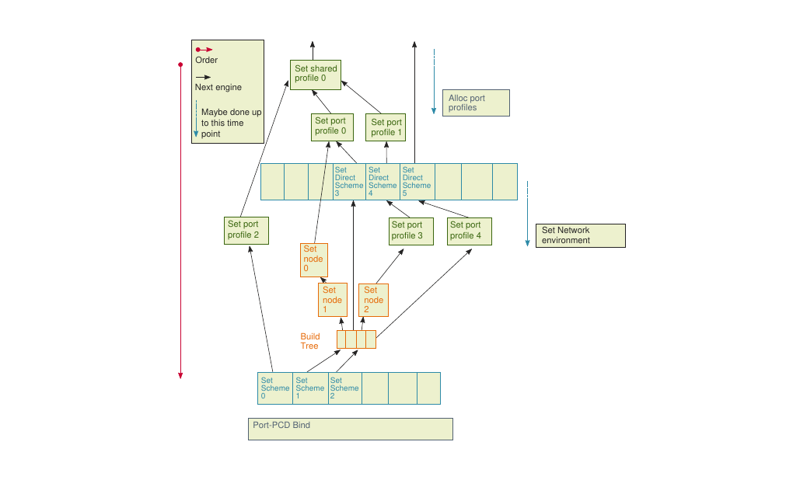

**Figure 104. Trình tự định nghĩa**

**Host Command**

Một số chức năng PCD có thể được quản lý hoặc bằng các thanh ghi memory-mapped hoặc bằng cơ chế host command để cho phép lập trình độc lập trong môi trường nhiều partition. Trong môi trường một partition trong driver FMan, cơ chế host command được dùng tùy chọn, nhưng trong môi trường nhiều partition, ở bất cứ đâu có sẵn, chỉ host command được dùng để tránh nguy cơ race. Driver host command là một phần của driver PCD và được driver khởi tạo bên trong, dùng các tham số của người dùng.

Khi PCD được khởi tạo lần đầu trong môi trường một partition, người dùng phải chỉ định có nên dùng host command hay không, và nếu có, cần các tham số host command. Trong môi trường nhiều partition, việc dùng host command là bắt buộc và cần mọi tham số host command. Khi routine khởi tạo PCD được gọi bởi driver master/single partition, các tham số của người dùng bao gồm các tham số cổng host command (như port id, virtual address và default queue) và FMan Port cho host command được khởi tạo bên trong.

**Thống kê PCD**

FMan PCD API cung cấp quyền truy cập mọi thống kê do phần cứng các engine FMan PCD thu thập. Thống kê được bật theo mặc định nhưng có thể được tắt/bật lúc chạy bằng API chuyên dụng.

Các routine API sau có thể được gọi bất kỳ lúc nào sau khi khởi tạo để lấy bất kỳ counter FMan PCD nào sau đây:

- `FM_PCD_GetCounter`
- `FM_PCD_KgSchemeGetCounter`
- `FM_PCD_PlcrProfileGetCounter`

**Thống kê Custom Classifier**

Một CC node hỗ trợ thu thập thống kê theo từng key. Để bật việc thu thập thống kê bởi một CC node (Match table hoặc Hash table), chế độ thống kê phải được cung cấp khi khởi tạo node đó và điều này sẽ quyết định chế độ thống kê cho mọi key của CC node.

Tiếp theo, thống kê nên được bật theo từng key, nghĩa là thống kê nên được bật cho mọi key mà người dùng muốn giám sát.

Sau các bước này, các routine API sau có thể được gọi để lấy thống kê:

- `FM_PCD_MatchTableGetKeyCounter`
- `FM_PCD_MatchTableGetKeyStatistics`
- `FM_PCD_MatchTableFindNGetKeyStatistics`
- `FM_PCD_HashTableFindNGetKeyStatistics`

##### 8.2.5.2.8 FMan Port Driver

Module driver FMan Port nói về các tính năng theo từng cổng của FMan, bao gồm cấu hình và khởi tạo cổng, các chức năng lúc chạy và việc bind PCD.

###### 8.2.5.2.8.1 Tổng quan phần cứng FMan Port

Phần cứng FMan hỗ trợ một số lượng FMan Port inline và offline tùy SoC thuộc các loại sau:

- Các cổng 1G Rx
- Các cổng 1G Tx
- Các cổng 10G Rx (có thể bị loại bỏ trên một số SoC)
- Các cổng 10G Tx
- Các cổng Offline/Host-command

Cấu hình cổng được điều khiển qua một tập thanh ghi memory mapped theo từng cổng, phụ thuộc loại cổng. Tức là mỗi cổng có vùng memory map riêng. Ngoài ra, một số thanh ghi FMan chung cũng ảnh hưởng tới hành vi của cổng - ví dụ, các tài nguyên toàn cục như số task được khai báo trong các thanh ghi chung.

**Trừu tượng hóa phần mềm của FMan Port Driver**

Module FMan Port là một module độc lập. Khi cấu hình cổng, người dùng chọn loại và chế độ của mỗi cổng (Tx/Rx, 1G/10G, online/offline/Host command, regular/independent), và chỉ định chỉ số cổng tương đối theo loại của nó. Chỉ số này không liên quan đến port id phần cứng như mô tả trong đặc tả phần cứng.

Driver cung cấp lớp trừu tượng cho sự phân chia chung/riêng của vị trí thanh ghi trong memory map. Tức là mọi thanh ghi liên quan về mặt logic tới cổng đều được driver FMan Port xử lý, ngay cả khi về mặt vật lý chúng thuộc memory map FMan chung.

###### 8.2.5.2.8.2 Cách dùng FMan Port Driver?

Các mục sau cung cấp thông tin thực tế về cách dùng các driver phần mềm.

**Phạm vi của FMan Port Driver**

- Cấu hình và bật các cấu trúc phần cứng FMan Port
- Cấp phát và quản lý tài nguyên
- Hỗ trợ các loại cổng FMan
- Các cổng Offline-Parsing
- Independent-Mode
- Chế độ BMI-to-BMI đơn giản (thông thường)
- Bind PCD
- Giới hạn tốc độ
- Xử lý interrupt
- Hỗ trợ thống kê

**Trình tự của FMan Port Driver**

- Routine FMan Port Config
- \[Tùy chọn\] Các routine cấu hình nâng cao FMan Port
- Routine FMan Port Init
- Các routine lúc chạy của FMan Port
- Routine FMan Port Free

**Mô tả chức năng của FMan Port Driver**

Các mục sau mô tả các chức năng chính của driver và cách dùng chúng.

**Cấu hình và khởi tạo FMan Port**

Khi khởi tạo driver FMan Port, phần mềm cấu hình mọi thanh ghi FMan Port. Nó cung cấp giá trị mặc định ở những nơi không có giá trị nào khác được chỉ định, nó bật các cơ chế phần cứng và khởi tạo các cấu trúc dữ liệu phần mềm cho việc quản lý bằng phần mềm.

Khi khởi tạo xong, FMan đã sẵn sàng để dùng và bất kỳ module con nào của FMan (FMan-Port, MAC, v.v.) đều có thể được khởi tạo.

**Các loại FMan Port**

Driver cung cấp API để khởi tạo các loại/chế độ cổng sau:

- Cổng Tx 1G
- Cổng Tx 1G - chế độ independent
- Cổng Rx 1G
- Cổng Rx 1G - chế độ independent
- Cổng Tx 10G
- Cổng Tx 10G - chế độ independent
- Cổng Rx 10G
- Cổng Rx 10G - chế độ independent
- Cổng Offline Parsing

Driver cũng giữ bên trong một cổng host-command duy nhất khi bắt buộc (môi trường nhiều partition) hoặc khi người dùng yêu cầu tường minh.

**Independent-Mode**

Dpaa-im là một driver Ethernet dùng Dpaa để triển khai ở chế độ independent.

Phụ thuộc:

1. Mọi driver DPAA trong kernel đều xung đột với dpaa-im, nên bị tắt trong file cấu hình kernel, danh sách như dưới đây:

CONFIG_FSL_SDK_DPA

CONFIG_FSL_SDK_FMAN

CONFIG_FSL_SDK_DPAA_ETH

CONFIG_FSL_DPAA

CONFIG_FSL_FMAN

CONFIG_FSL_DPAA_ETH

2. Linux nên được build trước khi build dpaa-im
3. dpaa-im dựa trên bản phát hành dash-lts 1812 cho linux-4.9 và linux-4.14

Build

Để build dpaa-im thành một module

cd dpaa-im

make build KERNEL_DIR=\<path-to-linux> ARCH=arm64 CROSS_COMPILE=\<arm64-toolchain>

Ví dụ, make build KERNEL_DIR=~/linux ARCH=arm64 CROSS_COMPILE=aarch64-linux-gnu-

sau khi build, bạn sẽ thấy file module "dpaa_eth_im.ko"

Ngoài ra, dùng "make clean KERNEL_DIR=\<path-to-linux> ARCH=arm64 CROSS_COMPILE=\<arm64- toolchain>" để dọn dẹp

Sử dụng

1. Firmware FMan nên được nạp trong U-Boot.
2. Khởi động Linux.
3. Trong linux, chạy lệnh "insmod dpaa_eth_im.ko", kernel sẽ in:

\[ 0.535089\] fman_im: QorIQ FMAN Independent Mode Ethernet Driver load ed

\[ 0.541782\] DEV: FM1@DTSEC3, DTS Node: fsl,dpaa:ethernet@6

4. chạy lệnh "ifconfig -a", có thể thấy ethernet dpaa-im (FM1@DTSEC3), rồi dùng nó như Ethernet thông thường.

FM1@DTSEC3 Link encap:Ethernet HWaddr 00:e0:0c:00:77:00

BROADCAST MULTICAST MTU:1500 Metric:1

RX packets:0 errors:0 dropped:0 overruns:0 frame:0

TX packets:0 errors:0 dropped:0 overruns:0 carrier:0

collisions:0 txqueuelen:1000

RX bytes:0 (0.0 B) TX bytes:0 (0.0 B)

lo Link encap:Local Loopback

inet addr:127.0.0.1 Mask:255.0.0.0

inet6 addr: ::1/128 Scope:Host

UP LOOPBACK RUNNING MTU:65536 Metric:1

RX packets:0 errors:0 dropped:0 overruns:0 frame:0

TX packets:0 errors:0 dropped:0 overruns:0 carrier:0

collisions:0 txqueuelen:0

RX bytes:0 (0.0 B) TX bytes:0 (0.0 B)

**Quản lý tài nguyên**

Các tài nguyên liên quan đến FMan Port (TNUM, DMA, FIFO, v.v.) - Các tài nguyên này được BMI dùng. Driver chọn giá trị mặc định cho các tài nguyên này nhưng chúng có thể cần được tinh chỉnh tùy ứng dụng cụ thể, dựa trên tổng số cổng được dùng và yêu cầu hiệu năng của hệ thống. Driver cung cấp một routine API `FM_PORT_AnalyzePerformanceParams` dùng cơ chế giám sát hiệu năng để xem mức sử dụng tài nguyên lúc chạy.

Driver FMan Port cấp phát tài nguyên của nó bằng cách gọi driver "front-end" của FMan. "Front-end" của FMan cấp phát tài nguyên bằng cách gọi "back-end" qua IPC nếu nó ở guest mode hoặc qua lời gọi trực tiếp nếu nó không ở master mode. Driver port không truy cập các tài nguyên đó lúc chạy; các tài nguyên chỉ được phần cứng của một cổng dùng.

Các tài nguyên liên quan đến PCD (Keygen-scheme, policer-profile, v.v.) - Trong lúc khởi tạo driver FMan-PCD trên mỗi partition, driver cấp phát mọi tài nguyên cần thiết (người dùng cấu hình được) qua lời gọi IPC tới driver "back-end". Từ điểm đó, mọi tài nguyên được xử lý cục bộ trên partition. Lưu ý rằng mọi truy cập tới các tài nguyên này vẫn được thực hiện qua host-command và điều đó bảo đảm đồng bộ đúng giữa các partition khác nhau (tức là có thể truy cập nhầm các tài nguyên này từ một partition khác trong hệ thống).

Các bảng PCD Custom-Classifier - Các bảng CC được cấp phát trên bộ nhớ MURAM. Điều này nghĩa là khi khởi tạo partition này, một phần MURAM nên được cấp cho partition (tùy partition cần bao nhiêu). Từ điểm đó, driver PCD cục bộ sẽ tự quản lý việc cấp phát MURAM.

**Hỗ trợ Virtual Storage Profile**

Một FMan Port có thể dùng Physical Storage Profile kiểu cũ hoặc các Virtual Storage Profile (VSP). Mục này sẽ bàn về việc một cổng FMan dùng VSP, còn thông tin thêm về cơ chế VSP, được driver triển khai thành thực thể riêng `FM_VSP`, có trong Section 8.2.5.2.10.

Khi người dùng muốn đặt một cổng Rx hoặc OP làm việc ở chế độ ảo hóa dùng VSP thay vì SP vật lý, người dùng nên gọi hàm cấp phát một cửa sổ storage profile (một dải VSP được cấp phát liên tục) cho một cổng. Người dùng cũng nên định nghĩa profile nào trong dải này được dùng làm SP mặc định; lưu ý rằng profile mặc định nên là một chỉ số tương đối bên trong cửa sổ đã cấp phát. Khi gọi routine cấp phát cửa sổ, driver bật chế độ ảo (tức là dùng VSP) cho cổng này, cấp phát các profile của nó và định nghĩa SP mặc định. Để chuyển hướng một gói vào một VSP nhất định, người dùng có thể đặt 'relative-VSP-id' bên trong các node của đồ thị PCD (ví dụ trong các mục match-table). Giá trị trong các node đồ thị PCD là tương đối theo cổng, nên nếu hai cổng dùng chung cùng một node đồ thị PCD (ví dụ một match-table), VSP thực tế sẽ được chọn bằng 'relative-VSP-id' cộng VSP base của cổng như trong hình dưới đây.


**Figure 105. Đồ thị FMan PCD và việc chọn VSP**

**Quy tắc và hạn chế khi dùng VSP:**

- Khi được gọi cho các cổng Rx, routine cấp phát cũng cần handle của cổng Tx ghép cặp làm tham số; driver tự động đặt cổng Tx cũng làm việc ở chế độ VSP và dùng cùng profile mặc định cho cổng này.
- Các cửa sổ Storage Profile không được chồng lấn; tức là driver không cho phép dùng chung VSP giữa các cổng FM.
- Một lời gọi routine cấp phát đòi hỏi cổng FM bị tắt. Trong trường hợp cổng Rx, cổng Tx ghép cặp cũng phải bị tắt. Khi một FM Port (có bật cơ chế VSP) được bật, ít nhất profile mặc định phải đã được khởi tạo.
- Một lời gọi routine cấp phát không thể hoàn tác, tức là không thể tắt chế độ ảo hóa.
- Số profile cần cấp phát phải là lũy thừa của 2. Ngoài ra, "base-profile" mà driver cấp phát sẽ được align theo số profile do người dùng cung cấp.
- Với FM-Port làm việc với VSP, việc phân loại của nó cũng nên dùng VSP; tức là việc phân loại (ví dụ KG scheme hoặc CC-node) KHÔNG nên cố quay về SP "vật lý" của FM-Port.
- Khi người dùng giải phóng mọi tài nguyên của cổng FM, driver tự động giải phóng cửa sổ VSP đã được cấp cho cổng này.

**Trình tự khởi tạo:**

- Khởi tạo FM Tx Port
- Khởi tạo FM Rx Port
- Cấp phát VSP cho FM Rx Port (qua đó bật chế độ ảo hóa)
- Khởi tạo VSP mặc định (xem Section 8.2.5.2.10)
- Bật các FM Port

**Trình tự giải phóng**

- Tắt các Port
- Giải phóng VSP mặc định
- Giải phóng FM Tx Port
- Giải phóng FM Rx Port

**Giới hạn tốc độ**

Driver hỗ trợ cơ chế phần cứng giới hạn tốc độ cho các cổng Tx. API lúc chạy gồm một số tham số bao gồm định nghĩa tốc độ cần thiết (tính bằng kB/s cho cổng Tx, tính bằng frame/giây cho cổng offline parsing) và nói về tốc độ dữ liệu chứ không phải line-rate.

**Chế độ BMI-to-BMI đơn giản (thông thường)**

Đây là chế độ mặc định của FMan Rx/Offline Parsing Port. Sau khi khởi tạo Port và trước khi bind Port-PCD, mọi traffic sẽ được nhận trên Rx queue mặc định. Chế độ này gọi là "BMI-To-BMI" vì không có PCD nào tham gia vào việc nhận dữ liệu.

Chế độ này hữu ích cho trạng thái ban đầu của một cổng cũng như khi có sửa đổi PCD lớn lúc chạy. Trong trường hợp đó, đôi khi toàn bộ chức năng PCD cần được thao tác và người dùng nên tạm thời gỡ Port khỏi PCD, nhận mọi frame trên Rx queue mặc định và chỉ gắn lại nó vào PCD sau khi việc sửa đổi hoàn tất.

**Port LIODN**

Một FMan Port LIODN được tạo từ một base và một offset.

Khi cấu hình FMan Port, người dùng phải chỉ định base LIODN của cổng.

Với các cổng Rx, người dùng cũng phải chỉ định LIODN offset cho mỗi cổng. Không cần cấu hình như vậy cho các cổng Tx và Offline Parsing vì khi truyền, LIODN offset được lấy từ FD của frame. FD được đặt theo nguồn của frame - nếu do CPU truyền, nó được QM SW portal đặt động. Một kịch bản khác là các frame được forward bởi các engine khác, trong trường hợp đó FD của chúng phải chứa LIODN offset đúng.

**Bind Port-PCD**

Các cổng có thể được liên kết với đồ thị PCD theo đặc tả bind PCD của chúng và có xét đến các hạn chế về partition và Network Environment.

Hình sau minh họa dạng sơ đồ việc bind port > PCD khả dĩ.

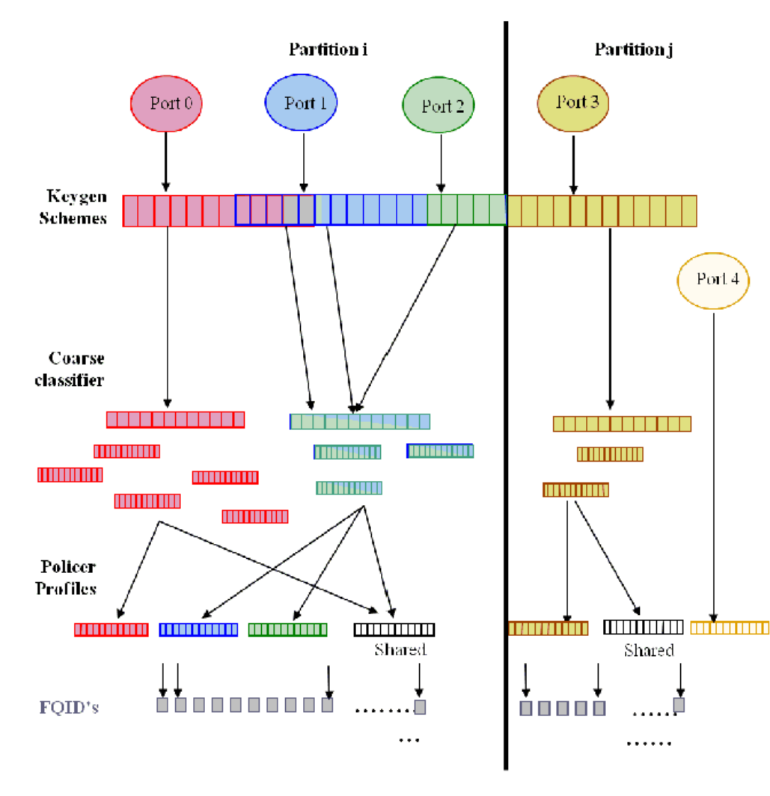

**Figure 106. Ví dụ bind Port-To-PCD**

Khi một tập tài nguyên PCD đã được đặt và tổ chức như mô tả ở trên, một cổng có thể được bind với tất cả hoặc một số tài nguyên bằng cách gọi routine `FM_PORT_SetPCD`. Routine này được gọi là routine bind Port-PCD. Nó nhận một tập tham số chỉ định các tài nguyên PCD mà cổng dùng, cấu hình các tham số liên quan đến PCD trong cổng, và bind các tài nguyên PCD với cổng. Nên gọi `FM_PORT_DeletePCD` khi cổng không còn cần chức năng PCD đã cấu hình. Hành động này được gọi là unbind Port-PCD.

Một hành động khả dĩ khác ảnh hưởng tới quan hệ Port-PCD là gọi `FM_PORT_DettachPCD` *(ghi chú: đúng là FM_PORT_DetachPCD)* cho một cổng đã được bind với PCD. Điều này khiến cổng ngừng dùng các chức năng PCD, dẫn đến mọi frame được chuyển tới FQID mặc định. Lưu ý rằng gọi `FM_PORT_DeletePCD` sẽ unbind cổng khỏi các chức năng PCD bằng cách gỡ các kết nối, trong khi `FM_PORT_DetachPCD` không gỡ chúng mà chỉ khiến cổng ngừng dùng chúng. Để quay lại dùng PCD, nên gọi `FM_PORT_AttachPCD`.

Một số sửa đổi lúc chạy không thể thực hiện trực tiếp, mà đòi hỏi hoặc unbind các chức năng PCD hoặc detach PCD. Việc này nên được thực hiện bằng cách gọi các routine delete/detach cần thiết, thực hiện các thay đổi mong muốn, và gọi set hoặc attach để quay lại dùng PCD. Các hành động này sẽ được gọi là reset/detach Port-PCD. Trong khoảng thời gian giữa các lời gọi hai routine, cổng tiếp tục hoạt động, nhưng các chức năng PCD của nó bị tắt. Trong cả hai trường hợp, mọi frame đến trong thời gian này được enqueue vào receive queue mặc định.

Trong các mục dưới đây, quan hệ giữa cổng và từng tài nguyên PCD sẽ được giải thích xét về khởi tạo và sửa đổi lúc chạy.

**Chung**

Việc bind port-PCD ảnh hưởng tới flow của các frame nhận được trên cổng đó xét về chức năng PCD. Trước tiên người dùng phải định nghĩa PCD chung cho cổng, dùng các kiểu enumeration sau, định nghĩa tập bao gồm các engine có thể được dùng.

- `e_FM_PORT_PCD_SUPPORT_PRS_ONLY` (Chỉ dùng Parser)
- `e_FM_PORT_PCD_SUPPORT_PLCR_ONLY` (Chỉ dùng Policer)
- `e_FM_PORT_PCD_SUPPORT_PRS_AND_PLCR` (Dùng Parser và Policer)
- `e_FM_PORT_PCD_SUPPORT_PRS_AND_KG` (Dùng Parser và Keygen)
- `e_FM_PORT_PCD_SUPPORT_PRS_AND_KG_AND_CC` (Dùng Parser, Keygen và Custom Classifier)
- `e_FM_PORT_PCD_SUPPORT_PRS_AND_KG_AND_CC_AND_PLCR` (Dùng mọi PCD engine)
- `e_FM_PORT_PCD_SUPPORT_PRS_AND_KG_AND_PLCR` (Dùng Parser, Keygen và Policer)

**Thay đổi lúc chạy:** Tập engine chỉ có thể được thay đổi lúc chạy bằng cách reset Port-PCD.

**API chung của Port có sẵn**:

- `FM_PORT_SetPCD`
- `FM_PORT_DeletePCD`

**Network Environment**

Khi gọi routine bind Port-PCD, người dùng phải chỉ định một NetEnv duy nhất bằng cách truyền handle của nó. Thiết lập này được dùng cho parser của cổng và ảnh hưởng tới hành vi PCD.

**Thay đổi lúc chạy:** NetEnv không thể được sửa lúc chạy. Nếu cổng cần thay đổi NetEnv, trước tiên nó phải reset kết nối Port-PCD, sau đó dùng các routine PCD để thực hiện các thay đổi cần thiết, rồi kết nối lại với PCD.

**Parser**

Cấu hình parser phần cứng của cổng được lấy trực tiếp từ NetEnv được chỉ định cho cổng. Các cấu hình parse khác được người dùng định nghĩa tường minh trong cấu trúc tham số.

Software parser có thể được dùng trên cơ sở theo từng cổng theo từng header. Khi PCD được đặt theo từng cổng, có một tùy chọn trong các tham số parser để chọn thêm tham số theo từng header. Một trong các tham số bổ sung tùy chọn theo từng header là bật software parser cho header đó. Khi được đặt, nên khai báo một chỉ số để chọn mã software parser. Header và chỉ số phải được chỉ định trong bảng label của mã software parser đã được nạp lúc khởi tạo PCD. Có thể bật software parser cho bao nhiêu header tùy cần.

**Thay đổi lúc chạy**: Chỉ điểm bắt đầu của parser có thể được thay đổi tức thời. Mọi thay đổi khác đòi hỏi reset PCD.

API Port có sẵn:

- `FM_PORT_PcdPrsModifyStartOffset`

**Keygen Scheme**

Để một cổng dùng các Keygen scheme, cổng phải được bind với các tài nguyên đó. Cổng có thể được bind với bất kỳ số scheme nào. Tại routine bind cổng, người dùng truyền một danh sách scheme handle, như được server trả về khi đặt scheme, để bind với cổng. Phải chỉ định ít nhất một scheme. Mọi scheme được chỉ định phải hợp lệ tại thời điểm đó. Nếu scheme ban đầu sau parser được dùng trực tiếp mà không dùng tiêu chí so khớp, id của nó nên được truyền làm một trong các tham số cho routine bind Port-PCD.

**Thay đổi lúc chạy**: Lúc chạy, có thể đặt scheme mới rồi bind với một cổng đang bật hiện có, hoặc sửa các scheme hiện có. Các scheme mà cổng không cần có thể được unbind. Lưu ý rằng khi sửa các scheme hiện có, mọi cổng được bind với các scheme đó đều bị ảnh hưởng. Nếu các scheme cụ thể không còn cần nữa, trước tiên chúng phải được unbind khỏi cổng. Nếu không cổng nào khác đang dùng chúng, chúng có thể được xóa. Việc chọn scheme ban đầu sau parser (từ trực tiếp sang gián tiếp và ngược lại) cũng có thể được thay đổi lúc chạy.

**API Port có sẵn**:

- `FM_PORT_PcdKgBindScheme`
- `FM_PORT_PcdKgUnbindScheme`
- `FM_PORT_PcdKgModifyInitialScheme`

**Đồ thị Custom Classifier**

Nếu một cổng dùng đồ thị Custom Classifier, một Custom Classifier Root handle đã khởi tạo (như được routine RootBuild trả về) phải được truyền khi gọi routine bind cổng.

**Thay đổi lúc chạy**: Bản thân đồ thị CC (cũng như CC Root) có thể được sửa lúc chạy, nhưng việc bind cổng với một CC Root chỉ có thể được thay đổi bằng cách detach rồi attach lại Port-PCD.

- `FM_PORT_PcdCcModifyTree`

**Policer Profile**

Trước khi đặt bất kỳ port profile nào, phải gọi routine cấp phát profile để bind cổng với policer profile. Điều này cần thiết vì việc bind cổng với policer profile không được thực hiện bằng routine bind cổng. Chỉ khi đó các profile theo từng cổng mới có thể được đặt, và sau đó routine bind cổng mới được gọi. Nếu không dùng Keygen hoặc parser (tức là policer được tới trực tiếp sau parser hoặc từ BMI), các tham số của routine bind cổng phải chỉ định policer profile nào được dùng (nếu không, không cần tham số policer nào).

**Thay đổi lúc chạy**: Việc chọn profile ban đầu có thể được thay đổi lúc chạy. Mọi profile được cấp cho một cổng thực tế đều được bind với cổng này, nên không thể bind/unbind lúc chạy. Các port profile chưa khởi tạo (profile đã được cấp cho cổng này nhưng chưa dùng) cũng có thể được đặt lúc chạy, hoặc các profile hiện có có thể được sửa. Nếu các profile cụ thể không còn cần nữa, chúng có thể được xóa. Nếu cần thay đổi việc cấp phát port profile, làm theo các bước dưới đây để reset Port-PCD:

1. Xóa Port-PCD
2. Xóa và giải phóng các profile
3. Cấp phát và đặt các profile mới
4. Đặt Port-PCD

**API Port có sẵn**:

- `FM_PORT_PcdPlcrModifyInitialProfile`
- `FM_PORT_PcdPlcrFreeProfiles`
- `FM_PORT_PcdPlcrAllocProfiles`

**Thay đổi việc bind Port-PCD**

Có ba mức thay đổi việc bind Port-PCD:

- **Thay đổi lúc chạy cơ bản -** Có thể được gọi khi PCD đang hoạt động và trên các cổng đang bật có dùng PCD.
  - Các routine của Port chịu trách nhiệm bind/unbind vào/khỏi các tài nguyên đã sửa đổi.
    - `FM_PORT_PcdKgBindScheme`
    - `FM_PORT_PcdKgUnbindScheme`
  - Các routine của Port chịu trách nhiệm thay đổi hành vi PCD.
    - `FM_PORT_PcdKgModifyInitialScheme`
    - `FM_PORT_PcdPlcrModifyInitialProfile`
    - `FM_PORT_PcdPrsModifyStartOfset`
- **Thay đổi lúc chạy kèm Port-PCD Detach -** Cho các thay đổi đòi hỏi detach kết nối Port-PCD:
  - `FM_PORT_PcdCcModifyTree`

    Với các thay đổi này, thực hiện các bước sau:

    - Detach cổng khỏi các tài nguyên PCD của nó bằng cách gọi routine Detach PCD (`FM_PORT_DettachPCD`) *(ghi chú: đúng là FM_PORT_DetachPCD)*. Sau hành động này, cổng tiếp tục hoạt động, enqueue mọi frame vào receive FQID mặc định.
    - Gọi một trong hai routine ở trên.
    - attach lại cổng vào các tài nguyên PCD bằng cách gọi lại routine set PCD (`FM_PORT_AttachPCD`).
- **Thay đổi lúc chạy kèm Port-PCD Reset -** Cho các thay đổi đòi hỏi reset việc bind port-PCD. Nên thực hiện các bước sau cho bất kỳ sửa đổi nào không được liệt kê trong hai mục trước:
  - Unbind cổng khỏi các tài nguyên PCD của nó bằng cách gọi routine delete PCD (`FM_PORT_DeletePCD`). Sau hành động này, cổng sẽ tiếp tục hoạt động, enqueue mọi frame vào receive FQID mặc định.
  - Sửa các tài nguyên PCD - tùy chọn. Thay đổi có thể chỉ ở việc bind cổng chứ không ở tài nguyên. Lưu ý rằng việc giải phóng và xóa tài nguyên, rồi cấp phát và đặt tài nguyên, phải có thứ tự, theo cùng cách như khi đặt PCD ban đầu và xóa PCD cuối cùng.
  - Bind cổng với các tài nguyên PCD bằng cách gọi lại routine set PCD (`FM_PORT_DeletePCD`) *(ghi chú: đúng là FM_PORT_SetPCD)*

Mọi routine PCD liệt kê ở trên có thể được dùng để xóa và đặt tài nguyên PCD. Hai routine sau đây được dùng nếu cần thay đổi cửa sổ port profile (Không cần các routine PORT khác vì việc bind được thực hiện bằng routine SetPCD.):

- `FM_PORT_PcdPlcrFreeProfiles`
- `FM_PORT_PcdPlcrAllocProfiles`

##### 8.2.5.2.9 FMan MAC Driver

Module driver FMan MAC nói về các chức năng của bộ điều khiển FMan MAC bao gồm cấu hình và khởi tạo cũng như hoạt động lúc chạy và điều khiển.

###### 8.2.5.2.9.1 Tổng quan phần cứng FMan MAC

Phần cứng FMan hỗ trợ một hoặc hai loại bộ điều khiển MAC - tùy SoC. Mọi SoC đều hỗ trợ giao diện bộ điều khiển Ethernet ba tốc độ (dTSEC) tới các mạng Ethernet/IEEE 802.3 10 Mbit/s, 100 Mbit/s và 1 Gbit/s, giao tiếp với môi trường truyền qua phy ngoài hoặc thiết bị SerDes. Một số SoC cũng hỗ trợ 10 Gigabit Ethernet media access controller (10GEC) giao tiếp với các mạng Ethernet/IEEE 802.3ae 10 Gbit/s qua XAUI dùng giao diện SerDes tốc độ cao.

**Trừu tượng hóa phần mềm FMan MAC**

Driver cung cấp một API duy nhất phục vụ cả hai giao diện. Nếu người dùng cố cấu hình các tính năng chỉ một trong các giao diện hỗ trợ, một thông báo "unsupported" sẽ được hiển thị.

###### 8.2.5.2.9.2 Cách dùng FMan MAC Driver?

Các mục sau cung cấp thông tin thực tế về cách dùng các driver phần mềm.

**Phạm vi của FMan MAC Driver**

Module này đại diện cho FMan MAC. Nó bao gồm:

- Cấu hình và bật các cấu trúc phần cứng FMan MAC
- Hỗ trợ lúc chạy cho bộ điều khiển FMan MAC
- Hỗ trợ PTP IEEE 1588
- MAC hash addressing
- Xử lý interrupt
- Hỗ trợ thống kê

**Trình tự của FMan MAC Driver**

- Routine FMan MAC Config
- \[Tùy chọn\] Các routine cấu hình nâng cao FMan MAC
- Routine FMan MAC Init
- Các routine lúc chạy của FMan MAC
- Routine FMan MAC Free

**Mô tả chức năng của FMan MAC Driver**

Các mục sau mô tả các chức năng chính của driver và cách dùng chúng.

**Cấu hình và khởi tạo FMan MAC**

Khi khởi tạo driver FMan MAC, phần mềm cấu hình mọi thanh ghi FMan MAC. Nếu cần, MAC có thể được reset vào lúc đó. Driver cung cấp giá trị mặc định ở những nơi không có giá trị nào khác được chỉ định, nó định nghĩa các IRQ và đặt các IRQ handle. Nó bật các cơ chế phần cứng và khởi tạo các cấu trúc dữ liệu phần mềm cho việc quản lý bằng phần mềm.

Khi khởi tạo xong, FMan MAC đã sẵn sàng để dùng và các FMan Port liên quan có thể được khởi tạo.

**Địa chỉ FMan MAC**

Khi khởi tạo MAC, người dùng phải định nghĩa một địa chỉ MAC duy nhất. Lúc chạy, driver cung cấp API để sửa địa chỉ này và thêm các địa chỉ khác (tùy hỗ trợ của phần cứng MAC cụ thể).

Ngoài ra, driver hỗ trợ thêm và gỡ địa chỉ vào cơ chế MAC hash.

**Hỗ trợ IEEE1588**

Driver cung cấp API để hỗ trợ time-stamping IEEE1588 bằng phần cứng. Để dùng tính năng này, trước tiên người dùng phải khởi tạo module FM-RTC. Chức năng IEEE1588 luôn được bật trên FM-MAC. Vì vậy, không cần thiết lập bổ sung nào cho MAC. và FM-MAC và chỉ khi đó họ mới có thể bật tính năng này bằng cách gọi routine `FM_MAC_Enable1588TimeStamp`. Khi đã bật, người dùng cũng có thể đặt exception để nhận các interrupt liên quan đến 1588 trên MAC.

**Thống kê MAC**

Driver cung cấp hỗ trợ thu thập thống kê cho mọi counter chuẩn (MIB). Với một số bộ điều khiển, cần dùng một cơ chế điều khiển bằng interrupt để tính đến việc tràn counter và để theo dõi chính xác các counter. Cơ chế này có thể ảnh hưởng phần nào tới hiệu năng, vì vậy driver hỗ trợ thu thập thống kê ở 3 mức:

- Thống kê đầy đủ - cung cấp mọi counter chuẩn nhưng có thể giảm hiệu năng.
- Thống kê một phần - chỉ cung cấp các counter sự kiện đặc biệt (lỗi, v.v.). Nếu được chọn, các counter thông thường (như byte/packet) sẽ không hợp lệ và sẽ trả về -1.
- Không thu thập thống kê.

##### 8.2.5.2.10 FMan VSP Driver

Module driver FMan VSP nói về hỗ trợ phần mềm cho cơ chế Virtual Storage Profile.

###### 8.2.5.2.10.1 Tổng quan phần cứng FMan VSP

Người dùng có thể dùng VSP cho việc ảo hóa. Nếu người dùng chạy một hệ thống nhiều partition (hoặc nhiều thực thể phần mềm) trong đó một MAC duy nhất có thể được nhiều partition/thực thể phần mềm dùng đồng thời, ngoài việc dùng FQID khác nhau (vốn đã có trong DPAA1.0), người dùng có thể dùng một VSP khác nhau cho mỗi partition/thực thể SW; theo cách đó, buffer có thể là riêng (thay vì được dùng chung như trong DPAA1.0). Nó cho phép ảo hóa việc chọn buffer pool để lưu frame (và các tham số khác liên quan đến việc lưu trong bộ nhớ ngoài) khỏi các cổng phần cứng vật lý. Bằng cơ chế này, các gói khác nhau nhận được trên cùng một cổng vật lý có thể được lưu trong các BM pool khác nhau dựa trên header của frame, theo cách tương tự việc chọn FQID. VSP thay thế cách chọn BM Pool kiểu cũ, "vật lý", theo từng cổng. Có một chế độ tương thích ngược và có thể dùng cách chọn BM Pool ban đầu, nay được gọi là "Physical SP".


**Figure 107. Ảo hóa dùng VSP**

Module FMan toàn cục phụ trách việc quản lý các mục Virtual Storage Profile. Khi khởi tạo FMan, chỉ số VSP đầu tiên dành cho partition này phải được định nghĩa (nó nên là chỉ số tuyệt đối), và cả tổng số VSP cho partition này. Sau đó, với mỗi cổng dùng VSP, nên định nghĩa một cửa sổ mục. VSP không thể được dùng chung giữa các cổng FMan.

Mỗi cổng có một VSP mặc định. Ở mỗi lần phân loại PCD, một VSP có thể được chọn. Các gói nhận được sẽ được ghi vào buffer đích theo các tham số của VSP, trong khi VSP được chọn theo header của frame và cấu hình PCD.

VSP được driver triển khai thành một thực thể riêng, tuy nhiên các module khác của driver FM biết về thực thể này và tương tác với nó. Một module FM VSP đại diện cho một storage profile duy nhất.

Module FMan toàn cục phụ trách việc quản lý các mục Virtual Storage Profile. Khi khởi tạo cổng FMan, nếu dùng chế độ VSP, nó nên cấp phát và bind với một dải VSP. Trên PCD, người dùng đưa ra quyết định ở mỗi node của đồ thị PCD là tiếp tục làm việc với VSP đã định nghĩa trước đó hay ghi đè bằng một profile mới.

###### 8.2.5.2.10.2 Cách dùng FMan VSP Driver?

VSP được driver triển khai thành một thực thể riêng, tuy nhiên các module khác của driver FM biết về thực thể này và tương tác với nó. Một module FM VSP đại diện cho một storage profile duy nhất.

Module FMan toàn cục phụ trách việc quản lý các mục Virtual Storage Profile. Khi khởi tạo cổng FMan, nếu dùng chế độ VSP, nó nên cấp phát và bind với một dải VSP. Trên PCD, người dùng đưa ra quyết định ở mỗi node của đồ thị PCD là tiếp tục làm việc với VSP đã định nghĩa trước đó hay ghi đè bằng một profile mới.

**Phạm vi của FMan VSP Driver**

Module này đại diện cho driver FMan VSP. Nó bao gồm:

- Cấu hình và bật các cấu trúc phần cứng FMan VSP
- Parse buffer
- Thống kê

**Trình tự của FMan VSP Driver**

Trình tự này bao gồm các module khác cần cho VSP

- Định nghĩa các tham số VSP chung khi khởi tạo FMan toàn cục
- Khởi tạo FM Port
- Cấp phát cửa sổ VSP cho FM Port
- Bật FM Port
- Routine FMan VSP Config (cho các VSP cụ thể)
- \[Tùy chọn\] Các routine cấu hình nâng cao FMan VSP (cho các VSP cụ thể)
- Routine FMan VSP Init (cho các VSP cụ thể)

**Mô tả chức năng của FMan VSP Driver**

Các mục sau mô tả các chức năng chính của driver và cách dùng chúng.

**Khởi tạo Virtual Storage Profile**

Các VSP phải được khởi tạo trước khi dùng. Người dùng có trách nhiệm khởi tạo ít nhất VSP mặc định cho mỗi cổng trước khi bật nó. Tương tự, họ có trách nhiệm khởi tạo mọi VSP khác trước khi bật một lần phân loại có thể dùng VSP nào đó.

Khởi tạo một VSP định nghĩa buffer BM Pool đích cho một loại gói cụ thể. Nó cũng định nghĩa cấu trúc của buffer - tức là data offset, nội dung prefix, v.v.

**Parse Virtual Storage Profile**

Khi khởi tạo VSP, người dùng định nghĩa nội dung prefix của buffer. Dựa trên các yêu cầu này, driver sau đó định nghĩa cấu trúc prefix của buffer, tức là data offset, liệu một số thông tin như parse result có nên được sao chép sang buffer ngoài không và nó sẽ nằm ở đâu. Khi nhận buffer, người dùng có thể gọi các routine VSP để lấy dữ liệu, cũng như các phần prefix của buffer như parse result, timestamp, hay output của Keygen.

##### 8.2.5.2.11 FMan RTC (IEEE 1588) Driver

Module driver FMan RTC nói về hỗ trợ phần mềm cho phần cứng IEEE 1588 của FMan.

**Ghi chú:** Kernel driver chung **Freescale QorIQ 1588 timer as PTP clock** là phương pháp được khuyến nghị để cấu hình 1588 timer. Driver này được bật theo mặc định bởi kernel config PTP_1588_CLOCK_QORIQ. Các driver FSL_DPAA_1588 và FSL_SDK_FMAN_RTC_API có mặt để duy trì tương thích ngược.

###### 8.2.5.2.11.1 Tổng quan phần cứng FMan RTC

Module 1588 timer giao tiếp với tới bốn Ethernet MAC 10/100/1000 hoặc một Ethernet MAC 10G, cung cấp thời gian hiện tại, 2 alarm và 2 bộ tạo xung tuần hoàn fiper.

###### 8.2.5.2.11.2 Cách dùng RTC Driver?

Các mục sau cung cấp thông tin thực tế về cách dùng các driver phần mềm.

**Phạm vi của RTC Driver**

Module này đại diện cho driver FMan 1588. Nó bao gồm:

- Cấu hình và bật phần cứng IEEE 1588
- Hỗ trợ cơ chế alarm
- Hỗ trợ xung tuần hoàn
- Hỗ trợ trigger ngoài
- Tinh chỉnh bù lúc chạy
- Xử lý interrupt

**Trình tự của RTC Driver**

- Routine FMan RTC Config
- \[Tùy chọn\] Các routine cấu hình nâng cao FMan RTC
- Routine FMan RTC Init
- Routine FMan RTC Enable
- Các routine lúc chạy của FMan RTC
- Routine FMan RTC Free

**Mô tả chức năng của RTC Driver**

Các mục sau mô tả các chức năng chính của driver và cách dùng chúng.

**Sử dụng module FMan RTC 1588**

Driver API cung cấp giao diện tới module phần cứng 1588. Nó khởi tạo các thanh ghi của module để định nghĩa chu kỳ clock và hỗ trợ định nghĩa các alarm và xung tuần hoàn. Lưu ý rằng khi đặt xung tuần hoàn, module RTC phải bị tắt.

**Sử dụng IEEE1588 cho time stamping frame MAC**

Một số module driver FMan tham gia vào việc kích hoạt chức năng time stamping 1588: FMan-RTC, FMan-MAC, FMan-Port và FMan-PCD.

Trình tự khởi tạo như mô tả dưới đây:

Sau khi Frame Manager được khởi tạo, FMan-RTC cần được khởi tạo bằng cách gọi (với các tham số phù hợp):

- `FM_RTC_Config`
- `FM_RTC_Init`

Tiếp theo, routine sau nên được gọi, chỉ sau khi MAC đã được khởi tạo.

- `FM_MAC_Enable1588TimeStamp`

Từ điểm này trở đi, mọi Ethernet frame trên MAC này đều được gắn timestamp. Để lấy timestamp, trong lúc cấu hình FMan Port, người dùng phải gọi routine config nâng cao:

- `FM_PORT_ConfigBufferPrefixContent` (với tham số 'passTimeStamp' được đặt).

Lúc chạy, với mỗi frame nhận được/được xác nhận, người dùng nên gọi routine sau, truyền cho nó con trỏ dữ liệu của frame:

- `FM_PORT_GetBufferTimeStamp`

Routine sẽ trả về con trỏ tới timestamp.

**Sử dụng IEEE1588 cho PTP**

Trình tự mô tả trong mục trước khiến mọi frame được FMan nhận hoặc truyền đều được gắn timestamp. Tuy nhiên, nếu người dùng muốn phân biệt PTP frame với các frame khác trên một cổng cụ thể, cần áp các quy tắc PCD lên đồ thị PCD cho cổng này; tức là dùng parser để nhận diện PTP frame rồi dùng một scheme phù hợp để phân biệt PTP frame và định tuyến chúng tới các queue đích mong muốn.

##### 8.2.5.2.12 FMan MURAM Driver

Module driver FMan MURAM nói về việc quản lý bộ nhớ của FMan Multiuser RAM.

###### 8.2.5.2.12.1 Tổng quan phần cứng FMan MURAM

MURAM là bộ nhớ bên trong của FMan.

**Trừu tượng hóa phần mềm của FMan MURAM Driver**

Driver FMan MURAM là một bộ quản lý bộ nhớ cho phép phân vùng MURAM. Khi khởi tạo, người dùng nhận một handle có thể được các module khác dùng để cấp phát và giải phóng các khối bộ nhớ trong phân vùng MURAM đó.

###### 8.2.5.2.12.2 Cách dùng FMan MURAM Driver?

Các mục sau cung cấp thông tin thực tế về cách dùng các driver phần mềm.

**Phạm vi của FMan MURAM Driver**

Module này quản lý FMan MURAM. Nó bao gồm việc cấp phát và giải phóng MURAM cho các khối bộ nhớ cần thiết có kích thước khác nhau.

**Trình tự của FMan MURAM Driver**

- Routine config và init FMan MURAM
- Các routine lúc chạy allot và free của FMan MURAM
- Routine free FMan MURAM

**Mô tả chức năng của FMan MURAM Driver**

Các driver FMan MURAM hỗ trợ cấp phát và giải phóng các khối bộ nhớ MURAM. Sau khi khởi tạo một phân vùng MURAM, người dùng thường phải truyền handle của nó cho các module driver FMan khác. Theo cách này, các module này có thể cấp phát và giải phóng các khối bộ nhớ từ phân vùng này.

##### 8.2.5.2.13 Các giao thức mạng được hỗ trợ

Các mục sau cho thấy các giao thức có thể được chọn khi định nghĩa NetEnv characteristics.

###### 8.2.5.2.13.1 Các giao thức L2

Danh sách sau cho thấy các giao thức L2:

- `HEADER_TYPE_ETH`, với hai option sau
  - `ETH_BROADCAST`
  - `ETH_MULTICAST`
- `HEADER_TYPE_VLAN`, với option sau
  - `VLAN_STACKED`
- `HEADER_TYPE_MPLS`, với option sau
  - `MPLS_STACKED`
- `HEADER_TYPE_PPPoE`
- `HEADER_TYPE_LLC_SNAP`

###### 8.2.5.2.13.2 Các giao thức L3

Danh sách sau cho thấy các giao thức L3:

- `HEADER_TYPE_IPV4`, với các option sau
  - `IPV4_BROADCAST_1`
  - `IPV4_MULTICAST_1`
  - `IPV4_UNICAST_2`
  - `IPV4_MULTICAST_BROADCAST_2`
  - `IPV4_FRAG_1`
- `HEADER_TYPE_IPV6`, với các option sau
  - `IPV6_MULTICAST_1`
  - `IPV6_UNICAST_2`
  - `IPV6_MULTICAST_2`
  - `IPV6_FRAG_1`
- `HEADER_TYPE_GRE`
- `HEADER_TYPE_MINENCAP`
- `HEADER_TYPE_USER_DEFINED_L3`

###### 8.2.5.2.13.3 Các giao thức L4

Danh sách sau cho thấy các giao thức L4:

- `HEADER_TYPE_TCP`
- `HEADER_TYPE_UDP`
- `HEADER_TYPE_SCTP`
- `HEADER_TYPE_DCCP`
- `HEADER_TYPE_IPSEC_AH`
- `HEADER_TYPE_IPSEC_ESP`
- `HEADER_TYPE_USER_DEFINED_L4`

###### 8.2.5.2.13.4 Private Header

- `HEADER_TYPE_USER_DEFINED_SHIM1`
- `HEADER_TYPE_USER_DEFINED_SHIM2`

###### 8.2.5.2.13.5 Các trường được driver hỗ trợ cho việc trích xuất của Keygen

Các trường được hỗ trợ dưới dạng "full field":

- `HEADER_TYPE_ETH`
  - `NET_HEADER_FIELD_ETH_DA`
  - `NET_HEADER_FIELD_ETH_SA`
  - `NET_HEADER_FIELD_ETH_TYPE`
- `HEADER_TYPE_LLC_SNAP`
  - `NET_HEADER_FIELD_LLC_SNAP_TYPE`
- `HEADER_TYPE_VLAN`
  - `NET_HEADER_FIELD_VLAN_TCI`

    `(index may apply:`

    - `e_FM_PCD_HDR_INDEX_NONE/e_FM_PCD_HDR_INDEX_1,`
    - `e_FM_PCD_HDR_INDEX_LAST)`
- `HEADER_TYPE_MPLS`
  - `NET_HEADER_FIELD_MPLS_LABEL_STACK`

    `(index may apply:`

    - `e_FM_PCD_HDR_INDEX_NONE/e_FM_PCD_HDR_INDEX_1,`
    - `e_FM_PCD_HDR_INDEX_2,`
    - `e_FM_PCD_HDR_INDEX_LAST)`
- `HEADER_TYPE_IPv4`
  - `NET_HEADER_FIELD_IPv4_SRC_IP`
  - `NET_HEADER_FIELD_IPv4_DST_IP`
  - `NET_HEADER_FIELD_IPv4_PROTO`
  - `NET_HEADER_FIELD_IPv4_TOS`

    `(index may apply:`

    - `e_FM_PCD_HDR_INDEX_NONE/e_FM_PCD_HDR_INDEX_1,`
    - `e_FM_PCD_HDR_INDEX_2/e_FM_PCD_HDR_INDEX_LAST)`
- `HEADER_TYPE_IPv6`
  - `NET_HEADER_FIELD_IPv6_SRC_IP`
  - `NET_HEADER_FIELD_IPv6_DST_IP`
  - `NET_HEADER_FIELD_IPv6_NEXT_HDR`
  - `NET_HEADER_FIELD_IPv6_VER` | `NET_HEADER_FIELD_IPv6_FL` | `NET_HEADER_FIELD_IPv6_TC` `(must come together!)`

    `(index may apply:`

    - `e_FM_PCD_HDR_INDEX_NONE`/`e_FM_PCD_HDR_INDEX_1`,
    - `e_FM_PCD_HDR_INDEX_2`/`e_FM_PCD_HDR_INDEX_LAST`)

**Ghi chú:** `NET_HEADER_FIELD_IPv6_NEXT_HDR` với chỉ báo `e_FM_PCD_HDR_INDEX_LAST`, áp dụng cho chỉ báo next header cuối cùng, nghĩa là L4 kế tiếp, có thể có ở extension cuối của Ipv6. Ở các revision trước, trường này áp dụng cho trường Next-Header của IPv6 header chính)

- `HEADER_TYPE_IP`
  - `NET_HEADER_FIELD_IP_PROTO`

    `(index may apply:`

    - `e_FM_PCD_HDR_INDEX_LAST)`
  - `NET_HEADER_FIELD_IP_DCSP`

    `(index may apply:`

    - `e_FM_PCD_HDR_INDEX_NONE/e_FM_PCD_HDR_INDEX_1)`
- `HEADER_TYPE_GRE`
  - `NET_HEADER_FIELD_GRE_TYPE`
- `HEADER_TYPE_ETH`
  - `NET_HEADER_FIELD_ETH_DA`
  - `NET_HEADER_FIELD_ETH_SA`
  - `NET_HEADER_FIELD_ETH_TYPE`
- `HEADER_TYPE_MINENCAP`
  - `NET_HEADER_FIELD_MINENCAP_SRC_IP`
  - `NET_HEADER_FIELD_MINENCAP_DST_IP`
  - `NET_HEADER_FIELD_MINENCAP_TYPE`
- `HEADER_TYPE_TCP`
  - `NET_HEADER_FIELD_TCP_PORT_SRC`
  - `NET_HEADER_FIELD_TCP_PORT_DST`
  - `NET_HEADER_FIELD_TCP_FLAGS`
- `HEADER_TYPE_UDP`
  - `NET_HEADER_FIELD_UDP_PORT_SRC`
  - `NET_HEADER_FIELD_UDP_PORT_DST`
- `HEADER_TYPE_UDP_LITE (relevant only if FM_CAPWAP_SUPPORT define)`
  - `NET_HEADER_FIELD_UDP_LITE_PORT_SRC`
  - `NET_HEADER_FIELD_UDP_LITE_PORT_DST`
- `HEADER_TYPE_IPSEC_AH`
  - `NET_HEADER_FIELD_IPSEC_AH_SPI`
  - `NET_HEADER_FIELD_IPSEC_AH_NH`
- `HEADER_TYPE_IPSEC_ESP`
  - `NET_HEADER_FIELD_IPSEC_ESP_SPI`
- `HEADER_TYPE_SCTP`
  - `NET_HEADER_FIELD_SCTP_PORT_SRC`
  - `NET_HEADER_FIELD_SCTP_PORT_DST`
- `HEADER_TYPE_DCCP`
  - `NET_HEADER_FIELD_DCCP_PORT_SRC`
  - `NET_HEADER_FIELD_DCCP_PORT_DST`
- `HEADER_TYPE_PPPoE`
  - `NET_HEADER_FIELD_PPPoE_PID`
  - `NET_HEADER_FIELD_PPPoE_SID`

Các trường được hỗ trợ dưới dạng "from field":

- `HEADER_TYPE_ETH (with or without validation):`
  - `NET_HEADER_FIELD_ETH_TYPE`
- `HEADER_TYPE_VLAN (with or without validation):`
  - `NET_HEADER_FIELD_VLAN_TCI`

    `(index may apply:`

    - `e_FM_PCD_HDR_INDEX_NONE`/`e_FM_PCD_HDR_INDEX_1`,
    - `e_FM_PCD_HDR_INDEX_LAST`)
- `HEADER_TYPE_IPv4 (without validation):`
  - `NET_HEADER_FIELD_IPv4_PROTO`

    `(index may apply:`

    - `e_FM_PCD_HDR_INDEX_NONE`/`e_FM_PCD_HDR_INDEX_1`,
    - `e_FM_PCD_HDR_INDEX_2`/`e_FM_PCD_HDR_INDEX_LAST`)
- `HEADER_TYPE_IPv6 (without validation):`
  - `NET_HEADER_FIELD_IPv6_NEXT_HDR`

    `(index may apply:`

    - `e_FM_PCD_HDR_INDEX_NONE`/`e_FM_PCD_HDR_INDEX_1`,
    - `e_FM_PCD_HDR_INDEX_2`/`e_FM_PCD_HDR_INDEX_LAST`)

### 8.2.6 Hướng dẫn sử dụng Frame Manager Configuration Tool

#### 8.2.6.1 Giới thiệu

Frame Manager (FMan) là một phần của Data Path Acceleration Architecture (DPAA) của NXP, một tập khối logic cho phép nhiều bộ xử lý (core) tương tác với nhiều network interface và bộ tăng tốc với overhead phần mềm thấp.

Frame Manager Configuration Tool (FMC Tool) là một chương trình command-line chuyển các mô tả Parse-Classify-Police-Distribute (PCD) của các packet flow mạng thành mã cấu hình phần cứng cho các chức năng KeyGen, Controller và Policer của FMan.

Công cụ cung cấp một lớp trừu tượng: Bạn định nghĩa các yêu cầu PCD của ứng dụng bằng một ngôn ngữ đánh dấu XML mức cao (NetPDL với các phần mở rộng của NXP). Công cụ dịch các định nghĩa này thành mã khởi tạo các thanh ghi và cấu trúc dữ liệu của FMan. Lớp trừu tượng này khiến việc học các chi tiết phần cứng mức thấp trở nên không cần thiết, giúp người dùng mới làm việc hiệu quả nhanh hơn, và đơn giản hóa công việc lập trình cho mọi người.

#### 8.2.6.2 Các tính năng của FMC Tool

FMC Tool có thể phân tích các file XML NetPDL và NetPCD đầu vào định nghĩa hành vi parse, classify, police và distribute mà ứng dụng của bạn cần. Sau đó công cụ có thể:

- Truyền thông tin này trực tiếp cho FMan bằng cách gọi các hàm API driver FMan phù hợp. (Xem Section 8.2.6.4.)
- Tạo các file mã nguồn C chứa thông tin này để bạn đưa vào ứng dụng. (Xem Section 8.2.6.5.)

Chi tiết hơn, FMC Tool có thể thực hiện các tác vụ liệt kê dưới đây. Các hành động cụ thể được thực hiện tùy yêu cầu của ứng dụng.

- Định nghĩa protocol stack
- Định nghĩa một trình tự kiểm tra soft header
- Cấu hình khối con Policer
- Cấu hình việc phân phối frame bằng cách định nghĩa cách các frame được gán cho các frame queue cụ thể
- Gọi các driver phần cứng để thực thi cấu hình hiện tại
- Cấu hình trực tiếp FMan bằng cách chạy trên một target chạy embedded Linux (xem Section 8.2.6.4.)
- Cấu hình gián tiếp FMan bằng cách chạy trên một host Linux hoặc Windows để tạo mã nguồn C cấu hình FMan. Bạn đưa mã này vào ứng dụng của mình. (Xem Section 8.2.6.5.)

#### 8.2.6.3 Các thành phần và đóng gói của FMC Tool

Gói FMC Tool chứa các file sau:

- Phiên bản host của FMC Tool cho các phiên bản desktop của Linux và Windows
- Ứng dụng FMC Tool cho embedded Linux
- File NetPDL chứa mô tả của mỗi giao thức mạng chuẩn mà Hard Parser của FMan hỗ trợ. File này tên là `hxs_pdl_v3.xml` và nằm trong thư mục `/etc/fmc/config/`.

**Ghi chú:** Để biết thông tin chi tiết về NetPDL, truy cập http://ftp.tuwien.ac.at/.vhost/analyzer.polito.it/30alpha/docs/dissectors/NetPDLCore.htm.

Về tài liệu phiên bản NetPDL tùy biến của NXP, xem Section 8.2.6.11.

#### 8.2.6.4 FMC Tool - Chế độ Runtime Environment

Ở chế độ runtime environment, bạn chạy FMC Tool trên một board đích từ command line Linux, truyền một số file cấu hình làm đối số. Khi đó công cụ gọi các hàm FMan Driver API cần để cấu hình khối FMan như được chỉ định trong các file được cung cấp.

Khi được dùng theo cách này, FMC Tool cấu hình trực tiếp FMan. Chi tiết hơn, FMC Tool truyền cấu hình nó tìm thấy trong các file đầu vào (cùng firmware Soft Parser đã biên dịch) cho driver FMan, rồi đến lượt driver sửa cấu hình của FMan.

**Ghi chú:** FMC Tool không hỗ trợ cấu hình FMan động; bạn chỉ có thể dùng công cụ để cấu hình FMan một lần, thường là lúc khởi tạo ứng dụng.

Như Figure 108 cho thấy, bạn truyền các file này cho FMC Tool làm đối số command-line:

- File Standard Protocol - Tùy chọn; có trong Layerscape LDP; xem Section 8.2.6.8.1 để biết thêm thông tin.
- File Custom Protocol - Tùy chọn; người dùng viết; xem Section 8.2.6.8.2 để biết thêm thông tin.
- File Policy - Bắt buộc; người dùng viết; xem Section 8.2.6.9 để biết thêm thông tin.
- File Configuration - Bắt buộc; người dùng viết; xem Section 8.2.6.10 để biết thêm thông tin.


**Figure 108. FMC Tool, Runtime Environment - Các file XML đầu vào / Lời gọi FMan Driver API**

Xem Section 8.2.6.6 để có tài liệu về từng đối số command-line của công cụ.

**Ghi chú:** Bạn nên cấu hình FMan trước khi bật các cổng Rx/Tx để gửi/nhận traffic. Nếu không, FMan dùng Rx frame queue mặc định và Tx frame queue mặc định.

#### 8.2.6.5 FMC Tool - Chế độ Host

Ngoài việc chạy trên board đích, FMC Tool có thể chạy trên một máy host chạy Linux hoặc Windows. Khi chạy trên host, FMC Tool nhận cùng các file đầu vào như ở chế độ runtime environment.

Tuy nhiên, ở chế độ host, FMC Tool tạo ra các file mã nguồn C. Mã này gọi các hàm driver FMan cần để triển khai các quy tắc được định nghĩa trong các file đầu vào được cung cấp. Bạn có thể biên dịch và liên kết các file này để tạo một file thực thi độc lập có thể tự chạy, hoặc có thể thêm chúng vào ứng dụng của mình.

**Ghi chú:** FMC Tool không hỗ trợ cấu hình FMan động; bạn chỉ có thể dùng công cụ để cấu hình FMan một lần, thường là lúc khởi tạo ứng dụng.

Như Figure 109 cho thấy, ở chế độ host, FMC Tool tạo các file mã nguồn C từ các file đầu vào liệt kê dưới đây. (Xem Section 8.2.6.5.1 để biết thêm thông tin.)

- File Standard Protocol - Tùy chọn; có trong Layerscape LDP; xem Section 8.2.6.8.1 để biết thêm thông tin.
- File Custom Protocol - Tùy chọn; người dùng viết; xem Section 8.2.6.8.2 để biết thêm thông tin.
- File Policy - Bắt buộc; người dùng viết; xem Section 8.2.6.9 để biết thêm thông tin.
- File Configuration - Bắt buộc; người dùng viết; xem Section 8.2.6.10 để biết thêm thông tin.

Bạn truyền các file này cho FMC Tool làm đối số command-line.


**Figure 109. FMC Tool, Chế độ Host - Các file XML đầu vào / Các file mã nguồn C được tạo**

Xem Section 8.2.6.6 để có tài liệu về từng đối số command-line của công cụ.

##### 8.2.6.5.1 Output của chế độ Host - Các file mã nguồn C

Khi chạy ở chế độ host, FMC Tool tạo các file mã nguồn ngôn ngữ C thực hiện các lời gọi tới các hàm FMan Driver API. Các lời gọi này triển khai hành vi được định nghĩa trong file Configuration, file Policy và (tùy chọn) file Custom Protocol được truyền cho công cụ từ command line. Thông thường, bạn đưa các file mã nguồn này vào project, để chúng được biên dịch và liên kết vào binary ứng dụng. Kết quả là khi chạy ứng dụng, nó tự động thiết lập FMan hoạt động như yêu cầu.

Chi tiết hơn:

- Khi bạn cung cấp một file Policy và một file Configuration, công cụ tạo một file mã nguồn duy nhất tên "fmc_config_data.c".
- Khi bạn cung cấp một file Policy, một file Configuration và một file Custom Protocol, công cụ tạo hai file mã nguồn: "fmc_config_data.c" và "softparse.h".

Nội dung của fmc_config_data.c

- #include cấu hình software parser "softparse.h" ở đầu file
- Khởi tạo cấu trúc FMC model 'fmc_model_t' với dữ liệu cấu hình - Cấu trúc này biểu diễn mô hình dữ liệu cho cấu hình phần cứng FMan theo các file đầu vào

Dùng fmc_config_data.c

- Cấu trúc FMC model phải được dùng cùng với định nghĩa FMC model và FMC executer: các file 'fmc.h' và 'fmc_exec.c' - Các file này có ở vị trí mã nguồn FMC
- Định nghĩa FMC model chứa định nghĩa cấu trúc 'fmc_model' - Cấu trúc này biểu diễn mô hình cấu hình FMC
- FMC executer chứa routine 'fmc_execute' - Hàm này cấu hình phần cứng FMan để hoạt động như được chỉ định trong các file đầu vào

Các tùy chọn sử dụng:

- Biên dịch và liên kết các file này cùng nhau ('fmc_config_data.c', 'fmc.h', 'fmc_exec.c') và tạo một binary độc lập rồi chạy binary này để cấu hình FMan - Trong trường hợp này, bạn phải thêm một hàm main() gọi fmc_execute()
- Để ứng dụng của bạn gọi fmc_execute() - Trong trường hợp này, bạn không cần thêm hàm main()

Nội dung của softparse.h

- Chứa firmware đã biên dịch điều khiển các khối con FMan tham gia vào việc parse một custom protocol header
- Định nghĩa các tham số như kích thước mã, giao thức cần gắn và địa chỉ base để tải xuống

Dùng softparse.h - Được tự động include trong fmc_config.c nếu bạn truyền cho FMC Tool một file Custom Protocol **Ghi chú:** Bạn nên cấu hình FMan trước khi bật các cổng Rx/Tx để gửi/nhận traffic. Nếu không, FMan dùng Rx frame queue mặc định và Tx frame queue mặc định.

#### 8.2.6.6 Các đối số command-line của FMC Tool

Bảng dưới đây liệt kê và mô tả các đối số command-line của FMC Tool.

**Table 68. Các đối số command-line của FMC Tool**

| Cú pháp đối số command-line<br>(Hiển thị cả dạng lệnh đầy đủ lẫn dạng viết tắt) | Mô tả |
|---|---|
| -d \<pdl_file>, --pdl \<pdl_file> | Đường dẫn và tên của file Standard Protocol.<br>(Tùy chọn)<br>Có thể dùng đường dẫn đầy đủ hoặc đường dẫn tương đối.<br>Xem Section 8.2.6.8.1 để biết thêm thông tin. |
| -p \<pcd_file>, --pcd \<pcd_file> | Đường dẫn và tên của một file Policy.<br>(Bắt buộc trừ khi dùng '--sp_only')<br>Có thể dùng đường dẫn đầy đủ hoặc đường dẫn tương đối.<br>Xem Section 8.2.6.9 để biết thêm thông tin. |
| -c \<data_file>, --config \<data_file> | Đường dẫn và tên của file Configuration.<br>(Bắt buộc trừ khi dùng '--sp_only')<br>Có thể dùng đường dẫn đầy đủ hoặc đường dẫn tương đối.<br>Xem Section 8.2.6.10 để biết thêm thông tin. |
| -s \<custom_protocol_file>, --custom\_protocol \<custom_protocol_file> | Đường dẫn và tên của file Custom Protocol.<br>(Tùy chọn trừ khi dùng cờ '--sp_only', khi đó tên file Custom Protocol này là bắt buộc.)<br>Có thể dùng đường dẫn đầy đủ hoặc đường dẫn tương đối.<br>Xem Section 8.2.6.8.2 để biết thêm thông tin. |
| -a, --apply | Áp cấu hình được cung cấp lên FMan thay vì tạo mã nguồn C.<br>(Tùy chọn; chỉ hợp lệ khi FMC Tool được chạy trong runtime environment) |
| --sp_only | Chỉ thực hiện xử lý Soft Parser.<br>Khi có đối số này, FMC Tool chỉ biên dịch file Custom Protocol, tạo file softparse.h, rồi thoát. File softparse.h chứa mã nguồn C và các offset custom protocol.<br>Công cụ tạo softparse.h trong đường dẫn mà từ đó FMC Tool được chạy.<br>(Tùy chọn) |
| -w | Không báo cảnh báo.<br>(Tùy chọn) |
| --version | Hiển thị thông tin phiên bản, rồi thoát.<br>(Tùy chọn) |
| -h, --help | Hiển thị thông tin cách dùng, rồi thoát.<br>(Tùy chọn) |

#### 8.2.6.7 Các ngôn ngữ đánh dấu XML NetPDL và NetPCD

Network Protocol Description Language (NetPDL) là một phương ngữ XML định nghĩa các phần tử để mô tả giao thức từ OSI layer 2 tới OSI layer 7. (Để biết thêm thông tin về NetPDL, xem http://ftp.tuwien.ac.at/.vhost/analyzer.polito.it/30alpha/docs/dissectors/NetPDLCore.htm).

NXP dùng NetPDL để định nghĩa các giao thức chuẩn được Hard Parser của FMan parse. Bạn không thể thay đổi các mô tả giao thức này. Tuy nhiên, SDK có một file Standard Protocol mà bạn có thể dùng làm tham chiếu.

Ngoài ra, bạn có thể dùng NetPDL (với một chút khác biệt về ngữ nghĩa và cú pháp) để định nghĩa các custom protocol được Soft Parser của FMan parse. Tính năng này cho phép FMan xử lý bất kỳ giao thức nào đang tồn tại hoặc do bạn tự định nghĩa.

Cuối cùng, NXP đã mở rộng NetPDL để tạo ra một ngôn ngữ gọi là NetPCD. Bạn dùng các phần tử và thuộc tính của NetPCD để định nghĩa hành vi parse, classify, police và distribute của FMan. Việc xử lý được định nghĩa như vậy quyết định cách frame di chuyển từ khối này sang khối khác của FMan.

FMC Tool nhận đầu vào là các file ở định dạng NetPCD và NetPDL.

#### 8.2.6.8 Các file protocol

Để một giao thức được FMC Tool nhận ra, giao thức phải được định nghĩa theo một trong hai cách.

1. Là một giao thức chuẩn trong file Standard Protocol (có trong SDK)
2. Là một custom protocol trong file Custom Protocol.

Mỗi loại file được mô tả trong các mục tiếp theo.

##### 8.2.6.8.1 File Standard Protocol

Layerscape LDP có một file gọi là file Standard Protocol. File này chứa markup NetPDL (Network Protocol Description Language) định nghĩa các trường trong mỗi standard protocol header mà Hard Parser của FMan có thể xử lý. Ngoài ra, với mỗi giao thức chuẩn, file bao gồm các câu lệnh NetPDL định nghĩa hành động mà Hard Parser cần thực hiện khi gặp một instance inbound của giao thức này.

File Standard Protocol chỉ để FMan dùng nội bộ; vì vậy bạn không được thay đổi nó. Tuy nhiên, để viết một file Custom Protocol và/hoặc một file Policy, đôi khi bạn cần thông tin có trong file Standard Protocol, như tên các trường trong header của một giao thức.

Vì lý do này, SDK có một bản sao của file Standard Protocol trong thư mục này: /etc/fmc/config/hxs_pdl_v3.xml.

Cấu trúc chung của một file XML FMC Standard Protocol được trình bày dưới đây.

```
<netpdl>
    <protocol> <!-- one or more -->
        <format> <!-- only one -->
            <fields> <!-- only one -->
                <field/> <!-- one or more -->
            </fields>
        </format>
        <execute-code>
        </execute-code>
        <encapsulation>
        </encapsulation>
        <visualization>
        </visualization>
    </protocol>
</netpdl>
```

Xem chủ đề Section 8.2.6.13 để thấy phần lớn hơn của file Standard Protocol.

##### 8.2.6.8.2 File Custom Protocol

Hard Parser của FMan có khả năng built-in xử lý một tập giao thức chuẩn được dùng rộng rãi, như IPv4. FMan cũng có một Soft Parser, có khả năng xử lý các custom protocol.

Dĩ nhiên, để Soft Parser nhận ra một custom protocol, trước tiên bạn phải cung cấp định nghĩa của giao thức này. Để làm vậy, bạn tạo một file Custom Protocol, gồm markup NetPDL định nghĩa các trường trong header của custom protocol cùng các hành động bạn muốn Soft Parser thực hiện trên các trường này. Sau đó bạn truyền file này cho FMC Tool, công cụ biên dịch nó và chuyển kết quả cho FMan.

**Ghi chú:** Một số phần tử trong ngôn ngữ NetPDL chỉ có ý nghĩa nếu được dùng với một công cụ phân tích giao thức. FMC Tool không hỗ trợ các phần tử này; thay vào đó, công cụ chỉ hỗ trợ những phần tử áp dụng được cho khối FMan. Hơn nữa, dù dựa trên NetPDL, markup cho một custom protocol không tuân thủ nghiêm ngặt các quy tắc NetPDL. Vì vậy, rất khuyến nghị bạn làm quen với chủ đề Section 8.2.6.11, chủ đề này ghi tài liệu đầy đủ phiên bản NetPDL tùy biến được dùng trong các định nghĩa custom protocol.

Xem Section 8.2.6.14 để có ví dụ về một file định nghĩa custom protocol chứa XML định nghĩa GPRS Tunneling Protocol (GTP).

**Ghi chú:** Nếu ứng dụng của bạn không dùng custom protocol, bạn không phải tạo file Custom Protocol. Hơn nữa, nếu ứng dụng của bạn dùng nhiều custom protocol, bạn có thể (và phải) định nghĩa chúng trong một file Custom Protocol duy nhất; bạn chỉ có thể truyền một file Custom Protocol cho FMC Tool.

Cấu trúc chung của một file Custom Protocol được trình bày dưới đây.

```
<netpdl> <!-- only one instance -->
   <protocol> <!-- one or more instances -->
      <format> <!-- only one instance -->
         <fields> <!-- only one instance -->
            <field/> <!-- one or more instances -->
         </fields>
      </format>
      <execute-code> <!-- zero or one instance -->
         <before> <!-- zero or one instance -->
         </before>
         <after> <!-- zero or one instance -->
         </after>
      </execute-code>
   </protocol>
</netpdl>
```

#### 8.2.6.9 File Policy

File policy định nghĩa cách mỗi frame inbound được các khối con FMan khác nhau parse, classify, police và distribute.

Một file policy gồm markup NetPCD, trong đó NetPCD là phần mở rộng của NXP cho NetPDL, một ngôn ngữ đánh dấu XML để mô tả các giao thức mạng. Các phần tử và thuộc tính của NetPCD cho phép bạn định nghĩa hành vi parse, classify, police và distribute mà ứng dụng cần. Xem Section 8.2.6.12 để có tài liệu về từng phần tử NetPCD và các thuộc tính của nó.

Một file Policy có thể có các phần sau:

- Distribution (bắt buộc) - Chứa một hoặc nhiều định nghĩa distribution, mỗi định nghĩa:
  - Chỉ định (các) giao thức mà một frame phải chứa để khớp distribution
  - Định nghĩa cách xử lý các frame khớp
- Policy - (bắt buộc) - Chứa một hoặc nhiều định nghĩa policy, mỗi định nghĩa:
  - Được gắn với một cổng FMan
  - Chứa một danh sách distribution có thứ tự ưu tiên
- Classification (tùy chọn) - Chứa một hoặc nhiều khối classification, mỗi khối:
  - Định nghĩa các bộ key/value/action, mà khối con Controller của FMan lưu trong một bảng tra cứu
  - So sánh các trường được chỉ định trong header của frame hiện tại với mỗi giá trị trong bảng này và, khi khớp, thực hiện hành động được chỉ định
- Policer (tùy chọn) - Chứa tới 256 policer profile, mỗi profile có thể được dùng để:
  - Thực hiện hành động trên frame mà không xét đến tốc độ traffic flow
  - Thực hiện hành động trên frame dựa trên cơ chế policing two-rate, three-color RFC-2698
  - Thực hiện hành động trên frame dựa trên cơ chế differentiated services two-rate, three-color RFC-4115

**Ghi chú:** Khi chạy FMC Tool, bạn phải truyền cho nó một file Policy hoặc cờ '--sp_only'. Nếu không, chương trình sẽ thoát và in một thông báo lỗi.

**Figure 110. Cấu trúc mức cao của một file Policy**

```
<netpcd> <!-- only one instance -->
      <distribution> <!-- one or more instances -->
      </distribution>
      <policy> <!-- one or more instances -->
            <dist_order> <!-- one instance -->
                  <distributionref/> <!-- one or more instances -->
            </dist_order>
      </policy>
      <classification> <!-- optional, may have more than one instance -->
      </classification>
      <policer> <!-- optional, may have more than one instance -->
      </policer>
</netpcd>
```

##### 8.2.6.9.1 Phần Distribution

Phần Distribution của file Policy chứa một hoặc nhiều phần tử 'distribution'. Dù các phần tử 'distribution' có thể xuất hiện ở bất kỳ đâu trong file Policy, chúng thường xuất hiện ở đầu file.

Thông thường một 'distribution' chứa các phần tử con định nghĩa:

- Các quy tắc khớp frame
  - Các quy tắc này định nghĩa những điều kiện mà một frame inbound phải đáp ứng để khớp (và vì vậy được xử lý bởi) distribution này
  - Dùng phần tử 'protocols' và/hoặc phần tử 'key' để định nghĩa các quy tắc khớp
- Các quy tắc xử lý frame
  - Các quy tắc này quyết định một distribution làm gì với các frame khớp
  - Dùng các phần tử 'queue' và 'key' để hash các frame, sao cho chúng được trải đều trên một dải frame queue
  - Dùng phần tử 'action' để chuyển frame tới một phần tử khác trong file Policy để xử lý tiếp

**Figure 111. Ví dụ các phần tử Distribution**

```
<!-- distribution that matches all frames containing an IPv4 header -->
<!-- hashes these frames, so they are spread evenly over 32 frame queues -->
<distribution name="hash_ipv4_src_dst_dist0">
  <!-- frame match rule -->
  <key>
    <fieldref name="ipv4.src"/>
    <fieldref name="ipv4.dst"/>
  </key>
  <!-- frame handling rule -->
  <queue count="32" base="0x400"/>
</distribution>
<!-- distribution that matches frames containing Eth/VLAN/IPv4/UDP/GTP headers
 -->
<!-- passes all matching frames to the "dl_vlan_clasifif" classification element
 -->
<distribution name="dl_eth_vlan_ipv4_udp_gtp_dist">
  <!-- frame match rule -->
  <protocols>
    <protocolref name="ethernet"/>
    <protocolref name="vlan"/>
    <protocolref name="ipv4"/>
    <protocolref name="udp"/>
    <!--shim1 is custom protocol defined for GTP -->
    <protocolref name="shim1"/>
  </protocols>
  <!-- frame handling rule
  <action type="classification" name="dl_vlan_classif"/>
</distribution>
```

Xem Section 8.2.6.12.5 để có tài liệu đầy đủ về phần tử này.

**Phân phối đều frame trên một dải Frame Queue**

Một cách dùng thường gặp của phần tử 'distribution' là phân phối đều frame trên một dải frame queue. Nếu mỗi core có sẵn được cấu hình để lấy từ cùng số queue trong dải, việc trải đều này cân bằng công việc mà mỗi core phải thực hiện.

Trong kịch bản này, khối con KeyGen của FMan dùng các giá trị trong header của frame và trong các phần tử con của distribution làm đầu vào cho một thuật toán hash tạo ra một FQID 24-bit trong một dải FQID. Sau đó khối con KeyGen đặt frame vào frame queue được định danh bởi FQID này.

Đây là thuật toán của KeyGen để tạo FQID:

1. Trích và nối các trường protocol header được chỉ định bởi phần tử con 'key'
2. Hash chuỗi kết quả thành một CRC 64-bit
3. Dịch phải CRC một số bit được chỉ định trong thuộc tính 'shift' của phần tử 'key' để đưa các bit mong muốn về 24 vị trí bit thấp nhất
4. Mở rộng bằng số không bit mask được chỉ định bởi phần tử con 'queue' (thuộc tính 'count' – 1) thành 24 bit
5. AND từng bit kết quả với CRC đã dịch
6. OR từng bit kết quả với giá trị được chỉ định bởi phần tử con 'combine' - lặp lại cho mỗi phần tử 'combine'
7. OR từng bit kết quả với base FQID được chỉ định bởi thuộc tính 'base' của phần tử con 'queue'

Figure 112 cho thấy thuật toán mà khối con KeyGen dùng để tính một FQID.


**Figure 112. Thuật toán KeyGen tính FQID**

<sup>\*</sup> Phần tử 'key' có một thuộc tính tùy chọn 'shift' mà giá trị của nó định nghĩa số bit mà kết quả hash

được dịch phải. Giá trị mặc định của thuộc tính shift là không.

**Ví dụ tính FQID của KeyGen**

Loạt hình sau cho thấy những phần tử con và thuộc tính nào của một khối distribution được khối con KeyGen dùng trong việc tính FQID.

Figure 113 cho thấy khối con KeyGen lấy đầu vào ở đâu cho các phần hash, dịch phải, AND từng bit và "cộng base" trong việc tính FQID.


**Figure 113. Tính FQID - Các phần tử/thuộc tính dùng cho key, bit mask và base FQID**

Figure 114 cho thấy một phần tử 'combine' có thuộc tính 'portid' được đặt là "true". Ngoài ra, thuộc tính 'offset' của phần tử là "10", và 'mask' của nó là "0xFF". Markup này bảo khối con KeyGen thực hiện phần "OR từng bit" của việc tính FQID. Chi tiết hơn, với markup này, KeyGen làm những việc sau:

- AND từng bit port ID logic 8-bit (được định nghĩa trong file Configuration) của cổng mà frame hiện tại đến với mask 8-bit trong phần tử 'combine'.
- OR từng bit (chèn) kết quả 8-bit tại offset được chỉ định (10 bit) bên trong FQID 24-bit (trong đó offset 0 biểu thị bit có trọng số cao nhất của FQID).

**Ghi chú:** Mỗi cổng FMan có thể được gán một port ID logic 8-bit bằng cách thêm markup vào file Configuration. Để làm vậy, gán một giá trị 8-bit cho thuộc tính 'portid' của mỗi phần tử 'port' mà bạn muốn gán port ID logic. Hard Parser đặt giá trị này (nếu được định nghĩa) vào mảng parse result, nơi một khối con KeyGen có thể lấy nó.


**Figure 114. Tính FQID - Một phần tử 'combine' dùng thuộc tính 'portid'**

Figure 115 cho thấy một phần tử 'combine' có thuộc tính 'frame'. Markup này bảo khối con KeyGen:

- Lấy 8 bit tại offset 112 trong header của frame hiện tại.
- AND từng bit giá trị này với mask 8-bit (0xFF) được chỉ định trong phần tử 'combine'
- OR từng bit (chèn) kết quả 8-bit tại offset được chỉ định bên trong FQID 24-bit (trong đó offset 0 biểu thị bit có trọng số cao nhất của FQID).

**Ghi chú:** Giá trị của thuộc tính 'frame' là một offset (tính bằng bit) từ đầu frame hiện tại. Khối con KeyGen lấy byte tại offset này cho việc tính FQID. Giá trị của 'frame' phải chia hết cho 8, để bit mà nó tham chiếu nằm trên ranh giới byte.


**Figure 115. Tính FQID - Một phần tử 'combine' dùng thuộc tính 'frame'**

Cuối cùng, Figure 116 cho thấy nơi khối con KeyGen đưa các giá trị từ mỗi phần tử combine vào phần OR từng bit của việc tính FQID.


**Figure 116. Tính FQID - Các phần tử combine dùng trong OR từng bit**

**Công thức FQID**

```
FQID[0:23] = (Shifted Hash Key[0:23] & Hash Mask) |
              Data0[0:23] | Data1[0:23] | … | Data7[0:23] |
              FQID Base Address
```

Tóm lại, dùng các phần tử con/thuộc tính của phần tử 'distribution' để cung cấp các giá trị ở vế phải của phương trình FQID.

##### 8.2.6.9.2 Phần Policy

Phần Policy của file Policy gồm một hoặc nhiều phần tử 'policy'. Dù các phần tử 'policy' có thể xuất hiện ở bất kỳ đâu trong file Policy, chúng thường theo sau phần tử 'distribution' cuối cùng trong file.

Mỗi phần tử 'policy' định nghĩa một tập distribution ứng viên mà FMan có thể áp dụng cho các frame inbound. Distribution cụ thể mà FMan áp dụng cho một frame cho trước phụ thuộc vào các yếu tố sau:

- Vị trí của mỗi distribution trong danh sách thứ tự distribution của phần tử 'policy'
- Định nghĩa của mỗi distribution đó

Các distribution ứng viên được liệt kê theo thứ tự ưu tiên. Vì vậy, nếu hai hay nhiều distribution trong danh sách khớp với frame inbound hiện tại, FMan áp dụng distribution khớp đầu tiên vì distribution này có độ ưu tiên cao hơn.

Làm thế nào FMan biết policy nào (tức là danh sách distribution có thứ tự ưu tiên nào) cần áp dụng cho traffic nhận được trên một cổng Ethernet cụ thể? File Configuration cung cấp mối liên kết.

Trong một file Configuration, bạn phải nhập một phần tử 'port' cho mỗi cổng FMan mà ứng dụng dùng. Hơn nữa, phần tử port có một thuộc tính bắt buộc - thuộc tính 'policy' - mà giá trị phải khớp với tên của một trong các phần tử policy trong file Policy, qua đó định nghĩa policy (tức là danh sách distribution có thứ tự) mà FMan sẽ áp dụng cho mọi traffic nhận được trên một cổng. Tóm lại, giá trị thuộc tính policy của một phần tử port trong file Configuration gắn cổng được phần tử này định danh với một phần tử policy trong file Policy.

Trong một file Configuration:

- Một cổng có thể được gán một policy duy nhất
- Nhiều cổng có thể được gán cùng một policy
- Một cổng chỉ có thể có một policy hoạt động tại một thời điểm

Thông thường, bạn gán một policy cho mỗi cổng mà ứng dụng dùng.

**Ví dụ 1 - Cách dùng đơn giản phần tử Policy**

File Configuration

```
<!-- The port element assigns the dl_policy policy to the 10 Gbit/s port of
 FMan 0 --> <!-- Policy dl_policy is defined in the Policy file - see next
 code snippet --> <cfgdata> <config> <engine name="fm0"> <port type="MAC"
 number="9" policy="dl_policy"/>
   </engine>
 </config>
</cfgdata>
```

File Policy

```
<!-- A policy element that defines how to apply two distributions -->
<!-- These distributions are defined elsewhere in the Policy file -->
<!-- This policy is assigned to an Ethernet port by the Configuration file above
 -->
<policy name="dl_policy">
      <dist_order>
            <distributionref name="dl_eth_vlan_ipv4_udp_gtp_dist"/>
            <distributionref name="garbage_dist"/>
      </dist_order>
</policy>
```

Trong ví dụ trên, file Configuration gán policy tên 'dl_policy' cho cổng 10 Gbit/s của FMan thứ nhất (fm0) của chip LS1043A. Kết quả là FMan trước tiên cố khớp mỗi frame đến trên cổng này với distribution 'dl_eth_vlan_ipv4_udp_gtp_dist' vì nó xuất hiện đầu tiên trong danh sách thứ tự distribution của phần tử 'policy'. Frame có khớp hay không phụ thuộc vào định nghĩa của distribution 'dl_eth_vlan_ipv4_udp_gtp_dist', không được trình bày. Nếu frame khớp, nó được xử lý theo các quy tắc mà distribution này định nghĩa. Nếu frame không khớp, FMan tiếp theo so sánh nó với distribution 'garbage_dist' vì nó xuất hiện thứ hai trong danh sách thứ tự distribution. Do định nghĩa của distribution này (cũng không được trình bày), nó khớp mọi frame, qua đó bảo đảm mọi frame đều được xử lý theo cách này hay cách khác.

Xem Section 8.2.6.12.2 để có tài liệu đầy đủ về phần tử này.

**Ví dụ 2 - Cách dùng phức tạp hơn phần tử Policy**

Figure 117 cho thấy file Policy của ứng dụng pktwire. Ứng dụng này đòi hỏi cách dùng policy và distribution phức tạp hơn so với ví dụ trước.

File Policy này định nghĩa mười phần tử 'policy' - pktwr_policy_0, pktwr_policy_1, … pktwr_policy_9 - một số trong đó được trình bày trong hình.

Một file Configuration (không được trình bày) gán mỗi policy này cho một trong mười cổng FMan của một SoC - năm cổng trên FMan thứ nhất (fm0) và năm cổng trên FMan thứ hai (fm1).

**Ghi chú:** Không phải mọi thiết bị QorIQ đều có hai FMan. Cũng không phải mọi FMan đều có năm cổng Ethernet. Xem reference manual của thiết bị QorIQ của bạn để xác định số FMan và cổng FMan mà thiết bị này hỗ trợ.


**Figure 117. File Policy phức tạp hơn - 1**

File Policy cũng định nghĩa mười distribution - pktwr_dist_0, pktwr_dist_1, … pktwr_dist_9 - một số trong đó được trình bày trong Figure 118.

Như đã nói ở trên, mỗi distribution này được gán cho một policy, đến lượt policy được gán cho một cổng. Một frame "khớp" distribution được gán cho cổng mà frame đến nếu header của nó chứa cả trường ipv4.src lẫn ipv4.dst.

Với mỗi frame khớp, khối con KeyGen tính một kết quả hash dùng chuỗi nối của các trường ipv4.src và ipv4.dist *(ghi chú: đúng là ipv4.dst)* làm hash key. Sau đó khối con KeyGen dùng kết quả hash để tính một FQID. (Xem chủ đề Section 8.2.6.9.1 để có phần trình bày chi tiết về thuật toán tính FQID của KeyGen.)

FQID kết quả nằm trong dải được chỉ định bởi phần tử 'queue'. Ví dụ, với distribution “pktwr_dist_0”, FQID kết quả sẽ nằm trong dải 0x2800 – 0x281F.


**Figure 118. File Policy phức tạp hơn - 2**

File Policy cũng định nghĩa mười distribution - garbage_dist_0, garbage_dist_1, … garbage_dist_9 - một số trong đó được trình bày trong Figure 119.

Lưu ý rằng các distribution này không có phần tử 'key'. Kết quả là mọi frame đều “khớp” các distribution này. Với 'garbage_dist_0', FQID kết quả luôn là 0xb1 vì phần tử queue chỉ chỉ định một frame queue và giá trị base FQID là 0xb1.


**Figure 119. File Policy phức tạp hơn - 3**

Giả sử một cổng FMan được gắn với policy 'pktwr_policy_1' - được tô sáng trong Figure 120.

Policy này bảo FMan trước tiên cố phân phối các frame đến trên cổng này bằng distribution 'pktwr_dist_1'. Nếu frame hiện tại không có các trường ipv4.src và ipv4.dst, policy bảo FMan thử distribution kế tiếp trong danh sách thứ tự distribution của policy.

Trong ví dụ này, distribution kế tiếp là “garbage_dist_1”, do không có phần tử 'key' nên khớp mọi frame và enqueue chúng vào frame queue duy nhất được định nghĩa bởi các thuộc tính 'count' và 'base' của phần tử queue của nó.

**Ghi chú:** Thông thường distribution cuối cùng trong danh sách thứ tự distribution là một "catch all", giống trường hợp default trong câu lệnh switch của C; tuy nhiên đây không phải yêu cầu bắt buộc.


**Figure 120. File Policy phức tạp hơn - 4**

##### 8.2.6.9.3 Phần Classification

Phần Classification của file Policy là tùy chọn. Dùng nó để chỉ định phân loại frame theo exact match.

Một classification chỉ định hành động cần thực hiện trên một frame khi giá trị của các trường được chỉ định trong protocol header của frame khớp với một giá trị định sẵn. Bạn có thể chỉ định bao nhiêu cặp giá trị định sẵn/hành động tùy ý, cũng như một hành động mặc định.

Một classification bắt đầu bằng một phần tử 'classification', là vật chứa cho các phần tử con sau:

- Một phần tử 'key' định nghĩa các trường header (ở dạng protocol.field) dùng trong thao tác exact match
- Một hoặc nhiều phần tử 'entry', mỗi phần tử định nghĩa một giá trị mà các trường được chỉ định được so sánh với, và một phần tử 'queue' và/hoặc 'action' định nghĩa phải làm gì với frame khi khớp
- Một phần tử 'action' tùy chọn định nghĩa hành động mặc định cần thực hiện nếu không điều kiện exact match nào được đáp ứng

FMC Tool dùng thông tin trong các phần tử con này để điền bảng quy tắc của FMan Controller. Lúc chạy, Controller dùng thông tin này để trích các trường được chỉ định từ protocol header được chỉ định, so sánh các trường này với các giá trị được chỉ định và, khi khớp, thực hiện hành động được chỉ định.

Xem Section 8.2.6.12.12 để có tài liệu đầy đủ về phần tử này.

**Ví dụ**

Ví dụ dưới đây cho thấy một file Policy chứa một phần tử 'classification'.

Phần tử 'policy' tên 'policy_0' liệt kê hai distribution để thử, 'udp_dist' và 'non_udp_dist'.

**Ghi chú:** Để một khối classification được áp dụng cho một frame, frame trước tiên phải khớp một distribution chuyển quyền điều khiển tới classification này qua một phần tử 'action'. Nói cách khác, "source engine" của Classifier luôn là một phần tử 'distribution'.

Phần tử classification 'udp_classif' chỉ định một tra cứu exact-match trên trường ipv4.dst. Nếu giá trị của trường này là:

- 0xC0A81402, frame được đặt vào queue có FQID là 0x200
- 0xC0A81404, frame được đặt vào queue có FQID là 0x400
- 0xC0A81406, frame được đặt vào queue có FQID là 0x600
- 0xC0A81408, frame được đặt vào queue có FQID là 0x800

Ngược lại, phần tử 'action' chuyển frame tới distribution 'unknown_dist' để xử lý.

```
description="Course Classification configuration">
<policy name="policy_0">
        <dist_order>
                <distributionref name="udp_dist"/>
                <distributionref name="non_udp_dist"/>
        </dist_order>
</policy>
<distribution name="udp_dist">
    <protocols>
        <protocolref name="udp"/>
    </protocols>
    <action type="classified" name="udp_classif"/>
</distribution>
<classification name="udp_classif">
    <key>
                <fieldref name="ipv4.dst">
    </key>
    <entry>
                <data>0xC0A81402</data>
                <queue base="0x200"/>
    </entry>
    <entry>
                <data>0xC0A81404</data>
                <queue base="0x400"/>
    </entry>
    <entry>
                <data>0xC0A81406</data>
                <queue base="0x600"/>
    </entry>
    <entry>
                <data>0xC0A81408</data>
                <queue base="0x800"/>
    </entry>
    <action type="distribution" condition="on-miss" name="unknown_dist"/>
<classification>
"cc_policy.xml" 108 lines --61%--
```

##### 8.2.6.9.4 Phần Policer

Phần Policer của file Policy là tùy chọn.

Nếu dùng, phần này gồm tới 256 policer profile. Mỗi profile bắt đầu bằng một phần tử 'policer', là vật chứa cho nhiều phần tử con mà bạn dùng để triển khai một hành vi policing cụ thể.

Mỗi profile làm việc ở một trong các chế độ sau:

- Pass-through – Policer không thực hiện đo traffic
- RFC-2698 - Policer dùng cơ chế marker two-rate, three-color
- RFC-4115 - Policer dùng cơ chế marker differentiated service, two-rate, three-color, xử lý hiệu quả traffic in-profile

Mỗi chế độ này có thể được cấu hình là color-aware hoặc color-blind.

Với các chế độ RFC-2698 và RFC-4115, bạn phải chỉ định các giá trị sau:

- unit, đơn vị dùng cho các tham số số sau. Giá trị hợp lệ của unit là "packet" và "byte."
- CIR, Committed Information Rate<sup>4</sup>
- CBS, Committed Burst Size<sup>5</sup>
- PIR, Peak Information Rate<sup>6</sup>
- PBS, Peak Burst Size<sup>7</sup>

Ở cả ba chế độ, bạn có thể chỉ định next invoked action (NIA) cho mỗi kết quả màu (bỏ frame, chuyển tới distribution được chỉ định, v.v.)

**Ví dụ 1 - Markup Policer cho chế độ RFC2698**

```
<policer name="policer2">
  <algorithm>rfc2698</algorithm>
  <color_mode>color_aware</color_mode>
  <CIR>12000</CIR>
  <EIR>34000</EIR>
  <CBS>56000</CBS>
  <EBS>78000</EBS>
  <unit>byte</unit>
  <action condition="on-green"  type="distribution" name="green_dist"/>
  <action condition="on-yellow" type="distribution" name="yellow_dist"/>
  <action condition="on-red"    type="drop"/>
</policer>
```

**Ví dụ 2 - Markup Policer cho chế độ Pass-through**

```
<policer name=“vlan_congestion_control_green">
  <algorithm>pass_through</algorithm>
  <color_mode>color_blind</color_mode>
  <default_color>green</default_color>
  <action condition="on-green" type="distribution name="default_dist"/>
</policer>
<policer name=“vlan_congestion_control_yellow">
  <algorithm>pass_through</algorithm>
  <color_mode>color_blind</color_mode>
  <default_color>yellow</default_color>
  <action condition="on-yellow" type=“drop"/>
</policer>
<policer name=“vlan_congestion_control_red">
  <algorithm>pass_through</algorithm>
  <color_mode>color_blind</color_mode>
  <default_color>red</default_color>
  <action condition="on-red" type=“drop"/>
</policer>
```

#### 8.2.6.10 File Configuration

File Configuration chứa markup định nghĩa các instance FMan (cho thiết bị có nhiều hơn một FMan) và các cổng đang được dùng.

Ngoài ra, file Configuration "nối" mỗi cổng với các quy tắc parse, classification, policing và distribution được định nghĩa trong file Policy. Bằng cách nào? Mỗi phần tử 'port' trong file Configuration có một thuộc tính 'policy' mà

4 Nếu thuộc tính "unit" là "packet", chỉ định CIR và PIR theo packet/giây. Nếu thuộc tính "unit" là "byte", chỉ định CIR và PIR theo Kbit/giây 5 Nếu thuộc tính "unit" là "packet", chỉ định CBS và PBS theo packet. Nếu thuộc tính "unit" là "byte", chỉ định CBS và PBS theo byte. 6 Nếu thuộc tính "unit" là "packet", chỉ định CIR và PIR theo packet/giây. Nếu thuộc tính "unit" là "byte", chỉ định CIR và PIR theo Kbit/giây 7 Nếu thuộc tính "unit" là "packet", chỉ định CBS và PBS theo packet. Nếu thuộc tính "unit" là "byte", chỉ định CBS và PBS theo byte. giá trị phải là tên của một trong các phần tử 'policy' trong file Policy. Thông tin này cho FMan biết những distribution nào cần so sánh với mỗi frame nhận được trên một cổng cho trước.

Figure 121 cho thấy các phần tử, thuộc tính và cấu trúc phân cấp phần tử của file Configuration.

Lưu ý các yêu cầu sau về phần tử và thuộc tính:

- Tên engine hợp lệ là "fm0" hoặc "fm1"
- Giá trị hợp lệ cho thuộc tính port type là:
  - "MAC" (cổng Ethernet 1/10 Gbit/s)
- Việc đánh số cổng tương ứng với số cổng phần cứng (như trong dts) cho mỗi cổng.
- Giá trị của thuộc tính 'policy' của một phần tử 'port' phải khớp với tên của một phần tử 'policy' trong file Policy.
- thuộc tính portid (tùy chọn) - Giá trị số một byte được gắn với cổng và có thể được dùng trong các phần tử 'distribution' và 'combine' của file Policy.

Cấu trúc chung của file Configuration được trình bày dưới đây.

Figure 121 cho thấy một file cấu hình ví dụ. Nó dùng thuộc tính tùy chọn 'portid' cho các cổng 1 Gbit/s.

**Figure 121. Ví dụ file Configuration**

```
<cfgdata>
  <config>
    <engine name="fm0">
      <port type="MAC" number="1" policy="ipv4_policy"/>
      <port type="MAC" number="2" policy="ipv4_policy" portid="0x96"/>
      <port type="MAC" number="3" policy="ipv4_policy" portid="0x97"/>
      <port type="MAC" number="4" policy="ipv4_policy" portid="0x97"/>
    </engine>
  </config>
  </cfgdata>
```

#### 8.2.6.11 Tham chiếu NXP NetPDL

Soft Parser của FMan có thể xử lý các custom protocol không chuẩn do bạn định nghĩa. Để định nghĩa một custom protocol, bạn nhập markup NetPDL (Network Protocol Description Language) vào một file gọi là file Custom Protocol. Markup này định nghĩa mỗi trường trong header của custom protocol, cũng như các hành động mà Soft Parser cần thực hiện cả trước lẫn sau khi custom header được nạp vào frame window.

**Ghi chú:** Dù markup dùng để định nghĩa custom protocol dựa trên NetPDL, markup này không tuân thủ nghiêm ngặt các quy tắc NetPDL. Vì vậy, bạn không thể dựa vào tài liệu NetPDL không phải của NXP khi viết file Custom Protocol. Chỉ thông tin trong phụ lục này giải thích chính xác cách viết NetPDL đưa vào file Custom Protocol.

Bạn truyền tên file Custom Protocol cho FMC Tool từ command line. Đến lượt công cụ chuyển thông tin trong file này (trực tiếp hoặc gián tiếp) cho Soft Parser của FMan.

##### 8.2.6.11.1 Các quy tắc XML cơ bản

File XML Custom Protocol tuân theo các quy tắc XML chuẩn.

File gồm nhiều phần tử. Mỗi phần tử bắt đầu bằng một thẻ mở và có thể chứa thuộc tính và/hoặc phần tử con. Nếu phần tử chứa phần tử con, nó phải có thẻ đóng tương ứng. Một phần tử không có phần tử con hay văn bản phải kết thúc bằng dấu gạch chéo (/).

Lưu ý rằng tên phần tử và thuộc tính phân biệt hoa thường. Trong file Custom Protocol, mọi tên phần tử và thuộc tính chỉ dùng chữ cái thường.

Comment luôn bắt đầu bằng "\<!--" và kết thúc bằng "-->"

**Ví dụ**

```
<one-element attribute1="value"> <!-- this is a comment -->
  <child-element myattribute="4"/>
</one-element>
<another-element attribute2="value2"/>
```

##### 8.2.6.11.2 Phần tử netpdl

File Custom Protocol luôn bắt đầu bằng phần tử gốc \<netpdl>. Vì vậy, thẻ đóng netpdl phải xuất hiện ở cuối file.

**Thuộc tính:** Không có thuộc tính bắt buộc

**Phần tử con:** protocol

**Ví dụ**

```
<netpdl>
...
</netpdl>
```

##### 8.2.6.11.3 Phần tử protocol

Dùng phần tử 'protocol' để bao định nghĩa của mỗi custom protocol trong file Custom Protocol. Phần tử 'protocol' là vật chứa cho mọi phần tử khác cần để định nghĩa một custom protocol.

**Thuộc tính**

name - (bắt buộc) chuỗi chữ và số; định nghĩa tên duy nhất của custom protocol.

longname - (tùy chọn) chuỗi chữ và số; cung cấp một tên thân thiện với người dùng cho giao thức.

prevproto - (bắt buộc) chuỗi chữ và số. Thuộc tính này định nghĩa giao thức trước, tức là giao thức có header đứng trước header của custom protocol.

Table 69 liệt kê các giá trị bạn có thể gán cho thuộc tính 'prevproto'.

**Table 69. Các giá trị hợp lệ cho thuộc tính prevproto**

| Giao thức | Lớp |
|---|---|
| Ethernet | 2 |
| llc_snap | 2 |
| vlan | 2 |
| pppoe | 2 |
| mpls | 2 |
| ipv4 | 3 |
| ipv6 | 3 |
| gre | 3 |
| minencap | 3 |
| otherl3<br>**Ghi chú:** NetPDL XML của file Custom Protocol có cấu trúc và hành vi hơi khác nếu 'otherl3' hoặc 'otherl4' là giao thức trước. Xem Section 8.2.6.11.3.1. | 3 |
| tcp | 4 |
| udp | 4 |
| ipsec_ah | 4 |
| ipsec_esp | 4 |
| sctp | 4 |
| dccp | 4 |
| otherl4 <sup>1</sup> | 4 |

Mỗi khi frame window chứa một header của một giao thức được chỉ định trong thuộc tính 'prevproto' của một trong các phần tử 'protocol' trong file Custom Protocol, Hard Parser chuyển quyền điều khiển cho Soft Parser.

Sau đó Soft Parser thực thi mã phần tử 'before' của phần tử 'protocol' có thuộc tính prevproto khớp với giao thức hiện tại. Chừng nào mã phần tử 'before' đang thực thi, header của giao thức trước vẫn ở trong frame window. Vì vậy, mã phần tử 'before' có thể tham chiếu các trường trong header của giao thức trước.

Thông thường, phần tử 'before' chứa mã xác định header giao thức kế tiếp có phải là một instance của custom protocol được phần tử protocol này định nghĩa hay không. Nếu không phải, mã 'before' bảo Soft Parser quay về Hard Parser; nếu phải, Soft Parser tiếp tục thực thi mã 'before'.

Khi Soft Parser thực thi xong mã 'before' (và nếu nó không trả quyền điều khiển cho Hard Parser), Soft Parser đưa frame window tới header của custom protocol và bắt đầu thực thi mã phần tử 'after' (nếu có định nghĩa). Vì vậy, mã trong phần tử 'after' có thể tham chiếu các trường trong header của custom protocol.

**Phần tử con:** format, execute-code

**Ví dụ**

```
<protocol name="gtpu" longname="GTP-U" prevproto="udp">
  ...
</protocol>
<protocol name="tcpExt" longname="tcp extension" prevproto="cp">
  ...
</protocol>
```

###### 8.2.6.11.3.1 Tác động của việc đặt thuộc tính prevproto là otherl3 hoặc otherl4

Khi thuộc tính 'prevproto' của phần tử 'protocol' được đặt là otherl3 (cho giao thức layer 3 khác) hoặc otherl4 (cho giao thức layer 4 khác), byte đầu tiên của header giao thức trước và byte đầu tiên của header custom protocol ở cùng vị trí trong frame window. Vì chúng không phải giao thức thật, cả otherl3 lẫn otherl4 đều không có protocol header thật với kích thước và các trường xác định; các "giao thức" này chỉ được dùng để cung cấp cho Soft Parser một điểm vào (hoặc điểm kết thúc) bên trong frame window. Thực chất, kích thước của các "header" otherl3 và otherl4 bằng không. Do đó, các "header" này có cùng offset bắt đầu trong frame window như header của custom protocol.

**Ghi chú:** Vì các giao thức otherl3 và otherl4 không có header thật, chúng không cung cấp gì để Soft Parser parse. Vì vậy, bạn không thể dùng phần tử 'before' khi một trong các giao thức này được gán cho thuộc tính 'prevproto'. Trong những trường hợp này bạn chỉ có thể dùng phần tử 'after'.

##### 8.2.6.11.4 Phần tử format

Dùng phần tử 'format' để bao định nghĩa cấu trúc của một custom protocol header. Phần tử 'format' là vật chứa cho phần tử 'fields', đến lượt phần tử này là vật chứa cho phần tử 'field'. Phần tử 'field' cho phép bạn định nghĩa mỗi trường trong header của một custom protocol.

**Thuộc tính:** không có

**Phần tử con:** fields

###### 8.2.6.11.4.1 Phần tử fields

Dùng phần tử 'fields' để định nghĩa cấu trúc header của một custom protocol. Phần tử này là vật chứa cho phần tử 'field', cho phép bạn định nghĩa mỗi trường trong một custom protocol header.

**Thuộc tính:** không có

**Phần tử con:** field

###### 8.2.6.11.4.2 Phần tử field

Dùng phần tử 'field' để định nghĩa một trong các trường trong một custom protocol header.

**Thuộc tính**

type - (bắt buộc) chuỗi; Định nghĩa kích thước trường là "fixed" cho trường có độ dài tính bằng byte hoặc "bit" cho trường có độ dài tính bằng bit.

size - (bắt buộc) số nguyên; Định nghĩa kích thước của trường tính bằng byte.

name - (bắt buộc) chuỗi; Định nghĩa tên duy nhất của trường.

longname - (tùy chọn) chuỗi; Định nghĩa tên của trường cho mục đích hiển thị.

mask - (chỉ bắt buộc với trường bit) số nguyên; Định nghĩa các bit cụ thể trong các byte hiện tại thuộc về trường này.

Các phần tử field xuất hiện nối tiếp nhau để định nghĩa header frame của một custom protocol. Trường đầu tiên bắt đầu ở byte đầu tiên của header frame của custom protocol và kích thước của nó được xác định bởi thuộc tính size. Các trường tiếp theo tuân theo các quy tắc sau:

- Một trường fixed hoặc một trường đứng sau một trường fixed bắt đầu ở byte kế tiếp, là offset của trường trước + kích thước của trường trước.
- Một trường bit đứng sau một trường bit chỉ bắt đầu ở byte kế tiếp nếu bit cuối cùng trong mask của trường trước là 1.
- Nếu hai trường dùng chung một offset (chỉ có thể khi cả hai trường đều là trường bit và mask của trường thứ nhất không kết thúc bằng 1), chúng nên có cùng giá trị cho thuộc tính size.

**Ví dụ**

```
<format>
  <fields>
    <field type="bit"   name="flags"   mask="0xE0" size="1"/>
    <field type="bit"   name="pt"      mask="0x80" size="1"/>
    <field type="bit"   name="version" mask="0x07" size="1"/>
    <field type="fixed" name="mtype"               size="1"/>
    <field type="fixed" name="length"              size="2"/>
  </fields>
</format>
<format>
  <fields>
    <field type="bit"   name="version" mask="0xE0" size="1"/>
    <field type="bit"   name="pt"      mask="0x10" size="1"/>
    <field type="bit"   name="flags"   mask="0x07" size="1"/>
    <field type="bit"   name="flags1"  mask="0x01" size="1"/>
    <field type="bit"   name="flags2"  mask="0x10" size="1"/>
    <field type="bit"   name="flags3"  mask="0x02" size="1"/>
    <field type="fixed" name="mtype"   size="1" longname="message type"/>
    <field type="fixed" name="length"  size="2"/>
  </fields>
</format>
```

Vì vậy, các trường sẽ được lưu ở các bit offset sau trong custom protocol header:

version: 0-2 pt: 3-3 flags: 5-7 flags1: 15-15 flags2: 19-19 flags3: 22-22 mtype: 24-31 length: 32-47

##### 8.2.6.11.5 Phần tử execute-code

Dùng phần tử 'execute-code' để định nghĩa mọi mã nên được thực thi cho một custom protocol khi parser tới header giao thức trước đã chỉ định.

Phần tử này chứa hai phần tử con, 'before' và 'after'. Phải định nghĩa ít nhất một trong hai phần tử con này. Nếu cả hai được định nghĩa, phần tử 'before' phải xuất hiện trước phần tử 'after'.

**Thuộc tính:** không có

**Phần tử con:** before, after

**Ví dụ**

```
<execute-code>
  <before>
    ...
  </before>
  <after headersize="8">
  </after>
</execute-code>
```

###### 8.2.6.11.5.1 Phần tử before

Soft Parser thực thi mã trong phần tử 'before' trước khi di chuyển frame window từ header giao thức trước sang header custom protocol. Vì vậy, dùng phần tử 'before' để chỉ định logic cần truy cập các trường trong header giao thức trước. Mã này thường được dùng để xác định header giao thức kế tiếp có phải là một instance của custom protocol mà khối protocol này định nghĩa hay không. Nếu không phải, khối 'before' bảo Soft Parser trả quyền điều khiển cho Hard Parser; nếu phải, Soft Parser tiếp tục xử lý.

Trong khi mã trong phần tử 'before' được phân tích, frame window trỏ tới header giao thức trước. Vì vậy, biến frame window ($FW) tham chiếu các trường trong header giao thức trước và biến header size ($headerSize) trả về kích thước header của giao thức trước.

Khi tới cuối phần tử 'before', Soft Parser di chuyển frame window tới header custom protocol. Nếu không có phần tử 'after' nào được định nghĩa, Soft Parser khi đó quay về Hard Parser.

Phần tử 'before' chỉ có thể xuất hiện một lần trong phần tử 'execute-code' và, nếu có phần tử 'after' được định nghĩa, phần tử 'before' phải xuất hiện trước phần tử 'after'.

**Thuộc tính**

confirm - (tùy chọn) chuỗi; Giá trị hợp lệ là "yes" và "no". Giá trị mặc định là "no" nếu có phần tử 'after' được định nghĩa. Ngược lại, giá trị mặc định là "yes". Nếu confirm="yes", Soft Parser xác nhận sự có mặt của header 'prevproto' bằng cách OR từng bit mask line-up enable confirmation của giao thức trước với giá trị line-up confirmation vector (LCV) hiện tại.

confirmcustom - (tùy chọn) chuỗi; Giá trị hợp lệ là "shim1", "shim2" và "no". Giá trị mặc định là "no". Nếu 'confirmcustom' được đặt (!="no"), Soft Parser xác nhận sự có mặt của header custom protocol bằng cách OR từng bit mask của custom protocol với giá trị line-up confirmation vector (LCV) hiện tại. Custom protocol có thể đặt một trong hai bit cuối của LCV. Nếu chọn "shim1", bit có trọng số thấp nhất được đặt; nếu chọn "shim2", bit có trọng số thấp thứ hai được đặt.

**Phần tử con:** if, switch, assign, action

**Ghi chú:** Khi giao thức trước là 'otherl3' hoặc 'otherl4', giao thức trước và custom protocol được xử lý như thể chúng là một và mỗi cái bắt đầu ở cùng offset bên trong frame window. Vì vậy, không thể dùng phần tử 'before' khi thuộc tính 'prevproto' là 'otherl3' hoặc 'otherl4'; chỉ có thể dùng phần tử 'after' khi thuộc tính 'prevproto' là 'otherl3' hoặc 'otherl4'. Xem Section 8.2.6.11.3.1 để biết thêm thông tin.

###### 8.2.6.11.5.2 Phần tử after

Phần tử 'after' chứa mã nên được thực thi khi gặp một frame từ custom protocol hiện tại. Khác với phần tử 'before', trong phần 'after' có thể truy cập các trường từ giao thức hiện tại nhưng không từ giao thức trước. Trong phần tử 'after', biến frame window ($FW) thao tác trên header custom protocol hiện tại và biến header size ($headerSize) trả về kích thước header custom protocol hiện tại.

Ở cuối phần tử 'after', frame window nhảy tới cuối header của custom protocol và quyền điều khiển quay về Hard Parser.

Phần tử 'after' chỉ có thể xuất hiện một lần trong một phần tử 'execute-code' và nếu có phần tử 'before' được định nghĩa, phần tử đó phải xuất hiện trước phần tử 'after'.

**Thuộc tính**

confirm - (tùy chọn) chuỗi; Giá trị hợp lệ là "yes" và "no". Giá trị mặc định là "yes". Nếu confirm ="yes", Soft Parser xác nhận sự tồn tại của header giao thức trước bằng cách OR từng bit mask line-up enable confirmation của giao thức trước với giá trị line-up confirmation vector (LCV) hiện tại.

confirmcustom - (tùy chọn) chuỗi; Giá trị hợp lệ là "shim1", "shim2" và "no". Giá trị mặc định là "no". Nếu 'confirmcustom' được đặt (!="no"), Soft Parser xác nhận sự có mặt của header custom protocol bằng cách OR từng bit mask của custom protocol với giá trị line-up confirmation vector (LCV) hiện tại. Custom protocol có thể đặt một trong hai bit cuối của LCV. Nếu chọn "shim1", bit có trọng số thấp nhất được đặt; nếu chọn "shim2", bit có trọng số thấp thứ hai được đặt.

headerSize - (tùy chọn) số nguyên; Giá trị khả dĩ: biểu thức số học. (Xem Mục "Arithmetic Expressions") Giá trị mặc định được tính bằng các trường chứa trong phần tử 'format'. Bạn có thể chỉ định kích thước header của custom protocol bằng thuộc tính này. Thông tin này cần để parser quay về đúng vị trí sau header custom protocol. Nếu kích thước header không được chỉ định, FMC Tool giả định các trường được định nghĩa bên trong phần tử 'format' là các trường duy nhất trong header custom protocol và tính kích thước header bằng các trường này. Biến $headerSize trong phần tử 'after' trả về giá trị được định nghĩa trong thuộc tính này (hoặc giá trị được tính mặc định nếu thuộc tính header không được định nghĩa).

**Phần tử con:** if, switch, assign, action

**Ví dụ**

```
<protocol name="gtp" prevproto="udp">
  <format>
    <fields>
      <field type="bit" name="version" mask="0xE0" size="1"/>
    </fields>
  </format>
  <execute-code>
    <before confirm="no">
      <assign-variable name="$GPR1" value="udp.dport"/>
      <!-- Note that this is ILLEGAL: <assign-variable name="GPR1"
 value="version" -->
      <assign-variable name="$shimr" value="$headerSize"/>
      <!-- shimresult now holds udp's header size -->
    </before>
    <after headersize="4" confirmcustom="shim1">
      <!-- Note that this is ILLEGAL: <assign-variable name="$GPR1"
 value="udp.dport"> -->
      <assign-variable name="$GPR1" value="version"/>
      <assign-variable name="$shimr" value="$headerSize"/>
      <!-- shimresult now equals 4 -->
    </after>
  </execute-code>
</protocol>
```

###### 8.2.6.11.5.3 Các phần tử con của phần tử before và after

**Phần tử assign-variable**

Phần tử 'assign-variable' gán một biểu thức cho một biến.

**Thuộc tính**

name - (bắt buộc) chuỗi; Tên của biến sẽ được gán giá trị. Giá trị hợp lệ: Các biến chứa trong mảng kết quả.

value - (bắt buộc) số nguyên; Biểu thức được gán cho biến. Giá trị hợp lệ: biểu thức số học.

**Phần tử con:** không có

**Ví dụ**

```
<assign-variable name="$shimoffset_2" value="$shimoffset_1+12"/>
```

**Phần tử if**

Phần tử này kiểm tra điều kiện được chỉ định. Nếu điều kiện đúng, quyền điều khiển chuyển tới phần tử 'if-true'; nếu điều kiện sai, quyền điều khiển chuyển tới phần tử 'if-false' (nếu có định nghĩa).

**Thuộc tính**

expr - (bắt buộc) chuỗi; Định nghĩa điều kiện cần kiểm tra trước khi chọn khối mã để thực thi. Giá trị hợp lệ: biểu thức logic. (Xem Mục "Logical Expressions" để biết thêm thông tin.)

**Phần tử con:** if-true (bắt buộc), if-false

**Ví dụ**

```
<if expr="$shimoffset_1==1">
  <if-true>
    ...
  </if-true>
  <if-false>
    ...
  </if-false>
</if>
```

**Phần tử if-true**

Phần tử này định nghĩa mã cần thực thi nếu biểu thức được định nghĩa trong phần tử cha 'if' là đúng.

**Thuộc tính:** không có

**Phần tử con:** if, switch, assign, action (giống các phần tử con của phần tử 'before' và 'after')

**Ví dụ**

```
<if expr="$shimoffset_1==1">
  <if-true>
    ...
  </if-true>
  <if-false>
    ...
  </if-false>
</if>
```

**Phần tử if-false**

Phần tử này định nghĩa mã cần thực thi nếu biểu thức được định nghĩa trong phần tử cha 'if' là sai.

**Thuộc tính:** không có

**Phần tử con:** if, switch, assign, action (giống các phần tử con của phần tử 'before' và 'after')

**Ví dụ**

```
<if expr="$shimoffset_1==1">
  <if-true>
    ...
  </if-true>
  <if-false>
    ...
  </if-false>
</if>
```

**Phần tử switch**

Phần tử này định nghĩa một biểu thức và một tập case. Mỗi case gồm một giá trị (hoặc tập giá trị) và mã sẽ được thực thi nếu giá trị bằng biểu thức switch. Mỗi phần tử 'switch' phải có ít nhất một phần tử con 'case'.

**Ghi chú:** Chỉ mã của case đầu tiên khớp với biểu thức switch được thực thi. Mọi case tiếp theo bị bỏ qua. Theo cách nói của ngôn ngữ C, một lệnh break được tự động thêm vào sau mã của mỗi case.

**Thuộc tính**

expr - (bắt buộc) chuỗi; Định nghĩa giá trị đang được kiểm tra. Giá trị hợp lệ: biểu thức số học.

**Phần tử con:** case, default

**Ví dụ**

```
<switch expr="$shimoffset_1+1">
  <case value="2">
    <assign-variable name="$GPR[1:1]" value="0"/>
  </case>
  <case value="3" maxvalue="4">
    <assign-variable name="$GPR[1:1]" value="1"/>
  </case>
  <default>
    <assign-variable name="$GPR[1:1]" value="2"/>
  </default>
</switch>
```

**Phần tử case**

Phần tử này so khớp một giá trị hoặc một dải giá trị với biểu thức switch.

**Thuộc tính**

value - (bắt buộc) số nguyên; Nếu giá trị bằng biểu thức switch và chưa có case nào trước đó khớp, mã trong phần tử 'case' được thực thi.

maxvalue - (tùy chọn) số nguyên; Nếu biểu thức switch lớn hơn hoặc bằng thuộc tính 'value' và biểu thức nhỏ hơn hoặc bằng thuộc tính 'maxvalue' (và chưa có case nào trước đó khớp), mã trong phần tử 'case' được thực thi.

**Phần tử con:** if, switch, assign, action (giống các phần tử con của phần tử 'before' và 'after')

**Ví dụ**

```
<switch expr="$shimoffset_1+1">
  <case value="2">
    <assign-variable name="$GPR[1:1]" value="0"/>
  </case>
  <case value="3" maxvalue="4">
    <assign-variable name="$GPR[1:1]" value="1"/>
  </case>
  <default>
    <assign-variable name="$GPR[1:1]" value="2"/>
  </default>
</switch>
```

**Phần tử default**

Phần tử 'default' chứa mã được thực thi nếu biểu thức trong phần tử 'switch' không khớp với case ứng viên nào.

**Thuộc tính:** không có

**Phần tử con:** if, switch, assign, action (giống các phần tử con của phần tử 'before' và 'after')

**Ví dụ**

```
<switch expr="$shimoffset_1+1">
  <case value="2">
    <assign-variable name="$GPR[1:1]" value="0"/>
  </case>
  <case value="3" maxvalue="4">
    <assign-variable name="$GPR[1:1]" value="1"/>
  </case>
  <default>
    <assign-variable name="$GPR[1:1]" value="2"/>
  </default>
</switch>
```

**Phần tử action (dùng trong file Custom Protocol)**

Dùng phần tử 'action' trong khối 'before' hoặc 'after' để kết thúc soft parsing, nhảy tới header giao thức kế tiếp được chỉ định, và tiếp tục hard parsing.

**Ghi chú:** Chủ đề này định nghĩa phần tử 'action' dùng trong file Custom Protocol. Xem Section 8.2.6.12.11 để có định nghĩa phần tử 'action' dùng trong file Policy.

**Thuộc tính**

- type - (bắt buộc) chuỗi; "exit" là giá trị hợp lệ duy nhất cho thuộc tính type.
- advance - (tùy chọn) chuỗi; Thuộc tính 'advance' điều khiển việc Soft Parser có di chuyển frame window tới frame header kế tiếp hay không. Thuộc tính này có ý nghĩa khác nhau trong phần tử 'before' và 'after'. Trong phần tử 'before', Soft Parser di chuyển frame window từ header giao thức trước tới header custom protocol. Trong phần tử 'after', Soft Parser di chuyển frame window từ header custom protocol tới header giao thức kế tiếp được chỉ định. Frame window được đẩy tới theo kích thước header. Giá trị của 'advance' phải là 'yes' hoặc 'no'. Mặc định là 'yes' trừ khi 'nextproto' được đặt là 'end_parse', 'return', hoặc hoàn toàn không được đặt. Trong những trường hợp này, giá trị mặc định là 'no'.
- confirm - (tùy chọn) chuỗi; Nếu confirm="yes", Soft Parser OR từng bit mask line-up enable confirmation của giao thức trước với giá trị line-up confirmation vector (LCV) hiện tại. Giá trị hợp lệ là "yes" và "no"; giá trị mặc định là "yes".
- confirmcustom - (tùy chọn) chuỗi; Giá trị hợp lệ là "shim1", "shim2" hoặc "no". Giá trị mặc định là "no". Nếu confirmcustom được đặt một giá trị khác "no", Soft Parser OR từng bit mask của custom protocol với giá trị line-up confirmation vector (LCV) hiện tại. Custom protocol có thể đặt một trong hai bit cuối của LCV. Nếu chỉ định shim1, bit có trọng số thấp nhất được đặt; nếu chỉ định shim2, bit có trọng số thấp thứ hai được đặt.
- nextproto - (tùy chọn); Nếu dùng, thuộc tính này phải là một trong các giá trị trong bảng dưới đây:. Giá trị mặc định là 'return'.

**Table 70. Hành động parse cho mỗi giá trị của thuộc tính nextproto**

| Nếu nextproto là ... | Hành động parse là ... |
|---|---|
| Ethernet | Nhảy tới header Ethernet và tiếp tục hard parsing |
| llc_snap | Nhảy tới header LLC_SNAP và tiếp tục hard parsing |
| vlan | Nhảy tới header VLAN và tiếp tục hard parsing |
| pppoe | Nhảy tới header PPPoE và tiếp tục hard parsing |
| mpls | Nhảy tới header MPLS và tiếp tục hard parsing |
| ipv4 | Nhảy tới header IPv4 và tiếp tục hard parsing |
| ipv6 | Nhảy tới header IPV6 và tiếp tục hard parsing |
| gre | Nhảy tới header GRE và tiếp tục hard parsing |
| minencap | Nhảy tới header MinEncap và tiếp tục hard parsing |
| otherl3 | Nhảy tới header otherl3 và tiếp tục hard parsing |
| tcp | Nhảy tới header TCP và tiếp tục hard parsing |
| udp | Nhảy tới header UDP và tiếp tục hard parsing |
| ipsec_ah | Nhảy tới header IPsec_ah và tiếp tục hard parsing |
| ipsec_esp | Nhảy tới header IPsec_esp và tiếp tục hard parsing |
| sctp | Nhảy tới header SCTP và tiếp tục hard parsing |
| dccp | Nhảy tới header DCCP và tiếp tục hard parsing |
| otherl4 | Nhảy tới header otherl4 và tiếp tục hard parsing |
| after_ethernet | Nhảy tới giao thức nên theo sau Ethernet header. Giao thức kế tiếp được xác định từ giá trị của biến $nxtHdr. Xem Table 71 để tìm giao thức kế tiếp cho mỗi giá trị khả dĩ của $nxtHdr.<br>**Ghi chú:**Thuộc tính 'advance' phải được đặt là 'yes' nếu 'nextproto' được đặt là 'after_ethernet'. |
| after_ip | Nhảy tới giao thức nên theo sau IP header. Giao thức kế tiếp được xác định từ giá trị của biến $nxtHdr. Xem bảng: **Next Protocol for each $nxtHdr** **Value if nextproto is 'after_ethernet'** để tìm giao thức kế tiếp cho mỗi giá trị khả dĩ của $nxtHdr.<br>**Ghi chú:**Thuộc tính 'advance' phải được đặt là 'yes' nếu 'nextproto' được đặt là 'after_ip'. |
| return (giá trị mặc định) | Quay về Hard Parser mà không đẩy frame window tới. Trong trường hợp này, Hard Parser bắt đầu parse frame header tại cùng vị trí mà Soft Parser đã bắt đầu. Thuộc tính 'advance' không thể là 'yes' khi 'nextproto được đặt là return. |
| none/end_parse | Kết thúc parse frame header; không quay về Hard Parser. |

**Table 71. Giao thức kế tiếp cho mỗi giá trị $nxtHdr nếu nextproto là 'after_ethernet'**

| Nếu $nxtHdr là ... | Giao thức kế tiếp là ... |
|---|---|
| 0x05DC hoặc nhỏ hơn | llc_snap |
| 0x0800 | ipv4 |
| 0x86DD | ipv6 |
| 0x8847, 0x8848 | mpls |
| 0x8100, 0x88A8, ConfigTPID1, ConfigTPID2 | vlan |
| 0x8864 | pppoe |
| giá trị khác | otherl3 |

**Table 72. Giao thức kế tiếp cho mỗi giá trị $nxtHdr nếu nextproto là 'after_ip'**

| Nếu $nxtHdr là ... | Giao thức kế tiếp là ... |
|---|---|
| 4 | ipv4 |
| 6 | tcp |
| 17 | udp |
| 33 | dccp |
| 41 | ipv6 |
| 50, 51 | ipsec |
| 47 | gre |
| 55 | minencap |
| 132 | sctp |
| giá trị khác | otherl4 |

**Ghi chú**

- Frame window phải được đẩy tới khi việc parse nhảy tới các giao thức 'after_ethernet' hoặc 'after_ip'. Vì vậy, thuộc tính 'advance' không thể được đặt là 'no' trong những trường hợp này.
- Frame window không được đẩy tới trước khi 'return' về Hard Parser. Vì vậy, thuộc tính 'advance' không thể được đặt là 'yes' nếu nextproto được đặt là 'return' hoặc hoàn toàn không được đặt (vì 'return' là giá trị 'nextproto' mặc định).

**Phần tử con:** không có

**Ví dụ**

```
<action type="exit"
        advance="yes"
        confirmcustom="shim2"
        confirm="no"
        nextproto="udp"/>
```

##### 8.2.6.11.6 Biểu thức

Biểu thức được xây dựng từ toán hạng và toán tử. Biểu thức đơn giản nhất có thể chỉ chứa một toán hạng. Hầu hết toán tử là toán tử hai ngôi và nằm giữa hai toán hạng (như +, -), còn một số toán tử là một ngôi và chỉ tác động lên toán hạng theo sau chúng (như 'not').

###### 8.2.6.11.6.1 Toán hạng

Đây là các loại toán hạng được hỗ trợ: số, biến, trường và biểu thức.

**Ghi chú:** Kích thước tối đa của một toán hạng là 64 bit (8 byte).

**Số**

Số có thể xuất hiện ở định dạng thập phân (không có tiền tố), nhị phân (tiền tố '0b'), hoặc thập lục phân (tiền tố '0x').

Mọi số đều là số nguyên không dấu 64-bit. Tuy nhiên, một số toán tử chỉ dùng 32 LSB của một số.

**Ghi chú:** Không hỗ trợ số âm trực tiếp, nguyên thủy. Ví dụ, số -2 không thể xuất hiện trong một biểu thức. Tuy nhiên, có thể tạo giá trị âm nhân tạo bằng các biểu thức số học như 1-3 (trả về 0xfffffffe).

**Trường**

Các trường được định nghĩa bằng phần tử 'format' trong một định nghĩa custom protocol header. Có hai cách truy cập một trường, bằng cách gõ trực tiếp tên của nó hoặc bằng cách gõ tên của protocol header chứa trường, theo sau là dấu chấm, theo sau là tên trường.

Trong phần tử 'before', chỉ có thể truy cập các trường trong header giao thức trước; trong phần tử 'after', chỉ có thể truy cập các trường trong header custom protocol hiện tại.

Ghi chú: Các trường dài hơn 8 byte không thể được truy cập riêng lẻ. Bạn có thể khắc phục giới hạn này bằng cách truy cập trực tiếp frame bằng biến frame window ($FW) hoặc bằng cách chia trường thành nhiều trường ngắn hơn.

**Ví dụ**

```
<protocol name="gptu" prevproto="#ethernet">
  <format>
    <fields>
      <field type="fixed" name="example" size="2"/>
    </fields>
  </format>
  <execute-code>
    <before>
      <assign-variable name="$l2r" value="ethernet.type"/>
    </before>
    <after>
      <assign-variable name="$shimoffset_2" value="example"/>
    </after>
  </execute-code>
</protocol>
```

**Biến**

Mọi tên biến đều bắt đầu bằng tiền tố $ và phân biệt hoa thường. Các biến sau được hỗ trợ: các biến frame window, header size, prevprotoOffset, parameter array và result array.

**Biến Result Array**

Các biến result array trả về các giá trị chứa trong mảng parse result.

Cú pháp truy cập các biến result array:

- $variableName - returns the entire variable
- $variableName\[byteOffset:byteNumber\] - Trả về byteNumber byte trong biến bắt đầu từ byteOffset. Cách truy cập này hữu ích để truy cập một tập con các byte trong biến. Nếu byteNumber bằng không, toàn bộ biến được trả về, bắt đầu từ byteOffset.

**Ví dụ:** Biến $actiondescriptor trả về các byte 64-71 của result array. Biểu thức $actiondescriptor\[2:4\] trả về các byte 66-69 của result array vì 66 ở offset 2 của biến actiondescriptor và kích thước yêu cầu là 4. Biểu thức $actiondescriptor\[3:0\] trả về các byte 67-71 của result array vì 67 ở offset 3 của biến actiondescriptor và kích thước yêu cầu là 0, nghĩa là trả về toàn bộ biến bắt đầu từ offset được chỉ định (3).

Cách dùng khác: Ngoài các biểu thức, các biến result array có thể được dùng ở vế trái của các phần tử 'assign-variable' để sửa giá trị result array.

Table 73 cho thấy các biến result array có sẵn .

**Table 73. Các biến Result Array**

| Tên biến | Các byte Result Array được tham chiếu |
|---|---|
| gpr1 | 0-7 |
| gpr2 | 8-15 |
| logicalportid | 16-16 |
| shimr | 17-17 |
| l2r | 18-19 |
| l3r | 20-21 |
| l4r | 22-22 |
| classificationplanid | 23-23 |
| nxthdr | 24-25 |
| runningsum | 26-27 |
| flags | 28-28 |
| fragoffset | 28-29 |
| routtype | 30-30 |
| rhp | 31-31 |
| ipvalid | 31-31 |
| shimoffset_1 | 32-32 |
| shimoffset_2 | 33-33 |
| ip_pidoffset | 34-34 |
| ethoffset | 35-35 |
| llcs_napoffset | 36-36 |
| vlantcioffset_1 | 37-37 |
| vlantcioffset_n | 38-38 |
| lastetypeoffset | 39-39 |
| pppoeoffset | 40-40 |
| mplsoffset_1 | 41-41 |
| mplsoffset_n | 42-42 |
| ipoffset_1 | 43-43 |
| ipoffset_n | 44-44 |
| minencapo | 44-44 |
| minencapoffset | 44-44 |
| greoffset | 45-45 |
| l4offset | 46-46 |
| nxthdroffset | 47-47 |
| framedescriptor1 | 48-55 |
| framedescriptor2 | 56-63 |
| actiondescriptor | 64-71 |
| ccbase | 72-75 |
| ks | 76-76 |
| hpnia | 77-79 |
| sperc | 80-80 |
| ipver | 85-85 |
| iplength | 86-87 |
| icp | 90-91 |
| attr | 92-92 |
| nia | 93-95 |
| ipv4sa | 96-99 |
| ipv4da | 100-103 |
| ipv6sa1 | 96-103 |
| ipv6sa2 | 104-111 |
| ipv6da1 | 112-119 |
| ipv6da2 | 120-127 |

**Ghi chú:** Biến $GPR2 được FMC Tool dùng bên trong để tính các biểu thức phức tạp, bao gồm tính checksum. Có thể dùng $GPR2 cho mục đích khác, nhưng không được hỗ trợ hay khuyến nghị.

**Biến Parameter Array**

Biến này trả về dữ liệu từ parameter array. Vì parameter array dài hơn 8 byte, bạn phải chỉ định các byte cụ thể cần lấy.

Truy cập các biến parameter array: $PA\[byteOffset:byteNumber\] - trả về byteNumber byte trong parameter array bắt đầu tại byteOffset.

**Ví dụ:** Biểu thức "$PA\[4:2\]" truy cập byte thứ năm và thứ sáu (chỉ số PA\[4\] và PA\[5\]) của parameter array.

**Biến Header Size**

Các biến header size trả về kích thước header hoặc kích thước header mặc định của một protocol header.

Accessing header size variables: $headerSize or $defaultHeaderSize

- Trong phần tử 'before', $headerSize của header giao thức trước được trả về. Không được phép truy cập $defaultHeaderSize.
- Trong phần tử 'after', biến $defaultHeaderSize trả về số byte trong các trường format của custom protocol. Biến $headerSize trả về headerSize như được định nghĩa bởi thuộc tính 'headersize' của phần tử 'after'. Nếu người dùng chưa chỉ định giá trị cho thuộc tính 'headersize', $headerSize trả về cùng giá trị như $defaultHeaderSize.

**Biến Frame Window**

Biến frame window ($FW) trả về dữ liệu từ mảng frame. Trong phần tử 'before', biến frame window trả về dữ liệu từ header của giao thức trước. Trong phần tử 'after', biến frame window trả về dữ liệu từ header custom protocol.

Dùng biến frame window: $variableName\[bitOffset:bitNumber\] - Trả về bitNumber bit trong frame header bắt đầu từ bitOffset.

**Ghi chú:** Frame window dùng cú pháp tương tự các biến parameter array và result array; tuy nhiên, biến frame window truy cập bit thay vì byte.

**Ví dụ**

Để truy cập bit thứ mười và thứ mười một trong mảng frame (chỉ số FW\[9\], FW\[10\]), dùng "$FW\[9:2\]".

Để truy cập toàn bộ byte thứ ba của mảng frame, dùng "$FW\[16:8\]".

Các điều kiện trong ví dụ dưới đây luôn đúng vì cùng các bit đó có thể được truy cập bằng biến $FW hoặc bằng tên trường header.

```
<format>
  <fields>
    <field type="bit" name="first" size="1" mask="0xE0"/>
    <field type="bit" name="second" size="1" mask="0x1"/>
    <field type="bit" name="third" size="1" mask="0xF"/>
    <field type="fixed" name="fourth" size="2"/>
  </fields>
</format>
...
<after>
  <if expr="first==$FW[0:3]"> ... </if>
  <if expr="second==$FW[7:1]"> ... </if>
  <if expr="third==$FW[8:4]"> ... </if>
  <if expr="fourth==$FW[16:16]"> ... </if>
</after>
```

**Biến prevprotoOffset**

Biến này trả về offset của frame header giao thức trước. Biến này có cùng giá trị trong phần 'before' và 'after' và luôn chỉ giao thức được định nghĩa trong thuộc tính 'prevproto' của phần tử protocol.

Trong phần tử 'before', vị trí hiện tại của frame window bằng prevprotoOffset. Trong phần tử 'after', vị trí hiện tại của frame window bằng prevprotoOffset+headerSize.

**Ghi chú:** Biến này thực ra là một "lối tắt" tới result array và trả về hoặc sửa các giá trị lấy trực tiếp từ mảng này.

**Table 74. Giá trị trả về từ RA theo giao thức trước**

| Nếu giao thức trước là ... | Giá trị trả về từ result array là ... |
|---|---|
| ethernet | $ethoffset |
| gre | $greoffset |
| ipv4, ipv6 | $Ipoffset_n |
| llc_snap | $llcsnapoffset |
| minencap | $minencapoffset |
| mpls | $mplsoffset_n |
| pppoe | $pppoeoffset |
| tcp, udp, sctp, dccp, ipsec_ah, ipsec_esp | $l4offset |
| vlan | $vlanoffset_n |
| otherl3, otherl4 | $NxtHdrOffset - Khi giao thức trước là otherl3 hoặc other l4, custom protocol và giao thức trước có cùng offset. Xem Section 8.2.6.11.3.1. |

###### 8.2.6.11.6.2 Toán tử

Parser hỗ trợ nhiều toán tử. Các toán tử này có thể nhận toán hạng số học hoặc logic và trả về một giá trị số học hoặc logic. Giá trị số học là một số, còn giá trị logic là true hoặc false. (Xem Mục "Arithmetic Expressions" và Mục "Logical Expressions" để biết thêm thông tin.)

Table 75 mô tả mọi toán tử và các thuộc tính liên quan của chúng. Mọi toán tử hai ngôi (toán tử nhận hai tham số) xuất hiện giữa hai toán hạng. Mọi toán tử một ngôi xuất hiện trước một toán hạng.

**Table 75. Các toán tử được hỗ trợ và thuộc tính của chúng**

| Tên | Tham số | Mô tả | Ký hiệu |
|---|---|---|---|
| Greater than | Logical (Arithmetic, Arithmetic) | Kiểm tra giá trị của biểu thức thứ nhất có lớn hơn biểu thức thứ hai không | gt |
| Greater equal | Logical (Arithmetic, Arithmetic) | Kiểm tra giá trị của biểu thức thứ nhất có bằng hoặc lớn hơn biểu thức thứ hai không | ge |
| Less than | Logical (Arithmetic, Arithmetic) | Kiểm tra giá trị của biểu thức thứ nhất có nhỏ hơn biểu thức thứ hai không | lt |
| Less equal | Logical (Arithmetic, Arithmetic) | Kiểm tra giá trị của biểu thức thứ nhất có bằng hoặc nhỏ hơn biểu thức thứ hai không | le |
| Equal | Logical (Arithmetic, Arithmetic) | Kiểm tra hai biểu thức có bằng nhau không | == |
| Not equal | Logical (Arithmetic, Arithmetic) | Kiểm tra hai biểu thức có khác nhau không | != |
| Logical AND | Logical (Logical, Logical) | Kiểm tra cả hai biểu thức có cùng đúng không | and |
| Logical OR | Logical (Logical, Logical) | Kiểm tra có ít nhất một trong hai biểu thức đúng không | or |
| Logical NOT | Logical (Logical) | Trả về true nếu biểu thức sai; ngược lại trả về false | not |
| Add | 32-bit Arithmetic (32-bit Arithmetic, 32-bit arithmetic) | Trả về tổng các biểu thức | + |
| Subtract | 32-bit arithmetic (32-bit Arithmetic, 32-bit arithmetic) | Trả về hiệu giữa hai biểu thức (kết quả phép trừ) | - |
| Add carry | 16-bit arithmetic (16-bit arithmetic, 16-bit arithmetic) | Trả về tổng của hai biểu thức cộng với carry sau 32bit | addc |
| Bitwise OR | Arithmetic (Arithmetic, Arithmetic) | Trả về kết quả của phép OR từng bit trên hai biểu thức | bitwor |
| Bitwise XOR | Arithmetic (Arithmetic, Arithmetic) | Trả về kết quả của phép XOR từng bit trên hai biểu thức | bitwxor |
| Bitwise AND | Arithmetic (Arithmetic, Arithmetic) | Trả về kết quả của phép AND từng bit trên hai biểu thức | bitwand |
| Bitwise NOT | Arithmetic (Arithmetic) | Trả về kết quả của phép NOT từng bit trên biểu thức | bitwnot |
| Shift left | Arithmetic (Arithmetic, Integer - value up to 64 bits) | Trả về biểu thức bên trái được dịch trái một lượng bằng biểu thức bên phải | shl |
| Shift right | Arithmetic (Arithmetic, Integer - value up to 64 bits) | Trả về biểu thức bên trái được dịch phải một lượng bằng biểu thức bên phải | shr |
| Concat | Arithmetic (Arithmetic, Variable or Integer) | Toán tử đặc biệt<br>Xem Mục "The concat Operator" để có tài liệu đầy đủ | concat |
| Checksum | Arithmetic (Arithmetic - value up to 0xffff, Arithmetic - value up to 256, Arithmetic - value up to 256) | Toán tử đặc biệt<br>Xem Mục "The checksum Operator" để có tài liệu đầy đủ | checksum |

**Toán tử concat**

Toán tử concat dịch đối số thứ nhất sang trái và chèn đối số thứ hai vào bên phải nó. Phép concat có thể được thực hiện trên biến hoặc số nguyên. Nếu đối số thứ hai là một biến, đối số thứ nhất được dịch trái theo kích thước đã biết của biến. Các biến result array có kích thước cố định và kích thước các trường của frame header được đặt trong file Custom Protocol hoặc file Standard Protocol.

Nếu người dùng chỉ truy cập các bit cụ thể trong đối số thứ hai, đối số thứ nhất chỉ được dịch trái đúng số bit được chỉ định.

Nếu đối số thứ hai là một số nguyên, đối số thứ nhất được dịch trái theo kích thước word nhỏ nhất chứa vừa số nguyên đó: 16, 32, 48 hoặc 64.

**Ghi chú:** Đối số thứ hai của phép concat không thể là một biểu thức vì FMC Tool không biết kích thước của biểu thức và vì vậy không thể dịch đúng đối số thứ nhất. Tuy nhiên, với biểu thức, bạn có thể thay phép concat bằng một phép dịch (miễn là bạn biết số bit cần dịch) và một phép OR từng bit.

**Ghi chú:** Bạn nên dùng concat thay cho dịch/OR từng bit khi làm việc với biến và số nguyên để giảm kích thước mã.

Ví dụ, biểu thức IF sau là đúng:

```
<assign-variable name="$shimr" value="2"/>
<assign-variable name="$GPR1[6:2]" value="3"/>
<if expr="1 concat $shimr concat $GPR1[6:2] concat 0x40000 ==
 0x102000300040000">
```

**Toán tử checksum**

Toán tử checksum là một toán tử đặc biệt có hành vi và cú pháp riêng. Nó xuất hiện trước ba toán hạng có dấu ngoặc bao quanh. Vì vậy, toán tử checksum trông như một lời gọi hàm - checksum(expression, integer, integer).

Toán hạng thứ nhất định nghĩa giá trị checksum ban đầu. Toán hạng thứ hai định nghĩa offset trong frame window nơi bắt đầu tính checksum (tương đối so với vị trí frame window hiện tại). Toán hạng thứ ba định nghĩa độ dài tính bằng byte của dữ liệu cần tính checksum.

Dùng các giá trị này, checksum thực hiện phép add carry (addc) trên các word 2 byte trong dải frame window được chỉ định. Nếu dải được chỉ định chứa số byte lẻ cần tính checksum, byte cuối được đệm bên phải bằng số không để tạo thành một word 16-bit cho mục đích checksum. Tổng được cộng vào giá trị checksum ban đầu bằng một phép addc khác. Vì vậy, đối số thứ nhất định nghĩa giá trị tổng ban đầu phải nhỏ hơn 0xffff. Kết quả của phép addc cuối cùng được trả về.

**Ghi chú:** Vì chỉ có thể truy cập 256 byte trong frame window, hai đối số cuối của toán tử checksum phải nhỏ hơn hoặc bằng 256.

**Ví dụ**

Giả sử ta có frame sau và custom protocol header bắt đầu tại offset 0xE (nơi 4500 xuất hiện):

```
FFFF FFFF FFFF 0CCB CC0D DDDD 0800 4500 002E 0000 4000 402F
2AA2 1000 0000 FFFE 0001 0308 0900 0000 0000 0000 0000 0000
0000 0000 0000 0000 0000 0000 DA95 36D6 6F15 778C
```

Các điều kiện IF sau sẽ luôn đúng:

```
<after>
  <if expr="checksum(0x30A2,2,7+2)==0xDAFF">
    ...
  </if>
  <if expr="checksum(0,0,20)==0xFFFF">
    ...
  </if>
</after>
```

Phép checksum thứ nhất ở trên thực hiện phép tính sau:

```
0x30A2 + (0x002E add 0x0000 addc 0x4000 addc 0x402F addc 0x2A00)
```

Phép checksum thứ hai thực hiện phép tính sau:

```
0x0000 + (0x4500 addc 0x002E addc 0x0000 addc 0x4000 addc 0x402F addc 0x2AA2
            addc 0x1000 addc 0x0000 addc 0xFFFE addc 0x0001)
```

**Độ ưu tiên biểu thức**

Các biểu thức chứa nhiều toán tử thực hiện phép toán theo các quy tắc sau, theo thứ tự được trình bày:

1. Các phép toán trong ngoặc được thực hiện
2. Các phép toán có độ ưu tiên cao hơn được thực hiện
3. Nhiều phép toán cùng độ ưu tiên khi đó được thực thi từ trái sang phải

**Ghi chú:** Khuyến nghị dùng ngoặc khi nhiều toán tử xuất hiện trong cùng một biểu thức để bảo đảm tính toán đúng.

**Thứ tự ưu tiên toán tử**

Nếu nhiều toán tử xuất hiện trong cùng một biểu thức (không có ngoặc phân tách), chúng được thực hiện theo thứ tự sau:

1. NOT, bitwise NOT, checksum
2. add, subtract, add carry
3. bitwise AND, bitwise OR, bitwise XOR
4. shift right, shift left, concat
5. greater than, greater equal, less than, less equal, equal, not equal
6. AND, OR

**Kích thước biến**

Trong hầu hết phép toán, kích thước biểu thức bị giới hạn ở 64 bit. Tuy nhiên, có một vài ngoại lệ:

- Khi dịch biến, giá trị dịch phải nhỏ hơn hoặc bằng 64 bit vì chỉ có 64 bit trong một biểu thức.
- Phép add carry chỉ có thể được thực hiện trên các biến 16-bit và luôn trả về một biến 16-bit. Soft Parser báo lỗi nếu một phép add carry được thực hiện trên một hằng số lớn hơn 16 bit, nhưng không nhận ra một biểu thức phức tạp lớn hơn 16 bit. Vì vậy, người dùng có trách nhiệm chỉ thực hiện phép toán trên các biến 16-bit.
- Các toán tử trừ và cộng chỉ có thể được thực hiện trên các biến 32-bit và chúng luôn trả về kết quả 32-bit. Nếu hai biểu thức 32-bit được cộng và kết quả lớn hơn 32 bit, chỉ carry được trả về, sao cho giá trị trả về là một biến 32-bit. Soft Parser báo cảnh báo nếu một phép add carry được thực hiện trên một hằng số lớn hơn 32 bit, nhưng không nhận ra một biểu thức phức tạp lớn hơn 32 bit. Vì vậy, người dùng có trách nhiệm chỉ thực hiện phép toán trên các biến 32-bit.

Ví dụ, các biểu thức IF sau luôn đúng:

-
  ```
  <if expr="0xFFFFFFFF+2==0x1">
  ```

-
  ```
  <if expr="0x123456781+3==0x123456784">
  ```

Biểu thức IF sau là sai (và không nên dùng):

-
  ```
  <if expr="3+0x123456781==0x123456784">
  ```

###### 8.2.6.11.6.3 Các loại biểu thức

Có hai loại biểu thức chính: Biểu thức logic, trả về "true" hoặc "false", và biểu thức số học, trả về một kết quả số.

**Biểu thức logic**

Biểu thức logic xuất hiện trong thuộc tính 'expr' của phần tử 'if'.

Các biểu thức này luôn trả về "true" hoặc "false" và vì vậy phải dùng ít nhất một toán tử logic phân tách các toán tử số học và logic.

**Ví dụ**

Các biểu thức sau là biểu thức logic:

-
  ```
  (4+1==$shimoffset_1 or 5!=$shimoffset_2)
  ```

-
  ```
  not($shimoffset_2 ge $shimoffset_1 or $shimoffset_1 lt $shimoffset_2)
  ```

Các biểu thức sau KHÔNG phải biểu thức logic:

-
  ```
  (7 gt 3 and 2+7)
  ```

-
  ```
  (5 lt 8 or 7)
  ```

**Biểu thức số học**

Biểu thức số học luôn có kết quả số. Chúng có thể chứa một toán hạng duy nhất (một số, biến, hoặc biểu thức số học) hoặc nhiều hơn một toán hạng được phân tách bằng các toán tử số học. Không cho phép toán tử logic trong biểu thức số học.

Biểu thức số học có thể xuất hiện ở những chỗ sau:

- Thuộc tính value của phần tử assign
- Thuộc tính headersize của phần tử after
- Thuộc tính expr của phần tử switch

**Ví dụ**

Sau đây là các biểu thức số học:

-
  ```
  ($FW[0:16]+4)
  ```

-
  ```
  ($shimoffset_1 concat 3)
  ```

-
  ```
  (3+7+8+$shimoffset_2)
  ```

-
  ```
  4
  ```

Sau đây KHÔNG phải biểu thức số học:

-
  ```
  4==$shimoffset_2
  ```

##### 8.2.6.11.7 Mẹo và khuyến nghị

###### 8.2.6.11.7.1 Các trường Result Array phải được cập nhật thủ công

FMC Tool cho phép bạn định nghĩa các custom protocol header, và Soft Parser parse các header này. Tuy nhiên, Soft Parser không cập nhật các trường header cho bạn (ngoài việc đẩy frame window tới và cập nhật line-up confirm vector (LCV) với giao thức trước). (Xem các chủ đề Section 8.2.6.11.5.1, Section 8.2.6.11.5.2 và Mục "The action Element (for use in a Custom Protocol file)" để biết thêm thông tin.)

Vì vậy, một số trường result array bị để trống trừ khi bạn cập nhật chúng thủ công. Các trường này có thể cần ở các giai đoạn sau để Soft Parser diễn giải đúng custom protocol header. Danh sách các trường result array nên được cập nhật có trong mục Frame Manager Parser của QorIQ Data Path Acceleration Architecture (DPAA) Reference Manual. Các trường này bao gồm $Classificationplanid, $nxtHdr, $Runningsum, các HXS offset, Last E Type Offset và $nxtHdrOffset. Lưu ý rằng các trường HXS offset, $nxtHdr và $nxtHdrOffset cũng được Soft Parser dùng bên trong; vì vậy, các trường này nên được sửa cẩn thận.

Các trường $nxtHdr chỉ nên được sửa nếu custom protocol không nhảy tới 'after_ip' hoặc 'after_ethernet', hoặc nếu bạn muốn thay đổi giao thức kế tiếp khi nhảy tới 'after_ip' hoặc 'after_ethernet'. Bạn chỉ nên sửa các HXS offset và next header offset trong phần tử 'after' hoặc trong phần tử 'before' nếu parser thoát mà không đẩy frame window tới.

Cuối cùng, LCV nên được cập nhật thủ công khi một custom protocol đang được parse. Có thể làm điều này bằng thuộc tính 'confirmcustom', có trong các phần tử 'before', 'after' và 'action'.

###### 8.2.6.11.7.2 Các trường Result Array không nên sửa

Một số trường trong result array dành riêng cho Soft Parser dùng và vì vậy người dùng không nên sửa. Các trường này là:

- $GPR1 được dùng để lưu giá trị tạm trong các phép toán phức tạp; vì vậy, bạn không nên sửa nó.
- $nxtHdr được dùng để tính vị trí của header giao thức kế tiếp khi thuộc tính 'nextproto' của phần tử 'protocol' được đặt là 'next_ethernet' hoặc 'next_ip'. Vì vậy, biến này không nên được sửa khi 'nextproto' bằng một trong các giá trị này.
- $prevprotoOffset được dùng để đẩy frame window giữa các phần tử 'before' và 'after' hoặc khi dùng phần tử 'action' với thuộc tính 'advance' trong phần tử 'before'. Vì vậy, biến này không nên được sửa trong phần tử 'before' trừ khi Soft Parser thoát phần tử này mà không đẩy frame window tới. Ngoài ra, $prevprotoOffset có thể bằng các biến result array sau: $ethoffset, $greoffset, $ipoffset_n, $llcsnapoffset, minencapoffset, mplsoffset_n, pppoeoffset, l4offset, vlanoffset_n và $nxtHdrOffset. Vì vậy, các biến này cũng không nên bị mã trong phần tử 'before' sửa.
- $nxtHdrOffset được dùng để đẩy frame window giữa các phần tử 'before' và 'after' hoặc khi dùng phần tử 'action' với thuộc tính 'advance' trong phần tử 'before'. Vì vậy, biến này không nên được sửa trong phần tử 'before' trừ khi Soft Parser thoát phần tử này mà không đẩy frame window tới.

###### 8.2.6.11.7.3 Đặt giao thức kế tiếp

Soft Parser có thể được dùng để thêm mã cho một giao thức hiện có hoặc để định nghĩa một giao thức hoàn toàn mới. Khi nó được dùng làm phần mở rộng cho một giao thức hiện có và không có frame header mới nào được parse, thuộc tính 'nextproto' của phần tử 'action' nên được đặt là 'return'. Trong trường hợp này, thuộc tính nextproto cũng có thể để trống vì 'return' là giá trị mặc định. Nếu đặt 'return', Soft Parser sẽ thực thi mã của nó rồi Hard Parser sẽ tiếp tục parse tại cùng vị trí trong frame header nơi nó đã dừng.

Khi Soft Parser được dùng cho một custom protocol có header riêng, Hard Parser phải bỏ qua header này (vì nó không biết cách parse) và vì vậy giao thức kế tiếp phải được đặt là một giao thức cụ thể. Nếu giao thức kế tiếp chưa biết, thuộc tính 'nextproto' trong phần tử 'action' có thể được đặt là 'after_ip' hoặc 'after_ethernet'. Trong những trường hợp này, header giao thức kế tiếp được xác định bằng giá trị của trường $nxtHdr.

**Ví dụ**

1. Nếu ta muốn thực thi Soft Parser khi parse giao thức Ethernet, mã của ta có thể sẽ bao gồm một action tương tự action dưới đây, sẽ xuất hiện trong phần tử 'before'.

   ```
   <action type="exit" advance="no" next="return">
   ```

2. Nếu ta muốn thêm một custom protocol sau Ethernet rồi nhảy tới IPv6, mã của ta có thể sẽ bao gồm một action tương tự action dưới đây, sẽ xuất hiện trong phần tử 'after'...

   ```
   <action type="exit" advance="yes" next="ipv6">
   ```

3. Nếu ta muốn thêm một custom protocol sau Ethernet header, và ta không biết sẽ nhảy tới đâu tiếp theo, mã của ta có thể sẽ bao gồm một action tương tự action dưới đây, sẽ xuất hiện trong phần tử 'after'. Trong trường hợp này, khi "after_ethernet" được dùng làm giao thức kế tiếp, biến $nxtHdr phải được gán động tương ứng từ custom protocol header bằng cách dùng giao thức kế tiếp và tên trường làm giá trị.

```
<assign-variable name="$nxtHdr" value="protocol.field"/>
<action type="exit" advance="yes" next="after_ethernet">
```

##### 8.2.6.11.8 Giới hạn

Mục này bàn về các giới hạn cần cân nhắc khi làm việc với chức năng Soft Parser của FMC Tool.

###### 8.2.6.11.8.1 Biểu thức phức tạp

Một số biểu thức chứa quá nhiều phép toán và dấu ngoặc đến mức quá phức tạp đối với Soft Parser. Nếu bạn nhận được lỗi cho biết một biểu thức quá phức tạp, có thể cần đơn giản hóa biểu thức bằng cách chia nó thành nhiều biểu thức nhỏ hơn, dùng ngoặc, hoặc lưu giá trị tạm trong các biến result array.

**Ghi chú:** Khuyến nghị dùng $GPR1 để lưu biến tạm. Không dùng $GPR2 cho biến tạm vì nó được công cụ dùng bên trong).

Lưu ý rằng các biểu thức phép checksum có thể dễ dàng trở nên quá phức tạp và phải được đơn giản hóa.

#### 8.2.6.12 Tham chiếu NetPCD

##### 8.2.6.12.1 Phần tử netpcd

Phần tử 'netpcd' là phần tử gốc của một tài liệu NetPCD (còn gọi là file policy). Vì vậy, phần tử 'netpcd' phải xuất hiện trước bất kỳ phần tử NetPCD nào khác.

###### 8.2.6.12.1.1 Định nghĩa thuộc tính netpcd

**Table 76. Định nghĩa thuộc tính netpcd**

| Thuộc tính | Yêu cầu | Mô tả |
|---|---|---|
| name | tùy chọn | Văn bản tự do. Dùng để mô tả tên và mục đích của file Policy. |
| version="1.0" | tùy chọn | Phiên bản của NetPCD DTD hoặc XML schema.<br>Hiện chỉ có một phiên bản - "1.0," là phiên bản mặc định. |
| creator | tùy chọn | Tên tác giả |
| date | tùy chọn | Ngày tạo tài liệu |

###### 8.2.6.12.1.2 Ví dụ netpcd

```
<?xml version="1.0"?>
<netpcd version="1.0" name="Example" creator="Serge Lamikhov">
  <!-- Other NetPCD elements like 'policy', 'distribution', etc -->
  <policy name="ipv4">
    <dist_order>
      <distributionref name="eth_dist"/>
      <distributionref name="default_dist"/>
    </dist_order>
  </policy>
</netpcd>
```

##### 8.2.6.12.2 Phần tử policy

Phần tử 'policy' định nghĩa một danh sách distribution có thứ tự ưu tiên.

Một phần tử policy được gán (qua thuộc tính name của nó) cho một hoặc nhiều cổng bằng markup trong file Configuration. Vì vậy, phần tử 'policy' là phương tiện mà qua đó các quy tắc PCD cụ thể được định nghĩa trong file Policy được áp dụng cho traffic đến trên các cổng FMan cụ thể.

Khi nhận một frame trên một cổng cho trước, Hard Parser cố khớp frame này với distribution được liệt kê đầu tiên trong policy được gán cho cổng này. Nếu frame khớp, distribution này xử lý frame. Nếu frame không khớp, Hard Parser tiếp theo cố khớp frame với distribution thứ hai trong danh sách policy. Quá trình này tiếp tục cho đến khi một distribution trong danh sách khớp hoặc không còn distribution nào trong danh sách của phần tử policy, khi đó frame được đặt vào receive queue mặc định của FMan.

###### 8.2.6.12.2.1 Định nghĩa thuộc tính policy

**Table 77. Định nghĩa thuộc tính policy**

| Thuộc tính | Yêu cầu | Mô tả |
|---|---|---|
| name | bắt buộc | Tên của policy.<br>Một định nghĩa port trong file Configuration tham chiếu tên này, qua đó áp policy này cho mọi frame đến trên cổng này. |

###### 8.2.6.12.2.2 Ví dụ policy

```
Policy File
<policy name="ipv4"> <!-- policy name is ipv4 -->
  <dist_order>
    <distributionref name="eth_dist"/>
    <distributionref name="default_dist"/>
  </dist_order>
</policy>
Configuration File
<cfgdata>
  <config>
    <engine="fm0">
      <port type="MAC" number="1" policy="ipv4"/> <!-- policy name ipv4 goes
 here -->
    </engine>
  </config>
</cfgdata>
```

##### 8.2.6.12.3 Phần tử dist_order

Phần tử 'dist_order' là vật chứa cho một danh sách tham chiếu distribution.

Hard Parser chọn một distribution cụ thể trong danh sách này tại thời điểm tập giao thức tạo từ các giao thức tham gia vào một distribution là tập con của các giao thức tìm thấy trong gói mạng hiện tại.

Danh sách tham chiếu distribution chứa trong phần tử 'dist_order' được xử lý tuần tự, và distribution phù hợp đầu tiên là distribution được dùng. Vì vậy, thứ tự các tham chiếu distribution là quan trọng.

###### 8.2.6.12.3.1 Định nghĩa thuộc tính dist_order

**Table 78. Định nghĩa thuộc tính dist_order**

| Thuộc tính | Yêu cầu | Mô tả |
|---|---|---|
| none | n/a | n/a |

###### 8.2.6.12.3.2 Ví dụ dist_order

```
<policy name="ipv4">
  <dist_order>
    <distributionref name="tcp_dist"/>
    <distributionref name="udp_dist"/>
    <distributionref name="ethernet_dist"/>
    <distributionref name="default_dist"/>
  </dist_order>
</policy>
```

**Ghi chú:** Trong ví dụ này, đặt "ethernet_dist" (vốn được dùng để xử lý traffic mạng khác TCP và UDP) ở trên "tcp_dist" sẽ dẫn đến mọi traffic được phân phối theo quy tắc "ethernet_dist" và không gói nào tới được các quy tắc "tcp_dist" hoặc "udp_dist". Đó là vì giao thức Ethernet cũng là một phần của các frame TCP và UDP.

##### 8.2.6.12.4 Phần tử distributionref

Phần tử 'distributionref' tham chiếu một phần tử 'distribution' bằng tên của nó.

Phần tử 'dist_order' chứa một hoặc nhiều phần tử 'distributionref', qua đó định nghĩa một danh sách distribution có thứ tự ưu tiên.

###### 8.2.6.12.4.1 Định nghĩa thuộc tính distributionref

**Table 79. Định nghĩa thuộc tính distributionref**

| Thuộc tính | Yêu cầu | Mô tả |
|---|---|---|
| name | bắt buộc | Tên của phần tử 'distribution' được tham chiếu |

###### 8.2.6.12.4.2 Ví dụ distributionref

```
<policy name="ipv4">
  <dist_order>
    <distributionref name="eth_dist"/>
    <distributionref name="default_dist"/>
  </dist_order>
</policy>
```

##### 8.2.6.12.5 Phần tử distribution

Phần tử 'distribution' là vật chứa cho các phần tử con định nghĩa các quy tắc khớp frame và quy tắc xử lý frame.

Các quy tắc khớp frame xác định frame hiện tại có khớp (và vì vậy được xử lý bởi) distribution này hay không. Các quy tắc xử lý frame định nghĩa hành động được thực hiện trên các frame khớp.

Dùng phần tử 'protocols' và/hoặc phần tử 'key' để định nghĩa các quy tắc khớp frame.

Dùng các phần tử 'action', 'key', 'queue' và 'combine' để định nghĩa các quy tắc xử lý frame.

Một phần tử 'action' bên trong distribution chuyển frame tới phần tử được chỉ định của file Policy để xử lý tiếp

Các phần tử 'key', 'queue' và (tùy chọn) 'combine' bên trong một distribution cùng nhau cung cấp đầu vào cho một thuật toán hash phân phối đều frame trên một dải frame queue. Phần tử 'key' định nghĩa các trường protocol header dùng làm hash key, phần tử 'queue' định nghĩa giá trị base và số FQID trong dải frame queue, còn các phần tử 'combine' tùy chọn cho bạn điều khiển tinh các FQID chính xác mà thuật toán tạo ra.

**Ghi chú:** Bạn có thể dùng một phần tử 'action' trong kịch bản hash mô tả ở trên để chuyển frame tới một policer profile, profile này có thể hủy thao tác enqueue và bỏ frame nếu điều kiện traffic đòi hỏi. Khi không có phần tử 'action', việc xử lý frame kết thúc (và frame rời FMan) ở cuối phần tử 'distribution'.

Việc tính frame queue ID của một distribution được thực hiện như sau:

- Một hash key được tạo bằng cách trích và nối các trường protocol header được chỉ định bởi phần tử 'key'.
- Giá trị kết quả được hash thành một CRC 64-bit.
- Lấy số bit thấp nhất dựa trên thuộc tính 'count' của phần tử 'queue'.
- Giá trị kết quả được OR với dữ liệu lấy theo các phần tử 'combine'.
- Giá trị kết quả được OR với giá trị thuộc tính 'base' của phần tử 'queue'.

Mọi phần tử con đều là tùy chọn. Các giá trị mặc định phụ thuộc phần cứng phù hợp được dùng trong trường hợp một phần tử con không có trong định nghĩa 'distribution'.

###### 8.2.6.12.5.1 Định nghĩa thuộc tính distribution

**Table 80. Định nghĩa thuộc tính distribution**

| Thuộc tính | Yêu cầu | Mô tả |
|---|---|---|
| name | bắt buộc | Tên của distribution. Mọi tham chiếu tới một distribution đều được thực hiện bằng tên này. |
| description | tùy chọn | Văn bản tự do mô tả mục đích của phần tử. |
| comment | tùy chọn | Văn bản tự do cung cấp bất kỳ thông tin nào khác. |

###### 8.2.6.12.5.2 Ví dụ distribution

```
<distribution name="eth_dist" description="Ethernet protocol based
 distribution">
  <queue count="0x400" base="0x810000"/>
  <key>
    <fieldref name="ethernet.src"/>
    <fieldref name="ethernet.dst"/>
  </key>
  <combine portid="true" offset="10" mask="0xFF"/>
  <combine frame="112" offset="2" size="16" mask="0xFF"/>
  <action type="classification" name="eth_dest_clsf"/>
</distribution>
```

###### 8.2.6.12.5.3 Default Group

Phần tử XML 'defaults' là vật chứa cho các tham số cần để cấu hình các default group và các thanh ghi default riêng. Phần tử này, nếu có, có thể được dùng làm phần tử con của phần tử 'distribution'. Phần tử này chứa một danh sách phần tử ‘default’.

**Table 81. Thuộc tính của các phần tử 'default':**

| Thuộc tính | Yêu cầu | Mô tả |
|---|---|---|
| private0 | tùy chọn | Thanh ghi default 0 của scheme. |
| private1 | tùy chọn | Thanh ghi default 1 của scheme. |

Thuộc tính của phần tử 'default'. Phần tử này có thể xuất hiện làm phần tử con của phần tử 'defaults':

**Table 82. Thuộc tính của phần tử 'default':**

| Thuộc tính | Yêu cầu | Mô tả |
|---|---|---|
| type | bắt buộc | Chọn loại default. Các giá trị khả dĩ là:<br>1. "from_data” – bất kỳ việc trích dữ liệu nào không phải một trong các full field có thể dùng làm type.<br>2. "from_data_no_v” – bất kỳ việc trích dữ liệu nào không kiểm chứng.<br>3. "not_from_data” – trích từ parser result hoặc dùng trực tiếp giá trị default.<br>4. "mac_addr” – MAC Address.<br>5. "tci” – trường TCI.<br>6. "enet_type” – ENET Type.<br>7. "ppp_session_id” – PPP Session id.<br>8. "ppp_protocol_id” – PPP Protocol id.<br>9. "mpls_label” – MPLS Label.<br>10. "ip_addr” – IP Addr.<br>11. "protocol_type” – Protocol type.<br>12. "ip_tos_tc” – TOC hoặc TC.<br>13. "ipv6_flow_label” – IPV6 flow label.<br>14. "ipsec_spi” – IPSEC SPI.<br>15. "l4_port” – L4 Port.<br>16. "tcp_flag” – TCP Flag |
| select | bắt buộc | Chọn thanh ghi default. Các giá trị khả dĩ là:<br>1. "gbl0” – Lựa chọn default là thanh ghi KG 0.<br>2. "gbl1” – Lựa chọn default là thanh ghi KG 1.<br>3. "private0” – Lựa chọn default là thanh ghi 0 theo từng scheme.<br>4. "private1” – Lựa chọn default là thanh ghi 1 theo từng scheme |

Đây là một ví dụ về các default group khả dĩ và định nghĩa nonheader:

```
<distribution name="Distribution1">
        <queue base="1" count="8"/>
        <key>
                <fieldref name="ipv4.src"/>
                <fieldref name="ipv4.dst"/>
                <fieldref name="ipv4.nextp"/>
                <nonheader source="default" offset="0" size="4"/>
        </key>
        <defaults private0="0xAAAAAAAA">
                <default type="from_data" select="private0"/>
                <default type="from_data_no_v" select="private0"/>
                <default type="not_from_data" select="private0"/>
        </defaults>
        <action type="drop"/>
</distribution>
```

##### 8.2.6.12.6 Phần tử key

Phần tử 'key' chứa một danh sách phần tử 'fieldref'. Các phần tử 'filedref' *(ghi chú: đúng là fieldref)* định nghĩa các trường protocol header mà giá trị của chúng được nối để tạo thành một hash key. Khối con Key Gen hash key này và dùng một phần của kết quả trong việc tính frame queue ID (FQID).

###### 8.2.6.12.6.1 Định nghĩa thuộc tính key

**Table 83. Định nghĩa thuộc tính key**

| Thuộc tính | Yêu cầu | Mô tả |
|---|---|---|
| shift | tùy chọn | Định nghĩa lượng mà chuỗi nối các trường trong phần tử 'key' được dịch phải. Giá trị mặc định là không.<br>**Ghi chú:** Thuộc tính 'shift' bị bỏ qua nếu các phần tử 'key' xuất hiện bên trong một phần tử 'classification'. |
| symmetric | tùy chọn | Tạo cùng một hash cho các frame có trường nguồn và đích bị hoán đổi ở mọi lớp. Nếu chọn nguồn, cũng phải chọn đích, và ngược lại. |

###### 8.2.6.12.6.2 Ví dụ key

```
<key shift="16">
  <fieldref name="ethernet.src"/>
  <fieldref name="ethernet.dst"/>
</key>
```

##### 8.2.6.12.7 Phần tử fieldref

Phần tử 'fieldref' tham chiếu một trường protocol header bằng tên của nó.

File Standard Protocol chứa tên các giao thức có sẵn và các trường của chúng. File này tên là hxs_pdl_v3.xml và nằm trong thư mục /etc/fmc/config/.

###### 8.2.6.12.7.1 Định nghĩa thuộc tính fieldref

**Table 84. Định nghĩa thuộc tính fieldref**

| Thuộc tính | Yêu cầu | Mô tả |
|---|---|---|
| name | bắt buộc | Tên trường được tham chiếu.<br>Tên trường nên được cung cấp ở dạng "protocolname.fieldname". |

###### 8.2.6.12.7.2 Ví dụ fieldref

```
<key>
  <fieldref name="ethernet.src"/>
  <fieldref name="ethernet.dst"/>
</key>
```

##### 8.2.6.12.8 Phần tử queue

Phần tử 'queue' định nghĩa số queue (mặc định là một) và giá trị base cho các FQID của các queue này.

Khi được dùng bên trong một phần tử 'distribution', phần tử 'queue' định nghĩa một dải queue để phân phối đều frame lên đó.

Khi được dùng bên trong các phần tử khác, như một phần tử 'classification', phần tử 'queue' định nghĩa queue duy nhất để đặt frame vào.

###### 8.2.6.12.8.1 Định nghĩa thuộc tính queue

**Table 85. Định nghĩa thuộc tính queue**

| Thuộc tính | Yêu cầu | Mô tả |
|---|---|---|
| base | bắt buộc | Giá trị frame queue ID base. |
| count | tùy chọn | Thuộc tính này chỉ có ý nghĩa khi một phần tử 'queue' xuất hiện bên trong một phần tử 'distribution'. Trong trường hợp này, thuộc tính 'count' định nghĩa số frame queue để phân phối frame lên đó.<br>Giá trị hợp lệ cho 'count' là lũy thừa của 2. Giá trị mặc định là 1. |

###### 8.2.6.12.8.2 Ví dụ queue

```
<distribution name="eth_dist">
  <queue count="0x400" base="0x810000"/>
  <key>
    <fieldref name="ethernet.src"/>
    <fieldref name="ethernet.dst"/>
  </key>
</distribution>
```

##### 8.2.6.12.9 Các phần tử protocols và protocolref

Các phần tử 'protocols' và 'protocolref' được dùng cùng nhau để mở rộng các điều kiện khớp frame của một phần tử 'distribution'.

Như giải thích trong mô tả 'dist_order', một distribution được chọn dựa trên tập giao thức được chỉ định trong phần tử 'key' của nó. Các phần tử 'protocols' và 'protocolref' cho phép bạn mở rộng tập giao thức này vượt ra ngoài những giao thức được liệt kê trong phần tử 'key'.

###### 8.2.6.12.9.1 Định nghĩa thuộc tính protocols và protocolref

**Table 86. Định nghĩa thuộc tính protocols và protocolref**

| Thuộc tính | Yêu cầu | Mô tả |
|---|---|---|
| name | bắt buộc | Tên của giao thức. |
| opt | tùy chọn | Chỉ áp dụng cho thuộc tính protocolref<br>Dùng nó trong một scheme để phát hiện giao thức có các option đã chọn (ví dụ để phát hiện ETHERNET với option BROADCAST hoặc MULTICAST)<br>Table 87 chứa mọi giá trị khả dĩ. Các giá trị được nhóm lại, mỗi nhóm được phân cách bằng một hàng trống. Các giá trị từ các nhóm khác nhau có thể được OR với nhau |

**Table 87. Các option giao thức. Các nhóm được phân cách bằng hàng trống.**

| Giá trị | Mô tả |
|---|---|
| 0x80000000 | Ethernet Broadcast |
| 0x40000000 | Ethernet Multicast |
| 0x20000000 | Stacked VLAN |
| 0x10000000 | Stacked MPLS |
| 0x08000000 | IPv4 Broadcast |
| 0x04000000 | IPv4 Multicast |
| 0x02000000 | Tunneled IPv4 - Unicast |
| 0x01000000 | Tunneled IPv4 - Broadcast/Multicast |
| 0x00000008 | Option IPV4 reassembly. Khi dùng option này, manipulation IPV4 Reassembly đòi hỏi network environment có IPV4 header |
| 0x00800000 | IPv6 Multicast |
| 0x00400000 | Tunneled IPv6 - Unicast |
| 0x00200000 | Tunneled IPv6 - Multicast |
| 0x00000004 | Option IPV6 reassembly. Khi dùng option này, manipulation IPV6 Reassembly đòi hỏi network environment có IPV6 header. Trong trường hợp tìm thấy fragment, offset của fragment-extension có thể được tìm thấy ở 'shim2' (trong parser-result). |
| 0x00000008 | Option CAPWAP reassembly. Khi dùng option này, manipulation CAPWAP Reassembly đòi hỏi network environment có CAPWAP header. Trong trường hợp tìm thấy fragment, offset của fragment-extension có thể được tìm thấy ở 'shim2' (trong parser-result). |

###### 8.2.6.12.9.2 Ví dụ protocols và protocolref

```
<!-- The example demonstrates the case in which -->
<!-- frame queue ID calculation is done using Ethernet header fields, -->
<!-- but the condition for matching a frame to this distribution is -->
<!-- extended by also requiring the presence of a UDP protocol header -->
<distribution name="eth_dist">
  <protocols>
    <protocolref name="udp" opt="0x00000008"/>
  </protocols>
  <queue count="0x400" base="0x810000"/>
  <key>
    <fieldref name="ethernet.src"/>
    <fieldref name="ethernet.dst"/>
  </key>
</distribution>
```

##### 8.2.6.12.10 Phần tử combine

Phần tử 'combine' (giống phần tử 'key') được dùng trong việc tính frame queue ID của một phần tử 'distribution'. Giá trị do phần tử 'key' tạo ra được hash, nhưng giá trị của phần tử 'combine' được OR từng bit trực tiếp với kết quả FQID 24-bit trước đó.

Một phần tử 'combine' duy nhất chỉ xác định đúng một byte để lấy và OR. Để khắc phục giới hạn này, bạn có thể có nhiều phần tử 'combine' trong một phần tử 'distribution'.

###### 8.2.6.12.10.1 Định nghĩa thuộc tính combine

**Table 88. Định nghĩa thuộc tính combine**

| Thuộc tính | Yêu cầu | Mô tả |
|---|---|---|
| portid | bắt buộc (khi không có thuộc tính frame) | Giá trị hợp lệ: true hoặc false<br>Nếu true, thuộc tính này cho biết byte port ID logic được chỉ định trong file Configuration nên được lấy và dùng trong phần OR từng bit của việc tính FQID của một distribution.<br>Lưu ý rằng portid và frame là các thuộc tính loại trừ lẫn nhau. |
| frame | bắt buộc (khi không có thuộc tính portid) | Giá trị hợp lệ: chuỗi số<br>Thuộc tính này xác định byte trong frame header cần trích và dùng trong phần OR từng bit của việc tính FQID. Giá trị của thuộc tính cho biết bit offset từ đầu frame. Giá trị được chỉ định phải chia hết cho 8, để nó tham chiếu bit đầu tiên của một byte.<br>Lưu ý rằng portid và frame là các thuộc tính loại trừ lẫn nhau. |
| offset | tùy chọn | Thuộc tính này điều khiển vị trí đặt dữ liệu đã trích trong Frame Queue ID kết quả. Offset bắt đầu tại bit có trọng số cao nhất của FQID. |
| mask | tùy chọn | Thuộc tính này định nghĩa các bit hợp lệ trong giá trị lấy được. Giá trị đã trích được AND từng bit với mask trước khi được OR với giá trị Frame Queue ID trước đó. |

###### 8.2.6.12.10.2 Ví dụ combine

```
<distribution name="eth_dist">
  <queue count="0x400" base="0x810000"/>
  <key>
    <fieldref name="ethernet.src"/>
    <fieldref name="ethernet.dst"/>
  </key>
  <combine portid="true" offset="10" mask="0xFF"/>
  <combine frame="64" offset="2" mask="0xFF"/>
  <action type="classification" name="eth_dest_clsf"/>
</distribution>
```

##### 8.2.6.12.11 Phần tử action (dùng trong file policy)

Phần tử 'action' cho phép bạn thiết lập một cấu hình topo parse, classify, police, distribute bằng cách định nghĩa thành phần xử lý kế tiếp bên trong một distribution, classification hoặc policer profile.

Nếu không có phần tử 'action' nào bên trong một distribution, classification hoặc policer profile, hành vi mặc định là hoàn tất xử lý frame PCD, cho phép frame rời Frame Manager. Có một số hạn chế phần cứng khi chọn thành phần xử lý kế tiếp.

###### 8.2.6.12.11.1 Định nghĩa thuộc tính action

**Table 89. Định nghĩa thuộc tính action**

| Thuộc tính | Yêu cầu | Mô tả |
|---|---|---|
| type | bắt buộc | Loại của phần tử 'action' định nghĩa thành phần xử lý kế tiếp.<br>Giá trị hợp lệ là:<br>• "distribution"<br>• "classification"<br>• "policer"<br>• "drop" (Chỉ được phép khi phần tử 'action' nằm bên trong một phần tử 'policer'.) |
| name | bắt buộc | Tên của phần tử thuộc loại được định nghĩa trong thuộc tính 'type'. Thuộc tính này không có ý nghĩa nếu type là "drop". |
| condition | bắt buộc (khi dùng bên trong một phần tử 'policer') tùy chọn (khi dùng bên trong một phần tử 'distribution' hoặc 'classification') | Thuộc tính này định nghĩa điều kiện để thực hiện 'action'. Thuộc tính này chỉ có ý nghĩa khi được dùng bên trong một phần tử 'policer' hoặc 'classification'.<br>Giá trị hợp lệ là:<br>• "on-green"<br>• "on-yellow"<br>• "on-red"<br>• "on-miss" |

###### 8.2.6.12.11.2 Thống kê

Thuộc tính 'statistics' cho phần tử action của classification và các mục classification. Nó cho biết thống kê được thực hiện trên mục đó hay trên on-miss.

**Table 90. Thuộc tính của phần tử 'statistics':**

| Thuộc tính | Yêu cầu | Mô tả |
|---|---|---|
| statistics | tùy chọn | Bật thống kê cho một action cụ thể. Các giá trị khả dĩ là:<br>• enable/yes/true – để bật.<br>• disable |

###### 8.2.6.12.11.3 Ví dụ action

```
<distribution name="special_dist">
  <queue count="1" base="0xABCD"/>
  <action type="policer" name="policer2"/>
</distribution>
<policer name="policer2">
  <algorithm>rfc2698</algorithm>
  <color_mode>color_aware</color_mode>
  <CIR>1000000</CIR>
  <EIR>1400000</EIR>
  <CBS>1000000</CBS>
  <EBS>1400000</EBS>
  <unit>packet</unit>
  <action condition="on-green" type="distribution" name="special2_dist"/>
  <action condition="on-yellow" type="drop"/>
  <action condition="on-red" type="drop"/>
</policer>
```

##### 8.2.6.12.12 Phần tử classification

Phần tử 'classification' cho phép xử lý frame theo exact match.

Một classification bắt đầu bằng một phần tử 'classification', là vật chứa cho các phần tử con sau:

- Một phần tử 'key' định nghĩa các trường header (ở dạng protocol.field) dùng trong thao tác exact match
- Một hoặc nhiều phần tử 'entry', mỗi phần tử định nghĩa một giá trị mà các trường được chỉ định được so sánh với, và một phần tử 'queue' và/hoặc 'action' định nghĩa phải làm gì với frame khi khớp
- Một phần tử 'action' tùy chọn định nghĩa hành động mặc định cần thực hiện nếu không điều kiện exact match nào được đáp ứng

###### 8.2.6.12.12.1 Định nghĩa thuộc tính classification

**Table 91. Định nghĩa thuộc tính classification**

| Thuộc tính | Yêu cầu | Mô tả |
|---|---|---|
| name | bắt buộc | Tên của classification |

###### 8.2.6.12.12.2 Thống kê classification

Thống kê được bật trên phần tử Classification. Các tham số để thiết lập thống kê là: - thuộc tính **statistics** của phần tử **classification**, thuộc tính **statistics** của các action trên mục/on-miss và phần tử **framelength** với các thuộc tính **index** và **value**.

Thuộc tính ‘statistics’ cho classification – thuộc tính này chỉ định loại thống kê được dùng trong toàn bộ classification

**Table 92. Thuộc tính của phần tử 'statistics':**

| Thuộc tính | Yêu cầu | Mô tả |
|---|---|---|
| statistics | tùy chọn | Chọn chế độ thống kê cho mục cụ thể. Các giá trị khả dĩ là:<br>• none<br>• frame<br>• byteframe<br>• rmon |

###### 8.2.6.12.12.3 Ví dụ classification

```
<classification name="eth_dest_clsf">
  <key>
    <fieldref name="ethernet.dst"/>
  </key>
  <entry>
    <data>0x1234567890AB1234567890AB</data>
    <queue base="0x550000"/>
  </entry>
  <entry>
    <data>0xFFFFFFFFFFFFFFFFFFFFFFFF</data>
    <action type="classification" name="eth_dest_2_clsf"/>
  </entry>
  <action condition="on-miss" type="distribution" name="default_dist"/>
</classification>
```

###### 8.2.6.12.12.4 Frame Replicator

Phần tử **replicator** được triển khai trong FMC như một thực thể độc lập.

Phần tử này có thể theo sau một Classification trong flow, làm đích cho một trong các action của các mục hoặc của on-miss. Nó tương tự Classification nhưng không có data/mask trong các mục, action on-miss và phần tử key.

**Table 93. Thuộc tính của phần tử 'fragmentation':**

| Thuộc tính | Yêu cầu | Mô tả |
|---|---|---|
| name | bắt buộc | Tên của phần tử. Tên được dùng để tham chiếu frame replicator. |
| max | tùy chọn | Số mục tối đa mà frame replicator có thể có (mặc định và tối thiểu là 2). Nếu giá trị nhập vào nhỏ hơn 2 hoặc thuộc tính không được đặt, giá trị được đặt là 2. |

Phần tử **entry** có cùng cú pháp như phần tử **classification**, nhưng data và mask không cần thiết và vì vậy bị bỏ qua. Các đích action của entry bị giới hạn ở:

- policer
- enqueue
- direct distribution

ví dụ replicator:

```
<replicator name="frep_1" max="32">
     <entry>
         <action type="policer" name="policer_1"/>
     </entry>
     <entry>
         <queue base="0x0"/>
         <action type="distribution" name="dist_1"/>
     </entry>
     <entry>
         <queue base="0x220"/>
         <vsp name=”vsp01”>
     </entry>
     <entry>
         <queue base="0x240"/>
         <vsp base=”2”>
     </entry>
</replicator>
```

Dùng frame replicator trong một action:

```
<classification name="class_1" max="0" masks="yes">
     <key>
        <fieldref name="ethernet.type"/>
     </key>
     <entry>
        <data>0x8870</data>
        <queue base="0x01"/>
        <action type="replicator" name="frep_1"/>
     </entry>
     <action condition="on-miss" type="replicator" name="frep_1"/>
</classification>
```

###### 8.2.6.12.12.5 Thống kê framelength

Các thuộc tính của phần tử **framelength** (có thể đặt tới 10 giá trị, theo thứ tự tăng dần và giá trị cuối phải là `0xFFFF`). Phần tử **framelength** chỉ hợp lệ cho thống kê RMON.

**Table 94. Thuộc tính của phần tử 'framelength':**

| Thuộc tính | Yêu cầu | Mô tả |
|---|---|---|
| statistics | bắt buộc | Chỉ số cho giá trị frame length được chỉ định. Các giá trị khả dĩ là từ 0 đến 9. |
| value | bắt buộc | Giá trị cần thêm tại chỉ số được chỉ định. Giá trị tối đa là `0xFFFF` và phải được thêm tại chỉ số 9. (FMC đặt nó ban đầu theo mặc định). |

###### 8.2.6.12.12.6 Ví dụ thống kê

Ví dụ thống kê

```
<!-- Coarse classification -->
    <classification name="classif_1" max="32" masks="yes" statistics="rmon">
        <!-- Key value to be extracted from the packet -->
        <key>
            <fieldref name="ipv4.dst"/>
        </key>
        <framelength index="0" value="0x1100"/>
        <framelength index="1" value="0x1200"/>
        <framelength index="2" value="0x1300"/>
        <framelength index="3" value="0x1400"/>
        <framelength index="4" value="0x1500"/>
        <framelength index="5" value="0x1600"/>
        <framelength index="6" value="0x1700"/>
        <framelength index="7" value="0x1800"/>
        <framelength index="8" value="0x1900"/>
        <framelength index="9" value="0xFFFF"/>
        <!-- Entries in the lookup table -->
        <entry>
            <!-- 192.168.10.10 -->
            <data>0xC0A80A0A</data>
            <queue base="0x1010"/>
            <action statistics="enable"/>
        </entry>
    </classification>
```

###### 8.2.6.12.12.7 Dành riêng tài nguyên Coarse Classification

Các thay đổi FMD API cho phép cấp phát trước bộ nhớ MURAM cho các bảng classification. Điều này sẽ được phản ánh trong phần mở rộng cú pháp NetPCD XML bằng cách đưa vào các thuộc tính **max** và **masks** của phần tử **classification** như trong ví dụ dưới đây. Ngoài ra, để cho phép thứ tự khởi tạo các phần tử PCD đúng, và cho điều kiện không phải mọi phần tử **entry** đều được biết lúc khởi tạo, phần tử XML **may-use** được đưa vào:

```
<!-- Coarse classification -->
<classification name="classif_1" max="32" masks="yes" statistics="mode">
    <!-- Key value to be extracted from the packet -->
    <key>
        <fieldref name="ipv4.dst"/>
    </key>
    <may-use>
        <action type="classification" name="fman_test_classif_1"/>
        <action type="distribution"   name="default_dist"/>
    </may-use>
    <!-- Entries in the lookup table -->
    <entry>
        <!-- 192.168.10.10 -->
        <data>0xC0A80A0A</data>
        <queue base="0x1010"/>
    </entry>
</classification>
```

Các thuộc tính cấp phát tài nguyên:

**Table 95. Các thuộc tính dành riêng tài nguyên:**

| Thuộc tính | Yêu cầu | Mô tả |
|---|---|---|
| max | tùy chọn | Nếu có, tham số này định nghĩa số mục coarse classification tối đa được cấp cho phần tử PCD này.<br>**Ghi chú:** Phần tử **classification** vẫn có thể chứa các mục đã khởi tạo trước, hoặc có thể rỗng.<br>**Ghi chú:** Với trường hợp phần tử **classification** rỗng hoặc được khởi tạo một phần, có thể cần dùng phần tử **may-use** . |
| masks | tùy chọn | Nếu được cung cấp, cho biết việc cấp phát MURAM nên được thực hiện với giả định cần thêm bộ nhớ cho mask của các phần tử. Các giá trị khả dĩ là:<br>• no – không cấp phát bộ nhớ cho mask (mặc định)<br>• yes – cấp phát bộ nhớ cho mask. |

Mô tả phần tử 'may-use:

**Table 96. Thuộc tính của phần tử 'may-use':**

| Thuộc tính | Yêu cầu | Mô tả |
|---|---|---|
| may-use | tùy chọn | Chứa danh sách các phần tử ‘action’ có thể xuất hiện trong các mục ‘classification’ hoặc được áp dụng động sau cấu hình ban đầu một phần.<br>**Ghi chú:** Chú ý: cần dùng phần tử này nếu ‘classification’ ban đầu rỗng và các mục động, được thêm qua FMD API, dùng các thực thể PCD đó |

##### 8.2.6.12.13 Phần tử entry

Phần tử 'entry' định nghĩa giá trị dùng trong phép so sánh exact match với các trường được chỉ định bởi phần tử 'key' trong một classification và action cần thực hiện khi khớp.

Một phần tử 'entry' chứa một phần tử 'data', đến lượt phần tử này chứa một giá trị số viết ở dạng thập lục phân (tức là có tiền tố "0x"). Độ dài dữ liệu của giá trị này được xác định bởi độ dài của tập trường 'key'.

Ngoài phần tử 'data', mỗi phần tử 'entry' cũng có thể chứa các phần tử sau:

- queue - khiến frame được đặt vào queue được chỉ định
- action - chuyển frame tới phần tử được chỉ định bên trong file Policy để xử lý tiếp.
- mask - một giá trị ở định dạng thập lục phân được áp lên phần tử data

###### 8.2.6.12.13.1 Định nghĩa thuộc tính entry

**Table 97. Định nghĩa thuộc tính entry**

| Thuộc tính | Yêu cầu | Mô tả |
|---|---|---|
| none | n/a | n/a |

###### 8.2.6.12.13.2 Ví dụ entry

```
<classification name="eth_dest_clsf">
  <key>
    <fieldref name="ethernet.dst"/>
  </key>
  <entry>
    <data>0x1234567890AB1234567890AB</data>
    <queue base="0x550000"/>
  </entry>
</classification>
```

##### 8.2.6.12.14 Phần tử policer

Phần tử 'policer' là vật chứa có các phần tử con định nghĩa một policer profile thực hiện quản lý băng thông mạng.

###### 8.2.6.12.14.1 Định nghĩa thuộc tính policer

**Table 98. Định nghĩa thuộc tính policer**

| Thuộc tính | Yêu cầu | Mô tả |
|---|---|---|
| name | bắt buộc | Tên của policer profile. |
| algorithm | bắt buộc | Thuật toán dùng cho policing. Giá trị hợp lệ: "rfc2698", "rfc4115", pass_through". |
| color_mode | bắt buộc | Chế độ màu dùng cho policing. Giá trị hợp lệ: "color_aware", "color_blind". |
| default_color | tùy chọn | Dùng khi algorithm là "pass_through" và color_mode là "color_blind". Ở chế độ này, policer tô lại màu các gói đến bằng màu mặc định được chỉ định.<br>Giá trị hợp lệ: "red", "yellow", "green" hoặc "override".<br>Nếu giá trị là override, next invoked action là action được chỉ định cho "green".<br>Giá trị mặc định là "green". |
| unit | bắt buộc | Đơn vị dùng cho các tham số số. Giá trị hợp lệ: "packet", "byte". |
| CIR | bắt buộc | Committed information rate<sup>\[1\]\[1\]</sup> |
| PIR | bắt buộc | Peak (hay excess) information rate<sup>\[1\]</sup> |
| CBS | bắt buộc | Committed burst size<sup>\[2\]\[2\]</sup> |
| PBS | bắt buộc | Peak (hay excess) burst size<sup>\[2\]</sup> |

\[1\] Nếu thuộc tính "unit" là "packet", chỉ định CIR và PIR theo packet/giây. Nếu thuộc tính "unit" là "byte", chỉ định CIR và PIR theo Kbit/giây. \[2\] Nếu thuộc tính "unit" là "packet", chỉ định CBS và PBS theo packet. Nếu thuộc tính "unit" là "byte", chỉ định CBS và PBS theo byte.

###### 8.2.6.12.14.2 Ví dụ policer

```
<policer name="policer2">
  <algorithm>rfc2698</algorithm>
  <color_mode>color_aware</color_mode>
  <CIR>1000000</CIR>
  <EIR>1400000</EIR>
  <CBS>1000000</CBS>
  <EBS>1400000</EBS>
  <unit>packet</unit>
  <action condition="on-green" type="distribution" name="default_dist"/>
  <action condition="on-yellow" type="distribution" name="special2_dist"/>
  <action condition="on-red" type="drop"/>
</policer>
```

##### 8.2.6.12.15 Phần tử nonheader

Dùng phần tử 'nonheader' bên trong một phần tử 'key' để chọn một nguồn trích xuất không phải header.

**Ghi chú:** Phần tử 'nonheader' chỉ có thể xuất hiện bên trong một phần tử 'classification'. Hơn nữa, phần tử 'nonheader' không thể được dùng cùng lúc với phần tử 'fieldref'.

###### 8.2.6.12.15.1 Định nghĩa thuộc tính nonheader

**Table 99. Định nghĩa thuộc tính nonheader**

| Thuộc tính | Yêu cầu | Mô tả |
|---|---|---|
| source | bắt buộc | Nguồn trích xuất không phải header<br>Giá trị hợp lệ là:<br>• "frame_start" - Trích từ đầu frame.<br>• "key" - Trích từ giá trị key do ‘distribution’ tạo ở bước trước (chỉ CC).<br>• "hash" - Trích từ giá trị hash do ‘distribution’ tạo ở bước trước (chỉ CC).<br>• "parser" - Trích từ mảng parse result.<br>• "fqid" - Dùng FQID enqueue làm giá trị key.<br>• "flowid" - Dùng FQID dequeue làm giá trị key (chỉ CC)<br>• "default" - Trích từ một giá trị mặc định (chỉ distribution).<br>• "endofparse" - Trích từ điểm nơi việc parse đã kết thúc (chỉ distribution). |
| action | Bắt buộc nếu source là "hash", "flowid" hoặc "key". Trong các trường hợp khác, không được dùng thuộc tính này. | Loại action cho việc trích xuất<br>Giá trị hợp lệ là:<br>• "indexed_lookup" (chỉ được phép cho các nguồn "hash" và "flowid"). Giá trị đã trích được diễn giải là chỉ số mục của bảng classification<br>• "exact_match" (chỉ được phép cho các nguồn "key" và "hash"). Giá trị đã trích được so sánh với giá trị ‘key’ của mục. |
| offset | bắt buộc | Byte offset. Offset của key tính từ đầu frame, internal frame context hoặc mảng parse result. Tham khảo “Table 8-398. Table Descriptor (Type = 01)” của DPAA Reference Manual để có mô tả đầy đủ và các giá trị khả dĩ |
| size | bắt buộc | Kích thước của key tính bằng byte. |
| ic_index_mask | Tùy chọn<br>(Chỉ hợp lệ<br>nếu action là "indexed\_lookup") | Internal context index mask. Để có mô tả đầy đủ và các giá trị khả dĩ, tham khảo “Table 8-399. Operation Code Description” của DPAA Reference Manual |

Nếu action là “indexed_lookup” và source là “hash”, các driver thực hiện các kiểm tra đặc biệt trên các mục đã cấu hình và số mục tối đa theo internal context index mask được chỉ định. FMC tự động điều chỉnh các mục đã cấu hình nếu chúng không khớp với mask được cung cấp. Nếu mục phải được khởi tạo, nhưng người dùng chưa cung cấp, một mục mặc định được tạo. Và nếu mục phải không được khởi tạo, nó bị FMC xóa. Ngoài ra, FMC điều chỉnh số mục tối đa nếu nó không được cấu hình là 0.

###### 8.2.6.12.15.2 Ví dụ nonheader

```
<classification name="ptp_condition_class">
  <key>
    <nonheader source="hash" action="indexed_lookup" offset="2" size="2"
 ic_index_mask="0x01b0">
  </key>
  <entry>
    <data>0x13F</data>
    <queue base="0x01"/>
  </entry>
</classification>
```

##### 8.2.6.12.16 Hash Table

Phần tử 'hashtable' có thể được chỉ định bên trong một phần tử 'key' của một 'classification'. Phần tử 'hashtable' không thể xuất hiện cùng lúc với phần tử 'fieldref' hoặc 'nonheader' trong cùng một 'key'. Nếu dùng phần tử 'hashtable', 'classification' có thể không có mục nào vì chúng được cho là sẽ được điền lúc chạy.

**Table 100. Thuộc tính của phần tử 'fragmentation':**

| Thuộc tính | Yêu cầu | Mô tả |
|---|---|---|
| mask | bắt buộc | Mask sẽ được dùng trên hash-result; Số set cho hash này sẽ được tính là (2^(số bit được đặt trong 'mask ')); 4 bit thấp phải được xóa. |
| hashshift | tùy chọn | Byte offset tính từ đầu kết quả hash của KeyGen tới 2 byte sẽ được dùng làm hash index.(Mặc định 0) |
| keysize | bắt buộc | Kích thước của các key exact match được giữ bởi các hash bucket. |

Ví dụ hash table:

```
<classification name="classif_1" max="2" statistics="none">
        <key>
            <hashtable mask="0x30" hashshift="0" keysize="24"/>
        </key>
</classification>
```

##### 8.2.6.12.17 Phần tử Virtual Storage Profile

Phần tử 'vsp' (Virtual Storage Profile) được triển khai trong FMC như một thực thể độc lập hoặc có thể được định nghĩa trực tiếp trong phần tử dùng nó. Phần tử 'vsp' có thể được dùng bên trong distribution, classification và các entry (cả classification lẫn replicator). Khi được dùng trực tiếp trong phần tử ‘classification’ (không phải trong ‘entry’), nó áp dụng cho action on-miss. Nếu 'action' của 'entry' hoặc on-miss đi tới một 'classification' hoặc 'replicator' khác, 'vsp' bị bỏ qua.

###### 8.2.6.12.17.1 Các thuộc tính vsp

**Table 101. Thuộc tính của phần tử 'vsp':**

| Thuộc tính | Yêu cầu | Mô tả |
|---|---|---|
| name | bắt buộc | Tên của phần tử. Tên được dùng để tham chiếu virtual storage profile bên trong các phần tử dùng nó. |
| type | tùy chọn | Loại của VSP. Giá trị:<br>• direct – (mặc định) profile ID tương đối được chọn trực tiếp bởi thuộc tính ‘base’.<br>• indirect – profile ID tương đối được chọn dựa trên các thuộc tính **fqshift, vspoffset** và **vspcount**, chỉ có thể dùng trong distribution. |
| base | bắt buộc với direct. | -- |
| fqshift | bắt buộc với indirect. | Dịch kết quả KeyGen không tính FQID base. |
| vspoffset | tùy chọn với indirect | OR các kết quả KeyGen không tính FQID base; nên chỉ ra offset của storage profile bên trong cửa sổ storage profile của cổng. |
| vspcount | tùy chọn với indirect | Dải profile bắt đầu từ base. |

###### 8.2.6.12.17.2 Ví dụ vsp

Các ví dụ VSP (độc lập, định nghĩa trong phần tử, direct/indirect): Các đích action của entry bị giới hạn ở:

```
<vsp name = "storage01" base = "6"/>
<vsp name = "storage02" type = "indirect" fqshift="2" vspoffset="3"
 vspcount="8"/>
<vsp name = "storage03" type = "direct" base = "7"/>
Usage:
...
<entry>
            <queue base="0x220"/>
            <vsp name=”storage01”>
</entry>
...
<distribution name="dist1">
     ...
     <queue count="8" base="0x230"/>
     <vsp type=”indirect” fqshift=”2” vspoffset=”0” vspcount=”4”/>
     ...
</distribution>
...
<classification name="eth_dest_clsf">
    <key>
         <fieldref name="ethernet.dst"/>
    </key>
...
    <vsp name=”storage03”>
    <action condition="on-miss" type="distribution" name="garbage"/>
</classification>
```

##### 8.2.6.12.18 Các tham số Manipulation

Bộ tăng tốc Frame Manager (FMan) gắn các action manipulation như một phần mở rộng cho hoạt động điều phối ‘next engine’ của cổng Ethernet và coarse classification.

Để phản ánh các khả năng xử lý và thao tác dữ liệu frame của phần cứng, được truyền qua Frame Manager Driver (FMD) API, Frame Manager Configuration (FMC) Tool mở rộng cú pháp của ngôn ngữ cấu hình NetPCD bằng cách đưa vào các thực thể XML được mô tả trong tài liệu này.

Các thực thể manipulation đa dạng về mục đích và tập tham số cấu hình. Cùng một thực thể manipulation có thể được tham chiếu, hoặc gắn, từ/tới nhiều action của cổng hoặc classification. Đó là lý do chúng được tách khỏi nơi dùng thành một nhóm riêng gọi là **manipulations**. Tại thời điểm dùng, một action tham chiếu tới thực thể manipulation tương ứng. Ví dụ:

```
<netpcd>
    <manipulations>
        <reassembly name=”name1”>
            .....
        </reassembly>
        <reassembly name=”name2”>
            .....
        </reassembly>
        <fragmentation name=”defrag1”>
            .....
        </fragmentation>
    </manipulations>
    <classification name=”clsf1”>
        .....
        <!-- 192.168.30.30 -->
        <data>0xC0A81E1E</data>
        <fragmentation name=”defrag1”/>
        .....
    </classification>
</netpcd>
```

**Định nghĩa hình thức:**

Phần tử XML **manipulation** là vật chứa cho mọi loại thuật toán manipulation. Cấu hình cho mỗi thuật toán có tên phần tử XML riêng.

Hiện có ba thuật toán manipulation:

1. IP reassembly
2. IP fragmentation
3. header manipulation

Các tham số cho các thực thể này được mô tả tiếp theo.

###### 8.2.6.12.18.1 IP Fragmentation

Phần tử XML **fragmentation** là vật chứa cho các tham số cần để cấu hình sửa đổi action tương ứng. Phần tử này, nếu có, có thể được dùng làm phần tử con của phần tử **classification**.

Chú ý: Nếu phần tử **fragmentation** có mặt cùng với ‘action’ khác của phần tử ‘classification’, phần tử **fragmentation** bị bỏ qua. Điều này phụ thuộc vào khả năng của firmware FMan và có thể thay đổi trong tương lai.

**Table 102. Thuộc tính của phần tử 'fragmentation':**

| Thuộc tính | Yêu cầu | Mô tả |
|---|---|---|
| name | bắt buộc | Tên của phần tử. Tên được dùng để tham chiếu thuật toán manipulation. |

**Table 103. Các phần tử con của 'fragmentation':**

| Thuộc tính | Yêu cầu | Mô tả |
|---|---|---|
| size | bắt buộc | IP fragmentation sẽ được thực thi cho các frame có độ dài lớn hơn giá trị này. |
| dontFragAction | tùy chọn | Nếu một IP packet lớn hơn MTU và bit DF của nó được đặt, thì trường này sẽ quyết định hành động cần thực hiện. Các giá trị khả dĩ là:<br>• discard - bỏ packet (hành động mặc định)<br>• fragment – phân mảnh packet và tiếp tục xử lý bình thường<br>• continue - tiếp tục xử lý bình thường mà không phân mảnh packet |
| scratchBpid | bắt buộc với các platform HW hiện có, nhưng không với 9164 | Buffer pool id tuyệt đối theo cấu hình BM (chỉ DPAA 1.0) |
| sgBpid | tùy chọn | Scatter/Gather buffer pool id. Nếu dùng, sgBpidEn sẽ được đặt là TRUE. |
| optionsCounterEn | tùy chọn | Bật counter nếu giá trị được đặt là ‘yes’, ‘true’ hoặc ‘enable’. Tắt với các giá trị khác. Mặc định là tắt. |

Đây là một ví dụ định nghĩa IP fragmentation khả dĩ:

```
<manipulations>
    <fragmentation name=”frag1”>
        <size>256</size>
        <dontFragAction>continue</dontFragAction>
    </fragmentation>
</manipulations>
<classification name=”clsf1”>
    .....
    <!-- 192.168.30.30 -->
    <data>0xC0A81E1E</data>
    <fragmentation name=”frag1”/>
    .....
</classification>
```

###### 8.2.6.12.18.2 IP Reassembly

Phần tử XML **reassembly** là vật chứa cho các tham số cần để cấu hình sửa đổi action tương ứng. Phần tử này, nếu có, có thể được dùng làm phần tử con của phần tử **policy**.

Chú ý: Sẽ có tới 2 KeyGen scheme bổ sung được xây dựng khi dùng action manipulation này. Custom protocol **shim2** được dành riêng khi phần tử **reassembly** tham gia vào một cấu hình.

**Table 104. Thuộc tính của phần tử 'reassembly':**

| Thuộc tính | Yêu cầu | Mô tả |
|---|---|---|
| Name | bắt buộc | Tên của phần tử. Tên được dùng để tham chiếu thuật toán manipulation |

**Table 105. Các phần tử con của 'reassembly':**

| Thuộc tính | Yêu cầu | Mô tả |
|---|---|---|
| sgBpid | bắt buộc | Buffer pool id tuyệt đối theo cấu hình BM cho scatter-gather (chỉ DPAA 1.0) |
| maxInProcess | bắt buộc | Số frame có thể được reassembly xử lý cùng lúc. Nó phải là lũy thừa của 2 |
| dataLiodnOffset | tùy chọn | Offset của LIODN. Giá trị mặc định là 0 |
| dataMemId | tùy chọn | ID phân vùng bộ nhớ cho các data buffer |
| ipv4minFragSize | bắt buộc | Kích thước fragmentation tối thiểu cho IPv4 |
| ipv6minFragSize | bắt buộc | Kích thước fragmentation tối thiểu cho IPv6. Giá trị phải bằng hoặc lớn hơn 256 |
| timeOutMode | tùy chọn | Độ trễ hết hạn được quá trình Reassembly khởi tạo. Các giá trị khả dĩ là:<br>• frame - giới hạn thời gian của quá trình reassembly từ fragment đầu tiên đến fragment cuối (mặc định)<br>• fragment - giới hạn thời gian nhận fragment |
| fqidForTimeOutFrames | bắt buộc | FQID gán cho các frame được enqueue trong quá trình Time Out. |
| numOfFramesPerHashEntry (numOfFrames PerHashEntry1) | bắt buộc | Số frame trên mỗi hash entry cần cho quá trình reassembly – cho ipv4. Các giá trị khả dĩ là: giá trị số từ 1 đến 8. |
| numOfFramesPerHashEntry2 | tùy chọn | Số frame trên mỗi hash entry cần cho quá trình reassembly – cho ipv6. Các giá trị khả dĩ là: giá trị số từ 1 đến 6. |
| timeoutThreshold | bắt buộc | Biểu thị khoảng thời gian tính bằng micro giây quyết định một frame đang mở (ít nhất một fragment đã được xử lý nhưng chưa phải mọi fragment) có bị coi là quá cũ hay không |
| nonConsistentSpFqid | tùy chọn | Xử lý trường hợp các fragment khác của frame tương ứng với một storage profile khác với fragment mở đầu. (Chỉ DPAA >= 1.1). Mặc định là 0 |

Đây là một ví dụ định nghĩa IP reassembly khả dĩ:

```
<manipulations>
    <reassembly name=”reasm1”>
        <sgBpid>2</sgBpid>
        <maxInProcess>1024</maxInProcess>
        <timeOutMode>fragment</timeOutMode>
        <fqidForTimeOutFrames>1024</fqidForTimeOutFrames>
        <numOfFramesPerHashEntry>8</numOfFramesPerHashEntry>
        <timeoutThreshold>1000000</timeoutThreshold>
        <ipv4minFragSize>0</ipv4minFragSize>
        <ipv6minFragSize>256</ipv6minFragSize>
    </reassembly>
</manipulations>
<policy name="udp_port">
   <dist_order>
       <distributionref name="custom_dist"/>
       <distributionref name="udp_port_dist"/>
       <distributionref name="default_dist"/>
   </dist_order>
   <reassembly name=”reasm1”/>
</policy>
```

###### 8.2.6.12.18.3 Header Manipulation

Phần tử XML **header** là vật chứa cho các tham số cần để cấu hình sửa đổi action tương ứng. Phần tử này, nếu có, có thể được dùng làm tham số cho action distribution đi tới một classification hoặc bên trong một phần tử **entry** của classification.

Phần tử XML **header** có thể chứa:

- insert
- remove
- insert_header
- remove_header
- update
- custom

Có thể có một số tổ hợp giữa chúng, ví dụ bạn có thể có một **remove** và một **insert_header** trong cùng một manipulation.

Header manipulation có thể được dùng bên trong PCD bằng cách chèn một phần tử **header** vào classification entry, chỉ định tên của header manipulation được định nghĩa trong phần **manipulations**. Điều này có ý nghĩa trong một entry đi tới một policer, distribution hoặc PCD done:

```
<entry>
   <data>0x9100</data>
   <queue base="0x01"/>
   <action type="policer" name="plcr_01"/>
   <header name="upd_hdr"/>
</entry>
```

**Table 106. Thuộc tính của phần tử 'header':**

| Thuộc tính | Yêu cầu | Mô tả |
|---|---|---|
| name | bắt buộc | Tên của phần tử. Tên được dùng để tham chiếu thuật toán manipulation |
| parse | tùy chọn | Kích hoạt parser lần thứ hai sau khi hoàn tất manipulation frame (nếu ‘yes’) |
| duplicate | tùy chọn | Sẽ nhân bản header manipulation với cùng thiết lập theo số lần được chỉ định. Tên của các node sẽ được thêm “\_x” vào cuối, trong đó x là chỉ số của node. Ví dụ \<header name=”upd_ipv4” duplicate=”3”> sẽ tạo các node: upd_ipv4_1, upd_ipv4_2 và upd_ipv4_3. Đây chỉ là một công cụ đơn giản để nhân bản một header manipulation, nó không cho phép định nghĩa việc nối chuỗi giữa các phần tử được tạo bằng nhân bản. |

**Header Manipulation - Insert**

Phần tử XML **insert** là vật chứa cho các tham số cần để cấu hình một thao tác manipulation chèn header. Phần tử này, nếu có, có thể được dùng làm phần tử con của phần tử **header**. Chỉ có thể có một phần tử **insert** trong một header manipulation.

**Table 107. Các phần tử con của 'insert':**

| Phần tử | Yêu cầu | Mô tả |
|---|---|---|
| size | bắt buộc | Kích thước phần được chèn |
| offset | bắt buộc | Offset từ đầu header tới vị trí bắt đầu chèn. |
| replace | tùy chọn | Nếu được cung cấp, chỉ định ghi đè (thay thế) dữ liệu hiện có tại 'offset' (nếu ‘yes’), ‘no’ để chèn. Giá trị khả dĩ:<br>• no - chèn (mặc định)<br>• yes - thay thế |
| data | bắt buộc | Dữ liệu cần chèn |

**Header Manipulation - Remove**

Phần tử XML **remove** là vật chứa cho các tham số cần để cấu hình một thao tác manipulation gỡ header. Phần tử này, nếu có, có thể được dùng làm phần tử con của phần tử **header**. Chỉ có thể có một phần tử **remove** trong một header manipulation.

**Table 108. Các phần tử con của 'remove':**

| Phần tử | Yêu cầu | Mô tả |
|---|---|---|
| size | bắt buộc | Kích thước phần bị gỡ |
| offset | bắt buộc | Offset từ đầu header tới vị trí bắt đầu gỡ. |

**Header Manipulation - Insert-Header**

Phần tử XML **insert_header** là vật chứa cho các tham số cần để cấu hình một thao tác manipulation chèn header của toàn bộ một header (khác với phần tử chung **insert**). Phần tử **insert_header**, nếu có, có thể được dùng làm phần tử con của phần tử **header**. Với một số hạn chế, có thể có nhiều hơn một phần tử **insert_header** trong một header manipulation

**Table 109. Thuộc tính của phần tử 'insert_header'**

| Phần tử | Yêu cầu | Mô tả |
|---|---|---|
| type | bắt buộc | Loại header được chèn. Hiện chỉ ‘mpls’ là hợp lệ. |
| header_index | tùy chọn | Chỉ số header của header có các giá trị khả dĩ "1" và "2". Các hạn chế với thuộc tính này là:<br>• nếu giá trị là ‘2’, một ‘insert_header’ với ‘header_index’ 1 phải có mặt trong header manipulation.<br>• một giá trị của **header_index** chỉ có thể được dùng một lần cho mỗi header manipulation |

**Table 110. Các phần tử con của 'insert_header'**

| Phần tử | Yêu cầu | Mô tả |
|---|---|---|
| data | tùy chọn | Dữ liệu của header cần chèn. |
| replace | tùy chọn | Nếu được cung cấp, chỉ định ghi đè (thay thế) dữ liệu hiện có (nếu ‘yes’), ‘no’ để chèn. |

Ví dụ **insert_header**:

```
<header name="insert_2_l2">
    <insert_header type="mpls" header_index="1">
        <data>0x00000048</data>
    </insert_header>
    <insert_header type="mpls" header_index="2">
        <data>0x00000048</data>
    </insert_header>
</header>
```

**Header Manipulation - Remove_Header**

Phần tử XML **remove_header** là vật chứa cho các tham số cần để cấu hình một thao tác manipulation gỡ header của toàn bộ một header (khác với phần tử **remove** vốn là phần tử chung). Phần tử này, nếu có, có thể được dùng làm phần tử con của phần tử **header**'. Chỉ có thể có một instance của phần tử **remove_header** trong một manipulation và nó không thể xuất hiện cùng lúc với **remove** chung.

**Table 111. Các phần tử con của 'remove_header'**

| Phần tử | Yêu cầu | Mô tả |
|---|---|---|
| type | bắt buộc | Loại header cần gỡ. Giá trị khả dĩ:<br>• "qtags"<br>• "mpls"<br>• "ethmpls (hoặc "ethernet_mpls")<br>• "eth" (hoặc "ethernet") |

Ví dụ **remove_header**:

```
<header name="remove_l2">
    <remove_header type="qtags/>
</header>
```

**Header Manipulation - Update**

Phần tử XML **update** là vật chứa cho các tham số cần để cấu hình một header update manipulation. Phần tử này nếu có có thể được dùng làm phần tử con của phần tử **header**. Chỉ có thể có một update trong một header manipulation.

Thuộc tính của phần tử update:

**Table 112. Các phần tử con của 'remove_header'**

| Phần tử | Yêu cầu | Mô tả |
|---|---|---|
| type | bắt buộc | Loại update. Giá trị khả dĩ:<br>• "vlan"<br>• "ipv4"<br>• "ipv6"<br>• "tcpudp" |

Các phần tử con của update:

**Table 113. Các phần tử con của 'remove_header'**

| Phần tử | Yêu cầu | Mô tả |
|---|---|---|
| field | bắt buộc | Chỉ định trường cần update. Phải có ít nhất một trường bên trong một update. Với một số loại update, phần tử field có thể xuất hiện nhiều lần. |

Thuộc tính của phần tử Field:

**Table 114. Các phần tử con của 'remove_header'**

| Phần tử | Yêu cầu | Mô tả |
|---|---|---|
| type | bắt buộc | Loại header remove. Giá trị khả dĩ:<br>• với 'vlan'<br>– dscp - chuyển đổi DSCP sang các bit priority của VLAN.<br>– vpri - Thay VPri của VLAN tag ngoài cùng .<br>• với 'ipv4'<br>– tos - update TOS bằng giá trị đã cho.<br>– id - update IP ID bằng giá trị 16-bit mới đã cho.<br>– ttl - Giảm TTL đi 1.<br>– src - update địa chỉ IP nguồn bằng giá trị đã cho.<br>– dst - update địa chỉ IP đích bằng giá trị đã cho.<br>• với 'ipv6'<br>– tc - update địa chỉ Traffic Class bằng giá trị đã cho.<br>– hl - Giảm Hop Limit đi 1.<br>– src - update địa chỉ IP nguồn bằng giá trị đã cho.<br>– dst - update địa chỉ IP đích bằng giá trị đã cho.<br>• với 'tcpudp'<br>– checksum - update TCP/UDP checksum.<br>– src - update địa chỉ nguồn TCP/UDP bằng giá trị đã cho.<br>– dst - update địa chỉ đích TCP/UDP bằng giá trị đã cho. |
| value | tùy chọn | Giá trị dùng cho update. Nó không hợp lệ với:<br>• hl<br>• ttl<br>• checksum |
| fill | tùy chọn | Chỉ hợp lệ với **dscp** - điền toàn bộ mảng bằng giá trị đã cho. Việc điền được thực hiện trước các thao tác **dscp** khác. |
| index | tùy chọn | Chỉ hợp lệ với **dscp**. Chỉ định chỉ số trong mảng nơi giá trị đó được đặt. Chỉ số bắt đầu từ 0. |

Ví dụ 'update':

```
<header name="upd_checksum">
    <update type = "tcpudp">
        <field type="checksum"/>
    </update>
</header>
<header name="upd_ipv4src">
    <update type = "ipv4">
        <field type="src" value="0xC0A80101"/>
    </update>
</header>
<header name="upd_vpri">
    <update type = "vlan">
        <field type="dscp" fill="yes" value="4"/>
        <field type="dscp" index="20" value="2"/>
        <!--...-->
        <field type="dscp" index="30" value="2"/>
    </update>
</header>
```

**Header Manipulation - Custom**

Phần tử XML **custom** là vật chứa cho các tham số cần để cấu hình custom header manipulation. Custom header manipulation được các driver hỗ trợ hiện là custom IP replace, và cho phép chuyển đổi giữa ipv4 và ipv6.

Thuộc tính của phần tử 'custom'

**Table 115. Thuộc tính của phần tử 'custom':**

| Phần tử | Yêu cầu | Mô tả |
|---|---|---|
| type | bắt buộc | Loại custom header manipulation. Các giá trị khả dĩ là:<br>• “ipv4byipv6” (hoặc chỉ “ipv4”) – Thay ipv4 bằng ipv6.<br>• -“ipv6byipv4” (hoặc chỉ “ipv6”) – Thay ipv6 bằng ipv4. |

Các phần tử con của 'custom'

**Table 116. Thuộc tính của phần tử nextmanip:**

| Phần tử | Yêu cầu | Mô tả |
|---|---|---|
| size | bắt buộc | Kích thước header cần chèn. (tối đa là 256) |
| data | bắt buộc | Dữ liệu header cần chèn. |
| decttl | tùy chọn | Giảm TTL đi 1 (ipv4). Giá trị khả dĩ:<br>• "yes"<br>• "no" |
| dechl | tùy chọn | Giảm Hop Limit đi 1 (ipv6). Giá trị khả dĩ:<br>• "yes"<br>• "no" |
| ip (or 'ipid') | tùy chọn | IP ID mới 16-bit (ipv4) |

Ví dụ 'custom':

```
<header name="custom_ex">
     <custom type="ipv6byipv4">
          <decttl>yes</decttl>
          <id>1</id>
          <size>0x20</size>
          <data>0x4500000012340000000100001011121314151617</data>
     </custom>
</header>
```

**Header Manipulation - Nextmanip**

Phần tử XML **nextmanip** có thể được dùng để thiết lập các header manipulation xếp tầng. Nó liên quan đến phần tử header manipulation chứ không phải các phần tử con (insert, remove và update).

**Table 117. Thuộc tính của phần tử Nextmanip**

| Phần tử | Yêu cầu | Mô tả |
|---|---|---|
| name | bắt buộc | Tên của header manipulation kế tiếp |

**Header Manipulation - Ví dụ**

Đây là một ví dụ chung về định nghĩa header manipulation khả dĩ:

```
<manipulations>
    <header name=”ins_rmv” parse=”yes”>
        <insert>
            <size>14</size>
            <offset>0</offset>
            <data>0x0102030405061112131415168100</data>
        </insert>
        <remove>
            <size>14</size>
            <offset>0</offset>
        </remove>
    </header>
    <header name="vpri_update">
        <update type="vlan">
            <field type="vpri" fill="yes" value="0"/>
        </update>
    </header>
    <header name=”ins_vlan” parse=”no”>
        <insert>
            <size>4</size>
            <offset>12</offset>
            <data>0x81004416</data>
        </insert>
        <nextmanip name="vpri_update"/>
    </header>
</manipulations>
<classification name="clsf_1" max="0" masks="yes" statistics="none">
   <key>
      <fieldref name="ethernet.type”/>
   </key>
   <entry>
      <data>0x8847</data>
      <queue base="0x01"/>
      <action type="policer" name="plcr_1"/>
      <header name="ins_vlan"/>
   </entry>
   <entry>
      <data>0x8848</data>
      <queue base="0x02"/>
      <header name="ins_rmv"/>
   </entry>
</classification>
```

#### 8.2.6.13 File Standard Protocol - Trích đoạn

SDK có một file gọi là file Standard Protocol. File này dùng phương ngữ XML NetPDL (Network Protocol Description Language) để định nghĩa các trường trong mỗi standard protocol header mà FMan có thể parse bằng Hard Parser. Ngoài ra, với mỗi giao thức, các câu lệnh NetPDL định nghĩa các hành động mà Hard Parser nên thực hiện khi gặp protocol header này trong frame window.

Vì lý do này, SDK có một bản sao của file Standard Protocol ở đây: /etc/fmc/config/hxs_pdl_v3.xml. Ngoài ra, để bạn hình dung file trông như thế nào, một phần nhỏ được trình bày dưới đây.

```
<?xml version="1.0" encoding="utf-8"?>
<netpdl name="nbee.org NetPDL Database"
  version="0.2" creator="nbee.org" date="28-05-2008">
<!-- This file is for reference only. -->
<!-- It describes the protocols and fields supported by the FMan's Hard Parser--
>
<!--
NetPDL description of the Ethernet Protocol
-->
<protocol name="ethernet" longname="Ethernet 802.3"
  comment="Ethernet DIX has been included in 802.3" showsumtemplate="ethernet">
  <execute-code>
    <!-- If we're on Ethernet IEEE 802.3, update the packet length -->
    <after when="buf2int(type) le 1500">
       <assign-variable name="$packetlength" value="buf2int(type) + 14"/>
       <!-- 14 is the size of the ethernet header -->
    </after>
  </execute-code>
  <format>
    <fields>
      <field type="fixed" name="dst" longname="MAC Destination" size="6"
        showtemplate="MACaddressEth"/>
      <field type="fixed" name="src" longname="MAC Source" size="6"
                         showtemplate="MACaddressEth"/>
      <field type="fixed" name="type" longname="Ethertype - Length" size="2"
    </fields>
  </format>
  <encapsulation>
    <!-- We have four possible encapsulations for IPX:
       - Ethernet version II
         ==> type= 0x8137
       - Novell-specific framing (raw 802.3)
         ==> directly in Ethernet; check that IPX checksum is == 0xFFFF
       - Ethernet 802.3/802.2 without SNAP
         ==> directly in SNAP; check that IPX checksum is == 0xFFFF (after SNAP
 hdr)
       - Ethernet 802.3/802.2 with SNAP
         ==> type= 0x8137 (in SNAP)
       See the "IPX Ethernet and FDDI Encapsulation Methods" Cisco doc, at:
       http://www.cisco.com/en/US/tech/tk389/tk224/
         technologies_q_and_a_item09186a0080093d2e.shtml
    -->
    <if expr="buf2int($packet[$currentoffset:2]) == 0xFFFF">
      <if-true>
        <nextproto proto="#ipx"/>
      </if-true>
    </if>
    <switch expr="buf2int(type)">
      <case value="0" maxvalue="1500"> <nextproto proto="#llc"/> </case>
      <case value="0x800"> <nextproto proto="#ip"/> </case>
      <case value="0x806"> <nextproto proto="#arp"/> </case>
      <case value="0x8863"> <nextproto proto="#pppoed"/> </case>
      <case value="0x8864"> <nextproto proto="#pppoe"/> </case>
      <case value="0x86DD"> <nextproto proto="#ipv6"/> </case>
      <case value="0x8100"> <nextproto proto="#vlan"/> </case>
      <case value="0x8137"> <nextproto proto="#ipx"/> </case>
      <case value="0x81FD"> <nextproto proto="#ismp"/> </case>
      <case value="0x8847" comment="mpls-unicast">
         <nextproto proto="#mpls"/>
      </case>
      <case value="0x8848" comment="mpls-multicast">
         <nextproto proto="#mpls"/>
      </case>
    </switch>
  </encapsulation>
  <visualization>
    <showsumtemplate name="ethernet">
      <section name="next"/>
      <text value="Eth: "/>
      <protofield name="src" showdata="showvalue"/>
      <text value=" => "/>
      <protofield name="dst" showdata="showvalue"/>
    </showsumtemplate>
  </visualization>
</protocol> <!-- End Ethernet protocol definition -->
<!--
NetPDL description of the VLAN Protocol
-->
<protocol name="vlan" longname="Virtual LAN (802.3ac)" showsumtemplate="vlan">
  <format>
    <fields>
      <block name="vlan" size="2" longname="Tag Control Information">
        <field type="bit" name="pri" longname="User Priority"
          mask="0xE000" size="2" showtemplate="FieldHex"/>
        <field type="bit" name="cfi" longname="CFI"
          mask="0x1000" size="2" showtemplate="FieldDec"/>
        <field type="bit" name="vlanid" longname="VLAN ID"
          mask="0x0FFF" size="2" showtemplate="FieldDec"/>
      </block>
    <field type="fixed" name="type" longname="Ethertype - Length"
      size="2" showtemplate="eth.typelength"/>
    </fields>
  </format>
  <encapsulation>
    <switch expr="buf2int(type)">
      <case value="0" maxvalue="1500"> <nextproto proto="#llc"/> </case>
      <case value="0x800"> <nextproto proto="#ip"/> </case>
      <case value="0x806"> <nextproto proto="#arp"/> </case>
      <case value="0x8863"> <nextproto proto="#pppoed"/> </case>
      <case value="0x8864"> <nextproto proto="#pppoe"/> </case>
      <case value="0x86DD"> <nextproto proto="#ipv6"/> </case>
    </switch>
  </encapsulation>
  <visualization>
    <showsumtemplate name="vlan">
      <text value=" (VLAN-ID "/>
        <protofield name="vlanid" showdata="showvalue"/>
      <text value=")"/>
    </showsumtemplate>
  </visualization>
</protocol> <!-- End VLAN protocol definition -->
<!- snip - code removed ... -->
<!--
NetPDL description of the IPv6 Protocol
-->
<protocol name="ipv6" longname="IPv6 (Internet Protocol version 6)
  showsumtemplate="ipv6">
  <!-- We should check that 'version' is equal to '6' -->
  <execute-code>
    <after>
      <!-- Store ipsrc and ipdst in a couple of variables for the sake of speed
 -->
      <!-- Hids differences between IPv4 and IPv6 for session tracking -->
      <assign-variable name="$ipsrc" value="src"/>
      <assign-variable name="$ipdst" value="dst"/>
      <if expr="$ipsrc lt $ipdst" >
        <if-true>
          <assign-variable name="$firstip" value="src"/>
          <assign-variable name="$secondip" value="dst"/>
        </if-true>
        <if-false>
          <assign-variable name="$firstip" value="dst"/>
          <assign-variable name="$secondip" value="src"/>
        </if-false>
      </if>
    </after>
  </execute-code>
  <format>
    <fields>
      <field type="bit" name="ver" longname="Version"
         mask="0xF0000000" size="4" showtemplate="FieldDec"/>
      <field type="bit" name="tos" longname="Type of service"
         mask="0x0F000000" size="4" showtemplate="FieldHex"/>
      <field type="bit" name="flabel" longname="Flow label"
         mask="0x00FFFFFF" size="4" showtemplate="FieldHex"/>
      <field type="fixed" name="plen" longname="Payload Length"
         size="2" showtemplate="FieldDec"/>
      <field type="fixed" name="nexthdr" longname="Next Header"
         size="1" showtemplate="ipv6.nexthdr"/>
      <field type="fixed" name="hop" longname="Hop limit"
         size="1" showtemplate="FieldDec"/>
      <field type="fixed" name="src" longname="Source address"
         size="16" showtemplate="ip6addr"/>
      <field type="fixed" name="dst" longname="Destination address"
         size="16" showtemplate="ip6addr"/>
      <loop type="while" expr="1">
        <!-- Loop until we find a 'break' -->
        <switch expr="buf2int(nexthdr)">
          <case value="0">
            <includeblk name="HBH"/>
          </case>
          <case value="43">
            <includeblk name="RH"/>
          </case>
          <case value="44">
            <includeblk name="FH"/>
          </case>
          <case value="51">
            <includeblk name="AH"/>
          </case>
          <case value="60">
            <includeblk name="DOH"/>
          </case>
          <default>
            <loopctrl type="break"/>
          </default>
        </switch>
      </loop>
    </fields>
    <block name="HBH" longname="Hop By Hop Option">
      <field type="fixed" name="nexthdr" longname="Next Header"
         size="1" showtemplate="ipv6.nexthdr"/>
      <field type="fixed" name="helen"
         longname="Length (multiple of 8 bytes, not including first 8)"
         size="1" showtemplate="ipv6.hbhlen"/>
      <loop type="size" expr="(buf2int(helen) * 8) + 6">
        <!-- '6' because the first two bytes are nexthdr and helen -->
        <includeblk name="Option"/>
      </loop>
    </block>
    <block name="FH" longname="Fragment Header">
      <field type="fixed" name="nexthdr" longname="Next Header"
        size="1" showtemplate="ipv6.nexthdr"/>
      <field type="fixed" name="reserved"
        longname="Reserved (multiple of 8 bytes)"
        comment="This is in multiple of 8 bytes"
        size="1" showtemplate="FieldDec"/>
      <field type="bit" name="fragment offset" longname="Fragment Offset"
        mask="0xFFF0" size="2" showtemplate="FieldDec"/>
      <field type="bit" name="res" longname="Res"
        mask="0x0004" size="2" showtemplate="FieldHex"/>
      <field type="bit" name="m" longname="M"
        mask="0x0001" size="2"  showtemplate="FieldBin"/>
      <field type="fixed" name="identification"
        longname="Identification" size="4" showtemplate="FieldDec"/>
    </block>
    <block name="AH" longname="Authentication Header">
      <field type="fixed" name="nexthdr" longname="Next Header"
        size="1" showtemplate="ipv6.nexthdr"/>
      <field type="fixed" name="payload len" longname="Payload Len"
        size="1" showtemplate="FieldDec"/>
      <field type="fixed" name="reserved" longname="Reserved"
        size="2" showtemplate="FieldDec"/>
      <field type="fixed" name="spi" longname="Security Parameters Index"
        size="4" showtemplate="FieldDec"/>
      <field type="fixed" name="snf" longname="Sequence Number Field"
        size="4" showtemplate="FieldDec"/>
    </block>
    <block name="DOH" longname="Destination Option Header">
      <field type="fixed" name="nexthdr" longname="Next Header"
        size="1" showtemplate="ipv6.nexthdr"/>
      <field type="fixed" name="helen"
        longname="Length (multiple of 8 bytes, not including first 8)"
        size="1" showtemplate="ipv6.hbhlen"/>
      <loop type="size" expr="(buf2int(helen) * 8)+6">
        <!-- '6' because the first two bytes are nexthdr and helen -->
        <includeblk name="Option"/>
      </loop>
    </block>
    <block name="RH" longname="Routing Header">
      <field type="fixed" name="nexthdr" longname="Next Header"
        size="1" showtemplate="ipv6.nexthdr"/>
      <field type="fixed" name="hlen"
        longname="Length (multiple of 8 bytes)"
        comment="This is in multiple of 8 bytes"
        size="1" showtemplate="FieldDec"/>
      <field type="fixed" name="rtype" longname="Routing Type"
        size="1" showtemplate="FieldDec"/>
      <field type="fixed" name="segment left" longname="Segment Left"
        size="1" showtemplate="FieldDec"/>
      <field type="variable" name="tsd" longname="Type Specific Data"
        expr="buf2int(hlen)" showtemplate="Field4BytesHex"/>
    </block>
    <block name="Option" longname="Option">
      <field type="fixed" name="opttype" longname="Option Type"
        size="1" showtemplate="ipv6.opttype">
      <field type="bit" name="act"
        longname="Action (action if Option Type is unrecognized)" mask="0xC0"
        size="1" showtemplate="ipv6.optact"/>
      <field type="bit" name="chg"
       longname="Change(whether or not option data can change while packet en-
route)"
       mask="0x20" size="1" showtemplate="ipv6.optchg"/>
      <field type="bit" name="res" longname="Option Code" mask="0x1F"
        size="1"  showtemplate="FieldDec"/>
      </field>
      <switch expr="buf2int(opttype)">
        <case value="0">
                        <!-- No fields are present if the option is not 'Pad1'--
>
        </case>
        <case value="5"><!-- Router Alert -->
          <field type="fixed" name="optlen" longname="Option Length"
            size="1" showtemplate="FieldDec"/>
          <field type="fixed" name="value" size="2" longname="Option Value"
            showtemplate="ipv6.optroutalert"/>
        </case>
        <default>
          <field type="fixed" name="optlen" longname="Option Length"
            size="1" showtemplate="FieldDec"/>
          <field type="variable" name="optval" longname="Option Value"
            expr="buf2int(optlen)" showtemplate="Field4BytesHex"/>
        </default>
      </switch>
    </block>
  </format>
  <encapsulation>
    <switch expr="buf2int(nexthdr)">
      <case value="4"> <nextproto proto="#ip"/> </case>
      <case value="6"> <nextproto proto="#tcp"/> </case>
      <case value="17"> <nextproto proto="#udp"/> </case>
      <!--   <case value="29"> <nextproto proto="#TP4"/> </case> -->
      <!--   <case value="45"> <nextproto proto="#IDRP"/> </case> -->
      <case value="50"> <nextproto proto="#ipsec_esp"/> </case>
      <case value="51"> <nextproto proto="#ipsec_ah"/> </case>
      <case value="58"> <nextproto proto="#icmp6"/> </case>
      <case value="89"> <nextproto proto="#ospf6"/> </case>
      <case value="103"> <nextproto proto="#pim6"/> </case>
    </switch>
  </encapsulation>
  <visualization>
    <showtemplate name="ipv6.nexthdr" showtype="dec">
      <showmap>
        <switch expr="buf2int(this)">
          <case value="0" how="Hop By Hop Option Header"/>
          <case value="43" show="Fragment Header"/>
          <case value="44" show="Authentication Header"/>
          <case value="51" show="Destination Option Header"/>
          <case value="60" show="Routing Header"/>
          <case value="50" show="Encapsulating Security Payload"/>
          <case value="58" show="Internet Control Message Protocol (ICMPv6)"/>
          <case value="59" show="No next Header"/>
          <default show="Upper Layer Header"/>
        </switch>
      </showmap>
    </showtemplate>
    <showtemplate name="ipv6.opttype" showtype="hex">
      <showmap>
        <switch expr="buf2int(this)">
          <case value="0" show="Pad1 Option"/>
          <case value="1" show="PadN Option"/>
          <case value="5" show="Router Alert Option"/>
          <default show="Error in IPv6 Option Type lookup"/>
        </switch>
      </showmap>
    </showtemplate>
    <showtemplate name="ipv6.optact" showtype="bin">
      <showmap>
        <switch expr="buf2int(this)">
          <case value="0" show="Skip over option"/>
          <case value="1" show="Discard packet silently"/>
          <case value="2" show="Discard packet-send ICMP"/>
          <case value="3" show="Discard packet-send ICMP if packet was unicast"/
>
          <default show="Error in IPv6 Option Action lookup"/>
        </switch>
      </showmap>
    </showtemplate>
    <showtemplate name="ipv6.optchg" showtype="bin">
      <showmap>
        <switch expr="buf2int(this)">
          <case value="0" show="Option data does not change en-route"/>
          <case value="1" show="Option data may change en-route"/>
          <default show="Error in IPv6 Option Change lookup"/>
        </switch>
      </showmap>
    </showtemplate>
    <showtemplate name="ipv6.optroutalert" showtype="dec">
      <showmap>
        <switch expr="buf2int(this)">
          <case value="0" show="Datagram contains Multicast Listener Disc msg"/>
          <case value="1" show="Datagram contains RSVP message"/>
          <case value="2" show="Datagram contains an Active Networks msg"/>
          <default show="Error in IPv6 Router Alert Option lookup"/>
        </switch>
      </showmap>
    </showtemplate>
    <!-- Length of the hop by hop option header -->
    <showtemplate name="ipv6.hbhlen" showtype="dec">
      <showdtl>
        <text expr="(buf2int(this) * 8) + 8"/>
        <text value=" (field value = "/>
          <protofield showdata="showvalue"/>
        <text value=")"/>
      </showdtl>
    </showtemplate>
    <showsumtemplate name="ipv6">
      <if expr="($prevproto == #ip)  or ($prevproto == #ipv6)  or
                ($prevproto == #ppp) or ($prevproto == #pppoe) or
                ($prevproto == #gre)">
        <if-true>
          <text value=" - "/>
        </if-true>
        <if-false>
          <section name="next"/>
        </if-false>
      </if>
      <text value="IPv6: "/>
      <protofield name="src" showdata="showvalue"/>
      <text value=" => "/>
      <protofield name="dst" showdata="showvalue"/>
      <text value=" (Len " expr="buf2int(plen) + 40"/>
      <text value=")"/>
    </showsumtemplate>
  </visualization>
</protocol> <!-- End IPv6 definition -->
<!- snip - code removed ... -->
</netpdl>
<!-- End of Standard Protocol file -->
```

#### 8.2.6.14 File Custom Protocol - Ví dụ giao thức GTP

File "GTP_example.xml" sau mô tả custom protocol GTP.

```
<?xml version="1.0" encoding="utf-8"?>
<netpdl name="GTP" description="GTP-U Example">
  <!-- Gtpu program is an extension to the udp hard shell -->
  <protocol name="gtpu" longname="GTP-U" prevproto="udp">
    <!-- fields in GTP header used for validation and calculating length -->
      <format>
        <fields>
          <field type="bit"    name="flags"    mask="0xE0" size="1" />
          <field type="bit"    name="pt"       mask="0x80" size="1" />
          <field type="bit"    name="version"  mask="0x07" size="1" />
          <field type="fixed"  name="mtype"    size="1" longname="message type"/
>
          <field type="fixed"  name="length"   size="2" />
          <field type="fixed"  name="teid"     size="4" />
          <field type="fixed"  name="snum "    size="2" longname="sequence
 number"/>
          <field type="fixed"  name="npdunum"  size="1" longname="N-PDU number"/
>
          <field type="fixed"  name="next"     size="1" longname="Next ext
 header type"/>
      </fields>
    </format>
    <execute-code>
      <!-- Check that UDP port is 2152 -->
      <before confirm="yes">
        <if expr="udp.dport == 2152">
          <if-true>
          </if-true>
          <if-false>
          <!-- Confirms UDP layer and exits-->
            <action type="exit" confirm="yes" advance="no" nextproto="return"/>
          </if-false>
        </if>
      </before>
      <!-- Done after UDP layer is confirmed-->
      <!--Check version and calculate length-->
      <after confirm="no">
        <if expr="version == 1">
          <if-true>
            <assign-variable name="$shimoffset_1" value="$NxtHdrOffset"/>
          </if-true>
          <if-false>
            <assign-variable name="$ShimR" value="0x23"/>
            <action type="exit" confirm="no" confirmcustom="no"
 nextproto="none"/>
          </if-false>
        </if>
        <if expr="flags != 0">
          <if-true>
            <assign-variable name="$NxtHdrOffset" value="$shimoffset_1+12"/>
          </if-true>
          <if-false>
            <assign-variable name="$NxtHdrOffset" value="$shimoffset_1+8"/>
          </if-false>
        </if>
        <action type="exit" confirm="no" confirmcustom="shim1" nextproto="none"/
>
      </after>
    </execute-code>
  </protocol>
</netpdl>
```

### 8.2.7 Security Engine (SEC)

**SEC Device Driver cho DPAA1**

#### 8.2.7.1 Giới thiệu

Mục hiện tại tập trung vào các chi tiết SEC riêng cho DPAA1 - các driver backend và frontend Queue Interface (QI). Thông tin thêm được cung cấp trong Section 7.5.15, bao gồm:

- JRI, Job Ring Interface chung mà QI hiện phụ thuộc vào
- các thuật toán crypto được mỗi backend hỗ trợ (RI, JRI, QI, DPSECI)
- cấu hình kernel - cách build các driver backend và frontend
- cách bảo đảm các thuật toán đã đăng ký thành công
- cách kiểm tra các request crypto đang được offload lên engine SEC

Trên các SoC có DPAA v1.x, backend QI có thể được dùng để gửi các request dịch vụ crypto API từ các driver frontend. Frontend tương ứng tương thích với backend QI là caamalg_qi, hỗ trợ các request dịch vụ crypto API dựa trên các thuật toán mã hóa đối xứng và AEAD.

Driver Linux tự động đặt bit enable cho Queue Interface (QI) của phần cứng SEC, tùy việc tính năng QI có sẵn trong phần cứng hay không. Điều này cho phép phần cứng cũng hoạt động như một thành phần DPAA để dùng bởi ví dụ các ứng dụng USDPAA. Hành vi này không xung đột với hoạt động job ring thông thường trong kernel, ngoài các tác động hiệu năng có thể quan sát được do tranh chấp tài nguyên phần cứng bên trong SEC, và ngược lại.

#### 8.2.7.2 Device Tree binding

Không có device tree node nào tương ứng với SEC DPAA1. Một platform device được tạo động lúc chạy, là con của crypto node.

#### 8.2.7.3 Nạp module

Cả driver backend và frontend QI đều có thể được biên dịch built-in hoặc thành module. Nếu được biên dịch thành module, driver backend QI là (một phần của) module caam, còn driver frontend tương ứng là module caamalg_qi.

#### 8.2.7.4 Kiểm chứng hoạt động và tính đúng đắn của driver

Ngoài việc ghi nhận các lợi thế hiệu năng nhờ offload crypto, ta cũng có thể bảo đảm phần cứng đang làm crypto bằng cách tìm các thông báo của driver trong dmesg.

Driver phát ra thông báo console lúc khởi tạo:

`platform caam_qi: algorithms registered in /proc/crypto`

Nếu thông báo không có trong log, thì hoặc driver không được cấu hình trong kernel, hoặc không có device tree node tương thích SEC trong device tree.

Một tùy chọn khác là xem xét các thanh ghi thống kê phần cứng trong debugfs.

#### 8.2.7.5 IRQ tăng dần trong /proc/interrupts

Trong một khoảng thời gian có các request crypto được thực hiện, phần cứng SEC sẽ phát các interrupt thông báo hoàn tất trên IRQ của portal QMan (Queue Manager) tương ứng:

`$ cat /proc/interrupts | grep QMan`

`CPU0 CPU1 CPU2 CPU3`

`[...]`

`21: 0 0 0 22 GICv2 214 Level QMan portal 3` `22: 0 0 61 0 GICv2 216 Level QMan portal 2` `23: 0 29 0 0 GICv2 218 Level QMan portal 1` `24: 273 0 0 0 GICv2 220 Level QMan portal 0`

Nếu số interrupt đã phát tăng lên, thì phần cứng đang được dùng để làm crypto.

Nếu các con số không tăng, trước tiên hãy kiểm tra thuật toán đang được chạy có được driver hỗ trợ không. Nếu thuật toán được hỗ trợ, có khả năng driver đang ở chế độ polling (cơ chế NAPI) và nên theo dõi các thống kê phần cứng trong debugfs (số byte inbound / outbound được mã hóa / bảo vệ - xem bên dưới).

Ghi chú: Driver CAAM có thể đang dùng chung portal QMan với các driver khác trong hệ thống; nghĩa là các counter interrupt hiển thị trong /proc/interrupts là cho mọi driver dùng chung portal.

#### 8.2.7.6 Kiểm chứng các trường 'self test' ghi 'passed' trong /proc/crypto

Một mục như mục dưới đây có nghĩa là driver đã đăng ký thành công hỗ trợ cho thuật toán với kernel crypto API:

```
name         : cbc(aes)
driver       : cbc-aes-caam-qi
module       : kernel
priority     : 2000
refcnt       : 1
selftest     : passed
internal     : no
type         : givcipher
async        : yes
blocksize    : 16
min keysize  : 16
max keysize  : 32
ivsize       : 16
geniv        : <built-in>
```

Lưu ý rằng dù có thể không có test vector cho một thuật toán cụ thể mà driver hỗ trợ, kernel sẽ phát thông báo cho biết những thuật toán nào chưa được kiểm thử, và vẫn đánh dấu chúng là 'passed':

```
[...]
alg: No test for authenc(hmac(md5),cbc(aes)) (authenc-hmac-md5-cbc-aes-caam-qi)
alg: No test for echainiv(authenc(hmac(md5),cbc(aes))) (echainiv-authenc-hmac-
md5-cbc-aes-caam-qi)
alg: No test for echainiv(authenc(hmac(sha1),cbc(aes))) (echainiv-authenc-hmac-
sha1-cbc-aes-caam-qi)
alg: No test for authenc(hmac(sha224),cbc(aes)) (authenc-hmac-sha224-cbc-aes-
caam-qi)
[...]
alg: No test for echainiv(authenc(hmac(sha384),cbc(des))) (echainiv-authenc-
hmac-sha384-cbc-des-caam-qi)
alg :No test for echainiv(authenc(hmac(sha512),cbc(des))) (echainiv-authenc-
hmac-sha512-cbc-des-caam-qi)
[...]
```

#### 8.2.7.7 Tài liệu hỗ trợ

Thông tin SEC chung và Job Ring Interface (JRI): Section 7.5.15.

Các chi tiết SEC riêng cho DPAA2 - Data Path SEC Interface (DPSECI): Section 8.3.2.6.

## 8.3 Phần mềm riêng cho DPAA2

### 8.3.1 Tổng quan phần mềm DPAA2

#### 8.3.1.1 Giới thiệu

Mục sau cung cấp tổng quan về phần mềm và công cụ cho phần cứng mạng DPAA2 có trên các SoC NXP như LS2088A, LS1088A, LX2160A, LX2162A. Các SoC này được gọi là "DPAA2 SoC" vì chúng chứa phần cứng cần để hỗ trợ kiến trúc mạng DPAA2. Phần cứng này bao gồm Queue Manager/Buffer Manager (QBMan), Wire Rate I/O Processor (WRIOP) và Management Complex (MC).

DPAA2 là một kiến trúc trong đó một số tiện ích (và vì vậy, phần cứng hỗ trợ chúng) là tùy chọn. Vì lý do này, tài liệu này có thể mô tả các tính năng không có trên mọi DPAA2 SoC.

##### 8.3.1.1.1 DPAA2 trong Layerscape SDK

NXP cung cấp một software development kit (SDK) dựa trên Linux cho các SoC. Lõi của SDK là một bản phân phối Linux hướng nhúng chứa các thành phần như:

- Bootloader U-Boot
- Linux kernel có hỗ trợ mạng
- GNU tool chain cho Armv8
- Một tập lớn các gói Linux user space chuẩn bao gồm shell, script khởi tạo và server
- Quản lý gói dựa trên Yocto trong một bản phân phối Linux kiểu nhúng dựa trên mã nguồn

NXP hỗ trợ và xây dựng trên Linux chuẩn với các driver, các gói và khả năng bổ sung, bao gồm hỗ trợ cho phần cứng mạng DPAA2 như:

- Firmware Management complex cho kiến trúc DPAA2. DPAA2 là một kiến trúc phân hệ ngoại vi mạng và sẽ được bàn chi tiết trong các mục sau.
- Restool: một công cụ quản lý object DPAA2
- Một driver Linux Ethernet DPAA2
- Hỗ trợ của Linux kernel cho việc coi các container DPAA2 là các bus plug-and-play có hỗ trợ VFIO
- Điều khiển tích hợp dựa trên kernel cho các object L2 switch DPAA2
- Hỗ trợ của kernel cho các object tăng tốc DPAA2 bao gồm offload mật mã

#### 8.3.1.2 Phần cứng DPAA2

##### 8.3.1.2.1 Giới thiệu

Mục này giới thiệu các thành phần phần cứng DPAA2 và giải thích quan hệ của chúng với phần cứng DPAA có trên các SoC NXP trước đây. Cuối cùng, nó trình bày các khối phần cứng DPAA2 trong bối cảnh của một SoC cụ thể, LS2088A, LS1088A.

Lưu ý rằng phần cứng DPAA2 được cấu hình qua các object DPAA2 như sẽ được mô tả dưới đây. Mục về phần cứng này cung cấp thông tin nền để tạo bối cảnh cho phần bàn về các object DPAA2. Hầu hết lập trình viên sẽ làm việc với các object DPAA2 chứ không làm việc trực tiếp với mọi khía cạnh của các khối phần cứng DPAA2.

##### 8.3.1.2.2 Phần cứng DPAA2

Phần cứng DPAA2 cung cấp các network interface, xếp hàng dựa trên phần cứng, switching layer 2, switching tổng quát hơn, các bộ tăng tốc liên quan đến mạng, và cả bộ nhớ chuyên dụng cho xử lý gói.


**Figure 122. Các thành phần phần cứng DPAA2**

Phần cứng DPAA2 chứa các thành phần sau:

**Management Complex (MC)**

Phần cứng DPAA2 được trừu tượng hóa bằng các object DPAA2 với sự trợ giúp của Management Complex. Điều này nghĩa là người dùng không cần nghiên cứu chi tiết các khối phần cứng DPAA2 để phát triển driver cho hay dùng các khả năng của DPAA2. Trọng tâm hướng phần mềm và giải pháp này là một trong các khác biệt then chốt giữa DPAA1 đầu tiên và DPAA2.

**Queue and Buffer Manager (QBMan)**

QBMan cung cấp quản lý buffer và queue dựa trên phần cứng.

**WRIOP**

WRIOP cung cấp phần cứng đóng vai trò nền tảng cho các network interface. Nó bao gồm các Ethernet MAC, bộ tạo key header gói, parser, đơn vị tra bảng, và một giao diện tới các bộ quản lý buffer và queue.

**Bộ tăng tốc (tùy chọn)**

Các bộ tăng tốc giao tiếp với QBMan là một phần then chốt của DPAA2. Chúng bao gồm một bộ tăng tốc mật mã và bảo mật (SEC), một bộ tăng tốc so khớp mẫu (PME), một bộ tăng tốc nén/giải nén dữ liệu (DCE), và một DMA engine chung. Tập bộ tăng tốc có thể khác nhau giữa các SoC và có thể có thêm các loại bộ tăng tốc mới.

**PEB (tùy chọn)**

PEB là một bộ nhớ dành cho xử lý gói hiệu năng cao. Nó có thể được dùng để lưu các gói đang trên đường và các thứ khác.

**DPAA2 so với DPAA**

DPAA2 là thế hệ mới nhất của phần cứng Datapath Acceleration Architecture (DPAA). Nó là bước tiến hóa của DPAA có trên các SoC trước đây.

Các thay đổi của DPAA2 so với DPAA bao gồm:

- DPAA2 chứa một khối phần cứng gọi là Management Complex. Nó tạo thuận lợi và đơn giản hóa việc cấp phát tài nguyên phần cứng và cấu hình phần cứng.
- Các bộ quản lý buffer và queue phần cứng (QMan và BMan) được tích hợp thành một khối phần cứng duy nhất gọi là QBMan.
- Session context của DPAA2 có thể được duy trì theo từng frame, thay vì theo từng frame queue, cho phép nhiều session bộ tăng tốc dùng chung một cặp frame queue. Cặp frame queue duy nhất này khi đó làm giảm số frame queue cần thiết, khiến việc thiết lập session hiệu quả hơn vì không cần khởi tạo frame queue cho mỗi session.
- Các software portal được cải tiến để phần mềm trên các core General-purpose Processing (GPP) dùng chung chúng dễ dàng và hiệu quả hơn.
- WRIOP trong DPAA2 thay thế FMan làm khối phần cứng cung cấp các Ethernet interface. WRIOP được thiết kế để dễ phân vùng hơn, theo nghĩa nó cho phép phần mềm GPP quản lý độc lập hơn các network interface riêng biệt.
- WRIOP và QBMan chứa các tính năng mới hỗ trợ chức năng switching L2 tự trị:
  - WRIOP: đơn vị học địa chỉ L2 và forwarding.
  - QBMan: tiện ích nhân bản gói.

##### 8.3.1.2.3 Sơ đồ khối LS2088A

LS2088A là một SoC 64-bit Armv8-A. Nó chứa tám core Arm Cortex-A57 và nhiều ngoại vi. LS2088A là một ví dụ về DPAA2 SoC vì nó chứa các khối phần cứng DPAA2 cần thiết: WRIOP, QBMan và MC.


**Figure 123. SoC LS2088A**

Ngoài các core, LS2088A chứa các thành phần Arm chuẩn, như:

- Arm generic timer
- Bộ điều khiển interrupt GIC-500
- MMU-500 System Memory Management Unit (I/O MMU)

Nó cũng chứa các khối phần cứng thông thường bao gồm:

- Các bộ điều khiển DDR
- Bộ điều khiển Flash
- Bộ điều khiển SDxC/eMMC
- Bộ điều khiển USB
- Bộ điều khiển PCIe
- Bộ điều khiển SATA
- Các khối khác nhìn thấy trong sơ đồ.

Cuối cùng, các thành phần DPAA2 sau được tô sáng trong hình:

- QMan/BMan: quản lý queue và buffer bằng phần cứng
- WRIOP: các Ethernet interface
- Management complex: các object DPAA2 và việc quản lý chúng
- Bộ tăng tốc: SEC, PME và DCE

#### 8.3.1.3 Phần mềm Linux DPAA2

##### 8.3.1.3.1 Giới thiệu

Mục này cung cấp tóm tắt mức cao về phần mềm DPAA2 quan trọng nhất gắn với hệ điều hành Linux.

##### 8.3.1.3.2 Linux và DPAA2

Mục này tóm tắt phần mềm Linux DPAA2 chính. Xem Linux DPAA2 software, hình cho thấy phần mềm này trong quan hệ với một số phần mềm Linux chuẩn.


**Figure 124. Phần mềm Linux DPAA2**

**Ethernet Driver**

Phần mềm DPAA2 bao gồm một driver Ethernet thông thường để Linux network stack dùng. Driver này được điều khiển bằng các phương tiện Linux chuẩn như lệnh "ifconfig" hoặc "ip" và cả "ethtool". Nó hoạt động theo cách quen thuộc với người dùng Linux. Các driver trong DPAA2 quản lý các "object" DPAA2 như sẽ được mô tả dưới đây. Tốt nhất nên coi các object này là phần cứng. Chúng được hình thành từ các tài nguyên phần cứng.

**DPIO Services**

Các driver DPAA2 như driver Ethernet trong Linux kernel dùng thành phần Linux DPIO services để làm I/O. Lớp DPIO services quản lý các object DPIO của kernel. Các object DPIO chứa các software portal DPAA2 (vốn là thành phần phần cứng). Các software portal có thể được nhiều driver lớp trên dùng chung.

**Các object DPAA2 và firmware Management Complex (MC)**

Phần cứng DPAA2 được trình bày cho phần mềm dưới dạng các object DPAA2 được tạo thành bằng firmware chạy trên Management Complex. Điều này sẽ được giải thích chi tiết trong Section 8.3.1.4 và cả ngay dưới đây.

**MC Bus và Restool**

Các object DPAA2 xuất hiện như các thiết bị trên một bus đặc biệt do phần mềm định nghĩa gọi là MC bus. Linux có một driver cho bus này (và tương tác với VFIO). Phần mềm này tương tự phần mềm PCIe bus. Giống PCIe, MC bus hỗ trợ plug and play.

Tiện ích "restool" là một lệnh Linux user space cho phép quản lý các object DPAA2: tạo, hủy, truy vấn trạng thái, v.v.

**SEC Driver**

Driver SEC cung cấp cryptographic API chuẩn của Linux kernel nhưng được triển khai bởi phần cứng SEC thông qua một object DPAA2 đặc biệt. Các bộ tăng tốc khác có thể được xử lý theo cùng cách, nhưng Linux thường không cung cấp API mức kernel chuẩn (độc lập phần cứng) cho chúng nên chúng không được bàn ở đây.

**Tích hợp switch**

Cuối cùng, có các object DPAA2 thực hiện switching L2 và switching mạng tổng quát hơn. Các thành phần phần cứng này có thể được cấu hình bằng các cơ chế Linux chuẩn như "bridge". Như sẽ được bàn sau, có hai loại object DPAA2 liên quan đến switch: DPSW và DPDMUX. Có hỗ trợ quản lý dựa trên kernel cho cả hai.

##### 8.3.1.3.3 DPAA2, Management Complex và các driver

DPAA2 là kiến trúc mô tả các network interface và các dịch vụ mạng khác cho một SoC có phần cứng DPAA2. Nó được bàn chi tiết trong Section 8.3.1.4. Tạm thời, hãy coi DPAA2 là phần cứng cho mạng được trình bày dưới dạng các object DPAA2. Các object cung cấp các tính năng hoặc dịch vụ mức cao cụ thể như network interface hay L2 switch.

Các object được quản lý bằng firmware chạy trên một khối phần cứng gọi là Management Complex. Phần mềm trên các core đa dụng phải nạp firmware lên Management Complex trước khi có thể thực hiện mạng bằng phần cứng DPAA2.

Thông thường, firmware MC được nạp sớm trong quá trình boot để các bootloader có thể dùng các object DPAA2 và thực hiện các thao tác mạng như boot qua mạng.

Vì các object đại diện cho phần cứng, chúng cần phần mềm driver trên các core đa dụng. NXP cung cấp driver cho U-Boot và Linux chuẩn và vì vậy cả hai đều hỗ trợ mạng Ethernet ngay khi cài. Ví dụ, có thể dùng mạng Linux mà không cần đi sâu vào chi tiết của DPAA2 và các object của nó, giống như có thể dùng mạng Linux qua một card Ethernet PCIe (mà nhà sản xuất cung cấp driver) mà không cần đi sâu vào thiết kế của card.

DPAA2 và các object của nó được ghi tài liệu đầy đủ nên có thể viết driver cho các hệ điều hành, ứng dụng hoặc bootloader khác, ví dụ DPDK, firmware UEFI, v.v. Nhiều driver như vậy đã tồn tại hoặc nằm trong lộ trình.

##### 8.3.1.3.4 DPAA2 và plug-and-play

Có một phép tương tự khác giữa các object DPAA2 và các thiết bị PCIe. Các thiết bị PCIe xuất hiện với hệ điều hành như các thiết bị plug-and-play trên một bus. Hệ điều hành có thể quét bus để khám phá và nhận diện các thiết bị trên đó. Sau đó nó có thể dùng định danh thiết bị để gắn driver với thiết bị và đưa chúng vào hoạt động.

Các object DPAA2 hoạt động theo cách tương tự. Chúng được đặt vào các datapath container (DPRC) có thể được quét theo cách tương tự. Sau đó các object được gắn với driver và đưa vào hoạt động.

Linux kernel được cung cấp một container chứa các object DPAA2 của nó. Các container cũng có thể được cung cấp cho phần mềm khác bao gồm máy ảo và thậm chí các tiến trình user space tùy ý. Đây là cách phần cứng mà các object đóng gói có thể được gán trực tiếp cho máy ảo và tiến trình user space. Điều này cho phép chúng truy cập phần cứng rất hiệu quả nhưng theo cách an toàn nhờ có sự tham gia của IO-MMU của SoC.

Điều này cũng tương tự các thiết bị PCIe trong Linux chuẩn; các object DPAA2 có thể được gán trực tiếp cho máy ảo và tiến trình user space bằng một kiến trúc Linux chuẩn gọi là VFIO, cho phép thiết bị được map vào không gian địa chỉ của tiến trình user space và cũng cho phép cấu hình IO-MMU để giới hạn vùng bộ nhớ mà thiết bị có thể đọc và ghi dữ liệu qua DMA engine của chúng.

Giống các thiết bị PCIe, các object DPAA2 cũng được map bằng VFIO. NXP cung cấp các phần mở rộng cho VFIO trong Linux để điều này khả thi.

##### 8.3.1.3.5 Các file datapath layout và restool

Như đã đề cập ở chỗ khác, các container DPAA2 giống PCIe bus ở chỗ chúng có thể được quét để tìm object/thiết bị. Nhưng container và PCIe bus được lấp đầy theo cách rất khác nhau. PCIe bus được lấp đầy về mặt vật lý, ví dụ bằng cách cắm một card vào khe.

Object là sự đóng gói các tài nguyên phần cứng DPAA2, phải được tạo qua firmware management complex rồi được gán cho một container. Có một số cách để làm điều này:

1. file datapath layout
2. restool
3. các lệnh Management Complex

###### 8.3.1.3.5.1 File Datapath layout (DPL)

Các container và object có thể được định nghĩa tĩnh trong một file gọi là file datapath layout (DPL) được truyền cho management complex khi nó boot lần đầu. DPL có thể chỉ định container, object và kết nối giữa các object. Khi một OS như Linux boot, nó sẽ khám phá các container đã được lấp đầy.

###### 8.3.1.3.5.2 restool

Tiện ích gọi là “restool” là một lệnh Linux user space do NXP tạo, cho phép kiểm tra và quản lý động các container và object. Với nó, có thể

- Hiển thị tập container và object hiện tại
- Tạo và hủy container
- Tạo và hủy object
- Gán object cho container
- Tạo liên kết giữa các object

Có thể dùng một chuỗi lời gọi lệnh restool để tạo cùng trạng thái container và object như một DPL có thể chỉ định. Khác biệt là restool là động.

###### 8.3.1.3.5.3 Các lệnh Management Complex

Cuối cùng, các object và container có thể được thao tác bởi phần mềm chạy trên các core đa dụng bằng cách gửi lệnh tới Management Complex. Thực tế đây là việc restool làm. Các đối số command-line của restool định nghĩa một thao tác. Tiện ích restool chỉ đơn giản tạo một lệnh và chuyển nó cho Management Complex. Các driver khác cũng có thể làm điều này.

#### 8.3.1.4 Đi sâu hơn vào phân hệ mạng DPAA2

Mục này cung cấp thêm chi tiết về kiến trúc DPAA2 và mô hình dịch vụ object DPAA2.

Mô hình này đơn giản hóa việc dùng các khối IP phần cứng DPAA2 thông qua trừu tượng hóa và đóng gói. Các object DPAA2 là object theo nghĩa chúng:

- Đóng gói chức năng trừu tượng cụ thể, ví dụ L2 switching.
- Được cấu thành từ các thành phần con phần cứng được cấp phát của các ngoại vi phần cứng DPAA2, và sau đó phần lớn trừu tượng hóa chức năng của chúng.
- Trình bày chức năng dưới dạng các thuộc tính và phương thức cụ thể, nghĩa là các thao tác trên object.

**Ghi chú:** Các object DPAA2 không gắn với các ngôn ngữ lập trình hướng đối tượng, thay vào đó chúng là các tập tài nguyên phần cứng được cấp phát cho một mục đích cụ thể. Phần mềm trên core General-purpose processing (GPP) có thể cấu hình object bằng cách gửi cho chúng các lệnh được biểu diễn dưới dạng descriptor mức phần cứng. Phần mềm GPP cũng có thể bao gồm các hàm ngôn ngữ C chuẩn bị và diễn giải descriptor. Không cần dùng ngôn ngữ lập trình hướng đối tượng. Phần lớn, các driver Linux được viết bằng C như thường lệ

Mục này:

- Trình bày mô hình object DPAA2 ở mức khái niệm và mô tả cách object được tạo, hủy, chuyển giao, cấu hình và sử dụng
- Liệt kê các loại object và mục đích của chúng
- Phác thảo cách Management Complex triển khai và cung cấp các object
- Giải thích những thành phần phần mềm nào dùng các loại object DPAA2 khác nhau, và chúng dùng như thế nào. Người dùng thường là phần mềm ứng dụng chạy trên các bộ xử lý đa dụng (core).

Phần mềm mức driver trên GPP làm việc với các object đã trừu tượng hóa, thay vì trực tiếp với phần cứng. Ví dụ, phần mềm GPP làm việc với các object L2 switch và network interface thay vì WRIOP.

Các object DPAA2 biểu diễn và trừu tượng hóa phần cứng DPAA2 thành các object do phần mềm quản lý, có đặc điểm:

- Hướng ứng dụng về thuật ngữ và cách dùng, thay vì hướng phần cứng
- Dựa trên các khái niệm nói chung quen thuộc với lập trình viên và kiến trúc sư hệ thống
- Đơn giản hơn việc quản lý trực tiếp phần cứng
- Thể hiện ý định kiến trúc của các khối phần cứng

Các dịch vụ object DPAA2 được cung cấp bởi phần mềm chạy dưới dạng firmware trên một khối phần cứng DPAA2 gọi là Management Complex. Người dùng không cần lập trình Management Complex để dùng Network Object Services; họ chỉ cần dùng firmware do NXP cung cấp. Firmware này chạy trên Management Complex thay vì trên một core đa dụng để đơn giản hóa việc tích hợp phần mềm NXP với phần mềm của khách hàng. DPAA2 object concept dưới đây cho thấy ở mức khái niệm cách Management Complex cung cấp các object thực hiện các dịch vụ cụ thể; các object có thuộc tính và giao diện hiện ra như phần cứng.


**Figure 125. Khái niệm object DPAA2**

##### 8.3.1.4.1 Ví dụ trừu tượng hóa phần cứng DPAA2

Mục này giới thiệu các object DPAA2 và các lớp trừu tượng chúng cung cấp thông qua một ví dụ. Example scenario cho thấy một hệ thống được xây dựng bằng phần cứng DPAA2 trên một DPAA2 SoC như LS2088A. Mục tiêu là chạy hai máy ảo (VM) KVM trên SoC. Mỗi máy ảo có một network interface phần cứng mà nó có thể truy cập trực tiếp (tức là một interface chuyên dụng) được nối với một L2 switch DPAA2. Các VM này có thể giao tiếp với nhau qua L2 switch, và có thể giao tiếp ra bên ngoài qua MAC trên L2 switch. Vì vậy, L2 switch có ba cổng, một cho kết nối ra ngoài SoC (nối với một MAC), và hai cho các VM.

Ngoài ra, có hai network interface với địa chỉ MAC cho giao tiếp ra ngoài SoC được Linux host dùng. Instance Linux host và các máy ảo đều chạy trên các core Cortex-A72 của LS2088A. Trong ví dụ này, mỗi network interface được gắn với một driver Ethernet làm việc với Linux.


**Figure 126. Kịch bản ví dụ**

DPAA2 hardware cho thấy các khối phần cứng DPAA2. Hình này hầu như không giống Example scenario. Nó cung cấp rất ít gợi ý về cách xây dựng kịch bản ví dụ vì các khối phần cứng về mặt khái niệm cách xa một phát biểu tự nhiên về những gì mong muốn trong ví dụ. Các object DPAA2 gần hơn nhiều, như sẽ thấy dưới đây.


**Figure 127. Phần cứng DPAA2**

Example scenario based on DPAA2 objects cho thấy cách xây dựng ví dụ bằng các lớp trừu tượng object DPAA2 của phần cứng DPAA2; hình này gần hơn nhiều với mục tiêu được biểu diễn trong Example scenario và các thành phần của nó được mô tả dưới đây:

- Linux host được trình bày chi tiết hơn ở bên trái. Network stack và hai instance của driver Ethernet xuất hiện trong hình phía trên ranh giới phần cứng. Ngoài ra, hình cho thấy stack và driver cho hai máy ảo.
- Các object DPAA2 xuất hiện bên dưới ranh giới phần cứng
- Các object DPNI (Datapath Network Interface) tương ứng trực tiếp với các network interface trong Example scenario. Object DPSW (Datapath Switch) tương ứng với L2 switch.
- Các object DPMAC (Datapath MAC) đại diện cho các Ethernet MAC bên trong WRIOP. Đây là các thành phần phần cứng nối với phần cứng PHY, và cung cấp việc kết cuối lớp vật lý Ethernet, tức là các kết nối Ethernet tới SoC.
- Các object DPIO (Datapath I/O) bao gồm các software portal QBMan, và chúng cho phép phần mềm trên core GPP đọc và ghi gói từ các DPNI. DPIO được mô tả chi tiết hơn ở phần sau tài liệu này.

Xem Section 8.3.1.4.1.6 để có tóm tắt các object DPAA2.


**Figure 128. Kịch bản ví dụ dựa trên các object DPAA2**

###### 8.3.1.4.1.1 Các object được phân chia giữa các chủ sở hữu phần mềm

Việc quản lý các object DPAA2 bằng phần mềm được phân tán. Các thành phần phần mềm dùng một tập object cụ thể tự quản lý độc lập các object trong tập của mình. Các ô màu xanh lá trên biểu tượng object trong Example scenario based on DPAA2 objects biểu thị các giao diện quản lý, và các đường đứt nét xanh lá cho thấy thành phần phần mềm nào sở hữu việc quản lý mỗi object. Ví dụ, DPSW được trình bày là được quản lý bởi phần mềm quản lý switch chạy trên các core xử lý đa dụng.

###### 8.3.1.4.1.2 Các object có thể được gán trực tiếp

Các máy ảo truy cập và quản lý trực tiếp các object mà phần mềm của chúng dùng, và chúng làm vậy với sự tham gia tối thiểu của kernel host; điều này tăng hiệu quả trong khi vẫn giữ được cách ly truy cập. Trong hình, các máy ảo có các network interface dựa trên phần cứng được gán trực tiếp.

###### 8.3.1.4.1.3 Các object DPNI cung cấp network interface

Các object DPNI tương tác với driver để cho phép phần mềm gửi và nhận các frame mạng, thường là Ethernet frame. DPNI là trung tâm của khái niệm network interface của DPAA2, nhưng chúng không hoạt động một mình. Nói chung, các driver mạng quản lý một số object như một phần của việc quản lý network interface. DPNI ingress cho thấy phác thảo mức cao của việc xử lý frame ingress của DPNI, và các bước sau cho thấy cách các object làm việc cùng nhau.


**Figure 129. DPNI ingress**

1. Một frame đến DPNI từ một object khác, một MAC (DPMAC), một switch (DPSW) hoặc object khác.
2. DPNI parse gói để định vị header mà từ đó có thể tạo các key tra cứu.
3. Một lần tra cứu chọn một traffic class (độ ưu tiên) cho frame; độ ưu tiên này khiến một tập queue cụ thể (được triển khai bằng các frame queue QMan) được chọn.
4. DPNI phải chọn một đích cho frame, dùng hoặc một lần tra cứu khác hoặc một thao tác hashing kiểu RSS; lần tra cứu này khiến một queue cụ thể trong tập đã chọn trước đó được chọn.
5. Frame được enqueue vào queue, và queue đại diện gián tiếp cho đích. Tại điểm này, các object DPIO tham gia vào quá trình.
6. Mỗi queue được cấu hình để gửi thông báo dữ liệu sẵn có tới một DPIO cụ thể, và các thông báo này cho phần mềm driver đang dùng DPIO biết rằng có một hoặc nhiều frame sẵn sàng để đọc từ một queue cụ thể.
7. Phần mềm driver đáp lại bằng cách dùng một DPIO (thực ra là bất kỳ DPIO nào của nó) để đọc một loạt một hoặc nhiều frame từ queue.

Egress đơn giản hơn. Phần mềm driver dùng một DPIO để enqueue một frame vào một egress queue cụ thể bên trong DPNI; queue được chọn dựa trên traffic class mong muốn.

###### 8.3.1.4.1.4 Nhiều DPIO cung cấp tính song song

Thông thường người ta gán các queue trong network interface cho các core cụ thể, rồi phân phối traffic giữa chúng bằng các kỹ thuật như RSS hoặc flow steering tường minh. DPAA2 hỗ trợ quá trình này bằng cách dùng nhiều DPIO. Xem DPIO parallelism để có ví dụ gồm một network interface và hai core.


**Figure 130. Tính song song của DPIO**

DPNI được cấu hình sao cho mỗi egress queue của nó gửi thông báo dữ liệu sẵn có tới DPIO này hoặc DPIO kia một cách cân bằng. Một core nhận interrupt từ DPIO của nó báo đọc một thông báo dữ liệu sẵn có, rồi nó dùng DPIO của mình để đọc một loạt một hoặc nhiều frame. Theo cách nói của Linux, nó bắt đầu một NAPI burst.

###### 8.3.1.4.1.5 DPIO services

Lưu ý trong Example scenario based on DPAA2 objects rằng hệ điều hành host ở bên trái có hai network interface. Nó cũng có hai DPIO, nhưng DPIO nào cũng có thể được dùng cho I/O tới interface nào cũng được. Các DPIO được thiết kế để dùng chung giữa các network interface thuộc cùng một thành phần phần mềm, như Linux kernel. Vì lý do này, Linux kernel chứa một lớp phần mềm gọi là DPIO Services tạo thuận lợi cho các instance driver thực hiện I/O từ một tài nguyên có thể được dùng chung giữa các network interface, và cũng có thể được dùng chung giữa các core hoặc thread phần mềm. Cung cấp thêm DPIO cho lớp DPIO Services có thể tăng hiệu năng, và dùng cùng một DPIO trên một core cho nhiều hơn một network interface không nhất thiết làm giảm hiệu năng vì mỗi core về mặt vật lý chỉ làm được một việc tại một thời điểm.

###### 8.3.1.4.1.6 Tóm tắt các object

**DPNI**

Object DPNI là chìa khóa cho các network interface. Ở ingress, nó nhận frame từ một DPMAC hoặc một object khác như DPSW, parse header, xác định traffic class của frame, và enqueue frame vào một frame queue được chọn dựa trên traffic class và các giá trị header khác. Điều này hỗ trợ cả phân phối frame dựa trên hash tới nhiều core, lẫn flow steering trực tiếp frame tới các core cụ thể.

DPNI có thể tạo thông báo dữ liệu sẵn có theo từng queue khi một frame được enqueue. Ở egress, DPNI dequeue frame từ các frame queue và truyền chúng tới một cổng ngoài dùng một DPMAC, hoặc tới một object DPAA2 khác như DPSW.

**DPMAC**

Object DPMAC đại diện cho một Ethernet MAC, một thiết bị phần cứng nối với một PHY và cho phép truyền và nhận vật lý các Ethernet frame.

**DPSW**

Object DPSW cung cấp chức năng của một switch layer 2 tổng quát. Nó nhận gói trên một cổng và gửi chúng trên một cổng khác. Nó cũng có thể gửi gói ra nhiều cổng cho mục đích broadcast, multi-cast hoặc mirroring.

**DPDMUX**

DPDMUX là một loại switch khác. Nó khác DPSW ở một số điểm. Một DPDMUX chỉ có thể có một cổng uplink duy nhất. Ngoài ra, nó có thể được lập trình để hướng gói dựa trên các giá trị header phía trên layer 2.

**DPCON**

Object DPCON cho phép nhiều DPNI được gộp thành một thiết bị duy nhất hiện ra với một core GPP như một interface duy nhất mang frame từ nhiều DPNI; nó kết hợp hai hay nhiều network interface thành một. Nó cung cấp một offload lập lịch dựa trên phần cứng vì phần cứng chọn thứ tự, dựa trên độ ưu tiên, mà các frame từ nhiều DPNI được cung cấp cho phần mềm trên các core GPP.

DPCON cũng hữu ích cho phần mềm poll frame đầu vào; nó cho phép poll một interface duy nhất thay vì nhiều interface.

Các object DPCON cũng được các driver Linux Ethernet dùng để chuyển frame dựa trên độ ưu tiên.

**DPIO**

Phần mềm trên core xử lý đa dụng dùng một object DPIO để thực hiện các thao tác xếp hàng phần cứng, như enqueue và dequeue, và các thao tác quản lý buffer phần cứng, như acquire và release. Nó cũng cho phép nhận các thông báo dữ liệu sẵn có. DPIO có thể tạo interrupt. Object DPIO khác thường ở chỗ phần mềm trên core GPP được kỳ vọng truy cập trực tiếp các phần phần cứng của DPIO (các software portal QBMan) cho các thao tác lúc chạy, ngoài việc hỗ trợ các thao tác cấu hình từ management complex.

Lưu ý rằng DPIO chỉ được phần mềm trên các core xử lý đa dụng dùng.

**DPBP**

Object Datapath Buffer Pool đại diện cho một buffer pool QBMan. Nó chủ yếu được các driver mạng dùng như một tài nguyên, nhưng nó là một thực thể chủ động vì nó có thể gửi thông báo cạn buffer pool tới phần mềm trên core GPP.

**DPRC**

Object DPRC cho phép Management Complex theo dõi các tập object đang được cùng một thành phần phần mềm dùng. Các object trong tập được gọi là ở trong cùng container. Nó cũng tạo thuận lợi cho việc gán các tập object cho các thành phần phần mềm cụ thể, như một máy ảo hoặc một ứng dụng user space dùng driver user space. Thành phần phần mềm có thể truy vấn container để khám phá object lúc chạy, và điều này cho phép các driver plug-and-play giao tiếp với object.

Một số object bao gồm phần cứng có khả năng DMA. Mọi object trong cùng một DPRC dùng chung một ICID, và một tập ánh xạ IO-MMU chung. Một số tính năng then chốt của DPRC bao gồm:

- **Truy cập trực tiếp.** Mọi object và tài nguyên trong một container là riêng của container, và các thành phần phần mềm có quyền truy cập trực tiếp tới các thanh ghi (như được Management Complex trừu tượng hóa) của các object phần cứng.
- **Khám phá động.** Một ngữ cảnh phần mềm được cấp một DPRC có thể khám phá động các object và tài nguyên được đặt trong container bằng các lệnh MC.
- **Hot plug/unplug.** Các object có thể được cắm và rút động vào/khỏi các DPRC.
- **Bảo mật.** Một ngữ cảnh phần mềm chỉ có thể thấy các object trong DPRC của nó, và không thể ảnh hưởng tới các container khác hay hoạt động đúng của các ngữ cảnh phần mềm khác. Các giao dịch DMA từ các object MC được cách ly bằng IO-MMU của hệ thống.

**DPMCP**

Object DPMCP đại diện cho một command portal của Management Complex và được các driver dùng để gửi lệnh quản lý object.

**Các object cho bộ tăng tốc**

Cũng có các object gắn với các bộ tăng tốc như SEC, PME và DCE. Các object này cung cấp cho phần mềm các giao diện tới phần cứng bộ tăng tốc. Vì lý do này, các object giao diện bộ tăng tốc có tên kết thúc bằng "I".

- DPSECI - giao diện SEC (bộ đồng xử lý bảo mật/mật mã ).
- DPDCEI - giao diện DCE (data compression engine).
- DPDMAI - giao diện DMA engine.

Phần mềm dùng các queue gắn với một object để gửi một buffer tới bộ tăng tốc để xử lý và nhận kết quả.

**Các loại object mới**

Theo thời gian, NXP sẽ tạo các loại object mới để đáp ứng các nhu cầu và trường hợp sử dụng mới khi chúng phát sinh.

##### 8.3.1.4.2 Management Complex: Cách các object DPAA2 được tạo và quản lý

Mục này phác thảo cách Management Complex tạo và quản lý các object DPAA2.

Cách tốt nhất để nghĩ về phần cứng DPAA2, đặc biệt là WRIOP và QBMan, là nó cung cấp nhiều tài nguyên mức thấp, từ Ethernet MAC tới bảng tra cứu tới frame queue, v.v. Nhiệm vụ của phần mềm là lắp ghép đúng tập tài nguyên mức thấp này, và cấu hình chúng cùng nhau để đạt một mục tiêu.


**Figure 131. Management Complex tạo object từ các thành phần con phần cứng**

Hãy coi các tài nguyên mức thấp là “tài nguyên nguyên tử” vì chúng luôn được cấp phát thành một đơn vị. Khi đó các object DPAA2 là “tài nguyên hợp thành”, hay các tập tài nguyên nguyên tử sau đó được cấu hình để đạt một mục tiêu chung, như làm một L2 switch như trong Realizing an L2 switch.


**Figure 132. Xây dựng một L2 switch**

Phương thức tạo một object DPAA2 bao gồm cấp phát các tài nguyên nguyên tử cần thiết và cấu hình chúng đủ để đặt object vào trạng thái idle ban đầu. Các phương thức object và các giao diện khác sau đó cho phép nó được cấu hình thêm và sử dụng. Ví dụ, việc tạo một L2 switch từ các tài nguyên nguyên tử DPAA2 khá phức tạp. Firmware NXP chạy trên Management Complex triển khai các phương thức cần thiết, và che giấu độ phức tạp này khỏi lập trình viên GPP.

Tiếp tục ví dụ, một object L2 switch cũng có thể được tắt và tháo rời bằng các phương thức của nó. Các tài nguyên nguyên tử của nó khi đó được đưa trở lại các pool tài nguyên nguyên tử mà firmware Management Complex quản lý.

###### 8.3.1.4.2.1 Phần cứng phần mềm thấy trực tiếp

Rõ ràng, DPAA2 cung cấp các lớp trừu tượng. Tốt nhất nên coi các object là phần cứng, và hầu hết thực tế là các tập hoặc sự đóng gói tài nguyên phần cứng được cấp phát và cấu hình để đạt một mục đích ở mức cao hơn và trừu tượng hơn so với những gì thấy rõ từ cái nhìn trực tiếp vào tài nguyên phần cứng. Một ví dụ về mục đích trừu tượng là “làm một L2 switch” (DPSW).

Có thể hữu ích khi tập trung vào chính xác những gì phần mềm mức driver chạy trên các core đa dụng nhìn thấy, đặc biệt vì những gì nhìn thấy là sự pha trộn giữa truy cập trực tiếp phần cứng và truy cập gián tiếp phần cứng qua các lớp trừu tượng. Phần bàn luận này sẽ thiên về góc nhìn object từ các driver chạy trên các core xử lý đa dụng (như trong U-Boot và Linux).

Ngoài ra, phần bàn luận sẽ tránh chi tiết của từng object riêng lẻ vì đây là một tổng quan nhằm làm rõ object nói chung.

DPAA2 visibility boundary mô tả trong một sơ đồ những gì phần mềm lớp driver nhìn thấy trực tiếp.


**Figure 133. Ranh giới nhìn thấy của DPAA2**

Có khá nhiều thứ trong hình trên, nên tốt nhất là chia nhỏ nó. Những gì phần mềm mức driver có thể thấy và làm được quyết định bởi chức năng của nó.

Điều này bắt đầu từ chính Management Complex (MC). Phần bàn luận dưới đây sẽ tập trung vào các dịch vụ mà MC cung cấp cho phần mềm khác trong hệ thống. Sẽ không bàn về thiết kế bên trong của firmware MC.

Xem Management complex visibility in DPAA2. Bước đầu tiên là phần mềm trên core xử lý đa dụng (thường là bootloader) phải nạp image firmware mờ lên Management Complex rồi khởi chạy nó. Việc này bao gồm truy cập trực tiếp các phần của phần cứng Management Complex: các thanh ghi định nghĩa vị trí phần DDR của Management Complex, vị trí image, phép dịch địa chỉ, và điều khiển trạng thái chạy.


**Figure 134. Những gì nhìn thấy được của Management Complex trong DPAA2**

Phần mềm driver cũng cần nhìn thấy trạng thái toàn cục, đặc biệt là trạng thái của các lỗi toàn cục. Các thay đổi trạng thái của status này có thể được báo bằng interrupt tới các core xử lý đa dụng, nên Management Complex có thể tạo các interrupt này.

Cuối cùng, Management Complex tồn tại để phục vụ các master của nó, phần mềm trên core xử lý đa dụng “sở hữu” các object, tức là đã được cấp quyền truy cập chúng qua quyền sở hữu container và phân cấp. Dịch vụ được cung cấp bằng cách đáp ứng các lệnh, nên phần mềm driver cần một cách để gửi lệnh tới Management Complex. Ngoài ra, quá trình này phải an toàn ở chỗ Management Complex phải biết, theo cách không thể giả mạo, ID của phần mềm gửi lệnh. Điều này cho phép Management Complex bắt buộc quyền truy cập object.

Phần mềm driver gửi lệnh tới Management Complex qua phần cứng gọi là Management Complex command portal. Phần cứng SoC cung cấp số lượng đáng kể (ít nhất hàng chục) portal như vậy vì:

- Chúng có thể được gán trực tiếp cho nhiều driver khác nhau, tất cả đều độc lập dùng dịch vụ của Management Complex. Nếu mỗi driver có command portal riêng, chúng không phải phối hợp với nhau.
- Mỗi instance driver độc lập có ID riêng (ICID) được gắn an toàn với command portal để chống giả mạo. Điều này ngăn một driver có thể truy cập để cấu hình một object mà nó không "sở hữu".

Để gửi một lệnh tới Management Complex, phần mềm driver tạo một descriptor và enqueue một con trỏ tới nó vào command portal.

Tiếp theo xét các object. Xem DPAA2 objects.


**Figure 135. Các object DPAA2**

Các object được tạo hoặc qua file DPL hoặc bằng việc phần mềm driver gửi một lệnh tới Management Complex bảo nó tạo một object (như trong restool). Management Complex cung cấp một ID duy nhất toàn cục cho object mới.

Giao diện lệnh của object là các lớp trừu tượng. Không có phần cứng nào trực tiếp đại diện cho command portal của object. Object thường là phần cứng, nhưng trong hầu hết trường hợp phần cứng đó không trực tiếp phơi ra mô hình lập trình mức phần cứng cho phần mềm driver. Thay vào đó, phần mềm driver cấu hình object qua một cơ chế gián tiếp; nó gửi một lệnh tới Management Complex. Lệnh là một descriptor bao gồm ID của object cũng như định nghĩa thao tác cần thực hiện.

Management Complex tự động lấy ID của bên yêu cầu khi nó đọc lệnh. Command portal thêm ID này một cách an toàn. Sau đó Management Complex kiểm tra bên yêu cầu có được quyền cấu hình object không và, nếu có, thực hiện cấu hình thay mặt bên yêu cầu.

Vì vậy, cấu hình object là một phần nhìn thấy được của DPAA2, nhưng cấu hình của từng thành phần con phần cứng tạo nên object thì không.

Mô hình lập trình nền tảng cho cấu hình object là các lệnh có thể gửi tới Management Complex để cấu hình object. Mỗi loại object có mục đích khác nhau nên mô hình lập trình cấu hình của mỗi loại object được định nghĩa bởi tập descriptor mô tả các lệnh để cấu hình loại object cụ thể đó.

NXP cũng cung cấp các API gọi được từ C, về cơ bản cấp phát và điền descriptor rồi chuyển chúng dưới dạng lệnh tới Management Complex. Các API có quan hệ chặt chẽ với các descriptor nền tảng hơn.

Nhiều loại object không có gì ngoài một không gian cấu hình, nhưng điều này không phải lúc nào cũng đúng. Một số object cũng cung cấp các giao diện I/O. Object DPIO là một ví dụ điển hình. Xem DPIO object and I/O interfaces.


**Figure 136. Object DPIO và các giao diện I/O**

Như đã nói trước đó, các object DPAA2 thường là các gói mờ chứa các tài nguyên con phần cứng được cấp phát và cấu hình để đạt một mục đích trừu tượng hơn. Một object DPIO bao gồm một tài nguyên con phần cứng gọi là QBMan software portal nhưng phần cứng này không mờ đối với phần mềm driver chạy trên các core xử lý đa dụng. Lý do là hiệu năng. Software portal là cơ chế phần cứng để thực sự làm I/O với các ngoại vi DPAA2 nên phần mềm driver phải truy cập trực tiếp chúng. Cũng có các interrupt dữ liệu sẵn có gắn với DPIO. Chúng cho biết có dữ liệu sẵn để đọc bằng software portal.

**Ghi chú:** Software portal thực ra hỗ trợ nhiều hơn I/O (enqueue vào queue và dequeue khỏi queue). Chúng cũng hỗ trợ lệnh. Ví dụ đơn giản nhất là acquire và release buffer. Không đi vào đầy đủ chi tiết, software portal thực ra hỗ trợ các lệnh cần đặc quyền (ví dụ: khởi tạo một frame queue) và các lệnh không cần (ví dụ: acquire một buffer). Phần mềm driver trên các core xử lý đa dụng chỉ dùng các lệnh không đặc quyền. Các lệnh đặc quyền không thuộc kiến trúc nhìn thấy được. Chúng chỉ được firmware Management Complex dùng.

Tóm lại, kiến trúc nhìn thấy được bao gồm cả phần cứng lẫn các lớp trừu tượng như sau:

- Phần cứng Management Complex liên quan đến nạp và chạy image
- Phần cứng Management Complex liên quan đến truy cập trạng thái toàn cục
- Interrupt toàn cục của Management Complex
- Các hardware command portal của Management Complex
- Chính các object (trừu tượng):
  - Giao diện cấu hình object và tập lệnh như được định nghĩa bởi các descriptor (trừu tượng)
  - Các interrupt lỗi của object
  - Một số object (như DPIO) cũng có các giao diện bổ sung là phần cứng được phần mềm driver truy cập trực tiếp. Các QBMan software portal của DPIO là một ví dụ. Chúng có thể tạo interrupt.

###### 8.3.1.4.2.2 Tạo object, file datapath layout và restool

Các object DPAA2 có thể được tạo theo nhiều cách. Trước hết, chúng có thể được chỉ định trong một file Datapath Layout (DPL) mà Management Complex đọc và áp dụng trước khi Linux boot. File này chứa danh sách cụ thể các object sẽ được tự động tạo khi hệ thống khởi tạo.

Các object DPAA2 cũng có thể được tạo và hủy động bằng cách gửi lệnh tới Management Complex qua các command portal của nó thông qua một driver kernel. Với Linux, một công cụ command-line user space gọi là “restool” dùng giao diện này để cho phép tạo object tương tác và động. Nó cũng cho phép hủy và thực hiện một số cấu hình bổ sung.

Restool cũng hiển thị thông tin về các object và những gì chúng được nối tới.

###### 8.3.1.4.2.3 Các object DPRC, plug and play, và “bus” Linux fsl-mc

Như đã đề cập trước đó, thông thường một thành phần phần mềm GPP quản lý nhiều object. Sơ đồ DPIO parallelism cho thấy một ví dụ đơn giản về việc Linux kernel quản lý một tập object để cung cấp một cặp network interface. DPRC (Datapath Resource Container) là một object đặc biệt dùng để tổ chức các object khác, và cả các thành phần con phần cứng mà từ đó các object có thể được tạo động; các thành phần con phần cứng bao gồm frame queue, channel, buffer pool, v.v. Container có thể được tạo và lấp đầy bằng object và tài nguyên rồi được chuyển cho thành phần phần mềm, như một máy ảo, sẽ dùng chúng.

Phần mềm được gán một DPRC có thể liệt kê các object bên trong nó; đây là một dạng khám phá phần cứng động liên quan đến plug-and-play. Ví dụ, một hệ điều hành có thể quét một DPRC và gắn mọi object DPNI tìm thấy bên trong với một driver Ethernet sẽ dùng chúng để tạo network interface. Sau đó driver Ethernet dùng một bộ cấp phát động bên trong kernel để lấy các object khác như DPBP mà nó cần để hoạt động.

Phép tương tự khám phá thiết bị đủ mạnh đến mức Linux phơi ra các DPRC được gán cho nó dưới dạng một bus trong sysfs -- giống các bus vật lý như PCI. Cùng cơ chế sysfs cho phép một thiết bị PCI vật lý được gán (bind) cho máy ảo cũng được dùng để gán container cho máy ảo. Object thậm chí có thể được thêm và gỡ động khỏi DPRC. Điều này tương tự hot plug và unplug trên một bus.

Nhiều object DPAA2 có khả năng DMA để chúng có thể tự đọc và ghi bộ nhớ. Các SoC như LS2088A chứa một IO-MMU, nên các object phải thể hiện một định danh (mà chúng không thể điều khiển) khi thực hiện thao tác DMA. Định danh này gọi là ICID trong DPAA2, và nó đóng vai trò key để IO-MMU gắn địa chỉ ảo I/O với địa chỉ vật lý I/O. Trong DPAA2, ICID là thuộc tính của DPRC, và mọi object trong một DPRC thể hiện cùng giá trị ICID.

Một ngữ cảnh phần mềm GPP (một máy ảo hoặc ứng dụng) thường được gán một DPRC duy nhất chứa mọi tài nguyên fsl-mc mà ngữ cảnh phần mềm có thể truy cập hoặc dùng. Như đã đề cập ở chỗ khác, có hai loại tài nguyên chung có thể nằm trong một container:

- **Tài nguyên:** Tài nguyên là các tài nguyên nguyên thủy không thể phân rã thêm, chưa được khởi tạo và chưa có mục đích. Một số ví dụ là MC portal, QBMan portal, frame queue, buffer pool, v.v. Nói chung các tài nguyên nguyên thủy là “thay thế được cho nhau”, theo nghĩa không có gì khác biệt giữa các tài nguyên nguyên thủy cùng loại. Tuy nhiên, một số tài nguyên nguyên thủy có thể không thay thế được cho nhau, như một cổng ngoài hay MAC.
- **Object:** Object được tạo và cấu hình với một mục đích, thường được xây dựng từ nhiều tài nguyên. Một số ví dụ về object là network interface, một L2 switch, hoặc một instance crypto. Bản thân một DPRC là một object fsl-mc.

**Ghi chú:** Xem tài liệu về tiện ích Linux restool để biết thêm thông tin liên quan đến chủ đề này.

**Khởi tạo và boot Management Complex (MC)**

MC thường được bật và khởi tạo bởi firmware boot của hệ thống như U-Boot. Firmware boot chịu trách nhiệm dành riêng một vùng bộ nhớ (DDR) cho fsl-mc, rồi nạp firmware MC vào bộ nhớ, nạp một file datapath layout (xem bên dưới để có thông tin tổng quan về DPL), và ghi một bit để bật/khởi động MC. Xem Management Complex initialization and boot.


**Figure 137. Khởi tạo và boot Management Complex**

**File datapath layout (DPL) của Management Complex**

Như đã nói ở trên, một file datapath layout (DPL) phải được cung cấp cho Management Complex khi nó boot. DPL chứa định nghĩa các object và container/DPRC ban đầu cần tạo.

Một DPL được định nghĩa trong một file văn bản theo định dạng cú pháp device tree (DTS) rồi được biên dịch thành định dạng binary DTB chuẩn (được các device tree tuân thủ ePAPR dùng).

Xem DPAA2 User Manual để có thêm thông tin và ví dụ về file datapath layout.

**Bootloader dùng MC**

Trong cách dùng điển hình, bootloader nạp image firmware MC và khởi chạy MC. Lúc này, nó cung cấp một file data path control (DPC) cung cấp cho image MC thông tin cấu hình cơ bản cho phép nó hoạt động.

Giờ bootloader có thể dùng dịch vụ của MC để truy cập các thiết bị mạng. Một cách tiếp cận tốt là để bootloader tạo động các object nó cần và hủy chúng (giải phóng tài nguyên) trước khi khởi động hệ điều hành. Theo cách này, hệ điều hành không bị buộc phải hoạt động với các ràng buộc của object và DPRC do bootloader thiết lập. OS có thể thấy một "bãi đất trống".

Tùy chọn, bootloader có thể áp file data path layout (DPL) đã nói ở trên ngay trước khi khởi động OS này. Cách tiếp cận này cho phép DPL chỉ được viết để phục vụ nhu cầu của hệ điều hành chứ không phải của bootloader, vốn thường đơn giản hơn nhiều.

**DPRC có tính phân cấp**

MC quản lý các DPRC theo quan hệ phân cấp. Có một root DPRC duy nhất ở gốc của cấu trúc phân cấp. DPRC đó có thể có các DPRC con, các con có thể có cháu, v.v. Root DPRC thuộc về ngữ cảnh phần mềm gốc của hệ thống, thường là một OS hoặc hypervisor, và nó không bao giờ nên bị unbind khỏi driver tương ứng. Root DPRC có thể cấp tiếp tài nguyên của nó cho các DPRC con và gán chúng cho các thực thể khác như ứng dụng user space hoặc máy ảo.

Trong ví dụ này có 3 DPRC/container được Management Complex quản lý: một root container “root” với 2 con “foo” và “bar”. Các DPRC đều chứa 3 object, một DPNI, DPBP và DPIO. Có 3 ngữ cảnh phần mềm: Linux host, một ứng dụng user space, và Linux trong một máy ảo KVM. Mỗi ngữ cảnh phần mềm được gán một DPRC mà nó có thể dùng và quản lý; xem DPRC hierarchy để có hình minh họa ví dụ này.


**Figure 138. Cấu trúc phân cấp DPRC**

Cấu trúc phân cấp container cho phép cha quản lý tài nguyên của các con. Nếu OS trong VM KVM bị crash, cha (Linux) có thể reset và dọn dẹp DPRC của VM. Nếu ứng dụng user space kết thúc, cha (Linux) có tùy chọn hủy container.

##### 8.3.1.4.3 Object và topo

Như đã đề cập ở chỗ khác, các object có quan hệ topo với nhau. Xem Object topology example để có ví dụ.


**Figure 139. Ví dụ topo object**

- Có ba network interface được driver DPAA2 Linux Ethernet quản lý. Mỗi network interface dùng một object DPNI.
- Mọi driver Ethernet đều tình cờ có distribution width bằng một (một ví dụ), nên chúng không thể cân bằng tải tới nhiều core hoặc thread; điều này được làm để đơn giản hóa sơ đồ và phần bàn luận. Nếu một network interface có distribution width lớn hơn một, thì nhiều khi nó được nối với nhiều hơn một DPIO nhưng điều này không bắt buộc.
- Hai trong số các network interface được nối với một switch; hai DPNI được nối với một DPSW. Điều này cho phép cả hai network interface giao tiếp ra ngoài SoC bằng DPMAC cũng được nối với DPSW, và chúng cũng có thể giao tiếp với nhau qua DPSW.
- Một trong các network interface được gán trực tiếp cho một tiến trình user space, và có một driver Ethernet user space. Network interface này cũng có thể được gán trực tiếp cho một máy ảo KVM dưới Linux.
- Hai trong số các DPNI có driver cho Linux network stack; chúng giao tiếp với Linux network stack. Một trong số đó có DPMAC riêng, và một loại bộ điều khiển truyền thống được biểu diễn bởi DPNI của nó được nối trực tiếp với một DPMAC.
- Hai DPNI nối với Linux network stack dùng chung một DPIO duy nhất; điều này khả thi khi chúng có thể cùng hợp tác dùng một lớp phần mềm GPP cung cấp DPIO services. Phần cứng tạo nên một DPIO là một QBMan software portal và, tùy chọn, một QMan channel cho các thông báo dữ liệu sẵn có. QBMan software portal là một tài nguyên phần cứng tương đối khan hiếm, nên chúng được thiết kế để dùng chung được, đặc biệt cho các driver Linux Ethernet tuân thủ NAPI.
- Một giả định then chốt của DPAA2 là các object được quản lý (hay “sở hữu”) bởi một thực thể phần mềm duy nhất. Các thực thể phần mềm độc lập có thể quản lý độc lập các object chúng sở hữu, và điều này cho phép phần mềm được tách rời khỏi các thực thể khác.
- Quan hệ quản lý giữa object và thực thể phần mềm không được DPAA2 định nghĩa hay áp đặt; DPAA2 định nghĩa các object và việc chúng làm, chứ không phải phần mềm nào dùng chúng. Phần mềm trên core GPP của khách hàng được phép xác định quan hệ quản lý; có thể tạo một thực thể phần mềm nguyên khối duy nhất quản lý mọi object.
- Thiết kế driver Linux DPAA2 Ethernet định nghĩa tập object cần để cung cấp một network interface. Các đường xanh lá cho thấy quan hệ quản lý cho các network interface và switch của Linux. Lưu ý rằng các switch được quản lý độc lập với các network interface nối với nó.

DPAA2 User Manual cung cấp mô tả đầy đủ về các quy tắc chi phối topo object.

### 8.3.2 DPAA2 Quick start guide

#### 8.3.2.1 Data Path Resource Container

Nhiều mục đề cập tới Data Path Resource Container (DPRC), nên một phần giới thiệu ngắn về khái niệm này có thể hữu ích. DPRC là một phần của kiến trúc object DPAA2 được mô tả trong DPAA2 Software Overview.

DPRC được chuyển cho các thực thể phần mềm như một phần của quá trình khởi động của chúng; điều này đúng với các thực thể phần mềm như:

- Linux kernel host (có thể cung cấp dịch vụ KVM cho máy ảo)
- Các instance Linux kernel chạy trong máy ảo
- Các ứng dụng DPDK

DPRC chứa các object DPAA2 được thực thể phần mềm sở hữu DPRC dùng. Ví dụ, các object DPNI được dùng làm network interface.

Ví dụ, xem Section 8.3.2.2.3.1. DPRC gọi là “dprc@1” được cung cấp cho Linux kernel host. Nó chứa một object DPNI. Object DPNI bind với driver Ethernet DPAA2 của Linux kernel, và khiến hai Ethernet interface Linux chuẩn tồn tại và nhìn thấy được bằng “ifconfig”. Xem các mục sau trong tài liệu này để có thêm chi tiết và giải thích về việc dùng object bởi các loại thực thể phần mềm khác nhau.

Như đã đề cập trước đó, DPRC phải được tạo và lấp đầy với tập object DPAA2 ban đầu trước khi khởi động thực thể phần mềm sẽ dùng DPRC.

##### 8.3.2.1.1 Tạo DPRC

Có hai cách để tạo và lấp đầy DPRC:

1. Tĩnh: bằng một file điều khiển gọi là file datapath layout (DPL). Section 8.3.2.2 mô tả các file DPL được cung cấp làm ví dụ cùng Linux SDK.
2. Động: bằng tiện ích command-line Linux gọi là restool. Xem mục DPRCs and restool, và cả tài liệu có tiêu đề Standard Linux Documentation.

Một thực thể phần mềm hoạt động chính xác như nhau khi khởi động bất kể DPRC của nó được tạo tĩnh bằng DPL hay động bằng restool. Phương pháp DPL tiện lợi cho các tình huống khi các DPRC mong muốn đã biết trước. Các DPRC được định nghĩa trong DPL được tạo và lấp đầy tự động mà không cần dùng restool sau đó.

##### 8.3.2.1.2 DPRC và Hot Plug

Một DPRC phải được cung cấp cho một thực thể phần mềm khi thực thể phần mềm được khởi động; điều này ngụ ý DPRC đã được tạo trước. Tuy nhiên, cũng có thể thay đổi động nội dung của một DPRC sau khi thực thể phần mềm đang dùng nó đã chạy; đây là một dạng hot plug.

Ví dụ, restool có thể được dùng để tạo động một object DPNI rồi gán nó cho một DPRC. Nếu DPRC đó đang được một instance Linux kernel dùng, việc này sẽ khiến kernel đó phát hiện động một network interface mới và bind nó với driver Ethernet của Linux kernel; lệnh “ifconfig” khi đó sẽ hiển thị một network interface mới được tạo.

Cũng có thể hủy hoặc bỏ gán động các object bên trong một DPRC đang dùng; đây là một dạng hot unplug. Hot plug và unplug là các chủ đề nâng cao, và không được đề cập thêm ở đây. Điểm then chốt cần nắm là việc tạo và lấp đầy động một DPRC trước khi cung cấp nó cho thực thể phần mềm khi khởi động là một trường hợp sử dụng rất khác với hot plug/unplug. Trường hợp sau liên quan đến việc thay đổi nội dung của một DPRC trong khi nó đang được một thực thể phần mềm dùng.

#### 8.3.2.2 Các file phát hành then chốt: RCW, DPC và DPL

Mục này mô tả các binary then chốt có sẵn trên RDB. Chúng bao gồm các file reset configuration word (RCW), data path configuration (DPC) và data path layout (DPL).

##### 8.3.2.2.1 RCW

Reset configuration word (RCW) nằm trong các bộ nhớ không bay hơi (ví dụ NOR, QSPI, SDHC). Nó mang lại sự linh hoạt để đáp ứng một số lượng lớn tham số cấu hình nhằm hỗ trợ mức độ cấu hình cao của SoC. Các tham số cấu hình nói chung bao gồm:

- Tần số của các khối khác nhau bao gồm core/DDR/interconnect.
- Các cấu hình pin-muxing của IP
- Các cấu hình SoC khác

Các RCW được cung cấp cùng bản phát hành bật các tính năng sau:

- Vị trí boot là NOR flash
- Bật 4 UART không có flow control
- Bật I2C1, I2C2, I2C3, I2C4, SDHC, IFC, PCIe, SATA

Hình dưới đây cho thấy cấu hình SerDes được hỗ trợ cho các platform DPAA2. Lưu ý rằng mỗi platform hỗ trợ tối đa 5 cổng trong số 8 cổng có trên RDB tại một thời điểm.


**Figure 140. SerDes**

##### 8.3.2.2.2 File Data path configuration (DPC)

Data path configuration (DPC) chứa thông tin riêng cho board và riêng cho hệ thống, ghi đè cấu hình phần cứng DPAA mặc định.

Bản phát hành cung cấp một file data path configuration (DPC) cho mỗi loại board. File này chỉ định các thông tin sau:

- chế độ ghi log mặc định cho Management Complex (MC)
- các MAC mặc định của board
- số channel DPAA mặc định với 2 và 8 work-queue

DPC dựa trên một file mã nguồn văn bản tương tự file device tree source (DTS) và nên được biên dịch bằng tiện ích DTC để tạo một cấu trúc binary (blob, tương tự DTB).

##### 8.3.2.2.3 File Data path layout (DPL)

File data path layout (DPL) định nghĩa các container được tạo trong lúc khởi tạo MC. Để biên dịch DPL, công cụ device tree compiler (DTC) cần được cài trên hệ thống host.

Như mô tả trong Section 8.3.2.1.1, mã nguồn DPL ví dụ được cung cấp trong gói dpl-examples.

File DPL chỉ định các tài nguyên cơ bản cần cho một trường hợp sử dụng đơn giản; các tài nguyên khác được tạo và quản lý động bằng các khả năng của restool. Với mỗi trường hợp sử dụng có trong tài liệu này, có một sơ đồ mô tả các object cần cho trường hợp sử dụng đó.

DPL dựa trên một file mã nguồn văn bản (tương tự file device tree source (DTS)) và được biên dịch bằng tiện ích DTC để tạo một cấu trúc binary (blob, tương tự DTB). File DPL nên được biên dịch thành binary blob bằng công cụ DTC chuẩn.

Dùng một DPL tĩnh không phải là yêu cầu bắt buộc vì restool có thể được dùng để tạo/quản lý động object và tài nguyên.

###### 8.3.2.2.3.1 LS2088A RDB DPL

Mã nguồn của DPL cho RDB nằm trong gói dpl-examples:

- dpl-examples/LS2088a/RDB/dpl-eth.0x2A_0x41.dts

Hình dưới đây cho thấy dạng xem đồ họa của cấu hình container:


**Figure 141. Cấu hình container DPL của RDB**

###### 8.3.2.2.3.2 LS1088A RDB DPL

Mã nguồn của DPL cho RDB nằm trong gói dpl-examples:

- dpl-examples/ls1088a/RDB/dpl-eth.0x1D_0x0D.dts

Hình dưới đây cho thấy dạng xem đồ họa của cấu hình container:


**Figure 142. Cấu hình container DPL của RDB**

###### 8.3.2.2.3.3 DPRC và restool

Bản phát hành cung cấp một công cụ command-line Linux gọi là restool có thể được dùng để xem xét các resource container dùng để quản lý object và tài nguyên DPAA2. Xem DPAA2 Overview để có tổng quan về DPAA2 và các data path resource container (DPRC). Xem thêm Standard Linux Documentation để biết chi tiết về chức năng và cách dùng restool.

Dưới đây là một ví dụ dùng restool:

Liệt kê dprc:

```
$ restool dprc list
dprc.1
```

Liệt kê mọi object trong container dprc.1:

```
$ restool dprc show dprc.1
dprc.1 contains 33 objects:
object          label           plugged-state
dpio.7                          plugged
dpio.6                          plugged
dpio.5                          plugged
dpio.4                          plugged
dpio.3                          plugged
dpio.2                          plugged
dpio.1                          plugged
dpio.0                          plugged
dpni.0                          plugged
dpbp.0                          plugged
dpmac.5                         plugged
dpmac.4                         plugged
dpmac.3                         plugged
dpmac.2                         plugged
dpmac.1                         plugged
dpcon.0                         plugged
dpmcp.0                         plugged
dpmcp.16                        plugged
dpmcp.15                        plugged
dpmcp.14                        plugged
dpmcp.13                        plugged
dpmcp.12                        plugged
dpmcp.11                        plugged
dpmcp.10                        plugged
dpmcp.9                         plugged
dpmcp.8                         plugged
dpmcp.7                         plugged
dpmcp.6                         plugged
dpmcp.5                         plugged
dpmcp.4                         plugged
dpmcp.3                         plugged
dpmcp.2                         plugged
dpmcp.1                         plugged
```

Lấy thông tin về dpni.0:

```
$ restool dpni info dpni.0
dpni version: 8.4
dpni id: 0
plugged state: plugged
endpoint state: -1
endpoint: No object associated
link status: 0 - down
mac address: d6:b7:4b:0f:f4:0f
max frame length: 10240
dpni_attr.options value is: 0
num_queues: 16
num_cgs: 1
num_rx_tcs: 1
num_tx_tcs: 1
mac_entries: 16
vlan_entries: 0
qos_entries: 0
fs_entries: 64
qos_key_size: 0
fs_key_size: 56
num_channels: 1
num_opr: 0
ingress_all_frames: 0
ingress_all_bytes: 0
ingress_multicast_frames: 0
ingress_multicast_bytes: 0
ingress_broadcast_frames: 0
ingress_broadcast_bytes: 0
egress_all_frames: 0
egress_all_bytes: 0
egress_multicast_frames: 0
egress_multicast_bytes: 0
egress_broadcast_frames: 0
egress_broadcast_bytes: 0
ingress_filtered_frames: 0
ingress_discarded_frames: 0
ingress_nobuffer_discards: 0
egress_discarded_frames: 0
egress_confirmed_frames: 0
ceetm stats channel 0, TC 0
ceetm_dequeue_bytes: 0
ceetm_dequeue_frames: 0
ceetm_reject_bytes: 0
ceetm_reject_frames: 0
cgr_reject_frames: 0
cgr_reject_bytes: 0
policer_cnt_red: 0
policer_cnt_yellow: 0
policer_cnt_green: 0
policer_cnt_re_red: 0
policer_cnt_re_yellow: 0
tx_pending_frames_cnt: 0
```

#### 8.3.2.3 Linux Ethernet

Mục này cung cấp hướng dẫn thực hành việc tạo, chức năng và thống kê của các Ethernet interface DPAA2 trên Linux.

##### 8.3.2.3.1 Tổng quan tính năng

Sau đây là tổng quan về chức năng của driver Linux DPAA2 Ethernet:

- Thay đổi địa chỉ MAC chính
- Hỗ trợ scatter-gather
- Offload checksum
- Lọc MAC
- Hỗ trợ frame lớn
- GRO – generic receive offload
- Shaping traffic egress
- Rx hashing
- Rx flow steering
- Pause frame flow control
- Thống kê interface
- XDP
- Hỗ trợ qdisc MQPRIO
- Hỗ trợ CEETM
- TSO (TCP Segmentation Offload) bằng phần mềm
- Rx interrupt coalescing

##### 8.3.2.3.2 Biên dịch và chọn các tùy chọn Kconfig

Driver DPAA2 Ethernet được chọn theo mặc định bởi cấu hình kernel phát hành kèm SDK, với một tập giá trị mặc định compile-time hợp lý. Đường dẫn driver trong file config kernel là: `" Device` `Drivers -> Staging drivers -> Freescale DPAA2 devices -> Freescale DPAA2` `Ethernet" (CONFIG_FSL_DPAA2_ETH)`.

Các lựa chọn Kconfig sau cũng có sẵn, nhưng không được chọn theo mặc định:

- Data Center Bridging (DCB) Support `(CONFIG_FSL_DPAA2_ETH_DCB)`: Tùy chọn này phụ thuộc vào "Data Center Bridging support" `(CONFIG_DCB)`. Nó cần khi cấu hình các kịch bản Priority-based Flow Control (PFC).
- DPAA2 Ethernet CEETM QoS `(CONFIG_FSL_DPAA2_ETH_CEETM)`: Tùy chọn này cho phép dùng một qdisc CEETM tùy biến để offload hỗ trợ QoS egress.

##### 8.3.2.3.3 Tạo một DPAA2 network interface

Mục này ghi lại việc sử dụng tài nguyên và các bước cần thiết để tạo một DPAA2 network interface (DPNI) trên Linux.

Một DPNI có thể được tạo tĩnh qua file DPL hoặc tạo động bằng tiện ích ‘restool’.

###### 8.3.2.3.3.1 Các phụ thuộc giữa các object DPAA2

Mục này ghi lại các bước tạo một DPNI và các object liên quan để có một network interface hoạt động đầy đủ. Nó mô tả các phụ thuộc mà một DPNI có với các object DPAA2 khác.

Điều này đáng quan tâm với bất kỳ ai thay đổi file DPL tĩnh hoặc dùng các lệnh restool để tạo động: restool to create a DPNI (với LS1088A xem Using restool to create a DPNI).

Định nghĩa object DPAA2 cho phép các kiến trúc phần mềm linh hoạt. Các driver Linux, đặc biệt là driver Ethernet, còn bị ràng buộc thêm bởi các yêu cầu từ kiến trúc kernel. Điều này áp đặt một mô hình sử dụng nhất định đối với các object DPAA2 mà DPNI tương tác; cụ thể, nó ảnh hưởng tới số lượng các object DPAA2 khác mà một DPNI cần.

Nói chung, driver Linux Ethernet cần các tài nguyên DPAA2 riêng (ví dụ Frame Queue) và các object riêng (ví dụ object DPCON), tách biệt với các DPNI khác. Có những ngoại lệ, như DPIO hoặc DPMAC, vốn không thuộc sở hữu của DPNI. Để tạo một DPNI, hoặc tĩnh trong DPL hoặc động bằng ‘restool’, các loại object sau có thể cần được khởi tạo trong container hiện tại (tức là được cung cấp nếu chúng chưa có):

- DPBP
- DPMCP
- DPCON
- DPIO
- DPMAC

Ý nghĩa và số lượng các object này trên mỗi DPNI được trình bày chi tiết trong bảng sau:

| Object | Riêng cho DPNI? | Số lượng | Ghi chú |
|---|---|---|---|
| DPBP | Có | 1 cho mỗi DPNI | Mỗi network interface (NI) có các buffer pool riêng, không dùng chung với các NI khác. |
| DPMCP | Có | 1 cho mỗi DPNI<br>1 cho mỗi DPMAC<br>1 cho mỗi DPIO | Các MC command portal (MCP) được dùng để gửi lệnh tới, và nhận phản hồi từ, firmware MC. Một ví dụ là cấu hình chức năng DPNI như hashing hay checksumming, nhưng thống kê DPNI cũng được truy vấn qua các MCP.<br>Giống DPNI, mỗi object DPMAC/DPIO cũng cần một DPMCP riêng. |
| DPCON | Có | Kích thước Rx hash/số transmitter queue (“num\_<br>queues”) của DPNI. | Các DPCON được dùng để phân phối traffic Rx hoặc Tx Confirmation tới các GPP khác nhau, qua các object DPIO affine. Hệ quả là phải có một DPCON cho mỗi GPP mà ta muốn phân phối traffic Rx hoặc Tx Confirmation tới. Rx và Tx Confirmation dùng chung các DPCON nếu chúng<br>có sẵn. (Ví dụ, nếu GPP #0 xử lý cả hai loại traffic, một DPCON là đủ. Nếu thêm vào đó GPP #1 chỉ xử lý traffic Tx Confirmation, thì cần một DPCON thứ hai.)<br>Vì ta phải phân biệt được traffic từ các NI khác nhau đến trên cùng một GPP, các DPCON phải là riêng của các DPNI. Các ràng buộc thiết kế này có thể gây ra mức tiêu thụ DPCON tương đối lớn bởi các DPNI có Rx distribution width lớn. Rx distribution width của DPNI được triển khai bằng thuộc tính "num_queues" (xem Section 8.3.2.3.4.9 để có thêm thông tin).<br>Ghi chú:<br>Tài nguyên phần cứng chính của DPCON là các Work Queue (WQ). DPCON có 2 loại: DPCON 2-WQ và 8-WQ, tùy số mức ưu tiên traffic class mà object sẽ hỗ trợ. (Lưu ý: driver Ethernet hiện chỉ hỗ trợ một traffic class, nên dùng DPCON 2-WQ là an toàn và đủ.) Firmware MC có thể chuyển bất kỳ số DPCON 8-WQ nào thành gấp bốn lần số DPCON 2-WQ, tùy cấu hình tĩnh được cung cấp lúc boot.<br>Vì WQ là tài nguyên phần cứng hạn chế, DPCON cũng có xu hướng hạn chế, đặc biệt là loại 8-WQ. Vì DPNI là một trong các bên tiêu thụ DPCON chính, SDK hiện tại được phát hành với cấu hình mặc định trong đó một số DPCON 8-WQ được chuyển thành DPCON 2- WQ, qua đó tăng số lượng sẵn có của chúng.<br>Lưu ý rằng chính các object DPIO tiêu thụ ngầm DPCON (một cho mỗi object DPIO), vì vậy phải trừ chúng khỏi tổng số có sẵn cho các DPNI (chúng không cần được khai báo tường minh trong DPL, nhưng đơn giản là không có sẵn cho phần còn lại của hệ thống). Hệ thống có thể cung cấp tới 64 DPCON 8-WQ (và tới 256 DPCON 2- WQ và các tổ hợp của chúng). Vì vậy với một container có 8 DPIO, thực tế chỉ tới 56 DPCON 8-WQ có sẵn để cấu hình DPNI. |
| DPIO | Không | Một cho mỗi GPP đang chạy | Các DPIO được dùng để cung cấp thông báo dữ liệu sẵn có cho các GPP. Với mỗi GPP mà ta muốn phân phối traffic tới, phải có một DPIO affine. Trong khi DPIO là nguồn của các interrupt dữ liệu sẵn có, các DPCON được dùng (cùng với những việc khác) để nhận diện NI đã tạo ra dữ liệu ingress tới GPP đó.<br>Do một giới hạn đã biết, số DPIO trong một container không được ít hơn số GPP đang chạy. DPL tĩnh trong bản phát hành này cung cấp phòng xa 8 DPIO lúc boot, một cho mỗi GPP đang chạy. |
| DPMAC | Không | Do người dùng định nghĩa. | DPMAC là các object proxy liên kết DPNI với các PHY ngoài trên board. Thực chất DPMAC tách rời DPNI khỏi các PHY mà chúng liên kết (nếu chúng thực sự liên kết với một PHY ngoài, điều này thực ra trong suốt với DPNI). Vì vậy, DPMAC không "thuộc sở hữu" của một DPNI, vốn không biết về sự có mặt của chúng, nhưng chúng có thể được "nối" với DPNI, qua file DPL hoặc 'restool'. DPMAC cũng có thể được nối với các loại object khác, như EVB.<br>Việc có DPMAC nối với PHY ngoài phụ thuộc vào cách đi dây của board và bị giới hạn chặt chẽ bởi cấu hình SerDes.<br>Xem thêm: Section 8.3.2.3.3.3. |

###### 8.3.2.3.3.2 Định nghĩa DPNI tĩnh

DPL mặc định cung cấp một định nghĩa object DPNI đơn giản, dưới node dpni@0 như sau:

```
dpni@0 {
   options = "";
   num_queues = <1>;
   num_tcs = <1>;
};
```

Object DPNI được liên kết với một object DPMAC, cũng được tạo trong DPL, qua node “connections” như sau:

```
connections {
   connection@5{
       endpoint1 = "dpni@0";
       endpoint2 = "dpmac@5";
   };
};
```

Object DPNI có thể phức tạp hơn, như trong ví dụ mở rộng sau của một node DPNI:

```
dpni@1 {
     options = "DPNI_OPT_HAS_KEY_MASKING";
     num_tcs = <1>;
     num_queues = <8>;
     mac_filter_entries = <64>;
};
```

Trong ví dụ này, dpni@1 có nhiều option được khai báo hơn dpni@0 trong ví dụ trước. Ngoài ra, nó có thể phân phối traffic tới nhiều GPP hơn dpni@0, như được khai báo bởi thuộc tính “num_queues”.

Mục sau mô tả các binding DPNI trong file DPL.

**Binding DPNI**

- Thuộc tính `num_queues` cho biết số queue được dùng để truyền cũng như số Rx queue (kích thước hash distribution). Nó cũng ngầm định nghĩa số queue dùng cho Tx Confirmation, vì mỗi "sender" dùng một queue chuyên dụng cho confirmation. Điều này có thể ảnh hưởng tới số object DPCON cần thiết, xem mục "DPAA2 objects dependencies" để biết chi tiết về việc cấp tài nguyên cho DPNI.
- `num_tcs` biểu thị số traffic class; giá trị tối đa được hỗ trợ là 8.
- `options` cho phép tạo một object DPNI với các option không phải mặc định
- Các thuộc tính khả dĩ khác được liệt kê dưới đây. Trừ khi được nói khác, các thuộc tính có giá trị <0> nhận một giá trị mặc định, không tầm thường, từ firmware MC và có thể được bỏ hẳn khỏi DPL.
  - `fs_entries`
  - `vlan_filter_entries`
  - `mac_filter_entries`

**Ghi chú:** Xem tài liệu MC để biết mọi option có sẵn và giá trị được hỗ trợ.

###### 8.3.2.3.3.3 Cấu hình DPMAC

Mục này là phần giới thiệu ngắn về các object DPMAC và quan hệ của chúng với các DPNI.

DPMAC về cơ bản là proxy tới các PHY ngoài, vốn là các thành phần mức board và vì vậy không được firmware MC quản lý.

DPMAC có thể được nối với các object DPAA2 khác, như DPNI, DPDMUX và DPSW. Ví dụ, để nối tĩnh một DPMAC với một DPNI trong file DPL, node “connections” được dùng:

```
connection@5{
     endpoint1 = "dpni@0";
     endpoint2 = "dpmac@5";
};
```

Trong ví dụ DPL này, DPNI0 được nối với DPMAC5, sau đó MC nối DPMAC5 với một lane tùy SerDes hiện tại. Khác với hầu hết các object DPAA2 khác, id của DPMAC (trong ví dụ này là “5”) có ý nghĩa vì MC dùng nó để nhận diện một MAC vật lý (hiện tại không có thuộc tính nào khác của object DPMAC làm việc đó).

###### 8.3.2.3.3.4 Tạo động một DPNI

Mục này giải thích các bước tạo một DPNI bằng tiện ích restool và các script bao restool.

**Dùng restool để tạo một DPNI**

Các DPNI có thể được tạo động và cắm vào container Linux bằng tiện ích restool. Trước khi tạo một DPNI, phải tạo một số object DPAA2 (phụ thuộc), việc này cần nhiều lệnh restool. Mục này cung cấp các ví dụ đơn giản về các lệnh nên dùng để tạo một DPNI hoạt động (Linux network interface) và các phụ thuộc của nó. Khuyến khích dùng Restool Wrapper Script đi kèm SDK, vì chúng dễ dùng hơn.

Để tạo một object, phải chạy lệnh “restool create” rồi object mới có thể được gán cho một container. Ví dụ, để tạo một object DPBP:

```
$ restool dpbp create dpbp.1 is created under dprc.1 $ restool dprc assign
 dprc.1 --object=dpbp.1 –-plugged=1
```

Cho mục đích tự động hóa, có thể dùng cờ “--script", giảm độ dài dòng output của lệnh. Các thuộc tính object có thể được chỉ định lúc tạo như sau:

```
$ restool --script dpio create --channel-mode="DPIO_LOCAL_CHANNEL" --num-
priorities=8
dpio.8
```

Để tạo một DPNI, cần một số DPMCP, DPBP và các phụ thuộc khác, nếu chúng chưa có trong container; xem Section 8.3.2.3.3.1 để biết chi tiết về các loại và số lượng phụ thuộc của DPNI. DPL tĩnh từ bản phát hành hiện tại đã định nghĩa 8 object DPIO, một cho mỗi GPP đang chạy, nên thường không cần thêm DPIO mới. Ngoài ra, số DPMAC tối đa được hỗ trợ trên LS2088A và LS1088A đã được tạo trong các DPL tĩnh (mặc định), nên không cần thêm DPMAC mới trong cấu hình mặc định.

Các bước chung để tạo và cấu hình một DPNI bằng restool là:

1. Tạo các object DPAA2 phụ thuộc (DPBP, DPCON, DPMCP, v.v.);
2. Tạo và tham số hóa DPNI;
3. Nối DPNI với một object khác (thường nhưng không nhất thiết là một DPMAC).

Restool Wrapper Script tự động lo việc cấp tài nguyên và tham số hóa DPNI, vì vậy chúng tôi khuyến khích dùng chúng thay vì restool trần cho các object phức tạp như DPNI.

**Restool Wrapper Script**

Các script thân thiện với người dùng được cung cấp trong rootfs của bản phát hành để hỗ trợ tạo động các DPNI và các phụ thuộc liên quan. Chúng cũng triển khai các hạn chế tham số và các cách khắc phục liên quan đến các giới hạn đã biết của các object DPAA2 trong bản phát hành SDK hiện tại.

Các script sau có sẵn để tương tác với các object DPNI và DPMAC, tương ứng với các Linux network interface: ls-addni, ls-listni, ls-listmac.

1. **ls-addni**

   Script này tạo một object DPNI mới, các phụ thuộc cần thiết (có thể là DPBP, DPMCP, DPCON, DPMAC, tùy các option được truyền cho script) và một Linux network interface liên quan. Script có thể được dùng để nối DPNI mới tạo với một DPNI, DPMAC hoặc DPDMUX khác, vốn phải đã được tạo và hiện chưa được nối.

   Script hỗ trợ vô số tham số để tinh chỉnh cấu hình DPNI; thực tế, nó nhằm hỗ trợ mọi tham số như chính restool khi tạo DPNI. Một danh sách option rỗng sẽ chọn các giá trị mặc định hợp lý cho hiệu năng tối đa của DPNI mới, như Rx hashing tới số core tối đa. Thêm một DPNI mới có tác dụng khám phá object mới trên mc-bus của Linux và probe nó như một Ethernet device mới. Kết quả là một Linux network interface mới trở nên có sẵn. Interface mới có tên `eth<X>`, trong đó `X` phụ thuộc vào thứ tự các interface được probe và những interface nào khác (ví dụ PCIe NIC) có mặt. Ánh xạ giữa object DPNI và tên interface được hiển thị bằng lệnh `ls-listni`.

   Ví dụ sử dụng:

   -
     ```
     # ls-addni dpmac.6
     [70218.813064] fsl_dpaa2_eth dpni.4: Probed interface eth2
     Created interface: eth2 (object:dpni.4, endpoint: dpmac.6)
     ```

     Đây có lẽ là ví dụ sử dụng điển hình nhất. Nó tạo một network interface (eth2) và dpni bên dưới (dpni.4) và nối nó với một MAC ngoài (dpmac.6).

     Tuy nhiên, nối DPNI với DPMAC không phải là tùy chọn duy nhất:

   -
     ```
     # ls-addni -n
     [70270.944458] fsl_dpaa2_eth dpni.5: Probed interface eth3
     Created interface: eth3 (object:dpni.5, endpoint: none)
     ```

     Lệnh này tạo object chưa nối dpni.5 và Linux interface tương ứng eth3. Vì không nối với gì, interface này hầu như không có tác dụng thực tế; vì vậy, một lệnh như sau sẽ được dùng:

   -
     ```
     # ls-addni dpni.5
     [70312.255487] fsl_dpaa2_eth dpni.6: Probed interface eth4
     Created interface: eth4 (object:dpni.6, endpoint: dpni.5)
     ```

     Lệnh này tạo một network interface khác eth4 (và object dpni.6 bên dưới) và nối nó với interface eth3 (dpni.5) đã tạo trước đó.

     **Ghi chú**:

     ls-addni --help liệt kê mọi option được hỗ trợ.

     Dù về kỹ thuật có thể nối một DPNI với chính nó, các wrapper script không hỗ trợ việc này. Để có thông tin riêng cho LS1088A, xem mục con "Add and destroy network interfaces" của mục "Quick start guide for LS1088ARDB".

2. **ls-listni**

   Script này liệt kê mọi object dpni có trong root container và các container con, tên network interface liên quan, end point và label.

   Output sau khi chạy các ví dụ trên (dpni.0 tới dpni.3 đã được định nghĩa tĩnh trong DPL):

   ```
   # ls-listni
   dprc.1/dpni.6 (interface: eth4, end point: dpni.5)
   dprc.1/dpni.5 (interface: eth3, end point: dpni.6)
   dprc.1/dpni.4 (interface: eth2, end point: dpmac.6)
   dprc.1/dpni.3
   dprc.1/dpni.2
   dprc.1/dpni.1
   dprc.1/dpni.0 (interface: eth1, end point: dpmac.2)
   ```

3. **ls-listmac**

   Script này liệt kê mọi object dpmac có trong root container và các container con, tên network interface liên quan, end point và label.

   Output sau khi chạy các ví dụ trên (dpni.0 đã được nối với dpmac.2 trong DPL tĩnh):

   ```
   # ls-listmac
   dprc.1/dpmac.10
   dprc.1/dpmac.9
   dprc.1/dpmac.8
   dprc.1/dpmac.7
   dprc.1/dpmac.6 (end point: dpni.4)
   dprc.1/dpmac.5
   dprc.1/dpmac.4
   dprc.1/dpmac.3
   dprc.1/dpmac.2 (end point: dpni.0)
   dprc.1/dpmac.1
   ```

##### 8.3.2.3.4 Các tính năng DPAA2 Ethernet

Mục này trình bày từng chức năng của driver Linux DPAA2 Ethernet.

###### 8.3.2.3.4.1 Bật interface DPNI bootstrap

Từ Linux, các interface nhìn thấy được qua lệnh '`ifconfig`'. Các interface DPAA2 được đặt tên là “ `eth<X>` ”, trong đó X phụ thuộc vào thứ tự các interface được probe.

File DPL mặc định phát hành kèm bản BSP hiện tại chứa một object DPNI được định nghĩa tĩnh (DPNI.0).

DPNI.0 được cấu hình với một tập tài nguyên tối thiểu – ví dụ, nó chỉ có thể nhận traffic trên GPP0 – và mục đích sử dụng dự kiến của nó là boot qua mạng và traffic băng thông thấp. Với các object DPNI đầy đủ tính năng, khuyến nghị cấu hình động (xem Section 8.3.2.3.3.4).

Để có kết nối IP giữa interface mặc định và một host ngoài, trước tiên gán một địa chỉ IP hợp lệ cho nó như ví dụ sau:

```
$ ifconfig eth1 192.168.1.2
```

Giả sử peer từ xa có địa chỉ 192.168.1.1, ping để kiểm thử như sau:

```
$ ping 192.168.1.1
PING 192.168.1.1 (192.168.1.1) 56(84) bytes of data.
64 bytes from 192.168.1.1: icmp_seq=1 ttl=64 time=87.0 ms
```

###### 8.3.2.3.4.2 Thay đổi địa chỉ MAC chính

Hỗ trợ thay đổi địa chỉ MAC chính của một Linux Ethernet interface mà không cần tắt interface.

Ví dụ:

```
$ ifconfig eth1 hw ether 02:00:C0:01:02:0a
```

```
$ ip link set dev eth1 address 02:00:C0:01:02:0b
```

###### 8.3.2.3.4.3 Cấu hình Scatter/gather

Driver Ethernet hỗ trợ scatter/gather (S/G) ở cả phía truyền lẫn phía nhận. Option S/G có thể được cấu hình qua ethtool ở Tx; ở Rx, hỗ trợ S/G luôn bật. Ví dụ, để xem trạng thái hiện tại của các tính năng thiết bị và hardware offload cho thiết bị ni0:

```
$ ethtool –k eth1
Features for eth1:
[…]
scatter-gather: on
        tx-scatter-gather: on
[…]
```

Để thay đổi trạng thái S/G của Linux Ethernet interface ni0:

```
$ ethtool –K eth1 sg off
Actual changes:
scatter-gather: off
        tx-scatter-gather: off
generic-segmentation-offload: off [requested on]
$ ethtool –K eth1 sg on
Actual changes:
scatter-gather: on
        tx-scatter-gather: on
generic-segmentation-offload: on
```

**Ghi chú:**

- Hỗ trợ S/G trên đường egress, cùng với High DMA, cũng được hỗ trợ, cho phép truyền hiệu quả các TCP segment từ user-space mà không phải sao chép chúng vào kernel-space trước (“Tx zero-copy”).
- S/G egress cần cho các tính năng kernel khác như generic segmentation offload (GSO, được bật ngầm).
- Hỗ trợ của driver Ethernet cho frame S/G trên đường ingress là trong suốt với người dùng.

###### 8.3.2.3.4.4 Cấu hình checksum offload

Driver Ethernet hỗ trợ offload phần cứng cả việc kiểm chứng checksum Rx lẫn tạo checksum Tx cho TCP và UDP trên IPv4/IPv6. Checksum offload phần cứng có thể được cấu hình qua ethtool.

Để xem trạng thái hiện tại của tính năng, dùng cờ “-k”:

```
$ ethtool –k eth1
Features for eth1:
[…]
rx-checksumming: on
tx-checksumming: on
        tx-checksum-ipv4: on
        tx-checksum-ipv6: on
[…]
```

Checksum offload có thể được điều khiển riêng trên đường Rx và Tx như sau:

```
$ ethtool –K eth1 rx on|off
$ ethtool –K eth1 tx on|off
$ ethtool -k eth1 | grep tx-checksumming
tx-checksumming: off
```

###### 8.3.2.3.4.5 Lọc MAC

Phần cứng DPAA2 hỗ trợ bộ lọc MAC unicast và multicast trên đường ingress. Trong Linux, lọc MAC unicast có thể đạt được nhờ các interface MACVLAN. Cần cấu hình kernel và cấu hình DPNI để bật tính năng này, như sau:

- Để bật hỗ trợ trong kernel, CONFIG_MACVLAN phải được chọn lúc biên dịch, từ kernel menuconfig: `“Device Drivers -> Network device support -> Network core driver` `support -> MAC-VLAN support” .`

Driver Linux Ethernet cho phép thêm và xóa bộ lọc MAC qua lệnh “ip” chuẩn. Một ví dụ thêm/xóa một địa chỉ MAC unicast như sau:

```
$ ip link add link eth1 address <macvlan_mac_addr> eth1.1 type macvlan
$ ifconfig eth1.1 up
[…]
$ ip link delete eth1.1 type macvlan
```

Cũng có thể thêm một địa chỉ multicast bằng lệnh “ip” như sau:

```
$ ip maddr add 01:00:00:00:00:01 dev eth1
```

###### 8.3.2.3.4.6 Hỗ trợ frame lớn

Phần cứng DPAA2 hỗ trợ frame lớn. Driver Ethernet liên hệ giữa maximum frame length (MFL) của Layer-2 và MTU của Layer-3. MTU tối đa mà người dùng Linux có thể yêu cầu trên một DPAA2 Ethernet interface là 10222 byte.

**Ghi chú**:

- Các gói đi ra lớn hơn MTU hiện tại sẽ bị kernel stack phân mảnh.
- Mọi Ethernet device trên cùng LAN phải có cùng MTU
- Các frame ingress lớn hơn MTU được driver Ethernet chấp nhận

###### 8.3.2.3.4.7 Generic receive offload

Driver DPAA2 Ethernet được tích hợp với hỗ trợ generic receive offload (GRO) của kernel. GRO được bật theo mặc định và cấu hình được qua "ethtool":

```
$ ethtool -k eth1 | grep generic-receive-offload
 generic-receive-offload: on
$ ethtool -K eth1 gro off
$ ethtool -k eth1 | grep generic-receive-offload
 generic-receive-offload: off
```

**Ghi chú:** Để có hiệu năng tốt hơn, nên tắt GRO trên các interface nhận trong một số kịch bản như IP Forwarding.

###### 8.3.2.3.4.8 Shaping traffic egress

Driver DPAA2 Ethernet hỗ trợ shaping traffic Tx theo từng cổng bằng cách offload qdisc Token Bucket Filter (TBF). Hỗ trợ qdisc TBF được bật bởi tùy chọn Kconfig `CONFIG_NET_SCH_TBF` sau.

Để thiết lập Tx shaping trên một interface, dùng lệnh sau:

```
$ tc qdisc add dev ethX root tbf rate <rate> burst <burst> limit 1M
```

trong đó:

- rate là thông lượng tối đa.
- burst là kích thước burst tối đa, tính bằng byte, tối đa là 63487.

Để biết thêm thông tin về các đơn vị được dùng, và nói chung về qdisc TBF, xem manpage của nó.

Để gỡ qdisc TBF khỏi một interface, dùng lệnh sau:

```
tc qdisc del dev ethX root
```

###### 8.3.2.3.4.9 Rx hashing

Driver DPAA2 Ethernet hỗ trợ phân phối theo hash các flow ingress, dựa trên một số trường L2/L3/L4 thông dụng. Việc cấu hình được thực hiện qua hỗ trợ "ethtool" chuẩn như sau:

```
$ ethtool –N <ethX> rx-flow-hash <proto_type> <header_fields>
```

Tập trường header mà từ đó hash key được trích được cấu hình toàn cục cho mọi giao thức và tham số loại giao thức bị bỏ qua.

Các trường sau được hỗ trợ:

- m - địa chỉ Ethernet đích
- v - VLAN tag
- t - giao thức L3
- s - địa chỉ IPv4 nguồn
- d - địa chỉ IPv4 đích
- f - byte 0 & 1 của L4 \[cổng nguồn TCP/UDP\]
- n - byte 2 & 3 của L4 \[cổng đích TCP/UDP\]

Cờ “r” (bỏ mọi gói thuộc loại flow này) không được hỗ trợ.

Ví dụ, Rx hashing dựa trên địa chỉ IP nguồn và đích có thể được cấu hình bằng lệnh sau:

```
$ ethtool –N <ethX> rx-flow-hash udp4 sd
```

Cấu hình hashing hiện tại có thể được xem bằng cờ “-n”:

```
$ ethtool –n <ethX> rx-flow-hash udp4
```

Tham số loại giao thức bị bỏ qua; cấu hình áp dụng cho cả UDPv4 lẫn TCPv4.

**Ghi chú**: Theo mặc định, các Ethernet interface khởi động với hashing được bật trên key bộ 5 (IP proto, địa chỉ IP src/dst, cổng L4 src/dst). Nếu một Ethernet interface được tạo với một queue duy nhất thì hashing không được hỗ trợ.

Các interface được tạo động bằng "ls-addni" có số queue bằng số CPU có sẵn, trừ khi được yêu cầu tường minh khác, nên chúng sẽ có hashing được bật theo mặc định. Với các DPNI được định nghĩa tĩnh bên trong một file DPL, để cho phép hashing, thuộc tính "num_queues" phải có giá trị lớn hơn 1 và cũng phải có đủ số object DPCON sẵn có.

Để có đầy đủ chi tiết và ví dụ về việc tạo DPNI động, xem Dynamically creating a DPNI.

###### 8.3.2.3.4.10 Rx flow steering

Driver DPAA2 Ethernet hỗ trợ lái traffic ingress, hướng các flow tới các GPP cụ thể dựa trên các thao tác exact-match trên một số trường L2/L3/L4 thông dụng. Ưu điểm so với Section 8.3.2.3.4.9 là tính cục bộ cache của dữ liệu ingress: các ứng dụng user-space thực sự xử lý traffic tận dụng cache của GPP cục bộ tốt hơn so với khi traffic được xử lý trên một GPP khác. Nhược điểm xuất phát từ cấu hình tĩnh của flow affinity và từ thực tế là các đặc điểm của flow (ví dụ cổng L4) phải được biết trước, điều không phải lúc nào cũng khả thi trong các kịch bản thực tế.

Việc cấu hình được thực hiện qua hỗ trợ "ethtool" chuẩn như sau:

```
$ ethtool -N eth1 flow-type <proto_type> <header_field> <value> [m <mask>]
 action <cpu_id>
```

Steering được hỗ trợ cho các giao thức sau:

- ethernet (flow-type `ether`)
- IPv4 (flow-type `ip4`)
- TCP, UDP trên IPv4 (flow-type `tcp4`, `udp4`)

Các trường được hỗ trợ như sau:

- `src`, `dst` (địa chỉ L2 nguồn/đích; chỉ cho flow type `ether`)
- `dst-mac` (chỉ cho các flow type `ip4`, `udp4`, `tcp4`)
- `vlan` (mọi flow type)
- `l4proto` (chỉ cho `ip4`)
- `src-ip`, `dst-ip`, `src-port`, `dst-port` (cho `ip4`, `udp4`, `tcp4`)

Cũng hỗ trợ mask các trường header.

Ví dụ, để thiết lập flow steering dựa trên IP đích:

```
$ ethtool -N eth1 flow-type ip4 dst-ip 192.168.1.0 action 0
```

hoặc subnet:

```
$ ethtool -N eth1 flow-type ip4 dst-ip 192.168.2.0 m 0.0.0.255 action 1
```

**Ghi chú:** Firmware MC và driver Linux Ethernet chỉ cấu hình đầy đủ flow-steering nếu `DPNI_OPT_HAS_KEY_MASKING` được đặt trong danh sách "options" của object DPNI qua node DPL hoặc qua restool - ví dụ:

```
dpni@1 {
[…]
    options = "DPNI_OPT_HAS_KEY_MASKING";
[…]
};
```

tương ứng:

```
restool dpni create [...] --options=DPNI_OPT_HAS_KEY_MASKING
```

**Ghi chú:**

Trên LS1088A, chỉ có khả năng flow steering hạn chế. LS1088A không hỗ trợ option `DPNI_OPT_HAS_KEY_MASKING`, vì vậy nó sẽ không cho phép các quy tắc có key khác nhau trong bảng classification. Nói cách khác, mọi quy tắc trong bảng classification phải dựa trên (các) trường header giống nhau. Ngoài ra, option `m` không được hỗ trợ và sẽ bị bỏ qua mà không báo.

###### 8.3.2.3.4.11 Flow Control Pause Frame

Các DPAA2 Ethernet interface hỗ trợ gửi và đáp ứng pause frame, như một phần của cơ chế Ethernet flow control. Hành vi của pause frame được mô tả trong chuẩn IEEE 802.3x. Nói ngắn gọn, trong một kịch bản có link full duplex, nếu bên gửi gửi với tốc độ cao hơn tốc độ mà bên nhận có thể xử lý frame, bên nhận có thể chọn gửi một loại frame đặc biệt, gọi là pause frame, yêu cầu bên gửi tạm dừng truyền traffic trong một khoảng thời gian xác định. Điều khiển pause frame được tích hợp vào ethtool. Để truy vấn trạng thái, dùng lệnh sau:

```
$ ethtool -a eth3
Pause parameters for eth3:
Autonegotiate: on
RX: off
TX: off
RX negotiated: off
TX negotiated: off
```

Để thay đổi trạng thái pause frame, dùng lệnh sau:

```
$ ethtool -A eth3 rx on tx on
[ 349.381335] fsl_dpaa2_eth dpni.2 eth3: Link is Down
[ 355.362146] fsl_dpaa2_eth dpni.2 eth3: Link is Up - 10Gbps/Full - flow
control off
$ ethtool -a eth3
Pause parameters for eth3:
Autonegotiate: on
RX: on
TX: on
RX negotiated: off
TX negotiated: off
```

Trong output ở trên, dù pause frame được bật ở cả hai hướng của link, trạng thái thương lượng của pause frame vẫn bị tắt. Điều này xảy ra khi link partner không quảng bá pause frame và autonegotiation được bật.

Để ép trạng thái pause frame ở phía ta, tắt `autoneg` bằng lệnh sau:

```
$ ethtool -A eth3 autoneg off
[ 552.230298] fsl_dpaa2_eth dpni.2 eth3: Link is Down
[ 552.242501] fsl_dpaa2_eth dpni.2 eth3: Link is Up - 10Gbps/Full - flow
control rx/tx
```

Pause frame được diễn giải ở mức MAC và counter cho cả hai hướng nhìn thấy được trong thống kê ethtool:

```
$ ethtool -S eth3 | grep pause
[mac] rx pause: 0
[mac] tx b-pause: 0
```

- Nếu driver được cấu hình bật Tx pause frame, phần cứng sẽ bắt đầu gửi pause frame khi interface vào trạng thái tắc nghẽn ở phía Rx.
- Nếu driver được cấu hình bật Rx pause frame, nó sẽ đáp ứng mọi pause frame nhận được trên đường truyền bằng cách giảm tốc độ gửi.

###### 8.3.2.3.4.12 Ethernet Priority-based Flow Control

Các DPAA2 Ethernet interface hỗ trợ gửi và đáp ứng các frame 802.1Qbb PFC (Priority-based Flow Control), còn gọi là frame CBFC (Class Based Flow Control). PFC là một chức năng của chuẩn 802.1 DCB (Data Center Bridging), cho phép ngữ nghĩa không mất gói ở L2 trên môi trường Ethernet. Có tám class of service khác nhau (802.1p Ethernet priority) được biểu diễn qua trường PCP 3-bit trong một header IEEE 802.1Q (VLAN) thêm vào frame.

Driver DPAA2 Ethernet hỗ trợ bật PFC cho một tập con các traffic class. Việc cấu hình này được thực hiện bằng một giao thức lớp cao hơn, LLDP - Link Layer Discovery Protocol. Trong Ubuntu, giao thức này được triển khai bởi gói lldpad, chứa lldpad - daemon agent - và lldptool - chương trình client.

Trước khi cố cấu hình PFC, bảo đảm lldpad đã được cài và đang chạy:

```
~# apt-get update
~# apt-get install -y lldpad
~# service --status-all
~# service lldpad status
  lldpad.service - LSB: Start and stop the lldp agent daemon
Loaded: loaded (/etc/init.d/lldpad; bad; vendor preset: enabled)
Active: active (running) since Mon 2017-08-21 11:43:45 UTC; 2h 33min ago
Docs: man:systemd-sysv-generator(8)
CGroup: /system.slice/lldpad.service
─4542 /usr/sbin/lldpad -d
```

Daemon agent LLDP sẽ đăng ký mọi interface đang hoạt động trong hệ thống. Để cấu hình PFC cho một interface (ví dụ eth1), chạy các lệnh sau:

- Đặt chế độ hoạt động LLDP - trong trường hợp này là gửi và nhận gói LLDP. Điều này cần để các thay đổi PFC có hiệu lực.

  ```
  lldptool –L –i eth1 adminStatus=rxtx
  ```

- Bật PFC cho các priority 1, 2 và 4 trên ni0.

  ```
  lldptool -T -i eth1 -V PFC -c enabled=1,2,4
  ```

- Hiển thị các priority được bật PFC trên ni0.

  ```
  lldptool -t -i eth1 -V PFC -c enabled
  ```

Để tắt PFC, bạn có thể chạy lệnh sau:

```
lldptool -T -i eth1 -V PFC -c enabled=none
```

Khi đặt PFC lần đầu kể từ khi boot, driver DPAA2 Ethernet sẽ cấu hình phân loại traffic ingress tĩnh dựa trên VLAN PCP. Để điều này hoạt động, bạn cần cấu hình DPNI với số traffic class lớn hơn 1 - tốt nhất là `num_tcs=8`, vì có tổng cộng 8 priority được trường VLAN PCP 3-bit xử lý.

Cấu hình interface LLDP được giữ nguyên qua các lần khởi động lại và được lưu trong các file cấu hình lldpad.

Không nên thay đổi cấu hình PFC khi interface đang xử lý traffic nặng.

Hiện có một **giới hạn đã biết** là PFC chỉ hoạt động với các DPNI được tạo bằng DPL. Các DPNI được tạo bằng restool sẽ không hoạt động như mong đợi.

###### 8.3.2.3.4.13 Hỗ trợ XDP

Driver DPAA2 Ethernet hỗ trợ các chương trình XDP (eXpress Data Path). Để biên dịch một kernel có khả năng XDP, bảo đảm file .config được tạo chứa các tùy chọn Kconfig sau:

- CONFIG_BPF_SYSCALL=y
- CONFIG_BPF_JIT=y
- CONFIG_HAVE_EBPF_JIT=y
- CONFIG_BPF_JIT_ALWAYS_ON=y

XDP là một data path hiệu năng cao trong Linux kernel, cho phép xử lý frame nhanh và lập trình được.

Các chương trình XDP dựa trên eBPF (extended Berkeley Packet Filter) và một số ví dụ cơ bản có thể được tìm thấy trong cây mã nguồn kernel, trong samples/bpf. Các mẫu ứng dụng user space liên quan nạp chương trình XDP và gắn nó vào network interface mong muốn cũng có thể được tìm thấy ở đó. Ví dụ, chương trình mẫu "xdp1" có thể được nạp bằng cách chạy:

```
./samples/bpf/xdp1 -N <interface_index>
```

Các ứng dụng user space nạp chương trình XDP phải được build cho arm64. Các chương trình XDP được biên dịch bằng clang/llvm, với phiên bản tối thiểu cần là 6.0. Chúng tôi khuyến nghị build native, theo các bước được mô tả trong samples/bpf/README.rst.

Các action hiện được hỗ trợ là:

- XDP_DROP: mọi frame mà action này được chọn đều bị driver bỏ ngay lập tức
- XDP_PASS: frame đi theo đường xử lý chuẩn và được gửi tới network stack
- XDP_TX: frame được forward trở lại cùng interface
- XDP_REDIRECT: frame được forward tới một interface khác

Driver cũng hỗ trợ các update header làm thay đổi kích thước frame header. Các frame scatter/gather không được chương trình XDP xử lý và sẽ đi qua đường thông thường tới stack.

Driver DPAA2 Ethernet cũng hỗ trợ AF_XDP zero-copy trên các platform dựa trên SoC LX2160A. Giới hạn này xuất phát từ thực tế là AF_XDP zero-copy áp đặt quan hệ 1:1 giữa một AF_XDP socket và một buffer pool, điều mà kiến trúc DPAA2 chỉ có thể làm được trên phiên bản WRIOP mới nhất. Ngoài các tùy chọn Kconfig đã nêu ở trên, để hỗ trợ AF_XDP hãy bảo đảm kernel được dùng có bật Kconfig `CONFIG_XDP_SOCKETS`. Hỗ trợ AF_XDP zero-copy chỉ có trên các DPNI có tối đa 8 Rx queue.

Với mỗi AF_XDP socket được gắn với một Rx queue DPAA2 cụ thể, driver sẽ cố cấp phát một object DPBP (buffer pool) mới. Nếu không có DPBP nào sẵn có trong hệ thống, hỗ trợ zero-copy sẽ không có và thiết lập sẽ quay về chế độ copy.

Để bảo đảm điều này không xảy ra, hoặc khai báo đủ object DPBP trong file DPL được dùng hoặc chỉ cần tạo chúng trước khi khởi động chương trình AF_XDP.

```
$ restool dpbp create
$ restool dprc assign dprc.1 --object=dpbp.X --plugged=1
```

Ứng dụng mẫu xdpsock có thể được dùng để kiểm thử chức năng AF_XDP trên các interface DPAA2.

**Build các mẫu XDP của kernel**

Để dùng các chương trình XDP từ thư mục `bpf/samples` của kernel, đây là các bước để build chúng native:

1. Điều kiện tiên quyết:

   Dùng một board Layerscape với các image Layerscape LDP mới nhất, có kết nối mạng ra ngoài và ít nhất 6GB dung lượng đĩa.

2. Cài các gói phụ thuộc:

   ```
   apt-get install git
   git apt-get install make
   apt-get install gcc
   apt-get install bc
   apt-get install elfutils
   apt-get install libelf-dev
   apt-get install bison
   apt-get install flex
   apt-get install cmake
   ```

3. Build phiên bản mới nhất của LLVM và clang (yêu cầu >= 7.0):

   ```
   git clone https://git.llvm.org/git/llvm.git/ LLVM
   cd LLVM/tools
   git clone https://git.llvm.org/git/clang.git/
   cd ../..
   mkdir <llvm-build-dir>; cd <llvm-build-dir>
   cmake -DCMAKE_BUILD_TYPE=Release -DLLVM_TARGETS_TO_BUILD="BPF" ../LLVM/
   make -j 8
   ```

4. Tải mã nguồn kernel từ bản phát hành Layerscape LDP
5. Build các mẫu bpf:

   ```
   cd <kernel-src-dir>
   make mrproper
   make defconfig; make lsdk.config
   make headers_install
   make M=samples/bpf/ LLC=<llvm-build-dir>/bin/llc CLANG=<llvm-build-dir>/bin/
   clang
   ```

Các binary kết quả sẽ nằm trong `<kernel-src-dir>/samples/bpf`.

###### 8.3.2.3.4.14 Hỗ trợ qdisc MQPRIO

Driver DPAA2 Ethernet hỗ trợ qdisc MQPRIO, cấu hình được qua công cụ tc.

MQPRIO (Multiqueue Priority Qdisc) là một queuing discipline đơn giản cho phép ánh xạ các traffic flow tới các dải queue phần cứng, dùng priority và một ánh xạ priority sang traffic class cấu hình được. Khi tạo qdisc, người dùng có thể truyền số traffic class được netdevice xử lý, ánh xạ skb priority sang traffic class, và cờ hardware offloading.

Ví dụ:

```
$ tc qdisc add dev <ethX> root handle 1: mqprio num_tc 2 map 0 0 1 1 hw 1
```

Lệnh ở trên có nghĩa là:

- Qdisc mqprio có 2 traffic class (num_tc 2)
- Qdisc phụ thuộc vào hw offloading (hw 1)
- Ánh xạ skb prio sang traffic class như sau:
  - skb prio 0 -> tc 0
  - skb prio 1 -> tc 0
  - skb prio 2 -> tc 1
  - skb prio 3 -> tc 1

**Ghi chú**: Chúng tôi chỉ hỗ trợ chế độ hardware offloading. Đặt tham số "hw" là 0 không được hỗ trợ.

Để đặt skb priority, có thể dùng qdisc clsact. Sau đó ta dùng filter u32 để gán skb priority dựa trên các đặc điểm của traffic flow. Điều này cần một iproute2-tc gần đây được biên dịch có hỗ trợ clsact:

```
$ tc qdisc add dev <ethX> clsact
$ tc filter add dev <ethX> egress prio 1 u32 match ip dport 7776 0xffff action
 skbedit priority 0
$ tc filter add dev <ethX> egress prio 1 u32 match ip dport 7777 0xffff action
 skbedit priority 1
$ tc filter add dev <ethX> egress prio 1 u32 match ip dport 7778 0xffff action
 skbedit priority 2
$ tc filter add dev <ethX> egress prio 1 u32 match ip dport 7779 0xffff action
 skbedit priority 3
```

Trong ví dụ trên, cổng đích được dùng để gán mức skb priority. Các frame IPv4 đi ra có port id 7778 và 7779 sẽ được xử lý với độ ưu tiên cao nhất.

**Ghi chú**: Để dùng tc mqprio với driver DPAA2 Ethernet, bảo đảm các tùy chọn kernel sau được bật:

```
CONFIG_NET_SCHED=y
CONFIG_NET_SCH_MQPRIO=y
```

Ngoài ra, để chạy các ví dụ trên, cũng cần các tùy chọn kernel sau:

```
CONFIG_NET_CLS=y
CONFIG_NET_CLS_ACT=y
CONFIG_NET_ACT_SKBEDIT=y
CONFIG_NET_CLS_U32=y
CONFIG_CLS_U32_PERF=y
CONFIG_CLS_U32_MARK=y
CONFIG_NET_EMATCH_U32=y
```

**Ghi chú**: DPNI phải được cấu hình với số traffic class lớn hơn một - tối đa được hỗ trợ là `num_tcs`=8. Bảo đảm tham số `num_tc` được truyền khi tạo qdisc mqprio không cao hơn số traffic class mà DPNI hỗ trợ.

###### 8.3.2.3.4.15 Hỗ trợ CEETM

Các platform DPAA2 cung cấp khả năng scheduling, shaping và prioritization qua CEETM (Customer Edge Egress Traffic Management). Mục đích của khối CEETM là tăng hiệu năng mạng bằng cách chuyển logic QoS egress từ phần mềm sang phần cứng.

Mục này mô tả ngắn gọn những gì được hỗ trợ và cách CEETM có thể được cấu hình qua công cụ traffic control (tc) của Linux bằng một queuing discipline tùy biến.

**Tính năng**

Mỗi network interface (DPNI) có thể được gắn với một LNI (logical network interface) chứa một class queue channel. Chúng tôi không hỗ trợ nhiều hơn một channel cho mỗi LNI. LNI channel cho phép dual-rate shaping, có thể được cấu hình bằng cách chỉ định CIR (committed information rate) và/hoặc EIR (excess information rate). Các giá trị CBS (committed burst size) và EBS (excess burst size) cũng có thể được cấu hình.

Chúng tôi cũng hỗ trợ lập lịch các class queue bên trong channel; số queue không thể lớn hơn số traffic class được cấu hình (option DPNI "num_tcs"), với giá trị tối đa là 8.

Các queue có thể độc lập hoặc thuộc một group:

- bên trong một group, queue được chọn dựa trên thuật toán WBFS (weighted bandwidth fair scheduling). Chúng tôi hỗ trợ tối đa hai class queue group (gọi là group A và group B) với tới 4 queue mỗi group; nếu dùng một group duy nhất (group A), có thể cấu hình tới 8 queue thuộc nó.
- các queue độc lập có độ ưu tiên cố định và tuân theo lập lịch strict priority (tức là queue 1 luôn có độ ưu tiên cao hơn queue 2)

Các queue có trọng số dùng chung độ ưu tiên của group mà chúng thuộc về. Các group có độ ưu tiên tuyệt đối cấu hình được so với các queue độc lập. Xem mục tiếp theo để có ví dụ về cách cấu hình cả queue có trọng số lẫn queue độc lập.

Chúng tôi coi 0 là mức ưu tiên cao nhất.

**Điều kiện tiên quyết**

Để dùng tính năng CEETM, trước tiên phải bật nó trong file config kernel:

```
CONFIG_FSL_DPAA2_ETH_CEETM=y
```

Ngoài ra, cần tùy chọn kernel sau:

```
CONFIG_NET_SCHED=y
```

Thư viện CEETM TC (q_ceetm.so) nên nằm dưới /usr/lib/tc. Nó được build và deploy theo mặc định, người dùng không cần làm gì.

**Cách dùng**

Bạn có thể xem thông báo trợ giúp của ceetm qdisc bằng cách chạy lệnh sau:

```
$ tc qdisc add ceetm help
Usage:
... qdisc add ... ceetm type root
... class add ... ceetm type root [cir CIR] [eir EIR] [cbs CBS] [ebs EBS]
 [coupled C]
... qdisc add ... ceetm type prio [prioA PRIO] [prioB PRIO] [separate SEPARATE]
... class add ... ceetm type prio [mode MODE] [weight W]
Update configurations:
... class change ... ceetm type root [cir CIR] [eir EIR] [cbs CBS] [ebs EBS]
 [coupled C]
Qdisc types:
root - associate a LNI to the DPNI
prio - configure the LNI channel's Priority Scheduler with up to eight classes
Class types:
root - configure the LNI channel
prio - configure an independent or weighted class queue
Options:
CIR - the committed information rate of the LNI channel
        dual-rate shaper (required for shaping scenarios)
EIR - the excess information rate of the LNI channel
        dual-rate shaper (optional for shaping scenarios, default 0)
CBS - the committed burst size of the LNI channel
        dual-rate shaper (required for shaping scenarios)
EBS - the excess of the LNI channel
        dual-rate shaper (optional for shaping scenarios, default 0)
C - shaper coupled, if both CIR and EIR are finite, once the
        CR token bucket is full, additional CR tokens are instead
        added to the ER token bucket
PRIO - priority of the weighted group A / B of queues
SEPARATE - groups A and B are separate
MODE - scheduling mode of class queue, can be:
        STRICT_PRIORITY
        WEIGHTED_A
        WEIGHTED_B
W - the weight of the class queue in the weighted group
```

**Ví dụ**

Ở đây chúng tôi trình bày một ví dụ về cách dùng tc ceetm qdisc để tạo một cấu hình shaping và scheduling egress phức tạp.

Ta bắt đầu bằng việc cấu hình LNI channel cho phép tốc độ egress tối đa 1 Gbit/s:

```
tc qdisc add dev <ethX> root handle 1: ceetm type root
tc class add dev <ethX> parent 1: classid 1:1 ceetm type root cir 1000mibit
```

Ta cấu hình queue_1 và queue_2 thuộc group A, với group priority là 3, và queue_4 và queue_5 thuộc group B với prio 1. Các queue độc lập queue_0 và queue_3 cũng được cấu hình. Thứ tự ưu tiên kết quả như sau (cao nhất đến thấp nhất): {queue_0, group_B, queue_3, group_A}

Bên trong group A, queue_1 và queue_2 có trọng số bằng nhau; bên trong group B, queue_5 được cấp gấp ba lần băng thông so với queue_4. Trọng số không phải là giá trị tuyệt đối, thông tin có ý nghĩa là tỉ lệ giữa chúng; khuyến nghị dùng giá trị 100 cho queue có băng thông thấp nhất.

```
tc qdisc add dev <ethX> parent 1:1 handle 2: ceetm type prio prioA 3 prioB 1
 separate 1 tc class add dev <ethX> parent 2: classid 2:1 ceetm type prio mode
 STRICT_PRIORITY tc class add dev <ethX> parent 2: classid 2:2 ceetm type prio
 mode WEIGHTED_A weight 100 tc class add dev <ethX> parent 2: classid 2:3 ceetm
 type prio mode WEIGHTED_A weight 100 tc class add dev <ethX> parent 2: classid
 2:4 ceetm type prio mode STRICT_PRIORITY tc class add dev <ethX> parent 2:
 classid 2:5 ceetm type prio mode WEIGHTED_B weight 100 tc class add dev <ethX>
 parent 2: classid 2:6 ceetm type prio mode WEIGHTED_B weight 300
```

Ngoài ra, ta định nghĩa các flow dựa trên địa chỉ IP đích và gắn chúng với các class queue:

```
# Flow 1 - queue 0
tc filter add dev <ethX> parent 1: protocol ip u32 match ip dst 192.85.2.2/32
 flowid 1:1
tc filter add dev <ethX> parent 2: protocol ip u32 match ip dst 192.85.2.2/32
 flowid 2:1
# Flow 2 - queue 1
tc filter add dev <ethX> parent 1: protocol ip u32 match ip dst 192.85.2.3/32
 flowid 1:1
tc filter add dev <ethX> parent 2: protocol ip u32 match ip dst 192.85.2.3/32
 flowid 2:2
# Flow 3 - queue 2
tc filter add dev <ethX> parent 1: protocol ip u32 match ip dst 192.85.2.4/32
 flowid 1:1
tc filter add dev <ethX> parent 2: protocol ip u32 match ip dst 192.85.2.4/32
 flowid 2:3
# Flow 4 - queue 3
tc filter add dev <ethX> parent 1: protocol ip u32 match ip dst 192.85.2.5/32
 flowid 1:1
tc filter add dev <ethX> parent 2: protocol ip u32 match ip dst 192.85.2.5/32
 flowid 2:4
# Flow 5 - queue 4
tc filter add dev <ethX> parent 1: protocol ip u32 match ip dst 192.85.2.6/32
 flowid 1:1
tc filter add dev <ethX> parent 2: protocol ip u32 match ip dst 192.85.2.6/32
 flowid 2:5
# Flow 6 - queue 5
tc filter add dev <ethX> parent 1: protocol ip u32 match ip dst 192.85.2.7/32
 flowid 1:1
tc filter add dev <ethX> parent 2: protocol ip u32 match ip dst 192.85.2.7/32
 flowid 2:6
```

Giả sử thông lượng ban đầu của mỗi flow là 200 Mbit/s, output cuối cùng là:

```
flow 1 (queue_0) - 200Mbps flow 2 (queue_1) - 100Mbps flow 3 (queue_2) - 100Mbps
 flow 4 (queue_3) - 200Mbps flow 5 (queue_4) - 200Mbps flow 6 (queue_5) -
 200Mbps
```

Nếu thông lượng ban đầu mỗi flow là 600 Mbit/s, output cuối cùng là:

```
flow 1 (queue_0) - 600Mbps flow 2 (queue_1) - 0Mbps flow 3 (queue_2) - 0Mbps
 flow 4 (queue_3) - 0Mbps flow 5 (queue_4) - 100Mbps flow 6 (queue_5) - 300Mbps
```

Ghi chú: Để chạy ví dụ này, cũng cần các config kernel sau:

```
CONFIG_NET_CLS=y
CONFIG_NET_CLS_ACT=y
CONFIG_NET_CLS_U32=y
CONFIG_NET_EMATCH=y
CONFIG_NET_EMATCH_U32=y
```

###### 8.3.2.3.4.16 Thống kê interface

Các counter của DPAA2 Ethernet interface có thể được đọc bằng một trong hai công cụ chuẩn, nhưng có một khác biệt tinh tế:

- `ifconfig ethX`: các counter phản ánh các gói được driver Ethernet nhận – tức là các frame đã đi qua các bộ lọc Rx (nếu có bộ lọc nào đang hoạt động) và đã thực sự được driver Ethernet trên GPP xử lý, và có thể cả kernel stack. Đây là các counter phần mềm, do driver Ethernet và networking stack duy trì.
- `ethtool -S ethX`: các counter phản ánh các counter chi tiết hơn, thuộc ba loại:
  - Thống kê do phần cứng DPAA2 duy trì. Phần lớn chúng tương ứng về ý nghĩa với các counter "ifconfig" chuẩn, nhưng giá trị có thể khác với các counter "ifconfig" - tức là chúng có thể phản ánh các frame chưa được nhận trên GPP, như các frame bị ingress policer bỏ hoặc do lọc MAC. Cũng đáng chú ý là việc lấy các counter này cần một loạt lời gọi vào firmware MC, điều có thể khiến thao tác chậm hơn.
  - Các counter nâng cao, riêng cho driver DPAA2 Ethernet. Đây là các counter riêng của driver do phần mềm duy trì, không nằm trong tập " `ifconfig` " chuẩn.
  - Các counter phần cứng QBMan hiển thị giá trị tức thời cho các frame queue và buffer pool gắn với DPNI.

Các counter chi tiết sau được lệnh '`ethtool -S`' trình bày:

- Các counter do phần cứng duy trì (có tiền tố tag "\[hw\]"):
  - `rx frames`: số frame hợp lệ nhận được từ phần cứng DPNI
  - `rx bytes`: số byte nằm trong counter "rx frames"
  - `rx mcast frames`: số frame multicast hợp lệ
  - `rx mcast bytes`: số byte có trong "rx mcast frames"
  - `rx bcast frames`: số frame broadcast hợp lệ
  - `rx bcast bytes`: số byte có trong "rx bcast frames"
  - `tx frames`: số frame hợp lệ được đưa ra để truyền
  - `tx bytes`: số byte có trong "tx frames"
  - `tx mcast frames`: số frame multicast egress hợp lệ
  - `tx mcast bytes`: số byte có trong "tx mcast frames"
  - `tx bcast frames`: số frame broadcast egress hợp lệ
  - `tx bcast bytes`: số byte có trong "tx bcast frames"
  - `rx filtered frames`: số frame hợp lệ nhưng bị bỏ, ví dụ do lọc MAC
  - `rx discarded frames`: số frame có các lỗi vật lý khác nhau
  - `rx nobuffer discards`: số frame bị bỏ do thiếu buffer
  - `tx discarded frames`: số frame có lỗi Tx
  - `tx confirmed frames`: số frame Tx đã được xác nhận
  - `tx dequeued frames`: số frame Tx được WRIOP dequeue từ các egress queue của DPNI này
  - `tx dequeued bytes`: số byte có trong "tx dequeued frames"
  - `tx rejected frames`: số frame Tx được core enqueue nhưng bị QMan từ chối
  - `tx rejected bytes`: số byte có trong "tx rejected frames"
- Các counter riêng của driver do phần mềm duy trì (có tiền tố tag "\[sw\]"):
  - `tx conf frames`: số frame được đưa trở lại driver Ethernet trong các Tx confirmation queue. Trong một hệ thống idle, counter này nên bằng "tx frames"
  - `tx conf bytes`: số byte nằm trong counter "tx conf frames"
  - `tx sg frames`: số frame egress ở định dạng scatter-gather; đây là tập con của "tx frames", phần chênh lệch là các frame liên tục
  - `tx sg bytes` : số byte nằm trong "tx sg frames"
  - `tx realloc frames`: số frame phải được cấp phát lại trong driver do skb headroom không đủ; nếu một số lượng đáng kể frame Tx bị realloc, đó có thể là dấu hiệu của hiệu năng mạng chưa tối ưu
  - `rx sg frames`: số frame nhận được ở định dạng scatter-gather; thường điều này phản ánh các frame lớn hơn buffer lớn nhất có thể dùng tại thời điểm nhận
  - `rx sg bytes`: số byte nằm trong "rx sg frames"
  - `enqueue portal busy`: số lần driver Ethernet phải thử lại lệnh enqueue frame (trên đường egress) do QBMan portal bận
  - `dequeue portal busy`: số lần driver Ethernet phải thử lại lệnh dequeue frame (trên đường ingress) do QBMan portal bận
  - `channel pull errors`: số lỗi dequeue không phải do portal bận
  - `cdan` : số Channel Dequeue Available Notification (CDAN) mà driver Ethernet nhận được (đường Rx và Tx Conf). Mỗi CDAN tương ứng với một interrupt DPIO và kích hoạt một chu kỳ xử lý NAPI có thể xử lý frame Rx hoặc Tx Conf (hoặc cả hai).
  - `tx congestion state`: các Tx queue hiện có bị tắc nghẽn hay không; nếu trạng thái tắc nghẽn là 1, nghĩa là một hoặc nhiều Tx queue đã dừng và đang chờ phần cứng truyền xong các frame đã được driver Ethernet enqueue
  - `xdp drop`: số frame được một chương trình XDP xử lý mà action XDP_DROP được chọn
  - `xdp tx`: số frame được một chương trình XDP xử lý mà action XDP_TX được chọn
  - `xdp tx errors`: số frame được một chương trình XDP xử lý mà action XDP_TX được chọn nhưng xảy ra lỗi trong lúc truyền thực tế
  - `xdp redirect`: số frame được một chương trình XDP xử lý mà action XDP_REDIRECT được chọn
- Các counter QBMan:
  - `rx pending frames`: tổng số frame hiện có trong các Rx FQ gắn với DPNI
  - `rx pending bytes`: số byte có trong "rx pending frames"
  - `tx conf pending frames`: tổng số frame hiện có trong các Tx confirmation FQ gắn với DPNI
  - `tx conf pending bytes`: số byte có trong "tx conf pending frames"
  - `buffer count`: số buffer hiện có trong buffer pool gắn với DPNI"

Thông tin debug bổ sung có qua debug file system. Mỗi object DPNI được driver dpaa2-eth probe sẽ export một thư mục debugfs chứa thống kê theo từng channel, từng CPU và từng FQ.

```
$ ls -la /sys/kernel/debug/dpaa2-eth/dpni.2/
total 0
drwxr-xr-x 2 root root 0 Aug 26 14:20 .
drwxr-xr-x 6 root root 0 Jan 1 1970 ..
-r--r--r-- 1 root root 0 Aug 26 14:20 ch_stats
-r--r--r-- 1 root root 0 Aug 26 14:20 cpu_stats
-r--r--r-- 1 root root 0 Aug 26 14:20 fq_stats
--w--w--w- 1 root root 0 Aug 26 15:06 reset_mc_stats
--w------- 1 root root 0 Aug 26 15:06 reset_stats
```

Ví dụ, driver giữ thông tin sau theo từng channel:

```
$ cat /sys/kernel/debug/dpaa2-eth/dpni.2/ch_stats
Channel stats for eth3:
CHID     CPU     Deqbusy     Frames         CDANs     AvgFrm/CDAN     Buf count
48        0         0           0            0        0                 1281
47        1         0           2            2        1                 1281
46        2         0           0            0        0                 1281
45        3         0           2            2        1                 1281
44        4         0           4            4        1                 1281
43        5         0           0            0        0                 1281
42        6         0           0            0        0                 1281
41        7         0           13           13       1                 1281
40        8         0           0            0        0                 1281
39        9         0           0            0        0                 1281
38       10         0           0            0        0                 1281
37       11         0           0            0        0                 1281
36       12         0           0            0        0                 1281
35       13         0           0            0        0                 1281
34       14         0           0            0        0                 1281
33       15         0           2            2        1                 1281
```

Để biết mỗi CPU đã xử lý bao nhiêu frame và loại của chúng, có file debugfs cpu_stats.

```
$ cat /sys/kernel/debug/dpaa2-eth/dpni.2/cpu_stats
Per-CPU stats for eth3
CPU   Rx   Rx   Err   Rx   SG Tx   Tx   Err   Tx conf   Tx SGTx converted to SG
 Enq busy
0     0     0     0     0     0     0     0     0         0
1     0     0     0     2     0     2     2     2         0
2     0     0     0     0     0     0     0     0         0
3     0     0     0     2     0     2     2     2         0
4     0     0     0     4     0     4     4     4         0
5     0     0     0     0     0     0     0     0         0
6     0     0     0     0     0     0     0     0         0
7     0     0     0     14    0     14    14    14        0
8     0     0     0     0     0     0     0     0         0
9     0     0     0     0     0     0     0     0         0
10    0     0     0     0     0     0     0     0         0
11    0     0     0     0     0     0     0     0         0
```

Qua thư mục debugfs, cả thống kê phần mềm do driver giữ lẫn thống kê phần cứng đều có thể được reset. Điều này có thể hữu ích trong các tình huống cần chạy nhiều bài kiểm thử liên tiếp mà không khởi động lại board.

```
$ echo 1 > /sys/kernel/debug/dpaa2-eth/dpni.2/reset_stats
$ echo 1 > /sys/kernel/debug/dpaa2-eth/dpni.2/reset_mc_stats
```

###### 8.3.2.3.4.17 Software TSO (TCP Segmentation Offload)

Phần cứng DPAA2 không hỗ trợ offload TCP Segmentation nhưng driver dpaa2-eth triển khai TSO bằng phần mềm ở mức driver để tăng chút hiệu năng trong các tình huống TCP termination.

TCP segmentation offload được bật theo mặc định trong driver dpaa2-eth:

```
$ ethtool -k eth3 | grep tcp
tcp-segmentation-offload: on
tx-tcp-segmentation: on
tx-tcp-ecn-segmentation: off [fixed]
tx-tcp-mangleid-segmentation: off
tx-tcp6-segmentation: off [fixed]
```

Để tắt bất kỳ tính năng nào, dùng ethtool như dưới đây (nếu cần):

```
$ ethtool -K eth3 tso off
$ ethtool -k eth3 | grep tcp
tcp-segmentation-offload: off
tx-tcp-segmentation: off
tx-tcp-ecn-segmentation: off [fixed]
tx-tcp-mangleid-segmentation: off
tx-tcp6-segmentation: off [fixed]
```

###### 8.3.2.3.4.18 Rx interrupt coalescing

Driver DPAA2 Ethernet được tích hợp với framework dynamic interrupt moderation chung (NET DIM) để triển khai interrupt coalescing thích ứng ở Rx. Động lực gốc cho tính năng này là với cơ chế interrupt theo từng gói, người ta ghi nhận tần suất interrupt cao với các traffic flow vừa phải, dẫn tới mức dùng CPU cao.

Vì interrupt Channel Data Availability (CDAN) là theo từng Software Portal (DPIO), framework NET DIM được dùng theo cách mà mọi gói/byte nhận được qua interrupt của một DPIO đều được tính đến khi tính độ trễ của IRQ. Điều này nghĩa là nếu có ba DPAA2 network interface trong hệ thống và tất cả đều dùng cùng DPIO để nhận gói, mọi gói từ cả ba interface đều được dùng trong heuristic để xác định độ trễ tốt nhất.

Để truy vấn trạng thái hiện tại của interrupt coalescing, dùng lệnh sau:

```
$ ethtool -c eth3
Coalesce parameters for eth3:
Adaptive RX: off TX: n/a
stats-block-usecs: n/a
sample-interval: n/a
pkt-rate-low: n/a
pkt-rate-high: n/a

rx-usecs: 0
rx-frames: n/a
rx-usecs-irq: n/a
rx-frames-irq: n/a

tx-usecs: n/a
tx-frames: n/a
tx-usecs-irq: n/a
tx-frames-irq: n/a

rx-usecs-low: n/a
rx-frame-low: n/a
tx-usecs-low: n/a
tx-frame-low: n/a

rx-usecs-high: n/a
rx-frame-high: n/a
tx-usecs-high: n/a
tx-frame-high: n/a
```

Để bật interrupt coalescing thích ứng, lệnh ethtool sau hữu ích:

```
$ ethtool -C eth3 adaptive-rx on
$ ethtool -c eth3
Coalesce parameters for eth3:
Adaptive RX: on TX: n/a
stats-block-usecs: n/a
sample-interval: n/a
pkt-rate-low: n/a
pkt-rate-high: n/a

rx-usecs: 0
rx-frames: n/a
rx-usecs-irq: n/a
rx-frames-irq: n/a
...
```

Ngoài ra, số micro giây để trì hoãn một RX interrupt sau khi gói đến có thể được thiết lập tĩnh.

```
$ ethtool -C eth3 rx-usecs 256 adaptive-rx off
$ ethtool -c eth3
Coalesce parameters for eth3:
Adaptive RX: off TX: n/a
stats-block-usecs: n/a
sample-interval: n/a
pkt-rate-low: n/a
pkt-rate-high: n/a

rx-usecs: 256
rx-frames: n/a
rx-usecs-irq: n/a
rx-frames-irq: n/a
...
```

Lưu ý rằng vì các interrupt để xử lý frame Rx được dùng chung giữa mọi interface DPAA2 do Linux kernel điều khiển, thay đổi một thiết lập liên quan đến interrupt coalescing qua một interface sẽ khiến mọi interface khác giờ dùng cùng thiết lập đó.

Ví dụ, mọi lệnh ở trên được chạy qua eth3 cũng đã thay đổi cách eth4 (một interface DPAA2 khác) hoạt động.

```
$ ethtool -c eth4
Coalesce parameters for eth4:
Adaptive RX: off TX: n/a
stats-block-usecs: n/a

sample-interval: n/a
pkt-rate-low: n/a
pkt-rate-high: n/a

rx-usecs: 256
rx-frames: n/a
rx-usecs-irq: n/a
rx-frames-irq: n/a
...
```

##### 8.3.2.3.5 Các cân nhắc về hiệu năng

Mục này trình bày một số khía cạnh cần được tính đến khi tinh chỉnh một hệ thống DPAA2 cho hiệu năng mạng của kernel.

- Phân phối flow ingress

  Các flow được định nghĩa bởi một distribution key (bộ n) gồm một số trường header. Mọi frame ingress thuộc một flow (chúng có cùng giá trị của các trường có trong key) được xử lý trên cùng một core. Để đạt tải cân bằng giữa các core của hệ thống, có thể dùng hai chiến lược:

  - Trong các kịch bản có số lượng flow lớn hoặc khi chưa biết đặc điểm traffic ingress: dựa vào phân phối theo hash để cân bằng tải; key mặc định gồm {IP src address, IP dst address, IP next proto, L4 src port, L4 dst port} nhưng có thể được thay đổi bằng ethtool. Một phân phối cân bằng tốt cần vài trăm flow trên hệ thống 8 core; số flow càng thấp, chênh lệch số frame hướng tới mỗi core càng cao. Xem Section 8.3.2.3.4.9 để biết thêm chi tiết.
  - Trong các kịch bản có ít flow với đặc điểm đã biết rõ (ví dụ: ta biết trước hoặc có thể xác định lúc chạy giá trị của một số trường header, như địa chỉ IP nguồn), các flow có thể được gắn affinity thủ công với core bằng các quy tắc exact match cấu hình trong ethtool. Xem Section 8.3.2.3.4.10 để biết thêm thông tin.
- Flow control

  Driver DPAA2 Ethernet khởi động với flow control được bật theo mặc định.

  Để có hiệu năng tốt nhất, khuyến nghị cấu hình pause frame khớp với thiết lập của peer, đặc biệt ở phía Tx (tức là chỉ nên bật tạo pause frame nếu peer có thể đáp ứng pause frame). Khi không chắc về khả năng flow control của peer, tốt nhất là tắt pause frame ở phía cục bộ (ethtool -A \<ethX> tx off).

  Để biết thêm thông tin về hỗ trợ flow control, xem Section 8.3.2.3.4.11.

- Các tham số DPNI khi tạo object

  Các object DPNI nên được tạo với cấu hình tối đa nếu muốn có hiệu năng mạng. Để phân phối traffic ingress, thiết lập quan trọng nhất là num_queues, nên bằng số core mà DPNI có thể nhận frame ingress. Trong trường hợp các DPNI được tạo tĩnh bằng file DPL, cũng phải cung cấp đủ object DPCON (một cho mỗi DPNI mỗi core); với các DPNI được tạo động, script ls-addni xử lý cả các phụ thuộc DPCON lẫn cấu hình tối ưu giá trị num_queues. Trong trường hợp sẽ dùng flow steering trên DPNI, giá trị num_fs_entries (số quy tắc phân loại tối đa có thể thêm trên network interface) có thể được cấu hình theo yêu cầu của người dùng. Mặc định là 64 mục.

- Các thiết lập kiểm thử tối ưu cho việc đo hiệu năng

  Với traffic IP forwarded, dùng các flow affine (một cho mỗi core mỗi interface) là thiết lập cho kết quả tốt nhất. Nếu đo thông lượng zero-loss, điều quan trọng là tránh công việc bổ sung trong hệ thống (các nguồn interrupt ngoại vi không liên quan, các dịch vụ hệ thống chạy nền), vì các đột biến hoạt động trên một core có thể dẫn tới mất frame ngay cả ở tốc độ traffic thấp hơn.

  Một nguồn đột biến hoạt động là các interface 25G trên LX2160ARDB Rev2, dùng một retimer Inphi IN112525 thế hệ 1 để cải thiện tính toàn vẹn tín hiệu. Để các interface hoạt động, một driver nguyên mẫu cho chip In112525 được dùng trong Linux. Driver này huấn luyện lại phần bên trong của retimer mỗi hai giây khi không phát hiện tín hiệu. Việc này cần thời gian CPU và có thể ảnh hưởng hiệu năng trong một số điều kiện (RFC2544 với kích thước frame nhỏ). Có thể tránh điều này nếu các cổng 25G có link partner hợp lệ hoặc khi driver bị tắt (CONFIG_INPHI_PHY=n).

  Với traffic termination, flow steering cũng được khuyến nghị với một flow mỗi core, dù trong một số kịch bản dùng một số lượng lớn (ví dụ: 256 flow trên hệ thống 8 core) flow được hash cho kết quả tương tự. Trong trường hợp traffic TCP, cấu hình flow affinity ở phía gửi (cho các gói ACK) cũng có thể giúp. Khi có thể, ứng dụng user space nên được gắn affinity với cùng core thực hiện xử lý frame của kernel (ví dụ: tham số "-T" cho netperf, hoặc dùng taskset).

  Việc truyền frame UDP được dự kiến có hiệu năng kém hơn một chút so với Tx TCP do một giới hạn phần mềm. Ở phía ingress, không nên có chênh lệch hiệu năng rõ rệt giữa hai loại.

Để biết thêm các hướng dẫn tối ưu hiệu năng chung, xem Section 8.9.

#### 8.3.2.4 Thiết lập khả năng Ethernet Switch

##### 8.3.2.4.1 Tổng quan Ethernet Switch

Driver DPAA2 Switch probe trên object Datapath Switch (DPSW), có thể được khởi tạo trên các DPAA2 SoC sau và các biến thể của chúng: LS2088A và LX2160A.

Driver DPAA2 switch dùng mô hình switch device driver và phơi ra mỗi cổng switch dưới dạng một network interface. Interface này có thể được đưa vào một bridge hoặc dùng như một interface độc lập. Traffic được switch giữa các cổng được offload vào phần cứng.

DPSW có thể có các cổng nối với DPNI hoặc với DPMAC để truy cập ra ngoài.

##### 8.3.2.4.2 Tạo object switch

Driver dpaa2-switch probe các thiết bị DPSW tìm thấy trên bus `fsl-mc`. Các thiết bị này hoặc được tạo tĩnh qua file cấu hình lúc boot `DataPath Layout` (`DPL`) hoặc lúc chạy bằng các API object DPAA2. Các API này được tích hợp vào công cụ userspace restool, dùng trước khi tạo các thiết bị.

```
fsl_dpaa2_switch dpsw.0: The number of FDBs is lower than the number of ports,
 cannot probe
```

Số FDB tối thiểu nên ít nhất bằng số switch interface. Điều này cần thiết nếu muốn tách biệt các cổng switch. Vì vậy, khi không nằm dưới một bridge, mỗi cổng switch có FDB riêng. Hiện tại, driver dpaa2-switch áp đặt các hạn chế sau lên object DPSW mà nó sẽ probe:

- Cả cấu hình broadcast lẫn flooding nên là theo từng FDB. Điều này cho phép driver giới hạn các miền broadcast và flooding của mỗi FDB tùy các cổng switch dùng chung nó (tức là nằm dưới cùng một bridge).

  ```
  fsl_dpaa2_switch dpsw.0: Flooding domain is not per FDB, cannot probe
  fsl_dpaa2_switch dpsw.0: Broadcast domain is not per FDB, cannot probe
  ```

- Control interface của switch không được tắt (`DPSW_OPT_CTRL_IF_DIS` không được truyền làm option lúc tạo). Không có control interface, driver không thể cung cấp hỗ trợ traffic Rx/Tx đúng trên các netdevice cổng switch.
- Ngoài cấu hình của chính object DPSW, driver dpaa2-switch cần các object DPAA2 sau:
  - `1DPMCP`: Cần một object management command portal cho mọi tương tác với firmware MC.
  - `1DPBP`: Một buffer pool được dùng để gieo các buffer dành cho đường Rx trên control interface.
- Cần truy cập ít nhất một object DPIO (Software Portal) cho mọi thao tác enqueue/dequeue được thực hiện trên các queue của control interface. Object DPIO được dùng chung và không cần object riêng.

###### 8.3.2.4.2.1 Dùng restool để tạo object động

Một switch có thể được tạo lúc chạy bằng restool. Trước khi tạo switch, nên thêm một số object DPAA2 (phụ thuộc), việc này cần nhiều lệnh restool. Switch cần ít nhất một object DPMCP.

Để tạo object DPMCP cho switch, dùng lệnh sau:

```
$ restool dpmcp create
$ restool dprc assign dprc.1 --object=dpmcp.X --plugged=1
```

Để tạo switch với object DPBP, dùng lệnh sau:

```
$ restool dpbp create
$ restool dprc assign dprc.1 --object=dpbp.X --plugged=1
```

**Tạo một DPSW**

Để tạo một object switch DPSW, dùng lệnh dưới đây:

```
$ restool dpsw create --num-ifs=4 --max-fdbs=4 --broadcast-
cfg=DPSW_BROADCAST_PER_FDB --flooding-cfg=DPSW_FLOODING_PER_FDB
```

Lệnh chỉ định các option cấu hình, bao gồm số cổng trong switch, số FDB tối đa có thể dùng trên switch, và cấu hình flooding và broadcast.

Để biết mọi option và tham số cấu hình, xem output trợ giúp bằng lệnh:

```
$ restool dpsw create --help
```

**Nối switch**

Để nối các cổng DPSW với các object khác (DPNI và DPMAC), dùng các lệnh sau:

```
$ restool dprc connect dprc.1 --endpoint1=dpsw.X.Y --endpoint2=dpmac.Z
$ restool dprc connect dprc.1 --endpoint1=dpsw.X.Y --endpoint2=dpni.Z
```

**Bật switch**

Driver switch chỉ probe object DPSW khi trạng thái của nó là `plugged`. Sau khi phát lệnh sau, driver `dpaa2-switch` trình bày các network interface gắn với DPSW:

```
$ restool dprc assign dprc.1 --object=dpsw.X --plugged=1
```

Sau khi bật switch, nó có thể được cấu hình từ Linux bằng các lệnh quản lý switch được hỗ trợ sau:

- ifup/ifdown (dùng ifconfig hoặc tương tự)
- đặt giới hạn kích thước frame lớn (dùng ifconfig hoặc tương tự)
- lấy thống kê (dùng ifconfig hoặc tương tự)
- cấu hình FDB (dùng bridge fdb)
- cấu hình multicast group (dùng bridge fdb)
- cấu hình VLAN (dùng bridge vlan)
- cấu hình learning (dùng bridge link set)

**Restool wrapper script**

Để thuận tiện cho người dùng, script `ls-addsw` được cung cấp để hỗ trợ tạo một object DPSW mới. Ví dụ, để tạo một object DPSW 4 cổng nối với hai DPNI và 2 DPMAC, dùng lệnh sau:

```
ls-addsw --flooding-cfg=DPSW_FLOODING_PER_FDB --broadcastcfg=
DPSW_BROADCAST_PER_FDB dpmac.X dpmac.Y dpni.Z dpni.W
```

Để biết mọi option và tham số của script, xem trợ giúp:

`$ ls-addsw -h`

Các endpoint được nối theo thứ tự chỉ định với các cổng switch. Nếu có ít endpoint hơn số interface, bạn có thể thêm phần còn lại sau bằng các lệnh `ls-addni` hoặc `restool`.

###### 8.3.2.4.2.2 Dùng file data path layout (DPL)

Một object switch có thể được định nghĩa tĩnh trong DPL, cho phép nó được tạo tự động trong lúc khởi tạo platform. Dưới đây là một ví dụ định nghĩa switch trong DPL:

```
dpsw@0 {
 compatible = "fsl,dpsw";
 max_vlans = <0x10>;
 max_fdbs = <0x4>;
 num_fdb_entries = <0x400>;
 fdb_aging_time = <0x12c>;
 num_ifs = <0x4>;
 max_fdb_mc_groups = <0x20>;
 max_meters_per_if = <0x4>;
 flooding_cfg = "DPSW_FLOODING_PER_FDB";
 broadcast_cfg = "DPSW_BROADCAST_PER_FDB";
};
```

Ví dụ này là cho một switch 5 cổng có hỗ trợ tới 16 VLAN ID, bao gồm VLAN 1 (được switch dùng nội bộ), tới 1024 mục FDB, và tới 32 multicast group.

Các liên kết được định nghĩa trong phần `connections` của DPL như dưới đây:

```
connections {
       connection@1 {
             endpoint1 = "dpsw@0/if@0";
             endpoint2 = "dpmac@1";
        };
        connection@2 {
             endpoint1 = "dpsw@0/if@1";
             endpoint2 = "dpmac@2";
        };
        connection@3 {
             endpoint1 = "dpsw@0/if@2";
             endpoint2 = "dpmac@3";
        };
        connection@4 {
            endpoint1 = "dpsw@0/if@3";
            endpoint2 = "dpmac@4";
        };
        connection@5 {
             endpoint1 = "dpsw@0/if@4";
             endpoint2 = "dpni@1";
       };
};
```

Ví dụ này được tạo dựa trên DPSW được tạo bằng lệnh ls-addsw ở trên. Các liên kết được định nghĩa trong phần `connections` của DPL như dưới đây:

```
connections {
 connection@1{
  endpoint1 = "dpni@Z";
  endpoint2 = "dpsw@0/if@2";
 };
 connection@2{
  endpoint1 = "dpni@W";
  endpoint2 = "dpsw@0/if@3";
 };
 connection@3{
  endpoint1 = "dpsw@0/if@0";
  endpoint2 = "dpmac@X";
 };
 connection@4{
  endpoint1 = "dpsw@0/if@1";
  endpoint2 = "dpmac@Y";
 };
};
```

##### 8.3.2.4.3 Các tính năng switching

Driver hỗ trợ cấu hình các quy tắc L2 forwarding trong phần cứng cho port bridging cũng như dùng độc lập các switch interface riêng lẻ.

Phần cứng không cấu hình được về VLAN awareness. Vì vậy, mọi cổng switch DPAA2 chỉ nên được dùng trong các trường hợp sử dụng có bridge VLAN aware:

```
$ ip link add dev br0 type bridge vlan_filtering 1
$ ip link add dev br1 type bridge
$ ip link set dev ethX master br1
Error: fsl_dpaa2_switch: Cannot join a VLAN-unaware bridge
```

Phát hiện topo và vòng lặp qua STP được hỗ trợ khi dùng `stp_state` 1 lúc tạo bridge:

```
$ ip link add dev br0 type bridge vlan_filtering 1 stp_state 1
L2 FDB manipulation (add/delete/dump) is supported.
$ bridge fdb add xx:xx:xx:xx:xx:xx dev ethY master static
$ bridge fdb del xx:xx:xx:xx:xx:xx dev ethY master static
$ bridge fdb
```

Cấu hình VLAN được hỗ trợ. Các VLAN cụ thể có thể được thêm vào các cổng switch dưới dạng egress tagged hoặc untagged. Theo mặc định, mọi cổng switch có PVID 1. Điều này nghĩa là mọi traffic untagged nhận được trên các cổng switch được phân loại vào VLAN 1 và mọi frame được phân loại vào VLAN 1 được gửi ra untagged trên mọi cổng.

```
$ bridge vlan add vid X dev ethY [egress untagged]
$ bridge vlan del vid X dev ethY
$ bridge vlan
```

Multicast group có thể được cấu hình bằng các lệnh bridge mdb. Các lệnh thêm nhiều cổng switch, từng cổng một, vào multicast group `01:00:05:00:00:13` như dưới đây:

```
$ bridge mdb add dev br0 port ethX grp 01:00:05:00:00:13 permanent offload
$ bridge mdb add dev br0 port ethY grp 01:00:05:00:00:13 permanent offload
$ bridge mdb
$ bridge mdb del dev br0 port ethY grp 01:00:05:00:00:13 permanent offload
```

HW FDB learning có thể được cấu hình độc lập trên mỗi cổng switch qua các lệnh bridge. Khi HW learning bị tắt, một thủ tục fast age được chạy và mọi địa chỉ đã học trước đó bị gỡ.

```
$ bridge link set dev ethX learning off
$ bridge link set dev ethX learning on
```

Hỗ trợ giới hạn miền flooding unicast và multicast chưa biết, nhưng không độc lập với nhau:

```
$ ip link set dev ethX type bridge_slave flood off mcast_flood off
$ ip link set dev ethX type bridge_slave flood off mcast_flood on
Error: fsl_dpaa2_switch: Cannot configure multicast flooding independently of
 unicast.
```

Broadcast flooding trên một cổng switch có thể được tắt/bật qua brport sysfs::

```
$ echo 0 > /sys/bus/fsl-mc/devices/dpsw.Y/net/ethX/brport/broadcast_flood
```

Thống kê, cả mức MAC lẫn mức cổng switch, có thể được truy vấn bằng lệnh ethtool sau:

```
$ ethtool -S ethX
NIC statistics:
[hw] rx frames: 0
[hw] rx bytes: 0
[hw] rx filtered frames: 0
[hw] rx discarded frames: 0
[hw] rx bcast frames: 0
[hw] rx bcast bytes: 0
[hw] rx mcast frames: 0
[hw] rx mcast bytes: 0
[hw] tx frames: 0
[hw] tx bytes: 0
[hw] tx discarded frames: 0
[hw] rx nobuffer discards: 0
[mac] rx 64 bytes: 0
[mac] rx 65-127 bytes: 0
[mac] rx 128-255 bytes: 0
[mac] rx 256-511 bytes: 0
[mac] rx 512-1023 bytes: 0
[mac] rx 1024-1518 bytes: 0
[mac] rx 1519-max bytes: 0
[mac] rx frags: 0
[mac] rx jabber: 0
[mac] rx frame discards: 0
[mac] rx align errors: 0
[mac] tx undersized: 0
[mac] rx oversized: 0
[mac] rx pause: 0
[mac] tx b-pause: 0
[mac] rx bytes: 0
[mac] rx m-cast: 0
[mac] rx b-cast: 0
[mac] rx all frames: 0
[mac] rx u-cast: 0
[mac] rx frame errors: 0
[mac] tx bytes: 0
[mac] tx m-cast: 0
[mac] tx b-cast: 0
[mac] tx u-cast: 0
[mac] tx frame errors: 0
[mac] rx frames ok: 0
[mac] tx frames ok: 0
```

##### 8.3.2.4.4 Offload switching

###### 8.3.2.4.4.1 Các action định tuyến (redirect, trap, drop)

DPAA2 switch có thể offload việc chuyển hướng gói dựa trên flow bằng các bảng ACL. Các shared filter block được hỗ trợ bằng cách dùng chung một bảng ACL duy nhất giữa nhiều cổng.

Các flow key được hỗ trợ là:

- Ethernet: `dst_mac/src_mac`
- IPv4: `dst_ip/src_ip/ip_proto/tos`
- VLAN: `vlan_id/vlan_prio/vlan_tpid/vlan_dei`
- L4: `dst_port/src_port`

Để chuyển hướng toàn bộ traffic nhận được trên một cổng, dùng filter matchall.

Các flow action được hỗ trợ là:

- `drop`
- `mirred egress redirect`
- `trap`

**Ghi chú:** Mỗi mục ACL (filter) chỉ có thể được thiết lập với một trong các action đã liệt kê.

**Ví dụ 1**: Gửi các frame nhận được trên eth4 có SA là 00:01:02:03:04:05 tới CPU

```
$ tc qdisc add dev eth4 clsact
$ tc filter add dev eth4 ingress flower src_mac 00:01:02:03:04:05 skip_sw action
 trap
```

**Ví dụ 2**: Bỏ các frame nhận được trên eth4 có VID 100 và PCP là 3

```
$ tc filter add dev eth4 ingress protocol 802.1q flower skip_sw vlan_id 100
 vlan_prio 3 action drop
```

**Ví dụ 3**: Chuyển hướng mọi frame nhận được trên eth4 tới eth1

```
$ tc filter add dev eth4 ingress matchall action mirred egress redirect dev eth1
```

**Ví dụ 4**: Dùng một shared filter block duy nhất trên cả eth5 và eth6

```
$ tc qdisc add dev eth5 ingress_block 1 clsact
$ tc qdisc add dev eth6 ingress_block 1 clsact
$ tc filter add block 1 ingress flower dst_mac 00:01:02:03:04:04 skip_sw \action
 trap
$ tc filter add block 1 ingress protocol ipv4 flower src_ip 192.168.1.1 skip_sw
 \action mirred egress redirect dev eth3
```

###### 8.3.2.4.4.2 Mirroring

DPAA2 switch chỉ hỗ trợ mirroring theo từng cổng và mirroring theo từng VLAN. Ngoài ra, nó hỗ trợ thêm các filter mirroring vào shared block

Khi dùng classifier tc-flower với giao thức 802.1q, chỉ key 'vlan_id được chấp nhận. Mirroring dựa trên bất kỳ trường nào khác của giao thức 802.1q đều bị từ chối:

```
$ tc qdisc add dev eth8 ingress_block 1 clsact
$ tc filter add block 1 ingress protocol 802.1q flower skip_sw vlan_prio 3
 action mirred egress mirror dev eth6
Error: fsl_dpaa2_switch: Only matching on VLAN ID supported.
We have an error talking to the kernel
```

Nếu một filter VLAN mirroring được yêu cầu trên một cổng, VLAN phải được cài trên cổng switch đó hoặc bằng ''bridge'' hoặc bằng cách tạo một VLAN upper device nếu cổng switch được dùng như một interface độc lập:

```
$ tc qdisc add dev eth8 ingress_block 1 clsact
$ tc filter add block 1 ingress protocol 802.1q flower skip_sw vlan_id 200
 action mirred egress mirror dev eth6
Error: VLAN must be installed on the switch port.
We have an error talking to the kernel

$ bridge vlan add vid 200 dev eth8
$ tc filter add block 1 ingress protocol 802.1q flower skip_sw vlan_id 200
 action mirred egress mirror dev eth6

$ ip link add link eth8 name eth8.200 type vlan id 200
$ tc filter add block 1 ingress protocol 802.1q flower skip_sw vlan_id 200
 action mirred egress mirror dev eth6
```

**Ghi chú:** Traffic được mirror chịu cùng các hạn chế egress như mọi traffic khác. Điều này nghĩa là khi một gói được mirror tới cổng mirror và nếu VLAN trong gói không được cài trên cổng, thì nó bị bỏ.

DPAA2 switch chỉ hỗ trợ một đích mirroring duy nhất. Vì vậy, có thể cài nhiều quy tắc mirror nhưng cổng ''to'' của chúng phải giống nhau:

~~~
$ tc filter add block 1 ingress protocol 802.1q flower skip_sw vlan_id 200
 action mirred egress mirror dev eth6
$ tc filter add block 1 ingress protocol 802.1q flower skip_sw vlan_id 100
 action mirred egress mirror dev eth7Error: fsl_dpaa2_switch: Multiple mirror
 ports not supported.
We have an error talking to the kernel
```
~~~

#### 8.3.2.5 Thiết lập khả năng Edge Virtual Bridge

##### 8.3.2.5.1 Tổng quan EVB

Một edge virtual bridge cho phép dùng chung một kết nối vật lý giữa nhiều thực thể (virtual host). Nó có thể hoạt động như VEB hoặc VEPA.

Ở chế độ VEB, traffic được forward giữa các virtual host được nối hoặc giữa virtual host và uplink.

Ở chế độ VEPA, mọi traffic từ virtual host được forward tới uplink, các chức năng bridging (bao gồm forwarding 'hairpin') được thực hiện bởi một thiết bị ngoài.

**Các tính năng được hỗ trợ:**

- Chế độ VEB/VEPA
- Lái traffic theo MAC, VLAN (chỉ ở chế độ VEPA) hoặc MAC+VLAN
- Quản lý các mục FDB tĩnh (add/delete/show)
- Quản lý các mục FDB multicast tĩnh (add/delete/show)
- Flooding traffic broadcast và multicast

##### 8.3.2.5.2 Tạo object EVB

Object EVB có thể được tạo như sau:

- Động bằng restool như mô tả trong Section 8.3.2.5.2.1
- Tĩnh trong một file DPL như mô tả trong Section 8.3.2.5.2.2

###### 8.3.2.5.2.1 Dùng restool để tạo object động

Một DPDMUX có thể được khởi tạo lúc chạy bằng restool.

Mục sau mô tả các lệnh chính để tạo một EVB và các phụ thuộc của nó, bắt đầu từ file DPL **dpl-eth.0x2A_0x41.dtb**.


**Figure 143. Demo DPDMUX động**

**Ghi chú:** Khi một object mới được tạo bằng restool, một object có ID của tài nguyên sẵn có đầu tiên được trả về.

**Ghi chú:** Tùy loại board, việc có sẵn DPMAC khác nhau. Để biết thêm chi tiết, tham khảo **Limitations and** **Known Issues**.

**Tạo một DPDMUX**

EVB được tạo bằng lệnh này:

```
$ restool dpdmux create --num-ifs=2 --control-if=0                       \
          --options=DPDMUX_OPT_BRIDGE_EN --method=DPDMUX_METHOD_MAC      \
          --max-dmat-entries=8 --max-mc-groups=8 --manip=DPDMUX_MANIP_NONE
```

Lệnh phải chỉ định số downlink và ID của uplink (trong khoảng từ 0 tới \[số downlink -1\]). Các tham số khác là tùy chọn. Để biết thêm thông tin về các option có sẵn, xem output của lệnh:

```
$ restool dpdmux create -h
```

**Nối EVB**

Việc liên kết các cổng EVB với các object khác được thực hiện bằng:

```
$ restool dprc connect "$RC" --endpoint1="$MUX".0 --endpoint2="$MAC"
$ restool dprc connect "$RC" --endpoint1="$MUX".1 --endpoint2="$NI1"
$ restool dprc connect "$RC" --endpoint1="$MUX".2 --endpoint2="$NI2"
```

$RC biểu thị container cho các object, $MUX là object được định danh cho EVB. Uplink là endpoint có id được chỉ định bởi tham số control-if lúc tạo.

**Bật EVB**

Lệnh này cắm object EVB lên bus, trong resource container của Linux. Driver EVB probe switch và trình bày các network interface liên quan trong Linux.

```
$ restool dprc assign "$RC" --object="$MUX" --plugged=1
```

**Restool wrapper script**

Để thuận tiện cho người dùng, script **ls-addmux** được cung cấp để hỗ trợ tạo một object DPDMUX mới.

Ví dụ để tái tạo thiết lập trong mục "Connecting the EVB":

```
# ls-addmux -d=2 -u=0 dpmac.1
[ 4298.023745] dpaa2_evb dpdmux.0: probed evb device with 2 ports
Created EVB: evb0 (object: dpdmux.0, uplink: dpmac.1)
```

Lệnh này tạo EVB evb0 (và object dpdmux.0 tương ứng) với hai downlink và uplink nối với dpmac.1.

Sau khi tạo DPDMUX, các downlink của nó có thể được nối với các DPNI bằng script **ls-addni**:

```
# ls-addni dpdmux.0.1
Will allocate 8 DPCON objects for this hash size
[ 5118.645253] fsl_dpaa2_eth dpni.1: Probed interface ni1
Created interface: ni1 (object:dpni.1, endpoint: dpdmux.0.1)
# ls-addni dpdmux.0.2
Will allocate 8 DPCON objects for this hash size
[ 5122.169030] fsl_dpaa2_eth dpni.2: Probed interface ni2
Created interface: ni2 (object:dpni.2, endpoint: dpdmux.0.2)
```

###### 8.3.2.5.2.2 Dùng file data path layout (DPL)

Một instance DPDMUX có thể được định nghĩa tĩnh trong file DPL:

```
dpdmux@0 {
       compatible = "fsl,dpdmux";
       options = "DPDMUX_OPT_BRIDGE_EN";
       method = "DPDMUX_METHOD_MAC";
       manip = "DPDMUX_MANIP_NONE";
       control_if = <0>;
       num_ifs = <2>;
       max_dmat_entries = <8>;
       max_mc_groups = <8>;
};
```

Các liên kết được định nghĩa trong phần 'connections' của DPL:

```
connection@1{
        endpoint1 = "dpdmux@0/if@0";
        endpoint2 = "dpmac@1";
};
connection@2{
        endpoint1 = "dpni@1";
        endpoint2 = "dpdmux@0/if@1";
};
connection@3{
        endpoint1 = "dpni@2";
        endpoint2 = "dpdmux@0/if@2";
};
```

Dựa trên cấu hình trên, các cổng DPDMUX được liên kết với:

- evb0 (dpdmux@1/if@0) <-> dpmac@1
- evb0p0 (dpdmux@1/if@1) <-> dpni@1
- evb0p1 (dpdmux@1/if@2) <-> dpni@2

**Ghi chú:** Các cổng DPDMUX nối với một DPMAC phải được cấu hình trước các cổng khác (ví dụ các cổng nối với DPNI).

##### 8.3.2.5.3 Thiết lập driver EVB

Việc biên dịch driver được bật theo mặc định và được điều khiển bởi tùy chọn FSL_DPAA2_EVB trong config của kernel. Có thể tìm thấy nó trong menuconfig dưới các mục sau:

```
| -> Device Drivers
|     -> Staging drivers
|         -> Freescale Management Complex (MC) bus driver
|             -> Freescale DPAA2 devices
|                 -> DPAA2 Edge Virtual Bridge
```

Kernel log sẽ hiển thị một thông báo khi một EVB được probe như sau:

```
dpaa2_evb dpdmux.0: probed evb device with 2 ports
```

Sau khi deploy driver và cấu hình một EVB (qua DPL hoặc restool), hệ thống nên hiển thị các Linux interface sau khi gõ lệnh 'ifconfig':

```
evb0     Link encap:Ethernet HWaddr 00:00:00:00:00:00
         UP BROADCAST RUNNING MASTER MULTICAST MTU:1500 Metric:1
         RX packets:0 errors:0 dropped:0 overruns:0 frame:0
         TX packets:0 errors:0 dropped:0 overruns:0 carrier:0
         collisions:0 txqueuelen:1000
         RX bytes:0 (0.0 B) TX bytes:0 (0.0 B)
evb0p0   Link encap:Ethernet HWaddr 00:00:00:00:00:00
         UP BROADCAST RUNNING SLAVE MULTICAST MTU:1500 Metric:1
         RX packets:0 errors:0 dropped:0 overruns:0 frame:0
         TX packets:0 errors:0 dropped:0 overruns:0 carrier:0
         collisions:0 txqueuelen:1000
         RX bytes:0 (0.0 B) TX bytes:0 (0.0 B)
evb0p1   Link encap:Ethernet HWaddr 00:00:00:00:00:00
         UP BROADCAST RUNNING SLAVE MULTICAST MTU:1500 Metric:1
         RX packets:0 errors:0 dropped:0 overruns:0 frame:0
         TX packets:0 errors:0 dropped:0 overruns:0 carrier:0
         collisions:0 txqueuelen:1000
         RX bytes:0 (0.0 B) TX bytes:0 (0.0 B)
```

Interface **evb0** đại diện cho uplink và cũng là handler cho EVB. Mỗi cổng EVB khác có interface riêng. Chúng được dùng để quản lý và không thể được dùng cho I/O. Mọi I/O qua EVB phải được thực hiện bằng các interface được nối.

Một EVB chỉ forward traffic tới các link được bật (peer interface đang up) và chỉ khi các quy tắc lọc trên peer interface không dẫn tới frame bị bỏ. Một cách bảo đảm mọi traffic chịu quy tắc forwarding thực sự được EVB forward là đặt peer interface ở chế độ promiscuous, như sau:

```
$ ip link set ni0 up promisc on
```

##### 8.3.2.5.4 Các lệnh EVB được hỗ trợ

Việc quản lý EVB có thể được thực hiện bằng các công cụ mạng Linux chung sau:

- interface up/down (dùng ifconfig hoặc tương tự)
- đặt giới hạn kích thước frame lớn (dùng ifconfig hoặc tương tự)
- cấu hình FDB (dùng bridge fdb)
- cấu hình VLAN (dùng bridge vlan)
- cấu hình multicast group (dùng bridge fdb)
- lấy thống kê cổng (ethtool hoặc tương tự)

###### 8.3.2.5.4.1 Điều khiển interface EVB

Bất kỳ cổng EVB nào, hoặc toàn bộ EVB, có thể được bật/tắt bằng bất kỳ lệnh nào sau:

```
$ ifconfig { evb0pX | evb0 } { up | down }
$ ip link set { evb0pX | evb0 } { up | down }
```

###### 8.3.2.5.4.2 Cấu hình kích thước frame tối đa

Phần cứng DPAA2 hỗ trợ frame lớn. Driver EVB liên hệ giữa maximum frame length (MFL) của Layer-2 và MTU của Layer-3. MTU tối đa mà người dùng Linux có thể yêu cầu trên một DPAA2 EVB interface là 10222 byte. Đặt một giá trị trên một cổng downlink hoặc uplink sẽ cập nhật giá trị cho mọi EVB interface.

`$ ifconfig { evbX | evbXpy } mtu <NN>`

`$ ip link set { evbX | evbXpY | dev evbXpY } mtu <NN>`

**Ghi chú:**

- Các frame lớn hơn MTU đã cấu hình sẽ bị bỏ, nên các Ethernet device được nối cần có cùng thiết lập.
- Mọi Ethernet device trên cùng LAN phải có cùng MTU để tránh mất traffic.

###### 8.3.2.5.4.3 Các mục FDB của EVB

Phương thức EVB DPDMUX_METHOD_MAC cho phép cấu hình các mục FDB qua tiện ích bridge như sau:

```
$ bridge fdb add 02:00:c0:a8:50:01 dev evb0p0
$ bridge fdb show
02:00:c0:a8:50:01 self permanent
01:00:5e:00:00:01 self permanent
```

Phương thức EVB DPDMUX_METHOD_C_VLAN_MAC cũng cho phép cấu hình các mục FDB qua tiện ích bridge như sau:

```
$ bridge fdb add 02:00:c0:a8:50:02 vlan 10 dev evb0p0 vlan 10
$ bridge fdb show dev evb0p0
02:00:c0:a8:50:02 self permanent
01:00:5e:00:00:01 self permanent
```

###### 8.3.2.5.4.4 Gán VLAN cho EVB

Phương thức EVB DPDMUX_METHOD_C_VLAN cho phép gán VLAN cho cổng qua tiện ích bridge như sau:

```
$ bridge vlan add vid 10 dev evb0p2
$ bridge vlan show dev evb0p2
port vlan ids
evb0p2 10
$ bridge vlan del vid 10 dev evb0p2
```

**Ghi chú:** Phương thức này chỉ được phép ở chế độ VEPA.

###### 8.3.2.5.4.5 Thống kê cổng EVB

Thống kê cổng EVB có sẵn qua ip hoặc các công cụ tương tự như sau:

```
$ ip -s link
[...]
9: evb0: <BROADCAST,MULTICAST,MASTER,UP,LOWER_UP> mtu 1500 qdisc pfifo_fast
 state UNKNOWN mode DEFAULT group default qlen 1000
       link/ether 00:00:00:00:00:00 brd ff:ff:ff:ff:ff:ff
       RX: bytes packets errors dropped overrun mcast
       0         0       0      0       0       0
       TX: bytes packets errors dropped carrier collsns
       384       6       0      0       0       0
10: evb0p0: <BROADCAST,MULTICAST,SLAVE,UP,LOWER_UP> mtu 1500 qdisc pfifo_fast
 master evb0 state UNKNOWN mode DEFAULT group default qlen 1000
       link/ether 00:00:00:00:00:00 brd ff:ff:ff:ff:ff:ff
       RX: bytes packets errors dropped overrun mcast
       252       6       0      0       0       0
       TX: bytes packets errors dropped carrier collsns
       0         0       0      0       0       0
[...]
```

##### 8.3.2.5.5 Tổng quan các phương thức forwarding

Một instance DPAA2 DPDMUX có thể forward traffic dùng thông tin từ nhiều trường khác nhau trong frame header:

- Forwarding theo địa chỉ MAC đích
- Forwarding theo VLAN tag
- Forwarding theo VLAN tag và địa chỉ MAC đích

###### 8.3.2.5.5.1 Forwarding theo địa chỉ MAC đích

Phương thức này forward frame theo địa chỉ MAC đích và các quy tắc tĩnh được thêm vào cơ sở dữ liệu forwarding của EVB.

Nó được cấu hình bằng cách chỉ định --method="DPDMUX_METHOD_MAC" khi tạo DPDMUX. Đây là giá trị mặc định cho script ls-addmux.

Các mục được cấu hình trong FDB bằng lệnh bridge fdb. Xem Section 8.3.2.5.4.3 để biết thêm thông tin.

**Ví dụ cấu hình:**

```
# Create a MUX with 2 downlinks and uplink connected to dpmac.1;
# forwarding method is by default DPDMUX_METHOD_MAC
$ ls-addmux -b -d=2 -u=0 dpmac.1
# Create a ni (dpni.1) and links it to evb0p0
$ ls-addni dpdmux.0.1
# Create a ni (dpni.2) and links it to evb0p1
$ ls-addni dpdmux.0.2
# Check MUX configuration
# $ restool dpdmux info dpdmux.0
# Configure ni1
$ ip netns add ns1
$ ip link set ni1 netns ns1
$ ip netns exec ns1 ifconfig ni1 192.168.10.10/24 up
$ ip netns exec ns1 ip link set ni1 promisc on
# Configure ni2
$ ip netns add ns2
$ ip link set ni2 netns ns2
$ ip netns exec ns2 ifconfig ni2 192.168.10.12/24 up
$ ip netns exec ns2 ip link set ni2 promisc on
# Connectivity checks [downlink - uplink ]
$ ip netns exec ns1 ping 192.168.10.13 -c 1
[..]
--- 192.168.10.13 ping statistics ---
1 packets transmitted, 1 received, 0% packet loss, time 0ms
# Check EVB port statistics
$ ip -s link
[...]
4: evb0: <BROADCAST,MULTICAST,MASTER,UP,LOWER_UP> mtu 1500 qdisc pfifo_fast
 state UNKNOWN mode DEFAULT group default qlen 1000
    link/ether 00:00:00:00:00:00 brd ff:ff:ff:ff:ff:ff
    RX: bytes  packets  errors  dropped overrun mcast
    436        6        0       0       0       0
    TX: bytes  packets  errors  dropped carrier collsns
    460        6        0       0       0       0
5: evb0p0: <BROADCAST,MULTICAST,SLAVE,UP,LOWER_UP> mtu 1500 qdisc pfifo_fast
 master evb0 state UP mode DEFAULT group default qlen 1000
    link/ether 00:00:00:00:00:00 brd ff:ff:ff:ff:ff:ff
    RX: bytes  packets  errors  dropped overrun mcast
    364        6        0       0       0       0
    TX: bytes  packets  errors  dropped carrier collsns
    376        5        0       0       0       0
6: evb0p1: <NO-CARRIER,BROADCAST,MULTICAST,SLAVE,UP> mtu 1500 qdisc pfifo_fast
 master evb0 state DOWN mode DEFAULT group default qlen 1000
    link/ether 00:00:00:00:00:00 brd ff:ff:ff:ff:ff:ff
    RX: bytes  packets  errors  dropped overrun mcast
    0          0        0       0       0       0
    TX: bytes  packets  errors  dropped carrier collsns
    0          0        0       0       0       0
```

###### 8.3.2.5.5.2 Forwarding theo VLAN tag

Phương thức này forward frame theo VLAN tag của frame, như được đặt trong customer tag của các frame double-tagged.

Nó được cấu hình bằng cách chỉ định --method="DPDMUX_METHOD_C_VLAN" khi EVB ở chế độ VEPA (-- options="DPDMUX_OPT_BRIDGE_EN" không được đặt).

Việc gán VLAN cho cổng EVB được thực hiện bằng lệnh "bridge vlan. Xem Section 8.3.2.5.4.4 để biết thêm thông tin.

**Ví dụ cấu hình:**

`# Create a MUX with DPDMUX_METHOD_C_VLAN forwarding method,`

`# configured as a VEPA and with 2 downlinks and uplink connected`

`# to dpmac.1`

`$ ls-addmux -v -m=DPDMUX_METHOD_C_VLAN -d=2 dpmac.1`

`# Create a ni (dpni.1) and link it to evb0p0`

`$ ls-addni dpdmux.0.1`

`# Create a ni (dpni.2) and link it to evb0p1`

`$ ls-addni dpdmux.0.2`

`# Configure ni1`

`$ ip netns add ns1`

`$ ip link set ni1 netns ns1`

`$ ip netns exec ns1 ip link add link ni1 name ni1.6 type vlan id 6`

`$ ip netns exec ns1 ifconfig ni1.6 192.168.6.10`

`$ ip netns exec ns1 ip link set ni1 up`

`$ ip netns exec ns1 ip link set ni1 promisc on`

`# Configure ni2`

`$ ip netns add ns2`

`$ ip link set ni2 netns ns2`

`$ ip netns exec ns2 ip link add link ni2 name ni2.7 type vlan id 7`

`$ ip netns exec ns2 ifconfig ni2.7 192.168.7.12`

`$ ip netns exec ns2 ip link set ni2 up`

`$ ip netns exec ns2 ip link set ni2 promisc on`

`# For the downlinks interfaces also add the VLAN ids`

`$ bridge vlan add vid 6 dev evb0p0`

`$ bridge vlan add vid 7 dev evb0p1`

`# Connectivity checkings [example for downlink - uplink ]`

`$ ip netns exec ns1 ping -I ni1.6 192.168.6.13 -c 1`

`# Check VLAN assignment`

`$ bridge vlan show`

###### 8.3.2.5.5.3 Forwarding theo VLAN tag và địa chỉ MAC đích

Phương thức này forward frame theo VLAN tag và địa chỉ MAC đích của frame.

Nó được cấu hình bằng cách chỉ định --method="DPDMUX_METHOD_C_VLAN_MAC" khi tạo DPDMUX.

Các mục được cấu hình trong FDB bằng lệnh bridge fdb. Xem Section 8.3.2.5.4.3 để biết thêm thông tin.

**Ví dụ cấu hình:**

`# Create a MUX with DPDMUX_METHOD_C_VLAN_MAC forwarding method,`

`# configured as a VEB and with 2 downlinks and uplink connected`

`# to dpmac.1`

`$ ls-addmux -m=DPDMUX_METHOD_C_VLAN_MAC -d=2 dpmac.1`

`# Create a ni (dpni.1) and link it to evb0p0`

`$ ls-addni dpdmux.0.1`

`# Create a ni (dpni.2) and link it to evb0p1`

`$ ls-addni dpdmux.0.2`

`# Configure ni1`

`$ ip netns add ns1`

`$ ip link set ni1 netns ns1`

`$ ip netns exec ns1 ip link add link ni1 name ni1.6 type vlan id 6`

`$ ip netns exec ns1 ifconfig ni1.6 192.168.6.10`

`$ ip netns exec ns1 ip link set ni1 up`

`$ ip netns exec ns1 ip link set ni1 promisc on`

`# Configure ni2`

`$ ip netns add ns2`

`$ ip link set ni2 netns ns2`

`$ ip netns exec ns2 ip link add link ni2 name ni2.7 type vlan id 7`

`$ ip netns exec ns2 ifconfig ni2.7 192.168.7.12`

`$ ip netns exec ns2 ip link set ni2 up`

`$ ip netns exec ns2 ip link set ni2 promisc on`

`# For the downlinks interfaces, you would also need to add`

`# the downlinks MACs to fdb table`

`$ bridge fdb add 4a:64:0a:af:14:a2 dev evb0p0 vlan 6`

`$ bridge fdb add 62:9c:86:0f:f7:cf dev evb0p1 vlan 7`

`# Connectivity checkings [example for downlink - uplink ]`

`$ ip netns exec ns1 ping -I ni1.6 192.168.6.13 -c 1`

`# Check EVB FDB entries`

`$ bridge fdb show`

#### 8.3.2.6 Security Engine (SEC)

Mục này mô tả phần mềm cho khối phần cứng SEC thuộc họ SoC DPAA2.

##### 8.3.2.6.1 Giới thiệu

Mục này tập trung vào các chi tiết SEC riêng cho DPAA2 - các driver backend và frontend Data Path SEC Interface (DPSECI).

- JRI - Job Ring Interface chung (mà QI hiện phụ thuộc vào)
- các thuật toán crypto được mỗi backend hỗ trợ (RI, JRI, QI, DPSECI)
- cấu hình kernel - cách build các driver backend và frontend
- cách bảo đảm các thuật toán đã đăng ký thành công
- cách kiểm tra các request crypto đang được offload lên engine SEC

Trên các SoC có DPAA v2.x, backend DPSECI có thể được dùng để gửi các request dịch vụ crypto API từ các driver frontend. Frontend tương ứng tương thích với backend DPSECI là caamalg_qi2, hỗ trợ các request dịch vụ crypto API dựa trên các thuật toán mã hóa đối xứng và AEAD.

Driver Linux tự động đặt bit enable cho Queue Interface (QI) của phần cứng SEC, tùy việc tính năng QI có sẵn trong phần cứng hay không. Điều này cho phép phần cứng cũng hoạt động như một thành phần DPAA để dùng bởi ví dụ các ứng dụng USDPAA. Hành vi này không xung đột với hoạt động job ring thông thường trong kernel, ngoài các tác động hiệu năng có thể quan sát được do tranh chấp tài nguyên phần cứng bên trong SEC, và ngược lại.

##### 8.3.2.6.2 Nạp module

Driver backend DPSECI (dpseci) được biên dịch built-in, còn driver frontend DPSECI (dpaa2_caam) theo mặc định được biên dịch thành module (dù nó cũng có thể được biên dịch built-in). Trong trường hợp này, nó phải được probe trước khi tạo động các object `dpseci` bằng `restool`:

```
$ modprobe dpaa2_caam
```

Không có tham số nào, object `dpseci` được tạo có 2 cặp queue (rx,tx).

```
$ restool dpseci create $ restool dprc assign dprc.1 --object=dpseci.0 --
plugged=1
```

Để tạo số queue 8 (tối đa):

```
$ restool dpseci create --num-queues=8 --priorities=1,2,3,4,5,6,7,8 $ restool
 dprc assign dprc.1 --object=dpseci.0 --plugged=1
```

Có thể hiển thị thêm option bằng cách dùng:

```
$ restool dpseci create --help
```

Danh sách các thuật toán được driver dpaa2_caam đăng ký có trong filesystem /proc:

```
$ grep caam-qi2 /proc/crypto
```

##### 8.3.2.6.3 Bật quản lý tắc nghẽn

Có thể bật quản lý tắc nghẽn khi làm việc với một MC có phiên bản object DPSECI lớn hơn hoặc bằng 5.1. Phiên bản firmware MC đầu tiên hỗ trợ tính năng quản lý tắc nghẽn là 10.2. Việc bật quản lý tắc nghẽn được thực hiện khi tạo object DPSECI:

```
$ restool dpseci create --num-queues=8 --priorities=1,2,3,4,5,6,7,8 --
options="DPSECI_OPT_HAS_CG" $ restool dprc assign dprc.1 --object=dpseci.0 --
plugged=1
```

##### 8.3.2.6.4 Các file source

Các file mã nguồn driver được duy trì trong cây mã nguồn Linux kernel: drivers/crypto/caam.

##### 8.3.2.6.5 Cách kiểm thử driver

Để kiểm thử driver, trong menu cấu hình kernel, dưới `"Cryptographic API -> Cryptographic` `algorithm manager"`, bảo đảm các self-test lúc chạy không bị tắt, tức là mục "`Disable run-time` `self tests`" không được đặt (CONFIG_CRYPTO_MANAGER_DISABLE_TESTS=n). Việc này sẽ chạy các test vector chuẩn với driver sau khi driver đăng ký các thuật toán được hỗ trợ với kernel crypto API. Để kiểm chứng các trường 'selftest' có 'passed' không, nên kiểm tra các mục /proc/crypto. Một mục như thế này:

```
name         : cbc(aes)
driver       : cbc-aes-caam-qi2
module       : kernel
priority     : 2000
refcnt       : 1
selftest     : passed
internal     : no
type         : givcipher
async        : yes
blocksize    : 16
min keysize  : 16
max keysize  : 32
```

nghĩa là driver đã đăng ký thành công hỗ trợ cho thuật toán với kernel crypto API. Lưu ý rằng dù có thể không có test vector cho một thuật toán cụ thể mà driver hỗ trợ, kernel sẽ phát thông báo cho biết những thuật toán nào chưa được kiểm thử, và vẫn đánh dấu chúng là passed. Khả năng của driver cũng có thể được kiểm thử bằng framework kiểm thử tcrypt có trong linux kernel bằng cách chọn "`Cryptographic API` `-> Testing module`" (cũng nên bỏ chọn `Disable run-time self tests`). Một kernel module sẽ được tạo: crypto/tcrypt.ko. Module này phải được sao chép lên target. Sau đó trên target, sau khi một object dpseci được đăng ký:

```
$ insmod tcrypt.ko mode=10
```

Các cách kiểm thử khác với tcrypt:

- kiểm thử chức năng:
  - mode=3, 4, 35, 150, 152, 155, 181-191;
  - alg="algorithm_name"
- tốc độ (sec - tham số giây là tùy chọn):
  - mode=500 \[sec=1\] - xxx(aes) acipher_speed
  - mode=501 \[sec=1\] - xxx(3des) acipher_speed
  - mode=502 \[sec=1\] - xxx(des) acipher_speed, v.v.

Không cần rmmod, tcrypt không "thường trú", nó thoát sau khi chạy các bài kiểm thử. Đó là lý do bạn sẽ thấy:

```
insmod: ERROR: could not insert module tcrypt.ko: Resource temporarily
```

Với các thuật toán không được hỗ trợ, các lỗi như dưới đây sẽ được hiển thị:

```
[ 2650.067737] failed to load transform for rmd128: -2
[ 2650.076480] failed to load transform for rmd160: -2
[ 2650.085099] failed to load transform for rmd256: -2
[ 2650.093739] failed to load transform for rmd320: -2
```

Đây là điều được dự kiến. Tên thuật toán được driver frontend dpaa2_caam đăng ký kết thúc bằng `"-caam-qi2".`

Để kiểm chứng hoạt động và tính đúng đắn của driver, ngoài việc ghi nhận các lợi thế hiệu năng nhờ offload crypto, cũng có thể bảo đảm phần cứng đang làm crypto bằng cách tìm các thông báo của driver trong dmesg. Driver phát ra các thông báo console lúc khởi tạo:

```
$ dmesg | grep dpaa2_caam
[ 1172.598591] dpaa2_caam dpseci.0: Opened dpseci object successfully
[ 1172.619979] dpaa2_caam dpseci.0: prio 0: rx queue 135, tx queue 119
[ 1172.626633] dpaa2_caam dpseci.0: prio 1: rx queue 136, tx queue 128
[ 1172.633278] dpaa2_caam dpseci.0: prio 2: rx queue 137, tx queue 129
[ 1172.639915] dpaa2_caam dpseci.0: prio 3: rx queue 138, tx queue 130
[ 1172.646555] dpaa2_caam dpseci.0: prio 4: rx queue 139, tx queue 131
[ 1172.653195] dpaa2_caam dpseci.0: prio 5: rx queue 140, tx queue 132
[ 1172.659831] dpaa2_caam dpseci.0: prio 6: rx queue 141, tx queue 133
[ 1172.666470] dpaa2_caam dpseci.0: prio 7: rx queue 142, tx queue 134
[ 1172.694319] dpaa2_caam dpseci.0: DPSECI version 3.0
[ 1172.700617] dpaa2_caam dpseci.0: algorithms registered in /proc/crypto
```

Trong một khoảng thời gian có các request crypto được thực hiện, phần cứng SEC sẽ phát các interrupt thông báo hoàn tất:

```
$ cat /proc/interrupts | grep DPIO
```

Nếu số interrupt đã phát tăng lên, thì phần cứng đang được dùng để làm crypto. Nếu các con số không tăng, thì kiểm tra thuật toán đang được chạy có được driver hỗ trợ không.

##### 8.3.2.6.6 Chạy OpenSSL

Một số thao tác mật mã của OpenSSL (ví dụ mã hóa record layer TLS 1.0, một số thuật toán crypto không riêng cho giao thức) có thể được offload sang Linux kernel (và rồi tiếp tới crypto engine SEC) qua module cryptodev.

**Chạy IPsec**

IPsec có thể được cấu hình và dùng cho các board NXP, tận dụng việc tăng tốc mật mã do engine CAAM cung cấp. Dưới đây là mô tả thiết lập được dùng để kiểm thử traffic IPsec giữa hai board LS2088ARDB.


**Figure 144. Các IPsec tunnel**

Traffic được tạo từ Test Center trên Port 1 dưới dạng 64 flow. Một flow được định nghĩa là một luồng gói có cặp giá trị IP nguồn và IP đích duy nhất. Trong cấu hình của chúng tôi, IP nguồn nằm trong khoảng từ 192.85.1.2 tới 192.85.1.9 và IP đích nằm trong khoảng từ 192.86.1.2 tới 192.86.1.9. Các flow được nhận trên network interface ni0 của board bên trái, được đóng gói rồi gửi qua network interface ni1 tới board bên phải. Ở đây các flow được giải đóng gói và định tuyến tới network interface ni0 hướng về Port 2 của Test Center. Một traffic tương tự, gồm 64 flow, được gửi từ Port 2 tới Port 1 của Test Center.

**Khởi động board**

Mỗi board LS2088ARDB phải được thiết lập và cấu hình đúng. Để biết thêm thông tin về quá trình boot, xem **NXP Soc Booting Principles**. Để biết thêm chi tiết về các đặc thù boot board LS2088ARDB, xem Section 4.7.9. Đoạn này chỉ cung cấp một số giá trị và file cấu hình tùy biến dùng để boot board LS2088ARDB trong lúc kiểm thử IPSec. Dù dùng cấu hình mặc định có thể hoạt động, chúng tôi rất khuyến khích dùng các giá trị/file cấu hình được chọn dưới đây.

- Khi ở dấu nhắc U-Boot, bảo đảm biến "mcmemsize" được đặt là 0x80000000. Điều này sẽ bảo đảm đủ bộ nhớ được cấp cho MC. Xem DPAA2 specific Environment variables để biết thêm chi tiết.
- Dùng các file "dpl.dts" và "dpc.dts" được cung cấp dưới tiêu đề "Useful Resources". Chúng cung cấp một cấu hình MC khả dụng tối thiểu sẽ cho phép kiểm thử IPSec. Cả hai đều ở định dạng file .dts. Để dùng chúng cấu hình MC, bạn cần biên dịch chúng bằng trình biên dịch "dtc" để có các file "dtb":

  ```
  $ dtc -O dtb -I dts -o dpc.dtb dpc.dts
  $ dtc -O dtb -I dts -o dpl.dtb dpl.dts
  ```

  Để biết thêm thông tin về các file tài nguyên MC, xem Section 8.3.2.2.

**Thiết lập Linux**

Khi dấu nhắc console Linux hiện ra cho người dùng (sau khi nhập tên người dùng và mật khẩu), phải thực hiện các hành động sau:

- Tạo object DPSECI và gán chúng cho một DPRC. Bảo đảm bật quản lý tắc nghẽn cho object DPSECI.

  ```
  $ restool dpseci create --num-queues=8 --priorities=1,2,3,4,5,6,7,8 --
  options="DPSECI_OPT_HAS_CG" $ restool dprc assign dprc.1 --object=dpseci.0 --
  plugged=1
  ```

- Tạo các IPSec tunnel cho mỗi board (trái/phải) bằng script "iproute_128tunnels.sh". Script nhận tham số là vị trí board (left/right) và dùng nó để cấu hình mỗi board tương ứng. Script có thể được tìm thấy trong mục "Useful Resources". Bạn có thể tạo bản sao riêng trên board bằng cách sao chép và dán nội dung vào một file script cục bộ, giữ nguyên tên.

  Để tạo các tunnel trên board bên trái, chạy:

  ```
  $ ./iproute_128tunnels.sh left
  ```

  Để tạo các tunnel trên board bên phải, chạy:

  ```
  $ ./iproute_128tunnels.sh right
  ```

- Tắt flow control trên board cho cả ni0 và ni1.

  ```
  $ ethtool -A ni0 rx off
  $ ethtool -A ni0 tx off
  $ ethtool -A ni1 rx off
  $ ethtool -A ni1 tx off
  ```

  **Ghi chú:** Flow control phải hoặc bật hoặc tắt nhưng phải khớp với thiết lập của Test Center. Tình huống Test Center và các board không khớp khiến tài nguyên trên các board bị quá tải, đến lượt nó sẽ dẫn tới hỏng bộ nhớ.

**Chạy kiểm thử**

Sau khi ứng dụng Spirent Test Center được cấu hình và các Ethernet interface kiểm thử được nối với bộ tạo traffic, bắt đầu tạo traffic để đo thông lượng IPv4 SEC & Forward.

**Tài nguyên hữu ích**

- Script "iproute_128tunnels.sh"

  ```
  #!/bin/bash
  eth0=ni0
  eth1=ni1
  make_esp_tunnel() {
  echo "add $1 $2 esp 0x$3 -m tunnel
      -E $4  0x7aeaca3f87d060a12f4a4487d5a5c3355920fae69a96c831
      -A hmac-sha1 0xe9c43acd5e8d779b6e09c87347852708ab49bdd3;" | setkey -c
  echo "add $2 $1 esp 0x`expr $3 + 100` -m tunnel
      -E $4  0xf6ddb555acfd9d77b03ea3843f2653255afe8eb5573965df
      -A hmac-sha1 0xea6856479330dc9c17b8f6c37e2a895363d83f21;" | setkey -c
  }
  make_esp_policy() {
  if [ $1 == left ]
  then
      dir1=out
      dir2=in
      echo "spdadd $2 $3 any -P $dir1 ipsec
             esp/tunnel/$4-$5/require;" | setkey -c
      echo "spdadd $3 $2 any -P $dir2 ipsec
             esp/tunnel/$5-$4/require;" | setkey -c
  else
      dir1=in
      dir2=out
      echo "spdadd $2 $3 any -P $dir1 ipsec
             esp/tunnel/$4-$5/require;" | setkey -c
      echo "spdadd $3 $2 any -P $dir2 ipsec
             esp/tunnel/$5-$4/require;" | setkey -c
  fi
  }
  # Flush the SAD and SPD
  setkey -F
  setkey -FP
  # set ip address
  left_addr_ip=192.85.1.1
  right_addr_ip=192.86.1.1
  left_src_mac=00:10:94:00:00:01
  right_src_mac=00:10:94:00:00:02
  proto="aes-cbc"
  base1=200
  base2=200
  echo 1 > /proc/sys/net/ipv4/ip_forward
  case $1 in
          left)
                  ifconfig $eth0 $left_addr_ip
                  i=2
                  for((j=2;j<10;j++))
                  do
                      arp -s 192.85.1.$j $left_src_mac -i $eth0
                      for((k=2;k<10;k++))
                      do
                      if [ $base2 == 256 ]
                      then
                          base2=`expr $base2 - 256`
                          base1=`expr $base1 + 1`
                      fi
                      ip addr add 200.$base1.$base2.10/24 dev $eth1
                          make_esp_policy $1 192.85.1.$j 192.86.1.$k 200.$base1.$base2.10 200.$base1.$base2.20
                          make_esp_tunnel 200.$base1.$base2.10 200.$base1.$base2.20 `expr 200 + $i` $proto
                          ((base2++))
                          ((i++))
                      done
                  done
              ;;
          right)
                  ifconfig $eth0 $right_addr_ip
                  i=2
                  for((j=2;j<10;j++))
                  do
                      arp -s 192.86.1.$j $right_src_mac -i $eth0
                      for((k=2;k<10;k++))
                      do
                      if [ $base2 == 256 ]
                      then
                          base2=`expr $base2 - 256`
                          base1=`expr $base1 + 1`
                      fi
                      ip addr add 200.$base1.$base2.20/24 dev $eth1
                          make_esp_policy $1 192.85.1.$j 192.86.1.$k 200.$base1.$base2.10 200.$base1.$base2.20
                          make_esp_tunnel 200.$base1.$base2.10 200.$base1.$base2.20 `expr 200 + $i` $proto
                          ((base2++))
                          ((i++))
                      done
                  done
              ;;
  esac
  ifconfig $eth1 up
  route add default dev $eth1
  ```

- File cấu hình "dpc.dts"

  ```
  /dts-v1/;
  / {
    mc_general {
      log {
        mode = "LOG_MODE_ON";
        level = "LOG_LEVEL_WARNING";
      };
      console {
        mode = "CONSOLE_MODE_ON";
        uart_id = <3>;
      };
    };
    resources {
      icid_pools {
        icid_pool@1 {
          num = <0x64>;
          base_icid = <0x0>;
        };
      };
    };
    controllers {
      qbman {
        total_bman_buffers = <0xe0000>;
        wq_ch_conversion = <32>;
      };
    };
    board_info {
      ports {
      };
    };
  };
  ```

- File cấu hình "dpl.dts"

  ```
  /dts-v1/;
  / {
    dpl-version = <10>;
      /*****************************************************************
           * Containers
           *****************************************************************/
      containers {
    dprc@1 {
        parent = "none";
        options = "DPRC_CFG_OPT_SPAWN_ALLOWED" , "DPRC_CFG_OPT_ALLOC_ALLOWED",
   "DPRC_CFG_OPT_IRQ_CFG_ALLOWED";
        objects {
      /* ------------- MACs --------------*/
      obj_set@dpmac {
          type = "dpmac";
          ids = <1 2 3 4 5 6 7 8>;
      };
      /* ------------ DPNIs --------------*/
      obj_set@dpni {
          type = "dpni";
          ids = <0 1>;
      };
      /* ------------ DPBPs --------------*/
      obj_set@dpbp {
          type = "dpbp";
          ids = <0 1>;
      };
      /* ------------ DPIOs --------------*/
      obj_set@dpio {
          type = "dpio";
          ids = <0 1 2 3 4 5 6 7>;
      };
      /* ------------ DPMCPs --------------*/
      obj_set@dpmcp {
          type = "dpmcp";
          ids = <1 2 3 4 5 6 7 8 9 10 11 12 13 14 15 16>;
      };
      /* ------------ DPCON --------------*/
      obj_set@dpcon {
          type = "dpcon";
          ids = <0 1 2 3 4 5 6 7 8 9 10 11 12 13 14 15>;
      };
        };
    };
      };
      /*****************************************************************
       * Objects
       *****************************************************************/
      objects {
    /* ------------ DPNI --------------*/
    dpni@0 {
      type = "DPNI_TYPE_NIC";
      options = "";
      num_queues = <8>;
      num_tcs = <1>;
      mac_filter_entries = <16>;
      vlan_filter_entries = <0>;
      fs_entries = <0>;
      qos_entries = <0>;
    };
    dpni@1 {
      type = "DPNI_TYPE_NIC";
      options = "";
      num_queues = <8>;
      num_tcs = <1>;
      mac_filter_entries = <16>;
      vlan_filter_entries = <0>;
      fs_entries = <0>;
      qos_entries = <0>;
    };
    /* ------------ DPBP --------------*/
    dpbp@0 {
    };
    dpbp@1 {
    };
    /* ------------ DPIO --------------*/
    dpio@0 {
        channel_mode = "DPIO_LOCAL_CHANNEL";
        num_priorities = <8>;
    };
    dpio@1 {
        channel_mode = "DPIO_LOCAL_CHANNEL";
        num_priorities = <8>;
    };
    dpio@2 {
        channel_mode = "DPIO_LOCAL_CHANNEL";
        num_priorities = <8>;
    };
    dpio@3 {
        channel_mode = "DPIO_LOCAL_CHANNEL";
        num_priorities = <8>;
    };
    dpio@4 {
        channel_mode = "DPIO_LOCAL_CHANNEL";
        num_priorities = <8>;
    };
    dpio@5 {
        channel_mode = "DPIO_LOCAL_CHANNEL";
        num_priorities = <8>;
    };
    dpio@6 {
        channel_mode = "DPIO_LOCAL_CHANNEL";
        num_priorities = <8>;
    };
    dpio@7 {
        channel_mode = "DPIO_LOCAL_CHANNEL";
        num_priorities = <8>;
    };
    /* ------------ DPMAC --------------*/
    dpmac@1 {
    };
    dpmac@2 {
    };
    dpmac@3 {
    };
    dpmac@4 {
    };
    dpmac@5 {
    };
    dpmac@6 {
    };
    dpmac@7 {
    };
    dpmac@8 {
    };
    /* ------------ DPMCP --------------*/
    dpmcp@1 {
    };
    dpmcp@2 {
    };
    dpmcp@3 {
    };
    dpmcp@4 {
    };
    dpmcp@5 {
    };
    dpmcp@6 {
    };
    dpmcp@7 {
    };
    dpmcp@8 {
    };
    dpmcp@9 {
    };
    dpmcp@10 {
    };
    dpmcp@11 {
    };
    dpmcp@12 {
    };
    dpmcp@13 {
    };
    dpmcp@14 {
    };
    dpmcp@15 {
    };
    dpmcp@16 {
    };
    /* ------------ DPCON --------------*/
    dpcon@0 {
        num_priorities=<2>;
    };
     dpcon@1 {
        num_priorities=<2>;
    };
    dpcon@2 {
        num_priorities=<2>;
    };
     dpcon@3 {
        num_priorities=<2>;
    };
    dpcon@4 {
        num_priorities=<2>;
    };
     dpcon@5 {
        num_priorities=<2>;
    };
    dpcon@6 {
        num_priorities=<2>;
    };
     dpcon@7 {
        num_priorities=<2>;
    };
    dpcon@8 {
        num_priorities=<2>;
    };
     dpcon@9 {
        num_priorities=<2>;
    };
    dpcon@10 {
        num_priorities=<2>;
    };
     dpcon@11 {
        num_priorities=<2>;
    };
    dpcon@12 {
        num_priorities=<2>;
    };
     dpcon@13 {
        num_priorities=<2>;
    };
    dpcon@14 {
        num_priorities=<2>;
    };
     dpcon@15 {
        num_priorities=<2>;
    };
     };
      /*****************************************************************
       * Connections
       *****************************************************************/
      connections {
    connection@0{
        /* First copper port (ETH0 on the RDB chassis) */
        endpoint1 = "dpni@0";
        endpoint2 = "dpmac@1";
    };
    connection@1{
        /* Second copper port (ETH1 on the RDB chassis) */
        endpoint1 = "dpni@1";
        endpoint2 = "dpmac@2";
    };
      };
  };
  ```

##### 8.3.2.6.7 Tài liệu hỗ trợ

Thông tin SEC chung, Job Ring Interface (JRI)

Các chi tiết SEC riêng cho DPAA1 - Queue Interface (QI)

### 8.3.3 Tài liệu Linux chuẩn cho DPAA2

Sau đây là tóm tắt tài liệu liên quan từ các nguồn và định dạng Linux chuẩn. Nó cung cấp liên kết tới các tài liệu này, cung cấp ảnh chụp tài liệu, hoặc cả hai.

#### 8.3.3.1 Thư mục Documentation của kernel

Mã nguồn Linux kernel chứa một thư mục documentation, và có một số thông tin ở đó liên quan đến DPAA2. Có thể xem các phiên bản upstream của các tài liệu này bằng cách truy cập https:// www.kernel.org/ và duyệt các cây mã nguồn Linux.

#### 8.3.3.2 Hướng dẫn sử dụng DPAA2 Resource Management Tool (restool)

Restool là một chương trình Linux user space cho phép tạo, hủy và thao tác các object DPAA2. Tài liệu chính của nó theo kiểu một man page Linux.

Kiến trúc Management Complex dùng một object phần cứng gọi là “container” (hay DPRC) để chứa các tài nguyên I/O và object phần cứng để các ngữ cảnh phần mềm GPP dùng.

DPRC có thể được tạo và lấp đầy theo hai cách khác nhau:

- lúc khởi tạo MC trong khi hệ thống boot, trong một file cấu hình gọi là “file DPL”
- động lúc chạy

Tài liệu này mô tả cách restool có thể được dùng để quản lý động các tài nguyên MC trong ngữ cảnh Linux. Các thao tác quản lý tài nguyên then chốt bao gồm:

- Liệt kê các container và nội dung của chúng

  `$ restool dprc list`

  `$ restool dprc show dprc.1 dprc.1 contains 106 objects:`

  `object label plugged-state`

  `dpni.3 plugged`

  `dpni.2 plugged`

  `dpni.1 plugged`

  `(...)`

- Tạo/hủy container

  `$ restool dprc create dprc.1 dprc.2 is created under dprc.1`

  `$ restool dprc destroy dprc.2`

  `dprc.2 is destroyed`

- Tạo/hủy các object MC mới. Mọi object DPAA2 MC đều có thể được tạo hoặc hủy bằng định dạng lệnh `restool` sau. Tùy loại object, sẽ có các option cấu hình khác nhau.

  `$ restool dpXY create`

  `$ restool dpXY destroy dpXY.Z`

  Để có danh sách cập nhật của mọi option lúc tạo khả dĩ, hãy tham khảo văn bản trợ giúp có cho mỗi loại object.

  `$ restool dpXY create --help`

  Để thiết lập dễ hơn, gói `restool` cũng cung cấp một số script trợ giúp để hỗ trợ thiết lập môi trường:`ls-addni`,`ls-addsw`,`ls-addmux`,`ls-debug`. Hãy tham khảo cả văn bản trợ giúp của chúng để có danh sách option đầy đủ.

- Di chuyển object giữa container cha và container con:

  `$ restool dprc assign dprc.x --child=dprc.y --object=dpni.z`

- Thiết lập kết nối giữa các object MC:

  `$ restool dprc connect dprc.x --endpoint1=dpxy.z --endpoint2=dpxy.z$ restool` `dprc connect dprc.x --endpoint1=dpxy.z --endpoint2=dpxy.z`

**8.3.4 DPAA2 User Manual**

DPAA2 là một kiến trúc mạng mức phần cứng có trên một số SoC NXP. Mục này cung cấp thông tin kỹ thuật về kiến trúc này chủ yếu cho các nhà phát triển phần mềm.

Nhấp vào đây để truy cập file PDF DPAA2 User Manual.

**8.3.5 Hỗ trợ Soft Parser**

**8.3.5.1 Công cụ cấu hình Soft Parser**

**8.3.5.1.1 Giới thiệu**

Đây là User Guide cho công cụ SPC (Soft Parser Configuration). Công cụ SPC cho phép người dùng mở rộng khả năng của hard parser để hỗ trợ các custom protocol mà hardware parser không hỗ trợ.

##### 8.3.5.1.2 Định nghĩa một custom protocol

Công cụ soft parser định nghĩa custom protocol bằng các file xml, dựa trên chuẩn NetPDL. Điều quan trọng cần lưu ý là dù ngôn ngữ dùng trong các file xml dựa trên NetPDL, nó không tuân thủ nghiêm ngặt các quy tắc của NetPDL; vì vậy, rất khuyến nghị đọc tài liệu này.

Quy tắc XML: Tài liệu xml tuân theo các quy tắc xml chuẩn. Tài liệu gồm nhiều phần tử. Mỗi phần tử bắt đầu bằng một thẻ mở và có thể chứa thuộc tính hoặc phần tử con. Nếu phần tử chứa phần tử con, nó phải có thẻ đóng tương ứng sau chúng. Một phần tử không có phần tử con phải kết thúc bằng dấu gạch chéo (/). Lưu ý rằng tên phần tử và thuộc tính luôn phân biệt hoa thường.

Trong xml custom protocol, các tên này sẽ không chứa chữ hoa.

Comment luôn bắt đầu bằng "\<!--" và kết thúc bằng "-->"

Ví dụ:

```
<element attribute1="value">    <!-- this is a comment -->
<child-element myAttribute="4"/>
</element>
<another-element attribute2="value2"/>
```

###### 8.3.5.1.2.1 Phần tử \<netpdl>

Tài liệu custom protocol luôn bắt đầu bằng phần tử gốc `<netpdl>`. Thẻ đóng của phần tử `netpdl` nên xuất hiện ở cuối tài liệu.

Thuộc tính: Không có thuộc tính bắt buộc

Phần tử con: protocol

Ví dụ:

```
<netpdl>
…
</netpdl>
```

###### 8.3.5.1.2.2 Phần tử \<protocol>

Mỗi tài liệu có thể định nghĩa một hoặc nhiều giao thức. Mỗi giao thức nên được định nghĩa riêng bên trong phần tử protocol riêng của nó.

Thuộc tính:

- Name – Bắt buộc, giá trị khả dĩ: chuỗi.

Định nghĩa một tên duy nhất cho mỗi giao thức.

- Longname – Thuộc tính tùy chọn, giá trị khả dĩ: chuỗi.

Định nghĩa tên của giao thức cho mục đích hiển thị.

- Prevproto – Bắt buộc, giá trị khả dĩ: tên giao thức, các giao thức trước sau được hỗ trợ:

Bảng sau liệt kê các giao thức được hỗ trợ trong thuộc tính prevproto:

**Table 118. Các giao thức được hỗ trợ trong thuộc tính prevproto**

| Giao thức | Lớp |
|---|---|
| ethernet | 2 |
| llc_snap | 2 |
| vlan | 2 |
| vxlan | 2 |
| pppoe | 2 |
| mpls | 2 |
| arp | 2 |
| ip | 3 |
| ipv4 | 3 |
| ipv6 | 3 |
| gre | 3 |
| minencap | 3 |
| otherl3\* | 3 |
| tcp | 4 |
| udp | 4 |
| ipsec_ah | 4 |
| ipsec_esp | 4 |
| sctp | 4 |
| dccp | 4 |
| otherl4\* | 4 |
| gtp | 5 |
| esp | 5 |
| finalshell | 5 |
| otherl5\* | 5 |

Thuộc tính prevproto định nghĩa giao thức trước. Custom protocol hiện tại sẽ chỉ được gọi sau khi parser gặp giao thức trước đã định nghĩa. Trong phần before, soft parser sẽ có quyền truy cập mọi trường được định nghĩa trong giao thức trước.

**Ghi chú:** \* xml của softparser có cấu trúc và hành vi hơi khác khi otherl3 hoặc otherl4 được định nghĩa là giao thức trước. Xem Section 2.2.1

Phần tử con:

Format, execute-code

Ví dụ:

```
<protocol name="gtpu" longname="GTP-U" prevproto="#udp">
…
</protocol>
<protocol name="tcpExt" longname="tcp extension" prevproto="#tcp">
…
</protocol>
```

**Dùng “otherl3/otherl4/otherl5” làm giao thức trước**

Khi otherl3 hoặc otherl4 được định nghĩa là giao thức trước (trong thuộc tính prevproto của phần tử protocol), custom protocol và giao thức trước tham chiếu cùng một vị trí trong frame window. Các giao thức otherl3 và otherl4 không có kích thước hay trường xác định, chúng chỉ được coi là điểm vào cho softparser (hoặc điểm kết thúc) và vì vậy chúng có cùng offset bắt đầu với custom protocol.

Vì otherl3/otherl4 chỉ đóng vai trò liên kết tới software parser, và không có header riêng nào có thể parse, phần tử before không thể tồn tại khi các giao thức này được định nghĩa là giao thức trước.

###### 8.3.5.1.2.3 Phần tử \<format>

Phần tử `format` định nghĩa định dạng của protocol header.

**Thuộc tính**: Không có

**Phần tử con**: Field

###### 8.3.5.1.2.4 Phần tử \<fields>

Phần tử `fields` định nghĩa các trường của protocol header.

**Thuộc tính**: Không có

**Phần tử con**: Field

###### 8.3.5.1.2.5 Phần tử \<field>

Phần tử `field` định nghĩa một trường cụ thể trong custom protocol.

**Thuộc tính**:

- Type – Bắt buộc, giá trị khả dĩ: "fixed" (cho trường có kích thước tính bằng byte), "bit" (cho trường có kích thước tính bằng bit).
- Size – Bắt buộc, giá trị khả dĩ: số nguyên. Kích thước của trường tính bằng byte.
- Name – Bắt buộc, giá trị khả dĩ: chuỗi. Tên duy nhất cho trường.
- longname – Tùy chọn, giá trị khả dĩ: chuỗi. Định nghĩa tên của trường cho mục đích hiển thị.
- Mask - Chỉ bắt buộc với trường bit, giá trị khả dĩ: số nguyên. Định nghĩa các bit cụ thể trong các byte hiện tại thuộc về trường này.

Các phần tử field xuất hiện nối tiếp nhau và định nghĩa header frame của giao thức. Trường đầu tiên bắt đầu ở byte đầu tiên của header frame của custom protocol, và kích thước của nó được xác định bởi thuộc tính size. Các trường tiếp theo tuân theo các quy tắc sau:

- Một trường fixed hoặc một trường đứng sau một trường fixed bắt đầu ở byte kế tiếp, là offset của trường trước + kích thước của trường trước.
- Một trường bit đứng sau một trường bit chỉ bắt đầu ở byte kế tiếp nếu bit cuối cùng trong mask của trường trước là 1.
- Nếu hai trường dùng chung một offset (chỉ có thể khi cả hai trường đều là bitfield và mask của trường thứ nhất không kết thúc bằng 1), chúng nên có cùng giá trị trong thuộc tính size.

Ví dụ:

```
<format>
<fields>
<field type="bit"     name="flags"      mask="0xE0" size="1"/>
<field type="bit"     name="pt"           mask="0x80" size="1"/>
<field type="bit"     name="version"  mask="0x07" size="1"/>
<field type="fixed" name="mtype"                           size="1"/>
<field type="fixed" name="length"                           size="2"/>
</fields>
</format
<format>
<fields>
<field type="bit" name="version" mask="0xE0" size="1"/>
<field type="bit" name="pt" mask="0x10" size="1"/>
<field type="bit" name="flags" mask="0x07" size="1"/>
<field type="bit" name="flags1" mask="0x01" size="1"/>
<field type="bit" name="flags2" mask="0x10" size="1"/>
<field type="bit" name="flags3" mask="0x02" size="1"/>
<field type="fixed” name="mtype"      size="1" longname="message type"/>
<field type="fixed” name="length"     size="2" />
</fields>
</format>
The fields will be stored in the following bit offsets in the custom protocols
 header:
Version – 0-2
Pt         - 3-3
Flags   - 5-7
flags1 – 15-15
flags2 – 19-19
flags3 – 22-22
mtype – 24-31
length – 32-47
```

###### 8.3.5.1.2.6 Phần tử \<execute-code>

Phần này chứa mọi mã nên được thực thi cho custom protocol này khi đã tới giao thức trước. Phần tử này chứa hai phần tử con, `before` và `after`. Ít nhất một trong các phần tử con phải tồn tại. Nếu cả hai phần tử con đều tồn tại, phần tử `before` phải xuất hiện trước phần tử `after`.

**Thuộc tính**: Không có

**Phần tử con**: before và after.

Ví dụ:

```
<execute-code>
<before>
…
</before>
<after headersize = "8">
</after>
</execute-code>
```

###### 8.3.5.1.2.7 Phần tử \<before>

Phần này chứa mã nên được thực thi khi đã gặp giao thức trước nhưng trước khi bảo đảm frame hiện tại thuộc về custom protocol. Nói cách khác, mã này thường được dùng để xác nhận frame kế tiếp thuộc về custom protocol và thực hiện mọi chuẩn bị cần thiết trước khi xử lý header custom protocol.

Khi mã trong phần này được phân tích, frame window vẫn trỏ tới header của giao thức trước và vì vậy biến `$FW` vẫn truy cập giao thức trước trong các phần `before` và biến `$headerSize` trả về kích thước header của giao thức trước. Cũng có thể truy cập các trường cụ thể từ header của giao thức trước nhưng không từ giao thức hiện tại.

Sau khi softparser tới cuối phần `before`, frame window di chuyển tới custom protocol (như giải thích trong phần after dưới đây). Nếu không có phần tử after nào, softparser nhảy trở lại hardparser ở cuối phần `before`.

Phần tử `before` chỉ có thể xuất hiện một lần trong phần tử `execute-code`, và nếu có phần tử `after`, nó phải xuất hiện sau phần tử `before`.

**Thuộc tính**: không có

**Phần tử con**: if, switch, assign, action

**Ghi chú:** Khi giao thức trước là otherl3 hoặc otherl4, giao thức trước và custom protocol được xử lý như là một và bắt đầu ở cùng offset trong frame window. Vì vậy, phần before không thể tồn tại khi giao thức trước là otherl3 hoặc otherl4, và chỉ có thể định nghĩa phần tử after. Xem mục 2.2.1 để biết thêm chi tiết.

###### 8.3.5.1.2.8 Phần tử \<after>

Phần này chứa mã nên được thực thi khi gặp một frame từ custom protocol hiện tại. Khác với phần 'before', trong phần 'after' có thể truy cập các trường từ giao thức hiện tại, nhưng không từ giao thức trước. Trong phần `after`, biến `$FW` truy cập custom protocol hiện tại và biến `$headerSize` trả về kích thước header của custom protocol hiện tại.

Sau khi kết thúc phần này, frame window nhảy tới cuối header của custom protocol và chương trình nhảy trở lại hardparser.

Phần tử `after` chỉ có thể xuất hiện một lần trong phần tử `execute-code`, và nếu có phần tử `before`, nó phải xuất hiện trước phần tử `after`.

Thuộc tính:

- headerSize – Tùy chọn, giá trị khả dĩ: biểu thức số học, giá trị mặc định: được tính theo phần tử format.

Người dùng có thể định nghĩa kích thước header cho custom protocol trong thuộc tính này. Thông tin này cần để quay về parser ngay sau header custom protocol. Nếu kích thước header không được chỉ định, SPC giả định các trường được định nghĩa trong phần tử format là các trường duy nhất trong header custom protocol và tính kích thước header theo các trường đó. Biến `$headerSize` trong phần `after` trả về giá trị được định nghĩa trong thuộc tính này (hoặc giá trị được tính mặc định nếu thiếu thuộc tính).

Phần tử con: if, switch, assign, action

Ví dụ:

```
<protocol name="gtp" prevproto="#udp">
<format>
<fields>
<field type="bit" name="version" mask="0xE0" size="1"/>
</fields>
</format>
<execute-code>
<before>
<assign-variable name="$GPR1" value="udp.dport"/>
<!--ILLEGAL: <assign-variable name="$GPR1" value="version" -->
<assign-variable name="$shimr" value="$headerSize"/>
<!-- shimresult now holds udp's header size -->
</before>
<after headersize="4">
<!--ILLEGAL:<assign-variable name="$GPR1" value="udp.dport"> -->
<assign-variable name="$GPR1" value="version"/>
<assign-variable name="$shimr" value="$headerSize"/>
<!-- shimresult now equals 4-->
</after>
</execute-code>
</protocol>
```

###### 8.3.5.1.2.9 Các phần tử trong phần before và after

Mục này mô tả các phần tử trong phần `before` và `after`.

**Phần tử \<assign-variable>**

Phần tử `assign-variable` gán một biểu thức cho một biến.

**Thuộc tính**:

- name – Bắt buộc, giá trị khả dĩ: các biến RA. Tên của biến sẽ được gán giá trị.
- value – Bắt buộc, giá trị khả dĩ: biểu thức số học. Biểu thức được gán cho biến.

**Phần tử con**: Không có

Ví dụ:

\<assign-variable name="$shimoffset_2" value="$shimoffset_1+12"/>

**Phần tử \<if>**

Phần tử if cho phép chỉ thực thi các phần của mã khi một số điều kiện nhất định được đáp ứng.

**Thuộc tính**:

- Expr – Bắt buộc, giá trị khả dĩ: biểu thức logic. Định nghĩa điều kiện nên được kiểm tra trước khi thực thi mã.

**Phần tử con**: if-true (bắt buộc), if-false

Ví dụ

```
<if expr="$shimoffset_3==1">
<if-true>
…
</if-true>
<if-false>
</if-false>
</if>
```

**\<if-true>**

Phần tử if-true định nghĩa mã nên được thực thi nếu biểu thức được định nghĩa trong phần tử 'if' là đúng.

Thuộc tính: không có

Phần tử con: If, switch, assign, action (cùng các phần tử con như trong phần before/after)

**\<if-false>**

Phần tử if-false định nghĩa mã nên được thực thi nếu biểu thức được định nghĩa trong phần tử 'if' là sai.

Thuộc tính: không có

Phần tử con: If, switch, assign, action (cùng các phần tử con như trong phần before/after)

**Phần tử \<switch>**

Phần tử switch định nghĩa một biểu thức và một tập case với các giá trị và mã nên được thực thi nếu giá trị bằng biểu thức. Mỗi phần tử 'switch' phải có ít nhất một phần tử con 'case'.

Ghi chú: Chỉ mã của case đầu tiên khớp với biểu thức được thực thi, các giá trị còn lại sẽ bị bỏ qua (theo cách nói của ngôn ngữ c - một lệnh break được tự động thêm vào sau mã của mỗi case).

**Thuộc tính:**

- expr – Bắt buộc, giá trị khả dĩ: biểu thức số học.

Định nghĩa giá trị đang được kiểm tra.

**Phần tử con**: Case và Default

Ví dụ:

```
<switch expr="$ShimOffset_3+1">
<case value="2">
<assign-variable name="$GPR1[1:1]" value="0"/>
</case>
<case value="3" maxvalue="4">
<assign-variable name="$GPR1[1:1]" value="1"/>
</case>
<default>
<assign-variable name="$GPR1[1:1]" value="2">
</default>
</switch>
```

**Phần tử \<case>**

Phần tử `case` so khớp một giá trị hoặc một dải giá trị với biểu thức switch.

**Thuộc tính**:

- value – Bắt buộc, giá trị khả dĩ: Số nguyên. Nếu giá trị bằng biểu thức switch và chưa có case nào trước đó khớp, mã trong phần tử case được thực thi.
- maxvalue – Tùy chọn, giá trị khả dĩ: Số nguyên. Nếu biểu thức switch bằng hoặc lớn hơn value và biểu thức bằng hoặc nhỏ hơn maxvalue, và chưa có case nào trước đó khớp, mã trong phần tử case được thực thi.

**Phần tử con**: If, switch, assign, action (cùng các phần tử con như trong phần before/after).

**Phần tử \<default>**

Phần tử `default` chứa mã nên được thực thi nếu biểu thức trong phần tử switch không khớp với case nào.

**Thuộc tính**: Không có

**Phần tử con**: If, switch, assign, action (cùng các phần tử con như trong phần before/after).

**Phần tử \<action>**

Nhảy ra khỏi custom protocol.

**Thuộc tính**:

- type – Bắt buộc, giá trị khả dĩ: hiện chỉ 'exit' được hỗ trợ cho thuộc tính này.
- nextproto – Tùy chọn, giá trị khả dĩ là tên giao thức. Các bảng sau tóm tắt danh sách giá trị có sẵn cho thuộc tính này:

**Table 119. Các giá trị khả dĩ cho thuộc tính 'nextproto'**

| Giao thức | Ứng dụng |
|---|---|
| ethernet | Nhảy tới ethernet và tiếp tục hard parsing |
| llc_snap | Nhảy tới llc_snap và tiếp tục hard parsing |
| vlan | Nhảy tới vlan và tiếp tục hard parsing |
| vxlan | Nhảy tới vxlan và tiếp tục hard parsing |
| pppoe | Nhảy tới pppoe và tiếp tục hard parsing |
| mpls | Nhảy tới mpls và tiếp tục hard parsing |
| ipv4 | Nhảy tới ipv4 và tiếp tục hard parsing |
| ipv6 | Nhảy tới ipv6 và tiếp tục hard parsing |
| gre | Nhảy tới gre và tiếp tục hard parsing |
| minencap | Nhảy tới minencap và tiếp tục hard parsing |
| otherl3 | Nhảy tới otherl3 và tiếp tục hard parsing |
| tcp | Nhảy tới tcp và tiếp tục hard parsing |
| udp | Nhảy tới udp và tiếp tục hard parsing |
| ipsec_ah | Nhảy tới ipsec và tiếp tục hard parsing |
| ipsec_esp | Nhảy tới ipsec và tiếp tục hard parsing |
| sctp | Nhảy tới sctp và tiếp tục hard parsing |
| dccp | Nhảy tới dccp và tiếp tục hard parsing |
| otherl4 | Nhảy tới otherl4 và tiếp tục hard parsing |
| after_ip | Nhảy tới giao thức nên theo sau giao thức ip. Giao thức kế tiếp được tìm theo trường $nxtHdr (chi tiết xem bảng dưới đây). Thuộc tính advance không thể được đặt là 'no' khi dùng tùy chọn này. |
| after_ethernet | Nhảy tới giao thức nên theo sau giao thức ethernet. Giao thức kế tiếp được tìm theo trường $nxtHdr (chi tiết xem bảng dưới đây). Thuộc tính advance không thể được đặt là 'no' khi dùng tùy chọn này. |
| after_tcp | Nhảy tới giao thức nên theo sau giao thức TCP. Giao thức kế tiếp được tìm theo trường $nxtHdr (chi tiết xem bảng dưới đây). Thuộc tính advance không thể được đặt là 'no' khi dùng tùy chọn này. |
| after_udp | Nhảy tới giao thức nên theo sau giao thức UDP. Giao thức kế tiếp được tìm theo trường $nxtHdr (chi tiết xem bảng dưới đây). Thuộc tính advance không thể được đặt là 'no' khi dùng tùy chọn này. |
| return (giá trị mặc định) | Quay về hard parser. Tiếp tục parse frame header tại cùng vị trí nơi soft parsing đã bắt đầu. Thuộc tính advance không thể được đặt là 'yes' khi dùng tùy chọn này. |
| none/ end_parse | Kết thúc parse frame header, không quay về hard parser. |

**Table 120. Các giá trị giao thức kế tiếp khi nextproto được đặt là 'after_ethernet'**

| Giá trị $nxtHdr | Giao thức kế tiếp |
|---|---|
| 0x05DC hoặc nhỏ hơn | llc_snap |
| 0x0800 | ipv4 |
| 0x0806 | arp |
| 0x86dd | ipv6 |
| 0x8847, 0x8848 | mpls |
| 0x8100, 0x88A8,ConfigTPID1,ConfigTPID2 | Vlan |
| 0x8864 | Pppoe |
| Giá trị khác | otherl3 |

**Table 121. Giá trị giao thức kế tiếp khi nextproto được đặt là 'after_ip'**

| Giá trị $nxtHdr | Giao thức kế tiếp |
|---|---|
| 4 | ipv4 |
| 6 | tcp |
| 17 | udp |
| 33 | dccp |
| 41 | ipv6 |
| 50, 51 | ipsec |
| 47 | gre |
| 55 | minencap |
| 132 | sctp |
| Giá trị khác | otherl4 |

**Table 122. Các giá trị giao thức kế tiếp khi nextproto được đặt là 'after_tcp' hoặc 'after_udp'**

| Giá trị $nxtHdr | Giao thức kế tiếp |
|---|---|
| 2123 | GTP(GTP-C) |
| 2152 | GTP(GTP-U) |
| 3386 | GTP(GTP’) |
| 4500 | ESP |
| 4789 | VXLAN |
| Giá trị khác | Otherl5+ |

- advance – Tùy chọn, giá trị khả dĩ: "yes", "no". Giá trị mặc định: "yes", trừ khi 'end_parse' hoặc 'return' được đặt trong thuộc tính nextproto, hoặc trong trường hợp thuộc tính nextproto không được đặt; trong những trường hợp đó giá trị mặc định là 'no'.

Thuộc tính chỉ định parser có nên di chuyển tới frame header kế tiếp trước khi nhảy hay không. Thuộc tính này có ý nghĩa khác nhau trong phần before và after. Trong phần before, parser sẽ di chuyển FW (frame window) vượt qua header giao thức trước cho đến khi tới header của custom protocol. Trong phần after, parser sẽ di chuyển FW vượt qua header custom protocol hiện tại cho đến khi tới header của giao thức kế tiếp. FW được đẩy tới theo kích thước header.

Ghi chú:

- Frame window phải được đẩy tới khi nhảy tới 'after_ethernet' hoặc 'after_ip' và vì vậy thuộc tính advance không thể được đặt là 'no' trong những trường hợp đó.
- Frame window không thể được đẩy tới khi quay về hard parser và vì vậy thuộc tính advance không thể được đặt là 'yes' khi nextproto được đặt là 'return' hoặc hoàn toàn không được đặt.

Ví dụ:

```
<action type="exit" advance = "yes" nextproto="#udp"/>
```

##### 8.3.5.1.3 Biểu thức

Biểu thức được xây dựng từ toán hạng và toán tử. Biểu thức đơn giản nhất có thể chỉ chứa một toán hạng. Hầu hết toán tử là hai ngôi, và nằm giữa hai toán hạng (như +, -), còn một số toán tử là một ngôi và chỉ tác động lên toán hạng theo sau chúng (như not).

###### 8.3.5.1.3.1 Toán hạng

Có các toán hạng sau: Số, biến, trường và biểu thức.

**Ghi chú:** Mọi toán hạng đều bị giới hạn ở 64 bit (8 byte).

**Số**

Số có thể xuất hiện ở định dạng thập phân (không có tiền tố), nhị phân (bắt đầu bằng 0b), hoặc thập lục phân (bắt đầu bằng 0x).

Số luôn bị giới hạn ở kiểu không dấu 64-bit. Tuy nhiên, một số toán tử chỉ được thực thi trên 32 LSB của số. Lưu ý rằng không hỗ trợ số âm nguyên thủy trực tiếp, ví dụ số -2 không thể xuất hiện trong một biểu thức. Tuy nhiên, có thể tạo giá trị âm nhân tạo bằng các biểu thức số học như 1-3 (trả về 0xfffffffe).

**Trường**

Các trường được định nghĩa trong phần tử `format` của giao thức. Có hai cách truy cập trường, hoặc bằng cách gõ trực tiếp tên của chúng hoặc bằng cách gõ tên giao thức nơi trường được định nghĩa, rồi ký tự dấu chấm rồi tên trường. Trong phần `before`, chỉ có thể truy cập các trường từ giao thức trước và trong phần `after`, chỉ có thể truy cập các trường của custom protocol hiện tại.

**Ghi chú:** Nếu độ dài của trường dài hơn 8 byte, ta không thể truy cập nó. Có thể giải quyết điều này hoặc bằng cách truy cập trực tiếp frame bằng biến $FW, hoặc bằng cách chia trường thành nhiều trường ngắn hơn.

Ví dụ trường:

```
<protocol name="gtpu" prevproto="#ethernet">
<format>
<fields>
<field type="fixed" name="example" size="2"/>
</fields>
</format>
<execute-code>
<before>
<assign-variable name="$l2r" value="ethernet.type"/>
</before>
<after>
<assign-variable name="$shimOffset_2" value="example"/>  </after>
</execute-code>
</protocol>
```

**Biến**

Mọi biến đều bắt đầu bằng tiền tố `$`, và tên của chúng không phân biệt hoa thường. Có các biến sau: các biến frame window, header size, prevprotoOffset, parameter array và result array.

**Biến Result Array**

Các biến này trả về các byte cụ thể trong result array.

Truy cập các biến:

- $variableName – returns the entire variable
- $variableName\[byteOffset:bytesNumber\] – Trả về bytesNumber byte trong biến bắt đầu từ byteOffset. Cách này hữu ích để chỉ truy cập các byte cụ thể trong biến. Trong trường hợp bytesNumber bằng không, toàn bộ biến được trả về bắt đầu từ byteOffset.

Ví dụ: Biến $actiondescriptor trả về các byte 64-71 của result array trong mảng kết quả. Gõ $actiondescriptor\[2:4\] sẽ trả về các byte 66-69 của result array, vì 66 ở offset 2 của biến (64 là offset 0) và kích thước yêu cầu là 4. Biến $actiondesciptor *(ghi chú: đúng là $actiondescriptor)*\[3:0\] sẽ trả về các byte 67-71 của result array, vì 67 ở offset 3 của biến, và kích thước yêu cầu là 0 nên toàn bộ biến bắt đầu từ offset được chỉ định (3) được trả về.

Cách dùng khác: Ngoài các biểu thức, các biến result array cũng có thể được dùng ở vế trái của các phần tử assign-variable để sửa giá trị của result array.

Có các biến result array sau.

**Table 123. Các biến result array**

| Tên biến | Các byte được tham chiếu trong Result Array |
|---|---|
| gpr1 | 0-7 |
| gpr2\* | 8-15 |
| nxthdr | 16-17 |
| fafext | 18-19 |
| fafflags | 20-31 |
| shimoffset_1 | 32-32 |
| shimoffset_2 | 33-33 |
| ip_pidoffset | 34-34 |
| ethoffset | 35-35 |
| l2offset | 35-35 |
| llc_snapoffset | 36-36 |
| vlantcioffset_1 | 37-37 |
| vlantcioffset_n | 38-38 |
| lastetypeoffset | 39-39 |
| pppoeoffset | 40-40 |
| mplsoffset_1 | 41-41 |
| mplsoffset_n | 42-42 |
| arpoffset | 43-43 |
| l3offset | 43-43 |
| ipoffset_1 | 43-43 |
| ipoffset_n | 44-44 |
| minencapoffset | 44-44 |
| greoffset | 45-45 |
| l4offset | 46-46 |
| gtpoffset | 47-47 |
| espoffset | 47-47 |
| ipsecoffset | 47-47 |
| routhdroffset1 | 48-48 |
| routhdroffset2 | 49-49 |
| nxthdroffset | 50-50 |
| fragoffset | 51-51 |
| grossrunningsum | 52-53 |
| runningsum | 54-55 |
| parseerrcode | 56-56 |
| nxthdrfragoffset | 57-57 |
| ipnpidoffset | 58-58 |
| softparsectx | 59-79 |
| ipv4sa | 80-83 |
| ipv4da | 84-87 |
| ipv6sa1 | 80-87 |
| ipv6sa2 | 88-95 |
| ipv6da1 | 96-103 |
| ipv6da2 | 104-111 |
| sperc | 112-113 |
| iplength | 114-115 |
| routtype | 116-116 |
| fdlength | 123-125 |
| parseerrstat | 127-127 |

\* Ghi chú: Biến $GPR2 được SPC Soft Parser Tool dùng bên trong để tính các biểu thức phức tạp, bao gồm các phép checksum. Người dùng không nên dùng biến này. Chỉ dùng biến này nếu cần thiết và tự chịu rủi ro.

**Parameter Array**

Biến này trả về dữ liệu từ parameter array. Vì parameter array dài hơn 8 byte, cần chỉ định các byte cụ thể cần lấy.

Truy cập biến: $PA\[byteOffset:byteNumber\]. Trả về bytesNumber byte trong parameter array bắt đầu từ byteOffset.

Ví dụ:

Để truy cập byte thứ năm và thứ sáu (chỉ số PA\[4\] và PA\[5\]) trong parameter array, gõ $PA\[4:2\]

**Các biến header size**

Trả về kích thước header, hoặc kích thước header mặc định.

Accessing the variables: $headerSize or $defaultHeaderSize

- Trong phần before, $headerSize của giao thức trước sẽ được trả về và không được phép truy cập $defaultHeaderSize.
- Trong phần after, $defaultHeaderSize sẽ trả về số byte trong các trường format của custom protocol. $headerSize sẽ trả về headerSize như người dùng định nghĩa trong phần tử after. Nếu người dùng chưa định nghĩa headerSize, biến sẽ trả về cùng giá trị như $defaultHeaderSize

**Frame Window**

Trả về dữ liệu từ Frame Header. Trong phần before, dữ liệu được trả về bắt đầu từ header của giao thức trước. Trong phần ‘after’, dữ liệu được trả về bắt đầu từ header của custom protocol

Truy cập biến: $variableName\[bitOffset:bitNumber\] – Trả về bitsNumber bit trong parameter array bắt đầu từ bitOffset.

Ghi chú: FW dùng cú pháp tương tự các biến PA và RA nhưng truy cập các **bit** cụ thể thay vì byte.

Ví dụ:

- Để truy cập bit thứ mười và thứ mười một trong mảng frame (chỉ số FW\[9\], FW\[10\]), gõ $FW\[9:2\].
- Để truy cập toàn bộ byte thứ ba trong mảng frame, gõ $FW\[16:8\].
- Các điều kiện trong ví dụ sau luôn đúng vì ta truy cập cùng các bit bằng biến FW và qua các trường.

  ```
  <format>
  <fields>
  <field type="bit"    name="first" size="1" mask = "0xE0"/>
  <field type="bit"    name="second" size="1" mask = "0x1"/>
  <field type="bit"    name="third" size="1" mask = "0xF"/>
  <field type="fixed" name="fourth" size="2"/>
  </fields>
  </format>
  …
  <after>
  <if expr = "first==$FW[0:3]" >        … </if>
  <if expr = "second==$FW[7:1]" >   … </if>
  <if expr = "third==$FW[8:4]" >      … </if>
  <if expr = "fourth==$FW[16:16]" > … </if>
  </after>
  ```

**Biến prevprotoOffset**

Trả về offset của frame header giao thức trước. Biến có cùng giá trị trong phần before và after, và luôn chỉ giao thức được định nghĩa trong thuộc tính prevproto của phần tử protocol.

Trong phần before, vị trí hiện tại của FW bằng prevProtoOffset, trong phần after vị trí hiện tại của FW bằng prevProtoOffset+headerSize.

Ghi chú: Biến này là một "lối tắt" tới result array, và trả về hoặc sửa các giá trị lấy trực tiếp từ RA. Các bảng sau tóm tắt giá trị RA được trả về cho mỗi giao thức trước.

**Table 124.**

| Giao thức trước | Giá trị trả về từ RA |
|---|---|
| Ethernet | $Ethoffset |
| Gre | $Greoffset |
| ipv4, ipv6 | $Ipoffset_n |
| llc_snap | $Llcsnapoffset |
| Minencap | $Minencapoffset |
| Mpls | $mplsoffset_n |
| Pppoe | $Pppoeoffset |
| tcp, udp, sctp, dccp, ipsec_ah, ipsec\_esp | $L4offset |
| Vlan | $vlanoffset_n |
| otherl3, otherl4 | $NxtHdrOffset – Khi giao thức trước là otherl3 hoặc otherl4, custom protocol và giao thức trước có cùng offset. Xem mục 2.2.1 |

###### 8.3.5.1.3.2 Toán tử

Có nhiều loại toán tử. Toán tử có thể nhận nhiều toán hạng (thường là một hoặc hai) hay giá trị số học hoặc logic và có thể trả về một giá trị số học hoặc logic. Giá trị số học là một số, còn giá trị logic là true hoặc false. Bảng sau mô tả mọi toán tử và thuộc tính của chúng. Mọi toán tử hai ngôi (toán tử nhận hai tham số) xuất hiện giữa hai toán hạng. Mọi toán tử một ngôi xuất hiện trước một toán hạng.

**Table 125. Các loại toán tử**

| Tên | Tham số | Mô tả | Cú pháp |
|---|---|---|---|
| Greater than | Logical (Arithmetic, Arithmetic) | Kiểm tra giá trị của biểu thức thứ nhất có lớn hơn biểu thức thứ hai không | gt |
| Greater equal | Logical (Arithmetic, Arithmetic) | Kiểm tra giá trị của biểu thức thứ nhất có bằng hoặc lớn hơn biểu thức thứ hai không | ge |
| Less than | Logical (Arithmetic, Arithmetic) | Kiểm tra giá trị của biểu thức thứ nhất có nhỏ hơn biểu thức thứ hai không | Lt |
| Less equal | Logical (Arithmetic, Arithmetic) | Kiểm tra giá trị của biểu thức thứ nhất có bằng hoặc nhỏ hơn biểu thức thứ hai không | le |
| Equal | Logical (Arithmetic, Arithmetic) | Kiểm tra hai biểu thức có bằng nhau không | == |
| Don't equal | Logical (Arithmetic, Arithmetic) | Kiểm tra hai biểu thức có khác nhau không | != |
| Logical and | Logical (Logical, Logical) | Kiểm tra cả hai biểu thức có cùng đúng không | and |
| Logical or | Logical (Logical, Logical) | Kiểm tra một trong các biểu thức có đúng không | or |
| Logical not | Logical (Logical) | Trả về true nếu biểu thức sai và false trong trường hợp ngược lại | Not |
| Add | 32bit Arithmetic (32bit Arithmetic, 32bit Arithmetic) | Trả về tổng các biểu thức | + |
| Subtract | 32bit Arithmetic (32bit Arithmetic, 32bit Arithmetic) | Trả về hiệu giữa hai biểu thức (kết quả phép trừ) | - |
| Add carry | 16bit Arithmetic (16bit Arithmetic, 16bit Arithmetic) | Trả về tổng của hai biểu thức cộng với carry sau 32 bit. | Addc |
| Bitwise or | Arithmetic (Arithmetic, Arithmetic) | Trả về kết quả của phép or từng bit trên hai biểu thức | bitwor |
| Bitwise xor | Arithmetic (Arithmetic, Arithmetic) | Trả về kết quả của phép xor từng bit trên hai biểu thức | bitwxor |
| Bitwise and | Arithmetic (Arithmetic, Arithmetic) | Trả về kết quả của phép and từng bit trên hai biểu thức | bitwand |
| Bitwise not | Arithmetic (Arithmetic) | Trả về kết quả của phép not từng bit trên biểu thức | bitwnot |
| Shift left | Arithmetic (Arithmetic, Integer<br>– value up to 64) | Trả về biểu thức bên trái được dịch trái một lượng bằng biểu thức bên phải | shl |
| Shift right | Arithmetic (Arithmetic, Integer<br>– value up to 64) | Trả về biểu thức bên trái được dịch phải một lượng bằng biểu thức bên phải | shl *(ghi chú: đúng là shr)* |
| Concat | Arithmetic (Arithmetic, Variable or Integer) | Lệnh đặc biệt được giải thích dưới đây | concat |
| Checksum | Arithmetic (Arithmetic – value up to 0xffff, Arithmetic – value up to 256, Arithmetic – value up to 256) | Lệnh đặc biệt được giải thích dưới đây | checksum |

**Toán tử concat**

Toán tử concat dịch đối số thứ nhất sang trái và chèn đối số thứ hai vào bên phải nó. Phép concat có thể được thực thi trên biến hoặc số nguyên. Nếu đối số thứ hai là một biến, đối số thứ nhất được dịch trái theo kích thước đã biết của biến. Các biến result array có kích thước cố định và kích thước các trường của frame header được đặt trong tài liệu custom protocol hoặc tài liệu pdl.

- Nếu người dùng chỉ truy cập các bit cụ thể trong đối số thứ hai, đối số thứ nhất chỉ được dịch trái đúng số bit được truy cập.
- Nếu đối số thứ hai là một số nguyên, đối số thứ nhất được dịch trái theo kích thước word nhỏ nhất chứa vừa số nguyên đó - 16, 32, 48 hoặc 64.

**Ghi chú:** Đối số thứ hai của phép concat không thể là một biểu thức vì trình biên dịch không biết kích thước của biểu thức lúc chạy và vì vậy không thể dịch đúng đối số thứ nhất. Tuy nhiên, với biểu thức, phép `concat` có thể đơn giản được thay bằng một phép dịch (nếu người dùng biết số bit cần dịch) và một phép or từng bit. Vẫn khuyến nghị dùng concat thay cho dịch và or từng bit khi thực hiện phép toán trên biến hoặc số nguyên, để giữ mã cuối cùng ngắn hơn.

Ví dụ, biểu thức if sau là đúng:

```
<assign-variable name="$shimr" value="2"/>
<assign-variable name="$GPR1[6:2]" value="3"/>
<if expr="1 concat $shimr concat $GPR1[6:2] concat 0x40000 ==
0x102000300040000">
```

**Toán tử checksum**

Toán tử checksum là một toán tử đặc biệt có hành vi và cú pháp khác với các toán tử còn lại. Nó xuất hiện trước ba toán hạng có dấu ngoặc bao quanh, và vì vậy trông như một hàm - checksum(expression, integer, integer). Toán hạng thứ nhất định nghĩa giá trị checksum ban đầu, toán hạng thứ hai định nghĩa offset trong frame window nơi bắt đầu tính checksum (tương đối so với vị trí frame window hiện tại) và toán hạng thứ ba định nghĩa độ dài dữ liệu, tính bằng byte, cần tính checksum. Vì chỉ có thể truy cập 256 byte trong Frame Window nên hai đối số cuối phải nhỏ hơn hoặc bằng 256. Dùng các giá trị này, checksum thực hiện phép add carry (addc) trên các word 2 byte trong dải frame window đã định nghĩa. Nếu dải được chọn chứa số byte lẻ cần tính checksum, byte cuối được đệm bên phải bằng số không để tạo thành một word 16-bit cho mục đích checksum. Tổng được cộng vào giá trị checksum ban đầu bằng một phép addc khác. Vì vậy, đối số thứ nhất định nghĩa giá trị tổng ban đầu phải nhỏ hơn 0xffff. Kết quả của phép cộng cuối cùng được trả về.

Ví dụ:

Giả sử ta có frame sau, và custom protocol bắt đầu ở offset 0xE (nơi 4500 xuất hiện).

FFFF FFFF FFFF 0CCB CC0D DDDD 0800 4500 002E 0000 4000 402F 2AA2 1000 0000 FFFE 0001 0308 0900 0000 0000 0000 0000 0000 0000 0000 0000 0000 0000 0000 DA95 36D6 6f15 778c

Các điều kiện `if` sau sẽ luôn đúng:

```
<after>
<if expr="checksum(0x30a2,2,7+2) == 0xdaff">
…
<if expr="checksum(0,0,20) == 0xffff">
…
</after>
```

Phép checksum thứ nhất ở trên thực hiện phép tính sau:

0x30a2 + (0x002e add 0x0000 addc 0x4000 addc 0x402f addc 0x2a00)

Phép checksum thứ hai thực hiện phép tính sau:

0x0000 + (0x4500 addc 0x002e addc 0x0000 addc 0x4000 addc 0x402f addc 0x2aa2 addc 0x1000 addc 0x0000 addc 0xFFFE addc 0x0001)

Thông thường mọi giao thức nên cập nhật biến `$runningSum` bằng checksum đã tính của nó. Hành động này nên được thực hiện trong phần khối after của phần tử execute-code bằng phép XOR từng bit.

Đây là một ví dụ cập nhật `$runningSum` đúng:

```
<after>
<if expr="checksum(0x30a2,2,7+2) == 0xdaff">
…
<if expr="checksum(0,0,20) == 0xffff">
…
</after>
```

- trong đó 46 ở ví dụ này là độ dài của custom header hiện tại

**Độ ưu tiên biểu thức**

Các biểu thức chứa nhiều toán tử thực hiện phép toán theo các quy tắc sau, theo thứ tự chúng xuất hiện dưới đây:

1. Trước tiên các phép toán trong ngoặc được thực hiện.
2. Tiếp theo các phép toán có độ ưu tiên cao hơn (xem mục 3.2.4) được thực hiện.
3. Cuối cùng, nếu có nhiều phép toán cùng độ ưu tiên, chúng được thực thi từ trái sang phải.

Khuyến nghị dùng ngoặc khi nhiều toán tử xuất hiện trong cùng một biểu thức để bảo đảm chúng được tính đúng.

**Độ ưu tiên cụ thể của toán tử**

Nếu nhiều toán tử xuất hiện trong cùng một biểu thức mà không có ngoặc phân tách, chúng nên được thực hiện theo thứ tự sau:

1. not, bitwise not, checksum
2. add, subtract, add carry
3. bitwise and, bitwise or, bitwise xor
4. shift right, shift left, concat
5. greater than, greater equal, less than, less equal, equal, not equal
6. and, or

**Kích thước biến**

Trong hầu hết phép toán, kích thước biểu thức bị giới hạn ở 64 bit. Tuy nhiên, có một vài ngoại lệ: khi dịch biến, giá trị **shift** phải bằng hoặc nhỏ hơn 64 vì chỉ có 64 bit trong một biểu thức.

Phép **add carry** chỉ có thể được thực hiện trên các biến 16 bit và luôn trả về một biến 16 bit. Softparser sẽ báo lỗi nếu một phép add carry được thực hiện trên một hằng số lớn hơn 16 bit nhưng sẽ không nhận ra được một biểu thức phức tạp lớn hơn 16 bit, vì vậy người dùng có trách nhiệm chỉ thực hiện phép toán trên các biến 16 bit.

Các toán tử **subtract** và **add** chỉ có thể được thực hiện trên các biến 32bit, và chúng chỉ trả về kết quả 32-bit. Nếu hai biểu thức 32-bit được cộng và kết quả lớn hơn 32 bit, chỉ carry được trả về, sao cho giá trị trả về là một biến 32-bit. Softparser sẽ báo cảnh báo nếu một phép add carry được thực hiện trên một hằng số lớn hơn 32 bit nhưng sẽ không nhận ra được một biểu thức phức tạp lớn hơn 32 bit.

Có một ngoại lệ cho phép thực hiện phép cộng và trừ với giá trị lớn. Người dùng có thể thực hiện các phép toán này với một biến 64-bit và một biến 32-bit và nhận kết quả 64-bit, miễn là phép toán không thay đổi 32 bit có trọng số cao nhất. Trong trường hợp này, biến 64-bit phải xuất hiện ở vế trái của toán tử. Làm việc theo cách này **không** được khuyến nghị và chỉ nên dùng nếu không có lựa chọn nào khác hoặc nếu hiệu năng là then chốt.

Ví dụ:

Các biểu thức if sau luôn đúng:

```
<if expr="0xffffffff+2 == 0x1">
<if expr="0x123456781+3 == 0x123456784">
The following if expression is false (and shouldn't appear in the xml):
<if expr="3+0x123456781 == 0x123456784">
```

###### 8.3.5.1.3.3 Các loại biểu thức

Có hai loại biểu thức chính: Biểu thức logic, trả về `true` hoặc `false`, và biểu thức số học, trả về một kết quả số.

**Biểu thức logic**

Biểu thức logic xuất hiện trong thuộc tính expr của phần tử 'if'.

Các biểu thức này luôn trả về giá trị true hoặc false, và vì vậy chúng phải dùng ít nhất một toán tử logic phân tách các toán tử số học hoặc logic.

Ví dụ:

Sau đây là các biểu thức logic -

- (4==$shimoffset_1 or 5!=$shimoffset_2)
- not($ShimOffset_2 ge $ShimOffset_1 or $ShimOffset_1 lt $ShimOffset_2)

Sau đây **không** phải biểu thức logic -

- (7 gt 3 and 2+7)
- (5 lt 8 or 7)

**Biểu thức số học**

Biểu thức số học luôn có kết quả số. Chúng có thể chứa một toán hạng duy nhất (một số, biến hoặc biểu thức số học), hoặc nhiều hơn một toán hạng được phân tách bằng các toán tử số học. Không cho phép toán tử logic trong biểu thức số học.

Biểu thức số học có thể xuất hiện ở những chỗ sau:

- Thuộc tính value của phần tử assign.
- Thuộc tính headersize của phần tử after.
- Thuộc tính expr của phần tử switch

Ví dụ:

Sau đây là các biểu thức số học:

- ($FW\[0:16\] + 4)
- ($shimOffset_1 concat 3)
- (3 +7 + 8 + $shimOffset_2)
- 4

Sau đây không phải biểu thức số học:

4==$shimOffset_2

##### 8.3.5.1.4 FAF – frame attribute flags

Hỗ trợ FAF được đưa vào từ DPAA 2.0 và chúng cung cấp thông tin về các trường frame đã parse. Các cờ này được Parser điền sau khi parse frame.

Trong SP cho DPAA 2.0 đã thêm khả năng truy cập trực tiếp FAF từ phần mở rộng FSL của ngôn ngữ NetPDL.

Để có thông tin chi tiết hơn về ý nghĩa của mỗi FAF và vị trí bit bên trong mảng Parse Results, tham khảo DPAA 2.0 Parser Guide.

###### 8.3.5.1.4.1 Kiểm tra FAF

FAF có thể được kiểm tra từ mã FSL NetPDL bằng cách dùng lệnh if với thuộc tính faf và chỉ định tên FAF mong muốn trong danh sách tên FAF có sẵn trình bày dưới đây.

Mọi frame attribute flag (HW FAF và FAF do người dùng định nghĩa) đều có thể được Soft Parser kiểm tra.

```
<if faf="name">
<if-true>
…………..
</if-true>
<if-false>
…………..
</if-false>
</if>
```

###### 8.3.5.1.4.2 Sửa FAF

FAF có thể được sửa bằng các lệnh set / reset mới được đưa vào FSL NetPDL cho DPAA 2.0. Chỉ các cờ do người dùng định nghĩa mới có thể được Soft Parser set hoặc reset.

Để set một cờ FAF, dùng:

```
<set faf="name"/>
```

Để reset một cờ FAF, dùng:

```
<reset faf="name"/>
```

**Tên các thuộc tính FAF có sẵn**

Mọi tên FAF có sẵn có thể được dùng trong FSL NetPDL làm thuộc tính faf và ý nghĩa của chúng được liệt kê trong các bảng sau:

**FAF do người dùng định nghĩa:**

Có thể được Soft Parser cả set lẫn kiểm tra.

**Table 126. Các thuộc tính FAF do người dùng định nghĩa và ý nghĩa của chúng**

| custom_0 | Cờ do người dùng định nghĩa 0 |
|---|---|
| custom_1 | Cờ do người dùng định nghĩa 1 |
| custom_2 | Cờ do người dùng định nghĩa 2 |
| custom_3 | Cờ do người dùng định nghĩa 3 |
| custom_4 | Cờ do người dùng định nghĩa 4 |
| custom_5 | Cờ do người dùng định nghĩa 5 |
| custom_6 | Cờ do người dùng định nghĩa 6 |
| custom_7 | Cờ do người dùng định nghĩa 7 |

**FAF phần cứng:**

Chỉ có thể được Soft Parser kiểm tra (vì chúng được HW Parser set).

**Table 127. Các thuộc tính FAF phần cứng và ý nghĩa của chúng**

| IPv6_route_hdr2_present | Có routing header trong IPv6 header 2 |
|---|---|
| GTP_primed_detected | Đã phát hiện GTP Primed |
| VLAN_prio_detected | Đã phát hiện VLAN có VID = 0 |
| PTP_detected | Đã phát hiện một PTP frame |
| VxLAN_present | Đã parse VXLAN |
| VxLAN_parsing_error | Phát hiện một lỗi parse HXS VXLAN |
| Ethernet_slow_protocol | Giao thức điều khiển Ethernet (MAC DA là 01:80:C2:00:00:00-01:80:C2:00:00:00:FF) |
| IKE_present | Đã phát hiện IKE ở cổng UDP 4500 |
| shim_soft_parsing_error | Phát hiện một lỗi parse SXS trong shim shell |
| parsing_error | Phát hiện một lỗi parse, mã lỗi được báo trong Parse Result |
| Ethernet_MAC_present | Đã parse Ethernet MAC |
| Ethernet_unicast | MAC DA của Ethernet là Unicast |
| Ethernet_multicast | MAC DA của Ethernet là Multicast |
| Ethernet_broadcast | MAC DA của Ethernet là Broadcast |
| BPDU_frame | MAC DA is 01:80:C2:00:00:00 |
| FCoE_detected | Phát hiện frame FC0E. Phát hiện Ether type là 0x8906 |
| FIP_detected | Phát hiện FCoE initialization protocol. Phát hiện Ether type là 0x8914 |
| Ethernet_parsing_error | Phát hiện một lỗi parse HXS Ethernet |
| LLC_SNAP_present | Đã parse LLC+SNAP |
| unknown_LLC_OUI | (LLC không phải AAAA03 hoặc OUI khác không hoặc Ethernet Length <= 8) |
| LLC_SNAP_error | Phát hiện một lỗi parse HXS LLC+SNAP |
| VLAN_1_present | Đã parse ít nhất một VLAN |
| VLAN_n_present | Đã parse nhiều hơn một VLAN |
| VLAN_parsing_error | Phát hiện một lỗi parse HXS VLAN |
| PPPoE_PPP_present | Đã parse PPPoE+PPP |
| PPPoE_PPP_parsing_error | Phát hiện một lỗi parse HXS PPPoE+PPP |
| MPLS_1_present | Đã parse ít nhất một MPLS |
| MPLS_n_present | Đã parse nhiều hơn một MPLS |
| MPLS_parsing_error | Phát hiện một lỗi parse HXS MPLS |
| ARP_present | ARP frame có Ethertype 0x0806 |
| ARP_parsing_error | Phát hiện lỗi parse HXS ARP |
| L2_unknown_protocol | được đặt khi HXS kế tiếp sẽ được thực thi là Other L3 shell |
| L2_soft_parsing_error | Phát hiện một lỗi parse SXS L2 |
| IPv4_1_present | IPv4 được parse làm IP đầu tiên, IPv4 SA IPv4 DA IPv4 Protocol |
| IPv4_1_unicast | IPv4 được parse làm IP đầu tiên, IPv4 DA là Unicast |
| IPv4_1_multicast | IPv4 được parse làm IP đầu tiên, IPv4 DA là Multicast |
| IPv4_1_broadcast | IPv4 được parse làm IP đầu tiên, IPv4 DA là Broadcast |
| IPv4_n_present | IPv4 được parse làm IP cuối cùng |
| IPv4_n_unicast | IPv4 được parse làm IP cuối cùng, IPv4 DA là Unicast |
| IPv4_n_multicast | IPv4 được parse làm IP cuối cùng, IPv4 DA là Multicast |
| IPv4_n_broadcast | IPv4 được parse làm IP cuối cùng, IPv4 DA là Broadcast |
| IPv6_1_present | IPv6 được parse làm IP đầu tiên, IPv6 SA IPv6 DA IPv6 NextHeader được điền |
| IPv6_1_unicast | IPv6 được parse làm IP đầu tiên, IPv6 DA là Unicast |
| IPv6_1_multicast | IPv6 được parse làm IP đầu tiên, IPv6 DA là Multicast |
| IPv6_n_present | IPv6 được parse làm IP cuối cùng |
| IPv6_n_unicast | IPv6 được parse làm IP cuối cùng, IPv6 DA là Unicast |
| IPv6_n_multicast | IPv6 được parse làm IP cuối cùng, IPv6 DA là Multicast |
| IP_1_option_present | Có IP option |
| IP_1_unknown_protocol | không phải IP/GRE/MINENC/TCP/UDP/IPSec/SCTP/DCCP/ICMP/IGMP/ICMPv6UDP Lite |
| IP_1_packet_is_fragment | Cờ “more fragments” của IPv4 được đặt hoặc trường “fragment offset” khác không hoặc có IPv6 Fragment Extension Header. IPv6FragOffset được điền. |
| ip_1_packet_is_initial_fragment | Cờ “more fragments” của IPv4 được đặt và trường “fragment offset” bằng 0 hoặc có IPv6 Fragment Extension Header và trường “fragment offset” bằng 0. |
| IP_1_parsing_error | Phát hiện một lỗi parse HXS IP 1 |
| IP_n_option_present | Có IP option |
| IP_n_unknown_protocol | không phải IP/GRE/MINENC/TCP/UDP/IPSec/SCTP/DCCP/ICMP/IGMP/ICMPv6UDP Lite |
| IP_n_packet_is_fragment | Cờ “more fragments” của IPv4 được đặt hoặc trường “fragment offset” khác không hoặc có IPv6 Fragment Extension Header. |
| IP_n_packet_is_initial_fragment | Cờ “more fragments” của IPv4 được đặt và trường “fragment offset” bằng 0 hoặc có IPv6 Fragment Extension Header và trường “fragment offset” bằng 0. |
| ICMP_detected | Phát hiện ICMP frame, IP Protocol là 1. |
| IGMP_detected | Phát hiện IGMP frame, IP Protocol là 2 . |
| ICMPv6_detected | Phát hiện ICMPv6 frame, IP Protocol là 3A. |
| UDP_light_detected | Phát hiện UDP light, IP Protocol là 136 |
| IP_n_parsing_error | Phát hiện một lỗi parse HXS IP n |
| Min_encap_present | Đã parse Min. Encap, Original Destination Address được parse thay thế IPv4 Destination Address |
| Min_encap_s_flag_set | Cờ S được đặt trong Min. Encap, IP Src Address được parse thay thế IPv4 Source Address |
| Min_encap_parsing_error | Phát hiện một lỗi parse HXS Min. Encap |
| GRE_present | Đã parse GRE |
| GRE_R_bit_set | Bit R của RFC1701 được đặt |
| GRE_parsing_error | Phát hiện một lỗi parse HXS GRE |
| L3_unknown_protocol | được đặt khi HXS kế tiếp sẽ được thực thi là Other L4 shell |
| L3_soft_parsing_error | Phát hiện một lỗi parse SXS L3 |
| UDP_present | Đã parse UDP |
| UDP_parsing_error | Phát hiện một lỗi parse HXS UDP |
| TCP_present | Đã parse TCP |
| TCP_options_present | giá trị offset lớn hơn 5 |
| TCP_control_bits_6_11_Set | một hoặc nhiều bit URG, ACK, PSH, RST, SYN, FIN được đặt |
| TCP_control_bits_3_5_Set | một hoặc nhiều bit NS, CWR, ECE được đặt |
| TCP_parsing_error | Phát hiện một lỗi parse HXS TCP |
| IPSec_present | Đã parse IPSec |
| IPSec_ESP_found | Tìm thấy ESP |
| IPSec_AH_found | Tìm thấy AH |
| IPSec_parsing_error | Phát hiện một lỗi parse HXS IPSec |
| SCTP_present | Đã parse SCTP |
| SCTP_parsing_error | Phát hiện một lỗi parse HXS SCTP |
| DCCP_present | Đã parse DCCP |
| DCCP_parsing_error | Phát hiện một lỗi parse HXS DCCP |
| L4_unknown_protocol | Được đặt khi HXS kế tiếp sẽ được thực thi là Other L5+ shell |
| L4_soft_parsing_error | Phát hiện một lỗi parse SXS L4 |
| GTP_present | Đã parse GTP |
| GTP_parsing_error | Phát hiện một lỗi parse HXS GTP |
| ESP_present | Đã parse ESP |
| ESP_parsing_error | Phát hiện một lỗi parse HXS ESP |
| iSCSI_detected | Phát hiện iSCSI. Port# 860 |
| Capwap_control_detected | Phát hiện một frame Capwap-control. Port# 5246 |
| Capwap_data_detected | Phát hiện một frame Capwap-data. Port# 5247 |
| L5_soft_parsing_error | Phát hiện một lỗi parse SXS L5 |
| IPv6_route_hdr1_present | Có routing header trong IPv6 header 1 |

##### 8.3.5.1.5 Hỗ trợ subroutine

Trong SP cho DPAA 2.0 đã thêm hỗ trợ tạo và gọi subroutine trong ngôn ngữ FSL NetPDL nhằm mục đích tái sử dụng mã. Không cho phép truyền tham số. Hiện chỉ hỗ trợ độ sâu stack một lời gọi vì DPAA 2.0 hỗ trợ như vậy.

###### 8.3.5.1.5.1 Định nghĩa một subroutine

Một subroutine có thể được định nghĩa bằng thẻ \<subroutine> bên trong thẻ \<execute-code>, cùng cấp với các thẻ \<before> và \<after>. Tên của subroutine phải được chỉ định bằng thuộc tính name.

```
<subroutine name="sub_name">
<!-- subroutine body -->
…………..
</subroutine>
```

Thân một subroutine có thể chứa mọi lệnh được hỗ trợ giống như các phần \<before> và \<after> nhưng không thể chứa lời gọi tới một subroutine khác vì lệnh gosub của DPAA 2.0 chỉ cho phép một mức call stack.

Có thể định nghĩa nhiều subroutine, ràng buộc duy nhất là phải có tên khác nhau.

###### 8.3.5.1.5.2 Gọi một subroutine

Một subroutine có thể được gọi bằng thẻ \<gosub/> trong ngôn ngữ FSL NetPDL và chỉ định tên subroutine được gọi bằng thuộc tính name bên trong thẻ này.

```
<gosub name="sub_name"/>
```

Một subroutine có thể được gọi ở bất kỳ đâu bên trong các phần \<before> và \<after>. Các lời gọi phải thay thế một tập vài lệnh nhằm mục đích tái sử dụng mã.

###### 8.3.5.1.5.3 Ví dụ dùng subroutine

```
<execute-code>
        <before>
        …………..
        <gosub name=" sub_1"/>
        <gosub name="sub_2"/>
        …………..
        </before>
        <after>
             …………..
            <gosub name="sub_2"/>
            …………..
        </after>
    <subroutine name="sub_1">
    <!-- subroutine 1 section -->
    <assign-variable name="$gpr1" value="5"/>
    <gosub name="sub_2"/> <!— warning displayed and gosub is ignored -->
    …………..
    </subroutine>
    <subroutine name="sub_2">
    <!-- subroutine 2 section -->
    <assign-variable name="$gpr1" value="6"/>
    …………..
</subroutine>
</execute-code>
```

##### 8.3.5.1.6 File cấu hình phần cứng SP

Soft Parser Configuration cũng cần các thiết lập liên quan đến phần cứng. Mọi cấu hình phần cứng này phải được chỉ định trong một file XML riêng.

Mọi cấu hình phần cứng đều là tùy chọn và trong trường hợp chúng không được chỉ định, hệ thống dùng giá trị mặc định. Toàn bộ file XML cấu hình phần cứng là tùy chọn và có thể hoàn toàn không có, khi đó hệ thống dùng một tập giá trị mặc định cho mọi thiết lập phần cứng cần thiết.

###### 8.3.5.1.6.1 Phần tử \<spconfig>

File cấu hình phần cứng SP luôn bắt đầu bằng phần tử gốc \<spconfig>.

Thẻ đóng của phần tử spconfig nên xuất hiện ở cuối tài liệu.

**Thuộc tính**: Không có thuộc tính bắt buộc

**Phần tử con**: memorymap, device, parameters

Ví dụ:

```
<spconfig>
…
</spconfig >
```

###### 8.3.5.1.6.2 Cấu hình SoC

File cấu hình phần cứng SP định nghĩa các thuộc tính của SoC.

**Phần tử**: soc

**Thuộc tính**:

- name – tùy chọn, giá trị khả dĩ: chuỗi. Chỉ định tên SoC dùng để chạy bytecode SP
- rev – tùy chọn, giá trị khả dĩ: chuỗi. Chỉ định revision SoC được dùng

Ví dụ:

```
<!-- SP configuration file -->
<!-- optional: this configuration file is optional -->
<spconfig>
        <!-- SoC configuration -->
        <!-- optional -->
        <soc name="LS2088" rev="1.0" />
</spconfig>
```

###### 8.3.5.1.6.3 Cấu hình memory map

File cấu hình phần cứng SP có thể định nghĩa memory map của parser. Việc này là tùy chọn, và được dùng để định nghĩa cách bytecode đã biên dịch của các giao thức được nạp vào bộ nhớ parser. Điều này hữu ích cho người dùng nâng cao và cung cấp khả năng kiểm soát hoàn toàn bộ nhớ bytecode của parser.

**Phần tử \<memorymap>**

Phần tử memorymap được dùng để đóng gói toàn bộ định nghĩa memory map của parser cho các phần bytecode khác nhau.

**Phần tử \<bytecode>**

Phần tử bytecode được dùng để định nghĩa mọi thuộc tính cho một phần bytecode.

**Thuộc tính**:

- offset – tùy chọn, giá trị khả dĩ: số.

  Chỉ định địa chỉ base nơi phần bytecode này phải được nạp trong bộ nhớ parser.

**Phần tử \<load-on-parser>**

Phần tử load-on-parser được dùng để định nghĩa phần bytecode này phải được nạp trên parser nào.

**Thuộc tính**:

name – tùy chọn, giá trị khả dĩ: chuỗi.

Chỉ định parser nơi phần bytecode này phải được nạp

Giá trị hợp lệ: wriop_ingress, wriop_egress

**Phần tử \<load-protocol>**

Phần tử load-protocol được dùng để định nghĩa những giao thức nào trong số các giao thức được định nghĩa trong file định nghĩa giao thức NetPDL phải được đưa vào phần bytecode này.

**Thuộc tính**:

- name – tùy chọn, giá trị khả dĩ: chuỗi.

Chỉ định tên giao thức cần đưa vào phần bytecode này

Tên giao thức phải tồn tại trong file định nghĩa giao thức NetPDL.

**Ví dụ định nghĩa memory map**

```
<!-- SP configuration file -->
<!-- optional: this configuration file is optional  -->
<spconfig>
    <!-- optional  -->
    <!-- TODO: not implemented: 1 default bytecode section is used with all
 protocols -->
    <memorymap>
      <!-- bytecode section  -->
      <bytecode offset="0x40" >
        <!-- load this bytecode section on parsers  -->
        <load-on-parser name="wriop_ingress" />
        <load-on- parser name="wriop_egress" />
        <!-- protocols to be included in this bytecode section  -->
        <load-protocol name="afteth" />
        <load-protocol name="dap" />
      </bytecode>
    </memorymap>
</spconfig>
```

###### 8.3.5.1.6.4 Cấu hình SP profile

File cấu hình phần cứng SP có thể định nghĩa các Soft Parser profile. SP profile có thể chứa nhiều custom protocol ở các offset khác nhau. Một SP profile biểu diễn một chuỗi HXS, mỗi HXS có một soft sequence gắn kèm. Có thể định nghĩa nhiều bản ghi profile (tối đa tới 64) cho một parser.

**Phần tử \<sp-profiles>**

Phần tử sp-profiles được dùng để đóng gói mọi định nghĩa SP profile cho mọi parser có sẵn.

**Phần tử \<profile>**

Phần tử profile được dùng để định nghĩa một cấu hình SP profile.

Thuộc tính:

- name – bắt buộc, giá trị khả dĩ: chuỗi.

  Chỉ định tên profile, phải là duy nhất, và có thể dài tối đa 8 ký tự.

**Phần tử \<protocol>**

Phần tử protocol dùng bên trong thẻ profile được dùng để định nghĩa mọi custom protocol cần đưa vào cấu hình SP profile này.

Thuộc tính:

- name – bắt buộc, giá trị khả dĩ: chuỗi.

  Chỉ định tên giao thức cần gắn vào profile này. Tên giao thức phải được định nghĩa trong phần netpdl.

###### 8.3.5.1.6.5 Cấu hình tham số SP

File cấu hình phần cứng SP có thể định nghĩa các tham số truyền cho SP. Việc này là tùy chọn, và được dùng để định nghĩa mọi thuộc tính cần thiết của các tham số truyền cho SP.

**Phần tử \<parameters>**

Phần tử parameters được dùng để đóng gói toàn bộ định nghĩa tham số SP cho một SP profile cụ thể và có thể được dùng bên trong thẻ profile.

**Phần tử \<parameter>**

Phần tử parameter được dùng để định nghĩa mọi thuộc tính cho một tham số.

**Thuộc tính**:

- name – bắt buộc, giá trị khả dĩ: chuỗi. Chỉ định tên của tham số này.
- protocol – bắt buộc, giá trị khả dĩ: chuỗi. Chỉ định tên giao thức mà tham số này dành cho. Tên giao thức phải tồn tại trong file định nghĩa giao thức NetPDL.
- offset – bắt buộc, giá trị khả dĩ: số/chuỗi. Chỉ định offset trong bộ nhớ của tham số này. Trong trường hợp dùng từ khóa ‘auto’, offset được tự động tính dựa trên offset và kích thước của tham số trước đó
- size – bắt buộc, giá trị khả dĩ: số. Chỉ định kích thước tính bằng byte của tham số này.
- value – tùy chọn, giá trị khả dĩ: số. Chỉ định giá trị mặc định của tham số này. Trong trường hợp thiếu thuộc tính này, giá trị mặc định dùng cho tham số này là không.
- type – tùy chọn, giá trị khả dĩ: chuỗi. Chỉ định loại của tham số này, định nghĩa hành vi lúc chạy của nó.

**Option hợp lệ**:

- read-write – dùng để chỉ định tham số có thể được cả đọc lẫn ghi.
- read-only – dùng để chỉ định tham số chỉ đọc nên không thể ghi.

  Trong trường hợp thiếu thuộc tính này, giá trị mặc định dùng cho tham số này là read-write.

###### 8.3.5.1.6.6 Cấu hình thiết bị

File cấu hình phần cứng SP có thể định nghĩa các thiết lập liên quan đến thiết bị Parser. Việc này là tùy chọn, và được dùng để định nghĩa mọi thiết lập parser cụ thể của thiết bị (như những giao thức nào nên được bật lúc khởi tạo, theo mặc định trên mỗi parser).

**Phần tử \<device>**

Phần tử device được dùng để đóng gói toàn bộ định nghĩa thiết bị parser cho mọi parser có sẵn. Phần tử \<parser>

Phần tử parser được dùng để định nghĩa mọi cấu hình cho một parser.

**Thuộc tính**:

- name – bắt buộc, giá trị khả dĩ: chuỗi.

  Chỉ định parser mà phần cấu hình thiết bị này dành cho

  Giá trị hợp lệ: wriop_ingress, wriop_egress

**Phần tử \<set-profile>**

Phần tử set-profile được dùng để định nghĩa những profile nào được nạp trên parser hiện tại. Một trong các profile này có thể được chọn làm active bằng Networking API.

Profile đầu tiên được nạp trên một parser được coi là Active Profile theo mặc định và được tự động áp dụng cho mọi networking object lúc khởi tạo.

Thuộc tính:

- name – bắt buộc, giá trị khả dĩ: chuỗi.

  Chỉ định tên profile cần nạp trên parser này.

  Tên profile phải được định nghĩa trong phần sp-profiles.

**Ví dụ thiết lập profile**

```
<spconfig>
    <sp-profiles>
      <profile name="prf_0" >
        <!-- Empty profile: no SP protocols used -->
      </profile>
      <profile name="prf_1">
        <protocol name="proto_1" />
      </profile>
    </sp-profiles>
    <device>
      <parser name="wriop_ingress">
        <set-profile name="prf_0"/>
        <set-profile name="prf_1"/>
      </parser>
      <parser name="wriop_egress">
        <set-profile name="prf_0"/>
      </parser>
    </device>
</spconfig>
```

##### 8.3.5.1.7 Mẹo và khuyến nghị

Mục này liệt kê các khuyến nghị khi dùng công cụ Soft Parser Configuration.

###### 8.3.5.1.7.1 Cập nhật các trường quan trọng

Công cụ Soft Parser Configuration cho phép người dùng định nghĩa custom protocol, parse các giao thức này, và cập nhật bất kỳ trường cần thiết nào. Tuy nhiên, công cụ không cập nhật trường thay người dùng (ngoài việc đẩy frame window tới – xem giải thích về các phần tử before/after và action). Vì vậy, khi dùng công cụ soft parser, một số trường bị để trống trừ khi người dùng cập nhật thủ công. Các trường này có thể cần ở các giai đoạn sau để diễn giải đúng.

Hầu hết các trường này được hard HXS tự động đặt.

Chỉ trường "Running Sum" (biến tương ứng: `$runningsum`) phải được soft sequence cập nhật tường minh khi:

- Quay về hard HXS
- Rẽ nhánh tới soft HXS hoặc hard HXS kế tiếp
- Kết thúc

Trường này phải được soft sequence cập nhật tường minh nếu việc parse diễn ra vượt quá window offset của hard HXS.

**Ghi chú:** Một số biến, như `$nxtHdr` và `$nxtHdrOffset`, được soft parser dùng bên trong. Vì vậy, các trường tương ứng với những biến như vậy nên được sửa cẩn thận. Để biết thêm thông tin, xem Section 8.3.5.1.7.2.

`$nxtHdr` chỉ nên được sửa nếu custom protocol không nhảy tới 'after_ip'/'after_ethernet' hoặc nếu người dùng muốn thay đổi giao thức kế tiếp khi nhảy tới 'after_ip'/'after_ethernet'. Các HXS offset và next header offset chỉ nên được sửa trong phần `after` hoặc trong phần `before` nếu parser thoát trong phần đó mà không đẩy frame header tới.

###### 8.3.5.1.7.2 Tránh sửa các trường cụ thể

Một số trường trong RA được soft parser dùng bên trong và người dùng không nên sửa các trường này trong một số điều kiện nhất định:

- `$GPR1` được dùng để lưu giá trị tạm trong các phép toán phức tạp, và vì vậy người dùng nên tránh sửa nó.
- `$nxtHdr` được dùng để tính giao thức kế tiếp khi nhảy tới 'next_ethernet' hoặc 'next_ip'. Vì vậy, nó không nên được sửa khi `nextproto` bằng một trong các giá trị đó.
- `$prevProtoOffset` được dùng để đẩy frame window giữa các phần before và after hoặc khi dùng phần tử action với thuộc tính advance trong phần `before`. Vì vậy, nó không nên được sửa trong phần before, trừ khi softparser thoát trong phần đó mà không đẩy frame window tới. `$prevProtoOffset` có thể bằng các biến RA sau (cũng không nên được sửa trong cùng ngữ cảnh): `$ethoffset`, `$greoffset`, `$ipoffset_n`, `$llc_snapoffset`, `minencapoffset`, `mplsoffset_n`, `pppoeoffset`, `l4offset`, `vlanoffset_n` và `$nxtHdrOffset`.
- `$nxtHdrOffset` được dùng để đẩy frame window giữa các phần `before` và `after` hoặc khi dùng phần tử action với thuộc tính advance trong phần `before`. Vì vậy, nó không nên được sửa trong phần `before`, trừ khi softparser thoát trong phần đó mà không đẩy frame window tới.

###### 8.3.5.1.7.3 Đặt giao thức kế tiếp

Softparser có thể được dùng để thêm mã cho một giao thức hiện có hoặc để định nghĩa một giao thức hoàn toàn mới. Khi nó được dùng làm phần mở rộng cho một giao thức hiện có và không có frame header mới nào được parse, thuộc tính nextproto của phần tử action nên được đặt là 'return'. Trong trường hợp này, thuộc tính nextproto cũng có thể để trống vì 'return' là giá trị mặc định. Nếu đặt 'return', soft parser sẽ thực thi mã soft parser rồi hardware parser sẽ tiếp tục parse tại cùng vị trí trong frame header nơi nó đã dừng trước đó.

Khi soft parser được dùng cho một custom protocol riêng có header riêng, hard parser nên bỏ qua custom protocol này (vì nó sẽ không nhận ra và không biết cách parse) và vì vậy giao thức kế tiếp nên được đặt là một giao thức cụ thể. Nếu giao thức kế tiếp chưa biết, thuộc tính nextproto trong phần tử action cũng có thể được đặt là 'after_ip' hoặc 'after_ethernet', trong những trường hợp như vậy giao thức kế tiếp sẽ được xác định theo giá trị trong trường $nxtHdr.

Ví dụ:

1. Nếu ta muốn thực thi mã softparse khi parse giao thức ethernet, mã của ta có thể sẽ bao gồm một action như action dưới đây, sẽ xuất hiện trong phần 'before':

   ```
   <action type="exit" advance="no" nextproto="return">
   ```

2. Nếu ta muốn thêm một custom protocol sau Ethernet rồi nhảy tới ipv6, mã của ta có thể sẽ bao gồm một action như action dưới đây, sẽ xuất hiện trong phần 'after'

   ```
   <action type="exit" advance="yes" nextproto="ipv6">
   ```

3. Nếu ta muốn thêm một custom protocol sau Ethernet và không biết sẽ nhảy tới đâu tiếp theo, mã của ta có thể sẽ bao gồm một action như action dưới đây, sẽ xuất hiện trong phần 'after'

   ```
   <action type="exit" advance="yes" nextproto="after_ethernet">
   ```

##### 8.3.5.1.8 Giới hạn

Mục này mô tả các giới hạn người dùng nên cân nhắc khi làm việc với công cụ Soft Parser Configuration.

###### 8.3.5.1.8.1 Biểu thức phức tạp

Công cụ Soft Parser có khả năng hạn chế và không thể xử lý mọi biểu thức. Một số biểu thức chứa nhiều phép toán và dấu ngoặc có thể quá phức tạp đối với Soft Parser. Nếu bạn nhận được lỗi cho biết một biểu thức quá phức tạp, bạn có thể thử đơn giản hóa nó bằng cách chia nó thành vài biểu thức, mở ngoặc, hoặc lưu giá trị tạm trong các biến result array. (Khuyến nghị dùng $GPR1 để lưu biến tạm nhưng tránh lưu vào $GPR2, vốn được công cụ dùng bên trong.) Lưu ý rằng phép checksum đặc biệt dễ tham gia vào các biểu thức quá phức tạp.

##### 8.3.5.1.9 Chạy công cụ Soft Parser

Công cụ Soft Parser nên được chạy bằng file thực thi `spc`. Để biết thông tin về cách lấy file thực thi `spc`, xem Section 4.5.

Các option command-line sau có liên quan cho soft parser:

- `-s <custom_protocol_file>` - bắt buộc. File chứa xml với mô tả của mọi custom protocol, như giải thích trong tài liệu này.
- `-c <config_file>` - bắt buộc. Chỉ định file cấu hình phần cứng SP.
- `-d <pdl_file>` – tùy chọn. File này chứa thông tin về các giao thức được hard parser hỗ trợ. Nếu thiếu option này, file pdl mặc định sẽ được dùng.
- `-i` – tùy chọn. Tạo mã trung gian.
- `-l <level>` – tùy chọn. Chỉ định mức log. Các lựa chọn sau là hợp lệ: none, err, warn, info, dbg1, dbg2, dbg3.

Để biết thêm thông tin, gõ: `spc --help`

##### 8.3.5.1.10 Output của công cụ SPC

Output nhận được sau khi chạy SPC Tool là một **Soft Parser Blob** (file \*.spb). Một soft parser blob là một file binary chứa toàn bộ cấu hình cần để cấu hình Soft Parser (bytecode của các custom protocol và cấu hình phần cứng SP).

Nếu dùng option `-i`, thì các file bổ sung được tạo: nhiều mức mã trung gian (parsed, ir, code, asm) và file \_blob.h, là toàn bộ thông tin binary blob được dump ra ở định dạng người đọc được dưới dạng một mảng byte.

#### 8.3.5.2 SPC trên các platform dựa trên DPAA 2.x

##### 8.3.5.2.1 Giới thiệu

Tài liệu này mô tả cách áp cấu hình Soft Parser (SP) trên các platform dựa trên DPAA 2.x.

###### 8.3.5.2.1.1 Tổng quan giải pháp

Kiến trúc dựa trên việc dùng một công cụ offline nhận đầu vào là mô tả dạng văn bản của (các) giao thức cần parse và tạo ra một blob để Management Complex (MC) nạp.

Việc nạp blob được U-Boot thực hiện lúc boot hệ thống. Có một blob cho mỗi hệ thống và (các) chuỗi soft parser có thể được dùng trên bất kỳ interface nào (cổng vật lý hoặc liên kết bên trong).


**Figure 145. Tổng quan giải pháp mức cao**

Một soft parser blob là một file binary đóng gói toàn bộ cấu hình cần để cấu hình module HW Soft Parser: bytecode của các custom protocol, cấu hình giao thức SP, tham số SP, và cấu hình phần cứng soft parser. File soft parser blob được tạo bởi công cụ SPC (Soft Parser Configuration). MC có thể được dùng để áp một SP Blob lên phần cứng bằng command line của U-Boot.

###### 8.3.5.2.1.2 Kiến trúc hệ thống

Kiến trúc mức cao cho Soft Parser Programming được biểu diễn trong hình sau với mọi module liên quan và tương tác của chúng.

**Soft Parser Programming**


**Figure 146. Kiến trúc hệ thống mức cao**

Kiến trúc cho lập trình SP trên DPAA 2.x được thiết kế để dùng theo cách tương tự như trên các platform DPAA 1.x bằng cách nhận đầu vào là một file cấu hình XML bằng ngôn ngữ NetPDL.

Kiến trúc này gồm các module sau:

- Các công cụ user space:
  - SPC – Soft Parser Configuration Tool
  - Restool
- Các ứng dụng người dùng:
  - Các ứng dụng DPDK
- Binary loader:
  - U-Boot
- Firmware:
  - MC – Management Complex
- Phần cứng:

  WRIOP – Soft Parser

##### 8.3.5.2.2 Áp Soft Parser Blob lên phần cứng

Để áp một Soft Parser Blob lên phần cứng, dùng lệnh này sau khi MC được khởi động:

```
fsl_mc apply spb <blob_address>
```

Lệnh này phải được dùng trước lệnh áp file DPL (`apply dpl`).

Ví dụ: `fsl_mc apply spb 0xac000000`

Lệnh này yêu cầu MC nạp, parse, kiểm chứng và áp cấu hình từ một file soft parser blob.

Nếu blob đã được áp và lệnh thành công, điều này được xác nhận ở command line:

```
fsl-mc: Applying soft parser blob... SUCCESS
```

Nếu xảy ra lỗi và lệnh thất bại, lỗi được hiển thị ở command line:

```
fsl-mc: Applying soft parser blob... FAILED with error code = 1:
BLOB : Magic number does not match
```

Or:

```
fsl-mc: Applying soft parser blob... FAILED with error code = 29:
apply spb : Soft Parser BLOB is already applied
```

Sau khi áp Soft Parser Blob, bạn có thể áp DPL và boot Linux.

Tại thời điểm này, Soft Parser được cấu hình theo cấu hình có trong blob đã áp ở trên và có thể được dùng.

Sau khi Linux boot, các interface dùng để nhận traffic phải được cấu hình từ command line.

**Tùy chọn**, có thể kiểm tra console MC để kiểm chứng các hành động soft parser đã thực hiện. Để làm vậy, bạn phải bật log level 'Info' trong console MC bằng option sau trong file DPC:

```
level = "LOG_LEVEL_INFO";
```

```
• verify blob actions performed:
cat /dev/fsl_mc_console | grep BLOB
the log should contain similar line (otherwise the custom protocol is not
 usable):
[I, DPSPARSER] Soft Parser BLOB parsing : Completed
• verify DPSPARSER actions performed:
cat /dev/fsl_mc_console | grep DPSPARSER
the log should contain similar lines (otherwise the custom protocol is not
 enabled):
[I, DPSPARSER] Enable system WRIOP INGRESS SPs on PPID 0
[I, DPSPARSER] 'afteth' : HXS = 0x1 PC = 0x20 Parameters = 0
```

Các interface được dùng phải được cấu hình đúng bằng lệnh `ifconfig`.

Có thể dùng một bộ tạo traffic ngoài để tạo các frame kiểm thử với custom protocol rồi tiêm các frame này vào các interface đã cấu hình. Các frame này sau đó được Soft Parser xử lý theo cấu hình đã áp.

##### 8.3.5.2.3 Giới hạn

Mục này mô tả các giới hạn người dùng nên cân nhắc khi làm việc với Soft Parser Blob:

- Lệnh U-Boot để nạp, parse và áp một file soft parser blob SPB (’apply spb’ ) chỉ có thể được dùng trước lệnh áp file DPL (’apply dpl’ ). Đừng bao giờ dùng lệnh ’apply spb’ sau lệnh ’apply dpl’ vì hành động này gây ra lỗi và cấu hình SPB sẽ không được áp.
- Không hỗ trợ nạp file soft parser blob (SPB) từ Linux. Hiện hành động này chỉ có thể được thực hiện từ U-Boot.
- Networking object API (cho các network object DPNI, DPDMUX, DPSW) hiện chưa được hỗ trợ (như được mô tả trong tài liệu kiến trúc)
- Về các giới hạn của SPC Tool, xem Section 8.3.5.1.8

## 8.4 Driver mạng Packet Forward Engine (PFE)

### 8.4.1 Giới thiệu

#### 8.4.1.1 Tổng quan

Mục này mô tả driver Linux cho phép hỗ trợ Ethernet trên phần cứng Packet Forward Engine (PFE). Các EMAC là một phần của IP PFE; để nhận/truyền gói qua interface EMAC, nó phải được truy cập qua interface PFE bằng cách lập trình nó.

#### 8.4.1.2 Mục đích

Mục đích của mục này là cung cấp hướng dẫn sử dụng và chi tiết cấu hình cho driver PFE, và một cái nhìn mức cao về cấu trúc của driver, cũng như mô tả các chức năng chính của nó, tập trung vào các tính năng do IP PFE cung cấp.

#### 8.4.1.3 Tính năng

Mục này cung cấp tổng quan về các tính năng chính của PFE:

- MAC Layer.
- Bộ lọc địa chỉ MAC.
- Interrupt cho gói Tx/Rx.
- Hỗ trợ Scatter/Gather.
- Interrupt coalescing.
- Kiểm chứng và tạo checksum TCP/UDP.

### 8.4.2 Phân rã mức cao và luồng dữ liệu

Một cái nhìn khối mức hệ thống, từ góc nhìn network device, có thể được mô tả như sau:


**Figure 147. Cái nhìn mức khối về phân rã mức cao và luồng dữ liệu**

PFE, MAC và PHY là các khối phần cứng, kernel networking stack cùng driver mạng chạy trong Kernel space, và cuối cùng ethtool và iproute2 là các ví dụ về công cụ user space dùng để cấu hình network device.

Phần cứng PFE hỗ trợ một HIF RX và TX descriptor queue để gửi và nhận gói qua PFE. Traffic của cả hai network interface được ghép kênh và gửi qua queue Host Interface (HIF).

Các gói user space như ethtool và iproute được dùng để cấu hình các tham số network device. Giao diện ethtool được mở rộng để hỗ trợ lập trình filer. Module kernel space cho driver mạng là khối quan trọng nhất vì nó giao tiếp với cả user space lẫn IP phần cứng để điều khiển việc xử lý gói.

Chức năng cơ bản của mọi driver Ethernet là xử lý việc nhận gói từ một cổng ingress (có thể bao gồm tính checksum, kiểm chứng header, v.v.), cũng như việc truyền gói trên cổng egress (có thể bao gồm tính lại checksum, thao tác header, v.v.). Cũng có các chức năng cấu hình và điều khiển thiết bị, và báo cáo trạng thái thiết bị. Khi driver Ethernet thực sự triển khai các chức năng này, nó cần tương tác với core (Kernel) cũng như IP phần cứng (bộ điều khiển Ethernet).

Module PFE Linux kernel có hai phần chính sau:

- **Lớp driver HIF:** Phần này của driver giao tiếp với giao diện phần cứng HIF và gửi, nhận gói từ nó. Nó nhận gói từ interface HIF và xác định gói được nhận từ interface MAC nào rồi gửi gói tới queue của client driver tương ứng. Tương tự, nếu có gói nào đang chờ truyền từ client queue, nó lấy gói, chèn HIF header và đặt vào HIF queue. Nó dùng NAPI để nhận gói và gửi chúng tới các client queue tương ứng và kích hoạt client xử lý gói từ queue.
- **HIF/Ethernet client driver:** Ethernet client driver là một driver độc lập phần cứng và đăng ký với HIF driver để truyền và nhận gói qua interface HIF. Với mỗi interface, một instance client driver nên được đăng ký với lớp HIF driver, phía bên kia nó đăng ký với Linux kernel stack dưới dạng network interface. Mỗi client driver sẽ có các software queue để giao tiếp với lớp HIF driver. Mỗi client driver đăng ký với NAPI và chuyển gói lên stack qua NAPI poll.

### 8.4.3 Hỗ trợ NAPI

Lớp PFE HIF driver dùng xử lý NAPI cho việc xử lý đường Rx, cơ chế polling của Linux được kích hoạt bởi các interrupt nhận frame. Driver đăng ký irq cho việc nhận và các handler NAPI (polling) được cung cấp cho Kernel. Tương tự, HIF Ethernet client driver cũng dùng xử lý NAPI để xử lý các software queue và chuyển chúng lên Kernel Network stack.

Trên đường nhận:

- Khi interrupt nhận được kích hoạt, một softirq cho hàm polling trên Rx được lập lịch.
- Thread RX_SOFTIRQ được Kernel kích hoạt, và các HIF Rx queue sẽ được hàm polling của driver xử lý và các gói đến được chuyển tới các client Rx queue và kích hoạt xử lý NAPI của client.
- NAPI poll của HIF/Ethernet client nhận gói từ các client Rx queue và chuyển lên Network stack.

### 8.4.4 Interrupt coalescing

Trên một network interface tốc độ cao, tốc độ nhận và truyền gói có thể cao đến mức các CPU sẽ dành phần lớn thời gian để phục vụ các interrupt này. Với tính năng interrupt coalescing, các gói được gom lại và một interrupt duy nhất được tạo cho nhiều gói để tránh làm hệ thống ngập trong interrupt từ Ethernet device.

Phần cứng PFE hỗ trợ coalescing phần cứng cho interrupt nhận, bổ sung bằng các ngưỡng dựa trên timer. Driver PFE cung cấp hỗ trợ cơ bản để đặt các tham số coalescing qua ethtool -C bằng cách triển khai option “rx-usec”.

### 8.4.5 Offload checksum

Với frame lớn, offload việc kiểm chứng checksum tiết kiệm một phần đáng kể chu kỳ CPU mà lẽ ra TCP/IP stack phải dùng. Việc phân mảnh và reassembly gói IP, và thiết lập cùng hủy TCP stream không được thực hiện trong phần cứng.

Ở phía Tx, phần cứng PFE cung cấp tạo checksum header IPv4/IPv6 và TCP/UDP. Ở phía Rx, driver PFE cho Kernel biết không cần kiểm chứng checksum nếu tìm thấy IP header hoặc TCP/UDP header hợp lệ và các tổng hợp lệ đã được kiểm chứng, bằng cách đặt cờ CHECKSUM_UNNECESSARY. Ở phía Tx, checksum được tạo (offload) cho các gói TCP/UDP trên IPv4 dựa trên pseudo-header checksum (phcs) do Linux networking stack cung cấp. Driver PFE Linux báo cho stack về khả năng cung cấp checksum một phần, dựa trên phcs cho các gói TCP/UDP, bằng cách đặt cờ khả năng thiết bị NETIF_F_IP_CSUM. Phần cứng PFE không hỗ trợ điều khiển tính checksum theo từng gói, nó phải được bật hoặc tắt cho mọi gói.

### 8.4.6 Hỗ trợ scatter gather

Scatter-Gather I/O là một phương pháp trong đó một lời gọi thủ tục duy nhất ghi tuần tự dữ liệu từ nhiều buffer vào một luồng dữ liệu duy nhất hoặc đọc dữ liệu từ một luồng dữ liệu vào nhiều buffer. Các buffer được cho trong một vector buffer. Scatter/gather nói về quá trình gom dữ liệu từ, hoặc rải dữ liệu vào, tập buffer đã cho. I/O có thể được thực hiện đồng bộ hoặc bất đồng bộ với thủ tục này.

Ở phía Tx, interface PFE HIF hỗ trợ "gom" các gói lớn từ nhiều buffer. Khả năng này được driver báo cho Linux network stack bằng cách đặt cờ tính năng phần cứng thiết bị NETIF_F_SG. Driver tính đến số fragment tạo nên gói sắp được truyền, và đặt mỗi fragment vào các buffer BD ring liên tiếp trước khi phát lệnh bắt đầu gửi frame.

Ở phía Rx, interface PFE HIF có khả năng "rải" các gói lớn vào nhiều buffer kích thước cố định có các buffer descriptor (BD) liên tiếp.

### 8.4.7 Hỗ trợ Ethtool

Danh sách không đầy đủ các lệnh ethtool đáng chú ý nhất được driver PFE Linux triển khai:

`-C | --coalesce DEVNAME [rx-usecs N]`

Đặt Rx interrupt coalescing tính bằng micro giây (‘usecs’).

`-K | --offload DEVNAME`

Bật hoặc tắt offload checksum UDP/TCP.

- `rx on|off` - Chỉ định RX checksum được bật hay tắt.
- `tx on|off` - Chỉ định TX checksum được bật hay tắt.

`-S | --statistics DEVNAME`

Truy vấn network device được chỉ định để lấy thống kê riêng của NIC và driver.

`-s DEVNAME`

Cho phép thay đổi một số hoặc mọi thiết lập của network device được chỉ định. Mọi option sau chỉ áp dụng nếu -s được chỉ định.

- `wol g` - Đặt các option Wake-on-LAN. Đối số của option này là một chuỗi ký tự chỉ định các option cần bật.

`-A|--pause devname`

\[tx on|off\] Chỉ định có nên bật TX pause hay không.

## 8.5 Driver Linux Ethernet cho eTSEC

### 8.5.1 Driver Linux Ethernet cho eTSEC

#### 8.5.1.1 Giới thiệu

##### 8.5.1.1.1 Tổng quan

Gianfar là driver Linux cho phép hỗ trợ Ethernet trên các SoC có eTSEC (Enhanced Three-Speed Ethernet Controller). Dù driver được thiết kế để hỗ trợ các tính năng eTSEC2.0 mới nhất có trên các platform QorIQ tiêu thụ ít điện năng, nó cũng duy trì tương thích ngược với các IP cũ hơn cùng họ, như eTSEC (eTSEC 1.x) và TSEC (có trên các platform PowerQUICC III) và FEC (Fast Ethernet Controller).

##### 8.5.1.1.2 Mục đích

Mục đích của tài liệu này là cung cấp hướng dẫn sử dụng và chi tiết cấu hình cho driver Gianfar, và một cái nhìn mức cao về cấu trúc của driver, cũng như mô tả các chức năng chính của nó, tập trung vào các tính năng do IP eTSEC2.0 cung cấp.

##### 8.5.1.1.3 Tính năng

Mục này cung cấp tổng quan về các tính năng chính của eTSEC2.0 (eTSEC “ảo hóa”):

- o MAC Layer
- o Cơ chế nhóm interrupt
- o Không gian thanh ghi ảo hóa
- o Phân hệ Rx:
  - Bộ lọc địa chỉ MAC
  - Parser L2/L3/L4
  - Filer Engine
  - Phân phối Hash hoặc RR
  - Nhiều Rx Interrupt
- o Phân hệ Tx:
  - Tx Scheduler
  - Offload L3/L4
  - Nhiều Tx Interrupt


**Figure 148. Sơ đồ khối eTSEC “ảo hóa”**

- o Ảo hóa interrupt:
  - Mỗi ring ánh xạ tới một trong hai nhóm riêng biệt để quản lý interrupt và BD; mỗi nhóm được phần mềm gắn với một CPU.
  - Không gian địa chỉ riêng cho mỗi nhóm và cho MDIO.
  - Điều khiển interrupt coalescing theo từng ring ở chế độ nhiều nhóm, ngưỡng dựa trên số gói và dựa trên timer, cho cả Rx lẫn Tx.
- o TCP/IP Offload Engine (TOE):
  - Nhận diện header IP v4 và IP v6 khi nhận
  - Kiểm chứng và tạo checksum header IP v4
  - Kiểm chứng và tạo checksum TCP và UDP
  - Offload cấu hình được theo từng gói
  - Nhận diện các header VLAN, stacked-VLAN, 802.2, PPPoE session, MPLS stack và ESP/AH IP-Security
- o Hỗ trợ Quality of service (QoS):
  - Truyền từ tới tám queue: chọn queue dựa trên priority hoặc chọn queue modified weighted round-robin (MWRR) với cấp phát băng thông công bằng
  - Nhận vào tới tám queue vật lý:

    \- Chiến lược filing queue hướng bảng dựa trên 16 trường header hoặc cờ

    \- Hỗ trợ từ chối frame cho các ứng dụng lọc

    \- Filing dựa trên các thuộc tính Ethernet, IP và TCP/UDP, bao gồm các trường VLAN, Ether-type, loại giao thức IP, IP TOS hoặc differentiated services, địa chỉ IP nguồn và đích, số cổng TCP/UDP

##### 8.5.1.1.4 Ghi chú về phân rã mức cao và luồng dữ liệu

Một cái nhìn khối mức hệ thống, từ góc nhìn network device, có thể được mô tả như sau:


**Figure 149. Phân rã mức cao của Gianfar**

eTSEC2.0 và PHY là các khối phần cứng, kernel networking stack cùng driver mạng chạy trong Kernel space, và cuối cùng ethtool và iproute2 là các ví dụ về công cụ user space dùng để cấu hình network device.

eTSEC2.0 có thêm một số hỗ trợ so với các phiên bản trước:

- nó có hỗ trợ ảo hóa interrupt
- ở phía TX, nó có thể phân phối gói tới nhiều queue dựa trên cơ chế hashing đơn giản hoặc round robin

eTSEC2.0 có hỗ trợ nhiều queue RX và TX. Ở phía nhận, một gói đến sẽ được file vào một trong các queue dựa trên các quy tắc được lập trình vào filer. Theo mặc định, mọi gói sẽ được file vào queue 0. Ở phía truyền, hoặc một bản triển khai dựa trên hash đơn giản hoặc một thuật toán round robin phân phối gói tới số queue có sẵn. Các gói user space như ethtool và iproute được dùng để cấu hình các tham số network device. Giao diện ethtool được mở rộng để hỗ trợ lập trình filer.

Module kernel space cho driver mạng là khối quan trọng nhất vì nó giao tiếp với cả user space lẫn IP phần cứng để điều khiển việc xử lý gói. Driver network device eTSEC sẽ được gọi là Gianfar trong phần còn lại của tài liệu.

Driver Gianfar có thể được chia thành các khối con dựa trên số thread độc lập mà Linux sẽ chạy để chuyển hoàn toàn một gói từ phía ingress sang phía egress. Chức năng cơ bản của mọi driver Ethernet là xử lý việc nhận gói từ một cổng ingress (có thể bao gồm tính checksum, kiểm chứng header, v.v.), cũng như việc truyền gói trên cổng egress (có thể bao gồm tính lại checksum, thao tác header, v.v.). Cũng có các chức năng cấu hình và điều khiển thiết bị, và báo cáo trạng thái thiết bị. Khi driver Ethernet thực sự triển khai các chức năng này, nó cần tương tác với core (Kernel) cũng như IP phần cứng (bộ điều khiển Ethernet).


**Figure 150. Luồng gói của Gianfar**

Trong hình trên, có thể thấy phía nhận bao gồm parse/filing trước khi một gói được "đặt" vào một buffer descriptor. Phía truyền bao gồm một bộ lập lịch queue H/W để truyền gói.

Như đã đề cập, eTSEC2.0 có hỗ trợ nhiều queue phần cứng cho Rx và Tx trong phần cứng. Các queue này về cơ bản được chia thành hai nhóm; giả sử mọi queue số lẻ tương ứng với một nhóm và các queue số chẵn tương ứng với nhóm kia. Trong môi trường đa lõi (ví dụ hệ thống dual core), mỗi nhóm queue có thể được lập trình để một trong hai core xử lý, điều này sẽ làm tăng hiệu năng.

Để đơn giản, chúng tôi luôn giả định rằng:

- Mọi queue số chẵn được ánh xạ tới Group 0 và các queue số lẻ được ánh xạ tới Group1.
- Các interrupt của Group 0 có thể được gán cho Core 0 xử lý và các interrupt của Group 1 cho Core 1 xử lý (ngoại trừ các interrupt lỗi, vốn luôn hướng tới Core 0, là master core).

Từ hình trên, có thể thấy sẽ có một thread nhận và một thread truyền chạy trên mỗi core, để xử lý các gói tương ứng với nhóm được gán cho core đó. Thread nhận xử lý các gói nhận được - xử lý các RX buffer descriptor (BD) ring, và chuyển các gói nhận được lên networking stack để xử lý tiếp; thread truyền lập lịch các gói được stack chuyển xuống để truyền ra khỏi thiết bị. Cũng có một thread dọn dẹp truyền, được kích hoạt bởi các interrupt TX confirmation, để xử lý các TX BD ring và tắc nghẽn.

Gianfar có thể được phân rã sơ bộ thành các khối con sau:

1. Khối khởi tạo
2. Khối nhận
3. Khối truyền
4. Khối điều khiển

Vậy, các khối Nhận và Truyền đảm nhận việc xử lý các gói ingress và egress.

Trước khi xử lý gói, driver cần thực hiện một số bước khởi tạo như:

- trích các tham số device tree
- khởi tạo nhiều queue
- đăng ký driver với kernel
- cấp phát buffer descriptor
- đăng ký các interrupt (v.v.)

Mọi chức năng này được khối khởi tạo triển khai.

Mỗi module con này triển khai nhiều chức năng khác nhau, như chi tiết trong mục tiếp theo.

#### 8.5.1.2 Chức năng

##### 8.5.1.2.1 Hỗ trợ Multi-Queue

eTSEC có nhiều queue vật lý hay BD ring. Hỗ trợ multi-queue (MQ) trong driver được bật theo mặc định cho các IP eTSEC2.0.

Các sự kiện queue phần cứng được ánh xạ tới một trong hai CPU có sẵn qua các eTSEC Interrupt Group. Với eTSEC2.0, mỗi queue phần cứng Rx/Tx hay BD ring được ánh xạ tới một trong hai Interrupt Group có sẵn, và đến lượt mỗi nhóm có các đường interrupt Rx/Tx được gán cho một CPU cho trước. Theo mặc định, driver bật 1 queue Rx và 1 queue Tx cho mỗi Interrupt Group.

eTSEC2.0 hỗ trợ 2 Interrupt Group, điều này cũng được gọi là chế độ Multi-Group (MG) trong Gianfar. Mỗi nhóm có các đường interrupt Rx, Tx và Err riêng có thể được gắn affinity riêng với bất kỳ CPU nào trong 2 CPU, như một biện pháp cân bằng tải xử lý. Ngoài ra, mỗi interrupt group có khối thanh ghi riêng, đáng chú ý nhất là `ievent`, `imask`, `tstat` và `rstat`, nên các sự kiện queue được xử lý ở mức interrupt group. Vì vậy có nhiều hơn 1 queue Rx và 1 queue Tx được gán cho một interrupt group duy nhất sẽ phát sinh overhead xử lý phần mềm không đáng với phần lớn trường hợp sử dụng. Đây là lý do driver theo mặc định chỉ bật 1 tập queue Rx và Tx cho mỗi Interrupt Group.

eTSEC1.x và các IP eTSEC cũ hơn khác chỉ hỗ trợ một interrupt group (g0), nghĩa là chúng làm việc ở chế độ Single Group (SG).

Ánh xạ Rx/Tx queue tới interrupt group theo mặc định là: Rx Q0 và Tx Q0 được gán cho Group0 (`g0`), còn Rx Q1 và Tx Q1 được gán cho Group1 (`g1`).


**Figure 151. Multi-Queue Multi-Group**

**Ghi chú:** Việc hỗ trợ nhiều hơn một Rx/Tx queue cho mỗi interrupt group đã lỗi thời (xem ở trên). Vì vậy, các thuộc tính device tree sau đã lỗi thời: `fsl,num-rx-queues`, `fsl,num-tx-queues`, `fsl,rx-` `bit-map` và `fsl,tx-bit-map`.

##### 8.5.1.2.2 Hỗ trợ Receive Side Scaling

eTSEC hỗ trợ nhiều Rx và Tx descriptor queue (xem hỗ trợ multi-queue). Khi nhận, eTSEC có thể gửi các gói khác nhau tới các queue khác nhau để phân phối việc xử lý giữa các CPU. Cơ chế này nói chung được gọi là “Receive-side Scaling” (RSS).

Trong Gianfar, các gói được phân phối bằng cách áp các filter "n-tuple" cấu hình từ `ethtool -N` (option `--config-` `ntuple`). Các filter này được Gianfar chuyển thành các quy tắc H/W eTSEC Filer. Dựa trên các filter lập trình được này, mỗi gói được gán cho một trong một số ít flow logic. Các gói của mỗi flow được lái tới các receive queue riêng, đến lượt chúng có thể được các CPU riêng xử lý.


**Figure 152. Hỗ trợ RSS của eTSEC**

Trong Gianfar, các flow Rx có thể được phân loại hoặc bằng cách hash nhiều trường protocol header, xem option `ethtool -N rx-` `flow-hash`, hoặc bằng cách chỉ định các quy tắc phân loại flow type, xem option `ethtool -N flow-type`. Tham khảo man-page Linux của ethtool để biết chi tiết option `ethtool -N`. Một ví dụ sử dụng đơn giản được trình bày dưới đây.

```
root@ls1021aqds:~# ethtool -N eth0 flow-type udp4 src-ip 172.16.1.4 dst-port
 5000 action 0
fsl-gianfar ethernet.4 eth0: Receive Queue Filtering enabled
Added rule with ID 254
root@ls1021aqds:~# ethtool -N eth0 flow-type udp4 src-ip 172.16.1.4 dst-port
 5001 action 1
Added rule with ID 253
root@ls1021aqds:~# ethtool -n eth0
2 RX rings available
Total 2 rules
Filter: 253
        Rule Type: UDP over IPv4
        Src IP addr: 172.16.1.4 mask: 0.0.0.0
        Dest IP addr: 0.0.0.0 mask: 255.255.255.255
        TOS: 0x0 mask: 0xff
        Src port: 0 mask: 0xffff
        Dest port: 5001 mask: 0x0
        Action: Direct to queue 1
Filter: 254
        Rule Type: UDP over IPv4
        Src IP addr: 172.16.1.4 mask: 0.0.0.0
        Dest IP addr: 0.0.0.0 mask: 255.255.255.255
        TOS: 0x0 mask: 0xff
        Src port: 0 mask: 0xffff
        Dest port: 5000 mask: 0x0
        Action: Direct to queue 0
root@ls1021aqds:~# iperf -s -u -p 5000 &
[1] 1017
------------------------------------------------------------
Server listening on UDP port 5000
Receiving 1470 byte datagrams
UDP buffer size:  160 KByte (default)
------------------------------------------------------------
root@ls1021aqds:~# iperf -s -u -p 5001 &
[2] 1020
------------------------------------------------------------
Server listening on UDP port 5001
Receiving 1470 byte datagrams
UDP buffer size:  160 KByte (default)
------------------------------------------------------------
root@ls1021aqds:~# cat /proc/interrupts | grep eth
176:          7          0       GIC 176  eth0_g0_tx
177:          6          0       GIC 177  eth0_g0_rx
178:          0          0       GIC 178  eth0_g0_er
179:          0          0       GIC 179  eth0_g1_tx
180:          0          0       GIC 180  eth0_g1_rx
181:          0          0       GIC 181  eth0_g1_er
[  3] local 172.16.1.100 port 5000 connected with 172.16.1.4 port 52163
[ ID] Interval       Transfer     Bandwidth        Jitter   Lost/Total Datagrams
[  3]  0.0-10.0 sec  1.25 MBytes  1.05 Mbits/sec   0.003 ms    0/  893 (0%)
root@ls1021aqds:~# cat /proc/interrupts | grep eth
176:          9          0       GIC 176  eth0_g0_tx
177:        902          0       GIC 177  eth0_g0_rx
178:          0          0       GIC 178  eth0_g0_er
179:          1          0       GIC 179  eth0_g1_tx
180:          0          0       GIC 180  eth0_g1_rx
181:          0          0       GIC 181  eth0_g1_er
[  3] local 172.16.1.100 port 5001 connected with 172.16.1.4 port 46257
[ ID] Interval       Transfer     Bandwidth        Jitter   Lost/Total Datagrams
[  3]  0.0-10.0 sec  1.25 MBytes  1.05 Mbits/sec   0.004 ms    0/  893 (0%)
root@ls1021aqds:~# cat /proc/interrupts | grep eth
176:         10          0       GIC 176  eth0_g0_tx
177:        902          0       GIC 177  eth0_g0_rx
178:          0          0       GIC 178  eth0_g0_er
179:          1          0       GIC 179  eth0_g1_tx
180:        894          0       GIC 180  eth0_g1_rx
181:          0          0       GIC 181  eth0_g1_er
root@ls1021aqds:~# echo 1 > /proc/irq/177/smp_affinity
root@ls1021aqds:~# echo 2 > /proc/irq/180/smp_affinity
root@ls1021aqds:~# iperf -s -u -p 1000 &
[3] 1031
------------------------------------------------------------
Server listening on UDP port 1000
Receiving 1470 byte datagrams
UDP buffer size:  160 KByte (default)
------------------------------------------------------------
[  3] local 172.16.1.100 port 1000 connected with 172.16.1.4 port 58669
[ ID] Interval       Transfer     Bandwidth        Jitter   Lost/Total Datagrams
[  3]  0.0-10.0 sec  1.25 MBytes  1.05 Mbits/sec   0.002 ms    0/  893 (0%)
root@ls1021aqds:~# cat /proc/interrupts | grep eth
176:         13          0       GIC 176  eth0_g0_tx
177:       1798          0       GIC 177  eth0_g0_rx
178:          0          0       GIC 178  eth0_g0_er
179:          1          0       GIC 179  eth0_g1_tx
180:        894          0       GIC 180  eth0_g1_rx
181:          0          0       GIC 181  eth0_g1_er
[  4] local 172.16.1.100 port 5001 connected with 172.16.1.4 port 58876
[  4]  0.0-10.0 sec  1.25 MBytes  1.05 Mbits/sec   0.004 ms    0/  893 (0%)
root@ls1021aqds:~# cat /proc/interrupts | grep eth
176:         16          0       GIC 176  eth0_g0_tx
177:       1800          0       GIC 177  eth0_g0_rx
178:          0          0       GIC 178  eth0_g0_er
179:          1          0       GIC 179  eth0_g1_tx
180:        894        894       GIC 180  eth0_g1_rx
181:          0          0       GIC 181  eth0_g1_er
root@ls1021aqds:~# ethtool -n eth0
2 RX rings available
Total 2 rules
Filter: 253
        Rule Type: UDP over IPv4
        Src IP addr: 172.16.1.4 mask: 0.0.0.0
        Dest IP addr: 0.0.0.0 mask: 255.255.255.255
        TOS: 0x0 mask: 0xff
        Src port: 0 mask: 0xffff
        Dest port: 5001 mask: 0x0
        Action: Direct to queue 1
Filter: 254
        Rule Type: UDP over IPv4
        Src IP addr: 172.16.1.4 mask: 0.0.0.0
        Dest IP addr: 0.0.0.0 mask: 255.255.255.255
        TOS: 0x0 mask: 0xff
        Src port: 0 mask: 0xffff
        Dest port: 5000 mask: 0x0
        Action: Direct to queue 0
root@ls1021aqds:~# ethtool -N eth0 delete 254
root@ls1021aqds:~# ethtool -N eth0 delete 253
root@ls1021aqds:~# ethtool -n eth0
2 RX rings available
Total 0 rules
root@ls1021aqds:~#
```

##### 8.5.1.2.3 Hỗ trợ NAPI

Gianfar dùng xử lý NAPI trên cả đường Rx và Tx, cơ chế polling của Linux được kích hoạt lần lượt bởi các interrupt nhận frame và các interrupt xác nhận truyền frame. Driver đăng ký irq cho cả Rx và Tx, và các handler NAPI (polling) được cung cấp cho Kernel.

Trên đường nhận:

- Khi interrupt nhận được kích hoạt trên một CPU cho trước, một softirq cho hàm polling trên Rx được lập lịch.
- Thread RX_SOFTIRQ được Kernel kích hoạt, trên CPU nơi nó được kích hoạt (và lập lịch), và các Rx queue ánh xạ tới interrupt group tương ứng sẽ được hàm polling của driver xử lý và các gói đến được chuyển lên networking stack.

Tương tự ở phần truyền:

- Một interrupt xác nhận truyền frame kích hoạt việc lập lịch một softirq, trong ngữ cảnh của nó routine polling của driver để dọn các Tx ring được gọi.
- Routine Tx polling cũng được gắn với một interrupt group cho trước và nó sẽ chỉ xử lý các transmit queue thuộc interrupt group đó.

Ví dụ với packet forwarding, việc ánh xạ các Rx và Tx queue theo từng flow tới các interrupt group gắn với cùng một CPU giúp có thể duy trì các buffer pool theo từng CPU dùng để thu hồi buffer theo từng flow, đồng thời cải thiện tính cục bộ của cache.

##### 8.5.1.2.4 Interrupt Coalescing

Trên một network interface tốc độ cao, tốc độ nhận và truyền gói có thể cao đến mức các CPU sẽ dành phần lớn thời gian để phục vụ các interrupt này. Với tính năng interrupt coalescing, các gói được gom lại và một interrupt duy nhất được tạo cho nhiều gói để tránh làm hệ thống ngập trong interrupt từ Ethernet device.

eTSEC hỗ trợ coalescing phần cứng các interrupt cho cả nhận lẫn truyền, dùng ngưỡng dựa trên số gói, bổ sung bằng ngưỡng dựa trên timer. Gianfar cung cấp hỗ trợ cơ bản để đặt các tham số coalescing qua `ethtool -C`, cho mỗi instance thiết bị, bằng cách triển khai các option "set coalesce" sau:

**Table 128. Các option `ethtool –C`:**

| rx-frames<br>rx-usecs<br>tx-frames<br>tx-usesc *(ghi chú: đúng là tx-usecs)* | ngưỡng số gói cho nhận (Rx)<br>ngưỡng thời gian tính bằng micro giây, cho nhận (Rx)<br>ngưỡng số gói cho xác nhận truyền (Tx)<br>ngưỡng thời gian tính bằng micro giây, cho xác nhận truyền (Tx) |
|---|---|

##### 8.5.1.2.5 Nhận diện header và offload Csum

Việc nhận diện header khi nhận (tính năng do eTSEC cung cấp), kết hợp với các chức năng parse và/hoặc hash các trường thuộc tính đã trích (trong trường hợp eTSEC2.0), được dùng để triển khai chức năng TCP/IP offloading nâng cao và các điều khoản QoS bằng cách lập trình các chiến lược filing queue vào phần cứng.

Gianfar cung cấp một API để lập trình khối phần cứng filer của eTSEC với các quy tắc lọc gói.

Ở Rx, TCP/IP Offload Engine (TOE):

- có thể parse frame:
  - chỉ ở layer 2 của stack (Ethernet header và switching header)
  - các layer 2 tới 3 (bao gồm IPv4 hoặc IPv6)
  - các layer 2 tới 4 (bao gồm TCP và UDP)
- cung cấp nhận diện protocol header
- cung cấp kiểm chứng header (kiểm chứng checksum IPv4 header)
- cung cấp kiểm chứng checksum payload TCP/UDP bao gồm kiểm chứng các pseudo-header checksum liên quan

Với frame lớn, offload việc kiểm chứng checksum tiết kiệm một phần đáng kể chu kỳ CPU mà lẽ ra TCP/IP stack phải dùng. Việc phân mảnh và reassembly gói IP, và thiết lập cùng hủy TCP stream không được thực hiện trong phần cứng.

Ở phía Tx, TOE cung cấp tạo checksum header IPv4 và TCP/UDP. eTSEC không tính checksum các gói truyền có IPv6 routing header cũng như không tính checksum TCP/UDP từ các IP fragment. Nếu một TCP segment được truyền cần tạo checksum nhưng các IPv6 extension header ngăn eTSEC tính pseudoheader checksum, phần mềm có thể tính trước chỉ pseudoheader checksum và cung cấp nó cho eTSEC như một phần cấu hình TOE theo từng frame.

Ở phía Rx, Gianfar cho Kernel biết không cần kiểm chứng checksum nếu tìm thấy IP header hoặc TCP/UDP header hợp lệ và các tổng hợp lệ đã được kiểm chứng, bằng cách đặt cờ `CHECKSUM_UNNECESSARY`. Ở phía Tx, checksum được tạo (offload) cho các gói TCP/UDP trên IPv4 dựa trên pseudo-header checksum (phcs) do Linux networking stack cung cấp. Gianfar báo cho stack về khả năng cung cấp checksum một phần, dựa trên phcs cho các gói TCP/UDP, bằng cách đặt cờ khả năng thiết bị `NETIF_F_IP_CSUM`.

Frame Control Block (FCB) là các khối 8 byte chứa dữ liệu điều khiển và/hoặc trạng thái TOE được truyền giữa driver và mỗi eTSEC. Một FCB luôn đứng trước frame mà nó áp dụng, và chỉ có mặt khi các chức năng TOE đang được dùng.

BD đầu tiên của mỗi frame trỏ tới data buffer ban đầu và FCB. Các chuỗi preamble Ethernet tùy biến hoặc nhận được cũng theo sau FCB nếu preamble hiển thị.


**Figure 153. Vị trí của Frame Control Block cho các tham số TOE**

Với Tx, FCB được Gianfar chèn và việc tăng tốc TOE có thể được áp dụng theo từng frame. Trong trường hợp RxBD ring, FCB được eTSEC chèn và việc tăng tốc TOE được bật cho việc nhận với mọi frame trong trường hợp này.

##### 8.5.1.2.6 Hỗ trợ Scatter Gather

Scatter-Gather I/O là một phương pháp trong đó một lời gọi thủ tục duy nhất ghi tuần tự dữ liệu từ nhiều buffer vào một luồng dữ liệu duy nhất hoặc đọc dữ liệu từ một luồng dữ liệu vào nhiều buffer. Các buffer được cho trong một vector buffer. Scatter/gather nói về quá trình gom dữ liệu từ, hoặc rải dữ liệu vào, tập buffer đã cho. I/O có thể được thực hiện đồng bộ hoặc bất đồng bộ với thủ tục này.

Ở phía Tx, Gianfar hỗ trợ "gom" các gói lớn từ nhiều buffer. Khả năng này được driver báo cho Linux network stack bằng cách đặt cờ tính năng phần cứng thiết bị `NETIF_F_SG`. Driver tính đến số fragment tạo nên gói sắp được truyền, và đặt mỗi fragment vào các buffer BD ring liên tiếp trước khi phát lệnh bắt đầu gửi frame.

Ở phía Rx, bộ điều khiển eTSEC có khả năng "rải" các gói lớn vào nhiều buffer kích thước cố định có các buffer descriptor (BD) liên tiếp. Gianfar hỗ trợ tính năng này bằng cách triển khai cấp phát theo trang, sao cho các jumbo frame vượt quá kích thước buffer cố định 2048 byte có thể được tự động nhận vào nhiều buffer như vậy. Thay vì cấp phát trước các buffer bộ nhớ khổng lồ để có thể hỗ trợ nhận jumbo frame, cơ chế cấp phát theo trang được triển khai trong Gianfar dùng nhiều buffer kích thước nửa trang, qua đó giảm áp lực cấp phát bộ nhớ. Driver cũng quản lý một cache cục bộ các trang bộ nhớ, tái sử dụng các trang rỗi từ cache cho các lần nhận sau, cải thiện thêm overhead cấp phát Rx.

#### 8.5.1.3 Cấu hình & Điều khiển

##### 8.5.1.3.1 Khởi tạo Device Tree

Gianfar tuân thủ các yêu cầu hỗ trợ open firmware dựa trên device tree (DTS), và hỗ trợ nhiều instance Ethernet device. Các tham số cấu hình mặc định được truyền qua DTS cho một instance Ethernet device (node) bao gồm:

1. Các trường `compatible` và `model` định nghĩa tính tương thích của driver qua nhiều thế hệ IP H/W bộ điều khiển:

**Table 129. Tính tương thích của Gianfar**

| Loại thiết bị (IP): | `.compatible` | `.model` |
|---|---|---|
| eTSEC2.0 (veTSEC) | `“fsl,etsec2”` | `"eTSEC”` |
| eTSEC (eTSEC1.x) | `“gianfar”` | `“eTSEC”` |
| TSEC | `“gianfar”` | `“TSEC”` |
| FEC | `“gianfar”` | `“FEC”` |

2. Nhóm interrupt của nhiều queue, cho eTSEC2.0: node con `queue-group`, bao gồm:
   - Gán số interrupt cho các đường Rx, Tx và Error, thuộc tính `interrupts`;
   - Địa chỉ và kích thước khối thanh ghi interrupt group, thuộc tính `reg`;
3. Các thuộc tính khả năng quản lý nguồn:
   - `fsl,magic-packet`: Nếu có, cho biết phần cứng hỗ trợ đánh thức qua magic packet;
   - `fsl,wake-on-filer`: Nếu có, cho biết phần cứng hỗ trợ đánh thức bằng Filer General Purpose Interrupt (FGPI) được kích hoạt trên đường Rx int. Đây là một khả năng quản lý nguồn nâng cao cho phép một số loại gói (người dùng) được định nghĩa bởi quy tắc filer đánh thức hệ thống.
4. Với các DT cũ hơn, số TX và RX queue được hỗ trợ: `fsl,num-rx-queues` và `fsl,num-tx-` `queues`; \[lỗi thời\]
5. Nhiều thuộc tính quản lý link.

Device tree node eTSEC2.0 điển hình (ví dụ LS1021a):

```
enet0: ethernet@2d10000 {
  compatible = "fsl,etsec2";
  device_type = "network";
  #address-cells = <2>;
  #size-cells = <2>;
  interrupt-parent = <&gic>;
  model = "eTSEC";
  fsl,magic-packet;
  fsl,wake-on-filer;
  queue-group@2d10000 {
    #address-cells = <2>;
    #size-cells = <2>;
    reg = <0x0 0x2d10000 0x0 0x1000>;
    interrupts = <GIC_SPI 144 IRQ_TYPE_LEVEL_HIGH>,
      <GIC_SPI 145 IRQ_TYPE_LEVEL_HIGH>,
      <GIC_SPI 146 IRQ_TYPE_LEVEL_HIGH>;
  };
  queue-group@2d14000  {
    #address-cells = <2>;
    #size-cells = <2>;
    reg = <0x0 0x2d14000 0x0 0x1000>;
    interrupts = <GIC_SPI 147 IRQ_TYPE_LEVEL_HIGH>,
      <GIC_SPI 148 IRQ_TYPE_LEVEL_HIGH>,
      <GIC_SPI 149 IRQ_TYPE_LEVEL_HIGH>;
  };
};
```

##### 8.5.1.3.2 Hỗ trợ Ethtool

**Table 130. Danh sách không đầy đủ các lệnh ethtool đáng chú ý nhất được Gianfar triển khai:**

| Lệnh |   | Mô tả |
|---|---|---|
| `ethtool`<br>` -C` | `rx-usecs N rx-frames`<br>` N tx-usecs N tx-`<br>`frames N` | Đặt interrupt coalescing cho một thiết bị cho trước, các ngưỡng số gói (‘frames’) và thời gian tính bằng micro giây (‘usecs’), lần lượt cho Rx và Tx. |
| `ethtool`<br>` -G` | `rx N tx N` | Đặt kích thước RxBD ring, và TxBD ring tương ứng, cho một thiết bị cho trước. |
| `ethtool`<br>` -K` | `rxvlan on\\|off txvlan`<br>` on\\|off` | Bật/tắt việc trích (rx) / chèn (tx) VLAN tag bằng H/W. |
| `ethtool`<br>` -S` |   | Hiển thị thống kê interface, các counter riêng của Linux, và nhiều counter H/W eTSEC hỗ trợ RMON MIB group 1, group 2 (counter ifTable), group 3, group 9, RMON MIB 2, và thống kê 802.3 Ethernet MIB. |
| `ethtool`<br>` -N` | `rx-flow-hash tcp4\\|`<br>`udp4\\|tcp6\\|udp6 v\\|t\\|`<br>`s\\|d\\|f\\|n` | Cấu hình các option phân loại flow mạng Rx. Các flow được phân loại có thể là tcp/udp trên ipv4/v6, và việc hash có thể được thực hiện trên nhiều trường header khác nhau, theo tham số thứ ba:<br>• s,d: địa chỉ IP nguồn/đích;<br>• v: VLAN id;<br>• t: trường L3 PROTO,<br>• f,n: cổng TCP/UDP nguồn và đích. |
| `ethtool`<br>` -N` | `flow-type ether\\|ip4\\|`<br>`tcp4\\|udp4\\|sctp4` | Chèn hoặc cập nhật một quy tắc phân loại cho flow type được chỉ định. Hầu hết các flow type IPv4 được hỗ trợ: IPv4 raw, TCP, UDP, SCTP, cũng như các đặc tả flow L2 (ether). Để có mô tả chi tiết các option con của lệnh, tham khảo man-page Linux của ethtool. |

**Ghi chú:** Để có mô tả chi tiết các option lệnh `ethtool`, tham khảo man-page Linux của ethtool.

## 8.6 Driver ENETC Ethernet và Felix switch

### 8.6.1 Đặt tên interface trên LS1028A

Mục này mô tả mối liên kết giữa các interface vật lý và các networking interface như được phần mềm trình bày.

#### 8.6.1.1 Đặt tên interface LS1028A trong U-Boot

Hình sau cho thấy các cổng Ethernet như được trình bày trong U-Boot. Lưu ý rằng không phải mọi cổng đều có sẵn.


**Figure 154. Các network interface U-Boot trên LS1028ARDB**

| Cổng LS1028ARDB | U-Boot interface | PCIe function | Ghi chú |
|---|---|---|---|
| 1G MAC1 | enetc-0 | 0000:00:00.0 |   |
| N/A | enetc-1 | 0000:00:00.1 | enetc#1 được trình bày trong U-Boot trên mọi board. Interface này không hoạt động trên LS1028ARDB. |
| Internal | enetc-2 | 0000:00:00.2 | Được nối bên trong (MAC tới MAC) với Ethernet switch.<br>Interface này có thể được dùng để truy cập các host từ xa nối với các cổng switch. |
| Internal | enetc-6 | 0000:00:00.6 | Được nối bên trong (MAC tới MAC) với Ethernet switch. Interface này có mặt nếu bit 851 được đặt trong RCW. |
| **1G SWP0** tới<br>1G SWP3 | swp0, swp1, swp2, swp3 | 0000:00:00.5 | Các cổng switch này có thể được dùng trong U-Boot để truy cập các host từ xa (qua enetc#2) và để switch giữa các cổng ngoài. |

#### 8.6.1.2 Đặt tên interface LS1028A trong Linux

Hình sau cho thấy cách các cổng Ethernet được trình bày trong Linux.


**Figure 155. Các network interface Linux trên LS1028ARDB**

| Cổng LS1028ARDB | Linux netdev | PCIe function | Ghi chú |
|---|---|---|---|
| 1G MAC1 | eno0 | 0000:00:00.0 |   |
| N/A | eno1 | 0000:00:00.1 | Interface RGMII không có trên board LS1028ARDB và ENETC interface liên quan bị tắt trong device tree:<br>&enetc_port1 {<br>status = "disabled";<br>}; |
| Internal | eno2 | 0000:00:00.2 | Được nối bên trong (MAC tới MAC) với **swp4**. Interface này được dùng để mang traffic giữa switch và phần mềm chạy trên các core Arm. |
| Internal | eno3 | 0000:00:00.6 | Được nối bên trong (MAC tới MAC) với **swp5**. Interface này được dùng để mang traffic do switch điều khiển giữa switch và Linux bridge. Interface này có mặt nếu bit 851 được đặt trong RCW. |
| **1G SWP0** tới<br>1G SWP3 | **swp0** tới **swp3** | 0000:00:00.5 | Theo mặc định, switching không được bật trên các cổng này. Để biết chi tiết cách bật switching qua các cổng này, xem Felix Ethernet switch. |
| Internal | swp4 |   | Được nối bên trong (MAC tới MAC) với eno2. |
| Internal | swp5 |   | Được nối bên trong (MAC tới MAC) với eno3. |

### 8.6.2 Driver Linux Ethernet ENETC

#### 8.6.2.1 Giới thiệu

ENETC là một bộ điều khiển Ethernet ảo hóa bốn cổng hỗ trợ các thiết kế gigabit Ethernet (GbE) và chức năng time-sensitive networking (TSN).

ENETC cung cấp các media access controller (MAC) GbE tích hợp đầy đủ. Nó hỗ trợ preemption và nhiều chức năng offload cho các giao thức bao gồm IP, TCP và UDP trong khi duy trì tốc độ đường truyền trên mọi interface.

Hoạt động như một thiết bị tích hợp root complex có khả năng single root input/output virtualization (SR-IOV) multi-PF (physical function), ENETC có thể được khám phá bởi PCI Express chuẩn.

Mục này cung cấp chi tiết hoạt động cho driver Linux Ethernet ENETC lõi và các tính năng được hỗ trợ. Các phần mở rộng precision time protocol (PTP) và time sensitive networking (TSN) được đề cập trong các mục riêng.

**Ghi chú:** Để có thêm thông tin, tham khảo LS1028A Reference Manual tại nxp.com.

##### 8.6.2.1.1 Từ viết tắt, chữ viết tắt và thuật ngữ

Bảng dưới đây liệt kê và giải thích các từ viết tắt, chữ viết tắt và thuật ngữ dùng trong tài liệu này.

**Table 131. Từ viết tắt, chữ viết tắt và thuật ngữ**

| Thuật ngữ | Định nghĩa |
|---|---|
| ENETC | Toàn bộ bộ điều khiển Ethernet tích hợp với nhiều cổng Ethernet vật lý (hay MAC) và các PCIe endpoint. |
| ENETC port, or port | Thiết bị phần cứng ENETC điều khiển một cổng Ethernet vật lý duy nhất (hay MAC). Giống ENETC PF, tuy nhiên khi dùng thuật ngữ này, trọng tâm là các tài nguyên phần cứng bên dưới, như cổng Ethernet vật lý, và không nhất thiết là thiết bị mạng Linux PF. Ngoài ra, một ENETC port bao gồm mọi tài nguyên phần cứng ENETC VF bên dưới (nếu có). |
| ENETC PF, or PF | PF là viết tắt của PCIe physical function. Đây là thiết bị mạng Linux, được phơi ra dưới dạng một thiết bị PCIe endpoint, là giao diện mà qua đó Linux quản lý một ENETC Port. Đôi khi được dùng thay thế cho ENETC port. |
| ENETC VF, or VF | VF là viết tắt của PCIe virtual function. Đây là thiết bị mạng Linux, được phơi ra dưới dạng một thiết bị PCIe endpoint, được gắn với một thiết bị ENETC PF. Dùng chung cùng Ethernet link với thiết bị PF quản lý nó. PF có thể bật/tắt các thiết bị VF bên dưới. |
| PCIe | Xem đặc tả chuẩn PCI Express. |
| SR-IOV | Xem đặc tả PCIe Single Root I/O Virtualization. |

#### 8.6.2.2 Các mục cấu hình Linux kernel

Mục này giải thích cách nhận diện các module driver ENETC, các tùy chọn cấu hình kernel tương ứng, và các device tree node liên quan.

##### 8.6.2.2.1 Các module driver và phụ thuộc

Bảng sau mô tả các module driver Ethernet và các phụ thuộc liên quan.

**Table 132. Các module driver và phụ thuộc**

| Module | Phụ thuộc lúc chạy | Mô tả |
|---|---|---|
| fsl-enetc.ko | `fsl-enetc-mdio.ko` | Driver Ethernet ENETC physical function (PF) |
| fsl-enetc-vf.ko | `fsl-enetc-mdio.ko` | Driver Ethernet ENETC virtual function (VF) |
| fsl-enetc-mdio.ko | - | Bộ điều khiển MDIO trung tâm của ENETC (PCIe PF 3) |

##### 8.6.2.2.2 Các tùy chọn cấu hình kernel

Tree view cấu hình kernel để bật các module driver ENETC PF và VF qua `make menuconfig` như sau:

```
Device Drivers  --->
            [*] Network device support  --->
                [*] Ethernet driver support  --->
[*] Freescale devices
        <*> ENETC PF driver
        <*> ENETC VF driver
```

**Table 133. Các tùy chọn kernel config của driver**

| Tùy chọn | Giá trị | Module |
|---|---|---|
| `CONFIG_FSL_ENETC` | y/m/n | `fsl-enetc.ko` |
| `CONFIG_FSL_ENETC_VF` | y/m/n | `fsl-enetc-vf.ko` |
| `CONFIG_FSL_ENETC_MDIO` | y/m/n | `fsl-enetc-mdio.ko` |

##### 8.6.2.2.3 Các device tree node

Các driver ENETC là **PCIe device driver**, và ENETC PCI root complex integrated endpoint (RCIE) được mô tả qua PCIe device tree node sau:

```
pcie@1f0000000 {/* Integrated Endpoint Root Complex */
  compatible = "pci-host-ecam-generic";
  reg = <0x01 0xf0000000 0x0 0x100000>;
  #address-cells = <3>;
  #size-cells = <2>;
  msi-parent = <&its>;
  device_type= "pci";
  bus-range= <0x0 0x0>;
  dma-coherent;
  msi-map = <0 &its ...>;
  iommu-map = <0 &smmu ...>;
  ranges = <…>
    /* PF0-6, BAR0 - non-prefetchable memory */
    /* PF0-6, BAR2 - prefetchable memory */
    /* PF0, VF-BAR0 - non-prefetchable memory */
    /* PF0, VF-BAR2 - prefetchable memory */
    /* PF1, VF-BAR0 - non-prefetchable memory*/
    /* PF1, VF-BAR1 - prefetchable memory */
    […]
  enetc_port0: ethernet@0,0 {
    compatible = “fsl,enetc”;
    reg = <0x000000 0 0 0 0>;
  };
  enetc_port1: ethernet@0,1 {
    compatible = “fsl,enetc”;
    reg = <0x000100 0 0 0 0>;
  };
  enetc_mdio_pf3: mdio@0,3 {
    compatible = "fsl,enetc-mdio";
    reg = <0x000300 0 0 0 0>;
    #address-cells = <1>;
    #size-cells = <0>;
  };
  enetc_port2: ethernet@0,2 {
    compatible = “fsl,enetc”;
    reg = <0x000200 0 0 0 0>;
    fixed-link {[…]};
  };
  […]
  enetc_port3: ethernet@0,6 {
    compatible = “fsl,enetc”;
    reg = <0x000600 0 0 0 0>;
    status = “disabled”;
    fixed-link {[…]};
  };
};
```

Để biết các định nghĩa device tree binding của các node ENETC, tham khảo tài liệu kernel:

```
Documentation/devicetree/bindings/net/fsl-enetc.txt
```

##### 8.6.2.2.4 Các file source

Bảng sau mô tả mã nguồn các driver ENETC và ENETC MDIO.

**Table 134. Các file source**

| File source | Mô tả |
|---|---|
| `enetc_pf.c, enetc_pf.h` | Driver ENETC PF, mã riêng cho ENETC PSI và Port |
| `enetc_vf.c` | Driver ENETC VF, mã riêng cho ENETC VSI |
| `enetc.c, enetc.h` | Xử lý gói và logic chung khác của PF và VF |
| `enetc_hw.h` | Các define riêng cho phần cứng ENETC (offset thanh ghi, struct BDR, v.v.) |
| `enetc_ethtool.c` | Hỗ trợ ethtool |
| `enetc_cbdr.c` | Hỗ trợ ENETC control buffer descriptor ring |
| `enetc_msg.c` | Hỗ trợ ENETC VF-PF messaging |
| `include/linux/fsl/enetc_mdio.`<br>`h, enetc_mdio.c, enetc_pci_`<br>`mdio.c` | Driver ENETC MDIO. Cung cấp các dịch vụ mức PHY cho driver ENETC. Nó cũng có thể được dùng chung với các IP tích hợp khác dùng cùng hỗ trợ MDIO. |
| `enetc_ptp.c, enetc_qos.c,`<br>`enetc_tsn.c` | Hỗ trợ hardware timestamping (PTP) và các chức năng liên quan đến TSN. |

#### 8.6.2.3 Sử dụng lúc chạy trên Linux

Tổng quan các tính năng chính của driver ENETC và hướng dẫn sử dụng liên quan:

##### 8.6.2.3.1 Các ENETC interface và probe

Bảng sau liệt kê các ENETC interface được hỗ trợ. Nó mô tả PCIe PF ID cùng thông tin loại interface cũng như số thiết bị VF được hỗ trợ cho mỗi ENETC port.

**Table 135. PCIe PF endpoint ID của các ENETC port**

| Cổng Ethernet | PCIe PF ID | Loại interface | Số VF được hỗ trợ |
|---|---|---|---|
| Port 0 | 0 | Ngoài - SGMII/USXGMII (10/100/1G/2.5 Gbit/s) | 2 |
| Port 1 | 1 | Ngoài - RGMII (10/100/1 Gbit/s) | 2 |
| Port 2 | 2 | Trong - Ethernet Switch @ 2.5 Gbit/s | n/a |
| Port 3 | 6 | Trong - Ethernet Switch @ 1 Gbit/s | n/a |

Việc probe thành công các ENETC port (nếu được bật) được thể hiện bằng thông báo boot log sau:

```
fsl_enetc 0000:00:00.0 eth0: ENETC PF driver v1.0
```

**Ví dụ** - probe các ENETC PF trên board LS1028ARDB:

```
fsl_enetc 0000:00:00.0: enabling device (0400 -> 0402)
fsl_enetc 0000:00:00.0 eth0: ENETC PF driver v1.0
[…]
fsl_enetc 0000:00:00.1: device is disabled, skipping
[…]
fsl_enetc 0000:00:00.2: enabling device (0400 -> 0402)
fsl_enetc 0000:00:00.2 eth1: ENETC PF driver v1.0
[…]
fsl_enetc 0000:00:00.6: device is disabled, skipping
```

Khi probe thành công, mỗi ENETC port (PF) sẽ có một network device interface được gắn. Một script `udev` nên kích hoạt tại thời điểm này để áp các quy tắc đổi tên networking interface cho các ENETC interface, đổi tên từ định dạng chung ethX sang định dạng enoX. Định dạng tên mới sẽ giúp dễ nhận diện các ENETC interface vật lý trên board, như chi tiết trong Section 8.6.1.

**Ví dụ** – Đổi tên interface ENETC Port0:

```
fsl_enetc 0000:00:00.0 eth126: renamed from eth0
udevd[396]: renamed network interface eth0 to eth126
fsl_enetc 0000:00:00.0 eno0: renamed from eth126
udevd[396]: renamed network interface eth126 to eno0
```

Việc probe các thiết bị VF đạt được bằng cách yêu cầu một số VF cho trước (ít nhất một) từ một thiết bị PF cho trước, bằng cách đặt `sriov_numvfs` qua giao diện PCI `sysfs`.

**Ghi chú:** Một ENETC VF là một network device riêng có thể được gán độc lập cho một ngữ cảnh ảo hóa. Chẳng hạn, trong một thiết lập hệ thống gồm một máy Linux Host chạy một Linux Guest trong máy ảo (VM), có thể gán một VF cho VM trong khi Linux Host bao gồm thiết bị PF tương ứng. Đây là một kịch bản điển hình mà đặc tả SR-IOV nhắm tới, trong đó VF cung cấp data path mạng nhanh mức phần cứng cho Linux Guest (tức là packet I/O) trong khi bảo đảm cách ly network device đúng đắn và quyền truy cập an toàn cho VM.

**Ví dụ** - Probe ENETC **VF0** của **PF0** (Port0):

```
# echo 1 > /sys/bus/pci/devices/0000\:00\:00.0/sriov_numvfs
fsl_enetc_vf 0000:00:01.0: enabling device (0000 -> 0002)
fsl_enetc_vf 0000:00:01.0 eth1: ENETC VF driver v1.0
```

Script `udev` cũng kích hoạt trong trường hợp này, đổi tên ENETC VF interface sang định dạng thân thiện được thiết lập cho các ENETC VF interface trong Section 8.6.1.

**Ví dụ** – Đổi tên interface **VF0** của **PF0**:

```
fsl_enetc_vf 0000:00:01.0 eth112: renamed from eth1
udevd[1678]: renamed network interface eth1 to eth112
fsl_enetc_vf 0000:00:01.0 eno0vf0: renamed from eth112
udevd[1678]: renamed network interface eth112 to eno0vf0
```

##### 8.6.2.3.2 Hỗ trợ multi-queue

Phần cứng ENETC có nhiều Rx và Tx buffer descriptor ring cho mỗi ENETC port. Với các cổng có VF liên quan, các ring có thể được phân chia giữa PF và các VF. Đến lượt mỗi ring cũng được gán cho một MSIX interrupt vector gắn affinity với một CPU riêng.

**Table 136. Phân bổ ring cho mỗi ENETC Port**

| ENETC port | Tổng số ring h/w có sẵn | Queue netdev của PF | Queue netdev của VF0 | Queue netdev của VF1 |
|---|---|---|---|---|
| Port 0 | 16 Rx / 16 Tx | 2 Rx / 8 Tx | 2 Rx / 4 Tx | 2 Rx / 4 Tx |
| Port 1 | 16 Rx / 16 Tx | 2 Rx / 8 Tx | 2 Rx / 4 Tx | 2 Rx / 4 Tx |
| Port 2 | 8 Rx / 8 Tx | 2 Rx / 8 Tx | - | - |
| Port 3 | 8 Rx / 8 Tx | 2 Rx / 8 Tx | - | - |

Mỗi ring được bật trong driver ENETC được gán cho một kernel net device queue. Mỗi PF và VF được gán cho một netdevice interface sở hữu các Rx và Tx queue ở trên.

**Ghi chú:** Hiện chỉ hai Rx queue được dùng cho mỗi netdevice vì LS1028A chỉ có hai CPU. Theo mặc định, các queue chẵn được gán cho CPU0 (MSIX interrupt vector 0) và các queue lẻ cho CPU1 (MSIX interrupt vector 1).

##### 8.6.2.3.3 Offload Rx checksum

ENETC có thể trích “Internet checksum” (L3) cho mỗi gói nhận được, được tính trên L2 payload (toàn bộ gói L3) không bao gồm L2 header cũng như FCS.

Driver ENETC chuyển checksum do phần cứng tính cho mỗi gói nhận được (bất kể loại gói) lên Linux networking stack dưới dạng loại checksum “CHECKSUM_COMPLETE”, là cách tổng quát nhất để một thiết bị phần cứng tính checksum. Vì độc lập giao thức, loại checksum này có thể được Linux stack tái sử dụng theo cách tổng quát nhất, để stack có thể dùng nó suy ra việc tính checksum cho nhiều loại giao thức, bao gồm các giao thức đóng gói.

Offload Rx checksum được bật theo mặc định trong driver ENETC. Tuy nhiên, nó cũng có thể được tắt/bật (cho mục đích kiểm thử) qua lệnh `ethtool -K rx on|off`.

**Ví dụ** – Kiểm tra trạng thái offload Rx checksum:

```
# ethtool -k eno0 | grep checksum | grep rx
rx-checksumming: on
```

##### 8.6.2.3.4 Lọc MAC unicast và multicast

Việc lọc các địa chỉ MAC (L2) đích unicast và multicast cho các gói đến được bật trong driver ENETC, cho mọi ENETC port. Điều này nghĩa là driver ENETC có thể nhận không chỉ các gói khớp với địa chỉ MAC chính của cổng đó mà cả các gói khớp với các địa chỉ MAC unicast và multicast được lập trình vào bộ lọc cho mỗi PF netdevice, mà không cần đặt interface vào chế độ promiscuous. Các gói không khớp bộ lọc (cũng như không khớp địa chỉ MAC chính) sẽ bị bỏ ở mức phần cứng, qua đó giảm đáng kể tải hệ thống gây ra bởi việc nhận các gói không mong muốn, điều sẽ xảy ra nếu interface ở chế độ promiscuous.

Có nhiều trường hợp sử dụng mà Linux stack gán nhiều địa chỉ MAC unicast và multicast cho một cổng Ethernet vật lý. Chẳng hạn, cấu hình nhiều interface ảo Linux macvlan trên nền một ENETC PF interface cho trước, mỗi macvlan interface có địa chỉ MAC unicast riêng. Có thể thêm nhiều địa chỉ MAC multicast vào cùng một netdevice interface chỉ bằng cách gọi lệnh `ip maddr add`.

Tuy nhiên các bộ lọc phần cứng ENETC dựa vào các hash table 64-bit, nên có thể có false positive. Với địa chỉ unicast, có khả năng có các mục exact match, tuy nhiên số lượng của chúng rất hạn chế (ít hơn tám mỗi cổng, một số trong đó được dành riêng). Khi vượt quá số mục exact match có sẵn, bộ lọc unicast exact match cũng được chuyển thành một bộ lọc hash table phần cứng 64-bit.

##### 8.6.2.3.5 Lọc VLAN

Driver ENETC hỗ trợ lọc VLAN C-TAG cho các instance PF. Tính năng này được hỗ trợ bởi một hash table 64-bit cho mỗi cổng, dùng để so khớp với các VLAN ID đã hash. VLAN ID cần so khớp được hash thành một chỉ số 6-bit, đến lượt chỉ số này được dùng để truy cập một bit trong VLAN hash table. Nếu bit tương ứng được đặt là một, thì đây được coi là khớp thành công. Về mặt này, bộ lọc VLAN ID phần cứng là “không hoàn hảo” và có thể có false positive, nên networking stack cần lọc thêm để bảo đảm chỉ các frame có tag mong muốn được chấp nhận.

Tính năng (offload) lọc VLAN C-TAG mô tả ở trên được bật theo mặc định trong driver ENETC, và luôn bật, ví dụ:

```
# ethtool -k eno0 | grep vlan | grep filter
rx-vlan-filter: on [fixed]
rx-vlan-stag-filter: off [fixed]
```

##### 8.6.2.3.6 Chèn/trích VLAN

Việc chèn và trích VLAN C-Tag được hỗ trợ dựa trên khả năng của phần cứng ENETC trong việc parse gói và nhận diện, trích hoặc chèn các IEEE 802.1Q VLAN tag, và cả các C-Tag cho các gói stacked VLAN (IEEE 802.1ad, “Q-in-Q”).


**Figure 156. IEEE 802.1Q VLAN tag**

Tính năng (offload) này cũng được bật theo mặc định trong driver ENETC và có thể được bật/tắt bằng các lệnh `ethtool -` `K rxvlan|txvlan on|off`.

**Ví dụ:**

- Bật trích VLAN tag (rxvlan) và chèn (txvlan) cho eno0 (PF0):

  `# ethtool -K eno0 rxvlan on txvlan on`

- Kiểm tra trạng thái VLAN offload:

  ```
  # ethtool -k eno0 | grep vlan
  rx-vlan-offload: on
  tx-vlan-offload: on
  […]
  ```

##### 8.6.2.3.7 Hỗ trợ scatter-gather và jumbo frame

Scatter-gather (S/G) các Ethernet frame được driver ENETC hỗ trợ trên cả đường Rx lẫn Tx.

Ở Rx, ENETC có thể nhận các Ethernet frame có payload lớn hơn 1500 byte chuẩn (jumbo frame). Các frame tới 9600 byte (bao gồm L2 header và FCS) có thể được chia vào nhiều buffer và chuyển lên Linux networking stack để xử lý.

Tương tự, ở Tx, MAC có thể truyền các Ethernet frame tới 9600 byte trải trên nhiều buffer. Hỗ trợ scatter-gather được bật theo mặc định trong driver. Tuy nhiên, ở Tx, vì networking stack điều khiển việc cấp phát buffer, option này có thể được tắt / bật qua lệnh `ethtool -K tx-scatter-gather`.

**Ví dụ:** Kiểm tra trạng thái hỗ trợ (offload) Tx S/G:

```
# ethtool -k eno0 | grep scatter-gather
        scatter-gather: on
        tx-scatter-gather: on
        tx-scatter-gather-fraglist: off [fixed]
```

Kích thước L2 payload tối đa ở Tx được điều khiển bởi thiết lập MTU, mặc định là 1500 byte. MTU của một ENETC netdevice interface (cả PF lẫn VF) có thể được tăng lên tới (9600 – kích thước L2 header – kích thước FCS) byte.

**Ví dụ:** Tăng MTU cho một ENETC netdevice interface:

`# ip link set eno0 mtu 8000`

Dù không khuyến nghị khi đang có traffic, việc cập nhật MTU khi các interface đang up là được phép.

##### 8.6.2.3.8 Rx flow hashing (RSS)

Tính năng receive side scaling (RSS) của phần cứng ENETC được dùng để cân bằng khối lượng công việc giữa các core và cung cấp một phương pháp chọn các Rx queue khác nhau khi nhận một gói. Mỗi queue hoặc nhóm queue khi đó được gán cho một bộ xử lý khác nhau. RSS giúp cải thiện hiệu năng hệ thống bằng cách giảm độ trễ xử lý nhờ phân phối gói qua nhiều core, giảm overhead spin lock nhờ tăng xác suất phần mềm dùng chung dữ liệu chạy trên cùng core, và giảm việc nạp lại cache nhờ tăng xác suất phần mềm dùng chung dữ liệu trên cùng core.

Hỗ trợ phần cứng cho RSS có thể được tóm tắt bằng sơ đồ mức cao sau:


**Figure 157. Sơ đồ phần cứng RSS cho ENETC**

Việc hash được thực hiện dựa trên hàm hash Toeplitz, cần một secret key ngẫu nhiên 40B cũng như các phần liên quan của packet header (bộ n). Cả 40B của key ngẫu nhiên được dùng cho các gói IPv6 trong khi chỉ 16B được dùng cho các gói IPv4. Loại gói quyết định những trường nào được dùng để tạo hash như mô tả trong danh sách sau.

- IPv4 với TCP \[bộ 4\]: Nối địa chỉ IPv4 nguồn, địa chỉ IPv4 đích, cổng TCP nguồn và cổng TCP đích
- IPv4 với UDP \[bộ 4\]: Nối địa chỉ IPv4 nguồn, địa chỉ IPv4 đích, cổng UDP nguồn và cổng UDP đích
- IPv4 \[bộ 2\]: Nối địa chỉ IPv4 nguồn và địa chỉ IPv4 đích
- IPv6 với TCP \[bộ 4\]: Nối địa chỉ IPv6 nguồn, địa chỉ IPv6 đích, cổng TCP nguồn và cổng TCP đích
- IPv6 với UDP \[bộ 4\]: Nối địa chỉ IPv6 nguồn, địa chỉ IPv6 đích, cổng UDP nguồn và cổng UDP đích

Các trường hashing được hỗ trợ cho mỗi flow type cũng có thể được kiểm chứng lúc chạy qua lệnh `ethtool -n rx-flow-` `hash`.

**Ví dụ** – Hiển thị các trường hashing được hỗ trợ cho các flow khác nhau (ví dụ tcp4):

```
# ethtool -n eno0 rx-flow-hash tcp4
TCP over IPV4 flows use these fields for computing Hash flow key:
L2DA
VLAN tag
L3 proto
IP SA
IP DA
L4 bytes 0 & 1 [TCP/UDP src port]
L4 bytes 2 & 3 [TCP/UDP dst port]
```

**Ví dụ** – Hiển thị thông tin hàm hash bao gồm secret hash key:

```
# ethtool -x eno2
RX flow hash indirection table for eno2 with 2 RX ring(s):
    0:      0     1     0     1     0     1     0     1
    8:      0     1     0     1     0     1     0     1
   16:      0     1     0     1     0     1     0     1
   24:      0     1     0     1     0     1     0     1
   32:      0     1     0     1     0     1     0     1
   40:      0     1     0     1     0     1     0     1
   48:      0     1     0     1     0     1     0     1
   56:      0     1     0     1     0     1     0     1
RSS hash key:
1a:8c:6c:16:24:7f:f4:63:94:71:6a:b4:76:a3:3c:22:19:a9:17:36:93:83:eb:06:f6:c9:d3:ca:09:ce:1c:1d:f7:06:71:57:05:ea:39:45
RSS hash function:
    toeplitz: on
    xor: off
    crc32: off
```

RSS hash key và bảng indirection có thể được thay đổi bằng lệnh `ethtool -X`.

Tính năng (hardware offload) RSS hashing có thể được bật/tắt qua `ethtool -K`.

**Ví dụ** – Bật/tắt RSS:

```
# ethtool -K eno0 rxhash on
Checking RSS status:
# ethtool -k eno2 | grep hashing
receive-hashing: on
```

##### 8.6.2.3.9 Rx flow steering (RFS)

Receive flow steering (RFS) được dùng để cải thiện tính cục bộ của dữ liệu, về cơ bản bằng cách lái các gói của một flow cho trước tới core nơi thread ứng dụng tiêu thụ flow đang chạy. Cơ chế này dựa vào việc có sẵn nhiều ring h/w để hướng flow vào, và khả năng gắn affinity các ring với các CPU khác nhau (xem mục “Multi-queue support”).

Trên SoC LS1028A, driver ENETC theo mặc định gán một Rx queue cho mỗi CPU, sao cho Rx queue 0 được gán cho CPU#0 và Rx queue 1 cho CPU#1. Các flow Rx được lái dựa trên các quy tắc phân loại flow, được chỉ định qua công cụ `ethtool -N flow-type`.

**Ví dụ** – Lái gói dựa trên địa chỉ IPv4 đích:

```
// packets w/ dest ip addr 192.168.0.1 to queue 0, 192.168.1.1 to queue 1
# ethtool -N eno0 flow-type ip4 dst-ip 192.168.0.1 action 0
Added rule with ID 15
# ethtool -N eno1 flow-type ip4 dst-ip 192.168.1.1 action 1
Added rule with ID 15
// verifying the rules
# ethtool -n eno0
2 RX rings available
Total 1 rules
Filter: 15
        Rule Type: Raw IPv4
        Src IP addr: 0.0.0.0 mask: 255.255.255.255
        Dest IP addr: 192.168.1.2 mask: 0.0.0.0
        TOS: 0x0 mask: 0xff
        Protocol: 0 mask: 0xff
        L4 bytes: 0x0 mask: 0xffffffff
        Action: Direct to VF 0 queue 0
// there’s also the option to delete rules
# ethtool -N eno0 delete 15
```

Driver ENETC hỗ trợ hầu hết các flow type IPv4, bao gồm: IPv4 raw, TCP, UDP, SCTP, cũng như các đặc tả flow L2 (ether):

**Table 137. ethtool**

| `ethtool -N` | `flow-type ether\\|ip4\\|tcp4\\|udp4\\|sctp4` |
|---|---|

Các lớp flow có thể được chỉ định cho mọi flow type được hỗ trợ ở trên bằng thuộc tính mask.

**Ví dụ** – Lái một lớp địa chỉ IPv4 đích từ cùng một subnet:

```
// steer packets for subnet 192.168.0.* to queue 0
# ethtool -N eno0 flow-type ip4 dst-ip 192.168.0.0 m 255.255.255.0 action 0
Added rule with ID 15
# ethtool -n eno0
2 RX rings available
Total 1 rules
Filter: 15
        Rule Type: Raw IPv4
        Src IP addr: 0.0.0.0 mask: 255.255.255.255
        Dest IP addr: 192.168.1.0 mask: 255.255.255.0
        TOS: 0x0 mask: 0xff
        Protocol: 0 mask: 0xff
        L4 bytes: 0x0 mask: 0xffffffff
        Action: Direct to VF 0 queue 0
```

Để biết thêm chi tiết về các option lệnh `ethtool -N`, tham khảo man-page Linux của ethtool.

##### 8.6.2.3.10 QoS – TC offloading với h/w MQPRIO

Theo man page Linux của lệnh `tc` (gói iproute2), qdisc MQPRIO – “Multiqueue Priority Qdisc (Offloaded Hardware QOS)” - là “một queuing discipline (qdisc) đơn giản cho phép ánh xạ các traffic flow tới các dải queue phần cứng dùng priority và một ánh xạ priority sang traffic class cấu hình được. Một traffic class trong ngữ cảnh này là một tập qdisc class liên tiếp ánh xạ 1:1 tới một tập queue mà phần cứng phơi ra.

Do đó, phần cứng ENETC có thể ưu tiên các Tx ring (queue) được gán cho bất kỳ thiết bị ENETC nào (tức là bất kỳ thiết bị PF hay VF nào) bằng cách gắn một strict priority cho mỗi ring từ lớp ưu tiên thấp nhất là 0 (giá trị mặc định) tới lớp cao nhất là 7. Yêu cầu ưu tiên hóa được chuyển xuống từ Linux kernel tới driver ENETC dưới dạng một yêu cầu tới tám traffic class. Driver ENETC kiểm tra có đủ Tx ring để chứa mọi traffic class được yêu cầu không, và cập nhật priority của mỗi ring tăng dần, bắt đầu từ ring 0 (priority 0). Các ring còn lại không có traffic class gắn kèm mặc định có priority thấp nhất (0).

Ví dụ sau minh họa cách tạo một MQPRIO qdisc với bốn traffic class. Đối số ‘map’ đơn giản ánh xạ mỗi traffic class tới một priority ‘tc’ mức cao có thể được các lệnh filter dùng sau để tham chiếu một traffic class cụ thể. Trong trường hợp này, các priority ‘tc’ 0-1 được ánh xạ tới traffic class 0, 2-3 tới traffic class 1, 4-5 tới traffic class 2, và 5-7 tới traffic class 3:

`# tc qdisc add dev eno0 root handle 1: mqprio num_tc 8 map 0 1 2 3 4 5 6 7 queues` `1@0 1@1 1@2 1@3 1@4 1@5 1@6 1@7`

Ví dụ sau minh họa cách ưu tiên hóa các traffic flow khác nhau trong thiết lập này. Hai filter sau chỉ định rằng traffic tới cổng đích 6000 (tcp hoặc udp) có priority 1 (được gán cho traffic class 0) và traffic tới cổng đích 7000 có priority 2 (ưu tiên cao hơn, traffic class 1):

`# tc qdisc add dev eno0 clsact`

`# tc filter add dev eno0 egress prio 1 u32 match ip dport 6000 0xffff action` `skbedit priority 1`

`# tc filter add dev eno0 egress prio 1 u32 match ip dport 7000 0xffff action` `skbedit priority 2`

##### 8.6.2.3.11 Thống kê và counter debug

Các counter phần cứng ENETC có thể được hiển thị qua lệnh `ethtool -S` cho mỗi network device (tức là mỗi ENETC station interface). Các counter bao gồm một số thống kê frame MAC/Ethernet chuẩn, thông tin liên quan đến traffic cho mỗi Rx/Tx ring, và các counter sự kiện lỗi.

Cũng có hỗ trợ dump một tập thanh ghi thiết bị do driver chọn, để dùng cho debug, qua `ethtool -d`.

##### 8.6.2.3.12 Hỗ trợ interrupt coalescing

Driver ENETC dùng thuật toán chung Dynamic Interrupt Moderation (Net DIM) do thư viện Linux kernel cung cấp để điều tiết tần suất interrupt trên đường nhận. Tính năng này cải thiện mức tận dụng CPU cho các tải traffic thông thường (như một TCP stream bình thường @1 Gbit/s) trong khi vẫn giữ độ trễ tốt. Thuật toán phân tích traffic ingress và hành động dựa trên tải traffic để giảm tần suất interrupt gói đến bằng cách tăng khoảng thời gian giữa các interrupt liên tiếp, được lập trình trong các thanh ghi interrupt coalescing của ENETC. Tuy nhiên giá trị thời gian Rx interrupt coalescing quá cao dẫn tới tăng độ trễ trên đường xử lý gói, nên thuật toán cân bằng interrupt coalescing (và tần suất interrupt) với độ trễ dựa trên profile traffic.

Tính năng Net DIM được bật theo mặc định trên đường Rx của mọi thiết bị ENETC.

**Ví dụ** – kiểm tra trạng thái tính năng Net DIM:

```
# ethtool -c eno0 | grep -i adaptive
Adaptive RX: on TX: off
```

Trên đường Tx, một giá trị thời gian tối ưu mặc định cho interrupt coalescing được dùng, vì tần suất Tx interrupt không ảnh hưởng trực tiếp tới độ trễ gói. Các giá trị thời gian interrupt coalescing hiện tại (tính bằng micro giây) có thể được kiểm chứng qua \``ethtool -c`\`.

**Ví dụ** – kiểm tra các giá trị thời gian interrupt coalescing hiện tại:

```
# ethtool -c eno0 | grep usecs
[…]
rx-usecs: 256
tx-usecs: 600
[…]
```

`rx-usecs` được thuật toán Net DIM cấu hình động và thay đổi dựa trên loại traffic. Giá trị `tx-` `usecs` được cấu hình sẵn theo mặc định. Coalescing dựa trên gói có giá trị cố định và không thể thay đổi (xem `rx-frames` và `tx-frames`).

**Ghi chú:** Cũng có tùy chọn cấu hình thủ công các giá trị thời gian coalescing bằng cách tắt thuật toán Net DIM cho Rx và ghi đè các giá trị mặc định cho Rx và Tx, qua các option `ethtool -C rx-usecs/ tx-usecs`. Dù cấu hình thủ công interrupt coalescing có thể giúp tối ưu một số profile traffic hoặc có thể được dùng cho benchmark, nó không được khuyến nghị. Interrupt coalescing có thể bị tắt cho một interface cho trước qua `ethtool -C` bằng cách xóa cờ `adaptive-rx` và đặt `rx-usecs` và `tx-usecs` là 0.

##### 8.6.2.3.13 Cấu hình địa chỉ MAC chính của VF

Việc cấu hình địa chỉ MAC chính của một thiết bị ENETC VF có tính đến một số hạn chế do quyền truy cập điển hình cấp cho các PCIe VF trong quan hệ với PF sở hữu. Workflow để cấu hình địa chỉ MAC của một VF như sau:

Host cần bật một VF trước, ví dụ bật VF0 cho ENETC Port0 (PF0):

`# echo 1 > /sys/bus/pci/devices/0000\:00\:00.0/sriov_numvfs`

Interface PF0 cũng cần được up để Ethernet link vật lý được khởi tạo. Ví dụ: `#` `ifconfig eno0 up`

Khi thiết bị VF được bật, nó có một địa chỉ MAC ngẫu nhiên được gán. Tại thời điểm này, việc thay đổi địa chỉ MAC chính trong ngữ cảnh VM (Linux Guest) là được phép, với điều kiện Host không thay đổi địa chỉ MAC của cùng VF đó trước.

Ví dụ:

`# ip link set eno0vf0 addr aa:bb:cc:dd:ee:ff`

Host sở hữu một thiết bị PF cũng có thể cấu hình địa chỉ MAC chính của các VF thuộc PF đó, trong trường hợp này cấu hình của Host được ưu tiên hơn cấu hình ở mức VF. Ví dụ:

`# ip link set eno0 vf 0 mac aa:bb:cc:dd:ee:ff`

Tại thời điểm này, địa chỉ MAC của VF không còn có thể được thay đổi qua netdevice interface VF0 (tức là từ ngữ cảnh Guest / VF), và với mọi lần cố làm vậy, Host sẽ được thông báo qua một thông điệp cảnh báo, ví dụ:

`fsl_enetc 0000:00:00.0: Attempt to override PF set mac addr for VF0`

Cấu hình địa chỉ MAC chính của VF cũng đi kèm một tính năng bảo mật chống giả mạo, nghĩa là VF bị từ chối truyền các gói có địa chỉ MAC nguồn khác với địa chỉ MAC chính của VF nếu tính năng này được bật. Chống giả mạo có thể được bật/tắt bằng lệnh sau, ví dụ:

`# ip link set eno0 vf 0 spoofchk on`

##### 8.6.2.3.14 Flow control

ENETC hỗ trợ flow control chuẩn IEEE 802.3, nghĩa là MAC có thể tạo và phản ứng với các PAUSE frame nhận được, để đạt xử lý gói không mất gói.

Các frame được ENETC MAC nhận trước tiên được lưu trong một bộ nhớ ’FIFO’ 256KB của MAC, rồi được chuyển tới các buffer DRAM do driver điền vào các receive ring. Khi không có buffer nào sẵn để lưu frame, ENETC có thể được cấu hình ở chế độ lossy (frame bị bỏ ngay lập tức), hoặc ở chế độ lossless (frame được giữ lại trong bộ nhớ FIFO).

Một ngưỡng chiếm dụng trong bộ nhớ FIFO (vốn thường gần như rỗng) kích hoạt việc tạo RX PAUSE frame. Driver cấu hình MAC dùng giá trị quanta tối đa cho các PAUSE frame, và một PAUSE frame tiếp theo với quanta bằng 0 sẽ được tạo khi điều kiện tắc nghẽn biến mất.

Ở TX, ENETC sẽ không dequeue frame từ các transmit ring chừng nào link partner còn báo điều kiện tắc nghẽn.

Việc phân vùng đúng bộ nhớ FIFO cho các gói lớn (jumbo) cần driver LS1028A Integrated Endpoint Register Block (IERB), driver này được tự động chọn khi option driver CONFIG_FSL_ENETC được bật:

```
Symbol: FSL_ENETC_IERB [=y] Type : tristate
Defined at drivers/net/ethernet/freescale/enetc/Kconfig:29 Prompt: ENETC IERB
 driver
Depends on: NETDEVICES [=y] && ETHERNET [=y] && NET_VENDOR_FREESCALE [=y]
Location:
-> Device Drivers
-> Network device support (NETDEVICES [=y])
-> Ethernet driver support (ETHERNET [=y])
-> Freescale devices (NET_VENDOR_FREESCALE [=y])
-> ENETC IERB driver (FSL_ENETC_IERB [=y])
```

Driver IERB probe trên node sau từ `arch/arm64/boot/dts/freescale/fsl-ls1028a.` `dtsi`, node này chỉ có trong các device tree được phân phối cùng Linux v5.13 trở về sau. Nếu node `/proc/device-tree/` `soc/ierb@1f0800000/` không có, flow control không khả dụng.

Flow control được quảng bá theo mặc định qua các thanh ghi PHY. Nó cũng có thể được điều khiển cưỡng bức, như sau:

```
ethtool --pause eno0 autoneg off rx off tx off
```

##### 8.6.2.3.15 Hỗ trợ XDP của driver

ENETC có hỗ trợ trong driver để gắn các chương trình BPF vào đường nhận của một interface và thực thi một trong các action sau cho mỗi gói:

- `XDP_DROP`: bỏ frame và tái sử dụng buffer của nó trở lại RX ring
- `XDP_PASS`: chuyển XDP buffer thành một network socket buffer thông thường và cho nó đi lên network stack
- `XDP_TX`: phản xạ frame trở lại đường TX của interface nơi nó đến, và tái sử dụng RX buffer
- `XDP_REDIRECT`: forward frame tới một interface khác hoặc tới một cpumap

Khi một chương trình XDP được gắn vào một ENETC interface, mọi gói nhận được trên mọi RX queue đều đi qua chương trình BPF. Với các gói được gửi bằng `XDP_TX` hoặc `XDP_REDIRECT`, một số TX queue chuyên dụng bằng số CPU được cắt ra từ các queue được trình bày cho các qdisc của network stack (`tc-mqprio`, `tc-` `taprio`). Vì vậy, trong khi bình thường network stack có thể dùng tới 8 TX queue, với XDP nó có thể dùng tới 6.

ENETC dùng mô hình bộ nhớ chia trang; với giá trị `PAGE_SIZE` mặc định là 4096, kích thước buffer là 2048 byte. Xét đến headroom và overhead XDP theo từng gói, chỉ còn 1472 byte cho RX buffer, không đủ cho MTU mặc định 1500.

Để giải quyết điều này, ENETC triển khai xử lý scatter/gather, trong đó một gói 1500 byte được nhận trong một buffer 1472 byte và một buffer khác 28 byte. Điều này hoạt động với các action `XDP_DROP`, `XDP_PASS` và `XDP_TX`, nhưng hiện tại các frame nhiều buffer nhận phán quyết `XDP_REDIRECT` sẽ bị bỏ.

###### 8.6.2.3.15.1 Hỗ trợ AF_XDP của driver

ENETC có hỗ trợ trong driver để gắn các socket `AF_XDP` zero-copy vào các interrupt channel.

Thư viện libbpf thực hiện một ioctl `ETHTOOL_GCHANNELS` để biết số queue tối đa mà một thiết bị có, con số này đến lượt được dùng để gắn XDP socket vào queue. Một channel là một IRQ và tập queue có thể kích hoạt IRQ đó.

Trong ENETC của LS1028A, driver cấp phát số MSI-X interrupt vector bằng số CPU. Số interrupt vector được báo là số channel cho ethtool và vì vậy cho libbpf. Mỗi interrupt vector có 1 RX ring để xử lý (có nhiều hơn 2 RX ring trên một ENETC port, nhưng driver chỉ dùng tới 2). Ngoài ra, tới 8 TX ring được phân phối theo kiểu round-robin giữa tới 2 interrupt vector có sẵn.

Khi một socket `AF_XDP` zero-copy được gắn vào một channel, RX queue cùng số hiệu được gieo buffer từ XSK (XDP socket) buffer pool của kernel, pool này đến lượt lấy chúng từ UMEM do user space cung cấp. Cùng các TX queue được dành cho XDP cũng được dùng cho việc truyền `AF_XDP`. Việc truyền gói diễn ra qua TX queue gắn với số channel.

Chương trình XDP có thể thực hiện một trong các action sau cho mỗi gói:

- `XDP_DROP`: bỏ frame và trả buffer về XSK buffer pool
- `XDP_PASS`: sao chép XSK buffer vào một network socket buffer thông thường và cho nó đi lên network stack, đồng thời trả buffer gốc về XSK buffer pool
- `XDP_TX`: phản xạ frame trở lại đường TX của interface nơi nó đến, và trả buffer về XSK buffer pool
- `XDP_REDIRECT`: forward frame tới XDP socket

#### 8.6.2.4 Các cân nhắc hiệu năng và điều kiện benchmark

Benchmark packet forwarding cho ENETC dựa trên phương pháp luận RFC2544. Thông lượng gộp tối đa được đo cho nhiều flow cân bằng theo hai chiều ngược nhau của các gói IPv4 được forward giữa hai ENETC interface.


**Figure 158. Các thiết lập benchmark packet forwarding**

Để có kết quả có ý nghĩa và nhất quán của bài kiểm thử benchmark này qua nhiều phiên bản kernel và platform, các bước cấu hình và hướng dẫn thiết lập sau được áp dụng:

- Cấu hình các cổng switch trên đường forwarding

  Chỉ các cổng switch không phải CPU mới được đưa vào đường forwarding, xem Figure 158. Thiết lập (xem sơ đồ trên của Figure 158) là cấu hình benchmark mặc định, với swp5 được cấu hình là CPU port và eno3 tương ứng là DSA master interface. Trong thiết lập này, các interface packet forwarding là eno0 và eno2 và có thể dùng cả tốc độ link 1G lẫn 2.5G.

  Tuy nhiên, với các thiết lập áp đặt swp4 làm CPU port (và vì vậy eno2 làm DSA master), benchmark vẫn khả thi qua eno3 và swp5 (xem sơ đồ dưới của Figure 158) nhưng chỉ ở tốc độ link 1G (liên kết bên trong tới eno3 – ENETC Port3 – là một link 1G).

  Cổng switch bên trong không phải CPU và ENETC port bên trong tương ứng cần được kích hoạt qua device tree, vì chúng bị tắt theo mặc định. Ngoài ra, switch cần được cấu hình ở chế độ bridge để gói có thể được forward giữa cổng mặt trước và cổng switch bên trong không phải CPU (tham khảo tài liệu Felix switch để biết chi tiết về các cấu hình này).

  Bất kỳ switch interface mặt trước nào (swp0 – swp3) cũng có thể được dùng làm cổng vào/ra traffic trong các thiết lập này.

- Xử lý flow cân bằng giữa các CPU

  Các Rx và Tx queue được nhóm thành các interrupt vector và các interrupt vector được gắn affinity với các CPU riêng. Các queue ID 0 (và các queue chẵn còn lại cho Tx) được gắn affinity với CPU0 và các queue ID 1 (và các Tx queue lẻ còn lại) với CPU1.

  Để có kết quả ổn định nhất của bài kiểm thử benchmark RFC2544, dùng một số ít flow được xác định trước, và số flow theo một chiều bằng số flow theo chiều ngược lại. Tốc độ tiêm traffic theo cả hai chiều cũng nên bằng nhau. Các flow trong trường hợp này có thể được lái riêng (RFS) sao cho các flow theo một chiều được xử lý trên một CPU và các flow theo chiều ngược lại bởi CPU kia, theo ví dụ dưới đây.

  **Ví dụ** – Lái 2 flow ngược chiều tới các CPU riêng:

  ```
  # ethtool -N eno0 flow-type ip4 dst-ip 192.168.0.1 action 0
  # ethtool -N eno2 flow-type ip4 dst-ip 192.168.1.1 action 1
  ```

  Thiết lập ở trên dựa trên việc cân bằng xử lý flow qua receive flow steering (RFS) là nhân tạo và nhắm tới độ biến thiên rất thấp của kết quả kiểm thử. Nếu các flow không được xác định trước, hoặc việc lái riêng từng flow là không thực tế, thì có tùy chọn cân bằng xử lý flow bằng cách hash chúng tới các CPU khác nhau. Kết quả kém dự đoán hơn trong trường hợp này vì các flow ít có khả năng được cân bằng đều giữa các CPU. **Ví dụ** – Phân phối các flow đến qua hashing (RSS):

  ```
  # ethtool -K eno0 rxhash on
  # ethtool -K eno2 rxhash on
  ```

- Cấu hình kernel giảm tải hệ thống

  Các tiến trình kernel tiêu tốn CPU bổ sung và các tính năng kernel làm tăng overhead xử lý phải được giảm tới mức tối thiểu. Điều này bảo đảm hiệu năng packet forwarding được đo tách biệt khỏi các tính năng kernel khác và làm đồng đều các môi trường benchmark giữa các phiên bản kernel khác nhau.

  Bảng dưới đây liệt kê các tùy chọn kernel tiêu tốn CPU được biết là ảnh hưởng tới kết quả benchmark RFC2544 trên LS1028A và nên bị tắt.

**Table 138. Các config kernel cần tắt cho RFC2544**

| Config kernel | Ghi chú |
|---|---|
| CONFIG_FSL_ENETC_PTP_CLOCK,<br>CONFIG_MSCC_FELIX_SWITCH_PTP_CLOCK | Hỗ trợ timestamping trong các driver ENETC và Felix switch. |
| CONFIG_USB_SUPPORT, CONFIG_MMC, đồ họa, v.v. | Hỗ trợ ngoại vi tiêu tốn CPU, tức là USB, MMC và đồ họa. |

- Root file system giảm thiểu

  Theo lập luận từ điểm trước, Linux root file system được dùng nên tối giản để giới hạn số tiến trình Linux lúc chạy.

  Như một hướng dẫn chung, khi so sánh kết quả hiệu năng giữa các phiên bản kernel khác nhau, danh sách tiến trình kernel (tức là lệnh ‘ps ax’) nên gần như giống nhau.

Để biết thêm các hướng dẫn tối ưu hiệu năng chung, xem Section 8.9.

#### 8.6.2.5 Các giới hạn đã biết

Danh sách các giới hạn đã biết chính cho bản phát hành driver hiện tại.

##### 8.6.2.5.1 Vấn đề đọc MDIO ngoài

MDIO ngoài thỉnh thoảng đọc ra 0 khi các thanh ghi ENETC được truy cập đồng thời với các truy cập MDIO. Đây là một erratum phần cứng đã biết (xem tài liệu H/W errata).

Cách khắc phục phần mềm hiện tại là dùng một lock toàn cục cho mọi truy cập thanh ghi ENETC. Dù cách khắc phục giải quyết được vấn đề phần cứng, nó đưa vào các hạn chế ở phía phần mềm. Một hạn chế như vậy là ảnh hưởng tới hiệu năng do lock trên fast path. Một vấn đề khác là nó hạn chế tính module hóa và ảo hóa của driver ENETC VF. Vì driver VF cần dùng chung một lock toàn cục với driver PF, driver VF không còn có thể chạy độc lập với driver PF.

###### 8.6.2.5.1.1 Vấn đề link module VF trên một số kernel

Vấn đề này liên quan đến vấn đề đọc MDIO (xem Section 8.6.2.5.1).

Lock toàn cục cho các thanh ghi ENETC (`enetc_mdio_lock`) mà cách khắc phục vấn đề phần cứng đọc MDIO đòi hỏi, hạn chế tính module hóa của driver VF vì lock cần được dùng chung giữa driver ENETC PF và VF. Trên Linux kernel v4.14, driver ENETC VF không build riêng được thành một kernel module ngoài vì lock dùng chung này.

**Ghi chú: Cách khắc phục**: Cả driver ENETC PF và VF nên được build thành kernel module built-in, thay vì kernel module ngoài.

###### 8.6.2.5.1.2 Việc probe module VF bị từ chối do trùng symbol

Vấn đề này cũng liên quan đến vấn đề đọc MDIO (xem Section 8.6.2.5.1).

Cách khắc phục vấn đề đọc MDIO hiện tại phá vỡ tính module hóa của driver VF do export symbol chung `enetc_mdio_lock` từ cả driver PF lẫn VF. Nếu driver VF được build thành module ngoài, modprobe sẽ báo lỗi sau:

```
# modprobe fsl-enetc-vf
fsl_enetc_vf: exports duplicate symbol enetc_mdio_lock (owned by fsl_enetc)
```

**Ghi chú: Cách khắc phục**: Cả driver ENETC PF và VF nên được build thành kernel module built-in, thay vì kernel module ngoài.

##### 8.6.2.5.2 Các vấn đề cấu hình địa chỉ MAC chính của VF

Việc thay đổi địa chỉ MAC chính cho một VF interface từ ngữ cảnh VF hiện không khả thi. Lệnh sau trả về một mã lỗi mà không thay đổi địa chỉ:

```
# ip link set eno0vf0 addr aa:bb:cc:dd:ee:ff
```

Ngoài ra, việc cập nhật địa chỉ MAC chính của VF từ ngữ cảnh PF không đăng ký được địa chỉ MAC mới với networking stack.

```
# ip link set eno0 vf 0 mac aa:bb:cc:dd:ee:ff
```

**Cách khắc phục:**

Cấu hình trước mọi địa chỉ MAC chính của VF từ U-Boot.

### 8.6.3 Driver Linux Ethernet Felix

#### 8.6.3.1 Giới thiệu

Lõi switch Gigabit Ethernet time sensitive networking (TSN), còn gọi là L2Switch, chứa năm cổng Ethernet 10/100/1000/2500 Mbit/s và một cổng Ethernet 10/100/1000 Mbit/s. Nó cung cấp một tập tính năng Ethernet switching phong phú, như xử lý VLAN và QoS nâng cao dựa trên TCAM cũng như xử lý bảo mật dùng một versatile content aware processor (VCAP) dựa trên TCAM.

Thiết bị cung cấp hỗ trợ precision time protocol (PTP) và TSN. Hỗ trợ TSN cũng được mô tả trong tài liệu này.

**Ghi chú:** Để có thêm thông tin, tham khảo LS1028A Reference Manual tại nxp.com.

#### 8.6.3.2 Các mục cấu hình Linux kernel

Mục này giải thích cách nhận diện các module driver Felix và các tùy chọn cấu hình kernel tương ứng, cũng như các device tree node liên quan.

##### 8.6.3.2.1 Các module driver và phụ thuộc

Driver Felix có hai lớp:

- một thư viện hỗ trợ các tính năng phần cứng chung cho họ sản phẩm lõi switch Ocelot của Microsemi
- một module driver DSA (gọi là Felix) để quản lý lõi switch VSC9959 được tích hợp dưới dạng một thiết bị PCIe endpoint trên SoC LS1028A

Trên cùng SoC, Felix switch dựa vào bộ điều khiển MDIO trung tâm của ENETC cho các dịch vụ mức PHY. Phụ thuộc vào module driver MDIO của ENETC được tóm tắt trong bảng dưới đây.

**Table 139. Các module driver và phụ thuộc**

| Module | Phụ thuộc lúc chạy | Mô tả |
|---|---|---|
| `mscc_ocelot_switch_`<br>`lib.ko` | - | Thư viện hỗ trợ phần cứng chung cho các thiết bị switch Microsemi Ocelot |
| `mscc_felix.ko` | mscc_ocelot_common. ko , fsl-enetc-mdio.ko | Driver Felix DSA switch |
| `fsl-enetc-mdio.ko` | - | Bộ điều khiển MDIO trung tâm của ENETC (PCIe PF 3) |

##### 8.6.3.2.2 Các tùy chọn cấu hình kernel

Tree view cấu hình kernel để bật các module driver Felix qua lệnh `make menuconfig`:

```
Networking support --->
Networking options --->
Distributed Switch Architecture --->
-*- Tag driver for Ocelot family of switches, using NPI port
<*> Tag driver for Ocelot family of switches, using VLAN

Device Drivers --->
[*] Network device support --->
Distributed Switch Architecture drivers --->
<*> Ocelot / Felix Ethernet switch support
```

**Table 140. Các tùy chọn kernel config của driver**

| Tùy chọn | Giá trị | Module |
|---|---|---|
| `CONFIG_FSL_ENETC_MDIO` | y/m/n | fsl-enetc-mdio.ko |
| `CONFIG_NET_DSA_MSCC_FELIX` | y/m/n | mscc_felix.ko |
| `CONFIG_MSCC_OCELOT_SWITCH_LIB` | y/m/n | mscc_ocelot_switch_lib.ko |
| `CONFIG_NET_DSA_TAG_OCELOT` | y/m/n (auto-selected) | tag_ocelot.ko |
| `CONFIG_NET_DSA_TAG_OCELOT_8021Q` | y/m/n (auto-selected) | tag_ocelot_8021q.ko |

##### 8.6.3.2.3 Các device tree node

Felix switch dùng PCIe Enhanced Allocation để trình bày nó như một thiết bị PCIe. Vì vậy, node `ethernet-` `switch` là một node con của node ENETC PCIe root complex và thuộc tính reg của nó tuân theo các PCI binding.

- `reg`: Chỉ định số thiết bị PCIe và số function của thiết bị endpoint. Trong trường hợp này, nó là `<0x000500 0 0 0 0`> (function 5, device 0, bus 0).

Các device tree binding của Felix switch tuân theo các binding DSA switch chung. Để có định nghĩa đầy đủ, xem schema tại `Documentation/devicetree/bindings/net/dsa/mscc,ocelot.yaml`.

File device tree chính cho switch nằm trong dtsi SoC chung, `arch/arm64/boot/dts/freescale/` `fsl-ls1028a.dtsi`.

Device tree của từng board cần bật switch và các cổng được nối ra chân, và `provide` các giá trị `phy-mode` và `phy-handle`.

Có 2 cổng switch bên trong nối với ENETC. Không cổng nào trong số đó được chọn làm CPU port (cổng xử lý traffic `DSA-tagged`) trong dtsi của SoC. Việc này cũng được device tree của từng board xử lý.

##### 8.6.3.2.4 Các file source

Mã nguồn driver Felix và Ocelot:

**Table 141. Các file source**

| File mã nguồn | Mô tả |
|---|---|
| `drivers/net/dsa/ocelot:`<br>`felix.c, felix.h, felix_vsc9959.c` | Driver Felix DSA |
| `net/dsa/tag_ocelot.c` | Hỗ trợ DSA tagging cho các thiết bị Ocelot |
| `include/soc/mscc:`<br>`ocelot.h, ocelot_dev.h, ocelot_ana.h,`<br>`ocelot_sys.h, ocelot_qsys.h, ocelot_`<br>`hsio.h` | API bên ngoài của thư viện Ocelot |
| `drivers/net/ethernet/mscc:`<br>`ocelot.c, ocelot.h, ocelot_*.c` | Thư viện cho các thiết bị lõi switch Ocelot |

#### 8.6.3.3 Sử dụng lúc chạy trên Linux

Mục này mô tả các tính năng chính của Felix switch và hướng dẫn sử dụng liên quan:

##### 8.6.3.3.1 Các Felix interface và probe

Khi probe thành công DSA Felix switch, mỗi cổng switch mặt trước có sẵn sẽ có một network device interface được gắn với định dạng tên `swpX`. Lệnh `ip link show` dùng định dạng tên `swpX@enoY` để cũng chỉ ra master Ethernet interface liên quan cho cổng DSA switch, tương ứng với một ENETC interface bên trong, thường là `eno2` (Port2) đối với SoC LS1028A. Để có mô tả chi tiết về vị trí và cách đặt tên các cổng switch mặt trước cho LS1028ARDB, xem Section 8.6.1.

**Ví dụ** – Các switch port interface `swpX` và DSA master interface `eno2` có sẵn sau khi probe:

```
# ip link show
[…]
3: eno2: <BROADCAST,MULTICAST> mtu 1532 qdisc noop state DOWN mode DEFAULT group
 default qlen 1000
    link/ether 4e:c8:97:66:a9:6f brd ff:ff:ff:ff:ff:ff
[…]
6: swp0@eno2: <BROADCAST,MULTICAST,M-DOWN> mtu 1500 qdisc noop state DOWN mode
 DEFAULT group default qlen 1000
    link/ether 4e:c8:97:66:a9:6f brd ff:ff:ff:ff:ff:ff
7: swp1@eno2: <BROADCAST,MULTICAST,M-DOWN> mtu 1500 qdisc noop state DOWN mode
 DEFAULT group default qlen 1000
    link/ether 4e:c8:97:66:a9:6f brd ff:ff:ff:ff:ff:ff
8: swp2@eno2: <BROADCAST,MULTICAST,M-DOWN> mtu 1500 qdisc noop state DOWN mode
 DEFAULT group default qlen 1000
    link/ether 4e:c8:97:66:a9:6f brd ff:ff:ff:ff:ff:ff
9: swp3@eno2: <BROADCAST,MULTICAST,M-DOWN> mtu 1500 qdisc noop state DOWN mode
 DEFAULT group default qlen 1000
    link/ether 4e:c8:97:66:a9:6f brd ff:ff:ff:ff:ff:ff
```

##### 8.6.3.3.2 Kết nối tới host CPU

Trên SoC LS1028A, switch được nối tới host CPU qua hai kết nối cổng MAC-to-MAC bên trong SoC giữa switch và các ENETC Ethernet endpoint tương ứng:

- ENETC PF2 (hay ENETC Port 2) và switch port #4 (link 2.5G)
- ENETC PF6 (hay ENETC Port 3) và switch port #5 (link 1G)

Việc CPU truyền và nhận gói từ một cổng switch là gián tiếp qua ENETC port được gắn.

Trong hai kết nối MAC-to-MAC này với host CPU, IP switch cho phép một cổng switch duy nhất hoạt động ở chế độ NPI port. Điều này cho phép traffic điều khiển của switch được chuyển hướng tới một cổng Ethernet.

Các gói này được gắn tag bằng một frame header độc quyền của Ocelot. Header chứa thông tin như lý do trap gói, định danh cổng switch để ghép kênh và tách kênh, timestamp phần cứng cho PTP, QoS class, VLAN ID đã phân loại.

DSA có thể dùng chức năng NPI port để cung cấp các network interface chuyên dụng có hỗ trợ RX và TX gói. DSA gọi NPI port là "CPU port". Vì switch hỗ trợ một NPI port duy nhất, cổng switch bên trong còn lại nối với CPU không hỗ trợ các tính năng này. Nó được cấu hình như một cổng switch thông thường, mà DSA gọi là "user port".

Bảng sau tóm tắt các khác biệt giữa chế độ cổng NPI và không phải NPI (user).

**Table 142. Chế độ cổng NPI và không phải NPI**

| Tính năng | NPI port | Non-NPI port |
|---|---|---|
| Cho phép tiêm/trích frame qua header độc quyền của Ocelot | Có | Không |
| Là đích cho các frame điều khiển, ví dụ STP. | Có | Không |
| Là đích cho các frame data plane được switch forward | Có | Có, nếu nằm trong một bridge |
| Hiển thị như một network interface | Không | Có |
| ENETC interface được gắn dùng được làm endpoint kết thúc IP | Không (thấy traffic DSA-tagged) | Có |
| Hỗ trợ flow control | Không | Có |
| Ở chế độ non-CPU, người dùng cần dùng peer network interface để gửi và nhận gói thay vì interface cổng switch thực tế.<br>Ở chế độ CPU port, người dùng sẽ dùng net device interface của cổng switch hoặc bridge interface. |   |   |

Hình sau cho thấy các kết nối của switch tới kết nối L2Switch với host CPU.


**Figure 159. Các kết nối host CPU tới L2Switch**

**Ghi chú:** Theo mặc định, LS1028A-RDB định nghĩa cổng switch 2.5G (cổng #4) là CPU port trong khi cổng switch bên trong cuối cùng và ENETC port tương ứng bị tắt. Tuy nhiên, các mặc định này có thể được thay đổi bằng cách cập nhật các device tree node tương ứng.

###### 8.6.3.3.2.1 Chế độ NPI port

NPI port hoạt động bằng cách cung cấp phương tiện để host CPU chọn một cổng đích của switch cho một frame và định địa chỉ các frame điều khiển từ các giao thức đã biết. Ví dụ, STP.

Trong thiết lập driver Felix DSA switch, CPU port được nối trực tiếp với master Ethernet interface. Hai tính năng quan trọng của chế độ CPU port là tiêm frame và trích frame.

**Tiêm frame**

Bằng cách dùng một tag tùy biến hay injection header dài 128b đặt trước Ethernet frame header, driver có thể bảo L2Switch forward frame trên một cổng cụ thể và bỏ qua bộ phân tích frame. Bộ phân tích xác định cổng đích, QoS class và phân loại VLAN cho frame qua xử lý frame thông thường bao gồm tra cứu trong bảng MAC và bảng VLAN.

Việc truyền frame đã gắn tag được thực hiện từ thiết bị peer network endpoint. Peer net device được chỉ định bởi thuộc tính device tree **Ethernet**. Khi nhận, L2Switch sẽ gỡ header, áp các cập nhật frame (ví dụ ghi timestamp trên PTP frame) và đặt frame vào egress queue của cổng đích.

Khi đã được cấu hình cho việc tiêm, cổng switch chỉ chấp nhận các frame đã gắn tag.

**Trích frame**

L2Switch có thể chặn nhiều loại frame điều khiển hoặc chỉ các frame thông thường (unicast hoặc multicast) và chuyển hướng chúng tới CPU port. Khi một frame ra khỏi CPU port, nó cũng được đặt thêm phía trước, tương tự việc tiêm, một tag tùy biến hay extraction header (dài 128b). Header này cần được driver switch gỡ ra và giải mã để trích số cổng switch ingress mà frame được nhận.

Khi đã được cấu hình cho việc trích, cổng switch chỉ phát ra các frame đã gắn tag.

Để trích frame, switch được cấu hình để thêm một prefix 128b, gọi là long prefix, bên trên extraction header 128b thông thường. Lý do là long prefix thêm một broadcast header vào frame để nó luôn được bảo đảm được DSA master device nhận, bất kể chế độ promiscuity của DSA master device.


**Figure 160. CPU extraction header với định dạng long prefix cho các frame trích**

###### 8.6.3.3.2.2 Chế độ non-CPU port (L2 forwarding)

Với cổng bên trong SoC làm việc ở chế độ non-CPU, quyết định forward frame tới host CPU hay chấp nhận frame từ nó phụ thuộc hoàn toàn vào bộ phân tích frame và các bảng MAC và VLAN. Như đã đề cập trước đó, các frame đi qua một non-CPU port không mang tag tùy biến nào. Chỉ ở chế độ này, cổng peer net device (tức là ENETC Port) hoạt động như một proxy cho cổng switch, vì vậy người dùng phải dùng Linux network interface của peer để gửi và nhận gói từ/tới switch.

Cổng switch bên trong non-CPU bị tắt theo mặc định, như một phần của thiết lập Felix DSA switch mặc định vốn bao phủ hầu hết các trường hợp sử dụng của người dùng. Tuy nhiên, có một số trường hợp sử dụng L2Switch (thường liên quan đến TSN) đòi hỏi một cổng switch bên trong làm việc ở chế độ non-CPU.

**Ví dụ** – Bật cổng switch bên trong 2.5G làm non-CPU port cho 802.1CB:

Lõi switch cho 802.1CB FRER dùng bảng MAC (FDB) để gán gói cho một seamless stream ID (SSID). Đến lượt bảng MAC cần module bộ phân tích (ANA) kiểm tra các frame. Nhưng traffic đi tới/từ DSA CPU port bỏ qua module bộ phân tích, nghĩa là traffic xuất phát từ CPU sẽ không được gán đúng SSID cho 802.1CB nếu nó đi qua một cổng switch ở chế độ CPU (tức là có injection/ extraction header).

Để khắc phục vấn đề này và cung cấp một trường hợp sử dụng 802.1CB hoạt động, thiết lập DSA CPU port mặc định được thay đổi như sau cho board LS1028RDB, bằng cách patch các device tree node tương ứng:

1. ENETC Port 3 bên trong (eno3) được bật.
2. L2Switch port #4 bên trong (swp4, link 2.5G) được chỉ định là non-CPU port.
3. L2Switch port #5 bên trong (swp5, link 1G) là CPU port mới, và eno3 là DSA master interface mới.

Đổi DSA master interface từ ENETC port 2 (eno2@2.5G) sang ENETC port 3 (eno3@1G):

```
diff --git a/arch/arm64/boot/dts/freescale/fsl-ls1028a-rdb.dts b/arch/arm64/
boot/dts/freescale/fsl-ls1028a-rdb.dts
[…]
+&enetc_port3 {
+  status = "okay";
+};
+
[…]
+
+  port@4 {
+    /delete-property/ ethernet;
+  };
+
+  port@5 {
+    status = "okay";
+    ethernet = <&enetc_port3>;
+  };
[…]
```

###### 8.6.3.3.2.3 Chế độ CPU port Tag_8021q

DSA hỗ trợ thay đổi động giao thức tagging được dùng bởi một DSA switch tree cụ thể. Vì giới hạn phần cứng trong erratum `A-050484` nằm ở việc dùng chế độ NPI (gọi là giao thức DSA tagging `ocelot`), có một giao thức DSA tagging thay thế tên `ocelot-8021q` đạt được hầu hết những gì chế độ NPI làm được, theo cách không dùng chế độ NPI, và vì vậy không chịu giới hạn flow control.

Dưới đây là tóm tắt các điểm giống và khác nhau giữa chế độ NPI port và chế độ CPU port `tag_8021q`.

**Table 143. Chế độ NPI port và chế độ CPU port tag_8021q**

| Tính năng | NPI port | User port |
|---|---|---|
| Cho phép tiêm/trích gói tới các user port độc lập | có, qua header độc quyền | có, qua VLAN header |
| Cho phép tiêm/trích gói data plane tới các cổng được bridge | có, qua header độc quyền | có, qua VLAN header |
| Cho phép tiêm/trích gói control plane | có, qua header độc quyền | có, qua thanh ghi |
| Là đích cho các frame điều khiển, ví dụ STP hoặc PTP | có | có |
| Là đích cho các frame data plane được switch forward | có | có |
| Hiển thị như một network interface | không | không |
| ENETC interface được gắn dùng được làm endpoint kết thúc IP | không (thấy traffic DSA-tagged) | không (thấy traffic DSA-tagged) |
| có | có | có |
| Hỗ trợ flow control | không | có |
| Hỗ trợ PTP trên L2/L4 | có | có |
| Có sẵn QoS class | có | có |
| Có sẵn lý do trap | có | không |
| Tiêu tốn các mục TCAM | không | có |
| Có thể có nhiều CPU port | không | có |

Giao thức DSA tagging là một chi tiết triển khai của switch. Các ứng dụng user space không biết về khác biệt giữa giao thức này và giao thức khác, và không có thay đổi gì về dữ liệu gói đối với các socket mở trên các DSA switch user interface. Theo mặc định, driver Felix DSA sẽ boot dùng giao thức tagging `ocelot` dựa trên NPI ngay cả khi `ocelot-8021q` được hỗ trợ.

Để xem giao thức tagging đang dùng, có thể đọc một file sysfs do DSA master export:

```
$ cat /sys/class/net/eno2/dsa/tagging ocelot
```

File sysfs cũng ghi được với tên của các giao thức tagging thay thế có thể dùng cho một switch tree nhất định (switch tree gắn với DSA master):

`$ echo "ocelot-8021q" > /sys/class/net/eno2/dsa/tagging`

**Ghi chú:** Lưu ý rằng DSA master và mọi DSA user port gắn với nó phải down trong khi thay đổi giao thức tagging.

Để đưa mọi cổng DSA switch xuống down, chỉ cần đưa master của chúng xuống down:

```
$ ip link set eno2 down
```

Để đưa một cổng DSA switch lên up, chỉ cần đưa interface của nó lên up và master cũng sẽ tự động được đưa lên up, nếu nó đang down:

```
$ ip link set swp0 up
```

Nếu các cổng bị đưa xuống down trong thủ tục thay đổi giao thức tagging, cần đưa chúng lên up lại thủ công. Nếu giao thức tagging mặc định của switch được coi là hỏng hoặc muốn thay đổi nó vĩnh viễn, cũng có tùy chọn sửa device tree để chỉ định một giao thức thay thế. Kernel sẽ chuyển sang giao thức này trong lúc boot.

Cú pháp để làm việc này được mô tả trong tài liệu DT binding cho một DSA port (trong trường hợp này là CPU port): https://www.kernel.org/doc/Documentation/devicetree/bindings/net/dsa/dsa-port.yaml

Một ví dụ được cho dưới đây:

```
&mscc_felix_port4 {
ethernet = <&enetc_port2>;
dsa-tag-protocol = "ocelot-8021q";
};
```

Để kiểm chứng khả năng thực hiện kết thúc gói không mất gói, thực hiện các bước sau:

1. Xác nhận "ocelot-8021q" là giao thức tagging hiện đang dùng:

   ```
   $ cat /sys/class/net/eno2/dsa/tagging ocelot-8021q
   ```

2. Gửi traffic ở line rate và kiểm tra các counter flow control. Các counter TX PAUSE của DSA master nên bằng RX PAUSE của CPU port của switch, và RX PAUSE của DSA master nên bằng TX PAUSE của CPU port của switch. Tính năng hoạt động nếu p04_tx_pause tăng:

   ```
   $ ethtool -S eno2 | grep pause
   MAC rx valid pause frames: N
   MAC tx valid pause frames: M
   p04_rx_pause: M
   p04_tx_pause: N
   ```

##### 8.6.3.3.3 Chế độ single port

Ở chế độ cấu hình này, traffic nhận được trên mọi cổng ngoài được forward tới CPU port. Tuy nhiên, L2 forwarding không được bật theo mặc định. Mỗi switch port interface có thể được dùng độc lập để gửi và nhận gói.


**Figure 161. Thiết lập switch ở chế độ single port**

**Ví dụ** – Cấu hình single port của driver Felix DSA switch:

```
#!/bin/bash
#
# configure external switch interfaces
ip addr add 192.168.0.1/24 dev swp0
ip addr add 192.168.1.1/24 dev swp1
ip addr add 192.168.2.1/24 dev swp2
ip addr add 192.168.3.1/24 dev swp3
# master interface to be brought up first
ip link set eno2 up
# bring up the slave interfaces
ip link set swp0 up
ip link set swp1 up
ip link set swp2 up
ip link set swp3 up
```

##### 8.6.3.3.4 Chế độ bridge

Sơ đồ sau mô tả một thiết lập bridge cơ bản cần để kiểm thử switch với cấu hình CPU port và L2 forwarding cùng lúc. Mọi cổng switch ngoài (DSA slave interface) được thêm vào một bridge. `eno2` được đưa lên up làm DSA master interface.


**Figure 162. Thiết lập switch ở chế độ bridge**

**Ví dụ** - Cấu hình bridge của driver Felix DSA switch:

```
#!/bin/bash
#
# bring up master interface before the slave ports (optional, also done
 automatically)
ip link set eno2 up
# bring up the slave interfaces
ip link set swp0 up
ip link set swp1 up
ip link set swp2 up
ip link set swp3 up
# create bridge
ip link add name br0 type bridge
# add the external switch ports to the bridge
ip link set dev swp0 master br0
ip link set dev swp1 master br0
ip link set dev swp2 master br0
ip link set dev swp3 master br0
# configure and bring up the bridge
ip addr add 192.168.2.1/24 dev br0
ip link set dev br0 up
```

##### 8.6.3.3.5 Chế độ gateway

Ở chế độ này, mọi cổng switch ngoài, ngoại trừ cổng được chọn làm upstream port, được thêm vào một bridge. Upstream port có thể được dùng như một network interface riêng.

**Ví dụ** - Cấu hình bridge của driver Felix DSA switch:

```
#!/bin/bash
#
# bring up master interface before the slave ports (optional, also done
 automatically)
ip link set eno2 up
# bring up the slave interfaces
ip link set swp0 up
ip link set swp1 up
ip link set swp2 up
ip link set swp3 up
# configure the upstream port
ip addr add 192.0.2.1/30 dev swp0
# create bridge
ip link add name br0 type bridge
# add the lan ports to the bridge
ip link set dev swp1 master br0
ip link set dev swp2 master br0
ip link set dev swp3 master br0
# configure and bring up the bridge
ip addr add 192.168.2.125/25 dev br0
ip link set dev br0 up
```

##### 8.6.3.3.6 Lọc VLAN

Hai thành phần sau được dùng trong Linux kernel để xử lý các 802.1Q VLAN tag:

- Module 8021q (được kích hoạt bởi `CONFIG_VLAN_8021Q`) để tạo các VLAN subinterface của network device với traffic có tag
- Hỗ trợ `CONFIG_BRIDGE_VLAN_FILTERING` để triển khai bridging 802.1d (bắt buộc port membership)

Felix switch trên LS1028A được tích hợp với hai framework:

- với module 8021q qua framework DSA, framework này đặt cờ `NETIF_F_HW_VLAN_CTAG_FILTER` cho mỗi DSA slave port (cổng switch ngoài). Với điều này, các VLAN subinterface được tạo trên nền các networking device `swpX` sẽ có quá trình đẩy và gỡ VLAN header được offload lên phần cứng;
- với chế độ bridge vlan_filtering (switching có VLAN awareness) qua các switchdev object cho VLAN (`SWITCHDEV_OBJ_ID_PORT_VLAN`).

Theo mặc định, một Linux bridge được tạo với VLAN awareness bị tắt:

```
# ip link add dev br0 type bridge
# for swp in swp0 swp1 swp2 swp3 swp4; do ip link set dev $swp master br0; done
```

"VLAN unaware" nghĩa là khi bridge hoạt động ở chế độ này, nó sẽ bỏ qua VLAN tag. Nếu bridge nhận các frame có VLAN tag, nó sẽ forward chúng dưới dạng untagged và không thực hiện kiểm tra port membership nào.

Để làm bridge VLAN-aware, có thể xóa bridge hiện có và tạo một bridge khác VLAN-aware:

```
# ip link del dev br0
# ip link add dev br0 type bridge vlan_filtering 1
```

Hoặc đơn giản bật/tắt thuộc tính `vlan_filtering` trên bridge đã tồn tại:

`# ip link set dev br0 type bridge vlan_filtering 1`

Khi lọc VLAN được bật trên switch, công cụ 'bridge' từ iproute2 có thể được dùng để thao tác các bảng VLAN của các cổng.

Theo mặc định, chỉ `default_pvid` (1) của bridge được cài trên mọi cổng switch. Vì vậy, mọi traffic có VLAN tag, ngoại trừ traffic có tag VID 1, sẽ bị bỏ.

**Ghi chú:** Vì `pvid` (port-based VLAN) là 1, mọi traffic untagged cũng sẽ được switch xử lý bên trong như có VID 1. Vì vậy, (a) traffic untagged được xử lý giống như traffic có tag VID 1, hoặc bất kỳ giá trị nào khác mà `pvid` có thể có, và (b) xóa VID 1 khỏi bảng VLAN của cổng switch thực chất cũng sẽ chặn traffic untagged và traffic có tag VID 0.

Để cài một quy tắc mà theo đó cổng switch chấp nhận traffic có tag VLAN 100:

```
# bridge vlan add dev swp0 vid 100
```

Switch chấp nhận traffic này là chưa đủ (hay nói đúng hơn: nó sẽ chấp nhận, rồi bỏ do thiếu đích hợp lệ). Cổng egress cũng phải là thành viên của VLAN này. Ví dụ, xét trường hợp các frame này phải được kết thúc trên CPU, giả sử cấu hình cổng bên trong từ `fsl-ls1028a-` `rdb-dpdk.dts`, trong đó `swp4/eno2` là cặp cổng có DSA tagging, và `eno3` là một interface không biết về switch nối với `swp5`. Để kết thúc các frame này trên `eno3`, cổng egress của switch là `swp5`, và nó cần được làm thành viên của VLAN 100:

```
# bridge vlan add dev swp5 vid 100
```

Lệnh trên có thể được dùng kết hợp với việc tạo một VLAN subinterface trên nền `eno3`, cổng host ENETC bên trong không có DSA header:

```
# ip link add link eno3 name eno3.100 type vlan id 100 ingress-qos-map 0:0 1:1
 2:2 3:3 4:4 5:5 6:6 7:7 egress-qos-map 0:0 1:1 2:2 3:3 4:4 5:5 6:6 7:7
# ip link set dev eno3.100 up
```

Thiết lập trên có thể hữu ích để gửi các gợi ý QoS in-band tới switch khi truyền traffic qua các cổng switch. Bằng cách thay đổi skb priority (ví dụ dùng API `SO_PRIORITY`), VLAN PCP được đặt một giá trị tương ứng với một traffic class trong khoảng 0 (best effort) tới 7 (độ ưu tiên cao nhất) cho các gói gửi qua `eno3.100`. Cổng `swp5` khi đó xử lý VLAN tag này, thực hiện ánh xạ 1-1 giữa VLAN PCP và một trong các traffic class queue của nó, và forward gói với độ ưu tiên phù hợp tới cổng thành viên khác của VLAN 100 (`swp0`).

Trong thiết lập trên, các gói sẽ ra khỏi `swp0` với VLAN tag vẫn còn. Nếu không muốn tag, nó có thể được gỡ ở egress:

```
# bridge vlan del dev swp0 vid 100
# bridge vlan add dev swp0 vid 100 untagged
```

Switch cũng có thể gắn tag cho traffic untagged bằng một VLAN ID khác ở ingress:

```
# bridge vlan add dev swp0 vid 100 pvid
```

Điều quan trọng cần nhớ là "`pvid`" là thuộc tính ingress của VLAN, còn "`untagged`" là thuộc tính egress. Chúng cũng có thể được kết hợp như sau:

```
# bridge vlan add dev swp0 vid 100 pvid untagged
```

##### 8.6.3.3.7 Hỗ trợ jumbo frame

Driver Felix hỗ trợ truyền và nhận các Ethernet frame có payload lớn hơn 1500 byte (Ethernet frame chuẩn), còn gọi là jumbo frame. Kích thước L2 payload tối đa cho phép của một Ethernet frame ingress hoặc egress cho một cổng Felix DSA switch được gọi là giá trị MTU (“Maximum transmission unit” hay “Maximum transfer unit”) của cổng đó và cấu hình được lúc chạy.

Giới hạn trên cho kích thước jumbo frame được tính dựa trên MTU tối đa được DSA master interface hỗ trợ (trong trường hợp này là một ENETC Ethernet interface). Cụ thể, MTU tối đa cho phép của cổng Felix DSA bằng MTU tối đa của DSA master Ethernet interface (ENETC) trừ overhead của injection header (32 byte với long prefix). Điều này cũng có nghĩa là giá trị MTU tối đa của mọi cổng DSA switch được lan truyền tới DSA master interface (cộng overhead DSA tagging).

Ví dụ – Tăng MTU của swp0 lên 8000, để các cổng khác ở MTU mặc định.

```
# ip link set mtu 8000 dev swp0
```

Kiểm chứng giá trị MTU của cổng switch và giá trị MTU được lan truyền của master interface.

```
# ip link show dev swp0
6: swp0@eno2: <BROADCAST,MULTICAST,UP,LOWER_UP> mtu 8000 qdisc noqueue state UP
 mode DEFAULT group default qlen 1000
link/ether 00:00:0e:00:00:02 brd ff:ff:ff:ff:ff:ff
# ip link show dev eno2
3: eno2: <BROADCAST,MULTICAST,UP,LOWER_UP> mtu 8032 qdisc mq state UP mode
 DEFAULT group default qlen 1000
link/ether 00:00:0e:00:00:02 brd ff:ff:ff:ff:ff:ff
```

Khi hai (hoặc nhiều) switch port interface được bridge với nhau, giá trị MTU của các interface được bridge được cân bằng về giá trị MTU của interface cuối cùng tham gia bridge hoặc giá trị MTU được cấu hình cuối cùng của một switch port interface đã được bridge. Tính năng này gọi là MTU auto-normalization của các switch port interface được bridge.

Ví dụ – MTU auto-normalization của các switch port interface được bridge.

```
# ip link set dev swp0 master br0
# ip link set dev swp1 mtu 8000
# ip link set dev swp1 master br0
```

Sau chuỗi này, swp0 sẽ đổi giá trị MTU của nó thành 8000 (từ swp1).

```
# ip link set dev swp0 master br0
# ip link set dev swp1 master br0
# ip link set dev swp0 mtu 8000
```

Sau chuỗi này, swp1 sẽ đổi giá trị MTU của nó thành 8000 (từ swp0).

##### 8.6.3.3.8 QoS – Port policer

Port policer có thể được dùng để giới hạn tốc độ traffic nhận được trên một cổng switch cho trước. Với Felix switch, policing có thể được offload lên phần cứng. Phần cứng hỗ trợ các policer dual leaky bucket tuân thủ MEF có khả năng xử lý committed information rate và excess peak information rate. Tuy nhiên, hiện chỉ committed information rate (CIR) và kích thước bucket (burst) là cấu hình được.

Để thiết lập một port policer, cần các tùy chọn kernel sau:

**CONFIG_NET_ACT_POLICE**

```
Symbol: NET_ACT_POLICE [=y]
Type  : tristate
  Prompt: Traffic Policing
  Depends on: NET [=y] && NET_SCHED [=y] && NET_CLS_ACT [=y]
  Location:
    -> Networking support (NET [=y])
      -> Networking options
        -> QoS and/or fair queueing (NET_SCHED [=y])
          -> Actions (NET_CLS_ACT [=y])
```

**CONFIG_NET_CLS_MATCHALL**

```
Symbol: NET_CLS_MATCHALL [=y]
Type  : tristate
  Prompt: Match-all classifier
  Depends on: NET [=y] && NET_SCHED [=y]
  Location:
    -> Networking support (NET [=y])
      -> Networking options
        -> QoS and/or fair queueing (NET_SCHED [=y])
Selects: NET_CLS [=y]
```

**CONFIG_NET_SCH_INGRESS**

```
Symbol: NET_SCH_INGRESS [=y]
Type  : tristate
  Prompt: Ingress/classifier-action Qdisc
  Depends on: NET [=y] && NET_SCHED [=y] && NET_CLS_ACT [=y]
  Location:
    -> Networking support (NET [=y])
      -> Networking options
(1)     -> QoS and/or fair queueing (NET_SCHED [=y])
Selects: NET_INGRESS [=y] && NET_EGRESS [=y]
```

**Ví dụ**

Lệnh sau có thể được dùng để cài một port policer giới hạn traffic ingress ở tốc độ 10 Mbit/s.

```
# tc qdisc add dev swp2 clsact
# tc filter add dev swp2 ingress matchall skip_sw \
        action police rate 10mbit burst 64k
```

##### 8.6.3.3.9 Các counter thống kê

Driver Felix switch hỗ trợ báo cáo thống kê `ethtool -S` cho mỗi DSA slave switch port qua các net device liên quan. DSA master Ethernet interface bao gồm thống kê của cổng switch bên trong, CPU port, cùng với thống kê của bộ điều khiển Ethernet riêng của nó (ENETC Port), được báo cáo qua `ethtool -S`.

##### 8.6.3.3.10 Phân loại gói nâng cao

Felix switch bao gồm một engine filter/action gói dựa trên TCAM tên Versatile Content-Aware Processor (VCAP). Nó cho phép kiểm tra packet header tới L4 và thực hiện nhiều action như:

- trap (VCAP IS2 lookup 0)
- drop (VCAP IS2)
- redirect (VCAP IS2)
- mirror (VCAP IS2)
- police (VCAP IS2 lookup 0)
- đẩy VLAN header (VCAP ES0)
- gỡ VLAN header (VCAP IS1)
- thay đổi VLAN header (VCAP IS1, ES0)
- thay đổi phân loại QoS (VCAP IS1)

VCAP có một pipeline ingress và một pipeline egress.

Pipeline ingress gồm 2 giai đoạn nối chuỗi, IS1 và IS2:


**Figure 163. Pipeline ingress**

Cả VCAP IS1 (Ingress Stage 1) lẫn IS2 (Ingress Stage 2) đều được đánh chỉ số (tra cứu) nhiều lần cho mỗi gói: IS1 3 lần, và IS2 2 lần. Mỗi filter (cặp key và action) có thể được cấu hình chỉ khớp trong lần tra cứu thứ nhất, hoặc thứ hai, v.v.

Trong một lần tra cứu TCAM, việc xử lý filter dừng ở mục đầu tiên khớp, rồi pipeline nhảy tới lần tra cứu kế tiếp.

Driver cho phép lập trình VCAP TCAM bằng các filter tc-flower và hệ thống classifier/action clsact. Mỗi lần tra cứu của mỗi TCAM ingress có một số chain tương ứng, như sau:

```
VCAP IS1 lookup 0:             10000
VCAP IS1 lookup 1:             11000
VCAP IS1 lookup 2:             12000
VCAP IS2 lookup 0 policy 0:    20000
VCAP IS2 lookup 0 policy 1:    20001
VCAP IS2 lookup 0 policy 255:  20255
VCAP IS2 lookup 1 policy 0:    21000
VCAP IS2 lookup 1 policy 1:    21001
VCAP IS2 lookup 1 policy 255:  21255
```

Để offload quy tắc đúng, bắt buộc mỗi filter được cài trong một TCAM phải được kết thúc bằng một action GOTO không tùy chọn tới lần tra cứu kế tiếp trong pipeline cố định.

Một chain chỉ có thể được dùng nếu có một action GOTO được thiết lập đúng từ lần tra cứu trước đó trong pipeline xử lý. Không bắt buộc thiết lập mọi chain.

Cũng có thể không dùng chain, mà cài các filter `tc-flower` trực tiếp vào chain mặc định (chain 0) của ingress qdisc của một cổng switch. Trong trường hợp này, filter được lập trình vào VCAP IS2 lookup 0 policy 0. Các filter có action không thể được VCAP IS2 offload sẽ bị từ chối ở chain 0.

**Ghi chú:** VCAP IS1 hiện chỉ dùng half key S1_NORMAL, và VCAP IS2 chọn động giữa MAC_ETYPE, ARP, IP4_TCP_UDP, IP4_OTHER, tất cả cũng đều là half key.

VCAP ES0 (Egress Stage 0) gồm một bảng duy nhất, vì vậy mọi filter đi vào chain mặc định 0 của egress qdisc. Các ví dụ dưới đây giả định các định nghĩa sau, được đưa ra cho rõ ràng:

```
IS1()
{
    local lookup=$1
    echo $((10000 + 1000 * lookup))
}
IS2()
{
    local lookup=$1 local pag=$2
    echo $((20000 + 1000 * lookup + pag))
}
ES0()
{
    echo 0
}
```

Ví dụ một quy tắc gỡ VLAN ở ingress cho các gói có VLAN ID 100, được cài vào VCAP IS1 lookup 0:

```
tc qdisc add dev $swp clsact
tc filter add dev $swp ingress chain 0 pref 49152 flower skip_sw action goto
 chain $(IS1 0)
tc filter add dev $swp ingress chain $(IS1 0) pref 49152 flower skip_sw action
 goto chain $(IS1 1)
tc filter add dev $swp ingress chain $(IS1 0) pref 1 protocol 802.1Q flower
 skip_sw vlan_id 100 action vlan pop action goto chain $(IS1 1)
```

Ví dụ một quy tắc policing cho các gói gửi tới cổng UDP 5201, được cài vào VCAP IS2 lookup 1, PAG 0:

```
tc qdisc add dev $swp clsact
tc filter add dev $swp ingress chain 0 pref 49152 flower skip_sw action goto
 chain $(IS1 0)
tc filter add dev $swp ingress chain $(IS1 0) pref 49152 flower skip_sw action
 goto chain $(IS1 1)
tc filter add dev $swp ingress chain $(IS1 1) pref 49152 flower skip_sw action
 goto chain $(IS1 2)
tc filter add dev $swp ingress chain $(IS1 2) pref 49152 flower skip_sw action
 goto chain $(IS2 0 0)
tc filter add dev $swp ingress chain $(IS2 0 0) pref 1 protocol ipv4 flower
 skip_sw ip_proto udp dst_port 5201 action police rate 50mbit burst 64k conform-
exceed drop/pipe action goto chain $(IS2 1 0)
```

Ví dụ một quy tắc chuyển hướng mọi gói tới egress của một interface khác, được cài vào VCAP IS2 lookup 0, PAG 0:

```
tc qdisc add dev $swp clsact
tc filter add dev $swp ingress chain 0 pref 49152 flower skip_sw action goto
 chain $(IS1 0)
tc filter add dev $swp ingress chain $(IS1 0) pref 49152 flower skip_sw action
 goto chain $(IS1 1)
tc filter add dev $swp ingress chain $(IS1 1) pref 49152 flower skip_sw action
 goto chain $(IS1 2)
tc filter add dev $swp ingress chain $(IS1 2) pref 49152 flower skip_sw action
 goto chain $(IS2 0 0)
tc filter add dev $swp ingress chain $(IS2 0 0) pref 49152 flower skip_sw action
 goto chain $(IS2 1 0)
tc filter add dev $swp ingress chain $(IS2 0 0) pref 1 protocol all flower
 skip_sw action mirred egress redirect dev $swp1
```

Ví dụ một quy tắc mirroring cho các gói có một địa chỉ IP nguồn cho trước, được cài vào chain 0 (VCAP IS2 lookup 0, PAG 0):

```
tc qdisc add dev $swp clsact
tc filter add dev $swp ingress protocol ipv4 flower skip_sw src_ip 10.0.0.1
 action mirred egress mirror dev $swp1
```

Lưu ý rằng trong trường hợp có nhiều quy tắc mirroring, tất cả phải dùng chung cùng một cổng đích duy nhất. Ví dụ một quy tắc bỏ các gói từ một địa chỉ MAC nhất định, được cài vào chain 0:

```
tc qdisc add dev $swp clsact
tc filter add dev $swp ingress flower src_mac 00:01:02:03:04:05 action drop
```

Ví dụ một quy tắc trap các gói tới một địa chỉ MAC nhất định lên CPU, được cài vào chain 0:

```
tc qdisc add dev $swp clsact
tc filter add dev $swp ingress flower dst_mac 00:01:02:03:04:05 action trap
```

Ví dụ một quy tắc được cài vào VCAP IS1 lookup 0 thay đổi phân loại QoS của các gói có một địa chỉ IP nguồn nhất định:

```
tc qdisc add dev $swp clsact
tc filter add dev $swp ingress chain 0 pref 49152 flower skip_sw action goto
 chain $(IS1 0)
tc filter add dev $swp ingress chain $(IS1 0) pref 49152 flower skip_sw action
 goto chain $(IS1 1)
tc filter add dev $swp ingress chain $(IS1 1) pref 49152 flower skip_sw action
 goto chain $(IS1 2)
tc filter add dev $swp ingress chain $(IS1 0) pref 2 protocol ipv4 flower
 skip_sw src_ip 10.1.1.2 action skbedit priority 7 action goto chain $(IS1 1)
```

Ví dụ một quy tắc được cài vào VCAP IS1 lookup 0 sửa VLAN ID của các gói ở ingress. Lưu ý rằng cổng phải nằm dưới một bridge VLAN-aware, và cả VLAN ID cũ lẫn mới đều cần nằm trong bảng membership của cổng ingress. Ngoài ra, VLAN ID mới cần nằm trong bảng membership của cổng egress:

```
ip link add br0 type bridge vlan_filtering 1 && ip link set br0 up
 ip link set $swp master br0 && ip link set $swp up
 ip link set $swp1 master br0 && ip link set $swp1 up
 bridge vlan add dev $swp vid 200
 bridge vlan add dev $swp vid 300
 bridge vlan add dev $swp1 vid 300
tc qdisc add dev $swp clsact
tc filter add dev $swp ingress chain 0 pref 49152 flower
 skip_sw action goto chain $(IS1 0)
tc filter add dev $swp ingress chain $(IS1 0) pref 49152
 flower skip_sw action goto chain $(IS1 1)
tc filter add dev $swp ingress chain $(IS1 0) pref 3
 protocol 802.1Q flower skip_sw vlan_id 200
 action vlan modify id 300
 action goto chain $(IS1 1)
```

Ví dụ một quy tắc được cài vào VCAP ES0 sửa VLAN ID ở egress. Lưu ý rằng chỉ VLAN ID cũ cần nằm trong bảng bridge VLAN membership của cổng egress:

```
ip link set br0 type bridge vlan_filtering 1
 bridge vlan add dev $swp1 vid 200
 bridge vlan add dev $swp2 vid 200
tc filter add dev $swp2 egress chain $(ES0) pref 3 protocol 802.1Q flower
 skip_sw vlan_id 200 vlan_prio 0 action vlan modify id 300 priority 7
```

Ví dụ một quy tắc được cài vào VCAP ES0 đẩy một VLAN header ở egress cho các gói được forward từ một cổng ingress nhất định:

```
tc qdisc add dev $swp clsact
tc filter add dev $swp egress chain $(ES0) pref 1 flower skip_sw indev $swp2
 action vlan push protocol 802.1Q id 100
```

##### 8.6.3.3.11 Phân loại QoS cơ bản

Bằng phân hệ Linux DCB, có thể cấu hình QoS class được cổng ingress gán mặc định cho frame, cũng như QoS class tương ứng với một giá trị IP DSCP. Không thể cấu hình phân loại QoS dựa trên VLAN PCP. Switch được cấu hình để luôn tin VLAN PCP và dùng nó làm QoS class.

Việc cấu hình và xem QoS class mặc định của cổng có thể được thực hiện như sau:

```
dcb app replace dev $swp default-prio 5
dcb app show dev $swp default-prio
```

Theo mặc định, switch không tin bất kỳ giá trị IP DSCP nào. Từng giá trị DSCP có thể được tin hoặc không tin bằng cách thêm hoặc gỡ chúng khỏi bảng DCB Application Priority:

```
dcb app add dev $swp dscp-prio CS4:4
dcb app del dev $swp dscp-prio CS4:4
```

"CS4" là cú pháp tiện lợi được chương trình dcb của iproute2 thêm vào. Để biết thêm chi tiết, xem mục 4.2.2.1, "Class Selector Codepoints" tại https://datatracker.ietf.org/doc/html/rfc2474.

##### 8.6.3.3.12 Port mirroring

Port mirroring có thể được cấu hình bằng các filter matchall (cần các tùy chọn kernel `CONFIG_NET_CLS_MATCHALL`, `CONFIG_NET_SCH_INGRESS` và `CONFIG_NET_ACT_MIRRED`):

```
tc qdisc add dev $swp clsact
# Port mirroring of ingress traffic
tc filter add dev $swp ingress matchall skip_sw action mirred egress mirror dev
 $swp1
# Port mirroring of egress traffic
tc filter add dev $swp egress matchall skip_sw action mirred egress mirror dev
 $swp1
```

Mirroring theo từng flow có với các filter VCAP IS2 và mirroring theo từng cổng gửi gói tới cùng mirror port, vì vậy áp dụng cùng hạn chế chỉ một mirror port duy nhất.

Các frame được tiêm qua NPI port không được mirror ở egress, vì chúng được gửi với bit `BYPASS` trong injection frame header, và điều này bỏ qua module bộ phân tích (thực chất cũng bỏ qua logic mirroring).

##### 8.6.3.3.13 Link aggregation

Switch có thể offload các interface bonding và team của Linux, vốn là biểu diễn của network stack cho Link Aggregation Group (LAG). LAG chỉ có thể được offload nếu TX type của chúng là "hash", nghĩa là gói được phân phối giữa các thành viên LAG dựa trên một hash tạo từ packet header. Hiện tại, driver viết cứng hash có tính đến MAC SA, MAC DA, địa chỉ IPv4 nguồn, địa chỉ IPv4 đích, cổng TCP, cổng UDP và IPv6 flow label.

Một LAG có thể được cấu hình để hoạt động như một cổng độc lập, hoặc là một phần của một bridging domain cùng các cổng khác (cũng trong một LAG, hoặc không):

```
# Delete the bond0 interface that the kernel creates by default, it has
 parameters incompatible with offloading
ip link del bond0
ip link add bond0 type bond mode 802.3ad
ip link set swp1 down && ip link set swp1 master bond0 && ip link set swp1 up
ip link set swp2 down && ip link set swp2 master bond0 && ip link set swp2 up
ip link add br0 type bridge && ip link set br0 up
ip link set bond0 master br0 && ip link set bond0 up
ip link set swp0 master br0 && ip link set swp0 up
```

Khi được bridge, các cổng switch trong một LAG hoạt động như một cổng logic duy nhất. Các mục FDB được phần cứng học động (có cờ self) hướng tới một LAG bridge port được báo trong `bridge fdb` show là trỏ tới cổng vật lý có số thứ tự đầu tiên có trong LAG đó (trong ví dụ trên là swp1).

Cũng có thể cài các mục FDB tĩnh trên các LAG bridge port đã offload:

```
bridge fdb add dev bond0 00:01:02:03:04:05 master static
```

##### 8.6.3.3.14 Cut-through forwarding

Cut-through forwarding là cơ chế mà qua đó switch bắt đầu quá trình tra cứu các cổng đích cho một gói, và forward về phía các cổng đó, trước khi toàn bộ gói được nhận (đối lập với chế độ store-and-forward).

Lợi ích là có độ trễ forwarding thấp hơn cho gói lớn. Nhược điểm là các frame có lỗi FCS được forward thay vì bị bỏ. Tuy nhiên, các frame lỗi không dẫn tới cập nhật sai FDB hay cập nhật sai policer, vì các quá trình này bị trì hoãn bên trong switch tới cuối frame. Vì switch bắt đầu quá trình cut-through forwarding sau khi mọi packet header (bao gồm IP, nếu có) đã được xử lý, các gói có header lớn và payload nhỏ không thấy lợi ích của độ trễ forwarding thấp hơn.

Có ba trường hợp cần chú ý đặc biệt.

Thứ nhất là khi một gói được multicast (hoặc flood) tới nhiều đích, một trong số đó không bật cut-through forwarding. Switch tự động xử lý điều này bằng cách tắt cut-through forwarding cho frame tới mọi cổng đích.

Thứ hai là khi một gói được forward từ một cổng có tốc độ link thấp hơn tới một cổng có tốc độ link cao hơn. Điều này được driver xử lý bằng cách chỉ bật cut-through forwarding trên các cổng egress hoạt động ở tốc độ link thấp nhất trong một bridging domain.

Thứ ba là sự không tương thích của cut-through forwarding với một số tính năng khác, như frame preemption và Qbv queueMaxSDU (bỏ frame quá khổ). Chức năng cut-through cấu hình được theo từng traffic class, và driver tự động phát hiện các traffic class có tính năng không tương thích, và tắt cut-through forwarding cho chúng.

Cut-through forwarding được bật theo mặc định, và trạng thái của nó được driver quản lý. Có thể tắt nó thủ công:

```
tsntool ctset --device $swp --queue_stat 0x0
```

##### 8.6.3.3.15 Watermark dành riêng buffer

Hệ thống queue của switch theo dõi việc tiêu thụ bốn tài nguyên:

- Tài nguyên 0 (`BUF_xxxx_I`): Bộ nhớ được theo dõi theo từng cổng nguồn
- Tài nguyên 1 (`REF_xxxx_I`): Tham chiếu frame được theo dõi theo từng cổng nguồn
- Tài nguyên 2 (`BUF_xxxx_E`): Bộ nhớ được theo dõi theo từng cổng đích
- Tài nguyên 3 (`REF_xxxx_E`): Tham chiếu frame được theo dõi theo từng cổng đích

Với mỗi loại tài nguyên, có 4 loại watermark:

- `xxx_Q_RSRV_x`: dành riêng theo từng QoS class theo từng cổng
- `xxx_PRIO_SHR_x`: watermark dùng chung theo từng QoS class trên mọi cổng
- `xxx_P_RSRV_x`: dành riêng theo từng cổng
- `xxx_COL_SHR_x`: watermark dùng chung theo từng màu (drop precedence) trên mọi cổng

Reservation Watermark là các phần chia của tổng lượng một tài nguyên được bảo đảm có sẵn trong lúc tắc nghẽn. Có thể bảo đảm theo từng cổng (P_RSRV), cũng như theo từng cặp cổng và QoS class (Q_RSRV). Bằng cách kết hợp các loại tài nguyên với reservation watermark, các reservation watermark sau có sẵn:

```
Amount of packet buffer
| per QoS class
| | reserved
| | | per egress port
| | | |
V V v v
BUF_Q_RSRV_E

Amount of packet buffer
| for all port's traffic classes
| | reserved
| | | per egress port
| | | |
V V v v
BUF_P_RSRV_E

Amount of packet buffer
| per QoS class
| | reserved
| | | per ingress port
| | | |
V V v v
BUF_Q_RSRV_I

Amount of packet buffer
| for all port's traffic classes
| | reserved
| | | per ingress port
| | | |
V V v v
BUF_P_RSRV_I

Amount of frame references
| per QoS class
| | reserved
| | | per egress port
| | | |
V V v v
REF_Q_RSRV_E

Amount of frame references
| for all port's traffic classes
| | reserved
| | | per egress port
| | | |
V V v v
REF_P_RSRV_E

Amount of frame references
| per QoS class
| | reserved
| | | per ingress port
| | | |
V V v v
REF_Q_RSRV_I

Amount of frame references
| for all port's traffic classes
| | reserved
| | | per ingress port
| | | |
V V v v
REF_P_RSRV_I
```

Sharing Watermark là các phần chia của tổng lượng một tài nguyên có thể được mọi cổng dùng. Các watermark dùng chung khác nhau có thể được cấu hình riêng theo từng QoS class (`PRIO_SHR`) và theo từng drop precedence (`COL_SHR`). Không có bảo đảm về việc một tài nguyên dùng chung có sẵn cho một cổng hay không, vì mọi cổng tiêu thụ từ cùng sharing watermark (nếu reservation watermark của chúng đã cạn). Bằng cách kết hợp các loại tài nguyên với sharing watermark, các sharing watermark sau có sẵn:

```
Amount of buffer
| per QoS class
| | from the shared memory area
| | | for egress traffic
| | | |
V V v v
BUF_PRIO_SHR_E

Amount of buffer
| per color (drop precedence level)
| | from the shared memory area
| | | for egress traffic
| | | |
V V v v
BUF_COL_SHR_E

Amount of buffer
| per QoS class
| | from the shared memory area
| | | for ingress traffic
| | | |
V V v v
BUF_PRIO_SHR_I

Amount of buffer
| per color (drop precedence level)
| | from the shared memory area
| | | for ingress traffic
| | | |
V V v v
BUF_COL_SHR_I

Amount of frame references
| per QoS class
| | from the shared area
| | | for egress traffic
| | | |
V V v v
REF_PRIO_SHR_E

Amount of frame references
| per color (drop precedence level)
| | from the shared area
| | | for egress traffic
| | | |
V V v v
REF_COL_SHR_E

Amount of frame references
| per QoS class
| | from the shared area
| | | for ingress traffic
| | | |
V V v v
REF_PRIO_SHR_I

Amount of frame references
| per color (drop precedence level)
| | from the shared area
| | | for ingress traffic
| | | |
V V v v
REF_COL_SHR_I
```

Một sơ đồ về cách hệ thống queue dùng các watermark cho một frame có thể được thấy dưới đây:


**Figure 164. Watermark của hệ thống queue**

Driver mô hình hóa mỗi lần tra cứu trong 4 lần tra cứu song song thành một pool devlink-sb. Có thể đưa ra các định nghĩa sau:

```
SB_BUF=0 # The devlink-sb for frame buffers
SB_REF=1 # The devlink-sb for frame references
POOL_ING=0 # The pool for ingress traffic. Both devlink-sb instances have one of
 these.
POOL_EGR=1 # The pool for egress traffic. Both devlink-sb instances have one of
 these.
```

Ít nhất một memory pool (ingress hoặc egress) và một frame reference pool (ingress hoặc egress) cần có tài nguyên để việc chấp nhận frame thành công.

Các watermark sau được điều khiển tường minh qua devlink-sb:

- `BUF_Q_RSRV_I`
- `BUF_Q_RSRV_E`
- `REF_Q_RSRV_I`
- `REF_Q_RSRV_E`
- `BUF_P_RSRV_I`
- `BUF_P_RSRV_E`
- `REF_P_RSRV_I`
- `REF_P_RSRV_E`

Chúng được ánh xạ tới các pool devlink-sb theo cách sau:

- `BUF_xxxx_I` được truy cập khi `sb=$SB_BUF` và `pool=$POOL_ING`
- `REF_xxxx_I` được truy cập khi `sb=$SB_REF` và `pool=$POOL_ING`
- `BUF_xxxx_E` được truy cập khi `sb=$SB_BUF` và `pool=$POOL_EGR`
- `REF_xxxx_E` được truy cập khi `sb=$SB_REF` và `pool=$POOL_EGR`

Các watermark sau được điều khiển ngầm qua devlink-sb:

- `BUF_COL_SHR_I`
- `BUF_COL_SHR_E`
- `REF_COL_SHR_I`
- `REF_COL_SHR_E`

Các watermark sau không được dùng và bị tắt:

- `BUF_PRIO_SHR_I`
- `BUF_PRIO_SHR_E`
- `REF_PRIO_SHR_I`
- `REF_PRIO_SHR_E`

Theo mặc định, driver tắt mọi việc dành riêng tài nguyên và để các sharing watermark dùng mọi tài nguyên. Việc này được làm để tránh cam kết quá mức tài nguyên. Switch có 129840 byte frame buffer và 1092 frame reference. Điều này thấy được khi truy vấn các pool:

```
$ devlink
sb pci/0000:00:00.5:
        sb 0 size 129840 ing_pools 1 eg_pools 1 ing_tcs 8 eg_tcs 8
        sb 1 size 1092 ing_pools 1 eg_pools 1 ing_tcs 8 eg_tcs 8
```

Việc cấu hình các sharing watermark cho `COL_SHR(dp=0)` được thực hiện ngầm bằng cách sửa kích thước pool tương ứng. Theo mặc định, kích thước pool là tối đa, nên có thể bỏ qua bước này:

```
devlink sb pool set pci/0000:00:00.5 sb $SB_BUF pool $POOL_ING size 129840
 thtype static
```

Vì theo mặc định không có dành riêng buffer, sharing watermark cho drop precedence 0 `(BUF_COL_SHR_I(dp=0))` chiếm toàn bộ tài nguyên. Sharing watermark cho drop precedence 1 không chiếm gì, và các gói được phân loại với drop precedence 1 luôn bị bỏ trừ khi có một reservation watermark cho chúng. Hành vi này không cấu hình được trong driver.

Việc cấu hình một reservation watermark theo từng cổng (`P_RSRV`) có thể được thực hiện theo cách sau. Lệnh này đặt `BUF_P_RSRV_I(port 3)` là 1000 byte. Sau lệnh này, các sharing watermark được cấu hình lại bên trong với ít hơn 1000 byte. Ví dụ, 129840 byte thành 128840 byte:

```
devlink sb port pool set pci/0000:00:00.5/3 sb $SB_BUF pool $POOL_ING th 1000
```

Việc cấu hình các reservation watermark theo từng port-tc (`Q_RSRV`) có thể được thực hiện theo cách sau. Lệnh này đặt `BUF_Q_RSRV_I(port 0, tc 0..7)` là 3000 byte. Các sharing watermark lại được cấu hình lại với ít hơn 24000 byte, để tránh cam kết quá mức:

```
for tc in {0..7}; do
        devlink sb tc bind set pci/0000:00:00.5/0 sb 0 tc $tc type ingress pool
 POOL_ING th 3000
done
```

Cũng có thể giám sát mức chiếm dụng của các reservation watermark (các sharing watermark được phơi ra dưới dạng kích thước pool). Ở đây chúng tôi trình bày mức chiếm dụng của frame buffer (sb 0):

```
$ devlink sb occupancy show pci/0000:00:00.5 sb 0
swp0:
        pool: 0: 0/0 1: 0/0
        itc:  0(0): 0/0 1(0): 0/0 2(0): 0/0 3(0): 0/0
              4(0): 0/0 5(0): 0/0 6(0): 0/0 7(0): 0/0
        etc:  0(1): 0/0 1(1): 0/0 2(1): 0/0 3(1): 0/0
              4(1): 0/0 5(1): 0/0 6(1): 0/0 7(1): 0/0

swp1:
        pool: 0: 0/0 1: 0/0
        itc:  0(0): 0/0 1(0): 0/0 2(0): 0/0 3(0): 0/0
              4(0): 0/0 5(0): 0/0 6(0): 0/0 7(0): 0/0
        etc:  0(1): 0/0 1(1): 0/0 2(1): 0/0 3(1): 0/0
              4(1): 0/0 5(1): 0/0 6(1): 0/0 7(1): 0/0

swp2:
        pool: 0: 0/0 1: 0/0
        itc:  0(0): 0/0 1(0): 0/0 2(0): 0/0 3(0): 0/0
              4(0): 0/0 5(0): 0/0 6(0): 0/0 7(0): 0/0
        etc:  0(1): 0/0 1(1): 0/0 2(1): 0/0 3(1): 0/0
              4(1): 0/0 5(1): 0/0 6(1): 0/0 7(1): 0/0

swp3:
        pool: 0: 0/420 1: 0/1560
        itc:  0(0): 0/420  1(0): 0/0 2(0): 0/0 3(0): 0/0
              4(0): 0/0    5(0): 0/0 6(0): 0/0 7(0): 0/0
        etc:  0(1): 0/1560 1(1): 0/0 2(1): 0/0 3(1): 0/0
              4(1): 0/240  5(1): 0/0 6(1): 0/0 7(1): 0/120

swp4:
        pool: 0: 0/0 1: 0/0
        itc:  0(0): 0/0 1(0): 0/0 2(0): 0/0 3(0): 0/0
              4(0): 0/0 5(0): 0/0 6(0): 0/0 7(0): 0/0
        etc:  0(1): 0/0 1(1): 0/0 2(1): 0/0 3(1): 0/0
              4(1): 0/0 5(1): 0/0 6(1): 0/0 7(1): 0/0

pci/0000:00:00.5/5:
        pool: 0: 0/1560 1: 0/420
        itc:  0(0): 0/1560 1(0): 0/0 2(0): 0/0 3(0): 0/0
              4(0): 0/240  5(0): 0/0 6(0): 0/0 7(0): 0/120
        etc:  0(1): 0/420  1(1): 0/0 2(1): 0/0 3(1): 0/0
              4(1): 0/0    5(1): 0/0 6(1): 0/0 7(1): 0/0
```

Cú pháp cho mỗi watermark là "đang dùng hiện tại / dùng tối đa kể từ lần đọc trước". Diễn giải ra, output cho biết:

- Ingress pool của `swp3` đã tiêu thụ 420 byte của reservation watermark kể từ lần đọc trước, và egress pool đã tiêu thụ 1560 byte của reservation watermark. Nếu vượt quá reservation watermark, buffer được tiêu thụ từ không gian dùng chung. Mức dùng buffer hiện tại bằng không (không có gói nào đang chờ trong hệ thống queue).
- Ingress pool của CPU port (port 5 trong trường hợp này, `pci/0000:00:00.5/5`) có tình huống ngược lại: ingress pool đã tiêu thụ 1560 byte từ reservation watermark, và egress pool đã tiêu thụ 420 byte. Traffic được khởi tạo qua `swp3` từ CPU port.
- Xét theo từng traffic class, `swp3` đã tiêu thụ 420 octet ở ingress cho TC 0, 1560 octet ở egress cho TC 0, 240 octet ở egress cho TC 4, và 120 octet ở egress cho TC 7.
- Xét theo từng traffic class, CPU port 5 đã tiêu thụ 1560 octet ở ingress cho TC 0, 240 octet ở ingress cho TC 4, 120 octet ở ingress cho TC 7 và 420 octet ở egress cho TC 0.

Cần lưu ý rằng mức tiêu thụ tài nguyên ở trên cho thấy chỉ một gói đang trên đường qua hệ thống queue tại bất kỳ thời điểm nào, vì vậy không có tắc nghẽn. Các cell của frame buffer có kích thước 60 byte, và kích thước buffer mà một frame tiêu thụ được làm tròn lên tới bội số gần nhất của buffer cell. Một frame 1538 byte, tương ứng với một MTU đầy đủ cộng overhead IFH, sẽ tiêu thụ 1560 byte (26 buffer cell).

#### 8.6.3.4 Các giới hạn đã biết

Danh sách các giới hạn đã biết chính cho bản phát hành driver hiện tại.

##### 8.6.3.4.1 Thiếu flow control trên NPI port

LS1028A Felix switch bị ảnh hưởng bởi erratum A-050484 ("Ethernet flow control not functional on L2 switch NPI port when XFH is used"). Trong cấu hình mặc định, nơi control interface được cấu hình là cặp cổng eno2/swp4 2.5 Gbit/s, và khi các cổng ngoài chạy ở 1 Gbit/s, switch vào trạng thái tắc nghẽn với traffic gửi tới các cổng switch từ CPU. Các luồng traffic như iperf3 TCP có thông lượng thấp (~300 Mbit/s) do bỏ gói từng đợt khi tắc nghẽn bên trong switch, điều kích hoạt các thuật toán điều khiển tắc nghẽn TCP.

Một cách khắc phục khả dĩ che giấu một phần vấn đề là chuyển CPU port sang port 5 1G qua device tree. Tùy phiên bản kernel, các node liên quan nằm trong arch/arm64/boot/dts/freescale/fsl-ls1028a-rdb.dts hoặc arch/arm64/boot/dts/freescale/fsl-ls1028a.dtsi.

Các bước tổng quát được liệt kê dưới đây:

1. Bật `eno3` và `swp5` (chèn các câu lệnh mới này):

   ```
   &enetc_port3 {
         status = "okay";
   };
   &mscc_felix_port5 {
         status = "okay";
   };
   ```

2. Xóa thuộc tính của node `mscc_felix_port4` báo cho DSA rằng master được gắn của nó là `eno2`:

   ```
   &mscc_felix_port4 {
         ethernet = <&enetc_port2>; // delete this line
   };
   ```

3. Thêm một thuộc tính mới bên dưới node mscc_felix_port5 mới tạo, báo cho DSA rằng master interface là `eno3`:

   ```
   &mscc_felix_port5 {
         ethernet = <&enetc_port3>;
   };
   ```

Hoặc, việc dùng giao thức DSA tagging `ocelot-8021q` tránh hoàn toàn erratum. Để biết thêm chi tiết, xem Section 8.6.3.3.2.3.

## 8.7 IEEE 1588/802.1AS

### 8.7.1 Giới thiệu

IEEE 1588 là chuẩn IEEE cho giao thức đồng bộ clock chính xác cho các hệ thống đo lường và điều khiển nối mạng.

IEEE 802.1AS là chuẩn IEEE cho mạng cục bộ và mạng đô thị – định thời và đồng bộ cho các ứng dụng nhạy thời gian trong mạng cục bộ có bridge. Nó chỉ định việc dùng các đặc tả IEEE 1588 khi áp dụng được trong ngữ cảnh IEEE Std 802.1D-2004 và IEEE Std 802.1Q-2005. Platform NXP QorIQ cung cấp hỗ trợ phần cứng cho time stamping tuân thủ 1588 bằng module 1588 timer để hỗ trợ các ứng dụng IEEE 1588/802.1AS.

**Ghi chú:** Trong tài liệu này, IEEE 1588 được đề cập là IEEE 1588-2008, và IEEE 802.1AS được đề cập là IEEE 802.1AS-2011.

### 8.7.2 Các loại thiết bị IEEE 1588

Có năm loại thiết bị PTP cơ bản trong IEEE 1588:

- **Ordinary clock**: Một clock có một cổng Precision Time Protocol (PTP) duy nhất trong một domain và duy trì thang thời gian được dùng trong domain. Nó có thể làm nguồn thời gian (là master clock) hoặc có thể đồng bộ với một clock khác (là slave clock).
- **Boundary clock**: Một clock có nhiều cổng Precision Time Protocol (PTP) trong một domain và duy trì thang thời gian được dùng trong domain. Nó có thể làm nguồn thời gian (là master clock) hoặc có thể đồng bộ với một clock khác (là slave clock).
- **End-to-end transparent clock**: Một transparent clock hỗ trợ dùng cơ chế đo độ trễ end-to-end giữa các slave clock và master clock.
- **Peer-to-peer transparent clock**: Một transparent clock cung cấp các hiệu chỉnh cho độ trễ lan truyền của link nối với cổng nhận PTP event message, ngoài việc cung cấp thông tin thời gian đi qua (transit time) của event Precision Time Protocol (PTP). Khi có peer-to-peer transparent clock, các phép đo độ trễ giữa slave clock và master clock được thực hiện bằng cơ chế đo độ trễ peer-to-peer.
- **Management node**: Một thiết bị cấu hình và giám sát các clock.

**Ghi chú:** Transparent clock là một thiết bị đo thời gian mà một event message Precision Time Protocol (PTP) cần để đi qua thiết bị và cung cấp thông tin này cho các clock nhận PTP event message đó.

### 8.7.3 Các hệ thống time-aware IEEE 802.1AS

Trong gPTP, chỉ có hai loại hệ thống time-aware: end station và Bridge. Trong khi IEEE 1588 có ordinary clock, boundary clock, end-to-end transparent clock và P2P transparent clock.

Một time-aware end station tương ứng với một IEEE 1588 ordinary clock. Một time-aware Bridge là một loại IEEE 1588 boundary clock, trong đó hoạt động của nó được định nghĩa rất chặt chẽ đến mức time-aware Bridge có các cổng Ethernet được chứng minh về mặt toán học là tương đương với một P2P transparent clock xét về cách thực hiện đồng bộ.

- Time-aware end station: Một end station có khả năng đóng vai trò nguồn thời gian đồng bộ trên mạng, hoặc đích của thời gian đồng bộ dùng giao thức IEEE 802.1AS, hoặc cả hai.
- Time-aware bridge: Một bridge có khả năng truyền thời gian đồng bộ nhận được trên một cổng tới các cổng khác dùng giao thức IEEE 802.1AS.

### 8.7.4 Stack linuxptp

**Các tính năng của linuxptp mã nguồn mở**

- Hỗ trợ time stamping phần cứng và phần mềm qua socket option SO_TIMESTAMPING của Linux.
- Hỗ trợ phân hệ Linux PTP Hardware Clock (PHC) bằng họ lời gọi clock_gettime, bao gồm system call clock_adjtimex.
- Triển khai Boundary Clock (BC), Ordinary Clock (OC) và Transparent Clock (TC).
- Truyền qua UDP/IPv4, UDP/IPv6 và raw Ethernet (Layer 2).
- Hỗ trợ IEEE 802.1AS-2011 trong vai trò end station.
- Thiết kế module hóa cho phép thêm dễ dàng các transport và clock servo mới.
- Triển khai hoạt động unicast.
- Hỗ trợ một số profile, bao gồm:
  - Profile automotive.
  - Profile 1588 mặc định.
  - Profile enterprise.
  - Các profile telecom G.8265.1, G.8275.1 và G.8275.2.
  - Hỗ trợ giao thức NetSync Monitor.
- Triển khai Peer to peer one-step.
- Hỗ trợ các interface bonded, IPoIB và vlan.

**Ghi chú:** Đây là các tính năng được liệt kê trên website linuxptp. linuxptp dùng trong Layerscape LDP ubuntu được cài bằng "apt install" có thể là phiên bản cũ, không hỗ trợ mọi tính năng này.

### 8.7.5 Quick Start cho IEEE 1588

#### 8.7.5.1 Kiểm chứng ordinary clock

Để kiểm chứng ordinary clock, nối hai network interface theo kiểu back-to-back cho hai board. Bảo đảm không có xung đột địa chỉ MAC trên các board, địa chỉ IP được đặt đúng và ping mạng kiểm thử. Chạy `linuxptp` trên mỗi board. Ví dụ, `eth0` được dùng trên mỗi board.

```
$ ptp4l -i eth0 -m
```

Khi chạy lệnh trên, việc đồng bộ thời gian bắt đầu và `linuxptp` slave, được chọn tự động, đồng bộ với master và hiển thị các thông báo đồng bộ. Ví dụ, time offset, path delay, v.v.

Một log mẫu được cho dưới đây:

```
ptp4l[878.504]: master offset        -10 s2 freq   -2508 path delay      1826
ptp4l[878.629]: master offset         -5 s2 freq   -2502 path delay      1826
ptp4l[878.754]: master offset          0 s2 freq   -2495 path delay      1826
ptp4l[878.879]: master offset          9 s2 freq   -2482 path delay      1826
ptp4l[879.004]: master offset         -9 s2 freq   -2507 path delay      1826
ptp4l[879.129]: master offset        -24 s2 freq   -2530 path delay      1826
ptp4l[879.255]: master offset         -7 s2 freq   -2508 path delay      1826
ptp4l[879.380]: master offset         -2 s2 freq   -2502 path delay      1826
ptp4l[879.505]: master offset        -17 s2 freq   -2524 path delay      1827
ptp4l[879.630]: master offset          6 s2 freq   -2493 path delay      1827
ptp4l[879.755]: master offset          6 s2 freq   -2492 path delay      1827
ptp4l[879.880]: master offset          0 s2 freq   -2500 path delay      1827
```

**Một số option khác của ptp4l**

```
Delay Mechanism
-E        E2E, delay request-response (default)
-P        P2P, peer delay mechanism
Network Transport
-2        IEEE 802.3
-4        UDP IPV4 (default)
-6        UDP IPV6
```

**Ghi chú:** Bạn phải giữ cùng cơ chế delay và giao thức truyền mạng được dùng trên hai board.

**Cấu hình chế độ master**

Theo mặc định, master clock được chọn bằng thuật toán BMC (Best Master Clock).

Để chỉ định một clock cụ thể làm master, có thể đặt giá trị thuộc tính "priority1" thấp hơn clock kia. Giá trị thấp hơn được ưu tiên. Ví dụ trong trường hợp hiện tại, chỉ định một clock làm master bằng option dưới đây (clock kia dùng giá trị priority1 mặc định 128).

```
--priority1=127
```

**One-step timestamping**

Hiện one-step timestamping chỉ được hỗ trợ trên DPAA2. Để dùng one-step timestamping, thêm option dưới đây khi chạy ptp4l:

```
--twoStepFlag=0
```

#### 8.7.5.2 Kiểm chứng boundary clock

Để kiểm chứng boundary clock, cần ít nhất ba board.

Figure 165 cho thấy kết nối mạng của ba board. Bảo đảm không có xung đột địa chỉ MAC trên các board, địa chỉ IP được đặt đúng và ping mạng kiểm thử.


**Figure 165. Kết nối mạng của các board**

Thực hiện các bước sau để nối các board:

1. Chạy `linuxptp` trên Board1 (boundary clock).

   ```
   $ ptp4l -i eth0 -i eth1 -m
   ```

2. Chạy `linuxptp` trên Board2/Board3 (ordinary clock).

   ```
   $ ptp4l -i eth0 -m
   ```

   Khi chạy lệnh trên, việc đồng bộ thời gian sẽ bắt đầu, và các linuxptp slave được chọn tự động sẽ đồng bộ với master duy nhất với các thông báo đồng bộ được hiển thị như time offset, path delay, v.v. Ví dụ:

   ```
   ptp4l[878.504]: master offset        -10 s2 freq   -2508 path delay      1826
   ptp4l[878.629]: master offset         -5 s2 freq   -2502 path delay      1826
   ptp4l[878.754]: master offset          0 s2 freq   -2495 path delay      1826
   ptp4l[878.879]: master offset          9 s2 freq   -2482 path delay      1826
   ptp4l[879.004]: master offset         -9 s2 freq   -2507 path delay      1826
   ptp4l[879.129]: master offset        -24 s2 freq   -2530 path delay      1826
   ptp4l[879.255]: master offset         -7 s2 freq   -2508 path delay      1826
   ptp4l[879.380]: master offset         -2 s2 freq   -2502 path delay      1826
   ptp4l[879.505]: master offset        -17 s2 freq   -2524 path delay      1827
   ptp4l[879.630]: master offset          6 s2 freq   -2493 path delay      1827
   ptp4l[879.755]: master offset          6 s2 freq   -2492 path delay      1827
   ptp4l[879.880]: master offset          0 s2 freq   -2500 path delay      1827
   ```

**Một số option khác của ptp4l**

```
Delay Mechanism
-E        E2E, delay request-response (default)
-P        P2P, peer delay mechanism
Network Transport
-2        IEEE 802.3
-4        UDP IPV4 (default)
-6        UDP IPV6
```

**Ghi chú:** Bạn phải giữ cùng cơ chế delay và giao thức truyền mạng được dùng trên các board này.

**Cấu hình chế độ master**

Theo mặc định, master clock được chọn bằng thuật toán BMC (Best Master Clock). Để chỉ định một clock cụ thể làm master, có thể đặt giá trị thuộc tính "priority1" thấp hơn clock kia. Giá trị thấp hơn được ưu tiên. Ví dụ trong trường hợp hiện tại, chỉ định một clock làm master bằng option dưới đây (các clock khác dùng giá trị priority1 mặc định 128):

```
--priority1=127
```

**One-step timestamping**

Hiện one-step timestamping chỉ được hỗ trợ trên DPAA2.

Để dùng one-step timestamping, thêm option dưới đây khi chạy ptp4l:

```
--twoStepFlag=0
```

### 8.7.6 Quick Start cho IEEE 802.1AS

Các mục sau mô tả các bước triển khai IEEE 802.1AS trên các board NXP.

#### 8.7.6.1 Kiểm chứng time-aware end station

Để kiểm chứng time-aware end station, thực hiện các bước sau:

1. Nối hai network interface theo kiểu back-to-back cho hai board. Bảo đảm không có xung đột địa chỉ MAC trên các board, địa chỉ IP được đặt đúng, và kiểm thử ping hoạt động.
2. Gỡ option dưới đây trong /usr/share/doc/linuxptp/gPTP.cfg để dùng giá trị mặc định lớn hơn, vì path delay ước lượng bao gồm độ trễ PHY có thể vượt quá 800ns do phần cứng dùng MAC timestamping.

   ```
   neighborPropDelayThresh 800
   ```

3. Chạy linuxptp trên mỗi board. Ví dụ, eth0 được dùng trên mỗi board.

   ```
   $ ptp4l -i eth0 -f /usr/share/doc/linuxptp/gPTP.cfg -m
   ```

   Việc đồng bộ thời gian sẽ bắt đầu và `linuxptp` slave, được chọn tự động, đồng bộ với master với các thông báo đồng bộ được in ra. Ví dụ, time offset, path delay, v.v. Log mẫu được cho dưới đây:

   ```
   ptp4l[3453.972]: rms    5 max    8 freq   -325 +/-   6 delay   781 +/-   0
   ptp4l[3454.973]: rms    5 max    9 freq   -321 +/-   7 delay   782 +/-   0
   ptp4l[3455.973]: rms    4 max    6 freq   -321 +/-   6 delay   782 +/-   0
   ptp4l[3456.974]: rms    4 max    6 freq   -317 +/-   4 delay   782 +/-   0
   ptp4l[3457.975]: rms    3 max    4 freq   -322 +/-   3 delay   782 +/-   0
   ptp4l[3458.976]: rms    4 max    6 freq   -320 +/-   5 delay   782 +/-   0
   ptp4l[3459.976]: rms    4 max    9 freq   -322 +/-   6 delay   782 +/-   0
   ptp4l[3460.977]: rms    5 max    9 freq   -324 +/-   6 delay   782 +/-   0
   ptp4l[3461.978]: rms    5 max    9 freq   -326 +/-   7 delay   782 +/-   0
   ptp4l[3462.978]: rms    3 max    6 freq   -320 +/-   3 delay   782 +/-   0
   ptp4l[3463.979]: rms    3 max    6 freq   -317 +/-   3 delay   782 +/-   0
   ptp4l[3464.980]: rms    5 max    9 freq   -321 +/-   7 delay   782 +/-   0
   ```

**Cấu hình chế độ master**

Theo mặc định, master clock được chọn bằng thuật toán BMC (Best Master Clock).

Để chỉ định một clock cụ thể làm master, có thể đặt giá trị thuộc tính "priority1" thấp hơn clock kia. Giá trị thấp hơn được ưu tiên. Ví dụ trong trường hợp hiện tại, chỉ định một clock làm master bằng option dưới đây (clock kia dùng priority1 248 trong file gPTP.cfg):

```
--priority1=247
```

### 8.7.7 Quick start cho tín hiệu ngoài

#### 8.7.7.1 Tín hiệu PPS

Chủ đề tín hiệu PPS (Pulses Per Second) này áp dụng cho hầu hết bộ điều khiển mạng của Layerscape, bao gồm eTSEC, DPAA1, DPAA2 và ENETC. Về cách dùng tín hiệu PPS trên TSN switch của LS1028A, vốn có 1588 timer với bản triển khai phần cứng khác, tham khảo chủ đề "Programmable PTP pins".

Tín hiệu PPS được xuất ra qua chân pulse out của 1588 timer. Driver QorIQ PTP cấu hình bộ tạo fixed interval period pulse (FIPER) làm tín hiệu PPS theo mặc định. Số FIPER được các bộ điều khiển mạng khác nhau hỗ trợ có thể khác nhau.

- eTSEC/DPAA1 hỗ trợ 2 FIPER
- DPAA2/ENETC hỗ trợ 3 FIPER (FIPER3 không được đưa ra ngoài trên các board phát hành Layerscape LDP)

**Kiểm chứng PPS interrupt**

Một cách nhanh để kiểm chứng PPS có hoạt động hay không là kiểm chứng PPS interrupt qua sysfs. Kiểm tra chỉ số PTP clock cho bộ điều khiển mạng

Dưới đây là một ví dụ, và chỉ số PTP clock là 1 trong ví dụ.

```
# ethtool -T eth1
Time stamping parameters for eth1:
Capabilities:
    hardware-transmit  (SOF_TIMESTAMPING_TX_HARDWARE)
    hardware-receive  (SOF_TIMESTAMPING_RX_HARDWARE)
    hardware-raw-clock  (SOF_TIMESTAMPING_RAW_HARDWARE)
PTP Hardware Clock: 1
Hardware Transmit Timestamp Modes:
    off      (HWTSTAMP_TX_OFF)
    on      (HWTSTAMP_TX_ON)
Hardware Receive Filter Modes:
    none      (HWTSTAMP_FILTER_NONE)
    all      (HWTSTAMP_FILTER_ALL)
```

2. Bật sự kiện PPS

```
# echo 1 > /sys/class/ptp/ptp1/pps_enable
```

3. Kiểm tra timestamp system clock của sự kiện PPS

Bảo đảm thao tác trên đúng thiết bị pps.

```
# cat /sys/class/pps/pps0/name
ptp1
```

Kiểm tra timestamp mới nhất của sự kiện PPS. Định dạng thông báo là \<system clock timestamp>#\<sequence number>.

```
# cat /sys/class/pps/pps0/assert
1600654093.218484412#556
# cat /sys/class/pps/pps0/assert
1600654094.218469173#557
# cat /sys/class/pps/pps0/assert
1600654095.218467293#558
```

**Tín hiệu PPS**

Để dùng tín hiệu PPS thực trên chân của board, việc ghép kênh tín hiệu nên được cấu hình đúng, qua RCW, và/hoặc FPGA/CPLD. Tham khảo reference manual của SoC và board cụ thể về việc đó.

#### 8.7.7.2 Tín hiệu trigger ngoài

Chủ đề tín hiệu trigger ngoài này áp dụng cho hầu hết bộ điều khiển mạng của Layerscape, bao gồm eTSEC, DPAA1, DPAA2 và ENETC. Về cách dùng tín hiệu trigger ngoài trên TSN switch của LS1028A, vốn có 1588 timer với bản triển khai phần cứng khác, tham khảo chủ đề "Programmable PTP pins".

Tín hiệu trigger ngoài là một tín hiệu đầu vào được 1588 timer hỗ trợ để bắt timestamp 1588 của tín hiệu trigger. Có hai tín hiệu trigger ngoài được hỗ trợ trên phần cứng.

**Kiểm chứng trigger ngoài (chế độ loopback)**

Một cách nhanh để kiểm chứng chức năng trigger ngoài là dùng chế độ loopback qua sysfs. Bộ điều khiển hỗ trợ xung FIPERn được nối vòng bên trong về trigger ngoài n. Dưới đây là các bước kiểm chứng trigger ngoài 1, trigger ngoài 2 có thể được kiểm chứng tương tự.

1. Kiểm tra chỉ số PTP clock cho bộ điều khiển mạng

Dưới đây là một ví dụ, và chỉ số PTP clock là 1 trong ví dụ.

```
# ethtool -T eth1
Time stamping parameters for eth1:
Capabilities:
  hardware-transmit    (SOF_TIMESTAMPING_TX_HARDWARE)
  hardware-receive    (SOF_TIMESTAMPING_RX_HARDWARE)
  hardware-raw-clock    (SOF_TIMESTAMPING_RAW_HARDWARE)
PTP Hardware Clock: 1
Hardware Transmit Timestamp Modes:
  off        (HWTSTAMP_TX_OFF)
  on        (HWTSTAMP_TX_ON)
Hardware Receive Filter Modes:
  none        (HWTSTAMP_FILTER_NONE)
  all        (HWTSTAMP_FILTER_ALL)
```

2. Bật chế độ loopback FIPER1

```
# echo 1 > /sys/kernel/debug/dprtc.0/fiper1-loopback
```

Ghi chú: trong ví dụ, dprtc.0 là tên thiết bị của ptp1, là 1588 timer DPAA2 (DPRTC). Nếu không chắc tên thiết bị 1588 timer, có thể dùng lệnh find để tìm file fiper1-loopback cho QorIQ 1588 timer.

```
# find /sys/kernel/debug/ -name fiper1-loopback
```

3. Bật trigger ngoài 1

```
# echo 0 1 > /sys/class/ptp/ptp1/extts_enable
```

Tham số thứ nhất "0" là chỉ số của trigger ngoài, ở đây dùng trigger ngoài thứ nhất.

Tham số thứ hai "1" là bật hay không.

4. Kiểm tra timestamp 1588

Định dạng thông báo là "\<external trigger index> \<timestamp seconds> \<timestamp nanoseconds>".

Vì FIPER1 được cấu hình làm tín hiệu PPS theo mặc định, các kết quả timestamp gần như ở số giây nguyên.

```
# cat /sys/class/ptp/ptp1/fifo
0 4860 4
# cat /sys/class/ptp/ptp1/fifo
0 4861 4
# cat /sys/class/ptp/ptp1/fifo
0 4862 4
# cat /sys/class/ptp/ptp1/fifo
0 4863 4
```

**Tín hiệu trigger ngoài**

Để dùng chân trigger ngoài thực cho đầu vào tín hiệu trên board, việc ghép kênh tín hiệu nên được cấu hình đúng, qua RCW, và/hoặc FPGA/CPLD. Tham khảo reference manual của SoC và board cụ thể về việc đó.

#### 8.7.7.3 Các chân PTP lập trình được

Chủ đề các chân PTP lập trình được này áp dụng cho 1588 timer trên TSN switch của LS1028A. Các

tín hiệu SWITCH_1588_DATx có thể lập trình để làm việc như PPS, clock tuần hoàn, hoặc trigger ngoài. Hiện driver chỉ hỗ trợ các chức năng PPS và clock tuần hoàn.

**PPS/Clock tuần hoàn**

Đây là các bước cấu hình tín hiệu SWITCH_1588_DAT0. Có thể dùng phương pháp tương tự để cấu hình các tín hiệu khác.

1. Kiểm tra chỉ số PTP clock cho bộ điều khiển mạng

Chỉ số PTP clock là 1 trong ví dụ.

```
# ethtool -T swp0
Time stamping parameters for swp0:
Capabilities:
        hardware-transmit     (SOF_TIMESTAMPING_TX_HARDWARE)
        software-transmit     (SOF_TIMESTAMPING_TX_SOFTWARE)
        hardware-receive      (SOF_TIMESTAMPING_RX_HARDWARE)
        software-receive      (SOF_TIMESTAMPING_RX_SOFTWARE)
        software-system-clock (SOF_TIMESTAMPING_SOFTWARE)
        hardware-raw-clock    (SOF_TIMESTAMPING_RAW_HARDWARE)
PTP Hardware Clock: 1
Hardware Transmit Timestamp Modes:
        off                   (HWTSTAMP_TX_OFF)
        on                    (HWTSTAMP_TX_ON)
        one-step-sync         (HWTSTAMP_TX_ONESTEP_SYNC)
Hardware Receive Filter Modes:
        none                  (HWTSTAMP_FILTER_NONE)
        all                   (HWTSTAMP_FILTER_ALL)
```

2. Đặt chức năng SWTICH_1588_DAT0 *(ghi chú: đúng là SWITCH_1588_DAT0)* là clock tuần hoàn

```
# echo 2 0 > /sys/class/ptp/ptp1/pins/switch_1588_dat0
```

Tham số thứ nhất là chức năng của chân. Driver hiện chỉ hỗ trợ chức năng clock tuần hoàn (PPS là một trường hợp đặc biệt của nó), có giá trị là 2.

Tham số thứ hai là channel mà ta đặt. Nó nên là một giá trị chưa được dùng.

3. Cấu hình SWTICH_1588_DAT0 *(ghi chú: đúng là SWITCH_1588_DAT0)* thành tín hiệu PPS hoặc clock tuần hoàn

```
# echo '0 0 0 1 0' > /sys/class/ptp/ptp1/period
```

Định dạng tham số là "\<channel> \<start.sec> \<start.nsec> \<period.sec> \<period.nsec>".

Vậy lệnh hiện tại đang cấu hình một tín hiệu PPS bắt đầu ngay lập tức. Tương tự, có thể cấu hình clock tuần hoàn khác.

Ghi chú: phần cứng không hỗ trợ thời gian bắt đầu tuyệt đối, nên thời gian bắt đầu phải là "0 0". Nhưng nsec có thể được chấp nhận để chỉnh pha PPS nếu đang cấu hình PPS.

#### 8.7.7.4 Cấu hình device tree node PTP

Chủ đề device tree node PTP này áp dụng cho hầu hết bộ điều khiển mạng của Layerscape, bao gồm eTSEC, DPAA1, DPAA2 và ENETC. 1588 timer trên các bộ điều khiển này dùng driver QorIQ PTP clock, driver này khởi tạo các thanh ghi 1588 timer bằng cách tự động tính giá trị cho các thanh ghi, nếu không có thuộc tính nào của node dts được cung cấp. Nếu người dùng muốn cấu hình tùy biến cho 1588 timer, họ có thể cung cấp các thuộc tính liên quan trong node dts. Theo cách này, người dùng có thể làm những việc như chọn nguồn clock tham chiếu khác, và cấu hình nominal clock period, chu kỳ FIPER và chu kỳ clock output.

Xem tài liệu kernel về cách cấu hình device tree node QorIQ PTP.

Xem tài liệu kernel, `Documentation/devicetree/bindings/ptp/ptp-qoriq.txt` để biết các bước cấu hình device tree node QorIQ PTP.

### 8.7.8 Vấn đề và giới hạn đã biết

1. Nếu linuxptp chưa được cài trong ubuntu, hãy cài nó. Và bảo đảm dừng và tắt service ptp4l mặc định, service này có thể đang dùng cấu hình sai.

```
# apt update
# apt install linuxptp
# systemctl stop ptp4l.service
# systemctl disable ptp4l.service
```

2. Với L2 switch, như TSN switch trên LS1028ARDB, khi nó ở chế độ bridge làm việc trên lớp L2 Ethernet, linuxptp cũng nên chạy trên giao thức L2 với option -2.
3. Nếu lỗi dưới đây được báo trong lúc chạy ptp4l, chỉ cần thử tăng tx_timestamp_timeout. User space có thể cần chờ lâu hơn để có TX timestamp. Ví dụ, dùng option --tx_timestamp_timeout=20 khi chạy ptp4l.

```
ptp4l[1560.726]: timed out while polling for tx timestamp
ptp4l[1560.726]: increasing tx_timestamp_timeout may correct this issue, but it
 is likely caused by a driver bug
```

4. Có thể có lỗi smmu được báo khi chạy ptp4l với driver upstream DPAA Ethernet. Cách khắc phục là thay đổi bootargs của U-Boot.

```
setenv bootargs iommu.passthrough=1 $bootargs
```

5. Phiên bản linuxptp thấp hơn v1.8 (bao gồm v1.8) không hỗ trợ đối số command line cho option cấu hình. Option cấu hình phải nằm trong file cfg.

Ví dụ, "--priority1=127" không được hỗ trợ. Để đặt option cấu hình này, chỉ cần cấu hình nó trong file cfg hiện tại dưới phần \[global\]. (Nếu không dùng file cfg nào, tạo một file và dùng đối số "-f \<cfg_file>" khi chạy.)

```
[global]
priority1 127
```

## 8.8 Time Sensitive Networking (TSN)

Mục này cung cấp tổng quan đầy đủ về các bước chạy demo TSN cùng các kịch bản khả dĩ và phương pháp kiểm thử

Time Sensitive Networking (TSN) là một phần mở rộng của các mạng Ethernet truyền thống, cung cấp một tập chuẩn tương thích với IEEE 802.1 và 802.3. Các phần mở rộng này nhằm giải quyết các hạn chế của Ethernet chuẩn trong các lĩnh vực từ ứng dụng công nghiệp và ô tô tới các hệ thống audio và video trực tiếp. Các ứng dụng chạy trên Ethernet truyền thống phải được thiết kế rất chắc chắn để chịu được các trường hợp biên như mất gói, trễ hoặc thậm chí sai thứ tự. TSN nhằm cung cấp bảo đảm về độ trễ tất định và mất gói khi tắc nghẽn, cho phép traffic quan trọng và không quan trọng hội tụ trong cùng một mạng.

Mục này mô tả quy trình và các trường hợp sử dụng để triển khai các tính năng TSN trên các board LS1028ARDB.

### 8.8.1 Dùng các tính năng TSN trên LS1028ARDB

**tsntool** là một công cụ cấu hình ứng dụng để cấu hình khả năng TSN trên LS1028ARDB. Các file **/usr/** **bin/tsntool** và **/usr/lib/libtsn.so** nằm trong rootfs. Chạy **tsntool** để khởi động shell thiết lập.

#### 8.8.1.1 Hướng dẫn sử dụng Tsntool

Tsntool là một công cụ để đặt khả năng TSN của các cổng Ethernet của TSN Endpoint và TSN switch. Tài liệu này mô tả cách dùng tsntool cho platform phần cứng LS1028ARDB của NXP.

**Ghi chú:**

- Tsntool chỉ hỗ trợ platform LS1028ARDB. Các platform phần cứng khác có thể được hỗ trợ trong tương lai.
- Binary và lib tsntool hiện tại là mặc định cho kernel phiên bản v4.19. Nếu bạn muốn dùng kernel v4.13, bạn cần clone mã nguồn tsntool, và biên dịch mã nguồn tại tag v0.2.

##### 8.8.1.1.1 Lấy mã nguồn

Repo mã nguồn tsntool nằm tại https://github.com/nxp-qoriq/tsntool.git.

Bạn có thể build nó bằng lệnh sau:

```
bitbake tsntool
```

##### 8.8.1.1.2 Các lệnh Tsn tool

Bảng sau liệt kê các lệnh TSN tool và mô tả của chúng.

**Table 144. Các lệnh TSN tool và mô tả**

| Lệnh | Mô tả |
|---|---|
| help | Liệt kê các lệnh được hỗ trợ |
| version | Hiển thị phiên bản phần mềm |
| verbose | Bật/tắt debug cho tsntool |
| quit | Thoát chế độ prompt |
| qbvset | Đặt cấu hình lập lịch time gate cho <`ifname`> |
| qbvget | Lấy các mục lập lịch thời gian cho `<ifname>` |
| cbstreamidset | Đặt bảng nhận diện stream |
| cbstreamidget | Lấy bảng nhận diện stream và các counter |
| qcisfiset | Đặt stream filter instance |
| qcisfiget | Lấy stream filter instance |
| qcisgiset | Đặt stream gate instance |
| qcisgiget | Lấy stream gate instance |
| qcisficounterget | Lấy các counter stream filter |
| qcifmiset | Đặt flow metering instance |
| qcifmiget | Lấy flow metering instance |
| cbsset | Đặt cấu hình credit-based shaper cho các TC |
| cbsget | Lấy trạng thái credit-based shaper của các TC |
| qbuset | Đặt một vector 8-bit cho biết các traffic class có thể preempt |
| qbugetstatus | Không được hỗ trợ |
| tsdset | Không được hỗ trợ |
| tsdget | Không được hỗ trợ |
| ctset | Đặt trạng thái queue cut through (riêng cho switch ls1028) |
| cbgen | Đặt cấu hình tạo sequence (riêng cho switch ls1028) |
| cbrec | Đặt cấu hình khôi phục sequence (riêng cho switch ls1028) |
| dscpset | Đặt ánh xạ queue tới DSCP của Qos tag (riêng cho switch ls1028) |
| sendpkt | Không được hỗ trợ |
| regtool | Đọc/ghi thanh ghi bar0 của các PF (riêng cho ls1028 enetc) |
| ptptool | ptptool lấy/đặt timestamp ptp. Các lệnh hữu ích:<br>`#get ptp0 clock time`<br>`ptptool -g`<br>`#get ptp1 clock time`<br>`ptptool -g -d /dev/ptp1` |
| dscpset | Đặt ánh xạ queue tới DSCP của QoS tag (riêng cho switch ls1028) |
| qcicapget | Lấy khả năng tối đa của qci instance |
| tsncapget | Lấy khả năng tsn của thiết bị |

##### 8.8.1.1.3 Các lệnh và tham số Tsntool

Mục này liệt kê các lệnh tsntool cùng các tham số và đối số có thể dùng với chúng.

**Table 145. qbvset**

| Tham số \<đối số> | Mô tả |
|---|---|
| --device \<ifname> | Một interface như `eno0/swp0` |
| --entryfile \<filename> | Một file script để nhập định dạng gatelist. Nó có các đối số sau:<br>`#'NUMBER' 'GATE_VALUE' 'TIME_LONG'`<br>• NUMBER: # đầu 't' hoặc 'T'. Cộng số mục. Số mục trùng sẽ gây lỗi.<br>• GATE_VALUE: # định dạng: xxxxxxxxb . # MSB tương ứng traffic class 7. LSB tương ứng traffic class 0. # Giá trị bit 0 nghĩa là đóng, còn giá trị bit 1 nghĩa là mở.<br>• TIME_LONG: # nano giây. Không nhập độ dài thời gian 0. t0 11101111b 10000 t1 11011111b 10000<br>**Ghi chú:** Tham số `Entryfile` phải được đặt. Nếu không đặt, sẽ có dấu nhắc trình soạn thảo vi, "`require to input the gate list`". |
| --basetime \<value> | AdminBaseTime<br>Một giá trị hex 64-bit nghĩa là nano giây tính đến hiện tại.<br>HOẶC một giá trị nhập theo định dạng: `Seconds.nanoSeconds`<br>Ví dụ: `115.532038675` |
| --cycletime \<value> | AdminCycleTime |
| --cycleextend \<value> | AdminCycleTimeExtension |
| --enable \| --disable | • enable: bật `qbv` cho cổng này<br>• disable: tắt `qbv` cho cổng này<br>Mặc định là enable, nếu không có đầu vào enable hay disable |
| --maxsdu \<value> | queueMaxSDU |
| --initgate \<value> | AdminGateStates |
| --configchange | ConfigChange. Mặc định đặt là 1. |
| --configchangetime \<value> | ConfigChangeTime |

**Table 146. qbvget**

| Tham số \<đối số> | Mô tả |
|---|---|
| --device \<ifname> | Một interface như `eno0/swp0` |

**Table 147. cbstreamidset**

| Tham số \<đối số> | Mô tả |
|---|---|
| --enable \| --disable | • enable: Bật mục cho chỉ số này.<br>• disable: Tắt mục cho chỉ số này. Mặc định là `enable` nếu không có đầu vào enable hay disable |
| --index \<value> | Số mục chỉ số trong bộ điều khiển này. Tham số bắt buộc. |
| --device \<string> | Một interface như `eno0/swp0` |
| --streamhandle \<value> | tsnStreamIdHandle |
| --infacoutport \<value> | tsnStreamIdInFacOutputPortList |
| --outfacoutport \<value> | tsnStreamIdOutFacOutputPortList |
| --infacinport \<value> | tsnStreamIdInFacInputPortList |
| --outfacinport \<value> | tsnStreamIdOutFacInputPortList |
| --nullstreamid \| -- sourcemacvid \| --destmacvid \| --ipstreamid | tsnStreamIdIdentificationType:<br>• -nullstreamid: Null Stream identification<br>• -sourcemacvid: Source MAC and VLAN Stream identification<br>• -destmacvid: không được hỗ trợ<br>• -ipstreamid: không được hỗ trợ |
| --nulldmac \<value> | tsnCpeNullDownDestMac |
| --nulltagged \<value> | tsnCpeNullDownTagged |
| --nullvid \<value> | tsnCpeNullDownVlan |
| --sourcemac \<value> | tsnCpeSmacVlanDownSrcMac |
| --sourcetagged \<value> | tsnCpeSmacVlanDownTagged |
| --sourcevid \<value> | tsnCpeSmacVlanDownVlan |

**Table 148. cbstreamidget**

| Tham số \<đối số> | Mô tả |
|---|---|
| --device \<ifname> | Một interface như `eno0/swp0` |
| --index \<value> | Số mục chỉ số trong bộ điều khiển này. Bắt buộc phải có. |

**Table 149. qcisfiset**

| Tham số \<đối số> | Mô tả |
|---|---|
| --device \<ifname> | Một interface như `eno0/swp0` |
| --enable \| --disable | • enable: bật mục cho chỉ số này<br>• disable: tắt mục cho chỉ số này<br>• mặc định đặt `enable` nếu không có đầu vào enable hay disable |
| --maxsdu \<value> | Kích thước SDU tối đa. |
| --flowmeterid \<value> | Số chỉ số định danh flow meter instance. |
| --index \<value> | StreamFilterInstance. số mục chỉ số trong bộ điều khiển này. |
| --streamhandle \<value> | StreamHandleSpec<br>Giá trị này tương ứng với `tsnStreamIdHandle` của lệnh `cbstreamidset`. |
| --priority \<value> | PrioritySpec |
| --gateid \<value> | StreamGateInstanceID |
| --oversizeenable | StreamBlockedDueToOversizeFrameEnable |
| --oversize | StreamBlockedDueToOversizeFrame |

**Table 150. qcisfiget**

| Tham số \<đối số> | Mô tả |
|---|---|
| --device \<ifname> | Một interface như `eno0/swp0` |
| --index \<value> | Số mục chỉ số trong bộ điều khiển này. Bắt buộc phải có. |

**Table 151. qcisgiset**

| Tham số \<đối số> | Mô tả |
|---|---|
| --device \<ifname> | Một interface như `eno0/swp0` |
| --index \<value> | Số mục chỉ số trong bộ điều khiển này. Bắt buộc phải có. |
| --enable \| --disable | • enable: bật mục cho chỉ số này. PSFPGateEnabled<br>• disable: tắt mục cho chỉ số này<br>• mặc định đặt enable nếu không có đầu vào enable hay disable |
| --configchange | configchange |
| --enblkinvrx | PSFPGateClosedDueToInvalidRxEnable |
| --blkinvrx | PSFPGateClosedDueToInvalidRx |
| --initgate | PSFPAdminGateStates |
| --initipv | AdminIPV |
| --cycletime | Mặc định không đặt. Lấy từ gatelistfile. |
| --cycletimeext | PSFPAdminCycleTimeExtension |
| --basetime | PSFPAdminBaseTime<br>Một giá trị hex 64-bit nghĩa là nano giây tính đến hiện tại.<br>HOẶC một giá trị nhập theo định dạng: `Seconds.nanoSeconds`<br>Ví dụ: `115.532038675` |
| --gatelistfile | PSFPAdminControlList. Một file nhập gate list: 'NUMBER' 'GATE_VALUE' 'IPV' 'TIME\_LONG' 'OCTET_MAX'<br>• NUMBER: # đầu 't' hoặc 'T'. Cộng số mục. Số mục trùng sẽ gây lỗi.<br>• GATE_VALUE: định dạng: xb: MSB tương ứng traffic class 7. LSB tương ứng traffic class 0. Giá trị bit 0 nghĩa là đóng, giá trị bit 1 nghĩa là mở.<br>• IPV: # 0~7<br>• TIME_LONG: tính bằng nano giây. Không nhập độ dài thời gian là 0.<br>• OCTET_MAX: Số octet tối đa được phép đi qua gate. Nếu bằng không, không có giới hạn tối đa. t0 1b -1 50000 10 |

**Table 152. qcisgiget**

| Tham số \<đối số> | Mô tả |
|---|---|
| --device \<ifname> | Một interface như `eno0/swp0` |
| --index \<value> | Số mục chỉ số trong bộ điều khiển này. Bắt buộc phải có. |

**Table 153. qcifmiset**

| Tham số \<đối số> | Mô tả |
|---|---|
| --device \<ifname> | Một interface như `eno0/swp0` |
| --index \<value> | Số mục chỉ số trong bộ điều khiển này. Bắt buộc phải có. |
| --disable | Nếu không đặt disable, thì sẽ được đặt là enable. |
| --cir \<value> | cir. kbit/s. |
| --cbs \<value> | cbs. octets. |
| --eir \<value> | eir.kbit/s. |
| --ebs \<value> | ebs.octets. |
| --cf | cf. couple flag. |
| --cm | cm. color mode. |
| --dropyellow | drop yellow. |
| --markred_enable | mark red enable. |
| --markred | mark red. |

**Table 154. Tham số qcifmiget**

| Tham số \<đối số> | Mô tả |
|---|---|
| --device \<ifname> | Một interface như `eno0/swp0` |
| --index \<value> | Số mục chỉ số trong bộ điều khiển này. Bắt buộc phải có. |

**Table 155. Tham số qbuset**

| Tham số \<đối số> | Mô tả |
|---|---|
| --device \<ifname> | Một interface như `eno0/swp0` |
| --preemptable \<value> | Giá trị hex 8-bit. Ví dụ: 0xfe Bit MS tương ứng traffic class 7.<br>Bit LS tương ứng traffic class 0. Giá trị bit 0 nghĩa là express. Giá trị bit 1 nghĩa là preemptable. |

**Table 156. Lệnh cbsset**

| Tham số \<đối số> | Mô tả |
|---|---|
| --device \<ifname> | Một interface như `eno0/swp0` |
| --tc \<value> | Số traffic class. |
| --percentage \<value> | Đặt phần trăm giới hạn của tc. |
| --all \<tc-percent:tc-percent...> | Không được hỗ trợ. |

**Table 157. cbsget**

| Tham số \<đối số> | Mô tả |
|---|---|
| --device \<ifname> | Một interface như `eno0/swp0` |
| --tc \<value> | Số traffic class. |

**Table 158. regtool**

| Tham số \<đối số> | Mô tả |
|---|---|
| Usage: regtool { pf number } | pf number: số pf cho tài nguyên pci cần thao tác |
| { offset } \[ data \] | offset: offset vào vùng bộ nhớ pci cần thao tác |
|   | data: dữ liệu cần ghi |

**Table 159. ctset**

| Tham số \<đối số> | Mô tả |
|---|---|
| --device \<ifname> | Một interface như `swp0` |
| --queue_stat \<value> | Chỉ định những priority queue nào phải được xử lý ở chế độ hoạt động cut-through. Bit 0 tương ứng priority 0, Bit 1 tương ứng priority 1, v.v. |

**Table 160. cbgen**

| Tham số \<đối số> | Mô tả |
|---|---|
| --device \<ifname> | Một interface như `swp0` |
| --index \<value> | Số mục chỉ số trong bộ điều khiển này. Bắt buộc phải có.<br>Giá trị này tương ứng với `tsnStreamIdHandle` của lệnh `cbstreamidset`. |
| --iport_mask \<value> | INPUT_PORT_MASK: Nếu gói đến từ cổng đầu vào thuộc port mask này, thì nó là một stream đã biết và các tham số Sequence generation có thể được áp dụng |
| --split_mask \<value> | SPLIT_MASK: Port mask dùng để thêm các đường (hoặc cổng) dự phòng. Nếu split được bật (STREAM_SPLIT) cho một stream. Giá trị này được OR với port mask cuối cùng do forwarding engine xác định. |
| --seq_len \<value> | SEQ_SPACE_LOG2: Giá trị tối thiểu là 1 và giá trị tối đa là 28.<br>`tsnSeqGenSpace = 2**SEQ_SPACE_LOG2`<br>Ví dụ, nếu giá trị này là 12, thì các số thứ tự hợp lệ là từ 0x0 tới 0xFFF. |
| --seq_num \<value> | GEN_REC_SEQ_NUM: Số thứ tự dùng cho gói đi ra được truyền cho chức năng `SEQ_GEN`.<br>Ghi chú: Chỉ 16 bit thấp được gửi trong RED_TAG. |

**Table 161. cbrec**

| Tham số \<đối số> | Mô tả |
|---|---|
| --device \<ifname> | Một interface như `swp0` |
| --index \<value> | Số mục chỉ số trong bộ điều khiển này. Bắt buộc phải có.<br>Giá trị này tương ứng với `tsnStreamIdHandle` của lệnh `cbstreamidset`. |
| --seq_len \<value> | SEQ_SPACE_LOG2: Giá trị tối thiểu là 1 và giá trị tối đa là 28.<br>`tsnSeqRecSeqSpace = 2**SEQ_REC_SPACE_LOG2`<br>Ví dụ, nếu giá trị này là 12, thì các số thứ tự hợp lệ là từ 0x0 tới 0xFFF. |
| --his_len \<value> | SEQ_HISTORY_LEN: Tham khảo SEQ_HISTORY, Min 1 và Max 32. |
| --rtag_pop_en | REDTAG_POP: Nếu True, thì redundancy tag được rewriter gỡ ra. |

**Table 162. dscpset**

| Tham số \<đối số> | Mô tả |
|---|---|
| --device \<ifname> | Một interface như `swp0` |
| --disable | Tắt DSCP sang traffic class cho các frame. |
| --index | Giá trị DSCP |
| --cos | Số priority của queue được ánh xạ tới |
| --dpl | Drop level được ánh xạ tới |

**Table 163. qcicapget**

| Tham số \<đối số> | Mô tả |
|---|---|
| --device \<ifname> | Một interface như swp0 |

**Table 164. tsncapget**

| Tham số \<đối số> | Mô tả |
|---|---|
| --device \<ifname> | Một interface như swp0 |

**Table 165. pcpmap**

| Tham số \<đối số> | Mô tả |
|---|---|
| --device \<ifname> | Một interface như `eno0/swp0` |
| --enable | Bật pcp sang traffic class cho các frame. |

##### 8.8.1.1.4 Mẹo nhập lệnh

Khi nhập lệnh, bạn có thể dùng các phím tắt sau để nhập nhanh hơn:

- Khi bạn nhập một lệnh, dùng phím **TAB** để giúp liệt kê các lệnh liên quan.

  Ví dụ:

  ```
  tsntool> qbv
  ```

  Sau đó nhấn phím **TAB**, để có mọi lệnh bắt đầu bằng `qbv*` liên quan.

  Nếu chỉ có một lựa chọn, nó được tự động điền thành toàn bộ lệnh.

- Khi bạn nhập tham số, nếu không nhớ tên tham số, bạn chỉ cần nhập “--” rồi nhấn phím **TAB**. Nó hiển thị mọi tham số.

  Nếu bạn nhập một nửa tên tham số, nhấn phím **TAB** sẽ liệt kê mọi tên liên quan.

- Lịch sử: nhấn phím mũi tên lên “**↑**” . Bạn sẽ có lịch sử lệnh và có thể dùng lại lệnh.

##### 8.8.1.1.5 Chế độ không tương tác

Tsntool cũng hỗ trợ chế độ không tương tác.

Ví dụ:

Ở chế độ tương tác:

```
tsntool> qbuset --device eno0 --preemptable 0xfe
```

Ở chế độ không tương tác:

```
tsntool qbuset --device eno0 --preemptable 0xfe
```

#### 8.8.1.2 Cấu hình kernel

Trước khi biên dịch Linux kernel, ta cần cấu hình nó. Trong kernel, chọn các thiết lập cấu hình được hiển thị dưới đây:

```
Symbol: TSN [=y]
   │ Type : boolean
   │ Prompt: 802.1 Time-Sensitive Networking support
   │ Location:
   │ -> Networking support (NET [=y])
   │ -> Networking options
   │ Depends on: NET [=y] && VLAN_8021Q [=y] && PTP_1588_CLOCK [=y]
│
 Symbol: ENETC_TSN [=y]
   │ Type : boolean
   │ Prompt: TSN Support for NXP ENETC driver
   │ Location:
   │ -> Device Drivers
   │ -> Network device support (NETDEVICES [=y])
   │ -> Ethernet driver support (ETHERNET [=y])
   │ -> Freescale devices (NET_VENDOR_FREESCALE [=y])
   │ Defined at drivers/net/ethernet/freescale/enetc/Kconfig:41
   │ Depends on: NETDEVICES [=y] && ETHERNET [=y] && NET_VENDOR_FREESCALE [=y]
 && FSL_ENETC [=m] && TSN [=y]
│
 Symbol: FSL_ENETC_PTP_CLOCK [=y]
   │ Type : tristate
   │ Prompt: ENETC PTP clock driver
   │ Location:
   │ -> Device Drivers
   │ -> Network device support (NETDEVICES [=y])
   │ -> Ethernet driver support (ETHERNET [=y])
   │ -> Freescale devices (NET_VENDOR_FREESCALE [=y])
|
  Symbol: MSCC_FELIX_SWITCH_TSN [=y]
   | Type : tristate
   | Prompt: TSN on FELIX switch driver
   | Location:
   | -> Device Drivers
   |   -> Network device support (NETDEVICES [=y])
   |    -> Ethernet driver support (ETHERNET [=y])
   |     -> Microsemi devices (NET_VENDOR_MICROSEMI [=y])
   |      -> Ocelot switch driver (MSCC_OCELOT_SWITCH [=y])
   |      -> FELIX switch driver (MSCC_FELIX_SWITCH [=y])
   | Defined at drivers/net/ethernet/mscc/Kconfig:38
Symbol: NET_PKTGEN [=y]
   | Type  : tristate
   | Prompt: Packet Generator (USE WITH CAUTION)
   | Location:
   |     -> Networking support (NET [=y])
   |     -> Networking options
   |     -> Network testing
   |  Defined at net/Kconfig:325
   |  Depends on: NET [=y] && INET [=y] && PROC_FS [=y]
Symbol: MSCC_FELIX_SWITCH_PTP_CLOCK [=y]
    | Type  : boolean
    | Prompt: FELIX switch PTP clock support
    | Location:
    | -> Device Drivers
    |    -> Network device support (NETDEVICES [=y])
    |        -> Ethernet driver support (ETHERNET [=y])
    |             -> Microsemi devices (NET_VENDOR_MICROSEMI [=y])
    |                   -> Ocelot switch driver (MSCC_OCELOT_SWITCH [=y])
    |                       -> FELIX switch driver (MSCC_FELIX_SWITCH [=y])
    | Defined at drivers/net/ethernet/mscc/Kconfig:38
    | Depends on: NETDEVICES [=y] && ETHERNET [=y] && NET_VENDOR_MICROSEMI
    | Selects: PTP_1588_CLOCK [=y]
```

#### 8.8.1.3 Các ví dụ cấu hình TSN cơ bản trên ENETC

tsntool là một công cụ cấu hình ứng dụng để cấu hình khả năng TSN. Bạn có thể tìm thấy các file `/usr/` `bin/tsntool` và `/usr/lib/libtsn.so` trong rootfs. Chạy `tsntool` để khởi động shell thiết lập. Các mục sau mô tả các ví dụ cấu hình TSN trên các interface driver ethernet ENETC.

Trước khi kiểm thử các test case TSN ENETC, bạn cần bật `mqprio` bằng lệnh:

```
tc qdisc add dev eno0 root handle 1: mqprio num_tc 8 map 0 1 2 3 4 5 6 7 hw 1
```

##### 8.8.1.3.1 Kiểm thử Linuxptp

Để kiểm thử đồng bộ 1588 trên các ENETC interface, dùng quy trình sau:

1. Nối các ENETC interface trên hai board theo kiểu back-to-back. (Ví dụ eno0 với eno0.) Log khởi động linux như sau:

   ```
   …
   pps pps0: new PPS source ptp0
   …
   ```

2. Kiểm tra PTP clock và khả năng timestamping:

   ```
   # ethtool -T eno0
   Time stamping parameters for eno0:
   Capabilities:
       hardware-transmit          (SOF_TIMESTAMPING_TX_HARDWARE)
       hardware-receive           (SOF_TIMESTAMPING_RX_HARDWARE)
       hardware-raw-clock         (SOF_TIMESTAMPING_RAW_HARDWARE)
   PTP Hardware Clock: 0
   Hardware Transmit Timestamp Modes:
        off         (HWTSTAMP_TX_OFF)
        on          (HWTSTAMP_TX_ON)Hardware Receive Filter Modes:
        none        (HWTSTAMP_FILTER_NONE)
        all         (HWTSTAMP_FILTER_ALL)
   ```

3. Cấu hình địa chỉ IP và chạy `ptp4l` trên hai board:

   ```
   # ifconfig eno0 <ip_addr>
   # ptp4l -i eno0 -p /dev/ptp0 -m
   ```

4. Sau khi chạy, một board sẽ tự động được chọn làm master, và board slave sẽ in các thông báo đồng bộ.
5. Để kiểm thử 802.1AS, chỉ cần dùng file cấu hình `gPTP.cfg` trong mã nguồn linuxptp. Thay vào đó, chạy lệnh dưới đây trên các board:

   ```
   # ptp4l -i eno0 -p /dev/ptp0 -f gPTP.cfg -m
   ```

##### 8.8.1.3.2 Kiểm thử Qbv

Kiểm thử này bao gồm kiểm thử đóng gate cơ bản, kiểm thử Basetime, và kiểm thử hiệu năng Qbv. Chúng được mô tả trong các mục sau.

###### 8.8.1.3.2.1 Đóng gate cơ bản

Các lệnh dưới đây mô tả các bước đóng các gate cơ bản:

```
cat > qbv0.txt << EOF
t0      00000000b               20000
EOF
```

```
#Explanation:
# 'NUMBER'        :   t0
# 'GATE_VALUE'    :   00000000b
# 'TIME_LONG'     :   20000 ns
```

```
cp libtsn.so /lib
./tsntool
tsntool> verbose
tsntool> qbvset --device eno0 --entryfile ./qbv0.txt
ethtool -S eno0
ping 192.168.0.2 -c 1   #Should not pass any frame since gates are all off.
```

###### 8.8.1.3.2.2 Kiểm thử Basetime

Dựa trên gate list `qbv1.txt` của case 1.

```
#create 1s gate
cat > qbv1.txt << EOF
t0  11111111b      10000
t1  00000000b      99990000
EOF
tsntool> regtool 0 0x18
tsntool> regtool 0 0x1c
#read the current time
tsntool> ptptool -g
#add some seconds, for example, you get 200.666 time clock, then set 260.666 as
 result
tsntool> qbvset --device eno0 --entryfile qbv1.txt --basetime 260.666
tsntool> qbvget --device eno0 #You can check configchange time
tsntool> regtool 0 0x11a10 #Check pending status, 0x1 means time gate is working
#Waiting to change state, ping remote computer
ping 192.168.0.2 -A -s 1000
#The reply time is about 100 ms
```

Vì 10000 ns là giới hạn tối đa cho kích thước gói 1250 B.

```
ping 192.168.0.2 -c 1 -s 1300 #frame should not pass
```

###### 8.8.1.3.2.3 Kiểm thử hiệu năng Qbv

Dùng thiết lập được mô tả trong hình dưới đây để kiểm thử ENETC port0 (MAC0).


**Figure 166. Thiết lập kiểm thử ENETC port0**

```
cat > qbv5.txt << EOF
t0  11111111b      1000000
t1  00000000b      1000000
EOF
qbvset --device eno0 --entryfile qbv5.txt
./pktgen/pktgen_twoqueue.sh -i eno0 -q 3 -n 0
#The stream would get about half line rate
```

###### 8.8.1.3.2.4 Thiết lập Qbv dùng taprio Qdisc

Dùng taprio Qdisc, bạn có thể thiết lập Qbv.

LS1028ardb hỗ trợ taprio qdisc để thiết lập Qbv. Một ví dụ thiết lập Qbv được cho dưới đây:

```
#Qbv test do not require the mqprio setting.
# If mqprio is enabled, try to disable it by below command:
tc qdisc del dev eno0 root handle 1: mqprio
# Enable the Qbv for ENETC eno0 port
# Below command set eno0 with gate 0x01, means queue 0 open,
the other queues gate close.
tc qdisc replace dev eno0 parent root handle 100 taprio num_tc
8 map 0 1 2 3 4 5 6 7 queues 1@0 1@1 1@2 1@3 1@4 1@5 1@6 1@7
base-time 0 sched-entry S 01 300000 flags 0x2
# Ping through eno0 port should be ok
# Then close the gate queue 0. Open gate queue 1. The other
queues gate close.
tc qdisc replace dev eno0 parent root handle 100 taprio num_tc
8 map 0 1 2 3 4 5 6 7 queues 1@0 1@1 1@2 1@3 1@4 1@5 1@6 1@7
base-time 0 sched-entry S 02 300000 flags 0x2
# Ping through eno0 port should be dropped
#Disable the Qbv for ENETC eno0 port as below
tc qdisc del dev eno0 parent root handle 100 taprio
```

##### 8.8.1.3.3 Các test case Qci

Dùng nội dung sau làm thiết lập nền:

- Đặt địa chỉ MAC của eno0

  ```
  ip link set eno0 address 10:00:80:00:00:00
  ```

  Lấy địa chỉ MAC của TestCenter **99:aa:bb:cc:dd:ee** làm ví dụ.

- Dùng hình dưới đây làm thiết lập phần cứng.


**Figure 167. Thiết lập test case Qci**

###### 8.8.1.3.3.1 Kiểm thử SFI không có Streamhandle

Để kiểm thử không có streamhandle cho một stream filter, đặt một stream id 2 với gate đóng. Khi đó không stream nào được nhận diện qua việc kiểm tra gói và các stream khác sẽ đi qua gate, như trong ví dụ sau:

```
tsntool> qcisfiset --device eno0 --index 2 --gateid 2
```

- Các stream không có streamhandle nên đi qua filter này.

  ```
  tsntool> qcisfiget --device eno0 --index 2
  ```

- Gửi một frame từ Test center.

  ```
  tsntool> qcisfiget --device eno0 --index 2
  ```

- Đặt mục Stream Gate 2

  ```
  tsntool> qcisgiset --device eno0 --index 2 --initgate 1
  ```

- Gửi một frame từ Test center.

  ```
  tsntool> qcisfiget --device eno0 --index 2
  ```

- Đặt mục Stream Gate 2, gate đóng vĩnh viễn.

  ```
  tsntool> qcisgiset --device eno0 --index 2 --initgate 0
  ```

- Gửi một frame từ Test center.

  ```
  tsntool> qcisfiget --device eno0 --index 2
  #The result should look like below:
   match  pass  gate_drop  sdu_pass  sdu_drop red
     1   0   1     1    0    0
  ```

###### 8.8.1.3.3.2 Kiểm thử mục null stream identify

Dùng các bước sau:

1. Đặt main stream bằng gate đóng.
2. Đặt mục Stream identify Null stream identify 1.

   ```
   tsntool> cbstreamidset --device eno0 --index 1 --nullstreamid --nulldmac
   0x000000800010 --nulltagged 3 --nullvid 10 --streamhandle 100
   ```

3. Lấy SID index 1.

   ```
   tsntool> cbstreamidget --device eno0 --index 1
   ```

4. Đặt mục Stream filter 1.

   ```
   tsntool> qcisfiset --device eno0 --streamhandle 100 --index 1 --gateid 1
   ```

5. Đặt mục Stream Gate 1.

   ```
   tsntool> qcisgiset --device eno0 --index 1 --initgate 0
   ```

6. Gửi một frame từ Test center.

   ```
   tsntool> qcisfiget --device eno0 --index 1
   ```

7. Kết quả nên trông như output dưới đây:

   ```
   match pass gate_drop sdu_pass sdu_drop red
   1 0 1 1 0 0
   ```

###### 8.8.1.3.3.3 Kiểm thử mục source stream identify

Dùng các bước sau cho kiểm thử này:

1. Giữ mục Stream Filter 1 và mục Stream gate 1.
2. Thêm stream2 trong test center: `SMAC is 66:55:44:33:22:11 DMAC:20:00:80:00:00:00`
3. Đặt mục Stream identify Source stream identify 3

   ```
   tsntool> cbstreamidset --device eno0 --index 3 --sourcemacvid --sourcemac
    0x112233445566 --sourcetagged 3 --sourcevid 20 --streamhandle 100
   ```

4. Gửi frame từ test center. Frame đi tới stream filter index 1.

   ```
   tsntool> qcisfiget --device eno0 --index 1
   ```

###### 8.8.1.3.3.4 Danh sách SGI stream gate

Dùng lệnh dưới đây cho kiểm thử này:

```
cat > sgi1.txt << EOF
t0 0b -1 1000 0
t1 1b -1 1000 0
EOF
tsntool> qcisfiset --device eno0 --index 2 --gateid 2
tsntool> qcisgiset --device eno0 --index 2 --initgate 1 --gatelistfile sgi1.txt
#flooding frame size 64bytes at test center
tsntool> qcisfiget --device eno0 --index 2
```

Kiểm tra các frame bị bỏ và đi qua, chúng nên bằng nhau.

###### 8.8.1.3.3.5 Kiểm thử FMI

Chỉ gửi các frame màu xanh lá, đặt tốc độ test center là 10000000 bps/s:

```
tsntool> qcisfiset --device eno0 --index 2 --gateid 2 --flowmeterid 2
tsntool> qcifmiset --device eno0 --index 2 --cm --cf --cbs 1500 --cir 5000 --ebs
 1500 --eir 5000
```

Thiết lập dưới đây cho thấy các frame bị bỏ:

```
tsntool> qcifmiset --device eno0 --index 2 --cm --cf --cbs 1500 --cir 5000 --ebs
 1500 --eir 2000
```

Để lấy thông tin các counter frame màu hiển thị ở lớp ứng dụng, dùng mã như trong ví dụ dưới đây:

```
tsntool> qcifmiget --device eno0 --index 2
=======================================================================
bytecount drop dr0_green dr1_green dr2_yellow remark_yellow dr3_red remark_red
1c89 0 4c 0 0 0 0 0
=======================================================================
index = 2
cir = c34c
cbs = 5dc
eir = 4c4b3c
ebs = 5dc
couple flag
color mode
```

##### 8.8.1.3.4 Kiểm thử Qbu

Đặt đường đi của frame từ eno0 ra ngoài bằng cách liên kết enetc MAC0 - SWP0. Dùng thiết lập như trong hình sau cho kiểm thử Qbu.


**Figure 168. Kiểm thử Qbu**

Trước khi kiểm thử, bạn phải thiết lập các cổng switch. Xem Section 8.8.1.4.1 để biết thêm thông tin.

**Ghi chú:** 0x11f10 Port MAC Merge Frame Assembly OK Count Register

```
0x11f18 Port MAC Merge Fragment Count TX Register (MAC_MERGE_MMFCTXR)
```

Để liên kết ENETC port0 với SWP0, dùng các bước dưới đây:

1. Bảo đảm bật priority cho mỗi traffic class:

   ```
   tc qdisc add dev eno0 root handle 1: mqprio num_tc 8 map 0 1 2 3 4 5 6 7 hw 1
   ```

2. Bảo đảm tốc độ link là 1 Gbit/s bằng lệnh:

   ```
   ethtool eno0
   ```

3. Nếu không phải 1 Gbit/s, đặt nó là 1 Gbit/s bằng lệnh:

   ```
   ethtool -s swp0 speed 1000 duplex full autoneg on
   ```

   Bảo đảm link `swp0` và `enec0` đang up.

4. Đặt switch để bật merge:

   ```
   devmem 0x1fc100048 32 0x111 #DEV_GMII:MM_CONFIG:ENABLE_CONFIG
   ```

5. Dùng thiết lập ENETC port dưới đây:

   ```
   ip link set eno0 address 90:e2:ba:ff:ff:ff
   tsntool> qbuset --device eno0 --preemptable 0xfe
   ./pktgen/pktgen_twoqueue.sh -i eno0 -q 0 -s 100 -n 20000 -m 90:e2:ba:ff:ff:ff
   ```

6. Kiểm tra counter tx merge, nếu nó có giá trị khác không, điều đó cho thấy Qbu đang hoạt động.

   ```
   tsntool> regtool 0 0x11f18
   ```

##### 8.8.1.3.5 Kiểm thử Qav

Hình sau minh họa sơ đồ thiết lập phần cứng cho kiểm thử Qav.


**Figure 169. Thiết lập kiểm thử Qav**

###### 8.8.1.3.5.1 Cách dùng Tsntool

1. Bảo đảm bật priority cho mỗi traffic class:

   ```
   tc qdisc add dev eno0 root handle 1: mqprio num_tc 8 map 0 1 2 3 4 5 6 7 hw 1
   ```

2. Chạy các lệnh sau:

   ```
   cbsset --device eno0 --tc 7 --percentage 60
   cbsset --device eno0 --tc 6 --percentage 20
   ```

3. Kiểm tra kết quả test center, TC6 nên có 1/3 số frame của TC7.
4. Kiểm tra một queue:

   ```
   ./pktgen/pktgen_sample01_simple.sh -i eno0 -q 7 -s 500 -n 0
   ```

   Nó nên đạt khoảng 60% line rate.

5. Kiểm tra một queue khác:

   ```
   /home/root/samples/pktgen/pktgen_sample01_simple.sh -i eno0 -q 6 -s 500 -n
    30000
   ```

   **Ghi chú:** Chờ vài giây sau rồi kiểm tra kết quả. Kết quả mong đợi theo line rate là 20%.

###### 8.8.1.3.5.2 Cách dùng tc-cbs

Bạn có thể thiết lập Qav bằng CBS Qdisc. LS1028a hỗ trợ CBS qdisc để thiết lập Credit-based Shaper.

Các lệnh sau được dùng để đặt CBS với 100 Mbit/s cho queue 7 và 300 Mbit/s cho queue 6:

```
$tc qdisc add dev eno0 root handle 1: mqprio num_tc 8 map 0 1 2 3 4 5 6 7 hw 1
$tc qdisc replace dev eno0 parent 1:8 cbs locredit -1350 hicredit 150 sendslope
 -900000 idleslope 100000 offload 1
$tc qdisc replace dev eno0 parent 1:7 cbs locredit -1050 hicredit 950 sendslope
 -700000 idleslope 300000 offload 1
```

#### 8.8.1.4 Các ví dụ cấu hình TSN cơ bản trên switch

Các mục sau mô tả các ví dụ cấu hình cơ bản của TSN switch.

##### 8.8.1.4.1 Cấu hình switch


**Figure 170. Cấu hình TSN switch**

Dùng các lệnh sau để cấu hình switch trên LS1028ARDB:

```
ls /sys/bus/pci/devices/0000:00:00.5/net/
```

Lấy các switch device interface: swp0 swp1 swp2 swp3>

```
ifconfig eno2 up
ip link add name switch type bridge vlan_filtering 1
ip link set switch up
ip link set swp0 master switch && ip link set swp0 up
ip link set swp1 master switch && ip link set swp1 up
ip link set swp2 master switch && ip link set swp2 up
ip link set swp3 master switch && ip link set swp3 up
ip link set swp4 master switch && ip link set swp4 up /* In Kernel-4.19*/
```

##### 8.8.1.4.2 Kiểm thử Linuxptp

Để kiểm thử đồng bộ 1588 trên các interface felix-switch, dùng quy trình sau:

1. Nối hai board back-to-back bằng các switch interface. Ví dụ, swp0 với swp0.

   Log khởi động Linux được hiển thị dưới đây:

   ```
   …
   pps pps0: new PPS source ptp1
   …
   ```

2. Kiểm tra PTP clock và khả năng timestamping

   ```
   $ ethtool -T swp0
   Time stamping parameters for swp0:
   Capabilities:
        hardware-transmit  (SOF_TIMESTAMPING_TX_HARDWARE)
        hardware-receive   (SOF_TIMESTAMPING_RX_HARDWARE)
        hardware-raw-clock (SOF_TIMESTAMPING_RAW_HARDWARE)
   PTP Hardware Clock: 1
   Hardware Transmit Timestamp Modes:
         off   (HWTSTAMP_TX_OFF)
         on    (HWTSTAMP_TX_ON)
    Hardware Receive Filter Modes:
         none  (HWTSTAMP_FILTER_NONE)
         all   (HWTSTAMP_FILTER_ALL)
   ```

3. Đặt ip switch trên hai board, và ping lẫn nhau.

   ```
   $ ifconfig switch 192.168.1.2 /* On board A */
   $ ifconfig switch 192.168.1.3 /* On board B */
   $ ping 192.168.1.3 /* On board A */
   ```

4. Để kiểm thử 802.1AS, dùng file cấu hình `gPTP.cfg` trong mã nguồn linuxptp. Thay vào đó, chạy các lệnh dưới đây trên hai board.

   ```
   $ ptp4l -i swp0 -p /dev/ptp1 -f gPTP.cfg -2 -m
   ```

**Ghi chú:**

Cài ptp4l (linuxptp), nếu chưa được cài sẵn trong ubuntu rootfs. Ngoài ra, dừng và tắt ptp4l.service để tránh lỗi; người dùng cần viết nó theo yêu cầu. ptp4l v1.8 được dùng để kiểm chứng Layerscape LDP.

```
# apt update
# apt install linuxptp
# systemctl stop ptp4l.service
# systemctl disable ptp4l.service
```

##### 8.8.1.4.3 Kiểm thử Qbv

Hình sau mô tả thiết lập cho kiểm thử Qbv trên LS1028ARDB.


**Figure 171. Kiểm thử Qbv**

Dành riêng buffer cho mỗi queue trên cổng ingress và egress để tránh cạn tài nguyên khi gate Qbv bị đóng:

```
ingressport=0
egressport=1
for tc in {0..7}; do {
devlink sb tc bind set pci/0000:00:00.5/$ingressport sb 0
tc $tc type ingress pool 0 th 3000
devlink sb tc bind set pci/0000:00:00.5/$ingressport sb 1
tc $tc type ingress pool 0 th 10
devlink sb tc bind set pci/0000:00:00.5/$egressport sb 0 tc
$tc type egress pool 1 th 3000
devlink sb tc bind set pci/0000:00:00.5/$egressport sb 1 tc
$tc type egress pool 1 th 10
}
done
```

###### 8.8.1.4.3.1 Đóng các gate cơ bản

Dùng tập lệnh dưới đây để đóng gate cơ bản.

```
echo “t0 00000000b 20000” > qbv0.txt
#Explaination:
# 'NUMBER'      :  t0
# 'GATE_VALUE'  :  00000000b
# 'TIME_LONG'   :  20000 ns
./tsntool
tsntool> verbose
tsntool> qbvset --device swp1 --entryfile ./qbv0.txt
#Send one broadcast frame to swp0 from TestCenter.
ethtool -S swp1
#Should not get any frame from swp1 on TestCenter.
echo “t0 11111111b 20000” > qbv0.txt
tsntool> qbvset --device swp1 --entryfile ./qbv0.txt
#Send one broadcast frame to swp0 on TestCenter.
ethtool -S swp1
#Should get one frame from swp1 on TestCenter.
```

###### 8.8.1.4.3.2 Kiểm thử Basetime

Với kiểm thử basetime, trước tiên lấy thời gian giây hiện tại:

```
#Get current time:
tsntool> ptptool -g -d /dev/ptp1
#add some seconds, for example you get 200.666 time clock, then set 260.666 as
 result
tsntool> qbvset --device swp1 --entryfile ./qbv0.txt --basetime 260.666
#Send one broadcast frame to swp0 on the Test Center.
#Frame could not pass swp1 until time offset.
```

###### 8.8.1.4.3.3 Kiểm thử hiệu năng Qbv

Dùng các lệnh sau cho kiểm thử hiệu năng QBv:

```
cat > qbv5.txt << EOF
t0 11111111b 1000000
t1 00000000b 1000000
EOF
qbvset --device swp1 --entryfile qbv5.txt
```

\#Gửi stream tốc độ 1G tới swp0 trên TestCenter.

\#Stream sẽ nhận khoảng một nửa line rate từ swp1.

**Ghi chú:** Thời gian mỗi mục phải lớn hơn guard band, guard band được đặt bởi `--maxsdu`, nếu không đặt thì dùng giá trị mặc định là 1518Bytes. Thời gian mục nhỏ nhất là (1518\*8)/1G≈12us.

###### 8.8.1.4.3.4 Cách dùng Tc-taprio

LS1028ARDB hỗ trợ qdisc taprio để thiết lập Qbv.

Một ví dụ thiết lập Qbv được cho dưới đây:

1. Bật Qbv cho cổng swp1, đặt gate queue 1 mở, và đặt cycle time là 300 μs:

   ```
   $tc qdisc replace dev swp1 parent root handle 100 taprio num_tc 8 map 0 1 2 3
    4 5 6 7 queues 1@0 1@1 1@2 1@3 1@4 1@5 1@6 1@7 base-time 0 sched-entry S 02
    300000 flags 0x2
   ```

   **Ghi chú:** Vì phần cứng chỉ có thể dùng PCP, DSCP hoặc các phương pháp khác để phân loại QoS, nó không thể ánh xạ QoS tới các queue phần cứng khác nhau. mqprio không được triển khai trong driver felix, nên "map 0 1 2 3 4 5 6 7" trong lệnh tc-taprio không hợp lệ.

   **Ghi chú:** Tc-taprio dùng max SDU mặc định của cổng (1518B) làm giá trị guard band. Thời gian mỗi mục phải lớn hơn guard band (1518\*8/1G≈12us).

2. Gửi một frame có PCP=1 trong vlan tag tới swp0 từ TestCenter, để bắt được frame từ swp1.
3. Gửi một frame có PCP=2 trong vlan tag tới swp0 từ TestCenter, gate bị đóng và không bắt được frame từ swp1.
4. Tắt Qbv cho cổng swp1 như dưới đây:

   ```
   $tc qdisc del dev swp1 parent root handle 100 taprio
   ```

##### 8.8.1.4.4 Kiểm thử Qbu

Hình dưới đây minh họa thiết lập để thực hiện kiểm thử Qbu dùng TSN switch.


**Figure 172. Kiểm thử Qbu trên switch**

1. Tắt chế độ Cut-through trước khi bật preemption trên các cổng switch.

   ```
   $tsntool> ctset --device swp3 --queue_stat 0x0
   ```

2. Đặt queue 1 là preemptable.

   ```
   tsntool> qbuset --device swp3 --preemptable 0x02
   ```

3. Gửi hai stream từ TestCenter, rồi kiểm tra số mPacket bổ sung được PMAC truyền:

   ```
   ethtool -S swp3 | grep tx_merge_fragments
   ```

##### 8.8.1.4.5 Các test case Qci

Hình dưới đây minh họa thiết lập test case Qci.


**Figure 173. Test case Qci**

###### 8.8.1.4.5.1 Nhận diện stream

Dùng các lệnh sau để nhận diện stream:

1. Đặt một stream tới `swp0` trên TestCenter.
2. Sửa stream, đặt MAC đích là: `00:01:83:fe:12:01, Vlan ID : 1`
3. Thêm MAC vào bảng MAC trên LS1028a.

   ```
   $bridge fdb add 00:01:83:fe:12:01 dev swp1 vlan 1 master static
   ```

   **Ghi chú:** Bước này không cần nếu MAC đã được cấu hình trên cổng.

4. Dùng MAC đích `00:01:83:fe:12:01, vlan ID : 1` để đặt nhận diện stream trên LS1028A.

   ```
   tsntool> cbstreamidset --device swp1 --nullstreamid --index 1
   --nulldmac 0x000183fe1201 --nullvid 1 --streamhandle 1
   ```

   **Giải thích**:

   - `device`: Đặt cổng thiết bị mà stream được forward tới. Nếu {destmac, VID} đã được switch học, switch sẽ không quan tâm tới cổng thiết bị.
   - `nulltagged`: Switch chỉ hỗ trợ chế độ nulltagged=1, nên không cần đặt nó.
   - `nullvid`: Dùng `bridge vlan show` để xem VID ingress của cổng switch.
5. Dùng streamhandle để cấu hình một stream filter:

   ```
   tsntool> qcisfiset --device swp0 --index 1 --gateid 1 --
   priority 0 --flowmeterid 68
   ```

   **Giải thích**:

   - `device`: Có thể là bất kỳ cổng switch nào.
   - `flowmeterid`: PSFP Policer id, trong khoảng từ 63 tới 383.
   - `index`: Giá trị giống streamhandle của cbstreamidset.

     `streamhandle`: Giá trị giống streamhandle của cbstreamidset.

6. Gửi một frame, rồi kiểm tra các frame.

   ```
   ethtool -S swp1
   ethtool -S swp2
   ```

   Chỉ `swp1` có thể nhận frame.

7. Dùng lệnh sau để kiểm tra và debug trạng thái nhận diện stream.

   ```
   qcisfiget --device swp0 --index 1
   ```

**Ghi chú:** Tham số `streamhandle` giống `index` trong stream filter set; ta dùng `streamhandle` trong `cbstreamidset` để đặt một mục stream filter, và dùng `index` để tắt nó. Ngoài ra, ta dùng `index` trong `cbstreamidget` để lấy mục stream filter này.

###### 8.8.1.4.5.2 Điều khiển stream gate

1. Dùng các lệnh sau để điều khiển stream gate:

   ```
   echo "t0 1b 3 50000 200" > sgi.txt
   tsntool> qcisgiset --device swp0 --enable --index 1 --initgate 1 --initipv 0
    --gatelistfile sgi.txt --basetime 0x0
   ```

   Giải thích:

   - 'device': có thể là bất kỳ cổng switch nào.
   - 'index': gateid
   - 'basetime' : Giống như khi đặt Qbv.
2. Gửi một frame trên TestCenter.

   ```
   ethtool -S swp1
   ```

   Lưu ý rằng frame có thể đi qua, và green_prio_3 đã tăng.

3. Giờ chạy các lệnh sau:

   ```
   echo "t0 0b 3 50000 200" > sgi.txtx
   tsntool> qcisgiset --device swp0 --enable --index 1 --initgate 1 --initipv 0
    --gatelistfile sgi.txt --basetime 0x0
   ```

4. Tiếp theo, gửi một frame trên TestCenter.

   ```
   ethtool -S swp1
   ```

   Lưu ý rằng frame không thể đi qua.

###### 8.8.1.4.5.3 Kiểm thử SFI maxSDU

Dùng lệnh sau để chạy kiểm thử này:

```
tsntool> qcisfiset --device swp0 --index 1 --gateid 1 --priority 0 --flowmeterid
 68 --maxsdu 200
```

Giờ gửi một frame (kích thước frame > 200) trên TestCenter.

```
ethtool -S swp1
```

Bạn có thể thấy frame không thể đi qua.

###### 8.8.1.4.5.4 Kiểm thử FMI

Dùng tập lệnh sau cho kiểm thử FMI.

1. Dành riêng buffer cho mỗi queue trên cổng ingress để nhận các frame vàng (dp=1) trong switch.

   ```
   ingressport=0
   for tc in {0..7}; do {
   devlink sb tc bind set pci/0000:00:00.5/$ingressport sb 0
   tc $tc type ingress pool 0 th 3000
   devlink sb tc bind set pci/0000:00:00.5/$ingressport sb 1
   tc $tc type ingress pool 0 th 10
   }
   done
   ```

2. Chạy lệnh:

   ```
   tsntool> qcifmiset --device swp0 --index 68 --cir 100000 --cbs 4000 --ebs
    4000 --eir 100000
   ```

   **Ghi chú:**

   - 'device' trong lệnh trên có thể là bất kỳ cổng switch nào.
   - index của `qcifmiset` phải giống flowmeterid của `qcisfiset`.
3. Giờ gửi một stream (rate = 100M) trên TestCenter.

   ```
   ethtool -S swp0
   ```

   Lưu ý rằng mọi frame đều đi qua và đều là frame xanh lá.

4. Giờ gửi một stream (rate = 200M) trên TestCenter.

   ```
   ethtool -S swp0
   ```

   Thấy rằng mọi frame đều đi qua và có frame xanh lá và vàng.

5. Gửi một stream (rate = 300M) trên TestCenter.

   ```
   ethtool -S swp0
   ```

   Lưu ý rằng không phải mọi frame đều đi qua được và có frame xanh lá, vàng và đỏ.

6. Gửi một stream vàng (rate = 100M) trên TestCenter.

   ```
   ethtool -S swp0
   ```

   Mọi frame đều đi qua và đều là frame vàng.

7. Gửi một stream vàng (rate = 200M) trên TestCenter.

   ```
   ethtool -S swp0
   ```

   Lưu ý rằng không phải mọi frame đều đi qua được và có frame vàng và đỏ.

8. Kiểm thử chế độ cf.

   ```
   tsntool> qcifmiset --device swp0 --index 68 --cir 100000 --cbs 4000 --ebs
    4000 --eir 100000 --cf
   ```

9. Gửi một stream vàng (rate = 200M) trên TestCenter.

   ```
   ethtool -S swp0
   ```

   Mọi frame đều đi qua và đều là frame vàng (dùng CIR cũng như EIR).

10. Gửi một stream vàng (rate = 300M) trên TestCenter.

    ```
    ethtool -S swp0
    ```

    Lưu ý rằng không phải mọi frame đều đi qua được và có frame vàng và đỏ.

###### 8.8.1.4.5.5 Đặt SFI dựa trên cổng

LS1028A switch có thể làm việc với việc đặt PSFP dựa trên cổng. Điều này nghĩa là khi một stream được nhận diện null được nhận trên một cổng ingress, switch dùng SFI mặc định của cổng.

Ví dụ dưới đây kiểm thử việc không có streamhandle trong qcisfiset để đặt SFI mặc định cho một cổng.

1. Dùng SFID 2 để đặt SFI mặc định cho cổng swp0.

   ```
   tsntool> qcisfiset --device swp0 --index 2 --gateid 1 --flowmeterid 68
   ```

   Sau khi SFI mặc định của cổng được đặt, mọi stream gửi từ cổng swp0 đều thực hiện chính sách gate 1 và flowmeter 68.

2. Đặt điều khiển stream gate.

   ```
   echo "t0 1b 4 50000 200" > sgi.txt
   tsntool> qcisgiset --device swp0 --enable --index 1 --initgate 1 --initipv 0
    --gatelistfile sgi.txt
   ```

3. Gửi bất kỳ stream nào tới swp0.

   ```
   ethtool -S swp1
   ```

   **Ghi chú:** Frame được cho qua, và `green_prio_4` tăng lên.

###### 8.8.1.4.5.6 Cách dùng Tc-flower

Để dùng `tc-flower`, thực hiện các bước sau:

1. Thêm MAC `CA:9C:00:BC:6D:68` vào bảng MAC bằng lệnh `bridge fdb`, nếu nó chưa được học:

   ```
   bridge fdb add dev swp3 CA:9C:00:BC:6D:68 vlan 1 master static
   ```

2. Đăng ký các chain trên cổng ingress swp0:

   ```
   tc qdisc add dev swp0 clsact
   tc filter add dev swp0 ingress chain 0 pref 49152 flower skip_sw action goto
    chain 10000
   tc filter add dev swp0 ingress chain 10000 pref 49152 flower skip_sw action
    goto chain 11000
   tc filter add dev swp0 ingress chain 11000 pref 49152 flower skip_sw action
    goto chain 12000
   tc filter add dev swp0 ingress chain 12000 pref 49152 flower skip_sw action
    goto chain 20000
   tc filter add dev swp0 ingress chain 20000 pref 49152 flower skip_sw action
    goto chain 21000
   tc filter add dev swp0 ingress chain 21000 pref 49152 flower skip_sw action
    goto chain 30000
   ```

3. Đặt Qci trên cổng ingress swp0:

   a. Dùng các lệnh sau để đặt gate Qci:

   ```
   tc filter add dev swp0 ingress chain 30000
   protocol 802.1Q flower skip_sw dst_mac CA:9C:00:BC:6D:68
   vlan_id 1 action gate index 1 base-time 0 sched-entry CLOSE
   6000 -1 -1
   ```

   b. Dùng các lệnh sau để đặt flow meter Qci:

   ```
   tc filter add dev swp0 ingress chain 30000 protocol 802.1Q
   flower skip_sw dst_mac CA:9C:00:BC:6D:68 vlan_id 1 action police index 1
   rate 10Mbit burst 10000 conform-exceed drop/ok
   ```

   c. Dùng các lệnh sau để đặt priority SFI Qci:

   ```
   tc filter add dev swp0 ingress chain 30000 protocol 802.1Q
   flower skip_sw dst_mac CA:9C:00:BC:6D:68 vlan_id 1 vlan_prio 1 action gate
    index 1 base-time 0 sched-entry CLOSE 6000 -1 -1
   ```

   d. Dùng các lệnh sau để đặt cả gate lẫn flow meter:

   ```
   tc filter add dev swp0 ingress chain 30000 protocol 802.1Q flower skip_sw
    dst_mac CA:9C:00:BC:6D:68 vlan_id 1 action gate
   index 1 base-time 0 sched-entry OPEN 6000 2 -1 action police index 1 rate
    10Mbit burst 10000 conform-exceed drop/ok
   ```

4. Gửi một stream từ TestCenter và đặt MAC đích của stream là `CA:9C:00:BC:6D:68, set` `vid=1,` và `vlan_prio=1` trong vlan tag.
5. Bắt stream từ TestCenter, và kiểm tra có nhận được gói không.
6. Dùng các lệnh sau để xóa một quy tắc stream:

   ```
   tc -s filter show dev swp0 ingress chain 30000
   tc filter del dev swp0 ingress chain 30000 pref 49152
   ```

**Ghi chú:**

- Mỗi stream chỉ có thể được thêm một lần. Nếu người dùng muốn cập nhật nó, hãy xóa quy tắc và thêm một quy tắc mới.
- MAC và VID của stream phải đã được học trong bảng MAC của switch nếu stream cần được thêm.
- Cycle time của gate Qci dự kiến lớn hơn 5 μs.
- Flow meter Qci hiện chỉ có thể đặt cir và cbs, và các policer được dùng chung với các ACL VCAP.

##### 8.8.1.4.6 Test case Qav

Hình dưới đây minh họa thiết lập test case Qav.


**Figure 174. Test case Qav**

###### 8.8.1.4.6.1 Cách dùng Tsntool

1. Đặt phần trăm của hai traffic class:

   ```
   tsntool> cbsset --device swp2 --tc 1 --percentage 20
   tsntool> cbsset --device swp2 --tc 2 --percentage 40
   ```

2. Gửi hai stream từ Test center, rồi kiểm tra số frame.

   ```
   ethtool -S swp2
   ```

   Lưu ý rằng số frame của queue1 bằng một nửa của queue2.

   **Ghi chú:** Tốc độ stream phải lớn hơn băng thông giới hạn của queue.

3. Bắt các frame trên swp2 trên TestCenter.

   `# The Get Frame sequence is: (PCP=1), (PCP=2), (PCP=2), (PCP=1), (PCP=2),` `(PCP=2),…`

###### 8.8.1.4.6.2 Cách dùng Tc-cbs

LS1028A hỗ trợ CBS qdisc để thiết lập Credit-based Shaper.

Các lệnh dưới đây đặt CBS với 20 Mbit/s cho queue 1 và 40 Mbit/s cho queue 2:

1. Đặt cbs của hai traffic class:

   ```
   $tc qdisc add dev swp2 root handle 1: mqprio num_tc 8 map 0 1
   2 3 4 5 6 7 queues 1@0 1@1 1@2 1@3 1@4 1@5 1@6 1@7 hw 0
   $tc qdisc replace dev swp2 parent 1:2 cbs locredit -1470
   hicredit 30 sendslope -980000 idleslope 20000 offload 1
   $tc qdisc replace dev swp2 parent 1:3 cbs locredit -1440
   hicredit 60
   sendslope -960000 idleslope 40000 offload 1
   ```

2. Gửi một stream có PCP=1 từ TestCenter để nhận băng thông stream 20Mbit/s từ swp2.
3. Gửi hai stream từ TestCenter, rồi kiểm tra số frame.

   ```
   ethtool -S swp2
   ```

4. Xóa các quy tắc cbs.

   ```
   tc qdisc del dev swp2 parent 1:2 cbs
   tc qdisc del dev swp2 parent 1:3 cbs
   ```

##### 8.8.1.4.7 Test case seamless redundancy

Hình sau mô tả thiết lập kiểm thử cho test case seamless redundancy.


**Figure 175. Kiểm thử seamless redundancy**

###### 8.8.1.4.7.1 Kiểm thử Sequence Generator

Dùng tập lệnh sau cho kiểm thử 'Sequence Generator'.

1. Cấu hình các cổng switch ở chế độ forward.

   **Trên board A**:

   ```
   ip link add name switch type bridge vlan_filtering 1
   ip link set switch up
   ip link set swp0 master switch && ip link set swp0 up
   ip link set swp1 up
   ip link set swp2 master switch && ip link set swp2 up
   ip link set swp3 master switch && ip link set swp3 up
   bridge vlan add dev swp0 vid 1 pvid
   bridge vlan add dev swp1 vid 1 pvid
   bridge vlan add dev swp2 vid 1 pvid
   bridge vlan add dev swp3 vid 1 pvid
   ```

   **Trên board B**

   ```
   ip link add name switch type bridge vlan_filtering 1
   ip link set switch up
   ip link set swp0 master switch && ip link set swp0 up
   ip link set swp1 master switch && ip link set swp1 up
   ip link set swp2 master switch && ip link set swp2 up
   ip link set swp3 master switch && ip link set swp3 up
   bridge vlan add dev swp0 vid 1 pvid
   bridge vlan add dev swp1 vid 1 pvid
   bridge vlan add dev swp2 vid 1 pvid
   bridge vlan add dev swp3 vid 1 pvid
   ```

2. Trên board A, chạy các lệnh:

   ```
   bridge fdb add 7E:A8:8C:9B:41:DD dev swp2 vlan 1 master static
   tsntool> cbstreamidset --device swp0 --nullstreamid --nulldmac 0x7EA88C9B41DD
    --nullvid 1 --streamhandle 1
   tsntool> cbgen --device swp0 --index 1 --iport_mask 0x08 --split_mask 0x07 --
   seq_len 16 --seq_num 2048
   ```

   Trong lệnh trên,

   - `device`: có thể là bất kỳ cổng switch nào.
   - `index:` giá trị giống streamhandle của cbstreamidset.
3. Gửi một stream từ TestCenter tới swp3 của board A, đặt mac đích là 7E:A8:8C:9B:41:DD.
4. Bắt các frame trên swp2 trên TestCenter.

   Ta có thể nhận frame từ swp2 trên TestCenter, mỗi frame được thêm số thứ tự: 23450801, 23450802, 23450803…

5. Bắt frame từ swp2 của board B trên TestCenter, ta có thể nhận cùng các frame đó.

###### 8.8.1.4.7.2 Kiểm thử Sequence Recover

Dùng các bước sau cho kiểm thử **Sequence Recover**:

1. Trên board B, chạy các lệnh sau:

   ```
   bridge fdb add 7E:A8:8C:9B:41:DD dev swp0 vlan 1 master static
   tsntool> cbstreamidset --device swp2  --nullstreamid --nulldmac
    0x7EA88C9B41DD --nullvid 1  --streamhandle 1
   tsntool> cbrec --device swp0 --index 1 --seq_len 16 --his_len 31 --
   rtag_pop_en
   ```

   Trong lệnh cbrec đã nêu ở trên:

   - `device`: có thể là bất kỳ cổng switch nào.
   - `index`: giá trị giống `streamhandle` của `cbstreamidset`.
2. Gửi một frame từ TestCenter tới swp3 của board A, đặt mac đích là 7E:A8:8C:9B:41:DD.
3. Bắt frame từ swp2 của board B trên TestCenter, ta chỉ nhận được một frame không có sequence tag.

##### 8.8.1.4.8 Nhận diện TSN stream

Module TSN dùng QoS class để nhận diện và điều khiển stream. Có ba cách nhận diện stream vào các QoS class khác nhau. Chúng được giải thích trong các mục sau.

###### 8.8.1.4.8.1 Nhận diện stream dựa trên giá trị PCP của Vlan tag

QoS class mặc định dựa trên PCP của Vlan tag của frame. Nếu frame không có Vlan tag, QoS class mặc định là 0.

Đặt giá trị PCP trên TestCenter.


**Figure 176. Dùng giá trị PCP của Vlan tag**

###### 8.8.1.4.8.2 Dựa trên DSCP của ToS tag

Dùng các bước dưới đây để nhận diện stream dựa trên giá trị DSCP của ToS tag.

1. Ánh xạ giá trị DSCP tới một QoS class cụ thể bằng lệnh dưới đây:

   ```
   tsntool> dscpset --device swp0 --index 1 --cos 1 --dpl 0
   ```

   **Giải thích:**

   - `index`: Giá trị DSCP của stream, 0-63.
   - `cos`: QoS class được ánh xạ tới.
   - `dpl`: Drop level được ánh xạ tới.
2. Đặt giá trị DSCP trên TestCenter. Giá trị DSCP là sáu bit cao của ToS trong IP header; đặt giá trị DSCP trên TestCenter như trong hình sau.


**Figure 177. Đặt giá trị DSCP trên TestCenter**

###### 8.8.1.4.8.3 Dựa trên nhận diện stream qci

Các bước sau mô tả cách dùng qci để nhận diện stream và đặt nó vào một QoS class.

1. Nhận diện một stream.

   ```
   tsntool> cbstreamidset --device swp1 --nullstreamid --nulldmac 0x000183fe1201
    --nullvid 1 --streamhandle 1
   tsntool> qcisfiset --device swp0 --index 1 --gateid 1 --flowmeterid 68
   ```

2. Đặt vào Qos class 3 bằng điều khiển stream gate.

   ```
   echo "t0 1b 3 50000 200" > sgi.txt
   tsntool> qcisgiset --device swp0 --enable --index 1 --initgate 1 --initipv 0
    --gatelistfile sgi.txt
   ```

## 8.9 Các cân nhắc chung về hiệu năng mạng

Nên xem xét các yếu tố sau khi cấu hình hệ thống cho các kịch bản hiệu năng cao, như các bài kiểm thử benchmark RFC2544.

- Tùy chọn kernel CONFIG_NR_CPUS

  Giá trị quá cao có thể dẫn tới quá nhiều tài nguyên được cấp phát, đến lượt điều này có thể gây căng thẳng cho hệ thống. Khuyến nghị đặt tùy chọn này là 16. Đây là số core tối đa trên các platform NXP ARM64, và là giá trị mặc định trong defconfig của Layerscape LDP.

- Tùy chọn kernel CONFIG_PREEMPT

  Cấu hình mặc định (PREEMPT=y) nhắm tới các trường hợp sử dụng độ trễ thấp, với cái giá về thông lượng. Nếu cần thông lượng tối đa, khuyến nghị tắt config này bằng cách chọn "No Forced Preemption (Server)" lúc build.

- Tác động của phép dịch IOMMU

  Hỗ trợ IOMMU có tác động đáng kể tới hiệu năng mạng. Cho mục đích benchmark, khuyến nghị giữ IOMMU ở chế độ passthrough. Với các kernel mới hơn v4.18, có thể làm điều này qua tùy chọn Kconfig `CONFIG_IOMMU_DEFAULT_PASSTHROUGH=y`, được bật theo mặc định trong defconfig của Layerscape LDP, hoặc bằng cách thêm bootarg `iommu.passthrough=1`. Với các kernel cũ hơn, như v4.14, chỉ có tùy chọn bootarg.

- Các tính năng kernel tiêu tốn nhiều CPU khác

  Các tính năng kernel tiêu tốn nhiều CPU không cần thiết nên được tắt để loại bỏ overhead của chúng khi hiệu năng mạng là then chốt. Một vài tùy chọn khuyến nghị nên tắt là:

  - CONFIG_NETFILER
  - CONFIG_CPU_FREQ
  - CONFIG_USB_SUPPORT
  - CONFIG_MMC
  - hỗ trợ ngoại vi khác không cần thiết
- Kích thước root file system

  Các tiến trình nền tiêu tốn tài nguyên và nên được giữ ở mức tối thiểu. Một root file system được tinh giản sẽ ngăn các tiến trình không cần thiết khởi động. Để so sánh hiệu năng mạng công bằng giữa hai kernel, cùng các tiến trình nên chạy nền. Có thể xem xét chúng bằng lệnh ps ax.

- Queueing discipline mặc định

  Bắt đầu từ các phiên bản Linux kernel v5.6 và bản stable v5.4.24, các thay đổi đối với qdisc pfifo_fast mặc định đã ảnh hưởng tới phân hệ mạng và làm giảm hiệu năng của một số kịch bản mạng. Các thay đổi này được thực hiện để ngăn các frame sai thứ tự. Đổi qdisc mặc định thành fq_codel có thể khắc phục một phần sự suy giảm trong khi vẫn tránh được các frame sai thứ tự. Có thể làm điều này bằng cách bật các tùy chọn cấu hình kernel sau:

  - CONFIG_NET_SCH_FQ_CODEL=y
  - CONFIG_NET_SCH_DEFAULT=y
  - CONFIG_DEFAULT_FQ_CODEL=y

  Một cách tiếp cận quyết liệt hơn để tối đa hóa hiệu năng là revert patch gây ra vấn đề khỏi cây mã nguồn kernel, với rủi ro đưa vào các frame sai thứ tự. Patch đang nói tới là 63d5320a0c9b ("Revert "net: dev: introduce support for sch BYPASS for lockless qdisc"").

Để có thêm các hướng dẫn tối ưu hiệu năng riêng cho kiến trúc, xem các mục sau:

- DPAA 1.x Section 8.2.2.7
- DPAA2 Section 8.3.2.3.5
- ENETC Section 8.6.2.4
