# 9 Linux user space

## 9.1 Các thư viện

Chủ đề này giải thích các thư viện OpenSSL và Runtime Assembler.

### 9.1.1 OpenSSL

#### 9.1.1.1 OpenSSL offload

Giao thức Secure Socket Layer (SSL) là giao thức ứng dụng được triển khai rộng rãi nhất để bảo vệ dữ liệu trong khi truyền, bằng cách mã hóa dữ liệu với các thuật toán cipher thông dụng như AES, DES và 3DES. Ngoài mã hóa, nó còn cung cấp dịch vụ xác thực message bằng các thuật toán hash/digest như SHA1 và MD5. SSL được dùng rộng rãi trong các web server ứng dụng (HTTP) và các ứng dụng khác như SMTP POP3, IMAP và Proxy server, nơi việc bảo vệ dữ liệu khi truyền là cần thiết cho tính toàn vẹn dữ liệu. Có nhiều phiên bản giao thức SSL như TLSv1.0, TLSv1.1, TLSv1.2, TLSv1.3 và DTLS (Datagram TLS). Tài liệu này mô tả giải pháp tăng tốc SSL của NXP trên các nền tảng i.MX dùng OpenSSL:

- Kiến trúc phần mềm OpenSSL
- Build OpenSSL có hỗ trợ hardware offload
- Các ví dụ OpenSSL Offloading

##### 9.1.1.1.1 Kiến trúc phần mềm OpenSSL

Giao thức SSL được triển khai dưới dạng thư viện trong OpenSSL - bản phân phối thư viện phổ biến nhất trên các hệ thống Linux và BSD. Thư viện OpenSSL có một số thành phần con như:

- Thư viện giao thức SSL
- Thư viện giao thức SSL Thư viện Crypto (hỗ trợ cipher đối xứng và bất đối xứng, hỗ trợ digest, v.v.)
- Quản lý certificate

Hình sau trình bày kiến trúc kết nối tổng quát của OpenSSL. Mỗi tầng liên quan được thể hiện với sự phân tách rõ ràng giữa Linux User Space và Linux Kernel Space.

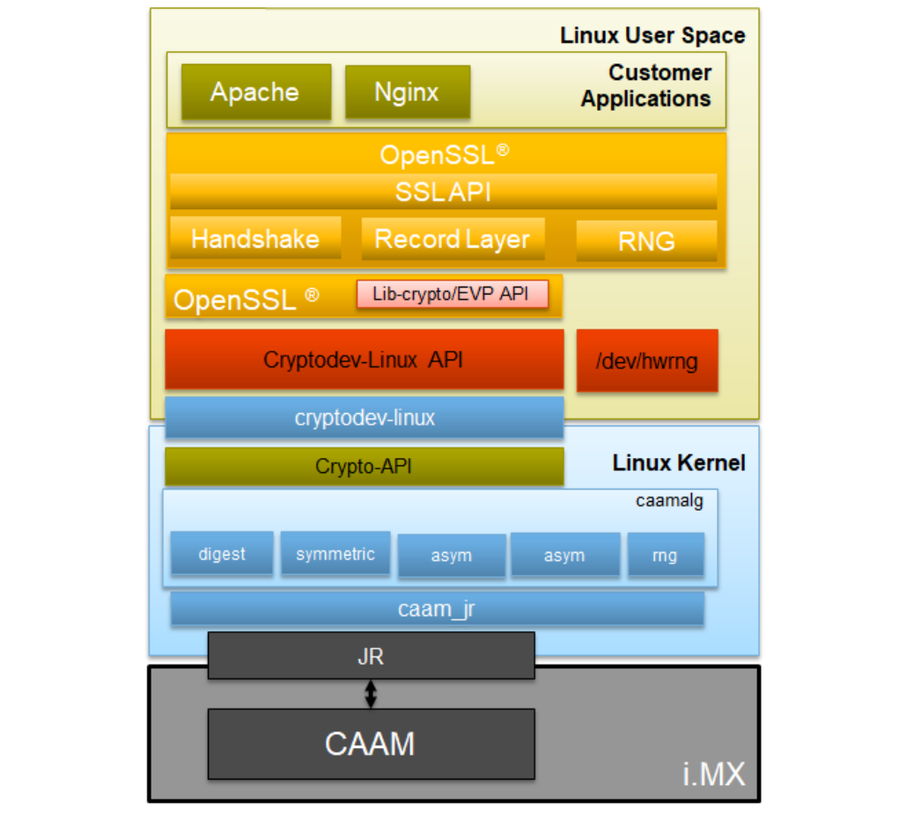

**Figure 178. Kiến trúc software stack của OpenSSL**

##### 9.1.1.1.2 ENGINE interface của OpenSSL

Thư viện Crypto của OpenSSL hỗ trợ cipher đối xứng và bất đối xứng (PKI), được dùng trong nhiều loại ứng dụng như OpenSSH, OpenVPN, PGP, IKE và XML-SEC. Thư viện Crypto của OpenSSL hỗ trợ bằng phần mềm cho:

- Các thuật toán cipher
- Các thuật toán digest
- Sinh số ngẫu nhiên
- Public Key Infrastructure

Ngoài hỗ trợ bằng phần mềm, OpenSSL có thể offload các chức năng này cho hardware accelerator qua ENGINE interface. ENGINE interface cung cấp các callback hook để tích hợp hardware accelerator với thư viện crypto. Các callback hook đóng vai trò lớp keo nối với hardware accelerator. Có thể offload chung các thuật toán cipher và digest qua Linux kernel bằng cryptodev engine.

##### 9.1.1.1.3 Giải pháp của NXP cho OpenSSL hardware offloading

Có thể thấy các tầng sau trong giải pháp của NXP cho OpenSSL hardware offloading:

- `OpenSSL` (user space): triển khai giao thức SSL
- `cryptodev-engine` (user space): triển khai OpenSSL ENGINE interface; giao tiếp với `cryptodev-linux` (`/dev/crypto`) qua `ioctls`, offload các thao tác mật mã xuống kernel
- `cryptodev-linux` (kernel space): Linux module chuyển các ioctl request từ cryptodev-engine thành lời gọi Linux Crypto API
- `AF_ALG` là một interface bất đồng bộ dựa trên netlink trong kernel, thêm address family AF_ALG, được đưa vào từ 2.6.38.
- Linux Crypto API (kernel space): tầng trừu tượng crypto của Linux kernel
- CAAM driver (kernel space): Linux device driver cho crypto engine CAAM

Các thao tác sau được offload xuống phần cứng trong BSP hiện tại:

- Các thao tác mã hóa đối xứng - AES (CBC, ECB), 3DES (CBC, ECB)
- Các thao tác digest - SHA (1, 256, 384, 512), MD5
- Các thao tác public key - RSA Sign (1k, 2k, 4k) / RSA Verify (1k, 2k, 4k)

##### 9.1.1.1.4 Triển khai OpenSSL vào rootfs

Thông thường, imx-image-full đã có OpenSSL và các module cryptodev, nhưng với các Yocto target khác, người dùng cần cập nhật file conf trong thư mục build. Cập nhật `conf/local.conf` bằng cách thêm dòng sau:

```
CORE_IMAGE_EXTRA_INSTALL+="cryptodev-module openssl-bin"
```

Chạy lại quy trình build:

```
bitbake imx-image-full
```

##### 9.1.1.1.5 Chạy các bài benchmark OpenSSL với cryptodev engine

Nạp cryptodev-module:

```
root@imx8qxpmek:~# modprobe cryptodev
[17044.896494] cryptodev: driver 1.10 loaded.
root@imx8qxpmek:~# openssl engine
(devcrypto) /dev/crypto engine
(dynamic) Dynamic engine loading support
root@imx8qxpmek:~#
```

**Ghi chú:**

Từ OpenSSL 1.1.1, OpenSSL mặc định gọi cryptodev engine nếu module tương ứng đã được nạp vào kernel. Vì vậy, để chỉ chạy benchmark phần mềm với OpenSSL, hãy gỡ module cryptodev bằng cách chạy `rmmod cryptodev`.

**9.1.1.1.5.1 Chạy các bài benchmark OpenSSL cho mã hóa đối xứng và digest**

Trong file speed test, một loạt bài kiểm tra hiệu năng được chạy để kiểm tra hiệu năng của các thao tác đối xứng và digest. Phần sau mô tả việc chạy test OpenSSL:

`root@imx8qxpmek:~# openssl speed -engine devcrypto -multi 8 -elapsed -evp aes-128-cbc`

`Forked child 1`

`engine "devcrypto" set.`

`Forked child 2`

`engine "devcrypto" set.`

`...`

`Got: +F:22:aes-128-cbc:378616.72:1611328.00:5084501.33:13994666.67:10731793.98:16219060.40 from 6` `Got: +H:16:64:256:1024:8192:16384 from 7`

`Got: +F:22:aes-128-cbc:120773.33:9344.00:3088298.67:13588480.00:31642965.33:16471967.79 from 7` `OpenSSL 1.1.1b 26 Feb 2019`

`built on: Thu Nov 14 13:22:07 2019 UTC`

`options:bn(64,64) rc4(char) des(int) aes(partial) idea(int) blowfish(ptr)`

`compiler: aarch64-poky-linux-gcc --sysroot=recipe-sysroot -O2 -pipe -g -feliminate-unused-debug-` `types -fmacro-prefix-map=`

`-fdebug-prefix-map= -fdebug-prefix-map= -fdebug-prefix-map= -DOPENSSL_USE_NODELETE -DOPENSSL_PIC -` `DOPENSSL_CPUID_OBJ -DOPENSSL_BN_ASM_MONT`

`-DSHA1_ASM -DSHA256_ASM -DSHA512_ASM -DKECCAK1600_ASM -DVPAES_ASM -DECP_NISTZ256_ASM -DPOLY1305_ASM` `-DNDEBUG`

`evp 2242.05k 9681.05k 35017.46k 106866.86k 127787.74k 130077.23k` `root@imx8qxpmek:~#`

Các cipher khác có thể benchmark: `aes-192-cbc`, `aes-256-cbc`, `aes-128-ecb`, `aes-192-ecb`, `aes-256-ecb`, `aes-128-ctr`, `aes-192-ctr`, `aes-256-ctr`, `des-cbc`, `des-cbc`, `des-ede3-cbc`.

Các digest khác có thể benchmark: `sha1`, `sha224`, `sha256`, `sha384`, `sha512`, `md5`.

**9.1.2 Tham chiếu Runtime Assembler Library**

Dùng Runtime Assembler Library để viết SEC descriptor.

**9.1.2.1 Tham chiếu Runtime Assembler Library**

Dùng Runtime Assembler Library để viết SEC descriptor. Tài liệu tham chiếu này mô tả cấu trúc, khái niệm, chức năng và API mức cao.

Nhấn vào đây để truy cập file PDF Writing descriptors for NXP CAAM using RTA library.

**9.2 Data Plane Development Kit (DPDK**

**9.2.1 Giới thiệu**

DPDK là một framework xử lý packet ở user space.

Hướng dẫn này gồm các chỉ dẫn cài đặt và cấu hình phần mềm Data Plane Development Kit (DPDK) v21.11 ở user space. Ngoài việc nêu các nền tảng áp dụng, hướng dẫn này mô tả các bước biên dịch

và chạy các ứng dụng DPDK mẫu trong môi trường ứng dụng Linux (linuxapp) trên các board Layerscape.

OVS-DPDK là một package switching bằng phần mềm, dùng DPDK làm nền tảng bên dưới. Hướng dẫn cũng trình bày chi tiết cách chạy ovs-dpdk với DPDK trên các board Layerscape.

#### 9.2.1.1 Các nền tảng được hỗ trợ và chi tiết riêng của từng nền tảng

DPDK hỗ trợ các họ SoC LS1012A, LS1028A, LS1043A, LS1046A, LS1088A, LS2088A và LX2160. Mục này trình bày chi tiết bố cục kiến trúc và port của các Reference Design Board của chúng. Thông tin bố cục port đặc biệt quan trọng khi chạy ứng dụng DPDK - để ánh xạ số port DPDK sang port vật lý.

Xem phần sau để biết thông tin riêng của từng board:

##### 9.2.1.1.1 LS1012A Reference Design Board (RDB)

LS1012A là nền tảng dựa trên PPFE. Để biết thêm về LS1012ARDB, xem www.nxp.com/LS1012ARDB

###### 9.2.1.1.1.1 Đặc tả phần cứng của LS1012ARDB

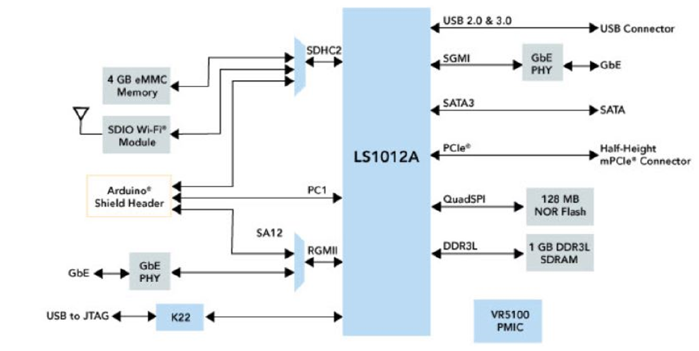

**Figure 179. LS1012A Reference Design**

###### 9.2.1.1.1.2 Bố cục port của LS1012ARDB

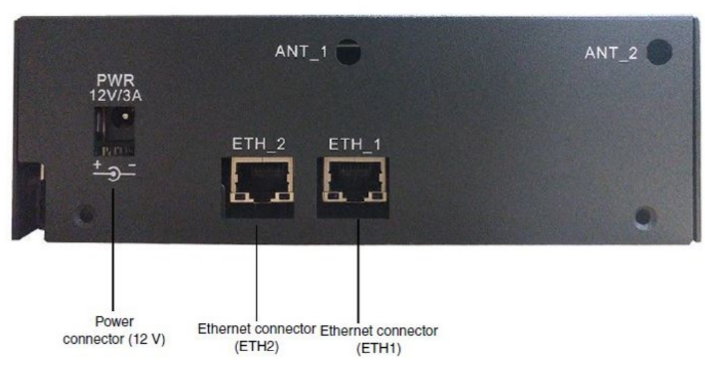

**Figure 180. Bố cục port của LS1012A**

| Nhãn trên vỏ | Tên port vdev DPDK |
|---|---|
| ETH1 | eth_pfe0 |
| ETH2 | eth_pfe1 |

##### 9.2.1.1.2 LS1028A Reference Design Board (RDB)

Processor ứng dụng công nghiệp LS1028A có một Ethernet switch hỗ trợ TSN và các Ethernet controller để hỗ trợ mạng IT và OT hội tụ. Để biết thêm về LS1028ARDB, http:// www.nxp.com/LS1028ARDB.

**Đặc tả phần cứng**

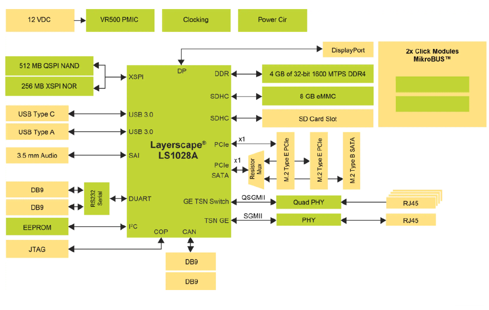

**Figure 181. Kiến trúc LS1028A**

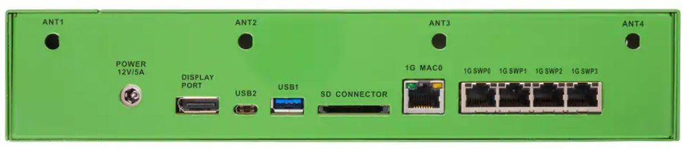

**Figure 182. Bố cục port của LS1028ARDB**

| Nhãn trên vỏ | Địa chỉ PCI của interface |
|---|---|
| 1G MAC0 | 0000:00:00.0 |
| 1G SWP0 | NA |
| 1G SWP1 | NA |
| 1G SWP2 | NA |
| 1G SWP3 | NA |

##### 9.2.1.1.3 LS1043A Reference Design Board (RDB)

LS1043A là nền tảng dựa trên DPAA. Để biết thêm về LS1043ARDB, xem www.nxp.com/LS1043ARDB

###### 9.2.1.1.3.1 Đặc tả phần cứng của LS1043ARDB

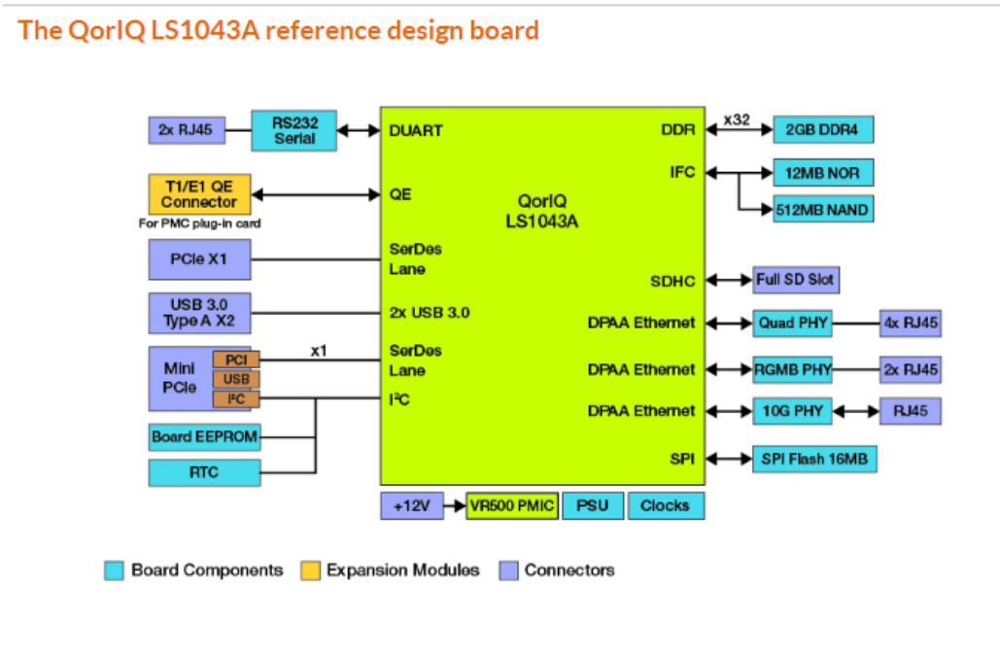

**Figure 183. LS1043A Reference Design**

###### 9.2.1.1.3.2 Bố cục port của LS1043ARDB

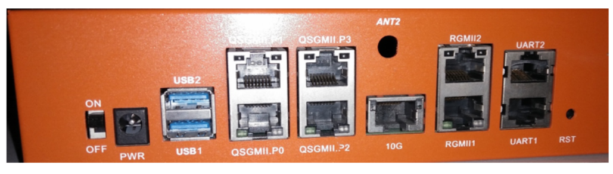

**Figure 184. Bố cục port của LS1043A**

| Nhãn trên vỏ | Tên port FMan | Port user space | Ghi chú |
|---|---|---|---|
| QSGMII.P0 | FM0-MAC1 | 0 | Port 1G |
| QSGMII.P1 | FM0-MAC2 | 1 | Port 1G |
| RGMII1 | FM0-MAC3 | 2 | Port 1G |
| RGMII2 | FM0-MAC4 | 3 | Port 1G |
| QSGMII.P2 | FM0-MAC5 | 4 | Port 1G |
| QSGMII.P3 | FM0-MAC6 | 5 | Port 1G |
| 10G | FM0-MAC9 | 6 | 10G - port đồng |

**Ghi chú:** Thông tin trong cột "User space Ports" ở trên phụ thuộc vào Device tree (DTB) mặc định đi kèm Board Support Package. Thứ tự có thể thay đổi với DTB tùy chỉnh.

##### 9.2.1.1.4 LS1046A Reference Design Board (RDB) / LS1046A Freeway Board (FRWY)

LS1046A là nền tảng dựa trên DPAA. Để biết thêm về LS1046ARDB, xem www.nxp.com/LS1046ARDB, và về LS1046A Freeway, xem www.nxp.com/FRWY-LS1046A.

###### 9.2.1.1.4.1 Đặc tả phần cứng của LS1046ARDB

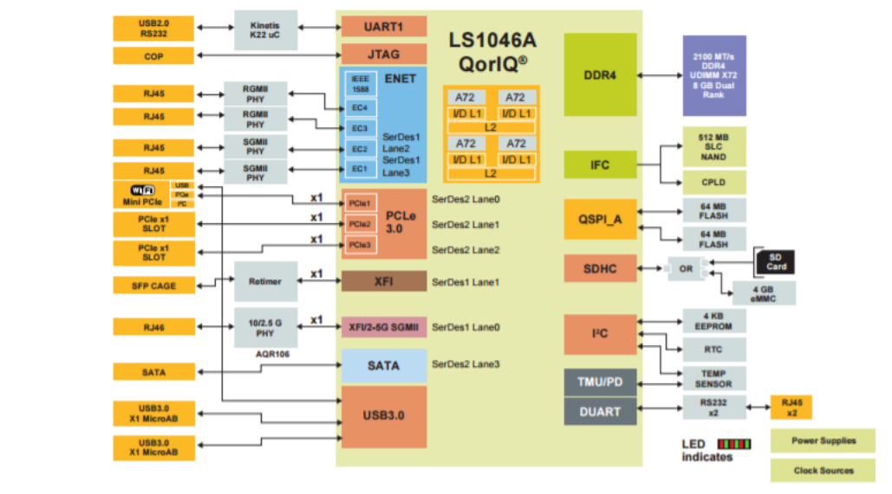

**Figure 185. LS1046A reference design**

###### 9.2.1.1.4.2 Bố cục port của LS1046ARDB

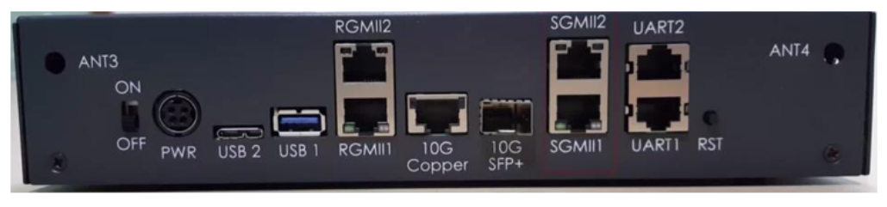

**Figure 186. Bố cục port của LS1046ARDB**

| Nhãn trên vỏ | Tên port FMan | Port user space | Ghi chú |
|---|---|---|---|
| RGMII1 | FM0-MAC3 | 0 | Port 1G |
| RGMII2 | FM0-MAC4 | 1 | Port 1G |
| SGMII1 | FM0-MAC5 | 2 | Port 1G |
| SGMII2 | FM0-MAC6 | 3 | Port 1G |
| 10G-Copper | FM0-MAC9 | 4 | 10G – port đồng |
| 10G-SFP+ | FM0-MAC10 | 5 | 10G – port quang SFP+ |

**Ghi chú:** Thông tin trong cột "User space Ports" ở trên phụ thuộc vào Device tree (DTB) mặc định đi kèm Layerscape LDP. Thứ tự có thể thay đổi với DTB tùy chỉnh.

###### 9.2.1.1.4.3 Bố cục port của FRWY-LS1046A

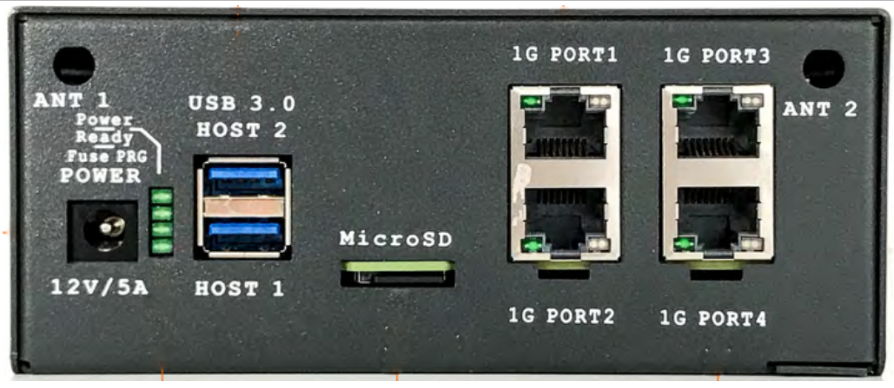

**Figure 187. Bố cục port của FRWY-LS1046A**

| Nhãn trên vỏ | Tên port FMan | Port user space | Ghi chú |
|---|---|---|---|
| 1G PORT1 | FM0-MAC1 | 0 | Port 1G |
| 1G PORT2 | FM0-MAC5 | 1 | Port 1G |
| 1G PORT3 | FM0-MAC6 | 2 | Port 1G |
| 1G PORT4 | FM0-MAC10 | 3 | Port 1G |

##### 9.2.1.1.5 LS1088A Reference Design Board (RDB)

LS1088A là nền tảng dựa trên DPAA2. Để biết thêm về LS1088A, xem www.nxp.com/LS1088ARDB.

###### 9.2.1.1.5.1 Đặc tả phần cứng của LS1088ARDB

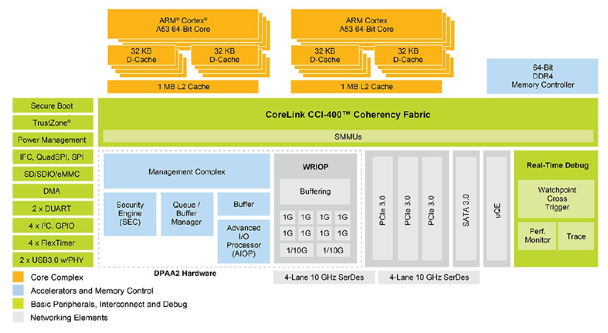

**Figure 188. Kiến trúc LS1088A**

###### 9.2.1.1.5.2 Bố cục port của LS1088ARDB


**Figure 189. Bố cục port của LS1088ARDB**

| Nhãn trên vỏ | Port vật lý | Ghi chú |
|---|---|---|
| ETH0 | DPMAC.1 | 10G - port đồng |
| ETH1 | DPMAC.2 | 10G – SFP+ (port quang) |
| ETH2 | DPMAC.7 | Port QSGMII (1G) |
| ETH3 | DPMAC.8 | Port QSGMII (1G) |
| ETH4 | DPMAC.9 | Port QSGMII (1G) |
| ETH5 | DPMAC.10 | Port QSGMII (1G) |
| ETH6 | DPMAC.3 | Port QSGMII (1G) |
| ETH7 | DPMAC.4 | Port QSGMII (1G) |
| ETH8 | DPMAC.5 | Port QSGMII (1G) |
| ETH9 | DPMAC.6 | Port QSGMII (1G) |

##### 9.2.1.1.6 LS2088A Reference Design Board (RDB)

LS2088A là nền tảng dựa trên DPAA2. Để biết thêm về LS2088A, xem www.nxp.com/LS2088ARDB.

###### 9.2.1.1.6.1 Đặc tả phần cứng

LS2088A Reference Design Board

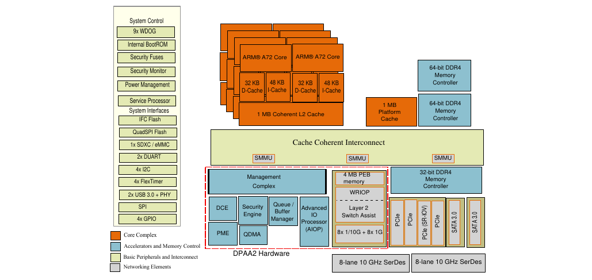

**Figure 190. Kiến trúc LS2088A**

###### 9.2.1.1.6.2 Bố cục port của LS2088ARDB

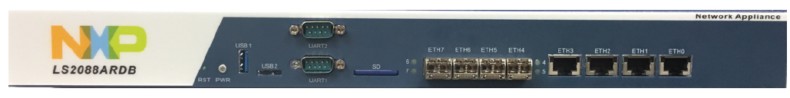

**Figure 191. Bố cục port của LS2088ARDB**

| Nhãn trên vỏ | Port vật lý | Ghi chú |
|---|---|---|
| ETH0 | DPMAC.5 | 10G - port đồng |
| ETH1 | DPMAC.6 | 10G - port đồng |
| ETH2 | DPMAC.7 | 10G - port đồng |
| ETH3 | DPMAC.8 | 10G - port đồng |
| ETH4 | DPMAC.1 | 10G – SFP+ (port quang) |
| ETH5 | DPMAC.2 | 10G – SFP+ (port quang) |
| ETH6 | DPMAC.3 | 10G – SFP+ (port quang) |
| ETH7 | DPMAC.4 | 10G – SFP+ (port quang) |

##### 9.2.1.1.7 LX2160A Reference Design Board (RDB)

LX2160A là nền tảng dựa trên DPAA2. Để biết thêm về LX2160, xem www.nxp.com/LX2160A.

###### 9.2.1.1.7.1 Đặc tả phần cứng

LX2160A Reference Design Board

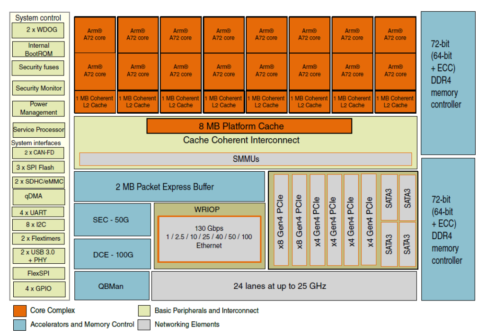

**Figure 192. Kiến trúc LX2160A**

###### 9.2.1.1.7.2 Bố cục port của LX2160ARDB

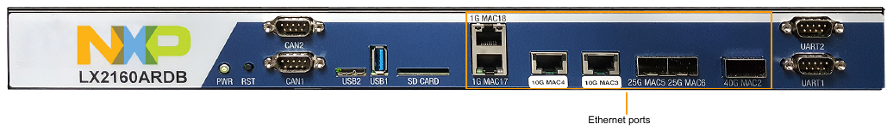

**Figure 193. Bố cục port của LX2160ARDB**

**Table 166. Bố cục port**

| Nhãn trên vỏ | Port vật lý | Ghi chú |
|---|---|---|
| 40G MAC2 (\*) | dpmac.2 | 40G - port quang |
| 10G MAC3 | dpmac.3 | 10G - port đồng |
| 10G MAC4 | dpmac.4 | 10G - port đồng |
| 25G MAC5 | dpmac.5 | 25G - port quang |
| 25G MAC6 | dpmac.6 | 25G - port quang |
| 10G MAC7 (\*) | dpmac.7 | 10G - port quang |
| 10G MAC8 (\*) | dpmac.8 | 10G - port quang |
| 10G MAC9 (\*) | dpmac.9 | 10G - port quang |
| 10G MAC10 (\*) | dpmac.10 | 10G - port quang |
| 1G MAC17 | dpmac.17 | 1G - port đồng |
| 1G MAC18 | dpmac.18 | 1G - port đồng |

**Ghi chú:** (\*) Chỉ có một trong hai cấu hình 40G hoặc 4x10G - vì vậy tùy cấu hình SerDes, chỉ có port {dpmac.2} hoặc các port {dpmac.7, dpmac.8, dpmac.9, dpmac.10}. Có cấu hình 4x10G bằng cách dùng port-splitter trên port 40G (dpmac.2). Với cấu hình 4x10G, dùng SerDes protocol 18.

###### 9.2.1.1.7.3 Cấu hình SerDes

Bảng sau cho thấy cấu hình SerDes protocol áp dụng cho các board LX2160A. Tùy cấu hình protocol, sẽ có 4 port 10G hoặc 1 port 40G được cấu hình/nhìn thấy. Cấu hình chi tiết và thông tin protocol có trong Quick start guide.

#### 9.2.1.2 Tài liệu tham khảo

**Table 167. Tài liệu tham khảo về ứng dụng DPDK**

| Ứng dụng mẫu | Link DPDK Web Manual | Mô tả |
|---|---|---|
| Layer-2 Forwarding (`l2fwd`) | l2fwd usage | Hướng dẫn thiết lập và sử dụng ứng dụng mẫu Layer 2 Forwarding. |
| Layer-2 Forwarding with Crypto (`l2fwd-crypto`) | l2fwd-crypto | Hướng dẫn thiết lập và sử dụng ứng dụng mẫu Layer 2 Forwarding with Crypto. |
| Layer-3 Forwarding (`l3fwd`) | l3fwd usage | Hướng dẫn thiết lập và sử dụng ứng dụng mẫu Layer 3 Forwarding. |
| IPSec Gateway (`ipsec-secgw`) | ipsec-secgw usage | Hướng dẫn thiết lập và sử dụng ứng dụng mẫu IPSec Security Gateway. |
| PMD Test Application (`testpmd`) | testpmd usage | Hướng dẫn cho ứng dụng test, có thể dùng để test mọi tính năng PMD hỗ trợ. |
| DPDK Web Guide | DPDK Documentation | Link tới DPDK Web Manual, chứa thông tin về mọi PMD và ứng dụng được hỗ trợ. |

**Table 168. Tài liệu tham khảo về release**

| Thành phần | Phiên bản release upstream gốc |
|---|---|
| DPDK | 2.11 |
| OVS | 2.16.90 |
| PKTGEN | 21.11.0 |

### 9.2.2 Tổng quan về DPDK

Mục tiêu chính của DPDK là cung cấp một framework đơn giản, đầy đủ để xử lý packet nhanh trong các ứng dụng data plane. Dùng các API do framework cung cấp, ứng dụng có thể tận dụng khả năng của hạ tầng mạng bên dưới.

Framework tạo ra một tập thư viện cho các môi trường target, xếp lớp qua Environment Abstraction Layer (EAL), lớp này che toàn bộ phần keo nối thiết bị phía dưới một tập API nhất quán. Các môi trường này được tạo bằng file cấu hình. Sau khi tạo thư viện EAL, người dùng có thể link với thư viện để tạo ứng dụng của mình. Ngoài EAL còn có nhiều thư viện khác, gồm Hash, Longest Prefix Match (LPM) và rings, để thực hiện các thao tác cụ thể. Các ứng dụng mẫu cũng được cung cấp để giúp hiểu các tính năng và cách dùng khác nhau của framework DPDK.

DPDK triển khai mô hình run-to-completion để xử lý packet, trong đó mọi tài nguyên phải được cấp phát trước khi gọi các ứng dụng data plane, vốn chạy như các đơn vị thực thi trên các logical core. Ngoài ra, cũng có thể dùng mô hình pipeline bằng cách chuyển packet hoặc message giữa các core qua ring. Cách này cho phép công việc được thực hiện theo từng giai đoạn, giúp dùng code trên các core hiệu quả hơn.

Có thể xem thêm thông tin về cách DPDK hoạt động nói chung trên website DPDK.

#### 9.2.2.1 Hỗ trợ nền tảng của DPDK

Mục này mô tả NXP Data Path Acceleration Architecture, xem sơ đồ dưới đây:

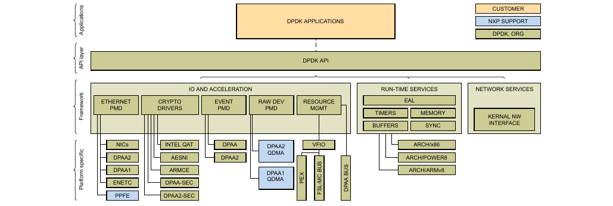

**Figure 194. Kiến trúc DPDK với các thành phần của NXP**

NXP Data Path Acceleration Architecture gồm một tập thành phần phần cứng, được tích hợp qua một queue manager phần cứng và dùng chung một buffer manager phần cứng. Phần mềm truy cập DPAA qua các thành phần phần cứng gọi là "Software Portals". Chúng trực tiếp cung cấp các thao tác của queue manager và buffer manager, như enqueue, dequeue, cấp phát buffer và giải phóng buffer, và gián tiếp cung cấp quyền truy cập mọi thành phần phần cứng DPAA khác qua queue manager.

PMD (Poll Mode Driver) dựa trên kiến trúc NXP DPAA đã được thêm vào hạ tầng DPDK để hỗ trợ hoạt động liền mạch trên nền tảng NXP. Với các driver này, framework DPDK trên nền tảng NXP cho phép build các ứng dụng Linux user space bằng các DPDK API chuẩn theo cách khả chuyển. Các driver truy cập trực tiếp software portal của queue manager và buffer manager DPAA với hiệu năng cao, còn chi tiết nội bộ được ẩn khỏi framework DPDK mức cao hơn. Ngoài driver cho network interface, các driver (PMD) giao tiếp với khối Crypto (CAAM) cũng đã có trong source code DPDK.

**Ghi chú:**

Vì hướng dẫn này hỗ trợ các nền tảng PPFE, DPAA2, ENETC và DPAA, các dấu hiệu sau được dùng trong suốt hướng dẫn:

- DPAA2 – Dấu hiệu này đánh dấu các bước/đoạn văn chỉ áp dụng cho nền tảng DPAA2, ví dụ LS2088
- DPAA – Dấu hiệu này đánh dấu các bước/đoạn văn chỉ áp dụng cho nền tảng DPAA, ví dụ LS1043
- PPFE - Dấu hiệu này đánh dấu các bước/đoạn văn chỉ áp dụng cho nền tảng PPFE, ví dụ LS1012
- ENETC - Dấu hiệu này đánh dấu các bước/đoạn văn chỉ áp dụng cho nền tảng ENETC, ví dụ LS1028

Mọi bước khác không có dấu hiệu đều áp dụng cho cả hai nền tảng.

**Ghi chú:**

Xem Section 9.2.11 để tinh chỉnh hệ thống cho hiệu năng DPDK tốt nhất trên nền tảng NXP.

**Ghi chú:**

**Môi trường đa thread**

DPDK ban đầu được thiết kế cho kiến trúc Intel, nhưng đang có những nỗ lực để làm nó thân thiện với nhiều kiến trúc. Vẫn còn một số hạn chế cần lưu ý khi dùng trên nền tảng NXP.

1. Nhiều pthread

   DPDK thường gắn mỗi core một pthread để tránh chi phí chuyển đổi task. Cách này cho hiệu năng tăng đáng kể, nhưng thiếu linh hoạt và không phải lúc nào cũng hiệu quả. DPDK gồm nhiều thư viện - một số hàm trong các thư viện này có thể được gọi an toàn từ nhiều thread cùng lúc, còn một số khác thì không.

   Môi trường runtime của DPDK thường là một thread cho mỗi logical core. Tốt nhất nên tránh dùng chung cấu trúc dữ liệu giữa các thread và/hoặc process khi có thể. Khi không thể, các khối thực thi phải truy cập dữ liệu theo cách thread-safe. Có thể dùng các cơ chế như biến atomic hoặc lock để các khối thực thi hoạt động tuần tự. Tuy nhiên, điều này có thể ảnh hưởng tới hiệu năng của ứng dụng.

2. Fast-path APIs

   Các ứng dụng chạy ở data plane nhạy cảm về hiệu năng, nhưng một số hàm trong các thư viện đó có thể không an toàn khi gọi từ nhiều thread cùng lúc.

   Hash, LPM, các thư viện Mempool và RX/TX trong PMD là ví dụ về các hàm không an toàn khi đa thread như vậy. RX/TX của PMD là phần quan trọng nhất của một ứng dụng DPDK, và khuyến nghị không dùng lock trên các đường này vì sẽ ảnh hưởng tới hiệu năng. Tuy nhiên, có thể dùng an toàn các hàm này từ nhiều thread khi mỗi thread thực hiện I/O trên một NIC queue khác nhau. Nếu nhiều thread dùng cùng một hardware queue trên cùng một NIC port, thì cần lock hoặc một hình thức loại trừ tương hỗ khác. Trong bản triển khai của NXP, mỗi thread phải dùng một instance software portal (DPIO) để truy cập phần cứng DPAA bên dưới. Vì vậy, khuyến nghị chỉ tạo một thread trên mỗi logical core cho RX/TX và các truy cập I/O khác tới phần cứng DPAA.

#### 9.2.2.2 DPAA: Các tính năng DPDK được hỗ trợ

Sau đây là danh sách các tính năng DPDK NIC mà driver DPAA hỗ trợ:

- Chế độ Allmulticast
- Thống kê cơ bản và mở rộng
- Flow control
- Thông tin phiên bản firmware
- Jumbo frame
- L3 và L4 checksum offload
- Trạng thái link và cập nhật
- Cập nhật MTU
- Chế độ promiscuous
- Start/stop queue
- Khả năng tốc độ
- RX và TX phân tán (scattered)
- Unicast MAC filter
- RSS Hash
- Phân tích loại packet
- Chế độ interrupt
- Chia traffic (VSP)
- Buffer gián tiếp và buffer ngoài
- ARMv8

Sau đây là danh sách các tính năng DPDK Crypto Device mà driver DPAA hỗ trợ:

- Mã hóa/Giải mã và xác thực
- Hỗ trợ lookaside protocol offload
- Nhiều thuật toán như liệt kê trong `<dpdk>/doc/guides/cryptodevs/features/dpaa_sec.ini`
- Hỗ trợ giao thức PDCP
- Hỗ trợ IPSec RAW buffer
- Hỗ trợ IPSec event mode
- RX và TX phân tán (scattered)

Các tính năng DPDK khác được hỗ trợ trên DPAA

- Hỗ trợ event device
- Hỗ trợ QDMA
- Hỗ trợ IEEE1588

Các ứng dụng đã được kiểm chứng trên DPAA1

- dpdk-l2fwd
- dpdk-l3fwd
- dpdk-ipsec-secgw
- dpdk-testpmd
  - Các mode RX only, TX only, fwd
  - Hỗ trợ Jumbo Frame
  - Hỗ trợ Scatter Gather
  - Các Virtio net interface
  - Link bonding
  - Phân phối RSS
  - Hỗ trợ buffer ngoài
- dpdk-l2fwd-event
- dpdk-ethtool
- dpdk-ip_fragmentation
- dpdk-ip_reassembly
- dpdk-kni
- dpdk-l2fwd-qdma
- dpdk-l3fwd-power
- dpdk-link_status_interrupt
- dpdk-pdump
- dpdk-proc-info
- dpdk-test-crypto-perf
- dpdk-test

#### 9.2.2.3 DPAA2: Các tính năng DPDK được hỗ trợ

Sau đây là danh sách các tính năng DPDK NIC mà driver DPAA2 hỗ trợ:

- Chế độ Allmulticast
- Thống kê cơ bản
- Thông tin phiên bản firmware
- Flow control
- Jumbo frame
- L3 checksum offload
- L4 checksum offload
- Link Status
- Các event Link Status
- Cập nhật MTU
- Phân tích loại packet
- Chế độ promiscuous
- Start/stop queue
- RSS hash
- Unicast MAC filter
- VLAN filter và offload
- Khả năng tốc độ
- Timesync
- Timestamp offload
- ARMv8
- Linux VFIO
- Thống kê mở rộng

Sau đây là danh sách các tính năng DPDK Crypto Device mà driver DPAA2 hỗ trợ:

- Mã hóa/Giải mã và xác thực
- Hỗ trợ lookaside protocol offload
- Nhiều thuật toán như liệt kê trong `<dpdk>/doc/guides/cryptodevs/features/dpaa2_sec.ini`
- Hỗ trợ giao thức PDCP
- Hỗ trợ IPSec RAW buffer
- Hỗ trợ IPSec event mode
- RX và TX phân tán (scattered)

Các tính năng DPDK khác được hỗ trợ trên DPAA2

- Hỗ trợ event device
- Hỗ trợ QDMA
- Hỗ trợ user không phải root
- Hỗ trợ Traffic Manager

Các ứng dụng đã được kiểm chứng trên DPAA2

- dpdk-l2fwd
- dpdk-l3fwd
- dpdk-ipsec-secgw
- dpdk-testpmd
  - Các mode Rx only, TX only, fwd
  - Hỗ trợ Jumbo Frame
  - Hỗ trợ Scatter Gather
  - Phân loại flow
  - Quản lý traffic
  - Các Virtio net interface
  - Link bonding
  - Phân phối RSS
  - Hỗ trợ buffer ngoài
- dpdk-l2fwd-event
- dpdk-ethtool
- dpdk-ip_fragmentation
- dpdk-ip_reassembly
- dpdk-kni
- dpdk-l2fwd-qdma
- dpdk-l3fwd-power
- dpdk-link_status_interrupt
- dpdk-mp_client
- dpdk-mp_server
- dpdk-ptpclient
- dpdk-qdma_demo
- dpdk-simple_mp
- dpdk-symmetric_mp
- dpdk-symmetric_mp_qdma
- dpdk-pdump
- dpdk-proc-info
- dpdk-test-crypto-perf
- dpdk-test

#### 9.2.2.4 Các tính năng DPDK được PPFE hỗ trợ

Sau đây là danh sách các tính năng DPDK NIC mà driver PPFE hỗ trợ:

- Chế độ ALLmulticast
- Thống kê cơ bản
- Cập nhật MTU
- Chế độ promiscuous
- Phân tích loại packet
- ARMv8

#### 9.2.2.5 Các tính năng DPDK được ENETC hỗ trợ

Sau đây là danh sách các tính năng DPDK NIC mà driver ENETC hỗ trợ:

- Thông tin loại packet
- Thống kê cơ bản
- Promiscuous
- Multicast
- Jumbo packet
- Start/Stop queue
- Start queue trì hoãn
- CRC offload

Các tính năng DPDK dựa trên ENETC không được hỗ trợ với Kernel 4.14.

### 9.2.3 Build DPDK

Mục này gồm ba mục con, trình bày chi tiết:

1. Build các binary DPDK (thư viện và ứng dụng mẫu) bằng Yocto bitbake.
2. Build các binary DPDK dưới dạng package độc lập, qua hệ thống build riêng của DPDK.
3. Build ứng dụng Pktgen, có thể dùng làm bộ sinh packet bằng phần mềm với DPDK là lớp bên dưới.
4. Build OVS-DPDK - một Open Virtual Switch dựa trên DPDK
5. Biên dịch các image cần cho máy ảo

#### 9.2.3.1 Build DPDK bằng Yocto bitbake

Mục này trình bày chi tiết cách build DPDK dưới dạng package độc lập trong môi trường Yocto. Giả định rằng môi trường Yocto đã được cấu hình trước khi chạy các lệnh dưới đây.

Xem Section 4 để biết đầy đủ chi tiết về cách dùng hệ thống build Yocto.

Sau khi đã thiết lập môi trường, có thể dùng các lệnh sau để build DPDK và các thư viện:

```
bitbake dpdk
bitbake pktgen_dpdk
bitbake ovs_dpdk
```

**Ghi chú:** DPDK phụ thuộc vào package OpenSSL cho software crypto và OpenSSL PMD. Cần build OpenSSL trước DPDK trong môi trường bitbake để đáp ứng phụ thuộc này. Nếu build DPDK trên nền tảng target, có thể các thư viện OpenSSL đã có sẵn trong library path. Khi đó không cần build thư viện OpenSSL.

Xem Section 4.5 để đóng gói các binary này vào target rootfs bằng hệ thống build Yocto.

##### 9.2.3.1.1 Bố cục các binary DPDK

Một image binary DPDK duy nhất hỗ trợ các nền tảng DPAA1, DPAA2, ENETC và PPFE. Sau khi cài package DPDK, các binary có trong thư mục `/usr/share/dpdk/examples/` của rootfs. Hệ thống bitbake sinh một rootfs duy nhất cho mọi nền tảng NXP mà nó hỗ trợ.

```
/usr/share/dpdk/examples/            # Contains the sample applications listed
 in Table 167
```

Các binary DPDK được đặt trong thư mục `/usr/share/dpdk/examples/` để tận dụng đường dẫn tìm binary đặt trong biến `PATH`. Nếu biến `PATH` mặc định không chứa `/usr/share/dpdk/` `examples/`, có thể thêm nó vào để bật tính năng tự hoàn thành lệnh của BASH.

Ở nhiều chỗ trong tài liệu này, các binary trên được nhắc tới để minh họa việc chạy cũng như các thông tin khác. Giả định rằng việc chạy được thực hiện với biến `PATH` đã đặt như giải thích ở trên, hoặc với đường dẫn tuyệt đối tới binary.

Ngoài các thư mục trên, rootfs còn có một tập file khác để hỗ trợ chạy ứng dụng DPDK. Các file này nằm trong thư mục `/usr/bin` của rootfs.

Bảng dưới đây liệt kê các artifact DPDK có trong rootfs do Yocto sinh ra:

**Table 169. Các artifact DPDK có trong rootfs do Yocto sinh ra**

| Tên file/image tính từ `/usr/share` | Mô tả |
|---|---|
| `./dpdk/examples/dpdk-l2fwd`<br>`./dpdk/examples/dpdk-l3fwd`<br>`./dpdk/examples/dpdk-l2fwd-crypto`<br>`./dpdk/examples/dpdk-ipsec-secgw` | DPAA1, DPAA2, ENETC và PPFE<br>Các ứng dụng DPDK mẫu và ứng dụng test PMD. |
| `./dpdk/dpaa/usdpaa_config_ls<PLAT>.xml`<br>`./dpdk/dpaa/usdpaa_policy_hash_ipv4_1queue.xml`<br>`./dpdk/dpaa/usdpaa_policy_hash_ipv4_2queue.xml`<br>`./dpdk/dpaa/usdpaa_policy_hash_ipv4_4queue.xml`<br>`./dpdk/dpaa/usdpaa_policy_24g_classif_udp_ipsec_1queue.`<br>`xml`<br>`./dpdk/dpaa/usdpaa_policy_24g_classif_frag_gtp_1queue.`<br>`xml` | Chỉ DPAA.<br>Các file cấu hình và policy FMC.<br>`<PLAT>` là tên nền tảng DPAA, ví dụ `ls1043` hoặc `ls1046`.<br>Mỗi file Policy định nghĩa số queue cho mỗi port như ghi trong tên file. |
| `./dpdk/dpaa2/dynamic_dpl.sh`<br>`./dpdk/dpaa2/destroy_dynamic_dpl.sh` | Chỉ DPAA2.<br>Script tạo và hủy container DPL động. |
| `./enable_performance_mode.sh`<br>`./disable_performance_mode.sh` | Khi chạy Ubuntu OS trên board Layerscape, hiệu năng trên core 0 có thể trở nên không ổn định do các service và thread của OS.<br>Các script này cho phép một thiết lập đặc biệt, trong đó ứng dụng DPDK chạy sau script enable sẽ được priority real-time.<br>**Ghi chú:** Không nên dùng các script này trong trường hợp thông thường. Về use case chi tiết, xem mục Performance Reproducibility Guide. |
| `./examples/ipsec_secgw/ep0.cfg`<br>`./examples/ipsec_secgw/ep1.cfg`<br>`./ipsec/ep0_64X64.cfg`<br>`./ipsec/ep1_64X64.cfg`<br>`./ipsec/ep0_64X64_proto.cfg`<br>`./ipsec/ep0_64X64_sha256.cfg`<br>`./ipsec/ep1_64X64_proto.cfg`<br>`./ipsec/ep1_64X64_sha256.cfg` | Các file cấu hình cho ứng dụng mẫu `ipsec-gw`.<br>Các file `ep0` và `ep1` là cấu hình chuẩn cho 2 tunnel, mỗi file cho mã hóa và giải mã. `ep0_64X64` và `ep1_64X64` dành cho 64 tunnel, mỗi file cho mã hóa và giải mã. |
| `/usr/bin/pktgen` | Ứng dụng sinh packet |
| `./debug_dump.sh` | Dump dữ liệu debug để phân tích thêm. |

#### 9.2.3.2 Build DPDK trên host (Native)

Mục này liệt kê các bước cần để build binary DPDK (thư viện và ứng dụng mẫu) trên môi trường host. Môi trường này là host được bật để build trực tiếp trên board target Layerscape.

**Ghi chú:** Mục này tập trung vào việc build DPDK trên máy host cho target là board Layerscape. Có thêm các ghi chú để biên dịch ứng dụng DPDK trực tiếp trên máy host.

##### 9.2.3.2.1 Thiết lập proxy

Tùy môi trường làm việc, có thể cần thiết lập proxy để kết nối Internet. Dùng các lệnh proxy sau:

```
$ export http_proxy=http://<proxy-server-name>.com:<port-number>
$ export https_proxy=https://<proxy-server-name>.com:<port-number>
```

##### 9.2.3.2.2 Lấy source code DPDK

Source code DPDK chứa mọi thư viện để build các ứng dụng mẫu cũng như ứng dụng test. Source code gồm cả cấu hình và script hỗ trợ build và chạy. Lấy source code DPDK qua link dưới đây:

```
git clone https://github.com/nxp-qoriq/dpdk.git
cd dpdk
git checkout remotes/origin/21.11-qoriq -b 21.11-qoriq
```

Sau khi clone repository trên, source code DPDK sẵn sàng để biên dịch. Source này dùng chung cho các nền tảng DPAA1, DPAA2, ENETC và PPFE.

##### 9.2.3.2.3 Biên dịch DPDK bằng meson

Làm theo các bước sau để biên dịch DPDK. Nếu biên dịch trực tiếp trên board target, giả định rằng các điều kiện tiên quyết đã được đáp ứng bằng root filesystem. Chạy lệnh sau:

```
meson arm64-build -Dexamples= <list of example applications to be compiled
 separated by commas>
ninja -C arm64-build install
```

Sau khi biên dịch các ứng dụng mẫu, binary có trong thư mục `dpdk/` `arm64-build/examples/` với tiền tố “`dpdk-`“.

Các thư viện DPDK đã biên dịch cũng có trong thư mục `dpdk/arm64-build/lib/`.

Một số ứng dụng, như `testpmd`, được sinh ra trong lần build mặc định. Chúng có trong thư mục `dpdk/arm64-build/app/`.

#### 9.2.3.3 Build độc lập các thư viện và ứng dụng DPDK

Mục này trình bày chi tiết các bước cần để build binary DPDK (thư viện và ứng dụng mẫu) trong môi trường độc lập. Môi trường này có thể là một host được bật cross build cho board Layerscape, hoặc trực tiếp trên board target Layerscape.

**Ghi chú:** Mục này chủ yếu tập trung vào việc build độc lập DPDK trên máy host bằng cross compile cho target là board Layerscape. Tuy vậy, đã có thêm các ghi chú cần thiết để biên dịch trực tiếp trên board target. Xem Section 4.5 để tạo môi trường phù hợp cho việc build DPDK trên board Layerscape.

Về các bước build DPDK bằng hệ thống Yocto, xem Section 4.5 và Section 9.2.3.1.

##### 9.2.3.3.1 Lấy source code DPDK

Source code DPDK chứa mọi thư viện cần thiết để build các ứng dụng mẫu cũng như ứng dụng test. Source code cũng gồm nhiều cấu hình và script hỗ trợ build và chạy. Lấy source code DPDK qua link dưới đây:

```
git clone https://github.com/nxp-qoriq/dpdk.git
cd dpdk
git checkout remotes/origin/21.11-qoriq -b 21.11-qoriq
```

Sau khi clone repository trên, source code DPDK sẵn sàng để biên dịch. Source này dùng chung cho cả các nền tảng DPAA1, DPAA2, ENETC và PPFE.

##### 9.2.3.3.2 Điều kiện tiên quyết để biên dịch DPDK

Trước khi biên dịch DPDK dưới dạng build độc lập, cần giải quyết riêng các phụ thuộc sau:

- Source code Linux Kernel phù hợp với nền tảng và đã biên dịch, để có thể build các module KNI.
  - Việc này là tùy chọn, và nếu không cần hỗ trợ module KNI thì có thể bỏ qua.
  - Về chi tiết biên dịch Linux Kernel phù hợp với nền tảng, xem Section 4.5.
  - Để tắt module KNI, xem các ghi chú bên dưới.
- Các thư viện OpenSSL cần để build software crypto driver (OpenSSL PMD).
  - Package OpenSSL cần được biên dịch riêng và các thư viện được cài ở một đường dẫn đã biết trước khi build DPDK.
  - Việc này là tùy chọn, và nếu không cần hỗ trợ software crypto driver thì có thể bỏ qua phụ thuộc này. **Ghi chú:** Xem Section 4.5 để biết thêm cách build OpenSSL như một phần của hệ thống Yocto. Nếu dùng Yocto và tham khảo link này để build package OpenSSL, có thể bỏ qua các lệnh dưới đây. Các bước sau dùng để build OpenSSL dưới dạng package độc lập, ngoài hệ thống Yocto. Đây không phải cách được khuyến nghị và chỉ nên dùng khi không có hệ thống Yocto. Làm theo các bước dưới đây để build package OpenSSL.

    ```
    git clone git://git.openssl.org/openssl.git
    cd openssl
    git checkout OpenSSL_1_1_0g
    ```

    Export toolchain cross compile để build OpenSSL cho target. Bước export toolchain cross compile sau chỉ cần khi biên dịch trên Host. Trên board target, giả định dùng toolchain build mặc định.

    ```
    export CROSS_COMPILE=<path to uncompressed toolchain archive>/bin/aarch64-
    linux-gnu-
    ```

    Cấu hình hệ thống build OpenSSL bằng lệnh sau. Tham số `--prefix` chỉ định đường dẫn nơi các thư viện OpenSSL sẽ được triển khai sau khi build xong. Đây cũng là đường dẫn sẽ được cung cấp cho hệ thống build DPDK để truy cập các thư viện OpenSSL đã biên dịch.

    ```
    ./Configure linux-aarch64  --prefix=<OpenSSL library path> shared
    ```

    ```
    make depend
    make
    make install
    export PKG_CONFIG_PATH=<OpenSSL lib path>/lib/pkgconfig:$PKG_CONFIG_PATH
    ```

    **Ghi chú:** Khi build DPDK trên board target, có thể các thư viện OpenSSL mà DPDK cần đã có sẵn trong rootfs; khi đó không cần biên dịch riêng package OpenSSL.

  - Để tắt hỗ trợ OpenSSL PMD, xem các ghi chú bên dưới.

##### 9.2.3.3.3 Biên dịch DPDK bằng meson

Làm theo các bước sau để biên dịch DPDK sau khi đã đáp ứng các điều kiện tiên quyết ở trên. Các bước này chung cho mọi nền tảng và chỉ cần khi cross compile trên host cho target là board Layerscape. Nếu biên dịch trực tiếp trên board target, giả định rằng các điều kiện tiên quyết đã được đáp ứng bằng root filesystem.

1. Thiết lập môi trường biên dịch

   a. Thiết lập toolchain cross compile.

   Bước này chỉ cần trong môi trường host có toolchain mặc định không dành cho board target. Khi biên dịch trên board target, có thể bỏ qua bước này.

   ```
   export CROSS_PATH=<path to cross-compile toolchain>
   export PATH=$PATH:$CROSS_PATH
   ```

   b. Thiết lập đường dẫn OpenSSL cho software crypto driver (OpenSSL PMD). Bước này là tùy chọn và có thể bỏ qua nếu không cần hỗ trợ software crypto driver (OpenSSL PMD). Các biến ngoài này cũng có thể dùng để truyền các thư viện cần thiết khác, ví dụ `libpcap`

   ```
   export PKG_CONFIG_LIBDIR="<path to installed OpenSSL>/lib/"
       export PKG_CONFIG_PATH=$PKG_CONFIG_LIBDIR/pkgconfig
   ```

2. Dùng hệ thống build DPDK để biên dịch DPDK.

   **Ghi chú:** Các binary DPDK sinh ra bằng các bước này tương thích với các nền tảng DPAA1, DPAA2, ENETC và PPFE. Điều này cũng đúng khi build DPDK bằng hệ thống build Yocto. Xem Section 4.5 để biết các bước build DPDK bằng hệ thống build Yocto.

   a. Chạy các lệnh sau:

   ```
   meson arm64-build --cross-file config/arm/arm64_dpaa_linux_gcc -Dexamples=
    <list of example applications to be compiled separated by commas> -
   Dprefix=<location to install DPDK>
   ninja -C arm64-build
   ```

   Ở đây, `-Dprefix` và `-Dexamples` là các tham số tùy chọn. Tham số `Dprefix` được dùng để triển khai mọi binary DPDK (thư viện và ứng dụng mẫu) theo bố cục chuẩn của package Linux trong thư mục mà tham số này chỉ ra. Ngoài ra, thư mục `dpdk/arm64-build/` cũng được tạo và binary cùng thư viện cũng có trong đó. Tham số `install` trong lệnh `ninja` cũng không bắt buộc nếu không cần cài đặt. `Dexamples` dùng để biên dịch các ví dụ cần thiết. Nếu chỉ cần biên dịch driver, không cần tham số này.

   **Ghi chú:** Với PPFE (nền tảng LS1012), khi dùng các Crypto driver, cần bật flag CONFIG_RTE_LIBRTE_PMD_CAAM_JR_BE khi biên dịch DPDK.

   b. Sau khi biên dịch các ứng dụng mẫu, binary có trong thư mục build DPDK với tiền tố “`dpdk-`“:

   ```
   dpdk/arm64-build/examples/*
   ```

   Ngoài ứng dụng mẫu ở trên, DPDK cũng cung cấp binary `testpmd`, có thể dùng để kiểm tra toàn diện các tính năng của driver DPDK (PMD) với các thiết bị có sẵn và tương thích. Binary này được biên dịch mặc định khi biên dịch source DPDK. Nó có trong thư mục `dpdk/` `arm64-build/examples/`.

   **Ghi chú:** Với nền tảng LS1028, khi dùng các Crypto driver, cần bật flag CAAM_JR_UIO khi biên dịch DPDK.

   **Ghi chú:** Với PPFE (nền tảng LS1012), khi dùng các Crypto driver,

   cần bật flag CONFIG_RTE_LIBRTE_PMD_CAAM_JR_BE khi biên dịch DPDK.

#### 9.2.3.4 Build Packet Generator (pktgen) dựa trên DPDK bằng Yocto

**Pktgen** là một bộ sinh packet chạy trên DPDK. Nó cần môi trường DPDK để biên dịch và hạ tầng tương thích DPDK để chạy. Pktgen có thể dùng các DPDK PMD (Poll Mode Driver) của DPAA1 và DPAA2 để xây một bộ sinh packet dùng hạ tầng DPAA.

Xem hướng dẫn ở Section 4 để biết đầy đủ chi tiết về cách dùng hệ thống build Yocto.

Sau khi đã thiết lập môi trường Yocto, có thể dùng các lệnh sau để build package pktgen.

```
$ bitbake pktgen_dpdk
```

#### 9.2.3.5 Build OVS-DPDK bằng Yocto

OVS là một virtual switch đa tầng, cho phép tự động hóa mạng ở quy mô lớn qua các phần mở rộng có thể lập trình.

OVS-DPDK là một trong các package ứng dụng của hệ thống Yocto, dùng DPDK làm framework bên dưới. Mục này trình bày chi tiết cách build OVS-DPDK dưới dạng package độc lập trong môi trường Yocto. Giả định rằng môi trường Yocto đã được cấu hình trước khi chạy các lệnh dưới đây.

Xem Section 4 để biết đầy đủ chi tiết về cách dùng hệ thống build Yocto.

Sau khi đã thiết lập môi trường Yocto, có thể dùng các lệnh sau để build package OVS-DPDK.

```
$ bitbake ovs_dpdk
```

##### 9.2.3.5.1 Bố cục các binary OVS-DPDK

Một image binary OVS-DPDK hỗ trợ cả nền tảng DPAA1 lẫn DPAA2. Sau khi cài package OVS-DPDK, các binary có trong thư mục `/usr/bin/ovs-dpdk/` của rootfs. Hệ thống Yocto sinh một rootfs duy nhất cho mọi nền tảng NXP mà nó hỗ trợ.

**Ghi chú:** Các binary OVS-DPDK được triển khai vào root filesystem theo bố cục mặc định của target cài đặt trong hệ thống build OVS-DPDK.

Bảng dưới đây liệt kê các artifact OVS-DPDK có trong rootfs do Yocto sinh ra:

| STT | Tên file/image tính từ `/usr/bin/ovs-dpdk/` | Mô tả |
|---|---|---|
| 1 | `./ovs-ofctl`<br>`./ovs-vsctl`<br>`./ovsdb-client`<br>`./ovsdb-server`<br>`./ovs-vswitchd` | Cho cả hai nền tảng DPAA1 và DPAA2.<br>Các binary OVS khác nhau. |

#### 9.2.3.6 Các image máy ảo (VM hoặc guest)

Mục này mô tả các bước triển khai một máy ảo và chạy các ứng dụng DPDK trong đó. Ngoài ra, package OVS-DPDK được dùng để triển khai một software switch trên máy host, qua đó các máy ảo giao tiếp với máy ảo khác hoặc với mạng bên ngoài.

**Ghi chú:**

Để có các artifact cần thiết (kernel image, rootfs) để boot một máy ảo trên board Layerscape, xem Section 10.1.2 KVM/QEMU.

### 9.2.4 Chạy các ứng dụng DPDK trên Host

Mục này mô tả cách chạy DPDK và các ứng dụng liên quan trong cả môi trường Host lẫn VM.

**Ghi chú:** `IP_ADDR_BRD`, `IP_ADDR_IMAGE_SERVER` và `TFTP_BASE_DIR` không phải là biến môi trường của U-Boot hay Linux. Chúng được dùng trong tài liệu này để biểu diễn:

1. **IP_ADDR_BRD**: Địa chỉ IP của board target trong setup test.
2. **IP_ADDR_IMAGE_SERVER**: Địa chỉ IP của máy chứa mọi image phần mềm. Các image này được chuyển tới board bằng tftp hoặc scp.
3. **TFTP_BASE_DIR**: Thư mục gốc TFTP của TFTP server chạy trên máy chứa các image.

#### 9.2.4.1 Boot board target

Làm theo các chỉ dẫn ở Section 4.7 để đưa board target lên và hoạt động.

**Ghi chú:** Khi bring up các nền tảng, dùng các boot argument sau để có hiệu năng tốt nhất. Việc này có thể làm bằng cách nối chuỗi sau vào biến môi trường `othbootargs` trong U-Boot. Nếu chưa có othbootargs, tạo biến mới. Khi boot, các bootscript sẽ nối `othbootargs` vào biến `bootargs`.

```
For LX2160ARDB Rev2
default_hugepagesz=1024m hugepagesz=1024m hugepages=8 isolcpus=1-15
 iommu.passthrough=1
For LS2088ARDB/LS1088ARDB
default_hugepagesz=1024m hugepagesz=1024m hugepages=8 isolcpus=1-7
 iommu.passthrough=1
For LS1046ARDB
default_hugepagesz=1024m hugepagesz=1024m hugepages=4 isolcpus=1-3 bportals=s0
 qportals=s0 iommu.passthrough=1
For LS1043ARDB
default_hugepagesz=2MB hugepagesz=2MB hugepages=512 isolcpus=1-3 bportals=s0
 qportals=s0 iommu.passthrough=1
For LS1028ARDB
default_hugepagesz=2MB hugepagesz=2MB hugepages=256 isolcpus=1
 iommu.passthrough=1
For LS1012ARDB
default_hugepagesz=2MB hugepagesz=2MB hugepages=256 iommu.passthrough=1 pfe.us=1
```

Thiết lập trên bảo đảm ứng dụng có đủ số hugepage tùy theo nền tảng. `isolcpus` bảo đảm Linux Kernel không dùng các CPU này để lập lịch task của nó - điều này ngăn việc chuyển ngữ cảnh của bất kỳ ứng dụng nào chạy trên các core này. Nếu bộ nhớ lắp đặt ít hơn, có thể dùng ít hugepage hơn.

**Ghi chú:** Khi chạy ứng dụng DPDK trên mọi core, không thêm `isolcpus` vào othbootargs.

`iommu.passthrough=1` dùng để tắt cấu hình SMMU của kernel, vốn bị bỏ qua trong trường hợp ứng dụng DPDK user space. Tuy vậy, thiết lập này có ảnh hưởng tới ngữ cảnh bảo mật của môi trường và chỉ nên làm sau khi đã cân nhắc kỹ.

`bportals` và `qportals` bảo đảm chỉ có 1 portal cho kernel dùng (vì chỉ có một core dành cho kernel), số còn lại dành cho user space. Thiết lập này chỉ cần cho các nền tảng DPAA1.

**Ghi chú:** Tùy bộ nhớ có sẵn, cũng có thể thêm hugepage vào hệ thống từ dòng lệnh.

```
echo 256 > /proc/sys/vm/nr_hugepages
Check it with:
cat /proc/meminfo
```

**Ghi chú:** Với UEFI, để cập nhật boot argument, xem mục UEFI trong user manual.

Cập nhật file grub.cfg cho các thay đổi liên quan tới hugepage và isolcpus.

Trên các nền tảng DPAA2: `"rootwait=20 default_hugepagesz=1024m hugepagesz=1024m hugepages=8` `isolcpus=1-7"`

Trên các nền tảng DPAA1: `"rootwait=20 default_hugepagesz=2MB hugepagesz=2MB hugepages=512` `isolcpus=1-3 bportals=s0 qportals=s0"`

**Ghi chú:** Chế độ user space cho DPAA1: Với nền tảng DPAA, cần dùng file Device Tree riêng cho DPDK (ví dụ `fsl-` `ls1046a-rdb-usdpaa.dtb` cho LS1046ARDB, `fsl-ls1046a-rdb-usdpaa.dtb` cho LS1046AFRWY và `fsl-ls1043a-rdb-usdpaa.dtb` cho LS1043A) để boot board. File Device tree này được cấu hình để cung cấp network interface cho các ứng dụng user space.

Cũng lưu ý rằng khi dùng cấu hình Device Tree nói trên, mọi port FMan chỉ có ở user space. Cần sửa file Device Tree để gán một số port FMan cho Linux Kernel. Để triển khai file dtb lên board, xem Section 4.7.

Một cách khác là dùng phương pháp sau để thay `fsl-ls104xa-rdb-sdk.dtb` mặc định bằng `fsl-ls104xa-rdb-usdpaa.dtb` để hỗ trợ DPDK trên các nền tảng LS104XRDB, chỉ áp dụng nếu image được cài trên thiết bị lưu trữ.

Ví dụ 1: Sau khi vào Ubuntu trên board, chạy các lệnh sau cho LS1046ARDB:

```
cd /boot
mv fsl-ls1046a-rdb-sdk.dtb fsl-ls1046a-rdb-ori.dtb
ln -s fsl-ls1046a-rdb-usdpaa.dtb fsl-ls1046a-rdb-sdk.dtb
```

Sau đó, reboot board.

Một cách khác để boot từ file `fsl-ls1046a-rdb-usdpaa.dtb` là chạy các lệnh sau ở U-Boot:

```
=> setenv dtb fsl-ls1046a-rdb-usdpaa.dtb
=> saveenv
=> boot
```

**Ghi chú:** Có thể tùy chọn làm theo các chỉ dẫn dưới đây để gán một trong các port FMan trên các board RDB LS104x (DPAA) cho Linux.

Với dtb chuẩn do Yocto sinh ra, mọi interface được gán hoặc cho Linux hoặc cho user space. Khi dùng `fsl-` `ls1043a-rdb-sdk.dtb` hoặc `fsl-ls1046a-rdb-sdk.dtb`, mọi network interface được gán cho Linux. Khi dùng `fsl-ls1046a-rdb-usdpaa.dtb` hoặc `fsl-ls1046a-rdb-usdpaa.dtb`, mọi network interface được gán cho user space. Ví dụ dưới đây cho thấy các thay đổi cần để gán một network interface cho Linux và cấu hình FMan hỗ trợ các ứng dụng DPDK.

**Ví dụ:** Sửa file `fsl-ls1046a-rdb-usdpaa.dts` để gán port FMan cho Linux bằng cách bỏ node Ethernet sau, tương ứng với `fm0-mac3` (RGMII-1).

```
ethernet@2 { compatible = "fsl,dpa-ethernet-init"; fsl,bman-buffer-pools = <&bp7
 &bp8 &bp9>; fsl,qman-frame-queues-rx = <0x54 1 0x55 1>; fsl,qman-frame-queues-
tx = <0x74 1 0x75 1>; };
```

Sau đó, sửa file `usdpaa_config_ls1046.xml` (nằm trong `/usr/share/dpdk/dpaa`) bằng cách bỏ mục port tương ứng. Ví dụ, cần bỏ mục dưới đây cho `fm0-mac3` (RGMII-1):

```
<port type="MAC" number="3" policy="hash_ipsec_src_dst_spi_policy_mac3"/>
```

Trên DPAA1, số port được quyết định theo thứ tự chúng được phát hiện. Nếu một hoặc nhiều port được gán cho Linux kernel, cách đánh số port ở user space sẽ thay đổi. Ví dụ, sau khi thay đổi code ở trên, `fm0-mac4` trở thành Port 0 trong DPDK/User space.

#### 9.2.4.2 Điều kiện tiên quyết để chạy các ứng dụng DPDK

Mục này mô tả các quy trình sau khi nền tảng target đã boot và đã đăng nhập vào Linux shell. Mục này áp dụng cho các nền tảng DPAA1, DPAA2, ENETC và PPFE, và được tổ chức như sau:

- Để chạy các ứng dụng DPDK, phải đăng nhập bằng quyền Super User. Có thể dùng các lệnh sau để đăng nhập bằng user "root":

  ```
  /* Set new password for root */
  sudo passwd root
  /* Log in as root */
  su root
  ```

- Generic setup gồm các bước chung cần thực hiện trước khi chạy bất kỳ ứng dụng DPDK mẫu hay ứng dụng DPDK bên ngoài nào. Một trong các mục này sẽ liên quan tùy nền tảng DPAA1, DPAA2, ENETC hay PPFE được dùng.
- Các mục riêng cho từng ứng dụng gồm các bước chạy ví dụ DPDK và các ứng dụng liên quan. Để biết thêm chi tiết, xem các chủ đề sau:
  - Section 9.2.4.2.1
  - Section 9.2.4.2.2
  - Section 9.2.4.2.3
  - Section 9.2.4.2.4
  - Section 9.2.4.2.5
  - Section 9.2.4.4

##### 9.2.4.2.1 Thiết lập môi trường test

###### 9.2.4.2.1.1 Thiết lập môi trường test

Các bước chạy các ứng dụng mẫu khác nhau được trình bày chi tiết trong các mục sau. Hình dưới đây mô tả setup gồm DUT (Device Under Test) và Packet Generator (Spirent, Ixia hoặc bất kỳ bộ sinh packet phần mềm/phần cứng nào khác). Setup này áp dụng cho các lệnh trong mục sau.

Setup gồm một link một-một giữa DUT và bộ sinh packet. Ứng dụng DPDK chạy trên DUT được kỳ vọng chuyển tiếp traffic từ port này sang port khác. Setup dưới đây và các lệnh mô tả trong các mục sau có thể mở rộng cho nhiều port hơn.

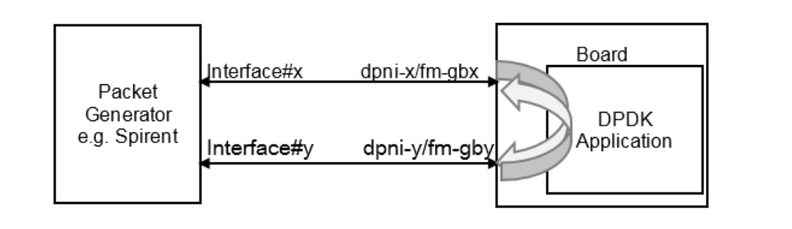

**Figure 195. Setup test**

##### 9.2.4.2.2 Generic Setup - DPAA

Mục này trình bày chi tiết các bước cần để thiết lập môi trường cần thiết cho việc chạy các ứng dụng DPDK trên nền tảng DPAA. Mục này áp dụng cho cả ứng dụng mẫu lẫn bất kỳ ứng dụng DPDK bên ngoài nào. Để biết thêm chi tiết về file cấu hình áp dụng cho nền tảng DPAA, xem Section 9.2.3.5. Về setup riêng cho nền tảng DPAA2, xem Section 9.2.4.2.3.

###### 9.2.4.2.2.1 Các file cấu hình phần cứng DPAA

**Ghi chú:** Để cấu hình queue FMan tự động hoặc động, chạy `fmc -x` và không chạy bất kỳ lệnh FMC nào khác để cấu hình queue DPDK. Nếu không chạy FMC cho DPDK, driver DPAA dựa trên DPDK sẽ tự động cấu hình số queue theo yêu cầu của ứng dụng.

Mặc định là chế độ không động, đòi hỏi người dùng chạy công cụ fmc với cấu hình queue chính xác trước khi chạy ứng dụng DPDK. Mục này trình bày chi tiết về chế độ này.

Các nền tảng DPAA hỗ trợ tăng tốc phần cứng cho packet queue. Các queue này cần được cấu hình trong FMan (Frame Manager) trước khi dùng. Có thể làm việc này bằng cách chọn file cấu hình policy thích hợp được đóng gói cùng Yocto rootfs hoặc source code DPDK.

Có thể chọn một trong các file policy dựa trên 1, 2 hoặc 4 queue trước khi chạy ứng dụng. Ví dụ, file policy 1 queue định nghĩa một queue duy nhất cho mỗi interface vật lý của DPAA. Tương tự, 2 và 4 queue lần lượt định nghĩa 2 hoặc 4 queue cho mỗi interface được định nghĩa.

**Ghi chú:** Để chuyển giữa các cấu hình số queue khác nhau, cần chạy công cụ fmc mỗi lần với file policy mới. Trước khi chạy công cụ fmc, cần chạy `fmc -x` để xóa cấu hình cũ.

Sau đây là các file cấu hình riêng cho từng nền tảng:

- `usdpaa_config_ls1043.xml` cho board LS1043ARDB
- `usdpaa_config_ls1046.xml` cho board LS1046ARDB
- `usdpaa_config_ls1046_frwy.xml` cho board LS1046AFRWY
- `usdpaa_config_ls1046_shared_xxg.xml` cho board LS1046ARDB dùng Shared Mac (VSP)

Sau đây là các file policy có sẵn:

- `usdpaa_policy_hash_ipv4_1queue.xml` cho 1 queue mỗi port
- `usdpaa_policy_hash_ipv4_2queue.xml` cho 2 queue mỗi port
- `usdpaa_policy_hash_ipv4_4queue.xml` cho 4 queue mỗi port
- `usdpaa_policy_24g_classif_udp_ipsec_1queue.xml` và `usdpaa_policy_24g_classif_frag_gtp_1queue.xml` cho Shared Mac (VSP)

**Ghi chú:** Điều quan trọng là chạy ứng dụng với cùng cấu hình queue như file policy đã dùng. Lý do là sau khi cấu hình queue, phần cứng DPAA sẽ phân phối packet qua số queue đã cấu hình. Nếu không lấy packet từ một queue nào đó, queue sẽ bị dồn, cuối cùng làm dừng I/O.

###### 9.2.4.2.2.2 Thiết lập môi trường DPAA

Dựa trên số queue mỗi port mà ứng dụng cần chạy, chọn file cấu hình policy và chạy binary `fmc`:

```
fmc -x  # Clean any previous configuration/setting
fmc -c <Configuration file> -p <Policy File> -a
```

Ví dụ, với nền tảng LS1043A dùng 1 queue, lệnh cần chạy như sau:

```
fmc -x
fmc -c ./usdpaa_config_ls1043.xml -p ./usdpaa_policy_hash_ipv4_1queue.xml -a
```

**Ghi chú:** Các nền tảng DPAA bật push mode theo mặc định. Nghĩa là 4 queue đầu tiên của một interface được cấu hình ở Push mode, các queue sau đó dùng cấu hình pull mặc định. Các queue push mode hỗ trợ cấu hình hiệu năng cao hơn các queue pull mode chuẩn, nhưng số lượng bị giới hạn. Để thay đổi số queue push mode, dùng biến môi trường sau:

```
#export DPAA_PUSH_QUEUES_NUMBER=0 <default value is 4>
```

Lưu ý rằng cấu hình số queue push mode lớn hơn số có sẵn (đạt được) sẽ dẫn tới lỗi I/O. Giá trị tối đa có thể của `DPAA_PUSH_QUEUES_NUMBER` trên DPAA (LS1043, LS1046) là 8.

**Ghi chú:** Biến môi trường `DPAA_PUSH_QUEUES_NUMBER` bật và dành riêng các PUSH queue cho Ethernet driver. Nhưng chức năng Eventdev của DPAA1 cần dùng các push queue. Vì vậy, biến môi trường `DPAA_PUSH_QUEUES_NUMBER` cần đặt bằng 0 khi dùng driver eventdev của DPAA1, để không có PUSH queue nào được dành cho Ethernet driver của DPAA1.

Thiết lập hugepage để ứng dụng DPDK dùng cho packet và buffer chung. Có thể bỏ qua bước này nếu hugepage đã được mount. Dùng lệnh `mount | grep hugetlbfs` để kiểm tra hugepage đã được thiết lập chưa.

```
mkdir /dev/hugepages
```

```
mount -t hugetlbfs none /dev/hugepages
```

**Ghi chú:** Với chức năng Crypto của DPAA1, phải bật Linux CAAM driver. Nếu Linux CAAM driver được build dưới dạng kernel module, phải nạp nó (`insmod caam.ko`) vào kernel trước khi chạy ứng dụng DPDK.

Từ đây, các ứng dụng DPDK mẫu đã sẵn sàng để chạy trên nền tảng DPAA.

###### 9.2.4.2.2.3 Dọn dẹp môi trường DPAA

Để gỡ cấu hình đã làm bằng công cụ `fmc`, dùng tham số `-x`. Nên dọn dẹp cấu hình trước khi thiết lập cấu hình mới. Ngay cả khi cần thay đổi cấu hình, ví dụ tăng số queue được hỗ trợ, có thể dùng lệnh sau để dọn dẹp cấu hình trước đó.

```
fmc -x
```

##### 9.2.4.2.3 Generic Setup - DPAA2

Mục này trình bày chi tiết các bước cần để thiết lập môi trường cần thiết cho việc chạy các ứng dụng DPDK trên nền tảng DPAA2. Mục này áp dụng cho cả ứng dụng mẫu lẫn bất kỳ ứng dụng DPDK bên ngoài nào. Để biết thêm chi tiết về file cấu hình áp dụng cho nền tảng DPAA2, xem Section 9.2.3.5. Về setup riêng cho nền tảng DPAA, xem Section 9.2.4.2.2.

Các bước này phải được thực hiện trước khi chạy bất kỳ ứng dụng DPDK nào trên host.

###### 9.2.4.2.3.1 Thiết lập môi trường DPAA2

Để chạy ứng dụng DPDK trên nền tảng DPAA2, cần tạo một resource container chứa mọi interface cần thiết tới các khối phần cứng DPAA2. Các script cấu hình cần thiết để tạo và hủy container được cung cấp cùng package DPDK.

1. Cấu hình resource container DPAA2 bằng script `dynamic_dpl.sh`. Script này có trong thư mục `/` `usr/share/dpdk/dpaa2/` của rootfs.

   ```
   cd /usr/share/dpdk/dpaa2/     # Or, any other folder if custom installation
    of DPDK is done
   ./dynamic_dpl.sh <DPMAC1.id> <DPMAC2.id> ... <DPMACn.id>
   ```

   Trong lệnh trên, `<DPMAC1.id>` chỉ tài nguyên MAC của DPAA2, ví dụ `dpmac.1` hoặc `dpmac.2`. Sửa lệnh trên theo số port MAC vật lý mà ứng dụng cần (bị giới hạn bởi số port có sẵn và kết nối trên DUT).

   Output của lệnh `dynamic_dpl.sh` cho biết tên container đã tạo. Tên này được truyền cho các ứng dụng DPDK qua biến môi trường `DPRC`. Khối sau cho thấy output mẫu của lệnh `dynamic_dpl.sh`:

   ```
   parent - dprc.1
   Creating Non nested DPRC
   NEW DPRCs
   dprc.1
   dprc.2
   Using board type as 2088
   Using High Performance Buffers

   ##################### Container  dprc.2  is created ####################

   Container dprc.2 have following resources :=>

    * 3 DPMCP
    * 16 DPBP
    * 8 DPCON
    * 8 DPSECI
    * 1 DPNI
    * 18 DPIO
    * 8 DPCI
    * 64 DPDMAI
    * 0 DPRTC

   ######################### Configured Interfaces #########################

   Interface Name        Endpoint              Mac Address
   ==============        ========              ==================
   dpni.1                dpmac.2               -Dynamic-
   ```

   Các địa chỉ MAC được ứng dụng DPDK tự gán sau khi lấy thông tin từ firmware. Chúng giống với địa chỉ do U-Boot lập trình. Để tạo flow, xem output của ứng dụng hoặc ghi lại địa chỉ MAC trong lúc board boot. Cũng có thể dùng ứng dụng Testpmd để tìm địa chỉ MAC đã gán.

   **Ghi chú:** Nếu dùng UEFI-ACPI làm bootloader, chạy `export BOARD_TYPE=2160` hoặc `2088` trước khi chạy `dynamic_dpl.sh`.

   **Ghi chú:** Có thể sửa số interface (`DPBP`, `DPCON`, `DPNI`) trong một container. Việc này làm được bằng cách định nghĩa biến môi trường `COMPONENT_COUNT=<number>` trước khi chạy script. Ví dụ, để đặt số DPBP là 4, dùng `export DPBP_COUNT=4`.

   **Ghi chú:** Tuy có sự linh hoạt để sửa các interface trong container, lưu ý rằng tài nguyên cần được cân đối, và thay đổi bất kỳ số lượng nào cũng đòi hỏi thay đổi tương ứng với các interface khác. Thay đổi sai có thể khiến ứng dụng DPDK không chạy được.

2. Thiết lập biến môi trường bằng tên container do lệnh `dynamic_dpl.sh` báo:

   ```
   export DPRC=dprc.2
   ```

Sau khi hoàn tất setup trên, có thể chạy ứng dụng DPDK trên nền tảng DPAA2.

###### 9.2.4.2.3.2 Gỡ bỏ môi trường DPAA2

Có thể cần thay đổi cấu hình resource container để sửa các thành phần trong nó. Vì số tài nguyên trong hệ thống có hạn, số container có thể tạo cũng có hạn. Có thể gỡ một container hiện có và tạo container khác.

Chạy lệnh sau để gỡ bỏ một container:

```
cd /usr/share/dpdk/dpaa2/                   # Or, any other folder if custom
 installation of DPDK is done
./destroy_dynamic_dpl.sh <Container Name>  # for example, "dprc.2"
```

##### 9.2.4.2.4 Generic Setup - PPFE

Mục này cung cấp các bước cần để thiết lập môi trường cần thiết cho việc chạy các ứng dụng DPDK trên nền tảng PPFE.

Các bước này phải được thực hiện trước khi chạy bất kỳ ứng dụng DPDK nào trên host.

**Thiết lập môi trường PPFE**

PPFE là driver tích hợp sẵn và mặc định được bật ở kernel mode. Để chạy ứng dụng DPDK trên nền tảng PPFE, cần thêm `pfe.us=1` vào bootargs trước khi boot linux để bật DPDK mode, chế độ này sẽ thực hiện khởi tạo cần thiết để chạy các ứng dụng DPDK. Người dùng phải bảo đảm giá trị của `/sys/module/pfe/` `parameters/us` là 1 để kiểm tra driver pfe đã được nạp ở user space mode. Nếu `/sys/module/pfe/parameters/` `us` không phải 1, người dùng cần reboot kernel và thêm `pfe.us=1` vào dòng lệnh kernel.

Ngoài ra, người dùng phải chạy các lệnh dưới đây để đáp ứng yêu cầu huge page của các ứng dụng DPDK.

```
mkdir /dev/hugepages
mount -t hugetlbfs none /dev/hugepages
```

**Ghi chú:** Với PPFE (nền tảng LS1012), khi dùng các Crypto driver, cần bật flag CONFIG_RTE_LIBRTE_PMD_CAAM_JR_BE khi biên dịch DPDK.

**Ghi chú:** Ngoài ra, với chức năng Crypto, phải bật Linux CAAM Job Ring driver. Nếu Linux CAAM driver được build dưới dạng kernel module, phải nạp nó (`insmod caam_jr.ko`) vào kernel trước khi chạy ứng dụng DPDK.

Từ đây, các ứng dụng DPDK mẫu đã sẵn sàng để chạy.

##### 9.2.4.2.5 Generic setup – ENETC

Mục này trình bày chi tiết các bước cần để thiết lập môi trường cần thiết cho việc chạy các ứng dụng DPDK trên nền tảng ENETC. Mục này áp dụng cho cả ứng dụng mẫu lẫn bất kỳ ứng dụng DPDK bên ngoài nào.

Các bước này phải được thực hiện trước khi chạy bất kỳ ứng dụng DPDK nào trên host.

**Thiết lập môi trường ENETC**

Để chạy ứng dụng DPDK trên nền tảng ENETC, các thiết bị Ethernet cần được bind vào driver "vfio-pci". Script cấu hình cần thiết được cung cấp cùng package DPDK.

Script này có trong thư mục /usr/share/dpdk/enetc/ của rootfs.

```
cd /usr/share/dpdk/enetc/     # Or, any other folder if custom installation of
 DPDK is done
./dpdk_configure_1028ardb.sh
```

Script này cho phép các ứng dụng DPDK dùng hai thiết bị Ethernet bằng cách bind chúng vào driver "vfio_pci". Các thiết bị này trên vỏ được gắn nhãn "1G MAC0" và "1G SWP0".

**Ghi chú:** Khi dùng các Crypto driver trên LS1028, cần bật flag CAAM_JR_UIO khi biên dịch DPDK.

**Ghi chú:** Với chức năng Crypto, phải bật Linux CAAM Job Ring driver. Nếu Linux CAAM driver được build dưới dạng kernel module, phải nạp nó (`insmod caam_jr.ko`) vào kernel trước khi chạy ứng dụng DPDK.

Từ đây, các ứng dụng DPDK mẫu đã sẵn sàng để chạy.

#### 9.2.4.3 Các ứng dụng DPDK mẫu

Binary các ứng dụng DPDK mẫu có trong thư mục `/usr/share/dpdk/examples/` của rootfs do Yocto sinh ra.

**Ghi chú:**

- Các đoạn lệnh dưới đây giả định lệnh được chạy khi đang ở `/usr/share/dpdk/` `examples/` hoặc đã đặt biến `PATH` thích hợp. Ngoài ra, một binary DPDK có thể chạy trên cả hai nền tảng DPAA1 và DPAA2 mà không cần sửa đổi.
- Mặc định chỉ một số ít ứng dụng DPDK mẫu được triển khai vào root filesystem. Với các ứng dụng mẫu chưa triển khai, cần biên dịch bằng source code DPDK. Xem Section 9.2.3.3 để biết thêm chi tiết.
- Với nền tảng PPFE, vì LS1012ARDB chỉ có 1 core nên `-c` với 0x1 là core mask duy nhất được chấp nhận cho mọi ứng dụng DPDK. Ngoài ra, người dùng phải cung cấp tham số `—vdev` với giá trị `net_pfe` để bật thiết bị Ethernet cho ứng dụng DPDK.
- Với nền tảng ENETC, LS1028A có 2 core. Để đo hiệu năng, -c với 0x2 là core mask duy nhất được hỗ trợ cho mọi ứng dụng DPDK được hỗ trợ. Người dùng có thể kiểm tra chức năng trên cả hai core.
- Trong suốt tài liệu dưới đây, tham số `-n 1` được thêm vào các lệnh. Tham số này biểu diễn việc chia buffer qua các channel/rank trên DDR, nếu có. Việc này hữu ích cho các trường hợp NUMA. Nhưng trong trường hợp không NUMA, như với các SoC của NXP, nó có thể ảnh hưởng hiệu năng nếu channel/rank của DDR khác với môi trường chuẩn/đã kiểm chứng. Nên benchmark hiệu năng sau khi đã phân tích ảnh hưởng của cấu hình này.

##### 9.2.4.3.1 dpdk-l2fwd – Ứng dụng chuyển tiếp Layer 2

Ứng dụng mẫu cho thấy việc chuyển tiếp giữa nhiều port dựa trên thông tin Layer 2 (switching).

```
dpdk-l2fwd -c 0x2 -n 1 -- -p 0x1 -q 1 -T 0
```

Trong đó:

`-c` là core mask của các core được gán cho DPDK.

`-p` là port mask của các port mà ứng dụng dùng.

`-q` định nghĩa số queue phục vụ trên mỗi port.

Cũng có thể cung cấp các tham số dòng lệnh khác. Danh sách đầy đủ xem https://doc.dpdk.org/guides-21.11/sample_app_ug/l2_forward_real_virtual.html.

**Ghi chú:**

- `isolcpus` được truyền làm boot argument cho U-Boot bảo đảm các core bị cô lập không bị Linux kernel lập lịch. Dùng Core 0 cho ứng dụng DPDK có thể dẫn tới hành vi không xác định, kể cả giảm hiệu năng. Khuyến nghị giá trị core mask của ứng dụng DPDK tránh dùng Core 0. Khi ứng dụng cũng chạy trên mọi core, thì không dùng `isolcpus`.
- Ứng dụng DPDK L2fwd định kỳ in thống kê I/O. Để tránh CPU core bị ngắt vì các lần in theo lịch này, có thể thêm option `-T 0` vào cuối dòng lệnh.
- Lệnh chạy `dpdk-l2fwd` trên LS1012ARDB:

  ```
  dpdk-l2fwd -c 0x1 -n 1 --vdev 'net_pfe0' --vdev='net_pfe1' -- -p 0x3 -q 3
  ```

Để có hiệu năng tốt nhất trên LS1046ARDB, dùng lệnh sau.

```
dpdk-l2fwd -c 0x2 -n 1 -- -p 0x1 -q 1 -T 0 -b 7
```

Lệnh này có option `-b 7`, đặt kích thước burst I/O tối ưu.

##### 9.2.4.3.2 dpdk-l2fwd-event – Ứng dụng chuyển tiếp Layer 2 dựa trên event

Dưới đây là một ứng dụng mẫu cho thấy việc chuyển tiếp dựa trên event giữa nhiều port dựa trên thông tin Layer 2 (switching):

```
dpdk-l2fwd-event -c 0x2 -n 1 --vdev=event_dpaa2 -- -p 0x1 -q 1 -T 0 --
mode=eventdev --eventq-sched=atomic
```

Trong đó:

`-c` là core mask của các core được gán cho DPDK.

`-p` là port mask của các port mà ứng dụng dùng.

`-q` định nghĩa số queue phục vụ trên mỗi port.

Đổi thành `--vdev=event_dpaa` cho các thiết bị DPAA.

`--mode` có thể là `poll` hoặc `eventdev`.

`--eventq-sched` có thể là `ordered`, `atomic` hoặc `parallel`.

Cũng có thể cung cấp các tham số dòng lệnh khác. Danh sách đầy đủ xem https://doc.dpdk.org/guides-21. 11/sample_app_ug/l2_forward_event.html.

##### 9.2.4.3.3 dpdk-l2fwd–qdma - Ứng dụng chuyển tiếp Layer 2 dùng QDMA (chỉ DPAA2)

Dưới đây là một ứng dụng mẫu cho thấy việc chuyển tiếp giữa nhiều port dựa trên thông tin Layer 2 (switching) dùng QDMA:

```
dpdk-l2fwd-qdma -c 0x2 -n 1 -- -p 0x1 -q 1 -m 1 -T 0
```

**Ghi chú:** Trong ứng dụng này, khi nhận được một packet, một packet buffer tương ứng được cấp phát cho TX. Dữ liệu từ packet RX được chép bằng DMA sang buffer TX dùng khối QDMA. Sau đó, ứng dụng giải phóng buffer RX rồi truyền buffer TX ra ngoài.

Trong đó:

`-c` là core mask của các core được gán cho DPDK.

`-p` là port mask của các port mà ứng dụng dùng.

`-q` định nghĩa số queue phục vụ trên mỗi port.

Mode `-m` chỉ định chế độ HW (-m là 0) hoặc Virtual (-m là 1) cho các queue QDMA.

Ngoài tham số `-m`, các tham số khác tương tự ứng dụng DPDK l2fwd. Về chi tiết, xem https://doc. dpdk.org/guides-21.11/sample_app_ug/l2_forward_real_virtual.html.

##### 9.2.4.3.4 dpdk-l3fwd – Ứng dụng chuyển tiếp Layer 3

Ứng dụng mẫu cho thấy việc chuyển tiếp giữa nhiều port dựa trên thông tin Layer 3 (routing).

```
dpdk-l3fwd -c 0x6 -n 1 -- -p 0x3 --config="(0,0,1),(1,0,2)"
```

Trong đó:

`-c` là core mask của các core được gán cho DPDK.

`-p` là port mask của các port mà ứng dụng dùng.

`--config` là cấu hình (Port, Queue, Core) mà ứng dụng dùng để gắn core với queue trên mỗi port.

Cũng có thể cung cấp các tham số dòng lệnh khác. Danh sách đầy đủ xem https://doc.dpdk.org/guides-21. 11/sample_app_ug/l3_forward.html.

Các biến thể khác của lệnh trên mô tả dưới đây thay đổi cấu hình port, queue và các core phục vụ chúng.

1. 4 core - 2 Port, 2 queue mỗi port:

   ```
   dpdk-l3fwd -c 0xF -n 1 -- -p 0x3 -P --config="(0,0,0),(0,1,1),(1,0,2),
   (1,1,3)"
   ```

2. 4 core - 2 Port với địa chỉ MAC đích:

   ```
   dpdk-l3fwd -c 0xF -n 1 -- -p 0x3 -P --config="(0,0,0),(0,1,1),(1,0,2),
   (1,1,3)" --eth-dest=0,11:11:11:11:11:11 --eth-dest=1,00:00:00:11:11:11
   ```

3. 8 core - 2 Port với 4 queue mỗi port:

   ```
   dpdk-l3fwd -c 0xFF -n 1 -- -p 0x3 -P --config="(0,0,0),(0,1,1),(0,2,2),
   (0,3,3),(1,0,4),(1,1,5),(1,2,6),(1,3,7)"
   ```

**Ghi chú:** Tuy các đoạn lệnh trên dùng Core 0 cho ứng dụng DPDK, không khuyến nghị dùng Core 0 để có hiệu năng tốt nhất, vì Linux OS lập lịch các task của nó trên core này. Cũng khuyến nghị phải dùng `isolcpus` trong boot argument của Linux để ngăn Linux lập lịch task trên các Core khác. Khi ứng dụng cũng chạy trên mọi core, thì không nên dùng `isolcpus`.

Lệnh ví dụ chạy l3fwd trên LS1012ARDB:

```
dpdk-l3fwd -c 0x1 --vdev='net_pfe0' --vdev='net_pfe1' -n 1 -- -p 0x3 --
config="(0,0,0),(1,0,0)" -P
```

Để có hiệu năng tốt nhất trên LS1046ARDB, dùng lệnh sau:

```
dpdk-l3fwd -c 0xF -n 1 -- -p 0x3 -P -b 7 --config="(0,0,0),(0,1,1),(1,0,2),
(1,1,3)"
```

Lệnh này có option `-b 7`, đặt kích thước burst I/O tối ưu.

Điều này đúng với mọi cấu hình core, queue và port (option `--config`).

Với nền tảng LX2, khi chạy trên mọi core có sẵn, các tham số core mask truyền cho `dpdk-l3fwd` cần được điều chỉnh cho 16 core có sẵn. Sau đây là ví dụ dùng cả 16 core trên LX2, 2 Port, 8 queue mỗi port:

```
dpdk-l3fwd -c 0xffff -n 1 -- -p 0x3 -P --config="(0,0,0),(0,1,1),(0,2,2),
(0,3,3),(0,4,4),(0,5,5),(0,6,6),(0,7,7),(1,0,8),(1,1,9),(1,2,10),(1,3,11),
(1,4,12),(1,5,13),(1,6,14),(1,7,15)"
```

DPDK l3fwd cũng có thể chạy ở chế độ `eventdev`:

```
dpdk-l3fwd -c 0x6 -n 1 -- -p 0x3 --mode=eventdev --eventq-sched=atomic
```

Trong đó:

Đổi thành `--vdev=event_dpaa` cho các thiết bị DPAA.

`--mode` có thể là `poll` hoặc `eventdev`

`--eventq-sched` có thể là `ordered`, `atomic` hoặc `parallel`.

##### 9.2.4.3.5 dpdk-l2fwd-crypto – Chuyển tiếp Layer 2 dùng phần cứng SEC

Biến thể này của ứng dụng chuyển tiếp Layer 2 dùng khối SEC để mã hóa packet.

- Chuyển tiếp Layer 2 chỉ hỗ trợ Cipher:

  ```
  dpdk-l2fwd-crypto -c 0x2 -n 1 -- -p 0x1 -q 1  --chain CIPHER_ONLY
    --cipher_algo aes-cbc --cipher_op ENCRYPT --cipher_key
   01:02:03:04:05:06:07:08:09:0a:0b:0c:0d:0e:0f:10
  ```

- Chuyển tiếp Layer 2 hỗ trợ Cipher-Hash:

  ```
  dpdk-l2fwd-crypto -c 0x2 -n 1 -- -p 0x1 -q 1 --chain CIPHER_HASH
    --cipher_algo aes-cbc --cipher_op ENCRYPT --cipher_key
   01:02:03:04:05:06:07:08:09:0a:0b:0c:0d:0e:0f:10 --auth_algo sha1-hmac --
  auth_op GENERATE --auth_key_random_size 64
  ```

- Chuyển tiếp Layer 2 chỉ hỗ trợ Hash:

  ```
  dpdk-l2fwd-crypto -c 0x2 -n 1 -- -p 0x1 -q 1 --chain HASH_ONLY --auth_algo
   sha1-hmac --auth_op GENERATE --auth_key_random_size 64
  ```

  **Ghi chú:** Với LS1028, cũng cần thêm `--iova-mode=pa` làm tham số dòng lệnh.

##### 9.2.4.3.6 dpdk-l2fwd-crypto – Chuyển tiếp Layer 2 dùng lệnh phần mềm OpenSSL

Biến thể này của ứng dụng chuyển tiếp Layer 2 dùng thư viện OpenSSL để thực hiện các thao tác crypto bằng phần mềm. Bên trong, thư viện OpenSSL dùng các lệnh ARMCE riêng cho CPU Arm. Với DPDK, ứng dụng này dùng OpenSSL PMD làm driver bên dưới.

**Ghi chú:** Lệnh này cần hỗ trợ package OpenSSL khi build các ứng dụng DPDK. Xem mục này của tài liệu để biết chi tiết về việc bật/tắt biên dịch hỗ trợ software crypto, gồm cả driver OpenSSL.

**Ghi chú:** Trong mọi lệnh mô tả dưới đây, `-T 0` được thêm vào để tắt output trên console/terminal. Điều này quan trọng vì lý do hiệu năng. Tuy vậy, để debug hoặc để biết số packet đã giao dịch, hãy bỏ tham số này hoặc đặt giá trị lớn hơn tính bằng giây.

- Cipher_only
  - Với nền tảng DPAA:
    - 1 core: Tùy nền tảng đang chạy, nối tham số blacklist ở trên vào cuối lệnh này:

      ```
      dpdk-l2fwd-crypto --vdev "crypto_openssl"  -c 0x2 -n 1 -- -p 0x1 -q 1 --
      chain CIPHER_ONLY --cipher_algo aes-cbc --cipher_op ENCRYPT --cipher_key
       01:02:03:04:05:06:07:08:09:0a:0b:0c:0d:0e:0f:10 --cryptodev_mask 0x10 -T 0
      ```

    - 2 core: Tùy nền tảng đang chạy, nối tham số blacklist ở trên vào cuối lệnh này:

      ```
      dpdk-l2fwd-crypto --vdev "crypto_openssl0" --vdev "crypto_openssl1"
       -c 0x6 -n 1 -- -p 0x3 -q 1  --chain CIPHER_ONLY  --
      cipher_algo aes-cbc --cipher_op ENCRYPT --cipher_key
       01:02:03:04:05:06:07:08:09:0a:0b:0c:0d:0e:0f:10 --cryptodev_mask 0x30 -T 0
      ```

    - 4 core: Tùy nền tảng đang chạy, nối tham số blacklist ở trên vào cuối lệnh này:

      ```
      dpdk-l2fwd-crypto --vdev "crypto_openssl0" --vdev "crypto_openssl1" --vdev
       "crypto_openssl2" --vdev "crypto_openssl3" -c 0xf -n 1 -- -p 0xf -q 1  --
      chain CIPHER_ONLY  --cipher_algo aes-cbc --cipher_op ENCRYPT --cipher_key
       01:02:03:04:05:06:07:08:09:0a:0b:0c:0d:0e:0f:10 --cryptodev_mask 0xF0 -T 0
      ```

  - Với nền tảng DPAA2
    - 1 core: Tùy nền tảng đang chạy, nối tham số blacklist ở trên vào cuối lệnh này:

      ```
      dpdk-l2fwd-crypto --vdev "crypto_openssl" -c 0x2 -n 1 -- -p 0x1 -q 1 --
      chain CIPHER_ONLY --cipher_algo aes-cbc --cipher_op ENCRYPT --cipher_key
       01:02:03:04:05:06:07:08:09:0a:0b:0c:0d:0e:0f:10 --cryptodev_mask 0x100 -T
       0
      ```

    - 2 core: Tùy nền tảng đang chạy, nối tham số blacklist ở trên vào cuối lệnh này:

      ```
      dpdk-l2fwd-crypto --vdev "crypto_openssl0" --vdev "crypto_openssl1"
       -c 0x6 -n 1 -- -p 0x3 -q 1  --chain CIPHER_ONLY  --
      cipher_algo aes-cbc --cipher_op ENCRYPT --cipher_key
       01:02:03:04:05:06:07:08:09:0a:0b:0c:0d:0e:0f:10 --cryptodev_mask 0x300 -T
       0
      ```

    - 4 core: Tùy nền tảng đang chạy, nối tham số blacklist ở trên vào cuối lệnh này:

      ```
      dpdk-l2fwd-crypto --vdev "crypto_openssl0" --vdev "crypto_openssl1" --vdev
       "crypto_openssl2" --vdev "crypto_openssl3" -c 0xf -n 1 -- -p 0xf -q 1  --
      chain CIPHER_ONLY  --cipher_algo aes-cbc --cipher_op ENCRYPT --cipher_key
       01:02:03:04:05:06:07:08:09:0a:0b:0c:0d:0e:0f:10 --cryptodev_mask 0xF00 -T
       0
      ```

- Cipher_hash
  - Với nền tảng DPAA:
    - 1 core: Nối tham số blacklist ở trên vào cuối lệnh này:

      ```
      dpdk-l2fwd-crypto --vdev "crypto_openssl" -c 0x2 -n 1 -- -p 0x1 -q 1 --
      chain CIPHER_HASH --cipher_algo aes-cbc --cipher_op ENCRYPT --cipher_key
       01:02:03:04:05:06:07:08:09:0a:0b:0c:0d:0e:0f:10 --auth_algo sha1-hmac --
      auth_op GENERATE --cryptodev_mask 0x10 --auth_key_random_size 64 -T 0
      ```

  - Với nền tảng DPAA2:
    - 1 core: Nối tham số blacklist ở trên vào cuối lệnh này:

      ```
      dpdk-l2fwd-crypto --vdev "crypto_openssl" -c 0x2 -n 1 -- -p 0x1 -q 1 --
      chain CIPHER_HASH --cipher_algo aes-cbc --cipher_op ENCRYPT --cipher_key
       01:02:03:04:05:06:07:08:09:0a:0b:0c:0d:0e:0f:10 --auth_algo sha1-hmac --
      auth_op GENERATE --cryptodev_mask 0x100 --auth_key_random_size 64 -T 0
      ```

      Trong các lệnh trên, để mở rộng ra nhiều core hoặc port, thay đổi các tham số `-c` và `-p` như mô tả ở trên.

    Lệnh ví dụ chạy dpdk-l2fwd-crypto với openssl trên LS1012ARDB (chỉ cipher):

    ```
    dpdk-l2fwd-crypto -c 0x1 --vdev='net_pfe0' --vdev='crypto_openssl' -n 1
     -- -p 0x1 -q 1 --chain CIPHER_ONLY --cipher_algo aes-cbc --cipher_key
     00:01:02:03:04:05:06:07:08:09:0a:0b:0c:0d:0e:0f --cipher_op ENCRYPT -T 0
    ```

- Hash_cipher
  - Với nền tảng DPAA:

    1 core: Nối tham số blacklist ở trên vào cuối lệnh này:

    ```
    dpdk-l2fwd-crypto --vdev "crypto_openssl" -c 0x2 -n 1 -- -p
     0x1 -q 1 --chain HASH_CIPHER --auth_algo sha1-hmac --auth_op
     GENERATE --cipher_algo aes-cbc --cipher_op ENCRYPT --cipher_key
     01:02:03:04:05:06:07:08:09:0a:0b:0c:0d:0e:0f:10 --cryptodev_mask 0x10 --
    auth_key_random_size 64 -T 0
    ```

  - Với nền tảng DPAA2:

    1 core: Nối tham số blacklist ở trên vào cuối lệnh này:

    ```
    dpdk-l2fwd-crypto --vdev "crypto_openssl" -c 0x2 -n 1 -- -p
     0x1 -q 1 --chain HASH_CIPHER --auth_algo sha1-hmac --auth_op
     GENERATE --cipher_algo aes-cbc --cipher_op ENCRYPT --cipher_key
     01:02:03:04:05:06:07:08:09:0a:0b:0c:0d:0e:0f:10 --cryptodev_mask 0x100 --
    auth_key_random_size 64 -T 0
    ```

    Trong các lệnh trên, để mở rộng ra nhiều core hoặc port, thay đổi các tham số `-c` và `-p`.

- Hash_only
  - Với nền tảng DPAA:
    - 1 core: Nối tham số blacklist ở trên vào cuối lệnh này:

      ```
      dpdk-l2fwd-crypto --vdev "crypto_openssl" -c 0x2 -n 1 -- -p 0x1 -q 1 --
      chain HASH_ONLY --auth_algo sha1-hmac --auth_op GENERATE --cryptodev_mask
       0x10 --auth_key_random_size 64 -T 0
      ```

  - Với nền tảng DPAA2:
    - 1 core: Nối tham số blacklist ở trên vào cuối lệnh này:

      ```
      dpdk-l2fwd-crypto --vdev "crypto_openssl" -c 0x2 -n 1 -- -p 0x1 -q 1 --
      chain HASH_ONLY --auth_algo sha1-hmac --auth_op GENERATE --cryptodev_mask
       0x100 --auth_key_random_size 64 -T 0
      ```

    Để mở rộng ra nhiều core hoặc port, thay đổi các tham số `-c` và `-p` như mô tả ở trên. Để biết thêm về ứng dụng dpdk-l2fwd-crypto, xem https://doc.dpdk.org/guides-21.11/sample_app_ug/l2\_forward_crypto.html.

##### 9.2.4.3.7 dpdk-ipsec-secgw – IPSec gateway dùng phần cứng SEC

Với ứng dụng IPsec, cần cấu hình hai DUT làm `endpoint 0 (ep0)` và `endpoint 1 (ep1)`.

Giả sử mỗi `endpoint` có **4 port**:

- Nối Port 1 và Port 3 của `ep0` và `ep1` với nhau (back-to-back).
- Nối Port 0 và Port 2 của `ep0` và `ep1` với bộ sinh packet (ví dụ Spirent).

Stream do bộ sinh packet tạo ra cần có địa chỉ IP theo mẫu sau:

```
EP0:
    port 0: 32 flows with destination IP: 192.168.1.XXX,
 192.168.2.XXX, ..... ,192.168.31.XXX,192.168.32.XXX
    port 2: 32 flows with destination IP: 192.168.33.XXX,
 192.168.34.XXX, ..... ,192.168.63.XXX,192.168.64.XXX
EP1:
    port 0: 32 flows with destination IP: 192.168.101.XXX,
 192.168.102.XXX, ..... ,192.168.131.XXX,192.168.132.XXX
    port 2: 32 flows with destination IP: 192.168.133.XXX,
 192.168.134.XXX, ..... ,192.168.163.XXX,192.168.164.XXX
```

Đây là cấu hình mặc định cho các endpoint trong `ep0_64X64.cfg` và `ep1_64X64.cfg`. Có thể cấu hình ánh xạ port tùy chỉnh, SA/SP và route trong file cấu hình tương ứng tên `ep0.cfg` và `ep1.cfg` cho từng endpoint. Các file này có trong rootfs do Yocto sinh ra.

Để biết thêm chi tiết, xem Table 169.

Để biết thêm thông tin, xem https://doc.dpdk.org/guides-21.11/sample_app_ug/ipsec_secgw.html.

- Cấu hình Endpoint 0 (`ep0`):

  ```
  dpdk-ipsec-secgw -c 0xf -n 1 -- -p 0xf -P -u 0xa --config="(0,0,0),(1,0,1),
  (2,0,2),(3,0,3)" -f ep0_64X64.cfg
  ```

- Cấu hình Endpoint 1 (`ep1`):

  ```
  dpdk-ipsec-secgw -c 0xf -n 1 -- -p 0xf -P -u 0xa --config="(0,0,0),(1,0,1),
  (2,0,2),(3,0,3)" -f ep1_64X64.cfg
  ```

  **Ghi chú:** Với LS1028, cũng cần thêm `--iova-mode=pa` làm tham số dòng lệnh.

##### 9.2.4.3.8 Chạy ứng dụng DPDK IPSec gateway với hardware protocol offload

Phần cứng SEC của DPAA/DPAA2 cũng hỗ trợ offload giao thức IPSec. Lệnh và cấu hình hoàn toàn giống nhau, trừ các file cfg. Với protocol offload, các file cfg là `ep0_64X64_proto.cfg` và `ep1_64X64_proto.cfg`. Hiệu năng với protocol offload sẽ tốt hơn nhiều so với trường hợp chuẩn. Với các nền tảng có 8 core, lệnh cho 8 core cũng hoàn toàn giống trường hợp không offload, trừ tên các file cfg.

- Cấu hình Endpoint 0 (`ep0`):

  ```
  dpdk-ipsec-secgw -c 0xf -n 1 -- -p 0xf -P -u 0xa --config="(0,0,0),(1,0,1),
  (2,0,2),(3,0,3)" -f ep0_64X64_proto.cfg
  ```

- Cấu hình Endpoint 1 (`ep1`):

  ```
  dpdk-ipsec-secgw -c 0xf -n 1 -- -p 0xf -P -u 0xa --config="(0,0,0),(1,0,1),
  (2,0,2),(3,0,3)" -f ep1_64X64_proto.cfg
  ```

  **Ghi chú:** Với LS1028, cũng cần thêm `--iova-mode=pa` làm tham số dòng lệnh.

##### 9.2.4.3.9 Chạy ứng dụng DPDK IPSec gateway với tám core

Để chạy ứng dụng IPsec với nhiều queue dùng 64x64 tunnel và tám core, phải dùng lệnh và cấu hình sau:

- Cấu hình Endpoint 0 (`ep0`):

  Cấu hình mẫu cho việc này có trong file `ep0_64X64_proto.cfg`, nằm trong thư mục `/usr/` `share/dpdk/ipsec/` của root filesystem.

  ```
  dpdk-ipsec-secgw -c 0xFF -n 1 -- -p 0xf -P -u 0xa --config="(0,0,0),(0,1,1),
  (1,0,2),(1,1,3),(2,0,4),(2,1,5),(3,0,6),(3,1,7)" -f ep0_64X64_proto.cfg
  ```

- Cấu hình Endpoint 1 (`ep1`):

  Cấu hình mẫu cho việc này có trong file `ep1_64X64_proto.cfg`, nằm trong thư mục `/usr/` `share/dpdk/ipsec/` của root filesystem.

  ```
  dpdk-ipsec-secgw -c 0xFF -n 1 -- -p 0xf -P -u 0xa --config="(0,0,0),(0,1,1),
  (1,0,2),(1,1,3),(2,0,4),(2,1,5),(3,0,6),(3,1,7)" -f ep1_64X64_proto.cfg
  ```

**Chạy ứng dụng DPDK IPSec gateway với 16 core trên nền tảng LX2**

Để chạy ứng dụng IPsec với nhiều queue dùng 64x64 tunnel và 16 core, cần dùng lệnh và cấu hình sau:

- Cấu hình Endpoint 0 (`ep0`):

  Cấu hình mẫu cho việc này có trong file `ep0_64X64_sha256_proto.cfg`, nằm trong thư mục `/usr/share/` `dpdk/ipsec/` của root filesystem.

  ```
  dpdk-ipsec-secgw -c 0xFFFF  -n 1 -- -p 0xf -P -u 0xa --config="(0,0,0),(0,1,1),
  (0,2,2),(0,3,3),(1,0,4),(1,1,5),(1,2,6),(1,3,7),(2,0,8),(2,1,9),(2,2,10),
  (2,3,11),(3,0,12),(3,1,13),(3,2,14),(3,3,15)" -f ep0_64X64_sha256_proto.cfg
  ```

- Cấu hình Endpoint 1 (`ep1`):

  Cấu hình mẫu cho việc này có trong file `ep1_64X64_sha256_proto.cfg`, nằm trong thư mục `/usr/share/` `dpdk/ipsec/` của root filesystem.

  ```
  dpdk-ipsec-secgw -c 0xFFFF -n 1 -- -p 0xf -P -u 0xa --config="(0,0,0),(0,1,1),
  (0,2,2),(0,3,3),(1,0,4),(1,1,5),(1,2,6),(1,3,7),(2,0,8),(2,1,9),(2,2,10),
  (2,3,11),(3,0,12),(3,1,13),(3,2,14),(3,3,15)" -f ep1_64X64_sha256_proto.cfg
  ```

DPDK ipsec-secgw cũng có thể chạy ở chế độ eventdev:

```
./dpdk-ipsec-secgw -c 0x3 --vdev="event_dpaa2" --vdev="event_dpaa2" -- -p 0x3 -
P -u 0x1 -f /usr/share/dpdk/ipsec/ep0_64X64_proto.cfg --transfer-mode=event --
event-schedule-type=parallel
```

Trong đó:

Đổi `--vdev="event_dpaa2"` thành `--vdev="event_dpaa"` cho các thiết bị DPAA.

`--event-schedule-type` có thể có giá trị `ordered`, `atomic` hoặc `parallel`

##### 9.2.4.3.10 dpdk-ipsec-secgw – IPSec gateway dùng OpenSSL PMD

Lệnh, flow stream và cấu hình port tương tự lệnh, flow stream và cấu hình port ở Section 9.2.4.3.7, trừ việc dùng OpenSSL PMD cho các thao tác crypto. Bên trong, OpenSSL PMD dùng các lệnh ARMCE của CPU Arm để thực hiện các thao tác crypto.

- Với nền tảng DPAA:
  - Cấu hình Endpoint 0

    ```
    dpdk-ipsec-secgw -c 0xf -n 1 --vdev "crypto_openssl" -- -p 0xf -P -u
     0xa --config="(0,0,0),(1,0,1),(2,0,2),(3,0,3)" --cryptodev_mask 0x10 -f
     ep0_64X64.cfg
    ```

  - Cấu hình Endpoint 1

    ```
    dpdk-ipsec-secgw -c 0xf -n 1 --vdev "crypto_openssl" -- -p 0xf -P -u
     0xa --config="(0,0,0),(1,0,1),(2,0,2),(3,0,3)" --cryptodev_mask 0x10 -f
     ep1_64X64.cfg
    ```

- Với nền tảng DPAA2:
  - Cấu hình Endpoint 0

    ```
    dpdk-ipsec-secgw -c 0xf -n 1 --vdev "crypto_openssl" -- -p 0xf -P -u 0xa
     --config="(0,0,0),(1,0,1),(2,0,2),(3,0,3)" --cryptodev_mask 0x100 -f
     ep0_64X64.cfg
    ```

  - Cấu hình Endpoint 1

    ```
    dpdk-ipsec-secgw -c 0xf -n 1 --vdev "crypto_openssl" -- -p 0xf -P -u 0xa
     --config="(0,0,0),(1,0,1),(2,0,2),(3,0,3)" --cryptodev_mask 0x100 -f
     ep1_64X64.cfg
    ```

**Ghi chú:**

Lệnh ví dụ chạy ipsec-secgw với openssl trên LS1012ARDB:

```
dpdk-ipsec-secgw -c 0x1 -n 1 --vdev='net_pfe0' --vdev='net_pfe1' --
vdev='crypto_openssl'  -- -p 0x3 -P -u 0x2 --config="(0,0,0),(1,0,0)" -f
 ep0_64X64.cfg
```

Các Port ID trong lệnh route của file cấu hình (ep0_xxx.cfg & ep1_xxx.cfg) phải hợp lệ và khớp với option -p của ứng dụng ipsec-secgw.

##### 9.2.4.3.11 dpdk-kni - Dùng Kernel Network Interface Module

Kernel NIC Interface (KNI) là một giải pháp control plane của DPDK, cho phép các ứng dụng user space trao đổi packet với network stack của kernel. Về chi tiết, xem http://dpdk.org/doc/guides/sample_app\_ug/kernel_nic_interface.html.

1. Nạp kernel module KNI không có tham số:

   ```
   #insmod rte_kni.ko carrier=on
   ```

   **Ghi chú:** Mặc định, chỉ một kernel thread được tạo cho mọi thiết bị KNI để nhận packet ở phía kernel.

2. Gắn task kni với một core duy nhất. Ví dụ, core số #1:

   ```
   #taskset -pc 1 `pgrep -fl kni_single | awk '{print $1}'`
   ```

3. Chạy ứng dụng kni như sau:

   ```
   dpdk-kni [EAL options] -- -P -p PORTMASK --
   config="(port,lcore_rx,lcore_tx[,lcore_kthread,..])
   [,port,lcore_rx,lcore_tx[,lcore_kthread,..]]" # dpdk-kni -c 0xf -n 1 -- -
   p 0x3 -P --config="(0,0,1),(1,0,1)" where config is : (PORT, kni lcore Rx
    core, kni lcore tx core )
   ```

4. Trên một console khác, kiểm tra các interface bằng:

   ```
   #ifconfig -a
   ```

5. Bật interface đã cho và gán địa chỉ IP (nếu có).

##### 9.2.4.3.12 Ứng dụng dpdk-qdma-demo

Trên DPAA1 và DPAA2, khối phần cứng QDMA cung cấp khả năng DMA chung, được DPDK đưa ra cho ứng dụng của nó dùng. Ứng dụng `dpdk-qdma-demo` trong DPDK là ứng dụng minh họa, thực hiện giao dịch bộ nhớ-tới-bộ nhớ, bộ nhớ-tới-bộ nhớ pci, hoặc bộ nhớ pci-tới-bộ nhớ dùng khối QDMA này. Có thể chạy nó như sau:

- Với use case MEM-to-MEM, chạy lệnh dưới đây:

  ```
  dpdk-qdma_demo -c 0x3 -n 1 -- --packet_size=512--test_case mem_to_mem
  ```

  **Ghi chú:** `dpdk-qdma_demo` cần nhiều hơn một core để chạy, vì nó dùng ít nhất một core để in output. Để biết thêm về cách dùng, xem nxp/README_qdma_demo trong source code DPDK. Output sau xuất hiện trên màn hình:

  ```
  Time Spend :4000.005 ms rcvd cnt:1310720 pkt_cnt:0
  Rate: 1342.176 Mbps OR 327.680 Kpps
  processed on core 7 pkt cnt: 1310720
  ```

  Output này cho thấy số khối bộ nhớ mà ứng dụng đã chuyển qua khối QDMA. Nó cũng cho thấy thời gian đã dùng, hiệu năng đạt được và số packet gửi trên mỗi core.

- Với các use case PCI-to-MEM và MEM-to-PCI, chạy các lệnh sau.

  **Các bước ở End Point**

  1. Nếu là card PCI LX2-EP, chỉ boot nó tới dấu nhắc U-Boot.
  2. Với card PCI NIC chuẩn, không cần thay đổi gì.

  **Các bước ở HOST - LX2 Root complex**

  1. Boot LX2 tới dấu nhắc Linux.
  2. Chạy `lspci -v` để kiểm tra địa chỉ BAR có vùng nhớ là bộ nhớ đích cho test.

     ```
     $ lspci -v
             0000:01:00.0 Ethernet controller: Intel Corporation 82574L Gigabit
      Network Connection
            Subsystem: Intel Corporation Gigabit CT Desktop Adapter
             Flags: bus master, fast devsel, latency 0, IRQ 106
             Memory at 30460c0000 (32-bit, non-prefetchable) [size=128K]
             Memory at 3046000000 (32-bit, non-prefetchable) [size=512K]
             I/O ports at 1000 [disabled] [size=32]
             Memory at 30460e0000 (32-bit, non-prefetchable) [size=16K]
             Expansion ROM at 3046080000 [disabled] [size=256K]
     Kernel driver in use: e1000e
     ```

  3. Gán thiết bị PCI cho user space.
     - Nạp module UIO, nếu chưa nạp.

       ```
       #modprobe uio_pci_generic
       ```

     - Gán thiết bị cho user space.

       ```
       #/usr/share/dpdk/usertools/dpdk-devbind.py --bind=uio_pci_generic
        0000:01:00.1
       ```

  4. Chạy ứng dụng `qdma_demo`.

     **Ghi chú:** Cần ít nhất hai core để chạy test - một core dùng để in kết quả/thống kê, các core còn lại để chạy test.

     Với nền tảng DPAA2, chạy các lệnh sau để chuẩn bị setup:

     ```
     $export DPDMAI_COUNT=48
     $./dynamic_dpl.sh dpmac.3
     $export DPRC=dprc.2
     ```

- Với use case MEM-to-PCI (dùng PCI NIC Gen2-x1 - 1G), chạy lệnh sau:

  ```
  $ dpdk-qdma_demo -c 0x81 -- --pci_addr=0x3046000000 --packet_size=512 --
  test_case=mem_to_pci
  ```

  **Ghi chú:** Code QDMA demo hiện tại chỉ đọc/ghi vùng 4 KB, cho băng thông tốt nhất. Để test đọc/ghi với kích thước bộ nhớ lớn, có thể tùy chọn truyền `--pci_size` (kích thước tính bằng byte).

  Ví dụ, dùng: `--pci_size`=2147483648 cho 2 MB PCI và thêm `--latency_test` để test độ trễ.

##### 9.2.4.3.13 Pktgen – Bộ sinh packet phần mềm dựa trên DPDK

Pktgen là một bộ sinh packet phần mềm dựa trên DPDK. Xem Section 9.2.3.4 để biết các bước cần để build Pktgen.

Mọi lệnh dưới đây giả định ứng dụng Pktgen được chạy từ thư mục hiện tại hoặc đã đặt biến môi trường path thích hợp:

1. 3 Port, mỗi port 1 Core

   ```
   pktgen -l 0-3 -n 1 --proc-type auto --file-prefix pg --log-level 8 -- -T -P -
   m "[1].0, [2].1, [3].2"
   ```

2. 1 Port, 2 Core

   ```
   pktgen -l 0-3 -n 1 --proc-type auto --file-prefix pg --log-level 8 -- -T -P -
   m "[1:2].0"
   ```

3. Để start hoặc stop traffic trên một port cụ thể:

   ```
   start 0 # start <port number>
   stop 0  # stop <port number>
   ```

4. Để start hoặc stop traffic trên mọi port:

   ```
   str
   stp
   ```

#### 9.2.4.4 DPAA2: Nhiều ứng dụng DPDK chạy song song

Mục này mô tả các bước chạy nhiều ứng dụng DPDK song song trên nền tảng DPAA2.

Để chạy nhiều ứng dụng DPDK, mỗi instance ứng dụng cần chạy với resource container (DPRC) riêng. Ràng buộc này là do framework DPDK được thiết kế để dùng độc quyền một container cho trước, bất kể tài nguyên bên trong, và bind nó qua lớp VFIO. Thiết kế này ngăn việc truy cập song song vào một resource container duy nhất từ nhiều instance song song của một ứng dụng DPDK, hay từ nhiều lần chạy song song của các ứng dụng DPDK khác nhau.

##### 9.2.4.4.1 Tạo nhiều instance DPRC

Dùng script resource container mô tả trong mục này, tạo nhiều instance resource container trên host. Lệnh sau tạo một resource container có 2 network interface (và mọi tài nguyên khác cần để chạy một ứng dụng DPDK).

Số tài nguyên DMAI và I/O có hạn. Vì vậy, các lệnh sau cũng giới hạn các tài nguyên này trong một container trước khi chạy `dynamic_dpl.sh`, để cả hai container đều có đủ tài nguyên cần thiết.

DPRC thứ nhất (giả sử tên là `dprc.2` trong phần còn lại của tài liệu):

```
export DPDMAI_COUNT=32
export DPIO_COUNT=10
cd /usr/share/dpdk/dpaa2
# Or, any other folder if custom installation of DPDK is done
./dynamic_dpl.sh <DPMAC1.id> <DPMAC2.id>
# For example, execute
./dynamic_dpl.sh dpmac.1 dpmac.2
```

DPRC thứ hai (giả sử tên là `dprc.3` trong phần còn lại của tài liệu):

```
export DPDMAI_COUNT=32
export DPIO_COUNT=10
cd /usr/share/dpdk/dpaa2
# Or, any other folder if custom installation of DPDK is done
./dynamic_dpl.sh <DPMAC3.id> <DPMAC4.id>
# For example, execute
./dynamic_dpl.sh dpmac.3 dpmac.4
```

##### 9.2.4.4.2 Chạy nhiều ứng dụng DPDK

Sau khi tạo các resource container, trên hai terminal riêng, chạy các lệnh sau để chạy ứng dụng **l2fwd**, bridge traffic giữa hai interface có trong container:

```
export DPRC=dprc.2
cd /usr/share/dpdk/examples/
./dpdk-l2fwd -c 0x3 -n 1 --file-prefix=p1 --socket-mem=1024 -- -p 0x3 -q 1
```

Một số tham số khác với lệnh **dpdk-l2fwd** thông thường được giải thích dưới đây:

`--file-prefix`**:** Mỗi ứng dụng DPDK cố cấp phát một số hugepage cho vùng dùng DMA. Việc cấp phát này được làm trong hugepage qua hugepage mount, bằng cách tạo và map một file. Tham số này yêu cầu EAL nối thêm một chuỗi vào tên file. Nhờ đó, nhiều instance có tham số khác nhau sẽ không cố mở cùng một file map hugepage.

**-**`-socket-mem`: Được truyền cho EAL, tham số này yêu cầu EAL chỉ cấp phát lượng bộ nhớ chỉ định từ hugepage. Mặc định, nếu không cung cấp, ứng dụng DPDK sẽ lấy mọi hugepage có thể (mọi page trống) có trên hệ thống Linux.

Với instance thứ hai, có thể chạy lệnh như sau:

```
export DPRC=dprc.3
cd /usr/share/dpdk/examples/
./dpdk-l2fwd -c 0xc -n 1 --file-prefix=p2 --socket-mem=1024 -- -p 0x3 -q 1
```

Lưu ý sự khác nhau về giá trị của `-c` và `--file-prefix` giữa lệnh thứ nhất và lệnh thứ hai.

### 9.2.5 OVS-DPDK và DPDK trong VM với các VIRTIO Interface

Các ví dụ DPDK và ứng dụng dựa trên DPDK cũng có thể chạy bên trong máy ảo. Mục này mô tả các bước chạy các ứng dụng này bên trong máy ảo trên cả nền tảng DPAA1 lẫn DPAA2.

Máy ảo chạy bên trong hệ thống Linux host và được khởi chạy bởi một ứng dụng tên QEMU.

**Ghi chú:**

Khi dùng máy ảo, log console của Linux guest không xuất hiện trên console của Linux host (ví dụ UART). Log của guest được đưa ra qua `telnet`, và có thể truy cập bằng cách `telnet` tới địa chỉ IP của board host (`IP_ADDR_BRD`) và `GUEST_CONSOLE_TELNET_PORT`. Mỗi máy ảo chạy trên một host được cấp một `GUEST_CONSOLE_TELNET_PORT` khác nhau, và số port này do người chạy máy ảo chỉ định qua dòng lệnh QEMU.

Sau đây là tổng quan ngắn về các mục con của mục này:

- Section 9.2.5.1 mô tả các bước cần để setup QEMU cho cả hai nền tảng DPAA1 và DPAA2.
- Section 9.2.5.2 mô tả các bước cần để khởi chạy OVS-DPDK trên máy host để switching traffic giữa các VM và mạng bên ngoài.
- Các mục khác nhau để khởi chạy máy ảo và chạy ứng dụng DPDK:
  - Section 9.2.5.3 để khởi chạy máy ảo.
  - Section 9.2.5.4 để truy cập console máy ảo từ một máy nối mạng qua `telnet`.
  - Section 9.2.5.5 để khởi chạy nhiều hơn một máy ảo.
  - Section 9.2.5.6 để chạy các ứng dụng DPDK trong máy ảo.
- Section 9.2.5.7 mô tả các bước cho ứng dụng DPDK dùng nhiều queue.

#### 9.2.5.1 Các bước chung

Xem Section 10.1.2 KVM/QEMU để biết thông tin chi tiết về việc triển khai máy ảo bằng KVM/QEMU trên các board Layerscape.

Tài liệu tham khảo ở trên là cơ sở để triển khai máy ảo và ứng dụng DPDK trong đó. Mọi mục sau đều giả định qemu-system-aarch64, kernel image và rootfs của máy ảo đã có sẵn cùng ứng dụng DPDK mẫu.

**Ghi chú:** Gán địa chỉ IP cho board để có thể truy cập console máy ảo bằng Telnet.

```
ifconfig eth<x> <IP_ADDR_BRD>
```

#### 9.2.5.2 Cấu hình OVS

Binary và các file cấu hình của ứng dụng OVS-DPDK có trong thư mục `/usr/bin/ovs-dpdk/` của rootfs do Yocto sinh ra.

Giả định rằng trước khi chạy các đoạn lệnh trong mục này, các bước cần thiết nêu ở Section 9.2.5.1 đã được thực hiện.

**Ghi chú:** Các đoạn lệnh dưới đây giả định lệnh được chạy khi đang ở thư mục `/usr/bin/` `ovs-dpdk/`, hoặc đã đặt biến `PATH` thích hợp. Vì các lệnh OVS nằm rải rác ở nhiều thư mục, mỗi đoạn lệnh cũng cho thấy vị trí của các binary này tương đối với thư mục trên.

Các đoạn lệnh dưới đây giả định lệnh được chạy khi đang ở thư mục này hoặc đã đặt biến PATH thích hợp.

OVS được dùng làm back-end cho các port VHOST USER. Các port vật lý trên nền tảng target và các port vhost user (thiết bị virtio) được thêm vào ovs-vswitch, và các flow trong OVS được lập trình để thiết lập việc switching traffic giữa port vật lý và thiết bị vhost như sau:

- Traffic tới trên Physical port1 `=>` xuất ra vhost-user port 1
- Traffic tới trên vhost-user port1 `=>` xuất ra physical port 1
- Traffic tới trên physical port 2 `=>` xuất ra vhost-user port 2
- Traffic tới trên vhost-user port 2 `=>` xuất ra physical port 2

Phải làm theo các bước sau để thiết lập OVS làm back-end switching cho vhost:

1. Reset môi trường OVS.

   ```
   pkill -9 ovs
   ```

   ```
   rm /usr/local/etc/openvswitch/conf.db
   ```

   ```
   rm -rf /usr/local/var/run/openvswitch/vhost-user-1
   ```

   ```
   rm -rf /usr/local/var/run/openvswitch/vhost-user-2
   ```

2. Chỉ định database Open vSwitch (OVS) ban đầu cần dùng:

   ```
   mkdir -p /usr/local/etc/openvswitch # If the folder doesn't already exist
   ```

   ```
   mkdir -p /var/log/openvswitch        # to ensure that OVS logging can be done
   ```

   ```
   mkdir -p /usr/local/var/run/openvswitch
   ```

   ```
   ovsdb-tool create /usr/local/etc/openvswitch/conf.db ./vswitch.ovsschema
   ```

   ```
   ovsdb-server --remote=punix:/usr/local/var/run/openvswitch/db.sock --
   remote=db:Open_vSwitch,Open_vSwitch,manager_options --pidfile=/tmp/ovsdb-
   server.pid --detach --log-file=/var/log/openvswitch/ovs-vswitchd.log
   ```

   ```
   export DB_SOCK=/usr/local/var/run/openvswitch/db.sock
   ```

3. Cấu hình OVS hỗ trợ các port DPDK:

   ```
   ovs-vsctl --no-wait set Open_vSwitch . other_config:dpdk-init=true
   ```

4. Cấu hình OVS hoạt động với 1G bộ nhớ (1024M) dựa trên hugepage

   ```
   export SOCK_MEM=1024
   ```

   ```
   ovs-vsctl --no-wait set Open_vSwitch . other_config:dpdk-socket-
   mem="$SOCK_MEM"
   ```

5. Định nghĩa các core cho thao tác OVS

   ```
   export OVS_SERVICE_MASK=0x1
   export OVS_CORE_MASK=0x6
   ```

   ```
   ovs-vsctl  --no-wait set Open_vSwitch . other_config:dpdk-lcore-mask=
   $OVS_SERVICE_MASK
   ```

   ```
   ovs-vsctl  --no-wait set Open_vSwitch . other_config:pmd-cpu-mask=
   $OVS_CORE_MASK
   ```

   **Ghi chú:** Cần chọn `OVS_CORE_MASK` sao cho không gồm Core 0. `OVS_SERVICE_MASK` nên là bất kỳ core nào chưa được gán cho `OVS_CORE_MASK`. Nhờ đó, các thread service của OVS (định nghĩa bởi `OVS_SERVICE_MASK`) sẽ không tranh CPU với các thread I/O của OVS (`OVS_CORE_MASK`). Có thể đặt `OVS_SERVICE_MASK` là Core 0 như định nghĩa trong ví dụ trên.

6. Đặt xác suất chèn Exact Match Cache (EMC) bằng 1 để việc chèn cache được thực hiện cho mọi flow.

   ```
   $ ovs-vsctl --no-wait set Open_vSwitch . other_config:emc-insert-inv-prob=1
   ```

7. Khởi động daemon ovs-vswitchd:

   ```
   ovs-vswitchd unix:$DB_SOCK --pidfile --detach
   ```

   **Ghi chú:** Option --detach làm daemon chạy nền. Nếu có option này, có thể dùng cùng shell để chạy các lệnh tiếp theo; nếu không, ssh vào board target và chạy các lệnh tiếp theo. Mỗi lần reboot hoặc khi OVS bị kết thúc, cần dựng lại môi trường OVS và lặp lại các bước 1-6 của mục này

8. Tạo một OVS bridge.

   ```
   ovs-vsctl add-br br0 -- set bridge br0 datapath_type=netdev
   ```

9. Tạo port DPDK

   Để tạo port DPDK với OVS, cần cung cấp thông tin port riêng của nền tảng cho OVS.

   -
     ```
     ovs-vsctl add-port br0 dpdk0 -- set Interface dpdk0 type=dpdk options:dpdk-
     devargs=dpni.1
     ```

     ```
     ovs-vsctl add-port br0 dpdk1 -- set Interface dpdk1 type=dpdk options:dpdk-
     devargs=dpni.2
     ```

     Các lệnh trên gắn các port DPAA2 `dpni.1` và `dpni.2` với OVS. Nếu cần port khác, sửa lệnh trên cho phù hợp.

     **Ghi chú:** Với các port DPAA, thay `dpni.X` bằng `fm1-macX`. Ví dụ, `options:dpdk-devargs=fm1-` `mac3`.

     **Ghi chú:** Một cách khác để truyền tên thiết bị cho OVS là truyền kèm tên bus. Ví dụ, với thiết bị FSLMC/DPAA2, có thể dùng `options:dpdk-devargs=fslmc:dpni.1`. Với DPAA1, có thể dùng `options:dpdk-devargs=dpaa:fm1-mac3`. DPDK có thể phân tích cả hai kiểu đặt tên, có hay không kèm tên bus.

10. Tạo port vhost-user

    ```
    ovs-vsctl add-port br0 vhost-user1 -- set Interface vhost-user1
     type=dpdkvhostuser
    ```

    ```
    ovs-vsctl add-port br0 vhost-user2 -- set Interface vhost-user2
     type=dpdkvhostuser
    ```

11. Cấu hình các queue có 1K RX descriptor

    ```
    ovs-vsctl set Interface dpdk0 options:n_rxq_desc=1024
    ovs-vsctl set Interface dpdk1 options:n_rxq_desc=1024
    ```

12. Các lệnh cấu hình Multi Queue

    ```
    ovs-vsctl set Interface dpdk0 options:n_rxq=4
    ovs-vsctl set Interface dpdk1 options:n_rxq=4
    ovs-vsctl set Interface dpdk0 options:n_txq=4
    ovs-vsctl set Interface dpdk1 options:n_txq=4
    ```

    **Ghi chú:** Các lệnh trên chỉ cần trong use case multi-queue (các lệnh tham khảo ở trên dùng bốn queue). Với chế độ single queue, không cần lệnh nào vì OVS mặc định cấu hình single queue.

13. Xóa OVS flow

    ```
    ovs-ofctl del-flows br0
    ```

14. Đặt các flow rule OVS cho đường external-to-external:

    **Ghi chú:** Các lệnh dưới đây cấu hình một đường dữ liệu hai chiều cố định giữa Port 1 và Port 2. Chỉ dùng bước này cho test OVS external-to-external. Với cấu hình OVS Host-to-VM, bỏ qua và tiếp tục bước sau.

    ```
    ovs-ofctl add-flow br0 -O OpenFlow13 table=0,in_port=1,actions=output:2
    ```

    ```
    ovs-ofctl add-flow br0 -O OpenFlow13 table=0,in_port=2,actions=output:1
    ```

15. Đặt các flow rule OVS giữa Host và VM:

    **Ghi chú:** Các bước dưới đây cấu hình OVS sao cho `Port 1 <=> Port 3` và `Port 2 <=> Port 4` được nối với nhau. Nếu cần cấu hình khác, phải sửa các lệnh dưới đây cũng như cấu hình VM.

    ```
    ovs-ofctl add-flow br0 -O OpenFlow13 table=0,in_port=1,actions=output:3
    ```

    ```
    ovs-ofctl add-flow br0 -O OpenFlow13 table=0,in_port=3,actions=output:1
    ```

    ```
    ovs-ofctl add-flow br0 -O OpenFlow13 table=0,in_port=2,actions=output:4
    ```

    ```
    ovs-ofctl add-flow br0 -O OpenFlow13 table=0,in_port=4,actions=output:2
    ```

    **Ghi chú:** OVS Switch (`ovs-vswitchd`) phải được chạy trước khi khởi chạy máy ảo bằng QEMU, nếu không việc khởi chạy máy ảo sẽ thất bại.

16. Chạy lệnh sau để bật lookup emc-cache trong OVS. Việc này giúp tăng tốc độ lookup để có hiệu năng tốt hơn.

    ```
    ovs-vsctl --no-wait set Open_vSwitch . other_config:emc-insert-inv-prob=1
    ```

17. Kiểm tra các Flow đã chèn:

    ```
    ovs-ofctl dump-flows br0
    ```

    **Ghi chú:** Hiệu năng của OVS phụ thuộc nhiều vào use case - gồm cấu hình flow, các flow được bơm vào, cấu hình SMC hay EMC, v.v. Điều quan trọng là phân tích các phụ thuộc này trước khi đo hay benchmark hiệu năng. Để benchmark hiệu năng, nên cấu hình 256 flow trong môi trường. Phân phối (RSS) có thể bị ảnh hưởng khi số flow ít; đồng thời, nếu dùng số flow lớn hơn sẽ ảnh hưởng tới việc dùng cache.

#### 9.2.5.3 Khởi chạy máy ảo

Mục này mô tả thiết lập môi trường cần thiết và các lệnh khởi chạy một máy ảo (VM).

Giả định rằng trước khi chạy các đoạn lệnh trong mục này, các bước cần thiết nêu ở Section 9.2.5.1 và Section 9.2.5.2 đã được thực hiện.

##### 9.2.5.3.1 Thiết lập môi trường

Để truy cập VM, dùng telnet. Biến môi trường này định nghĩa port telnet cần dùng.

```
export GUEST_CONSOLE_TELNET_PORT=4446    # Telnet port to be used for accessing
 the virtual machine
```

```
export ROOTFS_IMG=<VM_ROOTFS_IMG>
```

Định nghĩa các biến môi trường khác mà lệnh QEMU dùng để cấu hình môi trường máy ảo:

```
export VM_MEM=2048M
export VM_CORES=2
export NUM_QUEUES=1
```

**Ghi chú:** VM_CORES là số core dành cho hoạt động của máy ảo.

Export các đường dẫn sau:

```
export VHOST1_PATH=/usr/local/var/run/openvswitch/vhost-user1
export VHOST2_PATH=/usr/local/var/run/openvswitch/vhost-user2
```

##### 9.2.5.3.2 Khởi chạy QEMU và máy ảo

Khởi chạy trình giả lập QEMU bằng lệnh sau.

```
qemu-system-aarch64 -nographic -object memory-backend-file,id=mem,size=
$VM_MEM,mem-path=/dev/hugepages,share=on -cpu host -machine
 type=virt -kernel /boot/Image -enable-kvm -serial tcp::
$GUEST_CONSOLE_TELNET_PORT,server,telnet -append 'root=/dev/vda rw
 console=ttyAMA0,115200 rootwait earlyprintk' -m $VM_MEM -numa node,memdev=mem
 -chardev socket,id=char1,path=$VHOST1_PATH -netdev type=vhost-
user,id=hostnet1,chardev=char1,vhostforce,queues=$NUM_QUEUES -device virtio-
net-pci,disable-modern=false,addr=0x3,netdev=hostnet1,id=net1,mrg_rxbuf=off
 -chardev socket,id=char2,path=$VHOST2_PATH -netdev type=vhost-
user,id=hostnet2,chardev=char2,vhostforce,queues=$NUM_QUEUES -device virtio-net-
pci,disable-modern=false,addr=0x4,netdev=hostnet2,id=net2,mrg_rxbuf=off -smp
 $VM_CORES -S -drive if=none,file=$ROOTFS_IMG,id=foo,format=raw -device virtio-
blk-device,drive=foo
```

**Ghi chú:** Để có hiệu năng tốt nhất, không nên dùng Core 0 trong VM cho các thread I/O của DPDK.

Ngoài ra, để tránh các service hệ thống dùng các CPU đã lập lịch cho thread I/O của DPDK, khuyến nghị dùng `isolcpus` để cô lập core khỏi việc lập lịch của Linux Kernel trong VM. Cấu hình chính xác phụ thuộc vào số CPU mà QEMU gán cho VM qua biến môi trường `VM_CORES`.

Nối `isolcpus=1-$VM_CORES` vào chuỗi '`root=/dev/vda rw console=ttyAMA0,115200 rootwait` `earlyprintk`' trong lệnh `qemu-system-aarch64` ở trên.

**Ghi chú:** Cần đặc biệt cẩn thận với giá trị gán cho biến `mem-path`. Nó phải trỏ tới một hugepage filesystem hợp lệ đã được mount. Nếu giá trị gán cho `mem-path` không phải hugepage filesystem hợp lệ, QEMU sẽ tạo một file mmap cho công việc của nó, có thể ảnh hưởng xấu tới hiệu năng.

Log sau xuất hiện trên console UART của host:

```
QEMU 2.11.1 monitor - type 'help' for more information (qemu) QEMU waiting for
 connection on: disconnected:telnet::4446,server
```

**Ghi chú:** Log QEMU đầy đủ chỉ nhìn thấy khi dùng `telnet` để đăng nhập vào máy guest, như mô tả ở Section 9.2.5.4.

Option `–S` trong lệnh qemu dừng việc boot máy ảo sau thiết lập ban đầu. Chạy lệnh `info cpus` trên giao diện CLI của QEMU để xem các thread QEMU.

```
(qemu) info cpus * CPU #0: thread_id=2559 CPU #1: (halted) thread_id=2560
```

SSH vào board (`telnet` tới `IP address IP_ADDR_BRD`) từ console khác và gắn các thread với core bằng lệnh `taskset`:

```
taskset -p 0x4 <tid1>
taskset -p 0x8 <tid1>
```

**Ghi chú:** Khuyến nghị gắn các VCPU với các core không chạy thread OVS. Để có hiệu năng tốt hơn, nếu có thể, nên cho mỗi thread VCPU một CPU vật lý.

Chạy lệnh `c` từ CLI của QEMU để tiếp tục boot VM:

```
(qemu) c
```

#### 9.2.5.4 Truy cập console máy ảo

Telnet tới `IP_ADDR_BRD` ở port `GUEST_CONSOLE_PORT` từ bất kỳ máy nào truy cập được `IP_ADDR_BRD` qua mạng:

```
telnet  192.168.1.141 4446
```

#### 9.2.5.5 Khởi chạy hai máy ảo

Mục này mô tả các bước khởi chạy đồng thời 2 máy ảo cho các use case nhiều VM.

**Ghi chú:**

- Bộ nhớ gán cho mỗi máy ảo không được vượt quá tổng số huge page đã gán trên hệ thống. Trong ví dụ sau, mỗi máy ảo được chỉ định 2048 Mbit và đã được kiểm chứng hoạt động đúng.
- Port `telnet` console của hai máy ảo phải khác nhau. Trong ví dụ dưới đây, VM1 có port 4446 và VM2 có port 4447 được cấu hình cho `telnet`. Sửa lệnh cho phù hợp nếu cần giá trị khác.

Khởi chạy VM1:

```
qemu-system-aarch64 -nographic -object memory-backend-file,id=mem,size=
$VM_MEM,mem-path=/dev/hugepages,share=on -cpu host -machine type=virt -
kernel /boot/Image -enable-kvm -serial tcp::4446,server,telnet -append 'root=/
dev/vda rw console=ttyAMA0,115200 rootwait earlyprintk' -m $VM_MEM -numa
 node,memdev=mem -chardev socket,id=char1,path=$VHOST1_PATH -netdev type=vhost-
user,id=hostnet1,chardev=char1,vhostforce,queues=$NUM_QUEUES -device virtio-
net-pci,disable-modern=false,addr=0x3,netdev=hostnet1,id=net1,mrg_rxbuf=off
 -chardev socket,id=char2,path=$VHOST2_PATH -netdev type=vhost-
user,id=hostnet2,chardev=char2,vhostforce,queues=$NUM_QUEUES -device virtio-net-
pci,disable-modern=false,addr=0x4,netdev=hostnet2,id=net2,mrg_rxbuf=off -smp
 $VM_CORES -S -drive if=none,file=$ROOTFS_IMG,id=foo,format=raw -device virtio-
blk-device,drive=foo
```

Khởi chạy VM2:

```
qemu-system-aarch64 -nographic -object memory-backend-file,id=mem,size=
$VM_MEM,mem-path=/dev/hugepages,share=on -cpu host -machine type=virt -
kernel /boot/Image -enable-kvm -serial tcp::4447,server,telnet -append 'root=/
dev/vda rw console=ttyAMA0,115200 rootwait earlyprintk' -m $VM_MEM -numa
 node,memdev=mem -chardev socket,id=char1,path=$VHOST1_PATH -netdev type=vhost-
user,id=hostnet1,chardev=char1,vhostforce,queues=$NUM_QUEUES -device virtio-
net-pci,disable-modern=false,addr=0x3,netdev=hostnet1,id=net1,mrg_rxbuf=off
 -chardev socket,id=char2,path=$VHOST2_PATH -netdev type=vhost-
user,id=hostnet2,chardev=char2,vhostforce,queues=$NUM_QUEUES -device virtio-net-
pci,disable-modern=false,addr=0x4,netdev=hostnet2,id=net2,mrg_rxbuf=off -smp
 $VM_CORES -S -drive if=none,file=$ROOTFS_IMG,id=foo,format=raw -device virtio-
blk-device,drive=foo
```

#### 9.2.5.6 Chạy các ứng dụng DPDK trong VM

Mọi ứng dụng DPDK nêu trong mục này đã được test với cấu hình sau:

- Hai network interface vật lý
- Hai thiết bị virtio-net trong máy ảo

Hình dưới đây minh họa setup test.

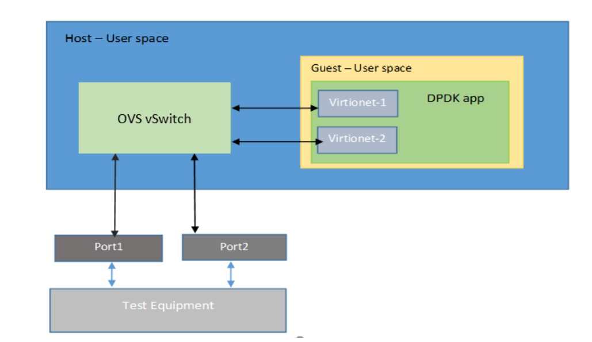

**Figure 196. Setup test DPDK virtionet**

##### 9.2.5.6.1 Setup chung

Binary các ứng dụng DPDK mẫu có trong thư mục `/usr/share/dpdk/examples/` của rootfs do Yocto sinh ra.

- Thiết lập hugepage:

  ```
  mkdir /dev/hugepages
  mount -t hugetlbfs none /dev/hugepages
  echo 512 > /proc/sys/vm/nr_hugepages ; for dpaa1 change change size as 256
  ```

**Ghi chú:** Các lệnh dưới đây giả định được chạy từ thư mục `/usr/share/`. Sửa các lệnh nếu dùng đường dẫn khác hoặc cấu hình biến `PATH` khác.

- Thiết lập các thiết bị bằng script DPDK:

  ```
  /usr/bin/dpdk-devbind.py --status
  /usr/bin/dpdk-devbind.py -b uio_pci_generic 0000:00:03.0
  /usr/bin/dpdk-devbind.py -b uio_pci_generic 0000:00:04.0
  ```

##### 9.2.5.6.2 Chạy các ứng dụng DPDK

**Ghi chú:** Dùng Core 0 cho ứng dụng DPDK có thể dẫn tới hành vi không xác định, kể cả giảm hiệu năng. Khuyến nghị giá trị core mask của ứng dụng DPDK tránh dùng Core 0.

**Ghi chú:** `dpdk-l3fwd` không hoạt động trong VM với các Virtio interface vì driver Virtio của DPDK không hỗ trợ chế độ offload cho giao thức IP

**Ghi chú:** Virtio trong VM chỉ được bật về mặt chức năng, và hiệu năng không thể so với hiệu năng có được trên host.

Chạy ứng dụng `dpdk-l2fwd`:

```
dpdk-l2fwd -c 0x2 -n 1 -- -p 0x1 -q 1 -T 0
```

Chạy ứng dụng `testpmd`:

- Chỉ TX:

  ```
  dpdk-testpmd -c 0x3 -n 1 -- -i --nb-cores=1  --portmask=0x1 --nb-ports=1 --
  forward-mode=txonly --disable-hw-vlan --port-topology=chained
  ```

- Chỉ RX:

  ```
  dpdk-testpmd -c 0x3 -n 1 -- -i --nb-cores=1  --portmask=0x1 --nb-ports=1 --
  forward-mode=rxonly --disable-hw-vlan --port-topology=chained
  ```

#### 9.2.5.7 Hỗ trợ VIRTIO Multi Queue

Để hiệu năng tăng theo số core của VM, các thiết bị VIRTIO cần được cấu hình với nhiều queue. Mục này giải thích các bước cần để thiết lập thiết bị VIRTIO multi queue.

Xem **Generic Setup** của nền tảng DPAA, gồm cả cấu hình cần để định nghĩa nhiều queue trước khi chạy ứng dụng DPDK. Với DPAA2 không cần setup đặc biệt trước khi khởi động ứng dụng DPDK. Xem Section 9.2.5.2 để thiết lập OVS-DPDK trên host. Các bước dưới đây dựa trên cấu hình và các bước trong các mục đó để hỗ trợ multiqueue.

Các lệnh QEMU cho thiết bị vhost multiqueue khác và được trình bày ở phần sau của mục.

##### 9.2.5.7.1 Các bước bổ sung cho setup OVS

Ngoài các bước nêu ở Section 9.2.5.2, cần các thay đổi sau để sửa số queue được hỗ trợ trong máy ảo.

Chạy các lệnh sau sau khi thêm các port DPDK và vhost-user vào bridge:

```
ovs-vsctl set Interface dpdk0 options:n_rxq=2
ovs-vsctl set Interface dpdk1 options:n_rxq=2
ovs-vsctl set Interface dpdk0 options:n_txq=2
ovs-vsctl set Interface dpdk1 options:n_txq=2
ovs-vsctl set Interface vhost-user1 options:n_rxq=2
ovs-vsctl set Interface vhost-user2 options:n_rxq=2
ovs-vsctl set Interface vhost-user1 options:n_txq=2
ovs-vsctl set Interface vhost-user2 options:n_txq=2
```

##### 9.2.5.7.2 Khởi chạy VM với các thiết bị VHOST multiqueue

Tương tự các bước nêu ở Section 9.2.5.3, cần các bước sau để khởi động máy ảo. Các thay đổi được đánh dấu bằng `bold`:

**Ghi chú:** Các đoạn lệnh dưới đây áp dụng cho nền tảng DPAA2. Thay `dpaa2` bằng `dpaa` để có lệnh tương đương trên nền tảng DPAA.

```
export GUEST_CONSOLE_TELNET_PORT=4446
export VM_MEM=2048M     # For DPAA1 use VM_MEM=650M
export VM_CORES=2
export NUM_QUEUES=2
export ROOTFS_IMG=<VM_ROOTFS_IMG>
export VHOST1_PATH=/usr/local/var/run/openvswitch/vhost-user1
export VHOST2_PATH=/usr/local/var/run/openvswitch/vhost-user2
qemu-system-aarch64 -nographic -object memory-backend-file,id=mem,size=$VM_MEM,mem-path=/mnt/
hugepages,share=on -cpu host -machine type=virt -kernel /boot/Image -enable-kvm  -serial tcp::
$GUEST_CONSOLE_TELNET_PORT,server,telnet -append 'root=/dev/vda rw console=ttyAMA0,115200 rootwait
 earlyprintk' -m $VM_MEM -numa node,memdev=mem -chardev socket,id=char1,path=$VHOST1_PATH -netdev
 type=vhost-user,id=hostnet1,chardev=char1,vhostforce,queues=$NUM_QUEUES -device virtio-net-pci,disable-
modern=false,addr=0x3,netdev=hostnet1,mq=on,id=net1,mrg_rxbuf=off,vectors=6 -chardev socket,id=char2,path=
$VHOST2_PATH -netdev type=vhost-user,id=hostnet2,chardev=char2,vhostforce,queues=$NUM_QUEUES -device virtio-net-
pci,disable-modern=false,addr=0x4,netdev=hostnet2,mq=on,id=net2,mrg_rxbuf=off,vectors=6 -smp $VM_CORES -S -drive
 if=none,file=$ROOTFS_IMG,id=foo,format=raw -device virtio-blk-device,drive=foo
```

##### 9.2.5.7.3 Các ứng dụng DPDK trong VM

Kết nối tới terminal VM như giải thích ở Section 9.2.5.4. Sau khi đăng nhập vào guest, có thể chạy các ứng dụng DPDK dùng nhiều queue trong VM.

**Ghi chú:** Nếu số queue định nghĩa cho ứng dụng DPDK trong VM khác số queue (`NUM_QUEUES`) định nghĩa trong lệnh QEMU, ứng dụng có thể không khởi động được.

**Ghi chú:** Các lệnh dưới đây giả định được chạy từ thư mục `/usr/share/`. Sửa các lệnh nếu dùng đường dẫn khác hoặc cấu hình biến `PATH` khác.

Ngoài các bước trên, mọi bước khác đều giống như mô tả trong use case VM single queue.

Thiết lập các thiết bị bằng script DPDK:

```
/usr/bin/dpdk-devbind.py --status
/usr/bin/dpdk-devbind.py -b uio_pci_generic 0000:00:03.0
/usr/bin/dpdk-devbind.py -b uio_pci_generic 0000:00:04.0
```

Chạy ứng dụng `l3fwd`:

```
dpdk-l3fwd  -c 0x3 -n 1 --  -p 0x3 --config="(0,0,0),(0,1,0),(1,0,1),(1,1,1)"  -
P --parse-ptype
```

Chạy ứng dụng `testpmd`:

```
dpdk-testpmd -c 3 -n 1 -- -i --nb-cores=1 --nb-ports=1 --total-num-mbufs=1025 --
forward-mode=txonly --disable-hw-vlan --rxq=2 --txq=2 --port-topology=chained
```

#### 9.2.5.8 Hướng dẫn hiệu năng OVS DPDK

OVS có một phân cấp lookup. Mọi flow ban đầu được thêm vào database Openflow (khối openflow trong hình dưới). Khi nhận được một flow, các mục của nó được điền vào EMC/SMC/Megaflow.

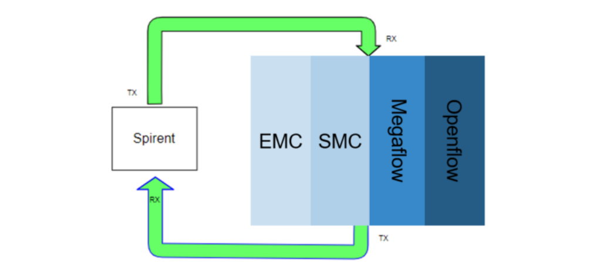

**Figure 197. Phân cấp Flow Table của OVS**

Exact-match cache (EMC) là cơ chế đầu tiên và nhanh nhất mà Open vSwitch\* (OVS) dùng để quyết định làm gì với một packet tới. Nếu không tìm thấy hành động cho packet trong EMC, việc tìm kiếm tiếp tục ở cache SMC rồi tới Megaflow classifier, và nếu vẫn không có thì tra các flow table OpenFlow\*. Có thể hình dung việc này giống cách CPU lần lượt kiểm tra các mức cache ngày càng chậm hơn khi truy cập dữ liệu.

Mặc định, EMC cache được bật và SMC cache bị tắt, và cả hai chỉ có thể được bật hoặc tắt qua dòng lệnh.

EMC cache hỗ trợ tối đa 8K flow cùng lúc, còn SMC cache hỗ trợ tới 100K mục.

Khuyến nghị của chúng tôi về số flow cho hiệu năng của các trường hợp OVS host:

- Dùng 256 flow cho các tình huống có 4 core hoặc ít hơn 4 core
- Dùng 2K flow cho các tình huống có hơn 4 core
- Nếu số flow nhiều hơn 8K, tắt EMC cache và bật SMC cache

Để tắt EMC cache và bật SMC cache:

```
ovs-vsctl --no-wait set Open_vSwitch . other_config:emc-insert-inv-prob=0
ovs-vsctl --no-wait set Open_vSwitch . other_config:smc-enable=true
```

Để bật EMC cache và tắt SMC cache:

```
ovs-vsctl --no-wait set Open_vSwitch . other_config:emc-insert-inv-prob=1
ovs-vsctl --no-wait set Open_vSwitch . other_config:smc-enable=false
```

Cũng khuyến nghị dùng memory pool cho từng core bằng lệnh dưới đây:

```
ovs-vsctl set Open_vSwitch . other_config:per-port-memory=true
```

### 9.2.6 Bật DPAA2 direct assignment cho DPDK

Kiến trúc DPAA2 hỗ trợ gán quyền truy cập trực tiếp tài nguyên dpaa2 từ VM guest của QEMU (Kernel hoặc ứng dụng user space). Xem **Direct assigned devices**.

Mục này mô tả thiết lập môi trường cần thiết và các lệnh khởi chạy một máy ảo (VM) có hỗ trợ VFIO device passthrough hoặc direct device assignment.

**Ghi chú:** Arm-V8 hiện chỉ hỗ trợ VM chạy ở chế độ NO-IOMMU. Nghĩa là mọi truy cập phần cứng chỉ dùng chế độ địa chỉ vật lý. Code sdk mặc định chỉ được build với chế độ địa chỉ ảo. Cần build lại dpdk bằng cách đặt thủ công `RTE_LIBRTE_DPAA2_USE_PHYS_IOVA` là `true` trong `config/arm/meson.build`, rồi build DPDK và các ứng dụng mẫu theo các bước biên dịch chuẩn. Bật `RTE_LIBRTE_DPAA2_USE_PHYS_IOVA` sẽ bật chế độ địa chỉ vật lý (IOVA), cần cho chức năng direct assignment.

Sau đó làm theo chỉ dẫn ở Section 9.2.3.3 để build các ứng dụng DPDK.

Có thể chuyển thủ công các ứng dụng vào máy ảo qua các kết nối host-vm như được đề xuất cấu hình ở mục sau.

#### 9.2.6.1 Khởi chạy máy ảo

Thực hiện các bước sau để khởi chạy máy ảo:

Bảo đảm kernel được bật chế độ direct assignment. Để biết thêm chi tiết, xem Section 10.1.2.5.

**Ghi chú:** QEMU mặc định có trong filesystem có thể không hỗ trợ tính năng direct assignment.

1. Chạy các lệnh sau để build cục bộ QEMU 4.2 có hỗ trợ VFIO passthrough:

   ```
   git clone https://github.com/nxp-qoriq/qemu.git
   cd qemu
   git checkout qemu-4.2
   git submodule update --init dtc
   ```

   Bảo đảm máy có các package cần để build QEMU.

   Xem ví dụ dưới đây:

   ```
   #update your ubuntu m/c with required packages. apt-get install pkg-config
    apt-get install libglib2.0-dev apt-get install libpixman-1-dev apt-get
    install libaio-dev apt-get install libusb-1.0-0-dev
   ```

   Bây giờ build QEMU:

   ```
   ./configure --prefix=/root/qemu-4.2 --target-list=aarch64-softmmu --enable-
   fdt --enable-kvm
   make
   make install
   ```

   QEMU mới sẽ được cài vào thư mục `/root/qemu-4.2`.

2. Tạo các tài nguyên DPAA2 cho guest kernel của VM và user space của guest VM (dpdk) trên board. Các script động hỗ trợ tạo tài nguyên `dpaa2` có trong (`/usr/share/dpdk/dpaa2/`) của rootfs Layerscape LDP. Chúng cũng có trong source code DPDK ở thư mục `nxp`.

   ```
   export DPDK_SCRIPTS=/usr/share/dpdk/dpaa2/
   ```

   Tạo một interface dựa trên DPNI để truyền file và giao tiếp giữa host và guest kernel của VM.

   ```
   ls-addni -n
   Output:---Created interface: eth0 (object:dpni.1, endpoint:)
   ```

   Tạo container cho guest kernel của VM. Để biết thêm chi tiết, xem các mục "How to use DPAA2 direct assignment without scripts" và "How to use DPAA2 direct assignment with scripts".

   File `vm_linux.conf` mẫu được cung cấp trong các script để tạo container cho guest kernel của `vm`. Trong đó, số tài nguyên phù hợp cho VM 2 core. Object `dpni` đã tạo trước đó cũng được truyền vào để nối nó với container guest kernel.

   ```
   source $DPDK_SCRIPTS/dynamic_dpl.sh -c $DPDK_SCRIPTS/vm_linux.conf <dpni.x>
   Where, <dpni.x> is dpni interface created by "ls-addni" command.
   ```

   Ở bước tiếp theo, tạo container cho user space của guest VM dành cho DPDK:

   ```
   source $DPDK_SCRIPTS/dynamic_dpl.sh -c $DPDK_SCRIPTS/vm_dpdk.conf <dpmac.x>
    <dpmac.y>
   Where, <dpmac.x> & <dpmac.y> are required MAC interfaces.
   ```

   **Ghi chú:** Bảo đảm nhập DPRC cha đã tạo vào vm_dpdk.conf

   Trong phần còn lại của mục, giả định container guest kernel của VM là `dprc.2` và container con cho user space của guest `VM` là `dprc.3` (lồng nhau).

   Tạo kết nối Ethernet giữa host và VM để giao tiếp/truyền dữ liệu. Kết nối này đã được tạo và truyền vào khi tạo container `vm-linux`.

   ```
   #assign IP to host interface created to communicate with VM (dprc.2, eth0)
   ifconfig eth0 192.168.2.2
   ```

3. Tạo hugepage mount (nếu chưa tạo):

   ```
   echo hugetlbfs /dev/hugepages hugetlbfs defaults,mode=0777 0 0 >> /etc/fstab
   mkdir /dev/hugepages
   mount /dev/hugepages
   ```

4. Khởi chạy QEMU (phiên bản: 4.2.0) bằng lệnh sau:

   Để sinh image root filesystem, xem "Creating a guest Linux root filesystem".

   Gán ROOTFS_IMG trong lệnh dưới đây bằng đường dẫn tuyệt đối tới image đã sinh:

   ```
   export ROOTFS_IMG=/root/ls-image-main-<board>.ext4
   # Telnet port to be used for accessing this instance of virtual machine
    export GUEST_CONSOLE_TELNET_PORT=4446
   export KERNEL_IMG=/root/Image
   ```

Định nghĩa các biến môi trường khác mà lệnh QEMU dùng để cấu hình môi trường máy ảo:

```
export VM_MEM=4096M # 2048M for LS1088ARDB
```

1. Thêm lệnh device dưới đây (cho GUEST KERNEL DPRC cần gán) vào dòng lệnh QEMU:

   ```
   -device vfio-fsl-mc,host=dprc.2
   ```

   Bảo đảm chỉ định số core thích hợp cho `VM` guest. Số này phải khớp với số object dpio đã tạo trong container con. Trong trường hợp này là 1 core.

   ```
   -smp $VM_CORES
   ```

2. Khởi động QEMU với option -S (các thread vcpu chưa được khởi động).

   Cần việc này để các Ethernet driver trong guest bind các object với core một cách đúng đắn.

   ```
   # single core VM launch /root/qemu-4.2/bin/qemu-system-aarch64 -smp
    $VM_CORES -m $VM_MEM -mem-path /dev/hugepages -cpu host -machine
    type=virt,gic-version=3 -kernel $KERNEL_IMG -enable-kvm -display none -
   serial tcp::$GUEST_CONSOLE_TELNET_PORT,server,telnet -drive if=none,file=
   $ROOTFS_IMG,id=foo,format=raw -device virtio-blk-device,drive=foo -append
    'root=/dev/vda rw console=ttyAMA0 rootwait earlyprintk' -monitor stdio -
   device vfio-fsl-mc,host=dprc.2 -S
   ```

   ```
   # Two core VM launch
   ```

   (Kiểm tra isolcpus cho `core #1` trong bootargs).

   **Ghi chú:**

   - Để có hiệu năng tốt nhất, không nên dùng Core 0 trong VM cho các thread I/O của DPDK.
   - Để tránh các service hệ thống dùng các CPU đã lập lịch cho thread I/O của DPDK, khuyến nghị dùng isolcpus để cô lập core khỏi việc lập lịch của Linux Kernel trong VM. Cấu hình chính xác phụ thuộc vào số CPU mà QEMU gán cho VM qua biến môi trường VM_CORES. Nối `isolcpus=1-$VM_CORES` vào chuỗi `root=/dev/vda rw console=ttyAMA0,115200 rootwait` `earlyprintk` trong lệnh `qemu-system-aarch64` ở trên:

     ```
     /root/qemu-4.2/bin/qemu-system-aarch64 -smp $VM_CORES -m $VM_MEM -mem-path /
     dev/hugepages
     -cpu host -machine type=virt,gic-version=3 -kernel $KERNEL_IMG -enable-kvm -
     display none
     -serial tcp::$GUEST_CONSOLE_TELNET_PORT,server,telnet -drive
     if=none,file=$ROOTFS_IMG,id=foo,format=raw -device virtio-blk-
     device,drive=foo -append
     'root=/dev/vda rw console=ttyAMA0 rootwait earlyprintk isolcpus=1' -monitor
      stdio
     -device vfio-fsl-mc,host=dprc.2 -S
     ```

   **Ghi chú:** Bảo đảm chỉ định số core thích hợp cho VM guest. Số này phải khớp với số object dpio đã tạo. Ngoài ra, bảo đảm thư mục `/mnt/hugetlbfs` tồn tại và được mount khi khởi động QEMU.

   Log sau xuất hiện trên console UART của host:

   ```
   QEMU 4.2.0 monitor - type 'help' for more information
   (qemu) qemu-system-aarch64: -serial tcp::4446,server,telnet: QEMU waiting for
    connection on: disconnected:telnet::4446,server
   ```

3. Khởi chạy VM bằng:

   ```
   telnet <Board ip addr> <GUEST_CONSOLE_TELNET_PORT>
   ```

   Ví dụ, `telnet localhost 4446`

   Bảo đảm gán mỗi thread `vcpu` cho đúng một CPU vật lý.

   Lấy các thread ID của VM bằng cách vào shell của QEMU.

   ```
   (qemu) info cpus
   * CPU #0: thread_id=7211
   CPU #1: (halted) thread_id=7212
   ```

   Gán mỗi thread `vcpu` cho đúng một core. Ngoài ra, trừ thread `vcpu` đầu tiên, đặt mọi thread khác ở priority `chrt` để có hiệu năng.

   ```
   $ taskset -p 0x1 7211
   pid 7211's current affinity mask: ff
   pid 7211's new affinity mask: 1
   $ taskset -p 0x2 7212
   pid 7212's current affinity mask: ff
   pid 7212's new affinity mask: 2
   $ chrt -p 90 7212
   ```

   Khởi động các thread `vcpu`:

   ```
   (qemu) c
   ```

#### 9.2.6.2 Truy cập console máy ảo

```
user@ls2088ardb:~# telnet localhost 4446
```

Chạy các lệnh sau:

```
echo 1000 > /proc/sys/vm/nr_hugepages
# child DPRC container for VM guest userspace
export DPRC=dprc.3
echo 1 > /sys/module/vfio/parameters/enable_unsafe_noiommu_mode
echo vfio-fsl-mc > /sys/bus/fsl-mc/devices/$DPRC/driver_override
echo $DPRC > /sys/bus/fsl-mc/drivers/vfio-fsl-mc/bind
```

Core-index trên Host được dùng làm core vật lý đầu tiên trong VM cần được dùng làm DPAA2_HOST_START_CPU để chạy ứng dụng DPDK. Trong đó, core-index nằm trong khoảng \[ 0-7 \] với nền tảng 8 core.

Ví dụ, nếu chạy VM với hai core và core #4, core #5 của Host được cấp cho VM, thì core vật lý đầu tiên của VM là core#4. Vì vậy, phải đặt core `START CPU` như sau:

```
export DPAA2_HOST_START_CPU=4
```

Thiết lập Hugepage

```
echo hugetlbfs /dev/hugepages hugetlbfs defaults,mode=0777 0 0 >> /etc/fstab
mkdir /dev/hugepages
mount /dev/hugepages
```

Cấu hình kết nối host cho SCP, ssh và truyền file.

```
ifconfig eth1 192.168.2.1
```

#### 9.2.6.3 Chạy các ứng dụng DPDK với direct device assignment

Mọi ứng dụng dpdk dựa trên DPAA2 đều hoạt động trong VM giống như trên host, nhưng cần được biên dịch sau khi bật flag `RTE_LIBRTE_DPAA2_USE_PHYS_IOVA` trong file build meson `config/arm/meson.build`.

Nếu chưa có các ứng dụng dpdk mẫu, có thể đưa chúng vào qua `scp/tftp` dùng interface `eth1`.

**Ghi chú:** Dùng Core 0 cho ứng dụng DPDK có thể dẫn tới hành vi không xác định, kể cả giảm hiệu năng. Khuyến nghị giá trị core mask của ứng dụng DPDK tránh dùng Core 0.

Tham khảo một số lệnh test ví dụ dưới đây:

- #VM một core (core #0 cho dpdk)

  ```
  dpdk-l3fwd -c 0x1 -n 1 --log-level=bus.fslmc,8 -- -p 0x1 -P --config="(0,0,0)"
  dpdk-l2fwd-crypto -c 0x1 -n 1 --log-level=bus.fslmc,8 -- -p 0x1 -q 1 --chain
   HASH_ONLY
  --auth_algo sha2-256-hmac --auth_op GENERATE --auth_key_random_size 64
  ```

- #VM hai core (core #1 cho DPDK)

  ```
  dpdk-l3fwd -c 0x2 -n 1 -- -p 0x1 -P --config="(0,0,1)"
  dpdk-l3fwd -c 0x2 -n 1 -- -p 0x3 -P --config="(0,0,1),(1,0,1)"
  dpdk-testpmd -c 0x3 -n 1 -- -i --portmask=0x3 --nb-cores=1 --forward-
  mode=txonly
  ```

### 9.2.7 DPDK trên Docker

#### 9.2.7.1 Tổng quan về Docker

Docker cung cấp một môi trường cho một image cho trước, trên đó có thể chạy bất kỳ ứng dụng user space nào. Image phải chứa/cung cấp mọi công cụ cần để chạy ứng dụng.

Để biết thêm về Docker, xem https://docs.docker.com/engine/userguide/.

#### 9.2.7.2 DPAA1-Platform

##### 9.2.7.2.1 Chạy Docker Container trên DPAA1

Để chạy Docker, bảo đảm đã hoàn tất các điều kiện tiên quyết sau:

1. Docker daemon phải đang chạy. Nếu chưa, làm theo chỉ dẫn ở link dưới đây để chạy daemon.

   https://docs.docker.com/engine/docker-overview/

2. Phải cài công cụ Docker, công cụ này đóng vai trò client để chạy Docker container.

Tải image cần thiết, sẽ được chạy làm môi trường. Dùng lệnh dưới đây để lấy các image dựng sẵn chung:

```
docker pull ubuntu:latest  # Command template is 'docker pull
 <distribution>:<tag>'
```

Có thể kiểm tra mọi image đã tải bằng lệnh dưới đây:

```
docker images
```

Sau khi tải image, có thể khởi động Docker container theo các bước dưới đây. Các lệnh dưới đây sẽ chạy một docker container tên **docker0**:

```
docker run --privileged --interactive --env LD_LIBRARY_PATH=/usr/lib --
name=docker0 --hostname=docker0 --detach --volume=/usr:/usr --volume=/sys:/sys
 --volume=/dev:/dev ubuntu:latest
```

Các tham số truyền cho lệnh trên được giải thích dưới đây:

```
-–privileged  # It provides privilege to docker container to access host
 completely
--interactive  # Docker container will be running state
--env LD_LIBRARY_PATH=/usr/lib  # Exporting host environment variable to docker
 container*/
--name=docker0 --hostname=docker0 # User defined name to docker container
--detach # container will be detached once it is launched and host prompt will
 be available for use
--volume=/XXX:/YYY # Exporting host partitions /XXX to docker container's mount
 point /YYY
```

Cuối cùng, lệnh sau gắn vào console của docker đã chạy ở lệnh trước:

```
docker exec -it docker0 bash
```

##### 9.2.7.2.2 Chạy ứng dụng DPDK

Sau khi khởi chạy và kết nối Docker, chạy ứng dụng DPDK bằng lệnh tương ứng. Lệnh dưới đây là ví dụ chạy `dpdk-l3fwd`:

```
dpdk-l3fwd -c 0x0C -n 1 – -p 0x30 --config="(4,0,2),(5,0,3)" -P
```

**Ghi chú:** Bảo đảm đã chạy `fmc -x` trên host và FMC không được cấu hình cho DPDK, vì với docker chỉ hỗ trợ chế độ không dùng fmc.

#### 9.2.7.3 DPAA2-Platform

##### 9.2.7.3.1 Bộ ghép/tách traffic (Traffic Multiplexer/De-Multiplexer)

Trên kiến trúc DPAA2, MC cung cấp nhiều phương pháp để chia traffic tới qua nhiều DPNI. Các mục dưới đây cung cấp thêm thông tin.

###### 9.2.7.3.1.1 Dùng DPDMUX

MC cung cấp một object (DPDMUX) chia traffic tới qua nhiều DPNI dựa trên các tham số sau:

1. Phân loại dựa trên MAC
2. Phân loại dựa trên VLAN
3. Phân loại dựa trên MAC + VLAN
4. Phân loại dựa trên key do người dùng định nghĩa.

DPDMUX có filter table riêng gồm các filtering rule mặc định. Filtering rule mặc định là tổ hợp của địa chỉ MAC cấu hình trên DPNI và thông tin port làm đích. Khi DPDMUX object được nối với một DPNI, mục cho DPNI đó sẽ được thêm vào filtering table. Mọi traffic mặc định tới sẽ được phân phối dựa trên địa chỉ MAC đích trong packet. Có thể thêm các mục khác vào filtering table theo yêu cầu.

Sơ đồ dưới đây cho thấy một use case mẫu của DPDMUX và các link liên quan cho một DPMAC object. Có thể mở rộng tới số DPMAC tối đa, mỗi DPMAC có DPDMUX object riêng.

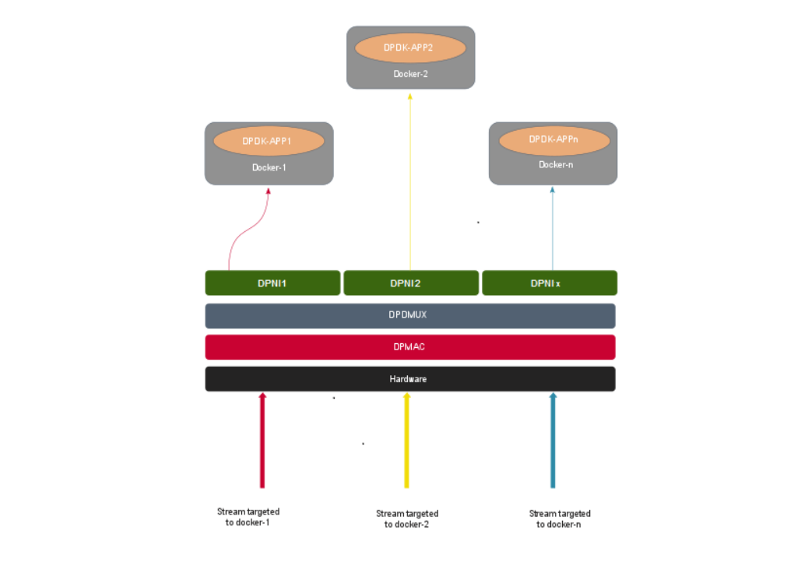

**Figure 198. Use case mẫu của DPDMUX và các link liên quan cho một DPMAC object**

###### 9.2.7.3.1.2 Dùng DPSW

MC cũng cung cấp một object khác (DPSW), bên trong triển khai H/W Switch của DPAA2. Instance Switch này cũng có thể dùng để chuyển tiếp traffic tới nhiều host. Trên LS2088, chỉ tạo được một instance DPSW, và các port cần thiết sẽ được nối vào cùng instance DPSW đó.

DPSW có filter table riêng, được điền động bằng địa chỉ MAC nguồn và port nhận packet. Traffic tới mặc định được flood tới mọi port trừ port ingress, và các filtering rule được học vào filtering table. Sau khi học, các packet tương tự chỉ được chuyển tới port đích.

Sơ đồ dưới đây cho thấy một use case mẫu của DPSW và các link liên quan cho một DPMAC object. Có thể mở rộng tới số DPMAC tối đa với cùng instance DPSW.

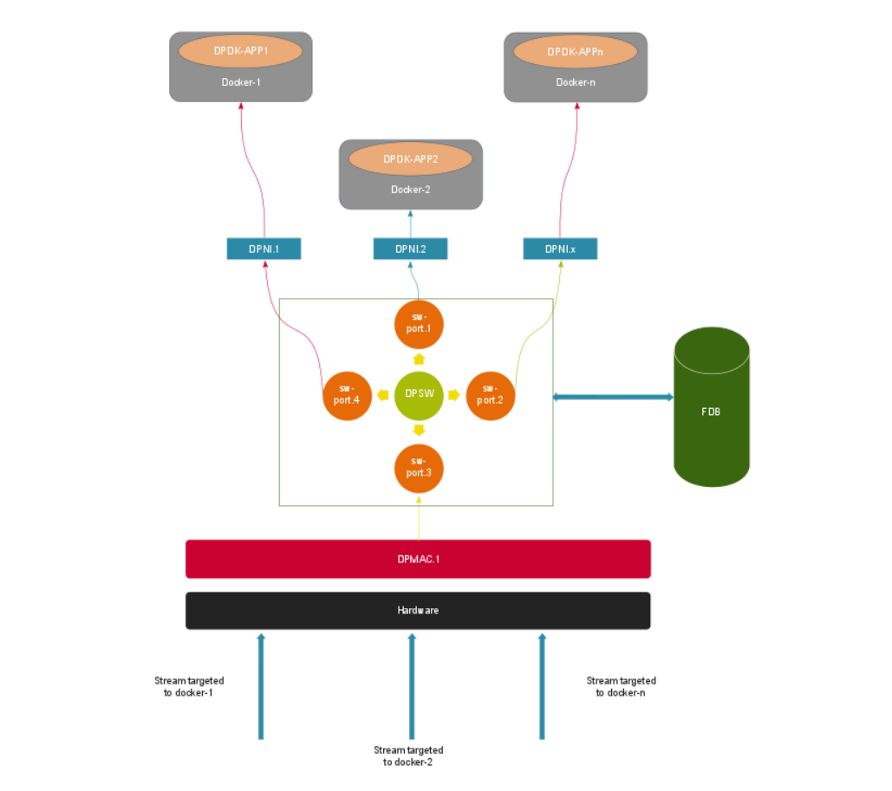

**Figure 199. Use case mẫu của DPSW và các link liên quan cho một DPMAC object**

##### 9.2.7.3.2 Một Docker Instance - Cấu hình container (DPDMUX/DPSW)

Với mỗi Docker instance, phải tạo một DPRC chứa các khối phần cứng DPAA2 cần cho Docker container.

Có thể dùng script hỗ trợ `dynamic_dpl.sh`, có trong rootfs Layerscape LDP, để tạo DPRC như vậy. Ví dụ, đoạn lệnh sau tạo một DPRC chứa 8 DPNI object (network interface logic) không gắn với link vật lý (DPMAC) nào và có địa chỉ MAC bắt đầu từ `00:00:00:00:05:00`. Để biết thêm chi tiết về việc tạo DPRC, xem Section 8.3.2.1.1.

Đặt biến môi trường sau, sẽ được script `dynamic_dpl.sh` dùng:

```
export MAX_QOS=16
export DPNI_NORMAL_BUF=1 # This is optional
```

Chạy script `dynamic_dpl.sh`:

```
/usr/share/dpdk/dpaa2/dynamic_dpl.sh dpni dpni dpni dpni dpni dpni dpni dpni -b
 00:00:00:00:05:00
```

Output của lệnh trên sẽ tương tự như:

```
##################### Container  dprc.2  is created ####################
Container dprc.2 have following resources :=>
 * 16 DPBP
 * 8 DPCON
 * 8 DPSECI
 * 8 DPNI
 * 10 DPIO
 * 2 DPCI
 ######################### Configured Interfaces #########################
Interface Name        Endpoint              Mac Address
==============        ========              ==================
dpni.1                UNCONNECTED           00:00:00:00:05:01
dpni.2                UNCONNECTED           00:00:00:00:05:02
dpni.3                UNCONNECTED           00:00:00:00:05:03
dpni.4                UNCONNECTED           00:00:00:00:05:04
dpni.5                UNCONNECTED           00:00:00:00:05:05
dpni.6                UNCONNECTED           00:00:00:00:05:06
dpni.7                UNCONNECTED           00:00:00:00:05:07
dpni.8                UNCONNECTED           00:00:00:00:05:08
```

Mỗi DPRC như vậy sẽ được gán cho một Docker container. Vì vậy, cần tạo nhiều DPRC như vậy tùy use case và số Docker instance cần cho nó.

**Ghi chú:** Tài nguyên trên hệ thống DPAA2 có hạn, và việc gán chúng cho DPRC có thể gây lỗi nếu tài nguyên yêu cầu không có sẵn. Với output của script ở trên, nếu script không trả về lỗi và mọi DPNI có địa chỉ MAC khác nhau, có thể coi là thành công. Nếu có lỗi hoặc không gán được địa chỉ MAC, cần sắp xếp lại việc gán tài nguyên cho các DPRC.

Từ đây, tùy dùng DPDMUX hay DPSW, áp dụng một trong các cấu hình dưới đây:

###### 9.2.7.3.2.1 Cấu hình dùng DPDMUX

Tạo các DPDMUX object với tổng số link cần thiết, gồm cả downlink lẫn uplink. Ở đây tạo object dpdmux.0

```
restool dpdmux create --num-ifs=3 --method DPDMUX_METHOD_MAC --max-dmat-
entries=8 --max-mc-groups=8 --manip=DPDMUX_MANIP_NONE
```

Nối các downlink và uplink với DPDMUX vừa tạo:

```
restool dprc connect dprc.1 --endpoint1=dpmac.x --endpoint2=dpdmux.0.0
restool dprc connect dprc.1 --endpoint1=dpni.y --endpoint2=dpdmux.0.1
restool dprc connect dprc.1 --endpoint1=dpni.z --endpoint2=dpdmux.0.2
```

Trong đó, `x`, `y` và `z` là index của các object đã tạo trong resource container.

###### 9.2.7.3.2.2 Cấu hình dùng DPSW

Tạo DPSW object với tổng số link cần thiết, gồm cả downlink lẫn uplink. Ở đây tạo object dpsw.0:

```
restool dpsw create --num-ifs=3
```

Nối các downlink và uplink với DPSW vừa tạo:

```
restool dprc connect dprc.1 --endpoint1=dpmac.x --endpoint2=dpsw.0.0
restool dprc connect dprc.1 --endpoint1=dpni.y --endpoint2=dpsw.0.1
restool dprc connect dprc.1 --endpoint1=dpni.z --endpoint2=dpsw.0.2
```

Trong đó, `x`, `y` và `z` là index của các object đã tạo trong resource container.

##### 9.2.7.3.3 Chạy Docker Container trên DPAA2

Dựa trên giải thích ở Section 9.2.7.2.1, lệnh như sau:

```
docker pull ubuntu:latest
export DPRC="dprc.<index>"
export VFIO_NO=`readlink /sys/bus/fsl-mc/devices/$DPRC/iommu_group | xargs
 basename`
docker run -–privileged --interactive --env DPRC=$DPRC --device=/dev/vfio/vfio:/
dev/vfio/vfio --device=/dev/vfio/$VFIO_NO:/dev/vfio/$VFIO_NO --name=docker0 --
hostname=docker0 --detach --volume=/usr:/usr --volume=/sys:/sys --volume=/dev:/
dev ubuntu:latest
docker exec -it docker0 bash
```

Sau đây là giải thích cho các tham số không áp dụng cho DPAA (chỉ định trong các lệnh trên):

```
export DPRC="dprc.<index>" # Where <index> is the DPRC container number created
 by dynamic_dpl.sh execution
```

```
--device=/XXX:/YYY # Exporting host device /XXX to docker container device /YYY
```

##### 9.2.7.3.4 Chạy ứng dụng DPDK

Sau khi khởi chạy và kết nối Docker, chạy ứng dụng DPDK bằng lệnh tương ứng. Lệnh dưới đây là ví dụ chạy `dpdk-l3fwd`:

```
dpdk-l3fwd -c 0xFF -n 4 -- -p 0xFF -P --config="(0,0,0),(1,0,1),(2,0,2),(3,0,3),
(4,0,4),(5,0,5),(6,0,6),(7,0,7)" -P
```

##### 9.2.7.3.5 Cấu hình ví dụ cho 2 Docker Instance: Dùng DPDMUX

**Thiết lập chung cho container:**

```
export MAX_QOS=8
export DPNI_NORMAL_BUF=1
```

**Tạo container cho docker0:**

```
./dynamic_dpl.sh dpni dpni dpni dpni dpni dpni dpni dpni -b 00:00:00:00:05:00
##################### Container  dprc.2  is created ####################
Container dprc.2 have following resources :=>
 * 16 DPBP
 * 8 DPCON
 * 8 DPSECI
 * 8 DPNI
 * 10 DPIO
 * 2 DPCI
######################### Configured Interfaces #########################
Interface Name        Endpoint              Mac Address
==============        ========              ==================
dpni.1                UNCONNECTED           00:00:00:00:05:01
dpni.2                UNCONNECTED           00:00:00:00:05:02
dpni.3                UNCONNECTED           00:00:00:00:05:03
dpni.4                UNCONNECTED           00:00:00:00:05:04
dpni.5                UNCONNECTED           00:00:00:00:05:05
dpni.6                UNCONNECTED           00:00:00:00:05:06
dpni.7                UNCONNECTED           00:00:00:00:05:07
dpni.8                UNCONNECTED           00:00:00:00:05:08
```

**Tạo container cho docker1:**

```
./dynamic_dpl.sh dpni dpni dpni dpni dpni dpni dpni dpni -b 00:00:00:00:05:08
##################### Container  dprc.3  is created ####################
Container dprc.3 have following resources :=>
 * 16 DPBP
 * 8 DPCON
 * 8 DPSECI
 * 8 DPNI
 * 10 DPIO
 * 2 DPCI
######################### Configured Interfaces #########################
Interface Name        Endpoint              Mac Address
==============        ========              ==================
dpni.9                UNCONNECTED           00:00:00:00:05:09
dpni.10               UNCONNECTED           00:00:00:00:05:0a
dpni.11               UNCONNECTED           00:00:00:00:05:0b
dpni.12               UNCONNECTED           00:00:00:00:05:0c
dpni.13               UNCONNECTED           00:00:00:00:05:0d
dpni.14               UNCONNECTED           00:00:00:00:05:0e
dpni.15               UNCONNECTED           00:00:00:00:05:0f
dpni.16               UNCONNECTED           00:00:00:00:05:10
```

**Tạo các DPDMUX object với downlink và uplink**

```
restool dpdmux create --num-ifs=2 --method DPDMUX_METHOD_MAC --max-dmat-
entries=8 --max-mc-groups=8 --manip=DPDMUX_MANIP_NONE
restool dpdmux create --num-ifs=2 --method DPDMUX_METHOD_MAC --max-dmat-
entries=8 --max-mc-groups=8 --manip=DPDMUX_MANIP_NONE
restool dpdmux create --num-ifs=2 --method DPDMUX_METHOD_MAC --max-dmat-
entries=8 --max-mc-groups=8 --manip=DPDMUX_MANIP_NONE
restool dpdmux create --num-ifs=2 --method DPDMUX_METHOD_MAC --max-dmat-
entries=8 --max-mc-groups=8 --manip=DPDMUX_MANIP_NONE
```

**Tạo các kết nối uplink**

```
restool dprc connect dprc.1 --endpoint1=dpdmux.0.0 --endpoint2=dpmac.1
restool dprc connect dprc.1 --endpoint1=dpdmux.1.0 --endpoint2=dpmac.2
restool dprc connect dprc.1 --endpoint1=dpdmux.2.0 --endpoint2=dpmac.3
restool dprc connect dprc.1 --endpoint1=dpdmux.3.0 --endpoint2=dpmac.4
```

**Tạo các kết nối downlink cho docker0**

```
restool dprc connect dprc.1 --endpoint1=dpni.1 --endpoint2=dpdmux.0.1
restool dprc connect dprc.1 --endpoint1=dpni.2 --endpoint2=dpdmux.1.1
restool dprc connect dprc.1 --endpoint1=dpni.3 --endpoint2=dpdmux.2.1
restool dprc connect dprc.1 --endpoint1=dpni.4 --endpoint2=dpdmux.3.1
```

**Tạo các kết nối downlink cho docker1**

```
restool dprc connect dprc.1 --endpoint1=dpni.5 --endpoint2=dpdmux.0.2
restool dprc connect dprc.1 --endpoint1=dpni.6 --endpoint2=dpdmux.1.2
restool dprc connect dprc.1 --endpoint1=dpni.7 --endpoint2=dpdmux.2.2
restool dprc connect dprc.1 --endpoint1=dpni.8 --endpoint2=dpdmux.3.2
```

**Ghi chú:** Các lệnh trên dùng cho test 1G. Nếu dùng port 10G, thêm vào các lệnh tạo uplink và downlink ở trên `--committed-rate=10000 --max-rate=10000`.

**Chạy DPDK L2fwd trên docker0**

```
export DPRC="dprc.2"
export VFIO_NO=`readlink /sys/bus/fsl-mc/devices/$DPRC/iommu_group | xargs
 basename`
docker run --privileged --interactive --env DPRC=$DPRC --env LD_LIBRARY_PATH=/
usr/lib --device=/dev/vfio/vfio:/dev/vfio/vfio --device=/dev/vfio/$VFIO_NO:/dev/
vfio/$VFIO_NO --name=docker0 --hostname=docker0 --detach --volume=/usr:/usr --
volume=/sys:/sys --volume=/dev:/dev ubuntu:latest
docker exec -it docker0 bash
l2fwd -c 0xF0 -n 1 --file-prefix=docker0 --socket-mem=2048 -- -p 0x0F -q 1
```

**Chạy DPDK L2fwd trên docker1**

```
export DPRC="dprc.3"
export VFIO_NO=`readlink /sys/bus/fsl-mc/devices/$DPRC/iommu_group | xargs
 basename`
docker run --privileged --interactive --env DPRC=$DPRC --env LD_LIBRARY_PATH=/
usr/lib --device=/dev/vfio/vfio:/dev/vfio/vfio --device=/dev/vfio/$VFIO_NO:/dev/
vfio/$VFIO_NO --name=docker1 --hostname=docker1 --detach --volume=/usr:/usr --
volume=/sys:/sys --volume=/dev:/dev ubuntu:latest
docker exec -it docker1 bash
l2fwd -c 0xF0 -n 1 --file-prefix=docker1 --socket-mem=2048 -- -p 0x0F -q 1
```

**Ghi chú:** Tập lệnh trên dùng để tham khảo trên LS2088A. Trên LS1088, DPDMUX object hỗ trợ tối đa 4 downlink (dpni). Có thể gán chúng cho một docker instance theo yêu cầu. Ví dụ, một use case gán hai dpni cho mỗi trong hai docker container instance, còn use case khác gán một dpni cho mỗi trong bốn docker instance.

##### 9.2.7.3.6 Cấu hình ví dụ cho 2 Docker Instance: Dùng DPSW

**Thiết lập chung cho container:**

```
export MAX_QOS=8
export DPNI_NORMAL_BUF=1
```

**Tạo container cho docker0:**

```
./dynamic_dpl.sh dpni -b 00:00:00:00:05:00
##################### Container  dprc.2  is created ####################
Container dprc.2 have following resources :=>
 * 16 DPBP
 * 8 DPCON
 * 8 DPSECI
 * 1 DPNI
 * 10 DPIO
 * 2 DPCI
######################### Configured Interfaces #########################
Interface Name        Endpoint              Mac Address
==============        ========              ==================
dpni.1                UNCONNECTED           00:00:00:00:05:01
```

**Tạo container cho docker1:**

```
./dynamic_dpl.sh dpni -b 00:00:00:00:05:01
##################### Container  dprc.3  is created ####################
Container dprc.3 have following resources :=>
 * 16 DPBP
 * 8 DPCON
 * 8 DPSECI
 * 1 DPNI
 * 10 DPIO
 * 2 DPCI
######################### Configured Interfaces #########################
Interface Name        Endpoint              Mac Address
==============        ========              ==================
dpni.2                UNCONNECTED           00:00:00:00:05:02
```

**Tạo các DPSW object**

```
restool dpsw create --num-ifs=3
restool dprc connect dprc.1 --endpoint1=dpsw.0.0 --endpoint2=dpmac.1
```

**Tạo các kết nối downlink cho docker0**

```
restool dprc connect dprc.1 --endpoint1=dpni.1 --endpoint2=dpsw.0.1
```

**Tạo các kết nối downlink cho docker1**

```
restool dprc connect dprc.1 --endpoint1=dpni.2 --endpoint2=dpsw.0.2
```

**Chạy DPDK L2fwd trên docker0**

```
export DPRC="dprc.2"
export VFIO_NO=`readlink /sys/bus/fsl-mc/devices/$DPRC/iommu_group | xargs
 basename`
docker run --privileged --interactive --env DPRC=$DPRC --env LD_LIBRARY_PATH=/
usr/lib --device=/dev/vfio/vfio:/dev/vfio/vfio --device=/dev/vfio/$VFIO_NO:/dev/
vfio/$VFIO_NO --name=docker0 --hostname=docker0 --detach --volume=/usr:/usr --
volume=/sys:/sys --volume=/dev:/dev ubuntu:18.04
docker exec -it docker0 bash
cd /usr/bin
dpdk-l2fwd -c 0x04 -n 1 --file-prefix=docker0 --socket-mem=2048 -- -p 0x01 -q 1
```

**Chạy DPDK L2fwd trên docker1**

```
export DPRC="dprc.3"
export VFIO_NO=`readlink /sys/bus/fsl-mc/devices/$DPRC/iommu_group | xargs
 basename`
docker run --privileged --interactive --env DPRC=$DPRC --env LD_LIBRARY_PATH=/
usr/lib --device=/dev/vfio/vfio:/dev/vfio/vfio --device=/dev/vfio/$VFIO_NO:/dev/
vfio/$VFIO_NO --name=docker1 --hostname=docker1 --detach --volume=/usr:/usr --
volume=/sys:/sys --volume=/dev:/dev ubuntu:18.04
docker exec -it docker1 bash
cd /usr/bin
dpdk-l2fwd -c 0x08 -n 1 --file-prefix=docker1 --socket-mem=2048 -- -p 0x01 -q 1
```

**Ghi chú:** Các lệnh trên dùng cho LX2160 và LS2088A. LS1088A không hỗ trợ DPSW object.

### 9.2.8 Các hạn chế đã biết và công việc tương lai

**Các hạn chế chung:**

- Không phải mọi chức năng mà framework DPDK hỗ trợ đều đã được các driver (PMD) PPFE, ENETC, DPAA1 và DPAA2 triển khai. Về danh sách tính năng được hỗ trợ, xem PPFE: Supported DPDK Features, Section 9.2.2.5, Section 9.2.2.2 và Section 9.2.2.3.
- Dùng Core 0 cho công việc liên quan I/O được biết là ảnh hưởng tới hiệu năng - dù trên host hay trong VM. Tắt các service hoặc đặt priority RT có thể cho hiệu năng tối ưu nhưng kết quả không ổn định. Nên tránh tối đa việc gắn Core 0 cho I/O.
- Đã quan sát thấy các event của card PCI NIC có thể làm giảm hiệu năng trên một số nền tảng. Hành vi này không ổn định giữa các nền tảng. Để đạt số hiệu năng cao nhất, nên tắt các card PCI NIC.
- Hỗ trợ DPDK docker hiện chỉ có cho các nền tảng DPAA2 và DPAA.

**Các hạn chế riêng của DPAA2:**

- Nền tảng LS1088A có tính năng CTLU hạn chế. Điều này giới hạn khả năng phân loại bằng phần cứng của thiết bị, dẫn tới số tổ hợp field cho việc so khớp/phân loại flow ít hơn.

**Các hạn chế riêng của DPAA1:**

- Các port đã gán cho user space không thể được gán động cho kernel space và ngược lại.
- Cấu hình mặc định cho nền tảng DPAA1 là yêu cầu chạy các công cụ FMC (xem manual) trước khi chạy ứng dụng. Điều này thêm ràng buộc là số queue do ứng dụng khởi tạo phải đúng bằng số queue mà công cụ FMC cấu hình. Nếu dùng số queue sai (ít hơn số FMC cấu hình), việc phân phối RSS có thể gây mất packet hoặc không có I/O.
- Trên nền tảng LS1043ARDB, hiệu năng với setup 6G có thể thấp hơn so với setup 10G.
- Chế độ đa process của DPDK (tức dùng các secondary process của DPDK) không được hỗ trợ trên DPAA1.

**Các hạn chế riêng của PPFE (LS1012):**

- Khi dùng PPFE ở user space, nếu module PFE ở kernel mode được nạp trước khi dùng user space mode, đôi khi các HIF ring không được dọn sạch và người dùng cần khởi động lại ứng dụng cho tới khi các ring được dọn sạch.
- Không hỗ trợ nhiều buffer pool.
- Không hỗ trợ cấu hình RX/TX queue do người dùng định nghĩa. Driver chỉ cấu hình queue với các thuộc tính mặc định.

**Các hạn chế riêng của ENETC (LS1028):**

- Không hỗ trợ Link Negotiation và cập nhật Link status
- Port của switch cần được nối và link cần up trước khi boot linux.

### 9.2.9 Tối ưu quản lý buffer DPDK dựa trên DPAA theo use case

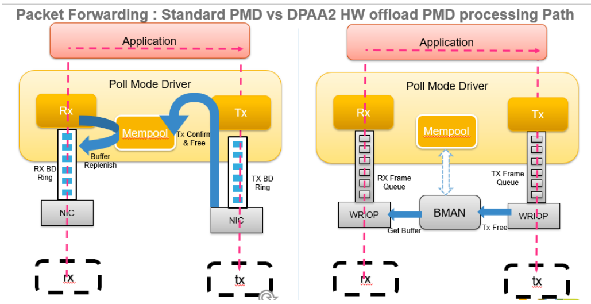

**Figure 200. Tối ưu quản lý buffer DPDK dựa trên DPAA**

DPAAx có buffer manager phần cứng, giúp cấp phát và giải phóng buffer ngay trong phần cứng khi nhận và truyền packet. Điều này tiết kiệm chi phí cấp phát và giải phóng packet. Ngoài ra, nó giúp tránh phải xử lý TX confirmation sau khi truyền.

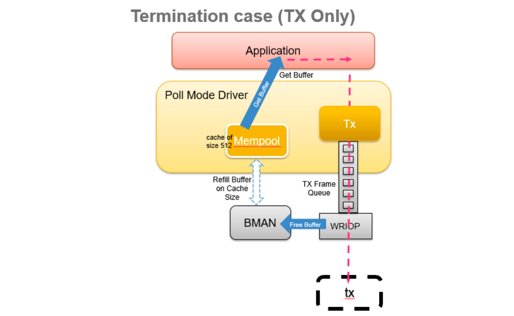

**Figure 201. Trường hợp termination (chỉ TX)**

Trong trường hợp termination, ứng dụng lấy buffer từ mbuf pool packet của DPDK, và MAC (WRIOP hoặc FMan) giải phóng packet trả về HW buffer pool. Lưu ý rằng mbuf pool packet của DPDK duy trì cache buffer cho từng core và thường xuyên nạp lại buffer mỗi khi tới giới hạn cache (ví dụ 512).

Việc cấp phát hoặc giải phóng buffer có thể gây thêm độ trễ khi truy cập phần cứng. Để giảm ảnh hưởng độ trễ:

- Rải đều chi phí truy cập HW bằng cache nhỏ hơn hoặc không dùng cache.
  - Giảm kích thước cache về 0 hoặc số nhỏ hơn, việc này sẽ rải đều chi phí truy cập HW. (ví dụ 4, 16, 64)
- Triển khai TX confirmation và để ứng dụng quản lý việc giải phóng buffer.
- Dùng cơ chế giải phóng trễ, trong đó ứng dụng có thể tự giải phóng buffer sau x thời gian, coi như buffer không còn được dùng.

### 9.2.10 Xử lý sự cố

Sau đây là một số bước và gợi ý chung để có hiệu năng tốt nhất từ các ứng dụng DPDK:

1. Để có hiệu năng tốt nhất, bảo đảm các tham số dòng lệnh lúc boot tương tự như dưới đây: Với DPAA2:

   ```
   console=ttyS1,115200 root=/dev/mmcblk0p3 earlycon=uart8250,mmio,0x21c0600
    default_hugepagesz=1024m hugepagesz=1024m hugepages=8 isolcpus=1-7
    iommu.passthrough=1
   ```

   **Ghi chú:** Ở trên, thay đổi `isolcpus` theo yêu cầu, dựa trên các core mà ứng dụng DPDK sẽ dùng.

   Với LS1046:

   ```
   console=ttyS0,115200 root=/dev/mmcblk0p3 earlycon=uart8250,mmio,0x21c0500
    default_hugepagesz=1024m hugepagesz=1024m hugepages=4 isolcpus=1-3
    bportals=s0 qportals=s0 iommu.passthrough=1
   ```

   Với LS1043:

   ```
   console=ttyS0,115200 root=/dev/mmcblk0p3 earlycon=uart8250,mmio,0x21c0500
    default_hugepagesz=20m hugepagesz=2m hugepages=512 isolcpus=1-3 bportals=s0
    qportals=s0 iommu.passthrough=1
   ```

   `isolcpus` ở trên bảo đảm chỉ Linux Kernel lập lịch thread của nó trên Core 0. Core 1-x sẽ được dùng cho các thread của ứng dụng DPDK.

   Số hugepage định nghĩa bằng `hugepages` cũng nên được sửa thành mức tối đa có thể, để ứng dụng DPDK có buffer lớn hơn.

   **Ghi chú:** Giá trị hugepages phụ thuộc vào dung lượng RAM có trên board. Nên chọn giá trị theo use case cụ thể, vì bộ nhớ đã cấp cho hugepage không dùng được cho các thao tác của Linux Kernel OS.

2. Nếu có vấn đề với việc nhận hoặc truyền packet, kiểm tra các điểm sau:

   a. Bảo đảm ứng dụng DPDK không báo lỗi nào lúc khởi động. Thông thường output đủ rõ để biết nguyên nhân vấn đề.

   b. Kiểm tra ánh xạ port với port vật lý:

   - Với nền tảng DPAA, bảo đảm ánh xạ interface vật lý với port DPDK là đúng. Xem LS1043ARDB Port Layout hoặc LS1046ARDB Port Layout.
   - Với nền tảng DPAA2, bảo đảm đã dùng đúng `dpni.X` trong script `dynamic_dpl.sh` khi tạo các container `dprc`. Một sai lầm hay gặp là dùng `dpni` không khớp với port vật lý đang dùng cho IO.

   c. Bảo đảm kết nối từ bộ sinh traffic tới board là đúng. Có thể chạy `testpmd` ở chế độ `tx_only` để kiểm tra packet có đi ra trên các interface cụ thể không. Về ứng dụng `testpmd` và các tham số nó hỗ trợ, xem https://doc.dpdk.org/guides-21.11/testpmd_app_ug/index.html.

   d. Bảo đảm thiết lập stream của bộ sinh traffic là đúng và sinh đủ stream để phân phối hợp lý giữa các core của ứng dụng DPDK.

   e. Bảo đảm địa chỉ MAC của stream do bộ sinh traffic tạo ra khớp với địa chỉ của port `dpni`, hoặc interface đang ở chế độ promiscuous.

3. Nếu hiệu năng không như mong đợi:

   a. Bảo đảm cấu hình stream của bộ sinh traffic là thích hợp và nó có thể sinh nhiều stream. Nếu các stream đều có cùng IP đích và/hoặc nguồn, traffic sẽ không được phân phối qua nhiều core.

   **Ghi chú:** Để có hiệu năng tốt nhất, điều quan trọng là cấu hình đủ số stream từ bộ sinh packet. Nếu số stream do bộ sinh packet tạo ra không đủ, sẽ dẫn tới phân phối không hợp lý giữa các queue đã định nghĩa (nhất là với setup nhiều queue) và cuối cùng là thiếu hiệu năng.

   b. Dùng các công cụ process chuẩn của Linux, ví dụ `ps`, `top`, kiểm tra mọi thread của ứng dụng DPDK đã được khởi động (theo cấu hình ứng dụng trên dòng lệnh) và đang busy loop.

   c. Với DPAA2, nếu có port DPAA2 nào được gán cho Linux kernel, bảo đảm interrupt affinity không nằm trên core nào đã gán cho DPDK. Xem Section 9.2.11 để biết chi tiết cách kiểm tra và gắn core cho các interrupt đó.

4. Với DPAA1 và DPAA2, có một số tham số tăng cường chức năng và xử lý sự cố. Có thể bật chúng theo yêu cầu. Xem https://github.com/NXPmicro/dpdk/blob/21.11- qoriq/nxp/README để biết thêm chi tiết.
5. Có thể kiểm tra các tham số tinh chỉnh hệ thống bằng script `debug_dump.sh` nằm trong thư mục `/usr/share/dpdk/`. Có thể chia sẻ output với đội hỗ trợ để phân tích thêm.
6. Có thể kiểm tra trạng thái port DPAA2 bằng các lệnh restool. Ví dụ `restool dpni info dpni.1` cho thống kê DPNI, `restool dpmac info dpmac.1` cho thống kê DPMAC và `restool dpdmux info` `dpdmux.0` cho thống kê DPDMUX.
7. Có thể kiểm tra thống kê port DPAA1 bằng `/sys/devices/platform/soc/1a00000.fman/*.port/` `statistics/*`.
8. DPAA2 - Khi dùng số buffer lớn ( > 1 triệu), ứng dụng có thể bị treo. Điều này là do giới hạn tối đa số buffer cấu hình mặc định cho QBMAN của DPAA2. Đây là thiết lập cấu hình được trong file DPC. Để cấu hình số buffer, cần thêm hoặc sửa node sau với số buffer đúng.

   ```
   {
     qbman  {
       ....
       total_bman_buffers=<number of buffers in HEX>;
      };
   };
   ```

### 9.2.11 Hướng dẫn tái lập hiệu năng DPDK

Mục này mô tả các trường hợp và điểm quan trọng để có hiệu năng tốt nhất từ phần mềm DPDK trên các nền tảng NXP. Đây là danh sách gợi ý các cách làm tốt nhất và cấu hình tối ưu, có thể giúp khai thác tối đa hiệu năng phần cứng NXP DPAA.

**Ghi chú:** Các cách làm nêu trong mục này dựa trên test trong môi trường được kiểm soát. Chúng không dành cho sản xuất hay triển khai nếu chưa phân tích đầy đủ ảnh hưởng lên các use case.

Các mục con sau giải thích:

- Các bước cần trước khi boot Linux kernel
- Các bước cần trước khi chạy ứng dụng DPDK

#### 9.2.11.1 Trước khi boot Linux

1. Dùng GCC của Layerscape LDP làm toolchain khuyến nghị để biên dịch DPDK.
2. Flag `CONFIG_QORIQ_THERMAL` được bật mặc định, theo dõi nhiệt độ của SOC. Trong một số trường hợp như LS1043A, nhiệt độ có thể tăng khi chạy các ứng dụng DPDK vốn nặng CPU, và tần số CPU tối đa bị kẹp xuống giá trị thấp hơn. Điều này có thể cho số hiệu năng thấp hơn. Để tắt tính năng này, phải tắt flag `CONFIG_QORIQ_THERMAL` khi biên dịch kernel image.
3. **Chọn Board Support Package (BSP) tối ưu**
   - Chọn board support package tương thích là rất quan trọng cho cả chức năng lẫn hiệu năng của ứng dụng DPDK.

     Với các nền tảng DPAA1 và DPAA2, chọn các binary RCW/PBL có tần số cao nhất mà board hỗ trợ ổn định.

     Ví dụ, các board Rev 1.1 với tần số 2100x800x2133 trên LS2088ARDB DPAA2 được biết là cho hiệu năng tốt nhất.

     Với tần số khác, dù ổn định, hiệu năng sẽ chậm hơn.

4. **Tắt hardware prefetching qua U-Boot**
   - Với nền tảng DPAA2 LS2088A, có thể tắt hardware prefetching qua U-Boot. Việc này có thể tăng hiệu năng trong tình huống đa core.
   - Để tắt hardware prefetching, dùng lệnh sau ở dấu nhắc U-Boot:

     ```
     setenv hwconfig 'fsl_ddr:bank_intlv=auto;core_prefetch:disable=0xFE'
     ```

     **Ghi chú:** Thay đổi tham số `disable=` tùy nền tảng đang dùng. Ví dụ, với LS1046/LS1043 có 4 core, dùng `disable=0xE`, và với LX2 có 16 core, dùng `disable=0xFFFE`. Sau khi chạy lệnh trên, cần reset bank của board để thiết lập có hiệu lực. Trong lệnh trên, field `disable=0xFE` định nghĩa mask để tắt prefetching trên các core cụ thể. Ví dụ, để tắt prefetching trên core thứ 3 và thứ 4, dùng `disable=0x0C`.

     **Ghi chú:** Không hỗ trợ tắt prefetching trên Core 0. Thiết lập này không ảnh hưởng gì trong trường hợp single core. Mức tăng hiệu năng tối đa quan sát được khi dùng cả 8 core của board LS2088 (trong đó 7 core tắt prefetching vì Core 0 không hỗ trợ tính năng này).

5. **Boot argument của Linux**
   - Với nền tảng DPAA, nếu bộ nhớ trên board có hạn (ví dụ LS1043 RDB), cần nối cấu hình sau vào boot argument mặc định:

     ```
     default_hugepagesz=2m hugepagesz=2m hugepages=512 isolcpus=1-3 bportals=s0
      qportals=s0 iommu.passthrough=1
     ```

     Qua các boot argument trên, 1024 Mbit hugepage được gán cho mọi ứng dụng DPDK (512 page, mỗi page 2M).

     `isolcpus` cô lập các CPU 1, 2, 3 khỏi thuật toán lập lịch của scheduler process của Linux Kernel. Mọi System Service sẽ được lập lịch trên Core 0, và nên tránh core này trong cấu hình ứng dụng cho các thread I/O.

   - Với nền tảng DPAA2, cần nối cấu hình sau vào boot argument mặc định:

     ```
     default_hugepagesz=1024m hugepagesz=1024m hugepages=8 isolcpus=1-7
      iommu.passthrough=1
     ```

     Khuyến nghị dùng kích thước huge page 1G cho nền tảng DPAA2.

     **Ghi chú:** Khi chạy DPDK cho trường hợp dùng mọi core, không nên đặt tham số `isolcpus` trong bootargs. Script `enable_performance_mode.sh` dành 99.6% CPU cho ứng dụng DPDK và phần còn lại cho kernel trên mọi core, nên không cần `isolcpus`. Bảo đảm link của mọi interface đã up trước khi chạy DPDK, vì các task của kernel có thể bị chậm lại.

     **Ghi chú:** Thay đổi giá trị tham số `isolcpus` tùy nền tảng đang dùng. Ví dụ, với nền tảng LX2 dùng `isolcpus=1-15`

   - Nếu dùng boot dựa trên UEFI, boot argument được thay đổi từ grub.cfg. Xem mục UEFI về cách cập nhật tham số.

   **Ghi chú:** Cần lưu ý rằng cấu hình cô lập CPU không thể thay đổi khi Linux Kernel đang chạy. Còn cấu hình huge page có thể thay đổi từ dấu nhắc Linux bằng cách ghi vào file `/proc/sys/vm/` `nr_hugepages`. Vì vậy, cần quyết định cẩn thận việc cô lập CPU trước khi boot Linux Kernel. **Ghi chú:** Có thể nối `nousb` vào boot argument để tắt USB trong Linux Kernel. Việc này ngăn các CPU core phải phục vụ bất kỳ interrupt nào từ thiết bị USB. Điều này đặc biệt quan trọng khi dùng Core 0 cho hiệu năng I/O của DPDK. Nhưng chỉ nên dùng option này nếu hệ thống không phụ thuộc vào thiết bị USB nào để chạy, ví dụ một USB mass storage chứa root filesystem hoặc filesystem bổ sung chứa dữ liệu cần để chạy.

6. Để có hiệu năng tốt nhất, dùng các data core làm isolated cpu và chạy chúng ở chế độ tickless trên kernel từ phiên bản 4.4 trở lên. Để làm vậy:

   a. Biên dịch Kernel với `CONFIG_NO_HZ_FULL=y`

   b. Thêm bootargs `'isolcpus=1-7 rcu_nocbs=1-7 nohz_full=1-7'` cho nền tảng 8 core và `'isolcpus=1-3 rcu_nocbs=1-3 nohz_full=1-3'` cho nền tảng 4 core

   **Ghi chú:** Option build linux kernel `CONFIG_NO_HZ_FULL` dùng để cấu hình kernel tickless. Ý tưởng là cấu hình một số processor core chạy ở chế độ tickless, các core này không nhận interrupt định kỳ nào. Các core này sẽ chạy các task chuyên dụng (và không task nào khác được lập lịch trên các core đó, nên không cần gửi tick lập lịch). Timer interrupt dựa trên `CONFIG_HZ` sẽ invalidate L1 cache trên core và có thể làm giảm hiệu năng dataplane vài % (cần định lượng, nhưng ước tính 1-3%). Chạy tickless thường nghĩa là nhận 1 timer interrupt/giây thay vì 1000/giây.

7. **Thiết lập môi trường kiểm chứng hiệu năng**
   - Điều quan trọng là môi trường kiểm chứng hiệu năng dùng cách phân tải đều giữa các core. Mỗi core nên được giao số RX/TX queue bằng nhau, bất kể số lượng. Các hình dưới đây mô tả một số tình huống I/O dùng một setup ví dụ gồm board target và bộ sinh packet. Trong mọi trường hợp được trình bày, giả định mỗi port có một queue được một CPU core phục vụ. Ngoài ra, dù các hình dưới đây cho thấy 8 port, đây chỉ là biểu diễn chung. Các board DPAA có thể không có 8 port bằng nhau (1G/10G) - biểu diễn này giả định traffic luôn được phân phối qua các port có dung lượng bằng nhau.

     Hình trên mô tả 2 trường hợp: một cho một port và một cho 4 port. Có thể thấy mọi core đều được giao tải bằng nhau (số core bằng nhau, bất kể số port được phục vụ). Ngoài ra, trường hợp 4 port cho thấy có nhiều hơn một cách để chuyển stream packet. (Lưu ý hướng mũi tên trong mỗi trường hợp.)

     Hình trên mô tả một trường hợp 4 port trong đó các CPU core không được giao tải bằng nhau. Đây không phải tổ hợp được khuyến nghị, vì nghĩa là một số stream được phục vụ (packet mỗi giây) chậm hơn các stream khác. Tổ hợp 8 port trong hình trên mở rộng ánh xạ 4 port ở hình trước. Một lần nữa, cần lưu ý có nhiều cách để tạo một tập stream cân bằng. Setup hiệu năng nên chọn một baseline và mọi báo cáo hiệu năng đều dựa trên baseline đó.

     **Ghi chú:** Để đo hiệu năng, thực hiện I/O giữa các port có dung lượng khác nhau (`1G=>10G` và ngược lại) không phải là trường hợp hợp lệ. Việc này sẽ dẫn tới dồn queue trên các link dung lượng cao hơn, cuối cùng làm dừng traffic khi phần cứng không lấy được buffer để lưu packet mới tới.

8. **Gỡ các card PCI Ethernet (e1000) NIC**
   - Đã quan sát thấy khi có lắp các card PCI Ethernet (ví dụ Intel e1000 trên các board RDB DPAA/DPAA2), chúng có xu hướng thường xuyên ngắt các CPU core (Core 0, trong trường hợp có cô lập). Điều này ảnh hưởng xấu tới hiệu năng ứng dụng nếu các thread I/O của DPDK được lập lịch trên cùng các core phục vụ các interrupt này.
   - Để có hiệu năng tốt nhất, nên gỡ các card PCI Ethernet như vậy khỏi phần cứng. Nếu không gỡ được, xem các nhận xét ở mục dưới để tắt interface bằng cách gỡ liên kết nó khỏi Linux Kernel.

   **Ghi chú:** Có thể nối `nopci` vào boot argument để tắt hoàn toàn việc Linux Kernel phát hiện thiết bị PCI. Việc này ngăn CPU phải phục vụ interrupt PCI. Nhưng không nên dùng option này nếu hệ thống phụ thuộc vào bất kỳ thiết bị PCI nào để chạy.

#### 9.2.11.2 Trước và trong khi khởi động ứng dụng DPDK

1. **Đặt priority real-time cho ứng dụng DPDK**
   - Trong các bản phân phối đầy đủ như Ubuntu, root filesystem mặc định có nhiều system service. Các service này hướng tới môi trường chung. Nhiều service cần chu kỳ CPU định kỳ. Các thread I/O của DPDK chạy theo kiểu run-to-completion, lặp vô hạn trên các CPU mà chúng được gắn. Các service cần chu kỳ CPU định kỳ có thể ngắt các thread I/O của DPDK, gây mất packet và/hoặc độ trễ. Lý tưởng nhất là tắt các service như vậy hoặc dùng rootfs không có chúng để có hiệu năng tối ưu. Nhưng nếu không làm được, đặt priority real-time cho ứng dụng cũng có thể đạt kết quả mong muốn.
   - Chạy script `/usr/share/dpdk/enable_performance_mode.sh`. Cần chú ý chạy ứng dụng DPDK từ cùng shell đã chạy script. Lý do là script đặt một số biến môi trường mà ứng dụng DPDK dùng để định nghĩa priority real-time cho các thread của nó. Script này cũng được thiết kế để đặt CPU scaling governor ở chế độ "performance". Việc này ngăn CPU tự chuyển sang trạng thái công suất thấp khi rảnh. Trạng thái công suất thấp gây mất traffic ở các stream I/O ban đầu, khi CPU cần tăng lên tần số tối đa.

     **Ghi chú:** Script này đặt priority real-time cho bất kỳ ứng dụng DPDK nào chạy sau khi script đã được chạy. Điều này cũng áp dụng cho ứng dụng được cấu hình chạy trên Core 0. Vì vậy, cần cân nhắc hệ quả. Nếu ứng dụng chạy trên Core 0 và bận I/O, có thể gây CPU stall dẫn tới treo hoàn toàn. Các ứng dụng DPDK mẫu như `l2fwd, l3fwd, ipsec-secgw` được thiết kế để nhường CPU khi không có I/O. Nhờ đó, dùng ứng dụng mẫu có thể tính được hiệu năng với mọi core. Cần chú ý tương tự khi phát triển ứng dụng DPDK tùy chỉnh. Vì script này chủ yếu được thiết kế cho ứng dụng trên host, có thể cần sửa đổi để dùng trong các trường hợp ảo hóa (Qemu, VM) và OVS.

     **Ghi chú:** Tuy script này không nhất thiết cần cô lập core và kernel tickless, vẫn khuyến nghị cô lập các core I/O và dùng kernel tickless để có môi trường hiệu năng tốt nhất. Ngoài ra, script này giả định môi trường Ubuntu có hỗ trợ power governor và không có process nào khác chạy với priority cao hơn ứng dụng DPDK.

     **Ghi chú:** Cũng có một script ngược lại, `/usr/share/dpdk/disable_performance_mode.sh`. Script này đưa processor về cấu hình scaling governor "on-demand" và cũng gỡ các biến môi trường. Điều quan trọng là chạy script này sau khi đã hoàn tất kiểm chứng hiệu năng của một ứng dụng DPDK mẫu. Việc này giúp tránh vô tình chạy ứng dụng DPDK trên Core 0 và gây treo.

2. **Dùng buffer hiệu năng cao (PEB) (chỉ cho DPAA2)**
   - Trên nền tảng DPAA2, khi tạo resource container bằng script `dynamic_dpl.sh`, có thể chuyển giữa buffer PEB hiệu năng cao và buffer thường (DDR). Mặc định, buffer hiệu năng cao được bật cho LS2088A; với LS1088A, cấu hình mặc định là buffer thường. **Ghi chú:** Với LS2088A, khuyến nghị dùng buffer hiệu năng cao vốn được bật mặc định. Tuy vậy, có một lưu ý như mô tả dưới đây.

     Buffer PEB là tài nguyên có hạn. Dùng quá nhiều buffer, do số queue lớn hoặc thiết lập taildrop sâu, có thể làm tràn buffer PEB, gây gián đoạn I/O. Phần cứng cũng có thể rơi vào trạng thái không phục hồi được cho tới khi khởi động lại board.

     Giới hạn chính xác về số queue phụ thuộc nhiều tham số và không thể nêu một cách khách quan nếu chưa định nghĩa use case. Theo kinh nghiệm, tránh dùng buffer PEB nếu cấu hình cần dùng nhiều hơn 1 queue trên mỗi CPU core, với giả định dùng mọi port và CPU core. Để chuyển giữa buffer thường và buffer hiệu năng cao, dùng biến môi trường sau **trước khi** chạy script `dynamic_dpl.sh`:

     ```
     export DPNI_NORMAL_BUF=1
     # disables high performance buffers; enables normal buffers
     ```

3. **Tắt các PCI Ethernet (e1000) NIC**
   - Như nêu ở mục trên, tốt nhất là không lắp phần cứng PCI Ethernet nào (như e1000 trên các board DPAA/DPAA2). Nhưng nếu không thể gỡ thiết bị phần cứng, có thể dùng lệnh sau để gỡ liên kết card Ethernet khỏi PCI driver trong Linux Kernel, nhờ đó ngăn các CPU core bị ngắt bởi interrupt định kỳ. Điều này đặc biệt quan trọng khi cần ghi nhận hiệu năng với mọi core.

     ```
     echo 1 > /sys/bus/pci/devices/<PCI device BDF address>/remove
     ```

     Trong lệnh trên, thay `<PCI device BDF address>` bằng địa chỉ bus dạng BDF thích hợp của thiết bị PCI, ví dụ `0000:01:00.0`, sau khi escape đúng ký tự `:` trong tên để tránh lỗi do dấu nhắc Linux Bash báo. Ví dụ, `echo 1 > /sys/bus/pci/` `devices/0000\:01\:00.0/remove`.

     Lệnh này sẽ gỡ liên kết thiết bị PCI có địa chỉ BDF `0000:01:00.0` khỏi quyền điều khiển của PCI driver, nhờ đó tắt nó khỏi Linux Kernel.

     **Ghi chú:** Sau khi thiết bị được gỡ liên kết khỏi PCI driver, nó sẽ không dùng được qua giao diện Linux Kernel cho tới khi được bind vào cùng hoặc một PCI driver khác. Việc ghi lại các bước cần để liên kết thiết bị PCI với PCI driver nhằm đưa nó về dưới quyền điều khiển của Linux Kernel nằm ngoài phạm vi tài liệu này.

4. **Gán interrupt cho DPIO (chỉ cho DPAA2)**

   Với lệnh Linux `cat /proc/interrupts`, có thể quan sát các interrupt được từng CPU core phục vụ.

   ```
   user@Ubuntu:~# cat /proc/interrupts r
              CPU0       CPU1       CPU2       CPU3       CPU4       CPU5
    CPU6       CPU7
   ...
   113:          0          0          0          0          0          0
      0          0  ITS-fMSI 230000 Edge      dpio.7
   114:          0          0          0          0          0          0
      0          0  ITS-fMSI 230001 Edge      dpio.6
   115:          0          0          0          0          0          0
      0          0  ITS-fMSI 230002 Edge      dpio.5
   116:          0          0          0          0          0          0
      0          0  ITS-fMSI 230003 Edge      dpio.4
   117:          0          0          0          0          0          0
      0          0  ITS-fMSI 230004 Edge      dpio.3
   118:          0          0          0          0          0          0
      0          0  ITS-fMSI 230005 Edge      dpio.2
   119:          0          0          0          0          0          0
      0          0  ITS-fMSI 230006 Edge      dpio.1
   120:          0          0          0          0          0          0
      0          0  ITS-fMSI 230007 Edge      dpio.0
   ...
   ```

   Điều này đặc biệt quan trọng khi có interrupt nào được phục vụ bởi các CPU mà DPDK đang dùng. Ví dụ, trong biểu diễn trên có các khối `DPIO` - chúng được dùng cho các port DPAA đã gán cho Linux kernel. Vì vậy, nếu một port được gán cho Linux (và một số port gán cho DPDK), khi thực hiện I/O trên các port gán cho Linux - có khả năng interrupt của I/O đó rải trên các core mà DPDK đang dùng. Cần tránh điều này bằng cách đặt interrupt affinity. Ví dụ, nếu xét interrupt DPIO.7 trong output trên, đoạn terminal sau cho thấy affinity của interrupt đó:

   ```
   user@Ubuntu:~# cd /proc/irq/113/
   user@Ubuntu:/proc/irq/113# ls -la
   total 0
   dr-xr-xr-x   3 root root 0 Mar  2 23:09 .
   dr-xr-xr-x 111 root root 0 Mar  1 17:49 ..
   -r--r--r--   1 root root 0 Mar  2 23:09 affinity_hint
   dr-xr-xr-x   2 root root 0 Mar  2 23:09 dpio.7
   -r--r--r--   1 root root 0 Mar  2 23:09 effective_affinity
   -r--r--r--   1 root root 0 Mar  2 23:09 effective_affinity_list
   -r--r--r--   1 root root 0 Mar  2 23:09 node
   -rw-r--r--   1 root root 0 Mar  2 23:09 smp_affinity
   -rw-r--r--   1 root root 0 Mar  2 23:09 smp_affinity_list
   -r--r--r--   1 root root 0 Mar  2 23:09 spurious
   root@Ubuntu:/proc/irq/113# cat smp_affinity
   01
   ```

   Output của `cat smp_affinity` là mask các core sẽ phục vụ interrupt. Có thể đặt affinity bằng lệnh sau:

   ```
   cat 03 > smp_affinity # for enabling Core 0 and Core 1 for serving interrupts
    on DPIO.7
   ```

5. **Cấu hình tối ưu cho ứng dụng DPDK mẫu**
   - Tránh dùng Core 0
     - Như nêu ở trên, các bản phân phối như Ubuntu có nhiều system service. Tuy có thể tắt một số service, vẫn luôn có các trường hợp interrupt hoặc service không thể ngắt cần chu kỳ của Core 0. Có thể cô lập core khỏi Linux Kernel bằng boot argument của Linux. Việc này cho phép các core bị cô lập được dùng riêng cho các thread I/O của DPDK.
     - Sau khi đặt cấu hình core cô lập, cần cấu hình tương tự trong ứng dụng DPDK bằng option dòng lệnh `-c` hoặc `--coremask`.
     - Nếu cần hiệu năng 4 core (trên LS1043A hoặc LS1046A) hoặc 8 core (LS1088A hoặc LS2088A), cần tắt các system service. Tuy vậy, cần lưu ý số hiệu năng khi dùng Core 0 cho thấy độ trễ và mất packet không ổn định. Ví dụ, LS2088A được quan sát là chạy khá ổn định với cấu hình 8 core khi tắt service, nhưng không thể nói tương tự với các board LS1088A.
   - Tránh dùng Core 0 trong trường hợp máy ảo
     - Ảnh hưởng của Core 0 tới hiệu năng I/O của DPDK đúng cho cả host lẫn máy ảo (VM). Khi cấu hình ứng dụng DPDK trong VM, nên tránh Core 0. Cấu hình Qemu cần tránh dùng Core 0 của Host cho bất kỳ logical core nào của VM đang chạy thread I/O của DPDK.
     - Với môi trường VM, có thể dùng OVS hoặc switching stack tương tự trên host. Cấu hình Qemu cần tránh ánh xạ các logical core (VCPU) gán cho VM vào bất kỳ CPU core nào đang chạy thread của switching stack. Khuyến nghị dùng lệnh `taskset` để gắn các thread Qemu (phục vụ VCPU của VM) với một core cụ thể. Xem Launch QEMU and virtual machine để biết thêm chi tiết.
   - Dùng cấu hình Multi-queue để rải tải qua nhiều CPU
     - Các ứng dụng DPDK có thể dùng việc rải frame tới dựa trên RSS qua nhiều queue phục vụ một port cụ thể. Điều này đặc biệt hữu ích để có hiệu năng tốt hơn bằng cách ánh xạ 1:N từ port tới CPU core. Tức là nhiều hơn 1 CPU core phục vụ một port.

       Việc này đòi hỏi cấu hình tổ hợp Port-Queue-Core thích hợp qua dòng lệnh ứng dụng DPDK. Ví dụ, có thể cấu hình ứng dụng `dpdk-l3fwd` dùng 8 core trên board LS2088A để phục vụ 2 port bằng lệnh sau:

       ```
       dpdk-l3fwd -c 0xFF -n 1 -- -p 0x3 --config="(0,0,0),(0,1,1),(0,2,2),
       (0,3,3),(1,0,4),(1,1,5),(1,2,6),(1,3,7)"
       ```

       Trong lệnh trên, tham số `--config` nhận nhiều bộ (port, queue, core). Lưu ý rằng Port số 0 được Core 0, 1, 2 và 3 phục vụ, dùng các số queue khác nhau.

       Dùng cấu hình tương tự như mô tả cho ứng dụng `dpdk-l2fwd` ở trên, có thể tận dụng tối ưu các Core. Các option dòng lệnh khác nhau tùy ứng dụng DPDK, và nên tham khảo web manual trực tuyến của DPDK cho từng ứng dụng mẫu cụ thể.

       Tuy đoạn lệnh trên dùng Core 0, cần chú ý như mô tả trong phần văn bản ở trên.

     - Như nêu ở trên, DPDK dùng RSS (Receive Side Scaling) để rải frame tới qua nhiều queue. Setup multi-queue phải được hỗ trợ bằng các flow đa dạng từ bộ sinh packet. Các flow tạo ra cần có giá trị field Layer-2 hoặc Layer-3 khác nhau.
     - Vì việc phân phối flow dựa trên hash các field Layer-2 và Layer-3, số flow ít có thể phân phối không đều giữa các queue. Số flow tạo ra cần đủ lớn để rải đều qua mọi queue đã cấu hình.
   - Lưu ý về CPU cluster
     - SoC có nhiều cluster, mỗi cluster chứa một hoặc nhiều CPU. Mỗi cluster dùng chung một L2 cache. Nói chung, điều này giúp các thread dùng chung dữ liệu trên các CPU cùng cluster chạy tốt hơn các thread dùng chung dữ liệu trên các CPU khác cluster.
     - Để có hiệu năng tốt nhất, khuyến nghị cấu hình chọn CPU core của ứng dụng DPDK sao cho hoặc dùng mọi CPU trong cùng cluster, hoặc rải queue đều giữa các cluster. Khi kết hợp với vấn đề Core 0, điều này nghĩa là dùng Cluster có Core 0 có thể chạy kém hơn một chút so với dùng cluster không có Core 0.
   - Dùng số buffer I/O có giới hạn
     - DPDK cho phép ứng dụng thay đổi số buffer đang lưu chuyển tối đa. Điều này đặc biệt hữu ích khi bộ nhớ bị hạn chế và ứng dụng DPDK có tài nguyên giới hạn.
     - Mỗi buffer, để xử lý, phải được nạp vào cache hệ thống (L2/L1). Số buffer lưu chuyển đồng thời càng lớn thì việc flush địa chỉ buffer càng nhiều. Để tránh áp lực quá mức lên L2 cache (chu kỳ eviction, hit, miss), nên dùng ít buffer hơn. Con số chính xác phụ thuộc vào use case và tài nguyên có sẵn.

       Ví dụ, với ứng dụng `dpdk-l3fwd`, có thể truyền tham số EAL như `--socket-mem=1024` cho ứng dụng như trong đoạn lệnh dưới đây. Lưu ý tham số được đặt trước `--` - các tham số này được truyền cho framework DPDK chứ không phải cho chính ứng dụng.

       ```
       dpdk-l3fwd -c 0xFF -n 1 --socket-mem=1024 -- -p 0x1 --config="(0,0,0),
       (0,1,1),(0,2,2),(0,3,3),(0,4,4),(0,5,5),(0,6,6),(0,7,7)"
       ```

   - Hiệu năng OVS giảm khi số flow tăng
     - Đã quan sát thấy OVS chạy không tốt khi số flow lớn. Điều này là do thiết kế vốn có của OVS dùng bảng so khớp flow kích thước 8000. Nếu dùng hơn 8000 flow, hiệu năng tổng thể giảm do xung đột hash. Nếu cần hơn 8000 flow, dùng lệnh sau **sau khi** đã tạo OVS bridge:

       ```
       ovs-vsctl set bridge br0 other-config:flow-eviction-threshold=65535
       ```

       Lệnh này sẽ đặt kích thước flow table nội bộ của OVS là 65535.

   - Dùng `-n 1` làm tham số truyền cho DPDK EAL
     - Tham số `-n` của ứng dụng DPDK dùng để định nghĩa số channel DDR của hệ thống - thường chỉ có ý nghĩa với kiến trúc NUMA. Tham số này được dùng để căn chỉnh bộ nhớ mempool. Với các SoC của NXP, nên đặt là "`1`". Các SoC của NXP được DPDK hỗ trợ đều không phải NUMA.

### 9.2.12 Các use case

#### 9.2.12.1 Tách traffic dùng VSP trên DPAA

DPAA hỗ trợ chia traffic dựa trên phần cứng (FMan) sang các interface khác nhau:

- Có thể lập trình phương pháp chia traffic tùy chỉnh qua các cấu hình FMan PCD interface.
- Interface có thể nhận packet trên các buffer pool khác nhau (Virtual Storage profile).

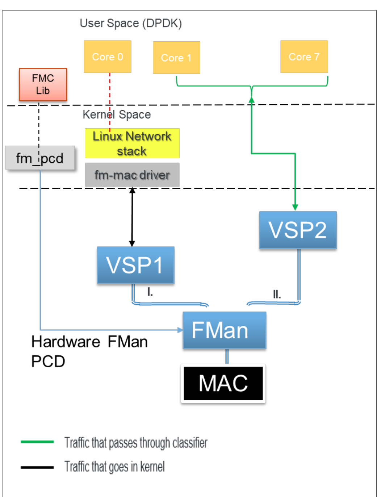

**Figure 202. Tách traffic dùng VSP trên DPAA**

##### 9.2.12.1.1 Thiết lập môi trường

Mục này dùng LS1046ARDB làm nền tảng ví dụ để minh họa use case.

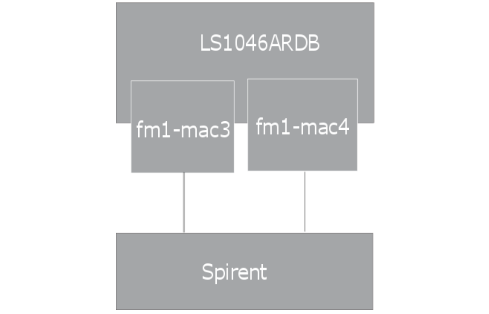

**Figure 203. Use case**

Trong hình trên, một board NXP LS1046ARDB được nối với một bộ sinh packet (Spirent).

Ví dụ dùng Spirent làm bộ sinh packet, nhưng cũng có thể dùng bất kỳ nguồn truyền packet có kiểm soát nào khác.

Hình dùng các interface `fm1-mac3` và `fm1-mac4` để minh họa. Cũng có thể dùng interface khác sau khi cập nhật các lệnh mô tả ở mục sau cho phù hợp.

##### 9.2.12.1.2 Các bước chạy chế độ VSP

Để chạy DPAA ở chế độ VSP:

1. Flash board bằng các image Layerscape LDP.
2. Reboot board và đặt dtb là `fsl-ls1046a-rdb-usdpaa-shared.dtb` trên bank mà board đang boot, rồi boot board.
3. Dọn dẹp cấu hình fmc hiện tại:

   ```
   $ fmc -x
   ```

4. Đặt các port Ethernet sẽ dùng:

   ```
   $ ifconfig fm1-mac3 <valid ip address>
   $ ifconfig fm1-mac4 <valid ip address>
   ```

5. Thiết lập hugepage:

   ```
   $ mkdir /dev/hugepages
   $ mount -t hugetlbfs hugetlbfs /dev/hugepages
   $ echo 512 > /proc/sys/vm/nr_hugepages
   ```

6. Thiết lập cấu hình `fmc` VSP:

   ```
   $ fmc -c /usr/share/dpdk/dpaa/usdpaa_config_ls1046_shared_24g.xml -p /usr/
   share/dpdk/dpaa/usdpaa_policy_24g_classif_udp_ipsec_1queue.xml -a
   ```

7. Chạy ứng dụng `l2fwd`:

   ```
   $ dpdk-l2fwd -c 0x3 -n 1 -- -p 0x3
   ```

Bây giờ DPDK sẽ xử lý traffic UDP hoặc ESP, còn kernel sẽ xử lý phần traffic còn lại.

Gửi các packet stream sau từ bộ sinh packet (trong trường hợp này là Spirent):

1. Packet gửi tới `fm1-mac3`

   a. Traffic UDP: packet IPv4 có field Protocol ID (next protocol) = 0x11 (hex) hoặc 17 (thập phân); kích thước lớn hơn 82 byte.

   b. Traffic IPv4: packet IPv4 có field Protocol ID (next protocol) = 253 (Experimental); kích thước lớn hơn hoặc bằng 64 byte.

2. Packet gửi tới `fm1-mac4`

   a. Traffic UDP: packet IPv4 có field Protocol ID (next protocol) = 0x11 (hex) hoặc 17 (thập phân); kích thước lớn hơn 82 byte.

   b. Traffic IPv4: packet IPv4 có field Protocol ID (next protocol) = 253 (Experimental); kích thước lớn hơn hoặc bằng 64 byte.

##### 9.2.12.1.3 Kết quả mong đợi

Mọi traffic có đặt Experimental Protocol trong IPv4 header được gửi tới network stack của Linux Kernel và có trên interface Ethernet (`fm1-mac3/4`). Các ứng dụng như `tcp dump` có thể cho thấy packet đang tới. Mọi traffic khác được ứng dụng `l2fwd` phản hồi lại và nhìn thấy ở bộ sinh packet.

#### 9.2.12.2 Tách traffic dùng DPSW trên DPAA2

##### 9.2.12.2.1 DPSW trong dprc.2

Khi DPSW nằm trong dprc.2, object DPAA2 do DPDK điều khiển. Vì vậy, mọi setup cần thiết, ví dụ thêm địa chỉ FDB, được cấu hình bằng DPDK. Các bước cấu hình setup giống như với DPDMUX, chỉ cần thay DPDMUX bằng DPSW. Để biết thêm chi tiết, xem Section 9.2.12.3.

##### 9.2.12.2.2 DPSW trong dprc.1

Khi DPSW nằm trong dprc.1, nó được điều khiển bởi driver của Linux kernel. Driver của Linux kernel dùng kernel framework switchdev và đưa ra một interface cho mỗi port của switch. Trong Linux, không có switching nếu các interface không được thêm vào cùng một bridge. Vì vậy, khi các port đã được thêm vào bridge interface, ứng dụng DPDK hoạt động khi DPSW nằm trong dprc.1.

1. Tạo một DPNI để gán cho Linux kernel.

   ```
   ls-addni --no-link
   Output log:
   Created interface: eth0 (object:dpni.1, endpoint: )
   ```

2. Tạo DPRC có gắn DPNI.

   ```
   source /usr/share/dpdk/dpaa2/dynamic_dpl.sh dpni
   (...)
   ##################### Configured Interfaces ####################
   Interface Name Endpoint Mac Address
   ============== ======== ==================
   dpni.3 UNCONNECTED 00:00:00:00:5:1
   ```

   **Ghi chú:** Tên dpni.X được lệnh `ls-addni` và script `dynamic_dpl.sh` sinh động. Nếu chúng khác với mô tả trong mục này, cần sửa tương ứng các lệnh dưới đây.

3. Dùng script wrapper của restool, tạo một DPSW nối với hai DPNI và một DPMAC.

   ```
   ls-addsw dpni.1 dpni.3 dpmac.1
   Created ETHSW object dpsw.0 with the following 3 ports: eth2,eth3,eth4
   ```

   **Ghi chú:** Để hiển thị các DPNI và DPMAC có sẵn, dùng lệnh `ls-listni`. Về mọi option và tham số của script, xem trợ giúp bằng lệnh `ls-addsw -h`

4. Cấu hình các interface của switch và thêm chúng vào một bridge.

   ```
   ip link set dev eth2 down
   ip link set dev eth2 address 00:00:00:00:00:02
   ip link set dev eth2 up
   ip link set dev eth3 down
   ip link set dev eth3 address 00:00:00:00:00:03
   ip link set dev eth3 up
   ip link set dev eth4 down
   ip link set dev eth4 address 00:00:00:00:00:04
   ip link set dev eth4 up
   ip link add name br0 type bridge
   ip link set dev br0 up
   ip link set dev eth2 master br0
   ip link set dev eth3 master br0
   ip link set dev eth4 master br0
   ```

5. Khởi động DPNI.1 (eth0), DPNI thuộc Linux.

   ```
   ip link set dev eth0 up
   ip a a 1.1.1.2/24 dev eth0
   ```

6. Chạy ứng dụng DPDK.

   ```
   ./dpdk-l3fwd -c 0x6 -n 1 -- -p 0x1 --config="(0,0,1)"
   EAL: Detected 8 lcore(s)
   EAL: Detected 1 NUMA nodes
   EAL: Multi-process socket /var/run/dpdk/rte/mp_socket
   fslmc: Skipping invalid device (power)
   EAL: Selected IOVA mode 'VA'
   EAL: Probing VFIO support...
   EAL: VFIO support initialized
   EAL: PCI device 0000:01:00.0 on NUMA socket -1
   EAL: Invalid NUMA socket, default to 0
   EAL: probe driver: 8086:10d3 net_e1000_em
   PMD: dpni.3: netdev created
   LPM or EM none selected, default LPM on
   Initializing port 0 ... Creating queues: nb_rxq=1 nb_txq=2...
    Address:00:00:00:00:05:01, Destination:02:00:00:00:00:00, Allocated mbuf
    pool on socket 0
   LPM: Adding route 198.18.0.0 / 24 (0)
   LPM: Adding route 2001:200:: / 48 (0)
   txq=1,0,0 txq=2,1,0
   Initializing rx queues on lcore 1 ... rxq=0,0,0
   Initializing rx queues on lcore 2 ...
   Checking link statusdone
   Port0 Link Up. Speed 1000 Mbps -full-duplex
   L3FWD: lcore 2 has nothing to do
   L3FWD: entering main loop on lcore 1
   L3FWD: -- lcoreid=1 portid=0 rxqueueid=0
   ```

7. Bắt packet.

   ```
   tcpdump -nt -i eth0 &
   IP 1.1.1.0 > 2.1.1.0: ip-proto-253 26
   IP 1.1.1.0 > 2.1.1.0: ip-proto-253 26
   IP 1.1.1.0 > 2.1.1.0: ip-proto-253 26
   IP 1.1.1.0 > 2.1.1.0: ip-proto-253 26
   IP 1.1.1.0 > 2.1.1.0: ip-proto-253 26
   IP 1.1.1.0 > 2.1.1.0: ip-proto-253 26
   ```

#### 9.2.12.3 Tách traffic dùng DPDMUX trên DPAA2

##### 9.2.12.3.1 Thiết lập môi trường

**Ghi chú:** Mục này dùng board LS2088A làm nền tảng ví dụ để minh họa use case. Use case này áp dụng cho mọi nền tảng DPAA2, kể cả LS1088A và LX2160A.

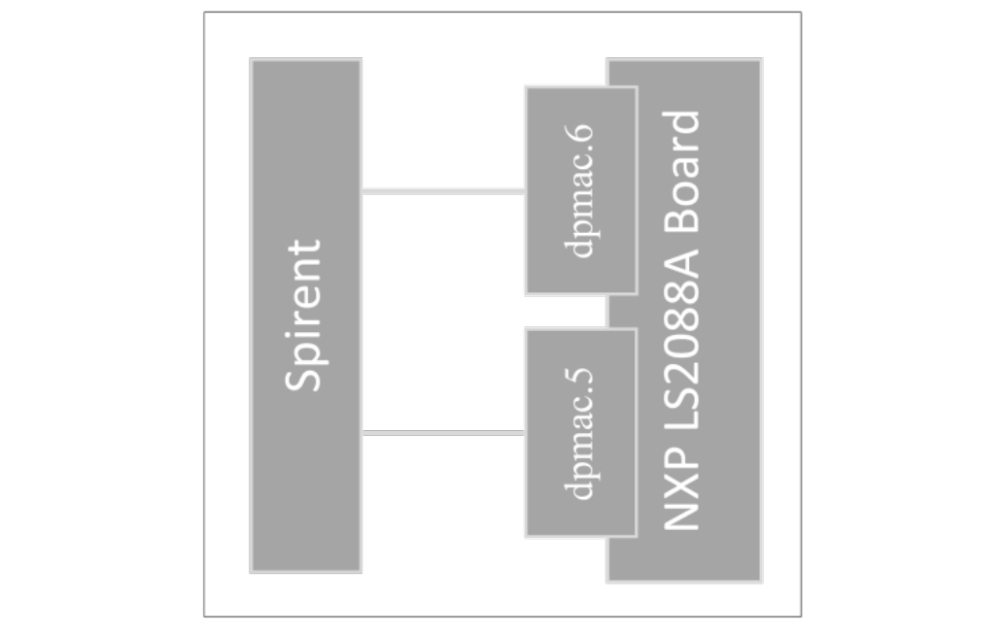

**Figure 204. Hình bên ngoài của setup**

Trong hình trên, một board NXP LS2088A được nối với một bộ sinh packet (Spirent). **Ghi chú:** Tuy ví dụ dùng Spirent làm bộ sinh packet, cũng có thể dùng bất kỳ nguồn truyền packet có kiểm soát nào khác.

**Ghi chú:** Hình dùng các interface `dpmac.5` và `dpmac.6` để minh họa. Cũng có thể dùng interface khác - khi đó cần sửa các lệnh mô tả dưới đây cho phù hợp.

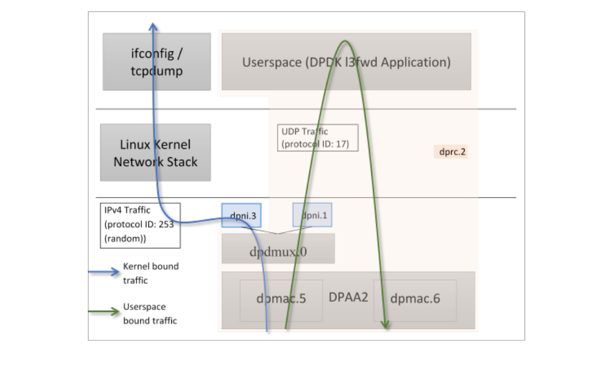

**Figure 205. Khối bên trong NXP LS2088A cho setup tách traffic**

Trong setup môi trường trên, một container DPRC (dprc.2) được tạo chứa các interface DPAA2 dpmac.5 và dpmac.6. DPDMUX dpdmux.0 được tạo với dpni.1 và dpni.3, còn dpni.2 được nối với dpmac.2.

Board NXP LS2088A có 8 link 10G – 4 port quang và 4 port đồng.

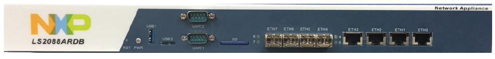

**Figure 206. Các port của LS2088ARDB**

Trên cấu hình Layerscape LDP chuẩn, các port này được biểu diễn bằng tên dpmac.X. Tương ứng với hình mô tả các port ở trên, quy ước đặt tên như sau:

- dpmac.1, dpmac.2, dpmac.3 và dpmac.4 lần lượt là ETH4, ETH5, ETH6 và ETH7
- dpmac.5, dpmac.6, dpmac.7 và dpmac.8 lần lượt là ETH0, ETH1, ETH2 và ETH3.

Sau đây là các lệnh tạo setup trên:

Tuy mục này dùng dpmac.5 và dpmac.6 làm interface, có thể tạo setup tương tự với bất kỳ port nào khác của LS2088A (hoặc bất kỳ board DPAA2 nào hỗ trợ DPDMUX). Thay dpmac.X trong các lệnh dưới đây bằng tên port tương ứng.

1. Tạo DPRC có gắn dpmac.5 và dpmac.6. Lệnh này tạo dpni.1 và dpni.2 bên trong.

   ```
   /usr/share/dpdk/dpaa2/dynamic_dpl.sh dpmac.5 dpmac.6
   ```

   Log output:

   ```
   ##################### Container  dprc.2  is created ####################
   Container dprc.2 have following resources :=>
   * 1 DPMCP
   * 16 DPBP
   * 8 DPCON
   * 8 DPSECI
   * 2 DPNI
   * 18 DPIO
   * 2 DPCI
   * 2 DPDMAI
   ######################### Configured Interfaces #########################
   Interface Name        Endpoint              Mac Address
   ==============        ========              ==================
   dpni.1                dpmac.5               -Dynamic-
   dpni.2                dpmac.6               -Dynamic-
   ```

2. Tạo một DPNI để gán cho Linux Kernel. DPNI này sẽ được dùng để chuyển tiếp traffic UDP.

   ```
   ls-addni --no-link
   ```

   Log output:

   ```
   Created interface: eth0 (object:dpni.3, endpoint: )
   ```

   **Ghi chú:**

   Cần lưu ý tên dpni.X được script dynamic_dpl.sh và lệnh ls-addni sinh động. Nếu chúng khác với mô tả trong mục này, cần sửa tương ứng các lệnh dưới đây.

3. Rút DPRC khỏi VFIO, tạo một DPDMUX, gán các DPNI (`dpni.1` và `dpni.3`) cho nó, rồi cắm DPRC trở lại VFIO để ứng dụng user space có thể dùng. DPRC đã ở trạng thái cắm sẵn do script `dynamic_dpl.sh`.

   ```
   # Unbinding dprc.2 from VFIO
   echo dprc.2 > /sys/bus/fsl-mc/drivers/vfio-fsl-mc/unbind
   # Remove dpni.2 from dprc.2 so that it can be assigned to dpdmux
   restool dprc disconnect dprc.2 --endpoint=dpni.1
   # Create dpdmux with CUSTOM flow creation; Flows would be created
   # from the Userspace (DPDK) application
   restool dpdmux create --default-if=1 --num-ifs=2 --method
    DPDMUX_METHOD_CUSTOM --
   manip=DPDMUX_MANIP_NONE --option=DPDMUX_OPT_CLS_MASK_SUPPORT --
   container=dprc.1
   # Create DPDMUX with two DPNI connections and one DPMAC connection
   restool dprc connect dprc.1 --endpoint1=dpdmux.0.0 --endpoint2=dpmac.5
   restool dprc connect dprc.1 --endpoint1=dpdmux.0.1 --endpoint2=dpni.3
   restool dprc connect dprc.1 --endpoint1=dpdmux.0.2 --endpoint2=dpni.1
   restool dprc assign dprc.1 --object=dpdmux.0 --child=dprc.2 --plugged=1
   ```

   **Ghi chú:** Queue mặc định được cấu hình là `0.1` trong driver DPMUX của DPDK. Trong các lệnh trên, `dpni.3` được cấu hình là `--endpoint1=dpdmux.0.1`. Vì vậy, mọi traffic không bị lọc sẽ được `dpdmux.0` gửi tới `dpni.3`. Ngoài ra, ứng dụng l2fwd hiện cấu hình traffic UDP (giá trị field IPv4 Protocol Header là 17) gửi tới `--endpoint1=dpdmux.0.2`, tương ứng với `dpni.1`.

   ```
   # Bind the DPRC back to VFIO
   echo dprc.2 > /sys/bus/fsl-mc/drivers/vfio-fsl-mc/bind
   # Export the DPRC
   export DPRC=dprc.2
   ```

   Nếu cần, có thể gán địa chỉ IP cho `eth0`, interface xuất hiện trong Linux OS đại diện cho dpni.3. Sau đó, bộ sinh packet bên ngoài hoặc một thiết bị có thể gửi traffic ICMP để xác nhận việc tách traffic.

   ```
   root@Ubuntu:~# ifconfig eth0 10.0.0.10/24 up
   root@Ubuntu:~# ifconfig eth0
   eth0: flags=4163<UP,BROADCAST,RUNNING,MULTICAST> mtu 1500
   inet 10.0.0.10 netmask 255.255.255.0 broadcast 10.0.0.255
   inet6 fe80::dce6:feff:fe3a:e105 prefixlen 64 scopeid 0x20<link>
   ether de:e6:fe:3a:e1:05 txqueuelen 1000 (Ethernet)
   RX packets 0 bytes 0 (0.0 B)
   RX errors 0 dropped 0 overruns 0 frame 0
   TX packets 6 bytes 516 (516.0 B)
   TX errors 0 dropped 0 overruns 0 carrier 0 collisions 0
   root@Ubuntu:~# restool dpni info dpni.3
   dpni version: 7.8
   dpni id: 3
   plugged state: plugged
   endpoint state: 1
   endpoint: dpdmux.0.1, link is up
   link status: 1 - up
   mac address: de:e6:fe:3a:e1:05
   dpni_attr.options value is: 0
   ```

4. Chạy ứng dụng l3fwd

   ```
   dpdk-l3fwd -c 0xF0 -n 1 -- -p 0x3 --config="(0,0,4),(1,0,5)" -P --traffic-
   split-config="(2,17,2)"
   ```

   **Ghi chú:**

   - Trong lệnh trên, `-c 0xF0` tương ứng với các core mà ứng dụng DPDK dùng. Nếu khác, cần đổi mask.
   - Ngoài ra, `--config="(0,0,4),(1,0,5)"` biểu diễn **(Port, Queue, Core)** – cần khớp với core mask đã cung cấp. Giá trị Port là ‘0’ và ‘1’ với giả định chỉ `dpmac.5` và `dpmac.6` được gán cho DPRC `dprc.2`. Chỉ xét một queue mỗi thiết bị. Đánh số mọi phần tử của bộ này bắt đầu từ 0.
   - `--traffic-split-config`: (type, val, mux_conn_id): trong đó `type` có thể là một trong các giá trị sau - `1`:ETHTYPE, `2`:IP_PROTO, `3`:UDP_DST_PORT, `4`: UDP phân mảnh hoặc GTP, `5`: traffic IP phân mảnh với Protocol cụ thể. Thiết bị DPDMUX sẽ chia traffic theo `type` của rule sao cho packet có giá trị `val` được nhận trên connection id `mux_conn_id` của DPDMUX (`dpdmux.0.x` trong đó `x` là `mux_conn_id`). `val` không có ý nghĩa khi `type` là `4` (tức UDP phân mảnh hoặc GTP) Log output:

     ```
     EAL: Detected 8 lcore(s)
     EAL: Probing VFIO support...
     EAL: VFIO support initialized
     EAL: PCI device 0000:01:00.0 on NUMA socket -1
     EAL: Invalid NUMA socket, default to 0
     EAL: probe driver: 8086:10d3 net_e1000_em
     PMD: dpni.1: netdev created
     PMD: dpni.2: netdev created
     PMD: dpsec-0 cryptodev created
     PMD: dpsec-1 cryptodev created
     PMD: dpsec-2 cryptodev created
     PMD: dpsec-3 cryptodev created
     PMD: dpsec-4 cryptodev created
     PMD: dpsec-5 cryptodev created
     PMD: dpsec-6 cryptodev created
     PMD: dpsec-7 cryptodev created
     ^[[6~L3FWD: Promiscuous mode selected
     L3FWD: LPM or EM none selected, default LPM on
     Initializing port 0 ... Creating queues: nb_rxq=1 nb_txq=4...
      Address:00:00:00:00:00:01,
     Destination:02:00:00:00:00:00, Allocated mbuf pool on socket 0
     LPM: Adding route 0x01010100 / 24 (0)
     LPM: Adding route 0x02010100 / 24 (1)
     LPM: Adding route IPV6 / 48 (0)
     LPM: Adding route IPV6 / 48 (1)
     txq=4,0,0 txq=5,1,0 txq=6,2,0 txq=7,3,0
     Initializing port 1 ... Creating queues: nb_rxq=1 nb_txq=4...
      Address:DA:CA:B2:78:68:19,
     Destination:02:00:00:00:00:01, Allocated mbuf pool on socket 0
     txq=4,0,0 txq=5,1,0 txq=6,2,0 txq=7,3,0
     Initializing rx queues on lcore 4 ... rxq=0,0,0
     Initializing rx queues on lcore 5 ... rxq=1,0,0
     Initializing rx queues on lcore 6 ...
     Initializing rx queues on lcore 7 ...
     Checking link statusdone
     Port0 Link Up. Speed 1000 Mbps -full-duplex
     Port1 Link Up. Speed 10000 Mbps -full-duplex
     L3FWD: entering main loop on lcore 5
     L3FWD: -- lcoreid=5 portid=1 rxqueueid=0
     L3FWD: lcore 7 has nothing to do
     L3FWD: lcore 6 has nothing to do
     L3FWD: entering main loop on lcore 4
     L3FWD: -- lcoreid=4 portid=0 rxqueueid=0
     ```

5. Gửi các packet stream sau từ bộ sinh packet (trong trường hợp này là Spirent)

   a. Packet gửi tới `dpmac.5`

   i. Traffic UDP: packet IPv4 có field Protocol ID (next protocol) = 0x11 (hex) hoặc 17 (thập phân); kích thước lớn hơn 82 byte.

   ii. Traffic chỉ IPv4: traffic IPv4 với Protocol ID (next protocol) ngẫu nhiên bất kỳ = 253 (Experimental); kích thước lớn hơn hoặc bằng 64 byte. Src IP: 1.1.1.1; Dst IP: 2.1.1.1 (để ứng dụng l3fwd có thể chuyển tiếp packet từ `dpmac.5 to dpmac.6`.

   b. Packet gửi tới `dpmac.2`

   i. Traffic chỉ IPv4: traffic IPv4 với Protocol ID (next protocol) ngẫu nhiên bất kỳ = 253 (Experimental); kích thước lớn hơn hoặc bằng 64 byte. Src IP: 2.1.1.1; Dst IP: 1.1.1.1 (để ứng dụng l3fwd có thể chuyển tiếp packet từ `dpmac.6 to dpmac.5`.

##### 9.2.12.3.2 Kết quả mong đợi

Sau đây là output mong đợi:

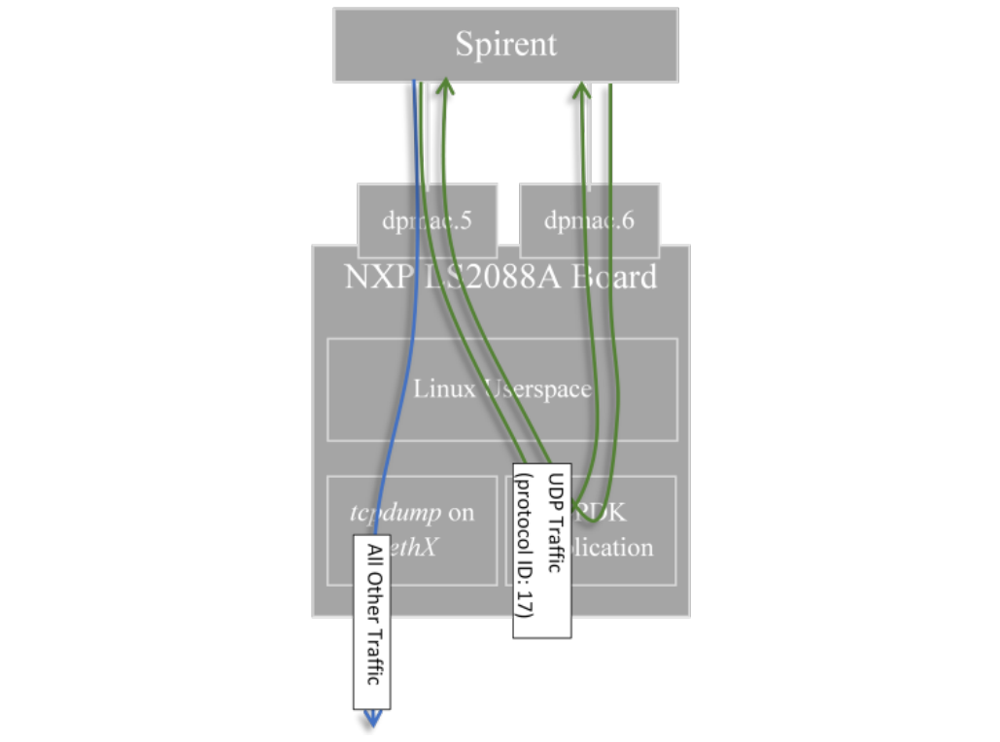

**Figure 207. Output mong đợi trên Linux User space và Packet Generator**

1. Mọi traffic có đặt UDP Protocol trong IPv4 header sẽ được gửi tới network stack của Linux Kernel và cuối cùng có trên interface Ethernet (dựa trên dpni.3). Các ứng dụng như tcpdump có thể cho thấy packet đang tới:

   ```
   root@ls1028ardb:~# ifconfig
   …
   eth0: flags=4163<UP,BROADCAST,RUNNING,MULTICAST>  mtu 1500
   inet 10.0.0.10  netmask 255.255.255.0  broadcast 10.0.0.255
   inet6 fe80::5885:a5ff:fe1c:76af  prefixlen 64  scopeid 0x20<link>
   ether 5a:85:a5:1c:76:af  txqueuelen 1000  (Ethernet)
   RX packets 0  bytes 0 (0.0 B)
   RX errors 0  dropped 0  overruns 0  frame 0
   TX packets 5  bytes 426 (426.0 B)
   TX errors 0  dropped 0 overruns 0  carrier 0  collisions 0
   …
   tcpdump: verbose output suppressed, use -v or -vv for full protocol decode
   listening on eth0, link-type EN10MB (Ethernet), capture size 262144 bytes
   22:39:10.286502 IP 10.0.0.11 > Ubuntu.ls2088ardb:  ip-proto-200 90
   22:39:11.286385 IP 10.0.0.11 > Ubuntu.ls2088ardb:  ip-proto-201 90
   22:39:12.286286 IP 10.0.0.11 > Ubuntu.ls2088ardb:  ip-proto-202 90
   22:39:13.286172 IP 10.0.0.11 > Ubuntu.ls2088ardb:  ip-proto-203 90
   22:39:14.286075 IP 10.0.0.11 > Ubuntu.ls2088ardb:  ip-proto-204 90
   22:39:15.285958 IP 10.0.0.11 > Ubuntu.ls2088ardb:  ip-proto-205 90
   22:39:16.285845 IP 10.0.0.11 > Ubuntu.ls2088ardb:  ip-proto-206 90
   22:39:17.285757 IP 10.0.0.11 > Ubuntu.ls2088ardb:  ip-proto-207 90
   22:39:18.285636 IP 10.0.0.11 > Ubuntu.ls2088ardb:  ip-proto-208 90
   22:39:19.285541 IP 10.0.0.11 > Ubuntu.ls2088ardb:  ip-proto-209 90
   ^C
   10 packets captured
   10 packets received by filter
   0 packets dropped by kernel
   root@Ubuntu:~#
   ```

   Trong output trên, có thể thấy Linux nhận các packet có field IPv4 Protocol khác nhau. (Thiết lập này có thể cấu hình trong Spirent.) `Ubuntu.ls2088ardb` chỉ IP máy cục bộ `10.0.0.10` đã được cấu hình bằng `ifconfig`.

2. Mọi traffic khác sẽ được ứng dụng ‘l3fwd’ phản hồi lại và nhìn thấy ở bộ sinh packet. Dưới đây là ảnh chụp output Wireshark của các packet do Spirent bắt được, đã được ứng dụng l3fwd phản hồi lại:

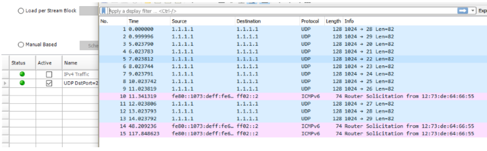

**Figure 208. Output Wireshark của packet do Spirent bắt được**

#### 9.2.12.4 DPDK multi-process

##### 9.2.12.4.1 Hỗ trợ DPDK Multiprocess

Các nền tảng được hỗ trợ (và các biến thể của chúng):

- DPAA2: LS108x, LS208x, LX2160

NXP DPDK cung cấp một tập thư viện data plane và driver network interface controller cho các nền tảng Layerscape. Mục này cung cấp thông tin về hỗ trợ multiprocess trong DPDK cho các nền tảng NXP.

- Multiprocess: Trong ngữ cảnh DPDK, đây là mô hình triển khai trong đó nhiều process độc lập được chạy, mỗi process về chức năng có thể hoạt động như các thread của một process cha.
- Parent/Primary Process: Process DPDK đầu tiên được chạy. Trong mô hình multiprocess của DPDK, process này chịu trách nhiệm cấu hình các thiết bị và mọi cấu hình chung khác mà các secondary process sẽ dùng. Process này cũng có thể thực hiện I/O trên các thiết bị. Khi chạy process, nếu dùng `--` `proc-type=primary` làm tham số EAL, process được kỳ vọng là primary. Nếu đây không phải process DPDK đầu tiên, sẽ gây lỗi.
- Child/Secondary Process: Mọi process DPDK tiếp theo được khởi động với tham số EAL `--proc-type=secondary`. Một cách khác là thêm `--proc-type=auto` làm tham số EAL, tự động chọn giữa primary và secondary theo thứ tự chạy.

**Ghi chú:** Nếu khởi động một instance khác của ứng dụng DPDK nhưng không định đưa nó vào mô hình Multiprocess (instance DPDK riêng), cần cấu hình hugepage thích hợp. Mặc định, DPDK map mọi hugepage có sẵn, vốn chỉ được một process duy nhất và các secondary process của nó dùng.

##### 9.2.12.4.2 Các mô hình Multiprocess

**Ghi chú:** Mục này chỉ áp dụng cho DPAA2 vì liên quan tới I/O trong secondary process. Xem các mục sau về hỗ trợ DPAA.

Dựa trên chức năng của các process, mô hình multiprocess có thể chia thành hai loại lớn:

- Symmetric: Mô hình trong đó các process Primary và Secondary có chức năng tương tự. Ví dụ, khi process Primary thực hiện I/O trên một thiết bị `eth`, đồng thời một hoặc nhiều secondary process cũng thực hiện I/O trên các thiết bị `eth` khác. Hoặc mỗi thiết bị được dùng chung đều giữa nhiều process cho I/O.

  ```
  +----------+    +------------+   +------------+    +------------+
  | Primary  |    | Secondary1 |   | Secondary2 |... | SecondaryN |
  +-----XV---+    +------XV----+   +------XV----+    +-----XV-----+
        ||               ||               ||               ||
  +-----||---+    +------||----+   +------||----+    +-----||-----+
  | Device 1 |    | Device 2   |   | Device 3   |... | Device N   |
  +----------+    +------------+   +------------+    +------------+
  ```

  Trong đó { X = Rx và V = Tx } biểu thị I/O (cả RX/TX). Một cách hình dung khác là mỗi process thực hiện I/O (RX/TX) trên cùng thiết bị, có thể qua các queue riêng:

  ```
  +----------+    +------------+   +------------+    +------------+
  | Primary  |    | Secondary1 |   | Secondary2 |... | SecondaryN |
  +-----XV---+    +------XV----+  +------XV----+    +------XV-----+
        ||               ||              ||                ||
        ||  .-------------`              ||                ||
        ||  ||   .------------------------`                ||
        ||  ||   ||    .-----------------------------------`
        ||  ||   ||    ||
  +-----||--||---||----||--+
  |         Device 1       |
  +------------------------+
  ```

- Asymmetric: Mô hình trong đó các process primary và secondary có chức năng khác nhau về I/O. Ví dụ, process primary thực hiện RX trên một thiết bị, chuyển dữ liệu cho một secondary process qua một cơ chế nội bộ (IPC, ví dụ Ring), process này lại thực hiện TX trên cùng thiết bị.

  ```
  +----------+    +------------+
  | Primary  >----X Secondary1 |
  +-----X-V-V+    +------V-----+
        | | |            |         +------------+
        | |  `-----------)---------X Secondary2 |
        | |              |         +------V-----+
        | |              |                |
        | |              |                |           +------------+
        |  `-------------)----------------)-------...-X SecondaryN |
        |                |                |           +-----V------+
        |                |                |                 |
        |.---------------'                |                 |
        ||.-------------------------------`                 |
        |||.------------------------------------------------`
        ||||
  +-----||||-+
  | Device 1 |
  +----------+
  ```

  Bản triển khai hiện tại của NXP DPDK hỗ trợ cả hai chế độ trên các nền tảng được hỗ trợ. Thiết kế của ứng dụng quyết định chế độ được dùng.

##### 9.2.12.4.3 Thiết lập môi trường

**Ghi chú:** Mục này chỉ áp dụng cho DPAA2.

**Ghi chú:** Với mọi use case multiprocess của DPDK, tắt ASLR - Address Space Layout Randomization<sup>8</sup>Đây là

thiết lập mặc định trên nhiều bản phân phối Linux để ngăn các tấn công thao túng stack và địa chỉ khác. Nó hoạt động bằng cách ngẫu nhiên hóa bố cục không gian địa chỉ của binary ELF. Điều này ảnh hưởng tới secondary process vì process thứ hai trở đi sẽ cố tìm cùng không gian địa chỉ như process primary (hugepage). Cần tắt nó bằng:

```
echo 0 > /proc/sys/kernel/randomize_va_space
```

DPRC hay DPAA2 Resource Container chứa một số tài nguyên cần được phân tách giữa process primary và secondary. Việc khởi tạo mọi thiết bị I/O (dpni, dpseci, dpdmai, v.v.) do primary làm - secondary process không được kỳ vọng khởi tạo thiết bị I/O nào. Chỉ các thiết bị điều khiển như `dpio`, `dpmcp` cần được secondary khởi tạo cho công việc của chính nó.

Khi chạy process primary hoặc secondary, cần truyền danh sách thiết bị cần blacklist (những thiết bị không được cấu hình). Hoặc có thể truyền danh sách mọi thiết bị cần cấu hình. Danh sách này quan trọng vì nếu chồng lấn sẽ dẫn tới cấu hình sai.

1. Tạo đủ thiết bị `dpmcp`: Khi tạo DPRC (qua script `dynamic_dpl.sh`), tạo số `dpmcp` bằng số process (primary và secondary) sẽ dùng DPRC.

   ```
   $ export DPMCP_COUNT=3              # for 1 Primary, 2 Secondary
   $ ./dynamic_dpl.sh dpmac.1 dpmac.2
   ```

2. Tạo đủ thiết bị `dpio` cho tổng số core dùng trên primary và secondary, cộng thêm một cho mỗi process. Ví dụ, nếu primary chạy với 2 core và secondary với 2 Core, tổng số `dpio` cần là: (Tổng Process = 3) x (3 `dpio` mỗi process) = 9

   **Ghi chú:** Đã có sẵn nhiều thiết bị `dpio` trong container mặc định do `dynamic_dpl.sh` tạo.

   ```
   $ export DPIO_COUNT=10              # A larger number to accommodate conf
    changes
   $ ./dynamic_dpl.sh dpmac.1 dpmac.2
   ```

   Giả sử đã tạo DPRC sau:

   ```
   $ restool dprc show dprc.2
   ```

   ```
   dprc.2 contains 58 objects:
   object          label           plugged-state
   dpni.3                          plugged
   dpni.2                          plugged
   dpni.1                          plugged
   dpbp.16                         plugged
   dpbp.15                         plugged
   dpbp.14                         plugged
   dpbp.13                         plugged
   dpbp.12                         plugged
   ```

   8 https://en.wikipedia.org/wiki/Address_space_layout_randomization

   ```
   dpbp.11                         plugged
   dpbp.10                         plugged
   dpbp.9                          plugged
   dpbp.8                          plugged
   dpbp.7                          plugged
   dpbp.6                          plugged
   dpbp.5                          plugged
   dpbp.4                          plugged
   dpbp.3                          plugged
   dpbp.2                          plugged
   dpbp.1                          plugged
   dpci.1                          plugged
   dpci.0                          plugged
   dpseci.7                        plugged
   dpseci.6                        plugged
   dpseci.5                        plugged
   dpseci.4                        plugged
   dpseci.3                        plugged
   dpseci.2                        plugged
   dpseci.1                        plugged
   dpseci.0                        plugged
   dpdmai.1                        plugged
   dpdmai.2                        plugged
   dpmcp.23                        plugged
   dpmcp.22                        plugged
   dpmcp.21                        plugged
   dpio.17                         plugged
   dpio.16                         plugged
   dpio.15                         plugged
   dpio.14                         plugged
   dpio.13                         plugged
   dpio.12                         plugged
   dpio.11                         plugged
   dpio.10                         plugged
   dpio.9                          plugged
   dpio.8                          plugged
   dpcon.8                         plugged
   dpcon.7                         plugged
   dpcon.6                         plugged
   dpcon.5                         plugged
   dpcon.4                         plugged
   dpcon.3                         plugged
   dpcon.2                         plugged
   dpcon.1                         plugged
   ```

   Bỏ qua `dpni`, `dpbp`, `dpci`, `dpseci`, `dpcon` - vì chúng đều chỉ do process primary cấu hình. Secondary process được thiết kế để bỏ qua chúng. Nhưng `dpio` và `dpmcp` là các điểm quan trọng cần cân nhắc.

3. Khởi động ứng dụng primary với các tham số EAL để blacklist

   ```
   # Only allowing dpio.8, dpio.9, dpio.10, dpmcp.21 in primary; blacklisting
    all others
   $ ./primary_process -c 0x3 -b fslmc:dpio.11 -b fslmc:dpio.12 -b fslmc:dpio.13
    \
         -b fslmc:dpio.14 -b fslmc:dpio.15 -b fslmc:dpio.16 -b fslmc:dpio.17 \
         -b fslmc:dpmcp.22 -b fslmc:dpmcp.23 -- <application arguments>
   # Only allowing fslmc:dpio.11, fslmc:dpio.12, fslmc:dpio.13, fslmc:dpmcp.22
    in secondary process 1
   $ ./secondary_process1 -c 0x3 -b fslmc:dpio.8 -b fslmc:dpio.9 -b
    fslmc:dpio.10 \
         -b fslmc:dpio.14 -b fslmc:dpio.15 -b fslmc:dpio.16 -b fslmc:dpio.17 \
         -b fslmc:dpmcp.21 -b fslmc:dpmcp.23 -- <application arguments>
   # Only allowing fslmc:dpio.14, fslmc:dpio.15, fslmc:dpio.16, fslmc:dpmcp.23
    in secondary process 2; ignoring dpio.17
   $ ./secondary_process1 -c 0x3 -b fslmc:dpio.8 -b fslmc:dpio.9 -b
    fslmc:dpio.10 \
         -b fslmc:dpio.11 -b fslmc:dpio.12 -b fslmc:dpio.13 -b fslmc:dpio.17 \
         -b fslmc:dpmcp.21 -b fslmc:dpmcp.22 -- <application arguments>
   ```

   **Ghi chú:**

   - Trong định dạng trên, `<bus>:<device>` là cách cung cấp định danh thiết bị để blacklist/whitelist.
   - Một cách khác là whitelist mọi thiết bị - nhưng như vậy cần liệt kê cả các thiết bị `dpni, dpci,` `dpseci, and dpcon`. Điều đó làm độ dài tham số tăng tới mức không quản lý nổi.

##### 9.2.12.4.4 Chạy ứng dụng DPDK mẫu

**Ghi chú:** Mục này chỉ áp dụng cho DPAA2.

**Ghi chú:** Các ứng dụng dùng trong các đoạn lệnh dưới đây không có trong rootfs Layerscape LDP. Để biên dịch độc lập các ứng dụng này, xem Compiling DPDK Example Applications

**Ghi chú:** Cần lưu ý rằng trước khi chạy bất kỳ ứng dụng secondary nào, phải tắt hỗ trợ ASLR bằng `echo 0 > /proc/sys/kernel/randomize_va_space`.

DPDK cung cấp hai ứng dụng mẫu có thể dùng cho I/O với mô hình multiprocess.

```
./examples/multi_process/symmetric_mp             # symmetric model example
./examples/multi_process/client_server_mp         # asymmetric model example
```

NXP cũng cung cấp một số ví dụ khác dùng hỗ trợ phần cứng có sẵn trong DPAA2:

```
./examples/multi_process/symmetric_mp_qdma        # symmetric model with QDMA
 example
```

Giải thích chi tiết có trong tài liệu DPDK: https://doc.dpdk.org/guides/sample_app_ug/multi_process.html

Dùng cùng DPRC như ví dụ ở trên.

1. Chạy `dpdk-symmetric_mp` với 1 Primary, 1 Secondary:

   ```
   # Running primary process with single Core, 2 ports; assigning 1 dpmcp and 5
    dpio to it.
   dpdk-symmetric_mp -c 0x1 -n 1 -b fslmc:dpio.13 -b fslmc:dpio.14 -b
    fslmc:dpio.15 \
           -b fslmc:dpio.16 -b fslmc:dpio.17 -b fslmc:dpmcp.22 -b fslmc:dpmcp.23
    \
           -- -p 0x3 --num-procs=2 --proc-id=0
   ```

   Ở trên, `--num-procs=2` biểu thị tổng cộng 2 process. `--proc-id=0` là định danh của process primary.

   ```
   # Running secondary process with single core (not overlappping with primary),
    2 ports (same as primary); Assigning 1 dpmcp and 5 dpio to it. (We can
    ignore the extra dpmcp preserved for 3 process, if any)
   dpdk-symmetric_mp -c 0x2 -n 1 --proc-type=secondary -b fslmc:dpio.8 \
           -b fslmc:dpio.9 -b fslmc:dpio.10 -b fslmc:dpio.11 -b fslmc:dpio.12 \
           -b fslmc:dpmcp.21 -b fslmc:dpmcp.23 -- -p 0x3 --num-procs=2 --proc-
   id=1
   ```

   Nếu cần chạy nhiều hơn một instance ứng dụng, phải blacklist tương tự để phân chia tài nguyên. Ngoài ra, cũng cần đổi `--num-procs` và `--proc-id`.

   Gửi I/O tới các port đã gán cho các process và quan sát traffic được phản hồi lại.

2. Chạy `dpdk-client_server_mp` với 1 Primary, 1 Secondary:

   Ứng dụng mẫu này có hai ứng dụng khác nhau chạy làm server và client. Process server chịu trách nhiệm RX từ các interface (tất cả) và phân phối cho Client để TX (một queue mỗi thiết bị).

   ```
   # Running server (primary) process with 1 Core, 2 ports; assigning 1 dpmcp
    and 5 dpio to it.
   dpdk-mp_server -c 0x1 -n 1 -b fslmc:dpio.13 -b fslmc:dpio.14 -b fslmc:dpio.15
    \
           -b fslmc:dpio.16 -b fslmc:dpio.17 -b fslmc:dpmcp.22 -b fslmc:dpmcp.23
    \
           -- -p 0x3 -n 1
   ```

   ```
   # Running client (secondary) process with 1 Core, 2 ports; assigning 1 dpmcp
    and 5 dpio to it.
   dpdk-mp_client -c 0x2 -n 1 --proc-type=secondary -b fslmc:dpio.8 \
          -b fslmc:dpio.9 -b fslmc:dpio.10 -b fslmc:dpio.11 -b fslmc:dpio.12 \
          -b fslmc:dpmcp.21 -b fslmc:dpmcp.23 -- -n 0
   ```

   Gửi I/O tới các port đã gán cho các process và quan sát traffic được chuyển tiếp.

3. Chạy ứng dụng ví dụ QDMA:

   Ứng dụng `dpdk-symmetric_mp_qdma` tương tự `dpdk-symmetric_mp`, trừ việc truyền mbuf (buffer) giữa RX và TX được thực hiện bằng khối phần cứng QDMA (`dpdmai`) của NXP DPAA2.

   ```
   # Running primary process with single Core, 2 ports; assigning 1 dpmcp and 5
    dpio, 1 dpdmai to it:
   # Assuming that there are two DPDMAI objects in the DPRC: dpdmai.1 and
    dpdmai.2, the command is very similar to the symmetric_mp example:
   dpdk-symmetric_mp_qdma -c 0x1 -n 1 -b fslmc:dpio.13 -b fslmc:dpio.14 -b
    fslmc:dpio.15 \
           -b fslmc:dpio.16 -b fslmc:dpio.17 -b fslmc:dpmcp.22 -b fslmc:dpmcp.23
    \
           -b fslmc:dpdmai.1 -- -p 0x3 --num-procs=2 --proc-id=0
   ```

   Lưu ý tham số bổ sung `-b fslmc:dpdmai.1` so với lệnh `symmetric_mp`. Tham số này báo cho process bỏ qua khối `dpdmai.1` và dùng `dpdmai.2` trong Primary.

   ```
   # Running secondary process with single core (not overlappping with primary),
    2 ports (same as primary); Assigning 1 dpmcp and 5 dpio, 1 dpdmai to it. (We
    can ignore the extra dpmcp preserved for 3 process, if any)
   dpdk-symmetric_mp_qdma -c 0x2 -n 1 --proc-type=secondary -b fslmc:dpio.8 \
           -b fslmc:dpio.9 -b fslmc:dpio.10 -b fslmc:dpio.11 -b fslmc:dpio.12 \
           -b fslmc:dpmcp.21 -b fslmc:dpmcp.23 -b fslmc:dpdmai.2 \
           -- -p 0x3 --num-procs=2 --proc-id=1
   ```

4. Chạy ứng dụng ví dụ `dpdk-l2fwd-crypto`:

   `dpdk-l2fwd-crypto` là ứng dụng minh họa crypto chuẩn của DPDK, cũng hỗ trợ mô hình multiprocess.

   Khác biệt chính so với cách chạy `dpdk-l2fwd-crypto` thông thường là các tham số `mp-emask` và `mp-cmask` được truyền vào - lần lượt biểu thị các port Ethernet và crypto port mà instance l2fwd-crypto sẽ dùng.

   Sau đây có thể là một lệnh ứng dụng primary, dùng cùng DPRC như trong các ví dụ ở trên:

   ```
   dpdk-l2fwd-crypto -c 0x3 -n 1 -b fslmc:dpio.13 -b fslmc:dpio.14 -b
    fslmc:dpio.15 \
           -b fslmc:dpio.16 -b fslmc:dpio.17 -b fslmc:dpmcp.22 -b fslmc:dpmcp.23
    \
           -- -p 0x3 -q 1 --mp-emask 0x1 --mp-cmask 0x1 --chain CIPHER_ONLY \
     --cipher_algo aes-cbc --cipher_op ENCRYPT \
     --cipher_key 01:02:03:04:05:06:07:08:09:0a:0b:0c:0d:0e:0f:10 \
     --cipher_iv 01:02:03:04:05:06:07:08:09:0a:0b:0c:0d:0e:0f:10
   ```

   Ứng dụng secondary có thể chạy như sau:

   ```
   dpdk-l2fwd-crypto -c 0xc -n 1 --proc-type=secondary -b fslmc:dpio.8 \
           -b fslmc:dpio.9 -b fslmc:dpio.10 -b fslmc:dpio.11 -b fslmc:dpio.12 \
           -b fslmc:dpmcp.21 -b fslmc:dpmcp.23 -b fslmc:dpdmai.2 \
           -- -p 0x3 -q 1 --mp-emask 0x2 --mp-cmask 0x2 --chain CIPHER_ONLY \
     --cipher_algo aes-cbc --cipher_op ENCRYPT \
     --cipher_key 01:02:03:04:05:06:07:08:09:0a:0b:0c:0d:0e:0f:10 \
     --cipher_iv 01:02:03:04:05:06:07:08:09:0a:0b:0c:0d:0e:0f:10
   ```

5. Các ứng dụng không thực hiện I/O: `dpdk-pdump` và `dpdk-procinfo`

   Cả `dpdk-pdump` và `dpdk-procinfo` đều là ví dụ về ứng dụng secondary có thể truy vấn thông tin từ ứng dụng primary (ứng dụng đầu tiên), mà không thực hiện I/O thực sự nào trên các thiết bị mạng. Cả hai được biên dịch mặc định như một phần của framework DPDK, giống `testpmd`, và có thể lấy từ thư mục `app/` trong output biên dịch.

   a. `dpdk-pdump` để bắt packet

   **Ghi chú:** Để hỗ trợ PCAP, phải cung cấp thư viện 'libpcap' cho DPDK khi biên dịch. Thư viện này cần được biên dịch cho target ARM64.

   Chạy ứng dụng primary (hiện chỉ `testpmd` hỗ trợ giao tiếp với `dpdk-pdump`):

   ```
   dpdk-testpmd -c 0xff -n 1 -- -i --portmask=0x3 --nb-ports=2
   ...
   # Start I/O on application
   testpmd> set fwd io
   testpmd> start
   ```

   Chạy ứng dụng secondary `dpdk-pdump`. Giống `dpdk-symmetric_mp` và các ứng dụng multiprocess khác, cần cô lập các tài nguyên DPRC như `dpio` và `dpmcp`.

   ```
   dpdk-pdump -n 1 -b fslmc:dpio.8 -b fslmc:dpio.9 -b fslmc:dpio.10 -b
    fslmc:dpio.11 \ -b fslmc:dpio.12 -b fslmc:dpio.13 -b fslmc:dpio.14 -
   b fslmc:dpio.15 \ -b fslmc:dpio.16 -b fslmc:dpmcp.29 --mbuf-pool-ops-
   name="ring_mp_mc" \ -- --pdump "port=0,queue=*,rx-dev=./rx.pcap"
   ```

   Trong lệnh trên, các tham số `port=0, ...` báo cho app \`dpdk-pdump\` biết cần bắt trên port 0 (ví dụ `dpni.1`) và packet nhận trên mọi queue `queue=*`. Ngoài ra, mọi packet bắt được có thể được dump ra file PCAP bằng `rx-dev=<path to pcap file>` nếu đã bật LIBPCAP.

   Trong ví dụ trên, chỉ packet Rx được ghi vào PCAP. Với packet Tx, dùng dạng tương tự `port=0,queue=*,tx-dev=./...`, trong đó file PCAP output khác với file của packet Rx. Có thể cung cấp đồng thời cả option RX lẫn TX.

   Dừng `dpdk-pdump` bằng Ctrl+C và chép file PCAP ra để đọc bằng ứng dụng bên ngoài như Wireshark

   b. `dpdk-procinfo` để dump thông tin ứng dụng như bộ nhớ hoặc thống kê port

   `dpdk-procinfo` là ứng dụng có sẵn, cho phép dump thông tin như bộ nhớ và thống kê của một ứng dụng DPDK (primary) đang chạy.

   Chạy ứng dụng primary: (Khác `dpdk-pdump`, `dpdk-procinfo` có thể chạy cùng bất kỳ ứng dụng primary nào):

   ```
   dpdk-testpmd -c 0xff -n 1 -- -i --portmask=0x3 --nb-ports=2
   ...
   # Start I/O on application
   testpmd> set fwd io
   testpmd> start
   ```

   Chạy ứng dụng secondary `dpdk-procinfo`:

   **Ghi chú:** Nên cô lập tài nguyên của ứng dụng (`dpio`, `dpmcp` và `dpdmai`) trong mọi trường hợp ứng dụng secondary. Tuy `dpdk-procinfo` có thể hoạt động mà không cần cô lập vì nó không nhất thiết truy cập dữ liệu riêng của thiết bị, vẫn nên cô lập trong trường hợp này.

   ```
   dpdk-procinfo -- -m
   ```

   Lệnh trên dump bố cục bộ nhớ của ứng dụng DPDK primary ra màn hình. Còn có các switch khác như `-s` để dump thống kê.

**Ghi chú:**

- `dpdk-l2fwd/dpdk-l3fwd` với thiết kế hiện tại không phù hợp để chạy multiprocess, vì vậy sẽ không hoạt động nếu không sửa đổi đáng kể việc phân tách queue và xử lý RX/TX.
- Để thoát ứng dụng, nên gửi SIGKILL tới mọi ứng dụng. Tương tự "killall \<application name>". Nếu không, cần kill mọi secondary trước (Ctrl+C hoặc SIGKILL) rồi mới tới process primary.

#### 9.2.12.5 Traffic Policing trên DPAA

Trên các SoC DPAA (như LS1043, LS1046), dùng công cụ FMC, có thể thực hiện traffic policing bằng cấu hình đơn giản.

Đây là một phần của Ingress Traffic Management trong khối FMan, nằm giữa QMan và phần cứng trong bố cục khối dọc tổng thể của DPAA. Sau khi frame đi vào FMan từ WRIOP, qua khối Parser và Classify, có thể cấu hình khối Policer để tô màu (và drop) frame theo policy. Các khối Policer chuyển mọi frame không bị drop tới QMan qua giao diện FMan<=>QMan. FMan hỗ trợ tối đa 256 policy profile.

**Ghi chú:** Một file XML mẫu đã được thêm vào thư mục source DPDK `/usr/share/dpdk/dpaa/usdpaa_policy_hash_ipv4_1queue_policer_ls1046.xml`. Mục này dùng các đoạn trích từ file đó. Nó CHỈ áp dụng cho board LS1046A.

1. Định nghĩa một XML policy Policer. Trong ví dụ này, dùng một bản sao của `usdpaa_policy_hash_ipv4_1queue_policer_ls1046.xml`.

   ```
   <policer name="policer9">
     <algorithm>rfc2698</algorithm>
     <color_mode>color_aware</color_mode>
     <CIR>5000000</CIR>
     <EIR>5500000</EIR>
     <CBS>5000000</CBS>
     <EBS>5500000</EBS>
     <unit>packet</unit>
     <action condition="on-red" type="drop"/>
   </policer>
   ```

   Trong cấu hình trên, một policer **RFC2698** (Two Rate Three Color Marker) được định nghĩa. Policy này dựa trên 2 token bucket biểu diễn hai tốc độ - **PIR/EIR** hay Peak/Exceed Information Rate và **CIR** hay Committed Information Rate - và 3 màu - Red, Yellow và Green. Dựa trên thông tin cấu hình ở trên cho **CBS** (Committed Burst Size) và **EBS** (Peak/Exceed Burst Size), các stream được đánh dấu bằng một trong 3 màu.

   **Ghi chú:** Theo chuẩn trTCM (Three Color Marker), CIR là tốc độ làm đầy committed bucket và CBS là kích thước ban đầu của nó, EIR là tốc độ làm đầy exceed bucket và EBS là kích thước ban đầu của nó. Vì vậy, nếu nhận được một luồng packet vượt EIR, nó sẽ được đánh dấu Red; nếu vượt CIR nhưng dưới EIR, nó được đánh dấu Yellow; còn lại là Green.

   Cấu hình trên có các phần tử sau:

   - `policer name` là tên Policer, sẽ được dùng để gán cho các bản ghi distribution policy
   - `algorithm` cần được đặt là `rfc2968` *(ghi chú: đúng là rfc2698)* hoặc `rfc4115` cho trTCM dùng cho differentiated services, hoặc `pass-through` để tắt policing (mặc định)
   - `color_mode` có thể đặt là `color_aware` hoặc `color_blind`. `color_aware` dùng thông tin đã tô màu trước (nếu có) để ra quyết định, còn `color_blind` bỏ qua thông tin màu hiện có.
   - `CIR`, `EIR` - lần lượt cho Committed Information Rate và Exceed Information Rate. Đơn vị đo được định nghĩa bằng `unit` mỗi giây (giải thích bên dưới).
   - `CBS`, `EBS` - lần lượt cho Committed Burst Size và Exceed Burst Size. Đơn vị đo được định nghĩa bằng `unit` mỗi giây (giải thích bên dưới).
   - `unit` - định nghĩa đơn vị đo cho cả bốn tham số cấu hình, cụ thể là `CIR, CBS, EIR, EBS`. Với information rate, đơn vị là `unit/second`, còn với burst size là `unit`.
2. Áp dụng policy cho một hoặc nhiều distribution policy:

   ```
   <distribution name="hash_ipv4_src_dst_dist9">
     <queue count="1" base="0xd00"/>
     <key>
       <fieldref name="ipv4.src"/>
       <fieldref name="ipv4.dst"/>
     </key>
     <action type="policer" name="policer9"/>
   </distribution>
   ```

3. Áp dụng file policy bằng công cụ FMC

   ```
   root@LS1046ARDB:~# fmc -x
   root@LS1046ARDB:~# fmc -c /usr/share/dpdk/dpaa/usdpaa_config_ls1046.xml -p /
   usr/share/dpdk/dpaa/usdpaa_policy_hash_ipv4_1queue_policer_ls1046.xml -a
   ```

   Từ đây thực hiện I/O để thấy tác dụng của policing đang được thực thi.

#### 9.2.12.6 Precision Time Protocol (IEEE1588)

Precision Time Protocol (PTP) là giao thức dùng để đồng bộ clock trong toàn mạng máy tính. PTP ban đầu được định nghĩa trong chuẩn IEEE1588-2002.

Để test chức năng ptp trong DPDK, có thể dùng ứng dụng DPDK mẫu “ptpclient” có trong source code DPDK. Ứng dụng ptpclient dùng DPDK IEEE1588 API để giao tiếp với một PTP master clock nhằm đồng bộ thời gian trên NIC và, tùy chọn, trên hệ thống Linux.

**Ghi chú:** Ứng dụng ptpclient dựa trên giả định nó chạy đơn thread và luôn hoạt động ở slave mode.

##### 9.2.12.6.1 Các nền tảng được hỗ trợ

PTP được hỗ trợ cho các họ SoC dựa trên DPAA2 và DPAA1.

##### 9.2.12.6.2 Quy trình build

1. Mặc định, IEEE1588 bị tắt trong file config DPDK. Để bật, đặt 'CONFIG_RTE_LIBRTE_IEEE1588' là `true` trong file `config/arm/meson.build`.
2. Mặc định, kernel dùng time-stamp phần mềm trên nền tảng DPAA1. Khi dùng ứng dụng ptp server ở HW mode, nó có thể không tạo được clock.

   Để bật time-stamp phần cứng, bật flag CONFIG_FSL_DPAA_1588 trong kernel config và biên dịch lại kernel Image.

3. Build DPDK theo các bước nêu ở Section 9.2.3.
4. File thực thi ‘dpdk-ptpclient’ sẽ được sinh ra trong thư mục `arm64-build/examples`.

##### 9.2.12.6.3 Setup test và điều kiện tiên quyết để test với ptpclient

Ứng dụng test dpdk-ptpclient hoạt động ở slave mode. Có thể test nó với ứng dụng test ptp4l chạy trong Linux trên một máy khác ở master mode.

Cần hai máy nối back-to-back:

- **Tester Machine**: để chạy ứng dụng test ptp4l. Có thể cài trực tiếp ứng dụng test ptp4l trên tester machine bằng các lệnh kiểu apt-install, hoặc build bằng cách tải package linuxptp.
- **DUT (Board nền tảng NXP)**: để chạy ứng dụng test ptp4client.

Port DPAA2/DPAA1 của board DUT dùng để test ứng dụng ptpclient cần được nối với một port Ethernet của Tester Machine (Tester_port).

##### 9.2.12.6.4 Quy trình test DPAA1 với ptpclient

###### 9.2.12.6.4.1 Chế độ không VSP

**Tester machine**

Bảo đảm Tester_port đang up và được nối với DPAA_port (`fm<x>-mac<y>`) của board DUT.

Để xác nhận, gán một IP hợp lệ cho `Tester_port` và ping `DPAA_port`.

Khởi động ptp server trên tester machine. Máy này đóng vai trò PTP Master.

Giả sử eth1 là `tester_port` được nối với DUT:

`#./ptp4l -i eth1 -m -2`

**DUT machine**

Máy DUT đóng vai trò ptp slave.

Boot board với file `fsl-ls1046a-rdb-usdpaa.dtb`, và khi boot xong, xóa dữ liệu fmc policy bằng `#` `fmc -x`.

Thực hiện các bước sau để chạy ứng dụng ptpclient trên DUT_port:

1. Để đồng bộ PTP Hardware clock của DUT với PTP Hardware clock của Tester Machine, dùng lệnh: `#dpdk-ptpclient -l 1 -n 1 -- -p 0x1 -T 0`
2. Để đồng bộ PTP Hardware clock của DUT với PTP Hardware clock của Tester Machine và cập nhật thêm clock kernel của hệ thống, dùng lệnh:

   `#dpdk-ptpclient -l 1 -n 1 -- -p 0x1 -T 1`

3. Để kiểm tra clock kernel của hệ thống đã được cập nhật chưa, đọc thời gian trước và sau khi chạy lệnh ptpclient ở trên bằng lệnh date:

   `#date`

###### 9.2.12.6.4.2 Chế độ VSP

**Tester machine**

Bảo đảm Tester_port đang up và được nối với DPAA_port (`fm<x>-mac<y>`) của board DUT.

Để xác nhận, gán một IP hợp lệ cho `Tester_port` và ping `DPAA_port`.

Khởi động ptp server trên tester machine. Máy này đóng vai trò PTP Master.

Giả sử eth1 là `tester_port` được nối với DUT:

`#./ptp4l -i eth1 -m -2`

**DUT machine**

Máy DUT đóng vai trò ptp slave.

**Boot board**

Để boot board với file `fsl-ls1046a-rdb-usdpaa-shared.dtb` và khi kernel boot xong, chạy các lệnh sau:

1. Để xóa dữ liệu fmc policy, dùng lệnh:

   `# fmc -x`

2. Để gán một IP hợp lệ cho `DPAA_port`, dùng lệnh:

   `# ifconfig fm<x>-mac<y> <valid IP address>`

3. Để thiết lập cấu hình fmc VSP, dùng lệnh:

   ```
   # fmc -c /usr/share/dpdk/dpaa/usdpaa_config_ls1046_shared_24g.xml -p
   /usr/share/dpdk/dpaa/usdpaa_policy_vsp_24g_classif_ptp_1queue.xml -a
   ```

**Chạy ptp client**

Để chạy ứng dụng ptpclient trên DUT_port, chạy các lệnh sau:

1. Để đồng bộ PTP Hardware clock của DUT với PTP Hardware clock của Tester Machine, dùng lệnh: `#dpdk-ptpclient -l 1 -n 1 -- -p 0x1 -T 0`
2. Để đồng bộ PTP Hardware clock của DUT với PTP Hardware clock của Tester Machine và cập nhật thêm clock kernel của hệ thống, dùng lệnh:

   `#dpdk-ptpclient -l 1 -n 1 -- -p 0x1 -T 1`

3. Để kiểm tra clock kernel của hệ thống đã được cập nhật chưa, đọc thời gian trước và sau khi chạy lệnh ptpclient ở trên bằng lệnh date:

   `#date`

##### 9.2.12.6.5 Quy trình test DPAA2 với ptpclient

1. **Tester machine**: Bảo đảm Tester_port đang up và được nối với DPAA2_port của board DUT. Xác nhận bằng cách test ping. Nếu tester machine là board dựa trên NXP DPAA2 và Tester_port không xuất hiện trong lệnh ifconfig -a, chạy lệnh như dưới đây để tạo interface:

   ```
   #ls-addni dpmac.1
   Created interface: eth1 (object:dpni.0, endpoint: dpmac.1)
   ```

   Để biết thêm chi tiết về việc tạo interface, xem Section 8.3.2.3.3.

   Khởi động ptp server trên tester machine. Máy này sẽ đóng vai trò PTP Master. Giả sử eth1 là tester_port được nối với DUT

   ```
   #./ptp4l -i eth1  -m -2
   ptp4l[581.659]: selected /dev/ptp1 as PTP clock
   ptp4l[581.718]: port 1: INITIALIZING to LISTENING on INIT_COMPLETE
   ptp4l[581.718]: port 0: INITIALIZING to LISTENING on INIT_COMPLETE
   ptp4l[587.813]: port 1: LISTENING to MASTER on
    ANNOUNCE_RECEIPT_TIMEOUT_EXPIRES
   ptp4l[587.813]: selected local clock b26433.fffe.beb68c as best master
   ptp4l[587.813]: assuming the grand master role
   ```

2. **DUT machine**: Máy này sẽ đóng vai trò ptp slave. Tạo instance DPRTC và gắn port DPAA2 cho DPDK bằng script dynamic_dpl.

   ```
   #export DPRTC_COUNT=1
   #source ./dynamic_dpl.sh dpmac.1
   ```

   Xác nhận từ output của dynamic_dps.sh *(ghi chú: đúng là dynamic_dpl.sh)* rằng một DPRTC object đã được tạo.

   Chạy ứng dụng ptpclient trên DUT_port

   a. Để đồng bộ PTP Hardware clock của DUT với PTP Hardware clock của Tester Machine

   ```
   #dpdk-ptpclient -l 1 -n 1 -- -p 0x1 -T 0
   ```

   b. Để đồng bộ PTP Hardware clock của DUT với PTP Hardware clock của Tester Machine và cập nhật thêm clock kernel của hệ thống

   ```
   #dpdk-ptpclient -l 1 -n 1 -- -p 0x1 -T 1
   ```

   c. Để kiểm tra clock kernel của hệ thống đã được cập nhật chưa, đọc thời gian trước và sau khi chạy lệnh ptpclient ở trên bằng lệnh date

   ```
   #date
   ```

   **Log DUT LS2088ARDB:**

   ```
   root@ls1028ardb:~# export DPRTC_COUNT=1
   root@ls1028ardb:~# source ./dynamic_dpl.sh dpmac.5
   parent - dprc.1
   Creating Non nested DPRC
   NEW DPRCs
   dprc.1
   dprc.2
   Using board type as 2088
   Using High Performance Buffers
   ##################### Container dprc.2 is created ####################
   Container dprc.2 have following resources :=>
   * 1 DPMCP
   * 16 DPBP
   * 8 DPCON
   * 8 DPSECI
   * 1 DPNI
   * 18 DPIO
   * 2 DPCI
   * 2 DPDMAI
   * 1 DPRTC
   ######################### Configured Interfaces #########################
   Interface Name Endpoint Mac Address
   ============== ======== ==================
   dpni.1 dpmac.5 -Dynamicroot@
   localhost:~# date
   Mon Jul 1 21:41:26 UTC 2019
   root@ls1028ardb:~# ./ptpclient -l 1 -n 1 -- -p 0x1 -T 0
   EAL: Detected 8 lcore(s)
   EAL: Detected 1 NUMA nodes
   EAL: Multi-process socket /var/run/dpdk/rte/mp_socket
   fslmc: Skipping invalid device (power)
   EAL: Probing VFIO support...
   EAL: VFIO support initialized
   EAL: PCI device 0000:01:00.0 on NUMA socket -1
   EAL: Invalid NUMA socket, default to 0
   EAL: probe driver: 8086:10d3 net_e1000_em
   PMD: dpni.1: netdev created
   dpaa2_net: Rx offloads non configurable - requested 0x0 ignored 0x2000
   dpaa2_net: Tx offloads non configurable - requested 0x18000 ignored
    0x1c000
   Core 1 Waiting for SYNC packets. [Ctrl+C to quit]
   Master Clock id: 32:70:3e:ff:fe:ff:a6:59
   T2 - Slave Clock. 207s 560468378ns
   T1 - Master Clock. 19324s 999662036ns
   T3 - Slave Clock. 0s 0ns
   T4 - Master Clock. 19324s 999702684ns
   Delta between master and slave clocks:19221219448171ns
   Comparison between Linux kernel Time and PTP:
   Current PTP Time: Thu Jan 1 05:23:48 1970 780202685 ns
   Current SYS Time: Mon Jul 1 21:42:10 2019 317847 ns
   Delta between PTP and Linux Kernel time:-1561997901537542450ns
   [Ctrl+C to quit]
   root@ls1028ardb:~# date
   Mon Jul 1 21:42:18 UTC 2019
   root@ls1028ardb:~# ./ptpclient -l 1 -n 1 -- -p 0x1 -T 1
   EAL: Detected 8 lcore(s)
   EAL: Detected 1 NUMA nodes
   EAL: Multi-process socket /var/run/dpdk/rte/mp_socket
   fslmc: Skipping invalid device (power)
   EAL: Probing VFIO support...
   EAL: VFIO support initialized
   EAL: PCI device 0000:01:00.0 on NUMA socket -1
   EAL: Invalid NUMA socket, default to 0
   EAL: probe driver: 8086:10d3 net_e1000_em
   PMD: dpni.1: netdev created
   dpaa2_net: Rx offloads non configurable - requested 0x0 ignored 0x2000
   dpaa2_net: Tx offloads non configurable - requested 0x18000
   ignored 0x1c000
   Core 1 Waiting for SYNC packets. [Ctrl+C to quit]
   Master Clock id: 32:70:3e:ff:fe:ff:a6:59
   T2 - Slave Clock. 20845s 385135978ns
   T1 - Master Clock. 19339s 999998152ns
   T3 - Slave Clock. 0s 0ns
   T4 - Master Clock. 19340s 23532ns
   Delta between master and slave clocks:8917307442853ns
   Comparison between Linux kernel Time and PTP:
   Current PTP Time: Thu Jan 1 08:16:02 1970 692874689 ns
   Current SYS Time: Thu Jan 1 08:16:02 1970 692915 ns
   Delta between PTP and Linux Kernel time:52105ns
   [Ctrl+C to quit]
   root@ls1028ardb:~# date
   Thu Jan 1 05:16:17 UTC 1970
   root@ls1028ardb:~#
   ```

#### 9.2.12.7 Hỗ trợ Traffic Management trên DPAA2

Framework traffic management của DPDK thêm hỗ trợ các API chung cho Quality of Service (QoS) Traffic Management của các thiết bị Ethernet. Nó gồm các tính năng chính như lập lịch phân cấp, traffic shaping và quản lý tắc nghẽn.

Về chi tiết, xem tài liệu DPDK traffic management.

##### 9.2.12.7.1 Các tính năng được hỗ trợ

Các tính năng được hỗ trợ là:

- Hỗ trợ Level0 (root node), level1 (channel) và level2 (queue) trong phân cấp.
- Hỗ trợ private shaper ở level0 và level1.
- Hỗ trợ 8 TX queue mỗi channel (node level1) và tối đa 15 channel mỗi port.
- Hỗ trợ cả hai cơ chế lập lịch SP và WFQ trên cả 8 queue.
- Hỗ trợ thống kê Level0 và level2.
- Hỗ trợ congestion notification.

##### 9.2.12.7.2 Test

Ứng dụng DPDK dpdk-testpmd hỗ trợ chức năng traffic management và có thể dùng để kiểm tra trên DPAA2.

Để test bằng ứng dụng dpdk-testpmd, xem file README_TM.

Về chi tiết lệnh và để biết khả năng của nền tảng, xem tài liệu DPDK testpmd Traffic Management.

#### 9.2.12.8 Hỗ trợ Flow Control trên DPAA2

Cách phân phối mặc định giữa các RX queue trên nền tảng DPAA2 là RSS. DPAA2 cũng hỗ trợ flow API để điều khiển traffic RX. Traffic RX có thể được phân phối giữa các queue theo nhiều rule và tham số khác nhau. Ví dụ, loại packet, IP nguồn, IP đích và giá trị port UDP/TCP. Về các bước chi tiết để bật phân phối bằng flow API, xem README_FLOW_CONTROL.

## 9.3 Vector Packet Processing (VPP)

Mục này mô tả hỗ trợ VPP v22.02 với DPDK v21.11-qoriq. Có thể dùng nó làm thành phần bổ sung trên Layerscape LDP.

### 9.3.1 Giới thiệu

Nền tảng Vector Packet Processing (VPP) là một framework mở rộng được, cung cấp sẵn chức năng switch/router đạt chất lượng sản xuất. Đây là phiên bản mã nguồn mở của công nghệ VPP: một stack xử lý packet hiệu năng cao, có thể chạy trên các CPU phổ thông. Lợi ích của bản triển khai VPP này là hiệu năng cao, công nghệ đã được kiểm chứng, tính module hóa và linh hoạt, cùng bộ tính năng phong phú. Đây là thiết kế module. Framework cho phép bất kỳ ai "cắm" thêm graph node mới mà không cần sửa code core/kernel.


**Figure 209. Kiến trúc nền tảng VPP**

VPP đọc vector packet lớn nhất có sẵn từ lớp network IO.


**Figure 210. Vector packet**

Sau đó VPP xử lý vector packet qua một Packet Processing graph.

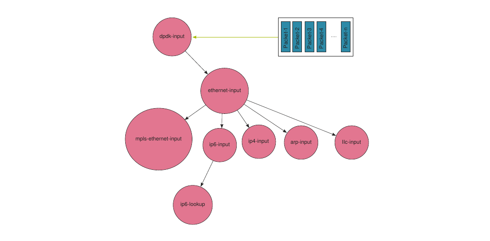

**Figure 211. Graph xử lý packet**

Thay vì xử lý packet đầu tiên qua toàn bộ graph rồi tới packet thứ hai qua toàn bộ graph, VPP xử lý toàn bộ vector packet qua một graph node rồi mới chuyển sang graph node tiếp theo.

Vì packet đầu tiên trong vector làm nóng instruction cache, các packet còn lại thường được xử lý với hiệu năng cực cao. Chi phí cố định của việc xử lý vector packet được chia đều cho toàn bộ vector. Điều này không chỉ cho hiệu năng rất cao mà còn hiệu năng ổn định về mặt thống kê. Nếu VPP bị chậm một chút, vector tiếp theo chứa nhiều packet hơn, nên chi phí cố định được chia cho nhiều packet hơn, làm giảm chi phí xử lý trung bình mỗi packet, giúp hệ thống bắt kịp. Kết quả là throughput và độ trễ rất ổn định. Nếu có nhiều core, graph scheduler có thể lập lịch các cặp (vector, graph node) cho các core khác nhau.

Kiến trúc graph node của VPP cũng giúp dễ mở rộng. Có thể build một binary plugin độc lập cho VPP từ một code base riêng (chỉ cần các header). Plugin được nạp từ thư mục plugin. Một plugin của VPP có thể sắp xếp lại packet graph và đưa vào graph node mới. Điều này cho phép đưa tính năng mới vào qua plugin mà không cần sửa code hạ tầng lõi.

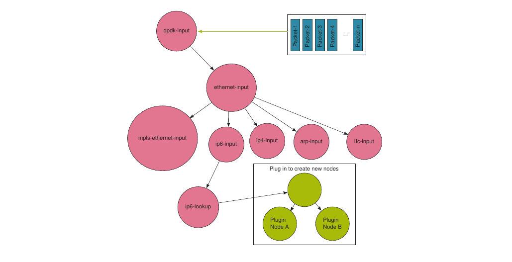

**Figure 212. Graph xử lý packet**

Để biết thêm chi tiết, xem https://wiki.fd.io/view/VPP.

### 9.3.2 Nền tảng được hỗ trợ

VPP hỗ trợ các họ SoC LS1043A, LS1046A, LS1088A, LS2088A và LX2160A. Mục này trình bày chi tiết bố cục kiến trúc và port của các Reference Design Board của chúng.

Bản phát hành Layerscape LDP này hỗ trợ VPP v22.02 Upstream + các patch của NXP.

Xem phần sau để biết thông tin riêng của từng board:

- LS1043A Reference Design Board
- LS1046A Reference Design Board
- LS1088A Reference Design Board
- LS2088A Reference Design Board
- LX2160A Reference Design Board

### 9.3.3 Các use case được hỗ trợ

- vRouter: VPP làm router ảo
- vSwitch: VPP làm switch ảo
- VPP Cross-connect
- IPsec: VPP có thể thực hiện IPsec ở chế độ DPDK OpenSSL crypto driver.

### 9.3.4 Build VPP

#### 9.3.4.1 Các bước build độc lập

Mục này trình bày chi tiết các bước cần để build VPP trong môi trường độc lập.

**Điều kiện tiên quyết trước khi biên dịch VPP**

Trước khi biên dịch VPP dưới dạng build độc lập, cần giải quyết riêng các phụ thuộc sau:

1. Các thư viện DPDK cần cho xử lý packet. Để biết thêm chi tiết về biên dịch DPDK, xem Section 9.2.3.2.3. Cần thêm `-Dc_args="-g -Ofast -fPIC -ftls-model=local-` `dynamic"` vào lệnh biên dịch DPDK để thư viện DPDK tương thích với VPP. Sau đây là lệnh biên dịch DPDK ví dụ

   ```
   meson arm64-build --cross-file config/arm/arm64_dpaa_linux_gcc -Dexamples=all
    -Dc_args="-g -Ofast -fPIC -ftls-model=local-dynamic" -Dprefix=/path/to/dpdk/
   dpdk_lib_install -Ddefault_library=static -Doptimization=3
   ninja -C arm64-build install
   ```

2. Các thư viện OpenSSL.

   Ví dụ build openssl (tag: OpenSSL_1_1_1k):

   ```
   export CROSS_COMPILE=/path/to/gcc-linaro-7.5.0-2019.12-x86_64_aarch64-linux-
   gnu/bin/aarch64-linux-gnu-
   mkdir openssl_lib_install
   ./Configure linux-aarch64  --prefix=/path/to/openssl/openssl_lib_install
    shared
   make depend
   make
   make install
   export PKG_CONFIG_PATH=openssl_lib_install/lib/pkgconfig:$PKG_CONFIG_PATH
   ```

**Biên dịch VPP**

```
git clone https://github.com/nxp-qoriq/vpp.git
git checkout
-b <local_branch_name> <release_tag> # Replace "<local_branch_name/release_tag>"
with Layerscape LDP release tag specific information
export DPDK_PATH=<DPDK installed path>
export CROSS_TOOLCHAIN= <Path to Toolchain>
export CROSS_SYSROOT= <Path
to sysroot directory>(Optional)
export CROSS_PREFIX=aarch64-linux-gnu
export PLATFORM=dpaa
export PATH=<toolchain path>/bin:<toolchain path>/aarch64-linuxgnu/bin:$PATH
export OPENSSL_PATH=<openssl lib path>
export NUMA_PATH=<numa
lib path>
cd vpp
make install-dep
cd build-root
make distclean
make PLATFORM=dpaa TAG=dpaa vpp-package-deb V=0
```

Sau khi biên dịch, một số package `deb` được sinh ra trong thư mục `vpp/build-root`. Chép mọi package `*.deb` vào thư mục `/usr/share/vpp` trong `rootfs`.

#### 9.3.4.2 Build VPP bằng Yocto

VPP là một trong các package ứng dụng của hệ thống build Yocto. Mục này trình bày chi tiết cách build VPP dưới dạng package độc lập trong môi trường Yocto. Giả định rằng môi trường Yocto đã được cấu hình trước khi chạy các lệnh dưới đây. Để biết thêm chi tiết về cách dùng hệ thống build Yocto, xem Download Yocto layers.

Sau khi thiết lập môi trường Yocto, dùng các lệnh sau để build các ứng dụng và thư viện VPP.

Các file sinh ra có trong thư mục `<yocto_sdk>/bld-<Name>/tmp/work/-poky-linux/vpp/` `<Machine>`.

Sau khi sinh `rootfs` (root filesystem), các binary được gộp vào đó.

```
bitbake vpp     # it is assumed setup-env was run before running this command
```

Để đóng gói các binary này vào target `rootfs` bằng hệ thống build Yocto, xem Build Yocto images. Mặc định, môi trường Yocto biên dịch VPP và đặt nó vào `rootfs` khi chạy `bitbake imx-image-` `multimedia`.

**Bố cục các binary VPP**

Một image binary VPP duy nhất hỗ trợ các nền tảng DPAA và DPAA2. Sau khi cài package VPP, các binary có trong các thư mục `usr/bin/vpp` và `/usr/share/vpp` của `rootfs`.

```
/usr/share/vpp      # Contains the sample applications
```

Ở nhiều chỗ trong tài liệu này, các binary trên được nhắc tới để minh họa việc chạy cũng như các thông tin khác. Giả định rằng việc chạy được thực hiện với biến PATH đã đặt như giải thích ở trên, hoặc với đường dẫn tuyệt đối tới binary.

Table 170 dưới đây liệt kê các ứng dụng VPP mẫu có trong `rootfs` do Yocto sinh ra:

**Table 170. Các ứng dụng VPP mẫu**

| Tên file VPP hoặc tên image VPP | Mô tả |
|---|---|
| `/usr/bin/vpp` | Binary ứng dụng VPP. |
| `/etc/vpp/startup.conf` | File cấu hình VPP. |
| `/etc/vpp/README_nxp.txt` | README cho các nền tảng DPAA & DPAA2. |

### 9.3.5 Chạy VPP

#### 9.3.5.1 Thiết lập môi trường VPP

Sau đây là các bước chạy VPP:

- Setup board LS2088, LS1088A và LX2160A

  ```
  cd /usr/share/dpdk/dpaa2
  . ./dynamic_dpl.sh dpmac.1 dpmac.2
  mkdir /mnt/hugepages
  mount -t hugetlbfs none /mnt/hugepages
  ```

- Setup board LS1046 và LS1043:

  ```
  mkdir /mnt/hugepages
  mount -t hugetlbfs none /mnt/hugepages
  fmc -x
  cd /usr/share/dpdk/dpaa
  ```

  Chạy script FMC cho cấu hình riêng của board. Ví dụ, với LS1046, chạy lệnh sau:

  ```
  fmc -c usdpaa_config_ls1046.xml -p usdpaa_poolicy_hash_ipv4_1queue.xml -a
  ```

  Quay lại thư mục làm việc ban đầu

  ```
  cd -
  ```

**Ghi chú:** `<int0>` và `<int1>` trong các lệnh sau là tên interface và phải được thay bằng tên interface thực. Chạy lệnh `vppctl show int` sau khi chạy `vpp -c /etc/vpp/` `startup.conf.dpkg-new` hoặc `vpp -c /etc/vpp/startup.conf` để kiểm tra tên interface. Để kiểm tra địa chỉ MAC gắn với một interface, chạy lệnh `vppctl show hard`.

**Cảnh báo:** Để đạt hiệu năng, có thể chạy script `enable_performance_mode.sh` trước khi chạy VPP. Script này giúp đặt priority RT cho các thread VPP, đặt CPU governor ở chế độ performance và tắt mọi watchdog interrupt. **Không** khuyến nghị dùng script này trong môi trường sản xuất hay chính thức. Nó cũng có thể khiến CPU bị chiếm dụng vì các thread I/O được priority RT, làm treo các thread/service khác của OS. Dùng thận trọng.

Script có trong thư mục `/usr/share/dpdk/` của rootfs.

#### 9.3.5.2 Chạy VPP

**VPP Cross-connect:**

```
vpp -c /etc/vpp/startup.conf.dpkg-new  &
vppctl set interface state <int0> up
vppctl set interface state <int1> up
vppctl set interface l2 xconnect <int0> <int1>
vppctl set interface l2 xconnect <int1> <int0>
```

**VPP vRouter:**

```
vpp -c /etc/vpp/startup.conf.dpkg-new &
vppctl
set int ip address <int0> 1.1.1.2/16
set int ip address <int1> 2.1.1.2/16
set int state <int0> up
set int state <int1> up
set ip neighbor static <int0> 1.1.1.3 <interface mac of next hop>
set ip neighbor static <int1> 2.1.1.3 <interface mac of next hop>
ip route add 10.1.0.0/16 via 1.1.1.3 <int0>
ip route add 20.1.0.0/16 via 2.1.1.3 <int1>
set int mtu 1500 <int0>
set int mtu 1500 <int1>
```

**VPP IPSec**

Các lệnh chạy trên board 1:

```
vpp -c /etc/vpp/startup.conf.dpkg-new &
vppctl
ipsec select backend esp 1
set interface ip address <int0> 1.1.1.2/24
set interface ip address <int1> 192.168.100.2/24
set interface state <int0> up
set interface state <int1> up
set ip neighbor static <int1> 192.168.100.3 <interface mac of next hop>
ipsec sa add 10 spi 1001 esp crypto-alg aes-cbc-l28 crypto-key
 4a506a794f574265564551694d653768 integ-alg shal-96 integ-key
 4339314b55523947594d6d3547666b45764e6a58 tunnel src 192.168.100.2 dst
 192.168.100.3
ipsec sa add 11 spi 1002 esp crypto-alg aes-cbc-l28 crypto-key
 4a506a794f574265564551694d653768 integ-alg shal-96 integ-key
 4339314b55523947594d6d3547666b45764e6a58 tunnel src 192.168.100.3 dst
 192.168.100.2
ipsec spd add 1
set interface ipsec spd <int1> 1
set interface promiscuous on <int0>
set interface promiscuous on <int1>
ipsec policy add spd 1 priority 10 outbound action protect sa 10 local-ip-range
 1.1.1.3 - 1.1.1.3
remote-ip-range 2.1.1.3 - 2.1.1.3
ipsec policy add spd 1 priority 10 inbound action protect sa 11 local-ip-range
 1.1.1.3 - 1.1.1.3
remote-ip-range 2.1.1.3 - 2.1.1.3
ip route add count 1 2.1.1.3/32 via 192.168.100.3 <int1>
set ip neighbor static <intO> 1.1.1.3 <interface mac of next hop>
ipsec policy add spd 1 priority 100 inbound action bypass protocol 50
ipsec policy add spd 1 priority 100 outbound action bypass protocol 50
```

Các lệnh chạy trên board 2:

```
vpp -c /etc/vpp/startup.conf.dpkg-new &
vppctl
ipsec select backend esp 1
set interface ip address <intO> 2.1.1.2/24
set interface ip address <int1> 192.168.100.3/24
set interface state <intO> up
set interface state <int1> up
set ip neighbor static <int1> 192.168.100.2 <interface mac of next hop>
ipsec sa add 20 spi 1001 esp crypto-alg aes-cbc-l28 crypto-key
 4a506a794f574265564551694d653768 integ-alg shal-96 integ-key
 4339314b55523947594d6d3547666b45764e6a58 tunnel src 192.168.100.2 dst
 192.168.100.3
ipsec sa add 21 spi 1002 esp crypto-alg aes-cbc-l28 crypto-key
 4a506a794f574265564551694d653768 integ-alg shal-96 integ-key
 4339314b55523947594d6d3547666b45764e6a58 tunnel src 192.168.100.3 dst
 192.168.100.2
ipsec spd add 1
set interface ipsec spd <int1> 1
set interface promiscuous on <int0>
set interface promiscuous on <int1>
ipsec policy add spd 1 priority 10 inbound action protect sa 20 local-ip-range
 2.1.1.3 - 2.1.1.3 remote-ip-range 1.1.1.3 - 1.1.1.3
ipsec policy add spd 1 priority 10 outbound action protect sa 21 local-ip-range
 2.1.1.3 - 2.1.1.3
remote-ip-range 1.1.1.3 - 1.1.1.3
ip route add count 1 1.1.1.3/32 via 192.168.100.2 <int1>
set ip neighbor static <intO> 2.1.1.3 <interface mac of next hop>
ipsec policy add spd 1 priority 100 inbound action bypass protocol 50
ipsec policy add spd 1 priority 100 outbound action bypass protocol 50
```

### 9.3.6 Các hạn chế đã biết

Trên nền tảng DPAA1, chỉ có các file cấu hình FMC cho 1, 2, 4 queue mỗi port.

## 9.4 mTCP

Mục này mô tả hỗ trợ mTCP với DPDK phiên bản 21.11.

### 9.4.1 Giới thiệu

Mở rộng hiệu năng của các kết nối TCP ngắn trên hệ thống đa core về cơ bản là thách thức. Tuy nhiều đề xuất đã cố giải quyết các thiếu sót khác nhau, sự kém hiệu quả của bản triển khai trong kernel vẫn còn. Ví dụ, ngay cả các thiết kế tiên tiến nhất cũng dùng 70% tới 80% chu kỳ CPU để xử lý các kết nối TCP trong kernel, chỉ để lại ít chỗ cho đổi mới ở chương trình mức user.

Công trình này giới thiệu mTCP, một TCP stack mức user hiệu năng cao cho hệ thống đa core. mTCP giải quyết sự kém hiệu quả từ nền tảng—từ packet I/O và quản lý kết nối TCP tới giao diện ứng dụng. Ngoài việc áp dụng các kỹ thuật đã biết, thiết kế của nó (1) chuyển nhiều system call tốn kém thành một tham chiếu shared memory duy nhất, (2) cho phép gộp event ở mức flow hiệu quả, và (3) thực hiện packet I/O theo lô để I/O hiệu quả cao.

### 9.4.2 Các nền tảng được hỗ trợ

mTCP hỗ trợ các họ SoC LS1043A, LS1046A, LS1088A, LS2088A và LX2160A. Mục này trình bày chi tiết bố cục kiến trúc và port của các Reference Design Board của chúng.

Xem phần sau để biết thông tin riêng của từng board:

- LS1043A Reference Design Board
- LS1046A Reference Design Board
- LS1088A Reference Design Board
- LS2088A Reference Design Board
- LX2160A Reference Design Board

### 9.4.3 Các ứng dụng được hỗ trợ

Các ứng dụng sau hỗ trợ mTCP:

- Client
- Webserver – epserver, epwget

### 9.4.4 Các bước build

#### 9.4.4.1 Các bước build độc lập

Mục này trình bày chi tiết các bước cần để build mTCP trong môi trường độc lập.

#### 9.4.4.2 Điều kiện tiên quyết trước khi biên dịch mTCP

Trước khi biên dịch mTCP dưới dạng build độc lập, cần giải quyết riêng các phụ thuộc sau:

- **DPDK**: Chúng tôi dùng DPDK để xử lý packet, nên cần các thư viện DPDK để biên dịch mTCP. Xem mục Standalone build of DPDK libraries and applications để biên dịch DPDK. Sau đây là lệnh biên dịch DPDK ví dụ:

meson arm64-build --cross-file config/arm/arm64_dpaa_linux_gcc -Dexamples=all -Dprefix=/path/to/dpdk/dpdk\_lib_install -Ddefault_library=static -Doptimization=3

ninja -C arm64-build install

- **Numa**: Thư viện libnuma cung cấp một giao diện lập trình đơn giản tới

policy NUMA (Non Uniform Memory Access) được Linux

Kernel hỗ trợ. Sau đây là các bước build Numa:

sudo apt install libtool-bin

git clone https://github.com/numactl/numactl.git

cd numactl

git checkout v2.0.13 -b v2.0.13

./autogen.sh

autoconf -i

./configure --host=aarch64-linux-gnu --prefix=\<install path>

make

make install

- **GMP**: GMP là thư viện số học độ chính xác tùy ý, làm việc trên số nguyên có dấu, số hữu tỷ và số dấu phẩy động. Không có giới hạn thực tế nào về độ chính xác ngoài giới hạn do bộ nhớ có sẵn trên máy chạy GMP. GMP có bộ hàm phong phú, và các hàm có giao diện thống nhất. Sau đây là các bước biên dịch libgmp:

curl -O https://gmplib.org/download/gmp/gmp-6.2.1.tar.xz

tar Jxf gmp-6.2.1.tar.xz

export CFLAGS="-O3"

export CXXFLAGS="-O3"

cd gmp-6.2.1/

./configure --host=aarch64-linux-gnu --prefix=\<install path>

make -j4

make install

**Biên dịch mTCP**:

export RTE_SDK=\<DPDK base directory Path>

export CFLAGS=\<path of gmp and numa header files>

export LDFLAGS=\<path of gmp and numa libraries>

export CC=\<Cross Compile GCC path>

./configure --host=aarch64-linux-gnu --with-dpdk-lib=\<DPDK installation path>

make setup-dpdk /\* Chỉ cần chạy một lần \*/

make

**Biên dịch ứng dụng mTCP**:

make -C \<app path>

e.g.:

### 9.4.5 Chạy mTCP

**Thiết lập môi trường mTCP**

Các ứng dụng mTCP chạy trên setup 2 board. Sau đây là các bước chạy mTCP trên cả hai board:

- Setup board LS2088, LS1088A và LX2160A

  ```
  cd /usr/share/dpdk/dpaa2. ./dynamic_dpl.sh dpmac.1
  mkdir /mnt/hugepagesmount -t hugetlbfs none /mnt/hugepages
  echo 256 > /proc/sys/vm/nr_hugepages
  ```

- Setup board LS1046 và LS1043:

  ```
  mkdir /mnt/hugepagesmount -t hugetlbfs none /mnt/hugepagesecho 256 > /proc/sys/
  vm/nr_hugepages
  fmc -x
  cd /usr/share/dpdk/dpaa
  ```

  Chạy script FMC cho cấu hình riêng của board. Ví dụ, với LS1046, chạy lệnh sau:

  ```
  fmc -c usdpaa_config_ls1046.xml -p usdpaa_poolicy_hash_ipv4_1queue.xml -a
  ```

  Quay lại thư mục làm việc ban đầu:

  ```
  cd –
  ```

  Chuẩn bị một setup với các port ethernet của hai board được nối vật lý với nhau.

  **Chạy ứng dụng “Client”**

  **Setup**:

  - DPAA2:

    Chạy script `dynamic_dpl.sh` trên cả hai board với ít nhất 1 DPMAC object.

  - DPAA1:

    ```
    fmc -x
    ```

**Chạy các file script fmc trên cả hai board.**

**Ghi chú:** Các bước sau chung cho cả hai nền tảng và board.

1. Nối các port ethernet của hai board với nhau (back to back).

   ```
   cd /usr/bin/mtcp/
   ```

2. Cập nhật cấu hình của ứng dụng client trong file client.conf, ví dụ tên port

   ```
   mkdir ./config
   ```

3. Tạo một file cấu hình route và một file cấu hình arp, rồi thêm thông tin dưới đây:

   ```
   Vim config/arp.conf
   ```

4. Thêm thông tin ARP theo định dạng dưới đây:

   ```
   ARP_ENTRY 1
   10.0.0.16/24 00:00:00:00:00:01
   Vim config/route.conf
   ```

5. Thêm thông tin route theo định dạng dưới đây:

   ```
   ROUTES 1
   10.0.0.1/24 dpni.8
   ```

   **Ghi chú:** Có thể lấy thông tin Route và ARP bằng cách chạy ứng dụng.

**Các bước chạy**:

1. Trên board thứ nhất, chạy lệnh dưới đây:

   ```
   #. ./client send <destination IP> <port> <time in seconds>
   ```

2. Trên board thứ 2, chạy lệnh dưới đây:

   ```
   #. ./client wait <destination IP> <port> <time in seconds>
   ```

**Ví dụ Webserver**:

**Setup**:

- DPAA2:

  Chạy script `dynamic_dpl.sh` trên cả hai board với ít nhất 1 DPMAC object.

- DPAA1:

  ```
  fmc -x
  ```

**Chạy các file script fmc trên cả hai board.**

**Ghi chú:** Các bước sau chung cho cả hai nền tảng và board.

1. Nối các port ethernet của hai board với nhau (back to back).

   ```
   cd /usr/bin/mtcp/
   ```

2. Chép file client.conf thành epserver.conf trên board 1:

   ```
   cp client.conf epserver.conf
   ```

3. Chép file client.conf thành epwget.conf trên board 2:

   ```
   cp client.conf epwget.conf
   ```

4. Cập nhật tên port và cấu hình theo yêu cầu.

   ```
   mkdir ./config
   ```

5. Tạo một file cấu hình route và một file cấu hình arp, rồi thêm thông tin dưới đây:

   ```
   Vim config/arp.conf
   ```

6. Thêm thông tin ARP theo định dạng dưới đây:

   ```
   ARP_ENTRY 1
   10.0.0.16/24 00:00:00:00:00:01
   Vim config/route.conf
   ```

7. Thêm thông tin route theo định dạng dưới đây:

   ```
   ROUTES 1
   10.0.0.1/24 dpni.8
   ```

   **Ghi chú:** Có thể lấy thông tin Route và ARP bằng cách chạy ứng dụng.

**Các bước chạy**:

1. Trên board thứ nhất, chạy lệnh dưới đây:

   ```
   #. ./epserver -p /home/www -f epserver.conf -N 8
   ```

2. Trên board thứ 2, chạy lệnh dưới đây:

   ```
   #. ./epwget <IP/file name> <number of requests> -N 1 -c 8000 -f epwget.conf
   ```

   Ví dụ:

   ```
   ./epwget 10.0.0.112/a.txt 1000000 -N 1 -c 8000 -f epwget.conf
   ```

   Trong đó:

   -p là đường dẫn thư mục home của server, nơi có mọi file.

   -f là tên file cấu hình.

   -N là số core.

   -c là số kết nối đồng thời.

   **Ghi chú:** epwget chỉ hoạt động trên 1 core.

## 9.5 USDPAA

USDPAA không còn được hỗ trợ làm API để khách hàng dùng trực tiếp. Mọi phần mềm không phải của NXP nên dùng một trong các API chuẩn, DPDK, thay cho USDPAA. Một số thành phần phần mềm USDPAA có thể vẫn tồn tại như một lớp nằm dưới các thành phần phần mềm khác như DPDK, nhưng đừng giả định điều này sẽ tiếp tục trong các bản phát hành phần mềm tương lai.
