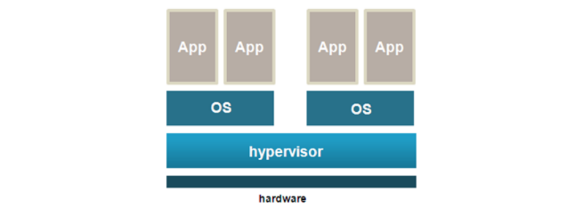
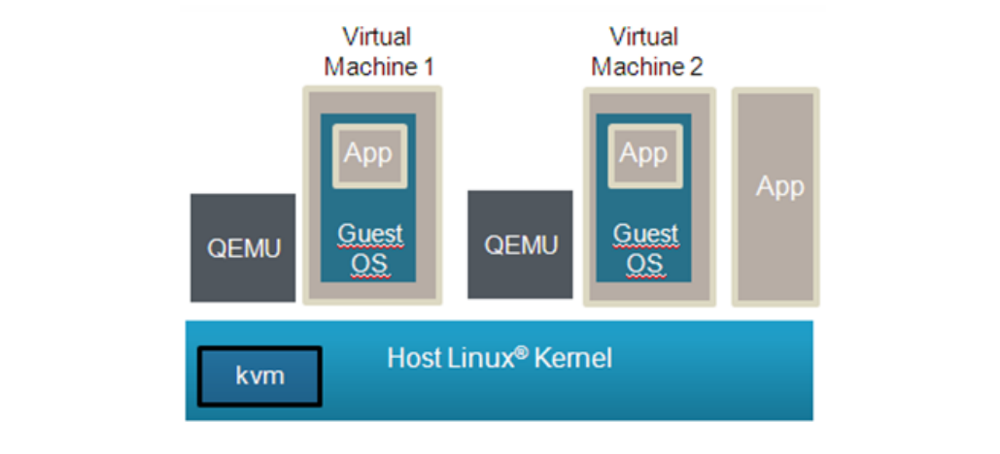
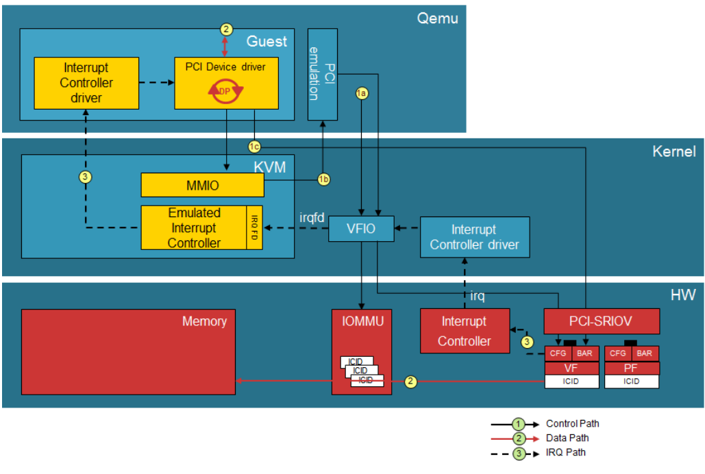
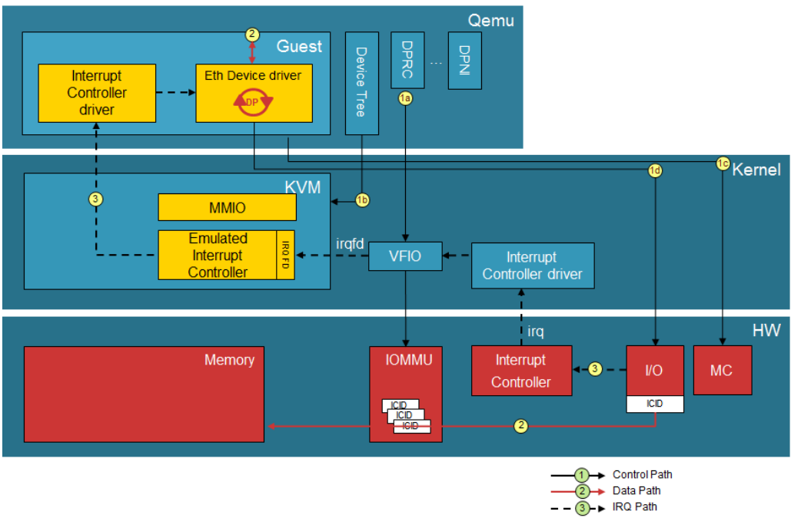
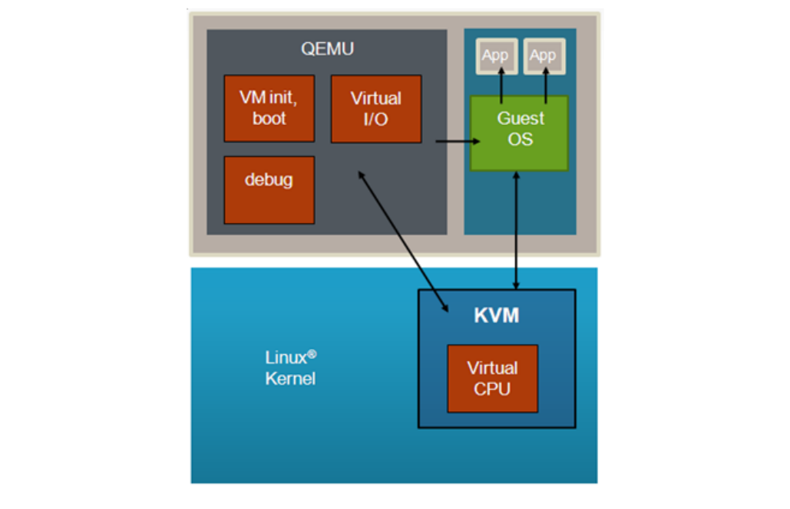
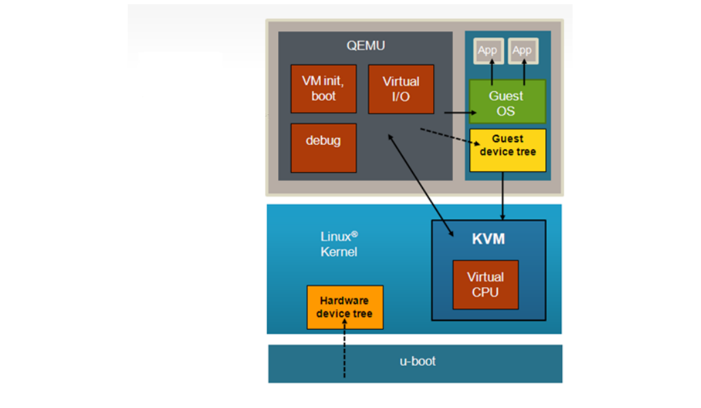
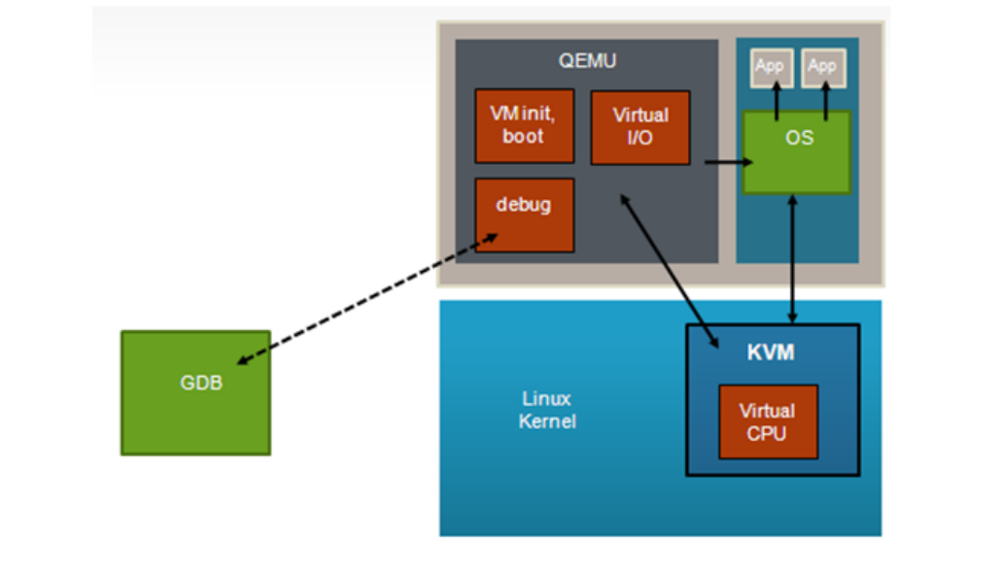
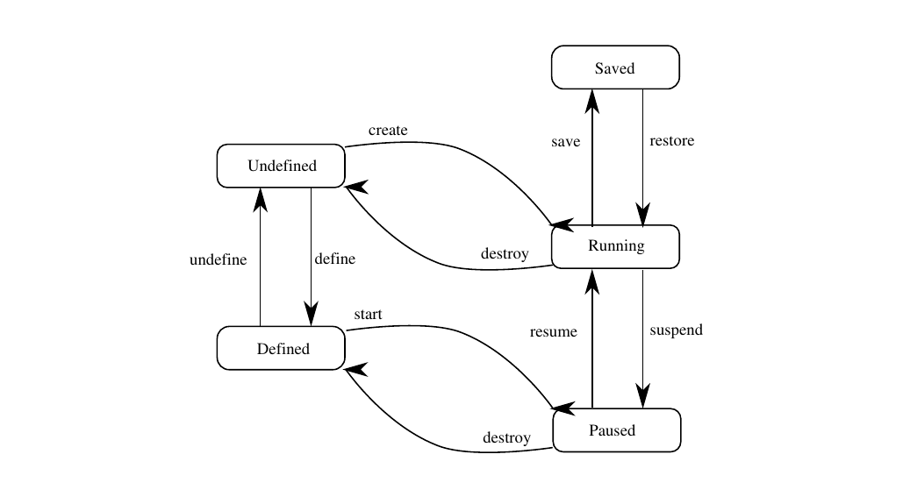

# 10 Ảo hóa

Ảo hóa cung cấp một môi trường cho phép chạy nhiều hệ điều hành trên một hệ thống máy tính duy nhất. Ảo hóa kết hợp công nghệ phần cứng và phần mềm để làm điều này, bằng cách cung cấp một lớp trừu tượng giữa phần cứng hệ thống và OS. Môi trường cô lập nơi các hệ điều hành chạy được gọi là máy ảo (virtual machine, hay VM). Lớp trừu tượng quản lý tất cả những điều này được gọi là hypervisor hay virtual machine manager. Lớp hypervisor hoạt động ở mức đặc quyền cao hơn các hệ điều hành, nhờ đó có thể thực thi bảo mật hệ thống, bảo đảm các máy ảo không can thiệp lẫn nhau, và cung cấp trong suốt các dịch vụ khác như chia sẻ I/O cho VM.



**Figure 213. Ảo hóa**

Mục này giải thích:

- KVM/QEMU
- Linux Containers (LXC) for NXP QorIQ User's Guide
- Docker Containers
- NFV OpenStack

## 10.1 KVM/QEMU

Tài liệu này là hướng dẫn và tutorial để build và dùng KVM (Kernel-based Virtual Machine) trên các SoC NXP QorIQ.

### 10.1.1 Tổng quan KVM/QEMU

KVM là một Linux kernel driver, cùng với QEMU - một trình giả lập máy mã nguồn mở - cung cấp một nền tảng ảo hóa mã nguồn mở dựa trên Linux. KVM và QEMU cùng đóng vai trò virtual machine manager, có thể boot và chạy hệ điều hành trong máy ảo. Xem hình dưới đây:



**Figure 214. Kernel-based Virtual Machine**

Trong tài liệu này, thuật ngữ host kernel chỉ instance Linux bên dưới có KVM driver, đóng vai trò hypervisor. Thuật ngữ guest chỉ hệ điều hành, như Linux, chạy trong máy ảo. Máy ảo được gọi là "VM".

Các SoC NXP QorIQ dựa trên CPU Arm v8 được hỗ trợ.

#### 10.1.1.1 Dùng QEMU và KVM

##### 10.1.1.1.1 Tổng quan về cách dùng QEMU

QEMU được dùng để khởi động máy ảo. Ứng dụng QEMU có tên **qemu-system-aarch64** (cho nền tảng 64 bit).

Ngoài bản thân file thực thi QEMU, sau đây là danh sách các thành phần tối thiểu phải có trên hệ thống target để khởi chạy máy ảo bằng QEMU:

- Host Linux kernel trên target phải được build với hỗ trợ ảo hóa KVM được bật
- Một kernel image cho guest OS (Image cho Linux)
- Một guest root filesystem (nếu guest OS cần. Ví dụ, Linux guest cần rootfs.)
- Khuyến nghị: Một network interface hoạt động được (để giao tiếp với console của guest và QEMU monitor)

QEMU Emulator User Documentation \[1\] (xem Section 10.1.1.5) có tài liệu đầy đủ về mọi tham số dòng lệnh QEMU. Bảng dưới đây tóm tắt một số flag và tham số cho thao tác cơ bản.

**Table 171. Các tham số dòng lệnh QEMU**

| Tham số | Mô tả |
|---|---|
| -enable-kvm | Chỉ định dùng Linux KVM cho các CPU của máy ảo. |
| -nographic | Tắt console output đồ họa trên serial port giả lập. |
| -M machine | Chỉ định loại máy ảo. Hỗ trợ một giá trị:<br>• virt |
| -smp cpu_count | Chỉ định số CPU của máy ảo.<br>Số CPU ảo cho phép bằng giá trị config option CONFIG_NR_CPUS trong host Linux kernel. Để xem giá trị này, chạy lệnh sau từ Linux trên board target:<br>`zcat /proc/config.gz \\| grep NR_CPUS` |
| -kernel file | Chỉ định image của guest OS. Các loại image được hỗ trợ là định dạng Image (file image binary chung của Linux kernel) và zImage (phiên bản nén của Linux kernel image). |
| -initrd file | Chỉ định image root filesystem. |
| -append cmdline | Dùng cmdline làm dòng lệnh kernel của guest OS (truyền qua property bootargs của node /chosen trong guest device tree). |
| -serial dev | Chuyển hướng serial port ảo tới thiết bị host dev. QEMU hỗ trợ nhiều thiết bị host. Xem QEMU User Documentation \[1\] (xem Section 10.1.1.5) để biết đầy đủ chi tiết.<br>Ghi chú: Nếu dùng thiết bị TCP với option **server**, QEMU sẽ chờ kết nối tới thiết bị rồi mới tiếp tục, trừ khi dùng option **nowait**. |
| -m megs | Chỉ định kích thước RAM của VM tính bằng megabyte. Option này bị bỏ qua nếu dùng direct mapped memory.<br>Xem Section 10.1.1.1.2 để biết thêm về các option cấp phát bộ nhớ. |
| -mem-path path | Chỉ định đường dẫn tới file dùng để cấp phát bộ nhớ cho máy ảo. Nên dùng option này để cấp phát bộ nhớ từ hugetlbfs.<br>Xem Section 10.1.1.1.2 để biết thêm về các option cấp phát bộ nhớ. |
| -monitor dev | Chuyển hướng QEMU monitor tới thiết bị host dev. QEMU hỗ trợ nhiều thiết bị host. Xem QEMU User Documentation \[1\] (xem Section 10.1.1.5) để biết đầy đủ chi tiết.<br>Ghi chú: nếu dùng thiết bị tcp với option **server**, QEMU sẽ chờ kết nối tới thiết bị rồi mới tiếp tục, trừ khi dùng option **nowait**. |
| -S | Không khởi động CPU lúc startup (phải gõ 'c' trong monitor). Hữu ích khi debug. |
| -gdb dev | Chờ kết nối gdb trên thiết bị dev. |
| -drive \[args\] | Dùng để tạo đĩa ảo trong máy ảo.<br>Xem Section 10.1.1.1.4 để biết thêm thông tin. |
| -netdev \[args\]<br>-device virtio-net-device \[args\] | Các tham số -netdev và -device virtio-net-device chỉ định backend và front end mạng để tạo thiết bị mạng ảo trong máy ảo.<br>Xem Section 10.1.1.1.3 để biết thêm thông tin. |
| -cpu model | Chọn model CPU. Chỉ hỗ trợ một model:<br>• host |

Dưới đây là ví dụ dòng lệnh người dùng chạy từ host Linux để khởi động máy ảo virt boot một Linux guest:

```
qemu-system-aarch64 -smp 8 -m 1024 -cpu host -machine type=virt,gic-version=3
 -kernel /boot/Image -enable-kvm -display none -serial tcp::4446,server,telnet
 -drive if=none,file=/root/ls-image-main-<board>.ext4, -kernel /root/Image,
 id=foo,format=raw -device virtio-blk-device,drive=foo -append 'root=/dev/vda rw
 console=ttyAMA0 rootwait earlyprintk' -monitor stdio
```

##### 10.1.1.1.2 Bộ nhớ máy ảo

QEMU cấp phát và nạp image vào bộ nhớ của VM trước khi khởi động VM. Lượng bộ nhớ cần cho một máy ảo phụ thuộc vào workload chạy trong VM. Có hai cách cấp phát bộ nhớ:

1. Cấp phát qua hugetlbfs

   Hugetlbfs là một cơ chế của Linux cho phép ứng dụng cấp phát bộ nhớ dựa trên các vùng bộ nhớ lớn liên tục về mặt vật lý. QEMU có thể tận dụng hugetlbfs để cấp phát bộ nhớ cho máy ảo, có thể cải thiện hiệu năng đáng kể so với bộ nhớ cấp phát bằng malloc. Bộ nhớ cấp phát bằng hugetlbfs có sự linh hoạt của bộ nhớ có thể cấp phát và giải phóng, với hiệu năng tương đương direct mapped memory.

   Tham số **-mem-path** của QEMU chỉ định đường dẫn tới mount point hugetlbfs nơi cấp phát các huge page.

   Tham số **-m** của QEMU chỉ định lượng bộ nhớ cấp cho máy ảo. Không có ràng buộc nào về kích thước truyền cho tham số này, ngoài việc lượng bộ nhớ phải nằm trong giới hạn của hệ thống và đủ cho workload trong VM.

   Xem bài hướng dẫn Section 10.1.3.2 để có ví dụ về cách dùng hugetlbfs.

2. Cấp phát qua malloc

   Mặc định, QEMU cấp phát bộ nhớ cho guest bằng cơ chế malloc chuẩn dành cho ứng dụng user space trên Linux. Lượng bộ nhớ được chỉ định bằng tham số dòng lệnh -m. Bộ nhớ malloc có sự linh hoạt là được QEMU cấp phát và giải phóng khi cần. Tuy nhiên, bộ nhớ malloc dựa trên các page vật lý 4 KB không liên tục, và KVM cần giả lập để trình ra cho VM một vùng bộ nhớ vật lý guest liên tục. Không khuyến khích cách này vì việc giả lập có thể gây giảm hiệu năng đáng kể với một số workload.

Guest device tree do QEMU sinh ra chứa một memory node chỉ định tổng lượng bộ nhớ.

**Ghi chú:** Bộ nhớ của máy ảo là một phần không gian địa chỉ của process QEMU. Nghĩa là lượng bộ nhớ cấp cho VM bị giới hạn bởi các giới hạn chuẩn áp dụng cho process Linux.

##### 10.1.1.1.3 Network interface ảo

QEMU cung cấp nhiều option để tạo network interface ảo trong máy ảo. Network interface ảo được chỉ định bằng dòng lệnh QEMU, và phần mềm guest thấy chúng như các thiết bị memory mapped.

Network interface ảo với QEMU có hai khía cạnh:

1. "Front-end" mạng, là card mạng mà guest nhìn thấy. Nó được chỉ định bằng tham số QEMU **-device**. Tham số chỉ định front end mạng virtio có dạng: **-device virtio-net-pci**
2. "Backend" mạng, nối card mạng với một mạng nào đó. Các option backend mạng gồm user mode networking, một TAP interface của host, socket, hoặc virtual distributed Ethernet. Backend mạng được chỉ định bằng tham số dòng lệnh **-netdev** của QEMU. Ghi chú: Có thể nối hai máy ảo bằng network interface ảo. Thông thường, process user space QEMU giả lập các truy cập I/O từ guest. Tuy nhiên, có một bản triển khai trong kernel: vhost-net, đưa code giả lập data plane vào kernel.

Ví dụ, để dùng card NIC virtio với back-end là TAP interface, tham số dòng lệnh QEMU có dạng:

```
-netdev tap,id=tap0,script=/root/qemu-ifup -device virtio-net-pci,netdev=tap0
```

Script “/root/qemu-ifup” là script mà QEMU gọi và truyền tên TAP interface làm tham số. Ví dụ, script có thể thêm TAP interface vào một Ethernet bridge.

Xem QEMU Users Manual \[1\] (xem Section 10.1.1.5) để biết thông tin chi tiết về option dòng lệnh và các loại network interface và backend. Để có hiệu năng tốt nhất, khuyến nghị dùng front-end virtio. Để biết thêm về networking của QEMU, xem các tài liệu tham khảo ở Section 10.1.1.6.

Về ví dụ chi tiết, xem bài hướng dẫn Section 10.1.3.3 .

##### 10.1.1.1.4 Block device ảo

Có nhiều cách cung cấp đĩa ảo cho máy ảo KVM/QEMU. Image đĩa của guest có thể là một file raw trên filesystem của host, một file ở định dạng đĩa ảo như qcow2 và vdi, hoặc một block device trên hệ thống Linux host. Đĩa ảo được gán trên dòng lệnh QEMU. Trong ví dụ dưới đây, file **my_guest_disk** là một image đĩa và được gán cho VM khi khởi chạy QEMU: `-drive` `file=my_guest_disk,cache=none,if=virtio`

Xem QEMU Users manual \[1\] (xem Section 10.1.1.5) để biết chi tiết về các loại image đĩa ảo có thể tạo và các tham số QEMU liên quan.

QEMU cho phép đặt nhiều thuộc tính cache lưu trữ cho guest. Option cache được chỉ định bằng property `cache=`. Hỗ trợ các option sau:

- `writethrough`: Dùng page cache của host, nhưng dữ liệu được ghi xuống thiết bị vật lý. Chế độ này bảo đảm tính toàn vẹn dữ liệu.
- `writeback`: Đây là chế độ mặc định (khi không có property cache). Dùng page cache của host, cơ chế quản lý page cache thông thường xử lý việc ghi xuống thiết bị lưu trữ.
- `none`: Bỏ qua page cache của host, việc ghi của guest đi thẳng xuống thiết bị lưu trữ. Thiết bị lưu trữ có thể có write cache.
- `directsync`: Bỏ qua page cache của host và dữ liệu được ghi xuống thiết bị vật lý.
- `unsafe`: Các lệnh flush bảo đảm tính toàn vẹn dữ liệu bị bỏ qua.

Về ví dụ chi tiết, xem How to use **Virtual Disks Using Virtio**.

##### 10.1.1.1.5 Thiết bị gán trực tiếp

###### 10.1.1.1.5.1 VFIO - Virtual Function I/O

VFIO là một hạ tầng driver user space của Linux, một framework không phụ thuộc IOMMU/thiết bị, để cung cấp truy cập trực tiếp thiết bị từ user space. Để có hiệu năng I/O cao nhất có thể, máy ảo dùng truy cập trực tiếp thiết bị, còn gọi là device assignment. Từ góc nhìn của host và thiết bị, framework VFIO biến máy ảo - QEMU - thành một driver user space, với lợi ích là độ trễ giảm đáng kể và dùng trực tiếp device driver.

Framework VFIO cung cấp:

- truy cập thiết bị
- giao diện lập trình IOMMU
- hỗ trợ interrupt hiệu năng cao

Ngoài ra, framework VFIO hỗ trợ nhiều hạ tầng bus, như PCI, platform device và cả LS2 MC bus. Các đoạn sau trình bày hỗ trợ cho cả hạ tầng PCI lẫn LS2 MC bus.

###### 10.1.1.1.5.2 VFIO PCI

VFIO driver trừu tượng hóa thiết bị PCI thành các region và IRQ. Phần region gồm PCI configuration space, các không gian BAR MMIO và I/O port, và truy cập MMIO PCI ROM, còn IRQ gồm INTx, các interrupt kiểu cũ, và cả Message Signaled Interrupt.

Có thể theo dõi Control path, Data path và IRQ path qua hạ tầng VFIO PCI trong hình dưới đây. Ngoài ra, thông tin thêm về cách dùng tính năng PCI Direct Assignment có ở Section 10.1.3.9.



**Figure 215. Hạ tầng VFIO PCI**

###### 10.1.1.1.5.3 VFIO cho LS2 MC Bus

Kiến trúc DPAA2 làm việc với khái niệm MC container - DPRC. Từ góc nhìn của OS, một DPRC hoạt động tương tự một bus plug and play, như PCI. Các command DPRC có thể dùng để liệt kê nội dung của DPRC và phát hiện các hardware object có trong đó (gồm cả các vùng map được và interrupt). Hạ tầng VFIO cho FSL MC Bus như dưới đây:



**Figure 216. Hạ tầng VFIO cho FSL MC Bus**

Root container luôn thuộc về Linux host, còn bất kỳ child container nào cũng có thể được gán cho các ứng dụng user-space như DPDK hoặc máy ảo - QEMU. Trong ngữ cảnh direct device assignment, điều này nghĩa là mọi DPAA2 object cần cung cấp cho guest VM phải được đặt trong một child container, và hơn nữa, child container phải được bind vào driver VFIO FSL MC. Có thể xem thêm cách dùng tính năng này ở Section 10.1.3.7.

##### 10.1.1.1.6 VM và Linux Scheduler

Mỗi máy ảo xuất hiện với host Linux như một process, mỗi CPU ảo trong VM được triển khai thành một thread. Một VM xuất hiện như một instance QEMU khi xem các process Linux, như trong ví dụ dưới đây:

```
$ ps -ef
                o
                o
root      1333     1  0 Oct01 ttyS0 00:00:00       -sh
root      1336     2  0 08:24 ?        00:00:00    [kworker/u4:2]
root      1372  1333 18 08:27 ttyS0    00:00:17    qemu-system-aarch64   -
enable-kvm -m
root      1361  1304  0 08:28 ?        00:00:00    sshd: root@pts/0
root      1363  1361  0 08:28 pts/0    00:00:00    -sh
                o
                o
```

CPU xuất hiện như các thread. Để xem thread ID, dùng lệnh `info cpus` trong QEMU monitor. Ví dụ một VM có 8 CPU ảo:

```
(qemu) info cpus
* CPU #0: thread_id=1984
  CPU #1: (halted) thread_id=1985
  CPU #2: (halted) thread_id=1986
  CPU #3: (halted) thread_id=1987
  CPU #4: (halted) thread_id=1988
  CPU #5: (halted) thread_id=1989
  CPU #6: (halted) thread_id=1990
  CPU #7: (halted) thread_id=1991
```

Để xem các thread QEMU bằng lệnh ps:

```
root@ls_machine:~# ps -eL | grep qemu
 1981  1981 ttyS1    00:00:00 qemu-system-aar
 1981  1982 ttyS1    00:00:00 qemu-system-aar
 1981  1983 ttyS1    00:00:00 qemu-system-aar
 1981  1984 ttyS1    00:00:00 qemu-system-aar
 1981  1985 ttyS1    00:00:00 qemu-system-aar
 1981  1986 ttyS1    00:00:00 qemu-system-aar
 1981  1987 ttyS1    00:00:00 qemu-system-aar
 1981  1988 ttyS1    00:00:00 qemu-system-aar
 1981  1989 ttyS1    00:00:00 qemu-system-aar
 1981  1990 ttyS1    00:00:00 qemu-system-aar
 1981  1991 ttyS1    00:00:00 qemu-system-aar
```

Là thread Linux nghĩa là có thể dùng các cơ chế Linux chuẩn để điều khiển cách các thread được lập lịch so với các thread/process khác. Các cơ chế này gồm:

- priority của process
- CPU affinity
- isolcpus
- cgroups

#### 10.1.1.2 Tổng quan máy ảo

Một guest OS chạy trong máy ảo KVM/QEMU "thấy" một môi trường phần cứng tương tự như chạy trên board vật lý. Guest thấy CPU, bộ nhớ và nhiều thiết bị I/O. Một số khía cạnh của môi trường này được ảo hóa (giả lập bằng phần mềm bởi KVM/QEMU), nhưng việc ảo hóa này phần lớn trong suốt với guest, và thường không cần sửa guest để chạy trong máy ảo.

Số máy ảo có thể chạy đồng thời chỉ bị giới hạn bởi lượng tài nguyên có sẵn (giống mọi ứng dụng khác trên Linux).

KVM/QEMU triển khai một máy virt chung, được mô tả hoàn toàn bằng device tree. Máy ảo chứa các tài nguyên sau:

- một hoặc nhiều CPU ảo Arm-v8
- bộ nhớ
- console ảo dựa trên PL011 giả lập
- virtio trên PCI (dùng cho các thiết bị ảo như block device và network device)
- Arm Virtual Generic Interrupt Controller
- Arm virtual timer và counter

#### 10.1.1.3 Giới thiệu KVM và QEMU

QEMU (phát âm KYOO-em-yoo) là một trình giả lập máy bằng phần mềm, giả lập nhiều loại CPU và hệ thống phần cứng. KVM là một Linux kernel device driver cung cấp dịch vụ CPU ảo cho QEMU. Hai thành phần phần mềm này làm việc cùng nhau như một virtual machine manager.



**Figure 217. QEMU và KVM làm việc cùng nhau**

QEMU là một ứng dụng user-space của Linux chạy trên instance Linux host, dùng để khởi động và quản lý máy ảo. QEMU cung cấp:

- Một giao diện dòng lệnh cho phép tùy biến và cấu hình rộng rãi máy ảo khi khởi động-- ví dụ loại VM, image nào cần nạp, và cách cấu hình các thiết bị ảo
- Nạp mọi image mà guest cần-- ví dụ kernel image, root filesystem, guest device tree
- Đặt trạng thái ban đầu của VM và boot guest
- Các dịch vụ I/O ảo, như network interface ảo và đĩa ảo
- Các dịch vụ debug - cung cấp khả năng debug guest OS bằng GDB (tương tự một JTAG ảo)

KVM là một device driver trong Linux kernel, có vai trò chính trong kiến trúc VM là cung cấp dịch vụ CPU ảo. Các dịch vụ này có hai khía cạnh:

1. Thứ nhất, KVM cung cấp một bộ API mà QEMU dùng để đặt và lấy trạng thái CPU ảo và chạy chúng. Ví dụ, QEMU đặt giá trị ban đầu cho các thanh ghi CPU trước khi khởi động VM.
2. Thứ hai, sau khi KVM khởi động một guest OS, một số thao tác (như các lệnh đặc quyền) do OS thực hiện sẽ gây exception (hay exit) vào host Linux kernel, và KVM phải xử lý. Việc xử lý các trap này được gọi là "giả lập" (emulation). Các trap này trong suốt với guest.

KVM API được mô tả trong Linux kernel-- Documentation/virtual/kvm/api.txt.

KVM/QEMU hỗ trợ I/O ảo, cho phép nhiều VM dùng chung thiết bị I/O vật lý. Hỗ trợ mạng ảo và block I/O ảo. Xem Section 10.1.1.6 để có các tài liệu tham khảo cung cấp thêm thông tin về virtio.

#### 10.1.1.4 Tổng quan Device Tree

Device tree là một cấu trúc dữ liệu mô tả các tài nguyên phần cứng như CPU, bộ nhớ và thiết bị I/O. OS hiểu device tree sẽ được truyền một device tree, đọc nó để biết có những tài nguyên phần cứng nào.

Host Linux kernel được bootloader boot trước, ví dụ U-Boot (một bootloader mã nguồn mở). U-Boot truyền cho kernel một device tree **phần cứng**, liệt kê và mô tả mọi tài nguyên phần cứng hệ thống có cho host kernel (CPU/core, bộ nhớ, interrupt controller và I/O).

Tương tự, khi một guest OS được boot trong máy ảo KVM/QEMU, QEMU truyền cho nó một device tree **guest** mô tả mọi tài nguyên phần cứng trong VM. Xem hình dưới đây.



**Figure 218. Guest OS nhận guest device tree từ QEMU**

Guest device tree do QEMU sinh ra và dùng để định nghĩa các tài nguyên mà máy ảo sẽ thấy. Guest device tree định nghĩa CPU, bộ nhớ và thiết bị I/O. QEMU đặt guest device tree vào bộ nhớ của máy ảo trước khi khởi động máy ảo.

#### 10.1.1.5 Tài liệu tham khảo

\[1\] QEMU Emulator User Documentation: https://qemu.weilnetz.de/doc/4.2/qemu-doc.html

\[2\] The Linux usage model for device tree data: https://www.kernel.org/doc/Documentation/devicetree/usage-model.txt

\[3\] Specification for virtio devices: http://docs.oasis-open.org/virtio/virtio/v1.0/csprd01/virtio-v1.0-csprd01.pdf

#### 10.1.1.6 Thông tin thêm

KVM

- Website KVM: http://www.linux-kvm.org
- Đặc tả Arm VM: http://lwn.net/Articles/589122/
- Hỗ trợ KVM trên kiến trúc Arm: http://lwn.net/Articles/557132/

QEMU

- Website QEMU: http://www.qemu.org

Device Trees

- Website devicetree.org: http://devicetree.org
- DTC, trình biên dịch device tree, có tại: https://git.kernel.org/pub/scm/utils/dtc/dtc.git . DTC cũng có một thư viện tên libfdt mà phần mềm có thể dùng để phân tích device tree.

Virtio-- một framework để thực hiện I/O ảo bằng KVM/QEMU

- http://www.ibm.com/developerworks/linux/library/l-virtio/
- http://ozlabs.org/~rusty/virtio-spec/virtio-paper.pdf
- http://docs.oasis-open.org/virtio/virtio/v1.0/csprd01/virtio-v1.0-csprd01.pdf

Mạng ảo với QEMU

- http://wiki.qemu.org/Documentation/Networking
- http://www.linux-kvm.org/page/Networking

#### 10.1.1.7 Tham chiếu máy ảo

##### 10.1.1.7.1 Tổng quan VM

Kiến trúc của KVM/QEMU khiến phần mềm guest cần rất ít thay đổi để chạy trong VM, tức là dùng cách ảo hóa toàn phần (full virtualization), nghĩa là CPU ảo và thiết bị I/O ảo hoạt động giống phần cứng vật lý mà chúng giả lập.

Tuy nhiên, có một số khác biệt giữa máy ảo và phần cứng gốc cần cân nhắc khi nhắm một OS tới máy ảo KVM. Các khác biệt này có thể chia thành 2 nhóm chung, được bàn chi tiết hơn trong mục này:

1. Trạng thái ban đầu và boot
2. CPUs

##### 10.1.1.7.2 Memory Map của các thiết bị I/O ảo

Máy ảo virt chứa một tập con nhỏ các thiết bị có trên SoC. Các thiết bị có sẵn được biểu diễn trong device tree truyền cho guest lúc boot (ví dụ interrupt controller ảo, PCIe controller ảo).

##### 10.1.1.7.3 Trạng thái máy ảo khi khởi tạo

###### 10.1.1.7.3.1 Trạng thái ban đầu và boot

Khi boot Host, kernel được vào ở mức đặc quyền EL2 với ARMv8. Sau khi boot, kernel dùng một stub để cài KVM và chuyển về EL1. Máy ảo không có virtualization extension nào, nên guest kernel vào ở EL1 (ARMv8).

Với phần cứng thật, chương trình boot cung cấp một số dịch vụ trước khi trao quyền điều khiển cho OS. Các bước cần thiết mà bootloader phải làm được mô tả trong tài liệu kernel: Documentation/arm64/booting.txt. Với ảo hóa, KVM/QEMU thực hiện các hành động cần thiết để đưa phần cứng về trạng thái ban đầu (như guest nhìn thấy) và cũng đảm nhận vai trò bootloader, thực hiện các thiết lập cần thiết.

Khuyến nghị guest OS ít nhất phải hiểu device tree. Thư viện libfdt (có kèm công cụ DTC) cung cấp đầy đủ API để phân tích và thao tác device tree, giúp việc thêm khả năng hiểu device tree vào OS trở nên đơn giản.

###### 10.1.1.7.3.2 Trạng thái ban đầu của CPU ảo

Trong VM có nhiều CPU ảo, CPU #0 là CPU boot và mọi vcpu khác trong partition được coi là secondary. Phương thức boot cho các CPU secondary là PSCI.

Điều kiện vào của CPU ảo tuân theo các điều kiện vào chỉ định trong Documentation/ arm64/booting.txt.

##### 10.1.1.7.4 CPU ảo

###### 10.1.1.7.4.1 Đặc tả CPU ảo

Phần mềm chạy trong máy ảo thấy một CPU ảo giả lập core ARMv8 không có virtualization extension.

Loại CPU ảo sẽ khớp với loại của nền tảng phần cứng host.

###### 10.1.1.7.4.2 Thời gian trong CPU ảo

Kiến trúc Arm có một extension tùy chọn, generic timer, cung cấp:

- một counter (physical counter) đo thời gian trôi qua theo thời gian thực
- một timer (physical timer) cho mỗi CPU. Timer được lập trình để phát interrupt tới CPU sau một khoảng thời gian nhất định.

Generic timer có hỗ trợ ảo hóa bằng cách đưa vào:

- một counter mới, virtual counter
- một timer mới, virtual timer.

Điều này cho phép máy ảo truy cập trực tiếp để đọc counter (ảo) và lập trình timer (ảo) mà không bị trap.

KVM dùng physical timer trên host, còn quyền truy cập physical timer của máy ảo bị tắt.

Máy ảo truy cập virtual timer và nhờ đó có thể truy cập trực tiếp phần cứng timer mà không trap vào hypervisor. Tuy nhiên, virtual timer không phát interrupt ảo mà phát interrupt phần cứng, trap vào hypervisor. KVM chèn một interrupt ảo tương ứng vào VM khi phát hiện virtual timer đã hết hạn.

##### 10.1.1.7.5 VGIC

Arm Generic Interrupt Controller (GIC) cung cấp hỗ trợ phần cứng cho ảo hóa. Guest có thể mask, acknowledge và EOI interrupt mà không trap vào hypervisor. Tuy nhiên, có một phần trung tâm của GIC gọi là distributor, chịu trách nhiệm phân ưu tiên và phân phối interrupt tới từng CPU, phần này không có virtualization extension và KVM cung cấp bản giả lập trong kernel cho nó. Ngoài ra, guest không thể nhận trực tiếp mọi interrupt vật lý. Thay vào đó, KVM sẽ lập trình một interrupt ảo để phát trong guest. Nhưng với hỗ trợ ảo hóa trong GIC controller, khi guest ACK và EOI interrupt ảo, không cần trap vào KVM.

QEMU/KVM cung cấp 2 kiểu GIC giả lập:

- giả lập GICv2, là option mặc định. Ví dụ dòng lệnh:`-machine type=virt`
- giả lập GICv3, chọn bằng property `gic-version`. Ví dụ dòng lệnh: `-machine` `type=virt,gic-version=3`. Interrupt controller GICv3 giả lập chỉ có trên các nền tảng có interrupt controller GICv3 vật lý.

### 10.1.2 Cấu hình và build

#### 10.1.2.1 Tổng quan

Linux có bật KVM và QEMU có thể được build như một phần của quy trình build chuẩn dùng để build NXP Layerscape LDP.

Các chỉ dẫn build trong các mục sau giả định đã build/cài đặt host thành công. Xem tài liệu Layerscape LDP về các bước cài đặt host.

Mặc định, package QEMU cài trên board target là package lấy từ nguồn userland Ubuntu.

#### 10.1.2.2 Quick Start - Các option cấu hình khuyến nghị

Các bước dưới đây cho thấy mọi option cấu hình khuyến nghị cần bật để build một kernel có bật I/O ảo, với cùng kernel image dùng cho cả host lẫn guest. Các mục sau giải thích chi tiết hơn các option này.

**Ghi chú:** Các option cấu hình để chạy máy ảo được bật mặc định trong Layerscape LDP. Tuy vậy, chúng được liệt kê ở đây để tham khảo.

1. Từ cửa sổ menuconfig chính, bật virtualization.

   ```
   [*] Virtualization
   ```

2. Trong menu virtualization, bật các option sau.

   ```
   [*] Kernel-based Virtual Machine (KVM) support
   ```

3. Bật network bridging.

   ```
   Networking support  --->
       Networking options  --->
           <*> 802.1d Ethernet Bridging
   ```

4. Bật virtio PCI.

   ```
   Device Drivers  --->
       Virtio drivers  --->
       <*> PCI driver for virtio devices
   ```

5. Bật virtio cho block device.

   ```
   Device Drivers  --->
       [*] Block devices  --->
           <*>   Virtio block driver
   ```

6. Bật virtio cho network device.

   ```
   Device Drivers --->
     [*] Network device support
     [*] Network core driver support
             <*>   Universal TUN/TAP device driver support
             <*>   Virtio network driver
   ```

7. Bật vhost cho virtio network device.

   ```
   [*] Virtualization
       <*>   Host kernel accelerator for virtio net
   ```

8. Bật hỗ trợ Huge TLB file.

   ```
   File Systems --->
       Pseudo filesystems --->
           [*] Huge TLB file system support
   ```

9. Bật hỗ trợ serial cho guest.

   ```
   Device Drivers --->
       Character devices --->
           Serial drivers --->
                <*> Arm AMBA PL011 serial port support
                [*]   Support for console on AMBA serial port
   ```

10. Bật hỗ trợ VFIO.

    ```
    Device Drivers --->
        <*> VFIO Non-Privileged userspace driver framework
    ```

11. Bật hỗ trợ VFIO cho các thiết bị QorIQ DPAA2 fsl-mc (Management Complex).

    ```
    Device Drivers --->
        <*> VFIO Non-Privileged userspace driver framework (VFIO [=y]) --->
            [*]   VFIO No-IOMMU support  ----
            <*>   VFIO support for QorIQ DPAA2 fsl-mc bus devices
    ```

12. Bật hỗ trợ PCI VFIO.

    ```
    Device Drivers --->
        <*> VFIO Non-Privileged userspace driver framework (VFIO [=y]) --->
            [*]   VFIO No-IOMMU support  ----
            <*>   VFIO support for PCI devices
    ```

#### 10.1.2.3 Host Kernel: Bật KVM

Mục này mô tả các option cốt lõi, cơ bản cần để bật KVM trong host kernel. KVM được bật trong host kernel dưới menu virtualization của cửa sổ menuconfig kernel chính.

```
[*] Virtualization
```

Hỗ trợ KVM cốt lõi được bật như sau:

```
[*] Kernel-based Virtual Machine (KVM) support
```

#### 10.1.2.4 Host Kernel: Bật mạng ảo

Section 10.1.1.1.3 mô tả cách dùng mạng ảo để cho mỗi VM một network interface ảo, dùng chung các network interface vật lý trong Linux.

Một cách phổ biến để cấu hình mạng ảo là cho QEMU dùng một tun/tap interface được bridge tới một network interface vật lý. Để làm vậy, phải bật Ethernet bridging và tính năng tun/tap của kernel trong host kernel:

```
Networking support  --->
          Networking options  --->
                    <*> 802.1d Ethernet Bridging
Device Drivers --->
          [*] Network device support
          [*] Network core driver support
                    <*>   Universal TUN/TAP device driver support
```

Để bật vhost-net, cần bật config option sau:

```
[*] Virtualization
    <*>   Host kernel accelerator for virtio net
```

#### 10.1.2.5 Host kernel: Bật DPAA2 direct assignment

Section 10.1.1.1.5 mô tả cơ chế dùng để passthrough các thiết bị bus fsl-mc cho guest VM bằng framework VFIO. Mục này liệt kê các option Kconfig cần bật trong Linux host kernel để hỗ trợ DPAA2 Direct Assignment.

Bật hỗ trợ framework VFIO

```
Device Drivers ---> <*> VFIO Non-Privileged userspace driver framework
```

Bật hỗ trợ VFIO cho các thiết bị QorIQ DPAA2 fsl-mc (Management Complex)

```
Device Drivers ---> <*> VFIO Non-Privileged userspace driver framework (VFIO
 [=y]) ---> [*] VFIO No-IOMMU support ---- <*> VFIO support for QorIQ DPAA2 fsl-
mc bus devices
```

**Ghi chú:** Option "VFIO No-IOMMU support" (chỉ) cần cho hỗ trợ VFIO trong guest (ví dụ DPDK trong user space của guest).

#### 10.1.2.6 Host kernel: Bật PCIe direct assignment

Section 10.1.1.1.5 mô tả cơ chế dùng để passthrough thiết bị PCI bằng framework VFIO.

Mục này liệt kê các option Kconfig cần thiết trong host Linux kernel để dùng tính năng nói trên.

Bật hỗ trợ framework VFIO

```
Device Drivers --->
    <*> VFIO Non-Privileged userspace driver framework
```

Bật hỗ trợ PCI VFIO

```
Device Drivers --->
    <*> VFIO Non-Privileged userspace driver framework (VFIO [=y]) --->
        <*>   VFIO support for PCI devices
```

#### 10.1.2.7 Guest kernel: Bật console

QEMU giả lập một console AMBA/PL011.

Dưới đây là các option cấu hình kernel để bật console:

```
Device Drivers --->
    Character devices --->
        Serial drivers --->
             <*> Arm AMBA PL011 serial port support
             [*]   Support for console on AMBA serial port
```

#### 10.1.2.8 Guest Kernel: Bật I/O ảo cho mạng và block

Virtio là framework để thực hiện I/O paravirtualized bằng QEMU/KVM. Để hỗ trợ giao tiếp giữa guest và hypervisor, virtio dùng giao thức truyền PCI.

Dưới đây là các option cấu hình kernel để bật virtio-pci:

```
Device Drivers  --->
    Virtio drivers  --->
    <*> PCI driver for virtio devices
```

Dưới đây là các option cấu hình kernel để bật các virtio driver trong Linux kernel, hỗ trợ I/O mạng và I/O block (đĩa).

```
Device Drivers --->
          [*] Network device support
                [*] Network core driver support
                          <*>   Virtio network driver
Device Drivers  --->
          [*] Block devices  --->
                    <*>   Virtio block driver
```

#### 10.1.2.9 Build kernel hỗ trợ KVM bằng Yocto

Để build kernel, dùng lệnh sau:

```
bitbake linux-qoriq
```

Nếu cần thay đổi cấu hình kernel, cần gọi option custom và thực hiện các thay đổi cần thiết:

```
bitbake linux-qoriq -c compile –f
```

Cùng một kernel image sẽ được dùng cho cả guest lẫn host.

#### 10.1.2.10 Tạo host Linux root filesystem

Việc tạo Linux root filesystem nằm ngoài phạm vi tài liệu này. Xem Section 4.5 về các bước tạo root filesystem bằng script cài đặt `bitbake`. Mục này mô tả các thành phần phần mềm cần có trên host root filesystem để dùng KVM/QEMU.

Host root filesystem là filesystem được host kernel boot. Host rootfs khác với guest root filesystem, vốn có thể cần cho một số guest như Linux.

Một host root filesystem có thể chạy Linux làm guest cần các thành phần sau:

- Guest Linux kernel image (ví dụ Image)
- File thực thi QEMU (qemu-system-aarch64)
- Guest root filesystem

Ví dụ bố cục host root filesystem với các thành phần cần thiết để boot một Linux guest:

```
/root/Image                          # guest Linux kernel
/root/ls-image-main-<board>.ext4                # guest virtual disk image
```

#### 10.1.2.11 Tạo guest Linux root filesystem

Để chạy máy ảo, cần một guest Linux root filesystem. Có nhiều cách chứa guest root filesystem: một ramdisk, một image đĩa ảo, một block device trên hệ thống Linux host.

Ngoài ra còn có nhiều định dạng đĩa ảo. Có thể dùng lệnh `qemu-img` để tạo, sửa và chuyển đổi giữa các định dạng image đĩa ảo.

```
$ bitbake ls-image-main
```

Lệnh này sinh một rootfs nén:

```
ls-image-main-<board>.tar.gz
```

Giải nén rootfs:

```
tar -xvzf ls-image-main-<board>.tar.gz
```

### 10.1.3 KVM/QEMU How-to's

#### 10.1.3.1 Các bước quick-start để build và triển khai KVM

Các bước sau cho thấy cách build và triển khai các thành phần cần thiết để chạy máy ảo:

1. Build và cài Layerscape LDP lên board (chi tiết xem Section 4).
2. Build đĩa ảo của guest (chi tiết xem Section 10.1.2.11)
3. Chuyển image ảo của guest và guest image lên host. Guest image (Image hoặc zImage) đã có sẵn trong partition /boot trên hệ thống host.

#### 10.1.3.2 Các bước quick-start để chạy KVM dùng Hugetlbfs

Ví dụ này giả định host Linux kernel đã được boot, có network interface hoạt động được, và các image sau có trong `root` filesystem của host:

**Table 172. Vị trí các image**

| Image | Vị trí |
|---|---|
| Guest kernel | /root/Image |
| Đĩa ảo của guest | /root/ls-image-main-\<board>.ext4 |
| QEMU | /usr/bin/qemu-system-aarch64 |

Mount HugeTLB filesystem trên host:

```
echo 512 >  /proc/sys/vm/nr_hugepages
mkdir /mnt/hugetlbfs     #any mount point can be used
mount -t hugetlbfs none /mnt/hugetlbfs/
```

Ví dụ này dùng 512 page 2M (2M là kích thước huge page mặc định).

Khởi động QEMU, chỉ định huge page pool 2 MB làm file để cấp phát bộ nhớ. Trong ví dụ này, VM được cấp 512 MB bộ nhớ:

ARMv8 64 bit:

```
qemu-system-aarch64 -smp 8 -m 1024 -mem-path /mnt/hugetlbfs -cpu host -
machine type=virt,gic-version=3 -kernel /root/Image -enable-kvm -display none
 -serial tcp::4446,server,telnet -drive if=none,file=/root/ls-image-main-
<board>.ext4,id=foo,format=raw -device virtio-blk-device,drive=foo -append
 'root=/dev/vda rw console=ttyAMA0 rootwait earlyprintk' -monitor stdio
```

**Ghi chú:**

- Trên các nền tảng có GICv3, có thể dùng các GIC controller giả lập sau:
  - Có thể dùng interrupt controller GICv3 giả lập:

    `-machine type=virt,gic-version=3`

    Giả lập ITS chỉ được hỗ trợ với interrupt controller GICv3 giả lập.

  - Có thể dùng interrupt controller GICv2 giả lập:

    `-machine type=virt`

    Trên các nền tảng có GICv2, chỉ có thể dùng interrupt controller GICv2 giả lập:

    `-machine type=virt`

- Bảo đảm thư mục `/mnt/hugetlbfs` tồn tại và được mount khi khởi động QEMU.

Giải thích các option dòng lệnh:

- `-smp 2`: chỉ định số CPU ảo.
- `-m 512`: lượng bộ nhớ cho VM
- `-mem-path /mnt/hugetlbfs`: cấp phát từ bộ nhớ dựa trên `hugetlbfs`
- `-cpu host`: loại CPU. Trong trường hợp này, giống CPU của host
- `-machine type=virt,gic-version=3`: loại máy ảo: máy virt + một interrupt controller GICv3 giả lập
- `-machine type=virt`: loại máy ảo: máy virt + một interrupt controller GICv2 giả lập
- `-kernel /root/Image` : tên của guest Linux kernel
- `-enable-kvm`: chỉ định dùng KVM
- `-serial tcp::4446,server,telnet` : cung cấp một serial port giả lập (telnet server) ở port 4446 trên hệ thống Linux host.

  Hành vi mặc định của QEMU là chờ người dùng kết nối tới port này rồi mới boot VM.

- `-drive if=none,file=/root/ls-image-main-<board>.ext4,id=foo,format=raw -device` `virtio-blk-device,drive=foo`: tạo một đĩa ảo dựa trên virtio (chi tiết xem Section 10.1.1.1.4)
- `-append 'root=/dev/vda rw console=ttyAMA0 rootwait earlyprintk'`: boot args của guest Linux
- `-display none`: không hiển thị output video
- `-monitor stdio`: khởi động QEMU monitor

Lúc này, QEMU đang chờ một kết nối telnet tới console máy ảo (port 4446 của board target) trước khi khởi động máy ảo.

Kết nối tới QEMU qua telnet và bắt đầu boot máy ảo. Trong ví dụ này, board target có địa chỉ IP 192.168.4.100

```
root@ls1028ardb:~# telnet 192.168.4.100 4446
```

#### 10.1.3.3 Cách dùng network interface ảo bằng Virtio

Như đã bàn ở Section 10.1.1.1.3, network interface ảo có hai khía cạnh-- 1) "front end" (thiết bị như guest OS nhìn thấy) và 2) "backend" (cách thiết bị ảo được nối với mạng).

Ví dụ này dùng card NIC model "virtio" và backend mạng tap. Network interface ảo được bridge qua một TAP interface tới mạng vật lý. Guest OS là Linux.

Khi khởi động QEMU, thêm các tham số sau để tạo network interface ảo:

```
-netdev tap,id=tap0,script=/home/root/qemu-ifup,downscript=no,ifname="tap0" -
device virtio-net-pci,netdev=tap0
```

Thực hiện các bước sau:

1. Bật virtio networking trong host và guest Linux kernel.
2. Trên host Linux, tạo một bridge tới network interface vật lý sẽ được network interface ảo trong máy ảo dùng, bằng lệnh **brctl**. Trong ví dụ này, interface vật lý được dùng là eth2:

   ```
   brctl addbr br0
   ifconfig br0 192.168.3.30 netmask 255.255.248.0
   ifconfig eth2 0.0.0.0
   brctl addif br0 eth2
   ```

3. Tạo một script qemu-ifup trên hệ thống Linux host. Với loại backend TAP, khi QEMU tạo network interface ảo, nó gọi một script do người dùng tạo, cho phép tùy biến cách xử lý TAP interface. Tên TAP interface do QEMU tạo được truyền làm tham số. Trong ví dụ này, TAP interface được bridge vào bridge tạo ở bước #2. Xem script qemu-ifup ví dụ dưới đây:

   ```
   #!/bin/sh
   # TAP interface will be passed in $1
   bridge=br0
   guest_device=$1
   ifconfig $guest_device 0.0.0.0 up
   brctl addif $bridge $guest_device
   ```

4. Khi khởi động QEMU, chỉ định loại network device là "virtio" và chỉ định đường dẫn tới script tạo ở bước #3:

   ```
   qemu-system-aarch64 -smp 8 -m 1024 -cpu host -machine type=virt,gic-
   version=3 -kernel /boot/Image -enable-kvm -display none -serial
    tcp::4446,server,telnet -drive if=none,file=/root/ls-image-main-
   <board>.ext4, -kernel /root/Image, id=foo,format=raw -device
    virtio-blk-device,drive=foo  -netdev tap,id=tap0,script=qemu-
   ifup,downscript=no,ifname="tap0" -device virtio-net-pci,netdev=tap0 -append
    'root=/dev/vda rw console=ttyAMA0 rootwait earlyprintk' -monitor stdio
   ```

5. Trong guest OS, network interface ảo sẽ xuất hiện và có thể được bật lên và gán địa chỉ IP theo cách thông thường. Trong ví dụ dưới đây (các lệnh chạy từ command shell của guest), interface virtio là eth0.

   ```
   root@ls1028ardb:~# ip addr
   1: lo: <LOOPBACK,UP,LOWER_UP> mtu 65536 qdisc noqueue state UNKNOWN group
    default qlen 1
      link/loopback 00:00:00:00:00:00 brd 00:00:00:00:00:00
      inet 127.0.0.1/8 scope host lo
          valid_lft forever preferred_lft forever
      inet6 ::1/128 scope host
          valid_lft forever preferred_lft forever
   2: enp0s1: <BROADCAST,MULTICAST> mtu 1500 qdisc noop state DOWN group default
    qlen 1000
      link/ether 52:54:00:12:34:56 brd ff:ff:ff:ff:ff:ff
   3: sit0@NONE: <NOARP> mtu 1480 qdisc noop state DOWN group default qlen 1
      link/sit 0.0.0.0 brd 0.0.0.0
   6: docker0: <BROADCAST,MULTICAST> mtu 1500 qdisc noop state DOWN group
    default
      link/ether 02:42:a5:57:0b:85 brd ff:ff:ff:ff:ff:ff
      inet 172.17.0.1/16 scope global docker0
          valid_lft forever preferred_lft forever
   root@ls1028ardb:~# ethtool -i enp0s1
   driver: virtio_net
   version: 1.0.0
   firmware-version:
   expansion-rom-version:
   bus-info: 0000:00:01.0
   supports-statistics: no
   supports-test: no
   supports-eeprom-access: no
   supports-register-dump: no
   supports-priv-flags: no
   $ ifconfig enp0s1 192.168.3.31 netmask 255.255.248.0
   ```

#### 10.1.3.4 Cách dùng vhost-net với virtio

vhost-net là một character device có thể dùng để giảm số system call liên quan tới virtio networking. vhost-net chuyển packet mạng giữa guest và hệ thống host bằng Linux kernel, bỏ qua QEMU.

Để dùng vhost-net, thực hiện các bước sau:

1. Bật virtio networking và vhost-net trong host và guest Linux kernel.
2. Trên host Linux, tạo một bridge tới network interface vật lý sẽ được network interface ảo trong máy ảo dùng, bằng lệnh **brctl**. Trong ví dụ này, interface vật lý được dùng là eth2:

   ```
   brctl addbr br0
   ifconfig br0 192.168.3.30 netmask 255.255.248.0
   ifconfig eth2 0.0.0.0
   brctl addif br0 eth2
   ```

3. Tạo một script qemu-ifup trên hệ thống Linux host. Với loại backend TAP, khi QEMU tạo network interface ảo, nó gọi một script do người dùng tạo, cho phép tùy biến cách xử lý TAP interface. Tên TAP interface do QEMU tạo được truyền làm tham số. Trong ví dụ này, TAP interface được bridge vào bridge tạo ở bước #2. Xem script qemu-ifup ví dụ dưới đây:

   ```
   #!/bin/sh
   # TAP interface will be passed in $1
   bridge=br0
   guest_device=$1
   ifconfig $guest_device 0.0.0.0 up
   brctl addif $bridge $guest_device
   ```

4. Khi khởi động QEMU, chỉ định loại network device là "virtio" và dùng vhost-net (tham số **vhost=on**):

   ```
   qemu-system-aarch64 -smp 8 -m 1024 -cpu host -machine type=virt,gic-
   version=3 -kernel /boot/Image -enable-kvm -display none -serial
    tcp::4446,server,telnet -drive if=none,file=/root/ls-image-main-
   <board>.ext4" and "-kernel /root/Image,id=foo,format=raw -device
    virtio-blk-device,drive=foo  -netdev tap,id=tap0,script=qemu-
   ifup,downscript=no,ifname="tap0",vhost=on -device virtio-net-pci,netdev=tap0
    -append 'root=/dev/vda rw console=ttyAMA0 rootwait earlyprintk' -monitor
    stdio
   ```

5. Trong guest, interface ảo sẽ được bật lên như mô tả ở Section 10.1.3.3. Trong Host kernel, có thể thấy thread vhost đang dùng CPU:

   ```
   2928 root      20   0 3258364 458340  19956 S 109.3  3.1   1:59.36 qemu-
   system-aar
   2944 root      20   0       0      0      0 R  99.7  0.0   1:43.52 vhost-2928
   3020 root      20   0  225660   1224   1068 S  88.7  0.0   0:05.75 iperf
   ```

#### 10.1.3.5 Cách dùng đĩa ảo bằng Virtio

Như đã bàn ở Section 10.1.1.1.4, có nhiều định dạng cho image đĩa ảo.

Ví dụ dưới đây dùng một file raw. Các bước dưới đây đi qua quá trình tạo image đĩa ảo, gán nó cho VM, phân vùng đĩa, tạo filesystem trên đó và mount nó.

1. Trên host Linux, tạo một image binary để biểu diễn đĩa của guest. Ví dụ, để tạo đĩa 16 MB:

   ```
   $ dd if=/dev/zero of=my_guest_disk bs=4K count=4K
   ```

2. Khởi động QEMU, chỉ định tên file đĩa ảo cho tham số -drive:

   ```
   qemu-system-aarch64 -smp 8 -m 1024 -cpu host -machine
    type=virt,gic-version=3 -kernel /boot/Image -enable-kvm -display
    none -serial tcp::4446,server,telnet -drive if=none,file=/
   root/ls-image-main-<board>.ext4, -kernel /root/Image,
    id=foo,format=raw -device virtio-blk-device,drive=foo -drive
    if=none,file=my_guest_disk,cache=none,id=user,format=raw -device virtio-
   blk-pci,drive=user -append 'root=/dev/vda rw console=ttyAMA0 rootwait
    earlyprintk' -monitor stdio
   ```

3. Sau khi guest boot, đĩa ảo xuất hiện như một block device trong /dev với tên vda, vdb. Trong ví dụ này, thực ra có hai đĩa ảo: một cho rootfs của guest (`vda`) và một cho `my_guest_disk`.

   ```
   $ ls -l /dev/vdb
   brw-rw---- 1 root disk 254, 0 Jan  1  1970 /dev/vdb
   ```

   Block device ảo có thể được xử lý như mọi ổ cứng khác. Có thể phân vùng, format và mount nó.

4. Cấu hình một partition trên đĩa bằng fdisk:

   ```
   root@ls1028ardb:~# fdisk /dev/vdb
   Welcome to fdisk (util-linux 2.27.1).
   Changes will remain in memory only, until you decide to write them.
   Be careful before using the write command.
   Device does not contain a recognized partition table.
   Created a new DOS disklabel with disk identifier 0xc9820d64.
   Command (m for help):
   ```

   Hiển thị bảng partition:

   ```
   Command (m for help): p
   Disk /dev/vdb: 16 MiB, 16777216 bytes, 32768 sectors
   Units: sectors of 1 * 512 = 512 bytes
   Sector size (logical/physical): 512 bytes / 512 bytes
   I/O size (minimum/optimal): 512 bytes / 512 bytes
   Disklabel type: dos
   Disk identifier: 0xc9820d64
   Command (m for help):
   ```

   Tạo một partition:

   ```
   Command (m for help): n
   Partition type
      p   primary (0 primary, 0 extended, 4 free)
      e   extended (container for logical partitions)
   Select (default p): p
   Partition number (1-4, default 1):
   First sector (2048-32767, default 2048):
   Last sector, +sectors or +size{K,M,G,T,P} (2048-32767, default 32767):
   Created a new partition 1 of type 'Linux' and of size 15 MiB.
   Command (m for help):
   ```

   Hiển thị partition mới:

   ```
   Command (m for help): p
   Disk /dev/vdb: 16 MiB, 16777216 bytes, 32768 sectors
   Units: sectors of 1 * 512 = 512 bytes
   Sector size (logical/physical): 512 bytes / 512 bytes
   I/O size (minimum/optimal): 512 bytes / 512 bytes
   Disklabel type: dos
   Disk identifier: 0xc9820d64
   Device     Boot Start   End Sectors Size Id Type
   /dev/vdb1        2048 32767   30720  15M 83 Linux
   ```

   Ghi bảng partition xuống đĩa và thoát:

   ```
   Command (m for help): w
   The partition table has been altered.
   Calling ioctl() to re-read partition table.
   Syncing disks.
   ```

5. Tạo filesystem trên partition mới:

   ```
   root@ls1028ardb:~# mkfs.ext4 /dev/vdb1
   mke2fs 1.42.13 (17-May-2015)
   Creating filesystem with 15360 1k blocks and 3840 inodes
   Filesystem UUID: 8f0c49e4-2737-498e-a984-c5f05ba59b99
   Superblock backups stored on blocks:
     8193
   Allocating group tables: done
   Writing inode tables: done
   Creating journal (1024 blocks): done
   Writing superblocks and filesystem accounting information: done
   ```

6. Mount filesystem:

   ```
   root@ls1028ardb:~# mount /dev/vdb1 /boot/
   root@ls1028ardb:~# echo "A virtual disk" > /boot/test.txt
   root@ls1028ardb:~# cat /boot/test.txt
   A virtual disk
   ```

#### 10.1.3.6 Cách dùng đĩa ảo bằng virtio-blk-dataplane

Virtio-blk-dataplane được phát triển cho disk I/O hiệu năng cao, đặc biệt với các thiết bị IOPS cao. QEMU thực hiện disk I/O trong một thread riêng được tối ưu cho hiệu năng I/O.

Trong ví dụ này dùng một thẻ SD, một block device trên Linux host.

1. Khởi động QEMU:

   ```
   qemu-system-aarch64 -smp 8 -m 1024 -cpu host -machine type=virt,gic-
   version=3 -kernel /boot/Image -enable-kvm -display none -serial
    tcp::4446,server,telnet -drive if=none,file=/root/ls-image-main-
   <board>.ext4, -kernel /root/Image,id=foo,format=raw -device virtio-blk-
   device,drive=foo -object iothread,id=iothread0 -drive if=none,file=/dev/
   mmcblk0,cache=none,id=drive0,format=raw,aio=native -device virtio-blk-
   pci,drive=drive0,scsi=off,iothread=iothread0 -append 'root=/dev/vda rw
    console=ttyAMA0 rootwait earlyprintk' -monitor stdio
   ```

2. Sau khi guest boot, đĩa ảo xuất hiện như một block device với tên vda, vdb, v.v.

   ```
   root@ls1028ardb:~# fdisk /dev/vdb
   Welcome to fdisk (util-linux 2.27.1).
   Changes will remain in memory only, until you decide to write them.
   Be careful before using the write command.
   Command (m for help): p
   Disk /dev/vdb: 16 MiB, 16777216 bytes, 32768 sectors
   Units: sectors of 1 * 512 = 512 bytes
   Sector size (logical/physical): 512 bytes / 512 bytes
   I/O size (minimum/optimal): 512 bytes / 512 bytes
   Disklabel type: dos
   Disk identifier: 0xc9820d64
   Device     Boot Start   End Sectors Size Id Type
   /dev/vdb1        2048 32767   30720  15M 83 Linux
   ```

Trong trường hợp này, đĩa có 1 partition. Partition có thể được mount và sử dụng.

#### 10.1.3.7 Cách dùng DPAA2 direct assignment không dùng script

Như đã trình bày ở phần giới thiệu Section 10.1.1.1.5, kiến trúc DPAA2 có khái niệm MC container được sắp xếp theo cấu trúc cây. Trong khi root container luôn thuộc về Linux host, các child container có thể được gán trực tiếp cho một ứng dụng user-space như DPDK hoặc, như trong trường hợp này, cho một QEMU guest VM.

Để tạo một guest VM có một DPAA2 network interface được gán trực tiếp, trước tiên cần tạo child container và mọi MC object cần thiết.

Để xác định số DPAA2 object cần để tạo một network interface, xem Section 8.3.2.3.3.1. Với ví dụ này, áp dụng quy tắc sau:

- số DPIO nên bằng số core của guest VM sẽ triển khai (để có hiệu năng tốt hơn)
- số DPCON bằng số core nhân với số interface
- một DPBP object cho mỗi network interface
- một DPMCP object cho mỗi network interface và cho mỗi DPIO object

Mục sau mô tả các bước cần làm để tạo một VM single core có một DPAA2 network interface được gán. Các object được tạo bằng chương trình user space restool. Để biết thêm chi tiết về cách dùng restool, xem Section 8.3.2.2.3.3.

Các bước tạo VM single core có một DPAA2 network interface được gán:

1. Tạo và điền nội dung cho child container
   - Tạo các MC object cần thiết
     - tạo child container (container này sẽ được gán cho guest)

       ```
       $ restool dprc create dprc.1
       dprc.2 is created under dprc.1
       ```

     - tạo các object cần thiết trong child container

       ```
       $ restool dpio create --container=dprc.2
       dpio.11 is created under dprc.2
       $ restool dpcon create --num-priorities=2 --container=dprc.2
       dpcon.3 is created under dprc.2
       $ restool dpmcp create --container=dprc.2
       dpmcp.25 is created under dprc.2
       $ restool dpmcp create --container=dprc.2
       dpmcp.26 is created under dprc.2
       $ restool dpbp create --container=dprc.2
       dpbp.4 is created under dprc.2
       $ restool dpni create --container=dprc.2
       dpni.3 is created under dprc.2
       ```

   - Đổi trạng thái plugged của các object mới tạo thành plugged.

     ```
     $ restool dprc assign dprc.2 --object=dpio.11 --plugged=1
     $ restool dprc assign dprc.2 --object=dpcon.3 --plugged=1
     $ restool dprc assign dprc.2 --object=dpmcp.25 --plugged=1
     $ restool dprc assign dprc.2 --object=dpmcp.26 --plugged=1
     $ restool dprc assign dprc.2 --object=dpbp.4 --plugged=1
     $ restool dprc assign dprc.2 --object=dpni.3 --plugged=1
     ```

   - Kiểm tra các object đã được tạo đúng chưa bằng cách liệt kê nội dung của child container:

     ```
     $ restool dprc show dprc.2
     dprc.2 contains 6 objects:
     object          label           plugged-state
     dpni.3                          plugged
     dpbp.4                          plugged
     dpmcp.25                        plugged
     dpmcp.26                        plugged
     dpio.11                         plugged
     dpcon.3                         plugged
     ```

   - Nối dpni object với dpmac cần dùng trong kịch bản của bạn:

     ```
     $ restool dprc connect dprc.1 --endpoint1=dpni.3 --endpoint2=dpmac.3
     ```

2. Bind DPRC device mới tạo vào driver vfio-fsl-mc

   ```
   $ echo vfio-fsl-mc > /sys/bus/fsl-mc/devices/dprc.2/driver_override
   $ echo dprc.2 > /sys/bus/fsl-mc/drivers/vfio-fsl-mc/bind
   ```

3. Thêm lệnh device dưới đây (cho DPRC sẽ được gán) vào dòng lệnh QEMU:

   ```
   -device vfio-fsl-mc,host=dprc.2
   ```

   Ngoài ra, bảo đảm chỉ định số core phù hợp cho guest VM. Số này phải khớp với số dpio object đã tạo trong child container. Trong trường hợp này là 1 core.

   ```
   -smp 1
   ```

4. Bảo đảm mỗi thread vcpu chỉ được gán cho một CPU vật lý
   - Khởi động QEMU với option -S (các thread vcpu chưa được khởi động). Cần làm vậy để các Ethernet driver trong guest bind đúng các object vào các core.

     ```
     qemu-system-aarch64 -smp 1 -m 1024 -cpu host -machine type=virt,gic-
     version=3 -kernel /boot/Image -enable-kvm -display none -serial
      tcp::4446,server,telnet -drive if=none,file=/root/ls-image-main-
     <board>.ext4,id=foo,-kernel /root/Image,format=raw -device virtio-blk-
     device,drive=foo -append 'root=/dev/vda rw console=ttyAMA0 rootwait
      earlyprintk' -monitor stdio -device vfio-fsl-mc,host=dprc.2 -S
     ```

     Lấy thread ID của VM bằng cách vào QEMU shell

     ```
     (qemu) info cpus
     * CPU #0: thread_id=4952
     ```

   - Gán mỗi thread vcpu cho đúng một core.

     ```
     $ taskset -p 0x1 4952
     pid 4952's current affinity mask: ff
     pid 4952's new affinity mask: 1
     ```

   - Khởi động các thread vcpu.

     ```
     (qemu) c
     ```

**Ghi chú:** Nếu không muốn sửa cấu hình child container sau khi khởi động QEMU, dùng lệnh restool dprc set-locked: restool dprc set-locked dprc.2 --locked=1. Child container sẽ bị parent của nó khóa và sẽ không thể thực hiện tấn công denial of service bằng cách tạo nhiều object.

#### 10.1.3.8 Cách dùng DPAA2 direct assignment bằng script

Section 10.1.3.7 trước đã giải thích cách dùng tính năng DPAA2 Direct Assignment thủ công, bằng cách tạo từng DPAA2 object cần trong child DPRC; mục này giải thích một cách thứ hai để tạo cấu hình mong muốn cho một child container sẽ được gán cho guest VM.

Để mô tả cấu hình DPAA2 object cho một guest VM, tức là một child DPRC, có thể dùng cú pháp DPL - Data Path Layout. Package restool có một helper script mới, ls-append-dpl, có thể phân tích các file DPL mô tả cấu hình child DPRC và tạo kịch bản đó bằng công cụ restool.

Có thể kiểm tra script nói trên có sẵn hay không:

```
$ which ls-append-dpl
$ ls-append-dpl --help
Usage: /usr/bin/ls-append-dpl [options] <dpl-file>
Options:
  -h, --help
          Print this help and exit
          root@ls1028ardb:~#
```

Mục tiếp theo sẽ mô tả cách dùng script ls-append-dpl để tạo child container sẽ được gán cho guest VM. Mục tiếp theo chỉ đề cập quá trình tạo DPRC, tức bước #1 của mục trước, các bước còn lại vẫn giữ nguyên.

##### 10.1.3.8.1 Guest single core với một network interface

Áp dụng quy tắc đã trình bày, ta đã biết rằng để gán một network interface cho một guest single core, child container phải chứa:

- DPNI - 1
- DPBP - 1
- DPMCP - 2
- DPIO - 1
- DPCON - 1
- Tạo file DPL:

  File vm_1_core.dts là một file text dùng cú pháp DPL và mô tả cấu hình cần cho một child container sẽ được dùng cho một guest single core, có một network interface.

  Nó có cú pháp giống hệt file DPL dùng để mô tả cấu hình tĩnh của host. Trong file vm_1_core.dts, có thể thấy một dprc object được mô tả:

  ```
  dprc@2 {
          compatible = "fsl,dprc";
          parent = "dprc.1";
  ```

  Property parent là bắt buộc và phải mô tả container cha của container mới. Trong cấu hình đơn giản này, dpni duy nhất được tạo được nối với dpmac@1 trong mục connections như sau:

  ```
  connection@1{
          endpoint1 = "dpni@1";
          endpoint2 = "dpmac@1";
  };
  ```

  Nếu muốn nối dpni@1 với bất kỳ object nào khác, chỉ cần đổi giá trị của endpoint2. Ví dụ, để thiết lập kết nối với dpmac@2, đổi đoạn đó thành:

  ```
  endpoint2 = "dpmac@2";
  ```

- Triển khai cấu hình DPL:

  ```
  $ ls-append-dpl vm_1_core.dts Created the following objects: dpmcp.50 dpmcp.51
   dpni.1 dpio.8 dpcon.1 dprc.2 dpbp.1
  ```

##### 10.1.3.8.2 Guest multicore với một network interface

Để chuyển từ guest 1 core sang multicore, chỉ cần thay đổi số dpio và dpcon object mô tả trong file DPL. Vì vậy, với một guest VM 8 core và một DPAA2 network interface, file DPL phải liệt kê và mô tả: 8 dpio, 8 dpcon, 9 dpmcp, 1 dpbp, 1 dpni.

File vm_8_core.dts mô tả cấu hình cần cho một guest VM 8 core có một DPAA2 interface. Có thể dùng nó theo cách tương tự:

```
$ ls-append-dpl vm_8_core.dts
```

##### 10.1.3.8.3 PHỤ LỤC 1 - vm_1_core.dts

```
/dts-v1/;
/ {
   dpl-version = <10>;
   /*****************************************************************
    * Containers
    *****************************************************************/
   containers {
     dprc@2 {
       compatible = "fsl,dprc";
       parent = "dprc.1";
       options = "DPRC_CFG_OPT_SPAWN_ALLOWED", "DPRC_CFG_OPT_ALLOC_ALLOWED",
 "DPRC_CFG_OPT_OBJ_CREATE_ALLOWED", "DPRC_CFG_OPT_IRQ_CFG_ALLOWED";
       objects {
         /* -------------- DPBPs --------------*/
         obj_set@dpbp {
           type = "dpbp";
           ids = <1>;
         };
         /* -------------- DPCONs --------------*/
         obj_set@dpcon {
           type = "dpcon";
           ids = <1>;
         };
         /* -------------- DPIOs --------------*/
         obj_set@dpio {
           type = "dpio";
           ids = <1>;
         };
         /* -------------- DPMCPs --------------*/
         obj_set@dpmcp {
           type = "dpmcp";
           ids = <1 2>;
         };
         /* -------------- DPNIs --------------*/
         obj_set@dpni {
           type = "dpni";
           ids = <1>;
         };
       };
     };
   };
   /*****************************************************************
    * Objects
    *****************************************************************/
   objects {
     dpbp@1 {
       compatible = "fsl,dpbp";
     };
     dpcon@1 {
       compatible = "fsl,dpcon";
       num_priorities = <0x2>;
     };
     dpio@1 {
       compatible = "fsl,dpio";
       channel_mode = "DPIO_LOCAL_CHANNEL";
       num_priorities = <0x8>;
     };
     dpmcp@1 {
       compatible = "fsl,dpmcp";
     };
     dpmcp@2 {
       compatible = "fsl,dpmcp";
     };
     dpni@1 {
       compatible = "fsl,dpni";
       type = "DPNI_TYPE_NIC";
       options = "DPNI_OPT_NO_FS";
       num_queues = <8>;
       num_tcs = <1>;
       mac_filter_entries = <16>;
       vlan_filter_entries = <0>;
       fs_entries = <0>;
       qos_entries = <0>;
     };
   };
   /*****************************************************************
    * Connections
    *****************************************************************/
   connections {
     connection@1{
       endpoint1 = "dpni@1";
       endpoint2 = "dpmac@1";
     };
   };
 };
```

##### 10.1.3.8.4 PHỤ LỤC 2 - vm_8_core.dts

```
/dts-v1/;
 / {
   dpl-version = <10>;
   /*****************************************************************
    * Containers
    *****************************************************************/
   containers {
     dprc@2 {
       compatible = "fsl,dprc";
       parent = "dprc.1";
       options = "DPRC_CFG_OPT_SPAWN_ALLOWED", "DPRC_CFG_OPT_ALLOC_ALLOWED",
 "DPRC_CFG_OPT_OBJ_CREATE_ALLOWED", "DPRC_CFG_OPT_IRQ_CFG_ALLOWED";
       objects {
         /* -------------- DPBPs --------------*/
         obj_set@dpbp {
           type = "dpbp";
           ids = <1>;
         };
         /* -------------- DPCONs --------------*/
         obj_set@dpcon {
           type = "dpcon";
           ids = <1 2 3 4 5 6 7 8>;
         };
         /* -------------- DPIOs --------------*/
         obj_set@dpio {
           type = "dpio";
           ids = <1 2 3 4 5 6 7 8>;
         };
         /* -------------- DPMCPs --------------*/
         obj_set@dpmcp {
           type = "dpmcp";
           ids = <1 2 3 4 5 6 7 8 9>;
         };
         /* -------------- DPNIs --------------*/
         obj_set@dpni {
           type = "dpni";
           ids = <1>;
         };
       };
     };
   };
   /*****************************************************************
    * Objects
    *****************************************************************/
   objects {
     dpbp@1 {
       compatible = "fsl,dpbp";
     };
     dpcon@1 {
       compatible = "fsl,dpcon";
       num_priorities = <0x2>;
     };
     dpcon@2 {
       compatible = "fsl,dpcon";
       num_priorities = <0x2>;
     };
     dpcon@3 {
       compatible = "fsl,dpcon";
       num_priorities = <0x2>;
     };
     dpcon@4 {
       compatible = "fsl,dpcon";
       num_priorities = <0x2>;
     };
     dpcon@5 {
       compatible = "fsl,dpcon";
       num_priorities = <0x2>;
     };
     dpcon@6 {
       compatible = "fsl,dpcon";
       num_priorities = <0x2>;
     };
     dpcon@7 {
       compatible = "fsl,dpcon";
       num_priorities = <0x2>;
     };
     dpcon@8 {
       compatible = "fsl,dpcon";
       num_priorities = <0x2>;
     };
     dpio@1 {
       compatible = "fsl,dpio";
       channel_mode = "DPIO_LOCAL_CHANNEL";
       num_priorities = <0x8>;
     };
     dpio@2 {
       compatible = "fsl,dpio";
       channel_mode = "DPIO_LOCAL_CHANNEL";
       num_priorities = <0x8>;
     };
     dpio@3 {
       compatible = "fsl,dpio";
       channel_mode = "DPIO_LOCAL_CHANNEL";
       num_priorities = <0x8>;
     };
     dpio@4 {
       compatible = "fsl,dpio";
       channel_mode = "DPIO_LOCAL_CHANNEL";
       num_priorities = <0x8>;
     };
     dpio@5 {
       compatible = "fsl,dpio";
       channel_mode = "DPIO_LOCAL_CHANNEL";
       num_priorities = <0x8>;
     };
     dpio@6 {
       compatible = "fsl,dpio";
       channel_mode = "DPIO_LOCAL_CHANNEL";
       num_priorities = <0x8>;
     };
     dpio@7 {
       compatible = "fsl,dpio";
       channel_mode = "DPIO_LOCAL_CHANNEL";
       num_priorities = <0x8>;
     };
     dpio@8 {
       compatible = "fsl,dpio";
       channel_mode = "DPIO_LOCAL_CHANNEL";
       num_priorities = <0x8>;
     };
     dpmcp@1 {
       compatible = "fsl,dpmcp";
     };
     dpmcp@2 {
       compatible = "fsl,dpmcp";
     };
     dpmcp@3 {
       compatible = "fsl,dpmcp";
     };
     dpmcp@4 {
       compatible = "fsl,dpmcp";
     };
     dpmcp@5 {
       compatible = "fsl,dpmcp";
     };
     dpmcp@6 {
       compatible = "fsl,dpmcp";
     };
     dpmcp@7 {
       compatible = "fsl,dpmcp";
     };
     dpmcp@8 {
       compatible = "fsl,dpmcp";
     };
     dpmcp@9 {
       compatible = "fsl,dpmcp";
     };
     dpni@1 {
       compatible = "fsl,dpni";
       type = "DPNI_TYPE_NIC";
       options = "DPNI_OPT_NO_FS";
       num_queues = <8>;
       num_tcs = <1>;
       mac_filter_entries = <16>;
       vlan_filter_entries = <0>;
       fs_entries = <0>;
       qos_entries = <0>;
     };
   };
   /*****************************************************************
    * Connections
    *****************************************************************/
   connections {
     connection@1{
       endpoint1 = "dpni@1";
       endpoint2 = "dpmac@1";
     };
   };
 };
```

#### 10.1.3.9 Cách dùng PCIe direct assignment

Chọn thiết bị PCIe sẽ được gán cho Virtual Machine. Ví dụ, đó là PCI network device e1000e (0000.01.00.0).

1. Bind thiết bị PCI vào VFIO driver:
   - Giả sử thiết bị e1000e có định danh 0000.01.00.0

     ```
     echo vfio-pci > /sys/bus/pci/devices/0000\:01\:00.0/driver_override
     echo 0000:01:00.0 > /sys/bus/pci/drivers/e1000e/unbind
     echo 0000:01:00.0 > /sys/bus/pci/drivers/vfio-pci/bind
     ```

2. Mọi thiết bị trong `iommu-group` phải được gán cho cùng một máy ảo.
   - Lệnh dưới đây sẽ liệt kê mọi thiết bị trong cùng `iommu-group`:

     ```
     ls -l /sys/bus/pci/devices/0000:01:00.0/iommu_group/devices
     ```

   - Mọi thiết bị phải được bind vào VFIO bằng bước (1) ở trên.
3. Thêm lệnh device dưới đây vào dòng lệnh QEMU cho mọi thiết bị trong `iommu-group`:

   ```
   -device vfio-pci,host=0000:01:00.0
   ```

4. Thiết bị sẽ có sẵn trong Virtual Machine.

#### 10.1.3.10 Passthrough thiết bị USB

Thiết bị USB có thể được gán cho máy ảo. Khi thiết bị được gán cho máy ảo, nó trở thành tài nguyên riêng của VM và Linux host không thể dùng nó. Máy ảo thấy một USB controller XHCI trên PCI bus của nó. XHCI controller hỗ trợ thiết bị USB 3.0.

Có 2 cách passthrough một thiết bị USB:

1. chỉ định USB vendor ID và product ID của thiết bị
2. chỉ định số USB bus và số port

   Trong các ví dụ dưới đây, tham số **-device nec-usb-xhci** chỉ định thêm một USB controller XHCI dựa trên PCI vào PCI bus. **-device usb-host** xác định thiết bị USB cụ thể được passthrough.

   Để gán thiết bị theo vendor ID và product ID, trước tiên xác định thiết bị bằng lệnh lsusb. Ví dụ:

   ```
   root@ls1028ardb:~# lsusb
   Bus 004 Device 001: ID 1d6b:0003 Linux Foundation 3.0 root hub
   Bus 003 Device 001: ID 1d6b:0002 Linux Foundation 2.0 root hub
   Bus 002 Device 001: ID 1d6b:0003 Linux Foundation 3.0 root hub
   Bus 001 Device 002: ID 13fe:3600 Kingston Technology Company Inc. flash drive
    (4GB, EMTEC)
   Bus 001 Device 001: ID 1d6b:0002 Linux Foundation 2.0 root hub
   ```

   Để gán đĩa USB Kingston, chỉ định các tham số -device sau cho QEMU:

   ```
   -device nec-usb-xhci,id=xhci
   -device usb-host,bus=xhci.0,vendorid=0x13fe,productid=0x3600
   ```

   Để gán thiết bị theo số USB bus và host, dùng lệnh lsusb:

   ```
   root@ls1028ardb:~# lsusb -t
   /:  Bus 04.Port 1: Dev 1, Class=root_hub, Driver=xhci-hcd/1p, 5000M
   /:  Bus 03.Port 1: Dev 1, Class=root_hub, Driver=xhci-hcd/1p, 480M
   /:  Bus 02.Port 1: Dev 1, Class=root_hub, Driver=xhci-hcd/1p, 5000M
   /:  Bus 01.Port 1: Dev 1, Class=root_hub, Driver=xhci-hcd/1p, 480M
       |__ Port 1: Dev 2, If 0, Class=Mass Storage, Driver=usb-storage, 480M
   ```

   Trong ví dụ này, thiết bị lưu trữ nằm ở bus 1, port 1. Cũng có thể dùng lệnh info usbhost trong QEMU monitor để hiển thị số USB bus và port của host cho mọi thiết bị USB.

   Để gán đĩa USB Kingston theo số bus và port, chỉ định các tham số -device sau cho QEMU:

   ```
   -device nec-usb-xhci,id=xhci
   -device usb-host,bus=xhci.0,hostbus=1,hostport=1
   ```

#### 10.1.3.11 Debug: Cách xem trạng thái ban đầu của máy ảo bằng QEMU

Khi debug, việc xem trạng thái máy ảo trước khi thực thi lệnh đầu tiên của guest OS có thể hữu ích.

Để làm vậy, khởi động QEMU với option -S.

Ví dụ:

```
qemu-system-aarch64 -smp 8 -m 1024 -cpu host -machine type=virt,gic-version=3
 -kernel /boot/Image -enable-kvm -display none -serial tcp::4446,server,telnet
 -drive if=none,file=/root/ls-image-main-<board>.ext4,-kernel /root/
Image,id=foo,format=raw -device virtio-blk-device,drive=foo -append 'root=/dev/
vda rw console=ttyAMA0 rootwait earlyprintk' -monitor stdio -S
```

Console được khởi động với option "-serial tcp::4446,server,telnet" nên QEMU chờ một kết nối trước khi bắt đầu khởi tạo. Dùng telnet để kết nối tới port 4446 của target.

Lúc này QEMU khởi tạo VM, nhưng không thực thi entry point của guest OS. Giờ có thể dùng prompt monitor để xem trạng thái ban đầu:

```
QEMU 4.2.1 monitor - type 'help' for more information (qemu) QEMU waiting for
 connection on: disconnected:telnet::4446,server (qemu)
```

Để xem các boot image được QEMU nạp và đặt ở đâu, dùng lệnh **info roms**:

```
(qemu) info roms
addr=0000000000000000 size=0x000038 mem=ram name="smpboot"
addr=0000000040000000 size=0x000028 mem=ram name="bootloader"
addr=0000000040080000 size=0x15fba00 mem=ram name="/root/Image"
addr=0000000048000000 size=0x010000 mem=ram name="dtb"
/rom@etc/acpi/tables size=0x200000 name="etc/acpi/tables"
/rom@etc/table-loader size=0x000980 name="etc/table-loader"
/rom@etc/acpi/rsdp size=0x000024 name="etc/acpi/rsdp"
(qemu)
```

Một bootloader tối giản được nạp ở đầu bộ nhớ guest tại 0x40000000

Kernel image (Image) được nạp tại 0x40080000.

Để xem trạng thái ban đầu của các thanh ghi, dùng lệnh info registers:

```
(qemu) info registers
PC=0000000040000000  SP=0000000000000000
X00=0000000000000000 X01=0000000000000000 X02=0000000000000000
 X03=0000000000000000
X04=0000000000000000 X05=0000000000000000 X06=0000000000000000
 X07=0000000000000000
X08=0000000000000000 X09=0000000000000000 X10=0000000000000000
 X11=0000000000000000
X12=0000000000000000 X13=0000000000000000 X14=0000000000000000
 X15=0000000000000000
X16=0000000000000000 X17=0000000000000000 X18=0000000000000000
 X19=0000000000000000
X20=0000000000000000 X21=0000000000000000 X22=0000000000000000
 X23=0000000000000000
X24=0000000000000000 X25=0000000000000000 X26=0000000000000000
 X27=0000000000000000
X28=0000000000000000 X29=0000000000000000 X30=0000000000000000
PSTATE=400003c5 -Z-- EL1h
q00=0000000000000000:0000000000000000 q01=0000000000000000:0000000000000000
q02=0000000000000000:0000000000000000 q03=0000000000000000:0000000000000000
q04=0000000000000000:0000000000000000 q05=0000000000000000:0000000000000000
q06=0000000000000000:0000000000000000 q07=0000000000000000:0000000000000000
q08=0000000000000000:0000000000000000 q09=0000000000000000:0000000000000000
q10=0000000000000000:0000000000000000 q11=0000000000000000:0000000000000000
q12=0000000000000000:0000000000000000 q13=0000000000000000:0000000000000000
q14=0000000000000000:0000000000000000 q15=0000000000000000:0000000000000000
q16=0000000000000000:0000000000000000 q17=0000000000000000:0000000000000000
q18=0000000000000000:0000000000000000 q19=0000000000000000:0000000000000000
q20=0000000000000000:0000000000000000 q21=0000000000000000:0000000000000000
q22=0000000000000000:0000000000000000 q23=0000000000000000:0000000000000000
q24=0000000000000000:0000000000000000 q25=0000000000000000:0000000000000000
q26=0000000000000000:0000000000000000 q27=0000000000000000:0000000000000000
q28=0000000000000000:0000000000000000 q29=0000000000000000:0000000000000000
q30=0000000000000000:0000000000000000 q31=0000000000000000:0000000000000000
FPCR: 00000000  FPSR: 00000000
(qemu)
```

Program counter được đặt là 0x40000000, là địa chỉ hiệu dụng của entry point của kernel.

#### 10.1.3.12 Debug: Cách profile overhead ảo hóa với KVM

Chạy phần mềm trong máy ảo có thể gây thêm overhead ảnh hưởng tới hiệu năng. Overhead ảo hóa liên quan trực tiếp tới số lần hypervisor (KVM) được gọi để xử lý các điều kiện exception có thể xảy ra trong máy ảo. Các sự kiện xử lý exception này được gọi là 'exit', vì ngữ cảnh guest bị thoát ra.

Ví dụ về exit gồm những việc như guest thực thi một lệnh đặc quyền, truy cập một thanh ghi CPU đặc quyền, truy cập một thiết bị I/O ảo, hoặc một interrupt phần cứng như decrementer interrupt.

Loại và số lượng exit xảy ra phụ thuộc vào workload.

KVM triển khai một cơ chế ghi log các sự kiện khác nhau. Các sự kiện này thực chất là tracepoint event, và perf tích hợp tốt với chúng. Phải biên dịch host kernel với các option sau:

```
Kernel hacking  --->
     [*] Tracers  --->
         [*]   Trace process context switches and events
```

**Đếm sự kiện**

Có thể xem số đếm của một tập con các sự kiện KVM xảy ra dưới debugfs. Để xem, trước tiên mount debugfs:

```
mount -t debugfs none /sys/kernel/debug
```

Có thể xem thống kê bằng công cụ perf:

```
# perf stat -e "kvm:*" -p 1395
^C
 Performance counter stats for process id '1395':
              5678 kvm:kvm_entry
              5678 kvm:kvm_exit
              3121 kvm:kvm_guest_fault
              2278 kvm:kvm_irq_line
                 0 kvm:kvm_mmio_emulate
                 0 kvm:kvm_emulate_cp15_imp
              2438 kvm:kvm_wfi
                 0 kvm:kvm_unmap_hva
                 2 kvm:kvm_unmap_hva_range
                 0 kvm:kvm_set_spte_hva
                 0 kvm:kvm_hvc
              3119 kvm:kvm_userspace_exit
                 0 kvm:kvm_set_irq
                 0 kvm:kvm_ack_irq
              4068 kvm:kvm_mmio
                 0 kvm:kvm_fpu
                 0 kvm:kvm_age_page
      59.316709040 seconds time elapsed
```

**Trace sự kiện**

Có thể sinh trace chi tiết bằng ftrace:

```
[enable ftrace in kernel: events and system calls]
$echo 1 > /sys/kernel/debug/tracing/events/kvm/enable
$cat /sys/kernel/debug/tracing/trace_pipe
qemu-system-arm-1366  [000] ....   716.115891: kvm_guest_fault: ipa 0x9000000,
 hsr 0x93430046, hxfar 0xa084c030, pc 0x80266a9c
qemu-system-arm-1366  [000] ....   716.115892: kvm_mmio: mmio write len 2 gpa
 0x9000030 val 0xf01
qemu-system-arm-1366  [000] ....   716.115895: kvm_userspace_exit: reason
 KVM_EXIT_MMIO (6)
qemu-system-arm-1366  [000] d...   716.115907: kvm_entry: PC: 0x80266aa0
qemu-system-arm-1366  [000] d...   716.116234: kvm_exit: PC: 0x800cf508
qemu-system-arm-1366  [000] d...   716.118274: kvm_entry: PC: 0x800cf508
qemu-system-arm-1366  [000] d...   716.118704: kvm_exit: PC: 0x0000981c
qemu-system-arm-1366  [000] d...   716.120737: kvm_entry: PC: 0x0000981c
qemu-system-arm-1366  [000] d...   716.121159: kvm_exit: PC: 0x800bb104
qemu-system-arm-1366  [000] d...   716.123197: kvm_entry: PC: 0x800bb104
qemu-system-arm-1366  [000] d...   716.123620: kvm_exit: PC: 0x8009cae0
qemu-system-arm-1366  [000] d...   716.125696: kvm_entry: PC: 0x8009cae0
qemu-system-arm-1366  [000] d...   716.126091: kvm_exit: PC: 0x800c90f4
qemu-system-arm-1366  [000] d...   716.128130: kvm_entry: PC: 0x800c90f4
qemu-system-arm-1366  [000] d...   716.128561: kvm_exit: PC: 0x801f37f4
qemu-system-arm-1366  [000] d...   716.130594: kvm_entry: PC: 0x801f37f4
qemu-system-arm-1366  [000] d...   716.130623: kvm_exit: PC: 0x8020576c
qemu-system-arm-1366  [000] d...   716.130635: kvm_entry: PC: 0x8020576c
qemu-system-arm-1366  [000] d...   716.131018: kvm_exit: PC: 0x43014750
qemu-system-arm-1366  [000] d...   716.133053: kvm_entry: PC: 0x43014750
qemu-system-arm-1366  [000] d...   716.133478: kvm_exit: PC: 0x80205778
qemu-system-arm-1366  [000] d...   716.135555: kvm_entry: PC: 0x80205778
```

#### 10.1.3.13 Debug máy ảo

##### 10.1.3.13.1 QEMU Monitor

Khi khởi động QEMU, có sẵn một monitor shell có thể dùng để điều khiển và xem trạng thái VM. Mặc định monitor này được khởi động trong Linux shell nơi gọi QEMU.

Xem ví dụ output khi khởi động QEMU dưới đây. Người dùng có thể tương tác với monitor tại prompt (qemu).

```
QEMU 4.2.1 monitor - type 'help' for more information (qemu) QEMU waiting for
 connection on: disconnected:telnet::4446,server
```

Monitor cũng có thể được mở qua một network port bằng option dòng lệnh `-monitor dev`. Xem Section 10.1.1.1.1 và QEMU user's manual \[1\] (xem Section 10.1.1.5).

Xem QEMU user's manual \[1\] để có danh sách đầy đủ các lệnh monitor. Dưới đây là danh sách một số lệnh hữu ích được hỗ trợ trong bản triển khai QEMU của NXP SDK:

- **help** - liệt kê mọi lệnh có sẵn kèm thông tin cách dùng
- **info cpus** - hiển thị trạng thái và thread ID của mọi CPU ảo
- **info** registers - hiển thị nội dung các thanh ghi của vcpu mặc định
- **cpu cpu_number** - đặt số vcpu mặc định
- **system_reset**- reset VM
- **x**/fmt addr -- dump bộ nhớ ảo bắt đầu từ 'addr'
- **xp**/fmt addr -- dump bộ nhớ vật lý bắt đầu từ 'addr'

##### 10.1.3.13.2 QEMU GDB Stub

QEMU hỗ trợ debug VM bằng gdb. QEMU chứa một gdb stub có thể được attach từ một hệ thống host, cho phép các khả năng debug mức source chuẩn để xem trạng thái VM và điều khiển chạy.



**Figure 219. Debug VM qua QEMU bằng GDB**

Để dùng gdb stub, khởi động QEMU với option -gdb dev, trong đó dev chỉ định loại kết nối được dùng. Xem QEMU user's manual \[1\] (xem Section 10.1.1.5) để biết chi tiết.

Một option hữu ích khi debug là tham số -S của QEMU, khiến QEMU chờ rồi mới bắt đầu lệnh đầu tiên của guest cho tới khi được bảo bắt đầu bằng monitor (lệnh **continue**).

Trong ví dụ dưới đây dùng loại thiết bị tcp. Một gdb stub sẽ hoạt động ở port 4445 của host Linux kernel khi khởi động QEMU:

```
qemu-system-aarch64 -smp 8 -m 1024 -cpu host -machine type=virt,gic-version=3
 -kernel /boot/Image -enable-kvm -display none -serial tcp::4446,server,telnet
 -drive if=none,file=/root/ls-image-main-<board>.ext4,-kernel /root/
Image,id=foo,format=raw -device virtio-blk-device,drive=foo -append 'root=/dev/
vda rw console=ttyAMA0 rootwait earlyprintk' -monitor stdio -gdb tcp::4444
```

Sau khi guest được khởi động bình thường, có thể dùng gdb để kết nối tới VM (trong ví dụ này host kernel có địa chỉ ip 192.168.3.30):

```
(gdb) target remote 192.168.4.100:4444
Remote debugging using 192.168.4.100:4444
0xffff000008096258 in ?? ()
```

Sau đó có thể debug bằng gdb như bình thường:

```
(gdb) p/x $pc
$4 = 0xffff000008096258
```

## 10.2 Linux Containers (LXC) for NXP QorIQ User's Guide

### 10.2.1 Giới thiệu Linux Containers

#### 10.2.1.1 Tổng quan

Tài liệu này là hướng dẫn và tutorial để dùng Linux Containers trên các SoC NXP dựa trên ARMv7 và ARMv8.

Linux Containers là một công nghệ ảo hóa gọn nhẹ cho phép tạo các môi trường trong Linux gọi là "**container**", trong đó ứng dụng Linux có thể chạy cô lập với phần còn lại của hệ thống và có điều khiển chi tiết các tài nguyên cấp cho container (ví dụ CPU, bộ nhớ, mạng).

Có 2 bản triển khai container trong Layerscape LDP:

- LXC. LXC là một package user space cung cấp một bộ lệnh để tạo và quản lý container, và dùng các tính năng sẵn có của Linux kernel để đạt được sự cô lập và điều khiển mong muốn.
- Libvirt. Package libvirt là một bộ công cụ ảo hóa cung cấp một tập công cụ quản lý để quản lý máy ảo và Linux container. Driver libvirt cho container có tên "lxc", nhưng driver "lxc" của libvirt khác với package LXC user space.

Ứng dụng trong container chạy trong một "sandbox" và có thể bị hạn chế những gì nó được làm và những gì nó nhìn thấy. Trong một container:

- Một ứng dụng chỉ "thấy" các process khác trong container.
- Một ứng dụng chỉ có quyền truy cập các tài nguyên mạng được cấp cho container.
- Nếu được cấu hình như vậy, một ứng dụng chỉ "thấy" một root filesystem riêng của container. Ngoài việc hạn chế truy cập dữ liệu trong host rootfs của hệ thống, việc giới hạn các entry /dev tồn tại trong rootfs của container sẽ giới hạn các thiết bị mà container có thể truy cập.
- Các file capability POSIX có sẵn cho chương trình được quản trị viên hệ thống điều khiển và cấu hình.
- Các process của container chạy trong cái gọi là "control group", mà quản trị viên hệ thống có thể dùng để giám sát và điều khiển tài nguyên của container.

Vì sao container hữu ích? Dưới đây là một vài ví dụ use case của container:

- **Phân vùng ứng dụng**-- điều khiển mức sử dụng CPU giữa ứng dụng ưu tiên cao và ưu tiên thấp, điều khiển những tài nguyên ứng dụng được truy cập.
- **Virtual private server**-- boot nhiều instance user space, mỗi instance thực chất trông như một instance riêng của một server. Cách này thường dùng trong hạ tầng website.
- **Nâng cấp phần mềm** -- chạy Linux user space trong một container; khi cần nâng cấp ứng dụng trong hệ thống, tạo và kiểm thử phần mềm nâng cấp trong một container mới. Container cũ có thể được dừng và container mới được khởi động khi muốn.
- **Terminal server** -- người dùng truy cập hệ thống bằng thin client, với các container trên server cung cấp ứng dụng. Mỗi người dùng có một workspace riêng, được sandbox.

Có hai mô hình dùng container chung:

- **application container**: Chạy một ứng dụng duy nhất trong container. Trong kịch bản này, một chương trình thực thi duy nhất được khởi động trong container.
- **system container**: Boot một instance user space trong container. Boot nhiều system container cho phép nhiều instance user space cô lập chạy cùng lúc.

Về khái niệm, container khác với các công nghệ máy ảo như QEMU/KVM. Máy ảo giả lập một nền tảng phần cứng và có thể boot một kernel hệ điều hành. Container là một cơ chế để cô lập ứng dụng Linux. Trong hệ thống dùng container chỉ có một Linux kernel chạy, đó là host Linux kernel.

#### 10.2.1.2 Thông tin thêm

Linux container là một cách tiếp cận ảo hóa tương tự các giải pháp ảo hóa OS, như Linux VServer và OpenVZ, vốn được dùng rộng rãi cho virtual private server. Tài liệu của các dự án này có thông tin hữu ích và liên quan:

- http://linux-vserver.org/Overview
- http://wiki.openvz.org/Main_Page

Package LXC là một dự án mã nguồn mở và có nhiều thông tin trực tuyến.

**Thông tin chung**

- Driver LXC của libvirt: http://libvirt.org/drvlxc.html
- Bắt đầu với LXC dùng libvirt: https://www.berrange.com/posts/2011/09/27/getting-started-with-lxc-using-libvirt/
- LXC: Trang web chính thức của dự án LXC: https://linuxcontainers.org/
- LXC: Bài tổng quan về LXC trên IBM developerWorks (2009): https://developer.ibm.com/tutorials/l-lxc-containers/
- Man page LXC: https://linuxcontainers.org/lxc/manpages/
- Tutorial LXC của SUSE: https://documentation.suse.com/sles/11-SP4/html/SLES-all/art-lxcquick.html
- LXC Linux Containers, bài trình bày: http://www.slideshare.net/samof76/lxc-17456998
- Loạt blog post LXC 1.0 của Stephane Graber: https://www.stgraber.org/2013/12/20/lxc-1-0-blog-post-series/
- Video Linux Plumbers 2013: https://www.youtube.com/channel/UCIxsmRWj3-795FMlrsikd3A/videos
- Control Groups: https://www.kernel.org/doc/Documentation/cgroup-v1/cgroups.txt

**Container và bảo mật**

Nếu dùng container để sandbox ứng dụng không tin cậy, cần hiểu thấu đáo các capability được cấp cho container và các lỗ hổng bảo mật mà chúng có thể kéo theo. Các tài liệu tham khảo sau hữu ích để hiểu bảo mật container:

- Các vấn đề bảo mật và biện pháp giảm thiểu với LXC của Ubuntu, https://wiki.ubuntu.com/LxcSecurity
- Emeric Nasi, Exploiting capabilities, https://blog.sevagas.com/IMG/pdf/exploiting_capabilities_the_dark_side. pdf
- Bảo mật container bằng SELinux và Smack, http://www.ibm.com/developerworks/linux/library/l-lxc-security/index.html
- Seccomp và sandboxing, http://lwn.net/Articles/332974/

**Mailing list**

Với LXC, có hai mailing list có thể đăng ký. Cũng có sẵn archive của các list này.

```
https://lists.linuxcontainers.org/listinfo/lxc-devel
```

```
https://lists.linuxcontainers.org/listinfo/lxc-users
```

### 10.2.2 Chi tiết hơn

#### 10.2.2.1 Container với Libvirt

Mục này cung cấp tổng quan về việc dùng container dựa trên libvirt.

Để có giới thiệu chung về libvirt, xem thông tin về container có trên website libvirt: http://libvirt.org/drvlxc.html.

Với libvirt, một "domain" container được chỉ định trong một file XML. XML được dùng để "define" container, sau đó cho phép quản lý container theo vòng đời domain chuẩn của libvirt.

**Libvirt XML**

XML cho container hoạt động được đơn giản nhất trông như ví dụ dưới đây:

```
<domain type='lxc'>
  <name>container1</name>
  <memory>500000</memory>
  <os>
    <type>exe</type>
    <init>/bin/sh</init>
  </os>
  <devices>
    <console type='pty'/>
  </devices>
</domain>
```

Xem thông tin tham chiếu XML có trên website libvirt để có thông tin tham chiếu chi tiết: http:// libvirt.org/formatdomain.html

Element \<domain> phải chỉ định thuộc tính type là "lxc" cho một domain container/lxc. Cần thêm 4 sub-node:

- \<name> - chỉ định tên container
- \<memory> - chỉ định bộ nhớ tối đa container có thể dùng
- \<os> - xác định chương trình ban đầu sẽ chạy. Trong ví dụ, đó là /bin/sh. Với container dựa trên ứng dụng, đây là tên ứng dụng. Nếu boot một instance Linux user space, đây thường là /sbin/init.
- \<devices> - chỉ định các thiết bị, trong ví dụ trên chỉ có một console

**Filesystem mount** (từ http://libvirt.org/drvlxc.html)

Nếu không có cấu hình tường minh nào, container sẽ kế thừa các filesystem mount của host OS. Một số mount point sẽ được đặt read only, hoặc remount với instance mới để cung cấp dữ liệu riêng của container. Libvirt thiết lập các mount đặc biệt sau:

- /dev một "tmpfs" mới được điền sẵn các device node được phép
- /dev/pts một instance "devpts" riêng mới cho các console device
- /sys instance "sysfs" của host được remount read-only
- /proc một instance mới của filesystem "proc"
- /proc/sys "/proc/sys" của host được bind-mount read-only
- /sys/fs/selinux instance "selinux" của host được remount read-only
- /sys/fs/cgroup/NNNN các cgroup controller của host được bind-mount để chỉ phơi ra cây con gắn với container
- /proc/meminfo một file dựa trên FUSE phản ánh giới hạn bộ nhớ của container

Có thể tạo thêm filesystem mount bằng node \<filesystem> dưới node \<devices>. Xem tài liệu libvirt.org nêu ở trên để biết thêm chi tiết.

**Device node** từ http://libvirt.org/drvlxc.html

Process init của container sẽ được khởi động với capability CAP_MKNOD bị gỡ bỏ và bị chặn không lấy lại được. Do đó nó sẽ không thể tạo bất kỳ device node nào trong /dev hay bất kỳ đâu trong các filesystem của nó. Bản thân libvirt sẽ lo điền sẵn filesystem /dev với mọi thiết bị mà container được phép dùng. Các thiết bị hiện được cung cấp cho mọi container là:

- /dev/zero
- /dev/null
- /dev/full
- /dev/random
- /dev/urandom
- /dev/stdin symlink tới /proc/self/fd/0
- /dev/stdout symlink tới /proc/self/fd/1
- /dev/stderr symlink tới /proc/self/fd/2
- /dev/fd symlink tới /proc/self/fd
- /dev/ptmx symlink tới /dev/pts/ptmx
- /dev/console symlink tới /dev/pts/0

#### 10.2.2.2 Linux Control Groups (cgroups)

Linux control groups (hay cgroups) là một tính năng của Linux kernel cho phép cấp phát, phân ưu tiên, điều khiển và giám sát các tài nguyên như thời gian CPU, bộ nhớ, băng thông mạng giữa các nhóm process Linux.

Cgroups là một trong các tính năng Linux kernel nền tảng mà LXC được xây dựng trên đó. LXC tự động tạo một cgroup cho mỗi container khi nó được khởi động. Điều kiện tiên quyết để dùng LXC là mount filesystem ảo cgroup.

Cgroups bao gồm nhiều subsystem hay "controller" khác nhau dùng để quản lý và điều khiển các tài nguyên khác nhau. Hỗ trợ các subsystem/controller sau:

- cpu - điều khiển việc cấp phát CPU cho các task trong một cgroup
- cpuset - gán từng CPU và memory node cho các task trong một cgroup
- cpuacct - tự động sinh báo cáo về tài nguyên CPU mà các task trong một cgroup sử dụng
- memory - cô lập hành vi bộ nhớ của một nhóm task với phần còn lại của hệ thống
- devices - cho phép hoặc từ chối việc các task trong một cgroup truy cập thiết bị
- freezer - tạm dừng hoặc tiếp tục các task trong một cgroup
- net_cls - gắn nhãn packet bằng một class identifier cho phép Linux traffic controller xác định packet xuất phát từ một cgroup cụ thể
- net_prio - cung cấp cách đặt động priority của network traffic trên từng network interface cho các ứng dụng trong các cgroup khác nhau
- blkio - điều khiển và giám sát việc các task trong cgroup truy cập I/O trên block device

#### 10.2.2.3 Linux Namespaces

Linux namespaces là một tính năng trong Linux kernel cho phép unshare và cô lập các tài nguyên của một process, như UTS, PID, IPC, file system mount và network, khỏi process cha. Để làm được điều này, kernel đặt các tài nguyên vào các namespace khác nhau.

Khi LXC spawn process chính của container, nó unshare mọi tài nguyên này trừ network. Network được điều khiển từ file cấu hình và mặc định được chia sẻ.

Một network namespace cung cấp một góc nhìn cô lập về networking stack (network device interface, protocol stack IPv4 và IPv6, bảng IP routing, firewall rule, các cây thư mục /proc/net và /sys/class/net, socket, v.v.). Một network device vật lý chỉ có thể nằm trong đúng một network namespace. Một cặp network device ảo ("veth") cung cấp một trừu tượng giống pipe, có thể dùng để tạo tunnel giữa các network namespace, và có thể dùng để tạo bridge tới một network device vật lý trong namespace khác. Khi một network namespace được giải phóng (tức là khi process cuối cùng trong namespace kết thúc), các network device vật lý của nó được chuyển về network namespace ban đầu (không phải về process cha).

Mỗi namespace được mô tả trong man page **clone** của Linux. Xem: clone (2)

#### 10.2.2.4 POSIX Capabilities

Linux hỗ trợ khái niệm file "capabilities", cung cấp điều khiển chi tiết những gì chương trình thực thi được phép làm. Thay vì mô hình "tất cả hoặc không có gì", trong đó super-user hay "root" có quyền thực hiện mọi thao tác, capabilities cung cấp một cơ chế để cấp các capability riêng cho từng chương trình.

LXC dùng tính năng này của kernel để triển khai container. Mặc định các process chạy trong container sẽ có **tất cả** capability, nhưng có thể cấu hình điều này. Có thể drop capability trong file cấu hình của container.

Mỗi capability được mô tả trong man page **capabilities** của Linux. Xem: capabilities (7)

Để cô lập hoàn toàn một container, phải cân nhắc kỹ các capability cần drop. Dự án Linux Vserver chỉ coi các capability sau là **an toàn** cho virtual private server:

```
CAP_CHOWN
CAP_DAC_OVERRIDE
CAP_DAC_READ_SEARCH
CAP_FOWNER
CAP_FSETID
CAP_KILL
CAP_SETGID
CAP_SETUID
CAP_NET_BIND_SERVICE
CAP_SYS_CHROOT
CAP_SYS_PTRACE
CAP_SYS_BOOT
CAP_SYS_TTY_CONFIG
CAP_LEASE
```

(xem: http://linux-vserver.org/Paper#Secure_Capabilities)

### 10.2.3 Libvirt

Tài liệu này là hướng dẫn và tutorial để dùng libvirt trên các SoC NXP. Libvirt là một bộ công cụ mã nguồn mở cho phép quản lý các công nghệ ảo hóa dựa trên Linux như máy ảo KVM/QEMU và Linux container. Mục tiêu của dự án libvirt (xem https://libvirt.org) là cung cấp một giao diện ổn định, chuẩn, không phụ thuộc hypervisor để quản lý các domain ảo hóa như máy ảo và container. Domain có thể ở xa và libvirt cung cấp bảo mật đầy đủ để quản lý domain từ xa qua mạng. Libvirt là một lớp dự định dùng làm khối xây dựng cho các công cụ và ứng dụng quản lý mức cao hơn.

Libvirt cung cấp:

- Một giao diện để quản lý từ xa vòng đời của các domain ảo hóa – provisioning, start/stop, giám sát
- Hỗ trợ nhiều hypervisor – KVM/QEMU và Linux Containers được hỗ trợ trong NXP SDK
- libvirtd – một Linux daemon chạy trên node/hệ thống target và cho phép một công cụ quản lý libvirt quản lý các domain ảo hóa trên node
- virsh – một command shell cơ bản để quản lý domain libvirt
- Một định dạng XML chuẩn để định nghĩa domain

#### 10.2.3.1 Vòng đời domain Libvirt

Hỗ trợ hai loại domain libvirt – máy ảo KVM/QEMU và Linux container. Sơ đồ trạng thái sau minh họa vòng đời của một domain, các trạng thái domain có thể ở và các lệnh virsh chuyển domain giữa các trạng thái.



**Figure 220. Debug VM qua QEMU bằng GDB**

#### 10.2.3.2 Các trạng thái domain

- **Undefined**. Có hai loại domain – persistent và transient. Mọi domain bắt đầu ở trạng thái undefined, khi chúng được định nghĩa trong file định nghĩa XML và libvirt chưa biết tới chúng.
- **Defined**. Domain persistent bắt đầu bằng việc được define. Việc này thêm domain vào libvirt, nhưng nó chưa chạy. Về khái niệm cũng có thể coi trạng thái này là stopped. Output của virsh list –all cho thấy domain ở trạng thái shut off.
- **Running**. Trạng thái running là trạng thái bình thường của một domain active sau khi nó được khởi động. Lệnh start được dùng để đưa domain persistent vào trạng thái này. Domain transient đi từ undefined sang running qua lệnh create.
- **Paused**. Việc thực thi domain đã bị tạm dừng. Domain không biết mình đang ở trạng thái này.
- **Saved**. Trạng thái domain đã được lưu và có thể được khôi phục lại.

#### 10.2.3.3 Libvirt URI

Vì libvirt hỗ trợ quản lý nhiều loại domain ảo hóa (có thể ở xa), nó dùng uniform resource identifier (URI) để mô tả node target cần quản lý và loại domain được quản lý.

Một URI được chỉ định khi các công cụ như virsh tạo kết nối tới một node target đang chạy libvirtd. Hỗ trợ hai loại URI – QEMU/KVM và LXC.

URI QEMU/KVM có dạng:

- với node cục bộ: qemu:///system
- với node ở xa: qemu\[+transport\]://\[hostname\]/system

URI Linux container:

- với node cục bộ: lxc:///
- với node ở xa: lxc\[+transport\]://\[hostname\]/

Có thể chỉ định URI mặc định bằng biến môi trường LIBVIRT_DEFAULT_URI hoặc trong file cấu hình /etc/libvirt/libvirtd.conf.

Để biết thêm về URI:

- https://libvirt.org/uri.html
- https://libvirt.org/remote.html#Remote_URI_reference

#### 10.2.3.4 Virsh

Lệnh virsh là một công cụ dòng lệnh đi kèm package libvirt để quản lý domain libvirt. Có thể dùng nó để tạo, khởi động, tạm dừng, shutdown domain. Định dạng lệnh chung là:

```
virsh [OPTION]... <command> <domain> [ARG]...
```

#### 10.2.3.5 Libvirt XML

Định dạng XML của libvirt được định nghĩa tại http://libvirt.org/format.html.

#### 10.2.3.6 Chạy libvirtd

Daemon libvirtd được cài như một phần khi cài các package libvirt. Mặc định các init script của hệ thống target sẽ khởi động libvirtd. Chạy libvirtd trên hệ thống target là điều kiện tiên quyết để chạy mọi công cụ quản lý như virsh. Có thể khởi động thủ công daemon libvirtd như sau:

```
$ /etc/init.d/libvirtd start
```

Trong một số tình huống, daemon có thể cần được khởi động lại, như sau khi mount cgroups hoặc hugetlbfs. Khởi động lại daemon có thể làm như sau:

```
$ /etc/init.d/libvirtd restart
```

Daemon libvirtd có thể được cấu hình trong /etc/libvirt/libvirtd.conf. File này tự mô tả và có comment chi tiết về các option cấu hình có sẵn.

Daemon libvirt ghi log dữ liệu vào /var/log/libvirt/:

- Các log message chung của libvirtd nằm trong: /var/log/libvirt/libvirtd.log
- Log domain QEMU/KVM nằm trong: /var/log/libvirt/qemu/\[domain-name\].log
- Log domain LXC nằm trong: /var/log/libvirt/lxc/\[domain-name\].log

Mức chi tiết của log có thể điều khiển trong /etc/libvirt/libvirtd.conf.

Để có thể khởi động máy ảo, user dùng để quản lý máy ảo cần được thêm vào group `libvirt`:

```
sudo adduser <USER> libvirt
```

#### 10.2.3.7 Ví dụ

#### 10.2.3.8 Ví dụ Libvirt KVM/QEMU

#### 10.2.3.9 Kịch bản Virtio Block

1. Có thể define một domain bằng một file định dạng XML của libvirt:

   ```
   $ virsh define kvm_virtio_blk.xml
   Domain kvm_virtio_blk defined from kvm_virtio_blk.xml
   $ virsh list --all
    Id    Name                           State
    ----------------------------------------------------
     - kvm_virtio_blk                 shut off
   ```

   **Ghi chú:**

   Có thể tìm XML đầy đủ của cấu hình này ở Annex 1.

2. Khởi động domain. Việc này khởi động VM và boot Linux Guest từ image rootfs\_\<lsdk_version>\_ubuntu\_ \<distro_scale>\_arm64.ext4.

   ```
   $ virsh start kvm_virtio_blk
   Domain kvm_virtio_blk started
   $ virsh list
    Id    Name                           State
    ----------------------------------------------------
     16    kvm_virtio_blk                 running
   ```

3. Có thể dùng lệnh virsh console để kết nối tới console của domain Linux đang chạy.

   ```
   $ virsh console kvm_virtio_blk
   Connected to domain kvm_virtio_blk
   Escape character is ^]
   Ubuntu 16.04.3 LTS localhost ttyAMA0
   localhost login: root
   Password:
   Welcome to Ubuntu 16.04.3 LTS (GNU/Linux 4.9.62 aarch64)
   *Documentation: https://help.ubuntu.com
   *Management: https://landscape.canonical.com
   *Support: https://ubuntu.com/advantage
   ```

4. Để dừng domain, dùng lệnh destroy:

   ```
   $ virsh destroy kvm_virtio_blk
   Domain kvm_virtio_blk destroyed
   $ virsh list --all
     Id    Name                           State
     ----------------------------------------------------
      - kvm_virtio_blk                 shut off
   ```

5. Để gỡ domain khỏi libvirt, dùng lệnh undefine:

   ```
   $ virsh undefine kvm_virtio_blk
   Domain kvm_virtio_blk has been undefined
   $ virsh list --all
    Id    Name                           State
    ----------------------------------------------------
   ```

#### 10.2.3.10 Kịch bản Virtio Net

Ví dụ này dùng card NIC model virtio và backend mạng tap. Network interface ảo được bridge qua một TAP interface tới mạng vật lý.

Thực hiện các bước sau:

1. Bật virtio networking trong host và guest Linux kernel.
2. Trên host, tạo một bridge tới network interface vật lý sẽ được network interface ảo trong máy ảo dùng, bằng lệnh brctl. Trong ví dụ này, interface vật lý được dùng là enp1s0:

   ```
   $ brctl addbr br0
   $ ifconfig br0 192.168.1.10 netmask 255.255.248.0
   $ ifconfig enp1s0 0.0.0.0
   $ brctl addif br0 enp1s0
   ```

3. Tạo một script qemu-ifup trên hệ thống Linux host:

   ```
   #!/bin/sh
   #TAP interface will be passed in $1
   bridge=br0
   guest_device=$1
   ifconfig $guest_device 0.0.0.0 up
   brctl addif $bridge $guest_device
   ```

4. Define và khởi động domain. Kiểm tra network interface ảo đã được tạo chưa.

   ```
   $ virsh define kvm_virtio_net.xml
   Domain kvm_virtio_net defined from kvm_virtio_net.xml
   $ virsh start kvm_virtio_net
   Domain kvm_virtio_net started
   $ virsh console kvm_virtio_net
   Connected to domain kvm_virtio_net
   Escape character is ^]
   Ubuntu 16.04.3 LTS localhost ttyAMA0
   localhost login: root
   Password:
   $ dmesg | grep virtio_net
   [ 4.121280] virtio_net virtio1 enp0s2: renamed from eth0
   $ ip a
   1: lo: <LOOPBACK,UP,LOWER_UP> mtu 65536 qdisc noqueue state UNKNOWN group
    default qlen 1
   link/loopback 00:00:00:00:00:00 brd 00:00:00:00:00:00
   inet 127.0.0.1/8 scope host lo
   valid_lft forever preferred_lft forever
   inet6 ::1/128 scope host
   valid_lft forever preferred_lft forever
   2: enp0s2: <BROADCAST,MULTICAST> mtu 1500 qdisc noop state DOWN group default
    qlen 1000
   link/ether 52:54:00:12:34:56 brd ff:ff:ff:ff:ff:ff
   3: sit0@NONE: <NOARP> mtu 1480 qdisc noop state DOWN group default qlen 1
   link/sit 0.0.0.0 brd 0.0.0.0
   4: docker0: <BROADCAST,MULTICAST> mtu 1500 qdisc noop state DOWN group
    default
   link/ether 02:42:81:50:d5:f5 brd ff:ff:ff:ff:ff:ff
   inet 172.17.0.1/16 scope global docker0
   valid_lft forever preferred_lft forever
   ```

XML libvirt được sinh và dùng trong kịch bản này khác kịch bản trước ở các dòng sau:

```
<qemu:commandline>
  <qemu:arg value='-netdev'/>
  <qemu:arg value='tap,id=tap0,script=/root/qemu-
ifup,downscript=no,ifname=tap0'/>
  <qemu:arg value='-device'/>
  <qemu:arg value='virtio-net-pci,netdev=tap0'/>
</qemu:commandline>
```

**Ghi chú:**

- Hiện libvirt chưa hỗ trợ PCI transport, nhưng có thể dùng nó bằng các tham số dòng lệnh QEMU passthrough (như thấy trong xml trước).
- Nếu gặp lỗi sau khi khởi động domain, dùng các bước trong thread này để sửa.

  ```
  could not open /dev/net/tun: Operation not permitted
  ```

- Nếu gặp lỗi sau, một workaround khả dĩ là thêm "seccomp_sandbox = 0" vào /etc/libvirt/qemu.conf

  ```
  error: Failed to start domain kvm_virtio_blk_dataplane
  error: internal error: qemu unexpectedly closed the monitor:
   2021-07-06T03:48:09.082357Z qemu-system-aarch64: network script /root/qemu-
  ifup failed with status 31
  ```

- Có thể tìm XML đầy đủ của cấu hình này ở Annex 2.

#### 10.2.3.11 Virtio Block Dataplane

Virtio-blk-dataplane được phát triển cho disk I/O hiệu năng cao, đặc biệt với các thiết bị IOPS cao. QEMU thực hiện disk I/O trong một thread riêng được tối ưu cho hiệu năng I/O.

Dù kịch bản này cũng có thể dùng một block device trên Linux host, các bước tiếp theo sẽ cho thấy cách triển khai bằng một file đĩa raw.

Ghi chú: Không thể chuyển đổi trực tiếp các tham số qemu bằng virsh, vì vậy trong ví dụ này, bắt đầu từ XML dùng ở kịch bản trước và xây dựng tiếp trên đó.

1. Tạo file đĩa raw:

   ```
   $ dd if=/dev/zero of=/root/fake-dev0-backstore.img bs=1M count=300
   ```

2. Copy file XML libvirt từ ví dụ trước:

   ```
   $ cp kvm_virtio_net.xml kvm_virtio_blk_dataplane.xml
   ```

3. Đổi name và uuid của domain mới. Định nghĩa số IOThread được gán cho domain và được thiết bị lưu trữ mới sử dụng. Thêm đĩa lưu trữ và gán nó cho iothread=‘1’.

   ```
   $ diff kvm_virtio_blk_dataplane.xml kvm_virtio_net.xml
   ```

   ```
   2,3c2,3
   <   <name>kvm_virtio_blk_dataplane</name>
   <   <uuid>5c30747a-a2c9-485e-b814-2a503fef8657</uuid>
   ---
   >   <name>kvm_virtio_net</name>
   >   <uuid>5c30747a-a2c9-485e-b814-2a503fef8653</uuid>
   22d21
   <   <iothreads>1</iothreads>
   29,34d27
   <     </disk>
   <     <disk type='file' device='disk'>
   <       <driver name='qemu' type='raw' cache='none' io='native' iothread='1'/
   >
   <       <source file='/root/fake-dev0-backstore.img'/>
   <       <target dev='vdb' bus='virtio'/>
   ```

4. Khởi động domain mới và kiểm tra virtio-blk-dataplane có hoạt động đúng không.

   ```
   $ virsh define kvm_virtio_blk_dataplane.xml
   Domain kvm_virtio_blk_dataplane defined from kvm_virtio_blk_dataplane.xml
   $ virsh start kvm_virtio_blk_dataplane
   Domain kvm_virtio_blk_dataplane started
   # After the guest boots, the virtual disk is visible as a block device with
    the name vdb.
   $ virsh console kvm_virtio_blk_dataplane
   root@ls1028ardb:~# ls -la /dev/vd*
   brw-rw---- 1 root disk 254, 0 Aug 23 12:00 /dev/vda
   brw-rw---- 1 root disk 254, 16 Aug 23 12:00 /dev/vdb
   # We can also check if the IOThread is correctly assigned to the domain.
   $ virsh iothreadinfo kvm_virtio_blk_dataplane
   IOThread ID CPU Affinity
   ---------------------------------------------------
   1     0-7
   ```

**Ghi chú:**

Có thể tìm XML đầy đủ của cấu hình này ở Annex 3.

#### 10.2.3.12 Ví dụ Libvirt LXC

#### 10.2.3.13 Ví dụ cơ bản

Ví dụ sau cho thấy vòng đời của một domain libvirt LXC đơn giản tên lxc_basic.

1. Cài package libvirt-daemon-driver-lxc. Có thể làm việc này bằng lệnh apt install libvirt-daemon-driver-lxc. Khởi động lại libvirt daemon: systemctl restart libvirtd.
2. Tạo một file XML libvirt định nghĩa container. Ví dụ dưới đây cho thấy một container rất đơn giản được định nghĩa trong lxc_basic.xml, chạy lệnh /bin/sh và có một console:

   ```
   $ cat lxc_basic.xml
   <domain type='lxc'>
     <name>lxc_basic</name>
     <memory>500000</memory>
     <os>
       <type>exe</type>
       <init>/bin/sh</init>
     </os>
     <devices>
       <console type='pty'/>
     </devices>
   </domain>
   ```

   ```
   $ virsh -c lxc:/// define lxc_basic.xml
   Domain lxc_basic defined from lxc_basic.xml
   $ virsh -c lxc:/// list --all
    Id    Name                           State
    ----------------------------------------------------
     - lxc_basic                      shut off
   $ virsh -c lxc:/// start lxc_basic
   Domain lxc_basic started
   $ virsh -c lxc:/// console  lxc_basic
   Connected to domain lxc_basic
   Escape character is ^]
   #ps -ef
   UID        PID  PPID  C STIME TTY          TIME CMD
   root         1     0  0 13:14 ?        00:00:00 /bin/sh
   root         3     1  0 13:14 ?        00:00:00 ps -ef
   ```

**Ghi chú:**

Các process bên trong container chạy trong một namespace riêng, do đó có cây process khác. Vì không có cấu hình mạng nào được chỉ định tường minh cho domain, mọi network interface đều được chia sẻ với host (mọi interface khác cũng có mặt - br0 được nêu làm ví dụ). Vì không có cấu hình filesystem nào được chỉ định cho domain, filesystem được chia sẻ với host – mọi mount của host cũng có mặt trong container.

#### 10.2.3.14 Thông tin thêm

Libvirt là một dự án mã nguồn mở và có rất nhiều thông tin kỹ thuật và cách dùng trên website libvirt.org:

Tài liệu tham khảo thêm:

- Kiến trúc: http://libvirt.org/intro.html
- Triển khai: http://libvirt.org/deployment.htmlXML
- Định dạng: http://libvirt.org/format.html
- Tham chiếu lệnh virsh: http://linux.die.net/man/1/virsh
- Nội dung do người dùng tạo: http://wiki.libvirt.org/page/Main_Page

Mailing list. Có ba mailing list libvirt có thể đăng ký. Cũng có sẵn archive của các list này:

- https://www.redhat.com/archives/libvir-list
- https://www.redhat.com/archives/libvirt-users
- https://www.redhat.com/archives/libvirt-announce

#### 10.2.3.15 Annex 1: kvm_virtio_blk.xml

```
<domain type='kvm'>
<name>kvm_virtio_blk</name>
<uuid>b8ec80c1-4fd6-4e08-aec7-02150fab316d</uuid>
<memory unit='KiB'>1048576</memory>
<currentMemory unit='KiB'>1048576</currentMemory>
<vcpu placement='static'>2</vcpu>
<os>
<type arch='aarch64' machine='virt'>hvm</type>
<kernel>/root/Image</kernel>
<cmdline>root=/dev/vda rw console=ttyAMA0 rootwait earlyprintk</cmdline>
</os>
<features>
<gic version='3'/>
</features>
<cpu mode='custom' match='exact'>
<model fallback='allow'>host</model>
</cpu>
<clock offset='utc'/>
<on_poweroff>destroy</on_poweroff>
<on_reboot>restart</on_reboot>
<on_crash>destroy</on_crash>
<devices>
<emulator>/usr/bin/qemu-system-aarch64</emulator>
<disk type='file' device='disk'>
<driver name='qemu' type='raw'/>
<source file='/root/ls-image-main-<board>.ext4'/>
<target dev='vda' bus='virtio'/>
</disk>
<controller type='pci' index='0' model='pcie-root'/>
<controller type='pci' index='1' model='dmi-to-pci-bridge'/>
<controller type='pci' index='2' model='pci-bridge'/>
<serial type='pty'>
<target port='0'/>
</serial>
<console type='pty'>
<target type='serial' port='0'/>
</console>
<memballoon model='none'/>
</devices>
</domain>
```

#### 10.2.3.16 Annex 2: kvm_virtio_net.xml

```
<domain type='kvm' xmlns:qemu='http://libvirt.org/schemas/domain/qemu/1.0'>
<name>kvm_virtio_net</name>
<uuid>5c30747a-a2c9-485e-b814-2a503fef8653</uuid>
<memory unit='KiB'>1048576</memory>
<currentMemory unit='KiB'>1048576</currentMemory>
<vcpu placement='static'>2</vcpu>
<os>
<type arch='aarch64' machine='virt'>hvm</type>
<kernel>/root/Image</kernel>
<cmdline>root=/dev/vda rw console=ttyAMA0 rootwait earlyprintk</cmdline>
</os>
<features>
<gic version='3'/>
</features>
<cpu mode='custom' match='exact'>
<model fallback='allow'>host</model>
</cpu>
<clock offset='utc'/>
<on_poweroff>destroy</on_poweroff>
<on_reboot>restart</on_reboot>
<on_crash>destroy</on_crash>
<devices>
<emulator>/usr/bin/qemu-system-aarch64</emulator>
<disk type='file' device='disk'>
<driver name='qemu' type='raw'/>
<source file='/root/ls-image-main-<board>.ext4'/>
<target dev='vda' bus='virtio'/>
</disk>
<controller type='pci' index='0' model='pcie-root'/>
<controller type='pci' index='1' model='dmi-to-pci-bridge'/>
<controller type='pci' index='2' model='pci-bridge'/>
<serial type='pty'>
<target port='0'/>
</serial>
<console type='pty'>
<target type='serial' port='0'/>
</console>
<memballoon model='none'/>
</devices>
<qemu:commandline>
<qemu:arg value='-netdev'/>
<qemu:arg value='tap,id=tap0,script=/root/qemu-ifup,downscript=no,ifname=tap0'/>
<qemu:arg value='-device'/>
<qemu:arg value='virtio-net-pci,netdev=tap0'/>
</qemu:commandline>
</domain>
```

#### 10.2.3.17 Annex 3: kvm_virtio_blk_dataplane.xml

```
<domain type='kvm' xmlns:qemu='http://libvirt.org/schemas/domain/qemu/1.0'>
 <name>kvm_virtio_blk_dataplane</name>
 <uuid>5c30747a-a2c9-485e-b814-2a503fef8657</uuid>
 <memory unit='KiB'>1048576</memory>
 <currentMemory unit='KiB'>1048576</currentMemory>
 <vcpu placement='static'>2</vcpu>
 <os>
  <type arch='aarch64' machine='virt'>hvm</type>
  <cmdline>root=/dev/vda rw console=ttyAMA0 rootwait earlyprintk</cmdline>
 </os>
 <features>
   <gic version='3'/>
 </features>
 <cpu mode='custom' match='exact'>
   <model fallback='allow'>host</model>
 </cpu>
 <clock offset='utc'/>
<on_poweroff>destroy</on_poweroff>
<on_reboot>restart</on_reboot>
<on_crash>destroy</on_crash>
<iothreads>1</iothreads>
<devices>
 <emulator>/usr/bin/qemu-system-aarch64</emulator>
 <disk type='file' device='disk'>
  <driver name='qemu' type='raw'/>
  <source file='/root/ls-image-main-<board>.ext4'/>
  <target dev='vda' bus='virtio'/>
 </disk>
 <disk type='file' device='disk'>
  <driver name='qemu' type='raw' cache='none' io='native' iothread='1'/>
  <source file='/root/fake-dev0-backstore.img'/>
  <target dev='vdb' bus='virtio'/>
 </disk>
 <controller type='pci' index='0' model='pcie-root'/>
 <controller type='pci' index='1' model='dmi-to-pci-bridge'/>
 <controller type='pci' index='2' model='pci-bridge'/>
 <serial type='pty'>
  <target port='0'/>
 </serial>
 <console type='pty'>
  <target type='serial' port='0'/>
 </console>
 <memballoon model='none'/>
 </devices>
 <qemu:commandline>
  <qemu:arg value='-netdev'/>
  <qemu:arg value='tap,id=tap0,script=/root/qemu-
ifup,downscript=no,ifname=tap0'/>
  <qemu:arg value='-device'/>
  <qemu:arg value='virtio-net-pci,netdev=tap0'/>
 </qemu:commandline>
 </domain>
```

## 10.3 Docker Containers

### 10.3.1 Giới thiệu Docker Containers

#### 10.3.1.1 Tổng quan

Mục này là hướng dẫn và tutorial để build và dùng Docker Containers. Docker Containers chỉ có trên các nền tảng ARM64, ngoại trừ LS1043A Big Endian.

Docker là một bộ công cụ user space khác triển khai Linux container và tập trung vào một tập use case khác. Điểm nổi bật của dự án mã nguồn mở này là dễ dùng, đóng góp chung và triển khai nhanh. Trong hệ sinh thái Docker, container là các gói môi trường ứng dụng, có thể dễ dàng phân phối và phát triển cộng tác, và được bảo đảm tái tạo được trên mọi nền tảng hỗ trợ, từ giai đoạn phát triển tới production. Hiện Docker container chủ yếu nhắm tới môi trường cloud.

Docker có thể được xem như một tập các thành phần riêng biệt:

- **Images**: thành phần "build" của Docker. Đây là các bản copy read-only của root filesystem container, gồm ứng dụng được thiết kế và các phụ thuộc userspace của nó. Ví dụ, một image có thể chứa một ứng dụng Ubuntu, một Apache server và một web app của người dùng. Image này có thể dùng để chạy một web server.
- **Registries**: thành phần "phân phối" của Docker. Đây là các kho public hoặc private nơi người dùng có thể upload / download image. Image có version và được build từ các layer. Khi chia sẻ image, các layer được tải về riêng trước, và image được lắp ráp lúc runtime. Mỗi layer tương ứng với một commit cụ thể của người dùng. Image cũng có thể được build bằng build file. Ví dụ registry tiêu biểu nhất là Docker Hub. Bản cài Docker hiện tại không hỗ trợ cấu hình registry.
- **Containers**: thành phần "chạy" của Docker. Chúng rất giống các container do package LXC cung cấp. Khác biệt chính là Docker container dùng overlay filesystem làm nền cho container. Các layer được lấy nguyên từ image và đánh dấu read-only, với một layer read-write trên cùng. Điều này nghĩa là mặc định không container nào thay đổi vĩnh viễn image - các thay đổi cần được người dùng commit tường minh khi môi trường ở trạng thái mong muốn. Docker container mặc định được thiết kế để hoạt động như application container.

Docker dùng kiến trúc client-server. Client nhận lệnh người dùng và trao đổi với một daemon, daemon làm toàn bộ việc quản lý container. Một Linux host chạy daemon được gọi là Docker Host. Client và daemon có thể chạy trên cùng máy hoặc trên các máy khác nhau, giao tiếp qua socket hoặc RESTful API.

Trang chính thức của Docker giới thiệu một tập use case, phần lớn liên quan tới môi trường cloud: continuous integration, continuous delivery, devops, big data và tối ưu hạ tầng. Chúng cũng có thể dễ dàng áp dụng cho các bản phân phối embedded. Về bản thân container, các use case ở mục Linux Containers đều áp dụng được, với trọng tâm là dễ dùng, triển khai nhanh và dùng phân tán.

### 10.3.2 Hướng dẫn Docker

#### 10.3.2.1 Chạy một container web server

Bài sau mô tả các bước cần thiết để triển khai dịch vụ web server bằng Docker container. Cách này dựa trên việc tải một image đã chuẩn bị sẵn từ Docker hub và dùng nó để khởi động container.

1. Kiểm tra docker daemon có đang chạy không. Bảo đảm board có truy cập Internet. Điều này cần để tải image từ Docker Hub. Daemon cấu hình một Linux bridge cho các container với một mạng private và NAT. Để kiểm tra docker daemon có đang chạy không, dùng một trong các lệnh sau:

   ```
   $ docker info
   $ docker version
   ```

   Trong trường hợp này, docker daemon được cấu hình khởi động lúc boot. Nhưng nếu vì lý do nào đó daemon không chạy, dùng lệnh sau:

   ```
   root@ls1028ardb:~# dockerd
   ```

2. Có thể tìm trong registry các image **arm64** có sẵn, hoặc dùng bất kỳ từ khóa nào khác.

   ```
   root@ls1028ardb:~# docker search arm64
   NAME             DESCRIPTION           STARS      OFFICIAL   AUTOMATED
   ericvh/arm64-ubuntu             Base image for arm64 (armv8 aka aarch64) U...  6
   owlab/alpine-arm64         This is Alpine Linux for arm64 (or aarch64)    3
   necrose99/gentoo-arm64          Arm64 with qemu-arm64 static AMD64 host h...   1      [OK]
   mickaelguene/arm64-debian       Arm64 debian base with umeq install so you...  1      [OK]
   markusk/arm64-crosscompile      A debian image with the necessary tools in...  1      [OK]
   snapcraft/zesty-arm64           Docker image for building Ubuntu snaps         0      [OK]
   mickaelguene/arm64-debian-jenkins-slave   arm64 with java and sshd with umeq so you ...  0
    [OK]
   containerstack/alpine-arm64          Alpine Linux (arm64/aarch64) Docker image      0      [OK]
   arm64el/helloworld-arm64el      hello world for arm64 el platform         0      [OK]
   arm64el/busybox-arm64el         busybox image for arm64         0      [OK]
   eqw3rty/minecraft-server-arm64       Dockerized Minecraft server for arm64     0      [OK]
   arm64el/unshare-arm64el         unshare image for arm64el platform        0      [OK]
   mickaelguene/arm64-debian-dev arm64       debian images with development tool ...   0      [OK]
   necrose99/gentoo-arm64-chroot        base Gentoo AMD64 + ARM64 CHROOT volume. ...   0      [OK]
   marcust/jessie-arm64-rust       Debian Jessie (arm64) image containing a R...  0
   ip4368/node-arm64          Node.js is a JavaScript-based platform for...  0
   marcust/bionic-arm64-rust       Ubuntu bionic (arm64) image containing a R...  0
   snapcraft/bionic-arm64          Docker image for building Ubuntu snaps         0      [OK]
   jefby/arm64           arm64 develop              0
   dil001/nginx-arm64         These are the arm64 version of the officia...  0
   knjcode/arm64-node         arm64-compatible Docker base image with No...  0
   parity/rust-arm64          RUST for GitLab CI runner (ARM64 architect...  0      [OK]
   thenatureofsoftware/mc-arm64         Minio client for arm64          0
   thenatureofsoftware/ubuntu-arm64     Ubuntu slim images for arm64         0
   dil001/fluentd-arm64       arm64 fork of the offical docker images   0
   ```

3. Trong ví dụ này dùng `qoriq/arm64-ubuntu`. Đó là một Ubuntu chuẩn biên dịch cho ARM64, có cài web server `lighttpd` và một trang chủ được cấu hình để hiển thị một số thông tin về board, process và networking trong container. Trước tiên tải image.

   ```
   root@ls1028ardb:~# docker pull qoriq/arm64-ubuntu
   Using default tag: latest
   latest: Pulling from qoriq/arm64-ubuntu
   a3ed95caeb02: Pull complete
   9025035f8d16: Pull complete
   d54663dfcaf9: Pull complete
   b940f6a4f33c: Pull complete
   688957367bc4: Pull complete
   88ca67eab938: Pull complete
   f5f1c1a40562: Pull complete
   688957367bc4: Pull complete
   88ca67eab938: Pull complete
   f5f1c1a40562: Pull complete
   357cdf8f1a01: Pull complete
   de8e5d34ebd8: Pull complete
   811aa6d4eba3: Pull complete
   0dc75b6c54d0: Pull complete
   654cadd8a53b: Pull complete
   40d300e17719: Pull complete
   ce42abd87d1e: Pull complete
   Digest: sha256:eaef3a08336f59155e6cfb61bf55688711214561ddf00817b5c848211ac66b00
   Status: Downloaded newer image for qoriq/arm64-ubuntu:latest
   ```

   Có thể kiểm tra image đã có sẵn bằng `docker images`:

   ```
   root@ls1028ardb:~# docker images
   REPOSITORY    TAG   IMAGE ID   CREATED   SIZE
   qoriq/arm64-ubuntu      latest     903eaef3b724    12 months ago  326.4 MB
   root@ls1028ardb:~#
   ```

4. Khởi động container bằng lệnh sau:

   ```
   root@ls1028ardb:~# docker run -d -p 30081:80 --name=sandbox1 \
   -h sandbox1 qoriq/arm64-ubuntu \
   bash -c "lighttpd -f /etc/lighttpd/lighttpd.conf -D"
   ```

   - `run` - tạo và khởi động container. Tùy chọn tải image nếu chưa có trên host.
   - `-d` - khởi động container như một daemon.
   - `-p 30081:80` - forward port 80 trong container tới port 30081 trên board.
   - `--name=sandbox1` - tên của container (như Docker nhìn thấy).
   - `-h sandbox1` - host name bên trong container.
   - `qoriq/arm64-ubuntu` - image nền cho container.
   - `bash -c "lighttpd -f /etc/lighttpd/lighttpd.conf -D"` - lệnh thực thi làm PID 1 trong container.

   Lệnh sẽ trả về một SHA duy nhất cho container. Có thể kiểm tra web server đã chạy bằng cách truy cập `http://BOARD_IP:30081/` từ trình duyệt. Cũng có thể kiểm tra container đang chạy bằng docker:

   ```
   root@ls1028ardb:~# docker ps -a
   CONTAINERID   IMAGE     COMMAND       CREATED   STATUS       PORTS    NAMES
   b5b8a45db81c  qoriq/arm64-ubuntu  "bash -c 'lighttpd -f"  16 hours ago   Exited (0)16 hours ago
    sandbox1
   ```

5. Dừng và xóa container là các thao tác đơn giản:

   ```
   root@ls1028ardb:~# docker stop sandbox1
   sandbox1
   root@ls1028ardb:~# docker rm sandbox1
   sandbox1
   ```

6. Có thể dùng một lệnh tương tự để xóa image khỏi board.

   ```
   root@ls1028ardb:~# docker rmi qoriq/arm64-ubuntu
   Untagged: qoriq/arm64-ubuntu:latest
   Untagged: qoriq/arm64-ubuntu@sha256:eaef3a08336f59155e6cfb61bf55688711214561ddf00817b5c848211ac66b00
   Deleted: sha256:903eaef3b7240612111df4308f4d598ae1dee14b696a4b01654175b6771520f1
   Deleted: sha256:48e73c491543279a59d202470394f0f91acd9b3a8a6f5f9befa933bc4cf4776a
   Deleted: sha256:e21b9d6aa0007e242abb10948b13c93e4471694695a91a47d639f45927f25eb6
   Deleted: sha256:7ec2184e81ef396a206e965e6dae42a122c4348dd7cfee1b731aa59931a5ec82
   Deleted: sha256:0b081c8c711c2d14522ea1b5763e5ead19ab2975e4c28864a0ee2c0942ebae43
   Deleted: sha256:b256d9ce72b40a1dc9dfdb13003a44976ba81e4fb31e774e913ed57241424231
   Deleted: sha256:e07c8e0adb08295db7e3f2e13f41be622d5b8590575f87813922dd4ef0914e8f
   Deleted: sha256:09ec9672e9e6d30855f1274415edf6a023b86764261b6cd88fc2b692f997977d
   Deleted: sha256:d29d57006e3df9a03fb3d430183166c9337378404c1ad66db391251ea24592fd
   Deleted: sha256:84be8839209cbbecd3b3f064b9593e16d30468d71c788fc3ab8f3125990002bf
   Deleted: sha256:09be261c306e6c01756d16c31e2a9d4b638e8d205a068b767cb0a078480633a9
   Deleted: sha256:47d9e04c91309d23f8135f579a302c2309b206cb392c42c55ec13b2c26fb317f
   Deleted: sha256:8495eed3352e7d2a237f179e3a3a6e449a56821a77e2efd943bc9ccf8d6d964c
   Deleted: sha256:423a2c50f96dad2f267bbbe11a8a9efc21e776419fbd618ec1a9a21e918c918b
   Deleted: sha256:67629909bfc67e60ba87451caf1f98b375e8b81f21a87bab5f5e2740a78c025b
   Deleted: sha256:f821f1edfff4c38033e84024e844e503d5e0e470155c4bd69ec3f0af04f01b6b
   Deleted: sha256:837a3e2cff861610e7672192dac0342041c30b2548a3a63a47b92d964a862c8a
   Deleted: sha256:129149fe5b4dc97f940c38cd37cfa3fc06bbdc12a8d9d22e4aa3b3e4ff709346
   ```
