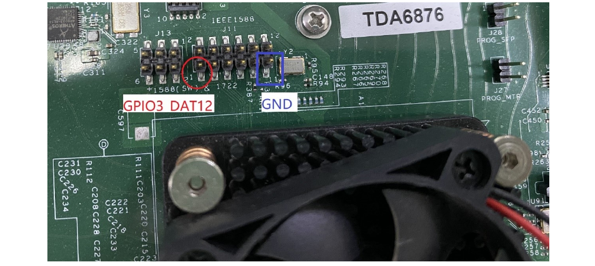

# 11 Quản lý năng lượng

## 11.1 Hướng dẫn sử dụng quản lý năng lượng

### 11.1.1 Linux SDK cho bộ xử lý QorIQ

Bộ xử lý QorIQ có các tính năng giảm thiểu tiêu thụ năng lượng ở nhiều mức khác nhau. Mọi bộ xử lý đều hỗ trợ chế độ sleep (LPM20/SWLPM20). Một số bộ xử lý, như T1040, LS1021, cũng hỗ trợ chế độ deep sleep (LPM35).

Các tính năng quản lý năng lượng sau được hỗ trợ trên nhiều bộ xử lý QorIQ:

- Quản lý năng lượng động
- Tắt các IP block không dùng
- Các core hỗ trợ chế độ năng lượng thấp (như PW15)
- Bộ xử lý vào trạng thái năng lượng thấp (LPM20/SWLPM20, LPM35)
  - Chế độ LPM20/SWLPM20: phần lớn các clock của bộ xử lý bị tắt
  - Chế độ LPM35: ngắt nguồn cho các core, cache và IP block của bộ xử lý, như DIU, eLBC, PEX, eTSEC, USB, SATA, eSDHC
- CPU hotplug: Nếu các core bị down lúc runtime, chúng vào trạng thái năng lượng thấp.

Các nguồn sự kiện wake-up gây thoát khỏi chế độ năng lượng thấp được liệt kê dưới đây:

- Wake on LAN (WoL) bằng magic packet
- Wake bằng MPIC timer hoặc FlexTimer
- Wake bằng interrupt nội và ngoài, như GPIO

Để biết thêm về một bộ xử lý cụ thể, xem SoC Reference Manual.

### 11.1.2 Các option dạng cây khi cấu hình kernel

Với các nền tảng Arm

| Tùy chọn Kernel Configure Tree View | Mô tả |
|---|---|
| `Power management options -->`<br>`  [*] Suspend to RAM and standby` | Bật sleep feature |
| `Device Drivers --->`<br>`   Real Time Clock --->`<br>`     [*] Freescale FlexTimer alarm timer` | Bật Flextimer alarm driver (chỉ cho trường hợp wakeup bằng Flextimer) |
| `Device Drivers --->`<br>`     -*- GPIO Support -->`<br>`       [*] /sys/class/gpio/…(sysfs interface)`<br>`           Memory mapped GPIO drivers --->`<br>`              [*] MPC512x/MPC8xxx/QorIQ GPIO support` | Bật GPIO driver (chỉ cho trường hợp wakeup bằng GPIO) |
| `CPU Power Management --->`<br>`CPU Idle --->` | Bật CPU Idle driver |
| `[*] CPU idle PM support`<br>`[*] Ladder governor (for periodic timer tick)`<br>`-*- Menu governor (for tickless system)`<br>`      Arm CPU Idle Drivers --->`<br>`       [*] Generic Arm/Arm64 CPU idle Driver` |   |

### 11.1.3 Các option cấu hình lúc biên dịch

| Linux framework | Tính năng phần cứng | Nền tảng | Kernel config |
|---|---|---|---|
| Suspend | LPM20/SWLPM20 | LS1012A, LS1021A, LS1046A, LS1043A, LS1088A, LS2088A, LX2160A, LS1028A | CONFIG_SUSPEND |
| RTC wake | Wake bằng Flextimer | LS1012A, LS1021A, LS1046A, LS1043A, LS1088A, LS2088A, LX2160A, LS1028A | CONFIG_RTC_DRV_FSL_FTM_ALARM |
| GPIO wake | Wake bằng chân GPIO | LS1012A, LS1021A, LS1046A, LS1043A, LS1088A, LS2088A, LX2160A, LS1028A | CONFIG_GPIO_MPC8XXX |
| CPU idle | PH20/PW20/PW15 | LS1012A, LS1021A, LS1046A, LS1043A, LS1088A, LS2088A, LX2160A, LS1028A | CONFIG_ARM_CPUIDLE |

### 11.1.4 Device tree binding

| Property | Kiểu | Mô tả |
|---|---|---|
| fsl, #rcpm-wakeup-cells | unsigned int | Số cell trong "rcpm-wakeup" không kể con trỏ tới "rcpm" |
| little-endian | bool | Có mặt nếu thanh ghi RCPM là little-endian (như LS1088A, LS2088A, LX2160A) |
| fsl, rcpm-wakeup | unsigned int | Chỉ định cách lập trình thanh ghi IPPDEXPCRn để ngăn IP liên quan tới nguồn wakeup (RTC/GPIO/…) bị tắt (clock gated) trong LPM20 |

Với các bộ xử lý có RCPM tích hợp

```
aliases {
  rtc1 = &ftm_alarm0;
};
rcpm: rcpm@1ee208c {
  compatible = "fsl,ls1046a-rcpm", "fsl,qoriq-rcpm-2.1+";
  reg = <0x0 0x1ee2140 0x0 0x4>;
  #fsl,rcpm-wakeup-cells = <1>;
};
//RTC as wakeup source:
ftm_alarm0: timer@29d0000 {
  compatible = "fsl,ls1046a-ftm-alarm";
  reg = <0x0 0x29d0000 0x0 0x10000>;
  fsl,rcpm-wakeup = <&rcpm 0x20000>;
  interrupts = <GIC_SPI 86 IRQ_TYPE_LEVEL_HIGH>;
  big-endian;
};
//GPIO as wakeup source:
gpio3: gpio@2320000 {
  compatible = "fsl,ls1028a-gpio","fsl,qoriq-gpio";
  reg = <0x0 0x2320000 0x0 0x10000>;
  interrupts = <GIC_SPI 37 IRQ_TYPE_LEVEL_HIGH>;
  gpio-controller;
  #gpio-cells = <2>;
  interrupt-controller;
  #interrupt-cells = <2>;
  little-endian;
  fsl,rcpm-wakeup = <&rcpm 0x0 0x0 0x0 0x0 0x200 0x0 0x0>;
};
```

Xem tài liệu Linux: `Documentation/devicetree/bindings/soc/fsl/rcpm.txt`

### 11.1.5 Các file source

Các file source được duy trì trong cây source Linux kernel.

| File source | Mô tả |
|---|---|
| drivers/soc/fsl/rcpm.c | RCPM driver cần cho tính năng sleep |
| drivers/rtc/rtc-fsl-ftm-alarm.c | FTM timer driver hoạt động như nguồn wakeup |
| drivers/gpio/gpio-mpc8xxx.c | GPIO driver hoạt động như nguồn wakeup |
| drivers/cpuidle/cpuidle-arm.c | cpuidle driver cho core Arm |

### 11.1.6 Kiểm chứng trong Linux

- Cpuidle Driver

  cpuidle driver có thể chuyển trạng thái CPU theo chính sách idle (governor). Để biết thêm, xem "Documentation/cpuidle/sysfs.txt" trong source code kernel.

  ```
  /* Check the cpuidle driver which is currently used. */
  # cat /sys/devices/system/cpu/cpuidle/current_driver
  /* Check the following directory to see the detailed statistic information of
   each state on each CPU. */
  /sys/devices/system/cpu/cpu0/cpuidle/state0/
  /sys/devices/system/cpu/cpu0/cpuidle/state1/
  ```

- CPU hot plug

  CPU có thể vào sleep, giúp giảm tiêu thụ năng lượng đáng kể.

  ```
  # echo 0 > /sys/devices/system/cpu/cpu2/online
  # echo 1 > /sys/devices/system/cpu/cpu2/online
  # echo 0 > /sys/devices/system/cpu/cpu0/online
  # echo 1 > /sys/devices/system/cpu/cpu0/online
  ```

- Sleep và Wake up bằng FTM timer

  Khởi động một FTM timer. Nó kích hoạt một interrupt để đánh thức hệ thống sau 10 giây.

  ```
  echo 0 > /sys/class/rtc/rtc1/wakealarm && echo +10 >/sys/class/rtc/rtc1/
  wakealarm && echo mem > /proc/power/state # Suspend-to-RAM
  echo 0 > /sys/class/rtc/rtc1/wakealarm && echo +10 >/sys/class/rtc/rtc1/
  wakealarm && echo freeze > /proc/power/state # Suspend-to-Idle
  ```

- Sleep và Wake up bằng GPIO

  **Ghi chú:** Với tính năng wakeup bằng GPIO, một số chân GPIO được mux với các tín hiệu khác trên SoC/board. Vì vậy, bảo đảm đang dùng đúng RCW image và các lệnh U-Boot phù hợp (nếu cần) để bật chân GPIO target muốn kiểm thử.

  Sau đây là các bước ví dụ để bật **GPIO3_DAT12** trên LS1028ARDB. Với trường hợp khác, xem reference manual của SoC và board.

  1. Cập nhật RCW cho pin mux liên quan:

     Trong file source RCW, `ls1028ardb/R_SQPP_0x85bb/rcw_800.rcw`, đổi giá trị của mục `EC1_SAI4_5_PMUX` từ 5 thành 1.

  2. Cập nhật GPIO kernel driver và device tree để bật chức năng wake:

     a. Trong file source Linux kernel `arch/arm64/boot/dts/freescale/fsl-ls1028a.dtsi`, thêm property sau vào node `gpio3: gpio@2320000` để lập trình đúng IPPDEXPCRn cho GPIO wakeup.

     ```
     fsl,rcpm-wakeup = <&rcpm 0x0 0x0 0x0 0x0 0x200 0x0 0x0>;
     ```

     b. Trong file source Linux kernel `drivers/gpio/gpio-mpc8xxx.c`, thêm các lời gọi sau vào cuối hàm `mpc8xxx_probe()` để bật chức năng wake của GPIO `irq`.

     ```
     device_init_wakeup(&pdev->dev, true);
     enable_irq_wake(mpc8xxx_gc->irqn);
     ```

  3. Boot vào Linux console, thực thi các lệnh sau để export chân GPIO cụ thể ra Linux user space và bật interrupt, ra lệnh cho hệ thống sleep (Suspend-RAM/Suspend-to-Idle).

     ```
     echo 428 > /sys/class/gpio/export  # Export related GPIO pin in userspace
     echo input > /sys/class/gpio/gpio428/direction
     echo falling > /sys/class/gpio/gpio428/edge
     ```

  4. Ra lệnh cho hệ thống sleep (Suspend-RAM/Suspend-to-Idle).

     ```
     echo mem > /proc/power/state  # Suspend-to-RAM
     echo freeze > /proc/power/state # Suspend-to-Idle
     ```

  5. Trên LS1028ARDB, nối tắt chân 1 và 11 của J11 để kích hoạt interrupt GPIO (như trong hình sau), để đánh thức hệ thống.



**Figure 221. GPIO**

### 11.1.7 Tài liệu hỗ trợ

Reference manual của bộ xử lý QorIQ

## 11.2 CPU Frequency Switching User Manual

### 11.2.1 Linux SDK cho bộ xử lý QorIQ

### 11.2.2 Từ viết tắt

DFS: Dynamic Frequency Scaling

### 11.2.3 Mô tả

Bộ xử lý QorIQ hỗ trợ tính năng DFS (Dynamic Frequency Switching), còn gọi là CPU Frequency Switch, có thể thay đổi tần số của các core một cách động.

Để biết thêm về một bộ xử lý cụ thể, xem Reference Manual của bộ xử lý.

| Tùy chọn Kernel Configure Tree View | Mô tả |
|---|---|
| `CPU Power Management -->`<br>`  CPU Frequency scaling -->`<br>`    [*] CPU Frequency scaling`<br>`    <*> CPU frequency translation statistics`<br>`        Default CPUFreq governor (userspace) -->`<br>`    -*- 'userspace' governor for userspace frequency`<br>` scaling`<br>`        Arm CPU frequency scaling drivers -->` | Bật CPU frequency driver |
| `           <*> CPU frequency scaling driver for`<br>` Freescale QorIQ SoCs` |   |

### 11.2.4 Các tùy chọn cấu hình lúc compile

| Linux Framework | Tính năng phần cứng | Nền tảng | Kernel Config |
|---|---|---|---|
| cpufreq | DFS | DFS | CONFIG_CPU_FREQ, CONFIG_CPU_FREQ_DEFAULT_GOV\_USERSPACE |
| cpufreq | DFS | Layerscape | CONFIG_QORIQ_CPUFREQ |

### 11.2.5 Ứng dụng User Space

Chỉ cần dùng lệnh "cat" và "echo" là kiểm chứng được tính năng này.

### 11.2.6 Device Tree Binding

| Property | Kiểu | Trạng thái | Mô tả |
|---|---|---|---|
| #clock-cells | unsigned int | Bắt buộc | Số cell trong một clock-specifier |
| clocks | handle | Bắt buộc | Handle của nguồn clock |
| compatible | String | Bắt buộc | Các chuỗi compatible |
| reg | unsigned int | Bắt buộc | dải địa chỉ thanh ghi |

```
clockgen: clocking@1ee1000 {
  compatible = "fsl,ls1012a-clockgen";
  reg = <0x0 0x1ee1000 0x0 0x1000>;
  #clock-cells = <2>;
   clocks = <&sysclk &coreclk>;
                        clock-names = "sysclk", "coreclk";
};
```

### 11.2.7 Các file source

Source của driver được duy trì trong cây source Linux kernel.

| File source | Mô tả |
|---|---|
| drivers/cpufreq/qoriq-cpufreq.c | Driver CPU frequency scaling cho các chip qoriq |

### 11.2.8 Kiểm chứng trong Linux

- Chế độ tần số CPU

  ```
  In order to test the CPU frequency scaling feature, we need to enable the CPU
   frequency feature on the
  menuconfig and choose the USERSPACE governor.
  You can learn more about CPU frequency scaling feature by referring to the
   kernel documents.
  They all are put under Documentation/cpu-freq/ directory.
  For example: all the information about governors is put in Documentation/cpu-
  freq/governors.txt.
  Test step:
  1. list all the frequencies a core can support (take cpu 0 for example) :
   # cat /sys/devices/system/cpu/cpu0/cpufreq/scaling_available_frequencies
  1199999 599999 299999 799999 399999 199999 1066666 533333 266666
  2.  check the CPU's current frequency
  # cat /sys/devices/system/cpu/cpu0/cpufreq/scaling_cur_freq
  1199999
  3. change the CPU's frequency we expect:
  # echo 799999 > /sys/devices/system/cpu/cpu0/cpufreq/scaling_setspeed
  You can check the CPU's current frequency again to confirm if the frequency
   transition is successful.
  Please note that if the frequency you want to change to doesn't support by
   current CPU, kernel will
  round up or down to one CPU supports.
  ```

## 11.3 Hướng dẫn sử dụng quản lý nhiệt

### 11.3.1 Mô tả

Chức năng quản lý nhiệt dựa trên TMU (Thermal Monitoring Unit).

Driver đặt hai ngưỡng cho chức năng quản lý. Nếu nhiệt độ CPU vượt ngưỡng thứ nhất (75 C với LS2080, 85 C với các nền tảng khác), driver sẽ kích hoạt việc tự động điều chỉnh giới hạn tần số CPU theo xu hướng nhiệt độ; nếu nhiệt độ CPU vượt ngưỡng thứ hai (85 C với LS2080, 95 C với các nền tảng khác, mức critical cho core), driver sẽ shut down hệ thống.

Người dùng cũng có thể lấy nhiệt độ hiện tại qua giao diện sysfs.

### 11.3.2 Đặc tả

| Board target: | T1040RDB, T1042RDB, T1023RDB, T1024RDB, LS1012ARDB, TWR-LS1021A, LS1028ARDB, LS1043ARDB, LS1046ARDB, LS1088ARDB, LS2088ARDB, LX2160ARDB, LX2162AQDS |
|---|---|
| Hệ điều hành: | Linux 3.12+ |

### 11.3.3 Các option dạng cây khi cấu hình kernel (cho nền tảng PowerPC)

| Tùy chọn Kernel Configure Tree View | Mô tả |
|---|---|
| `Platform support --->`<br>`    CPU Frequency scaling --->`<br>`        PowerPC CPU frequency scaling`<br>` drivers --->`<br>`            <*> CPU frequency scaling`<br>` driver for NXP QorIQ SoCs` | Bật CPUfreq driver. |
| `Device Drivers --->`<br>`    [*] Generic Thermal sysfs driver`<br>` --->` | Bật thermal management framework, hỗ trợ cpu cooling device và QorIQ thermal driver. |
| `        [*] generic cpu cooling`<br>` support`<br>`        [*] Freescale QorIQ Thermal`<br>` Monitoring Unit` |   |

### 11.3.4 Các option dạng cây khi cấu hình kernel (cho nền tảng Arm)

| Tùy chọn Kernel Configure Tree View | Mô tả |
|---|---|
| `CPU Power Management --->`<br>`    CPU Frequency scaling --->`<br>`        Arm CPU frequency scaling`<br>` drivers --->`<br>`            <*> CPU frequency scaling`<br>` driver for NXP QorIQ SoCs` | Bật CPUfreq driver. |
| `Device Drivers --->`<br>`    [*] Generic Thermal sysfs driver`<br>` --->`<br>`        [*] generic cpu cooling`<br>` support`<br>`        [*] Freescale QorIQ Thermal`<br>` Monitoring Unit` | Bật thermal management framework, hỗ trợ cpu cooling device và QorIQ thermal driver. |

### 11.3.5 Các tùy chọn cấu hình lúc compile

| Tùy chọn | Giá trị | Giá trị mặc định | Mô tả |
|---|---|---|---|
| CONFIG_QORIQ_CPUFREQ | y/n | n | Bật QorIQ CPUfreq driver |
| CONFIG_THERMAL | y/m/n | n | Bật hỗ trợ thermal management |
| CONFIG_CPU_THERMAL | y/m/n | n | Bật hỗ trợ cpu cooling device |
| CONFIG_QORIQ_THERMAL | y/m/n | n | Bật QorIQ thermal driver |

### 11.3.6 Device Tree Binding

```
tmu: tmu@f0000 {
        compatible = "fsl,qoriq-tmu";
        reg = <0xf0000 0x1000>;
        interrupts = <18 2 0 0>;
        fsl,tmu-range = <0x000a0000 0x00090026 0x0008004a 0x0001006a>;
        fsl,tmu-calibration = <0x00000000 0x00000025
                0x00000001 0x00000028
                0x00000002 0x0000002d
                0x00000003 0x00000031
                0x00000004 0x00000036
                0x00000005 0x0000003a
                0x00000006 0x00000040
                0x00000007 0x00000044
                0x00000008 0x0000004a
                0x00000009 0x0000004f
                0x0000000a 0x00000054
                0x00010000 0x0000000d
                0x00010001 0x00000013
                0x00010002 0x00000019
                0x00010003 0x0000001f
                0x00010004 0x00000025
                0x00010005 0x0000002d
                0x00010006 0x00000033
                0x00010007 0x00000043
                0x00010008 0x0000004b
                0x00010009 0x00000053
                0x00020000 0x00000010
                0x00020001 0x00000017
                0x00020002 0x0000001f
                0x00020003 0x00000029
                0x00020004 0x00000031
                0x00020005 0x0000003c
                0x00020006 0x00000042
                0x00020007 0x0000004d
                0x00020008 0x00000056
                0x00030000 0x00000012
                0x00030001 0x0000001d>;
};
```

### 11.3.7 Các file source

Source của driver được duy trì trong cây source Linux kernel.

| File source | Mô tả |
|---|---|
| drivers/thermal/qoriq_thermal.c | QorIQ thermal driver. |

### 11.3.8 Kiểm chứng trong Linux

**Có hai phần cần kiểm chứng: quản lý và giám sát.**

\[Quản lý:\]

1. Khi nhiệt độ CPU vượt ngưỡng thứ nhất, tần số CPU có thể bị giảm bằng cách thay đổi giới hạn tần số; dùng lệnh sau để kiểm tra tần số hiện tại:

```
~$ cat /sys/devices/system/cpu/cpu*/cpufreq/scaling_cur_freq
```

2. Khi nhiệt độ CPU vượt ngưỡng thứ hai, hệ thống shut down.

\[Giám sát:\]

```
~$ cat /sys/class/thermal/thermal_zone*/temp
35000
36000
35000
...
# There can be multiple outputs according to the thermal zone number of the
 system. The temperature are 35 C, 36 C, 35 C etc.
```

## 11.4 Giám sát hệ thống

### 11.4.1 Power Monitor User Manual

Power Monitoring User Manual cung cấp chi tiết về cách đo tiêu thụ năng lượng trên một số reference board NXP QorIQ (PowerPC) bằng một chip ina2xx bên ngoài.

Power Monitor được hỗ trợ trên P4080DS, P5020DS, P5040DS, T4240QDS, T1040RDB, T1042RDB, T1023RDB, T1024RDB, LS1012ARDB, TWR-LS1021A, LS1028ARDB, LS1043ARDB, LS1046ARDB, LS1088ARDB, LS2088ARDB, LX2160ARDB, LX2162AQDS.

Hướng dẫn này dùng board LS1046ARDB làm ví dụ.

#### 11.4.1.1 Cấu hình Power Monitoring và các bước kiểm thử

Công cụ Lm-sensors (tải từ http://dl.lm-sensors.org/lm-sensors/releases) sẽ được dùng để đọc công suất/nhiệt độ từ các sensor trên board. Driver thay đổi tùy sensor. Về cơ bản sẽ là INA220, ZL6100, ADT7461, v.v.

Device driver hỗ trợ cả build sẵn trong kernel lẫn nạp dạng module.

**Các tùy chọn Kernel Configure Tree View**

| Tùy chọn | Mô tả |
|---|---|
| `Device Drivers --->`<br>` <*> Hardware Monitoring support --->`<br>`    <*> Texas Instruments INA219 and`<br>` compatibles` | Bật INA220 |
| `Device Drivers --->`<br>`    [*] Enable compatibility bits`<br>` for old user-space`<br>`    <*> I2C device interface`<br>`    [*] Autoselect pertinent helper`<br>` modules`<br>`          I2C Hardware Bus support`<br>` --->`<br>`              <*>`<br>` MPC107/824x/85xx/512x/52xx/83xx/86xx` | Bật hỗ trợ I2C block device driver |
| `Device Drivers --->`<br>`      <*> I2C bus multiplexing`<br>` support`<br>`          Multiplexer I2C Chip support`<br>`  --->`<br>`              <*> NXP PCA954x and`<br>` PCA984x I2C Mux/switches` | Bật I2C bus multiplexing PCA9547 |

**Các tùy chọn cấu hình lúc compile**

| Tùy chọn | Giá trị | Giá trị mặc định | Mô tả |
|---|---|---|---|
| CONFIG_I2C_MPC | y/n | y | Bật I2C bus protocol |
| SENSORS_INA2XX | y/n | y | Bật INA220 |
| CONFIG_I2C_MUX_PCA954x | y/n | y | Bật I2C multiplexing PCA9547 |

**Device Tree Binding**

| Property | Kiểu | Trạng thái | Mô tả |
|---|---|---|---|
| compatible | String | Bắt buộc | "nxp,pca9547" cho pca9547 |
| reg | integer | Bắt buộc | reg = <0x77> |
| compatible | String | Bắt buộc | "ti,ina220" cho ina220 |
| reg | integer | Bắt buộc | reg = \<địa chỉ i2c của ina220> |

```
Default node:
       i2c@118000 {
            pca9547@77 {
                compatible = "nxp,pca9547";
                reg = <0x77>;
                #address-cells = <1>;
                #size-cells = <0>;
                channel@2 {
                    #address-cells = <1>;
                    #size-cells = <0>;
                    reg = <0x2>;
                    ina220@40 {
                        compatible = "ti,ina220";
                        reg = <0x40>;
                        shunt-resistor = <1000>;
                    };
                    ina220@41 {
                        compatible = "ti,ina220";
                        reg = <0x41>;
                        shunt-resistor = <1000>;
                    };
                    ina220@44 {
                        compatible = "ti,ina220";
                        reg = <0x44>;
                        shunt-resistor = <1000>;
                    };
                    ina220@45 {
                        compatible = "ti,ina220";
                        reg = <0x45>;
                        shunt-resistor = <1000>;
                    };
                    ina220@46 {
                        compatible = "ti,ina220";
                        reg = <0x46>;
                        shunt-resistor = <1000>;
                    };
                    ina220@47 {
                        compatible = "ti,ina220";
                        reg = <0x47>;
                        shunt-resistor = <1000>;
                    };
                };
            };
```

**Các file source**

Source của driver được duy trì trong cây source Linux kernel.

| File source | Mô tả |
|---|---|
| drivers/i2c/muxes/i2c-mux-pca954x.c | Driver PCA9547 |
| drivers/hwmon/ina2xx.c | Driver ina220 |

**Quy trình kiểm thử**

Làm như sau để kiểm chứng trong kernel

1. Thông tin lúc boot được hiển thị:

   ```
   ......
   i2c /dev entries driver
   mpc-i2c ffe118000.i2c: timeout 1000000 us
   mpc-i2c ffe118100.i2c: timeout 1000000 us
   mpc-i2c ffe119000.i2c: timeout 1000000 us
   mpc-i2c ffe119100.i2c: timeout 1000000 us
   i2c i2c-0: Added multiplexed i2c bus 6
   i2c i2c-0: Added multiplexed i2c bus 7
   i2c i2c-0: Added multiplexed i2c bus 8
   i2c i2c-0: Added multiplexed i2c bus 9
   i2c i2c-0: Added multiplexed i2c bus 10
   i2c i2c-0: Added multiplexed i2c bus 11
   i2c i2c-0: Added multiplexed i2c bus 12
   i2c i2c-0: Added multiplexed i2c bus 13
   pca954x 0-0077: registered 8 multiplexed busses for I2C mux pca9547
   ina2xx 8-0040: power monitor ina220 (Rshunt = 1000 uOhm)
   ina2xx 8-0041: power monitor ina220 (Rshunt = 1000 uOhm)
   ina2xx 8-0045: power monitor ina220 (Rshunt = 1000 uOhm)
   ina2xx 8-0046: power monitor ina220 (Rshunt = 1000 uOhm)
   ina2xx 8-0047: power monitor ina220 (Rshunt = 1000 uOhm)
   ina2xx 8-0044: power monitor ina220 (Rshunt = 1000 uOhm)
   ......
   ```

   ```
   root@LS1046ARDB:~# sensors
   ina220-i2c-0-40
   Adapter: 2180000.i2c
   in0:          +0.01 V
   in1:          +1.04 V
   power1:        6.82 W
   curr1:        +6.48 A
   adt7461-i2c-0-4c
   Adapter: 2180000.i2c
   temp1:        +29.0°C  (low  =  +0.0°C, high = +85.0°C)
                          (crit = +85.0°C, hyst = +75.0°C)
   temp2:        +47.8°C  (low  =  +0.0°C, high = +85.0°C)
                          (crit = +85.0°C, hyst = +75.0°C)
   ```

**Ghi chú:** Hãy bảo đảm rootfs có lệnh "sensors"

### 11.4.2 Thermal Monitor User Manual

#### 11.4.2.1 Mô tả

Chức năng giám sát nhiệt độ do chip ADT7461 cung cấp.

Với LX2160ARDB Rev2, chip là SA56004ED và SA56004FD.

Driver này export các giá trị nhiệt độ ra SYSFS. Các công cụ user space lm-sensors có thể lấy và hiển thị các giá trị này.

#### 11.4.2.2 Tùy chọn Kernel Configure Tree View

| Tùy chọn Kernel Configure Tree View | Mô tả |
|---|---|
| `Device Drivers --->`<br>`    [*] Hardware Monitoring support`<br>` --->`<br>`        [*] National Semiconductor`<br>` LM90 and compatibles` | Bật driver chip thermal monitor như ADT7461. |
| `Device Drivers --->`<br>`    <*> I2C bus multiplexing support`<br>` --->`<br>`        Multiplexer I2C Chip support`<br>` --->`<br>`            <*> NXP PCA954x and`<br>` PCA984x I2C Mux/switches` | Bật hỗ trợ multiplexer I2C PCA954x và PCA984x |

#### 11.4.2.3 Các tùy chọn cấu hình lúc compile

| Tùy chọn | Giá trị | Giá trị mặc định | Mô tả |
|---|---|---|---|
| CONFIG_HWMON | y/m/n | n | Bật Hardware Monitor |
| CONFIG_SENSORS_LM90 | y/m/n | n | Bật driver ATD7461 *(ghi chú: đúng là ADT7461)* và SA56004 |
| CONFIG_I2C_MUX | y/m/n | n | Bật hỗ trợ I2C bus multiplexing |
| CONFIG_I2C_MUX_PCA954x | y/m/n | n | Bật PCA954x driver |

#### 11.4.2.4 Device Tree Binding

```
adt7461@4c {
    compatible = "adi,adt7461";
    reg = <0x4c>;
};
pca9547@77 {
    compatible = "nxp,pca9547";
    reg = <0x77>;
};
```

#### 11.4.2.5 Các file source

Source của driver được duy trì trong cây source Linux kernel.

| File source | Mô tả |
|---|---|
| drivers/hwmon/hwmon.c | Hỗ trợ Linux hwmon subsystem |
| drivers/hwmon/lm90.c | Driver ADT7461 chip |
| drivers/i2c/i2c-mux.c | Hỗ trợ I2C bus multiplexing |
| drivers/i2c/muxes/pca954x.c | Driver PCA954x chip |

#### 11.4.2.6 Kiểm chứng trong Linux

**Có hai cách lấy kết quả nhiệt độ.**

```
1. You can manually read the thermal interfaces in sysfs:
~$ ls /sys/class/hwmon/hwmon1/devices
alarms            temp1_crit        temp1_min_alarm   temp2_max_alarm
driver            temp1_crit_alarm  temp2_crit        temp2_min
hwmon             temp1_crit_hyst   temp2_crit_alarm  temp2_min_alarm
modalias          temp1_input       temp2_crit_hyst   temp2_offset
name              temp1_max         temp2_fault       uevent
power             temp1_max_alarm   temp2_input       update_interval
subsystem         temp1_min         temp2_max
~$ cat /sys/class/hwmon/hwmon1/devices/temp1_input
29000
2. You can use lm_sensors tools as follows.
~ # sensors
adt7461-i2c-1-4c
Adapter: MPC adapter
temp1:       +34.0 C  (low  =  +0.0 C, high = +85.0 C)
                      (crit = +85.0 C, hyst = +75.0 C)
temp2:       +48.5 C  (low  =  +0.0 C, high = +85.0 C)
                      (crit = +85.0 C, hyst = +75.0 C)
```

**"lm_sensors được tích hợp vào root file system mặc định. Nếu rootfs không có lệnh "sensors", chỉ cần thêm package lmsensors-sensors và build rootfs của riêng bạn."**
