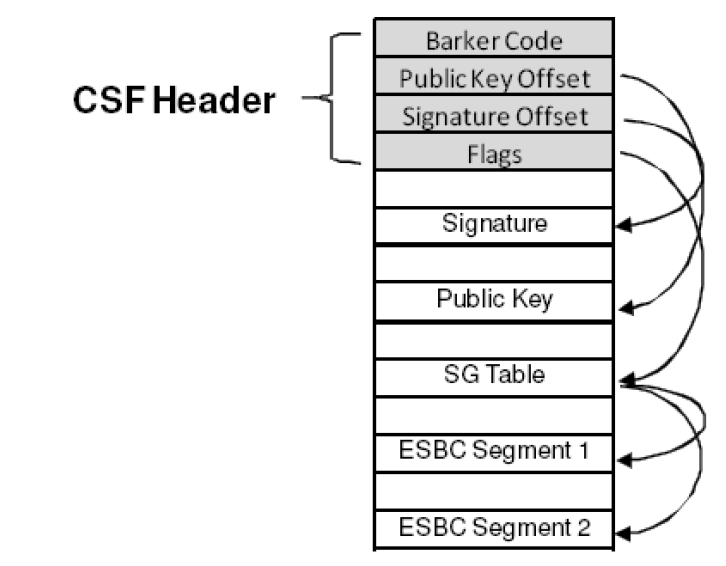
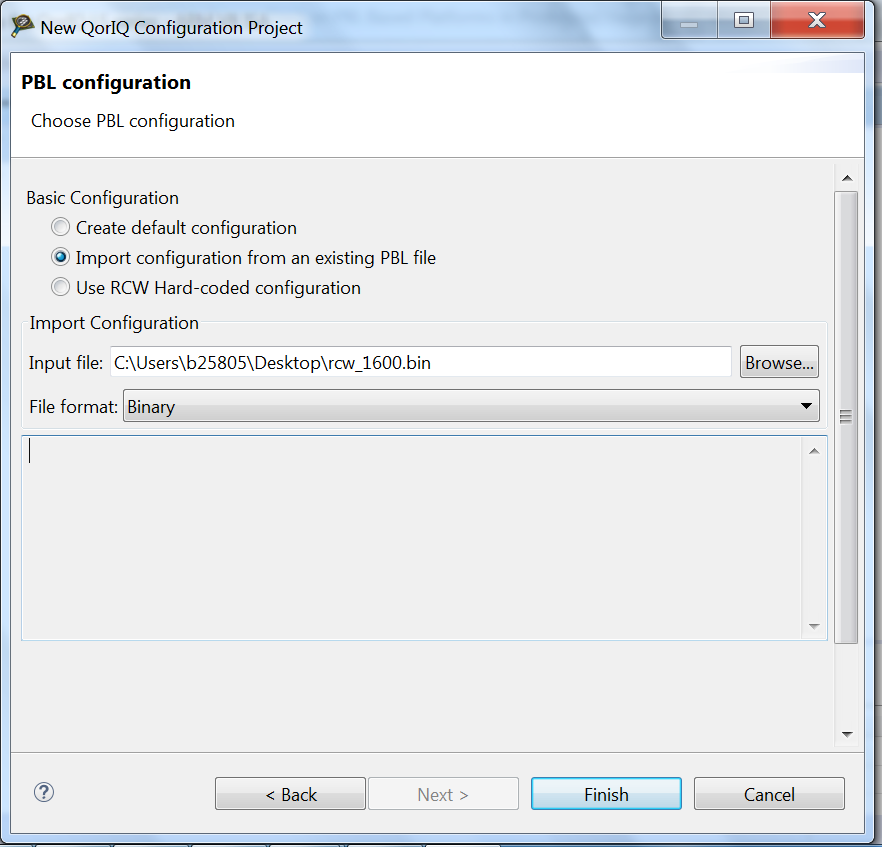
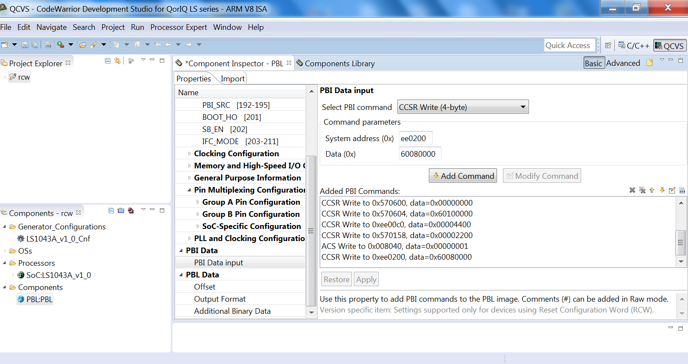
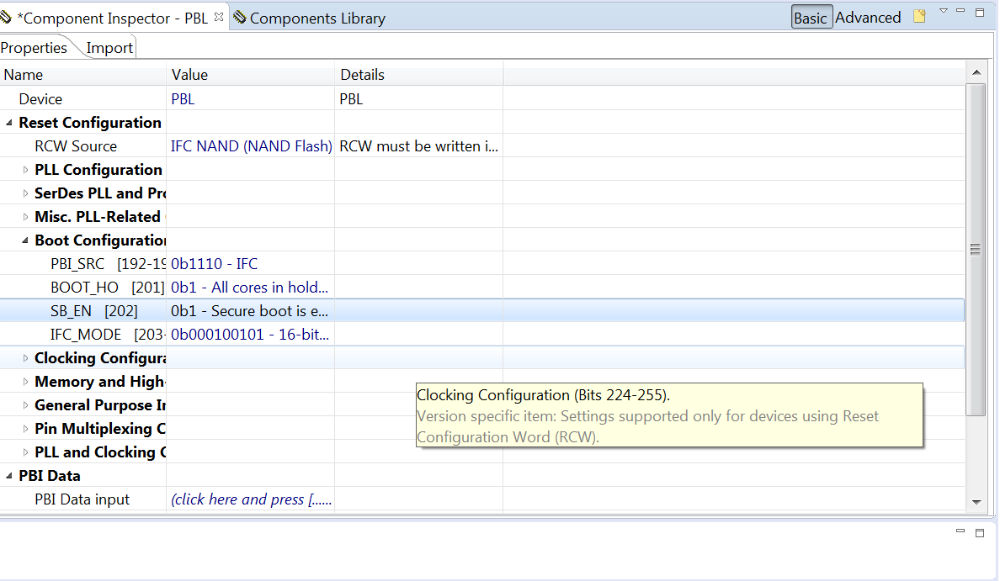

# Thiết lập Secure Boot trên các nền tảng dựa trên PBL ở giai đoạn Prototype

Tài liệu này giới thiệu các phương pháp và quy trình thiết lập secure boot cho các nền tảng QorIQ dựa trên PBL, kiến trúc PowerPC và ARM. Tài liệu giải thích khái niệm cơ bản về secure boot; mô tả cách tạo PBL, CSF header và ESBC image cho secure boot; giới thiệu cách triển khai các image liên quan đến secure boot lên target, cách blow OTPMK và ghi SRK hash key vào các mirror register ở giai đoạn prototype; đưa ra cách xử lý sự cố từng bước khi secure boot thất bại mà không in ra thông báo nào trên UART console.

Tài liệu này dùng LS1043 làm ví dụ. Nếu dùng processor khác, người dùng cần thay đổi địa chỉ thanh ghi và địa chỉ triển khai image theo reference manual của processor và user manual của QorIQ SDK.

## 1. Khái niệm cơ bản về Secure Boot trên nền tảng dựa trên PBL

Quá trình secure boot dùng một thủ tục kiểm tra chữ ký số có sẵn trong INTERNAL BOOT ROM. Thủ tục này kiểm tra bằng cách dùng RSA public key gắn với phần cứng để giải mã hash đã được ký, rồi so nó với hash vừa tính lại trên chính system image đó. Nếu so khớp, image có thể được coi là xác thực.<br>
Với public key đã được kiểm tra, CPU 0 giải mã chữ ký số lưu kèm CSF header. Sau đó ISBC dùng các trường độ dài và con trỏ của ESBC u-boot trong CSF header để tính hash trên code.

Có các cặp RSA public key và private key: private key dùng để ký image, còn public key dùng để kiểm tra image trong giai đoạn ISBC và ESBC. Public key được nhúng trong header, còn hash của bảng SRK được ghi bằng fuse vào thanh ghi SRKH của SFP.

OTPMK (One Time Programmable Master Key) được dùng để mã hóa và giải mã các secret key bổ sung (cũng chỉ module SEC dùng được), các key này có thể dùng để bảo vệ dữ liệu bất kỳ.

Hình dưới đây là ví dụ về một ESBC có CSF (Command Sequence File) header. CSF header chứa các độ dài và offset giúp ISBC tìm các toán hạng dùng khi kiểm tra ESBC image, đồng thời mô tả kích thước và vị trí của chính ESBC image.



## 2. Chuẩn bị image cho Secure BOOT

Mục này mô tả cách tạo RCW, OTPMK và SRK key, CSF header của u-boot và u-boot image cho secure boot.

### 2.1 Tạo RCW hỗ trợ Secure Boot

Bắt buộc phải dùng PBL khi thực hiện secure boot. PBL phải đọc một file lệnh từ vị trí do Reset Configuration Word (RCW) xác định và ghi một giá trị vào ESBC Pointer Register trong SoC. Trừ khi ESBC u-boot được lưu trong NOR flash, developer phải tạo một PBL Image sao chép image cần kiểm tra từ NVRAM sang bộ nhớ chính hoặc SRAM nội trước khi ghi thanh ghi SCRATCHRW1 và chạy code ISBC.

SCRATCHRW1 dùng để lưu địa chỉ được dùng trong quá trình secure boot để truy cập vị trí đầu tiên của external secure boot code, tức trỏ tới ESBC Header (Primary Boot Image). PBL phải khởi tạo thanh ghi này để secure boot hoạt động đúng.

Người dùng cần sửa các lệnh PBI để cấu hình LAW cho ESBC, CPC làm SRAM và các thanh ghi SCRATCH, nhằm tạo PBL image hỗ trợ secure boot.<br>
Dưới đây là các lệnh PBI cho NOR SECURE BOOT của T1/T2/T4/B4.

```text
#LAW for ESBC
09000c10 00000000
09000c14 c0000000
09000c18 81f0001b
# LAW for CPC/SRAM
09000d00 00000000
09000d04 bff00000
09000d08 81000013
# Scratch Registers
090e0200 c0b00000
090e0208 c0c00000
# CPC SRAM
09010100 00000000
09010104 bff00009
# CPC Configuration
09010f00 08000000
09010000 80000000
```

Ngoài ra, có hai cách bật secure boot trên board target: lập trình fuse ITS, hoặc đặt bit SB_EN thành 1 trong RCW. Ở giai đoạn prototype, chúng tôi khuyên người dùng dùng cách sau.

#### 2.1.1 Tạo RCW cho Secure boot trong Linux SDK

Người dùng Linux SDK có thể dùng package “rcw” để tạo RCW cho secure boot. Với một số nền tảng, các file cấu hình rcw cho secure boot đã được cung cấp sẵn. Ví dụ với LS1043ARDB, file cấu hình PBI cho secure boot ls1043aqds/uboot_hdr_addr.rcw được cung cấp như dưới đây (thanh ghi SCRATCHRW1 chỉ định địa chỉ header của ESBC u-boot), file cấu hình RCW cho secure boot ls1043ardb/RR_FQPP_1455/ rcw_1600_sben.rcw include uboot_hdr_addr.rcw và có trường “SB_EN” được bật. Vì vậy người dùng có thể build package rcw để tạo trực tiếp RCW cho secure boot.

```text
/*
 * PBI Commands for LS1043ARDB and LS1043AQDS.
 */

.pbi
// Workaround for u-boot address.
write 0xee0200, 0x60080000
.end
```

Mục này giới thiệu cách sửa file cấu hình rcw và build RCW cho secure boot của nền tảng LS1043ARDB trong Linux SDK 2.0.

```text
$ bitbake rcw -c cleansstate
$ bitbake rcw -c configure
```

*Vào thư mục source build_ls1043ardb/tmp/work/ls1043ardb-fsl-linux/rcw/git-r0/git/ls1043ardb/RR_FQPP_1455, tạo file rcw_1600_sben_ho.rcw bằng cách sao chép từ rcw_1600_sben.rcw, và sửa trường “BOOT_HO” thành “1” trong rcw_1600_sben_ho.rcw.*<br>
Build lại rcw

```text
$ bitbake rcw
```

*Lấy rcw_1600_sben.bin và rcw_1600_sben_ho.bin trong thư mục deploy image build_ls1043ardb/tmp/deploy/images/ls1043ardb/rcw/ls1043ardb/RR_FQPP_1455.*<br>
RCW rcw_1600_sben_ho.bin được dùng để đưa core vào chế độ boot hold off khi khởi động, để chờ dùng CCS kết nối tới board target và ghi key vào các shadow register SFP_SRKRH *(ghi chú: đúng là SFP_SRKHR)*.

#### 2.1.2 Tạo RCW cho Secure Boot bằng công cụ QCVS

Mục này mô tả cách tạo RCW cần cho secure boot bằng công cụ QCVS. Hãy tải công cụ QCVS mới nhất từ [http://www.nxp.com/products/software-and-tools/software-development-tools/codewarrior-development-tools/suite-for-networked-applications/qoriq-configuration-and-validation-suite:PE_QORIQ_SUITE?code=PE_QORIQ_SUITE&nodeId=015210BAF72726328B&fpsp=1&tab=Design_Tools_Tab](http://www.nxp.com/products/software-and-tools/software-development-tools/codewarrior-development-tools/suite-for-networked-applications/qoriq-configuration-and-validation-suite:PE_QORIQ_SUITE?code=PE_QORIQ_SUITE&nodeId=015210BAF72726328B&fpsp=1&tab=Design_Tools_Tab): tải “QCVS for ARMv7 and ARMv8” cho các nền tảng QorIQ LayerScape, tải “QCVS for PA” cho các nền tảng QorIQ PowerPC, rồi cài QCVS vào CodeWarrior IDE.

Hãy tạo một QCS project từ File->New->QorIQ Configuration Project, chọn PBL project và import RCW image đã build sẵn.



Thêm các lệnh PBI từ PBI Data->PBI Data input.



Sửa boot configuration để bật secure boot.



Tạo PBL image trong Generted_Code *(ghi chú: đúng là Generated_Code)* từ Project->Generate Processor Expert Code.

### 2.2 Tạo RSA key và ký image để tạo CSF Header bằng công cụ CST

Linux SDK cung cấp Code Signing Tool để hỗ trợ quá trình Secure boot. Công cụ CST có thể dùng để tạo RSA public key và private key, OTPMK và DRV key đã chèn mã hamming, CSF header cho một image, và để ký code bằng RSA private key.<br>
Mục này mô tả từng bước cách dùng công cụ CST.<br>
a. Trong Linux SDK, build cst cho máy host.

```text
$ bitbake cst-native
```

Môi trường làm việc của công cụ cst nằm trong build_ls1043ardb/tmp/sysroots/x86_64-linux/usr/bin/cst.<br>
b. Tạo cặp private key và public key

```text
./gen_keys 1024
```

c. Build u-boot image cho Secure<br>
Sửa recipe sources/meta-freescale/conf/machine/ls1043ardb.conf, thêm secure u-boot vào cấu hình build.

```text
UBOOT_CONFIG ??= "nand sdcard nor secure-boot"
```

Chạy “$bitbake u-boot” để lấy secure u-boot image build_ls1043ardb/tmp/deploy/images/ls1043ardb/u-boot-secure-boot.bin, sao chép nó vào thư mục build_ls1043ardb/tmp/sysroots/x86_64-linux/usr/bin/cst và đổi tên thành u-boot.bin.

d. Tạo CSF header cho u-boot image

```text
./uni_sign input_files/uni_sign/ls1043/input_uboot_nor_secure
```

Log khi thành công như sau.

```text
        #----------------------------------------------------#
        #-------      -------  -------      -------#
        #------- CST (Code Signing Tool) Version 2.0 -------#
        #-------      -------  -------      -------#
        #----------------------------------------------------#

==========================================================
This tool includes software developed by OpenSSL Project
for use in the OpenSSL Toolkit (http://www.openssl.org/)
This product includes cryptographic software written by
Eric Young (eay@cryptsoft.com)
==========================================================

Input File is input_files/uni_sign/ls1043/input_uboot_nor_secure

----------------------------------------------
-       Dumping the Header Fields
----------------------------------------------
- SRK Information
-       SRK Offset : 200
-       SRK Flag = 0
-       Single Key: srk.pub(100)
- UID Information
-       UID Flags = 00
-       FSL UID = 00000000_00000000
-       OEM UID = 00000000_00000000
- FLAGS Information
-       Secondary Image = 0
-       Manufacturing Protection = 1
- Image Information
-       SG Table Offset : 400
-       Number of entries : 1
-       Entry Point : 60100000
-       Entry 1 : u-boot.bin (Size = 000986c3 SRC = 60100000 DST = ffffffff)
- RSA Signature Information
-       RSA Offset : 600
-       RSA Size : 80
----------------------------------------------

Image Hash:
5a32001653c75ec7f8770603a0232bbf38c5d674c5eb00f150db56365ad73087


************************************************
* Header File is with Signature appended
************************************************

Header File Created: hdr_uboot.out

SRK (Public Key) Hash:
83bba1f03e1ce1d336490b5e4b1071f6c8021c72976408e5084e988ce4c1d93a
        SFP SRKHR0 = 83bba1f0
        SFP SRKHR1 = 3e1ce1d3
        SFP SRKHR2 = 36490b5e
        SFP SRKHR3 = 4b1071f6
        SFP SRKHR4 = c8021c72
        SFP SRKHR5 = 976408e5
        SFP SRKHR6 = 084e988c
        SFP SRKHR7 = e4c1d93a
```

e. Tạo CSF header cho kernel.itb.<br>
Sao chép kernel.itb image vào thư mục build_ls1043ardb/tmp/sysroots/x86_64-linux/usr/bin/cst và chạy lệnh sau để tạo file hdr_kernel.out.

```text
$ ./uni_sign input_files/uni_sign/ls1043/input_kernel_secure
```

f. Tạo CSF header cho file PPA.<br>
Sao chép ppa.itb vào thư mục build_ls1043ardb/tmp/sysroots/x86_64-linux/usr/bin/cst và chạy lệnh sau để tạo hdr_ppa.out.

```text
$ ./uni_sign input_files/uni_sign/ls1043/input_ppa_secure
```

g. Tạo file bootscript và tạo CSF header hdr_bs.out cho bootscript.

```text
$cat bootscript.txt
cp.b 0x600A0000 0x81000000 0x3500000
esbc_validate 0x63F40000
setenv bootargs "console=ttyS0,115200 root=/dev/ram0 earlycon=uart8250,0x21c0500";
setenv fdt_high "0xffffffffffffffff";
setenv initrd_high "0xffffffffffffffff";
bootm $img_addr
```

Ghi chú: đặt fdt_high thành "0xffffffffffffffff" thì fdt sẽ hoàn toàn không bị sao chép khi boot.

```text
$ bitbake u-boot-mkimage-native
$ <installation_folder>/build_ls1043ardb/tmp/sysroots/x86_64-linux/usr/bin/mkimage -A arm -T script -a 0 -e 0x40 -d bootscript.txt bootscript
$ ./uni_sign input_files/uni_sign/ls1043/input_bootscript_secure
```

h. Tạo OTPMK key.

```text
$ ./gen_otpmk_drbg 2

        #----------------------------------------------------#
        #-------      -------  -------      -------#
        #------- CST (Code Signing Tool) Version 2.0 -------#
        #-------      -------  -------      -------#
        #----------------------------------------------------#

Input string not provided
Generating a random string
------------------------------------------
* Hash_DRBG library invoked
* Seed being taken from /dev/random
------------------------------------------
OTPMK[255:0] is:
1a4721b1d5371cf735e6975844932d9ce2f460b7aa7816a774e2aba90adca9a2

 NAME    |     BITS     |    VALUE
_________|______________|____________
OTPMKR 0 | 255-224      |   1a4721b1
OTPMKR 1 | 223-192      |   d5371cf7
OTPMKR 2 | 191-160      |   35e69758
OTPMKR 3 | 159-128      |   44932d9c
OTPMKR 4 | 127- 96      |   e2f460b7
OTPMKR 5 |  95- 64      |   aa7816a7
OTPMKR 6 |  63- 32      |   74e2aba9
OTPMKR 7 |  31-  0      |   0adca9a2
```

File input ký của công cụ CST và phần giải thích được mô tả như sau.

```text
--------------------------------------------------
# Specify the platform. [Mandatory]
# Choose Platform - 1010/1040/2041/3041/4080/5020/5040/9131/9132/9164/4240/C290/LS1
PLATFORM=LS1043
# ESBC Flag. Specify ESBC=0 to sign u-boot and ESBC=1 to sign other ESBC images.
ESBC=0
--------------------------------------------------
# Entry Point/Image start address field in the header.[Mandatory]
# (default=ADDRESS of the signed image)
ENTRY_POINT=60100000
--------------------------------------------------
# Specify the file name of the keys seperated by comma.
# The number of files and key select should lie between 1 and 4 for 1040 and C290.
# For rest of the platforms only one key is required and key select should not be provided.

# USAGE (for 4080/5020/5040/3041/2041/1010/913x): PRI_KEY = <key1.pri>
# USAGE (for 1040/C290/9164/4240/LS1): PRI_KEY = <key1.pri>, <key2.pri>, <key3.pri>, <key4.pri>

# PRI_KEY (Default private key :srk.pri) - [Optional]
PRI_KEY=srk.pri
# PUB_KEY (Default public key :srk.pub) - [Optional]
PUB_KEY=srk.pub
# Please provide KEY_SELECT(between 1 to 4) (Required for 1040/C290/9164/4240/LS1 only) - [Optional]
KEY_SELECT=
--------------------------------------------------
# Specify SG table address, only for (2041/3041/4080/5020/5040) with ESBC=0 - [Optional]
SG_TABLE_ADDR=
--------------------------------------------------
# Specify the target where image will be loaded. (Default is NOR_16B) - [Optional]
# Only required for Non-PBL Devices (1010/1040/9131/9132i/C290)
# Select from -
NOR_8B/NOR_16B/NAND_8B_512/NAND_8B_2K/NAND_8B_4K/NAND_16B_512/NAND_16B_2K/NAND_16B_4K/SD/MMC/SPI
IMAGE_TARGET=
--------------------------------------------------
# Specify IMAGE, Max 8 images are possible. DST_ADDR is required only for Non-PBL Platform. [Mandatory]
# Create Entries for SG Table in the format {IMAGE_NAME, SRC_ADDR, DST_ADDR}
IMAGE_1={u-boot.bin,60100000,ffffffff}
IMAGE_2={,,}
IMAGE_3={,,}
IMAGE_4={,,}
IMAGE_5={,,}
IMAGE_6={,,}
IMAGE_7={,,}
IMAGE_8={,,}
--------------------------------------------------
# Specify OEM AND FSL ID to be populated in header. [Optional]
# e.g FSL_UID=11111111
FSL_UID=
FSL_UID_1=
OEM_UID=
OEM_UID_1=
--------------------------------------------------
# Specify the file names of csf header and sg table. (Default :hdr.out) [Optional]
OUTPUT_HDR_FILENAME=hdr_uboot.out

# Specify the file names of hash file and sign file.
HASH_FILENAME=img_hash.out
INPUT_SIGN_FILENAME=sign.out

# Specify the signature size.It is mandatory when neither public key nor private key is specified.
# Signature size would be [0x80 for 1k key, 0x100 for 2k key, and 0x200 for 4k key].
SIGN_SIZE=
--------------------------------------------------
# Specify the output file name of sg table. (Default :sg_table.out). [Optional]
# Please note that OUTPUT SG BIN is only required for 2041/3041/4080/5020/5040 when ESBC flag is not set.
OUTPUT_SG_BIN=
--------------------------------------------------
# Following fields are Required for 4240/9164/1040/C290 only
# Specify House keeping Area
# Required for 4240/9164/1040/C290 only when ESBC flag is not set. [Mandatory]
HK_AREA_POINTER=
HK_AREA_SIZE=
--------------------------------------------------
# Following field Required for 4240/9164/1040/C290 only
# Specify Secondary Image Flag. (0 or 1) - [Optional]
# (Default is 0)
SEC_IMAGE=0
# Specify Manufacturing Protection Flag. (0 or 1) - [Optional]
# Required only for LS1(Default is 0)
MP_FLAG=1
--------------------------------------------------
VERBOSE=1
```

## 3. Triển khai các image Secure Boot lên target và ghi SRKH Mirror Register

Mục này giới thiệu cách kiểm tra secure boot ở giai đoạn prototype. Trước tiên blow OTPMK key vào fuse array từ CCS, sau đó thiết lập u-boot ở Bank0, triển khai các image secure boot lên Bank4, chuyển sang Bank4, rồi dùng CCS kết nối tới board target để ghi SRKH.

a. Blow OTPMK bằng CCS

Hãy bật POVDD trên board.

Ghi các thanh ghi OTPMK vào fuse array trong CCS.

```text
% config cc cwtap:10.81.116.21
% ccs::config_server 0 10000
CodeWarrior TAP executable differs from local file.
CodeWarrior TAP Boot Loader version 1.0.1
CodeWarrior TAP OS version 1.0.2
Sending code to CodeWarrior TAP.........done
Running package script
% ccs::config_chain {ls1043a dap sap2}
% display ccs::get_config_chain
Chain Position 0: LS1043A
Chain Position 1: CoreSight ATB Funnel
Chain Position 2: CoreSight ATB Funnel
Chain Position 3: CoreSight TMC
Chain Position 4: CoreSight TMC
Chain Position 5: CoreSight ATB Funnel
Chain Position 6: CoreSight STM
Chain Position 7: CoreSight TMC
Chain Position 8: CoreSight ATB Funnel
Chain Position 9: CoreSight ATB Funnel
Chain Position 10: CoreSight TMC
Chain Position 11: CoreSight TMC
Chain Position 12: CoreSight TMC
Chain Position 13: CoreSight CTI
Chain Position 14: CoreSight CTI
Chain Position 15: CoreSight CTI
Chain Position 16: Cortex-A53
Chain Position 17: CoreSight CTI
Chain Position 18: Cortex-A53 PMU
Chain Position 19: Cortex-A53 ETM
Chain Position 20: Cortex-A53
Chain Position 21: CoreSight CTI
Chain Position 22: Cortex-A53 PMU
Chain Position 23: Cortex-A53 ETM
Chain Position 24: Cortex-A53
Chain Position 25: CoreSight CTI
Chain Position 26: Cortex-A53 PMU
Chain Position 27: Cortex-A53 ETM
Chain Position 28: Cortex-A53
Chain Position 29: CoreSight CTI
Chain Position 30: Cortex-A53 PMU
Chain Position 31: Cortex-A53 ETM
Chain Position 32: DAP
Chain Position 33: SAP2
```

Ghi OTPMK vào các mirror register.

```text
ccs::write_mem 32 0x1e80234 4 0 0x1a4721b1
ccs::write_mem 32 0x1e80238 4 0 0xd5371cf7
ccs::write_mem 32 0x1e8023c 4 0 0x35e69758
ccs::write_mem 32 0x1e80240 4 0 0x44932d9c
ccs::write_mem 32 0x1e80244 4 0 0xe2f460b7
ccs::write_mem 32 0x1e80248 4 0 0xaa7816a7
ccs::write_mem 32 0x1e8024c 4 0 0x74e2aba9
ccs::write_mem 32 0x1e80250 4 0 0x0adca9a2
```

Kiểm tra OTPMK_ZERO và OTPMK_SYNDROME bằng 0 trong SecMon_HP Status Register

```text
% ccs::display_mem 32 0x1e90014 4 0 4
```

Kiểm tra SFP_SVHESR không có lỗi parity.

```text
% ccs::display_mem 32 0x1e80024 4 0 4
```

Ghi vĩnh viễn OTPMK từ các mirror register vào fuse array

```text
ccs::write_mem 32 0x1e80020 4 0 0x00000002
```

b. Triển khai image lên Bank4 từ Bank0

Hãy tham khảo memory map của các image secure boot cho LS1043ARDB trên NOR Flash dưới đây.

**Table 4. Memory map cho các nền tảng LS1043**

| Địa chỉ NOR(vBank 0) | Địa chỉ (NOR Alternate Bank)<sup>4</sup> | Định nghĩa<br><br>(Chain of Trust) | Dung lượng dành sẵn (KB) |
|---|---|---|---|
| 60000000 | 64000000 | RCW | 128 |
| 60060000 | 64060000 | Bootscript | 128 |
| 60080000 | 64080000 | HEADER của ESBC U-Boot | 128 |
| 600A0000 | 640A0000 | Header của bootscript | 128 |
| 600C0000 | 640C0000 | Header của PPA | 128 |
| 60100000 | 64100000 | ESBC U-Boot | 1024 |
| 60500000 | 64500000 | FIT image của PPA | 2048 |
| 60A00000\* | 64A00000\* | FIT image của kernel | 54272 |
| 63F40000 | 64F40000 | Header của kernel | 128 |

Nạp các image vào bank4 khi đang ở bank0 trên NOR Flash.

```text
=> tftp 0xa0000000 ls1043ardb/rcw_1600_sben_ho.bin
=> erase 0x64000000 +$filesize
=> cp.b 0xa0000000 0x64000000 $filesize
=> tftp 0xa0000000 ls1043ardb/hdr_uboot.out
=> erase 0x64080000 +$filesize
=> cp.b 0xa0000000 0x64080000 $filesize
=> tftp 0xa0000000 ls1043ardb/u-boot.bin
=> erase 0x64100000 +$filesize
=> cp.b 0xa0000000 0x64100000 $filesize
=> tftp 0xa0000000 ls1043ardb/kernel.itb
=> erase 0x64A00000 +$filesize
=> cp.b 0xa0000000 0x64A00000 $filesize
=> tftp 0xa0000000 ls1043ardb/hdr_kernel.out
=> erase 0x64F40000 +$filesize
=> cp.b 0xa0000000 0x64F40000 $filesize
=> tftp 0xa0000000 ls1043ardb/ppa.itb
=> erase 64500000 +$filesize
=> cp.b 0xa0000000 0x64500000 $filesize
=> tftp 0xa0000000 ls1043ardb/hdr_ppa.out
=> erase 0x640C0000 +$filesize
=> cp.b 0xa0000000 0x640C0000 $filesize
=> tftp 0xa0000000 ls1043ardb/bootscript
=> erase 0x64060000 +$filesize
=> cp.b 0xa0000000 0x64060000 $filesize
=> tftp 0xa0000000 ls1043ardb/hdr_bs.out
=> erase 640A0000 +$filesize
=> cp.b 0xa0000000 640A0000 $filesize

=> cpld reset altbank
```

c. Ghi SRKH key từ CCS

Ghi các thanh ghi SRKH trong u-boot.

```text
ccs::write_mem 32 0x1e80254 4 0 0x83bba1f0
ccs::write_mem 32 0x1e80258 4 0 0x3e1ce1d3
ccs::write_mem 32 0x1e8025c 4 0 0x36490b5e
ccs::write_mem 32 0x1e80260 4 0 0x4b1071f6
ccs::write_mem 32 0x1e80264 4 0 0xc8021c72
ccs::write_mem 32 0x1e80268 4 0 0x976408e5
ccs::write_mem 32 0x1e8026c 4 0 0x084e988c
ccs::write_mem 32 0x1e80270 4 0 0xe4c1d93a
```

Nhả core 0 khỏi chế độ boot hold off.

```text
ccs::write_mem 32 0x1ee00e4 4 0 0x00000001
```

d. Console log của secure boot như sau.

```text
U-Boot 2016.012.0+ga791812 (May 11 2016 - 11:37:52 +0800)

SoC:  LS1043E (0x87920010)
Clock Configuration:
       CPU0(A53):1600 MHz  CPU1(A53):1600 MHz  CPU2(A53):1600 MHz
       CPU3(A53):1600 MHz
       Bus:      400  MHz  DDR:      1600 MT/s  FMAN:     533.333 MHz
Reset Configuration Word (RCW):
       00000000: 08100010 0a000000 00000000 00000000
       00000010: 14550002 80004012 e0625000 61002000
       00000020: 00000000 00000000 00000000 00038800
       00000030: 00000000 00001100 00000096 00000001
I2C:   ready
Model: LS1043A RDB Board
Board: LS1043ARDB, boot from vBank 4
CPLD:  V1.4
PCBA:  V1.0
SERDES Reference Clocks:
SD1_CLK1 = 156.25MHZ, SD1_CLK2 = 100.00MHZ
DRAM:  Initializing DDR....
Detected UDIMM Fixed DDR on board
2 GiB (DDR4, 32-bit, CL=11, ECC off)
SEC0: RNG instantiated
PPA validation startedPPA validation Successful
PPA Firmware: Version 0.2
Not a microcode
PPA validation startedPPA validation Successful
Using SERDES1 Protocol: 5205 (0x1455)
Flash: 128 MiB
NAND:  512 MiB
MMC:   FSL_SDHC: 0
Using default environment

EEPROM: NXID v1
PCIe1: disabled
PCIe2: Root Complex no link, regs @ 0x3500000
PCIe3: Root Complex x1 gen1, regs @ 0x3600000
PCI:
   01:00.0     - 8086:10d3 - Network controller
PCIe3: Bus 00 - 01
In:    serial
Out:   serial
Err:   serial
SCSI:  Error: SCSI Controller(s) 1B4B:9170 not found
Net:   Fman1: Uploading microcode version 106.4.18
e1000: 68:05:ca:12:91:34
       FM1@DTSEC1, FM1@DTSEC2, FM1@DTSEC3 [PRIME]
Error: FM1@DTSEC3 address not set.
, FM1@DTSEC4
Error: FM1@DTSEC4 address not set.
, FM1@DTSEC5
Error: FM1@DTSEC5 address not set.
, FM1@DTSEC6
Error: FM1@DTSEC6 address not set.
, FM1@TGEC1
Error: FM1@TGEC1 address not set.
, e1000#0
Hit any key to stop autoboot:  0
esbc_validate command successful
## Executing script at 60060000
esbc_validate command successful
## Loading kernel from FIT Image at 81000000 ...
   Using 'config@1' configuration
   Trying 'kernel@1' kernel subimage
     Description:  ARM64 Linux kernel
     Type:         Kernel Image
     Compression:  gzip compressed
     Data Start:   0x810000d4
     Data Size:    5381294 Bytes = 5.1 MiB
     Architecture: AArch64
     OS:           Linux
     Load Address: 0x80080000
     Entry Point:  0x80080000
   Verifying Hash Integrity ... OK
## Loading ramdisk from FIT Image at 81000000 ...
   Using 'config@1' configuration
   Trying 'ramdisk@1' ramdisk subimage
     Description:  Ramdisk
     Type:         RAMDisk Image
     Compression:  uncompressed
     Data Start:   0x815285e8
     Data Size:    26342779 Bytes = 25.1 MiB
     Architecture: AArch64
     OS:           Linux
     Load Address: unavailable
     Entry Point:  unavailable
   Verifying Hash Integrity ... OK
## Loading fdt from FIT Image at 81000000 ...
   Using 'config@1' configuration
   Trying 'fdt@1' fdt subimage
     Description:  Flattened Device Tree blob
     Type:         Flat Device Tree
     Compression:  uncompressed
     Data Start:   0x81521e38
     Data Size:    26414 Bytes = 25.8 KiB
     Architecture: AArch64
   Verifying Hash Integrity ... OK
   Loading fdt from 0x81521e38 to 0x90000000
   Booting using the fdt blob at 0x90000000
   Uncompressing Kernel Image ... OK
   Using Device Tree in place at 0000000090000000, end 000000009001972d
PPA validation startedPPA validation Successful
PPA validation startedPPA validation Successful

Starting kernel ...

[    0.000000] Booting Linux on physical CPU 0x0
```

## 4. Xử lý sự cố Secure boot.

Nếu không có thông báo nào in ra trên UART console, hãy dùng các bước sau để xử lý sự cố.

a. Kiểm tra SecMon_HP Status Register (địa chỉ 0x1e90014), các bit OTPMK_ZERO, OTMPK_SYNDROME *(ghi chú: đúng là OTPMK_SYNDROME)* và PE phải bằng 0, nếu không thì fuse OTPMK bạn đã blow có lỗi.

b. Nếu fuse OTPMK đúng (xem Bước 1), kiểm tra thanh ghi SCRATCHRW2(0x1ee0204) để tìm lỗi.

c. Nếu mã lỗi ở bước b là 0 thì kiểm tra trường System Security Monitor State của HPSR.

System Security Monitor State (0x9)<br>
Nếu fuse ITS = 1, nghĩa là code ISBC đã reset board. Điều này có thể do các nguyên nhân sau:<br>
Hash của public key dùng để ký ESBC u-boot không khớp với giá trị trong SRK Hash Fuse<br>
Hoặc<br>
Việc kiểm tra chữ ký của image thất bại.

SSM_STATE (0xd) hoặc Non Secure State (0xb)<br>
Kiểm tra trường entry point trong ESBC header. Với bản demo, giá trị phải là *60100000*.<br>
Nếu entry point đúng, hãy bảo đảm u-boot image đã được compile với cấu hình secure boot cần thiết.
