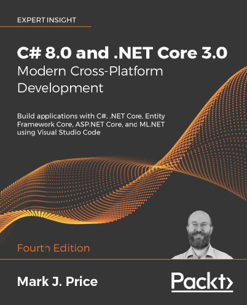
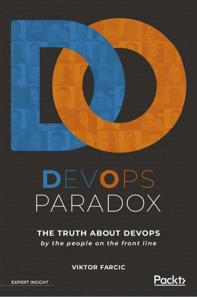

# Những cuốn sách khác có thể bạn sẽ thích

Nếu bạn yêu thích cuốn sách này, có thể bạn sẽ quan tâm đến những cuốn sách khác sau đây của Packt:

**C# 8.0 and .NET Core 3.0 – Modern Cross-Platform Development - Fourth Edition**

Mark J. Price

ISBN: 978-1-78847-812-0

- Xây dựng các application cross-platform cho Windows, macOS, Linux, iOS và Android
- Khám phá việc phát triển application với C# 8.0 và .NET Core 3.0
- Khám phá ASP.NET Core 3.0 và tạo các web application chuyên nghiệp
- Học lập trình object-oriented và multitasking trong C#
- Truy vấn và thao tác dữ liệu bằng LINQ
- Sử dụng Entity Framework Core và làm việc với các relational database
- Khám phá việc phát triển Windows app bằng Universal Windows Platform và XAML
- Xây dựng các mobile application cho iOS và Android bằng Xamarin.Forms

**DevOps Paradox**

Viktor Farcic

ISBN: 978-1-78913-363-9

Ý kiến chuyên gia về:

- Đưa DevOps vào các môi trường kinh doanh thực tế (real-world) đầy hỗn loạn
- Lựa chọn giữa việc áp dụng các công cụ tiên tiến nhất hay kiên trì với những phương pháp tried-and-tested
- Khởi xướng những thay đổi kinh doanh cần thiết khi không có quyền lực chức vị
- Quản lý và vượt qua nỗi sợ thay đổi trong quá trình triển khai DevOps
- Dự đoán các xu hướng tương lai trong DevOps và cách chuẩn bị cho chúng
- Tận dụng tối đa từ Kubernetes, Docker, Puppet, Chef và Ansible
- Tạo ra các động lực thúc đẩy phù hợp để DevOps thành công trong toàn bộ tổ chức
- Tác động của các kỹ thuật mới, chẳng hạn như Lambda, serverless và scheduler, đối với thực hành DevOps

## Để lại đánh giá - cho những độc giả khác biết suy nghĩ của bạn

Xin vui lòng chia sẻ suy nghĩ của bạn về cuốn sách này với những người khác bằng cách để lại đánh giá trên trang web mà bạn đã mua sách. Nếu bạn mua sách từ Amazon, xin vui lòng để lại cho chúng tôi một đánh giá trung thực trên trang Amazon của cuốn sách này. Điều này rất quan trọng để những độc giả tiềm năng khác có thể xem và sử dụng ý kiến khách quan của bạn nhằm đưa ra quyết định mua hàng, chúng tôi có thể hiểu khách hàng nghĩ gì về sản phẩm của mình, và các tác giả của chúng tôi có thể thấy phản hồi của bạn về tác phẩm mà họ đã hợp tác cùng Packt để tạo ra. Việc này sẽ chỉ mất vài phút của bạn, nhưng lại vô cùng quý giá đối với những khách hàng tiềm năng khác, các tác giả của chúng tôi và Packt. Xin cảm ơn bạn!
