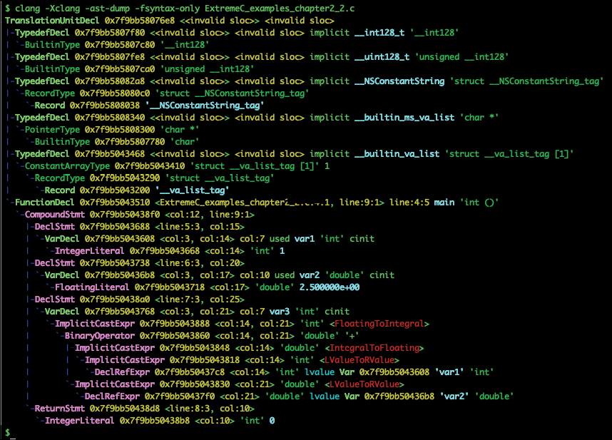

<a id="_idParaDest-40"></a>

# Chương 02: Từ source đến binary (From Source to Binary)

Trong lập trình, mọi thứ đều bắt đầu từ source code. Trên thực tế, *source code*, đôi khi còn được gọi bằng một tên khác là *code base*, thường gồm một số text file. Trong đó, mỗi text file chứa các instruction dạng văn bản được viết bằng một ngôn ngữ lập trình.

Chúng ta biết rằng CPU không thể thực thi các instruction dạng văn bản. Thực tế là những instruction này trước tiên phải được biên dịch (hay dịch) thành các instruction machine-level để CPU có thể thực thi, và rốt cuộc sẽ cho ra một chương trình đang chạy.

Trong chương này, chúng ta đi qua các bước cần thiết để có được một sản phẩm cuối cùng từ source code C. Chương này đi vào chủ đề rất sâu, và vì vậy chúng tôi đã chia nó thành năm phần riêng biệt:

1. **Pipeline biên dịch C chuẩn**: trong phần đầu tiên, chúng ta sẽ trình bày quá trình biên dịch C chuẩn, các bước khác nhau trong pipeline, và cách chúng góp phần tạo ra sản phẩm cuối cùng từ source code C.
2. **Preprocessor**: trong phần này, chúng ta sẽ nói sâu hơn về thành phần preprocessor, thành phần điều khiển bước tiền xử lý.
3. **Compiler**: trong phần này, chúng ta sẽ xem xét sâu hơn về compiler. Chúng ta sẽ giải thích cách compiler, thành phần điều khiển bước biên dịch, tạo ra các *intermediate representation* từ source code rồi dịch chúng sang assembly language.
4. **Assembler**: sau compiler, chúng ta cũng nói về *assembler*, thành phần đóng vai trò quan trọng trong việc dịch các instruction assembly nhận được từ compiler thành các instruction machine-level. Thành phần assembler điều khiển bước assemble.

1. **Linker**: trong phần cuối cùng, chúng ta sẽ thảo luận sâu hơn về thành phần *linker*, thành phần điều khiển bước link. Linker là một thành phần build cuối cùng tạo ra các sản phẩm thực sự của một dự án C. Có những lỗi build riêng của thành phần này, và kiến thức đầy đủ về linker sẽ giúp chúng ta ngăn ngừa và giải quyết chúng. Chúng ta cũng thảo luận về các sản phẩm cuối cùng khác nhau của một dự án C, và chúng ta sẽ đưa ra một vài gợi ý về việc disassemble một object file và đọc nội dung của nó. Hơn thế nữa, chúng ta thảo luận ngắn gọn về *C++ name mangling* là gì và nó ngăn chặn một số khiếm khuyết nhất định trong bước link khi build code C++ như thế nào.

Các thảo luận của chúng ta trong chương này chủ yếu xoay quanh các hệ thống Unix-like, nhưng chúng ta cũng thảo luận một số khác biệt ở các hệ điều hành khác, chẳng hạn Microsoft Windows.

Trong phần đầu tiên, chúng ta cần giải thích pipeline biên dịch C. Điều sống còn là phải biết pipeline tạo ra các file executable và library từ source code như thế nào. Mặc dù có nhiều khái niệm và bước liên quan, việc hiểu chúng một cách thấu đáo là điều sống còn nếu chúng ta muốn sẵn sàng cho nội dung của cả chương này lẫn các chương sau. Lưu ý rằng các sản phẩm khác nhau của một dự án C được thảo luận kỹ lưỡng trong chương tiếp theo, *Object File*.

<a id="_idParaDest-41"></a>

## Pipeline biên dịch

Việc biên dịch một số file C<a id="_idIndexMarker110"></a> thường mất vài giây, nhưng trong khoảng thời gian ngắn ngủi đó, source code đi vào một pipeline có bốn thành phần riêng biệt, mỗi thành phần<a id="_idIndexMarker111"></a> làm một nhiệm vụ nhất định. Các thành phần <a id="_idIndexMarker112"></a>này như sau:

- Preprocessor
- Compiler
- Assembler
- Linker

Mỗi thành phần trong <a id="_idIndexMarker113"></a>pipeline này nhận một input nhất định từ thành phần trước đó và tạo ra một output nhất định cho thành phần tiếp theo trong pipeline. Quá trình này tiếp diễn qua pipeline cho đến khi thành phần cuối cùng sinh ra một *sản phẩm*.

Source code có thể được biến thành một sản phẩm khi và chỉ khi nó đi qua tất cả các thành phần cần thiết một cách <a id="_idIndexMarker114"></a>thành công. Điều này có nghĩa là ngay cả một thất bại nhỏ ở một trong các thành phần <a id="_idIndexMarker115"></a>cũng có thể dẫn đến một lỗi *biên dịch* hay *link*, khiến bạn nhận được các thông báo lỗi liên quan.

Với một số sản phẩm trung gian <a id="_idIndexMarker116"></a>nhất định như *relocatable object file*, chỉ cần một source file duy nhất đi qua<a id="_idIndexMarker117"></a> ba thành phần đầu tiên một cách thành công là đủ. Thành phần cuối cùng, *linker*, thường được dùng để tạo ra các sản phẩm lớn hơn, chẳng hạn một *executable object file*, bằng cách hợp nhất <a id="_idIndexMarker118"></a>một số relocatable object file đã được chuẩn bị sẵn. Vì vậy, việc build một tập hợp source file C có thể tạo ra một hoặc đôi khi nhiều object file, bao gồm relocatable, executable <a id="_idIndexMarker119"></a>và *shared object file*.

Hiện có rất nhiều<a id="_idIndexMarker120"></a> compiler C. Trong khi một số miễn phí và mã nguồn mở, những cái khác là độc quyền và thương mại. Tương tự, một số compiler chỉ hoạt động trên một nền tảng cụ thể trong khi những cái khác là cross-platform; tuy nhiên, lưu ý quan trọng là gần như mọi nền tảng đều có ít nhất một compiler C tương thích.

> **Lưu ý**:
>
> Để có danh sách đầy đủ các<a id="_idIndexMarker121"></a> compiler C hiện có, hãy xem trang Wikipedia sau: [https://en.wikipedia.org/wiki/List_of_compilers#C_compilers](https://en.wikipedia.org/wiki/List_of_compilers#C_compilers%20).

Trước khi nói về nền tảng mặc định và compiler C mà chúng ta dùng xuyên suốt chương này, hãy nói thêm một chút <a id="_idIndexMarker122"></a>về thuật ngữ *platform* (nền tảng), và ý chúng ta muốn nói gì với nó.

Một platform là sự kết hợp của một hệ điều hành chạy trên một phần cứng cụ thể (hay architecture), và *instruction set* của CPU là phần quan trọng nhất của nó. Hệ điều hành là thành phần phần mềm của một platform, còn architecture định nghĩa phần phần cứng. Ví dụ, chúng ta có thể có Ubuntu chạy trên một board ARM-powered, hoặc chúng ta có thể có Microsoft Windows chạy trên một CPU AMD 64-bit.

Phần mềm Cross-platform<a id="_idIndexMarker123"></a> có thể chạy trên các platform khác nhau. Tuy nhiên, điều sống còn là phải biết rằng *cross-platform* khác với *portable*. Phần mềm Cross-platform thường có binary (object file cuối cùng) và bộ cài đặt khác nhau cho mỗi platform, trong khi phần mềm portable dùng cùng binary và bộ cài đặt đã tạo ra trên mọi platform.

Một số compiler C, ví dụ `gcc` và `clang`, là cross-platform – chúng có thể sinh code cho các platform khác nhau – còn Java bytecode thì portable.

Đối với C và C++, nếu chúng ta nói code C/C++ là portable, ý chúng ta là có thể biên dịch nó cho các platform khác nhau mà không cần thay đổi gì hoặc chỉ cần sửa đổi chút ít source code. Tuy nhiên, điều này không có nghĩa là các object file cuối cùng là portable.

Nếu bạn đã xem bài viết Wikipedia mà chúng ta nhắc đến ở trên, bạn có thể thấy rằng có vô số compiler C. May mắn cho chúng ta, tất cả chúng đều tuân theo cùng một pipeline biên dịch chuẩn mà chúng ta sẽ giới thiệu trong chương này.

Trong số rất nhiều compiler này, chúng ta cần chọn một để làm việc trong chương này. Xuyên suốt chương này, chúng ta sẽ dùng `gcc` 7.3.0 làm compiler mặc định. Chúng ta chọn `gcc` vì nó có sẵn trên hầu hết các hệ điều hành, ngoài ra còn có rất nhiều tài nguyên trực tuyến về nó.

Chúng ta cũng cần chọn <a id="_idIndexMarker124"></a>platform mặc định. Trong chương này, chúng ta đã chọn Ubuntu 18.04 làm hệ điều hành mặc định chạy trên một CPU AMD 64-bit làm architecture mặc định.

> **Lưu ý**:
>
> Thỉnh thoảng chương này có thể nhắc đến một compiler khác, một hệ điều hành khác hoặc một architecture khác để so sánh các platform và compiler khác nhau. Nếu chúng ta làm vậy, đặc tả của platform mới hay compiler mới sẽ được cho trước.

Trong các phần sau, chúng ta sẽ mô tả các bước trong pipeline biên dịch. Trước tiên, chúng ta sẽ build một ví dụ đơn giản để xem các source bên trong một dự án C được biên dịch và link như thế nào. Thông qua ví dụ này, chúng ta sẽ làm quen với các thuật ngữ và khái niệm mới liên quan đến quá trình biên dịch. Chỉ sau đó chúng ta mới đề cập đến từng thành phần riêng lẻ trong một phần riêng. Ở đó, chúng ta đi sâu vào từng thành phần để giải thích thêm các khái niệm và quá trình bên trong.

<a id="_idParaDest-42"></a>

### Build một dự án C

Trong phần này, chúng ta sẽ<a id="_idIndexMarker125"></a> minh họa cách một dự án C được build. Dự án mà chúng ta sẽ làm việc gồm nhiều hơn một source file, đây là một đặc điểm chung của gần như mọi dự án C. Tuy nhiên, trước khi chuyển sang ví dụ và bắt đầu build nó, chúng ta cần đảm bảo rằng mình hiểu cấu trúc của một dự án C điển hình.

<a id="_idParaDest-43"></a>

#### Header file so với source file

Mọi dự án C đều có<a id="_idIndexMarker126"></a> source code, hay code base, cùng với các tài liệu khác liên quan đến mô tả dự án và các tiêu chuẩn hiện có. Trong một<a id="_idIndexMarker127"></a> code base C, chúng ta thường có hai loại file chứa code C:

- **Header file**, thường có phần mở rộng `.h` trong tên.
- **Source file**, có phần mở rộng `.c`.

> **Lưu ý**:
>
> Để thuận tiện, trong chương này, chúng ta có thể dùng thuật ngữ *header* thay cho *header file* và *source* thay cho *source file*.

Một header file thường chứa các enumeration, macro và typedef, cũng như các *declaration* (khai báo) của<a id="_idIndexMarker128"></a> hàm, biến global và structure. Trong C, một số<a id="_idIndexMarker129"></a> thành phần lập trình như hàm, biến và structure có thể có declaration tách khỏi *definition* (định nghĩa) của chúng và được đặt trong các file khác nhau.

C++ cũng theo cùng khuôn mẫu đó, nhưng ở các ngôn ngữ lập trình khác, chẳng hạn Java, các thành phần được định nghĩa ngay tại nơi chúng được khai báo. Mặc dù đây là một tính năng tuyệt vời của cả C và C++, vì nó cho chúng sức mạnh tách declaration khỏi definition, nó cũng làm cho source code phức tạp hơn.

Theo quy tắc kinh nghiệm, các declaration được lưu trong header file, và các definition tương ứng đi vào source file. Điều này càng then chốt hơn đối với declaration hàm và definition hàm.

Bạn được khuyến nghị mạnh mẽ chỉ giữ declaration hàm trong header file và chuyển definition hàm sang các source file tương ứng. Mặc dù điều này không bắt buộc, nó là một thực hành thiết kế quan trọng để giữ các definition hàm ra khỏi header file.

Mặc dù structure cũng có thể có declaration và definition tách biệt, có những trường hợp đặc biệt mà chúng ta chuyển declaration và definition sang các file khác nhau. Chúng ta sẽ thấy một ví dụ về điều này trong *Chương 8*, *Inheritance và Polymorphism*, nơi chúng ta sẽ thảo luận về quan hệ *inheritance* giữa các class.

> **Lưu ý**:
>
> Header file có thể include<a id="_idIndexMarker130"></a> các header file khác, nhưng không bao giờ include một source file. Source file chỉ có thể include header file. Để một source file include một source file khác là một thực hành tồi. Nếu bạn làm vậy, điều này thường có nghĩa là bạn có một vấn đề thiết kế nghiêm trọng trong dự án của mình.

Để giải thích thêm về điều này, chúng ta sẽ<a id="_idIndexMarker131"></a> xem một ví dụ. Code sau đây là declaration của hàm `average`. Một declaration hàm gồm một *return type* (kiểu trả về) và một *function signature*. Một function signature<a id="_idIndexMarker132"></a> đơn giản là tên của hàm cùng với danh sách các tham số đầu vào của nó:

```
double average(int*, int);
```

*Code Box 2-1: Declaration của hàm average*

Declaration giới thiệu một function signature có tên là `average`, nhận một pointer tới một mảng số nguyên cùng với một argument số nguyên thứ hai, cho biết<a id="_idIndexMarker133"></a> số phần tử trong mảng. Declaration cũng nói rằng hàm trả về một giá trị double. Lưu ý rằng return type là một phần của declaration nhưng thường không được coi là một phần của function signature.

Như bạn có thể thấy<a id="_idIndexMarker134"></a> trong *Code Box 2-1*, một declaration hàm kết thúc bằng dấu chấm phẩy ";" và nó không có *body* (thân) được bao bởi dấu ngoặc nhọn. Chúng ta cũng nên lưu ý rằng các tham số trong declaration hàm không có tên đi kèm, và điều này hợp lệ trong C, nhưng chỉ trong declaration chứ không phải trong definition. Dù vậy, bạn được khuyến nghị đặt tên cho tham số ngay cả trong declaration.

Declaration hàm nói về cách dùng hàm, còn definition định nghĩa hàm đó được hiện thực như thế nào. Người dùng không cần biết tên tham số để dùng hàm, và vì vậy có thể ẩn chúng trong declaration hàm.

Trong code sau, bạn có thể thấy <a id="_idIndexMarker135"></a>definition của hàm `average` mà chúng ta đã khai báo ở trên. Một definition hàm chứa code C thực sự biểu diễn logic của hàm. Nó luôn có một thân code được bao bởi một cặp dấu ngoặc nhọn:

```
double average(int* array, int length) {
  if (length <= 0) {
    return 0;
  }
  double sum = 0.0;
  for (int i = 0; i < length; i++) {
    sum += array[i];
  }
  return sum / length;
}
```

*Code Box 2-2: Definition của hàm average*

Như chúng ta đã nói ở trên, và để nhấn mạnh thêm, declaration hàm đi vào header, còn definition (hay phần thân) đi vào source file. Có những trường hợp hiếm hoi mà chúng ta có đủ lý do để vi phạm điều này. Ngoài ra, source cần include header file để thấy và dùng các declaration, đó là cách C và C++ hoạt động.

Nếu bạn chưa hiểu hết điều này lúc này, đừng lo vì nó sẽ trở nên rõ ràng hơn khi chúng ta tiến<a id="_idIndexMarker136"></a> lên.

> **Lưu ý**:
>
> Có nhiều hơn một definition cho bất kỳ<a id="_idIndexMarker137"></a> declaration nào trong một *translation unit* sẽ dẫn đến một *lỗi biên dịch*. Điều này đúng với mọi hàm, structure và biến global. Do đó, việc cung cấp<a id="_idIndexMarker138"></a> hai definition cho một declaration hàm duy nhất là không được phép.

Chúng ta sẽ<a id="_idIndexMarker139"></a> tiếp tục thảo luận này bằng cách giới thiệu ví dụ C đầu tiên của chương. Ví dụ này nhằm minh họa cách đúng để biên dịch một dự án C/C++ gồm nhiều hơn một source file.

<a id="_idParaDest-44"></a>

#### Các source file ví dụ

Trong *ví dụ 2.1*, chúng ta có<a id="_idIndexMarker140"></a> ba file, một là header file, và hai file kia là source file, và tất cả đều nằm trong cùng một thư mục. Ví dụ muốn tính trung bình của một mảng có năm phần tử.

Header file được dùng như một cây cầu giữa hai source file riêng biệt và giúp có thể viết code trong hai file riêng biệt nhưng build chúng cùng nhau. Không có header file, không thể chia code thành hai source file mà không vi phạm quy tắc đã nhắc ở trên (source không được include source). Ở đây, header file chứa mọi thứ mà một trong hai source cần để dùng chức năng của source kia.

Header file chỉ chứa một declaration hàm, `avg`, cần thiết để chương trình hoạt động. Một trong các source file chứa definition của hàm đã khai báo. Source file kia chứa hàm `main`, là entry point của chương trình. Không có hàm `main`, không thể có một binary executable để chạy chương trình. Hàm `main` được compiler nhận biết là điểm bắt đầu của chương trình.

Giờ chúng ta sẽ đi tiếp và xem nội dung của những file này là gì. Đây là header file, chứa một enumeration và một declaration cho hàm `avg`:

```
#ifndef EXTREMEC_EXAMPLES_CHAPTER_2_1_H
#define EXTREMEC_EXAMPLES_CHAPTER_2_1_Htypedef enum {
  NONE,
  NORMAL,
  SQUARED
} average_type_t;
// Function declaration
double avg(int*, int, average_type_t);
#endif
```

*Code Box 2-3 [ExtremeC_examples_chapter2_1.h]: Header file thuộc ví dụ 2.1*

Như bạn có thể thấy, file này chứa một enumeration, một tập hợp các hằng số nguyên có tên. Trong C, enumeration không thể có declaration và definition tách biệt, và chúng phải được khai báo và định nghĩa chỉ một lần ở cùng một chỗ.

Ngoài<a id="_idIndexMarker141"></a> enumeration, *forward declaration* của hàm avg có thể được thấy trong code box. Hành động khai báo một hàm trước khi đưa ra definition của nó được gọi là forward declaration. Header file cũng được bảo vệ bởi các câu lệnh *header guard*. Chúng sẽ ngăn header file bị include hai lần hoặc nhiều hơn trong khi được biên dịch.

Code sau cho chúng ta thấy source file thực sự chứa definition của hàm `avg`:

```
#include "ExtremeC_examples_chapter2_1.h"
double avg(int* array, int length, average_type_t type) {
  if (length <= 0 || type == NONE) {
    return 0;
  }
  double sum = 0.0;
  for (int i = 0; i < length; i++) {
    if (type == NORMAL) {
      sum += array[i];
    } else if (type == SQUARED) {
      sum += array[i] * array[i];
    }
  }
  return sum / length;
}
```

*Code Box 2-4 [ExtremeC_examples_chapter2_1.c]: Source file chứa definition của hàm avg*

Với code trên, bạn nên để ý rằng tên file kết thúc bằng phần mở rộng `.c`. Source file đã include header file của ví dụ. Việc này được làm vì nó cần các declaration của enumeration `average_type_t` và hàm `avg` trước khi dùng chúng. Dùng một kiểu mới, trong trường hợp này là enumeration `average_type_t`, mà không khai báo nó trước khi dùng sẽ dẫn đến một lỗi biên dịch.

Hãy xem<a id="_idIndexMarker142"></a> code box sau thể hiện source file thứ hai chứa hàm `main`:

```
#include <stdio.h>
#include "ExtremeC_examples_chapter2_1.h"
int main(int argc, char** argv) {
  // Array declaration
  int array[5];
  // Filling the array
  array[0] = 10;
  array[1] = 3;
  array[2] = 5;
  array[3] = -8;
  array[4] = 9;
  // Calculating the averages using the 'avg' function
  double average = avg(array, 5, NORMAL);
  printf("The average: %f\n", average);
  average = avg(array, 5, SQUARED);
  printf("The squared average: %f\n", average);
  return 0;
}
```

*Code Box 2-5 [ExtremeC_examples_chapter2_1_main.c]: Hàm main của ví dụ 2.1*

Trong mọi dự án C, hàm `main` là entry point của chương trình. Trong code box trên, hàm `main` khai báo và lấp đầy một mảng số nguyên và tính hai giá trị trung bình khác nhau cho nó. Hãy chú ý cách hàm `main` gọi hàm avg trong code trên.

<a id="_idParaDest-45"></a>

#### Build ví dụ

Sau<a id="_idIndexMarker143"></a> khi giới thiệu các file của *ví dụ 2.1* ở phần trước, chúng ta cần build chúng và tạo một file binary executable cuối cùng có thể chạy như một chương trình.Build một dự án C/C++ có nghĩa là chúng ta sẽ biên dịch mọi source bên trong code base của nó để trước tiên tạo ra một số *relocatable object file* (còn được gọi là *intermediate object file*), và<a id="_idIndexMarker144"></a> cuối cùng kết hợp<a id="_idIndexMarker145"></a> những relocatable object file đó để<a id="_idIndexMarker146"></a> tạo ra các sản phẩm cuối cùng, như *static library* hay *executable binary*.

Build một dự án ở các ngôn ngữ lập trình khác cũng rất giống với làm điều đó trong C hay C++, nhưng các sản phẩm trung gian và cuối cùng có tên khác và có lẽ định dạng file khác. Ví dụ, trong Java, các sản phẩm trung gian là các class file chứa *Java bytecode*, và các sản phẩm cuối cùng là file JAR hay WAR.

> **Lưu ý**:
>
> Để biên dịch các source ví dụ, chúng ta sẽ <a id="_idIndexMarker147"></a>không dùng một **Integrated Development Environment** (**IDE**). Thay vào đó, chúng ta sẽ dùng compiler trực tiếp mà không cần trợ giúp từ bất kỳ phần mềm nào khác. Cách tiếp cận của chúng ta để build ví dụ hoàn toàn giống cách các IDE áp dụng và thực hiện ở hậu trường khi biên dịch một số source file.

Trước khi chúng ta đi <a id="_idIndexMarker148"></a>xa hơn, có hai quy tắc quan trọng mà chúng ta nên nhớ.

**Quy tắc 1: Chúng ta chỉ biên dịch source file**

Quy tắc thứ nhất là <a id="_idIndexMarker149"></a>chúng ta chỉ biên dịch source file vì biên dịch một header file là vô nghĩa. Header file không nên chứa bất kỳ code C thực sự nào ngoài một số declaration. Do đó, với *ví dụ 2.1*, chúng ta chỉ cần biên dịch hai source file: `ExtremeC_examples_chapter2_1.c` và `ExtremeC_examples_chapter2_1_main.c`.

**Quy tắc 2: Chúng ta biên dịch từng source file riêng biệt**

Quy tắc thứ hai là chúng ta biên dịch từng source file riêng biệt. Đối với *ví dụ 2.1*, điều đó có nghĩa là chúng ta phải chạy compiler hai lần, mỗi lần truyền vào một trong các source file.

> **Lưu ý**:
>
> Vẫn có thể truyền hai source file cùng lúc và yêu cầu compiler biên dịch chúng chỉ trong một lệnh, nhưng chúng tôi không khuyến nghị và chúng tôi không làm vậy trong cuốn sách này.

Do đó, với một dự án gồm 100 source file, chúng ta cần biên dịch từng source file riêng biệt, và điều đó có nghĩa là chúng ta phải chạy compiler 100 lần! Vâng, có vẻ là nhiều, nhưng đây là cách bạn nên biên dịch một dự án C hay C++. Tin tôi đi, bạn sẽ gặp những dự án trong đó vài nghìn file phải được biên dịch trước khi có được một binary executable duy nhất!

> **Lưu ý**:
>
> Nếu một header file chứa một đoạn code C cần được biên dịch, chúng ta không biên dịch header file đó. Thay vào đó, chúng ta include nó vào một source file, rồi biên dịch source file. Bằng cách này, code C của header sẽ được biên dịch như một phần của source file.

Khi chúng ta <a id="_idIndexMarker150"></a>biên dịch một source file, không có source file nào khác được biên dịch như một phần của cùng lần biên dịch đó vì không có cái nào được source file đang biên dịch include. Hãy nhớ, việc include source file là không được phép nếu chúng ta tôn trọng các best practice trong C/C++.

Giờ hãy tập trung vào các bước cần thực hiện để build một dự án C. Bước đầu tiên là tiền xử lý, và chúng ta sẽ nói về nó trong phần sau.

<a id="_idParaDest-46"></a>

### Bước 1 – Tiền xử lý (preprocessing)

Bước đầu tiên trong pipeline biên<a id="_idIndexMarker151"></a> dịch C là *preprocessing* (tiền xử lý). Một source file có include một số header file. Tuy nhiên, trước khi quá trình biên dịch bắt đầu, nội dung của những file này được preprocessor gom lại thành một khối code C duy nhất. Nói cách khác, sau bước tiền xử lý, chúng ta có một đoạn code duy nhất được tạo ra bằng cách sao chép nội dung của các header file vào nội dung source file.

Ngoài ra, các *preprocessor directive* khác phải được phân giải trong bước này. Đoạn code đã tiền xử lý này được gọi là một *translation unit*. Một translation <a id="_idIndexMarker152"></a>unit là một đơn vị logic duy nhất của code C được preprocessor sinh ra, và nó sẵn sàng để được biên dịch. Một translation unit đôi khi<a id="_idIndexMarker153"></a> còn được gọi là một *compilation unit*.

> **Lưu ý**:
>
> Trong một translation unit, không thể tìm thấy preprocessing directive nào. Để nhắc lại, mọi preprocessing directive trong C (và C++) đều bắt đầu bằng `#`, ví dụ `#include` và `#define`.

Có thể yêu cầu compiler dump translation unit mà không biên dịch thêm. Trong trường hợp của `gcc`, chỉ cần truyền tùy chọn `-E` (tùy chọn này case-sensitive). Trong một số trường hợp hiếm hoi, đặc biệt khi phát triển cross-platform, việc xem xét các translation unit có thể hữu ích khi sửa những vấn đề kỳ lạ.

Trong code sau, bạn có thể thấy translation unit cho `ExtremeC_examples_chapter2_1.c`, được `gcc` sinh ra trên platform mặc định của chúng ta:

```
$ gcc -E ExtremeC_examples_chapter2_1.c
# 1 "ExtremeC_examples_chapter2_1.c"
# 1 "<built-in>"
# 1 "<command-line>"
# 31 "<command-line>"
# 1 "/usr/include/stdc-predef.h" 1 3 4
# 32 "<command-line>" 2
# 1 "ExtremeC_examples_chapter2_1.c"
# 1 "ExtremeC_examples_chapter2_1.h" 1
typedef enum {
  NONE,
  NORMAL,
  SQUARED
} average_type_t;
double avg(int*, int, average_type_t);
# 5 "ExtremeC_examples_chapter2_1.c" 2
double avg(int* array, int length, average_type_t type) {
  if (length <= 0 || type == NONE) {
    return 0;
  }
  double sum = 0;
  for (int i = 0; i < length; i++) {
    if (type == NORMAL) {
      sum += array[i];
    } else if (type == SQUARED) {
      sum += array[i] * array[i];
    }
  }
  return sum / length;
}
$
```

*Shell Box 2-1: Translation unit được tạo ra khi biên dịch ExtremeC_examples_chapter2_1.c*

Như bạn có thể thấy, mọi declaration đều được sao chép từ header file vào translation unit. Các comment cũng đã bị loại bỏ khỏi translation unit.

Translation<a id="_idIndexMarker155"></a> unit cho `ExtremeC_examples_chapter2_1_main.c` rất lớn vì nó include header file `stdio.h`.

Mọi declaration từ header file này, và các header file bên trong khác mà nó include, sẽ được sao chép vào translation unit một cách đệ quy. Chỉ để cho thấy translation unit của `ExtremeC_examples_chapter2_1_main.c` có thể lớn đến mức nào, trên platform mặc định của chúng ta nó có 836 dòng code C!

> **Lưu ý**:
>
> Tùy chọn `-E` cũng hoạt động với compiler `clang`.

Điều này hoàn tất bước đầu tiên. Input của bước tiền xử lý là một source file, và output là translation unit tương ứng.

<a id="_idParaDest-47"></a>

### Bước 2 – Biên dịch (compilation)

Một khi bạn có translation<a id="_idIndexMarker156"></a> unit, bạn có thể đi tới bước thứ hai, là *compilation* (biên dịch). Input của bước biên dịch là translation unit, lấy được từ bước trước, và output là *assembly code* tương ứng. Assembly code này vẫn human-readable, nhưng nó machine-dependent, gần với phần cứng và vẫn cần xử lý thêm để trở thành các instruction machine-level.

Bạn luôn có thể yêu cầu `gcc` dừng lại sau khi thực hiện bước thứ hai và dump assembly code thu được bằng cách truyền tùy chọn `-S` (chữ S viết hoa). Output là một file có cùng tên với source file đã cho nhưng với phần mở rộng `.s`.

Trong shell box sau, bạn có thể thấy assembly của source file `ExtremeC_examples_chapter2_1_main.c`. Tuy nhiên, khi đọc code, bạn nên thấy rằng một số phần của output đã bị loại bỏ:

```
$ gcc -S ExtremeC_examples_chapter2_1.c
$ cat ExtremeC_examples_chapter2_1.s
    .file   "ExtremeC_examples_chapter2_1.c"
    .text
    .globl  avg
    .type   avg, @function
avg:
.LFB0:
    .cfi_startproc
    pushq   %rbp
    .cfi_def_cfa_offset 16
    .cfi_offset 6, -16
    movq    %rsp, %rbp
    .cfi_def_cfa_register 6
    movq    %rdi, -24(%rbp)
    movl    %esi, -28(%rbp)
    movl    %edx, -32(%rbp)
    cmpl    $0, -28(%rbp)
    jle .L2
    cmpl    $0, -32(%rbp)
    jne .L3
.L2:
    pxor    %xmm0, %xmm0
    jmp .L4
.L3:
    ...
.L8:
    ...
.L6:
    ...
.L7:
    ...
.L5:
  ...
.L4:
  ...
.LFE0:
    .size   avg, .-avg
    .ident  "GCC: (Ubuntu 7.3.0-16ubuntu3) 7.3.0"
    .section    .note.GNU-stack,"",@progbits
$
```

*Shell Box 2-2: Assembly code được tạo ra khi biên dịch ExtremeC_examples_chapter2_1.c*

Như một phần của bước biên dịch, compiler phân tích cú pháp translation unit và biến nó thành assembly code riêng cho<a id="_idIndexMarker158"></a> *target architecture*. Với target architecture, chúng ta muốn nói đến phần cứng hay CPU mà chương trình đang được biên dịch cho nó và rốt cuộc sẽ<a id="_idIndexMarker159"></a> chạy trên đó. Target architecture đôi khi được gọi là *host architecture*.

*Shell Box 2-2* thể hiện assembly code được sinh ra cho architecture AMD 64-bit và được tạo bởi `gcc` chạy trên một máy AMD 64-bit. Shell box sau chứa assembly<a id="_idIndexMarker160"></a> code được sinh ra cho một architecture ARM 32-bit và được tạo bởi `gcc` chạy trên một architecture Intel x86-64. Cả hai output assembly đều được sinh ra cho cùng một code C:

```
$ cat ExtremeC_examples_chapter2_1.s
    .arch armv5t
    .fpu softvfp
    .eabi_attribute 20, 1
    .eabi_attribute 21, 1
    .eabi_attribute 23, 3
    .eabi_attribute 24, 1
    .eabi_attribute 25, 1
    .eabi_attribute 26, 2
    .eabi_attribute 30, 6
    .eabi_attribute 34, 0
    .eabi_attribute 18, 4
    .file	"ExtremeC_examples_chapter2_1.s"
    .global    __aeabi_i2d
    .global    __aeabi_dadd
    .global    __aeabi_ddiv
    .text
    .align	2
    .global    avg
    .syntax unified
    .arm
    .type  avg, %function
avg:
    @ args = 0, pretend = 0, frame = 32
    @ frame_needed = 1, uses_anonymous_args = 0
    push    {r4, fp, lr}
    add    fp, sp, #8
    sub    sp, sp, #36
    str    r0, [fp, #-32]
    str    r1, [fp, #-36]
    str    r2, [fp, #-40]
    ldr    r3, [fp, #-36]
    cmp    r3, #0
    ble    .L2
    ldr    r3, [fp, #-40]
    cmp    r3, #0
    bne    .L3
.L2:
    ...
.L3:
    ...
.L8:
    ...
.L6:
    ...
.L7:
    ...
.L5:
    ...
.L4:
    mov	r0, r3
    mov	r1, r4
    sub	sp, fp, #8
    @ sp needed
    pop	{r4, fp, pc}
    .size	avg, .-avg
    .ident	"GCC: (Ubuntu/Linaro 5.4.0-6ubuntu1~16.04.9) 5.4.0 20160609"
    .section    .note.GNU-stack,"",%progbits
$
```

*Shell Box 2-3: Assembly code được tạo ra khi biên dịch ExtremeC_examples_chapter2_1.c cho một architecture ARM 32-bit*

Như bạn có thể thấy trong các shell box *2-2* và *2-3*, assembly code được sinh ra là khác nhau với hai<a id="_idIndexMarker161"></a> architecture. Điều này xảy ra mặc dù chúng được sinh ra cho cùng một code C. Với assembly code thứ hai, chúng ta đã dùng compiler `arm-linux-gnueabi-gcc` trên một bộ phần cứng Intel x64-86 chạy Ubuntu 16.04.

> **Lưu ý**:
>
> Target (hay host) architecture là architecture mà source vừa được biên dịch cho nó vừa sẽ chạy trên nó. *Build architecture* là architecture mà chúng ta đang dùng để biên dịch source. Chúng có thể khác nhau. Ví dụ, bạn có thể biên dịch một source C cho phần cứng AMD 64-bit trên một máy ARM 32-bit.

Việc tạo ra assembly code từ code C là bước quan trọng nhất trong pipeline biên dịch.

Đó là vì khi bạn có assembly code, bạn đã ở rất gần với ngôn ngữ mà một CPU<a id="_idIndexMarker162"></a> có thể thực thi. Vì vai trò quan trọng này, compiler là một trong những chủ đề quan trọng nhất và được nghiên cứu nhiều nhất trong khoa học máy tính.

<a id="_idParaDest-48"></a>

### Bước 3 – Assemble (assembly)

Bước tiếp theo sau<a id="_idIndexMarker163"></a> biên dịch là *assembly*. Mục tiêu ở đây là sinh ra các instruction machine-level thực sự (hay *machine code*) dựa trên assembly code mà compiler đã sinh ra ở bước trước. Mỗi architecture có *assembler* riêng của nó, có thể dịch assembly code của riêng nó thành machine code của riêng nó.

Một file chứa các instruction machine-level<a id="_idIndexMarker164"></a> mà chúng ta sẽ assemble trong phần này được gọi là một *object file*. Chúng ta biết rằng một dự án C có thể có vài sản phẩm đều là object file, nhưng trong phần này, chúng ta chủ yếu quan tâm đến relocatable object file. File này, không nghi ngờ gì, là sản phẩm tạm thời quan trọng nhất mà chúng ta có thể có được trong quá trình build.

> **Lưu ý**:
>
> Relocatable object file có thể được gọi là intermediate object file.

Để gắn kết cả hai bước trước lại với nhau, mục đích của bước assemble này là sinh ra một relocatable object file từ assembly code do compiler tạo ra. Mọi sản phẩm khác mà chúng ta tạo ra đều sẽ dựa trên các relocatable object file do assembler sinh ra ở bước này.

Chúng ta sẽ nói về những sản phẩm khác này trong các phần sau của chương này.

> **Lưu ý**:
>
> *Binary file* và *object file* là <a id="_idIndexMarker165"></a>từ đồng nghĩa chỉ một file chứa các instruction machine-level. Tuy nhiên, lưu ý<a id="_idIndexMarker166"></a> rằng thuật ngữ "binary file" trong các ngữ cảnh khác có thể có nghĩa khác, ví dụ binary file so với text file.

Trong hầu hết các hệ điều hành Unix-like, chúng ta có một công cụ assembler gọi là `as`, có thể được dùng để tạo một relocatable object file từ một assembly file.

Tuy nhiên, những object file này không executable, và chúng chỉ chứa các instruction machine-level được sinh ra cho một translation unit. Vì mỗi translation unit được tạo nên từ nhiều hàm và biến global khác nhau, một relocatable object file đơn giản chỉ chứa các instruction machine-level cho các hàm tương ứng và các mục pre-allocated cho các biến global.

Trong shell box sau<a id="_idIndexMarker167"></a>, bạn có thể thấy cách `as` được dùng để tạo relocatable object file cho `ExtremeC_examples_chapter2_1_main.s`:

```
$ as ExtremeC_examples_chapter2_1.s -o ExtremeC_examples_chapter2_1.o
$
```

*Shell Box 2-4: Tạo một object file từ assembly của một trong các source trong ví dụ 2.1*

Nhìn lại lệnh trong shell box trên, chúng ta có thể thấy rằng tùy chọn `-o` được dùng để chỉ định tên của object file đầu ra. Relocatable object file thường có phần mở rộng `.o` (hoặc `.obj` trong Microsoft Windows) trong tên, đó là lý do chúng ta đã truyền một tên file có `.o` ở cuối.

Nội dung của một object file, dù là `.o` hay `.obj`, không phải dạng văn bản, vì vậy con người sẽ không thể đọc nó. Do đó, người ta thường<a id="_idIndexMarker168"></a> nói rằng một object file có *nội dung binary*.

Mặc dù assembler có thể được dùng trực tiếp, như những gì chúng ta đã làm trong *Shell Box 2-4*, điều này không được khuyến nghị. Thay vào đó, thực hành tốt là dùng chính compiler để gọi `as` một cách gián tiếp để sinh ra relocatable object file.

> **Lưu ý**:
>
> Chúng ta có thể dùng thuật ngữ *object file* và *relocatable object file* thay thế cho nhau. Nhưng không phải object file nào cũng là relocatable object file, và trong một số ngữ cảnh, nó có thể chỉ các loại object file khác như shared object file.

Nếu bạn truyền tùy chọn `-c` cho gần như mọi compiler C được biết đến, nó sẽ trực tiếp sinh ra object file tương ứng cho source file đầu vào. Nói cách khác, tùy chọn `-c` tương đương với việc thực hiện cả ba bước đầu tiên cùng nhau.

Nhìn vào ví dụ sau, bạn có thể thấy rằng chúng ta đã dùng tùy chọn `-c` để biên dịch `ExtremeC_examples_chapter2_1.c` và sinh ra object file tương ứng của nó:

```
$ gcc -c ExtremeC_examples_chapter2_1.c
$
```

*Shell Box 2-5: Biên dịch một trong các source trong ví dụ 2.1 và tạo ra relocatable object file tương ứng của nó*

Tất cả các bước chúng ta vừa làm – tiền xử lý, biên dịch và assemble – đều được thực hiện như một phần của lệnh duy nhất ở trên. Điều này có nghĩa với chúng ta là sau khi chạy lệnh trên, một relocatable object file sẽ được sinh ra. Relocatable object<a id="_idIndexMarker169"></a> file này sẽ có cùng tên với source file đầu vào; tuy nhiên, nó sẽ khác ở chỗ có phần mở rộng `.o`.

> **QUAN TRỌNG**:
>
> Lưu ý rằng thuật ngữ *compilation* (biên dịch) thường được dùng để<a id="_idIndexMarker170"></a> chỉ cả ba bước đầu tiên trong pipeline biên dịch cùng nhau, chứ không chỉ bước thứ hai. Cũng có thể chúng ta dùng thuật ngữ "compilation" nhưng thực ra muốn nói "building" (build); bao gồm cả bốn bước. Chẳng hạn, chúng ta nói *pipeline biên dịch C*, nhưng thực ra muốn nói *pipeline build C*.

Assemble là bước cuối cùng trong việc biên dịch một source file duy nhất. Nói cách khác, khi chúng ta có relocatable object file tương ứng cho một source file, chúng ta đã xong việc biên dịch nó. Ở giai đoạn này, chúng ta có thể đặt relocatable object file sang một bên và tiếp tục biên dịch các source file khác.

Trong *ví dụ 2.1*, chúng ta có hai source file cần được biên dịch. Bằng cách thực thi các lệnh sau, nó biên dịch cả hai source file và kết quả là tạo ra các object file tương ứng của chúng:

```
$ gcc -c ExtremeC_examples_chapter2_1.c -o impl.o
$ gcc -c ExtremeC_examples_chapter2_1_main.c -o main.o
$
```

*Shell Box 2-6: Tạo các relocatable object file cho các source trong ví dụ 2.1*

Bạn có thể thấy trong các lệnh trên rằng chúng ta đã đổi tên của các object file bằng cách chỉ định tên mong muốn của mình dùng tùy chọn `-o`. Kết quả là, sau khi biên dịch cả hai, chúng ta có các relocatable object file `impl.o` và `main.o`.

Đến đây, chúng ta cần tự nhắc mình rằng relocatable object file không executable. Nếu một dự án sẽ có một executable file làm sản phẩm cuối cùng, chúng ta cần dùng tất cả, hoặc ít nhất là một số, các relocatable object file đã được tạo ra để build executable file đích thông qua bước link.

<a id="_idParaDest-49"></a>

### Bước 4 – Link (linking)

Chúng ta biết rằng *ví dụ 2.1* cần được<a id="_idIndexMarker171"></a> build thành một executable file vì chúng ta có một hàm `main` trong đó. Tuy nhiên, đến lúc này, chúng ta chỉ có hai relocatable object file. Do đó, bước tiếp theo là kết hợp những relocatable object file này để tạo ra một object file khác có thể executable. Bước *link* làm chính xác điều đó.

Tuy nhiên, trước khi chúng ta<a id="_idIndexMarker172"></a> đi qua bước link, chúng ta cần nói về cách bổ sung hỗ trợ cho một architecture, hay phần cứng, mới vào một hệ thống Unix-like có sẵn.

<a id="_idParaDest-50"></a>

#### Hỗ trợ architecture mới

Chúng ta biết rằng mọi<a id="_idIndexMarker174"></a> architecture đều có một loạt bộ xử lý được sản xuất và mỗi bộ xử lý có thể thực thi một instruction set cụ thể.

Instruction set đã được các công ty nhà cung cấp như Intel và ARM thiết kế cho các bộ xử lý của họ. Ngoài ra, những công ty này cũng thiết kế một assembly language riêng cho architecture của họ.

Một chương trình có thể được build cho một architecture mới nếu thỏa mãn hai điều kiện tiên quyết:

1. Assembly language đã được biết.

1. Công cụ (hay chương trình) assembler cần thiết do công ty nhà cung cấp phát triển phải có sẵn trong tay. Điều này cho phép chúng ta dịch assembly code thành các instruction machine-level tương đương.

Một khi các điều kiện tiên quyết này đã sẵn sàng, sẽ có thể sinh ra các instruction machine-level từ source code C. Chỉ khi đó, chúng ta mới có thể lưu các instruction machine-level được sinh ra bên trong các object file bằng một *object file format*. Ví dụ, nó có thể ở dạng *ELF* hoặc *Mach-O*.

Khi assembly language, công cụ assembler và object file format đã rõ ràng, chúng có thể được dùng để phát triển một số công cụ khác cần thiết cho chúng ta, các nhà phát triển, khi lập trình C. Tuy nhiên, bạn hầu như không để ý đến sự tồn tại của chúng vì bạn thường làm việc với một compiler C, và nó dùng những công cụ này thay cho bạn.

Hai công cụ trực tiếp được<a id="_idIndexMarker176"></a> đòi hỏi cho một architecture mới như sau:

- Compiler C
- Linker

Những công cụ này giống như những viên gạch nền tảng đầu tiên để hỗ trợ một architecture mới trong một hệ điều hành. Phần cứng cùng với những công cụ này trong một hệ điều hành tạo nên một platform mới.

Đối với các hệ thống Unix-like, điều quan trọng cần nhớ là Unix có thiết kế dạng module. Nếu bạn có thể build vài module nền tảng như assembler, compiler và linker, bạn sẽ có thể build các module khác bên trên chúng và chẳng bao lâu sau, toàn bộ hệ thống hoạt động trên một architecture mới.

<a id="_idParaDest-51"></a>

#### Chi tiết bước

Với tất cả những gì đã nói ở trên, chúng ta<a id="_idIndexMarker177"></a> biết rằng các platform dùng hệ điều hành Unix-like phải có các công cụ bắt buộc đã thảo luận ở trên, như assembler và linker, để hoạt động. Hãy nhớ, assembler và linker có thể được chạy tách biệt khỏi compiler.

Trong các hệ thống Unix-like, `ld` là linker mặc định. Lệnh sau, mà bạn có thể thấy trong shell box sau, cho chúng ta thấy cách dùng `ld` trực tiếp khi chúng ta muốn tạo một executable từ các relocatable object file đã tạo ra ở các phần trước cho *ví dụ 2.1*. Tuy nhiên, như bạn sẽ thấy, dùng linker trực tiếp không dễ đến thế:

```
$ ld impl.o main.o
ld: warning: cannot find entry symbol _start; defaulting to 00000000004000e8
main.o: In function 'main':
ExtremeC_examples_chapter3_1_main.c:(.text+0x7a): undefined reference to 'printf'
ExtremeC_examples_chapter3_1_main.c:(.text+0xb7): undefined reference to 'printf'
ExtremeC_examples_chapter3_1_main.c:(.text+0xd0): undefined reference to '__stack_chk_fail'
$
```

*Shell Box 2-7: Thử link các object file bằng tiện ích ld trực tiếp*

Như bạn thấy, lệnh đã thất bại, và nó đã sinh ra một số thông báo lỗi. Nếu bạn chú ý đến các thông báo lỗi, chúng nói rằng ở ba chỗ trong Text segment, `ld` đã gặp<a id="_idIndexMarker179"></a> ba lời gọi hàm (hay *reference*) *chưa được định nghĩa* (undefined).

Hai trong số các lời gọi hàm này là lời gọi tới hàm `printf`, mà chúng ta đã thực hiện trong hàm `main`. Tuy nhiên, cái kia, `__stack_chk_fail`, không phải do chúng ta gọi. Nó đến từ một chỗ khác, nhưng ở đâu? Nó được gọi từ code bổ sung mà compiler đã đặt vào các relocatable object file, và hàm này riêng cho Linux, và bạn có thể không tìm thấy nó trong cùng các object file được sinh ra trên các platform khác. Tuy nhiên, dù nó là gì và nó làm gì, linker đang tìm definition của nó và có vẻ như nó không thể tìm thấy definition trong các object file được cung cấp.

Như chúng ta đã nói ở trên, linker mặc định, `ld`, đã sinh ra những lỗi này vì nó không thể tìm thấy definition của những hàm này. Về mặt logic, điều này hợp lý, và đúng vậy, vì chúng ta đã không tự định nghĩa `printf` và `__stack_chk_fail` trong *ví dụ 2.1*.

Điều này có nghĩa là lẽ ra chúng ta nên đưa cho `ld` một số object file khác, dù không nhất thiết là relocatable object file, chứa definition của các hàm `printf` và `__stack_chk_fail`.

Đọc những gì chúng ta vừa nói hẳn sẽ giải thích tại sao dùng `ld` trực tiếp có thể rất khó. Cụ thể là có nhiều object file và tùy chọn hơn cần được chỉ định để làm cho `ld` hoạt động và sinh ra một executable chạy được.

May mắn là, trong các hệ thống Unix-like, các compiler C well-known nhất dùng `ld` bằng cách truyền các tùy chọn phù hợp và chỉ định các object file bổ sung cần thiết. Do đó, chúng ta không cần dùng `ld` trực tiếp.

Vì vậy, hãy xem một cách đơn giản hơn nhiều để tạo ra executable file cuối cùng. Shell box sau cho chúng ta thấy cách có thể dùng `gcc` để link các object file từ *ví dụ 2.1*:

```
$ gcc impl.o main.o
$ ./a.out
The average: 3.800000
The squared average: 55.800000
$
```

*Shell Box 2-8: Dùng gcc để link các object file*

Kết quả của việc chạy những lệnh này là chúng ta có thể thở phào vì cuối cùng đã build được *ví dụ 2.1* và chạy executable cuối cùng của nó!

> **Lưu ý**:
>
> Build một dự án tương đương với việc trước tiên biên dịch các source rồi link chúng lại với nhau, và có thể với các library khác, để tạo ra các sản phẩm cuối cùng.

Điều quan trọng<a id="_idIndexMarker180"></a> là dành một phút để tạm dừng và suy ngẫm về những gì chúng ta vừa làm. Trong vài phần vừa qua, chúng ta đã build thành công *ví dụ 2.1* bằng cách biên dịch các source của nó thành các relocatable object file, và cuối cùng link các object file đã sinh ra để tạo ra binary executable cuối cùng.

Mặc dù quá trình này sẽ giống nhau với bất kỳ code base C/C++ nào, khác biệt sẽ nằm ở số lần bạn cần biên dịch source, điều này tự nó phụ thuộc vào số source file trong dự án của bạn.

Mặc dù pipeline biên dịch có một số bước, ở mỗi bước có một thành phần cụ thể tham gia. Trọng tâm của các phần còn lại trong chương này sẽ là đi sâu vào những thông tin then chốt xung quanh từng thành phần trong pipeline.

Để bắt đầu, chúng ta sẽ tập trung vào thành phần preprocessor.

<a id="_idParaDest-52"></a>

## Preprocessor

Ngay ở phần đầu <a id="_idIndexMarker181"></a>của cuốn sách này trong *Chương 1*, *Các tính năng thiết yếu (Essential Features)*, chúng ta đã giới thiệu, dù ngắn gọn, các khái niệm về *C preprocessor*. Cụ thể, ở đó chúng ta đã nói về <a id="_idIndexMarker182"></a>macro, biên dịch có điều kiện và header guard.

Bạn sẽ nhớ rằng ở đầu cuốn sách, chúng ta đã thảo luận về tiền xử lý C như một tính năng thiết yếu của ngôn ngữ C. Tiền xử lý là độc nhất vì nó không dễ tìm thấy trong các ngôn ngữ lập trình khác. Nói đơn giản nhất, tiền xử lý cho phép bạn sửa đổi source code trước khi gửi nó đi biên dịch. Đồng thời, nó cho phép bạn chia source code, đặc biệt là các declaration, vào các header file để sau này bạn có thể include chúng vào nhiều source file và dùng lại những declaration đó.

Điều sống còn cần nhớ là nếu bạn có một lỗi cú pháp trong source code, preprocessor sẽ không tìm thấy lỗi đó vì nó không biết gì về cú pháp C. Thay vào đó, nó sẽ chỉ thực hiện một số nhiệm vụ dễ dàng, thường xoay quanh việc thay thế văn bản. Ví dụ, hãy tưởng tượng bạn có một text file tên là `sample.c` với nội dung sau:

```
#include <stdio.h>
#define file 1000
Hello, this is just a simple text file but ending with .c extension!
This is not a C file for sure!
But we can preprocess it!
```

*Code Box 2-6: Code C chứa một ít văn bản!*

Với code trên, hãy tiền xử lý file bằng `gcc`. Lưu ý rằng một số phần của shell box sau đã bị loại bỏ. Đó là vì việc include `stdio.h` làm cho translation unit rất lớn:

```
$ gcc -E sample.c
# 1 "sample.c"
# 1 "<built-in>" 1
# 1 "<built-in>" 3
# 341 "<built-in>" 3
# 1 "<command line>" 1
# 1 "<built-in>" 2
# 1 "sample.c" 2
# 1 "/usr/include/stdio.h" 1 3 4
# 64 "/usr/include/stdio.h" 3 4
# 1 "/usr/include/_stdio.h" 1 3 4
# 68 "/usr/include/_stdio.h" 3 4
# 1 "/usr/include/sys/cdefs.h" 1 3 4
# 587 "/usr/include/sys/cdefs.h" 3 4
# 1 "/usr/include/sys/_symbol_aliasing.h" 1 3 4
# 588 "/usr/include/sys/cdefs.h" 2 3 4
# 653 "/usr/include/sys/cdefs.h" 3 4
...
...
extern int __vsnprintf_chk (char * restrict, size_t, int, size_t,
       const char * restrict, va_list);
# 412 "/usr/include/stdio.h" 2 3 4
# 2 "sample.c" 2
Hello, this is just a simple text 1000 but ending with .c extension!
This is not a C 1000 for sure!
But we can preprocess it!
$
```

*Shell Box 2-9: Code C mẫu trong Code Box 2-6 sau khi tiền xử lý*

Như bạn thấy trong shell box trên, nội dung của `stdio.h` được sao chép vào trước văn bản.

Nếu bạn chú ý <a id="_idIndexMarker184"></a>hơn, bạn sẽ thấy rằng một sự thay thế thú vị khác cũng đã xảy ra. Các lần xuất hiện của `file` đã được thay bằng `1000` trong văn bản.

Ví dụ này cho chúng ta thấy chính xác preprocessor hoạt động thế nào. Preprocessor chỉ làm những nhiệm vụ đơn giản, như include, bằng cách sao chép nội dung từ một file hoặc mở rộng macro bằng cách thay thế văn bản. Tuy nhiên, nó không biết gì về C; nó cần một parser để phân tích cú pháp file đầu vào trước khi thực hiện bất kỳ nhiệm vụ nào khác. Điều này có nghĩa là một C preprocessor dùng một parser, parser này tìm các directive trong code đầu vào.

> **Lưu ý**:
>
> Nói chung, một parser là một chương trình <a id="_idIndexMarker185"></a>xử lý dữ liệu đầu vào và trích xuất một số phần nhất định của nó để phân tích và xử lý thêm. Parser cần biết cấu trúc của dữ liệu đầu vào để chia nhỏ nó thành một số mẩu dữ liệu nhỏ hơn và hữu ích.

Parser của preprocessor khác với parser được một compiler C dùng vì nó dùng một ngữ pháp gần như độc lập với ngữ pháp C. Điều này cho phép chúng ta dùng nó trong những hoàn cảnh khác ngoài việc tiền xử lý một file C.

> **Lưu ý**:
>
> Bằng cách khai thác các chức năng của một C preprocessor, bạn có thể dùng việc include file và mở rộng macro cho những mục đích khác ngoài việc build một chương trình C. Chúng cũng có thể được dùng để xử lý các text file khác.

[*The GNU C Preprocessor Int*](http://www.chiark.greenend.org.uk/doc/cpp-4.3-doc/cppinternals.html)*ernals* – [http://www.chiark.greenend.org.uk/doc/cpp-4.3-doc/cppinternals.html](http://www.chiark.greenend.org.uk/doc/cpp-4.3-doc/cppinternals.html) – là một nguồn tuyệt vời để tìm hiểu thêm <a id="_idIndexMarker186"></a>về preprocessor của `gcc`. Tài liệu này là một nguồn chính thức mô tả GNU C preprocessor hoạt động thế nào. GNU C preprocessor được compiler `gcc` dùng để tiền xử lý các source file.

Trong đường dẫn trên, bạn có thể tìm thấy cách preprocessor phân tích cú pháp các directive và cách nó tạo ra *parse tree*. Tài liệu cũng cung cấp phần giải thích về các thuật toán mở rộng macro khác nhau. Mặc dù điều đó nằm ngoài phạm vi của chương này, nếu bạn muốn hiện thực preprocessor của riêng mình cho một ngôn ngữ lập trình in-house cụ thể, hoặc chỉ để xử lý một số text file, thì đường dẫn trên cung cấp một số bối cảnh tuyệt vời.

Trong hầu hết các hệ điều hành Unix-like, có một công cụ gọi là **cpp**, viết tắt của **C Pre-Processor** – chứ không phải C Plus Plus! `cpp` là<a id="_idIndexMarker188"></a> một phần của gói phát triển C được phát hành kèm mỗi biến thể Unix. Nó có thể được dùng để tiền xử lý một file C. Ở hậu trường, công cụ này được một compiler C, như `gcc`, dùng để tiền xử lý một file C. Nếu bạn có một source file, bạn có thể dùng nó, theo cách tương tự như những gì chúng ta làm tiếp theo, để tiền xử lý một source file:

```
$ cpp ExtremeC_examples_chapter2_1.c
# 1 "ExtremeC_examples_chapter2_1.c"
# 1 "<built-in>" 1
# 1 "<built-in>" 3
# 340 "<built-in>" 3
# 1 "<command line>" 1
# 1 "<built-in>" 2
...
...
# 5 "ExtremeC_examples_chapter2_1.c" 2
double avg(int* array, int length, average_type_t type) {
  if (length <= 0 || type == NONE) {
    return 0;
  }
  double sum = 0;
  for (int i = 0; i < length; i++) {
    if (type == NORMAL) {
      sum += array[i];
    } else if (type == SQUARED) {
      sum += array[i] * array[i];
    }
  }
  return sum / length;
}
$
```

*Shell Box 2-10: Dùng tiện ích cpp để tiền xử lý source code*

Như một ghi chú cuối cùng<a id="_idIndexMarker189"></a> trong phần này, nếu bạn truyền một file có phần mở rộng `.i` cho một compiler C, nó sẽ bỏ qua bước preprocessor. Nó làm điều này vì một file có phần mở rộng `.i` được coi là đã được tiền xử lý. Do đó, nó nên được gửi thẳng tới bước biên dịch.

Nếu bạn nhất quyết chạy C preprocessor cho một file có phần mở rộng `.i`, bạn sẽ nhận được thông báo cảnh báo sau. Lưu ý rằng shell box sau được tạo ra bằng compiler `clang`:

```
$ clang -E ExtremeC_examples_chapter2_1.c  > ex2_1.i
$ clang -E ex2_1.i
clang: warning: ex2_1.i: previously preprocessed input
[-Wunused-command-line-argument]
$
```

*Shell Box 2-11: Truyền một file đã được tiền xử lý, có phần mở rộng .i, cho compiler clang*

Như bạn có thể thấy, `clang` cảnh báo chúng ta rằng file đã được tiền xử lý rồi.

Trong phần tiếp theo của chương này, chúng ta sẽ nói cụ thể về thành phần compiler trong pipeline biên dịch C.

<a id="_idParaDest-53"></a>

## Compiler

Như chúng ta đã thảo luận trong các<a id="_idIndexMarker190"></a> phần trước, compiler nhận translation unit do <a id="_idIndexMarker191"></a>preprocessor chuẩn bị và sinh ra các instruction assembly tương ứng. Khi nhiều source C được biên dịch thành assembly code tương đương, các công cụ hiện có trong platform, như assembler và linker, lo phần còn lại bằng cách tạo ra các relocatable object file từ assembly code đã sinh ra và cuối cùng link chúng lại với nhau (và có thể với các object file khác) để tạo thành một library hay một executable file.

Ví dụ, chúng ta đã nói về `as` và `ld` như hai ví dụ trong số nhiều công cụ có sẵn trong Unix cho việc phát triển C. Những công cụ này chủ yếu được dùng để tạo ra các object file platform-compatible. Những công cụ này nhất thiết tồn tại bên ngoài `gcc` hay bất kỳ compiler nào khác. Với việc tồn tại bên ngoài bất kỳ compiler nào, ý chúng ta thực sự là chúng không được phát triển như một phần của `gcc` (chúng ta đã chọn `gcc` làm ví dụ) và chúng nên có sẵn trên bất kỳ platform nào ngay cả khi không cài `gcc`. `gcc` chỉ dùng chúng trong pipeline biên dịch của nó, và chúng không được nhúng vào `gcc`.

Đó là vì chính platform là thực thể am hiểu nhất, biết về instruction set mà bộ xử lý của nó chấp nhận và các định dạng cũng như hạn chế operating system-specific. Compiler thường không biết đến những ràng buộc này trừ khi nó muốn thực hiện một số *optimization* trên translation unit. Do đó, chúng ta có thể kết luận rằng nhiệm vụ quan trọng nhất mà `gcc` làm là dịch translation unit thành các instruction assembly. Đây là điều chúng ta thực sự gọi là biên dịch.

Một trong những thách thức trong biên dịch C là sinh ra các instruction assembly đúng có thể được target architecture chấp nhận. Có thể dùng `gcc` để biên dịch cùng một code C cho nhiều architecture khác nhau như ARM, Intel x86, AMD và nhiều loại khác nữa. Như chúng ta đã thảo luận ở trên, mỗi architecture có một instruction set được bộ xử lý của nó chấp nhận, và `gcc` (hay bất kỳ compiler C nào) là thực thể duy nhất chịu trách nhiệm phải sinh ra assembly code đúng cho một architecture cụ thể.

Cách mà `gcc` (hay bất kỳ compiler C nào khác) vượt qua khó khăn này là chia nhiệm vụ thành hai bước, trước tiên phân tích cú pháp translation unit thành một cấu trúc dữ liệu relocatable và C-independent<a id="_idIndexMarker193"></a> gọi là **Abstract Syntax Tree** (**AST**), rồi dùng AST đã tạo để sinh ra các instruction assembly tương đương cho target architecture. Phần thứ nhất là architecture-independent và có thể được thực hiện bất kể instruction set đích là gì. Nhưng bước thứ hai là architecture-dependent, và compiler phải biết về instruction set đích. Thành phần con thực hiện bước thứ nhất<a id="_idIndexMarker194"></a> được gọi là *compiler frontend*, và thành phần con <a id="_idIndexMarker195"></a>thực hiện bước sau được gọi là *compiler backend*.

Trong các phần sau, chúng ta sẽ thảo luận sâu hơn về các bước này. Trước tiên, hãy nói về AST.

<a id="_idParaDest-54"></a>

### Abstract syntax tree

Như chúng ta đã giải thích trong phần <a id="_idIndexMarker196"></a>trước, một compiler frontend C phải phân tích cú pháp translation unit và tạo ra một cấu trúc dữ liệu trung gian. Compiler tạo ra cấu trúc dữ liệu trung gian này bằng cách phân tích cú pháp source code C theo *ngữ pháp C* và lưu kết quả trong một cấu trúc dữ liệu tree-like *không* architecture-dependent. Cấu trúc dữ liệu cuối cùng thường được gọi là một AST.

AST có thể được sinh ra cho bất kỳ ngôn ngữ lập trình nào, không chỉ C, vì vậy cấu trúc AST phải đủ trừu tượng để độc lập với cú pháp C.

Như vậy là đủ để thay compiler <a id="_idIndexMarker199"></a>frontend nhằm hỗ trợ các ngôn ngữ khác. Đây chính xác là lý do bạn có thể thấy **GNU Compiler Collection** (**GCC**), mà `gcc` là một phần trong đó với vai trò compiler C, hay **Low-Level Virtual Machine** (**LLVM**), mà `clang` là một phần trong đó với vai trò compiler C, là một<a id="_idIndexMarker200"></a> tập hợp compiler cho nhiều ngôn ngữ ngoài C và C++, như Java, Fortran, v.v.

Một khi AST được tạo ra, compiler backend có thể bắt đầu tối ưu AST và sinh ra assembly code dựa trên AST đã tối ưu cho một target architecture. Để hiểu rõ hơn về AST, chúng ta sẽ xem một AST thật. Trong ví dụ này, chúng ta có source code C sau:

```
int main() {
  int var1 = 1;
  double var2 = 2.5;
  int var3 = var1 + var2;
  return 0;
}
```

*Code Box 2-7 [ExtremeC_examples_chapter2_2.c]: Code C đơn giản mà AST của nó sẽ được sinh ra*

Bước tiếp theo là dùng `clang` để dump AST bên trong code trên. Trong hình sau, *Hình 2-1*, bạn có thể thấy AST:



*Hình 2-1: AST được sinh ra và dump cho ví dụ 2.2*

Đến giờ, chúng ta đã dùng `clang` ở nhiều chỗ như một compiler C, nhưng hãy giới thiệu nó cho đúng. `clang` là một compiler frontend C do LLVM Developer Group phát triển cho compiler backend `llvm`. *LLVM Compiler Infrastructure Project* dùng một *intermediate representation* – hay *LLVM IR* – làm cấu trúc dữ liệu trừu tượng được dùng giữa frontend và backend của nó. LLVM nổi tiếng với khả năng dump cấu trúc dữ liệu IR của nó cho mục đích nghiên cứu. Output tree-like ở trên là IR được sinh ra từ source code của *ví dụ 2.2*.

Những gì chúng ta đã làm<a id="_idIndexMarker202"></a> ở đây là giới thiệu cho bạn những điều cơ bản về AST. Chúng ta <a id="_idIndexMarker203"></a>sẽ không đi qua chi tiết của output AST ở trên vì mỗi compiler có hiện thực AST riêng của nó. Chúng ta sẽ cần vài chương để trình bày mọi chi tiết về điều này, và điều đó nằm ngoài phạm vi của cuốn sách này.

Tuy nhiên, nếu bạn chú ý đến hình trên, bạn có thể tìm thấy một dòng bắt đầu bằng -`FunctionDecl`. Dòng này biểu diễn hàm `main`. Trước đó, bạn có thể tìm thấy meta information liên quan đến translation unit được truyền cho compiler.

Nếu bạn tiếp tục sau `FunctionDecl`, bạn sẽ tìm thấy các mục cây – hay *node* – cho các câu lệnh khai báo, các câu lệnh toán tử hai ngôi, câu lệnh return, và thậm chí cả các câu lệnh implicit cast<a id="_idIndexMarker204"></a>. Có rất nhiều điều thú vị nằm trong một AST, với vô số thứ để học!

Một lợi ích khác của việc có một AST cho source code là bạn có thể sắp xếp lại thứ tự các instruction, cắt tỉa một số nhánh không dùng, và thay thế các nhánh để có hiệu năng tốt hơn nhưng<a id="_idIndexMarker205"></a> vẫn giữ nguyên mục đích của chương trình. Như chúng ta đã chỉ ra ở trên, điều đó được gọi là optimization và nó thường được bất kỳ compiler C nào thực hiện đến một mức độ nhất định có thể cấu hình được.

Thành phần tiếp theo mà chúng ta sẽ thảo luận chi tiết hơn là assembler.

<a id="_idParaDest-55"></a>

## Assembler

Như chúng ta đã giải thích ở trên, một<a id="_idIndexMarker206"></a> platform phải có một assembler để tạo ra các object file<a id="_idIndexMarker207"></a> chứa các instruction machine-level đúng. Trong một hệ điều hành Unix-like, assembler có thể được gọi bằng chương trình tiện ích `as`. Trong phần còn lại của mục này, chúng ta sẽ thảo luận những gì có thể được assembler đặt vào một object file.

Nếu bạn cài hai hệ điều hành Unix-like khác nhau trên cùng một architecture, các assembler được cài có thể không giống nhau, điều này rất quan trọng. Điều này có nghĩa là, mặc dù các instruction machine-level là giống nhau, vì ở trên cùng phần cứng, các object file được tạo ra có thể khác nhau!

Nếu bạn biên dịch một chương trình và tạo ra object file tương ứng trên Linux cho một architecture AMD64, nó có thể khác với khi bạn thử biên dịch cùng chương trình đó trên một hệ điều hành khác như FreeBSD hay macOS, và trên cùng phần cứng. Điều này ngụ ý rằng mặc dù các object file không thể giống nhau, chúng có chứa cùng các instruction machine-level. Điều này chứng tỏ rằng object file có thể có các định dạng khác nhau trong các hệ điều hành khác nhau.

Nói cách khác, mỗi hệ điều hành định nghĩa định dạng binary riêng cụ thể của nó, hay *object file format*, khi nói đến việc lưu các instruction machine-level bên trong object file. Do đó, có hai yếu tố quy định nội dung của một object file: architecture (hay phần cứng) và hệ điều hành. Thông thường, chúng ta sẽ dùng thuật ngữ platform cho một sự kết hợp như vậy.

Để kết thúc mục này, chúng ta thường nói rằng object file, và do đó cả assembler sinh ra chúng, là<a id="_idIndexMarker208"></a> platform-specific. Trong Linux, chúng ta dùng **Executable and Linking Format** (**ELF**). Như cái tên ngụ ý, mọi executable file, object file và shared library đều nên dùng định dạng này. Nói cách khác, trong Linux, assembler tạo ra các object file ELF. Trong chương sắp tới, *Object File*, chúng ta sẽ thảo luận chi tiết hơn về object file và các định dạng của chúng.

Trong phần<a id="_idIndexMarker209"></a> sau, chúng ta sẽ xem xét sâu hơn thành phần *linker*. Chúng ta sẽ minh họa và giải thích thành phần này thực sự tạo ra các sản phẩm cuối cùng trong một dự án C như thế nào.

<a id="_idParaDest-56"></a>

## Linker

Bước lớn đầu tiên trong việc build<a id="_idIndexMarker210"></a> một dự án C là biên dịch mọi source file thành các <a id="_idIndexMarker211"></a>relocatable object file tương ứng của chúng. Bước này là một bước cần thiết trong việc chuẩn bị các sản phẩm cuối cùng, nhưng một mình nó thì chưa đủ, và vẫn cần thêm một bước nữa. Trước khi đi qua chi tiết của bước này, chúng ta cần xem<a id="_idIndexMarker212"></a> nhanh các *sản phẩm* khả dĩ (đôi khi được gọi <a id="_idIndexMarker213"></a>là *artifact*) trong một dự án C.

Một dự án C/C++ có thể dẫn đến các sản phẩm sau:

- Một số file executable<a id="_idIndexMarker214"></a> thường có phần mở rộng `.out` trong hầu hết các hệ điều hành Unix-like. Những file này thường có phần mở rộng `.exe` trong Microsoft Windows.
- Một số static library thường có phần mở rộng `.a` trong hầu hết các hệ điều hành Unix-like. Những file này có phần mở rộng `.lib` trong Microsoft Windows.
- Một số dynamic library hay shared object file thường có phần mở rộng `.so` trong hầu hết các hệ điều hành Unix-like. Những file này có phần mở rộng `.dylib` trong macOS, và `.dll` trong Microsoft Windows.

Relocatable object file không được coi là một trong những sản phẩm này; do đó, bạn không thể tìm thấy chúng trong danh sách trên. Relocatable object file là sản phẩm tạm thời đơn giản vì chúng chỉ tham gia vào bước link để tạo ra các sản phẩm trên, và sau đó, chúng ta không cần chúng nữa. Thành phần linker có trách nhiệm duy nhất tạo ra các sản phẩm trên từ các relocatable object file được cho.

Một ghi chú cuối cùng và quan trọng về thuật ngữ được<a id="_idIndexMarker215"></a> dùng: cả ba sản phẩm này đều được gọi là *object file*. Do đó, tốt nhất là dùng thuật ngữ **relocatable** trước thuật ngữ object file khi nói đến một object file do assembler tạo ra như một sản phẩm trung gian.

Giờ chúng ta sẽ mô tả ngắn gọn từng sản phẩm cuối cùng. Chương sắp tới hoàn toàn dành cho object file và nó sẽ thảo luận chi tiết hơn về những sản phẩm cuối cùng này.

Một executable object file có thể được chạy như một *process*. File này thường chứa một phần đáng kể các tính năng do một dự án cung cấp. Nó phải có một entry point nơi các instruction machine-level được thực thi. Trong khi hàm `main` là entry point của một chương trình C, entry point của một executable object file là platform-dependent, và nó không phải là hàm `main`. Hàm `main` rốt cuộc sẽ được gọi sau một số bước chuẩn bị do một nhóm instruction platform-specific thực hiện, những instruction này đã được linker thêm vào như kết quả của bước link.

Một static library chẳng là gì<a id="_idIndexMarker216"></a> hơn một file lưu trữ (archive) chứa vài relocatable object file. Do đó, một file static library không được linker tạo ra trực tiếp. Thay vào đó, nó được tạo ra bởi chương trình archive mặc định của hệ thống, mà trên một hệ thống Unix-like là chương trình `ar`.

Static library thường được link vào các executable file khác, và khi đó chúng trở thành một phần của những executable file đó. Chúng là cách đơn giản nhất và dễ nhất để đóng gói một phần logic để bạn có thể dùng nó sau này. Có một số lượng khổng lồ static library tồn tại trong một hệ điều hành, mỗi cái chứa một phần logic cụ thể có thể được dùng để truy cập một chức năng nhất định trong hệ điều hành đó.

Shared object file, vốn có cấu trúc phức tạp hơn chứ không đơn giản là một file lưu trữ, được linker tạo ra trực tiếp. Chúng cũng được dùng theo cách khác; cụ thể là, trước khi được dùng, chúng cần được nạp vào một process đang chạy vào lúc runtime.

Điều này trái ngược với static library<a id="_idIndexMarker217"></a> vốn được dùng vào *link time* để trở thành một phần của executable file cuối cùng. Ngoài ra, một shared object file duy nhất có thể được nạp và dùng bởi nhiều process khác nhau cùng một lúc. Như một phần của chương tiếp theo, chúng ta sẽ minh họa cách shared object file có thể được nạp và dùng bởi một chương trình C vào lúc *runtime*.

Trong phần sắp tới, chúng ta giải thích điều gì xảy ra trong bước link và những thành phần nào tham gia và được linker dùng để tạo ra các sản phẩm cuối cùng, đặc biệt là executable file.

<a id="_idParaDest-57"></a>

### Linker hoạt động thế nào?

Trong phần này, chúng ta sẽ <a id="_idIndexMarker218"></a>giải thích thành phần linker hoạt động thế nào và chính xác ý chúng ta là gì khi nói link. Giả sử bạn đang build một dự án C chứa năm source file, với sản phẩm cuối cùng là một executable. Như một phần của quá trình build, bạn đã biên dịch mọi source file, và giờ bạn có năm relocatable object file. Thứ bạn cần lúc này là một linker để hoàn tất bước cuối cùng và tạo ra executable file cuối cùng.

Dựa trên những gì chúng ta đã nói đến giờ, nói đơn giản, một linker kết hợp tất cả các relocatable object file, cùng với các static library được chỉ định, để tạo ra executable object file cuối cùng. Tuy nhiên, bạn sẽ sai nếu nghĩ rằng bước này đơn giản.

Có một vài mối quan tâm, xuất phát từ nội dung của các object file, cần được xem xét khi chúng ta kết hợp các object file để tạo ra một executable object file hoạt động được. Để <a id="_idIndexMarker219"></a>thấy linker hoạt động thế nào, chúng ta cần biết nó dùng các relocatable object file ra sao, và vì mục đích này, chúng ta cần tìm hiểu bên trong một object file có gì.

Câu trả lời đơn giản là một object file chứa các instruction machine-level tương đương cho một translation unit. Tuy nhiên, những instruction này không được đặt vào file theo thứ tự ngẫu nhiên. Thay vào đó, chúng được nhóm lại dưới<a id="_idIndexMarker220"></a> các mục gọi là *symbol*.

Thực tế, có rất nhiều thứ trong một object file, nhưng symbol là một thành phần giải thích linker hoạt động thế nào và nó gắn một số object file lại với nhau để tạo ra một object file lớn hơn ra sao. Để giải thích symbol, hãy nói về chúng trong bối cảnh của một ví dụ: *ví dụ 2.3*. Dùng ví dụ này, chúng ta muốn minh họa cách một số hàm được biên dịch và đặt vào relocatable object file tương ứng. Hãy xem code sau, chứa hai hàm:

```
int average(int a, int b) {
  return (a + b) / 2;
}
int sum(int* numbers, int count) {
  int sum = 0;
  for (int i = 0; i < count; i++) {
    sum += numbers[i];
  }
  return sum;
}
```

*Code Box 2-8 [ExtremeC_examples_chapter2_3.c]: Một đoạn code có hai definition hàm*

Trước tiên, chúng ta cần biên dịch code trên để tạo ra object file tương ứng. Lệnh sau tạo ra object file `target.o`. Chúng ta đang biên dịch code trên platform mặc định của mình:

```
$ gcc -c ExtremeC_examples_chapter2_3.c -o target.o
$
```

*Shell Box 2-12: Biên dịch source file trong ví dụ 2.3*

Tiếp theo, chúng ta dùng tiện ích `nm` để xem xét bên trong object file `target.o`. Tiện ích `nm` cho phép chúng ta thấy các symbol có thể được tìm thấy bên trong một object file:

```
$ nm target.o
0000000000000000 T average
000000000000001d T sum
$
```

*Shell Box 2-13: Dùng tiện ích nm để xem các symbol được định nghĩa trong một relocatable object file*

Shell box trên <a id="_idIndexMarker221"></a>cho thấy các symbol được định nghĩa trong object file. Như bạn có thể thấy, tên của chúng giống hệt các hàm được định nghĩa trong *Code Box 2-8*.

Nếu bạn dùng tiện ích `readelf`, như chúng ta đã làm trong shell box sau, bạn có thể thấy *symbol table* tồn tại trong object file. Một symbol table chứa mọi symbol được định nghĩa trong một object file và nó có thể cho bạn thêm thông tin về các symbol:

```
$ readelf -s target.o
Symbol table '.symtab' contains 10 entries:
   Num:    Value          Size Type    Bind   Vis      Ndx Name
     0: 0000000000000000     0 NOTYPE  LOCAL  DEFAULT  UND
     1: 0000000000000000     0 FILE    LOCAL  DEFAULT  ABS ExtremeC_examples_chapter
     2: 0000000000000000     0 SECTION LOCAL  DEFAULT    1
     3: 0000000000000000     0 SECTION LOCAL  DEFAULT    2
     4: 0000000000000000     0 SECTION LOCAL  DEFAULT    3
     5: 0000000000000000     0 SECTION LOCAL  DEFAULT    5
     6: 0000000000000000     0 SECTION LOCAL  DEFAULT    6
     7: 0000000000000000     0 SECTION LOCAL  DEFAULT    4
     8: 0000000000000000    29 FUNC    GLOBAL DEFAULT    1 average
     9: 000000000000001d    69 FUNC    GLOBAL DEFAULT    1 sum
$
```

*Shell Box 2-14: Dùng tiện ích readelf để xem symbol table của một relocatable object file*

Như bạn có thể thấy trong output của `readelf`, có hai function symbol trong symbol table. Cũng có các symbol khác trong bảng chỉ tới các section khác nhau bên trong object file. Chúng ta sẽ thảo luận một số symbol này trong chương này và chương tiếp theo.

Nếu bạn muốn xem<a id="_idIndexMarker222"></a> bản disassembly của các instruction machine-level dưới mỗi function symbol, bạn có thể dùng công cụ `objdump`:

```
$ objdump -d target.o
target.o:     file format elf64-x86-64
Disassembly of section .text:
0000000000000000 <average>:
   0:   55                      push   %rbp
   1:   48 89 e5                mov    %rsp,%rbp
   4:   89 7d fc                mov    %edi,-0x4(%rbp)
   7:   89 75 f8                mov    %esi,-0x8(%rbp)
   a:   8b 55 fc                mov    -0x4(%rbp),%edx
   d:   8b 45 f8                mov    -0x8(%rbp),%eax
  10:   01 d0                   add    %edx,%eax
  12:   89 c2                   mov    %eax,%edx
  14:   c1 ea 1f                shr    $0x1f,%edx
  17:   01 d0                   add    %edx,%eax
  19:   d1 f8                   sar    %eax
  1b:   5d                      pop    %rbp
  1c:   c3                      retq
000000000000001d <sum>:
  1d:   55                      push   %rbp
  1e:   48 89 e5                mov    %rsp,%rbp
  21:   48 89 7d e8             mov    %rdi,-0x18(%rbp)
  25:   89 75 e4                mov    %esi,-0x1c(%rbp)
  28:   c7 45 f8 00 00 00 00    movl   $0x0,-0x8(%rbp)
  2f:   c7 45 fc 00 00 00 00    movl   $0x0,-0x4(%rbp)
  36:   eb 1d                   jmp    55 <sum+0x38>
  38:   8b 45 fc                mov    -0x4(%rbp),%eax
  3b:   48 98                   cltq
  3d:   48 8d 14 85 00 00 00    lea    0x0(,%rax,4),%rdx
  44:   00
  45:   48 8b 45 e8             mov    -0x18(%rbp),%rax
  49:   48 01 d0                add    %rdx,%rax
  4c:   8b 00                   mov    (%rax),%eax
  4e:   01 45 f8                add    %eax,-0x8(%rbp)
  51:   83 45 fc 01             addl   $0x1,-0x4(%rbp)
  55:   8b 45 fc                mov    -0x4(%rbp),%eax
  58:   3b 45 e4                cmp    -0x1c(%rbp),%eax
  5b:   7c db                   jl     38 <sum+0x1b>
  5d:   8b 45 f8                mov    -0x8(%rbp),%eax
  60:   5d                      pop    %rbp
  61:   c3                      retq
$
```

*Shell Box 2-15: Dùng tiện ích objdump để xem các instruction của các symbol được định nghĩa trong một relocatable object file*

Dựa trên những gì chúng ta thấy, mỗi function symbol tương ứng với một hàm đã được định nghĩa trong source code. Khi bạn cần link vài relocatable object file để tạo ra một executable object file, điều này cho thấy mỗi relocatable object file chỉ chứa một phần của toàn bộ các function symbol cần thiết để build một chương trình executable hoàn chỉnh.

Giờ, quay lại<a id="_idIndexMarker223"></a> chủ đề của mục này, linker thu thập mọi symbol từ các relocatable object file khác nhau trước khi ghép chúng lại với nhau trong một object file lớn hơn để tạo thành một binary executable hoàn chỉnh. Để minh họa điều này trong một kịch bản thực tế, chúng ta cần một ví dụ khác có một số hàm được phân bố trong một số source file. Bằng cách này, chúng ta có thể cho thấy linker tìm kiếm các symbol trong các relocatable object file được cho như thế nào, để tạo ra một executable file.

*Ví dụ 2.4* gồm bốn file C – ba source file và một header file. Trong header file, chúng ta đã khai báo hai hàm, mỗi hàm được định nghĩa trong source file riêng của nó. Source file thứ ba chứa hàm `main`.

Các hàm trong *ví dụ 2.4* đơn giản đến kinh ngạc, và sau khi biên dịch, mỗi hàm sẽ chứa một vài instruction machine-level bên trong object file tương ứng của chúng. Ngoài ra, *ví dụ 2.4* sẽ không include bất kỳ header file C chuẩn nào. Chúng ta đã chọn như vậy để có một translation unit nhỏ cho mỗi source file.

Code box sau thể hiện header file:

```
#ifndef EXTREMEC_EXAMPLES_CHAPTER_2_4_DECLS_H
#define EXTREMEC_EXAMPLES_CHAPTER_2_4_DECLS_H
int add(int, int);
int multiply(int, int);
#endif
```

*Code Box 2-9 [ExtremeC_examples_chapter2_4_decls.h]: Declaration của các hàm trong ví dụ 2.4*

Nhìn vào code đó, bạn có thể<a id="_idIndexMarker224"></a> thấy rằng chúng ta đã dùng các câu lệnh header guard để ngăn *double inclusion* (include hai lần). Hơn thế nữa, hai hàm với *signature* tương tự được khai báo. Mỗi hàm nhận hai số nguyên làm input và sẽ trả về một số nguyên khác làm kết quả.

Như chúng ta đã nói ở trên, mỗi hàm này được hiện thực trong các source file riêng biệt. Source file thứ nhất trông như sau:

```
int add(int a, int b) {
  return a + b;
}
```

*Code Box 2-10 [ExtremeC_examples_chapter2_4_add.c]: Definition của hàm add*

Chúng ta có thể thấy rõ rằng<a id="_idIndexMarker225"></a> source file không include bất kỳ header file nào khác. Tuy nhiên, nó có định nghĩa một hàm tuân theo chính xác cùng signature mà chúng ta đã khai báo trong header file.

Như chúng ta có thể thấy tiếp theo, source file thứ hai tương tự như cái thứ nhất. File này chứa definition của hàm `multiply`:

```
int multiply(int a, int b) {
  return a * b;
}
```

*Code Box 2-11 [ExtremeC_examples_chapter2_4_multiply.c]: Definition của hàm multiply*

Giờ chúng ta có thể chuyển sang source file thứ ba, chứa hàm `main`:

```
#include "ExtremeC_examples_chapter2_4_decls.h"
int main(int argc, char** argv) {
  int x = add(4, 5);
  int y = multiply(9, x);
  return 0;
}
```

*Code Box 2-12 [ExtremeC_examples_chapter2_4_main.c]: Hàm main của ví dụ 2.4*

Source file thứ ba phải include header file để có được declaration của cả hai hàm. Nếu không, source file sẽ không thể dùng các hàm `add` và `multiply`, đơn giản vì chúng chưa được khai báo, và điều này có thể dẫn đến một lỗi biên dịch.

Ngoài ra, hàm `main` không biết gì về definition của `add` hay `multiply`. Do đó, chúng ta cần đặt ra một câu hỏi quan trọng: làm sao hàm `main` tìm thấy những definition này khi nó thậm chí không biết về các source file khác? Lưu ý rằng file được thể hiện trong *Code Box 2-12* chỉ include một header file, và do đó nó không có<a id="_idIndexMarker226"></a> quan hệ nào với hai source file kia.

Câu hỏi trên có thể được giải quyết bằng cách đưa linker vào xem xét. Linker sẽ thu thập các definition cần thiết từ các object file khác nhau và ghép chúng lại với nhau, và bằng cách này, code được viết trong hàm `main` cuối cùng có thể dùng code được viết trong một hàm khác.

> **Lưu ý**:
>
> Để biên dịch một source file dùng một hàm, declaration là đủ. Tuy nhiên, để thực sự chạy chương trình của bạn, definition phải được cung cấp cho linker để được đặt vào executable file cuối cùng.

Giờ là lúc biên dịch *ví dụ 2.4* và minh họa những gì chúng ta đã nói đến giờ. Dùng các lệnh sau, chúng ta tạo ra các relocatable object file tương ứng. Bạn cần nhớ rằng chúng ta chỉ biên dịch source file:

```
$ gcc -c ExtremeC_examples_chapter2_4_add.c -o add.o
$ gcc -c ExtremeC_examples_chapter2_4_multiply.c -o multiply.o
$ gcc -c ExtremeC_examples_chapter2_4_main.c -o main.o
$
```

*Shell Box 2-16: Biên dịch mọi source trong ví dụ 2.4 thành các relocatable object file tương ứng của chúng*

Ở bước tiếp theo, chúng ta sẽ xem symbol table chứa trong mỗi relocatable object file:

```
$ nm add.o
0000000000000000 T add
$
```

*Shell Box 2-17: Liệt kê các symbol được định nghĩa trong add.o*

Như bạn thấy, symbol `add` đã được định nghĩa. Object file tiếp theo:

```
$ nm multiply.o
0000000000000000 T multiply
$
```

*Shell Box 2-18: Liệt kê các symbol được định nghĩa trong multiply.o*

Điều tương tự xảy ra với symbol `multiply` bên trong `multiply.o`. Và object file cuối cùng:

```
$ nm main.o
                 U add
                 U _GLOBAL_OFFSET_TABLE_
0000000000000000 T main
                 U multiply
$
```

*Shell Box 2-19: Liệt kê các symbol được định nghĩa trong main.o*

Mặc dù source file thứ ba, *Code Box 2-12*, chỉ có hàm `main`, chúng ta thấy hai symbol cho `add` và `multiply` trong object file tương ứng của nó. Tuy nhiên, chúng khác với symbol `main`, vốn có một address bên trong object file. Chúng được đánh dấu là `U`, hay *unresolved* (chưa được phân giải). Điều này có nghĩa là mặc dù compiler đã thấy những symbol này trong translation unit, nó không thể tìm thấy definition thực sự của chúng. Và đây chính xác là điều chúng ta đã mong đợi và giải thích ở trên.

Source file <a id="_idIndexMarker227"></a>chứa hàm `main`, *Code Box 2-12*, không nên biết gì về definition của các hàm khác nếu chúng không được định nghĩa trong cùng translation unit, nhưng việc definition của `main` phụ thuộc vào declaration của `add` và `multiply` nên được chỉ ra bằng cách nào đó trong relocatable object file tương ứng.

Để tóm tắt chúng ta đang ở đâu lúc này, chúng ta có ba intermediate object file, một trong số đó có hai unresolved symbol. Điều này giờ đã làm rõ công việc của linker; chúng ta cần đưa cho linker các symbol cần thiết có thể được tìm thấy trong các object file khác. Sau khi đã tìm thấy mọi symbol cần thiết, linker có thể tiếp tục kết hợp chúng để tạo ra một binary executable cuối cùng hoạt động được.

Nếu linker không thể<a id="_idIndexMarker228"></a> tìm thấy definition của một unresolved symbol, nó sẽ thất bại, và thông báo cho chúng ta bằng cách in ra một *linkage error* (lỗi link).

Ở bước tiếp theo, chúng ta muốn link các object file trên lại với nhau. Lệnh sau sẽ làm việc đó:

```
$ gcc add.o multiply.o main.o
$
```

*Shell Box 2-20: Link mọi object file lại với nhau*

Ở đây chúng ta nên lưu ý rằng việc chạy `gcc` với một danh sách object file, mà không truyền bất kỳ tùy chọn nào, sẽ khiến bước link cố tạo ra một executable object file từ các object file đầu vào. Thực ra, nó gọi linker ở hậu trường với các object file đã cho, cùng với một số static library và object file khác cần thiết trên platform.

Để xem xét điều gì<a id="_idIndexMarker229"></a> xảy ra nếu linker không tìm được definition phù hợp, chúng ta sẽ chỉ cung cấp cho linker hai intermediate object file, `main.o` và `add.o`:

```
$ gcc add.o main.o
main.o: In function 'main':
ExtremeC_examples_chapter2_4_main.c:(.text+0x2c): undefined reference to 'multiply'
collect2: error: ld returned 1 exit status
$
```

*Shell Box 2-21: Chỉ link hai trong số các object file: add.o và main.o*

Như bạn có thể thấy, linker đã thất bại vì nó không thể tìm thấy symbol `multiply` trong các object file được cung cấp.

Tiếp tục, hãy cung cấp hai object file khác, `main.o` và `multiply.o`:

```
$ gcc main.o multiply.o
main.o: In function 'main':
ExtremeC_examples_chapter2_4_main.c:(.text+0x1a): undefined reference to 'add'
collect2: error: ld returned 1 exit status
$
```

*Shell Box 2-22: Chỉ link hai trong số các object file, multiply.o và main.o*

Như dự đoán, điều tương tự đã xảy ra. Điều này xảy ra vì symbol `add` không thể được tìm thấy trong các object file được cung cấp.

Cuối cùng, hãy cung cấp tổ hợp duy nhất còn lại của hai object file, `add.o` và `multiply.o`. Trước khi chạy nó, chúng ta nên kỳ vọng nó hoạt động vì không object file nào có unresolved symbol trong symbol table của chúng. Hãy xem điều gì xảy ra:

```
$ gcc add.o multiply.o
/usr/lib/gcc/x86_64-linux-gnu/7/../../../x86_64-linux-gnu/Scrt1.o: In function '_start':
(.text+0x20): undefined reference to 'main'
collect2: error: ld returned 1 exit status
$
```

*Shell Box 2-23: Chỉ link hai trong số các object file, add.o và multiply.o*

Như bạn thấy, linker lại thất bại! Nhìn vào output, chúng ta có thể thấy lý do là không object file nào chứa symbol `main` cần thiết để tạo ra một executable. Linker cần một entry point cho chương trình, theo chuẩn C đó là hàm `main`.

Đến đây – và tôi<a id="_idIndexMarker230"></a> không thể nhấn mạnh điều này đủ – hãy chú ý đến chỗ mà một tham chiếu tới symbol `main` đã được tạo ra. Nó được tạo ra trong hàm `_start` trong một file nằm tại `/usr/lib/gcc/x86_64-Linux-gnu/7/../../../x86_64-Linux-gnu/Scrt1.o`.

File `Scrt1.o` có vẻ là một relocatable object file không do chúng ta tạo ra. `Scrt1.o` thực ra là một file thuộc một nhóm object file C mặc định. Những object file mặc định này đã được biên dịch cho Linux như một phần của gói `gcc` và được link vào bất kỳ chương trình nào để làm cho nó chạy được.

Như bạn vừa thấy, có rất nhiều thứ khác nhau đang diễn ra xung quanh source code của bạn có thể gây ra xung đột. Không chỉ vậy, còn có một số object file khác cần được link vào chương trình của bạn để làm cho nó executable.

<a id="_idParaDest-58"></a>

### Linker có thể bị đánh lừa!

Để làm cho thảo luận hiện tại thú vị hơn nữa, có những kịch bản hiếm hoi khi bước link sẽ diễn ra như chúng ta đã định, nhưng binary cuối cùng không hoạt động như mong đợi. Trong phần này, chúng ta <a id="_idIndexMarker231"></a>sẽ xem một ví dụ về điều này xảy ra.

*Ví dụ 2.5* dựa trên việc một definition sai đã được linker thu thập và đặt vào executable object file cuối cùng.

Ví dụ này có hai source file, một trong số đó chứa definition của một hàm có cùng tên, nhưng signature khác với declaration được hàm `main` dùng. Các code box sau là nội dung của hai source file này. Đây là source file thứ nhất:

```
int add(int a, int b, int c, int d) {
  return a + b + c + d;
}
```

*Code Box 2-13 [ExtremeC_examples_chapter2_5_add.c]: Definition của hàm add trong ví dụ 2.5*

Và, sau đây là<a id="_idIndexMarker232"></a> source file thứ hai:

```
#include <stdio.h>
int add(int, int);
int main(int argc, char** argv) {
  int x = add(5, 6);
  printf("Result: %d\n", x);
  return 0;
}
```

*Code Box 2-14 [ExtremeC_examples_chapter2_5_main.c]: Hàm main trong ví dụ 2.5*

Như bạn có thể thấy, hàm `main` đang dùng một phiên bản khác của hàm `add` với signature khác, nhận hai số nguyên, nhưng hàm `add` được định nghĩa trong source file thứ nhất, *Code Box 2-13*, nhận bốn số nguyên.

Những hàm này thường được gọi là các *overload* của nhau. Chắc chắn sẽ có điều gì đó sai nếu chúng ta biên dịch và link những source file này. Thật thú vị khi xem liệu chúng ta có thể build ví dụ thành công hay không.

Bước tiếp theo là biên dịch và link các relocatable object file, việc mà chúng ta có thể làm bằng cách chạy code sau:

```
$ gcc -c ExtremeC_examples_chapter2_5_add.c -o add.o
$ gcc -c ExtremeC_examples_chapter2_5_main.c -o main.o
$ gcc add.o main.o -o ex2_5.out
$
```

*Shell Box 2-24: Build ví dụ 2.5*

Như bạn có thể thấy trong output shell, bước link đã diễn ra tốt đẹp, và executable cuối cùng đã được tạo ra! Điều này cho thấy rõ ràng rằng các symbol có thể đánh lừa linker. Giờ hãy xem output sau khi chạy executable:

```
$ ./ex2_5.out
Result: -1885535197
$ ./ex2_5.out
Result: 1679625283
$
```

*Shell Box 2-25: Chạy ví dụ 2.5 hai lần và những kết quả kỳ lạ!*

Như bạn có thể thấy,<a id="_idIndexMarker233"></a> output là sai; nó thậm chí còn thay đổi giữa các lần chạy khác nhau! Ví dụ này cho thấy những điều tồi tệ có thể xảy ra khi linker chọn nhầm phiên bản của một symbol. Đối với các function symbol, chúng chỉ là tên và không mang thông tin nào về signature của hàm tương ứng. Argument của hàm chẳng là gì hơn một khái niệm của C; thực tế, chúng không thực sự tồn tại trong assembly code hay trong các instruction machine-level.

Để điều tra thêm, chúng ta sẽ xem *disassembly* của các hàm `add` trong một ví dụ khác. Trong *ví dụ 2.6*, chúng ta có hai hàm `add` với cùng các signature như chúng ta đã có trong *ví dụ 2.5*.

Để nghiên cứu điều này, chúng ta sẽ làm việc với giả định rằng chúng ta có các source file sau trong *ví dụ 2.6*:

```
int add(int a, int b, int c, int d) {
  return a + b + c + d;
}
```

*Code Box 2-15 [ExtremeC_examples_chapter2_6_add_1.c]: Definition thứ nhất của add trong ví dụ 2.6*

Code sau là source file kia:

```
int add(int a, int b) {
  return a + b;
}
```

*Code Box 2-16 [ExtremeC_examples_chapter2_6_add_2.c]: Definition thứ hai của add trong ví dụ 2.6*

Bước đầu tiên, giống như trước, là biên dịch cả hai source file:

```
$ gcc -c ExtremeC_examples_chapter2_6_add_1.c -o add_1.o
$ gcc -c ExtremeC_examples_chapter2_6_add_2.c -o add_2.o
$
```

*Shell Box 2-26: Biên dịch các source file trong ví dụ 2.6 thành các object file tương ứng của chúng*

Sau đó chúng ta cần xem disassembly của symbol `add` trong các object file khác nhau. Do đó, chúng ta bắt đầu với object file `add_1.o`:

```
$ objdump -d add_1.o
add_1.o:     file format elf64-x86-64
Disassembly of section .text:
0000000000000000 <add>:
   0:   55                      push   %rbp
   1:   48 89 e5                mov    %rsp,%rbp
   4:   89 7d fc                mov    %edi,-0x4(%rbp)
   7:   89 75 f8                mov    %esi,-0x8(%rbp)
   a:   89 55 f4                mov    %edx,-0xc(%rbp)
   d:   89 4d f0                mov    %ecx,-0x10(%rbp)
  10:   8b 55 fc                mov    -0x4(%rbp),%edx
  13:   8b 45 f8                mov    -0x8(%rbp),%eax
  16:   01 c2                   add    %eax,%edx
  18:   8b 45 f4                mov    -0xc(%rbp),%eax
  1b:   01 c2                   add    %eax,%edx
  1d:   8b 45 f0                mov    -0x10(%rbp),%eax
  20:   01 d0                   add    %edx,%eax
  22:   5d                      pop    %rbp
  23:   c3
$
```

*Shell Box 2-27: Dùng objdump để xem disassembly của symbol add trong add_1.o*

Shell box sau<a id="_idIndexMarker234"></a> cho chúng ta thấy disassembly của symbol `add` được tìm thấy trong object file kia, `add_2.o`:

```
$ objdump -d add_2.o
add_2.o:     file format elf64-x86-64
Disassembly of section .text:
0000000000000000 <add>:
   0:   55                      push   %rbp
   1:   48 89 e5                mov    %rsp,%rbp
   4:   89 7d fc                mov    %edi,-0x4(%rbp)
   7:   89 75 f8                mov    %esi,-0x8(%rbp)
   a:   8b 55 fc                mov    -0x4(%rbp),%edx
   d:   8b 45 f8                mov    -0x8(%rbp),%eax
  10:   01 d0                   add    %edx,%eax
  12:   5d                      pop    %rbp
  13:   c3                      retq
$
```

*Shell Box 2-28: Dùng objdump để xem disassembly của symbol add trong add_2.o*

Khi một lời gọi hàm <a id="_idIndexMarker235"></a>diễn ra, một *stack frame* mới được tạo ra trên đỉnh stack. Stack frame này chứa cả các argument được truyền cho hàm lẫn return address. Bạn sẽ đọc thêm về cơ chế gọi hàm trong *Chương 4*, *Cấu trúc memory của process (Process Memory Structure)*, và *Chương 5*, *Stack và Heap*.

Trong các shell box *2-27* và *2-28*, bạn có thể thấy rõ các argument được lấy từ stack frame như thế nào. Trong disassembly của `add_1.o`, *Shell Box 2-27*, bạn có thể thấy các dòng sau:

```
4:  89 7d fc                mov    %edi,-0x4(%rbp)
7:  89 75 f8                mov    %esi,-0x8(%rbp)
a:  89 55 f4                mov    %edx,-0xc(%rbp)
d:  89 4d f0                mov    %ecx,-0x10(%rbp)
```

*Code Box 2-17: Các instruction assembly để sao chép các argument từ stack frame vào các register cho hàm add thứ nhất*

Những instruction này sao chép bốn giá trị từ các memory address được register `%rbp` trỏ tới, và đặt chúng vào các register local.

> **Lưu ý**:
>
> *Register* là các vị trí bên trong một CPU có thể được truy cập nhanh. Do đó, sẽ rất hiệu quả cho CPU khi đưa các giá trị từ main memory vào register của nó trước, rồi thực hiện tính toán trên chúng. Register `%rbp` là register trỏ tới stack frame hiện tại, chứa các argument được truyền cho một hàm.

Nếu bạn nhìn vào disassembly của object file thứ hai, mặc dù nó rất giống, nó khác ở chỗ không có thao tác sao chép bốn lần:

```
4:  89 7d fc                mov    %edi,-0x4(%rbp)
7:  89 75 f8                mov    %esi,-0x8(%rbp)
```

*Code Box 2-18: Các instruction assembly để sao chép các argument từ stack frame vào các register cho hàm add thứ hai*

Những instruction này <a id="_idIndexMarker236"></a>sao chép hai giá trị đơn giản vì hàm chỉ kỳ vọng hai argument. Đây là lý do chúng ta thấy những giá trị kỳ lạ đó trong output của *ví dụ 2.5*. Hàm `main` chỉ đặt hai giá trị vào stack frame khi gọi hàm `add`, nhưng definition của `add` thực ra lại kỳ vọng bốn argument. Vì vậy, nhiều khả năng definition sai tiếp tục đi vượt ra ngoài stack frame để đọc các argument còn thiếu, dẫn đến các giá trị sai cho phép cộng.

Chúng ta có thể ngăn điều này bằng cách thay đổi tên function symbol dựa trên kiểu đầu vào. Điều này thường được gọi là *name mangling* và chủ yếu được dùng trong C++ vì tính năng *function overloading* của nó. Chúng ta thảo luận ngắn gọn về điều này trong phần cuối cùng của chương.

<a id="_idParaDest-59"></a>

### C++ name mangling

Để làm nổi bật cách name<a id="_idIndexMarker237"></a> mangling hoạt động trong C++, chúng ta sẽ biên dịch *ví dụ 2.6* bằng một compiler C++. Do đó, chúng ta sẽ dùng GNU C++ compiler `g++` cho mục đích này.

Một khi đã làm<a id="_idIndexMarker238"></a> xong, chúng ta có thể dùng `readelf` để dump symbol table cho mỗi object file được sinh ra. Bằng cách này, chúng ta có thể thấy C++ đã thay đổi tên của các function symbol dựa trên kiểu của các tham số đầu vào như thế nào.

Như chúng ta đã lưu ý ở trên, pipeline biên dịch của C và C++ rất giống nhau. Do đó, chúng ta có thể kỳ vọng có các relocatable object file như kết quả của việc biên dịch C++. Hãy xem cả hai object file được tạo ra như một phần của việc biên dịch *ví dụ 2.6*:

```
$ g++ -c ExtremeC_examples_chapter2_6_add_1.o
$ g++ -c ExtremeC_examples_chapter2_6_add_2.o
$ readelf -s ExtremeC_examples_chapter2_6_add_1.o
Symbol table '.symtab' contains 9 entries:
  Num:    Value          Size Type    Bind   Vis      Ndx Name
   0: 0000000000000000     0 NOTYPE  LOCAL  DEFAULT  UND
   1: 0000000000000000     0 FILE    LOCAL  DEFAULT  ABS ExtremeC_examples_chapter
   2: 0000000000000000     0 SECTION LOCAL  DEFAULT    1
   3: 0000000000000000     0 SECTION LOCAL  DEFAULT    2
   4: 0000000000000000     0 SECTION LOCAL  DEFAULT    3
   5: 0000000000000000     0 SECTION LOCAL  DEFAULT    5
   6: 0000000000000000     0 SECTION LOCAL  DEFAULT    6
   7: 0000000000000000     0 SECTION LOCAL  DEFAULT    4
   8: 0000000000000000    36 FUNC    GLOBAL DEFAULT    1 _Z3addiiii
$ readelf -s ExtremeC_examples_chapter2_6_add_2.o
Symbol table '.symtab' contains 9 entries:
  Num:    Value          Size Type    Bind   Vis      Ndx Name
   0: 0000000000000000     0 NOTYPE  LOCAL  DEFAULT  UND
   1: 0000000000000000     0 FILE    LOCAL  DEFAULT  ABS ExtremeC_examples_chapter
   2: 0000000000000000     0 SECTION LOCAL  DEFAULT    1
   3: 0000000000000000     0 SECTION LOCAL  DEFAULT    2
   4: 0000000000000000     0 SECTION LOCAL  DEFAULT    3
   5: 0000000000000000     0 SECTION LOCAL  DEFAULT    5
   6: 0000000000000000     0 SECTION LOCAL  DEFAULT    6
   7: 0000000000000000     0 SECTION LOCAL  DEFAULT    4
   8: 0000000000000000    20 FUNC    GLOBAL DEFAULT    1 _Z3addii
$
```

*Shell Box 2-29: Dùng readelf để xem symbol table của các object file được tạo ra bởi một compiler C++*

Như bạn có thể thấy trong<a id="_idIndexMarker239"></a> output, chúng ta có hai tên symbol khác nhau cho các overload khác nhau của hàm `add`. Overload nhận bốn số nguyên có tên symbol là `_Z3addiiii`, và overload kia, nhận hai số nguyên, có <a id="_idIndexMarker240"></a>tên symbol là `_Z3addii`.

Mỗi chữ `i` trong tên symbol chỉ một trong các tham số đầu vào kiểu số nguyên.

Từ đó, bạn có thể thấy các tên symbol là khác nhau, và nếu bạn cố dùng sai cái, bạn sẽ nhận được một lỗi link do linker không thể tìm thấy definition của một symbol sai. Name mangling là kỹ thuật cho phép C++ hỗ trợ function<a id="_idIndexMarker241"></a> overloading <a id="_idIndexMarker242"></a>và nó giúp ngăn những vấn đề mà chúng ta đã gặp ở phần trước.

<a id="_idParaDest-60"></a>

## Tóm tắt

Trong chương này, chúng ta đã trình bày các bước và thành phần cơ bản cần thiết để build một dự án C. Không biết cách build một dự án, việc chỉ viết code là vô nghĩa. Trong chương này:

- Chúng ta đã đi qua pipeline biên dịch C và các bước khác nhau của nó. Chúng ta đã thảo luận từng bước và mô tả input và output.
- Chúng ta đã định nghĩa thuật ngữ *platform* và cách các assembler khác nhau có thể dẫn đến các instruction machine-level khác nhau cho cùng một chương trình C.
- Chúng ta đã tiếp tục thảo luận chi tiết hơn về từng bước và thành phần điều khiển bước đó.
- Như một phần của thành phần compiler, chúng ta đã giải thích compiler frontend và backend là gì, và GCC và LLVM dùng sự tách biệt này để hỗ trợ nhiều ngôn ngữ như thế nào.
- Như một phần của thảo luận về thành phần assembler, chúng ta đã thấy rằng object file là platform-dependent, và chúng phải có một định dạng file chính xác.
- Như một phần của thành phần linker, chúng ta đã thảo luận linker làm gì và nó dùng symbol để tìm các definition còn thiếu nhằm ghép chúng lại với nhau và tạo thành sản phẩm cuối cùng như thế nào. Chúng ta cũng đã giải thích các sản phẩm khả dĩ khác nhau của một dự án C. Chúng ta đã giải thích tại sao relocatable (hay intermediate) object file không nên được coi là sản phẩm.
- Chúng ta đã minh họa linker có thể bị đánh lừa như thế nào khi một symbol được cung cấp một definition sai. Chúng ta đã cho thấy điều này trong *ví dụ 2.5*.
- Chúng ta đã giải thích tính năng C++ name mangling và những vấn đề như những gì chúng ta thấy trong *ví dụ 2.5* có thể được ngăn chặn nhờ nó như thế nào.

Chúng ta sẽ tiếp tục thảo luận về object file và cấu trúc bên trong của chúng trong chương tiếp theo, *Object File*.
