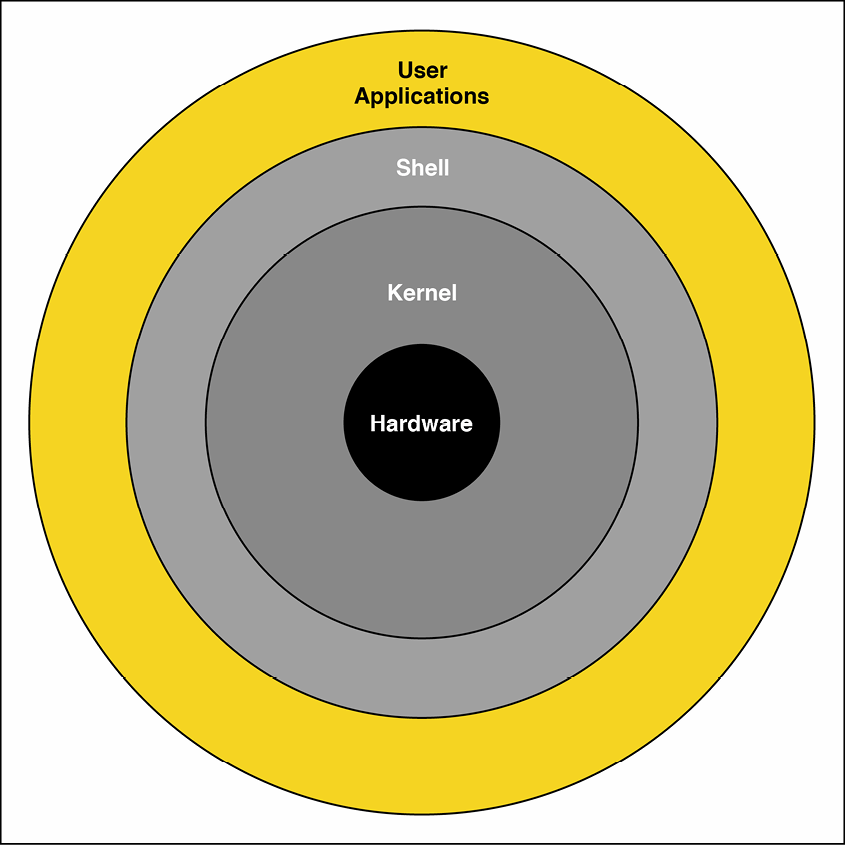
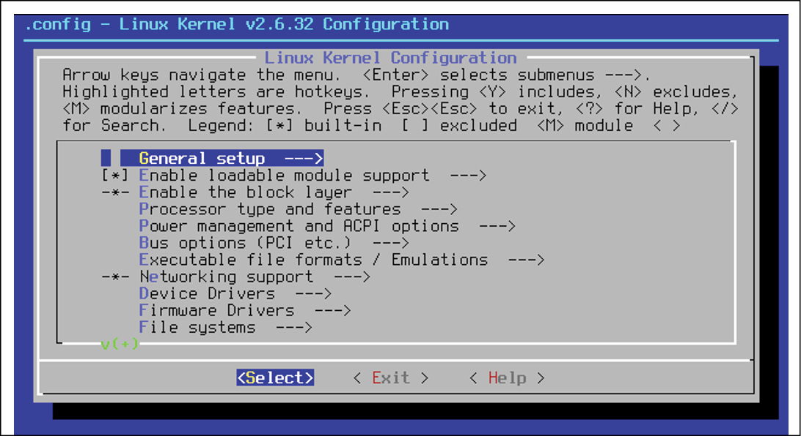
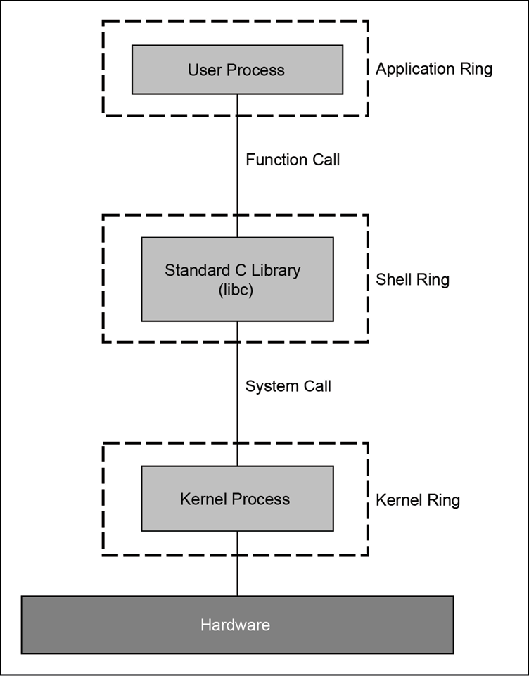
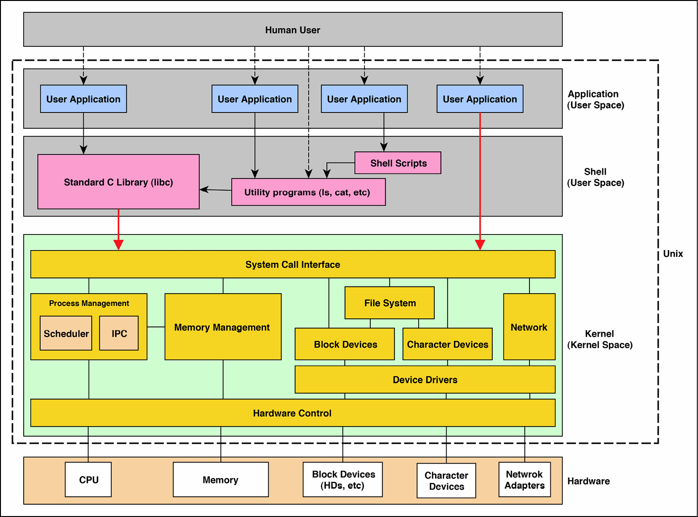

<a id="_idParaDest-140"></a>

# Chương 10: Unix – Lịch sử và Architecture (Unix – History and Architecture)

Bạn có thể đã tự hỏi tại sao lại có một chương về Unix ở giữa một cuốn sách về C ở mức expert-level. Nếu bạn chưa hỏi, tôi mời bạn tự hỏi, làm sao hai chủ đề này, C và Unix, lại có thể liên quan với nhau theo cách mà cần đến hai chương riêng (chương này và chương tiếp theo) ở giữa một cuốn sách lẽ ra phải nói về C?

Câu trả lời rất đơn giản: nếu bạn nghĩ chúng không liên quan, thì bạn đang mắc một sai lầm lớn. Mối quan hệ giữa hai thứ rất đơn giản; Unix là hệ điều hành đầu tiên được hiện thực bằng một ngôn ngữ lập trình khá high-level, C, vốn được thiết kế cho mục đích này, và C có được danh tiếng và sức mạnh của mình từ Unix. Dĩ nhiên, phát biểu của chúng tôi về việc C là một ngôn ngữ lập trình high-level không còn đúng nữa, và C không còn được coi là quá high-level.

Quay lại những năm 1970 và 1980, nếu các kỹ sư Unix tại Bell Labs đã quyết định dùng một ngôn ngữ lập trình khác, thay vì C, để phát triển một phiên bản Unix mới, thì ngày nay chúng ta sẽ đang nói về ngôn ngữ đó, và cuốn sách này sẽ không còn là *Extreme C* nữa. Hãy dừng lại một phút để đọc trích dẫn này của Dennis M. Ritchie, một trong những người tiên phong của C, về tác động của Unix đối với thành công của C:

> "Không nghi ngờ gì, thành công của chính Unix là yếu tố quan trọng nhất; nó đã đưa ngôn ngữ này đến với hàng trăm nghìn người. Ngược lại, dĩ nhiên, việc Unix dùng C và khả năng port sang nhiều loại máy khác nhau nhờ đó là điều quan trọng đối với thành công của hệ thống."

> \- Dennis M. Ritchie – The Development of the C Language (Sự phát triển của ngôn ngữ C)

Có tại [https://www.bell-labs.com/usr/dmr/www/chist.html](https://www.bell-labs.com/usr/dmr/www/chist.html).

Trong chương này, chúng ta trình bày các chủ đề sau:

- Chúng ta nói ngắn gọn về lịch sử của Unix và việc C ra đời như thế nào.
- Chúng ta giải thích C đã được phát triển dựa trên B và BCPL như thế nào.
- Chúng ta thảo luận về onion architecture (architecture hình củ hành) của Unix và cách nó được thiết kế dựa trên triết lý Unix.
- Chúng ta mô tả lớp user application cùng với vòng shell và cách các chương trình sử dụng API được vòng shell phơi ra. Các chuẩn SUS và POSIX được giải thích trong phần này.
- Chúng ta thảo luận về lớp kernel và những tính năng và chức năng nào nên có mặt trong một Unix kernel.
- Chúng ta nói về các thiết bị Unix và cách chúng có thể được dùng trong một hệ thống Unix.

Hãy bắt đầu chương bằng việc nói về lịch sử Unix.

<a id="_idParaDest-141"></a>

## Lịch sử Unix

Trong phần này, chúng tôi sẽ<a id="_idIndexMarker668"></a> đưa ra một chút lịch sử về Unix. Đây không phải là một cuốn sách lịch sử, nên chúng tôi sẽ giữ nó ngắn gọn và đi thẳng vào vấn đề, nhưng mục tiêu ở đây là nắm được một vài gợi ý lịch sử để xây dựng một nền tảng cho việc luôn đặt Unix song song với C trong tâm trí bạn.

<a id="_idParaDest-142"></a>

### Multics OS và Unix

Ngay cả trước khi có Unix, chúng ta <a id="_idIndexMarker669"></a>đã có Multics OS. Nó là một dự án chung được khởi động năm 1964 như một <a id="_idIndexMarker670"></a>dự án hợp tác do MIT, General Electric và Bell Labs dẫn dắt. Multics OS là một thành công lớn vì nó có thể giới thiệu với thế giới một hệ điều hành thật sự hoạt động được và an toàn. Multics được cài đặt ở khắp nơi từ các trường đại học đến các cơ quan chính phủ. Fast-forward (tua nhanh) đến năm 2019, và mọi hệ điều hành ngày nay đều đang vay mượn một số ý tưởng từ Multics một cách gián tiếp qua Unix.

Năm 1969, vì nhiều lý do khác nhau mà chúng ta sẽ nói đến ngay sau đây, một số người tại Bell Labs, đặc biệt là những người tiên phong của Unix, như Ken Thompson và Dennis Ritchie, đã từ bỏ Multics và, sau đó, Bell Labs rút khỏi dự án Multics. Nhưng đây không phải là dấu chấm hết cho Bell Labs; họ đã thiết kế hệ điều hành đơn giản hơn và hiệu quả hơn của riêng mình, được gọi là Unix.

Bạn có thể đọc thêm <a id="_idIndexMarker671"></a>về Multics và lịch sử của nó tại đâ[e: https://multicians.org/history.](https://multicians.org/history.html)html, nơi bạn có thể có được một bản phân tích chi tiết về lịch sử của Multics.

Link sau: [https://www.quora.com/Why-did-Unix-succeed-and-not-Multics](https://www.quora.com/Why-did-Unix-succeed-and-not-Multics), cũng là một link tốt giải thích tại sao Unix tiếp tục sống trong khi Multics bị ngừng.

Việc so sánh các hệ điều hành Multics và Unix là đáng làm. Trong danh sách sau, bạn sẽ thấy những điểm tương đồng và<a id="_idIndexMarker672"></a> khác biệt được tìm thấy khi so sánh Multics và Unix:

- **Cả hai đều theo onion architecture làm cấu trúc bên trong**. Ý chúng tôi là cả hai đều có ít nhiều cùng các vòng trong onion architecture của chúng, đặc biệt là vòng kernel và <a id="_idIndexMarker673"></a>vòng shell. Do đó, lập trình viên có thể viết các chương trình của riêng mình trên vòng shell. Ngoài ra, Unix và Multics phơi ra một danh sách các chương trình tiện ích như `ls` và `pwd`. Trong các phần sau, chúng ta sẽ giải thích các vòng khác nhau có trong architecture Unix.
- **Multics cần tài nguyên và máy móc đắt tiền để có thể hoạt động**. Không thể cài đặt nó trên các máy thông dụng bình thường, và đó là một trong những nhược điểm chính đã giúp Unix phát triển mạnh và cuối cùng khiến Multics trở nên lỗi thời sau khoảng 30 năm.
- **Multics phức tạp ngay từ thiết kế**. Đây là lý do đằng sau sự thất vọng của các nhân viên Bell Labs và, như chúng tôi đã nói trước đó, lý do tại sao họ rời dự án. Nhưng Unix cố gắng giữ đơn giản. Trong phiên bản đầu tiên, nó thậm chí không phải là multitasking hay multi-user!

Bạn có thể đọc thêm<a id="_idIndexMarker674"></a> về Unix và Multics trên mạng, và theo dõi các sự kiện đã xảy ra trong thời kỳ đó. Cả hai đều là những dự án thành công, nhưng Unix đã có thể phát triển mạnh và tồn tại đến ngày nay.

Đáng chia sẻ rằng <a id="_idIndexMarker675"></a>Bell Labs đã và đang làm việc trên một hệ điều hành phân tán mới gọi là *Plan 9*, dựa trên dự án Unix. Bạn có thể đọc thêm về nó tại Wik[ipedia: https://en.wikipedia.org/wiki/Plan_9_from_B](https://en.wikipedia.org/wiki/Plan_9_from_Bell_Labs)ell_Labs.


*Hình 10-1: Plan 9 from Bell Labs (từ Wikipedia)*

Tôi cho rằng chúng ta biết như vậy là đủ: Unix là một sự đơn giản hóa các ý tưởng và đổi mới mà Multics đã đưa ra; nó không phải là thứ gì đó mới mẻ, và vì vậy, tôi có thể dừng nói về lịch sử Unix và Multics<a id="_idIndexMarker676"></a> ở điểm này.

Cho đến giờ, chưa có dấu vết nào của C trong lịch sử vì nó chưa được phát minh. Các phiên bản đầu tiên của Unix<a id="_idIndexMarker677"></a> được viết hoàn toàn bằng assembly language. Chỉ đến năm 1973, Unix phiên bản 4 mới được viết bằng C.

Giờ, chúng ta đang tiến gần đến việc thảo luận về chính C, nhưng trước đó, chúng ta phải nói về BCPL và B vì chúng là cánh cổng dẫn tới C.

<a id="_idParaDest-143"></a>

### BCPL và B

BCPL được tạo ra bởi <a id="_idIndexMarker678"></a>Martin Richards như một ngôn ngữ lập trình được phát minh cho mục đích viết compiler. Những <a id="_idIndexMarker679"></a>người từ Bell Labs đã được làm quen với ngôn ngữ này khi họ làm việc trong dự án Multics. Sau khi rời dự án Multics, Bell Labs ban đầu bắt đầu viết Unix bằng ngôn ngữ lập trình assembly. Đó là vì, hồi đó, việc phát triển một hệ điều hành bằng một ngôn ngữ lập trình khác assembly là một anti-pattern!

Chẳng hạn, việc những người trong dự án Multics dùng PL/1 để phát triển Multics là điều lạ lùng nhưng, bằng việc làm như vậy, họ đã cho thấy rằng hệ điều hành có thể được viết thành công bằng một ngôn ngữ lập trình higher-level khác assembly. Vì vậy, vì điều đó, Multics đã trở thành nguồn cảm hứng chính cho việc dùng một ngôn ngữ khác để phát triển Unix.

Nỗ lực viết các module hệ điều hành bằng một ngôn ngữ lập trình khác assembly vẫn được Ken Thompson và Dennis Ritchie tại Bell Labs theo đuổi. Họ đã thử dùng BCPL, nhưng hóa ra họ cần áp dụng một số sửa đổi cho ngôn ngữ để có thể dùng nó trên các minicomputer như DEC PDP-7. Những thay đổi này đã dẫn đến ngôn ngữ lập trình B.

Chúng tôi sẽ tránh đi quá sâu vào các thuộc tính của ngôn ngữ B ở đây, nhưng bạn có thể đọc thêm về nó<a id="_idIndexMarker682"></a> và cách nó được phát triển trong các link sau:

- The B Programmin[g Language, at https://en.wikipedia.org/wiki/B_(progra](https://en.wikipedia.org/wiki/B_(programming_language))mming_language) (Ngôn ngữ lập trình B)
- *The Development of the* [*C Language*, at https://www.bell-labs.com/usr/dmr](https://www.bell-labs.com/usr/dmr/www/chist.html)/www/chist.html (Sự phát triển của ngôn ngữ C)

Chính Dennis Ritchie là tác giả của bài viết sau, và đó là một cách hay để giải thích sự phát triển của ngôn ngữ lập trình C trong khi vẫn chia sẻ thông tin giá trị về B và các đặc điểm của nó.

B cũng có những thiếu sót của nó xét về mặt là một ngôn ngữ lập trình hệ thống. B là không kiểu (typeless), nghĩa là chỉ có thể làm việc với một *word* (không phải một byte) trong mỗi thao tác. Điều này khiến việc dùng ngôn ngữ trên các máy có độ dài word khác trở nên khó khăn.

Đây là lý do tại sao, theo thời gian, ngôn ngữ đã được sửa đổi thêm cho đến khi dẫn đến việc phát triển ngôn ngữ **NB** (**New B**), và<a id="_idIndexMarker683"></a> sau đó nó đã kế thừa các cấu trúc từ ngôn ngữ B. Những cấu trúc này là không kiểu trong B, nhưng chúng đã trở thành có kiểu trong C. Cuối cùng, năm 1973, phiên bản thứ tư của Unix có thể được phát triển bằng C, trong đó vẫn còn nhiều code assembly.

Trong phần tiếp theo, chúng ta nói về những khác biệt giữa B và C, và tại sao C là một ngôn ngữ lập trình hệ thống hiện đại top-notch (hàng đầu) để viết một hệ điều hành.

<a id="_idParaDest-144"></a>

### Con đường đến C

Tôi không nghĩ chúng ta có thể tìm được ai giỏi hơn chính Dennis Ritchie để giải thích tại sao C được phát minh sau những khó khăn gặp phải với B. Trong phần này, chúng ta sẽ liệt kê những nguyên nhân khiến Dennis Ritchie, Ken Thompson và những người khác tạo ra một ngôn ngữ lập trình mới thay vì dùng B để viết Unix.

Sau đây là danh sách <a id="_idIndexMarker684"></a>các khiếm khuyết được tìm thấy trong B, vốn<a id="_idIndexMarker685"></a> đã dẫn đến việc tạo ra C:

- **B chỉ có thể làm việc với word trong memory**: Mọi thao tác đơn lẻ đều phải được thực hiện theo word. Hồi đó, có một ngôn ngữ lập trình có thể làm việc với byte là một giấc mơ. Đó là vì phần cứng có sẵn vào thời điểm đó address memory theo một sơ đồ word-based.
- **B là không kiểu**: Phát biểu chính xác hơn mà chúng ta có thể nói là B là một ngôn ngữ single-type (một kiểu duy nhất). Mọi biến đều thuộc cùng một kiểu: word. Vì vậy, nếu bạn có một chuỗi với 20 ký tự (21 tính cả ký tự null ở cuối), bạn phải chia nó theo word và lưu nó trong nhiều hơn một biến. Ví dụ, nếu một word là 4 byte, bạn sẽ có 6 biến để lưu 21 ký tự của chuỗi.
- **Việc không kiểu có nghĩa là nhiều thuật toán byte-oriented, như các thuật toán xử lý chuỗi, không thể được viết hiệu quả bằng B**: Đó là vì B dùng các word memory chứ không phải byte, và chúng không thể được dùng hiệu quả để quản lý các kiểu dữ liệu multi-byte như số nguyên và chuỗi.
- **B không hỗ trợ các phép toán floating-point**: Vào thời điểm đó, những phép toán này ngày càng có sẵn trên phần cứng mới, nhưng không có hỗ trợ nào cho chúng trong ngôn ngữ B.
- Với sự xuất hiện của các máy như PDP-1, vốn có thể address memory theo từng byte, B đã cho thấy rằng nó có thể kém hiệu quả trong việc address các byte memory: Điều này càng trở nên rõ ràng hơn với các pointer của B, vốn chỉ có thể address các word trong memory, chứ không phải các byte. Nói cách khác, với một chương trình muốn truy cập một byte cụ thể hay một dải byte trong memory, cần thực hiện thêm các phép tính để tính các chỉ số word tương ứng.

Những khó khăn với B, đặc biệt là việc phát triển và thực thi chậm trên các máy có sẵn vào thời điểm đó, đã buộc Dennis Ritchie tạo ra một ngôn ngữ mới. Ngôn ngữ mới này ban đầu được gọi là NB, hay New B, nhưng rốt cuộc nó đã trở thành C.

Ngôn ngữ mới được phát triển này, C, đã cố gắng khắc phục những khó khăn và khiếm khuyết của B và trở thành một ngôn ngữ lập trình *de facto* (trên thực tế là chuẩn) cho việc phát triển hệ thống, thay cho assembly language. Trong chưa đầy 10 năm, các phiên bản Unix mới hơn đã được viết hoàn toàn bằng C, và mọi hệ điều hành mới hơn dựa trên Unix đều gắn liền với C và sự hiện diện then chốt của nó trong hệ thống.

Như bạn có thể thấy, C không ra đời như một ngôn ngữ lập trình thông thường, mà thay vào đó, nó được thiết kế với một tập yêu cầu hoàn chỉnh trong đầu và, ngày nay, nó không có đối thủ cạnh tranh. Bạn có thể coi các ngôn ngữ như Java, Python và Ruby là các ngôn ngữ higher-level, nhưng chúng không thể được coi là đối thủ cạnh tranh trực tiếp vì chúng khác biệt và phục vụ các mục đích khác nhau. Chẳng hạn, bạn không thể viết một device driver hay một kernel module bằng Java hay Python, và bản thân chúng đã được xây dựng trên một lớp được viết bằng C.

Không giống nhiều <a id="_idIndexMarker688"></a>ngôn ngữ lập trình, C được ISO chuẩn hóa, và nếu cần có một tính năng nhất định trong tương lai, thì chuẩn có thể được sửa đổi để hỗ trợ tính năng mới.

Trong phần tiếp theo, chúng ta sẽ thảo luận về architecture Unix. Đây là một khái niệm cơ bản trong việc hiểu một chương trình phát triển như thế nào trong môi trường Unix.

<a id="_idParaDest-145"></a>

## Architecture Unix

Trong phần này, chúng ta sẽ<a id="_idIndexMarker689"></a> khám phá triết lý mà những người tạo ra Unix đã có trong đầu và những gì họ kỳ vọng nó sẽ trở thành khi họ tạo ra architecture.

Như chúng tôi đã giải thích trong phần trước, những người tham gia Unix từ Bell Labs đã làm việc cho dự án Multics. Multics là một dự án lớn, architecture được đề xuất phức tạp, và nó được tinh chỉnh để dùng trên phần cứng đắt tiền. Nhưng chúng ta nên nhớ rằng bất chấp mọi khó khăn, Multics có những mục tiêu lớn. Các ý tưởng đằng sau dự án Multics đã cách mạng hóa cách chúng ta suy nghĩ về hệ điều hành.

Bất chấp những thách thức và khó khăn đã thảo luận ở trên, các ý tưởng được đưa ra trong dự án đã thành công vì Multics đã sống được khoảng 40 năm, cho đến năm 2000. Không chỉ vậy, dự án còn tạo ra một nguồn doanh thu khổng lồ cho công ty sở hữu nó.

Những người như Ken Thompson và các đồng nghiệp đã mang các ý tưởng vào Unix dù Unix, ban đầu, được dự định là đơn giản. Cả Multics và Unix đều cố gắng mang lại architecture tương tự, nhưng chúng có hai số phận vô cùng khác nhau. Multics, kể từ đầu thế kỷ mới, đã bắt đầu bị lãng quên, trong khi Unix, và các họ hệ điều hành dựa trên nó như BSD, đã phát triển kể từ đó.

Chúng ta sẽ tiếp tục nói về triết lý Unix. Nó đơn giản là một tập yêu cầu high-level mà thiết kế của Unix dựa trên. Sau đó, chúng ta sẽ nói về architecture multi-ring, onion-like của Unix và vai trò của mỗi vòng trong hành vi tổng thể của hệ thống.

<a id="_idParaDest-146"></a>

### Triết lý

Triết lý của Unix đã được những người sáng lập giải thích nhiều lần. Như vậy, một bản phân tích kỹ lưỡng về<a id="_idIndexMarker690"></a> toàn bộ chủ đề nằm ngoài phạm vi của cuốn sách này. Những gì chúng tôi sẽ làm là tóm tắt mọi quan điểm chính.

Trước khi làm điều đó, tôi đã liệt kê dưới đây một số tài liệu bên ngoài tuyệt vời có thể giúp bạn về chủ đề triết lý Unix<a id="_idIndexMarker691"></a>:

- Wikipedia, *Unix philosophy* (Triết lý Unix): [https://en.wikipedia.org/wiki/Unix_philosophy](https://en.wikipedia.org/wiki/Unix_philosophy%20)
- *The Unix Philosophy: A Brief Introduction* (Triết lý Unix: Giới thiệu ngắn gọn): [http://www.linfo.org/unix_philosophy.html](http://www.linfo.org/unix_philosophy.html)
- Eric Steven Raymond, *The Art of Unix Programming* (Nghệ thuật lập trình Unix): [https://homepage.cs.uri.edu/~thenry/resources/unix_art/ch01s06.html](https://homepage.cs.uri.edu/~thenry/resources/unix_art/ch01s06.html)

Tương tự, trong link sau, bạn sẽ thấy một quan điểm đối lập khá gay gắt với triết lý Unix. Tôi đã đưa nó vào vì luôn tốt khi biết cả hai phía bởi vì, về bản chất, không có gì là hoàn hảo:

- *The Colla*[*pse of UNIX Philosophy*: https://kukuruku.co/post/the-collapse](https://kukuruku.co/post/the-collapse-of-the-unix-philosophy/)-of-the-unix-philosophy/ (Sự sụp đổ của triết lý UNIX)

Để tóm tắt những quan điểm này, tôi đã nhóm các triết lý Unix then chốt như sau:

- **Unix chủ yếu được thiết kế và phát triển để lập trình viên dùng chứ không phải người dùng cuối thông thường**: Do đó, nhiều cân nhắc liên quan đến các yêu cầu về user interface và user experience không phải là một phần của architecture Unix.
- **Một hệ thống Unix được tạo nên từ nhiều chương trình nhỏ và đơn giản**: Mỗi chương trình được thiết kế để thực hiện một tác vụ nhỏ và đơn giản. Có rất nhiều ví dụ về những chương trình nhỏ và đơn giản này, như `ls`, `mkdir`, `ifconfig`, `grep` và `sed`.
- **Một tác vụ phức tạp có thể được thực hiện bằng cách thực thi một chuỗi những chương trình nhỏ và đơn giản này nối tiếp nhau**: Điều đó có nghĩa là về bản chất có nhiều hơn một chương trình tham gia vào một tác vụ lớn và phức tạp và rằng, cùng nhau, mỗi chương trình có thể được thực thi nhiều lần để hoàn thành tác vụ. Một ví dụ tốt về điều này là dùng shell script thay vì viết một chương trình từ đầu. Lưu ý rằng shell script thường portable giữa các hệ thống Unix, và Unix khuyến khích lập trình viên chia các chương trình lớn và phức tạp của họ thành các chương trình nhỏ và đơn giản.
- **Mỗi chương trình nhỏ và đơn giản nên có khả năng truyền output của nó làm input của một chương trình khác, và chuỗi này nên tiếp tục**: Bằng cách này, chúng ta có thể dùng các chương trình nhỏ trong một chuỗi có tiềm năng thực hiện các tác vụ phức tạp. Trong chuỗi này, mỗi chương trình có thể được coi như một bộ biến đổi nhận output của chương trình trước, biến đổi nó dựa trên logic của mình, và truyền nó cho chương trình tiếp theo trong chuỗi. Một ví dụ đặc biệt tốt về điều này là *piping* giữa các lệnh Unix, được ký hiệu bằng một thanh dọc, như `ls -l | grep a.out`.
- **Unix rất text-oriented**: Mọi cấu hình đều là file văn bản, và nó có một command line dạng văn bản<a id="_idIndexMarker692"></a>. Shell script cũng là các file văn bản dùng ngữ pháp đơn giản để viết một thuật toán thực thi các chương trình Unix shell khác.
- **Unix gợi ý chọn sự đơn giản thay vì sự hoàn hảo**: Ví dụ, nếu một giải pháp đơn giản hoạt động trong hầu hết các trường hợp, đừng thiết kế một giải pháp phức tạp chỉ hoạt động tốt hơn một chút.
- **Các chương trình được viết cho một hệ điều hành Unix-compliant nhất định nên dễ dàng dùng được trên các hệ thống Unix khác**: Điều này chủ yếu được đáp ứng bằng việc có một code base duy nhất có thể được build và thực thi trên nhiều hệ thống Unix-compliant khác nhau.

Những điểm chúng tôi vừa liệt kê đã được những người khác nhau trích xuất và diễn giải, nhưng nhìn chung, chúng đã được đồng thuận là các nguyên tắc chính dẫn dắt triết lý Unix và, kết quả là, đã định hình thiết kế của Unix.

Nếu bạn đã có kinh nghiệm với một hệ điều hành Unix-like, ví dụ, Linux, thì bạn sẽ có thể đối chiếu kinh nghiệm của mình với các phát biểu trên. Như chúng tôi đã giải thích trong phần trước về lịch sử Unix, nó được dự định là một phiên bản đơn giản hơn của Multics, với những kinh nghiệm mà những người sáng lập Unix đã có với Multics dẫn họ đến các triết lý trên.

Nhưng quay lại chủ đề C. Bạn có thể đang hỏi C đã đóng góp vào triết lý trên như thế nào? Chà, gần như mọi thứ thiết yếu được phản ánh trong các phát biểu trên đều được viết bằng C. Nói cách khác, các chương trình nhỏ và đơn giản đã nói ở trên vốn thúc đẩy phần lớn Unix đều được viết bằng C.

Thường thì cho thấy tốt hơn là chỉ đơn giản kể ra. Vì vậy, hãy xem một ví dụ. Source code C của chương trình ls trong NetBSD[ can be found here: http://cvsweb.netbsd.org/bsdweb.cgi/~checkout~](http://cvsweb.netbsd.org/bsdweb.cgi/~checkout~/src/bin/ls/ls.c?rev=1.67)/src/bin/ls/ls.c?rev=1.67 (có thể được tìm thấy ở đây). Như bạn hẳn đã biết, chương trình ls liệt kê nội dung của một thư mục và không làm gì hơn thế, và logic đơn giản này đã được viết bằng C như bạn có thể thấy trong link. Nhưng đây không phải là đóng góp duy nhất của C trong Unix. Chúng tôi sẽ giải thích thêm về điều này trong các phần sau khi nói<a id="_idIndexMarker693"></a> về C Standard Library.

<a id="_idParaDest-147"></a>

### Củ hành Unix (Unix onion)

Giờ, đã đến lúc<a id="_idIndexMarker694"></a> khám phá architecture Unix. Một *onion model* (mô hình củ hành), như chúng tôi đã đề cập ngắn gọn trước đây, có thể mô tả<a id="_idIndexMarker695"></a> architecture tổng thể của Unix. Nó onion-like (giống củ hành) vì nó gồm một vài *ring* (vòng), mỗi vòng đóng vai trò như một lớp bọc cho các vòng bên trong.

*Hình 10-2* minh họa onion model nổi tiếng được đề xuất cho architecture Unix:



*Hình 10-2: Onion model của architecture Unix*

Thoạt nhìn mô hình trông khá đơn giản. Tuy nhiên, để hiểu nó đầy đủ đòi hỏi bạn phải viết một vài chương trình trong Unix. Chỉ sau đó bạn mới có thể hiểu mỗi vòng thực sự đang làm gì. Chúng tôi sẽ cố gắng giải thích mô hình đơn giản nhất có thể để xây dựng một nền tảng ban đầu trước khi tiến tới việc viết các ví dụ thật.

Hãy giải thích onion model từ vòng trong cùng.

Ở lõi của mô hình<a id="_idIndexMarker696"></a> trên là **Hardware** (phần cứng). Như chúng ta biết, nhiệm vụ chính của một hệ điều hành là cho phép người dùng tương tác với và dùng phần cứng. Đó là lý do tại sao phần cứng nằm ở lõi của mô hình trong *Hình 10-2*. Điều này đơn giản cho chúng ta thấy rằng một trong những mục tiêu chính của Unix là làm cho phần cứng sẵn có cho các chương trình muốn truy cập nó. Mọi thứ chúng ta đã đọc về triết lý Unix trong phần trước đều tập trung vào việc cung cấp những dịch vụ này theo cách tốt nhất có thể.

Vòng quanh phần cứng là **Kernel**. <a id="_idIndexMarker698"></a>Kernel là phần quan trọng nhất của một hệ điều hành. Đó là vì nó là lớp gần phần cứng nhất, và nó đóng vai trò như một lớp bọc để phơi ra trực tiếp các chức năng của phần cứng được gắn vào. Vì sự truy cập trực tiếp này, kernel có đặc quyền cao nhất để dùng toàn bộ tài nguyên sẵn có trong một hệ thống. Sự <a id="_idIndexMarker699"></a>truy cập không giới hạn vào mọi thứ này là lý lẽ tốt nhất cho việc có các vòng khác trong architecture không có sự truy cập không giới hạn đó. Thực tế, đây chính là điều đằng sau sự phân tách giữa *kernel space* và *user space*. Chúng ta thảo luận chi tiết hơn về điều này trong chương này và chương tiếp theo.

Lưu ý rằng việc viết kernel chiếm phần lớn công sức cần thiết khi viết một hệ điều hành Unix-like mới, và, như bạn có thể thấy, vòng của nó được vẽ dày hơn các vòng khác. Có nhiều đơn vị khác nhau bên trong một Unix kernel, và mỗi đơn vị đều đóng một vai trò sống còn trong hệ sinh thái Unix. Ở phần sau của chương này, chúng tôi sẽ giải thích thêm về cấu trúc bên trong của một Unix kernel.

Vòng tiếp theo được gọi là **Shell**. Nó đơn giản là <a id="_idIndexMarker700"></a>một lớp vỏ quanh kernel cho phép các user application<a id="_idIndexMarker701"></a> tương tác với kernel và dùng nhiều dịch vụ của nó. Hãy lưu ý rằng riêng vòng shell đã mang lại phần lớn các yêu cầu được đề cập bởi triết lý Unix mà chúng tôi đã giải thích trong phần trước. Chúng tôi sẽ giải thích thêm về điều này trong các đoạn sắp tới.

Vòng shell gồm nhiều chương trình nhỏ, cùng nhau tạo thành một bộ công cụ cho phép một người dùng hay một ứng dụng dùng các dịch vụ của kernel. Nó cũng chứa một tập library, tất cả đều được viết bằng C, sẽ cho phép một lập trình viên viết một ứng dụng mới cho Unix.

Dựa trên các library có trong **Simple Unix Specification** (**SUS**), vòng shell phải phơi ra một interface chuẩn và được định nghĩa <a id="_idIndexMarker702"></a>chính xác cho lập trình viên. Những sự chuẩn hóa như vậy sẽ làm cho các chương trình Unix portable, hoặc ít nhất là biên dịch được, trên nhiều hiện thực Unix khác nhau. Chúng tôi sẽ tiết lộ một số bí mật gây sốc về vòng này trong các phần sau!

Cuối cùng, vòng ngoài cùng, **User Applications**, gồm mọi ứng dụng thực tế được viết để dùng trên các hệ thống Unix, như các dịch vụ cơ sở dữ liệu, dịch vụ web, dịch vụ mail, trình duyệt web, chương trình bảng tính và chương trình soạn thảo văn bản.

Những ứng dụng này nên dùng các API và công cụ được vòng shell cung cấp thay vì truy cập trực tiếp vào kernel (thông qua *system call*, mà chúng ta sẽ thảo luận ngay sau đây) để hoàn thành tác vụ của chúng. Điều này được làm vì <a id="_idIndexMarker703"></a>nguyên tắc portability trong triết lý Unix. Lưu ý rằng trong ngữ cảnh hiện tại của chúng ta, với thuật ngữ *user*, chúng tôi thường muốn nói các user application, chứ không nhất thiết là những người làm việc với các ứng dụng này.

Việc bị giới hạn chỉ dùng vòng shell cũng giúp những ứng dụng này biên dịch được trên nhiều hệ điều hành Unix-like <a id="_idIndexMarker704"></a>khác nhau vốn không phải là các hệ điều hành Unix-compliant thực sự. Ví dụ tốt nhất là các bản phân phối Linux khác nhau, vốn chỉ là Unix-like. Chúng ta muốn có các phần mềm lớn sẵn có trên cả hệ điều hành Unix-compliant lẫn Unix-like với một code base duy nhất. Khi tiến lên, bạn sẽ tìm hiểu thêm về những khác biệt giữa các hệ thống Unix-like và Unix-compliant.

Một chủ đề chung trong củ hành Unix là thực tế rằng các vòng bên trong nên cung cấp một interface nào đó cho các vòng bên ngoài để cho phép chúng dùng các dịch vụ của mình. Thực tế, những interface giữa các vòng này quan trọng hơn chính các vòng. Ví dụ, chúng ta quan tâm đến việc biết cách dùng các dịch vụ kernel hiện có hơn là chỉ đào sâu vào kernel, vốn khác nhau từ hiện thực Unix này sang hiện thực khác.

Điều tương tự có thể được nói về vòng shell và interface mà nó phơi ra cho các user application. Thực tế, những interface này là chủ đề trọng tâm chính của chúng ta trong suốt hai chương này khi xem xét Unix. Trong các phần sau, chúng ta sẽ nói về từng vòng riêng lẻ và thảo luận khá chi tiết về interface được phơi ra của nó.

<a id="_idParaDest-148"></a>

## Shell interface tới user application

Một *người dùng là con người* hoặc dùng một Terminal hoặc một<a id="_idIndexMarker705"></a> chương trình GUI cụ thể như một trình duyệt web để dùng các chức năng có sẵn trên một hệ thống Unix. Cả hai đều được gọi là user application, hay đơn giản là ứng dụng hay chương trình, cho phép phần cứng được dùng <a id="_idIndexMarker706"></a>thông qua vòng shell. Memory, CPU, network adapter và ổ cứng là những ví dụ điển hình về phần cứng thường được hầu hết các chương trình Unix dùng thông qua API được vòng shell cung cấp. API được cung cấp là một trong những chủ đề mà chúng ta sẽ nói đến.

> Từ góc nhìn của một developer, không có nhiều khác biệt giữa một ứng dụng và một chương trình. Nhưng từ <a id="_idIndexMarker707"></a>góc nhìn của một người dùng là con người, một ứng dụng là một chương trình<a id="_idIndexMarker708"></a> có một phương tiện như **Graphical User interface** (**GUI**) hay **Command-Line Interface** (**CLI**) để tương tác với người dùng, còn một chương trình là một phần mềm chạy trên một máy không có UI, như một service đang chạy. Cuốn sách này không phân biệt giữa chương trình và ứng dụng, và chúng tôi dùng các thuật ngữ thay thế cho nhau.

Có rất nhiều loại <a id="_idIndexMarker709"></a>chương trình đã được phát triển cho Unix bằng C. Dịch vụ cơ sở dữ liệu, web server, mail server, game, ứng dụng văn phòng, và nhiều loại khác nằm trong số các loại chương trình khác nhau tồn tại trong môi trường Unix. Có một đặc điểm chung giữa những ứng dụng này, đó là code của chúng portable trên hầu hết các hệ điều hành Unix và Unix-like với một vài thay đổi nhỏ. Nhưng làm sao điều đó khả thi? Làm sao bạn có thể viết một chương trình bằng C có thể được build trên nhiều phiên bản Unix khác nhau và trên nhiều loại phần cứng khác nhau?

Câu trả lời rất đơn giản: mọi hệ thống Unix đều phơi ra cùng một **Application Programming Interface** (**API**) từ <a id="_idIndexMarker710"></a>vòng shell của chúng. Một đoạn source code C chỉ dùng interface chuẩn được phơi ra có thể được build và chạy trên mọi hệ thống Unix.

Nhưng chính xác thì chúng ta muốn nói gì khi nói phơi ra một API? Một API, như chúng tôi đã giải thích trước đây, là một nhóm header file chứa một tập khai báo. Trong Unix, những header này, và các hàm được khai báo trong chúng, là như nhau trên mọi hệ thống Unix, nhưng hiện thực của những hàm đó, nói cách khác là các static library và dynamic library được viết cho mỗi hệ thống UNIX-compliant, có thể là độc nhất và khác với các hệ thống khác.

Lưu ý rằng chúng ta đang nhìn Unix như một chuẩn chứ không phải một hệ điều hành. Có những hệ thống được xây dựng hoàn toàn tương thích với chuẩn Unix, và chúng ta gọi chúng là *hệ thống Unix-compliant*, như BSD Unix, trong khi có những hệ thống tuân thủ một phần chuẩn Unix, và được gọi là *hệ thống Unix-like*, như Linux.

Cùng một API đang được phơi ra từ vòng shell trong ít nhiều mọi hệ thống Unix. Ví dụ, hàm `printf` phải luôn được khai báo trong header file `stdio.h`, như được chuẩn Unix quy định. Bất cứ khi nào bạn muốn in một thứ gì đó ra standard output trong một hệ thống Unix-compliant, bạn nên dùng `printf` hay `fprintf` từ header file `stdio.h`.

Thực tế, `stdio.h` không phải là một phần của C dù mọi sách C đều giải thích header này và các hàm được khai báo trong nó. Nó là một phần của thư viện chuẩn C được quy định trong chuẩn SUS. Một chương trình C được viết cho Unix không biết về hiện thực thực sự của một hàm cụ thể, như `printf` hay `fopen`. Nói cách khác, vòng shell được các chương trình ở vòng ngoài coi như một hộp đen.

Các API khác nhau được vòng shell phơi ra được tập hợp dưới chuẩn SUS. Chuẩn này được duy trì bởi tập đoàn **The Open Group** và đã có nhiều lần lặp kể từ khi Unix được tạo ra. Phiên bản gần đây nhất là SUS phiên bản 4, có từ năm 2008. Tuy nhiên, bản thân phiên bản gần đây nhất có một số bản sửa đổi vào năm 2013, 2016, và cuối cùng vào năm 2018.

Link sau sẽ đưa <a id="_idIndexMarker711"></a>bạn tới tài liệu giải thí[ng the exposed interfaces in SUS version ](http://www.unix.org/version4/GS5_APIs.pdf)4 (các interface được phơi ra trong SUS phiên bản bốn): [http://www.unix.org/version4/GS5_APIs.pdf](http://www.unix.org/version4/GS5_APIs.pdf). Như bạn có thể thấy trong link, có nhiều loại API khác nhau được vòng shell phơi ra. Một số là bắt buộc, và một số khác là tùy chọn. Sau đây là danh sách các API có trong SUS v4:

- **System interface**: Đây là một danh sách <a id="_idIndexMarker712"></a>mọi hàm nên dùng được bởi bất kỳ chương trình C nào. SUS v4 có 1,191 hàm cần được một hệ thống Unix hiện thực. Bảng cũng mô tả việc một hàm cụ thể là bắt buộc hay tùy chọn đối với một phiên bản C cụ thể. Hãy lưu ý rằng phiên bản chúng ta quan tâm là C99.

- **Header interface**: Đây là một danh sách các header file có thể có sẵn trong một hệ thống Unix SUS v4-compatible. Trong <a id="_idIndexMarker713"></a>phiên bản SUS này, có 82 header file có thể truy cập được bởi mọi chương trình C. Nếu bạn đi qua danh sách, bạn sẽ thấy nhiều header file nổi tiếng, như `stdio.h`, `stdlib.h`, `math.h` và `string.h`. Dựa trên phiên bản Unix và phiên bản C được dùng, một số là bắt buộc, trong khi những cái khác là tùy chọn. Các header tùy chọn có thể không có trong một hệ thống Unix, nhưng các header file bắt buộc chắc chắn tồn tại ở đâu đó trong filesystem.

- **Utility interface**: Đây là một danh sách các chương trình tiện ích, hay chương trình command-line, nên có <a id="_idIndexMarker714"></a>sẵn trong một hệ thống Unix SUS v4-compatible. Nếu bạn đi qua các bảng, bạn sẽ thấy rất nhiều lệnh quen thuộc với bạn, ví dụ, `mkdir`, `ls`, `cp`, `df`, `bc`, và nhiều lệnh khác, tổng cộng lên tới 160 chương trình tiện ích. Lưu ý rằng đây thường là những chương trình phải đã được một nhà cung cấp Unix cụ thể viết sẵn trước khi phát hành như một phần của gói cài đặt.

  Những chương trình tiện ích này chủ yếu được dùng trong Terminal hay trong shell script và không thường được một chương trình C khác gọi. Những chương trình tiện ích này thường dùng cùng các system interface được phơi ra cho một chương trình C thông thường được viết ở vòng user application.

  Ví dụ, sau đây là một link tới source code của chương trình tiện ích `mkdir` được viết cho macOS High Sierra 10.13.6, vốn là một hệ thống Unix dựa trên Berkeley Software Distribution (BSD)<a id="_idIndexMarker715"></a>. Source code được công bố trên trang Apple Open Source, macOS High Sierra (10.13.6), và có tại [https://opensource.apple.com/source/file_cmds/file_cmds-272/mkdir/mkdir.c](https://opensource.apple.com/source/file_cmds/file_cmds-272/mkdir/mkdir.c).

  Nếu bạn mở link<a id="_idIndexMarker716"></a> và đi qua source, bạn sẽ thấy rằng nó đang dùng các hàm `mkdir` và `umask` được khai báo như một phần của các system interface.

- **Scripting interface**: Interface<a id="_idIndexMarker717"></a> này là một ngôn ngữ được dùng để viết *shell script*. Nó chủ yếu được dùng để viết các tác vụ tự động dùng các chương trình tiện ích. Interface này thường được gọi là *shell scripting language* hay *shell command language*.

- **XCURSES interface**: XCURSES là <a id="_idIndexMarker718"></a>một tập interface cho phép một chương trình C tương tác với người dùng trong một GUI text-based tối giản.

  Trong ảnh chụp màn hình<a id="_idIndexMarker719"></a> sau, bạn có thể thấy một ví dụ về GUI đã được viết bằng `ncurses`, vốn là một hiện thực của XCURSES.

  Trong SUS v4, có 379 hàm nằm trong 3 header, cùng với 4 chương trình tiện ích, tạo nên XCURSES interface.

  Nhiều chương trình ngày nay vẫn đang dùng XCURSES để tương tác với người dùng thông qua một interface tốt hơn. Đáng lưu ý rằng, bằng việc dùng các interface XCURSES-based, bạn không cần có <a id="_idIndexMarker720"></a>một graphics engine. Tương tự, nó cũng dùng được qua các kết nối từ xa như **Secure Shell** (**SSH**).



*Hình 10-3: Một menu cấu hình dựa trên ncurses (Wikipedia)*

Như bạn có thể thấy, SUS không nói về hệ thống phân cấp filesystem và nơi các header file nên được tìm thấy. Nó chỉ nêu những header nào nên có sẵn và có mặt trong hệ thống. Một quy ước được dùng rộng rãi cho đường dẫn của các header file chuẩn nói rằng những header này nên được tìm thấy ở `/usr/include` hoặc `/usr/local/include`, nhưng quyết định cuối cùng vẫn tùy thuộc vào hệ điều hành và người dùng. Đây là các đường dẫn mặc định cho header file. Tuy nhiên, các hệ thống có thể được cấu hình để dùng các đường dẫn khác thay cho các đường dẫn mặc định.

Nếu chúng ta đặt system interface và header interface cùng với hiện thực của các hàm được phơi ra, vốn khác nhau trong<a id="_idIndexMarker722"></a> mỗi biến thể (hay hiện thực) Unix, thì chúng ta có **C Standard Library** hay **libc**. Nói cách khác, libc là một tập hàm được đặt trong các header file cụ thể, tất cả đều theo SUS, cùng với các static library và shared library chứa hiện thực của các hàm được phơi ra.

Định nghĩa của libc gắn chặt với sự chuẩn hóa của các hệ thống Unix. Mọi chương trình C đang được phát triển trong một hệ thống Unix đều dùng libc để giao tiếp xuống sâu hơn tới các mức kernel và phần cứng.

Điều quan trọng cần nhớ là không phải mọi hệ điều hành đều là hệ thống hoàn toàn tương thích Unix. Microsoft Windows và các hệ điều hành dùng Linux kernel, ví dụ, Android, là những ví dụ về điều đó. Những hệ điều hành này không phải là hệ thống Unix-compliant, nhưng chúng có thể là hệ thống Unix-like. Chúng tôi đã dùng các thuật ngữ Unix-compliant và Unix-like trong các chương trước mà không giải thích ý nghĩa thực sự của chúng, nhưng giờ chúng tôi sẽ định nghĩa chúng cẩn thận.

Một hệ thống Unix-compliant tuân thủ hoàn toàn các chuẩn SUS, nhưng điều này không đúng với một hệ thống Unix-like vốn chỉ tuân thủ một phần chuẩn. Điều này có nghĩa là các hệ thống Unix-like chỉ tuân theo một tập con cụ thể của các chuẩn SUS chứ không phải tất cả. Điều này có nghĩa là, về lý thuyết, các chương trình được phát triển cho một hệ thống Unix-compliant được kỳ vọng là portable sang các hệ thống Unix-compatible khác, nhưng có thể không port được sang một hệ điều hành Unix-like<a id="_idIndexMarker723"></a>. Điều này đặc biệt đúng với các chương trình được port từ Linux sang, hoặc sang Linux từ, các hệ thống Unix-compliant khác.

Việc có rất nhiều hệ điều hành Unix-like được phát triển, đặc biệt sau sự ra đời của Linux, đã trở thành cơ sở cho việc đặt cho<a id="_idIndexMarker724"></a> tập con này của các chuẩn SUS một cái tên cụ thể. Họ gọi nó là **Portable Operating System Interface** (**POSIX**). Chúng ta có thể nói rằng POSIX là một tập con của các chuẩn SUS mà các hệ thống Unix-like chọn tuân thủ.

Trong link sau, bạn có thể<a id="_idIndexMarker725"></a> tìm thấy mọi interface khá[rent interfaces that should be exposed in a POSI](http://pubs.opengroup.org/onlinepubs/9699919799/)X system (các interface khác nhau nên được phơi ra trong một hệ thống POSIX): [http://pubs.opengroup.org/onlinepubs/9699919799/](http://pubs.opengroup.org/onlinepubs/9699919799/).

Như bạn có thể thấy trong link, có các interface tương tự trong POSIX, giống như trong SUS. Các chuẩn rất giống nhau, nhưng POSIX đã giúp các chuẩn Unix áp dụng được cho một phạm vi hệ điều hành rộng hơn.

Các hệ điều hành Unix-like, như hầu hết các bản phân phối Linux, là POSIX-compliant ngay từ đầu. Đó là lý do tại sao nếu bạn đã làm việc với Ubuntu, bạn có thể làm việc với FreeBSD Unix theo cùng cách.

Tuy nhiên, điều đó không đúng với một số hệ điều hành như Microsoft Windows. Microsoft Windows không thể được coi là POSIX-compliant, nhưng có thể cài thêm các công cụ để biến nó thành một hệ điều hành POSIX, ví<a id="_idIndexMarker726"></a> dụ, *Cygwin*¸ một môi trường POSIX-compatible chạy native trên hệ điều hành Windows.

Điều này một lần nữa cho thấy rằng tính tương thích POSIX là về việc có một vòng shell chuẩn chứ không phải về kernel.

Lạc đề một chút, đã từng có cả một câu chuyện khi Microsoft Windows trở thành POSIX-compliant vào những năm 1990. Tuy nhiên, theo thời gian, sự hỗ trợ đó đã bị deprecated.

Cả hai chuẩn SUS và POSIX đều quy định các interface. Cả hai đều nêu những gì nên có sẵn, nhưng chúng không nói về việc nó nên trở nên sẵn có như thế nào. Mỗi hệ thống Unix có hiện thực POSIX hay hiện thực SUS riêng của nó. Những hiện thực này sau đó được đặt trong các library libc vốn là một phần của vòng shell. Nói cách khác, trong một hệ thống Unix, vòng shell chứa một hiện thực libc được phơi ra theo một cách chuẩn. Sau đó, vòng shell sẽ chuyển yêu cầu xuống sâu hơn tới vòng kernel để được xử lý.

<a id="_idParaDest-149"></a>

## Kernel interface tới vòng shell

Trong phần trước, chúng tôi<a id="_idIndexMarker727"></a> đã giải thích rằng vòng shell trong một hệ thống Unix phơi ra các interface<a id="_idIndexMarker728"></a> được định nghĩa trong chuẩn SUS hay POSIX. Chủ yếu có hai cách để gọi một logic nhất định trong vòng shell, hoặc thông qua libc hoặc dùng các chương trình tiện ích shell. Một user application nên hoặc được link với các library libc để thực thi các routine của shell, hoặc nó nên thực thi một chương trình tiện ích hiện có sẵn trong hệ thống.

Lưu ý rằng bản thân các chương trình tiện ích hiện có cũng dùng các library libc. Do đó, chúng ta có thể tổng quát hóa và nói rằng mọi routine của shell đều có thể được tìm thấy trong các library libc. Điều này càng làm tăng tầm quan trọng của các thư viện chuẩn C. Nếu bạn muốn tạo một hệ thống Unix mới từ đầu, bạn phải viết libc của riêng mình sau khi đã có kernel chạy và sẵn sàng.

Nếu bạn đã theo dòng chảy của cuốn sách này và đã đọc các chương trước, bạn sẽ thấy rằng các mảnh ghép đang khớp lại với nhau. Chúng ta cần có một compilation pipeline và một cơ chế linking để có thể thiết kế một hệ điều hành phơi ra một interface và đã được hiện thực bằng một tập file library. Ở điểm này, bạn có thể thấy rằng mọi tính năng của C đều đang hoạt động nhằm phục vụ cho việc có Unix. Bạn càng hiểu về mối quan hệ giữa C và Unix, bạn càng thấy chúng gắn bó với nhau.

Giờ khi mối quan hệ giữa các user application và vòng shell đã rõ ràng, chúng ta cần xem vòng shell (hay libc) giao tiếp với vòng kernel như thế nào. Trước khi đi xa hơn, lưu ý rằng, trong phần này, chúng tôi sẽ không giải thích kernel là gì. Thay vào đó, chúng ta sẽ nhìn nó như một hộp đen phơi ra những chức năng nhất định.

Cơ chế chính mà libc (hay các hàm trong vòng shell) dùng để sử dụng một chức năng của kernel là thông qua<a id="_idIndexMarker729"></a> việc dùng *system call*. Để giải thích cơ chế này, chúng ta cần có một ví dụ để đi theo xuống các vòng của onion model nhằm tìm ra nơi system call được dùng để làm những việc nhất định.

Chúng ta cũng cần chọn một hiện thực libc thật, để chúng ta có thể lần theo các source và tìm ra các system call. Chúng ta chọn FreeBSD cho các cuộc điều tra tiếp theo. FreeBSD là một hệ điều hành Unix-like tách nhánh từ BSD[ Unix. ](https://github.com/freebsd/freebsd0)

[ **Lưu ý**: Có thể tìm thấy Git repository của FreeBSD ở đây: https://github.com/freebsd/freebsd. Repository này chứa các source cho các vòng kernel và shell của FreeBSD. Các source cho libc của FreeBSD có thể được tìm thấy trong thư mục `lib/libc`. ](https://github.com/freebsd/freebsd0)

Hãy bắt đầu với <a id="_idIndexMarker730"></a>ví dụ sau. *Ví dụ 10.1* là một chương trình đơn giản<a id="_idIndexMarker731"></a> chỉ chờ một giây. Tương tự, chương trình được coi là ở vòng application, nghĩa là nó là một user application, dù nó cực kỳ đơn giản.

Vậy, trước tiên hãy xem source code của *ví dụ 10.1*:

```
#include <unistd.h>
int main(int argc, char** argv) {
  sleep(1);
  return 0;
}
```

*Code Box 10-1 [ExtremeC_examples_chapter10_1.c]: Ví dụ 10.1 gọi hàm sleep được include từ vòng shell*

Như bạn có thể thấy, code include header file `unistd.h` và gọi hàm `sleep`, cả hai đều là một phần của các interface được SUS phơi ra. Nhưng rồi điều gì xảy ra tiếp theo, đặc biệt trong hàm `sleep`? Là một lập trình viên C<a id="_idIndexMarker732"></a>, bạn có thể chưa bao giờ tự hỏi câu hỏi này trước đây, nhưng biết điều đó có thể nâng cao hiểu biết của bạn về một hệ thống Unix.

Chúng ta đã luôn dùng các hàm như `sleep`, `printf` và `malloc` mà không biết chúng hoạt động bên trong như thế nào, nhưng giờ chúng ta muốn làm một bước nhảy vọt và khám phá cơ chế mà libc dùng để giao tiếp với kernel.

Chúng ta biết rằng system call, hay viết tắt là *syscall*, được kích hoạt bởi code được viết trong một hiện thực libc. Thực tế, đây là cách các routine của kernel được kích hoạt. Trong SUS, và sau đó trong các hệ thống POSIX-compatible, có một chương trình được dùng để theo dõi các system call khi một chương trình đang chạy.

Chúng ta gần như chắc chắn rằng một chương trình không gọi system call nào thì theo đúng nghĩa đen không thể làm được gì. Vì vậy, kết quả là, chúng ta biết rằng mọi chương trình chúng ta viết đều phải dùng system call thông qua việc gọi các hàm libc.

Hãy biên dịch ví dụ trên và tìm ra các system call mà nó kích hoạt. Chúng ta có thể bắt đầu quá trình này bằng cách chạy:

```
$ cc ExtremeC_examples_chapter10_1.c -lc -o ex10_1.out
$ truss ./ex10_1.out
...
$
```

*Shell Box 10-1: Build và chạy ví dụ 10.1 dùng truss để theo dõi các system call mà nó gọi*

Như bạn có thể thấy trong *Shell Box 10-1*, chúng ta đã dùng một chương trình tiện ích gọi là `truss`. Đoạn văn bản sau là một trích đoạn từ trang manual <a id="_idIndexMarker733"></a>của FreeBSD cho `truss`:

> "Tiện ích truss theo dõi các system call được gọi bởi process hay chương trình được chỉ định. Output được ghi ra file output được chỉ định hoặc mặc định ra standard error. Nó làm điều này bằng cách dừng và khởi động lại process đang được giám sát thông qua ptrace(2)."

Như mô tả ngụ ý, `truss` là một chương trình để xem mọi system call mà một chương trình đã gọi trong suốt<a id="_idIndexMarker734"></a> quá trình thực thi. Các tiện ích <a id="_idIndexMarker735"></a>tương tự truss có sẵn trong hầu hết các hệ thống Unix-like. Chẳng hạn, `strace` có thể được dùng trong các hệ thống Linux.

Shell box sau cho thấy output của `truss` khi được dùng để giám sát các system call được gọi bởi ví dụ trên:

```
$ truss ./ex10_1.out
mmap(0x0,32768,PROT_READ|PROT_WRITE,MAP_PRIVATE|MAP_ANON,-1,0x0) = 34366160896 (0x800620000)
issetugid()                                      = 0 (0x0)
lstat("/etc",{ mode=drwxr-xr-x ,inode=3129984,size=2560,blksize=32768 }) = 0 (0x0)
lstat("/etc/libmap.conf",{ mode=-rw-r--r-- ,inode=3129991,size=109,blksize=32768 }) = 0 (0x0)                                                     openat(AT_FDCWD,"/etc/libmap.conf",O_RDONLY|O_CLOEXEC,00) = 3 (0x3)
fstat(3,{ mode=-rw-r--r-- ,inode=3129991,size=109,blksize=32768 }) = 0 (0x0)
...
openat(AT_FDCWD,"/var/run/ld-elf.so.hints",O_RDONLY|O_CLOEXEC,00) = 3 (0x3)                                                                       read(3,"Ehnt\^A\0\0\0\M^@\0\0\0Q\0\0\0\0"...,128) = 128 (0x80)
fstat(3,{ mode=-r--r--r-- ,inode=7705382,size=209,blksize=32768 }) = 0 (0x0)
lseek(3,0x80,SEEK_SET)                           = 128 (0x80)                                                                                     read(3,"/lib:/usr/lib:/usr/lib/compat:/u"...,81) = 81 (0x51)
close(3)                                         = 0 (0x0)
access("/lib/libc.so.7",F_OK)                    = 0 (0x0)
openat(AT_FDCWD,"/lib/libc.so.7",O_RDONLY|O_CLOEXEC|O_VERIFY,00) = 3 (0x3)
...
sigprocmask(SIG_BLOCK,{ SIGHUP|SIGINT|SIGQUIT|SIGKILL|SIGPIPE|SIGALRM|SIGTERM|SIGURG|SIGSTOP|SIGTSTP|SIGCONT|SIGCHLD|SIGTTIN|SIGTTOU|SIGIO|SIGXCPU|SIGXFSZ|SIGVTALRM|SIGPROF|SIGWINCH|SIGINFO|SIGUSR1|SIGUSR2 },{ }) = 0 (0x0)sigprocmask(SIG_SETMASK,{ },0x0)                 = 0 (0x0)
sigprocmask(SIG_BLOCK,{ SIGHUP|SIGINT|SIGQUIT|SIGKILL|SIGPIPE|SIGALRM|SIGTERM|SIGURG|SIGSTOP|SIGTSTP|SIGCONT|SIGCHLD|SIGTTIN|SIGTTOU|SIGIO|SIGXCPU|SIGXFSZ|SIGVTALRM|SIGPROF|SIGWINCH|SIGINFO|SIGUSR1|SIGUSR2 },{ }) = 0 (0x0)sigprocmask(SIG_SETMASK,{ },0x0)                 = 0 (0x0)
nanosleep({ 1.000000000 })                       = 0 (0x0)
sigprocmask(SIG_BLOCK,{ SIGHUP|SIGINT|SIGQUIT|SIGKILL|SIGPIPE|SIGALRM|SIGTERM|SIGURG|SIGSTOP|SIGTSTP|SIGCONT|SIGCHLD|SIGTTIN|SIGTTOU|SIGIO|SIGXCPU|SIGXFSZ|SIGVTALRM|SIGPROF|SIGWINCH|SIGINFO|SIGUSR1|SIGUSR2 },{ }) = 0 (0x0)
...
sigprocmask(SIG_SETMASK,{ },0x0)                 = 0 (0x0)
exit(0x0)
process exit, rval = 0                                                   $
```

*Shell Box 10-2: Output của truss thể hiện các system call được gọi bởi ví dụ 10.1*

Như bạn có thể thấy trong output trên, có nhiều system call được khởi tạo bởi ví dụ đơn giản của chúng ta, với<a id="_idIndexMarker736"></a> một số trong đó là về việc nạp các shared object library, đặc biệt <a id="_idIndexMarker737"></a>khi khởi tạo process. System call đầu tiên được hiển thị in đậm mở file shared object library `libc.so.7`. Shared object library này chứa hiện thực thực sự của libc của FreeBSD.

Trong cùng shell box, bạn có thể thấy rằng chương trình đang gọi system call `nanosleep`. Giá trị được truyền cho system call này là 1000000000 nano giây, tương đương với 1 giây.

System call giống như lời gọi hàm. Lưu ý rằng mỗi system call có một số hằng riêng và được xác định trước, và đi kèm với đó, nó có một tên cụ thể, và một danh sách argument. Mỗi system call cũng thực hiện một tác vụ cụ thể. Trong trường hợp này, `nanosleep` khiến thread gọi nó ngủ trong số nano giây được chỉ định.

Thêm thông tin về các system call có thể được tìm thấy trong *system calls manual* của FreeBSD. Shell box sau cho thấy<a id="_idIndexMarker738"></a> <a id="_idIndexMarker739"></a>trang dành cho system call `nanosleep` trong manual:

```
$ man nanosleep
NANOSLEEP(2)              FreeBSD System Calls Manual             NANOSLEEP(2)
NAME
     nanosleep - high resolution sleep
LIBRARY      Standard C Library (libc, -lc)
SYNOPSIS      #include <time.h>
     Int
     clock_nanosleep(clockid_t clock_id, int flags,
         const struct timespec *rqtp, struct timespec *rmtp);
     int
     nanosleep(const struct timespec *rqtp, struct timespec *rmtp);
DESCRIPTION
     If the TIMER_ABSTIME flag is not set in the flags argument, then
     clock_nanosleep() suspends execution of the calling thread until either
     the time interval specified by the rqtp argument has elapsed, or a signal
     is delivered to the calling process and its action is to invoke a signal-
     catching function or to terminate the process.  The clock used to measure
     the time is specified by the clock_id argument
...
...
$
```

*Shell Box 10-3: Trang manual dành cho system call nanosleep*

Trang manual trên mô tả những điều sau:

- `nanosleep` là một system call.
- System call này <a id="_idIndexMarker740"></a>có thể truy cập được thông qua việc gọi các hàm `nanosleep` và `clock_nanosleep` từ vòng shell được định nghĩa trong `time.h`. Lưu ý rằng chúng ta đã dùng hàm `sleep` từ `unitsd.h`. Chúng ta cũng có thể dùng hai hàm trên từ `time.h`. Cũng đáng lưu ý rằng cả hai header file và <a id="_idIndexMarker741"></a>mọi hàm trên, cùng với các hàm thực sự được dùng, đều là một phần của SUS và POSIX.
- Nếu bạn muốn có thể gọi những hàm này, bạn cần link executable của mình với libc bằng cách truyền tùy chọn `-lc` cho linker. Điều này có thể chỉ đặc thù cho FreeBSD.
- Trang manual này không nói về bản thân system call, mà nó nói về standard C API, được phơi ra từ vòng shell. Những manual này được viết cho các developer ứng dụng và, như vậy, chúng sẽ không thường thảo luận về các system call và phần bên trong kernel. Thay vào đó, chúng tập trung vào các API được phơi ra từ vòng shell.

Giờ, hãy tìm chỗ trong libc nơi system call thực sự được gọi. Chúng ta sẽ dùng các source của FreeBSD trên GitHub. Commit hash chúng ta đang dùng là `bf78455d496` từ nhánh master. Để clone và dùng đúng commit từ repository, hãy chạy các lệnh sau:

```
$ git clone https://github.com/freebsd/freebsd
...
$ cd freebsd
$ git reset --hard bf78455d496
...
$
```

*Shell Box 10-4: Clone dự án FreeBSD và chuyển tới một commit cụ thể*

Cũng có thể duyệ[e to navigate the FreeBSD project on the GitHub website](https://github.com/freebsd/freebsd/tree/bf78455d496) (duyệt dự án FreeBSD trên chính trang web GitHub) bằng link sau: [https://github.com/freebsd/freebsd/tree/bf78455d496](https://github.com/freebsd/freebsd/tree/bf78455d496). Bất kể bạn dùng phương pháp nào để duyệt dự án, bạn sẽ có thể tìm thấy các dòng code sau.

Nếu bạn đi vào thư mục `lib/libc` và thực hiện `grep` cho `sys_nanosleep`, bạn sẽ tìm thấy các mục file sau:

```
$ cd lib/libc
$ grep sys_nanosleep . -R
./include/libc_private.h:int		__sys_nanosleep(const struct timespec *, struct timespec *);
./sys/Symbol.map:	__sys_nanosleep;
./sys/nanosleep.c:__weak_reference(__sys_nanosleep, __nanosleep);
./sys/interposing_table.c:	SLOT(nanosleep, __sys_nanosleep),
$
```

*Shell Box 10-5: Tìm các mục liên quan đến system call nanosleep trong các file libc của FreeBSD*

Như bạn có thể thấy trong file `lib/libc/sys/interposing_table.c`, hàm `nanosleep` được ánh xạ tới hàm `__sys_nanosleep`. Do đó, mọi lời gọi hàm nhắm tới `nanosleep` sẽ khiến `__sys_nanosleep` được gọi.

Các hàm <a id="_idIndexMarker742"></a>bắt đầu bằng `__sys` là các hàm system call thực sự theo quy ước <a id="_idIndexMarker743"></a>của FreeBSD. Lưu ý rằng đây là một phần của hiện thực libc, và quy ước đặt tên được dùng cũng như các cấu hình implementation-related khác đều rất đặc thù cho FreeBSD.

Đã nói tất cả những điều đó, còn có một điểm thú vị khác trong shell box trên. File `lib/libc/include/libc_private.h` chứa các khai báo hàm private và nội bộ cần thiết cho các hàm wrapper quanh các system call.

Cho đến giờ, chúng ta đã thấy cách các vòng shell định tuyến các lời gọi hàm được thực hiện tới libc vào các vòng bên trong bằng cách dùng system call. Nhưng tại sao chúng ta cần system call ngay từ đầu? Tại sao nó được gọi là system call mà không phải là function call? Khi nhìn vào một hàm thông thường trong một user application hay libc, nó khác với một system call trong vòng kernel như thế nào? Trong *Chương 11*, *System Call và Kernel*, chúng ta sẽ thảo luận thêm về điều này bằng cách đưa ra một định nghĩa cụ thể hơn về system call.

Phần tiếp theo là về vòng kernel và các đơn vị bên trong của nó, vốn phổ biến trong các kernel được dùng bởi hầu hết các hệ thống Unix-compliant và Unix-like.

<a id="_idParaDest-150"></a>

## Kernel

Mục đích chính của <a id="_idIndexMarker744"></a>vòng kernel là quản lý phần cứng được gắn vào một<a id="_idIndexMarker745"></a> hệ thống và phơi ra các chức năng của nó dưới dạng system call. Sơ đồ sau cho thấy cách một chức năng phần cứng cụ thể được phơi ra qua các vòng khác nhau trước khi một user application cuối cùng có thể dùng nó:



*Hình 10-4: Các lời gọi hàm và system call được thực hiện giữa các vòng Unix khác nhau để phơi ra một chức năng phần cứng*

Sơ đồ trên cho thấy một bản tóm tắt những gì chúng ta đã giải thích cho đến giờ. Trong phần này, chúng ta sẽ tập trung vào bản thân kernel và xem kernel là gì. Một kernel là một process mà, giống như mọi <a id="_idIndexMarker747"></a>process khác mà chúng ta biết, thực thi một chuỗi instruction. Nhưng một **kernel process** về cơ bản khác với một<a id="_idIndexMarker748"></a> process thông thường, mà chúng ta biết là một **user process**.

Danh sách sau so sánh một kernel process và một user process. Lưu ý rằng sự so sánh của chúng tôi thiên về một monolithic kernel như Linux. Chúng tôi sẽ giải thích các loại kernel khác nhau trong<a id="_idIndexMarker749"></a> chương tiếp theo.

- Một kernel process là thứ đầu tiên được nạp và thực thi, còn các user process cần có kernel process được nạp và đang chạy trước khi được sinh ra.
- Chúng ta chỉ có một kernel process, nhưng chúng ta có thể có nhiều user process làm việc cùng lúc.
- Kernel process được tạo ra bằng cách boot loader sao chép một kernel image vào main memory, còn một user process được tạo ra bằng các system call `exec` hay `fork`. Những system call này tồn tại trong hầu hết các hệ thống Unix.
- Kernel process xử lý và thực thi các system call, còn một user process gọi system call và chờ việc thực thi của nó được kernel process xử lý. Điều này có nghĩa là, khi<a id="_idIndexMarker750"></a> một user process yêu cầu thực thi một system call, luồng thực thi được chuyển sang kernel process và chính kernel thực thi logic của system call thay mặt cho user process. Chúng tôi sẽ làm rõ điều này trong phần thứ hai của việc xem xét Unix, *Chương 11*, *System Call và Kernel*.
- Kernel process nhìn thấy physical memory và mọi phần cứng được gắn vào ở chế độ *privileged* (đặc quyền), còn một user process nhìn thấy virtual memory, vốn được ánh xạ tới một phần của physical memory, trong đó user process không biết gì về physical memory layout. Tương tự, user process có quyền truy cập được kiểm soát và giám sát vào tài nguyên và phần cứng. Chúng ta có thể nói rằng user process đang được thực thi trong một sandbox được hệ điều hành mô phỏng. Điều này cũng ngụ ý rằng một user process không thể nhìn thấy memory của một user process khác.

Như được hiểu từ <a id="_idIndexMarker751"></a>sự so sánh trên, chúng ta có hai chế độ thực thi khác nhau trong runtime của một hệ điều hành. Một trong số đó dành cho kernel process, và chế độ kia dành cho các user process.

Chế độ thực thi thứ nhất <a id="_idIndexMarker752"></a>được gọi là *kernel land* hay *kernel space*, và<a id="_idIndexMarker753"></a> chế độ thứ hai được gọi là *user land* hay *user space*. Việc các user process gọi system call là một<a id="_idIndexMarker754"></a> cách để đưa<a id="_idIndexMarker755"></a> hai vùng này lại với nhau. Về cơ bản, chúng ta đã phát minh ra system call vì chúng ta cần cô lập kernel space và user space với nhau. Kernel space có quyền truy cập đặc quyền nhất vào tài nguyên hệ thống, còn user space có quyền truy cập ít đặc quyền nhất và bị giám sát.

Cấu trúc bên trong của một Unix kernel điển hình có thể được nhận ra qua các tác vụ mà kernel thực hiện. Thực tế, quản lý phần cứng không phải là tác vụ duy nhất mà một kernel thực hiện. Sau đây là danh sách các trách nhiệm của một Unix kernel. Lưu ý rằng chúng tôi cũng đã đưa các tác vụ quản lý phần cứng vào danh sách sau:

- **Process management** (quản lý process): Các user <a id="_idIndexMarker756"></a>process được kernel tạo ra thông qua một system call. Cấp phát memory cho một process mới và nạp các instruction của nó là một số trong tất cả các thao tác cần được thực hiện trước khi chạy một process.
- **Inter-Process Communication** (**IPC**): Các user process trên cùng một máy có thể dùng các phương pháp khác nhau để<a id="_idIndexMarker757"></a> trao đổi dữ liệu giữa chúng. Một số phương pháp này là shared memory, pipe và Unix domain socket. Những phương pháp này nên được kernel hỗ trợ, và một số trong đó cần kernel kiểm soát việc trao đổi dữ liệu. Chúng tôi sẽ giải thích những phương pháp này trong *Chương 19*, *Single Host IPC và Socket*, khi nói về các kỹ thuật IPC.
- **Scheduling** (lập lịch): Unix luôn<a id="_idIndexMarker758"></a> được biết đến là một hệ điều hành multi-tasking. Kernel quản lý việc truy cập các lõi CPU và cố gắng cân bằng việc truy cập chúng. Scheduling là tên được đặt cho tác vụ chia sẻ thời gian CPU giữa nhiều process dựa trên độ ưu tiên và tầm quan trọng của chúng. Chúng tôi sẽ giải thích thêm về multi-tasking, multithreading và multi-processing trong các chương sau.
- **Memory management** (quản lý memory): Không <a id="_idIndexMarker759"></a>nghi ngờ gì, đây là một trong những tác vụ then chốt của một kernel. Kernel là process duy nhất nhìn thấy toàn bộ physical memory và có quyền truy cập superuser vào nó. Vì vậy, tác vụ chia nó thành các page có thể cấp phát, gán các page mới cho các process trong trường hợp cấp phát Heap, giải phóng memory, và nhiều tác vụ memory-related khác nữa, nên được kernel thực hiện và quản lý.
- **System startup** (khởi động hệ thống): Một khi<a id="_idIndexMarker760"></a> kernel image được nạp vào main memory và kernel process được khởi động, nó nên khởi tạo user space. Điều này thường được thực hiện bằng cách tạo user process đầu tiên<a id="_idIndexMarker761"></a> với **Process Identifier** (**PID**) 1. Trong một số hệ thống Unix như Linux, process này được gọi là *init*. Sau khi process này được khởi động, các service và daemon tiếp theo sẽ được nó khởi động.
- **Device management** (quản lý thiết bị): Ngoài<a id="_idIndexMarker762"></a> CPU và memory, kernel nên có khả năng quản lý phần cứng thông qua một lớp trừu tượng được tạo ra trên tất cả chúng. Một *device* (thiết bị) là một phần cứng thật hay ảo được gắn vào một <a id="_idIndexMarker763"></a>hệ thống Unix. Một hệ thống Unix điển hình dùng đường dẫn `/dev` để lưu các device file được ánh xạ. Mọi ổ cứng, network adapter, thiết bị USB, v.v. được gắn vào đều được ánh xạ tới các file có trong đường dẫn `/dev`. Những device file này có thể được các user process dùng để giao tiếp với các thiết bị này.

Sơ đồ sau cho thấy cấu trúc bên trong phổ biến nhất của một Unix kernel dựa trên danh sách trên:



*Hình 10-5: Cấu trúc bên trong của các vòng khác nhau trong architecture Unix*

Hình trên là một minh họa chi tiết về các vòng Unix. Nó cho thấy rõ rằng, trong vòng shell, chúng ta có ba phần được phơi ra cho các user application. Nó cũng cho thấy cấu trúc bên trong chi tiết của vòng kernel.

Ở trên cùng trong vòng kernel, chúng ta có<a id="_idIndexMarker764"></a> system call interface. Như đã rõ trong hình, mọi đơn vị ở trên nằm trong user space phải giao tiếp với các đơn vị bên dưới chỉ thông qua system call interface. Interface này giống như một cánh cổng hay một rào chắn giữa user space và kernel space.

Có nhiều đơn vị khác nhau trong<a id="_idIndexMarker765"></a> kernel như **Memory Management unit** (**MMU**)<a id="_idIndexMarker766"></a> quản lý physical memory có sẵn. **Process Management unit** tạo các process trong user space và cấp phát tài nguyên cho chúng. Nó cũng làm cho IPC sẵn có cho các process. Sơ đồ cũng cho thấy các **Character** và **Block device** được **Device Driver** làm trung gian để phơi ra các chức năng I/O khác nhau. Chúng tôi giải thích character device và block device trong phần sau. Đơn vị **File System** là một phần thiết yếu của kernel, vốn là một lớp trừu tượng trên các block device và character device và cho phép các process và chính kernel dùng cùng một hệ thống phân cấp file được chia sẻ.

Trong phần tiếp theo, chúng ta sẽ nói về phần cứng.

<a id="_idParaDest-151"></a>

## Hardware (phần cứng)

Mục đích cuối cùng<a id="_idIndexMarker768"></a> của mọi hệ điều hành là cho phép người dùng và các ứng dụng<a id="_idIndexMarker769"></a> có thể dùng và tương tác với phần cứng. Unix cũng nhằm cung cấp quyền truy cập vào phần cứng được gắn vào theo cách trừu tượng và trong suốt, dùng cùng một bộ chương trình tiện ích và lệnh trên mọi nền tảng hiện có và tương lai.

Bằng việc có sự trong suốt và trừu tượng này, Unix trừu tượng hóa mọi phần cứng khác nhau thành một số thiết bị được gắn vào một hệ thống. Vì vậy, thuật ngữ *device* là trung tâm trong Unix, và mọi phần cứng được kết nối đều được coi là một thiết bị được kết nối vào hệ thống Unix.

Phần cứng được gắn vào một máy tính có thể được phân thành hai nhóm khác nhau: *bắt buộc* (mandatory) và *ngoại vi* (peripheral). CPU và main memory là các thiết bị bắt buộc được gắn vào một hệ thống Unix. Mọi phần cứng khác như ổ cứng, network adapter, chuột, màn hình, card đồ họa và Wi-Fi adapter, đều là thiết bị ngoại vi.

Một máy Unix không thể hoạt động mà không có phần cứng bắt buộc, nhưng bạn có thể có một máy Unix không có ổ cứng hay network adapter. Lưu ý rằng việc có một filesystem, vốn thiết yếu để một Unix kernel hoạt động, không nhất thiết đòi hỏi một ổ cứng!

Một Unix kernel hoàn toàn che giấu CPU và physical memory. Chúng được kernel quản lý trực tiếp, và không có truy cập nào được phép thực hiện từ user space. Các đơn vị **Memory Management** và **Scheduler** trong một <a id="_idIndexMarker770"></a>Unix kernel lần lượt chịu trách nhiệm <a id="_idIndexMarker771"></a>quản lý physical memory và CPU.

Điều này không đúng với các thiết bị ngoại vi khác được kết nối vào một hệ thống Unix. Chúng được phơi ra thông qua một cơ chế gọi là *device file*. Bạn có thể thấy những file này trong một hệ thống Unix dưới đường dẫn `/dev`.

Sau đây là danh sách các file có thể được tìm thấy trên một máy Linux thông thường:

```
$ ls -l /dev
total 0
crw-r--r--  1 root   root     10, 235 Oct 14 16:55 autofs
drwxr-xr-x  2 root   root         280 Oct 14 16:55 block
drwxr-xr-x  2 root   root          80 Oct 14 16:55 bsg
crw-rw----  1 root   disk     10, 234 Oct 14 16:55 btrfs-control
drwxr-xr-x  3 root   root          60 Oct 14 17:02 bus
lrwxrwxrwx  1 root   root           3 Oct 14 16:55 cdrom -> sr0
drwxr-xr-x  2 root   root        3500 Oct 14 16:55 char
crw-------  1 root   root      5,   1 Oct 14 16:55 console
lrwxrwxrwx  1 root   root          11 Oct 14 16:55 core -> /proc/kcore
crw-------  1 root   root     10,  59 Oct 14 16:55 cpu_dma_latency
crw-------  1 root   root     10, 203 Oct 14 16:55 cuse
drwxr-xr-x  6 root   root         120 Oct 14 16:55 disk
drwxr-xr-x  3 root   root          80 Oct 14 16:55 dri
lrwxrwxrwx  1 root   root           3 Oct 14 16:55 dvd -> sr0
crw-------  1 root   root     10,  61 Oct 14 16:55 ecryptfs
crw-rw----  1 root   video    29,   0 Oct 14 16:55 fb0
lrwxrwxrwx  1 root   root          13 Oct 14 16:55 fd -> /proc/self/fd
crw-rw-rw-  1 root   root      1,   7 Oct 14 16:55 full
crw-rw-rw-  1 root   root     10, 229 Oct 14 16:55 fuse
crw-------  1 root   root    245,   0 Oct 14 16:55 hidraw0
crw-------  1 root   root     10, 228 Oct 14 16:55 hpet
drwxr-xr-x  2 root   root           0 Oct 14 16:55 hugepages
crw-------  1 root   root     10, 183 Oct 14 16:55 hwrng
crw-------  1 root   root     89,   0 Oct 14 16:55 i2c-0
...
crw-rw-r--  1 root   root     10,  62 Oct 14 16:55 rfkill
lrwxrwxrwx  1 root   root           4 Oct 14 16:55 rtc -> rtc0
crw-------  1 root   root    249,   0 Oct 14 16:55 rtc0
brw-rw----  1 root   disk      8,   0 Oct 14 16:55 sda
brw-rw----  1 root   disk      8,   1 Oct 14 16:55 sda1
brw-rw----  1 root   disk      8,   2 Oct 14 16:55 sda2
crw-rw----+ 1 root   cdrom    21,   0 Oct 14 16:55 sg0
crw-rw----  1 root   disk     21,   1 Oct 14 16:55 sg1
drwxrwxrwt  2 root   root          40 Oct 14 16:55 shm
crw-------  1 root   root     10, 231 Oct 14 16:55 snapshot
drwxr-xr-x  3 root   root         180 Oct 14 16:55 snd
brw-rw----+ 1 root   cdrom    11,   0 Oct 14 16:55 sr0
lrwxrwxrwx  1 root   root          15 Oct 14 16:55 stderr -> /proc/self/fd/2
lrwxrwxrwx  1 root   root          15 Oct 14 16:55 stdin -> /proc/self/fd/0
lrwxrwxrwx  1 root   root          15 Oct 14 16:55 stdout -> /proc/self/fd/1
crw-rw-rw-  1 root   tty       5,   0 Oct 14 16:55 tty
crw--w----  1 root   tty       4,   0 Oct 14 16:55 tty0
...
$
```

*Shell Box 10-6: Liệt kê nội dung của /dev trên một máy Linux*

Như bạn có thể thấy, đó là cả một danh sách dài các thiết bị được gắn vào máy. Nhưng dĩ nhiên, không phải tất cả chúng đều là vật lý. Sự <a id="_idIndexMarker772"></a>trừu tượng hóa trên các thiết bị phần cứng trong Unix đã cho nó khả năng có các *virtual device* (thiết bị ảo).

Ví dụ, bạn có thể có một virtual network adapter không có phần vật lý tương ứng, nhưng có thể thực hiện các thao tác bổ sung trên dữ liệu mạng. Đây là một trong những cách VPN đang được dùng trong các môi trường Unix-based. Physical network adapter mang lại chức năng mạng thực sự, và virtual network adapter mang lại khả năng truyền dữ liệu qua một đường hầm an toàn.

Như đã rõ từ output trên, mỗi thiết bị có file riêng của nó trong thư mục `/dev`. Các dòng bắt đầu bằng `c` và `b` là các device file lần lượt biểu diễn character device và block device. Character device được dự định để cung cấp và tiêu thụ dữ liệu theo từng byte. Ví dụ về những thiết bị như vậy là cổng serial và cổng parallel. Block device được dự định để cung cấp và tiêu thụ các khối dữ liệu có nhiều hơn một byte. Ổ cứng, network adapter, camera, v.v. là những ví dụ về block device. Trong shell box trên, các dòng bắt đầu bằng 'l' là các symbolic link tới các thiết bị khác, và các dòng bắt đầu bằng d biểu diễn các thư mục có thể chứa các device file khác.

Các user process dùng những device file này để truy cập phần cứng tương ứng. Những file này có thể được ghi hay được đọc để gửi hay nhận dữ liệu tới và từ thiết bị.

Trong cuốn sách này, chúng ta sẽ không đi sâu hơn thế này, nhưng nếu bạn tò mò muốn biết thêm về thiết bị và device driver, bạn nên đọc thêm về chủ đề này. Trong chương tiếp theo, *Chương 11*, *System Call và Kernel*, chúng ta tiếp tục nói về system call chi tiết hơn, và chúng ta sẽ thêm một system call mới vào một Unix kernel hiện có.

<a id="_idParaDest-152"></a>

## Tóm tắt

Trong chương này, chúng ta đã bắt đầu thảo luận về Unix và cách nó liên quan qua lại với C. Ngay cả trong các hệ điều hành non-Unix, bạn cũng thấy một số dấu vết của một thiết kế tương tự các hệ thống Unix.

Trong chương này, chúng ta đã đi qua lịch sử của đầu những năm 1970 và giải thích Unix đã xuất hiện từ Multics như thế nào và C đã được phái sinh từ ngôn ngữ lập trình B như thế nào. Sau đó, chúng ta đã nói về architecture Unix, một architecture onion-like gồm bốn lớp: user application, shell, kernel và phần cứng.

Chúng ta đã đi qua ngắn gọn các lớp khác nhau trong onion model của Unix và đưa ra các giải thích chi tiết về lớp shell. Chúng ta đã giới thiệu thư viện chuẩn C và cách nó được dùng thông qua các chuẩn POSIX và SUS để cho lập trình viên khả năng viết các chương trình có thể được build trên nhiều hệ thống Unix khác nhau.

Trong phần thứ hai của việc xem xét Unix, *Chương 11*, *System Call và Kernel*, chúng ta sẽ tiếp tục thảo luận về Unix và architecture của nó, và chúng ta sẽ đưa ra các giải thích sâu hơn về kernel và system call interface bao quanh nó.
