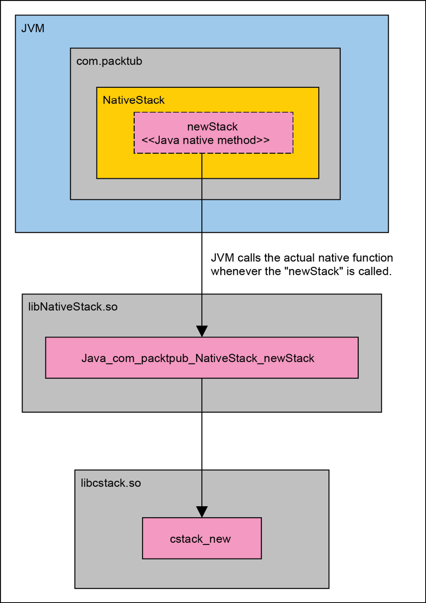

<a id="_idParaDest-308"></a>

# Chương 21: Tích hợp với các ngôn ngữ khác (Integration with Other Languages)

Biết cách viết một chương trình hay library C có thể có giá trị hơn bạn nghĩ. Do vai trò quan trọng của C trong việc phát triển hệ điều hành, C không bị giới hạn trong thế giới riêng của nó. Các library C có tiềm năng được nạp và dùng trong các ngôn ngữ lập trình khác nữa. Trong khi bạn đang hưởng lợi từ việc viết code bằng một ngôn ngữ lập trình higher-level, bạn có thể có sức mạnh tên lửa của C dưới dạng một library được nạp bên trong môi trường ngôn ngữ của bạn.

Trong chương này, chúng ta sẽ nói thêm về điều này, và minh họa cách các shared library C có thể được tích hợp với một số ngôn ngữ lập trình well-known.

Trong chương này, chúng ta sẽ trình bày các chủ đề then chốt sau:

- Chúng ta thảo luận tại sao việc tích hợp lại khả thi ngay từ đầu. Thảo luận này quan trọng vì nó cho bạn ý niệm cơ bản về cách việc tích hợp hoạt động.
- Chúng ta thiết kế một library stack C. Chúng ta build nó thành một shared object file. Shared object file này sẽ được dùng bởi một số ngôn ngữ lập trình khác.
- Chúng ta đi qua C++, Java, Python và Golang và xem library stack có thể được nạp trước và sau đó được dùng như thế nào.

Như một lưu ý chung trong chương này, vì chúng ta sẽ làm việc trên năm dự án con khác nhau, mỗi dự án có các ngôn ngữ lập trình khác nhau, chúng tôi chỉ trình bày các bản build cho Linux để ngăn mọi vấn đề liên quan đến việc build và thực thi. Dĩ nhiên, chúng tôi đưa ra đủ thông tin về hệ thống macOS, nhưng trọng tâm của chúng tôi là build và chạy các source trên Linux. Các script khác có sẵn trong GitHub repository của cuốn sách giúp bạn build các source cho macOS.

Phần đầu tiên nói về bản thân việc tích hợp. Chúng ta xem tại sao việc tích hợp với các ngôn ngữ lập trình khác lại khả thi và nó tạo cơ sở cho việc mở rộng thảo luận của chúng ta trong các môi trường khác ngoài C.

<a id="_idParaDest-309"></a>

## Tại sao việc tích hợp lại khả thi?

Như chúng tôi đã giải thích trong *Chương 10*, *Unix – Lịch sử và Architecture*, C đã cách mạng hóa cách chúng ta phát triển hệ điều hành. Đó không phải là phép màu duy nhất của C; nó cũng cho chúng ta sức mạnh để xây dựng các ngôn ngữ lập trình <a id="_idIndexMarker1560"></a>general-purpose khác trên nó. Ngày nay, chúng ta gọi chúng là các ngôn ngữ lập trình higher-level. Compiler của những ngôn ngữ này hầu hết được viết bằng C và nếu không, chúng đã được phát triển bởi các công cụ và compiler khác được viết bằng C.

Một ngôn ngữ lập trình general-purpose không thể dùng hay cung cấp các chức năng của một hệ thống thì chẳng làm được gì cả. Bạn có thể viết những thứ bằng nó, nhưng bạn không thể thực thi nó trên bất kỳ hệ thống nào. Dù có thể có những cách dùng cho một ngôn ngữ lập trình như vậy từ góc nhìn lý thuyết, chắc chắn nó không hợp lý từ góc nhìn công nghiệp. Do đó, ngôn ngữ lập trình, đặc biệt thông qua compiler của nó, nên có khả năng tạo ra các chương trình hoạt động được. Như bạn biết, các chức năng của một hệ thống được phơi ra thông qua hệ điều hành. Bất kể bản thân hệ điều hành là gì, một ngôn ngữ lập trình nên có khả năng cung cấp những chức năng đó, và các chương trình được viết bằng ngôn ngữ đó, và đang chạy trên hệ thống đó, nên có khả năng dùng chúng.

Đây là lúc C xuất hiện. Trong các hệ điều hành Unix-like, thư viện chuẩn C cung cấp API để dùng các chức năng có sẵn của hệ thống. Nếu một compiler muốn tạo một chương trình hoạt động được, nó nên có khả năng cho phép chương trình đã biên dịch dùng thư viện chuẩn C theo một cách gián tiếp. Bất kể ngôn ngữ lập trình là gì và liệu nó có cung cấp một thư viện chuẩn cụ thể và native nào không, như<a id="_idIndexMarker1561"></a> Java, vốn cung cấp **Java Standard Edition** (**Java SE**), mọi yêu cầu về một chức năng cụ thể được chương trình đã viết đưa ra (như mở một file) đều nên được chuyển xuống thư viện chuẩn C và từ đó, nó có thể đến kernel và được thực hiện.

Ví dụ, hãy nói thêm một chút về Java. Các chương trình Java<a id="_idIndexMarker1562"></a> được biên dịch thành một ngôn ngữ trung gian gọi là *bytecode*. Để thực thi một Java bytecode, người ta cần cài đặt **Java Runtime Environment** (**JRE**). JRE có<a id="_idIndexMarker1563"></a> một máy ảo ở trung tâm nạp Java bytecode và chạy nó bên trong chính nó. Máy ảo này phải có khả năng mô phỏng các chức năng và dịch vụ được thư viện chuẩn C phơi ra và cung cấp chúng cho chương trình đang chạy bên trong. Vì mỗi nền tảng có thể khác nhau về thư viện chuẩn C và sự tuân thủ của nó với các chuẩn POSIX và SUS, chúng ta cần có một số máy ảo được build riêng cho mỗi nền tảng.

Lưu ý cuối cùng về các library có thể được nạp trong các ngôn ngữ khác, chúng ta chỉ có thể nạp các shared object file và không thể nạp và dùng các static library. Static library chỉ có thể được link vào một executable hay một shared object file. Shared object file có phần mở rộng `.so` trong hầu hết các hệ thống Unix-like nhưng chúng có phần mở rộng `.dylib` trong macOS.

Trong phần này, mặc dù ngắn, tôi đã cố gắng cho bạn một ý niệm cơ bản về lý do tại sao chúng ta có thể nạp các library C, cụ thể là các shared library, và hầu hết các ngôn ngữ lập trình đã đang dùng các library C như thế nào, vì khả năng nạp một shared object library và dùng nó tồn tại trong hầu hết chúng.

Bước tiếp theo sẽ là viết một library C và sau đó nạp nó trong các ngôn ngữ lập trình khác nhau để dùng nó. Đó chính xác là những gì chúng ta muốn làm ngay sau đây nhưng trước đó bạn cần biết cách lấy tài liệu của chương và cách chạy các lệnh thấy trong các shell box.

<a id="_idParaDest-310"></a>

## Lấy các tài liệu cần thiết

Vì chương này<a id="_idIndexMarker1565"></a> đầy các source từ năm ngôn ngữ lập trình khác nhau, và hy vọng của tôi là tất cả các bạn đều có thể build và chạy các ví dụ, tôi đã dành phần này để đi qua một số lưu ý cơ bản mà bạn nên biết về việc build source code.

Trước hết, bạn cần lấy tài liệu của chương. Như bạn hẳn đã biết đến giờ, cuốn sách có một repository trong đó chương này có một thư mục cụ thể tên là `ch21-integration-with-other-languages`. Các lệnh sau cho bạn thấy cách clone repository và chuyển tới thư mục gốc của chương:

```
$ git clone https://github.com/PacktPublishing/Extreme-C.git
...
$ cd Extreme-C/ch21-integration-with-other-languages
$
```

*Shell Code 21-1: Clone GitHub repository của cuốn sách và chuyển tới thư mục gốc của chương*

Về các shell box trong chương này, chúng tôi giả định rằng trước khi thực thi các lệnh trong một shell box, chúng ta đang ở thư mục gốc của chương, trong thư mục `ch21-integration-with-other-languages`. Nếu chúng ta cần chuyển tới các thư mục khác, chúng tôi cung cấp các lệnh cần thiết cho điều đó, nhưng mọi thứ đều diễn ra bên trong thư mục của chương.

Ngoài ra, để có thể build source code, bạn cần cài đặt **Java Development Kit** (**JDK**), Python và Golang trên máy của mình. Tùy thuộc vào việc bạn đang dùng Linux hay macOS, và tùy vào bản phân phối Linux của bạn, các lệnh cài đặt có thể khác nhau.

Lưu ý cuối cùng, source code được viết bằng các ngôn ngữ khác ngoài C nên có khả năng dùng library stack C mà chúng ta thảo luận trong phần sắp tới. Việc build những source đó đòi hỏi bạn đã build library C. Do đó, hãy bảo đảm rằng bạn đọc phần sau trước và đã build shared object library của nó trước khi chuyển sang các phần tiếp theo. Giờ bạn đã biết cách lấy tài liệu của chương, chúng ta có thể tiếp tục thảo luận về library C đích của chúng ta.

<a id="_idParaDest-311"></a>

## Library stack

Trong phần này, chúng ta sẽ viết một library nhỏ sẽ được nạp và dùng bởi các chương trình được viết<a id="_idIndexMarker1567"></a> bằng các ngôn ngữ lập trình khác. Library này là về một class Stack cung cấp một số thao tác cơ bản như *push* hay *pop* trên các đối tượng stack. Các đối tượng stack được tạo và hủy bởi chính library và có một hàm constructor, cũng như một hàm destructor, để thực hiện mục đích này.

Tiếp theo, bạn có thể tìm thấy public interface của library, tồn tại như một phần của header file `cstack.h`:

```
#ifndef _CSTACK_H_
#define _CSTACK_H_
#include <unistd.h>
#ifdef __cplusplus
extern "C" {
#endif
#define TRUE 1
#define FALSE 0
typedef int bool_t;
typedef struct {
  char* data;
  size_t len;
} value_t;
typedef struct cstack_type cstack_t;
typedef void (*deleter_t)(value_t* value);
value_t make_value(char* data, size_t len);
value_t copy_value(char* data, size_t len);
void free_value(value_t* value);
cstack_t* cstack_new();
void cstack_delete(cstack_t*);
// Behavior functions
void cstack_ctor(cstack_t*, size_t);
void cstack_dtor(cstack_t*, deleter_t);
size_t cstack_size(const cstack_t*);
bool_t cstack_push(cstack_t*, value_t value);
bool_t cstack_pop(cstack_t*, value_t* value);
void cstack_clear(cstack_t*, deleter_t);
#ifdef __cplusplus
}
#endif
#endif
```

*Code Box 21-1 [cstack.h]: Public interface của library Stack*

Như chúng tôi đã giải thích trong *Chương 6*, *OOP và Encapsulation*, các khai báo trên giới thiệu<a id="_idIndexMarker1568"></a> public interface của class Stack. Như bạn thấy, attribute structure đồng hành của class là `cstack_t`. Chúng tôi đã dùng `cstack_t` thay vì `stack_t` vì cái sau được dùng trong thư viện chuẩn C và tôi muốn tránh mọi sự mơ hồ trong code này. Với các khai báo trên, attribute structure được forward declare và không có trường nào bên trong. Thay vào đó, các chi tiết sẽ có trong source file thực hiện bản triển khai thực sự. Class cũng có một constructor, một destructor, và một số behavior khác như push và pop. Như bạn có thể thấy, tất cả chúng đều nhận một pointer kiểu `cstack_t` làm argument đầu tiên chỉ ra đối tượng mà chúng nên tác động lên. Cách chúng ta viết class Stack được giải thích như một phần của *implicit encapsulation* trong *Chương 6*, *OOP và Encapsulation*.

*Code Box 21-2* chứa bản triển khai của class stack. Nó cũng chứa định nghĩa thực sự cho attribute structure `cstack_t`:

```
#include <stdlib.h>
#include <assert.h>
#include "cstack.h"
struct cstack_type {
  size_t top;
  size_t max_size;
  value_t* values;
};
value_t copy_value(char* data, size_t len) {
  char* buf = (char*)malloc(len * sizeof(char));
  for (size_t i = 0; i < len; i++) {
    buf[i] = data[i];
  }
  return make_value(buf, len);
}
value_t make_value(char* data, size_t len) {
  value_t value;
  value.data = data;
  value.len = len;
  return value;
}
void free_value(value_t* value) {
  if (value) {
    if (value->data) {
      free(value->data);
      value->data = NULL;
    }
  }
}
cstack_t* cstack_new() {
  return (cstack_t*)malloc(sizeof(cstack_t));
}
void cstack_delete(cstack_t* stack) {
  free(stack);
}
void cstack_ctor(cstack_t* cstack, size_t max_size) {
  cstack->top = 0;
  cstack->max_size = max_size;
  cstack->values = (value_t*)malloc(max_size * sizeof(value_t));
}
void cstack_dtor(cstack_t* cstack, deleter_t deleter) {
  cstack_clear(cstack, deleter);
  free(cstack->values);
}
size_t cstack_size(const cstack_t* cstack) {
  return cstack->top;
}
bool_t cstack_push(cstack_t* cstack, value_t value) {
  if (cstack->top < cstack->max_size) {
    cstack->values[cstack->top++] = value;
    return TRUE;
  }
  return FALSE;
}
bool_t cstack_pop(cstack_t* cstack, value_t* value) {
  if (cstack->top > 0) {
    *value = cstack->values[--cstack->top];
    return TRUE;
  }
  return FALSE;
}
void cstack_clear(cstack_t* cstack, deleter_t deleter) {
  value_t value;
  while (cstack_size(cstack) > 0) {
    bool_t popped = cstack_pop(cstack, &value);
    assert(popped);
    if (deleter) {
      deleter(&value);
    }
  }
}
```

*Code Box 21-2 [cstack.c]: Định nghĩa của class stack*

Như bạn thấy, định nghĩa ngụ ý rằng mỗi đối tượng stack được hỗ trợ bởi một mảng, và hơn thế nữa, chúng ta có thể lưu bất kỳ giá trị nào trong stack. Hãy build library và tạo một shared object library <a id="_idIndexMarker1570"></a>từ nó. Đây sẽ là file library sẽ được nạp bởi các ngôn ngữ lập trình khác trong các phần sắp tới.

Shell box sau cho thấy cách tạo một shared object library bằng các source file hiện có. Các lệnh có trong text box hoạt động trong Linux và chúng nên được thay đổi đôi chút để hoạt động trong macOS. Lưu ý rằng trước khi chạy các lệnh build, bạn nên ở trong thư mục gốc của chương này như đã giải thích trước đây:

```
$ gcc -c -g -fPIC cstack.c -o cstack.o
$ gcc -shared cstack.o -o libcstack.so
$
```

*Shell Box 21-2: Build library stack và tạo file shared object library trong Linux*

Một lưu ý bên lề, trong macOS, chúng ta có thể chạy chính xác các lệnh trên nếu `gcc` là một lệnh đã biết và nó đang trỏ tới compiler `clang`. Nếu không, chúng ta có thể dùng các lệnh sau để build library trên macOS. Lưu ý rằng phần mở rộng của shared object file là .`dylib` trong macOS:

```
$ clang -c -g -fPIC cstack.c -o cstack.o
$ clang -dynamiclib cstack.o -o libcstack.dylib
$
```

*Shell Box 21-3: Build library stack và tạo file shared object library trong macOS*

Giờ chúng ta đã có file shared object library, và chúng ta có thể viết các chương trình bằng các ngôn ngữ khác có thể nạp nó. Trước khi đưa ra minh họa về cách library trên có thể được nạp và dùng trong các môi trường khác, chúng ta cần viết một số test để kiểm chứng chức năng của nó. Code sau tạo một stack và thực hiện một số thao tác có sẵn và kiểm tra kết quả so với kỳ vọng:

```
#include <stdio.h>
#include <stdlib.h>
#include <assert.h>
#include "cstack.h"
value_t make_int(int int_value) {
  value_t value;
  int* int_ptr = (int*)malloc(sizeof(int));
  *int_ptr = int_value;
  value.data = (char*)int_ptr;
  value.len = sizeof(int);
  return value;
}
int extract_int(value_t* value) {
  return *((int*)value->data);
}
void deleter(value_t* value) {
  if (value->data) {
    free(value->data);
  }
  value->data = NULL;
}
int main(int argc, char** argv) {
  cstack_t* cstack = cstack_new();
  cstack_ctor(cstack, 100);
  assert(cstack_size(cstack) == 0);
  int int_values[] = {5, 10, 20, 30};
  for (size_t i = 0; i < 4; i++) {
    cstack_push(cstack, make_int(int_values[i]));
  }
  assert(cstack_size(cstack) == 4);
  int counter = 3;
  value_t value;
  while (cstack_size(cstack) > 0) {
    bool_t popped = cstack_pop(cstack, &value);
    assert(popped);
    assert(extract_int(&value) == int_values[counter--]);
    deleter(&value);
  }
  assert(counter == -1);
  assert(cstack_size(cstack) == 0);
  cstack_push(cstack, make_int(10));
  cstack_push(cstack, make_int(20));
  assert(cstack_size(cstack) == 2);
  cstack_clear(cstack, deleter);
  assert(cstack_size(cstack) == 0);
   // In order to have something in the stack while
  // calling destructor.
  cstack_push(cstack, make_int(20));
  cstack_dtor(cstack, deleter);
  cstack_delete(cstack);
  printf("All tests were OK.\n");
  return 0;
}
```

*Code Box 21-3 [cstack_tests.c]: Code kiểm thử chức năng của class Stack*

Như bạn có thể thấy, chúng ta<a id="_idIndexMarker1571"></a> đã dùng assertion để kiểm tra các giá trị trả về. Sau đây là output của code trên sau khi được build và thực thi trong Linux. Một lần nữa, lưu ý rằng chúng ta đang ở thư mục gốc của chương:

```
$ gcc -c -g cstack_tests.c -o tests.o
$ gcc tests.o -L$PWD -lcstack -o cstack_tests.out
$ LD_LIBRARY_PATH=$PWD ./cstack_tests.out
All tests were OK.
$
```

*Shell Box 21-4: Build và chạy các test của library*

Lưu ý rằng trong shell box trên, khi chạy executable file cuối cùng `cstack_tests.out`, chúng ta phải đặt biến môi trường `LD_LIBRARY_PATH` trỏ tới thư mục chứa `libcstack.so`, vì chương trình được thực thi cần tìm các shared object library và nạp chúng.

Như bạn thấy trong *Shell Box 21-4*, mọi test đều đã qua thành công. Điều này có nghĩa là từ góc nhìn chức năng, library của chúng ta đang hoạt động đúng. Sẽ tốt nếu kiểm tra library theo một yêu cầu non-functional như mức sử dụng memory hay việc không có memory leak.

Lệnh sau <a id="_idIndexMarker1572"></a>cho thấy cách dùng `valgrind` để kiểm tra việc thực thi các test cho bất kỳ memory leak khả dĩ nào:

```
$ LD_LIBRARY_PATH=$PWD valgrind --leak-check=full ./cstack_tests.out
==31291== Memcheck, a memory error detector
==31291== Copyright (C) 2002-2017, and GNU GPL'd, by Julian Seward et al.
==31291== Using Valgrind-3.13.0 and LibVEX; rerun with -h for copyright info
==31291== Command: ./cstack_tests.out
==31291==
All tests were OK.
==31291==
==31291== HEAP SUMMARY:
==31291==     in use at exit: 0 bytes in 0 blocks
==31291==   total heap usage: 10 allocs, 10 frees, 2,676 bytes allocated
==31291==
==31291== All heap blocks were freed -- no leaks are possible
==31291==
==31291== For counts of detected and suppressed errors, rerun with: -v
==31291== ERROR SUMMARY: 0 errors from 0 contexts (suppressed: 0 from 0)
$
```

*Shell Box 21-5: Chạy các test bằng valgrind*

Như bạn có thể thấy, chúng ta không có memory leak nào, và điều này cho chúng ta thêm tin tưởng vào library mà chúng ta đã viết. Do đó, nếu chúng ta thấy bất kỳ vấn đề memory nào trong một môi trường khác, nguyên nhân gốc rễ nên được điều tra ở đó trước.

Trong chương sau, chúng ta sẽ trình bày unit testing trong C. Như một sự thay thế phù hợp cho các câu lệnh `assert` thấy trong *Code Box 21-3*, chúng ta có thể viết unit test và dùng một unit testing framework như CMocka để thực thi chúng.

Trong các phần sau, chúng ta sẽ tích hợp library stack vào các chương trình được viết bằng bốn ngôn ngữ lập trình. Chúng ta sẽ bắt đầu với C++.

<a id="_idParaDest-312"></a>

## Tích hợp với C++

Việc tích hợp với<a id="_idIndexMarker1574"></a> C++ có thể được coi là dễ nhất. C++ có thể được coi như một phần mở rộng object-oriented của C. Một compiler C++ tạo ra các object file tương tự những gì một compiler C tạo ra. Do đó, một chương trình C++ có thể nạp và dùng một shared object library C dễ hơn bất kỳ ngôn ngữ lập trình nào khác. Nói cách khác, không quan trọng một shared object file là output của một dự án C hay C++; cả hai đều có thể được một chương trình C++ sử dụng. Thứ duy nhất có thể gây vấn đề trong một số trường hợp là tính năng *name mangling* của C++ được mô tả trong *Chương 2*, *Biên dịch và Liên kết (Compilation and Linking)*. Để nhắc lại, chúng ta sẽ điểm lại ngắn gọn nó trong phần sau.

<a id="_idParaDest-313"></a>

### Name mangling trong C++

Để giải thích <a id="_idIndexMarker1575"></a>thêm về điều này, chúng ta nên nói rằng tên symbol tương ứng với các hàm (cả hàm global lẫn member function trong class) đều bị mangle trong C++. Name mangling chủ yếu có mặt để hỗ trợ *namespace* và *function overloading*, vốn không có trong C. Name mangling được bật mặc định, do đó nếu code C được biên dịch bằng một compiler C++, chúng ta kỳ vọng thấy các tên symbol bị mangle. Hãy xem ví dụ sau trong *Code Box 21-4*:

```
int add(int a, int b) {
  return a + b;
}
```

*Code Box 21-4 [test.c]: Một hàm đơn giản trong C*

Nếu chúng ta biên dịch file trên bằng một compiler C, trong trường hợp này là `clang`, chúng ta thấy các symbol sau trong object file được tạo ra, được thể hiện trong *Shell Box 21-6*. Lưu ý rằng file `test.c` không tồn tại trong GitHub repository của cuốn sách:

```
$ clang -c test.c -o test.o
$ nm test.o
0000000000000000 T _add
$
```

*Shell Box 21-6: Biên dịch test.c bằng một compiler C*

Như bạn thấy, chúng ta có một symbol tên là `_add` tham chiếu tới hàm `add` được định nghĩa ở trên. Giờ, hãy biên dịch file bằng một compiler C++, trong trường hợp này là `clang++`:

```
$ clang++ -c test.c -o test.o
clang: warning: treating 'c' input as 'c++' when in C++ mode, this behavior is deprecated [-Wdeprecated]
$ nm test.o
0000000000000000 T __Z3addii
$
```

*Shell Box 21-7: Biên dịch test.c bằng một compiler C++*

Như bạn có thể thấy, `clang++` đã sinh ra một cảnh báo nói rằng trong tương lai gần, việc hỗ trợ biên dịch <a id="_idIndexMarker1576"></a>code C như code C++ sẽ bị bỏ. Nhưng vì hành vi này chưa bị loại bỏ (và nó chỉ bị deprecated), chúng ta thấy rằng tên symbol được sinh ra cho hàm trên bị mangle và khác với tên được `clang` sinh ra. Điều này chắc chắn có thể dẫn đến vấn đề trong giai đoạn linking khi tìm một symbol cụ thể.

Để loại bỏ vấn đề này, người ta cần bọc code C bên trong một scope đặc biệt ngăn một compiler C++ mangle tên symbol. Khi đó, biên dịch nó bằng `clang` và `clang++` tạo ra cùng tên symbol. Hãy xem code sau trong *Code Box 21-5,* vốn là một phiên bản đã thay đổi của code được giới thiệu trong *Code Box 21-4*:

```
#ifdef __cplusplus
extern "C" {
#endif
int add(int a, int b) {
  return a + b;
}
#ifdef __cplusplus
}
#endif
```

*Code Box 21-5 [test.c]: Đặt khai báo hàm vào scope C đặc biệt*

Hàm trên được đặt trong scope `extern "C" { ... }` chỉ khi macro `__cplusplus` đã được định nghĩa. Có macro `__cplusplus` là dấu hiệu cho thấy code đang được biên dịch bởi một compiler C++. Hãy biên dịch lại code trên bằng `clang++`:

```
$ clang++ -c test.c -o test.o
clang: warning: treating 'c' input as 'c++' when in C++ mode, this behavior is deprecated [-Wdeprecated]
$ nm test.o
0000000000000000 T _add
$
```

*Shell Box 21-8: Biên dịch phiên bản mới của test.c bằng clang++*

Như bạn thấy, symbol được sinh ra không còn bị mangle nữa. Về library stack của chúng ta, dựa trên những gì chúng tôi <a id="_idIndexMarker1577"></a>đã giải thích cho đến giờ, chúng ta cần đặt mọi khai báo trong scope `extern "C" { … }` và đây chính xác là lý do đằng sau việc có scope đó trong *Code Box 21-1*. Do đó, khi link một chương trình C++ với library stack, các symbol có thể được tìm thấy bên trong `libcstack.so` (hay `libcstack.dylib`).

> **Lưu ý**:
>
> `extern "C"` là một *linkage specification*. Thêm<a id="_idIndexMarker1578"></a> thông tin có thể được<a id="_idIndexMarker1579"></a> tìm thấy qua các link sau:
>
> https://isocpp.org/wiki/faq/mixing-c-and-cpp
>
> https://stackoverflow.com/questions/1041866/what-is-the-effect-of-extern-c-in-c.

Giờ, đã đến lúc viết code C++ dùng library stack của chúng ta. Như bạn sẽ thấy ngay sau đây, đó là một sự tích hợp dễ dàng.

<a id="_idParaDest-314"></a>

### Code C++

Giờ chúng ta đã biết<a id="_idIndexMarker1580"></a> cách vô hiệu hóa name mangling khi đưa code C vào một dự án C++, chúng ta có thể tiếp tục bằng việc viết một chương trình C++ dùng library stack. Chúng ta bắt đầu bằng việc bọc library stack trong một class C++, vốn là khối xây dựng chính của một chương trình C++ object-oriented. Phơi ra chức năng stack theo kiểu object-oriented thích hợp hơn là để các hàm C của library stack được gọi trực tiếp.

*Code Box 21-6* chứa class bọc chức năng stack được lấy từ library stack:

```
#include <string.h>
#include <iostream>
#include <string>
#include "cstack.h"
template<typename T>
value_t CreateValue(const T& pValue);
template<typename T>
T ExtractValue(const value_t& value);
template<typename T>
class Stack {
public:
  // Constructor
  Stack(int pMaxSize) {
    mStack = cstack_new();
    cstack_ctor(mStack, pMaxSize);
  }
  // Destructor
  ~Stack() {
    cstack_dtor(mStack, free_value);
    cstack_delete(mStack);
  }
  size_t Size() {
    return cstack_size(mStack);
  }
  void Push(const T& pItem) {
    value_t value = CreateValue(pItem);
    if (!cstack_push(mStack, value)) {
      throw "Stack is full!";
    }
  }
  const T Pop() {
    value_t value;
    if (!cstack_pop(mStack, &value)) {
      throw "Stack is empty!";
    }
    return ExtractValue<T>(value);
  }
  void Clear() {
    cstack_clear(mStack, free_value);
  }
private:
  cstack_t* mStack;
};
```

*Code Box 21-6 [c++/Stack.cpp]: Một class C++ bọc các chức năng được library stack phơi ra*

Về class trên<a id="_idIndexMarker1581"></a>, chúng ta có thể chỉ ra các lưu ý quan trọng sau:

- Class trên giữ một pointer private tới một biến `cstack_t`. Pointer này trỏ tới đối tượng được tạo bởi hàm `cstack_new` của static library. Pointer này có thể được coi như một *handle* tới một đối tượng tồn tại ở mức C, được tạo và quản lý bởi một library C riêng. Pointer `mStack` tương tự một file descriptor (hay file handle) tham chiếu tới một file.
- Class bọc mọi behavior function được library stack phơi ra. Điều này không nhất thiết đúng với mọi wrapper object-oriented quanh một library C, và thường chỉ một tập chức năng giới hạn được phơi ra.
- Class trên là một template class. Điều này có nghĩa là nó có thể thao tác trên nhiều kiểu dữ liệu khác nhau. Như bạn có thể thấy, chúng ta đã khai báo hai template function để serialize và deserialize các đối tượng với các kiểu khác nhau: `CreateValue` và `ExtractValue`. Class trên dùng những hàm này lần lượt để tạo một mảng byte từ một đối tượng C++ (serialization) và để tạo một đối tượng C++ từ một mảng byte (deserialization).
- Chúng ta định nghĩa một template function được đặc tả hóa (specialized) cho kiểu `std::string`. Do đó, chúng ta có thể dùng class trên để lưu các giá trị với kiểu `std::string`. Lưu ý rằng `std::string` là kiểu chuẩn trong C++ để có một biến chuỗi.
- Trong library stack, bạn có thể có nhiều giá trị từ các kiểu khác nhau được push vào một instance stack duy nhất. Giá trị có thể được chuyển đổi sang/từ một mảng ký tự. Hãy xem structure `value_t` trong *Code Box 21-1*. Nó chỉ cần một pointer `char` và chỉ vậy thôi. Không giống library stack, class C++ trên là *type-safe* và mỗi instance của nó chỉ có thể thao tác trên một kiểu dữ liệu cụ thể.
- Trong C++, mỗi class có ít nhất một constructor và một destructor. Do đó, sẽ dễ dàng khởi tạo đối tượng stack bên dưới trong constructor và hoàn tất nó trong destructor. Đó chính xác là những gì bạn thấy trong code trên.

Chúng ta muốn class C++ của mình có thể thao tác trên các giá trị chuỗi. Do đó, chúng ta cần viết các hàm serializer và deserializer phù hợp có thể được dùng bên trong class. Code sau chứa định nghĩa các hàm chuyển đổi một mảng char C thành một đối tượng `std::string` và ngược lại:

```
template<>
value_t CreateValue(const std::string& pValue) {
  value_t value;
  value.len = pValue.size() + 1;
  value.data = new char[value.len];
  strcpy(value.data, pValue.c_str());
  return value;
}
template<>
std::string ExtractValue(const value_t& value) {
  return std::string(value.data, value.len);
}
```

*Code Box 21-7 [c++/Stack.cpp]: Các template function được đặc tả hóa dùng cho serialization/deserialization kiểu std::string. Những hàm này được dùng như một phần của class C++.*

Các hàm trên là *specialization* (đặc tả hóa) `std::string` cho template function đã khai báo được dùng trong class. Như bạn có thể thấy, nó định nghĩa một đối tượng `std::string` nên được chuyển đổi thành một mảng char C như thế nào, và ngược lại một mảng char C có thể được biến thành một đối tượng `std::string` như thế nào.

*Code Box 21-8* chứa method `main` dùng class C++:

```
int main(int argc, char** argv) {
  Stack<std::string> stringStack(100);
  stringStack.Push("Hello");
  stringStack.Push("World");
  stringStack.Push("!");
  std::cout << "Stack size: " << stringStack.Size() << std::endl;
  while (stringStack.Size() > 0) {
    std::cout << "Popped > " << stringStack.Pop() << std::endl;
  }
  std::cout << "Stack size after pops: " <<
      stringStack.Size() << std::endl;
  stringStack.Push("Bye");
  stringStack.Push("Bye");
  std::cout << "Stack size before clear: " <<
      stringStack.Size() << std::endl;
  stringStack.Clear();
  std::cout << "Stack size after clear: " <<
      stringStack.Size() << std::endl;
  return 0;
}
```

*Code Box 21-8 [c++/Stack.cpp]: Hàm main dùng class stack C++*

Kịch bản trên bao quát mọi hàm được library stack phơi ra. Chúng ta thực thi một số thao tác và kiểm tra kết quả của chúng. Lưu ý rằng code trên dùng một đối tượng `Stack<std::string>` để kiểm thử chức năng. Do đó, người ta chỉ có thể push/pop các giá trị `std::string` vào/khỏi stack.

Shell box sau<a id="_idIndexMarker1583"></a> cho thấy cách build và chạy code trên. Lưu ý rằng mọi code C++ mà bạn đã thấy trong phần này đều được viết bằng C++11, do đó nó nên được biên dịch bằng một compiler tương thích. Như chúng tôi đã nói trước đây, chúng ta đang chạy các lệnh sau khi ở trong thư mục gốc của chương:

```
$ cd c++
$ g++ -c -g -std=c++11 -I$PWD/.. Stack.cpp -o Stack.o
$ g++ -L$PWD/.. Stack.o -lcstack -o cstack_cpp.out
$ LD_LIBRARY_PATH=$PWD/.. ./cstack_cpp.out
Stack size: 3
Popped > !
Popped > World
Popped > Hello
Stack size after pops: 0
Stack size before clear: 2
Stack size after clear: 0
$
```

*Shell Box 21-9: Build và chạy code C++*

Như bạn có thể thấy, chúng ta đã chỉ ra rằng chúng ta sẽ dùng một compiler C++11 bằng cách truyền tùy chọn `-std=c++11`. Hãy lưu ý các tùy chọn `-I` và `-L`, lần lượt được dùng để chỉ định các thư mục include và library tùy chỉnh. Tùy chọn `-lcstack` yêu cầu linker link code C++ với file library `libcstack.so`. Lưu ý rằng trên các hệ thống macOS, các shared object library có phần mở rộng `.dylib`, và do đó bạn có thể thấy `libcstack.dylib` thay vì `libcstack.so`.

Để chạy executable file `cstack_cpp.out`, loader cần tìm `libcstack.so`. Lưu ý rằng điều này khác với việc build executable. Ở đây chúng ta muốn chạy nó, và file library phải được định vị trước khi executable chạy. Do đó, bằng cách thay đổi biến môi trường `LD_LIBRARY_PATH`, chúng ta cho loader biết nơi nó nên tìm các shared object. Chúng ta đã thảo luận thêm về điều này trong *Chương 2*, *Biên dịch và Liên kết (Compilation and Linking)*.

Code C++ cũng nên được kiểm thử về memory leak. `valgrind` giúp chúng ta thấy các memory leak và chúng ta dùng nó để phân tích executable thu được. Shell box sau cho thấy output của `valgrind` khi chạy executable file `cstack_cpp.out`:

```
$ cd c++
$ LD_LIBRARY_PATH=$PWD/.. valgrind --leak-check=full ./cstack_cpp.out
==15061== Memcheck, a memory error detector
==15061== Copyright (C) 2002-2017, and GNU GPL'd, by Julian Seward et al.
==15061== Using Valgrind-3.13.0 and LibVEX; rerun with -h for copyright info
==15061== Command: ./cstack_cpp.out
==15061==
Stack size: 3
Popped > !
Popped > World
Popped > Hello
Stack size after pops: 0
Stack size before clear: 2
Stack size after clear: 0
==15061==
==15061== HEAP SUMMARY:
==15061==     in use at exit: 0 bytes in 0 blocks
==15061==   total heap usage: 9 allocs, 9 frees, 75,374 bytes allocated
==15061==
==15061== All heap blocks were freed -- no leaks are possible
==15061==
==15061== For counts of detected and suppressed errors, rerun with: -v
==15061== ERROR SUMMARY: 0 errors from 0 contexts (suppressed: 0 from 0)
$
```

*Shell Box 21-10: Build và chạy code C++ bằng valgrind*

Như đã rõ từ output trên, chúng ta không có leak nào trong code. Lưu ý rằng việc có 1081 byte trong<a id="_idIndexMarker1585"></a> phần `still reachable` không có nghĩa là bạn đã có một leak trong code. Bạn có thể tìm hiểu thêm về điều này trong manual của `valgrind`.

Trong phần này, chúng tôi đã giải thích cách viết một wrapper C++ quanh library stack C của chúng ta. Dù việc trộn code C và C++ có vẻ dễ dàng, cần thêm chút cẩn thận về các quy tắc name mangling trong C++. Trong phần tiếp theo, chúng ta sẽ nói ngắn gọn về ngôn ngữ lập trình Java và cách mà chúng ta sẽ nạp library C của mình trong một chương trình được viết bằng Java.

<a id="_idParaDest-315"></a>

## Tích hợp với Java

Các chương trình Java được<a id="_idIndexMarker1586"></a> một Java compiler biên dịch thành Java bytecode. Java bytecode tương tự định dạng object file được quy định trong **Application Binary Interface** (**ABI**). Các file chứa Java bytecode không thể được thực thi như các executable file thông thường, và chúng cần một môi trường đặc biệt để chạy.

Java bytecode chỉ có thể được chạy bên trong một **Java Virtual Machine** (**JVM**). Bản thân JVM là một process mô phỏng một môi trường làm việc cho Java bytecode. Nó thường được viết bằng C hay C++ và có khả năng nạp và dùng thư viện chuẩn C và các chức năng được phơi ra ở tầng đó.

> Ngôn ngữ lập trình Java<a id="_idIndexMarker1587"></a> không phải là ngôn ngữ duy nhất có thể được biên dịch thành Java bytecode. Scala, Kotlin và Groovy nằm trong số các ngôn ngữ lập trình có thể được biên dịch thành Java bytecode, do đó chúng có thể được chạy bên trong một JVM. Chúng thường được gọi là *JVM language*.

Trong phần này, chúng ta sẽ nạp library stack đã build vào một chương trình Java. Đối với những ai chưa có kiến thức trước về Java, các bước chúng ta thực hiện có thể có vẻ phức tạp và khó nắm bắt. Do đó, rất khuyến khích người đọc đến với phần này với một số kiến thức cơ bản về lập trình Java.

<a id="_idParaDest-316"></a>

### Viết phần Java

Giả sử rằng chúng ta có một dự án C được <a id="_idIndexMarker1588"></a>build thành một shared object library. Chúng ta muốn đưa nó vào Java và dùng các hàm của nó. May mắn thay, chúng ta có thể viết và biên dịch phần Java mà không cần có bất kỳ code C (hay native) nào. Chúng được tách biệt rõ ràng bởi các *native method* trong Java. Hiển nhiên, bạn không thể chạy chương trình Java chỉ với phần Java, và có các hàm C được gọi, mà không có file shared object library được nạp. Chúng tôi đưa ra các bước và source code cần thiết để làm điều này và chạy một chương trình Java nạp một shared object library và gọi các hàm của nó thành công.

JVM dùng **Java Native Interface** (**JNI**) để nạp <a id="_idIndexMarker1589"></a>các shared object library. Lưu ý rằng JNI không phải là một phần của ngôn ngữ lập trình Java; thay vào đó, nó là một phần của đặc tả JVM, do đó một shared object library được import có thể được dùng trong mọi JVM language như Scala.

Trong các đoạn sau, chúng tôi cho thấy cách dùng JNI để nạp file shared object library đích của chúng ta.

Như chúng tôi đã nói trước đây, JNI dùng native method. Native method không có định nghĩa nào trong Java; định nghĩa thực sự của chúng được viết bằng C hay C++ và chúng nằm trong các shared library bên ngoài. Nói cách khác, native method là các cổng để các chương trình Java giao tiếp với thế giới bên ngoài JVM. Code sau cho thấy một class chứa một số static native method và nó được dự định phơi ra các chức năng do library stack của chúng ta cung cấp:

```
package com.packt.extreme_c.ch21.ex1;
class NativeStack {
  static {
    System.loadLibrary("NativeStack");
  }
  public static native long newStack();
  public static native void deleteStack(long stackHandler);
  public static native void ctor(long stackHandler, int maxSize);
  public static native void dtor(long stackHandler);
  public static native int size(long stackHandler);
  public static native void push(long stackHandler, byte[] item);
  public static native byte[] pop(long stackHandler);
  public static native void clear(long stackHandler);
}
```

*Code Box 21-9 [java/src/com/packt/extreme_c/ch21/ex1/Main.java]: Class NativeStack*

Như các chữ ký method ngụ ý, chúng tương ứng với các hàm chúng ta có trong library stack C. Lưu ý rằng operand thứ nhất là một biến `long`. Nó chứa một native address được đọc từ native library<a id="_idIndexMarker1590"></a> và đóng vai trò như một pointer nên được truyền cho các method khác để chỉ instance stack. Lưu ý rằng, để viết class trên, chúng ta không cần có một shared object file hoạt động đầy đủ từ trước. Thứ duy nhất chúng ta cần là danh sách các khai báo cần thiết để định nghĩa stack API.

Class trên cũng có một *static constructor*. <a id="_idIndexMarker1591"></a>Constructor này nạp một file shared object library nằm trên filesystem và cố khớp các native method với các symbol tìm thấy trong shared object library đó. Lưu ý rằng shared object library trên không phải là `libcstack.so`. Nói cách khác, đây không phải là shared object file mà chúng ta đã tạo cho library stack. JNI có một công thức rất chính xác để tìm các symbol tương ứng với native method. Do đó, chúng ta không thể dùng các symbol được định nghĩa trong `libcstack.so`; thay vào đó chúng ta cần tạo các symbol mà JNI đang tìm và sau đó dùng library stack từ đó.

Điều này có thể hơi chưa rõ lúc này, nhưng trong phần sau, chúng tôi làm rõ điều này và bạn sẽ thấy điều này có thể được thực hiện như thế nào. Hãy tiếp tục với phần Java. Chúng ta vẫn cần thêm một ít code Java nữa.

Sau đây là một class Java generic tên là `Stack<T>` bọc các native method được JNI phơi ra. Các class Java generic có thể được coi là các khái niệm song sinh với các template class mà chúng ta đã có trong C++. Chúng được dùng để chỉ định một số kiểu generic có thể thao tác trên các kiểu khác.

Như bạn thấy trong class `Stack<T>`, có một đối tượng *marshaller*, từ kiểu `Marshaller<T>`, được dùng để <a id="_idIndexMarker1592"></a>serialize và deserialize các argument input của method (từ kiểu `T`) để đặt chúng vào, hay lấy chúng ra từ, stack C bên dưới:

```
interface Marshaller<T> {
  byte[] marshal(T obj);
  T unmarshal(byte[] data);
}
class Stack<T> implements AutoCloseable {
  private Marshaller<T> marshaller;
  private long stackHandler;
  public Stack(Marshaller<T> marshaller) {
    this.marshaller = marshaller;
    this.stackHandler = NativeStack.newStack();
    NativeStack.ctor(stackHandler, 100);
  }
  @Override
  public void close() {
    NativeStack.dtor(stackHandler);
    NativeStack.deleteStack(stackHandler);
  }
  public int size() {
    return NativeStack.size(stackHandler);
  }
  public void push(T item) {
    NativeStack.push(stackHandler, marshaller.marshal(item));
  }
  public T pop() {
    return marshaller.unmarshal(NativeStack.pop(stackHandler));
  }
  public void clear() {
    NativeStack.clear(stackHandler);
  }
}
```

*Code Box 21-10 [java/src/com/packt/extreme_c/ch21/ex1/Main.java]: Class Stack\<T> và interface Marshaller\<T>*

Các điểm sau có vẻ <a id="_idIndexMarker1593"></a>đáng chú ý về code trên:

- Class `Stack<T>` là một generic class. Điều đó có nghĩa là các instance khác nhau của nó có thể thao tác trên các class khác nhau như `String`, `Integer`, `Point`, v.v., nhưng mỗi instance chỉ có thể thao tác trên kiểu được chỉ định khi tạo instance.
- Khả năng lưu bất kỳ kiểu dữ liệu nào trong stack bên dưới đòi hỏi stack dùng một marshaller bên ngoài để thực hiện serialization và deserialization các đối tượng. Library stack C có thể lưu các mảng byte trong một cấu trúc dữ liệu stack và các ngôn ngữ higher-level muốn dùng các chức năng của nó nên có khả năng cung cấp mảng byte đó thông qua serialization các đối tượng input. Bạn sẽ thấy ngay sau đây bản triển khai của interface `Marshaller` cho class `String`.
- Chúng ta inject instance `Marshaller` bằng constructor. Điều này có nghĩa là chúng ta nên có một instance marshaller đã được tạo tương thích với kiểu *generic* của class `T`.
- Class `Stack<T>` triển khai interface `AutoCloseable`. Điều này đơn giản có nghĩa là nó có một số tài nguyên native nên được giải phóng khi hủy. Lưu ý rằng stack thực sự được tạo trong native code chứ không phải trong code Java. Do đó, *garbage collector* của JVM không thể giải phóng stack khi nó không còn cần thiết. Các đối tượng `AutoCloseable` có thể được dùng như các tài nguyên có một scope cụ thể và khi chúng không còn cần thiết, method `close` của chúng được gọi tự động. Ngay sau đây, bạn sẽ thấy cách chúng ta dùng class trên trong một kịch bản test.
- Như bạn thấy, chúng ta có method constructor và chúng ta đã khởi tạo stack bên dưới bằng các native method. Chúng ta giữ một handler tới stack dưới dạng một trường `long` trong class. Lưu ý rằng không giống trong C++, chúng ta không có destructor nào trong class. Do đó, có thể stack bên dưới không được giải phóng và rốt cuộc trở thành một memory leak. Đó là lý do tại sao chúng ta đã đánh dấu class là một `AutoCloseable`. Khi một đối tượng `AutoCloseable` không còn cần thiết, method `close` của nó được gọi và như bạn thấy trong code trên, chúng ta gọi hàm destructor từ library stack C để giải phóng các tài nguyên được stack C cấp phát.

> Nói chung, bạn không thể<a id="_idIndexMarker1595"></a> tin tưởng cơ chế garbage collector sẽ gọi *finalizer method* trên các đối tượng Java và việc dùng các tài nguyên `AutoCloseable` là cách đúng để quản lý tài nguyên native.

Sau đây là bản triển khai của `StringMarshaller`. Bản triển khai rất đơn giản nhờ sự hỗ trợ tuyệt vời của class `String` trong việc làm việc với mảng byte:

```
class StringMarshaller implements Marshaller<String> {
  @Override
  public byte[] marshal(String obj) {
    return obj.getBytes();
  }
  @Override
  public String unmarshal(byte[] data) {
    return new String(data);
  }
}
```

*Code Box 21-11 [java/src/com/packt/extreme_c/ch21/ex1/Main.java]: Class StringMarshaller*

Code <a id="_idIndexMarker1596"></a>sau là class `Main` của chúng ta chứa kịch bản test để minh họa các chức năng stack C thông qua code Java:

```
public class Main {
  public static void main(String[] args) {
    try (Stack<String> stack = new Stack<>(new StringMarshaller())) {
      stack.push("Hello");
      stack.push("World");
      stack.push("!");
      System.out.println("Size after pushes: " + stack.size());
      while (stack.size() > 0) {
        System.out.println(stack.pop());
      }
      System.out.println("Size after pops: " + stack.size());
      stack.push("Ba");
      stack.push("Bye!");
      System.out.println("Size after before clear: " + stack.size());
      stack.clear();
      System.out.println("Size after clear: " + stack.size());
    }
  }
}
```

*Code Box 21-12 [java/src/com/packt/extreme_c/ch21/ex1/Main.java]: Class Main chứa kịch bản test để kiểm tra các chức năng của library stack C*

Như bạn thấy, biến tham chiếu `stack` đang được tạo và dùng bên trong một khối `try`. Cú pháp này thường được gọi là *try-with-resources* và nó đã<a id="_idIndexMarker1597"></a> được giới thiệu trong Java 7. Khi khối `try` kết thúc, method `close` được gọi trên đối tượng tài nguyên và stack bên dưới được giải phóng. Kịch bản test giống như kịch bản chúng ta đã viết cho C++ trong phần trước, nhưng lần này bằng Java.

Trong phần này, chúng tôi <a id="_idIndexMarker1598"></a>đã trình bày phần Java và mọi code Java mà chúng ta cần để import phần native. Mọi source ở trên đều có thể được biên dịch nhưng bạn không thể chạy chúng vì bạn cũng cần phần native. Chỉ khi kết hợp với nhau chúng mới có thể dẫn đến một chương trình thực thi được. Trong phần tiếp theo, chúng ta nói về các bước chúng ta nên thực hiện để viết phần native.

<a id="_idParaDest-317"></a>

### Viết phần native

Điều quan trọng nhất <a id="_idIndexMarker1599"></a>chúng tôi đã giới thiệu trong phần trước là ý tưởng về native method. Native method được khai báo trong Java, nhưng định nghĩa của chúng nằm bên ngoài JVM trong một shared object library. Nhưng làm thế nào JVM tìm thấy định nghĩa của một native method trong các shared object file đã nạp? Câu trả lời rất đơn giản: bằng cách tra cứu các tên symbol nhất định trong các shared object file. JVM trích xuất một tên symbol cho mỗi native method dựa trên các thuộc tính khác nhau của nó như package, class chứa nó, và tên của nó. Sau đó, nó tìm symbol đó trong các shared object library đã nạp và nếu không tìm thấy, nó đưa cho bạn một lỗi.

Dựa trên những gì chúng ta đã xác lập trong phần trước, JVM buộc chúng ta dùng các tên symbol cụ thể cho các hàm chúng ta viết như một phần của shared object file được nạp. Nhưng chúng ta đã không dùng bất kỳ quy ước cụ thể nào khi tạo library stack. Vì vậy, JVM sẽ không thể tìm thấy các hàm được phơi ra từ library stack và chúng ta phải nghĩ ra một cách khác. Nói chung, các library C được viết mà không có bất kỳ giả định nào về việc được dùng trong một môi trường JVM.

*Hình 21-1* cho thấy cách chúng ta có thể dùng một library C hay C++ trung gian để đóng vai trò như chất keo giữa phần Java và phần native. Chúng ta đưa cho JVM các symbol mà nó muốn, và chúng ta ủy thác các lời gọi hàm được thực hiện tới các hàm biểu diễn những symbol đó cho đúng hàm bên trong library C. Về cơ bản đây là cách JNI hoạt động.

Chúng tôi sẽ giải thích điều này bằng một ví dụ tưởng tượng. Giả sử rằng chúng ta muốn thực hiện một lời gọi tới một hàm C, `func`, từ Java, và định nghĩa của hàm có thể được tìm thấy trong shared object file `libfunc.so`. Chúng ta cũng có một class `Clazz` trong phần Java với một native function gọi là `doFunc`. Chúng ta biết rằng JVM sẽ tìm symbol `Java_Clazz_doFunc` khi cố tìm định nghĩa của native function `doFunc`. Chúng ta tạo một<a id="_idIndexMarker1600"></a> shared object library trung gian `libNativeLibrary.so` chứa một hàm với chính xác cùng symbol mà JVM đang tìm. Sau đó, bên trong hàm đó, chúng ta thực hiện một lời gọi tới hàm `func`. Chúng ta có thể nói rằng hàm `Java_Clazz_doFunc` đóng vai trò như một trạm chuyển tiếp và ủy thác lời gọi cho library C bên dưới và rốt cuộc là hàm `func`.



*Hình 21-1: Shared object trung gian libNativeStack.so được dùng để ủy thác các lời gọi hàm từ Java tới library stack C thực sự bên dưới, libcstack.so.*

Để giữ phù hợp với các tên symbol của JVM, Java compiler thường sinh ra một header file C từ các native method có trong một code Java. Bằng cách này, bạn chỉ cần viết định nghĩa của những hàm có trong header file. Điều này ngăn chúng ta mắc bất kỳ<a id="_idIndexMarker1601"></a> lỗi nào trong các tên symbol mà JVM rốt cuộc sẽ tìm kiếm.

Các lệnh sau minh họa cách biên dịch một source file Java và cách yêu cầu compiler sinh ra một header file cho các native method tìm thấy trong đó. Ở đây, chúng ta sẽ biên dịch file Java duy nhất của mình, `Main.java`, chứa mọi code Java được giới thiệu trong các code box trước. Lưu ý rằng chúng ta nên ở trong thư mục gốc của chương khi chạy các lệnh sau:

```
$ cd java
$ mkdir -p build/headers
$ mkdir -p build/classes
$ javac -cp src -h build/headers -d build/classes \
src/com/packt/extreme_c/ch21/ex1/Main.java
$ tree build
build
├── classes
│   └── com
│       └── packt
│           └── extreme_c
│               └── ch21
│                   └── ex1
│                       ├── Main.class
│                       ├── Marshaller.class
│                       ├── NativeStack.class
│                       ├── Stack.class
│                       └── StringMarshaller.class
└── headers
    └── com_packt_extreme_c_ch21_ex1_NativeStack.h
7 directories, 6 files
$
```

*Shell Box 21-11: Biên dịch Main.java đồng thời sinh ra một header cho các native method tìm thấy trong file*

Như được thể hiện trong shell box trên, chúng ta đã truyền tùy chọn `-h` cho `javac,` vốn là Java compiler. Chúng ta cũng đã chỉ định một thư mục mà mọi header nên được đặt vào. Tiện ích `tree` hiển thị nội dung của thư mục `build` theo một định dạng tree-like (dạng cây). Hãy lưu ý các file `.class`. Chúng chứa Java bytecode sẽ được dùng khi nạp những class này vào một instance JVM.

Ngoài các class file, chúng ta thấy một header file, `com_packt_extreme_c_ch21_ex1_NativeStack.h`, chứa các khai báo hàm C tương ứng cho các native method có trong class `NativeStack`.

Nếu bạn mở header file, bạn sẽ thấy thứ gì đó như *Code Box 21-13*. Nó có một số khai báo hàm với các tên dài và lạ, mỗi tên được tạo nên từ tên package, tên class và tên của native method tương ứng:

```
/* DO NOT EDIT THIS FILE - it is machine generated */
#include <jni.h>
/* Header for class com_packt_extreme_c_ch21_ex1_NativeStack */
#ifndef _Included_com_packt_extreme_c_ch21_ex1_NativeStack
#define _Included_com_packt_extreme_c_ch21_ex1_NativeStack
#ifdef __cplusplus
extern "C" {
#endif
/*
 * Class:     com_packt_extreme_c_ch21_ex1_NativeStack
 * Method:    newStack
 * Signature: ()J
 */
JNIEXPORT jlong JNICALL Java_com_packt_extreme_1c_ch21_ex1_NativeStack_newStack
  (JNIEnv *, jclass);
/*
 * Class:     com_packt_extreme_c_ch21_ex1_NativeStack
 * Method:    deleteStack
 * Signature: (J)V
 */
JNIEXPORT void JNICALL Java_com_packt_extreme_1c_ch21_ex1_NativeStack_deleteStack
  (JNIEnv *, jclass, jlong);

...
...
...
#ifdef __cplusplus
}
#endif
#endif
```

*Code Box 21-13: Nội dung (chưa đầy đủ) của header file JNI được sinh ra*

Các hàm được khai báo trong header file trên mang các tên symbol mà JVM sẽ tìm<a id="_idIndexMarker1603"></a> khi nạp hàm C tương ứng cho một native method. Chúng tôi đã sửa đổi header file trên và dùng macro để làm nó gọn hơn nhằm có mọi khai báo hàm trong một vùng nhỏ hơn. Bạn có thể thấy nó trong *Code Box 21-14*:

```
// Filename: NativeStack.h
// Description: Modified JNI generated header file
#include <jni.h>
#ifndef _Included_com_packt_extreme_c_ch21_ex1_NativeStack
#define _Included_com_packt_extreme_c_ch21_ex1_NativeStack
#define JNI_FUNC(n) Java_com_packt_extreme_1c_ch21_ex1_NativeStack_##
#ifdef __cplusplus
extern "C" {
#endif
JNIEXPORT jlong JNICALL JNI_FUNC(newStack)(JNIEnv* , jclass);
JNIEXPORT void JNICALL JNI_FUNC(deleteStack)(JNIEnv* , jclass, jlong);
JNIEXPORT void JNICALL JNI_FUNC(ctor)(JNIEnv* , jclass, jlong, jint);
JNIEXPORT void JNICALL JNI_FUNC(dtor)(JNIEnv* , jclass, jlong);
JNIEXPORT jint JNICALL JNI_FUNC(size)(JNIEnv* , jclass, jlong);
JNIEXPORT void JNICALL JNI_FUNC(push)(JNIEnv* , jclass, jlong, jbyteArray);
JNIEXPORT jbyteArray JNICALL JNI_FUNC(pop)(JNIEnv* , jclass, jlong);
JNIEXPORT void JNICALL JNI_FUNC(clear)(JNIEnv* , jclass, jlong);
#ifdef __cplusplus
}
#endif
#endif
```

*Code Box 21-14 [java/native/NativeStack.h]: Phiên bản đã sửa đổi của header file JNI được sinh ra*

Như bạn thấy, chúng ta đã tạo một macro mới `JNI_FUNC` tách ra một phần lớn của tên hàm vốn chung cho mọi khai báo. Chúng tôi cũng đã bỏ các comment để làm header file còn gọn hơn.

Chúng ta sẽ dùng macro `JNI_FUNC` trong cả header file lẫn source file sau, được thể hiện trong *Code Box 21-15*.

> **Lưu ý**:
>
> Việc sửa đổi header file được sinh ra không phải là một hành vi được chấp nhận. Chúng tôi đã làm điều đó vì mục đích giáo dục. Trong các môi trường build thật, người ta mong muốn dùng các file được sinh ra trực tiếp mà không sửa đổi gì.

Trong *Code Box 21-15*, bạn sẽ tìm thấy định nghĩa của các hàm trên. Như bạn thấy, các định nghĩa chỉ chuyển tiếp các lời gọi tới các hàm C bên dưới được include từ library stack C:

```
#include <stdlib.h>
#include "NativeStack.h"
#include "cstack.h"
void defaultDeleter(value_t* value) {
  free_value(value);
}
void extractFromJByteArray(JNIEnv* env,
                           jbyteArray byteArray,
                           value_t* value) {
  jboolean isCopy = false;
  jbyte* buffer = env->GetByteArrayElements(byteArray, &isCopy);
  value->len = env->GetArrayLength(byteArray);
  value->data = (char*)malloc(value->len * sizeof(char));
  for (size_t i = 0; i < value->len; i++) {
    value->data[i] = buffer[i];
  }
  env->ReleaseByteArrayElements(byteArray, buffer, 0);
}
JNIEXPORT jlong JNICALL JNI_FUNC(newStack)(JNIEnv* env,
                                           jclass clazz) {
  return (long)cstack_new();
}
JNIEXPORT void JNICALL JNI_FUNC(deleteStack)(JNIEnv* env,
                                            jclass clazz,
                                            jlong stackPtr) {
  cstack_t* cstack = (cstack_t*)stackPtr;
  cstack_delete(cstack);
}
JNIEXPORT void JNICALL JNI_FUNC(ctor)(JNIEnv *env,
                                      jclass clazz,
                                      jlong stackPtr,
                                      jint maxSize) {
  cstack_t* cstack = (cstack_t*)stackPtr;
  cstack_ctor(cstack, maxSize);
}
JNIEXPORT void JNICALL JNI_FUNC(dtor)(JNIEnv* env,
                                      jclass clazz,
                                      jlong stackPtr) {
  cstack_t* cstack = (cstack_t*)stackPtr;
  cstack_dtor(cstack, defaultDeleter);
}
JNIEXPORT jint JNICALL JNI_FUNC(size)(JNIEnv* env,
                                      jclass clazz,
                                      jlong stackPtr) {
  cstack_t* cstack = (cstack_t*)stackPtr;
  return cstack_size(cstack);
}
JNIEXPORT void JNICALL JNI_FUNC(push)(JNIEnv* env,
                                      jclass clazz,
                                      jlong stackPtr,
                                      jbyteArray item) {
  value_t value;
  extractFromJByteArray(env, item, &value);
  cstack_t* cstack = (cstack_t*)stackPtr;
  bool_t pushed = cstack_push(cstack, value);
  if (!pushed) {
    jclass Exception = env->FindClass("java/lang/Exception");
    env->ThrowNew(Exception, "Stack is full!");
  }
}
JNIEXPORT jbyteArray JNICALL JNI_FUNC(pop)(JNIEnv* env,
                                           jclass clazz,
                                           jlong stackPtr) {
  value_t value;
  cstack_t* cstack = (cstack_t*)stackPtr;
  bool_t popped = cstack_pop(cstack, &value);
  if (!popped) {
    jclass Exception = env->FindClass("java/lang/Exception");
    env->ThrowNew(Exception, "Stack is empty!");
  }
  jbyteArray result = env->NewByteArray(value.len);
  env->SetByteArrayRegion(result, 0,
          value.len, (jbyte*)value.data);
  defaultDeleter(&value);
  return result;
}
JNIEXPORT void JNICALL JNI_FUNC(clear)(JNIEnv* env,
                                       jclass clazz,
                                       jlong stackPtr) {
  cstack_t* cstack = (cstack_t*)stackPtr;
  cstack_clear(cstack, defaultDeleter);
}
```

*Code Box 21-15 [java/native/NativeStack.cpp]: Định nghĩa của các hàm được khai báo trong header file JNI*

Code trên được viết bằng C++. Cũng có thể viết các định nghĩa bằng C. Thứ duy nhất đòi hỏi sự chú ý là việc chuyển đổi từ mảng byte C sang mảng byte Java diễn ra trong các hàm push và pop. Hàm `extractFromJByteArray` đã được thêm vào để tạo một mảng byte C dựa trên một mảng byte Java nhận được từ phần Java.

Các lệnh <a id="_idIndexMarker1605"></a>sau tạo shared object trung gian `libNativeStack.so` trong Linux, sẽ được JVM nạp và dùng. Lưu ý rằng bạn cần đặt biến môi trường `JAVA_HOME` trước khi chạy các lệnh sau:

```
$ cd java/native
$ g++ -c -fPIC -I$PWD/../.. -I$JAVA_HOME/include \
  -I$JAVA_HOME/include/linux NativeStack.cpp -o NativeStack.o
$ g++ -shared -L$PWD/../.. NativeStack.o -lcstack -o libNativeStack.so
$
```

*Shell Box 21-12: Build shared object library trung gian libNativeStack.so*

Như bạn thấy, shared object file cuối cùng được link với shared object file `libcstack.so` của library stack C, điều này đơn giản có nghĩa là `libNativeStack.so` phải nạp `libcstack.so` để hoạt động. Do đó, JVM nạp library `libNativeStack.so` và sau đó nó nạp library `libcstack.so`, và rốt cuộc phần Java và phần native có thể hợp tác và cho phép chương trình Java được thực thi.

Các lệnh sau chạy kịch bản test được thể hiện trong *Code Box 21-12*:

```
$ cd java
$ LD_LIBRARY_PATH=$PWD/.. java -Djava.library.path=$PWD/native \
  -cp build/classes com.packt.extreme_c.ch21.ex1.Main
Size after pushes: 3
!
World
Hello
Size after pops: 0
Size after before clear: 2
Size after clear: 0
$
```

*Shell Box 21-13: Chạy kịch bản test Java*

Như bạn thấy, chúng ta đã truyền tùy chọn `-Djava.library.path=...` cho JVM. Nó chỉ định nơi có thể tìm thấy các shared object library. Như bạn thấy, chúng ta đã chỉ định thư mục nên chứa shared object library `libNativeStack.so`.

Trong phần này, chúng tôi đã cho thấy cách nạp một native library C vào JVM và dùng nó cùng với source code Java khác. Cùng cơ chế có thể được áp dụng để nạp các native library lớn hơn và multi-part (nhiều phần).

Giờ, đã đến lúc<a id="_idIndexMarker1606"></a> đi qua việc tích hợp Python và xem library stack C có thể được dùng từ code Python như thế nào.

<a id="_idParaDest-318"></a>

## Tích hợp với Python

Python là một ngôn ngữ lập trình *thông dịch* (interpreted). Điều này có nghĩa là code Python được đọc và chạy bởi một chương trình trung gian gọi là *interpreter*. Nếu chúng ta<a id="_idIndexMarker1607"></a> sắp dùng một native shared<a id="_idIndexMarker1608"></a> library bên ngoài, chính interpreter nạp shared library và làm cho nó sẵn có cho code Python. Python có một framework đặc biệt<a id="_idIndexMarker1609"></a> để nạp các shared library bên ngoài. Nó được gọi là *ctypes* và chúng ta sẽ dùng nó trong phần này.

Việc nạp các shared library bằng `ctypes` rất đơn giản. Nó chỉ đòi hỏi nạp library và định nghĩa input và output của các hàm sẽ được dùng. Class sau bọc logic ctypes-related và làm cho nó sẵn có cho class `Stack` chính của chúng ta, được thể hiện trong các code box sắp tới:

```
from ctypes import *
class value_t(Structure):
  _fields_ = [("data", c_char_p), ("len", c_int)]
class _NativeStack:
  def __init__(self):
    self.stackLib = cdll.LoadLibrary(
            "libcstack.dylib" if platform.system() == 'Darwin'
            else "libcstack.so")
    # value_t make_value(char*, size_t)
    self._makevalue_ = self.stackLib.make_value
    self._makevalue_.argtypes = [c_char_p, c_int]
    self._makevalue_.restype = value_t
    # value_t copy_value(char*, size_t)
    self._copyvalue_ = self.stackLib.copy_value
    self._copyvalue_.argtypes = [c_char_p, c_int]
    self._copyvalue_.restype = value_t
    # void free_value(value_t*)
    self._freevalue_ = self.stackLib.free_value
    self._freevalue_.argtypes = [POINTER(value_t)]
    # cstack_t* cstack_new()
    self._new_ = self.stackLib.cstack_new
    self._new_.argtypes = []
    self._new_.restype = c_void_p
    # void cstack_delete(cstack_t*)
    self._delete_ = self.stackLib.cstack_delete
    self._delete_.argtypes = [c_void_p]
    # void cstack_ctor(cstack_t*, int)
    self._ctor_ = self.stackLib.cstack_ctor
    self._ctor_.argtypes = [c_void_p, c_int]
    # void cstack_dtor(cstack_t*, deleter_t)
    self._dtor_ = self.stackLib.cstack_dtor
    self._dtor_.argtypes = [c_void_p, c_void_p]
    # size_t cstack_size(cstack_t*)
    self._size_ = self.stackLib.cstack_size
    self._size_.argtypes = [c_void_p]
    self._size_.restype = c_int
    # bool_t cstack_push(cstack_t*, value_t)
    self._push_ = self.stackLib.cstack_push
    self._push_.argtypes = [c_void_p, value_t]
    self._push_.restype = c_int
    # bool_t cstack_pop(cstack_t*, value_t*)
    self._pop_ = self.stackLib.cstack_pop
    self._pop_.argtypes = [c_void_p, POINTER(value_t)]
    self._pop_.restype = c_int
    # void cstack_clear(cstack_t*, deleter_t)
    self._clear_ = self.stackLib.cstack_clear
    self._clear_.argtypes = [c_void_p, c_void_p]
```

*Code Box 21-17 [python/stack.py]: Code ctypes-related làm cho các hàm C của library stack sẵn có cho phần còn lại của Python*

Như bạn có thể thấy, mọi<a id="_idIndexMarker1610"></a> hàm cần được dùng trong code Python của chúng ta đều được đặt trong định nghĩa class. Các handle tới các hàm C được lưu dưới dạng các trường private trong instance class (các trường private có `_` ở cả hai bên) và chúng có thể được dùng để gọi hàm C bên dưới. Lưu ý rằng trong code trên, chúng ta đã nạp `libcstack.dylib`, vì chúng ta đang ở trên một hệ thống macOS. Và đối với các hệ thống Linux, chúng ta cần nạp `libcstack.so`.

Class sau là thành phần Python chính dùng class wrapper trên. Mọi code Python khác đều dùng class này để có chức năng stack:

```
class Stack:
  def __enter__(self):
    self._nativeApi_ = _NativeStack()
    self._handler_ = self._nativeApi_._new_()
    self._nativeApi_._ctor_(self._handler_, 100)
    return self
  def __exit__(self, type, value, traceback):
    self._nativeApi_._dtor_(self._handler_, self._nativeApi_._freevalue_)
    self._nativeApi_._delete_(self._handler_)
  def size(self):
    return self._nativeApi_._size_(self._handler_)
  def push(self, item):
    result = self._nativeApi_._push_(self._handler_,
            self._nativeApi_._copyvalue_(item.encode('utf-8'), len(item)));
    if result != 1:
      raise Exception("Stack is full!")
  def pop(self):
    value = value_t()
    result = self._nativeApi_._pop_(self._handler_, byref(value))
    if result != 1:
      raise Exception("Stack is empty!")
    item = string_at(value.data, value.len)
    self._nativeApi_._freevalue_(value)
    return item
  def clear(self):
    self._nativeApi_._clear_(self._handler_, self._nativeApi_._freevalue_)
```

*Code Box 21-16 [python/stack.py]: Class Stack trong Python dùng các hàm C đã được nạp từ library stack*

Như bạn thấy,<a id="_idIndexMarker1611"></a> class Stack giữ một tham chiếu tới class `_NativeStack` để có thể gọi các hàm C bên dưới. Lưu ý rằng class trên override các hàm `__enter__` và `__exit__`. Điều này cho phép class được dùng như một class tài nguyên và được sử dụng trong cú pháp `with` trong Python. Bạn sẽ thấy ngay sau đây cú pháp trông như thế nào. Hãy lưu ý rằng class Stack trên chỉ thao tác trên các phần tử chuỗi.

Sau đây là kịch bản test, rất giống các kịch bản test Java và C++:

```
if __name__ == "__main__":
  with Stack() as stack:
    stack.push("Hello")
    stack.push("World")
    stack.push("!")
    print("Size after pushes:" + str(stack.size()))
    while stack.size() > 0:
      print(stack.pop())
    print("Size after pops:" + str(stack.size()))
    stack.push("Ba");
    stack.push("Bye!");
    print("Size before clear:" + str(stack.size()))
    stack.clear()
    print("Size after clear:" + str(stack.size()))
```

*Code Box 21-18 [python/stack.py]: Kịch bản test được viết bằng Python và dùng class Stack*

Trong code trên, bạn có thể thấy câu lệnh `with` của Python.

Khi đi vào khối `with`, hàm `__enter__` được gọi và một instance của class `Stack` được tham chiếu bởi biến `stack`. Khi rời khối `with`, hàm `__exit__` được gọi. Điều này cho chúng ta cơ hội<a id="_idIndexMarker1612"></a> giải phóng các tài nguyên native bên dưới, trong trường hợp này là đối tượng stack C, khi chúng không còn cần thiết.

Tiếp theo, bạn có thể thấy cách chạy code trên. Lưu ý rằng mọi code box Python đều tồn tại trong cùng một file tên là `stack.py`. Trước khi chạy các lệnh sau, bạn cần ở trong thư mục gốc của chương:

```
$ cd python
$ LD_LIBRARY_PATH=$PWD/.. python stack.py
Size after pushes:3
!
World
Hello
Size after pops:0
Size before clear:2
Size after clear:0
$
```

*Shell Box 21-14: Chạy kịch bản test Python*

Lưu ý rằng interpreter nên có khả năng tìm và nạp shared library stack C; do đó, chúng ta đặt biến môi trường `LD_LIBRARY_PATH` trỏ tới thư mục chứa file shared library thực sự.

Trong phần sau, chúng tôi cho thấy cách nạp và dùng library stack C trong ngôn ngữ Go.

<a id="_idParaDest-319"></a>

## Tích hợp với Go

Ngôn ngữ lập trình Go (hay đơn giản là Golang) có sự tích hợp dễ dàng với các native shared library. Nó có thể<a id="_idIndexMarker1613"></a> được coi là thế hệ tiếp theo của các ngôn ngữ lập trình C và C++ và nó tự gọi mình là một ngôn ngữ lập trình hệ thống. Do đó, chúng ta kỳ vọng nạp và dùng các native library một cách dễ dàng khi dùng Golang.

Trong Golang, chúng ta dùng một<a id="_idIndexMarker1614"></a> package built-in gọi là *cgo* để gọi code C và nạp các shared object file. Trong code Go sau, bạn thấy cách dùng package `cgo` và dùng nó để gọi các hàm C được nạp từ file library stack C. Nó cũng định nghĩa một class mới, `Stack`, được code Go khác dùng để sử dụng các chức năng stack C:

```
package main
/*
#cgo CFLAGS: -I..
#cgo LDFLAGS: -L.. -lcstack
#include "cstack.h"
*/
import "C"
import (
  "fmt"
)
type Stack struct {
  handler *C.cstack_t
}
func NewStack() *Stack {
  s := new(Stack)
  s.handler = C.cstack_new()
  C.cstack_ctor(s.handler, 100)
  return s
}
func (s *Stack) Destroy() {
  C.cstack_dtor(s.handler, C.deleter_t(C.free_value))
  C.cstack_delete(s.handler)
}
func (s *Stack) Size() int {
  return int(C.cstack_size(s.handler))
}
func (s *Stack) Push(item string) bool {
  value := C.make_value(C.CString(item), C.ulong(len(item) + 1))
  pushed := C.cstack_push(s.handler, value)
  return pushed == 1
}
func (s *Stack) Pop() (bool, string) {
  value := C.make_value(nil, 0)
  popped := C.cstack_pop(s.handler, &value)
  str := C.GoString(value.data)
  defer C.free_value(&value)
  return popped == 1, str
}
func (s *Stack) Clear() {
  C.cstack_clear(s.handler, C.deleter_t(C.free_value))
}
```

*Code Box 21-19 [go/stack.go]: Class Stack dùng shared object file libcstack.so đã được nạp*

Để dùng package cgo, người ta cần import package `C`. Nó nạp các shared object library được chỉ định trong các directive giả `#cgo`. Như bạn thấy, chúng ta đã chỉ định library `libcstack.so` được nạp như một phần của directive `#cgo LDFLAGS: -L.. -lcstack`. Lưu ý rằng `CFLAGS` và `LDFLAGS` chứa các flag lần lượt được truyền trực tiếp cho compiler C và cho linker.

Chúng ta cũng đã chỉ ra đường dẫn nên được tìm kiếm cho shared object file. Sau đó, chúng ta có thể dùng struct `C` để gọi các native function đã nạp. Ví dụ, chúng ta đã dùng `C.cstack_new()` để gọi hàm tương ứng từ library stack. Việc này khá dễ dàng với cgo. Lưu ý rằng class `Stack` trên chỉ hoạt động trên các phần tử chuỗi.

Code<a id="_idIndexMarker1616"></a> sau cho thấy kịch bản test được viết bằng Golang. Lưu ý rằng chúng ta phải gọi hàm `Destroy` trên đối tượng `stack` khi thoát hàm `main`:

```
func main() {
  var stack = NewStack()
  stack.Push("Hello")
  stack.Push("World")
  stack.Push("!")
  fmt.Println("Stack size:", stack.Size())
  for stack.Size() > 0 {
    _, str := stack.Pop()
    fmt.Println("Popped >", str)
  }
  fmt.Println("Stack size after pops:", stack.Size())
  stack.Push("Bye")
  stack.Push("Bye")
  fmt.Println("Stack size before clear:", stack.Size())
  stack.Clear()
  fmt.Println("Stack size after clear:", stack.Size())
  stack.Destroy()
}
```

*Code Box 21-20 [go/stack.go]: Kịch bản test được viết bằng Go và dùng class Stack*

Shell box sau minh họa cách build và chạy kịch bản test:

```
$ cd go
$ go build -o stack.out stack.go
$ LD_LIBRARY_PATH=$PWD/.. ./stack.out
Stack size: 3
Popped > !
Popped > World
Popped > Hello
Stack size after pops: 0
Stack size before clear: 2
Stack size after clear: 0
$
```

*Shell Box 21-15: Chạy kịch bản test Go*

Như bạn thấy trong Golang, không giống Python, bạn cần biên dịch chương trình của mình trước, và sau đó chạy nó. Ngoài ra, chúng ta vẫn cần đặt biến môi trường `LD_LIBRARY_PATH` để cho phép executable định vị library `libcstack.so` và nạp nó.

Trong phần này, chúng tôi đã cho thấy cách dùng package `cgo` trong Golang để nạp và dùng các shared object library. Vì Golang hoạt động như một wrapper mỏng quanh code C, việc nạp một shared object library bên ngoài và dùng nó dễ hơn so với dùng Python và Java.

<a id="_idParaDest-320"></a>

## Tóm tắt

Trong chương này, chúng ta đã đi qua việc tích hợp C vào các ngôn ngữ lập trình khác. Trong chương này:

- Chúng ta đã thiết kế một library C phơi ra một số chức năng stack như push, pop, v.v. Chúng ta đã build library và làm output cuối cùng chúng ta đã tạo ra một shared object library để được các ngôn ngữ khác dùng.
- Chúng ta đã thảo luận tính năng name mangling trong C++, và cách chúng ta nên tránh nó trong C khi dùng một compiler C++.
- Chúng ta đã viết một wrapper C++ quanh library stack có thể nạp shared object file của library và thực thi các chức năng đã nạp bên trong C++.
- Chúng ta đã tiếp tục bằng việc viết một wrapper JNI quanh library C. Chúng ta đã dùng native method để đạt được điều đó.
- Chúng tôi đã cho thấy cách viết native code trong JNI và kết nối phần native và phần Java lại với nhau, và cuối cùng chạy một chương trình Java dùng library stack C.
- Chúng ta đã viết được code Python dùng package ctypes để nạp và dùng shared object file của library.
- Ở phần cuối cùng, chúng ta đã viết một chương trình bằng Golang có thể nạp shared object file của library với sự trợ giúp từ package `cgo`.

Chương tiếp theo là về unit testing và debugging trong C. Chúng tôi sẽ giới thiệu một số library C dùng để viết unit test. Hơn thế nữa, chúng ta nói về debugging trong C, và một số công cụ hiện có có thể được dùng để debug hay giám sát một chương trình.
