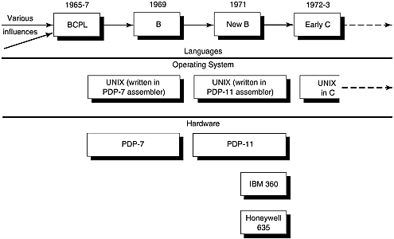
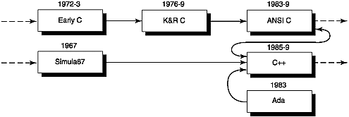
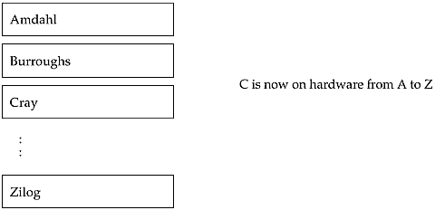
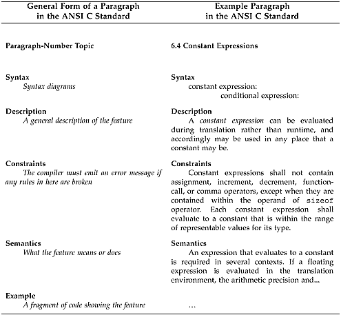

# Chương 1. C qua màn sương thời gian

C kỳ quặc, có khiếm khuyết và thành công vang dội.

—Dennis Ritchie

tiền sử của C…quy tắc vàng cho compiler-writers…trải nghiệm ban đầu với C…standard I/O library và C preprocessor…K\&R C…hiện tại: ANSI C…hay đấy, nhưng có đúng chuẩn?…cấu trúc chuẩn ANSI C…đọc chuẩn ANSI C để vui, thích thú và thu lợi…"thay đổi thầm lặng" thầm lặng đến đâu?…giải trí nhẹ nhàng — tác động implementation-defined của pragma

## Tiền sử của C

Nghịch lý thay, câu chuyện về C bắt đầu bằng một thất bại. Năm 1969, dự án Multics lớn, một dự án hợp tác giữa General Electric, MIT và Bell Laboratories để xây dựng operating system, rõ ràng đang gặp rắc rối. Nó không chỉ thất bại trong việc cung cấp hệ thống on-line nhanh và thuận tiện như đã hứa, mà còn không tạo ra được thứ gì có thể sử dụng. Dù cuối cùng nhóm phát triển cũng khiến Multics ì ạch hoạt động, họ đã sa vào cùng vũng lầy từng giữ chân IBM với OS/360. Họ cố tạo một operating system quá lớn trên hardware quá nhỏ. Multics là kho tàng các vấn đề kỹ thuật đã được giải quyết, nhưng cũng mở đường để C chứng minh rằng nhỏ là đẹp.

Khi nhân viên Bell Labs vỡ mộng rút khỏi Multics, họ tìm nhiệm vụ khác. Nhà nghiên cứu Ken Thompson rất muốn làm operating system khác, gửi nhiều đề xuất (đều bị từ chối) lên ban quản lý Bell. Trong lúc đợi phê duyệt, Thompson và co-worker Dennis Ritchie giải trí bằng port software "Space Travel" của Thompson sang chiếc PDP-7 little-used. Space Travel mô phỏng các thiên thể chính của hệ mặt trời, hiển thị trên màn hình đồ họa cùng tàu vũ trụ có thể điều khiển và đáp xuống các hành tinh. Đồng thời, Thompson miệt mài cung cấp cho PDP-7 nền tảng operating system mới, đơn giản và lighter-weight hơn Multics nhiều. Mọi thứ viết bằng assembler. Brian Kernighan đặt tên "UNIX" năm 1970, paro-dying bài học từ Multics về điều không nên làm. Hình 1-1 mô tả C, UNIX và hardware liên quan thời đầu.

Hình 1-1. C, UNIX thời đầu và hardware liên quan



Trong tình huống chicken-and-egg tiềm tàng này, UNIX chắc chắn có trước C rất lâu (đó cũng là lý do thời gian hệ thống UNIX đo bằng giây từ ngày 1 tháng 1 năm 1970 — lúc thời gian bắt đầu). Nhưng đây là chuyện lập trình, không phải gia cầm. Viết assembler tỏ ra bất tiện; viết code cho data structure lâu hơn, debug và hiểu khó hơn. Thompson muốn lợi thế của ngôn ngữ triển khai high-level nhưng không có vấn đề hiệu năng, độ phức tạp PL/I <sup>\[1\]</sup> đã thấy trên Multics. Sau cuộc thử nghiệm Fortran ngắn và không thành công, Thompson tạo ngôn ngữ B bằng đơn giản hóa ngôn ngữ nghiên cứu BCPL <sup>\[2\]</sup> để interpreter vừa memory 8K word của PDP-7. B chưa bao giờ thật sự thành công; giới hạn memory hardware chỉ đủ interpreter, không đủ compiler. Hiệu năng chậm khiến B không được dùng để systems programming chính UNIX.

<sup>\[1\]</sup> Khó khăn khi học, dùng và triển khai PL/I khiến một lập trình viên viết thơ: IBM có một PL/I / Cú pháp tệ hơn cả JOSS / Ngôn ngữ đi đến nơi nào / Nơi đó hoàn toàn thất bát. JOSS là ngôn ngữ trước đó, cũng chẳng nổi tiếng đơn giản.

<sup>\[2\]</sup> "BCPL: A Tool for Compiler Writing and System Programming," Martin Richards, Proc. AFIPS Spring Joint Computer Conference, 34 (1969), tr. 557-566. BCPL không viết tắt "Before C Programming Language", dù tên trùng hợp thú vị. Nó là "Basic Combined Programming Lan-guage" — "basic" nghĩa "không rườm rà" — được các nhà nghiên cứu London University và Cambridge University tại Anh cùng phát triển. Multics có một triển khai BCPL.

### Giáo điều software


Quy tắc vàng của Compiler-Writers:

Hiệu năng là (gần như) tất cả.

Hiệu năng gần như là tất cả trong compiler. Có mối quan tâm khác: thông báo lỗi có nghĩa, tài liệu tốt, hỗ trợ sản phẩm. Các yếu tố này lu mờ so với tầm quan trọng người dùng dành cho tốc độ thuần túy. Hiệu năng compiler có hai mặt: runtime performance (code chạy nhanh thế nào) và compile time performance (mất bao lâu tạo code). Runtime performance thường chi phối, trừ môi trường phát triển và sinh viên.

Nhiều compiler optimization kéo dài compilation time nhưng rút ngắn run time nhiều. Optimization khác (như dead code elimination, bỏ runtime check) tăng tốc cả compile time, run time và giảm memory usage. Mặt trái của optimization mạnh là nguy cơ không báo kết quả không hợp lệ. Optimizer rất cẩn thận chỉ biến đổi an toàn, nhưng lập trình viên có thể gây kết quả sai bằng code không hợp lệ (ví dụ truy cập ngoài array bound vì "biết" variable mong muốn ở sát bên).

Vì vậy hiệu năng gần như, nhưng chưa hoàn toàn là tất cả — nếu kết quả không chính xác thì nhận được nhanh đến đâu cũng vô nghĩa. Compiler-writers thường cung cấp tùy chọn để mỗi lập trình viên chọn optimization mong muốn. Việc B không thành công cho đến khi Dennis Ritchie tạo bản biên dịch high-performance tên "New B" minh họa quy tắc vàng cho compiler-writers.

B đơn giản hóa BCPL bằng bỏ vài tính năng (như nested procedure, một số cấu trúc loop-ing), giữ ý tưởng array reference nên "phân rã" thành tham chiếu pointer-plus-offset. B cũng giữ tính không có type của BCPL; operand duy nhất là machine word. Thompson nghĩ ra operator `++`, `--` và thêm vào compiler B trên PDP-7. Niềm tin phổ biến, hấp dẫn rằng chúng có trong C vì PDP-11 có addressing mode auto-increment/decrement tương ứng là sai! Auto increment và decrement có trước hardware PDP-11, dù đúng là câu lệnh C sao chép character trong string:

```
*p++ = *s++;
```

có thể được biên dịch đặc biệt hiệu quả thành code PDP-11:

```
movb (r0)+,(r1)+
```

khiến một số người kết luận sai rằng cái trước được tạo riêng cho cái sau.

Một ngôn ngữ không có type tỏ ra không khả thi khi hoạt động phát triển chuyển sang PDP-11 mới được giới thiệu vào năm 1970. Processor này có hardware hỗ trợ các data type với nhiều kích thước khác nhau, còn ngôn ngữ B không có cách diễn đạt điều đó. Hiệu năng cũng là vấn đề, khiến Thompson triển khai lại OS bằng assembler PDP-11 thay vì B. Dennis Ritchie tận dụng PDP-11 mạnh hơn để tạo “New B”, giải quyết cả hai vấn đề: nhiều data type và hiệu năng. “New B”, cái tên nhanh chóng chuyển thành “C”, được compile thay vì interpret và đưa vào một type system, với mỗi variable được mô tả trước khi sử dụng.

## Trải nghiệm ban đầu với C

Type system được thêm vào chủ yếu để giúp compiler-writer phân biệt float, double và character với word trên hardware PDP-11 mới. Điều này khác với các ngôn ngữ như Pascal, nơi type system nhằm bảo vệ lập trình viên bằng cách hạn chế các operation hợp lệ trên một data item. Với triết lý khác, C từ chối strong typing và cho phép lập trình viên thực hiện assignment giữa các object khác type nếu muốn. Type system gần như chỉ là phần bổ sung sau cùng, chưa từng được đánh giá nghiêm ngặt hoặc kiểm thử sâu rộng về tính dễ dùng. Đến nay, nhiều lập trình viên C vẫn tin rằng “strong typing” chỉ có nghĩa là gõ bàn phím mạnh hơn.

Ngoài type system, nhiều tính năng khác được đưa vào C vì lợi ích C compiler-writer (sao không, vì C compiler-writers là khách hàng chính vài năm đầu). Những tính năng dường như phát triển với compiler-writer trong đầu gồm:

- Array bắt đầu từ 0 thay vì 1. Phần lớn mọi người bắt đầu đếm từ 1 thay vì 0. Compiler-writers bắt đầu từ 0 vì chúng tôi quen tư duy theo offset. Điều này đôi khi gây khó cho non-compiler-writers: dù `a[100]` xuất hiện trong definition của array, tốt hơn bạn đừng lưu dữ liệu tại `a[100]`, vì phạm vi array là từ `a[0]` đến `a[99]`.

- Các type cơ bản của C map trực tiếp đến hardware bên dưới. Chẳng hạn, không có type complex-number built-in như trong Fortran. Người compiler-writer không phải tốn công hỗ trợ những semantics mà hardware không cung cấp trực tiếp. C không hỗ trợ floating-point number cho đến khi hardware bên dưới hỗ trợ chúng.

- Keyword `auto` có vẻ vô dụng. Nó chỉ có ý nghĩa với compiler-writer khi tạo entry trong symbol table: nó nói rằng storage này được cấp phát tự động khi vào block, khác với global static allocation hoặc dynamic allocation trên heap. Auto không liên quan đến các lập trình viên khác vì họ đã nhận nó theo mặc định.

- Array name trong expression “decay” thành pointer. Việc xem array như pointer giúp mọi thứ đơn giản hơn. Chúng ta không cần một cơ chế phức tạp để xử lý chúng như composite object, cũng không phải chịu sự kém hiệu quả của việc copy mọi thứ khi truyền chúng cho function. Nhưng đừng mắc sai lầm rằng array và pointer luôn tương đương; Chương 4 sẽ trình bày thêm.

- Floating-point expression được mở rộng thành double-length-precision ở mọi nơi. Dù điều này không còn đúng trong ANSI C, ban đầu các hằng số thực luôn là double, và float variable luôn được chuyển thành double trong mọi expression. Lý do, dù chúng tôi chưa từng thấy được in ra, liên quan đến hardware floating-point PDP-11. Trước tiên, chuyển float thành double trên PDP-11 hoặc VAX thực sự rất rẻ: chỉ cần thêm một word toàn số 0. Để chuyển ngược, chỉ cần bỏ qua word thứ hai. Tiếp đó, cần hiểu rằng một số hardware floating-point PDP-11 có một mode bit, nên nó thực hiện hoặc toàn bộ số học single-precision hoặc toàn bộ số học double-precision; để chuyển giữa hai loại, bạn phải đổi mode. Vì phần lớn chương trình UNIX ban đầu không phải floating-point-intensive, đặt máy ở mode double-precision rồi giữ nguyên dễ hơn để compiler-writer cố theo dõi nó!

- Không có nested function (function chứa trong function khác). Điều này đơn giản compiler và tăng nhẹ tốc độ tổ chức runtime của chương trình C. Cơ chế chính xác được mô tả trong Chương 6, "Thơ ca chuyển động: Runtime data structure".

- Keyword `register`. Keyword này gợi ý cho compiler-writer những variable mà lập trình viên cho là “nóng”, tức thường được tham chiếu, và do đó hữu ích nếu giữ trong register. Hóa ra đây là sai lầm. Bạn nhận được code tốt hơn nếu compiler cấp register cho từng lần sử dụng variable, thay vì dành register cho toàn bộ lifetime của nó ngay từ declaration. Keyword `register` đơn giản hóa compiler bằng cách chuyển gánh nặng này sang lập trình viên.

Cũng có nhiều tính năng C khác được tạo ra để thuận tiện cho C compiler-writer. Bản thân điều này không nhất thiết xấu: nó đơn giản hóa ngôn ngữ rất nhiều và, bằng cách tránh những semantics phức tạp như generic hay tasking trong Ada, string handling trong PL/I, template hoặc multiple inheritance trong C++, làm C dễ học và triển khai hơn nhiều, đồng thời chạy nhanh hơn.

Khác phần lớn ngôn ngữ lập trình, C tiến hóa lâu dài, qua nhiều dạng trung gian trước hình thức hiện tại. Nó qua nhiều năm sử dụng thực tế thành ngôn ngữ được thử thách và kiểm chứng. Compiler C đầu xuất hiện khoảng 1972, tức hơn 20 năm trước lúc này. UNIX bên dưới càng phổ biến, C càng được mang theo. Chú trọng operation low-level do hardware trực tiếp hỗ trợ đem lại tốc độ, tính portable, ngược lại giúp lan truyền UNIX trong chu kỳ tích cực.

## Standard I/O library và C preprocessor

Những chức năng bị bỏ khỏi C compiler phải xuất hiện ở đâu đó; trong trường hợp C, chúng xuất hiện tại runtime, trong application code hoặc runtime library. Với nhiều ngôn ngữ khác, compiler ngầm chèn code để gọi runtime support, nên lập trình viên không cần lo; nhưng gần như mọi routine trong C library phải được gọi tường minh. Trong C, khi cần, lập trình viên phải tự quản lý dynamic memory, lập trình array variable-size, kiểm tra array bound và thực hiện range check.

Tương tự, ban đầu I/O không được định nghĩa trong C mà cung cấp bằng library routine, thực tế đã thành phương tiện chuẩn. Portable I/O library do Mike Lesk <sup>\[3\]</sup> viết, xuất hiện đầu khoảng 1972 trên cả ba nền tảng hardware hiện có. Kinh nghiệm thực tế cho thấy hiệu năng chưa đạt mong đợi, nên library được tinh chỉnh, thu gọn thành standard I/O library.

<sup>\[3\]</sup> Sau này chính Michael nêu quy tắc kinh nghiệm mỉa mai vui nhộn rằng "thiết kế hệ thống sao cho manual ngắn nhất sẽ giảm thiểu công sức học" (Datamation, tháng 11 năm 1981, tr.146). Có vài lời bình hiện lên, trong đó "Bwaa ha ha!" có lẽ giảm thiểu công sức học nhất.

C preprocessor, cũng được thêm vào khoảng thời gian này theo đề nghị của Alan Snyder, thực hiện ba mục đích chính:

- Thay thế string theo dạng “đổi mọi foo thành baz”, thường để cung cấp một symbolic name cho constant.

- Include source file, như BCPL đã tiên phong. Các declaration chung có thể được tách vào header file và cung cấp cho nhiều source file. Dù quy ước “.h” được chọn làm extension của header file, đáng tiếc là không có quy ước nào liên hệ header file với object library chứa code tương ứng.

- Mở rộng code template tổng quát. Khác function, cùng macro argument có thể mang type khác nhau ở lời gọi liên tiếp (actual argument macro chỉ được đặt nguyên vào output). Tính năng này thêm sau hai tính năng đầu, hơi lệch với C. White space tạo khác biệt lớn với macro expansion loại này.

```
#define a(y) a_expanded(y)
a(x);
```

mở rộng thành:

```
a_expanded(x);
```

Tuy nhiên,

```
#define a (y) a_expanded (y)
a(x);
```

được biến đổi thành:

```
(y) a_expanded (y)(x);
```

Hai thứ thậm chí không gần giống nhau. Macro processor có thể dùng ngoặc nhọn như phần còn lại của C để chỉ các token được nhóm trong một block, nhưng nó không làm vậy.

Ở đây không có phần thảo luận sâu về C preprocessor; điều này phản ánh quan điểm rằng cách dùng preprocessor thích hợp duy nhất là cho những macro không cần thảo luận sâu. C++ tiến thêm một bước, đưa ra một số quy ước nhằm làm cho preprocessor hoàn toàn không còn cần thiết.

### Giáo điều software


C không phải Algol

Khi viết UNIX Version 7 shell, tức command interpreter, tại Bell Labs vào cuối thập niên 1970, Steve Bourne quyết định dùng C preprocessor để làm C giống Algol-68 hơn một chút. Trước đó tại Cambridge University ở Anh, Steve đã viết một Algol-68 compiler và thấy dễ debug code có dấu kết thúc statement tường minh như `if ... fi` hoặc `case ... esac`. Steve cho rằng chỉ nhìn một dấu “ `}`” không đủ dễ để biết nó khớp với gì. Vì vậy, ông thiết lập nhiều preprocessor definition:

```
#define STRING char *
#define IF if(
#define THEN ){
#define ELSE } else {
#define FI ;}
#define WHILE while (
#define DO ){
#define OD ;}
#define INT int
#define BEGIN {
#define END }
```

Điều này cho viết shell bằng code như sau:

```
INT compare(s1, s2)
    STRING s1;
    STRING s2;
BEGIN
    WHILE *s1++ == *s2
    DO IF *s2++ == 0
        THEN return(0);
        FI
    OD
    return(*--s1 - *s2);
END
```

Giờ xem lại, lần này bằng C:

```
int compare(s1, s2)
    char * s1, *s2;
{
    while (*s1++ == *s2) {
            if (*s2++ == 0) return (0);
    }
    return (*--s1 - *s2);
}
```

Phương ngữ Algol-68 này đạt vị thế huyền thoại khi Bourne shell lan xa ngoài Bell Labs, và nó khiến một số lập trình viên C khó chịu. Họ phàn nàn rằng phương ngữ này làm việc bảo trì code khó hơn nhiều đối với người khác. Bourne shell trong BSD 4.3, được giữ tại /bin/sh, đến nay vẫn được viết bằng tập con Algol!

Tôi có lý do đặc biệt để càu nhàu về Bourne shell: những báo cáo bug của nó đều rơi xuống bàn tôi! Rồi tôi giao chúng cho Sam! Và chúng tôi thực sự gặp không ít bug: shell không dùng malloc mà tự quản lý heap storage bằng sbrk. Bảo trì software như vậy quá thường xuyên dẫn đến việc cứ sửa hai bug lại tạo một bug mới. Steve giải thích custom memory allocator được viết để tăng hiệu quả string-handling, và ông chưa bao giờ nghĩ có ai ngoài mình sẽ xem code.

Phương ngữ C Bournegol thật sự truyền cảm hứng cho The International Obfuscated C Code Competition, cuộc thi vui nhộn nơi lập trình viên thi nhau nghĩ chương trình bí hiểm, khó hiểu (sẽ nói thêm sau).

Tốt nhất nên giới hạn macro ở việc đặt tên cho literal constant và viết tắt một vài cấu trúc well-chosen. Hãy định nghĩa macro name bằng toàn chữ hoa để khi sử dụng có thể thấy ngay nó không phải function call. Tránh mọi cách dùng C preprocessor sửa đổi ngôn ngữ bên dưới đến mức nó không còn là C.

## K\&R C

Đến giữa thập niên 1970, ngôn ngữ đã có hình dáng dễ nhận ra là C mà chúng ta biết và yêu thích ngày nay. Các tinh chỉnh tiếp tục diễn ra, chủ yếu dọn các chi tiết như cho phép function trả về structure value, hoặc mở rộng basic type để phù hợp hardware mới, như thêm các keyword `unsigned` và `long)`. Năm 1978, Steve Johnson viết pcc, portable C compiler. Source code được cung cấp bên ngoài Bell Labs và được port rất rộng rãi, tạo thành nền tảng chung cho cả một thế hệ C compiler. Con đường tiến hóa đến hiện tại được trình bày trong Hình 1-2.

Hình 1-2. C về sau



### Giáo điều software


Lỗi khác thường

Một tính năng C kế thừa từ Algol-68 là assignment operator. Nó cho phép operand lặp lại chỉ được viết một lần thay vì hai, gợi ý cho code generator rằng việc định địa chỉ operand cũng có thể tiết kiệm tương tự. Ví dụ là viết `b+=3` để rút gọn `b=b+3`. Assignment operator ban đầu được viết với assignment trước, không phải operator, như `b=+3`. Một đặc điểm của lexical analyzer trong B khiến dạng `=`op dễ triển khai hơn op`=` như hiện nay. Dạng này gây nhầm lẫn vì quá dễ lẫn

```
b=-3; /* subtract 3 from b */
```

với

```
b= -3; /* assign -3 to b */
```

Vì vậy, tính năng này được đổi sang thứ tự hiện tại. Trong lần thay đổi đó, code formatter `indent` được sửa để nhận biết dạng assignment operator lỗi thời rồi đảo nó thành operator assignment. Đây thực sự là một quyết định rất tệ: không formatter nào được phép thay đổi bất kỳ thứ gì ngoài white space trong chương trình. Đáng tiếc, hai điều đã xảy ra. Lập trình viên đưa vào một bug khiến gần như mọi thứ không phải variable xuất hiện sau một phép gán đều bị đảo vị trí.

Nếu "may", đó là thứ gây syntax error, như

```
epsilon=.0001;
```

bị đảo thành

```
epsilon.=0001;
```

Nhưng source statement như

```
valve=!open; /* valve is set to logical negation of open
*/
```

bị lặng lẽ biến thành

```
valve!=open; /* valve is compared for inequality to open
*/
```

vẫn compile tốt nhưng không đổi giá trị `valve`.

Điều thứ hai là bug này âm thầm tồn tại mà không được phát hiện. Có thể dễ dàng tránh nó bằng cách chèn một dấu cách sau phép gán, nên khi dạng assignment operator lỗi thời ít được dùng dần, mọi người quên rằng indent đã bị chắp vá để "cải thiện" nó. Bug của indent tồn tại trong một số implementation cho tới mid-1980's. Thật vô cùng tai hại!

Năm 1978, cuốn sách kinh điển được xem như kinh thánh của C, The C Programming Language, được xuất bản. Nhờ sự accla-mation rộng rãi nhằm tôn vinh hai tác giả Brian Kernighan và Dennis Ritchie, phiên bản ngôn ngữ này được gọi là "K\&R C". Nhà xuất bản ước tính sẽ bán khoảng một nghìn bản; tính đến hiện tại, năm 1994, con số đã vượt một triệu rưỡi (xem Hình 1-3). C là một trong những ngôn ngữ lập trình thành công nhất trong hai thập niên qua, có lẽ là thành công nhất. Nhưng khi ngôn ngữ lan rộng, sự cám dỗ tách nó thành các phương ngữ cũng tăng lên.

Hình 1-3. Như Elvis, C ở khắp nơi



## Hiện tại: ANSI C

Đến đầu những năm 1980, C đã được sử dụng rộng rãi trong toàn ngành, nhưng có nhiều implementation và thay đổi khác nhau. Việc những người triển khai C trên PC nhận ra ưu điểm của C so với BASIC đã tạo một cú hích mới. Microsoft có một implementation cho IBM PC, trong đó bổ sung các keyword (`far`, `near`, v.v.) để giúp pointer thích ứng với kiến trúc bất thường của chip Intel 80x86. Khi nhiều implementation non-pcc-based khác xuất hiện, C có nguy cơ đi theo con đường của BASIC và trở thành một họ ngôn ngữ liên hệ lỏng lẻo, ever-diverging.

Rõ ràng cần có một tiêu chuẩn ngôn ngữ chính thức. May mắn là lĩnh vực này có nhiều tiền lệ: mọi ngôn ngữ lập trình thành công cuối cùng đều được chuẩn hóa. Tuy nhiên, vấn đề của tài liệu tiêu chuẩn là chúng chỉ dễ hiểu nếu bạn đã biết chúng có nghĩa gì. Nếu viết bằng tiếng Anh, người viết càng cố chính xác thì tài liệu càng dài, buồn tẻ và khó hiểu. Nếu dùng ký pháp toán học để định nghĩa ngôn ngữ, tài liệu lại trở nên không thể tiếp cận đối với quá nhiều người.

Qua nhiều năm, các tài liệu định nghĩa chuẩn ngôn ngữ lập trình ngày càng dài hơn nhưng không dễ hiểu hơn. Algol-60 Reference Definition chỉ dài 18 trang cho một ngôn ngữ có độ phức tạp tương đương C; Pascal được mô tả trong 35 trang. Kernighan và Ritchie dùng 40 trang cho báo cáo C ban đầu; dù để lại một số khoảng trống, nó vẫn đủ cho nhiều người triển khai. ANSI C được định nghĩa trong một tài liệu dày hơn 200 trang. Một phần cuốn sách này mô tả cách sử dụng thực tế để làm sáng tỏ và mở rộng những chỗ đôi khi khó hiểu trong tài liệu chuẩn ANSI.

Năm 1983, một nhóm công tác C được thành lập dưới sự bảo trợ của American National Standards Institute. Phần lớn quá trình xoay quanh việc xác định các tính năng chung, nhưng cũng có những thay đổi và tính năng mới đáng kể được đưa vào. Các keyword `far` và `near` được tranh luận rất lâu, nhưng cuối cùng không được đưa vào chuẩn ANSI có phần UNIX-centric. Mặc dù có hơn 50 triệu PC và đây là nền tảng được những người triển khai C sử dụng rộng rãi nhất, người ta vẫn cho rằng không nên biến đổi ngôn ngữ để đối phó với giới hạn của một kiến trúc cụ thể; theo chúng tôi, quan điểm đó là đúng.

### Mẹo thực hành hữu ích


Nên dùng phiên bản C nào?

Lúc này, bất kỳ ai học hay dùng C nên làm với ANSI C, không phải K\&R C.

Dự thảo chuẩn ngôn ngữ cuối cùng được ANSI thông qua vào tháng 12 năm 1989. Sau đó, tổ chức tiêu chuẩn quốc tế ISO thông qua chuẩn ANSI C, nhưng đáng tiếc lại bỏ phần "Rationale" rất hữu ích và thực hiện những thay đổi nhỏ về định dạng, đánh số đoạn mà rất annoy-ing. Vì là cơ quan quốc tế, về nguyên tắc ISO có vị thế cao hơn, nên đầu năm 1990, ANSI lại thông qua ISO C, một lần nữa exclud-ing phần Rationale, để thay cho phiên bản riêng của mình. Vì vậy, về nguyên tắc chúng ta nên nói chuẩn C do ANSI thông qua là ISO C và gọi ngôn ngữ này là ISO C. Rationale là một tài liệu hữu ích, giúp ích rất nhiều cho việc hiểu chuẩn, và được xuất bản riêng. <sup>\[4\]</sup>

<sup>\[4\]</sup> Chỉ ANSI C Rationale được cung cấp miễn phí bằng anonymous ftp từ ftp.uu.net, thư mục /doc/standards/ansi/X3.159-1989/.

(Nếu chưa quen với anonymous ftp, hãy chạy chứ đừng đi bộ tới hiệu sách gần nhất và mua một cuốn sách về Internet, trước khi bạn trở thành \<chèn ẩn dụ lái xe vụng về tùy chọn\> trên Xa lộ thông tin.) Rationale cũng được xuất bản thành sách: ANSI C Rationale, New Jersey, Silicon Press, 1990. Bản thân chuẩn ANSI C không được cung cấp qua ftp ở bất kỳ đâu, vì một phần quan trọng trong rev-enue của ANSI đến từ việc bán các bản chuẩn in.

#### Mẹo thực hành hữu ích


Lấy bản chuẩn C ở đâu

Tên chính thức của chuẩn C là ISO/IEC 9899-1990. ISO/IEC là International Organization for Standardization International Electrotechnical Commission. Các cơ quan tiêu chuẩn bán tài liệu này với giá khoảng $130.00. Ở U.S., bạn có thể lấy một bản chuẩn bằng cách viết thư tới:

American National Standards Institute 11 West 42nd Street New York, NY 10036 Điện thoại (212) 642-4900 Ngoài Mỹ, có thể viết tới:

ISO Sales Case postale 56 CH-1211 Genève 20 Switzerland

Nhớ chỉ định ấn bản tiếng Anh.

Một nguồn khác là mua cuốn The Annotated ANSI C Standard của Herbert Schildt (New York, Osborne McGraw-Hill, 1993). Cuốn sách chứa một bản sao đầy đủ của chuẩn được thu nhỏ bằng kỹ thuật chụp ảnh. Hai ưu điểm khác của sách Schildt là giá $39.95, chưa tới one-third mức giá của các cơ quan tiêu chuẩn, và có thể mua ở hiệu sách địa phương. Khác với ANSI hay ISO, hiệu sách có lẽ đã nghe nói tới thế kỷ hai mươi và chấp nhận đặt hàng qua điện thoại bằng credit card.

Trên thực tế, thuật ngữ “ANSI C” đã được dùng rộng rãi ngay cả trước khi có ISO Working Group 14 chuyên trách C. Tên gọi này cũng thích hợp vì nhóm công tác ISO giao việc phát triển kỹ thuật của tiêu chuẩn ban đầu cho ủy ban ANSI X3J11. Gần cuối quá trình, ISO WG14 và X3J11 hợp tác giải quyết các vấn đề kỹ thuật và bảo đảm tiêu chuẩn kết quả được cả hai nhóm chấp nhận. Thực tế, giai đoạn cuối bị chậm một năm do phải sửa dự thảo tiêu chuẩn để bao quát các vấn đề quốc tế như wide character và locale.

Ai theo dõi vài năm vẫn gọi ANSI C. Đạt thứ tốt này, ai cũng muốn công nhận chuẩn C. ANSI C còn là chuẩn châu Âu (CEN 29899), chuẩn X/Open. ANSI C được thông qua thành Federal Information Processing Standard, FIPS 160, do National Institute of Standards and Technology ban hành tháng 3 năm 1991, cập nhật ngày 24 tháng 8 năm 1992. Công việc với C tiếp tục — đang bàn thêm complex number type.

## Hay đấy, nhưng có đúng chuẩn?

Cứu một cái cây — giải tán nhóm công tác ISO ngay hôm nay.

—Vô danh

Tiêu chuẩn ANSI C có một số điểm độc đáo thú vị. Nó định nghĩa các thuật ngữ sau để mô tả đặc tính của một implementation. Hiểu những thuật ngữ này sẽ giúp bạn biết điều gì được và không được chấp nhận trong ngôn ngữ. Hai thuật ngữ đầu liên quan đến code không portable; hai thuật ngữ tiếp theo nói về code sai; hai thuật ngữ cuối nói về code portable.

### Code không portable:

implementation-defined — Người viết compiler-writer chọn điều xảy ra và phải ghi tài liệu.

Ví dụ: sign bit có được truyền khi dịch int sang phải không.

unspecified — Hành vi của một thao tác đúng mà tiêu chuẩn không đặt ra bất kỳ yêu cầu nào.

Ví dụ: thứ tự đánh giá argument.

### Code xấu:

undefined — Hành vi của một thao tác không đúng mà chuẩn không đặt ra bất kỳ yêu cầu nào. Mọi thứ đều có thể xảy ra, từ không có gì xảy ra đến thông báo cảnh báo, kết thúc chương trình, CPU nóng chảy hoặc phóng tên lửa hạt nhân, giả sử bạn đã lắp đúng tùy chọn hardware.

Ví dụ: điều xảy ra khi signed integer overflow.

constraint — Một hạn chế hoặc yêu cầu bắt buộc phải tuân thủ. Nếu không làm vậy, hành vi của chương trình trở thành undefined theo nghĩa trên. Đây là một điều đáng kinh ngạc: rất dễ nhận biết một điều có phải constraint hay không, vì mỗi chủ đề trong chuẩn đều có tiểu mục mang tên "Constraints" liệt kê tất cả. Còn một điều đáng kinh ngạc hơn: chuẩn quy định <sup>\[5\]</sup> compiler chỉ buộc phải đưa ra thông báo lỗi cho những vi phạm syntax và constraint! Điều này có nghĩa là một semantic rule không nằm trong tiểu mục constraint có thể bị vi phạm, và vì hành vi là undefined, compiler được tự do làm bất kỳ điều gì, thậm chí không phải cảnh báo bạn!

<sup>\[5\]</sup> Nếu bạn nhất định muốn biết, đó là đoạn 5.1.1.3, "Diagnostics". Là một chuẩn ngôn ngữ, nó không nói đơn giản rằng phải báo ít nhất một lỗi trong chương trình sai. Nó dùng lời lẽ long trọng hơn, như thể do một nhóm luật sư doanh nghiệp được trả tiền theo số từ soạn ra: một conforming implementation shall <sup>\[\*\]</sup> tạo ít nhất một diagnostic message, được nhận biết theo cách implementation-dependent, cho mỗi translation unit chứa vi phạm bất kỳ syntax rule hoặc constraint nào. Không cần tạo diagnostic message trong các trường hợp khác.

<sup>\[\*\]</sup> Quy tắc hữu ích từ Brian Scearce <sup>\[</sup><sup>\]</sup> — nếu nghe lập trình viên nói "shall", họ đang trích chuẩn.

<sup>\[</sup><sup>\]</sup> Người phát minh chú thích lồng nhau.

Ví dụ: các operand của operator `%` phải có integral type. Vì vậy, dùng type non-integral với `%` phải tạo diagnostic.

Ví dụ về một quy tắc không phải constraint: mọi identifier được khai báo trong các C standard header file đều dành riêng cho implementation, nên bạn không được khai báo một function tên `malloc()` vì standard header file đã có function mang tên đó. Nhưng vì đây không phải constraint, quy tắc có thể bị vi phạm mà compiler không phải cảnh báo bạn! Xem thêm phần "interpositioning" ở Chương 5.

#### Giáo điều software


Undefined behavior làm CPU IBM PC nóng chảy!

Ý tưởng undefined software behavior làm CPU nóng chảy không xa vời như thoạt nhìn. Màn hình IBM PC ban đầu hoạt động ở một horizontal scan rate do video controller chip cung cấp. Flyback transformer, thiết bị tạo điện áp cao cần thiết để gia tốc electron làm lớp phosphor trên màn hình phát sáng, phụ thuộc vào một tần số hợp lý. Tuy nhiên, phần mềm có thể đặt scan rate của video chip về zero, qua đó cấp điện áp không đổi vào phía sơ cấp transformer. Khi đó nó hoạt động như một điện trở, tiêu tán công suất dưới dạng nhiệt thay vì biến đổi để đưa lên màn hình. Điều này làm cháy màn hình trong vài giây. Thế đấy: undefined software behavior gây nóng chảy hệ thống!

### Code portable:

strictly-conforming — Chương trình strictly-conforming là chương trình:

- Chỉ dùng tính năng đã quy định.

- Không vượt giới hạn implementation-defined.

- Không có output phụ thuộc tính năng implementation-defined, unspecified hay undefined.

Điều này nhằm mô tả những chương trình có tính portable cao nhất, luôn tạo ra output giống hệt nhau bất kể chạy trên hệ thống nào. Thực ra, đây không phải một nhóm thú vị lắm vì nó quá nhỏ so với toàn bộ các chương trình conforming. Ví dụ, chương trình sau không strictly conforming:

```
#include <limits.h>
#include <stdio.h>
int main() { (void) printf("biggest int is %d", INT_MAX);
return 0;}

/* not strictly conforming: implementation-defined output! */
```

Trong phần còn lại của cuốn sách, chúng tôi thường không cố làm cho các chương trình ví dụ strictly conforming. Điều đó làm văn bản rườm rà và khiến bạn khó thấy điểm cụ thể đang được thảo luận. Tính portable của chương trình rất có giá trị, nên bạn luôn cần thêm những cast, return value cần thiết, v.v. vào code real-world của mình.

conforming — Một chương trình conforming có thể phụ thuộc vào các tính năng không portable của một implementation. Vì vậy, chương trình conforming đối với một implementation cụ thể, nhưng cũng chương trình đó có thể nonconforming khi dùng compiler khác. Nó có thể dùng extension, nhưng không được dùng extension làm thay đổi hành vi của một chương trình strictly-conforming. Tuy nhiên, quy tắc này không phải constraint, nên đừng mong compiler cảnh báo về những vi phạm khiến chương trình của bạn nonconforming!

Ví dụ chương trình trên là conforming.

## Translation limit

Chuẩn ANSI C thực sự quy định giới hạn dưới cho kích thước của những chương trình phải được translate thành công. Các giới hạn nằm trong đoạn 5.2.4.1. Phần lớn ngôn ngữ quy định dataname có thể chứa bao nhiêu character, và một số ngôn ngữ quy định giới hạn chấp nhận được cho số chiều tối đa của array. Nhưng việc đặt giới hạn dưới cho kích thước nhiều tính năng khác là điều khác thường, nếu không muốn nói là độc nhất trong một chuẩn ngôn ngữ lập trình. Các thành viên ủy ban tiêu chuẩn hóa nhận xét rằng mục đích là hướng dẫn lựa chọn những kích thước tối thiểu chấp nhận được.

Mỗi compiler ANSI C phải hỗ trợ ít nhất:

- 31 parameter trong function definition

- 31 argument trong function call

- 509 character trong source line

- 32 mức ngoặc đơn lồng trong expression

- Giá trị lớn nhất của `long int` không được nhỏ hơn 2.147.483.647, tức long integer có độ rộng ít nhất 32 bit.

v.v. Hơn nữa, compiler conforming phải compile và thực thi được một chương trình kiểm tra đồng thời tất cả các giới hạn. Điều đáng ngạc nhiên là những giới hạn "bắt buộc" này thực ra không phải constraint, nên compiler có thể không xử lý nổi chúng mà không đưa ra thông báo lỗi.

Các giới hạn của compiler thường là vấn đề “chất lượng implementation”; việc đưa chúng vào ANSI C ngầm thừa nhận rằng port code sẽ dễ hơn nếu mọi implementation đều có những mức năng lực tối thiểu được xác định rõ. Dĩ nhiên, một implementation thực sự tốt sẽ không có giới hạn đặt trước, mà chỉ chịu giới hạn từ những yếu tố bên ngoài như memory hoặc dung lượng disk còn có. Có thể thực hiện điều này bằng linked list hoặc bằng cách mở rộng kích thước bảng một cách động khi cần, một kỹ thuật được giải thích trong Chương 10.

## Cấu trúc chuẩn ANSI C

Sẽ hữu ích nếu tạm rẽ sang tìm hiểu nguồn gốc và nội dung của tiêu chuẩn ANSI C. Tiêu chuẩn ANSI C có bốn phần chính:

Phần 4: Giới thiệu, định nghĩa thuật ngữ (5 trang).

Phần 5: Environment (13 trang). Phần này trình bày hệ thống bao quanh và hỗ trợ C, gồm những gì xảy ra khi chương trình start-up, khi kết thúc, với signal và các thao tác floating-point. Phần này cũng cung cấp các giới hạn dưới của translator và thông tin về character set.

Phần 6: Ngôn ngữ C (78 trang). Phần này của tiêu chuẩn dựa trên tài liệu kinh điển “The C Reference Manual” của Dennis Ritchie, từng xuất hiện trong nhiều ấn phẩm, bao gồm Phụ lục A của The C Programming Language. Nếu so sánh tiêu chuẩn với phụ lục, bạn có thể thấy phần lớn heading giống nhau và xuất hiện theo cùng thứ tự. Tuy nhiên, các chủ đề trong tiêu chuẩn có định dạng chặt chẽ hơn, như Hình 1-4 (các tiểu mục trống đơn giản được bỏ qua).

Hình 1-4. Một đoạn trong chuẩn ANSI C trông thế nào



Phụ lục gốc chỉ dài 40 trang, trong khi phần này của tiêu chuẩn dài gấp đôi.

Phần 7: C runtime library (81 trang). Đây là danh sách các library call mà một conforming implementation phải cung cấp: các service và routine tiêu chuẩn để thực hiện những chức năng thiết yếu hoặc hữu ích. Phần 7 của tiêu chuẩn ANSI C về C runtime library dựa trên tiêu chuẩn /usr/group năm 1984, với các phần UNIX-specific được loại bỏ. “/usr/group” ban đầu là một nhóm user UNIX quốc tế. Năm 1989, nhóm được đổi tên thành “UniForum” và hiện là một hiệp hội thương mại phi lợi nhuận chuyên thúc đẩy UNIX operating system.

Thành công của UniForum trong việc định nghĩa UNIX từ góc độ hành vi đã khuyến khích nhiều sáng kiến liên quan, gồm các X/Open portability guide (phiên bản 4, XPG/4 được phát hành tháng 10 năm 1992), IEEE POSIX 1003, System V Interface Definition và các ANSI C library. Mọi bên phối hợp với nhóm công tác ANSI C để bảo đảm tất cả dự thảo chuẩn nhất quán với nhau. Ơn trời.

Chuẩn ANSI C còn có phụ lục hữu ích:

Phụ lục F: Các thông báo cảnh báo thường gặp. Một số tình huống phổ biến không bắt buộc phải có diagnostic message, nhưng việc tạo thông báo dù vậy thường vẫn hữu ích.

Phụ lục G: Các vấn đề về portability. Một số lời khuyên tổng quát về portability được tập hợp từ khắp tiêu chuẩn vào một chỗ. Phần này bao gồm thông tin về các hành vi unspecified, undefined và implementation-defined.

### Giáo điều software


Chuẩn đúc trong bê tông, kể cả sai sót

Chỉ vì một điều được ghi trong tiêu chuẩn quốc tế không có nghĩa nó đầy đủ, nhất quán hay thậm chí đúng. Tiêu chuẩn IEEE POSIX 1003.1-1988 (một tiêu chuẩn OS định nghĩa hành vi UNIX-like) có mâu thuẫn thú vị sau:

“\[Một pathname\] ... gồm tối đa PATH\_MAX byte, bao gồm terminating null character.” — mục 2.3

“PATH\_MAX là số byte tối đa trong một pathname (không phải độ dài string; số đếm không bao gồm terminating null).” — mục 2.9.5

Vậy PATH\_MAX byte vừa bao gồm vừa không bao gồm terminating null!

Một yêu cầu diễn giải đã được gửi đi, và câu trả lời trả về (IEEE Std 1003.1-1988/INT, ấn bản năm 1992, diễn giải số 15, trang 36) cho rằng đây là một sự không nhất quán và cả hai đều có thể đúng. Điều đó khá lạ, vì toàn bộ vấn đề chính là cả hai không thể cùng đúng.

Vấn đề phát sinh vì một thay đổi ở giai đoạn dự thảo không được áp dụng tới tất cả những chỗ xuất hiện của câu chữ đó. Quy trình tiêu chuẩn hóa mang tính hình thức và cứng nhắc, nên không thể sửa vấn đề trước khi một bản cập nhật được nhóm bỏ phiếu thông qua.

Loại lỗi này cũng xuất hiện trong tiêu chuẩn C ngay ở chú thích đầu tiên, tham chiếu đến tài liệu Rationale đi kèm. Thực tế, Rationale không còn đi kèm tiêu chuẩn C: nó đã bị loại bỏ khi quyền sở hữu tiêu chuẩn chuyển sang ISO.

#### Mẹo thực hành hữu ích


Khác biệt K\&R C và ANSI C

Bạn có thể yên tâm rằng nếu biết K\&R C thì đã biết 90% ANSI C. Những khác biệt giữa ANSI C và K\&R C thuộc bốn nhóm lớn, được liệt kê dưới đây theo thứ tự quan trọng:

1\. Nhóm đầu tiên gồm những điều mới, rất khác biệt và quan trọng. Tính năng duy nhất trong nhóm này là prototype: viết các parameter type như một phần của function declaration. Prototype giúp compiler dễ dàng đối chiếu cách sử dụng function với definition của nó.

2\. Nhóm thứ hai là những keyword mới. Một số keyword được chính thức bổ sung: `enum` cho enumerated type (xuất hiện lần đầu trong những phiên bản pcc về sau), `const`, `volatile`, `signed`, `void`, cùng semantics tương ứng. Keyword never-used `entry`, dường như lọt vào C do sơ suất, đã được cho nghỉ hưu.

3\. Nhóm thứ ba là các “thay đổi thầm lặng”: một tính năng vẫn compile được nhưng lúc này có nghĩa hơi khác. Có nhiều thay đổi như vậy, nhưng phần lớn không quá quan trọng và có thể bỏ qua cho đến khi bạn đẩy đến giới hạn và thực sự gặp một thay đổi trong số đó. Chẳng hạn, khi các preprocessing rule được định nghĩa chặt chẽ hơn, có một rule mới quy định rằng các string literal liền nhau được nối lại.

4\. Nhóm cuối cùng là mọi thứ còn lại, bao gồm những điều được tranh luận bất tận trong quá trình chuẩn hóa ngôn ngữ nhưng gần như chắc chắn bạn sẽ không bao giờ gặp trong thực tế, chẳng hạn token-pasting hoặc trigraph. (Trigraph là cách dùng ba ký tự để biểu diễn một ký tự mà một máy tính đặc biệt thiếu thốn có thể không có trong character set. Cũng như digraph `\t` biểu diễn “tab”, trigraph `??<` biểu diễn “ngoặc nhọn mở”.)

Tính năng mới quan trọng nhất là "prototype", được lấy từ C++. Prototype mở rộng function declaration để không chỉ biết tên và return type mà còn biết tất cả parameter type, cho phép compiler kiểm tra tính nhất quán giữa cách sử dụng và khai báo parameter. "Prototype" không phải một thuật ngữ mô tả rõ "tên function kèm tất cả argument"; tên "function signature" hoặc "function specification" như Ada sử dụng có lẽ sẽ có ý nghĩa hơn.

#### Giáo điều software


Quy tắc của prototype

Mục đích của prototype là đưa thông tin về parameter type vào forward declaration của một function, thay vì chỉ cung cấp tên function và return value type. Nhờ đó, compiler có thể đối chiếu argument type trong function call với cách các parameter được định nghĩa. Trong K\&R C, việc kiểm tra này được hoãn đến link time hoặc, phổ biến hơn, bị bỏ hoàn toàn. Thay vì

```
char * strcpy();
```

declaration trong header file nay như sau:

```
char * strcpy(char *dst, const char *src);
```

Cũng có thể bỏ parameter name, chỉ giữ type:

```
char * strcpy(char * , const char * );
```

Đừng bỏ tên parameter. Dù compiler không kiểm tra chúng, chúng thường truyền thêm thông tin semantics cho lập trình viên. Tương tự, definition của function đã đổi từ

```
char * strcpy(dst, src)
     char *dst, *src;
{ ... }
```

thành

```
char * strcpy(char *dst, const char *src) /* note no
semi-colon! */
{ ... }
```

Thay vì kết thúc bằng dấu chấm phẩy, function header giờ được theo ngay bởi một compound statement duy nhất tạo thành body của function.

Viết prototype cho mọi code mới, bảo đảm prototype trong scope ở mọi lời gọi. Đừng quay lại thêm prototype cho code K\&R cũ trừ khi tính đến default type promotion — thêm ở Chương 8.

Việc có tất cả những thuật ngữ khác nhau cho cùng một thứ có thể hơi khó hiểu. Nó khá giống chuyện thuốc có ít nhất ba tên: tên hóa học, tên thương hiệu của nhà sản xuất và tên gọi ngoài đường phố.

## Đọc chuẩn ANSI C để vui, thích thú và thu lợi

Đôi khi cần tập trung đáng kể để đọc tiêu chuẩn ANSI C và tìm được câu trả lời trong đó. Một kỹ sư bán hàng gửi đoạn code sau đến nhóm compiler tại Sun như một test case.

```
1 foo(const char **p) { }
2
3 main(int argc, char **argv)
4{
5 foo(argv);
6}
```

Nếu thử compile đoạn này, bạn sẽ thấy compiler phát một thông báo cảnh báo như sau:

```
line 5: warning: argument is incompatible with prototype
```

Người gửi đoạn code muốn biết vì sao thông báo cảnh báo được tạo ra và phần nào của tiêu chuẩn ANSI C bắt buộc điều đó. Suy cho cùng, theo lập luận của anh, argument `char *s` khớp với parameter `const char *p`

Điều này thấy ở mọi library string function.

Vậy argument `char **argv` không khớp parameter `const char **p` sao?

Câu trả lời là không, nó không khớp. Phải mất một chút thời gian mới trả lời được câu hỏi này, và việc xem xét quá trình tìm ra câu trả lời có giá trị học hỏi theo nhiều nghĩa. Phân tích do một trong những "language lawyer" của Sun <sup>\[6\]</sup> thực hiện và diễn ra như sau:

<sup>\[6\]</sup> The New Hacker's Dictionary định nghĩa language lawyer là "người chỉ cho bạn năm câu nằm rải rác trong một tài liệu 200-plus-page, mà khi kết hợp lại sẽ ngụ ý câu trả lời cho câu hỏi của bạn: 'giá như bạn nghĩ đến việc tìm ở đó.'" Đúng vậy! Đó chính xác là điều đã xảy ra trong trường hợp này.

Phần Constraints trong Mục 6.3.2.2 của tiêu chuẩn ANSI C có câu:

Mỗi argument phải có type sao cho giá trị của nó có thể được gán cho một object mang phiên bản không có qualifier của type của parameter tương ứng.

Nghĩa là truyền argument phải có hành vi như assignment.

Vì vậy, phải tạo diagnostic message trừ khi một object có type `const char **` được phép nhận giá trị có type `char **.` Để biết assignment này có hợp lệ không, hãy chuyển đến phần simple assignment, Mục 6.3.16.1, có constraint sau:

Một trong các điều sau phải đúng:…

- Cả hai operand đều là pointer đến phiên bản có hoặc không có qualifier của các type tương thích, và type mà operand trái trỏ đến có toàn bộ qualifier của type mà operand phải trỏ đến.

Chính điều kiện này làm cho một lời gọi có argument `char *` tương ứng với parameter `const char *` trở nên hợp lệ, như thường thấy trong các string routine của C library. Điều này hợp lệ vì trong code

```
char * cp;
const char *ccp;
ccp = cp;
```

- Operand trái là pointer tới "char có qualifier const".

- Operand phải là pointer tới "char" không qualifier.

- Type `char` tương thích với `char`, và type mà operand trái trỏ đến có mọi qualifier của type mà operand phải trỏ đến (không có qualifier nào), cộng thêm một qualifier riêng là const.

Lưu ý rằng không thể thực hiện assignment theo chiều ngược lại. Hãy thử nếu bạn không tin tôi.

```
cp = ccp; /* results in a compilation warning */
```

Mục 6.3.16.1 có làm cho lời gọi có argument `char **` tương ứng với parameter `const char **` trở nên hợp lệ không? Không.

Phần Examples của Mục 6.1.2.5 nêu:

Type "const float \*" không phải qualified type — type là "pointer tới float const-qualified", một pointer tới qualified type.

Tương tự, `const char **` biểu thị một pointer đến một unqualified type. Type của nó là pointer đến pointer đến một qualified type.

Vì hai type `char **` và `const char **` đều là pointer tới những unqualified type khác nhau, chúng không phải các compatible type. Do đó, không cho phép lời gọi có argument type `char **` tương ứng với parameter type `const char **`. Vì vậy, constraint nêu ở Mục 6.3.2.2 bị vi phạm và phải có diagnostic message.

Đây là điểm tinh tế khó nắm. Cách khác là lưu ý:

- Operand trái có type FOO2 — pointer tới FOO, trong đó FOO là unqualified pointer tới character có qualifier const, và

- Operand phải có type BAZ2 — pointer tới BAZ, trong đó BAZ là unqualified pointer tới character không qualifier.

FOO và BAZ là compatible type, nhưng FOO2 và BAZ2 còn khác nhau ở những điểm ngoài qualifica-tion của đối tượng được trỏ tới trực tiếp, nên không phải compatible type. Vì vậy, operand trái và phải là các unqualified pointer tới những type không compatible. Tính compatible của pointer type không có tính bắc cầu. Do đó, phép gán hoặc function call này không được phép. Tuy nhiên, hãy lưu ý rằng hạn chế chủ yếu làm người dùng bực mình và bối rối. Phép gán hiện được các C++ translator dựa trên cfront cho phép, dù điều đó có thể thay đổi.

### Mẹo thực hành hữu ích


Const không phải constant

Keyword `const` không biến một variable thành constant! Một symbol có qualifier `const` chỉ có nghĩa là không được dùng symbol đó để thực hiện phép gán. Điều này khiến giá trị chỉ đọc được thông qua symbol đó; nó không ngăn việc sửa giá trị bằng cách khác bên trong, hoặc thậm chí bên ngoài, chương trình. Nó gần như chỉ hữu ích để qualify một pointer parameter, cho biết function này không thay đổi dữ liệu mà argument trỏ tới, nhưng các function khác vẫn có thể thay đổi. Đây có lẽ là cách dùng `const` phổ biến nhất trong C và C++. Có thể dùng `const` cho dữ liệu như sau:

```
const int limit = 10;
```

và nó hoạt động phần nào giống các ngôn ngữ khác. Khi thêm pointer vào bài toán, mọi thứ trở nên khó khăn hơn một chút:

```
const int * limitp = &limit;
int i=27;
limitp = &i;
```

Điều này nói rằng `limitp` là một pointer tới một constant integer. Không thể dùng pointer này để thay đổi integer; tuy nhiên, bản thân pointer có thể được gán một giá trị khác bất kỳ lúc nào. Khi đó, nó trỏ tới một vị trí khác, và dereference nó sẽ cho một giá trị khác!

Sự kết hợp giữa `const` và `*` thường chỉ được dùng để mô phỏng call-by-value cho array parameter. Nó nói: "Tôi đưa cho bạn một pointer tới đối tượng này, nhưng bạn không được thay đổi đối tượng đó." Cách dùng này tương tự cách dùng phổ biến nhất của `void *`. Mặc dù về lý thuyết có thể dùng nó trong vô số hoàn cảnh, thông thường nó chỉ được dùng để chuyển pointer từ type này sang type khác.

Tương tự, bạn có thể lấy địa chỉ của một constant variable và, thôi, có lẽ tôi không nên gieo ý tưởng đó vào đầu mọi người. Như Ken Thompson nhận xét: "Keyword `const` chỉ làm các library interface thêm rối rắm với hy vọng phát hiện một vài lỗi hiếm gặp." Nhìn lại, keyword `const` lẽ ra nên được đặt tên là `readonly`.

Đúng là toàn bộ phần này của tiêu chuẩn có vẻ đã được dịch sang tiếng Anh từ tiếng Urdu qua tiếng Đan Mạch bởi những người chỉ biết sơ qua bất kỳ ngôn ngữ nào trong số đó. Nhưng ủy ban tiêu chuẩn đang vui vẻ đến mức có vẻ thật đáng tiếc nếu phá hỏng niềm vui của họ bằng cách yêu cầu các rule đơn giản và rõ ràng hơn.

Chúng tôi cảm thấy sau này nhiều người sẽ có thắc mắc, và không phải ai cũng muốn đi theo quá trình suy luận ở trên. Vì vậy, chúng tôi sửa Sun ANSI C compiler để in thêm thông tin về những gì nó thấy không tương thích. Thông báo đầy đủ lúc này là:

```
Line 6: warning: argument #1 is incompatible with prototype:
  prototype: pointer to pointer to const char : "barf.c", line
1
  argument : pointer to pointer to char
```

Ngay cả khi không hiểu lý do, giờ lập trình viên cũng biết điều gì không tương thích.

## "Thay đổi thầm lặng" thầm lặng đến đâu?

Không phải mọi thay đổi trong chuẩn đều nổi bật như prototype. ANSI C thực hiện một số thay đổi khác, thường nhằm làm ngôn ngữ đáng tin cậy hơn. Chẳng hạn, "usual arithmetic conversions" đã thay đổi từ K\&R C nguyên bản cổ xưa sang ANSI C. Vì vậy, ở nơi Kernighan và Ritchie nói đại ý như sau:

Mục 6.6 Arithmetic Conversions

Rất nhiều operator gây conversion và tạo result type theo cách tương tự. Mẫu này được gọi là “usual arithmetic conversions”.

Đầu tiên, mọi operand có type char hoặc short được chuyển thành int, và mọi operand có type float được chuyển thành double. Sau đó, nếu một operand là double, operand còn lại được chuyển thành double và đó là type của kết quả. Nếu không, nếu một operand là long, operand còn lại được chuyển thành long và đó là type của kết quả. Nếu không, nếu một operand là unsigned, operand còn lại được chuyển thành unsigned và đó là type của kết quả. Nếu không, cả hai operand phải là int và đó là type của kết quả.

Manual ANSI C bịt lỗ hổng bằng viết lại:

Mục 6.2.1.1 Character và integer (integral promotion)

Một char, short int hoặc int bit-field, hoặc các biến thể signed hay unsigned của chúng, hoặc một enumeration type, có thể được dùng trong expression ở bất kỳ nơi nào có thể dùng int hoặc unsigned int. Nếu int có thể biểu diễn mọi giá trị của type ban đầu, giá trị được chuyển thành int; nếu không, nó được chuyển thành unsigned int. Những phép chuyển này được gọi là integral promotion.

Mục 6.2.1.5 Usual Arithmetic Conversions

Nhiều binary operator yêu cầu operand có arithmetic type thực hiện conversion và tạo result type theo cách tương tự. Mục đích là tạo một type chung, cũng là type của kết quả. Mẫu này được gọi là “usual arithmetic conversions”.

Đầu tiên, nếu một trong hai operand có type long double, operand còn lại được chuyển thành long double. Nếu không, nếu một operand có type double, operand còn lại được chuyển thành double. Nếu không, nếu một operand có type float, operand còn lại được chuyển thành float. Nếu không, các integral promotion \[xem mục 6.2.1.1 về integral promotion\] được thực hiện trên cả hai operand. Sau đó, các rule sau được áp dụng.

Nếu một trong hai operand có type unsigned long int, operand còn lại được chuyển thành unsigned long int. Nếu không, nếu một operand có type long int và operand kia có type unsigned int, thì nếu long int có thể biểu diễn mọi giá trị của unsigned int, operand có type unsigned int được chuyển thành long int; nếu long int không thể biểu diễn mọi giá trị của unsigned int, cả hai operand được chuyển thành unsigned long int. Nếu không, nếu một operand có type long int, operand còn lại được chuyển thành long int. Nếu không, nếu một operand có type unsigned int, operand còn lại được chuyển thành unsigned int. Nếu không, cả hai operand có type int.

Giá trị của các floating operand và kết quả của các floating expression có thể được biểu diễn với độ chính xác và phạm vi lớn hơn mức type yêu cầu; các type không vì thế mà thay đổi.

Diễn giải bằng ngôn ngữ thông thường, với đầy đủ lỗ hổng và sự thiếu chính xác, phiên bản ANSI C sẽ có nghĩa đại loại như sau:

Các operand khác type được chuyển khi bạn thực hiện số học. Mọi thứ được chuyển sang type của operand mang tính floating point cao nhất và dài nhất, dùng signed nếu có thể mà không mất bit. Cách tiếp cận unsigned preserving của K\&R C nói rằng khi một unsigned type kết hợp với int hoặc signed type nhỏ hơn, result type là unsigned. Đây là một rule đơn giản, độc lập với hardware, nhưng như ví dụ dưới đây, đôi khi nó buộc một kết quả âm mất dấu!

Cách tiếp cận value preserving của ANSI C nói rằng khi trộn các integral operand type theo cách này, result type là signed hoặc unsigned tùy kích thước tương đối của các operand type.

Đoạn chương trình sau sẽ in thông báo khác nhau khi dùng compiler ANSI và pre-ANSI:

```
main() {
  if ( -1 < (unsigned char) 1 )
      printf("-1 is less than (unsigned char) 1: ANSI
semantics ");
  else
      printf("-1 NOT less than (unsigned char) 1: K&R
semantics ");
}
```

Tùy bạn compile bằng K\&R hay ANSI C, expression sẽ được đánh giá khác nhau. Các bitpattern được so sánh giống nhau, nhưng được diễn giải là một số âm hoặc một số unsigned và do đó là số dương.

### Giáo điều software


Lỗi tinh vi

Mặc dù các quy tắc đã thay đổi, những bug tinh tế vẫn có thể và thực sự xảy ra. Trong ví dụ này, variable d nhỏ hơn index cần thiết một đơn vị, nên code đã tính đến trường hợp đó. Nhưng câu lệnh if không được đánh giá là true. Tại sao, và bug nằm ở đâu?

```
int array[] = { 23, 34, 12, 17, 204, 99, 16 };
#define TOTAL_ELEMENTS (sizeof(array) /
sizeof(array[0]))

main()
{
    int d= -1, x;
    /* ... */

    if (d <= TOTAL_ELEMENTS-2)
        x = array[d+1];
    /* ... */
}
```

Variable `TOTAL_ELEMENTS` được định nghĩa có type unsigned int, vì return type của sizeof là “unsigned”. Phép kiểm tra so sánh một signed int với một đại lượng unsigned int. Vì vậy, d được promote thành unsigned int. Diễn giải -1 như một unsigned int tạo ra số dương lớn, khiến clause có giá trị false. Bug này xảy ra trong ANSI C, và cả trong K\&R C nếu `sizeof()` có unsigned return type trong implementation cụ thể đó. Có thể sửa bằng cách đặt một int cast ngay trước `TOTAL_ELEMENTS`:

```
if (d <= (int) TOTAL_ELEMENTS - 2)
```

#### Mẹo thực hành hữu ích


Lời khuyên về unsigned type

Tránh sự phức tạp không cần thiết bằng cách giảm tối đa việc sử dụng unsigned type. Cụ thể, đừng dùng unsigned type để biểu diễn một đại lượng chỉ vì nó sẽ không bao giờ âm, chẳng hạn "age" hoặc "national\_debt".

Dùng một signed type như `int` thì bạn sẽ không phải lo về các boundary case trong những rule chi tiết để promote các type hỗn hợp.

Chỉ dùng unsigned type cho bitfield hoặc binary mask. Dùng cast trong expression để làm tất cả operand thành signed hoặc unsigned, để compiler không phải chọn result type.

Nếu điều này nghe có vẻ hơi rắc rối hoặc bất ngờ thì đúng là như vậy! Hãy thực hiện ví dụ theo các rule ở trang trước.

Cuối cùng, để tránh thấy đoạn code này xuất hiện như một ví dụ xấu trong ấn bản tương lai của The Elements of Programming Style <sup>\[7\]</sup>, tốt hơn chúng ta nên giải thích rằng đã dùng

<sup>\[7\]</sup> The Elements of Programming Style, Kernighan (đúng, chính Kernighan đó), Plauger, New York, McGraw-Hill, 1978. Đọc cực hay, cốt truyện đáng tin, sách nhỏ tuyệt — mua, đọc, sống theo!

```
#define TOTAL_ELEMENTS (sizeof(array) / sizeof(array[0]))
```

thay vì

```
#define TOTAL_ELEMENTS (sizeof(array) / sizeof(int))
```

vì cách đầu cho phép base type của array thay đổi, chẳng hạn từ `int` thành `char`, mà không cần sửa cả `#define`.

Nhóm compiler Sun ANSI C cho rằng chuyển từ "unsigned preserving" sang "value preserving" là một thay đổi hoàn toàn không cần thiết đối với semantics của C, sẽ khiến bất kỳ ai bất ngờ gặp nó đều ngạc nhiên và thất vọng. Vì vậy, theo "nguyên tắc ít gây ngạc nhiên nhất", Sun compiler nhận biết và compile các tính năng ANSI C, trừ khi tính năng đó cho kết quả khác dưới K\&R C. Nếu gặp trường hợp này, compiler đưa ra cảnh báo và mặc định dùng cách diễn giải K\&R. Trong những tình huống như trên, lập trình viên nên dùng cast để thông báo cho compiler type cuối cùng mong muốn. Có thể dùng ANSI semantics nghiêm ngặt trên Sun workstation chạy Solaris 2.x bằng compiler option `-Xc`.

ANSI C còn có nhiều cập nhật khác so với K\&R C, bao gồm thêm một vài so-called “thay đổi thầm lặng”, trong đó code compile được với cả hai nhưng có nghĩa khác nhau. Dựa trên phản ứng thông thường của lập trình viên khi phát hiện chúng, thực ra nên gọi chúng là “những thay đổi thực sự rất ồn ào”. Nhìn chung, ủy ban ANSI cố thay đổi ngôn ngữ ít nhất có thể, đồng thời vẫn sửa những điểm rõ ràng cần được cải thiện.

Nhưng như vậy là đủ kiến thức nền về cây gia phả ANSI C. Sau một chút giải trí trong phần sau, hãy chuyển sang chương tiếp theo và bắt tay vào code!

## Giải trí nhẹ nhàng — Tác động Implementation-Defined của pragma . . .

Free Software Foundation là tổ chức độc đáo do hacker xuất sắc MIT Richard Stallman lập. Nhân tiện, chúng tôi dùng "hacker" theo nghĩa tốt cũ "lập trình viên tài năng"; truyền thông làm xấu thuật ngữ, nên người ngoài hiểu "thiên tài độc ác". Như tính từ bad, "hacker" nay có hai nghĩa trái nhau, phải suy từ ngữ cảnh.

Free Software Foundation của Stallman được thành lập dựa trên triết lý rằng phần mềm phải tự do và được cung cấp tự do cho mọi người. Tôn chỉ của FSF là "loại bỏ các hạn chế đối với việc sao chép, phân phối lại, tìm hiểu và sửa đổi computer program", và tham vọng của họ là tạo một implementation UNIX public-domain có tên GNU (viết tắt của "GNU's Not UNIX". Đúng thật vậy.)

Nhiều nghiên cứu sinh computer science và những người khác đồng tình với triết lý GNU, đã làm việc trên các sản phẩm phần mềm mà FSF đóng gói và phân phối miễn phí. Nguồn nhân lực lành nghề đóng góp tài năng này đã tạo ra một số phần mềm tốt. Một trong những sản phẩm tốt nhất của FSF là họ GNU C compiler. gcc là một optimizing compiler vững chắc, tối ưu mạnh mẽ, có trên nhiều hardware platform và đôi khi tốt hơn compiler của nhà sản xuất. Dùng gcc không phù hợp với mọi dự án; còn những vấn đề về bảo trì và tính liên tục của sản phẩm trong tương lai. Ngoài compiler còn cần các công cụ khác, và GNU debugger từng không thể làm việc với shared library trong một thời gian dài. GNU C cũng đôi khi hơi, nói thế nào nhỉ, bốc đồng trong quá trình phát triển.

Khi chuẩn ANSI C đang được phát triển, directive `pragma` được đưa vào. Được mượn từ Ada, `#pragma` dùng để truyền gợi ý cho compiler, chẳng hạn mong muốn mở rộng một function cụ thể theo kiểu in-line hoặc bỏ các range check. Vì chưa từng có trong C, `pragma` ban đầu gặp sự phản đối từ một người triển khai gcc, người hiểu tác dụng "implementation-defined" theo nghĩa rất đen: trong gcc phiên bản 1.34, dùng pragma khiến compiler dừng compile và thay vào đó khởi chạy một computer game! Tài liệu gcc có nội dung sau: Lệnh "#pragma" được chuẩn ANSI quy định có một tác dụng implementation-defined tùy ý. Trong GNU C preprocessor, "#pragma" trước hết thử chạy trò "rogue"; nếu thất bại, nó thử chạy trò "hack"; nếu vẫn thất bại, nó thử chạy GNU Emacs hiển thị Tower of Hanoi; nếu tiếp tục thất bại, nó báo fatal error. Trong mọi trường hợp, preprocessing không tiếp tục.

—Manual phiên bản 1.34 của GNU C compiler

Source code tương ứng trong phần preprocessor compiler là:

```
/*
 * the behavior of the #pragma directive is implementation
defined.
 * this implementation defines it as follows.
 */
do_pragma ()
{
 close (0);
 if (open ("/dev/tty", O_RDONLY, 0666) != 0)
                      goto nope;
 close (1);
 if (open ("/dev/tty", O_WRONLY, 0666) != 1)
                      goto nope;
 execl ("/usr/games/hack", "#pragma", 0);
 execl ("/usr/games/rogue", "#pragma", 0);
 execl ("/usr/new/emacs", "-f", "hanoi", "9", "-kill", 0);
 execl ("/usr/local/emacs", "-f", "hanoi", "9", "-kill", 0);
nope:
 fatal ("You are in a maze of twisty compiler features, all
different");
}
```

Điều đặc biệt hài hước là mô tả trong user manual bị sai, vì code cho thấy “hack” được thử trước “rogue”.
